<!-- page: 1 -->

GB/T 150.1~150.4—2024

代替 GB/T 150.1～150.4—2011

压力容器

Pressure vessels

2024-07-24 发布

2025-02-01 实施

国家市场监督管理总局 发布 国家标准化管理委员会

<!-- page: 2 -->

I. TH49

中国国家版本馆 CIP 数据核字第 2024QE0147 号

中华人民共和国

国家标准

压力容器

GB/T 150.1～150.4—2024

中国标准出版社出版发行北京市朝阳区和平里西街甲2号(100029)北京市西城区三里河北街16号(100045)

网址 www.spc.net.cn

总编室:(010)68533533 发行中心:(010)51780238 读者服务部:(010)68523946

中国标准出版社秦皇岛印刷厂印刷 各地新华书店经销

开本 880×1230 1/16 印张 29 字数 866 千字 2024 年 8 月第一版 2024 年 8 月第一次印刷

定价 539.00 元

如有印装差错 由本社发行中心调换

版权专有 侵权必究

举报电话:(010)68510107

<!-- page: 3 -->

## 目录

- GB/T 150.1—2024 压力容器 第1部分:通用要求 …… 1
- GB/T 150.2—2024 压力容器 第2部分:材料 …… 48
- GB/T 150.3—2024 压力容器 第3部分:设计 …… 121
- GB/T 150.4—2024 压力容器 第4部分:制造、检验和验收 …… 401

<!-- page: 4 -->

The image provided is completely blank, with no visible text, figures, or content to extract. Therefore, there is no OCR result to output.

<!-- page: 5 -->

GB/T 150.1—2024

代替GB/T150.1—2011

压力容器 第1部分:通用要求

Pressure vessels—Part 1: General requirements

2024-07-24 发布

2025-02-01 实施

<!-- page: 6 -->

The image provided is completely blank, with no visible text, figures, or content to extract. Therefore, there is no OCR result to output.

<!-- page: 7 -->

## 前言

本文件按照 GB/T 1.1—2020《标准化工作导则 第 1 部分: 标准化文件的结构和起草规则》的规定起草。

本文件是 GB/T 150《压力容器》的第 1 部分。GB/T 150 已经发布了以下部分:

第1部分:通用要求;

——第2部分:材料；

——第 3 部分: 设计;

——第 4 部分: 制造、检验和验收。

本文件代替 GB/T 150.1—2011《压力容器 第1部分:通用要求》,与 GB/T 150.1—2011 相比,除结构调整和编辑性改动外,主要技术变化如下:

a）增加了压力容器失效模式的类别(见第4章)；

b) 更改了圆筒许用轴向压缩应力的确定方法(见 5.4.5,2011 年版的 4.4.5);

c) 更改了超压泄放装置的技术内容(见附录 B,2011 年版的附录 B)。

请注意本文件的某些内容可能涉及专利,本文件的发布机构不承担识别专利的责任。

本文件由全国锅炉压力容器标准化技术委员会(SAC/TC 262)提出并归口。

本文件起草单位:中国特种设备检测研究院、中国机械工业集团有限公司、浙江大学、中国石化工程建设有限公司、华东理工大学、上海华理安全装备有限公司。

本文件主要起草人:李军、陈学东、郑津洋、谢铁军、陈志伟、段瑞、徐锋、孙亮、陈志平、惠虎、张迎恺、吴全龙。

本文件及其所代替文件的历次版本发布情况为:

——1989年首次发布为GB 150—1989,1998年第一次修订；

——2011年第二次修订时分为部分出版,本文件对应GB/T 150.1—2011《压力容器 第1部分:通用要求》;

——本次为第三次修订。

<!-- page: 8 -->

## 引言

压力容器是涉及公共安全的特种设备之一，是石油化工、能源装备、生物医药等领域的重要设备。为了提高压力容器的经济性和安全性，我国在1967年发布了《钢制化工容器设计规定》，1989年发布了GB 150《钢制压力容器》，1998年对GB 150进行了修订，其作为压力容器法规的配套标准，规范了钢制压力容器的建造要求。GB/T 150系列标准自2011年发布实施已十余年，在此期间《固定式压力容器安全技术监察规程》于2016年进行了修改，其引用的材料、零部件和无损检测标准也进行了修订。鉴于此，确有必要修订完善GB/T 150，以不断适应经济发展对该标准的新需求，更好地促进压力容器产品的高质量发展。

本文件是压力容器建造方法通用技术标准之一，用以规范在中国境内建造或使用的压力容器设计、制造、检验和验收的相关技术要求。GB/T 150《压力容器》由四个部分构成。

——第 1 部分:通用要求。目的在于给出压力容器建造的基本要求。

——第 2 部分: 材料。目的在于给出压力容器选材的基本要求和设计制造过程用到的材料数据。

——第 3 部分: 设计。目的在于给出压力容器的设计方法和设计技术要求。

——第 4 部分: 制造、检验和验收。目的在于给出压力容器制造过程中的要求以及检验和验收规定。

本文件的技术条款包括了压力容器建造过程(即指设计、制造、检验和验收)中需遵循的技术要求。本文件没有必要,也不可能囊括适用范围内压力容器建造中的所有技术细节。

本文件不限制实际工程设计和建造中采用先进的技术方法,但工程技术人员采用先进的技术方法时需能做出可靠的判断,确保其满足本文件规定,特别是关于强度或稳定性设计公式等设计规定。本文件既不要求也不限制设计人员使用计算机程序实现压力容器的分析或设计。

对于未经委员会书面授权或认可的其他机构对标准的宣贯或解释所产生的理解歧义和由此产生的任何后果,委员会不承担任何责任。

<!-- page: 9 -->

# 压力容器 第1部分：通用要求

## 1 范围

1.1 本文件规定了金属制压力容器材料、设计、制造、检验和验收的通用要求。

1.2 本文件适用的设计压力为:

a）钢制容器不大于 35 MPa；

b) 其他金属材料制容器按相应引用标准确定。

1.3 本文件适用的设计温度为:

a）设计温度范围: $-269^{\circ}\mathrm{C}\sim 900^{\circ}\mathrm{C}$

b) 钢制容器设计温度范围按 GB/T 150.2 中列入材料的允许使用温度范围。

c) 其他金属材料制容器按本文件相应引用标准中列入的材料允许使用温度确定。

1.4 本文件适用的结构形式为:

a）本文件适用钢制容器的结构形式按本文件以及 GB/T 150.2～GB/T 150.4 的相应规定。

b) 本文件适用范围内的特定结构容器以及铝、钛、铜、镍及镍合金、锆制容器，其结构形式和适用范围按照下述标准的相应要求:

1）GB/T151 热交换器；

2）GB/T 12337 钢制球形储罐；

3）JB/T4734 铝制焊接容器；

4）JB/T4755铜制压力容器；

5）JB/T4756镍及镍合金制压力容器；

6）NB/T 11270 钛制压力容器；

7）NB/T47011 锆制压力容器；

8）NB/T 47041 塔式容器；

9）NB/T47042卧式容器。

1.5 本文件不适用于下列容器:

a）设计压力低于 $0.1\mathrm{MPa}$ 且真空度低于 $0.02\mathrm{MPa}$ 的容器；

b）《移动式压力容器安全技术监察规程》管辖的容器；

c) 旋转或往复运动机械设备中自成整体或作为部件的受压器室(如泵壳、压缩机外壳、涡轮机外壳、液压缸、造纸轧辊等);

d) 核能装置中存在中子辐射损伤失效风险的容器；

e）直接火焰加热的容器；

f) 内直径(对非圆形截面,指截面内边界的最大几何尺寸,如:矩形为对角线,椭圆为长轴)小于150 mm的容器;

g）搪玻璃容器和制冷空调行业中另有国家标准或行业标准的容器。

1.6 容器界定范围为如下。

a） 容器本体与外部管道连接:

1）焊接连接的第一道环向接头坡口端面；

2）螺纹连接的第一个螺纹接头端面；

<!-- page: 10 -->

3）法兰连接的第一个法兰密封面；

4）专用连接件或管件连接的第一个密封面。

b) 接管、人孔、手孔等的承压封头、平盖及其紧固件。

c) 非受压元件与受压元件的连接焊缝。

d) 直接连接在容器上的非受压元件如支座、裙座等。

e）容器的超压泄放装置。

## 2 规范性引用文件

下列文件中的内容通过文中的规范性引用而构成本文件必不可少的条款。其中，注日期的引用文件，仅该日期对应的版本适用于本文件；不注日期的引用文件，其最新版本（包括所有的修改单）适用于本文件。

GB/T 150.2 压力容器 第2部分:材料

GB/T 150.3 压力容器 第 3 部分: 设计

GB/T 150.4 压力容器 第4部分:制造、检验和验收

GB/T151 热交换器

GB/T 567(所有部分) 爆破片安全装置

GB/T 4732(所有部分) 压力容器分析设计

GB/T 12241 安全阀 一般要求

GB/T 12243 弹簧直接载荷式安全阀

GB/T 12337 钢制球形储罐

GB/T 26929 压力容器术语

GB/T 42594 承压设备介质危害分类导则

JB/T4734 铝制焊接容器

JB/T4755 铜制压力容器

JB/T 4756 镍及镍合金制压力容器

NB/T 11270 钛制压力容器

NB/T 47002(所有部分) 压力容器用复合板

NB/T 47011 锆制压力容器

NB/T47041 塔式容器

NB/T47042 卧式容器

TSG 21 固定式压力容器安全技术监察规程

## 3 术语和定义、符号

### 3.1 术语和定义

GB/T 26929界定的以及下列术语和定义适用于本文件。

#### 3.1.1

压力 pressure

垂直作用在容器单位表面积上的力。

注:在本文件中，除注明者外，压力均指表压力。

<!-- page: 11 -->

#### 3.1.2

**容积 volume**

压力容器的几何容积。

注:由设计图样标注的尺寸计算(不考虑制造公差)并且圆整。一般需要扣除永久连接在压力容器内部的内件的体积。

#### 3.1.3

**工作压力 operating pressure**

在正常工作情况下,容器顶部可能达到的最高压力。

#### 3.1.4

**设计压力 design pressure**

设定的容器顶部的最高压力。

注:与相应的设计温度一起作为容器的基本设计载荷条件，其值不低于工作压力。

#### 3.1.5

**计算压力 calculation pressure**

在相应设计温度下,用以确定元件厚度的压力。

注:包括液柱静压力等附加载荷。

#### 3.1.6

**试验压力 test pressure**

进行耐压试验或泄漏试验时,容器顶部的压力。

#### 3.1.7

**最高允许工作压力 maximum allowable working pressure; MAWP**

在指定的相应温度下，容器顶部所允许承受的最大压力。

注:该压力是根据容器各受压元件的有效厚度，考虑了该元件承受的所有载荷而计算得到的，且取最小值。当压力容器的设计文件没有给出最高允许工作压力时，则认为该容器的设计压力即是最高允许工作压力。

#### 3.1.8

**设计温度 design temperature**

容器在正常工作情况下,设定的元件的金属温度(沿元件金属截面的温度平均值)。

注:设计温度与设计压力一起作为设计载荷条件。设计温度的上限值称为最高设计温度，设计温度的下限值称为最低设计温度。

#### 3.1.9

**试验温度 test temperature**

进行耐压试验或泄漏试验时，容器壳体的金属温度。

#### 3.1.10

**计算厚度 required thickness**

按本文件相应公式计算得到的厚度。

注:需要时，计入其他载荷所需厚度(见5.3.2)。对于外压元件，系指满足稳定性要求的最小厚度。

#### 3.1.11

**设计厚度 design thickness**

计算厚度与腐蚀裕量之和。

#### 3.1.12

**名义厚度 nominal thickness**

设计厚度加上材料厚度负偏差后向上圆整至材料标准规格的厚度。

<!-- page: 12 -->

#### 3.1.13

有效厚度 effective thickness

名义厚度减去腐蚀裕量和材料厚度负偏差。

#### 3.1.14

最小成形厚度 minimum required fabrication thickness

受压元件成形后保证设计要求的最小厚度。

#### 3.1.15

**低温容器 low-temperature pressure vessel**

设计温度低于 $-20^{\circ}\mathrm{C}$ 的非合金钢、低合金钢、双相不锈钢和铁素体不锈钢制容器，以及设计温度低于 $-196^{\circ}\mathrm{C}$ 的奥氏体不锈钢制容器。

#### 3.1.16

**失效模式 failure mode**

容器丧失其规定功能或者危及安全的事件及其本质原因。

### 3.2 符号

下列符号适用于本文件。 C ——厚度附加量, mm; C₁ ——材料厚度负偏差, 按 5.3.6.2, mm; C₂ ——腐蚀裕量, 按 5.3.6.3, mm; Eᵗ ——材料在设计温度下的弹性模量, MPa; L ——圆筒的长度, mm; nₐb ——轴压圆筒设计安全系数; p ——设计压力, MPa; pᵀ ——试验压力最低值, MPa; RₑL ——材料标准室温下屈服强度, MPa; Rₘ ——材料标准抗拉强度下限值, MPa; Rₒ ——圆筒的外半径, mm; Rₚ₀.₂ ——材料标准室温下规定塑性延伸率为 0.2% 时的强度, MPa; Rₚ₁.₀ ——材料标准室温下规定塑性延伸率为 1.0% 时的强度, MPa; RₑLᵗ ——材料在设计温度下的屈服强度, MPa; Rₚ₀.₂ᵗ ——材料在设计温度下规定塑性延伸率为 0.2% 时的强度, MPa; Rₚ₁.₀ᵗ ——材料在设计温度下规定塑性延伸率为 1.0% 时的强度, MPa; Rₐᵈ ——材料在设计温度下经 10⁵ h 断裂的持久强度的平均值, MPa; Rₙᵗ ——材料在设计温度下经 10⁵ h 蠕变量为 1% 的蠕变极限平均值, MPa; σₐcr ——理想圆筒轴向压缩临界应力, MPa; σcr ——理想弹性圆筒轴向压缩临界应力, MPa; σᵀ ——试验压力下受压元件的应力, MPa; [σ] ——容器元件材料在耐压试验温度下的许用应力, MPa; [σ]ᵗ ——容器元件材料在设计温度下的许用应力, MPa; [σ]ᵗ₁ ——设计温度下基层材料的许用应力, MPa; [σ]ᵗ₂ ——设计温度下覆层材料的许用应力, MPa; [σ]ᵗcr ——设计温度下圆筒许用轴向压缩应力, MPa; β ——材料的塑性影响系数; ρ ——圆筒轴向压缩临界应力折减因子;

<!-- page: 13 -->

ν ——材料的泊松比；

$\delta_{1}$ ——基层材料的名义厚度, mm;

$\delta_{2}$ ——覆层材料的厚度,不计入腐蚀裕量,mm;

$\delta_{e}$ ——圆筒或球壳的有效厚度, mm;

$\omega$ ——圆筒的结构特征参数；

$\omega_{E}$ ——圆筒第二类、第三类屈曲的分界点；

$\omega_{P}$ ——圆筒第一类、第二类屈曲的分界点；

$\varphi$ ——焊接接头系数。

## 4 失效模式

通常容器建造中考虑的主要失效模式如下。

a) 短期失效模式:脆性断裂(brittle fracture)、韧性断裂(ductile fracture)(如塑性垮塌、局部过度应变)、过量变形(excessive deformation)、屈曲(buckling)。

注:过量变形会导致法兰等连接处介质泄漏或丧失其他功能。

b) 长期失效模式:蠕变破裂(creep rupture)、蠕变过量变形(creep excessive deformation)、蠕变失稳(buckling instability)、腐蚀和磨蚀(corrosion and erosion)、环境助长断裂(environmentally assisted cracking)。

c) 循环失效模式:棘轮或称渐增塑性变形(ratcheting or progressive plastic deformation)、交替塑性(alternating plasticity)、疲劳(fatigue)、腐蚀疲劳(environmentally assisted fatigue)。

## 5 基本要求

### 5.1 通则

5.1.1 钢制容器的设计、制造、检验和验收除应符合本文件及 GB/T 150.2～GB/T 150.4 的规定外，还应遵守国家有关法律、法规和安全技术规范。按本文件及 GB/T 150.2～GB/T 150.4 要求建造的压力容器可满足 TSG 21 的基本安全要求，标准的符合性声明按附录 A。容器的超压泄放装置按附录 B。

5.1.2 特定结构容器以及铝、钛、铜、镍及镍合金、锆制容器，其设计、制造、检验和验收除应符合 5.1.1 的规定外，还应满足 GB/T 151、GB/T 12337、NB/T 47041、NB/T 47042、JB/T 4734、JB/T 4755、JB/T 4756、NB/T 11270 和 NB/T 47011 的相应要求。低温容器应满足 GB/T 150.2～GB/T 150.4 的相应要求。

5.1.3 容器的设计、制造单位应建立健全质量管理体系并有效运行。

5.1.4 TSG 21 管辖范围内的压力容器设计和制造应接受特种设备安全监察机构的监察。

5.1.5 容器分类根据介质分组、容积和设计压力，按 TSG 21 的规定确定。介质危害分类按 GB/T 42594 执行。

5.1.6 对不能按 GB/T 150.3 确定结构尺寸的容器或受压元件, 可采用以下方法进行设计:

a）验证性实验分析，如实验应力分析、验证性液压试验，具体要求按附录 C 的规定；

b) 利用可比的已投入使用的结构进行对比经验设计, 具体要求按附录 D 的规定;

c）采用包括数值分析法在内的应力分析计算和评定，具体要求按附录E的规定。

### 5.2 资质与职责

#### 5.2.1 资质

TSG 21 管辖范围内压力容器的设计制造单位应持有相应的特种设备生产许可证。

<!-- page: 14 -->

#### 5.2.2 职责

#### 5.2.2.1 用户或设计委托方的职责

用户或设计委托方应履行以下职责。

a) 容器的用户或设计委托方应以正式书面形式向设计单位提出容器设计条件(User's Design Specification, UDS), 其中至少包含以下内容:

1）容器设计所依据的主要标准和规范；

2）操作参数(包括工作压力、工作温度范围、交变载荷条件、液位高度、接管载荷等);

3）压力容器使用地及其自然条件(包括环境温度、抗震设防烈度、风和雪载荷等);

4）介质组分与特性；

5）预期使用年限；

6）几何参数和管口方位；

7）容器服役过程中的超压可能性及原因；

8）设计需要的其他必要条件。

b）容器的用户或设计委托方遵循如下规定。

1）考虑容器可能的超压风险。

2) 当压力源来自压力容器外部,并且得到可靠控制时,超压泄放装置可不直接安装在压力容器上;当工艺或环保等因素无法装设超压泄放装置时,采用可靠性不低于超压泄放装置的系统安全设计方法防止压力容器超压。

3）用户应在容器首次操作前确认超压泄放装置已正确安装到指定位置上。

#### 5.2.2.2 设计单位的职责

设计单位应履行以下职责:

a）设计单位对设计文件的正确性和完整性负责；

b）设计单位当向设计委托方提供5.3.7中规定的设计文件；

c) TSG 21 管辖范围内压力容器的设计总图加盖设计单位设计专用印章(复印章无效);

d) 设计单位向容器用户出具的风险评估报告符合附录 F 的要求；

e）设计单位在容器设计使用年限内保存全部容器设计文件。

#### 5.2.2.3 制造单位的职责

制造单位应履行以下职责。

a）制造单位按照设计文件的要求进行制造，如需要对原设计进行修改，取得原设计单位同意修改的书面文件，并且对改动部位作出详细记载。

b) 制造单位在容器制造前制定完善的质量计划,其内容至少包括容器或元件的制造工艺控制点、检验项目和合格指标。

c) 制造单位的检查部门在容器制造过程中和完工后, 按本文件、图样规定和质量计划的规定对容器进行各项检验和试验, 出具相应报告, 并对报告的正确性和完整性负责。

d）制造单位在检验合格后，出具产品质量合格证。

e) 制造单位对其制造的每台容器产品在容器设计使用年限内至少保存下列技术文件备查:

1）质量计划；

<!-- page: 15 -->

2）制造工艺图或制造工艺卡；

3）产品质量证明文件；

4）容器的焊接工艺和热处理工艺文件；

5）标准中允许制造厂选择的检验、试验项目记录；

6）容器制造过程中及完工后的检查、检验、试验记录；

7）容器的原设计图和竣工图。

#### 5.2.2.4 监督检验机构的职责

监督检验机构的职责按TSG21的规定。

### 5.3 设计要求

#### 5.3.1 一般规定

5.3.1.1 容器设计单位(设计人员)应严格依据用户或设计委托方所提供的容器设计条件进行容器设计,考虑容器在使用中可能出现的所有失效模式,并提出防止失效的措施。容器受压元件的强度、刚度和稳定性计算按 GB/T 150.3、GB/T 151、GB/T 12337、NB/T 47041、NB/T 47042、JB/T 4734、JB/T 4755、JB/T 4756、NB/T 11270 或 NB/T 47011 的规定。

5.3.1.2 对于有成功使用经验的承受循环载荷的容器，经设计单位技术负责人批准，可按本文件进行设计，并按GB/T4732(所有部分)附录C补充疲劳分析和评定，同时满足其相关制造要求。

#### 5.3.2 载荷

5.3.2.1 设计时考虑以下载荷:

a）内压、外压或最大压差；

b) 液柱静压力, 当液柱静压力小于设计压力的 5% 时, 可忽略不计。

5.3.2.2 需要时,还要考虑下列载荷:

a) 容器的自重(包括内件和填料等),以及正常工作条件下或耐压试验状态下内装介质的重力载荷;

b）附属设备及隔热材料、衬里、管道、扶梯、平台等的重力载荷；

c）风载荷、地震载荷、雪载荷；

d) 支座、底座圈、支耳及其他型式支承件的反作用力；

e）连接管道和其他部件的作用力；

f） 温度梯度或热膨胀量不同引起的作用力；

g）冲击载荷，包括压力急剧波动引起的冲击载荷、流体冲击引起的反力等；

h）运输或吊装时的作用力。

#### 5.3.3 设计压力或计算压力的确定

确定设计压力或计算压力时,遵循下列规定:

a）容器上装有超压泄放装置时，按附录 B 确定设计压力；

b) 对于盛装液化气体的容器,如果具有可靠的保冷设施,在规定的装量系数范围内,设计压力根据工作条件下容器内介质可能达到的最高温度确定;否则按 TSG 21 确定;

c) 对于外压容器(例如真空容器、液下容器和埋地容器), 确定计算压力时, 需计及在正常工作情况下可能出现的最大内外压力差;

d) 确定真空容器的壳体厚度时, 设计压力按承受外压计算。当装有安全控制装置(如真空泄放阀)时, 设计压力取 1.25 倍最大内外压力差或 0.1 MPa 两者中的低值; 当无安全控制装置

<!-- page: 16 -->

时,取 0.1 MPa;

e) 由 2 个或 2 个以上压力室组成的容器, 如夹套容器, 应分别确定各压力室的设计压力。确定公用元件的计算压力时, 需计及相邻室之间的最大压力差。

#### 5.3.4 设计温度的确定

压力容器设计温度的确定应符合如下规定。

a) 最高设计温度不应低于元件金属在工作状态可能达到的最高温度。最低设计温度不应高于元件金属可能达到的最低温度。

b) 容器各部分在工作状态下的金属温度不同时,可分别设定每部分的设计温度。

c) 元件的金属温度通过以下方法确定:

1）传热计算求得；

2）在已使用的同类容器上测定；

3）根据容器内部介质温度并结合外部条件确定。

d) 在确定最低设计温度时,考虑在运行过程中,大气环境低温条件对容器壳体金属温度的影响。大气环境低温条件系指历年来月平均最低气温(指当月各天的最低气温值之和除以当月天数)的最低值。

#### 5.3.5 工况

对有不同工况的容器,应按最苛刻的工况设计,必要时还需考虑不同工况的组合,并在图样或相应技术文件中注明各工况操作条件和设计条件下的压力和温度值。

#### 5.3.6 厚度

#### 5.3.6.1 厚度附加量

厚度附加量按公式(1)确定:

$$ C = C _ {1} + C _ {2}\tag{……(1} $$

式中:

C ——厚度附加量,单位为毫米(mm);

$C_{1}$ ——材料厚度负偏差, 按 5.3.6.2, 单位为毫米(mm);

$C_{2}$ ——腐蚀裕量，按 5.3.6.3，单位为毫米(mm)。

#### 5.3.6.2 材料厚度负偏差

板材或管材的厚度负偏差按材料标准的规定。

#### 5.3.6.3 腐蚀裕量

为防止容器受压元件由于腐蚀、机械磨损而导致厚度削弱减薄,应增加腐蚀裕量要求,具体规定如下:

a) 对有均匀腐蚀或磨损的元件,根据预期的容器设计使用年限和介质对金属材料的腐蚀速率(及磨蚀速率)确定腐蚀裕量;

b) 容器各元件受到的腐蚀程度不同时,可采用不同的腐蚀裕量;

c) 介质为压缩空气、水蒸气或水的非合金钢或低合金钢制容器，腐蚀裕量不小于 $1 \mathrm{~mm}$。

<!-- page: 17 -->

#### 5.3.6.4 最小厚度

壳体加工成形后不包括腐蚀裕量的最小厚度；

a）非合金钢、低合金钢制容器，不小于3 mm；

b) 高合金钢制容器,不宜小于 2 mm。

#### 5.3.6.5 厚度标注

容器元件的名义厚度和最小成形厚度一般标注在设计图样上。

#### 5.3.7 设计文件

#### 5.3.7.1 一般要求

5.3.7.1.1 压力容器的设计文件主要内容包括:

a) 风险评估报告(需要时)、强度计算书或者应力分析报告、设计图样、制造技术条件,必要时还应包括安装及使用维护保养说明;

b) 装设安全阀、爆破片等超压泄放装置的压力容器,设计文件还应包括压力容器安全泄放量、安全阀排量和爆破片泄放面积的计算书;利用软件模拟计算或者无法计算时,设计单位应会同设计委托单位或者使用单位,协商选用超压泄放装置。

5.3.7.1.2 设计文件中的风险评估报告、强度计算书、设计总图，至少进行设计、校核、审核3级签署；对于第Ⅲ类压力容器，还应由压力容器设计单位技术负责人或者其授权人批准(4级签署)。

5.3.7.1.3 设计文件的保存期限不少于压力容器设计使用年限。

#### 5.3.7.2 设计总图

设计总图应符合以下要求。

a）压力容器的设计总图上至少注明以下内容:

1）压力容器名称、分类，设计、制造所依据的主要法规、产品标准；

2）工作条件，包括工作压力、工作温度、介质特性(毒性和爆炸危害程度等)；

3) 设计条件,包括设计温度(包含最低设计温度和最高设计温度)、设计载荷(包含压力在内的所有考虑的载荷)、介质(组分)、腐蚀裕量、焊接接头系数、自然条件等,对储存液化气体的储罐还应注明装量系数,对有应力腐蚀倾向的储存容器还应注明腐蚀介质的限定含量; 4) 主要受压元件材料牌号与材料标准;

5）主要特性参数(如压力容器容积、热交换器换热面积与程数)；

6）压力容器设计使用年限(疲劳容器标明循环次数);

7）特殊制造要求；

8）热处理要求；

9）无损检测要求；

10）耐压试验和泄漏试验要求；

11）预防腐蚀的要求；

12） 安全附件及仪表的规格和订购特殊要求(工艺系统已考虑的除外);

13）压力容器铭牌的位置；

14）包装、运输、现场组焊和安装要求。

b) 对设计总图的特殊要求:

1）多腔压力容器分别注明各腔的试验压力，有特殊要求时注明共用元件两侧允许的压力差

<!-- page: 18 -->

值,以及试验步骤和试验要求;

2）装有触媒的压力容器和装有填料的压力容器，注明使用过程中定期检验的技术要求；

3）由于结构原因不能进行内部检验的压力容器，注明计算厚度、使用中定期检验的要求；

4）不能进行耐压试验的压力容器，注明计算厚度和制造与使用的特殊要求；

5）有隔热衬里的压力容器，注明防止受压元件超温的技术措施；

6）要求保温或者保冷的压力容器，提出保温或者保冷措施。

### 5.4 许用应力

#### 5.4.1 一般要求

本文件中材料的许用应力按GB/T150.2、JB/T4734、JB/T4755、JB/T4756、NB/T11270和NB/T47011的规定。按表1确定材料(螺栓材料除外)许用应力，按表2确定钢制螺栓材料许用应力。

表 1 材料许用应力的取值(螺栓材料除外)

| 材料 | 许用应力/MPa取下列各值中的最小值 |
|---|---|
| 非合金钢、低合金钢 | $\frac{R_{\text{m}}}{2.7}$ 、 $\frac{R_{\text{eL}}(R_{\text{p0.2}})}{1.5}$ 、 $\frac{R_{\text{eL}}^{\text{t}}(R_{\text{p0.2}}^{\text{t}})}{1.5}$ 、 $\frac{R_{\text{D}}^{\text{t}}}{1.5}$ 、 $\frac{R_{\text{n}}^{\text{t}}}{1.0}$ |
| 高合金钢 | $\frac{R_{\text{m}}}{2.7}$ 、 $\frac{R_{\text{eL}}(R_{\text{p0.2}})}{1.5}$ 、 $\frac{R_{\text{eL}}^{\text{t}}(R_{\text{p0.2}}^{\text{t}})}{1.5}$ 、 $\frac{R_{\text{D}}^{\text{t}}}{1.5}$ 、 $\frac{R_{\text{n}}^{\text{t}}}{1.0}$ |
| 钛及钛合金 | $\frac{R_{\text{m}}}{2.7}$ 、 $\frac{R_{\text{p0.2}}}{1.5}$ 、 $\frac{R_{\text{p0.2}}^{\text{t}}}{1.5}$ 、 $\frac{R_{\text{D}}^{\text{t}}}{1.5}$ 、 $\frac{R_{\text{n}}^{\text{t}}}{1.0}$ |
| 镍及镍合金 | $\frac{R_{\text{m}}}{2.7}$ 、 $\frac{R_{\text{p0.2}}}{1.5}$ 、 $\frac{R_{\text{p0.2}}^{\text{t}}}{1.5}$ 、 $\frac{R_{\text{D}}^{\text{t}}}{1.5}$ 、 $\frac{R_{\text{n}}^{\text{t}}}{1.0}$ |
| 铝及铝合金 | $\frac{R_{\text{m}}}{3.0}$ 、 $\frac{R_{\text{p0.2}}}{1.5}$ 、 $\frac{R_{\text{p0.2}}^{\text{t}}}{1.5}$ |
| 铜及铜合金 | $\frac{R_{\text{m}}}{3.0}$ 、 $\frac{R_{\text{p0.2}}}{1.5}$ 、 $\frac{R_{\text{p0.2}}^{\text{t}}}{1.5}$ |
| 锆及锆合金 | $\frac{R_{\text{m}}}{3.0}$ 、 $\frac{R_{\text{p0.2}}}{1.5}$ 、 $\frac{R_{\text{p0.2}}^{\text{t}}}{1.5}$ |
|对奥氏体高合金钢制受压元件,当设计温度低于蠕变范围,且允许有微量的永久变形时,可适当提高许用应力至 $0.9R_{\text{p0.2}}^{\text{t}}$ ,但不超过 $R_{\text{p0.2}}/1.5$ 。此规定不适用于法兰或其他有微量永久变形就产生泄漏或故障的场合注1:如果GB/T 150.2中规定了 $R_{\text{p1.0}}$ 或 $R_{\text{p1.0}}^{\text{t}}$ ,则可以选用该值作为屈服强度计算其许用应力。注2:根据设计使用年限选用 $1.0\times10^{5} h$ 、 $1.5\times10^{5} h$ 、 $2.0\times10^{5} h$ 等持久强度极限值。|  |

<!-- page: 19 -->

表 2 钢制螺栓材料许用应力的取值

| 材料 | 螺栓直径/mm | 热处理状态 | 许用应力/MPa取下列各值中的最小值 |  |
|---|---|---|---|---|
| 非合金钢 | $\leqslant M22$ | 热轧、正火 | $\frac{R_{\text{eL}}^{\text{t}}}{2.7}$ | $\frac{R_{\text{D}}^{\text{t}}}{1.5}$ |
| M24~M48 | $\frac{R_{\text{eL}}^{\text{t}}}{2.5}$ |  |  |  |
| 低合金钢、马氏体高合金钢 | $\leqslant M22$ | 调质 | $\frac{R_{\text{eL}}^{\text{t}}(R_{\text{p0.2}}^{\text{t}})}{3.5}$ |  |
| M24~M48 | $\frac{R_{\text{eL}}^{\text{t}}(R_{\text{p0.2}}^{\text{t}})}{3.0}$ |  |  |  |
| $\geqslant M52$ | $\frac{R_{\text{eL}}^{\text{t}}(R_{\text{p0.2}}^{\text{t}})}{2.7}$ |  |  |  |
| 奥氏体高合金钢 | $\leqslant M22$ | 固溶 | $\frac{R_{\text{eL}}^{\text{t}}(R_{\text{p0.2}}^{\text{t}})}{1.6}$ |  |
| M24~M48 | $\frac{R_{\text{eL}}^{\text{t}}(R_{\text{p0.2}}^{\text{t}})}{1.5}$ |  |  |  |

#### 5.4.2 设计温度低于 20^{\circ}\mathrm{C} 的许用应力

设计温度低于 $20^{\circ}\mathrm{C}$ 时，取 $20^{\circ}\mathrm{C}$ 时的许用应力。

#### 5.4.3 复合板的许用应力

对于覆层与基层结合率达到NB/T47002(所有部分)中2级板以上的复合板，在设计计算中，如需计入覆层材料的强度时，其设计温度下的许用应力按公式(2)确定:

$$ \left[ \sigma \right] ^ {\mathrm{t}} = \frac {\left[ \sigma \right] _ {1} ^ {\mathrm{t}} \delta_ {1} + \left[ \sigma \right] _ {2} ^ {\mathrm{t}} \delta_ {2}}{\delta_ {1} + \delta_ {2}}\tag{……(2} $$

式中:

$\left[\sigma\right]^{\mathrm{t}}$ ——容器元件材料在设计温度下的许用应力，单位为兆帕(MPa)；

$\left[\sigma\right]_{1}^{t}$ ——设计温度下基层材料的许用应力,单位为兆帕(MPa);

$\left[\sigma\right]_{2}^{t}$ ——设计温度下覆层材料的许用应力,单位为兆帕(MPa);

$\delta_{1}$ ——基层材料的名义厚度,单位为毫米(mm);

$\delta_{2}$ ——覆层材料的厚度,不计入腐蚀裕量,单位为毫米(mm);

#### 5.4.4 组合工况下的许用应力

当地震载荷或风载荷与5.3.2中其他载荷相组合时，允许元件的设计应力不超过许用应力的1.2倍，其组合要求按相应标准规定。

#### 5.4.5 圆筒许用轴向压缩应力

5.4.5.1 本节许用轴向压缩应力计算方法适用于设计温度低于材料蠕变温度，且满足 $5 \leqslant \frac{R_{\mathrm{o}}}{\delta_{\mathrm{e}}} \leqslant 800$ 的圆筒。按公式(3)计算 $\sigma_{\mathrm{cr}}$ 。

$$ \sigma_ {\mathrm{cr}} = \frac {1}{\sqrt {3 (1 - \nu^ {2})}} E ^ {\mathrm{t}} \frac {\delta_ {\mathrm{e}}}{R _ {\mathrm{o}}}\tag{3} $$

<!-- page: 20 -->

式中:

$\sigma_{cr}$ ——理想弹性圆筒轴向压缩临界应力,单位为兆帕(MPa);

ν ——材料的泊松比；

$E^{t}$ ——材料在设计温度下的弹性模量,单位为兆帕(MPa);

$\delta_{e}$ ——圆筒或球壳的有效厚度,单位为毫米(mm);

$R_{0}$ ——圆筒的外半径,单位为毫米(mm)。

5.4.5.2 按公式(4)计算 $\beta$。

$$ \beta = \frac{R_{\mathrm{el}}^{\mathrm{t}}}{\sigma_{\mathrm{cr}}}\tag{……(4} $$

式中:

$\beta$ ——材料的塑性影响系数；

$R_{eL}^{t}$ ——材料在设计温度下的屈服强度,单位为兆帕(MPa);

$\sigma_{cr}$ ——理想弹性圆筒轴向压缩临界应力,单位为兆帕(MPa)。

5.4.5.3 按公式(5)～公式(7)分别计算 $\omega$ 、 $\omega_{E}$ 和 $\omega_{P}$ 。

$$ \omega = \frac {L}{\sqrt {R _ {\mathrm{o}} \delta_ {\mathrm{e}}}}\tag{……(5} $$

式中:

$\omega$ ——圆筒的结构特征参数；

L ——圆筒的长度,单位为毫米(mm);

$R_{o}$ ——圆筒的外半径,单位为毫米(mm);

$\delta_{e}$ ——圆筒或球壳的有效厚度,单位为毫米(mm)。

$$ \omega_ {\mathrm{E}} = \frac {L}{R _ {\mathrm{o}}} \sqrt {\frac {1 . 2}{\sqrt {3 \left(1 - \nu^ {2}\right)}} \frac {E ^ {\mathrm{t}}}{R _ {\mathrm{eL}} ^ {\mathrm{t}}}}\tag{6} $$

式中:

$\omega_{E}$ ——圆筒第二类、第三类屈曲的分界点；

L ——圆筒的长度,单位为毫米(mm);

$E^{t}$ ——材料在设计温度下的弹性模量,单位为兆帕(MPa);

$R_{o}$ ——圆筒的外半径,单位为毫米(mm);

$R_{eL}^{t}$ ——材料在设计温度下的屈服强度,单位为兆帕(MPa);

ν ——材料的泊松比。

$$ \omega_ {\mathrm{P}} = \frac {L}{R _ {\mathrm{o}}} \sqrt {\frac {0 . 2}{\sqrt {3 \left(1 - \nu^ {2}\right)}} \frac {E ^ {\mathrm{t}}}{R _ {\mathrm{eL}} ^ {\mathrm{t}}}}\tag{7} $$

式中:

$\omega_{P}$ ——圆筒第一类、第二类屈曲的分界点；

L ——圆筒的长度,单位为毫米(mm);

$E^{t}$ ——材料在设计温度下的弹性模量,单位为兆帕(MPa);

$R_{o}$ ——圆筒的外半径,单位为毫米(mm);

$R_{\mathrm{eL}}^{\mathrm{t}}$ ——材料在设计温度下的屈服强度，单位为兆帕（MPa）；

ν ——材料的泊松比。

5.4.5.4 按如下方法确定理想圆筒轴向压缩临界应力 $\sigma_{acr}$ 。

a）对 $\beta \leqslant 0.2$ 的圆筒，按公式(8)计算 $\sigma_{\mathrm{acr}}$ :

<!-- page: 21 -->

$$ \sigma_ {\mathrm{acr}} = R _ {\mathrm{eL}} ^ {\mathrm{t}}\tag{8} $$

式中:

$\sigma_{acr}$ ——理想圆筒轴向压缩临界应力,单位为兆帕(MPa);

$R_{\mathrm{eL}}^{\mathrm{t}}$ ——材料在设计温度下的屈服强度，单位为兆帕（MPa）。

b）对 $0.2 < \beta \leqslant 1.2$ 的圆筒，按公式(9)计算 $\sigma_{\mathrm{acr}}$ :

$$ \sigma_ {\mathrm{acr}} = \sigma_ {\mathrm{cr}} (- 0. 0 2 0 + 1. 1 2 4 \beta - 0. 2 5 4 \beta^ {2})\tag{9} $$

式中:

$\sigma_{acr}$ ——理想圆筒轴向压缩临界应力,单位为兆帕(MPa);

$\sigma_{cr}$ ——理想弹性圆筒轴向压缩临界应力,单位为兆帕(MPa);

β ——材料的塑性影响系数。

c) 对 $\beta > 1.2$ 的圆筒, 按公式(10)计算 $\sigma_{acr}$ :

$$ \sigma_ {\mathrm{acr}} = \sigma_ {\mathrm{cr}} \left(1. 0 1 2 + 2. 2 2 6 \mathrm{e} ^ {- \frac {2}{2 . 2 2 0}}\right)\tag{……(10} $$

式中:

$\sigma_{acr}$ ——理想圆筒轴向压缩临界应力,单位为兆帕(MPa);

$\sigma_{cr}$ ——理想弹性圆筒轴向压缩临界应力,单位为兆帕(MPa);

e ——自然常数,取 2.718;

ω ——圆筒的结构特征参数。

5.4.5.5 按如下方法确定圆筒轴向压缩临界应力折减因子 $\rho$。

a) 对 $\omega \leqslant \omega_{\mathrm{P}}$ 的圆筒，按公式(11)计算轴向压缩临界应力折减因子 $\rho$:

$$ \rho = 0. 9\tag{……(11} $$

b) 对 $\omega_{P}<\omega\leqslant\omega_{E}$ 的圆筒，按公式(12)计算 $\rho$ :

$$ \rho = (0. 2 0 7 + 0. 6 0 2 \mathrm{e} ^ {- 0. 0 6 7 \omega_ {\mathrm{E}}}) \frac {\omega - \omega_ {\mathrm{P}}}{\omega_ {\mathrm{E}} - \omega_ {\mathrm{P}}} + \frac {0 . 9 (\omega_ {\mathrm{E}} - \omega)}{\omega_ {\mathrm{E}} - \omega_ {\mathrm{P}}}\tag{……(12} $$

式中:

$\rho$ ——圆筒轴向压缩临界应力折减因子；

$\omega_{E}$ ——圆筒第二类、第三类屈曲的分界点；

$\omega$ ——圆筒的结构特征参数；

$\omega_{P}$ ——圆筒第一类、第二类屈曲的分界点。

c) 对 $\omega > \omega_{E}$ 的圆筒, 按公式(13)计算 $\rho$ :

$$ \rho = 0. 2 0 7 + 0. 6 0 2 \mathrm{e} ^ {- 0. 0 6 7 \omega}\tag{13} $$

式中:

$\rho$ ——圆筒轴向压缩临界应力折减因子；

e ——自然常数,取 2.718;

$\omega$ ——圆筒的结构特征参数。

5.4.5.6 按公式(14)计算确定圆筒许用轴向压缩应力值:

$$ \left[ \sigma \right] _ {\mathrm{cr}} ^ {\mathrm{t}} = \frac {\sigma_ {\mathrm{acr}} \rho}{n _ {\mathrm{ab}}}\tag{14} $$

式中:

$\left[\sigma\right]_{cr}^{t}$ ——设计温度下圆筒许用轴向压缩应力，单位为兆帕（MPa）；

$\sigma_{acr}$ ——理想圆筒轴向压缩临界应力,单位为兆帕(MPa);

ρ ——圆筒轴向压缩临界应力折减因子；

$n_{ab}$ ——安全系数,取2.0。

5.4.5.7 圆筒许用轴向压缩应力取 $[\sigma]_{\mathrm{cr}}^{\mathrm{t}}$ ，且不应大于 $[\sigma]^{\mathrm{t}}$ 。

<!-- page: 22 -->

### 5.5 焊接接头分类和焊接接头系数

#### 5.5.1 焊接接头分类

5.5.1.1 容器受压元件之间的焊接接头分为A、B、C、D四类，如图1所示。

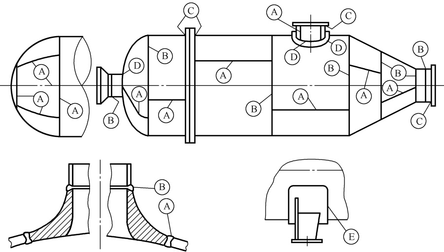

① 分别表示 A 类、B 类、C 类、D 类和 E 类焊接接头。

图1焊接接头分类

典型结构的焊接接头分类如下:

a) 圆筒部分(包括接管)和锥壳部分的纵向接头(多层包扎容器层板层纵向接头除外)、球形封头与圆筒连接的环向接头、各类凸形封头和平封头中的所有拼焊接头,以及嵌入式的接管与壳体对接连接的接头或凸缘与壳体对接连接的接头,均属 A 类焊接接头;

b) 壳体部分的环向接头、锥形封头小端与接管连接的接头、长颈法兰与壳体或接管连接的接头、平盖或管板与圆筒对接连接的接头以及接管间的对接环向接头,均属 B 类焊接接头,但已规定为 A 类的焊接接头除外;

c) 球冠形封头、平盖、管板与圆筒非对接连接的接头,法兰与壳体或接管连接的接头,内封头与圆筒的搭接接头以及多层包扎容器层板层纵向接头,均属 C 类焊接接头,但已规定为 A 类、B 类的焊接接头除外;

d) 接管(包括人孔圆筒)、凸缘、补强圈等与壳体连接的接头,均属 D 类焊接接头,但已规定为 A 类、B 类、C 类的焊接接头除外。

5.5.1.2 非受压元件与受压元件的连接接头为 E 类焊接接头, 如图 1 所示。

#### 5.5.2 焊接接头系数

5.5.2.1 焊接接头系数 $\varphi$ 应根据对接接头的焊缝形式及无损检测的长度比例确定。

5.5.2.2 钢制压力容器的焊接接头系数规定如下。

a）双面焊对接接头和相当于双面焊的全焊透对接接头:

1）全部无损检测，取 $\varphi=1.0$ ;

2）局部无损检测，取 $\varphi=0.85$ 。

b) 单面焊对接接头(沿焊缝根部全长有紧贴基本金属的垫板):

1）全部无损检测，取 $\varphi=0.9$ ;

2）局部无损检测，取 $\varphi=0.8$ 。

<!-- page: 23 -->

5.5.2.3 其他金属材料的焊接接头系数按 JB/T 4734、JB/T 4755、JB/T 4756、NB/T 11270、NB/T 47011 的规定。

### 5.6 耐压试验

5.6.1 一般要求

5.6.1.1 耐压试验包括: 液压试验、气压试验和气液组合试验。

5.6.1.2 容器制成后应经耐压试验，试验的种类、要求和试验压力值应在图样上注明。

5.6.1.3 耐压试验一般采用液压试验，试验液体应符合 GB/T 150.4 或相关标准的要求。

5.6.1.4 对于不适宜进行液压试验的容器,可采用气压试验或气液组合试验。进行气压试验或气液组合试验的容器应满足 GB/T 150.4 或相关标准的要求。

5.6.1.5 采用气液组合试验时,试验用液体和气体应分别满足 5.6.1.3 和 5.6.1.4 的要求,试验压力按气压试验的规定。

5.6.1.6 外压容器以内压进行耐压试验，试验压力按5.6.2.3的规定。

5.6.1.7 对于由2个或2个以上压力室组成的多腔容器，每个压力室的试验压力按其设计压力确定，各压力室分别进行耐压试验。公用元件的稳定性按下列方法考虑。

a）校核公用元件在试验压力下的稳定性。

b) 如不能满足稳定性要求,则应先进行泄漏检查,合格后进行耐压试验。在进行耐压试验时,相邻压力室内应保持一定压力,以使整个试验过程(包括升压、保压和卸压)中的任一时刻,各压力室的压力差不超过允许压差,图样上应注明这一要求和允许压差值。

c) 如需提高某腔试验压力,应满足 5.6.3 的规定。

#### 5.6.2 耐压试验压力

#### 5.6.2.1 耐压试验压力的最低值

耐压试验压力的最低值按5.6.2.2和5.6.2.3的规定，并遵循下列要求:

a）对于立式容器采用卧置进行液压试验时，试验压力应计入立置试验时的液柱静压力；

b) 工作条件下内装介质的液柱静压力大于耐压试验的液柱静压力时,应适当增加试验压力。

#### 5.6.2.2 内压容器

内压容器液压试验、气压试验或气液组合试验压力最低值计算如下:

a）液压试验压力最低值按公式(15)计算:

$$ p _ {\mathrm{T}} = 1. 2 5 p \frac {[ \sigma ]}{[ \sigma ] ^ {\mathrm{t}}}\tag{……(15} $$

式中:

$p_{T}$ ——试验压力最低值,单位为兆帕(MPa);

p ——设计压力,单位为兆帕(MPa);

$[\sigma]$ ——容器元件材料在耐压试验温度下的许用应力,单位为兆帕(MPa);

$[\sigma]^{t}$ ——容器元件材料在设计温度下的许用应力,不应低于材料受抗拉强度和屈服强度控制的许用应力最小值,单位为兆帕(MPa)。

b) 气压试验或气液组合试验压力最低值按公式(16)计算:

$$ p _ {\mathrm{T}} = 1. 1 p \frac {[ \sigma ]}{[ \sigma ] ^ {\mathrm{t}}}\tag{16} $$

<!-- page: 24 -->

式中:

$p_{T}$ ——试验压力最低值,单位为兆帕(MPa);

p ——设计压力,单位为兆帕(MPa);

$[\sigma]$ ——容器元件材料在耐压试验温度下的许用应力，单位为兆帕（MPa）；

$[\sigma]^{t}$ ——容器元件材料在设计温度下的许用应力,不应低于材料受抗拉强度和屈服强度控制的许用应力最小值,单位为兆帕(MPa)。

注1:容器铭牌上规定有最高允许工作压力时，以最高允许工作压力代替公式(15)或公式(16)中的设计压力 $p$ 。

注2:容器各主要受压元件，如圆筒、封头、接管、设备法兰（或人孔、手孔法兰）及其紧固件等所用材料不同时，取各元件材料的 $[\sigma] / [\sigma]^{\mathrm{t}}$ 比值中最小者。

#### 5.6.2.3 外压容器

外压容器液压试验、气压试验或气液组合试验压力最低值计算如下。

a）液压试验时，试验压力最低值按公式(17)计算:

$$ p _ {\mathrm{T}} = 1. 2 5 p\tag{17} $$

式中:

$p_{T}$ ——试验压力最低值,单位为兆帕(MPa)

p ——设计压力,单位为兆帕(MPa)。

b) 气压试验或气液组合试验时,试验压力最低值按公式(18)计算:

$$ p _ {\mathrm{T}} = 1. 1 p\tag{18} $$

式中:

p ——设计压力,单位为兆帕(MPa);

$p_{T}$ ——试验压力最低值,单位为兆帕(MPa)。

#### 5.6.3 耐压试验应力校核

如果采用大于 5.6.2.2、5.6.2.3 所规定的试验压力，在耐压试验前，应按下述 a) 或 b) 校核各受压元件在试验条件下的应力水平，例如对壳体元件应校核最大总体薄膜应力。

a）液压试验时，$\sigma_{\mathrm{T}} \leqslant 0.9 R_{\mathrm{el}} \varphi$。

b) 气压试验或气液组合试验时，$\sigma_{\mathrm{T}} \leqslant 0.8 R_{\mathrm{eL}} \varphi$。

注:a)和b)中 $R_{\mathrm{eL}}$ 取壳体材料在试验温度下的屈服强度或规定塑性延伸率为 $0.2\%$ 时的强度。

#### 5.6.4 耐压试验的免除

不能按 5.6.1～5.6.3 规定进行耐压试验的容器,设计文件中应提出在确保容器安全运行的前提下免除耐压试验所应采取的安全措施,经设计单位技术负责人批准后在图样上注明。

### 5.7 泄漏试验

5.7.1 泄漏试验包括气密性试验以及氨检漏试验、卤素检漏试验和氦检漏试验。

5.7.2 介质毒性程度为极度、高度危害或者不准许有微量泄漏的容器，应在耐压试验合格后进行泄漏试验。介质毒性程度按 GB/T 42594 执行。

5.7.3 设计单位应提出容器泄漏试验的方法和技术要求。

5.7.4 需进行泄漏试验时,试验压力、试验介质和相应的检验要求应在图样上和设计文件中注明。

5.7.5 气密性试验压力等于设计压力。

<!-- page: 25 -->

### 5.8 焊接接头结构设计

5.8.1 对于钢制容器,焊接接头的结构设计见 GB/T 150.3。

5.8.2 对于其他金属制容器，焊接接头的结构设计按照JB/T4734、JB/T4755、JB/T4756、NB/T11270和NB/T47011的要求。

### 5.9 超压泄放装置

超压泄放装置是防止压力容器超压的安全保护装置，应通过合理设定超压泄放装置的类型、动作压力以及泄放面积，确保容器的最大允许积聚压力满足B.3.3的要求。

<!-- page: 26 -->

## 附录A

（规范性）

标准的符合性声明及修订

A.1 本文件及 GB/T 150.2～GB/T 150.4 的制定遵循了国家颁布的压力容器安全法规所规定的基本安全要求，其设计准则、材料要求、制造检验技术要求和验收标准均符合 TSG 21 的相应规定。本文件及 GB/T 150.2～GB/T 150.4 均为协调标准，即按本文件及 GB/T 150.2～GB/T 150.4 要求建造的压力容器可满足 TSG 21 的基本安全要求。

A.2 标准的修订采用提案审查制度。任何单位和个人均有权利对本文件的修订提出建议，修订建议应采用“表 A.1 标准提案/问询表”的方式提交全国锅炉压力容器标准化技术委员会（以下简称“委员会”）。委员会对收到的标准修订提案进行审查，根据审查结果，将采纳的技术内容纳入下一版标准。

总第 号

| ☐标准提案 ☐标准问询 |  | 标准名称 |  |  |
|---|---|---|---|---|
| 单位 |  |  | 姓名 |  |
| 联系地址 |  |  | 邮政编码 |  |
| 电话/传真 |  |  | 电子信箱 |  |
| 标准条款 |  |  |  |  |
| 提案/问询内容(可另附页) |  |  |  |  |
|  |  |  |  |  |
| 技术依据与相关资料(可另附页) |  |  |  |  |
|  |  |  |  |  |
| 附加说明: |  |  |  |  |
| 单位图章或提案(问询)人签字: |  |  | 提交日期:年 月 日 |  |

全国锅炉压力容器标准化技术委员会

地址:北京市朝阳区北三环东路26号三层 邮政编码:100029

<!-- page: 27 -->

## 附录B

**B.1 总则**

B.1.1 容器在使用过程中可能出现超压时,可按本附录的要求配备超压泄放装置。

B.1.2 容器的超压泄放装置包括安全阀、爆破片装置、安全阀与爆破片装置的组合装置等。

B.1.3 液化气体火灾时安全泄放量计算公式仅适用于最大泄放压力下对应饱和温度低于介质临界温度的液化气体。

B.1.4 本附录火灾事故指在通风条件良好、敞开空间中外部池火，不适用喷射火及密闭空间内火灾等严重火灾事故。

B.1.5 本附录不适用于盛装冷冻液化气体的容器。

B.1.6 本附录不适用于操作过程中可能产生压力剧增,反应速度达到爆轰状态的容器。

注:爆轰指物质的燃烧速度极快，达到 $1000 \, m/s$ 以上时，产生与通常的爆燃根本不同的现象。

**B.2 定义**

**B.2.1 整定压力**

安全阀在运行条件下开始开启的设定压力,是在阀门进口处测量的压力。

**B.2.2 设计爆破压力**

根据容器的工作条件和相应的安全技术规范设定的，在设计爆破温度下爆破片的爆破压力值。

**B.2.3 最大允许积聚压力**

容器允许达到的相对于设计压力的超压。

注:当容器的图样及铭牌标注有最高允许工作压力时，可以用最高允许工作压力代替设计压力作为超压的基准。

**B.2.4 最大泄放压力**

泄压过程中超压泄放装置入口处的最大压力。

注:在本附录计算所需最小泄放面积的公式中，最大泄放压力采用的是绝对压力。

**B.2.5 安全泄放量**

超压时能够保障容器安全所需的最小泄放量。

**B.2.6 基本超压泄放装置**

当并联设置分级设定多个超压泄放装置时，动作压力最低，且首先开启的超压泄放装置。

**B.2.7 附加超压泄放装置**

当并联设置分级设定多个超压泄放装置时，针对非火灾原因超压，除了基本超压泄放装置以外的超压泄放装置。

**B.2.8 辅助超压泄放装置**

当并联设置分级设定多个超压泄放装置时，针对于火灾原因超压，除了基本超压泄放装置和附加超

<!-- page: 28 -->

压泄放装置以外的超压泄放装置。

**B.2.9 背压**

安全泄放装置出口处的压力。

注:背压是附加背压和排放背压之和；在本附录计算最小泄放面积的公式中，背压采用的是绝对压力。

**B.2.10 排放背压**

超压泄放装置开启后,由于泄放介质流动导致出口处的压力。

**B.2.11 附加背压**

超压泄放装置开启前，在出口处由排放系统中其他压力源导致的静压。

**B.3 一般规定**

B.3.1 容器装有超压泄放装置时,一般以容器的设计压力作为积聚压力的起始压力。设计图样及铭牌上标注有最高允许工作压力时,可以用容器的最高允许工作压力代替设计压力。

B.3.2 超压泄放装置由一个或多个超压泄放装置组成,当并联设置时,按功能可分为基本超压泄放装置、附加超压泄放装置和辅助超压泄放装置,其动作压力可以分级设定。

B.3.3 通过合理设定超压泄放装置的类型、动作压力(安全阀的整定压力或爆破片的设计爆破压力, 下同)以及泄放面积(超压泄放装置的实际泄放面积应满足容器安全泄放量的要求, 见 B.7), 确保容器中积聚压力不超过最大允许积聚压力, 具体如下。

a) 当容器上仅安装 1 个超压泄放装置时，泄放装置的动作压力应不大于容器的设计压力（或最高允许工作压力，当图样及铭牌有标注时）。选定的超压泄放装置实际泄放面积应能确保容器的积聚压力不超过最大允许积聚压力。非火灾超压情况时容器的最大允许积聚压力取设计压力（或最高允许工作压力，当图样及铭牌有标注时）的 10% 和 20 kPa 中的较大值；火灾原因超压时，容器的最大允许积聚压力取设计压力（或最高允许工作压力，当图样及铭牌有标注时）的 21%。

b) 当设置多个超压泄放装置时,对于非火灾原因超压,当容器上安装基本超压泄放装置和附加超压泄放装置时,基本超压泄放装置的动作压力应不大于容器的设计压力(或最高允许工作压力,当图样及铭牌有标注时),附加超压泄放装置的动作压力不大于至容器的设计压力(或最高允许工作压力,当图样及铭牌有标注时)的105%。选定的超压泄放装置实际泄放面积之和应能确保容器的积聚压力不超过最大允许积聚压力。此时最大允许积聚压力取设计压力(或最高允许工作压力,当图样及铭牌有标注时)的16%和30 kPa中的较大值。

c) 当考虑容器在遇到火灾或接近不能预料的外来热源而可能超压时,容器的最大允许积聚压力为设计压力(或最高允许工作压力,当图样及铭牌有标注时)的21%。如基本超压泄放装置和附加超压泄放装置(也可没有)的实际泄放面积之和无法满足火灾情况下容器安全泄放量要求,应安装辅助超压泄放装置,此时所有参与泄放的超压泄放装置实际泄放面积之和应满足火灾情况下容器安全泄放量要求。基本超压泄放装置的动作压力应不大于容器的设计压力(或最高允许工作压力,当图样及铭牌有标注时),附加超压泄放装置的动作压力应不大于容器的设计压力(或最高允许工作压力,当图样及铭牌有标注时)的105%,辅助超压泄放装置动作压力应不大于容器的设计压力(或最高允许工作压力,当图样及铭牌有标注时)的110%。

确定的超压泄放装置动作压力与容器中最大允许积聚压力的规定如表 B.1 和表 B.2 所示。

<!-- page: 29 -->

表 B.1 超压泄放装置动作压力与容器最大允许积聚压力的规定(仅设置 1 个超压泄放装置时)

| 超压原因 | 超压泄放装置动作压力 | 容器最大允许积聚压力 |
|---|---|---|
| 非火灾原因 | $\leqslant p$ | max[10%p,20 kPa] |
| 火灾或未知热源 | $\leqslant p$ | 21%p |
| 确保容器中积聚压力不超过最大允许积聚压力应通过合理设定超压泄放装置类型、动作压力以及泄放面积来实现注:p为容器的设计压力,当图样及铭牌有标注时,为最高允许工作压力。 |  |  |

表 B.2 泄放装置动作压力与容器最大允许积聚压力的规定(当设置多个超压泄放装置时)

| 超压原因 | 装设的超压泄放装置 | 泄放装置动作压力 | 容器最大允许积聚压力 |
|---|---|---|---|
| 非火灾原因 | 基本超压泄放装置 | $\leqslant p$ | max[16%p,30 kPa] |
| 附加超压泄放装置 | $\leqslant 105\% p$ |  |  |
| 火灾或未知热源 | 基本超压泄放装置 | $\leqslant p$ | 21%p |
| 附加超压泄放装置(也可不设置) | $\leqslant 105\% p$ |  |  |
| 辅助超压泄放装置 | $\leqslant 110\% p$ |  |  |
| 确保容器中积聚压力不超过最大允许积聚压力应通过合理设定超压泄放装置类型、动作压力以及泄放面积来实现注:p为容器的设计压力,当图样及铭牌有标注时,为最高允许工作压力。 |  |  |  |

B.3.4 有以下情况之一者,可看成是一个独立的压力系统,在该系统中的容器或管道上设置超压泄放装置,但在计算超压泄放装置的泄放面积时,应将容器间的连接管道包括在内:

a）与压力源相连接、本身不产生压力的容器，且该容器的设计压力达到压力源的压力；

b) 多个压力容器的设计压力相同或稍有差异, 容器之间采用口径满足或超过安全泄放量要求的管道连接, 且中间无阀门隔断或虽采用截断阀但有足够措施确保在容器正常工作期间截断阀处于全开的位置。

B.3.5 容器内的压力如有可能小于大气压力,而该容器不能承受此负压条件时,应装设防负压的泄放装置。

B.3.6 当容器需要安装超压泄放装置且没有特殊要求时,应优先选用安全阀。

B.3.7 符合下列条件之一者,应采用单独爆破片装置或将爆破片装置作为附加超压泄放装置或辅助超压泄放装置并联使用:

a）压力快速增长(如增加分子量的化学反应、化学爆炸、爆燃等)，安全阀来不及响应的；

b) 安全阀不能适用的其他情况。

B.3.8 符合下列条件之一者,宜采用爆破片和安全阀的串联组合装置。

a）盛装贵重介质、有毒介质、腐蚀性介质或其他危害性介质、对密封有较高的要求。

b) 容器内物料会导致安全阀失效。

B.3.9 对盛装易爆或者有毒介质的容器,应将泄放介质引至安全地点,并且进行妥善处理,不应直接排入大气。

**B.4 安全阀**

B.4.1 安全阀适用于清洁、不含固体颗粒、黏度低的介质。

<!-- page: 30 -->

B.4.2 安全阀不能单独用于压力快速增长的场合。

B.4.3 安全阀不宜单独用于阀座与阀瓣密封面可能被介质粘连或介质可能生成结晶体的场合，但可以将爆破片装置串联在安全阀入口侧组合使用。

B.4.4 常用的安全阀的型式包括:普通型安全阀、平衡型安全阀和先导型安全阀。

B.4.5 普通型安全阀通常用于附加背压是恒定的或排放背压不大于整定压力的 $10\%$ 的场合；当排放背压大于整定压力的 $10\%$ 或相对附加背压变动较大时，总的背压不超过整定压力的 $50\%$ 时，通常选用平衡式安全阀；先导式安全阀通常用于背压较大（大于整定压力的 $30\%$ )或容器的工作压力与安全阀的整定压力相差较小[通常指两者差值小于设计压力的 $7\%$ （工作压力大于或等于 $0.5\mathrm{MPa}$ )或者两者差值小于 $0.05\mathrm{MPa}$ (工作压力小于 $0.5\mathrm{MPa}$ )的场合]；介质或环境对弹簧的性能有影响时，宜选用平衡型安全阀。

B.4.6 用于液体的安全阀公称通径至少为 $15\mathrm{mm}$。

B.4.7 安全阀的入口管路的压降不宜超过整定压力的 3%。

B.4.8 当基本超压泄放装置选用安全阀时,容器的设计压力按以下步骤确定。

a）采用普通型或平衡型安全阀时，根据容器的工作压力 $p_{\mathrm{w}}$，确定安全阀的整定压力 $p_{z}$ 及偏差。

1) 当容器工作压力满足 $0.1 \mathrm{MPa} \leqslant p_{\mathrm{w}} < 0.5 \mathrm{MPa}$, 操作裕度 (安全阀整定压力与容器工作压力的差值) 应大于或等于 $0.05 \mathrm{MPa}$ 。选用的安全阀整定压力的偏差介于 $-0.015 \mathrm{MPa} \sim 0.015 \mathrm{MPa}$ 。

2) 当容器工作压力满足 $0.5 \mathrm{MPa} \leqslant p_{\mathrm{w}} < 10 \mathrm{MPa}$, 操作裕度 (安全阀整定压力与容器工作压力的差值) 与工作压力的比值至少为 $10 \%$ 。选用的安全阀整定压力的偏差应介于 $-3 \% \sim 3 \%$ 。

3) 当容器工作压力满足 $10\mathrm{MPa} \leqslant p_{\mathrm{w}} < 35\mathrm{MPa}$, 操作裕度 (安全阀整定压力与容器工作压力的差值) 与工作压力的比值至少为 $7\%$ 。选用的安全阀整定压力的偏差应介于 $-3\% \sim 3\%$ 。

4) 对于有毒、易爆、特别贵重的介质以及其他不宜泄放的情况,可采用比1)～3)中更大的操作裕度(安全阀整定压力与容器工作压力的差值)。

b) 当基本超压泄放装置采用先导式安全阀时,可根据其动作特性,适当减小操作裕度。

c）容器的设计压力 $p$ 应大于或等于安全阀的整定压力 $p_{z}$，即 $p \geqslant p_{z}$。

d) 当附加超压泄放装置或辅助超压泄放装置选用安全阀时，整定压力的偏差应介于 $-\max(3\% p_{z}, 0.015 \text{ MPa}) \sim \max(3\% p_{z}, 0.015 \text{ MPa})$。

B.4.9 安全阀其他相关技术要求应符合 GB/T 12241 和 GB/T 12243。

**B.5 爆破片装置**

B.5.1 爆破片装置主要由爆破片和夹持器组成。常见的爆破片类别有正拱形、反拱形、平板形和石墨爆破片。

B.5.2 爆破片装置适用于压力快速增长的场合,也常用于保护安全阀的性能而与之串联使用。

B.5.3 用于排放液体介质时,应选择适合于全液相的爆破片装置。

B.5.4 当基本超压泄放装置选用爆破片装置时,容器的设计压力按以下步骤确定。

a）确定爆破片的最小爆破压力 $p_{smin}$ 。

根据不同型式的爆破片,推荐的 $p_{smin}$ 值见表 B.3。

<!-- page: 31 -->

表 B.3 最小爆破压力 p_{\mathrm{smin}}

| 爆破片型式 | 载荷性质 |最小爆破压力 $p_{\text{smin}}$ |
|---|---|---|
| 正拱普通型 | 静载荷 | $\geqslant 1.43p_{\text{w}}$ |
| 正拱开缝型、正拱带槽型 | 静载荷 | $\geqslant 1.25p_{\text{w}}$ |
| 各种正拱形 | 脉动载荷 | $\geqslant 1.7p_{\text{w}}$ |
| 各种反拱形 | 静载荷、脉动载荷 | $\geqslant 1.1p_{\text{w}}$ |
| 石墨爆破片 | 静载荷 | $\geqslant 1.25p_{\text{w}}$ |
| 其他材料平板形 | 静载荷 | $\geqslant 2.0p_{\text{w}}$ |
| 若有成熟的经验或可靠数据,可不按表B.3的规定 |  |  |

b) 确定爆破片的爆破压力允差。

爆破片的爆破压力允差见表 B.4。

表 B.4 爆破片的爆破压力允差

| 爆破片类别 | 设计爆破压力/MPa | 相对设计爆破压力的允差 |
|---|---|---|
| 平板形、正拱形、反拱形 | $\geqslant 0.1 \sim <0.3$ | $\pm 0.015 \text{ MPa}$ |
| $\geqslant 0.3 \sim <35$ | $\pm 5\% p_{\text{b}}$ |  |
| 石墨 | <0.05 | $\pm 25\% p_{\text{b}}$ |
| $\geqslant 0.05 \sim <0.3$ | $\pm 15\% p_{\text{b}}$ |  |
| $\geqslant 0.3$ | $\pm 10\% p_{\text{b}}$ |  |

c）计算爆破片的设计爆破压力 $p_{\mathrm{b}}$ 。

根据 $p_{\mathrm{smin}}$ 和所选爆破片爆破压力允差的下限计算设计爆破压力。

d）确定容器的设计压力 $p$。

容器的设计压力 $p$ 应大于或等于爆破片的设计爆破压力 $p_{\mathrm{b}}$ ，即 $p \geqslant p_{\mathrm{b}}$ 。

B.5.5 爆破片装置的材料应符合如下规定。

a) 爆破片材料不受 GB/T 150.2 中关于材料牌号的限制, 爆破片材料应与介质相容, 应根据使用条件与供应商或用户协商确定。爆破片常用材料及其最高适用温度见表 B.5。

单位为摄氏度

| 爆破片材料 | 最高适用温度 |
|---|---|
| 纯铝 | 100 |
| 纯银 | 120 |
| 纯镍 | 400 |
| 奥氏体不锈钢 | 400 |
| 镍铜合金(蒙乃尔) | 430 |
| 镍铬合金(因康镍) | 480 |

<!-- page: 32 -->

单位为摄氏度

| 爆破片材料 | 最高适用温度 |
|---|---|
| 镍钼铬合金(哈氏合金) | 480 |
| 石墨 | 200 |
| 注:当爆破片表面覆盖密封膜或保护膜时,考虑该覆盖材料对最高适用温度的影响。 |  |

b) 用于腐蚀性介质或腐蚀性环境,且有可能导致提前失效的爆破片装置,可采用在爆破片表面进行电镀、喷涂或衬膜等防腐蚀措施。

c) 夹持器常用材料有碳钢、奥氏体不锈钢、镍铜合金及镍铁铬合金等受压容器用材。材料性能应与介质相容。

B.5.6 爆破片装置的选用及相关技术要求应符合 GB/T 567(所有部分)的规定。

**B.6 组合泄放装置**

B.6.1 爆破片装置串联在安全阀入口侧时,爆破片的爆破应不影响安全阀的正常工作,在爆破片装置动作后,并应确保安全阀也能相应动作。爆破片装置与安全阀之间的腔体应设置排气口、压力表或其他报警指示器。

B.6.2 爆破片装置串联在安全阀出口侧时，应保证安全阀与爆破片装置之间出现累积压力时安全阀仍能在整定压力下开启。同时，爆破片装置与安全阀之间的腔体应设置排气口或排液口。

B.6.3 安全阀与爆破片装置并联组合时,一般安全阀作为基本超压泄放装置,爆破片装置作为附加超压泄放装置或辅助超压泄放装置,其动作压力及容器的最大允许积聚压力应满足 B.3.3 中的要求,选用的爆破片也应满足 B.5.4 中的要求。

**B.7 容器安全泄放量的计算**

**B.7.1 一般要求**

容器安全泄放量的计算需考虑非火灾事故超压以及火灾事故超压等各种可能超压工况，且考虑可能的一种或多种组合工况中的最大值。

**B.7.2 符号**

A ——所需最小泄放面积, 即计算得到的满足容器安全泄放量所需的最小泄放面积, 单位为平方毫米( $mm^{2}$ )。

$A_{g}$ ——盛装气体的容器受热面积,单位为平方米( $m^{2}$ )。

$A_{r}$ ——火灾工况下,盛装液体或液化气体的容器内部液体润湿面积(一般以存放液体或液化气体容器的地面或可积聚液体的平台为基准,计算高度在7.5 m以内的容器湿表面积),单位为平方米( $m^{2}$ )。

$A_{0}$ ——泄放装置的实际泄放面积,单位为平方毫米 $\left(\mathrm{mm}^{2}\right)$ 。

$C_{g}$ ——气体特性系数, 可按公式(B.1)计算或查表 B.6:

$$ C _ {\mathrm{g}} = 0. 0 3 9 4 8 \sqrt {k \left(\frac {2}{k + 1}\right) ^ {\frac {k + 1}{k - 1}}}\tag{……(B.1} $$

<!-- page: 33 -->

式中:

$k$ ——气体的比热容比。

表 B.6 气体特性系数 C_{\mathrm{g}}

| 气体的比热容比k | 气体特性系数 C_g | 气体的比热容比k | 气体特性系数 C_g | 气体的比热容比k | 气体特性系数 C_g |
|---|---|---|---|---|---|
| 1.00 | 0.023 9 | 135 | 0.026 7 | 1.70 | 0.028 9 |
| 1.05 | 0.024 4 | 1.40 | 0.027 0 | 1.75 | 0.029 1 |
| 1.10 | 0.024 8 | 1.45 | 0.027 4 | 1.80 | 0.029 4 |
| 1.15 | 0.025 2 | 1.50 | 0.027 7 | 1.85 | 0.029 7 |
| 1.20 | 0.025 6 | 1.55 | 0.028 0 | 1.90 | 0.029 9 |
| 1.25 | 0.026 0 | 1.60 | 0.028 3 | 1.95 | 0.030 2 |
| 1.30 | 0.026 3 | 1.65 | 0.028 6 | 2.00 | 0.030 4 |

$C_{s}$ ——亚临界流的气体特性系数,按公式(B.2)求取:

$$ C _ {\mathrm{s}} = \sqrt {\left(\frac {k}{k - 1}\right) r ^ {2 / k} \left[ \frac {1 - r ^ {(k - 1) / k}}{1 - r} \right]} $$

……(B,2)

式中:

r ——超压泄放装置出口压力(背压)与上游最大泄放压力的比值；

k ——气体的比热容比,典型气体介质的比热容比见表 B.7。

表 B.7 典型气体的性质

| 气体 | 分子式 | 摩尔质量Mkg/kmol | 比热容比k(20°C,1个大气压时) | 临界压力 P_c (绝压)MPa | 临界温度 T_c K |
|---|---|---|---|---|---|
| 空气 | / | 28.97 | 1.40 | 3.769 | 132.45 |
| 氮气 | N_2 | 28.01 | 1.40 | 3.394 | 126.05 |
| 氧气 | O_2 | 32.00 | 1.40 | 5.036 | 154.35 |
| 氢气 | H_2 | 2.02 | 1.41 | 1.297 | 33.25 |
| 氯气 | Cl_2 | 70.91 | 1.35 | 7.711 | 417.15 |
| 一氧化碳 | CO | 28.01 | 1.40 | 3.546 | 134.15 |
| 二氧化碳 | CO_2 | 44.01 | 1.30 | 7.397 | 304.25 |
| 氨 | NH_3 | 17.03 | 1.32 | 11.298 | 405.55 |
| 氯化氢 | HCl | 36.46 | 1.41 | 8.268 | 324.55 |
| 硫化氢 | H_2S | 34.08 | 1.32 | 9.008 | 373.55 |
| 一氧化二氮 | N_2O | 44.01 | 1.30 | 7.265 | 309.65 |

<!-- page: 34 -->

表 B.7 典型气体的性质（续）

| 气体 | 分子式 | 摩尔质量Mkg/kmol | 比热容比k(20°C,1个大气压时) | 临界压力 P_c (绝压)MPa | 临界温度 T_c K |
|---|---|---|---|---|---|
| 二氧化硫 | SO_2 | 64.06 | 1.25 | 7.873 | 430.35 |
| 甲烷 | CH_4 | 16.04 | 1.32 | 4.641 | 190.65 |
| 乙炔 | C_2H_2 | 26.02 | 1.26 | 6.282 | 309.15 |
| 乙烯 | C_2H_4 | 28.05 | 1.22 | 5.157 | 282.85 |
| 乙烷 | C_2H_6 | 30.05 | 1.22 | 4.945 | 305.25 |
| 丙烯 | C_3H_6 | 42.08 | 1.15 | 4.560 | 365.45 |
| 丙烷 | C_3H_8 | 44.10 | 1.13 | 4.357 | 368.75 |
| 正丁烷 | $C_4H_{10}$ | 58.12 | 1.10 | 3.648 | 426.15 |
| 异丁烷 | CH(CH_3)_3 | 58.12 | 1.11 | 3.749 | 407.15 |
| 注:“/”表示空气为多种气体组成。 |  |  |  |  |  |

K——超压泄放装置有效泄放系数(在初步选用计算中有效泄放系数时,可分别按安全阀和爆破片装置选取)。

注1:对于安全阀，气体和蒸气为0.975；液体为0.65。对于爆破片装置，满足下列条件时，气体取值与爆破片装置入口管道形状有关，如表B.8所示，当管道形状不易确定时取0.62；液体取0.62。

a）直接向大气排放。

b) 爆破片装置离容器本体的距离不超过 8 倍管径。

c）爆破片装置泄放管长度不超过5倍管径。

d) 爆破片装置上、下游接管的公称直径不小于爆破片装置的泄放口公称直径。

表 B.8 爆破片装置泄放系数

| 编号 | 接管示意图 | 接管形状 | 有效泄放系数K |
|---|---|---|---|
| 1 |  | 插入式接管 | 0.68 |
| 2 |  | 平齐式接管 | 0.73 |

<!-- page: 35 -->

表 B.8 爆破片装置泄放系数（续）

| 编号 | 接管示意图 | 接管形状 | 有效泄放系数K |
|---|---|---|---|
| 3 |  | 嵌入式接管 | 0.80 |

$K_{b}$ ——用于气体和蒸气的背压校正系数(由制造商提供或参照 GB/T 24921.1 确定)。

$K_{w}$ ——用于液体的背压校正系数(由制造商提供或参照 GB/T 24921.1 确定)。

注2:背压校正系数主要用于平衡式波纹管型安全阀。对于普通型安全阀以及先导式安全阀， $K_{\mathrm{b}}$ 和 $K_{\mathrm{w}}$ 均取为1.0。对爆破片装置， $K_{\mathrm{b}}$ 和 $K_{\mathrm{w}}$ 均为1.0。

$K_{c}$ ——组合校正系数, 安全阀上游安装爆破片装置时 $K_{c}=0.9$ , 不安装时 $K_{c}=1.0$ 。

$K_{N}$ ——修正因子；当 $p_{f} \leqslant 10.34 MPa$ 时， $K_{N} = 1$ ；当 $10.34 MPa < p_{f} \leqslant 22.06 MPa$ 时，

$$ K _ {\mathrm{N}} = \frac {2 7 . 6 4 p _ {\mathrm{f}} - 1 0 0 0}{3 3 . 2 4 p _ {\mathrm{f}} - 1 0 6 1} 。 $$

$K_{SH}$ ——蒸汽过热度修正系数。对任意压力下的饱和蒸汽， $K_{SH}=1$ ；对于过热蒸汽， $K_{SH}$ 可通过表B.9查询得到，压力、温度介于表B.9中间数值的 $K_{SH}$ 采用线性内插法插值计算。

表 B.9 过热蒸汽修正系数 {K}_{\mathrm{{SH}}}

| 泄放压力MPa | 过热蒸汽泄放温度/°C |  |  |  |  |  |  |  |  |  |  |  |  |  |  |  |  |  |
|---|---|---|---|---|---|---|---|---|---|---|---|---|---|---|---|---|---|---|
| 205 | 225 | 250 | 275 | 300 | 325 | 350 | 375 | 400 | 425 | 450 | 475 | 500 | 525 | 550 | 575 | 600 | 625 |  |
| 0.50 | 0.991 | 0.968 | 0.942 | 0.919 | 0.896 | 0.876 | 0.857 | 0.839 | 0.823 | 0.807 | 0.792 | 0.778 | 0.765 | 0.752 | 0.740 | 0.728 | 0.717 | 0.706 |
| 0.75 | 0.995 | 0.972 | 0.946 | 0.922 | 0.899 | 0.878 | 0.859 | 0.841 | 0.824 | 0.808 | 0.793 | 0.779 | 0.766 | 0.753 | 0.740 | 0.729 | 0.717 | 0.707 |
| 1.00 | 0.985 | 0.973 | 0.950 | 0.925 | 0.902 | 0.880 | 0.861 | 0.843 | 0.825 | 0.809 | 0.794 | 0.780 | 0.766 | 0.753 | 0.741 | 0.729 | 0.718 | 0.707 |
| 1.25 | 0.981 | 0.976 | 0.954 | 0.928 | 0.905 | 0.883 | 0.863 | 0.844 | 0.827 | 0.810 | 0.795 | 0.781 | 0.767 | 0.754 | 0.741 | 0.729 | 0.718 | 0.707 |
| 1.50 |  |  | 0.957 | 0.932 | 0.907 | 0.885 | 0.865 | 0.846 | 0.828 | 0.812 | 0.796 | 0.782 | 0.768 | 0.755 | 0.742 | 0.730 | 0.718 | 0.708 |
| 1.75 |  |  | 0.959 | 0.935 | 0.910 | 0.887 | 0.866 | 0.847 | 0.829 | 0.813 | 0.797 | 0.782 | 0.769 | 0.756 | 0.743 | 0.731 | 0.719 | 0.708 |
| 2.00 |  |  | 0.960 | 0.939 | 0.913 | 0.889 | 0.868 | 0.849 | 0.831 | 0.814 | 0.798 | 0.784 | 0.769 | 0.756 | 0.744 | 0.731 | 0.720 | 0.708 |
| 2.25 |  |  | 0.963 | 0.943 | 0.916 | 0.892 | 0.870 | 0.850 | 0.832 | 0.815 | 0.799 | 0.785 | 0.770 | 0.757 | 0.744 | 0.732 | 0.720 | 0.709 |
| 2.50 |  |  |  | 0.946 | 0.919 | 0.894 | 0.872 | 0.852 | 0.834 | 0.816 | 0.800 | 0.785 | 0.771 | 0.757 | 0.744 | 0.732 | 0.720 | 0.710 |
| 2.75 |  |  |  | 0.948 | 0.922 | 0.897 | 0.874 | 0.854 | 0.835 | 0.817 | 0.801 | 0.786 | 0.772 | 0.758 | 0.745 | 0.733 | 0.721 | 0.710 |
| 3.00 |  |  |  | 0.949 | 0.925 | 0.899 | 0.876 | 0.855 | 0.837 | 0.819 | 0.802 | 0.787 | 0.772 | 0.759 | 0.746 | 0.733 | 0.722 | 0.710 |
| 3.25 |  |  |  | 0.951 | 0.929 | 0.902 | 0.879 | 0.857 | 0.838 | 0.820 | 0.803 | 0.788 | 0.773 | 0.759 | 0.746 | 0.734 | 0.722 | 0.711 |
| 3.50 |  |  |  | 0.953 | 0.933 | 0.905 | 0.881 | 0.859 | 0.840 | 0.822 | 0.804 | 0.789 | 0.774 | 0.760 | 0.747 | 0.734 | 0.722 | 0.711 |
| 3.75 |  |  |  | 0.956 | 0.936 | 0.908 | 0.883 | 0.861 | 0.841 | 0.823 | 0.806 | 0.790 | 0.775 | 0.761 | 0.748 | 0.735 | 0.723 | 0.711 |

<!-- page: 36 -->

表 B.9 过热蒸汽修正系数 {\mathrm{K}}_{\mathrm{{SH}}} (续)

| 泄放压力MPa | 过热蒸汽泄放温度/℃ |  |  |  |  |  |  |  |  |  |  |  |  |  |  |  |  |  |
|---|---|---|---|---|---|---|---|---|---|---|---|---|---|---|---|---|---|---|
| 205 | 225 | 250 | 275 | 300 | 325 | 350 | 375 | 400 | 425 | 450 | 475 | 500 | 525 | 550 | 575 | 600 | 625 |  |
| 4.00 |  |  |  | 0.959 | 0.940 | 0.910 | 0.885 | 0.863 | 0.863 | 0.824 | 0.807 | 0.791 | 0.776 | 0.762 | 0.748 | 0.735 | 0.723 | 0.712 |
| 4.25 |  |  |  | 0.961 | 0.943 | 0.913 | 0.887 | 0.864 | 0.844 | 0.825 | 0.808 | 0.792 | 0.776 | 0.762 | 0.749 | 0.736 | 0.724 | 0.713 |
| 4.50 |  |  |  |  | 0.944 | 0.917 | 0.890 | 0.866 | 0.845 | 0.826 | 0.809 | 0.793 | 0.777 | 0.763 | 0.749 | 0.737 | 0.725 | 0.713 |
| 4.75 |  |  |  |  | 0.946 | 0.919 | 0.892 | 0.868 | 0.847 | 0.828 | 0.810 | 0.793 | 0.778 | 0.764 | 0.750 | 0.737 | 0.725 | 0.713 |
| 5.00 |  |  |  |  | 0.947 | 0.922 | 0.894 | 0.870 | 0.848 | 0.829 | 0.811 | 0.794 | 0.779 | 0.765 | 0.751 | 0.738 | 0.725 | 0.714 |
| 5.25 |  |  |  |  | 0.949 | 0.926 | 0.897 | 0.872 | 0.850 | 0.830 | 0.812 | 0.795 | 0.780 | 0.765 | 0.752 | 0.738 | 0.726 | 0.714 |
| 5.50 |  |  |  |  | 0.952 | 0.930 | 0.899 | 0.874 | 0.851 | 0.831 | 0.813 | 0.797 | 0.780 | 0.766 | 0.752 | 0.739 | 0.727 | 0.74 |
| 5.75 |  |  |  |  | 0.954 | 0.933 | 0.902 | 0.876 | 0.853 | 0.833 | 0.815 | 0.798 | 0.782 | 0.767 | 0.753 | 0.739 | 0.727 | 0.715 |
| 6.00 |  |  |  |  | 0.957 | 0.937 | 0.904 | 0.878 | 0.855 | 0.834 | 0.816 | 0.798 | 0.783 | 0.768 | 0.753 | 0.740 | 0.727 | 0.716 |
| 6.25 |  |  |  |  | 0.960 | 0.940 | 0.907 | 0.880 | 0.856 | 0.8336 | 0.817 | 0.799 | 0.783 | 0.768 | 0.754 | 0.740 | 0.728 | 0.716 |
| 6.50 |  |  |  |  | 0.964 | 0.944 | 0.910 | 0.882 | 0.859 | 0.837 | 0.818 | 0.801 | 0.784 | 0.769 | 0.754 | 0.741 | 0.729 | 0.716 |
| 6.75 |  |  |  |  | 0.966 | 0.946 | 0.913 | 0.885 | 0.860 | 0.839 | 0.819 | 0.802 | 0.785 | 0.769 | 0.755 | 0.742 | 0.729 | 0.717 |
| 7.00 |  |  |  |  |  | 0.947 | 0.916 | 0.887 | 0.862 | 0.840 | 0.820 | 0.802 | 0.788 | 0.770 | 0.756 | 0.742 | 0.729 | 0.717 |
| 7.25 |  |  |  |  |  | 0.949 | 0.919 | 0.889 | 0.863 | 0.842 | 0.822 | 0.803 | 0.787 | 0.771 | 0.756 | 0.743 | 0.730 | 0.717 |
| 7.50 |  |  |  |  |  | 0.951 | 0.922 | 0.891 | 0.865 | 0.843 | 0.823 | 0.805 | 0.788 | 0.772 | 0.757 | 0.744 | 0.730 | 0.718 |
| 7.75 |  |  |  |  |  | 0.953 | 0.925 | 0.893 | 0.867 | 0.844 | 0.824 | 0.806 | 0.788 | 0.772 | 0.758 | 0.744 | 0.731 | 0.719 |
| 8.00 |  |  |  |  |  | 0.955 | 0.928 | 0.896 | 0.869 | 0.846 | 0.825 | 0.806 | 0.789 | 0.773 | 0.758 | 0.744 | 0.732 | 0.719 |
| 8.25 |  |  |  |  |  | 0.957 | 0.932 | 0.898 | 0.871 | 0.847 | 0.827 | 0.807 | 0.790 | 0.774 | 0.759 | 0.745 | 0.732 | 0.719 |
| 8.50 |  |  |  |  |  | 0.960 | 0.935 | 0.901 | 0.873 | 0.849 | 0.828 | 0.809 | 0.791 | 0.775 | 0.760 | 0.746 | 0.732 | 0.720 |
| 8.75 |  |  |  |  |  | 0.963 | 0.939 | 0.903 | 0.875 | 0.850 | 0.829 | 0.810 | 0.792 | 0.776 | 0.760 | 0.746 | 0.733 | 0.721 |
| 9.00 |  |  |  |  |  | 0.966 | 0.943 | 0.906 | 0.877 | 0.852 | 0.830 | 0.811 | 0.793 | 0.776 | 0.761 | 0.747 | 0.734 | 0.721 |
| 9.25 |  |  |  |  |  | 0.970 | 0.947 | 0.909 | 0.879 | 0.853 | 0.832 | 0.812 | 0.794 | 0.777 | 0.762 | 0.747 | 0.734 | 0.721 |
| 9.50 |  |  |  |  |  | 0.973 | 0.950 | 0.911 | 0.881 | 0.855 | 0.833 | 0.813 | 0.795 | 0.778 | 0.763 | 0.748 | 0.734 | 0.722 |
| 9.75 |  |  |  |  |  | 0.977 | 0.954 | 0.914 | 0.883 | 0.857 | 0.834 | 0.814 | 0.796 | 0.779 | 0.763 | 0.749 | 0.735 | 0.722 |
| 10.00 |  |  |  |  |  | 0.981 | 0.957 | 0.917 | 0.885 | 0.859 | 0.836 | 0.815 | 0.797 | 0.780 | 0.764 | 0.749 | 0.735 | 0.722 |
| 10.25 |  |  |  |  |  | 0.984 | 0.959 | 0.920 | 0.887 | 0.860 | 0.837 | 0.816 | 0.798 | 0.780 | 0.764 | 0.750 | 0.736 | 0.723 |
| 10.50 |  |  |  |  |  |  | 0.961 | 0.923 | 0.889 | 0.862 | 0.838 | 0.817 | 0.799 | 0.781 | 0.765 | 0.750 | 0.737 | 0.723 |
| 10.75 |  |  |  |  |  |  | 0.962 | 0.925 | 0.891 | 0.863 | 0.839 | 0.818 | 0.799 | 0.782 | 0.766 | 0.751 | 0.737 | 0.724 |
| 11.00 |  |  |  |  |  |  | 0.963 | 0.928 | 0.893 | 0.865 | 0.840 | 0.819 | 0.800 | 0.782 | 0.766 | 0.751 | 0.737 | 0.724 |
| 11.25 |  |  |  |  |  |  | 0.964 | 0.930 | 0.893 | 0.865 | 0.840 | 0.819 | 0.799 | 0.781 | 0.765 | 0.750 | 0.736 | 0.723 |
| 11.50 |  |  |  |  |  |  | 0.964 | 0.931 | 0.894 | 0.865 | 0.840 | 0.818 | 0.798 | 0.780 | 0.764 | 0.749 | 0.735 | 0.722 |
| 11.75 |  |  |  |  |  |  | 0.965 | 0.932 | 0.894 | 0.865 | 0.839 | 0.817 | 0.797 | 0.780 | 0.763 | 0.748 | 0.734 | 0.721 |
| 12.00 |  |  |  |  |  |  | 0.966 | 0.933 | 0.894 | 0.864 | 0.839 | 0.817 | 0.797 | 0.779 | 0.762 | 0.747 | 0.733 | 0.719 |

<!-- page: 37 -->

表 B.9 过热蒸汽修正系数 K_{\mathrm{SH}} (续)

| 泄放压力MPa | 过热蒸汽泄放温度/°C |  |  |  |  |  |  |  |  |  |  |  |  |  |  |  |  |  |
|---|---|---|---|---|---|---|---|---|---|---|---|---|---|---|---|---|---|---|
| 205 | 225 | 250 | 275 | 300 | 325 | 350 | 375 | 400 | 425 | 450 | 475 | 500 | 525 | 550 | 575 | 600 | 625 |  |
| 12.25 |  |  |  |  |  |  | 0.967 | 0.935 | 0.895 | 0.864 | 0.839 | 0.816 | 0.796 | 0.778 | 0.761 | 0.746 | 0.733 | 0.718 |
| 12.50 |  |  |  |  |  |  | 0.967 | 0.936 | 0.896 | 0.864 | 0.838 | 0.816 | 0.796 | 0.777 | 0.760 | 0.745 | 0.731 | 0.717 |
| 12.75 |  |  |  |  |  |  | 0.968 | 0.937 | 0.896 | 0.864 | 0.838 | 0.815 | 0.795 | 0.776 | 0.759 | 0.744 | 0.729 | 0.716 |
| 13.00 |  |  |  |  |  |  | 0.969 | 0.939 | 0.896 | 0.864 | 0.837 | 0.814 | 0.794 | 0.775 | 0.758 | 0.743 | 0.728 | 0.715 |
| 13.25 |  |  |  |  |  |  | 0.971 | 0.440 | 0.897 | 0.864 | 0.837 | 0.813 | 0.792 | 0.774 | 0.757 | 0.741 | 0.727 | 0.713 |
| 13.50 |  |  |  |  |  |  | 0.972 | 0.942 | 0.897 | 0.863 | 0.837 | 0.813 | 0.792 | 0.773 | 0.756 | 0.740 | 0.725 | 0.712 |
| 14.00 |  |  |  |  |  |  | 0.976 | 0.946 | 0.897 | 0.863 | 0.835 | 0.811 | 0.790 | 0.771 | 0.753 | 0.737 | 0.723 | 0.709 |
| 14.25 |  |  |  |  |  |  | 0.978 | 0.947 | 0.898 | 0.862 | 0.834 | 0.810 | 0.789 | 0.770 | 0.752 | 0.736 | 0.721 | 0.707 |
| 14.50 |  |  |  |  |  |  |  | 0.948 | 0.898 | 0.862 | 0.833 | 0.809 | 0.787 | 0.768 | 0.751 | 0.734 | 0.720 | 0.706 |
| 14.75 |  |  |  |  |  |  |  | 0.948 | 0.898 | 0.862 | 0.832 | 0.808 | 0.788 | 0.767 | 0.749 | 0.733 | 0.719 | 0.704 |
| 15.00 |  |  |  |  |  |  |  | 0.948 | 0.899 | 0.861 | 0.832 | 0.807 | 0.785 | 0.766 | 0.748 | 0.732 | 0.717 | 0.703 |
| 15.25 |  |  |  |  |  |  |  | 0.947 | 0.899 | 0.861 | 0.831 | 0.806 | 0.784 | 0.764 | 0.746 | 0.730 | 0.716 | 0.702 |
| 15.50 |  |  |  |  |  |  |  | 0.947 | 0.899 | 0.861 | 0.830 | 0.804 | 0.782 | 0.763 | 0.745 | 0.728 | 0.714 | 0.700 |
| 15.75 |  |  |  |  |  |  |  | 0.946 | 0.899 | 0.860 | 0.829 | 0.803 | 0.781 | 0.761 | 0.743 | 0.727 | 0.712 | 0.698 |
| 16.00 |  |  |  |  |  |  |  | 0.945 | 0.900 | 0.859 | 0.828 | 0.802 | 0.779 | 0.759 | 0.741 | 0.725 | 0.710 | 0.696 |
| 16.25 |  |  |  |  |  |  |  | 0.945 | 0.900 | 0.859 | 0.827 | 0.801 | 0.778 | 0.757 | 0.739 | 0.723 | 0.708 | 0.694 |
| 16.50 |  |  |  |  |  |  |  | 0.945 | 0.900 | 0.858 | 0.826 | 0.799 | 0.776 | 0.756 | 0.738 | 0.721 | 0.706 | 0.692 |
| 16.75 |  |  |  |  |  |  |  | 0.944 | 0.900 | 0.857 | 0.825 | 0.797 | 0.774 | 0.754 | 0.734 | 0.719 | 0.704 | 0.690 |
| 17.00 |  |  |  |  |  |  |  | 0.944 | 0.900 | 0.856 | 0.823 | 0.796 | 0.773 | 0.752 | 0.732 | 0.717 | 0.702 | 0.688 |
| 17.25 |  |  |  |  |  |  |  | 0.944 | 0.900 | 0.855 | 0.822 | 0.794 | 0.771 | 0.750 | 0.730 | 0.715 | 0.700 | 0.686 |
| 17.50 |  |  |  |  |  |  |  | 0.944 | 0.900 | 0.854 | 0.820 | 0.792 | 0.769 | 0.748 | 0.728 | 0.713 | 0.698 | 0.684 |
| 17.75 |  |  |  |  |  |  |  | 0.944 | 0.900 | 0.853 | 0.819 | 0.791 | 0.767 | 0.746 | 0.725 | 0.711 | 0.696 | 0.681 |
| 18.00 |  |  |  |  |  |  |  | 0.944 | 0.901 | 0.852 | 0.817 | 0.789 | 0.765 | 0.744 | 0.725 | 0.709 | 0.694 | 0.679 |
| 18.25 |  |  |  |  |  |  |  | 0.945 | 0.901 | 0.851 | 0.815 | 0.787 | 0.763 | 0.742 | 0.723 | 0.706 | 0.691 | 0.677 |
| 18.50 |  |  |  |  |  |  |  | 0.945 | 0.901 | 0.850 | 0.814 | 0.785 | 0.761 | 0.739 | 0.720 | 0.704 | 0.689 | 0.674 |
| 18.75 |  |  |  |  |  |  |  | 0.945 | 0.901 | 0.849 | 0.812 | 0.783 | 0.758 | 0.737 | 0.718 | 0.701 | 0.686 | 0.671 |
| 19.00 |  |  |  |  |  |  |  | 0.946 | 0.901 | 0.847 | 0.810 | 0.781 | 0.756 | 0.734 | 0.715 | 0.698 | 0.683 | 0.669 |
| 19.25 |  |  |  |  |  |  |  | 0.948 | 0.901 | 0.846 | 0.808 | 0.778 | 0.753 | 0.732 | 0.713 | 0.696 | 0.681 | 0.666 |
| 19.50 |  |  |  |  |  |  |  | 0.950 | 0.900 | 0.844 | 0.806 | 0.776 | 0.750 | 0.729 | 0.710 | 0.693 | 0.677 | 0.663 |
| 19.75 |  |  |  |  |  |  |  | 0.952 | 0.899 | 0.842 | 0.803 | 0.773 | 0.748 | 0.726 | 0.707 | 0.690 | 0.674 | 0.660 |
| 20.00 |  |  |  |  |  |  |  |  | 0.899 | 0.840 | 0.801 | 0.770 | 0.745 | 0.723 | 0.704 | 0.687 | 0.671 | 0.657 |
| 20.25 |  |  |  |  |  |  |  |  | 0.899 | 0.839 | 0.798 | 0.767 | 0.742 | 0.720 | 0.701 | 0.683 | 0.668 | 0.664 |
| 20.50 |  |  |  |  |  |  |  |  | 0.899 | 0.837 | 0.795 | 0.764 | 0.738 | 0.717 | 0.697 | 0.680 | 0.665 | 0.651 |

<!-- page: 38 -->

表 B.9 过热蒸汽修正系数 K_{\mathrm{SH}} (续)

| 泄放压力MPa | 过热蒸汽泄放温度/°C |  |  |  |  |  |  |  |  |  |  |  |  |  |  |  |  |  |
|---|---|---|---|---|---|---|---|---|---|---|---|---|---|---|---|---|---|---|
| 205 | 225 | 250 | 275 | 300 | 325 | 350 | 375 | 400 | 425 | 450 | 475 | 500 | 525 | 550 | 575 | 600 | 625 |  |
| 20.75 |  |  |  |  |  |  |  |  | 0.898 | 0.834 | 0.792 | 0.761 | 0.735 | 0.713 | 0.694 | 0.677 | 0.661 | 0.647 |
| 21.00 |  |  |  |  |  |  |  |  | 0.896 | 0.832 | 0.790 | 0.758 | 0.732 | 0.710 | 0.691 | 0.673 | 0.658 | 0.643 |
| 21.25 |  |  |  |  |  |  |  |  | 0.894 | 0.829 | 0.786 | 0.754 | 0.728 | 0.706 | 0.686 | 0.669 | 0.654 | 0.640 |
| 21.50 |  |  |  |  |  |  |  |  | 0.892 | 0.826 | 0.783 | 0.750 | 0.724 | 0.702 | 0.682 | 0.665 | 0.650 | 0.636 |
| 21.75 |  |  |  |  |  |  |  |  | 0.891 | 0.823 | 0.779 | 0.746 | 0.720 | 0.698 | 0.679 | 0.661 | 0.646 | 0.631 |
| 22.00 |  |  |  |  |  |  |  |  | 0.887 | 0.820 | 0.776 | 0.743 | 0.716 | 0.694 | 0.674 | 0.657 | 0.641 | 0.627 |
|注:空白处表示该处 $K_{\text{SH}} = 1$ 。|  |  |  |  |  |  |  |  |  |  |  |  |  |  |  |  |  |  |

$K_{v}$ ——液体动力黏度校正系数，见图 B.1，当液体的黏度不大于 $20^{\circ}C$ 水的黏度时，取 $K_{v}=1.0$ 。

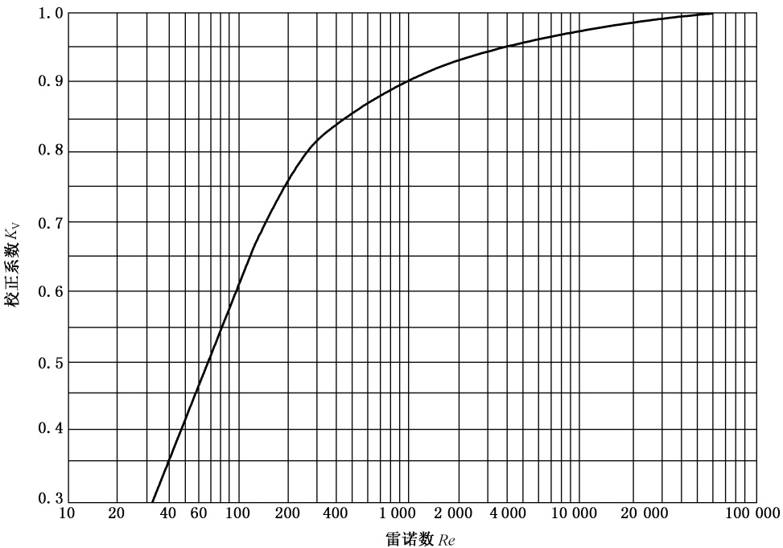

图B.1 液体动力黏度校正系数 K_{\mathrm{V}} 与雷诺数 Re 的关系

M ——气体的摩尔质量,单位为千克每千摩尔(kg/kmol),典型气体介质分量见表 B.6。

$p_{f}$ ——最大泄放压力(绝对压力)，单位为兆帕(MPa)。

$p_{o}$ ——背压(绝对压力)，单位为兆帕(MPa)。

$p_{r}$ ——对比压力, 即最大泄放压力(绝对压力)与介质的临界压力(绝对压力)之比。

$p_{z}$ ——安全阀的整定压力,单位为兆帕(MPa)。

q ——在最大泄放压力下,介质的汽化潜热,单位为千焦每千克(kJ/kg)。

r ——超压泄放装置出口压力(背压)与上游最大泄放压力的比值。

Re——雷诺数, $Re=0.3134\frac{W}{\mu\sqrt{A}}$ 。

t ——最大泄放压力下介质饱和温度,单位为摄氏度(℃)。

<!-- page: 39 -->

$T_{f}$ ——介质泄放温度,单位为摄氏度( $^{\circ}$ C)。

$T_{r}$ ——对比温度, 即介质泄放温度(以绝对温度表示)与介质的临界温度(以绝对温度表示)之比。

$T_{w}$ ——火灾情况下容器最大金属壁温,单位为摄氏度( $^{\circ}$ C)。

$v_{in}$ ——容器进料管内的流速,单位为米每秒(m/s)。

$W_{s}$ ——容器安全泄放量,单位为千克每小时(kg/h)。

W ——泄放装置泄放量,单位为千克每小时(kg/h)。

Z ——气体压缩系数, 见图 B.2。

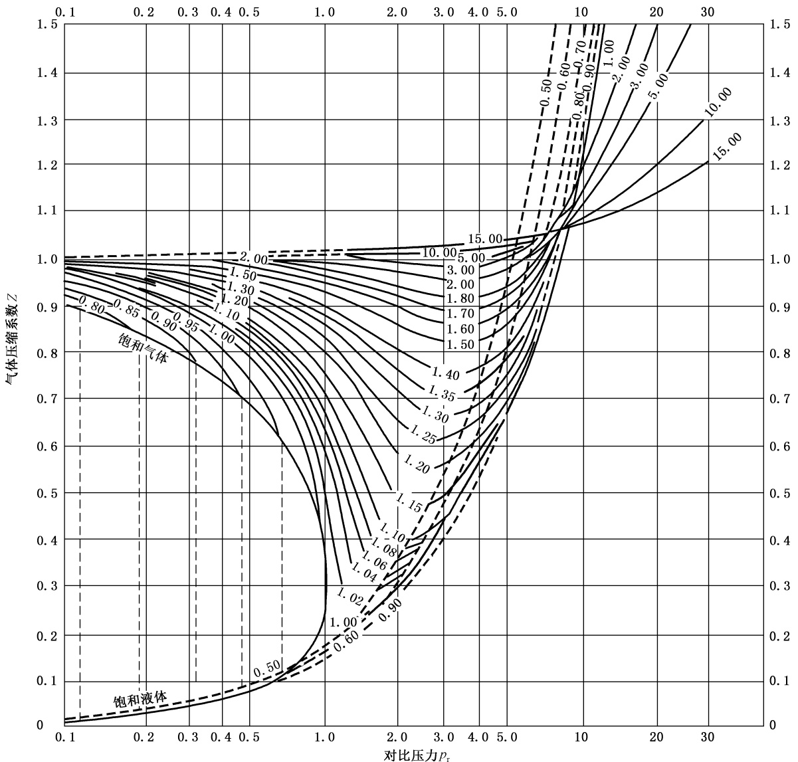

图 B.2 气体压缩系数 Z（图中曲线代表不同的对比温度  T_{r} ）

α ——泄放条件下液体的线膨胀系数,单位为每摄氏度( $^{\circ}C^{-1}$ )。

$\delta_{L}$ ——容器保温层厚度,单位为米(m)。

θ ——常温下绝热材料的导热系数,单位为千焦每米小时摄氏度 $\left[\mathrm{kJ}/(\mathrm{m}\cdot\mathrm{h}\cdot^{\circ}\mathrm{C})\right]$ 。

$\mu$ ——介质流动温度下的绝对黏度(动力黏度)，单位为帕斯卡秒(Pa·s)。

$\rho_{f}$ ——泄放条件(泄放温度与最大泄放压力)下的介质密度,单位为千克每立方米 $\left(\mathrm{kg}/\mathrm{m}^{3}\right)$ 。

$\rho_{in}$ ——管道入口处介质密度,单位为千克每立方米 $(\mathrm{kg}/\mathrm{m}^{3})$ 。

$\rho_{L}$ ——液体介质的密度,单位为千克每立方米 $(\mathrm{kg}/\mathrm{m}^{3})$ 。

<!-- page: 40 -->

**B.7.3 非火灾事故安全泄放量计算**

B.7.3.1 非火灾事故超压包括工艺操作、设备故障、公用工程供应、自动控制仪表故障等因素导致的超压。包括但不限于:出口关闭、冷却或回流中断、吸收剂中断、不凝组分累积、易挥发介质混入、超装、自控失灵、不正常的工艺热量或气体输入、止回阀泄漏或失效、化学反应、膨胀、公用工程供应中断等。

B.7.3.2 对于与压力源相连接的、本身不产生压力的容器，工艺事故超压时其安全泄放量应大于压力源的最大输入值。

B.7.3.3 对压缩机贮气罐和蒸气罐等容器的安全泄放量,分别取该压缩机和蒸气发生器的最大产气(汽)量。

B.7.3.4 对于有压力源持续输入的容器,安全泄放量按公式(B.3)计算:

$$ W _ {\mathrm{s}} = 2. 8 3 \times 1 0 ^ {- 3} \rho_ {\text {in}} v _ {\text {in}} d ^ {2}\tag{……(B.3} $$

式中:

$W_{s}$ ——容器安全泄放量,单位为千克每小时(kg/h);

$\rho_{in}$ ——管道入口处介质密度,单位为千克每立方米 $(\mathrm{kg}/\mathrm{m}^{3})$ ;

$v_{in}$ ——容器进料管内的流速,单位为米每秒(m/s);

d ——容器进料管内直径,单位为毫米(mm)。

B.7.3.5 换热设备等产生蒸气时,安全泄放量按公式(B.4)计算:

$$ W _ {\mathrm{s}} = H / q\tag{......( B.4} $$

式中:

$W_{s}$ ——容器安全泄放量,单位为千克每小时(kg/h);

H ——输入热量,单位为千焦每小时(kJ/h);

q ——在最大泄放压力下,介质的汽化潜热,单位为千焦每千克(kJ/kg)。

B.7.3.6 液体介质安全泄放量计算(指充满液体的容器中液体受热膨胀或汽化时的安全泄放量计算)。

a）受热后，液体的温度小于泄放装置动作压力所对应的饱和温度时，按公式(B.5)计算:

$$ W _ {\mathrm{s}} = \frac {\alpha H}{C _ {\mathrm{pl}}}\tag{……(B.5} $$

式中:

$W_{s}$ ——容器安全泄放量,单位为千克每小时(kg/h);

α ——泄放条件下液体的线膨胀系数,单位为每摄氏度( $/^{\circ}$ C);

H ——输入热量,单位为千焦每小时(kJ/h);

$C_{pl}$ ——液体的比热容,单位为千焦每千克摄氏度 $\left[\mathrm{kJ}/(\mathrm{kg}\cdot^{\circ}\mathrm{C})\right]$ 。

b) 受热后,液体的温度大于或等于泄放装置动作压力所对应的饱和温度时,按公式(B.4)计算。

B.7.3.7 因化学反应使压力升高的容器,其安全泄放量应根据容器内化学反应可能产生的最大气量(包括气体生成物及反应热使设备内液体汽化产生的蒸气量)、反应所需时间或者上升速度来确定。

**B.7.4 火灾事故安全泄放量计算**

**B.7.4.1 液体**

按照B.7.3.6进行计算。

**B.7.4.2 气体**

按公式(B.6)计算 $F'$ :

<!-- page: 41 -->

$$ F ^ {\prime} = \frac {0 . 2 7 7 2}{C _ {\mathrm{g}} \times K} \left[ \frac {(T _ {\mathrm{w}} - T _ {\mathrm{f}}) ^ {1 . 2 5}}{(2 7 3 + T _ {\mathrm{f}}) ^ {0 . 6 5 0 6}} \right]\tag{……(B.6} $$

式中:

$F'$ ——泄放中间变量；

$C_{g}$ ——气体特性系数；

K ——超压泄放装置有效泄放系数；

$T_{w}$ ——火灾情况下容器最大金属壁温,单位为摄氏度(℃);

$T_{f}$ ——介质泄放温度,单位为摄氏度( $^{\circ}$ C);

如果 $F^{\prime}\leqslant 182$ ，按公式(B.7)计算 $W_{\mathrm{s}}$ :

$$ W _ {\mathrm{s}} = 5 7 5 5 C _ {\mathrm{g}} A _ {\mathrm{g}} \sqrt {\frac {M p _ {\mathrm{f}}}{\left(2 7 3 + T _ {\mathrm{f}}\right)}}\tag{……(B.7} $$

式中:

$W_{s}$ ——容器安全泄放量,单位为千克每小时(kg/h);

$C_{g}$ ——气体特性系数；

$A_{g}$ ——盛装气体的容器受热面积,单位为平方米( $m^{2}$ );

M ——气体的摩尔质量,单位为千克每千摩尔(kg/kmol);

$p_{f}$ ——最大泄放压力(绝对压力)，单位为兆帕(MPa);

$T_{f}$ ——介质泄放温度,单位为摄氏度(℃)。

如果 $F^{\prime} > 182$ ，按公式(B.8)计算 $W_{\mathrm{s}}$ :

$$ W _ {\mathrm{s}} = 8. 7 7 \sqrt {M p _ {\mathrm{f}}} \left[ \frac {A _ {\mathrm{g}} (T _ {\mathrm{w}} - T _ {\mathrm{f}}) ^ {1 . 2 5}}{(2 7 3 + T _ {\mathrm{f}}) ^ {1 . 1 5 0 6}} \right]\tag{……(B.8} $$

式中:

$W_{s}$ ——容器安全泄放量,单位为千克每小时(kg/h);

M ——气体的摩尔质量,单位为千克每千摩尔(kg/kmol);

$p_{f}$ ——最大泄放压力(绝对压力), 单位为兆帕(MPa);

$A_{g}$ ——盛装气体的容器受热面积,单位为平方米 $\left(\mathrm{m}^{2}\right)$ ;

$T_{w}$ ——火灾情况下容器最大金属壁温,单位为摄氏度(℃);

$T_{f}$ ——介质泄放温度,单位为摄氏度( $^{\circ}$ C)。

注:公式(B.8)是以空气的物理性质和理想气体定律为基础的，并假设容器无隔热，忽略容器本身热容，容器未因壁温升高产生局部破裂。

**B.7.4.3 液化气体**

盛装液化气体的单层容器根据容器有无绝热层来考虑安全泄放量的计算。

a）无绝热层时，安全泄放量按公式(B.9)计算:

$$ W _ {\mathrm{s}} = \frac {2 . 5 5 \times 1 0 ^ {5} F A _ {\mathrm{r}} ^ {0 . 8 2}}{q}\tag{……(B,9} $$

式中:

$W_{s}$ ——容器安全泄放量,单位为千克每小时(kg/h)。

F ——系数。容器置于地面以下用砂土覆盖时，F=0.03；容器置于地面上时，F=1.0；容器置于大于 $10 \, \text{L}/(\text{m}^{2} \cdot \text{min})$ 喷淋装置时，F=0.6。

$A_{r}$ ——火灾工况下,盛装液体或液化气体的容器内部液体润湿面积(一般以存放液体或液化气体容器的地面或可积聚液体的平台为基准,计算高度在7.5 m以内的容器湿表面积),单位为平方米( $m^{2}$ )。

<!-- page: 42 -->

q ——在最大泄放压力下,介质的汽化潜热,单位为千焦每千克(kJ/kg)。

b) 有绝热层时, 安全泄放量按公式(B.10)计算:

$$ W _ {\mathrm{s}} = \frac {2 . 6 1 \times (6 5 0 - t) \theta A _ {\mathrm{r}} ^ {0 . 8 2}}{\delta_ {\mathrm{L}} q}\tag{……(B,10} $$

式中:

$W_{s}$ ——容器安全泄放量,单位为千克每小时(kg/h);

t ——最大泄放压力下介质饱和温度,单位为摄氏度(℃);

θ ——常温下绝热材料的导热系数,单位为千焦每米小时摄氏度 $\left[\mathrm{kJ}/(\mathrm{m}\cdot\mathrm{h}\cdot^{\circ}\mathrm{C})\right]$ ;

$A_{r}$ ——火灾工况下,盛装液体或液化气体的容器内部液体润湿面积(一般以存放液体或液化气体容器的地面或可积聚液体的平台为基准,计算高度在7.5 m以内的容器湿表面积),单位为平方米( $m^{2}$ );

$\delta_{L}$ ——容器保温层厚度,单位为米(m);

q ——在最大泄放压力下，介质的汽化潜热，单位为千焦每千克(kJ/kg)。

注:公式(B.10)的使用条件是绝热层在 $650^{\circ}$ C 时能起到有效作用,2 h 内不会烧坏,且在消防水冲击作用下不会脱落。

**B.8 泄放装置的泄放面积计算**

**B.8.1 气体**

B.8.1.1 临界流动条件, 即 $\frac{p_{o}}{p_{f}} \leqslant \left(\frac{2}{k+1}\right)^{\frac{k}{k-1}}$ 时, 所需最小泄放面积按公式(B.11)计算:

$$ A = \frac {W _ {\mathrm{s}}}{1 0 0 0 C _ {\mathrm{g}} K K _ {\mathrm{b}} K _ {\mathrm{c}} p _ {\mathrm{f}}} \sqrt {\frac {Z \left(2 7 3 + T _ {\mathrm{f}}\right)}{M}}\tag{B.11} $$

式中:

A ——所需最小泄放面积,即计算得到的满足容器安全泄放量所需的最小泄放面积,单位为平方毫米( $mm^{2}$ );

$W_{s}$ ——容器安全泄放量,单位为千克每小时(kg/h);

Z ——气体压缩系数, 见图 B.3;

$T_{f}$ ——介质泄放温度,单位为摄氏度(℃);

M ——气体的摩尔质量,单位为千克每千摩尔(kg/kmol);

$C_{g}$ ——气体特性系数；

$K$ ——超压泄放装置有效泄放系数；

$K_{b}$ ——用于气体和蒸气的背压校正系数；

$K_{c}$ ——组合校正系数，安全阀上游安装爆破片装置时 $K_{c}=0.9$ ，不安装时 $K_{c}=1.0$ ；

$p_{f}$ ——最大泄放压力(绝对压力)，单位为兆帕(MPa)。

B.8.1.2 亚临界流动条件, 即 $\frac{p_{o}}{p_{f}} > \left(\frac{2}{k+1}\right)^{\frac{k}{k-1}}$ 时, 所需最小泄放面积按如下规定。

a）对于可通过调节弹簧载荷补偿附加背压的普通型安全阀和先导式安全阀以及爆破片装置，所需最小泄放面积按公式(B.12)计算:

$$ A = \frac {1 . 7 9 \times 1 0 ^ {- 2} \times W _ {\mathrm{s}}}{C _ {\mathrm{s}} K K _ {\mathrm{c}}} \sqrt {\frac {Z (2 7 3 + T _ {\mathrm{f}})}{M \left(p _ {\mathrm{f}} - p _ {\mathrm{o}}\right) p _ {\mathrm{f}}}}\tag{……(B,12} $$

式中:

A ——所需最小泄放面积,即计算得到的满足容器安全泄放量所需的最小泄放面积,单位为

<!-- page: 43 -->

平方毫米( $mm^{2}$ );

$W_{s}$ ——容器安全泄放量,单位为千克每小时(kg/h);

Z ——气体压缩系数, 见图 B.3;

$T_{f}$ ——介质泄放温度,单位为摄氏度(℃);

$C_{s}$ ——亚临界流的气体特性系数, 按公式(B.2)求取;

$K$ ——超压泄放装置有效泄放系数；

$K_{c}$ ——组合校正系数, 安全阀上游安装爆破片装置时 $K_{c}=0.9$ , 不安装时 $K_{c}=1.0$ ;

M ——气体的摩尔质量,单位为千克每千摩尔(kg/kmol);

$p_{f}$ ——最大泄放压力(绝对压力), 单位为兆帕(MPa);

$p_{o}$ ——背压(绝对压力), 单位为兆帕(MPa)。

b) 对于平衡型安全阀:

所需最小泄放面积按公式(B.11)计算,这时的背压校正系数 $K_{b}$ 考虑到亚临界流动的情况以及阀瓣的开启高度保持不变(亚临界流动公式仅适用于开启高度保持不变的情况),此时背压校正系数应从制造商处获取。

**B.8.2 饱和及过热蒸汽**

B.8.2.1 对于临界流动的饱和(蒸气含量应不小于98%)及过热蒸汽,所需最小泄放面积按公式(B.13)计算:

$$ A = \frac {0 . 1 9 \times W _ {\mathrm{s}}}{p _ {\mathrm{f}} K K _ {\mathrm{b}} K _ {\mathrm{c}} K _ {\mathrm{N}} K _ {\mathrm{SH}}}\tag{……(B.13} $$

式中:

A ——所需最小泄放面积,即计算得到的满足容器安全泄放量所需的最小泄放面积,单位为平方毫米( $mm^{2}$ );

$W_{s}$ ——容器安全泄放量,单位为千克每小时(kg/h);

$p_{f}$ ——最大泄放压力(绝对压力),单位为兆帕(MPa);

K ——超压泄放装置有效泄放系数；

$K_{b}$ ——用于气体和蒸气的背压校正系数；

$K_{c}$ ——组合校正系数,安全阀上游安装爆破片装置时 $K_{c}=0.9$ , 不安装时 $K_{c}=1.0$ ;

$K_{N}$ ——修正因子；当 $p_{f} \leqslant 10.34 MPa$ 时， $K_{N} = 1$ ；当 $10.34 MPa < p_{f} \leqslant 22.06 MPa$ 时，

$$ K _ {\mathrm{N}} = \frac {2 7 . 6 4 p _ {\mathrm{f}} - 1 0 0 0}{3 3 . 2 4 p _ {\mathrm{f}} - 1 0 6 1}; $$

$K_{SH}$ ——蒸汽过热度修正系数。对任意压力下的饱和蒸汽， $K_{SH}=1$ ；对于过热蒸汽， $K_{SH}$ 可通过表B.9查询得到，压力、温度介于表B.9中间数值的 $K_{SH}$ 采用线性内插法插值计算。

注:适用于单一相均质流体通过超压泄放装置时所需最小泄放面积的计算。

B.8.2.2 当过热蒸汽的温度超过 $649^{\circ}$ C 时, 所需最小泄放面积按公式(B.11)计算。

**B.8.3 液体**

所需最小泄放面积按公式(B.14)计算:

$$ A = \frac {0 . 1 9 6 \times W _ {\mathrm{s}}}{K K _ {\mathrm{w}} K _ {\mathrm{c}} K _ {\mathrm{V}} \sqrt {\rho_ {\mathrm{f}} (p _ {\mathrm{f}} - p _ {\mathrm{o}})}}\tag{B.14} $$

式中:

A ——所需最小泄放面积,即计算得到的满足容器安全泄放量所需的最小泄放面积,单位为平方毫米( $mm^{2}$ );

<!-- page: 44 -->

$W_{\mathrm{s}}$ ——容器安全泄放量，单位为千克每小时 $(\mathrm{kg / h})$；

$K$ ——超压泄放装置有效泄放系数；

$K_{w}$ ——用于液体的背压校正系数；

$K_{c}$ ——组合校正系数, 安全阀上游安装爆破片装置时 $K_{c}=0.9$ , 不安装时 $K_{c}=1.0$ ;

$K_{v}$ ——液体动力黏度校正系数, 见图 B.2, 当液体的黏度不大于 $20^{\circ}C$ 水的黏度时, 取 $K_{v}=1.0$ ;

$p_{f}$ ——最大泄放压力(绝对压力)，单位为兆帕(MPa);

$p_{0}$ ——背压(绝对压力)，单位为兆帕(MPa)。

对于黏性流体的泄放面积,计算程序如下:

a) 假设为非黏性流体，取 $K_{v}=1.0$ ，按公式(B.14)计算出初始的所需最小泄放面积 A 与相应的直径，并向上圆整到产品系列化规格最近的公称直径及相对应的泄放面积 $A'$ ;

b) 根据 a) 计算出的圆整后泄放面积按公式 (B.15) 及 $K_{\mathrm{v}} = 1.0$ 计算泄放量 $W$;

$$ W = 5. 1 0 2 \times A ^ {\prime} K K _ {\mathrm{w}} K _ {\mathrm{c}} K _ {\mathrm{V}} \sqrt {\rho_ {\mathrm{L}} \left(p _ {\mathrm{f}} - p _ {\mathrm{o}}\right)}\tag{……(B,15} $$

式中:

W ——泄放装置泄放量,单位为千克每小时(kg/h);

$A'$ ——调整的泄放面积,单位为平方毫米 $\left(\mathrm{mm}^{2}\right)$ ;

K ——超压泄放装置有效泄放系数；

$K_{w}$ ——用于液体的背压校正系数；

$K_{c}$ ——组合校正系数, 安全阀上游安装爆破片装置时 $K_{c}=0.9$ , 不安装时 $K_{c}=1.0$ ;

$K_{v}$ ——液体动力黏度校正系数,此处取 $K_{v}=1.0$ ;

$\rho_{L}$ ——液体介质的密度,单位为千克每立方米 $(\mathrm{kg}/\mathrm{m}^{3})$ ;

$p_{f}$ ——最大泄放压力(绝对压力), 单位为兆帕(MPa);

$p_{0}$ ——背压(绝对压力)，单位为兆帕(MPa)。

c) 根据 b) 计算出的泄放量 $W$ 及 a) 计算出的调整后泄放面积 $A'$ 按 $Re = \frac{0.313 \times W}{\mu \sqrt{A'}}$ 计算雷诺数, 由图 B.2 查得 $K_{\mathrm{V}}$ 值按公式 (B.15) 重新计算泄放量 $W$;

d) 若 $W \geqslant W_{\mathrm{s}}$，则该直径(面积)即为所求；若 $W < W_{\mathrm{s}}$，则采用大一档的产品公称直径相对应的泄放面积代替a)计算出的圆整后泄放面积重复b)～c)的计算，直至 $W \geqslant W_{\mathrm{s}}$。

**B.8.4 实际泄放面积**

选用的泄放装置实际泄放面积 $A_0$ 应不小于按公式(B.11)～公式(B.14)计算的所需最小泄放面积 $A$ 。对于安全阀，其额定排量应不小于容器安全泄放量。

**B.9 超压泄放装置的安装**

B.9.1 超压泄放装置的安装位置在充分考虑导致超压的因素和潜在危险源后合理设置,在被保护的容器本体(或其连接管道上,该管道直径应满足安全泄放量的要求,能实时反映容器内工作压力的变化)上安装超压泄放装置,应便于安装、检查和维护。安全阀的阀体应在容器或管线顶部并垂直向上。

B.9.2 若用于气体介质,应设置在气相空间(包括液体上方的气相空间)或与该空间相连通的管线上。

B.9.3 容器和超压泄放装置之间的所有管道、管件的截面积应不小于超压泄放装置的泄放面积，其接管应避免过大的压力损失。若一个连接口上并联装设2个或者2个以上的超压泄放装置（包括基本超压泄放装置、附加超压泄放装置和辅助超压泄放装置，不包括备用超压泄放装置）时，则该连接口入口的截面积，应不小于可能同时排放的超压泄放装置进口截面积的总和。

B.9.4 容器与超压泄放装置之间一般不宜设置中间截断阀。对于连续操作的容器，可通过三通换向阀切换至备用超压泄放装置，或在容器与超压泄放装置之间设置截断阀专供检修用，但应通过机械安全联

<!-- page: 45 -->

锁或其他措施确保容器在正常工作期间截断阀应处于全开的位置,且选用的截断阀不能减少泄放面积。B.9.5 超压泄放装置的支撑结构应有足够的强度(或刚度),以保证能承受该超压泄放装置泄放时所产生的反力。

**B.10 泄放管**

B.10.1 泄放管宜设计成垂直方向,其口径应不小于泄放装置的出口直径。当多个超压泄放装置接入泄放总管,总管的截面积应不小于可能同时排放的各超压泄放装置泄放口截面积总和。

B.10.2 在泄放管的适当部位设置排净、泪孔等排液设施。

B.10.3 在安装爆破片装置的泄放管线时,其中心线应与爆破片装置的中心线对齐,以避免爆破片受力不均。

<!-- page: 46 -->

## 附录C

**C.1 一般要求**

C.1.1 本附录规定了采用验证性爆破试验确定容器设计压力的基本要求。

C.1.2 本附录适用于无法按照 GB/T 150.3 进行结构设计计算的压力容器或受压元件。凡能够按 GB/T 150.3 要求准确确定其计算厚度的受压元件，其结构强度设计应满足 GB/T 150.3 的要求，不应采用本附录的方法。

C.1.3 容器与试验容器(或元件与试验元件)满足以下要求。

a）相同的设计结构和形状。

b）相同的材料，即对应的材料标准、牌号、热处理状态应一致。

c) 相同的名义厚度和结构尺寸。对于截面尺寸相同的结构,其长度不应大于验证试验件。

d）相同的热处理要求。

e）制造偏差应符合GB/T150.4的要求。

C.1.4 如果容器中仅部分受压元件的最高允许工作压力采用验证性爆破试验确定,则容器的设计压力应根据所有受压元件的要求确定。

C.1.5 本附录不应用于盛装介质毒性程度为极度或高度危害的容器的设计。

**C.2 管理与职责**

C.2.1 验证性爆破试验的试验件应由该容器或受压元件的制造单位完成,试验可由该容器或受压元件的制造单位或委托第三方实施。

C.2.2 验证性爆破试验的实施过程应保证试验人员和场地的安全,试验程序和试验场地安全防护措施应经实施试验的单位技术负责人批准。

C.2.3 参照容器耐压试验的监督检验要求,整个试验过程应接受检验机构人员见证,验证性爆破试验报告应经检验机构人员签字认可。

C.2.4 以验证性爆破试验确定容器设计压力或受压元件最高允许工作压力的技术文件应经技术评审。

C.2.5 技术评审试验件设计制造文件和验证性爆破试验报告满足如下要求。

a）试验件设计和制造文件，至少应包含以下内容:

1）试验件的结构设计图样；

2）材料质量证明文件；

3）制造过程工艺文件；

4）检验记录；

5）其他相关文件。

b) 验证性爆破试验报告,至少应包含以下内容:

1）试验、测试设备；

2）试验程序；

3）试验过程记录；

4）试验结论。

**C.3 试验要求**

C.3.1 验证性爆破试验一般以水作为试验介质,试验介质和温度应符合 GB/T 150.4 的规定。

<!-- page: 47 -->

C.3.2 试验容器在进行验证性爆破试验前，耐压试验压力不应超过预期设计压力的1.25倍。

C.3.3 验证性爆破试验的加压应缓慢进行,首先逐渐加压至预期设计压力的 0.5 倍,保压观察后以 1/10 预期设计压力的增量逐步加压至预期设计压力,进行不少于 10 min 的保压观察后继续以 1/10 预期设计压力的增量加压至爆破或设定的停止点。

C.3.4 验证性爆破试验可选择适当的压力作为停止点, 只要采用该停止点压力计算得到的设计压力满足预期的设计压力要求即可。

**C.4 设计压力的确定**

**C.4.1 试验温度下最高允许工作压力**

试验温度下最高允许工作压力按如下方法确定。

a) 按 C.4.4 确定室温下试样的平均抗拉强度 $R_{mavc}$ 时, 按公式 (C.1) 计算试验温度下的最高允许工作压力 $p''$ , 否则按公式 (C.2) 计算:

$$ \dot {p} ^ {\prime \prime} = \frac {p _ {\mathrm{b}} R _ {\mathrm{m}} \varphi}{4 R _ {\mathrm{mave}}}\tag{……(C.1} $$

$$ p ^ {\prime \prime} = \frac {p _ {\mathrm{b}} R _ {\mathrm{m}} \varphi}{4 R _ {\mathrm{mh}}}\tag{C.2} $$

式中:

$p''$ ——试验温度下的最高允许工作压力,单位为兆帕(MPa);

$p_{b}$ ——爆破试验压力或试验停止点压力,单位为兆帕(MPa);

$\varphi$ ——焊接接头系数；

$R_{m}$ ——材料标准抗拉强度下限值,单位为兆帕(MPa);

$R_{mave}$ ——室温下试样的平均抗拉强度，按 C.4.4 确定，单位为兆帕（MPa）；

$R_{mh}$ ——材料标准抗拉强度上限值,单位为兆帕(MPa)。

b) 考虑腐蚀裕量后试验温度下的最高允许工作压力 $p'$ 按公式(C.3)确定:

$$ p ^ {\prime} = p ^ {\prime \prime} \left(\frac {t _ {\min} - C _ {2}}{t _ {\min}}\right) ^ {n}\tag{C.3} $$

式中:

$p'$ ——考虑腐蚀裕量后试验温度下的最高允许工作压力,单位为兆帕(MPa);

$t_{min}$ ——强度最薄弱处的材料厚度,单位为毫米(mm);

$C_{2}$ ——腐蚀裕量,单位为毫米(mm);

n ——结构形状系数,对于圆筒、球壳、半顶角 $\alpha\leqslant60^{\circ}$ 的锥壳等,以及弯曲应力不大于 2/3 总应力的受压元件时,n=1;对于平面或近似平面,如平盖板、法兰或半顶角 $\alpha>60^{\circ}$ 的锥体等,以及弯曲应力大于 2/3 总应力的受压元件时,n=2。

**C.4.2 设计温度下的最高允许工作压力**

设计温度下的最高允许工作压力 $p_{\mathrm{max}}$ 按公式(C.4)计算:

$$ p _ {\max} = p ^ {\prime} \frac {[ \sigma ] ^ {\mathrm{t}}}{[ \sigma ] ^ {\mathrm{T}}}\tag{……(C.4} $$

式中:

$p_{\mathrm{max}}$ ——设计温度下的最高允许工作压力，单位为兆帕（MPa）；

$\left[\sigma\right]^{t}$ ——容器元件材料在设计温度下的许用应力,单位为兆帕(MPa);

$\left[\sigma\right]^{T}$ ——容器元件材料在试验温度下的许用应力,单位为兆帕(MPa)。

<!-- page: 48 -->

**C.4.3 确定依据**

采用 C.4.1～C.4.2 得到的最高允许工作压力作为确定容器设计压力 p 的依据。

**C.4.4 试样的平均抗拉强度 R_{\mathrm{mave}} 确定**

C.4.4.1 试样应从与试验容器相同的材料上用机械方法截取。

C.4.4.2 取3个试样抗拉强度的平均值作为平均抗拉强度。

<!-- page: 49 -->

## 附录D

**D.1 一般要求**

D.1.1 本附录规定了采用对比经验设计的基本要求。

D.1.2 本附录适用于容器的对比经验设计,对比经验设计容器与参照容器应具有相同或相近结构和设计条件。

D.1.3 同时满足以下要求的容器可采用本附录规定的对比经验设计方法:

a）不能按GB/T150.3进行设计的压力容器；

b) 材料标准抗拉强度下限值小于 $540\mathrm{MPa}$;

c) 盛装介质毒性程度为中度危害及以下的容器。

D.1.4 设计单位应取得用户提供的参照容器安全使用的证明文件和设计文件。

D.1.5 以对比经验设计方法设计的压力容器的技术文件应经技术评审。

**D.2 使用经验要求**

D.2.1 参照容器应为已投入实际生产运行的容器,其安全运行期限不少于5年。

D.2.2 参照容器的实际运行条件不应低于其设计条件的 80%。

**D.3 设计条件**

D.3.1 与参照容器结构相同、介质相同。

D.3.2 设计温度不应高于参照容器的设计温度；对于设计温度低于 $0^{\circ}$ C 的容器，容器设计温度不应低于参照容器的设计温度。

D.3.3 设计压力不应高于参照容器的设计压力。

**D.4 结构**

D.4.1 对比经验设计容器应与参照容器具有相同或相似的结构,主要结构尺寸的结构相似比应为0.85~1.15。

D.4.2 在保证对比经验设计容器使用功能前提下,应进行结构优化,减小总体结构不连续和局部结构不连续所引起的二次应力和峰值应力的影响。

**D.5 材料**

D.5.1 对比经验设计容器的材料设计温度下的力学性能不应低于参照容器材料的相应要求。

D.5.2 对比经验设计容器的材料耐腐蚀性能不应低于参照容器材料的相应要求。

**D.6 设计**

D.6.1 容器的对比经验设计应满足以上要求,其结构尺寸可按结构相似原则确定。

D.6.2 设计单位应提供设计说明书。

D.6.3 对于按 GB/T 4732(所有部分)要求需进行疲劳分析的容器,根据本附录的要求进行对比经验设计时,设计说明书中还应补充容器的疲劳分析内容。

<!-- page: 50 -->

## 附录E

**E.1 一般要求**

E.1.1 本附录规定了容器局部结构采用应力分析方法(容器总体按本文件及 GB/T 150.2～GB/T 150.4)作为设计依据的基本要求。

E.1.2 本附录仅适用于按GB/T150.3无法进行设计计算的容器局部结构。

**E.2 设计管理**

E.2.1 按本附录进行容器局部结构应力分析的设计单位和设计者一般不要求具备分析设计资格。

E.2.2 设计单位应对局部结构分析的正确性负责,分析报告应作为对应局部结构的强度计算书。

**E.3 强度评定要求**

E.3.1 应力分析方法及结果的评定方法应符合 GB/T 4732(所有部分)的规定。

E.3.2 材料的设计应力强度按 GB/T 150.2 对应材料的许用应力确定。

**E.4 制造、检验和验收要求**

局部结构的制造、检验和验收要求应满足 GB/T 4732(所有部分)的相应规定。

<!-- page: 51 -->

## 附录F

**F.1 一般要求**

F.1.1 本附录规定了风险评估报告的基本要求。

F.1.2 容器设计者应根据相关法规或设计委托方要求编制针对容器预期使用状况的风险评估报告。

F.1.3 设计者应根据第 4 章, 充分考虑容器在各种工况条件下可能产生的失效模式, 在材料选择、结构设计、制造检验要求等方面提出安全措施, 防止可能发生的失效。

F.1.4 设计者应向容器用户提供制定容器事故应急预案所需要的信息。

**F.2 制定原则和程序**

F.2.1 设计阶段风险评估主要针对危害识别和风险控制。

F.2.2 设计阶段风险评估按以下程序进行:

a）根据用户设计条件和其他设计输入信息，确定容器的各种使用工况；

b) 根据各使用工况的介质、操作条件、环境因素进行危害识别,确定可能发生的危害及其后果;

c) 针对所有危害和相应的失效模式,说明应采取的安全防护措施和依据;

d) 对于可能发生的失效模式,给出制定事故应急预案所需要的信息;

e）形成完整的风险评估报告。

**F.3 风险评估报告内容**

风险评估报告应至少包括:

a）压力容器的基本设计参数:压力、温度、材料、介质性质和外载荷等；

b）操作工况条件的描述；

c) 所有操作、设计条件下可能发生的危害, 如: 爆炸、泄漏、破损、变形等;

d) 对于标准已经有规定的失效模式,说明采用标准的条款;

e）对于标准没有规定的失效模式，说明设计中载荷、安全系数和相应计算方法的选取依据；

f) 对介质少量泄漏、大量涌出和爆炸状况下如何处置的措施；

g）根据周围人员的可能伤及情况，规定合适的人员防护设备和措施；

h）风险评估报告应具有与设计图样一致的签署。

<!-- page: 52 -->

GB/T 150.2—2024

代替GB/T150.2—2011

压力容器 第 2 部分: 材料

Pressure vessels—Part 2: Materials

2024-07-24 发布

2025-02-01 实施

<!-- page: 53 -->

## 前言

本文件按照 GB/T 1.1—2020《标准化工作导则 第1部分:标准化文件的结构和起草规则》的规定起草。

本文件是 GB/T 150 的第 2 部分, GB/T 150 已经发布了以下部分:

第1部分:通用要求；

——第2部分:材料；

——第 3 部分: 设计;

——第 4 部分: 制造、检验和验收。

本文件代替 GB/T 150.2—2011《压力容器 第2部分:材料》，与 GB/T 150.2—2011 相比，除结构调整和编辑性改动外，主要技术变化如下:

a）更改了总体要求中压力容器材料的相关技术要求(见第4章,2011年版的第3章);

b) 删除了1个低合金钢钢板(15MnNiDR)(见2011年版的表2、表4)，增加了9个低合金钢钢板(Q460R、Q420DR、Q460DR、13MnNiDR、11MnNiMoDR、07Ni5DR、06Ni7DR、Q580R和Q580DR)(见表2、表3、表C.1、表E.1)，20个高合金钢钢板(S22153、S22294、S22553、S23043、S25554、S25073、S30450、S30453、S30458、S30478、S30859、S30908、S31252、S31609、S31653、S31658、S32169、S34778、S34779和S35656)(见表C.2、表E.2、表F.1);

c) 更改了钢管标准及钢管的使用规定(见第6章、表C.3、表C.4,2011年版的第5章);

d) 增加了 10 个低合金钢和合金钢锻件（08Cr2AlMo、09CrCuSb、12CrMo、15NiCuMoNb、10Cr9Mo1VNbN、10Cr9MoW2VNbBN、30CrMo、35CrNi3MoV、36CrNi3MoV 和 06Ni9D）（见表 5、表 C.5、表 E.6），13 个高合金钢锻件（S11348、S23043、S25554、S25073、S30453、S30458、S31252、S31653、S31658、S32169、S34778、S34779 和 S51740）（见表 C.6、表 E.6、表 F.1）；

e）增加了焊接材料(见第9章)；

f）增加了钢材纳入本文件应满足的技术要求(见附录 B);

g）增加了钢材的许用应力(见附录 C)。

本文件由全国锅炉压力容器标准化技术委员会(SAC/TC 262)提出并归口。

请注意本文件的某些内容可能涉及专利。本文件的发布机构不承担识别专利的责任。

本文件起草单位:合肥通用机械研究院有限公司、中国特种设备检测研究院、中国石化工程建设有限公司、中石化广州工程有限公司、江苏省特种设备安全监督检验研究院、南京钢铁股份有限公司、二重(德阳)重型装备有限公司。

本文件主要起草人:章小浒、杨国义、段瑞、张国信、常彦衍、缪春生、陈涛、陈志伟、陆戴丁、洪君、沈国劬。

本文件及其所代替文件的历次版本发布情况为:

-1989年首次发布为GB 150—1989,1998年第一次修订；

-2011年第二次修订时分为部分出版，本文件对应GB/T150.2—2011《压力容器 第2部分:材料》；

——本次为第三次修订。

<!-- page: 54 -->

## 引言

压力容器是涉及公共安全的特种设备之一，是石油化工、能源装备、生物医药等领域的重要设备。为了提高压力容器的经济性和安全性，我国在1967年发布了《钢制化工容器设计规定》，1989年发布了GB 150《钢制压力容器》，1998年对GB 150进行了修订，其作为压力容器法规的配套标准，规范了钢制压力容器的建造要求。GB/T 150系列标准自2011年发布实施已十余年，在此期间《固定式压力容器安全技术监察规程》于2016年进行了修改，其引用的材料、零部件和无损检测标准也进行了修订。鉴于此，确有必要修订完善GB/T 150，以不断适应经济发展对该标准的新需求，更好地促进压力容器产品的高质量发展。

本文件是压力容器建造方法通用技术标准之一，用以规范在中国境内建造或使用的压力容器设计、制造、检验和验收的相关技术要求。GB/T 150《压力容器》由四个部分构成。

——第 1 部分:通用要求。目的在于给出压力容器建造的基本要求。

——第 2 部分: 材料。目的在于给出压力容器选材的基本要求和设计制造过程用到的材料数据。

——第 3 部分: 设计。目的在于给出压力容器的设计方法和设计技术要求。

——第 4 部分: 制造、检验和验收。目的在于给出压力容器制造过程中的要求以及检验和验收规定。

本文件的技术条款包括了压力容器建造过程(即指设计、制造、检验和验收)中需遵循的技术要求。本文件没有必要,也不可能囊括适用范围内压力容器建造中的所有技术细节。

本文件不限制实际工程设计和建造中采用先进的技术方法,但工程技术人员采用先进的技术方法时需能做出可靠的判断,确保其满足本文件规定,特别是关于强度或稳定性设计公式等设计规定。本文件既不要求也不限制设计人员使用计算机程序实现压力容器的分析或设计。

对于未经委员会书面授权或认可的其他机构对标准的宣贯或解释所产生的理解歧义和由此产生的任何后果,委员会不承担任何责任。

<!-- page: 55 -->

# 压力容器 第2部分：材料

## 1 范围

本文件规定了钢制压力容器受压元件用钢材允许使用的牌号及其标准,钢材的附加技术要求,钢材的使用范围(温度和压力),钢材的许用应力,焊接材料的基本要求。

本文件适用于设计温度 $-269\;^{\circ}C \sim 800\;^{\circ}C$ 、设计压力不大于35 MPa的压力容器。

本文件不适用于 GB/T 150.1 规定的不适用范围。

## 2 规范性引用文件

下列文件中的内容通过文中的规范性引用而构成本文件必不可少的条款。其中，注日期的引用文件，仅该日期对应的版本适用于本文件；不注日期的引用文件，其最新版本（包括所有的修改单）适用于本文件。

GB/T 150.1 压力容器 第1部分:通用要求

GB/T 150.3 压力容器 第3部分:设计

GB/T 228.1 金属材料 拉伸试验 第1部分:室温试验方法

GB/T 228.2 金属材料 拉伸试验 第2部分:高温试验方法

GB/T 229 金属材料 夏比摆锤冲击试验方法

GB/T 699 优质碳素结构钢

GB/T700 碳素结构钢

GB/T 709 热轧钢板和钢带的尺寸、外形、重量及允许偏差

GB/T 713.7 承压设备用钢板和钢带 第7部分:不锈钢和耐热钢

GB/T 1220 不锈钢棒

GB/T 1221 耐热钢棒

GB/T 3077 合金结构钢

GB/T 3965 熔敷金属中扩散氢测定方法

GB/T 4226 不锈钢冷加工钢棒

GB/T 4334 金属和合金的腐蚀 奥氏体及铁素体-奥氏体(双相)不锈钢晶间腐蚀试验方法

GB/T 6394 金属平均晶粒度测定方法

GB/T 6479 高压化肥设备用无缝钢管

GB/T 6803 铁素体钢的无塑性转变温度落锤试验方法

GB/T 7735—2016 无缝和焊接(埋弧焊除外)钢管缺欠的自动涡流检测

GB/T 9948 石油裂化用无缝钢管

GB/T 13305 不锈钢中 $\alpha$-相面积含量金相测定法

GB/T 20878 不锈钢和耐热钢 牌号及化学成分

GB/T 21433 不锈钢压力容器晶间腐蚀敏感性检验

GB/T 31935 金属和合金的腐蚀 低铬铁素体不锈钢晶间腐蚀试验方法

GB/T 32571 金属和合金的腐蚀 高铬铁素体不锈钢晶间腐蚀试验方法

GB/T 39255 焊接与切割用保护气体

<!-- page: 56 -->

- JB/T 4756 镍及镍合金制压力容器
- NB/T 47002.1 压力容器用复合板 第1部分:不锈钢-钢复合板
- NB/T 47002.2 压力容器用复合板 第2部分:镍-钢复合板
- NB/T 47002.3 压力容器用复合板 第3部分:钛-钢复合板
- NB/T 47002.4 压力容器用复合板 第4部分:铜-钢复合板
- NB/T 47010 承压设备用不锈钢和耐热钢锻件
- NB/T 47013.2—2015 承压设备无损检测 第2部分:射线检测
- NB/T 47013.3 承压设备无损检测 第3部分:超声检测
- NB/T 47013.4 承压设备无损检测 第4部分:磁粉检测
- NB/T 47013.5 承压设备无损检测 第5部分:渗透检测
- NB/T 47014 承压设备焊接工艺评定
- NB/T 47018.1 承压设备用焊接材料订货技术条件 第1部分:采购通则
- NB/T 47018.2 承压设备用焊接材料订货技术条件 第2部分:钢焊条
- NB/T 47018.3 承压设备用焊接材料订货技术条件 第3部分:气体保护电弧焊丝和填充丝
- NB/T 47018.4 承压设备用焊接材料订货技术条件 第4部分:埋弧焊钢焊丝和焊剂
- NB/T 47018.5 承压设备用焊接材料订货技术条件 第5部分:堆焊用不锈钢焊带和焊剂
- NB/T 47019.1 锅炉、热交换器用管订货技术条件 第1部分:通则
- NB/T 47019.4 锅炉、热交换器用管订货技术条件 第4部分:低温用低合金钢
- TSG 21 固定式压力容器安全技术监察规程

## 3 术语和定义

GB/T 150.1界定的术语和定义适用于本文件。

## 4 总体要求

4.1 本文件对压力容器受压元件用钢板、钢管、钢锻件、螺柱(含螺栓)用钢材和焊接材料做出了相关规定。

4.2 压力容器受压元件用钢材应是焊接性良好的钢材，与受压元件相焊接的非受压元件用钢材也应是焊接性良好的钢材。

4.3 允许采用未列入本文件但已列入 GB/T 20878 和 GB/T 713.7 中的奥氏体型不锈钢钢材，但其技术要求（如磷、硫含量，强度指标）不应低于本文件所列入相应钢材标准中化学成分相近牌号的规定。

4.4 采用未列入本文件的钢材(符合 4.3 规定的钢材除外)时,其技术要求均应符合附录 A 的有关规定。

4.5 压力容器受压元件用钢材应附有钢材制造单位的钢材质量证明书，质量证明书的内容（需要时应包括钢材交货状态的热处理工艺参数）应齐全、清晰，并且印刷可以追溯的信息化标识，加盖材料制造单位质量检验章。可追溯的信息包括钢材制造单位名称、钢材标准号、牌号、规格、炉批号、交货状态、热处理工艺参数（需要时）、质量证明书签发日期等内容。可追溯的信息化标记包括二维码或条码等。

4.6 容器制造单位应按质量证明书对钢材进行验收。如无钢材制造单位的钢材质量证明书原件，应在钢材质量证明书原件的复印件上加盖材料经营单位公章和经办负责人签字(章)。

4.7 选择压力容器受压元件用钢材应依据容器的使用条件(如设计温度、设计压力、介质特性和操作特点等), 钢材的化学成分、微观组织、性能(力学性能、工艺性能、化学性能和物理性能), 容器的制造工艺以及经济合理性来确定。

<!-- page: 57 -->

4.8 压力容器受压元件用钢应采用氧气转炉或者电炉冶炼,也可采用电渣重熔法冶炼。对标准抗拉强度下限值大于 540 MPa 的低合金钢钢板和低合金钢锻件、奥氏体-铁素体型不锈钢钢板,以及使用温度低于 -20 ℃ 的低温钢钢板、低温钢锻件和低温钢钢管,还应采用炉外精炼。

4.9 压力容器受压元件用钢材的使用温度上限应符合下列规定。

a) 钢材的使用温度上限为附录 C 中表 C.1～表 C.8(许用应力表中粗线右侧的许用应力由钢材的 $10^{5}$ h 高温持久强度极限平均值所确定)各牌号钢材许用应力所对应的最高温度。如因工艺过程要求,钢材需短时在高于使用温度上限操作时,由设计文件规定。

b) 非合金钢和碳锰钢钢材在高于 $425^{\circ} \mathrm{C}$ 温度下长期使用时，应注意钢中碳化物相的石墨化倾向。

c) 奥氏体型不锈钢钢材的使用温度高于 $525^{\circ}$ C 时，钢中含碳量应不小于 0.04%。

4.10 压力容器受压元件用钢的使用温度下限应符合下列规定。

a）钢材的使用温度下限按第5章～第8章的相关规定。

b) 奥氏体型不锈钢钢材的使用温度下限为 $-269^{\circ}\mathrm{C}$ 。使用温度高于或等于 $-196^{\circ}\mathrm{C}$ 时，可免做冲击试验。使用温度低于 $-196^{\circ}\mathrm{C}$，应进行压力容器设计温度下的低温冲击试验，3个标准试样冲击吸收能量平均值 $\overline{KV_2} \geqslant 54\mathrm{J}$，且侧膨胀值平均值 $\overline{LE} \geqslant 0.53\mathrm{mm}$ 。奥氏体-铁素体型不锈钢钢材可进行最低冲击试验温度为 $-40^{\circ}\mathrm{C}$ 的冲击试验，3个标准试样冲击吸收能量平均值 $\overline{KV_2} \geqslant 47\mathrm{J}$，且侧膨胀值平均值 $\overline{LE} \geqslant 0.53\mathrm{mm}$ 。冲击试验其他要求应按4.11b)的规定。

c) 低温液氢、液氦压力容器用奥氏体型不锈钢钢材(钢板、钢管、钢锻件)的专项技术要求符合下列规定。

1）奥氏体型不锈钢钢材按 GB/T 13305 进行铁素体含量测定，铁素体含量应不大于 3%。

2) 奥氏体型不锈钢钢材质量证明书中化学成分实测值计算的奥氏体稳定性系数 $\Delta \geqslant 0$ ，其中 $\Delta = Ni + 0.5Mn + 35C - 0.0833(Cr + 1.5Mo - 20)^{2} - 12$ 。

3）奥氏体型不锈钢钢材质量证明书中化学成分实测值的低温马氏体自转变温度 $M_{\mathrm{s}} \leqslant -253^{\circ}\mathrm{C}$ 或 $\leqslant -269^{\circ}\mathrm{C}$，其中 $M_{\mathrm{s}}(\mathrm{^\circ C}) = \{75(14.6 - \mathrm{Cr}) + 110(8.9 - \mathrm{Ni}) + 60(1.33 - \mathrm{Mn}) + 50(0.47 - \mathrm{Si}) + 3000\times [0.068 - (\mathrm{C} + \mathrm{N})] - 32\} /1.8$。

4) 液氢压力容器用奥氏体型不锈钢钢材应进行 $-253^{\circ}\mathrm{C}$ 的冲击试验, 液氦压力容器用奥氏体型不锈钢钢材应进行 $-269^{\circ}\mathrm{C}$ 的冲击试验, 冲击性能指标应符合 4.10b) 的规定。液氢压力容器和液氦压力容器用奥氏体型不锈钢钢材也可进行 $-196^{\circ}\mathrm{C}$ 的冲击试验, 3 个标准试样冲击吸收能量平均值 $\overline{KV_2} \geqslant 70\mathrm{J}$, 且侧膨胀值平均值 $\overline{LE} \geqslant 0.76\mathrm{mm}$ 。冲击试验其他要求应按 4.11b) 的规定。

d) 对用于低温低应力工况的钢材, 其使用温度下限按 GB/T 150.3 的规定。

4.11 非合金钢和合金钢钢材的冲击试验应符合下列规定。

a) 非合金钢和合金钢钢材(钢板、钢管、钢锻件)的冲击性能指标应符合表1的规定。对标准抗拉强度下限值随厚度增大而降低的钢材, 表1中标准抗拉强度下限值是钢材最小厚度的标准抗拉强度下限值。

表 1 非合金钢和合金钢钢材的冲击性能指标

|钢材标准抗拉强度下限值 $( R_{m} )MPa$ |3个标准试样冲击吸收能量平均值 $( \overline{KV_2} )J$ |3个标准试样侧膨胀值平均值 $( \overline{LE} )mm$ |
|---|---|---|
| $\leqslant 450$ | $\geqslant 20$ | — |
| $>450 \sim 510$ | $\geqslant 24$ | — |
| $>510 \sim 570$ | $\geqslant 31$ | — |

<!-- page: 58 -->

表 1 非合金钢和合金钢钢材的冲击性能指标（续）

|钢材标准抗拉强度下限值 $( R_{m} )MPa$ |3个标准试样冲击吸收能量平均值 $( \overline{KV_2} )J$ |3个标准试样侧膨胀值平均值 $( \overline{LE} )mm$ |
|---|---|---|
| >570~630 | $\geqslant 34$ | — |
| >630~690 | $\geqslant 38$ | $\geqslant 0.53$ |
| >690 | $\geqslant 47$ | $\geqslant 0.53$ |

b) 夏比 V 型缺口冲击试样的取样部位和试样方向应符合相应钢材标准的规定并优先选择厚度为 10 mm 的标准试样。冲击试验每组取 3 个标准试样，允许 1 个标准试样的冲击吸收能量数值和侧膨胀值低于表 1 的规定值，但不应低于表 1 规定值的 70%。当冲击试验结果不符合上述规定时，应从钢材的同样部位和同样方向上再取 3 个标准试样进行复验，前后两组 6 个标准试样的冲击吸收能量平均值和侧膨胀值平均值不应低于表 1 的规定值，允许有 2 个标准试样低于规定值，但低于规定值的 70% 的试样只允许有 1 个。

c) 当钢材无法制备标准试样时(钢材厚度小于 $11 \mathrm{~mm}$), 则应依次制备厚度为 $7.5 \mathrm{~mm}$ 或 $5 \mathrm{~mm}$ 的小尺寸试样, 冲击吸收能量平均值分别为标准试样冲击吸收能量平均值的 $75 \%$ 或 $50 \%$, 单个标准试样冲击吸收能量数值的要求按照 4.11b) 的规定。当钢材可制备标准试样时而制备厚度为 $7.5 \mathrm{~mm}$ 或 $5 \mathrm{~mm}$ 的小尺寸试样, 其冲击试验温度应分别降低 $5^{\circ} \mathrm{C}$ 和 $10^{\circ} \mathrm{C}$ (冲击试验温度低于 $-100^{\circ} \mathrm{C}$ 的钢材除外), 冲击吸收能量平均值分别为标准试样冲击吸收能量平均值的 $75 \%$ 或 $50 \%$, 单个标准试样冲击吸收能量数值的要求应按 4.11b) 的规定。

d) 钢材标准中,钢材的冲击吸收能量平均值和侧膨胀值平均值高于表1规定的,其冲击吸收能量平均值和侧膨胀值平均值还应符合相应钢材标准的规定。

e) 夏比冲击试样的侧膨胀值测定按 GB/T 229 的规定, 冲击试样的侧膨胀值合格指标与冲击试样尺寸无关。

f) 冲击试验温度为 $-40^{\circ}\mathrm{C} \sim -100^{\circ}\mathrm{C}$ 的低合金钢钢板和锻件可按GB/T229测定转变温度 $T_{\mathrm{t}}$ （如:指定吸收能量值47J确定的转变温度 $T_{\mathrm{t47}}$ 、指定吸收能量上平台的百分数 $50\%$ 确定的转变温度 $T_{\mathrm{t50\%US}}$ 、指定侧膨胀值 $0.53\mathrm{mm}$ 确定的转变温度 $T_{\mathrm{t0,53}}$ 或指定剪切断面率 $50\%$ 确定的转变温度 $T_{\mathrm{t50\%SFA}}$）。

g) 钢板的冲击试验要求按第 5 章的相关规定。对 Q245R、Q345R 和 13MnNiMoR 钢板，如需进行 -20 ℃ 冲击试验，应在设计文件中注明。如需提高钢板的冲击吸收能量指标和侧膨胀值，应在设计文件中规定。

h）钢管的冲击试验要求按第6章的相关规定。

i) 钢锻件的冲击试验要求按第 7 章的相关规定。对 20、16Mn、20MnMo 和 20MnMoNb 钢锻件, 如需进行 $-20^{\circ} \mathrm{C}$ 冲击试验, 应在设计文件中注明。如需提高钢锻件的冲击吸收能量指标和侧膨胀值, 应在设计文件中规定。

j）非合金钢、低合金钢和耐热钢钢棒的冲击试验要求按第8章的相关规定。

k）焊接材料的冲击试验要求按第9章的相关规定。

4.12 钢材可按 GB/T 15970.1～GB/T 15970.9 或 GB/T 4157 进行应力腐蚀试验，也可按 GB/T 17897 进行点腐蚀试验，具体试验方法和合格指标应在设计文件中规定。

4.13 奥氏体-铁素体型不锈钢钢板、锻件和钢管应按 GB/T 13305 的规定进行相比例测定，金相组织应为奥氏体-铁素体，奥氏体含量应在 40%～60%（铁素体应在 60%～40%）。

4.14 对钢材有特殊技术要求时(如要求特殊冶炼方法、严格的化学成分、较高的冲击吸收能量指标或

<!-- page: 59 -->

侧膨胀值、附加保证高温屈服强度和抗拉强度、提高无损检测合格等级、增加力学性能检验率等)，应在设计文件中规定。

4.15 主要受压元件使用的钢材中,未列入本文件,也未列入压力容器(承压设备)专用钢板国家标准、专用锻件行业标准、专用复合钢板行业标准的钢材,应按照 TSG 21 的规定进行技术评审后,钢材可用于制造压力容器。

注:压力容器(承压设备)专用钢板国家标准包括 GB/T 713.1、GB/T 713.2、GB/T 713.3、GB/T 713.4、GB/T 713.6 和 GB/T 713.7，专用锻件行业标准包括 NB/T 47008、NB/T 47009 和 NB/T 47010，专用复合钢板行业标准包括 NB/T 47002.1、NB/T 47002.2、NB/T 47002.3 和 NB/T 47002.4。

4.16 主要受压元件使用的钢材(奥氏体型不锈钢钢材除外),未列入本文件,但已列入压力容器(承压设备)专用钢板国家标准、专用锻件行业标准、专用复合钢板行业标准的,材料研制单位应制定企业标准并且按照相关规定向社会公示,提供必要的材料数据(包括化学成分、拉伸性能、疲劳试验数据、断裂韧性以及其他满足该材料使用范围要求的相应性能参数)。材料应经压力容器用材料(钢板、锻件)型式试验机构的试验验证,证明其各项性能指标满足本文件要求的,可用于制造压力容器。

4.17 对本文件中标准抗拉强度下限值大于 540 MPa 或者用于设计温度低于 -40 °C 的合金钢钢板及锻件(奥氏体型不锈钢钢材除外)，材料制造单位首次制造时应同时满足 a) 和 b) 的要求，证明其各项性能指标满足本文件要求的，可用于制造压力容器。

a) 钢材制造单位应向钢材使用单位提供材料焊接性试验报告和焊后热处理工艺等技术资料，并且根据设计需要提供钢材高温短时拉伸性能、疲劳试验数据、断裂韧性，以及确定落锤试验（DWT）、韧脆转变温度 $(T_{\mathrm{t50\%US}})$ 结果的系列试验数据。对使用温度高于材料蠕变温度的，钢材制造单位应提供钢材的高温性能试验数据（屈服强度、持久强度、蠕变极限等）。

b）钢材应经压力容器材料(钢板、锻件)型式试验机构的试验验证。

4.18 用于压力容器主要受压元件的钢板及锻件，已列入本文件但板材厚度或者锻件公称厚度超出本文件规定范围的，其各项性能应不低于本文件中已规定厚度范围内的最低要求。压力容器设计单位应提出上述钢材满足设计要求的材料订货技术条件，压力容器制造单位应进行材料复验，证明材料各项性能均符合同牌号材料标准规定厚度范围内的最低要求和材料订货技术条件，可用于制造压力容器。

4.19 设计单位在选用符合本文件 4.15、4.16 和 4.18 规定的钢材时，应在设计文件中提供选材满足 TSG 21 基本安全要求的具体说明，包括材料的力学性能、物理性能、工艺性能和与介质相容性等，同时提出具体的材料订货技术条件，明确压力容器制造、使用、检验等相关技术要求，并且对设计选材负责。

4.20 选用符合 4.15、4.16 和 4.18 规定的钢材用于压力容器主要受压元件时, 压力容器制造单位应对其进行化学成分(按炉号)、力学性能(按批号)的验证性复验, 复验结果经监督检验机构确认合格后, 可以投料使用, 材料复验报告应纳入产品质量证明文件。

4.21 主要受压元件使用的钢材,已列入本文件但未列入压力容器(承压设备)专用钢板国家标准、专用锻件行业标准、专用复合钢板行业标准、钢管国家标准或者行业标准的钢材(符合 4.3 规定的钢材除外)以及境外牌号钢材的使用规定,其技术要求应按附录 A 的规定。

4.22 压力容器制造或现场组焊单位对受压元件用钢材的代用，应取得原设计单位的书面批准，并在竣工图上做详细记录。

4.23 钢材纳入本文件应满足的技术要求按附录B的规定。

4.24 各钢材的许用应力按 TSG 21 和 GB/T 150.1 确定，各钢材的许用应力应按表 C.1～表 C.8 的规定。各钢材许用应力表中间温度的许用应力可用内插法求得。

4.25 Q235系列钢板的使用规定应按附录D的规定。

4.26 钢材的高温屈服强度见附录 E 中表 E.1～表 E.8、高温持久强度极限平均值见表 E.9～表 E.12、弹性模量见表 E.13、平均线膨胀系数见表 E.14。

4.27 高合金钢牌号近似对照见附录 F 中表 F.1。

<!-- page: 60 -->

## 5 钢板

### 5.1 非合金钢和合金钢钢板

5.1.1 GB/T 713.1、GB/T 713.2、GB/T 713.3、GB/T 713.4 和 GB/T 713.6 中钢板的使用状态、厚度、使用温度上限及许用应力按表 C.1 的规定。

5.1.2 表 C.1 中所有用连铸坯或钢锭轧制的钢板，压缩比应不小于 3.0，用定向凝固钢坯轧制的钢板，压缩比应不小于 2.4。用电渣重熔钢坯轧制的钢板，压缩比应不小于 2.0。

5.1.3 钢板制造单位交货的钢板应按表 C.1 中的使用状态进行供货。

5.1.4 下列非合金钢和低合金钢钢板，应在正火状态下使用:

a）用于多层容器内筒的 Q245R、GB/SA516 Gr 485 和 Q345R；

b) 用于壳体厚度大于 $36 \mathrm{~mm}$ 的 Q245R、GB/SA516 Gr 485 和 Q345R；

c) 用于其他受压元件(法兰、管板、平盖等)厚度大于 60 mm 的 Q245R、GB/SA516 Gr485 和 Q345R;

d) 厚度大于 $50 \mathrm{~mm}$ 的 Q345R 钢板, 其正火加回火状态可代替正火状态。

5.1.5 下列非合金钢和合金钢钢板应逐热处理张进行拉伸和 V 型缺口冲击试验(冲击试验温度按照相应钢板标准):

a）调质热处理钢板；

b) 多层容器的内筒钢板；

c）壳体厚度大于 $60\mathrm{mm}$ 的钢板。

5.1.6 对厚度大于 36 mm 调质状态、厚度大于 80 mm 正火或正火加回火状态的壳体用钢板可增加一组在厚度 1/2 处取样的冲击试验，冲击试验温度按照相应钢板标准的规定，冲击性能指标应符合表 1 的规定。GB/T 713.1、GB/T 713.2、GB/T 713.3、GB/T 713.4 和 GB/T 713.6 中 1/2 处取样的冲击性能指标高于表 1 规定的，还应符合相应钢材标准的规定。

5.1.7 对厚度大于 $50 \, mm$ 调质状态、厚度大于 $100 \, mm$ 正火或正火加回火状态的壳体用钢板，应规定较严格的冲击试验要求，设计文件可选用下列方法:

a）冲击试验温度按照相应钢板标准的规定，冲击性能指标高于相应钢板标准的规定；

b) 冲击试验温度低于相应钢板标准规定的试验温度,冲击性能指标符合相应钢板标准的规定。

5.1.8 对设计温度低于 $-20^{\circ}\mathrm{C}$ 且厚度大于 $36\mathrm{mm}$ 调质状态的钢板和设计温度低于 $-40^{\circ}\mathrm{C}$ 且厚度大于 $40\mathrm{mm}$ 的正火或正火加回火状态的钢板可增加落锤试验(DWT)。试验按GB/T6803进行，采用P-2型试样，无塑性转变温度(NDTT)不高于相应钢板标准规定的冲击试验温度加 $15^{\circ}\mathrm{C}$ 。

5.1.9 壳体用钢板(不包括多层压力容器的层板)应按表2的规定逐张进行超声检测,超声检测方法和质量分级按NB/T 47013.3的规定。

表 2 壳体用钢板超声检测要求

| 钢板 | 钢板厚度mm | 容器使用条件 | 质量等级 |
|---|---|---|---|
| Q245RGB/SA516 Gr485Q345RGB/SA537 Cl 1 | >30~36 | 无限制条件 | 不低于III级 |
| >36 | 无限制条件 | 不低于II级 |  |

<!-- page: 61 -->

表 2 壳体用钢板超声检测要求（续）

| 钢板 | 钢板厚度mm | 容器使用条件 | 质量等级 |
|---|---|---|---|
| Q370R | >25 | 无限制条件 | 不低于II级 |
| Q420R、Q460R | >5 |  |  |
| Mn-Mo系 | >25 |  |  |
| Cr-Mo系(含GB/SA387 Gr12 Cl 2) | >25 |  |  |
| Cr-Mo-V系 | >25 |  |  |
| 16MnDR | >20 | 无限制条件 | 不低于I级 |
| 15MnNiNbDR | >20 |  |  |
| Q420DR、Q460DR | >5 |  |  |
| 13MnNiDR | >20 |  |  |
| 09MnNiDR | >20 |  |  |
| 08Ni3DR、07Ni5DR | >20 |  |  |
| 11MnNiMoDR | >12 | 无限制条件 | 不低于I级 |
| 06Ni7DR、06Ni9DR | >12 |  |  |
| Q490R、Q490DRL1 | >16 |  |  |
| Q490DRL2 | >16 |  |  |
| Q490RW | >12 |  |  |
| Q580R、Q580DR | >16 |  |  |
| 多层压力容器内筒钢板 | ≥12 | 无限制条件 | 不低于I级 |
| 所有牌号 | ≥12 | 盛装毒性危害程度为极度危害、高度危害介质;在湿 H_2S 腐蚀环境中使用(不包括多层压力容器的层板) | 不低于II级 |
| 所有牌号 | ≥12 | 设计压力大于或者等于10 MPa(不包括多层压力容器的层板) | 不低于II级 |

5.1.10 用于设计温度高于 $350\;^{\circ}C$ 的 Q370R、18MnMoNbR、13MnNiMoR 和 12Cr2Mo1VR 钢板，可按批进行设计温度下的高温拉伸试验（测定屈服强度和抗拉强度），试验按 GB/T 228.2 进行，其高温屈服强度值见表 E.1。

5.1.11 压力容器受压元件用钢板,其使用温度下限按表 3 的规定。

表 3 钢板的使用温度下限

| 牌号 | 钢板厚度mm | 使用状态 | 冲击试验要求 | 使用温度下限°C |
|---|---|---|---|---|
| 中常温用钢板 |  |  |  |  |
| Q245R | <6 | 热轧、正火轧制、正火 | 免冲击试验 | -20 |
| 6~12 | 0°C冲击 | -20 |  |  |
| >12~16 | -10 |  |  |  |

<!-- page: 62 -->

表 3 钢板的使用温度下限（续）

| 牌号 | 钢板厚度mm | 使用状态 | 冲击试验要求 | 使用温度下限°C |
|---|---|---|---|---|
| 中常温用钢板 |  |  |  |  |
| Q245R | >16~250 | 热轧、正火轧制、正火 | 0°C冲击 | 0 |
| >12~250 | -20°C冲击a | -20 |  |  |
| GB/SA516 Gr485 | 3~200 | 热轧、正火轧制、正火 | 0°C冲击 | 0 |
| -20°C冲击a | -20 |  |  |  |
| Q345R | <6 | 热轧、正火轧制、正火、正火加回火 | 免冲击试验 | -20 |
| 6~20 | 0°C冲击 | -20 |  |  |
| >20~25 | -10 |  |  |  |
| >25~250 | 0 |  |  |  |
| >20~250 | -20°C冲击a | -20 |  |  |
| GB/SA537 Cl 1 | 3~100 | 正火 | 0°C冲击 | 0 |
| -20°C冲击a | -20 |  |  |  |
| Q370R | 6~100 | 正火 | -20°C冲击 | -20 |
| Q420R | 5~30 | 正火 | -20°C冲击 | -20 |
| Q460R | 5~20 | 正火 | -20°C冲击 | -20 |
| 18MnMoNbR | 30~100 | 正火加回火 | 0°C冲击 | 0 |
| 13MnNiMoR | 30~150 | 正火加回火 | 0°C冲击 | 0 |
| -20°C冲击a | -20 |  |  |  |
| 15CrMoR | 6~200 | 正火加回火 | 20°C冲击 | 20 |
| GB/SA387 Gr12 Cl 2 | 6~150 | 正火加回火 | 20°C冲击 | 20 |
| 14Cr1MoR | 6~200 | 正火加回火 | 20°C冲击 | 20 |
| 12Cr2Mo1R | 6~200 | 正火加回火 | 20°C冲击 | 20 |
| 12Cr2Mo1VR | 6~200 | 正火加回火 | -20°C冲击 | -20 |
| 12CrMo1VR | 6~100 | 正火加回火 | 20°C冲击 | 20 |
| Q490R | 10~60 | 调质 | -20°C冲击 | -20 |
| Q490RW | 10~60 | 调质 | -20°C冲击 | -20 |
| Q580R | 10~60 | 调质 | -20°C冲击 | -20 |
| 低温用钢板 |  |  |  |  |
| 16MnDR | 6~120 | 正火、正火加回火 | -40°C冲击 | -40 |
| Q420DR | 5~30 | 正火、正火加回火 | -40°C冲击 | -40 |
| Q460DR | 5~20 | 正火、正火加回火 | -40°C冲击 | -40 |
| 15MnNiNbDR | 10~60 | 正火、正火加回火 | -50°C冲击 | -50 |
| 13MnNiDR | 6~100 | 正火、正火加回火 | -60°C冲击 | -60 |

<!-- page: 63 -->

表 3 钢板的使用温度下限（续）

| 牌号 | 钢板厚度mm | 使用状态 | 冲击试验要求 | 使用温度下限°C |
|---|---|---|---|---|
| 低温用钢板 |  |  |  |  |
| 09MnNiDR | 6~80 | 正火、正火加回火 | -70°C冲击 | -70 |
| >80~120 | -60°C冲击 | -60 |  |  |
| 11MnNiMoDR | 6~100 | 调质 | -70°C冲击 | -70 |
| 08Ni3DR | 6~100 | 正火、正火加回火、调质 | -100°C冲击 | -100 |
| 07Ni5DR | 6~50 | 正火、正火加回火、调质 | -120°C冲击 | -120 |
| 06Ni7DR | 5~12 | 两次正火加回火、调质 | -196°C冲击 | -196 |
| >12~50 | 调质 | -196°C冲击 | -196 |  |
| 06Ni9DR | 5~12 | 两次正火加回火、调质 | -196°C冲击 | -196 |
| >12~50 | 调质 | -196°C冲击 | -196 |  |
| Q490DRL1 | 10~60 | 调质 | -40°C冲击 | -40 |
| Q490DRL2 | 10~60 | 调质 | -50°C冲击 | -50 |
| Q580DR | 10~50 | 调质 | -50°C冲击 | -50 |
| ^a 按供需双方协议。 |  |  |  |  |

5.1.12 允许使用 ASME BPVC.Ⅱ.A-2021 SA-516/SA-516M、ASME BPVC.Ⅱ.A-2021 SA-537/SA-537M、ASME BPVC.Ⅱ.A-2021 SA-387/SA-387M 中的 SA516 Gr485(GB/SA516 Gr485)、SA537 Cl 1 (GB/SA537 Cl 1) 和 SA387 Gr12 Cl 2(GB/SA387 Gr12 Cl 2) 钢板，其使用状态、厚度和使用温度范围、许用应力分别按表 C.1 中相应规定，钢板的超声检测要求、使用温度下限应分别符合表 2、表 3 的规定，钢板质量证明书中 C 含量、P 含量、S 含量，断后伸长率(A)、 $KV_{2}$ 值等指标还应分别满足本文件对 Q345R、Q345R 和 15CrMoR 的相关要求。

### 5.2 高合金钢钢板和钢带

5.2.1 GB/T 713.7 中高合金钢钢板和钢带的统一数字代号、厚度、使用温度上限及许用应力应按表 C.2 的规定。

5.2.2 表 C.2 中的所有钢板和钢带均应由经炉外精炼的钢轧制而成。用连铸坯或钢锭轧制的钢板其压缩比应不小于 3.0。

5.2.3 钢板和钢带的交货状态应按GB/T713.7的相应规定。铁素体型不锈钢钢板和钢带以退火状态交货，奥氏体-铁素体型不锈钢钢板和钢带以及奥氏体型不锈钢钢板和钢带以固溶热处理状态交货。

5.2.4 GB/T 713.7 中热轧厚钢板、热轧钢板及钢带的尺寸精度分为厚度普通精度(代号 PT.A)和厚度较高精度(代号 PT.B)2 个等级,压力容器用钢板和钢带宜采用厚度普通精度,如需采用厚度较高精度时,应在设计文件中注明。

5.2.5 GB/T 713.7 中钢板的表面加工类型,热轧产品分为 1E(热轧、热处理、机械除氧化皮)和 1D(热轧、热处理、酸洗),冷轧产品分为 2D(冷轧、热处理、酸洗或除鳞)、2B(冷轧、热处理、酸洗或除鳞、光亮加工)和 BA(冷轧、光亮退火),设计文件中应注明钢板的表面加工类型。压力容器钢板的热轧产品宜采用 1D,冷轧产品宜采用 2B。

5.2.6 用于腐蚀环境中的奥氏体型不锈钢钢板、奥氏体-铁素体型不锈钢钢板应按 GB/T 4334 或者

<!-- page: 64 -->

GB/T 21433 进行晶间腐蚀试验,铁素体型不锈钢钢板应按 GB/T 31935 或 GB/T 32571 进行晶间腐蚀试验,评价指标应在设计文件中规定。

5.2.7 当使用温度高于 $600^{\circ}$ C 时，统一数字代号为 S30409、S31609、S32169、S34779 的不锈钢钢板应按 GB/T 6394 进行晶粒度检验，平均晶粒度级别应为 3 级～7 级。

5.2.8 奥氏体-铁素体型不锈钢钢板的冲击试验结果应按 4.10b) 的规定。奥氏体型不锈钢钢板的冲击试验结果应按 GB/T 713.7 和 4.10b)、4.10c) 的规定。冲击试验其他要求应按 4.11b) 和 4.11c) 的规定。

5.2.9 用于壳体的钢板,使用温度下限按下列规定:

a）铁素体型不锈钢钢板为 $0^{\circ}C$ ;

b) 奥氏体-铁素体型不锈钢钢板为 $-40^{\circ}\mathrm{C}$;

c) 奥氏体型不锈钢钢板为 $-269^{\circ}\mathrm{C}$ 。

5.2.10 设计文件可按 GB/T 713.7 提出对奥氏体型不锈钢钢板附加检验 $R_{\mathrm{pl.0}}$ 的要求，并用标准规定值按 GB/T 150.1 的规定确定钢板的许用应力。

### 5.3 复合板

#### 5.3.1 不锈钢-钢复合板符合下列规定:

a) 不锈钢-钢复合板的技术要求应按 NB/T 47002.1 的规定, 对不计入强度计算的奥氏体型不锈钢覆材, 可选用 GB/T 20878 中的钢材, 其技术要求(如磷含量、硫含量, 强度指标等)允许低于 GB/T 713.7 中化学成分相近牌号的规定(耐腐蚀性能除外);

b) 不锈钢-钢复合板级别为 1 级或 2 级, 未结合率应不大于 2%, 设计文件中应注明不锈钢-钢复合板的级别;

c) 不锈钢-钢复合板的使用温度范围应同时符合本文件对基材和覆材使用温度范围的规定(见4.9、4.10);

d) 不锈钢-钢复合板的复合界面的结合剪切强度应不小于 $210\mathrm{MPa}$。

#### 5.3.2 镍-钢复合板符合下列规定:

a）镍-钢复合板的技术要求应符合NB/T47002.2的规定；

b) 镍-钢复合板级别为 1 级或 2 级, 未结合率应不大于 2%, 设计文件中应注明镍-钢复合板的级别;

c) 镍-钢复合板的使用温度范围应同时符合本文件对基材和覆材使用温度范围的规定,其中基材的使用温度范围应符合4.9的规定,覆材的使用温度范围应符合JB/T 4756的规定;

d) 镍-钢复合板的复合界面的结合剪切强度应不小于 210 MPa。

#### 5.3.3 钛-钢复合板符合下列规定:

a）钛-钢复合板的技术要求应符合NB/T47002.3的规定；

b) 钛-钢复合板级别为 1 级或 2 级, 未结合率应不大于 2%, 设计文件中应注明钛-钢复合板的级别;

c) 钛-钢复合板的使用温度下限应符合 4.9 对基材的规定, 使用温度上限为 $350^{\circ} \mathrm{C}$;

d) 钛-钢复合板的复合界面的结合剪切强度应不小于 $140\mathrm{MPa}$。

#### 5.3.4 铜-钢复合板符合下列规定:

a）铜-钢复合板的技术要求应符合NB/T47002.4的规定；

b) 铜-钢复合板级别为 1 级或 2 级, 未结合率应不大于 2%, 设计文件中应注明铜-钢复合板的级别;

c) 铜-钢复合板的使用温度下限应符合 4.9 对基材的规定, 使用温度上限为 $200^{\circ} \mathrm{C}$;

d) 铜-钢复合板的复合界面的结合剪切强度应不小于 $100\mathrm{MPa}$。

<!-- page: 65 -->

## 6 钢管

### 6.1 非合金钢和合金钢钢管

6.1.1 钢管标准、使用状态、壁厚、使用温度上限及许用应力按表 C.3 的规定。对壁厚大于 30 mm 的钢管和使用温度低于 $-20^{\circ}C$ 的钢管，表中的正火不应采用终轧温度符合正火温度的热轧来代替。

6.1.2 表 C.3 中用于设计温度低于 $-20^{\circ}C$ 的钢管用钢应采用电弧炉或氧气转炉加炉外精炼并经真空精炼处理，或采用电渣重熔法冶炼。

6.1.3 GB/T 8163 中 10、20 和 Q345D 钢管的使用规定如下。

a）钢管用钢应采用电弧炉或氧气转炉加炉外精炼并经真空处理。

b) 不应用于管壳式换热器的换热管。

c) 钢中硫含量应不大于 0.020%。

d) 设计压力不大于 $4.0\mathrm{MPa}$。

e) 外径不小于 76 mm 且壁厚不小于 6.5 mm 的 10、20 和 Q345D 钢管，应进行纵向冲击试验，冲击试验温度分别为 $-10^{\circ}C$ 、 $0^{\circ}C$ 和 $-20^{\circ}C$ ，3 个标准试样的冲击吸收能量平均值分别不小于 34 J、34 J 和 41 J，1 个标准试样的最低值以及小尺寸试样的冲击吸收能量指标按 4.11b) 和 4.11c) 的规定，冲击试样应优先选用较大尺寸的试样。

f) 10、20 和 Q345D 钢管的使用温度下限分别为 $-10^{\circ}\mathrm{C}, 0^{\circ}\mathrm{C}$ 和 $-20^{\circ}\mathrm{C}$。

g) 10、20 钢管壁厚不大于 10 mm, Q345D 钢管壁厚不大于 16 mm。

h）不应用于毒性危害程度为极度、高度危害的介质。

i) 钢管应逐根进行液压试验。供需双方协议,也可按 GB/T 7735—2016 进行钢管(逐根)的涡流检测替代液压试验,对比样管人工缺陷应符合 GB/T 7735—2016 中验收等级 E4H 或 E4、E5 的规定。

6.1.4 GB/T 6479 中各牌号钢管的使用规定如下:

a）钢管用钢应采用电弧炉或氧气转炉加炉外精炼并经真空精炼处理或采用电渣重熔法冶炼；

b) 外径不小于 76 mm 且壁厚不小于 6.5 mm 的 10、20、Q345D 和 Q345E 钢管，应分别进行 -10 ℃、0 ℃、-20 ℃ 和 -40 ℃ 的纵向冲击试验，3 个标准试样的冲击吸收能量平均值分别不小于 40 J、40 J、41 J 和 47 J，1 个试样的最低值以及小尺寸试样的冲击吸收能量指标按 4.11b) 和 4.11c) 的规定，冲击试样应优先选用较大尺寸的试样；

c) 10、20、Q345D 和 Q345E 钢管的使用温度下限分别为 $-10^{\circ}\mathrm{C}, 0^{\circ}\mathrm{C}, -20^{\circ}\mathrm{C}$ 和 $-40^{\circ}\mathrm{C}$;

d) 供需双方协议,10、20钢管可进行-20℃的纵向冲击试验,3个标准试样的冲击吸收能量平均值不小于40 J,此时10、20钢管的使用温度下限为-20℃;

e) 外径不小于 76 mm 且壁厚不小于 6.5 mm 的 12CrMo、15CrMo、12Cr2Mo 和 12Cr5Mo 钢管，应进行 20 ℃ 的纵向冲击试验，3 个标准试样的冲击吸收能量平均值分别不小于 47 J、47 J、60 J 和 47 J，1 个标准试样的最低值以及小尺寸试样的冲击吸收能量指标按 4.11b) 和 4.11c) 的规定，冲击试样应优先选用较大尺寸的试样；

f) 钢管应逐根进行液压试验。供需双方协议,也可按 GB/T 7735—2016 进行钢管(逐根)的涡流检测替代液压试验,对比样管人工缺陷应符合 GB/T 7735—2016 中验收等级 E4H 或 E4、E5 的规定。

6.1.5 GB/T 9948 中各牌号钢管的使用规定如下:

a）钢管用钢应采用电弧炉或氧气转炉加炉外精炼并经真空精炼处理，或采用电渣重熔法冶炼；

b) 外径不小于 $76 \mathrm{~mm}$ 且壁厚不小于 $6.5 \mathrm{~mm}$ 的10和20钢管，应进行纵向冲击试验，冲击试验温度分别为 $-20^{\circ} \mathrm{C}$ 和 $0^{\circ} \mathrm{C}$，3个标准试样的冲击吸收能量平均值不小于 $40 \mathrm{~J}, 1$ 个标准试样的

<!-- page: 66 -->

最低值以及小尺寸试样的冲击吸收能量指标按 4.11b) 和 4.11c) 的规定, 冲击试样应优先选用较大尺寸的试样;

c) 10 和 20 钢管的使用温度下限分别为 $-20^{\circ}\mathrm{C}$ 和 $0^{\circ}\mathrm{C}$;

d) 经供需双方协商，并在合同中注明，20钢管可进行 $-20^{\circ}C$ 的纵向冲击试验，3个标准试样的冲击吸收能量平均值不小于40 J，此时20钢管的使用温度下限为 $-20^{\circ}C$ ；

e) 外径不小于 76 mm 且壁厚不小于 6.5 mm 的 12CrMo、15CrMo、12Cr1MoV、12Cr2Mo 和 12Cr5MoI(I 为完全退火或等温退火)钢管, 应进行 20 ℃ 的纵向冲击试验, 3 个标准试样的冲击吸收能量平均值分别不小于 47 J、47 J、47 J、60 J 和 47 J, 1 个标准试样的最低值以及小尺寸试样的冲击吸收能量指标按 4.11b) 和 4.11c) 的规定, 冲击试样应优先选用较大尺寸的试样;

f）钢管应逐根进行液压试验；

g) 供需双方协议,可按 GB/T 7735—2016 进行钢管(逐根)的涡流检测替代液压试验,对比样管人工缺陷应符合 GB/T 7735—2016 中验收等级 E4H 或 E4、E5 的规定。

6.1.6 GB/T 5310 中各牌号钢管的使用规定如下:

GB/T 5310 中的 20G、12CrMoG、15CrMoG 和 12Cr2MoG 钢管可分别代用 GB/T 6479 中的 20、12CrMo、15CrMo 和 12Cr2Mo 钢管，GB/T 5310 中的 20G、12CrMoG、15CrMoG、12Cr1MoVG 和 12Cr2MoG 钢管可分别代用 GB/T 9948 中的 20、12CrMo、15CrMo、12Cr1MoV 和 12Cr2Mo 钢管，但冲击吸收能量指标应符合 6.1.4 和 6.1.5 的规定。

6.1.7 使用温度低于-20℃的钢管，其牌号、化学成分、交货状态和拉伸性能应分别符合GB/T 6479和NB/T 47019.1、NB/T 47019.4的规定，其钢管标准、使用状态、壁厚、冲击试验温度、冲击吸收能量平均值和使用温度下限按表4的规定，1个标准试样的最低值以及小尺寸试样的冲击吸收能量指标按4.11b)和4.11c)的规定。冲击试样应优先选用较大尺寸的试样。

表 4 钢管的壁厚、冲击试验和使用温度下限

| 牌号 | 钢管标准 | 使用状态 | 壁厚mm | 冲击试验温度°C |3个标准试样冲击吸收能量平均值 $( \overline{KV_2} )J$ | 使用温度下限°C |
|---|---|---|---|---|---|---|
| Q345E | GB/T 6479 | 正火 | $\leqslant 50$ | -40 | $\geqslant 47$ | -40 |
| NB/T 47019.4 | $\leqslant 16$ |  |  |  |  |  |
| 09MnD | NB/T 47019.4 | 正火 | $\leqslant 16$ | -50 | $\geqslant 60$ | -50 |
| 09MnNiD | NB/T 47019.4 | 正火 | $\leqslant 16$ | -70 | $\geqslant 60$ | -70 |
| 08Ni3MoD | NB/T 47019.4 | 正火加回火 | $\leqslant 16$ | -100 | $\geqslant 60$ | -100 |

### 6.2 高合金钢钢管

6.2.1 钢管标准、壁厚、使用温度上限及许用应力按表 C.4 的规定。钢管的交货状态应按表 C.4 中相应钢管标准的规定。表 C.4 中，GB/T 13296、GB/T 14976、GB/T 21832.1、GB/T 21832.2、GB/T 21833.1 和 GB/T 21833.2 中牌号的统一数字代号应按 GB/T 20878 的规定。

6.2.2 GB/T 14976 中的钢管不应用于管壳式换热器的换热管。

6.2.3 GB/T 12771—2019 中的 I 类、Ⅱ类、Ⅲ类、Ⅳ类（按制造方法和射线检测的分类代号）钢管允许使用，但不应用于管壳式换热器的换热管。设计图样上应注明所选钢管的分类代号和自动电熔焊接方法。I 类钢管的许用应力可选用 GB/T 14976 中相应牌号无缝钢管的许用应力，Ⅱ类、Ⅲ类、Ⅳ类钢管的许用应力按表 C.4 中 GB/T 12771—2019 相应焊接钢管的许用应力。

<!-- page: 67 -->

Ⅰ类、Ⅱ类钢管应按照 NB/T 47013.2—2015 进行 100% 射线检测，Ⅲ类、Ⅳ类钢管应按照 NB/T 47013.2—2015 进行不低于 20% 的局部（至少应包含两个管端）射线检测，射线检测的结果评定和质量等级应不低于 NB/T 47013.2—2015 中Ⅱ级的规定。

Ⅰ类、Ⅱ类、Ⅲ类、Ⅳ类钢管应逐根进行液压试验。供需双方协议，也可按 GB/T 7735—2016 进行钢管(逐根)的涡流检测替代液压试验，对比样管人工缺陷应符合 GB/T 7735—2016 中验收等级 E4H 或 E4 的规定。

Ⅲ类、Ⅳ类钢管的使用规定如下:

a）设计压力小于 10.0 MPa；

b) 不应用于毒性危害程度为极度、高度危害的介质。

6.2.4 GB/T 21833.1、GB/T 21833.2 中钢管的使用规定如下。

a）应逐根进行液压试验。供需双方协议，也可按GB/T7735—2016进行钢管(逐根)的涡流检测替代液压试验，对比样管人工缺陷应符合GB/T7735—2016中验收等级E4H或E4的规定。

b) 钢管应按照 GB/T 13305 进行相比例测定,金相组织应为奥氏体-铁素体,奥氏体含量应为 40%~60%。

c) GB/T 21833.2 中钢管不应用于管壳式换热器的换热管。

6.2.5 GB/T 21832.1、GB/T 21832.2 中钢管的使用规定如下。

a) 钢管应逐根进行液压试验。供需双方协议,也可按 GB/T 7735—2016 进行钢管(逐根)的涡流检测替代液压试验,对比样管人工缺陷应符合 GB/T 7735—2016 中验收等级 E4H 或 E4 的规定。

b) 钢管应按照 GB/T 13305 进行相比例测定,金相组织应为奥氏体-铁素体,母材的奥氏体含量应为 40%~60%,焊缝区域(含热影响区)的奥氏体含量应为 35%~65%。

c) 设计压力小于 10.0 MPa。

d) 不应用于毒性危害程度为极度、高度危害的介质。

e) GB/T 21832.2 中钢管不应用于管壳式换热器的换热管。

6.2.6 GB/T 24593 中钢管的使用规定如下。

a) 钢管应逐根进行液压试验。供需双方协议,也可按 GB/T 7735—2016 进行钢管(逐根)的涡流检测替代液压试验,对比样管人工缺陷应符合 GB/T 7735—2016 中验收等级 E4H 或 E4 的规定。

b) 设计压力小于 10.0 MPa。

c) 不应用于毒性危害程度为极度、高度危害的介质。

6.2.7 钢管的使用温度下限应按下列规定:

a）铁素体型钢管为 $0^{\circ}C$ ；

b) GB/T 21833.1、GB/T 21833.2、GB/T 21832.1、GB/T 21832.2 中奥氏体-铁素体型双相不锈钢为 -40 ℃；

c) GB/T 13296、GB/T 14976、GB/T 12771 和 GB/T 24593 中奥氏体型不锈钢钢管为 $-269^{\circ}\mathrm{C}$ 。

6.2.8 允许选用 GB/T 1220 中直径不大于 50 mm 的 S30403、S30408、S32168、S31603、S31608、S31703 和 S31008 钢棒制造接管。具体规定如下:

a）接管厚度不大于10 mm；

b) 接管应在固溶(或稳定化)处理状态下使用；

c）各牌号接管的许用应力可选用表C.4中GB/T14976相应钢号的许用应力；

d）各牌号接管的使用温度下限为 $-269^{\circ}\mathrm{C}$；

e) 接管的硬度(或拉伸)试验、无损检测要求在设计文件中规定。

<!-- page: 68 -->

## 7 钢锻件

### 7.1 非合金钢和合金钢锻件

7.1.1 钢锻件标准、使用状态、公称厚度、使用温度上限及许用应力按表 C.5 的规定。

7.1.2 20MnNiMo、12Cr2Mo1V 和 12Cr3Mo1V 钢锻件用钢以及 NB/T 47009 中所有低温钢锻件用钢，均应采用炉外精炼加真空精炼处理。

7.1.3 钢锻件的类型和级别由设计文件规定，并应在图样上注明（在牌号后附级别符号，如 $16Mn\parallel$ 、 $09MnNiD\parallel$ ）。下列钢锻件应选用Ⅲ级或Ⅳ级锻件:

a）用作容器筒体、封头的筒形、环形、碗形锻件；

b）公称厚度大于 $200 \, mm$ 的合金钢锻件；

c）标准抗拉强度下限值大于 $540\mathrm{MPa}$ 且公称厚度大于 $100\mathrm{mm}$ 的合金钢锻件；

d）公称厚度大于 $100\mathrm{mm}$ 的低温钢锻件；

e）做疲劳分析的容器用锻件。

7.1.4 用于设计温度高于 $350^{\circ}\mathrm{C}$ 的20MnMoNb、20MnNiMo、12Cr2Mo1V和12Cr3Mo1V钢的Ⅲ级或Ⅳ级钢锻件，应按批（Ⅲ级）或逐件（Ⅳ级）进行设计温度下的高温拉伸试验（测定屈服强度和抗拉强度），其屈服强度值见表E.5。

7.1.5 对于 $12\mathrm{Cr}2\mathrm{Mo}1$ 、 $12\mathrm{Cr}2\mathrm{Mo}1\mathrm{V}$ 和 $12\mathrm{Cr}3\mathrm{Mo}1\mathrm{V}$ 钢锻件，设计文件应注明其化学成分和力学性能（包括模拟焊后热处理之后的性能）的特殊要求。

7.1.6 对于外购的第Ⅲ类容器用Ⅳ级锻件应按照相应的锻件标准进行复验。

7.1.7 钢锻件的使用温度下限按表5的规定。

表 5 钢锻件的使用温度下限

| 牌号 | 公称厚度mm | 冲击试验要求 | 使用温度下限°C |
|---|---|---|---|
| 中常温用钢锻件 |  |  |  |
| 20 | $\leqslant 300$ | 0°C冲击 | 0 |
| -20°C冲击a | -20 |  |  |
| 35 | $\leqslant 100$ | 20°C冲击 | 0 |
| >100~300 | 20 |  |  |
| 16Mn | $\leqslant 300$ | 0°C冲击 | 0 |
| -20°C冲击a | -20 |  |  |
| 08Cr2AlMo | $\leqslant 200$ | 20°C冲击 | 20 |
| 09CrCuSb | $\leqslant 200$ | 20°C冲击 | 20 |
| 20MnMo | $\leqslant 850$ | 0°C冲击 | 0 |
| -20°C冲击a | -20 |  |  |
| 20MnMoNb | $\leqslant 500$ | 0°C冲击 | 0 |
| -20°C冲击a | -20 |  |  |
| 20MnNiMo | $\leqslant 500$ | -20°C冲击 | -20 |
| 15NiCuMoNb | $\leqslant 500$ | 20°C冲击 | 20 |

<!-- page: 69 -->

表 5 钢锻件的使用温度下限（续）

| 牌号 | 公称厚度mm | 冲击试验要求 | 使用温度下限°C |
|---|---|---|---|
| 中常温用钢锻件 |  |  |  |
| 12CrMo | ≤100 | 20°C冲击 | 20 |
| 15CrMo | ≤500 | 20°C冲击 | 20 |
| 14Cr1Mo | ≤500 | 20°C冲击 | 20 |
| 12Cr2Mo1 | ≤500 | 20°C冲击 | 20 |
| 12Cr2Mo1V | ≤500 | -20°C冲击 | -20 |
| 12Cr3Mo1V | ≤500 | -20°C冲击 | -20 |
| 12Cr1MoV | ≤500 | 20°C冲击 | 20 |
| 12Cr5Mo | ≤300 | 20°C冲击 | 20 |
| 10Cr9Mo1VNbN | ≤300 | 20°C冲击 | 20 |
| 10Cr9MoW2VNbBN | ≤300 | 20°C冲击 | 20 |
| 30CrMo | ≤300 | 0°C冲击 | 0 |
| 35CrMo | ≤500 | 0°C冲击 | 0 |
| 35CrNi3MoV | ≤300 | -20°C冲击 | -20 |
| -40°C冲击a | -40 |  |  |
| 36CrNi3MoV | ≤300 | -20°C冲击 | -20 |
| -40°C冲击a | -40 |  |  |
| 低温钢锻件 |  |  |  |
| 16MnD | ≤100 | -45°C冲击 | -45 |
| >100~300 | -40°C冲击 | -40 |  |
| 20MnMoD | ≤300 | -40°C冲击 | -40 |
| >300~700 | -30°C冲击 | -30 |  |
| 08MnNiMoVD | ≤300 | -40°C冲击 | -40 |
| 10Ni3MoVD | ≤300 | -50°C冲击 | -50 |
| 09MnNiD | ≤300 | -70°C冲击 | -70 |
| 08Ni3D | ≤300 | -100°C冲击 | -100 |
| 06Ni9D | ≤125 | -196°C冲击 | -196 |
| a按供需双方协议。 |  |  |  |

### 7.2 高合金钢锻件

7.2.1 钢锻件标准、公称厚度、使用温度上限及许用应力按表 C.6 的规定。钢锻件的交货状态应按 NB/T 47010 的规定。

7.2.2 高合金钢锻件用钢均应采用炉外精炼处理。

7.2.3 钢锻件的类型和级别由设计文件规定，并应在图样上注明(在牌号后附级别符号，如 S30408Ⅱ)。

<!-- page: 70 -->

用作容器筒体和封头的筒形、环形、碗形锻件应选用Ⅲ级或Ⅳ级锻件。

7.2.4 钢锻件的使用温度下限应按下列规定:

a）铁素体型不锈钢锻件为 $0^{\circ}C$ ;

b) 奥氏体-铁素体型不锈钢锻件为 $-40^{\circ}\mathrm{C}$;

c) 奥氏体型不锈钢锻件为 $-269^{\circ}\mathrm{C}$ 。

## 8 螺柱(含螺栓)和螺母用钢棒

### 8.1 非合金钢、低合金钢和耐热钢钢棒

8.1.1 钢棒标准、使用状态、螺柱规格、使用温度上限及许用应力按表C.7的规定。

8.1.2 非合金钢 20 钢、35 钢螺柱用钢棒应符合 GB/T 699 的规定，螺柱用毛坯应进行正火热处理。

8.1.3 低合金钢螺柱用钢棒应符合 GB/T 3077 的规定，选用 40MnB、40MnVB、40Cr、30CrMo、35CrMo、35CrMoV、25Cr2MoV 和 40CrNiMo 时应选用高级优质钢（牌号后加“A”）或特级优质钢（牌号后加“E”），螺柱用毛坯应按表 6 的规定进行调质热处理。

表 6 非合金钢、低合金钢和耐热钢螺柱用钢棒的力学性能

| 牌号 | 热处理状态/调质状态的回火温度°C | 规格mm | $R_{\text{m}} MPa$ | $R_{\text{eL}}(R_{\text{p0.2}}) MPa$ | A% |0°C冲击吸收能量平均值 $( \overline{KV_2} )J$ |
|---|---|---|---|---|---|---|
| 20 | 正火 | ≤M22 | ≥410 | ≥245 | ≥25 | ≥41 |
| M24~M48 | ≥410 | ≥245 |  |  |  |  |
| 35 | 正火 | ≤M22 | ≥530 | ≥315 | ≥20 | ≥47 |
| M24~M48 | ≥530 | ≥315 |  |  |  |  |
| 40MnB | ≥550 | ≤M22 | ≥805 | ≥685 | ≥14 | ≥54 |
| M24~M48 | ≥765 | ≥635 |  |  |  |  |
| 40MnVB | ≥550 | ≤M22 | ≥835 | ≥735 | ≥13 | ≥54 |
| M24~M48 | ≥805 | ≥685 |  |  |  |  |
| 40Cr | ≥550 | ≤M22 | ≥805 | ≥685 | ≥14 | ≥54 |
| M24~M48 | ≥765 | ≥635 |  |  |  |  |
| 30CrMo | ≥600 | ≤M22 | ≥700 | ≥550 | ≥16 | ≥60 |
| M24~M80 | ≥660 | ≥500 |  |  |  |  |
| 35CrMo | ≥560 | ≤M22 | ≥835 | ≥735 | ≥14 | ≥54 |
| M24~M80 | ≥805 | ≥685 |  |  |  |  |
| M85~M105 | ≥735 | ≥590 |  |  |  |  |
| 35CrMoV | ≥630 | M52~M105 | ≥835 | ≥735 | ≥13 | ≥54 |
| M110~M180 | ≥785 | ≥665 |  |  |  |  |
| 25Cr2MoV | ≥640 | ≤M48 | ≥835 | ≥735 | ≥14 | ≥54 |
| M52~M105 | ≥805 | ≥685 |  |  |  |  |
| M110~M180 | ≥735 | ≥590 |  |  |  |  |

<!-- page: 71 -->

表 6 非合金钢、低合金钢和耐热钢螺柱用钢棒的力学性能（续）

| 牌号 | 热处理状态/调质状态的回火温度°C | 规格mm | $R_{\text{m}} MPa$ | $R_{\text{eL}}(R_{\text{p0.2}}) MPa$ | A% |0°C冲击吸收能量平均值 $( \overline{KV_2} )J$ |
|---|---|---|---|---|---|---|
| 40CrNiMo | ≥600 | M52~180 | ≥930 | ≥825 | ≥13 | ≥60 |
| 12Cr5Mo(S45110) | ≥650 | ≤M48 | ≥590 | ≥390 | ≥18 | ≥54 |
| 括号中的统一数字代号应按GB/T 20878的规定 |  |  |  |  |  |  |

8.1.4 耐热(合金)钢 12Cr5Mo(S45110)螺柱用钢棒应符合 GB/T 1221 的规定,螺柱用毛坯应按表 6 的规定进行调质热处理。

8.1.5 正火热处理后的非合金钢、调质热处理后的低合金钢、调质热处理后的耐热钢钢棒(螺柱用毛坯)的拉伸(拉伸试验方法按GB/T228.1的规定,拉伸试样采用 $d_{0}=10\ mm,L_{0}=50\ mm$ 的试样)和冲击试验结果应符合表6的规定,1个标准试样的最低值以及小尺寸试样的冲击吸收能量指标按4.11b)的规定。

8.1.6 非合金钢、低合金钢和耐热钢螺柱的使用温度下限及相关技术要求应按下列规定。

a）20钢螺柱为 $-20^{\circ}\mathrm{C},35,40\mathrm{MnB},40\mathrm{MnVB}$ 和 $40\mathrm{Cr}$ 钢螺柱为 $0^{\circ}\mathrm{C}$，其他牌号螺柱为 $-20^{\circ}\mathrm{C}$。

b) 当使用温度为 $-20^{\circ}\mathrm{C} \sim -70^{\circ}\mathrm{C}$ 时, $30\mathrm{CrMo}$ 和 $35\mathrm{CrMo}$ 钢棒用钢, 其化学成分(熔炼分析)中磷含量应小于或等于 $0.020\%$, 硫含量应小于或等于 $0.010\%$ 。当使用温度为 $-20^{\circ}\mathrm{C} \sim -50^{\circ}\mathrm{C}$ 时, $40\mathrm{CrNiMo}$ 钢棒用钢, 以及当使用温度为 $-70^{\circ}\mathrm{C} \sim -100^{\circ}\mathrm{C}$ 时, $30\mathrm{CrMo}$ 钢棒用钢, 其化学成分(熔炼分析)中磷含量应小于或等于 $0.015\%$, 硫含量应小于或等于 $0.008\%$ 。

c) 30CrMo、35CrMo 和 40CrNiMo 钢螺柱使用温度低于 $-20^{\circ} \mathrm{C}$ 时, 应进行使用温度下的低温冲击试验, 此时表 6 中的冲击试验温度由 $0^{\circ} \mathrm{C}$ 改为使用温度, 低温冲击吸收能量平均值指标按表 7 的规定。

表 7 低温螺柱用钢棒的冲击吸收能量指标

| 牌号 | 螺柱规格mm | 最低冲击试验温度°C |冲击吸收能量平均值 $( \overline{KV_2} )J$ |
|---|---|---|---|
| 30CrMo | $\leqslant M80$ | -100 | $\geqslant 54$ |
| 35CrMo | $\leqslant M80$ | -70 | $\geqslant 54$ |
| 40CrNiMo | M52~M80 | -50 | $\geqslant 54$ |

8.1.7 与螺柱用钢组合使用的螺母用钢可按表 8 选取,也可选用有使用经验的其他螺母用钢。调质状态使用的螺母用钢其回火温度应高于组合使用的螺柱用钢的回火温度。

表 8 非合金钢、低合金钢和耐热钢螺母用钢

| 螺柱用钢牌号 | 螺母用钢 |  |  | 使用温度范围°C |
|---|---|---|---|---|
| 牌号 | 钢材标准 | 使用状态 |  |  |
| 20 | 10、15 | GB/T 699 | 正火 | -20~350 |
| 35 | 20、25 | GB/T 699 | 正火 | 0~350 |

<!-- page: 72 -->

表 8 非合金钢、低合金钢和耐热钢螺母用钢（续）

| 螺柱用钢牌号 | 螺母用钢 |  |  | 使用温度范围°C |
|---|---|---|---|---|
| 牌号 | 钢材标准 | 使用状态 |  |  |
| 40MnB | 40Mn、45 | GB/T 699 | 正火 | 0~400 |
| 40MnVB | 40Mn、45 | GB/T 699 | 正火 | 0~400 |
| 40Cr | 40Mn、45 | GB/T 699 | 正火 | 0~400 |
| 30CrMo | 40Mn、45 | GB/T 699 | 正火 | 0~400 |
| 30CrMo | GB/T 3077 | 调质 | -100~500 |  |
| 35CrMo | 40Mn、45 | GB/T 699 | 正火 | 0~400 |
| 30CrMo、35CrMo | GB/T 3077 | 调质 | -70~500 |  |
| 35CrMoV | 35CrMo、35CrMoV | GB/T 3077 | 调质 | -20~425 |
| 25Cr2MoV | 30CrMo、35CrMo | GB/T 3077 | 调质 | -20~500 |
| 25Cr2MoV | GB/T 3077 | 调质 | -20~550 |  |
| 40CrNiMo | 35CrMo、40CrNiMo | GB/T 3077 | 调质 | -50~350 |
| 12Cr5Mo(S45110) | 12Cr5Mo(S45110) | GB/T 1221 | 调质 | -20~600 |
| 括号中的统一数字代号应按 GB/T 20878 的规定 |  |  |  |  |

### 8.2 高合金钢钢棒

8.2.1 钢棒标准、使用状态、螺柱规格、使用温度上限及许用应力按表C.8的规定。

8.2.2 各牌号螺柱用钢棒应按批进行拉伸试验，同一牌号、同一冶炼炉号、同一断面尺寸、同一热处理制度、同期制造的钢棒（螺柱用毛坯）组成一批，每批抽取一件进行试验。试验要求和结果应符合GB/T 1220的规定。

8.2.3 高合金钢螺柱的使用温度下限按下列规定:

a）马氏体型不锈钢 S42020 螺柱为 $0^{\circ}$ C；

b) 奥氏体型不锈钢螺柱为 $-269^{\circ}\mathrm{C}$ 。

8.2.4 与螺柱用钢组合使用的螺母用钢可按表9选取，也可选用有使用经验的其他螺母用钢。调质状态使用的螺母用钢，其回火温度应高于组合使用的螺柱用钢的回火温度。

表 9 高合金钢螺母用钢

| 螺柱用钢统一数字代号 | 螺母用钢 |  |  | 使用温度范围°C |
|---|---|---|---|---|
| 统一数字代号 | 钢材标准 | 使用状态 |  |  |
| S42020(20Cr13) | S42020 | GB/T 1220 | 调质 | 0~400 |
| S30408 | S30408 | GB/T 1220 | 固溶 | -269~700 |
| S31008 | S31008 | GB/T 1220 | 固溶 | -269~800 |

<!-- page: 73 -->

表 9 高合金钢螺母用钢（续）

| 螺柱用钢统一数字代号 | 螺母用钢 |  |  | 使用温度范围°C |
|---|---|---|---|---|
| 统一数字代号 | 钢材标准 | 使用状态 |  |  |
| S31608 | S31608 | GB/T 1220 | 固溶 | -269~700 |
| S32168 | S32168 | GB/T 1220 | 固溶 | -269~700 |
| 括号中的20Cr13为牌号 |  |  |  |  |

8.2.5 固溶处理后经应变强化处理的 S30408 螺柱用钢棒应符合 GB/T 4226 的规定。同一冶炼炉号、同一断面尺寸、同一固溶处理制度、同一应变强化工艺的钢棒(螺柱用毛坯)组成一批,每批抽取一件进行试验。每件毛坯上取 1 个拉伸试样,3 个冲击试样(当需要时)。试样取样方向为纵向,试样的纵轴应靠近螺柱毛坯半径的 1/2 处。螺柱毛坯的力学性能应符合下列规定。

a）螺柱毛坯的拉伸性能和螺柱的许用应力按表 10 的规定。

表 10 应变强化处理的螺柱用钢拉伸性能和许用应力

| 钢号 | 螺柱规格mm | $R_{\text{m}} MPa$ | $R_{\text{p0.2}} MPa$ | A% | $\leqslant 100^{\circ}\text{C}$ 的许用应力MPa|
|---|---|---|---|---|---|
| S30408 | $\leqslant \text{M22}$ | $\geqslant 800$ | $\geqslant 600$ | $\geqslant 13$ | 171 |
| M24~M80 | $\geqslant 750$ | $\geqslant 510$ | $\geqslant 15$ | 170 |  |

b) 使用温度低于 $-100^{\circ}\mathrm{C}$ 时, 螺柱用钢棒应进行使用温度下的低温冲击试验, 3个试样冲击吸收能量平均值 $\overline{KV_2} \geqslant 54\mathrm{J}, 1$ 个试样的最低值以及小尺寸试样的冲击吸收能量指标按4.11b)的规定。

### 8.3 螺柱无损检测要求

8.3.1 螺柱粗加工后(螺纹加工前),对规格大于或等于 M36 的螺柱应按 NB/T 47013.3 进行 100% 的超声检测,合格级别为 I 级,同时应按 NB/T 47013.4 或 NB/T 47013.5 进行表面检测,线性缺陷磁迹和圆形缺陷磁迹质量等级均为 I 级。

8.3.2 螺柱的螺纹宜采用滚制方法加工。螺纹加工后应按NB/T47013.4或NB/T47013.5进行表面检测，不应有任何裂纹显示和任何横向缺陷显示。

## 9 焊接材料

9.1 压力容器受压元件用焊接材料应符合 NB/T 47018.1～NB/T 47018.5 的规定。

9.2 压力容器受压元件用焊接材料，其熔敷金属的抗拉强度不宜低于钢材标准规定的下限值。

9.3 压力容器受压元件用材料,其熔敷金属冲击吸收能量不宜低于相应钢材标准的规定值。当冲击吸收能量低于相应钢材标准的规定值时,应按 NB/T 47014 的方法制作焊接试件,其焊缝金属冲击吸收能量指标应按表 1 的规定。

9.4 用于焊后热处理压力容器受压元件用焊接材料，其熔敷金属的焊后热处理保温温度宜与压力容器焊后热处理的保温温度相同，保温时间不少于压力容器制造过程中累计保温时间的 $80\%$ 。

9.5 标准抗拉强度下限值大于 540 MPa 的钢材或使用温度低于 $-40^{\circ}C$ 的压力容器用焊接材料熔敷金属化学成分中磷含量应小于或等于 0.020%，硫含量应小于或等于 0.010%。

9.6 厚度大于 36 mm 的标准抗拉强度下限值大于 540 MPa 钢材用焊接材料的熔敷金属扩散氢含量不

<!-- page: 74 -->

大于 $5 \, mL/100 \, g$ ，熔敷金属扩散氢含量的测量按照 GB/T 3965 进行。

9.7 厚度大于 60 mm 的正火或正火加回火状态的钢材用焊接材料的熔敷金属可附加落锤试验，试验按 GB/T 6803 进行，采用 P-2 型试样，无塑性转变温度 (NDTT) 的合格指标在设计文件中规定。

9.8 对厚度大于 $50\mathrm{mm}$ 调质状态、厚度大于 $100\mathrm{mm}$ 正火或正火加回火状态的壳体用钢板，其产品焊接试件的焊接接头，应规定较严格的冲击试验要求，设计文件应选用下列a）、b)之一:

a) 焊接接头(包括焊缝和热影响区)冲击试验温度按设计温度,冲击性能指标高于表1规定的最低要求;

b）焊接接头(包括焊缝和热影响区)冲击试验温度低于设计温度,冲击性能指标应按表1的规定。9.9 压力容器受压元件用焊接材料,其熔敷金属的高温拉伸性能、耐蚀(应力腐蚀)性能等不宜低于对钢材的相关规定。

9.10 焊接用保护气体应符合 GB/T 39255 的规定。

<!-- page: 75 -->

## 附录A

（规范性）

**钢材的补充规定**

**A.1 总体要求**

A.1.1 本附录作为文件正文的补充,包括下列钢材:

a) 已列入本文件但未列入压力容器(承压设备)专用钢板国家标准、专用锻件行业标准、钢管国家标准或者行业标准的钢材(5.1.12 中的钢材除外);

b) 未列入本文件正文部分的钢材。

A.1.2 选用已列入本文件但未列入压力容器(承压设备)专用钢板国家标准、专用锻件行业标准、钢管国家标准或者行业标准的钢材(符合4.3规定的钢材除外)，应符合本附录的规定。同时钢材研制单位在完成试验研究工作的基础上，应制定企业标准并且按照相关规定向社会公示，提供必要的材料数据（包括化学成分、拉伸性能、疲劳试验数据、断裂韧性以及其他满足该材料使用范围要求的相应性能参数）。钢材应经压力容器材料(钢板、锻件)型式试验机构的试验验证，证明各项性能指标能够满足本附录和相关压力容器材料标准要求的，方可用于制造压力容器。

A.1.3 选用境外牌号的钢材,应符合 TSG 21 的规定。

**A.2 低合金钢钢管**

A.2.1 08Cr2AlMo 钢管的技术要求如下:

a）钢的化学成分(熔炼分析)按表A.1的规定；

表 A.1 08Cr2AlMo 钢的化学成分

| C/% | Si/% | Mn/% | P/% | S/% | Cr/% | Al/% | Mo/% |
|---|---|---|---|---|---|---|---|
| 0.05~0.10 | 0.15~0.40 | 0.20~0.50 | ≤0.025 | ≤0.015 | 2.00~2.50 | 0.30~0.70 | 0.30~0.40 |

b）钢管以正火加回火热处理状态交货，回火温度不低于 $680^{\circ}\mathrm{C}$

c) 钢管的力学性能按表 A.2 的规定；

表 A.2 08Cr2AlMo 钢管的力学性能

| 公称壁厚mm | 拉伸试验(纵向) |  |  |
|---|---|---|---|
| R_m MPa | $R_{eL} MPa$ | A% |  |
| ≤16 | 400~540 | ≥250 | ≥25 |

d) 钢管的分类、代号、尺寸、外形、重量、试验方法、检验规则、包装、标志和质量证明书均按 GB/T 9948 的规定。

A.2.2 09CrCuSb 钢管的技术要求如下。

a）钢的化学成分(熔炼分析)按表A.3的规定。

<!-- page: 76 -->

表 A.3 09CrCuSb 钢的化学成分

| C/% | Si/% | Mn/% | P/% | S/% | Cr/% | Cu/% | Sb/% |
|---|---|---|---|---|---|---|---|
| ≤0.12 | 0.20~0.40 | 0.35~0.65 | ≤0.025 | ≤0.015 | 0.70~1.10 | 0.25~0.45 | 0.04~0.10 |

b) 钢管以正火热处理状态交货。

c) 钢管的力学性能按表 A.4 的规定。

表 A.4 09CrCuSb 钢管的力学性能

| 公称壁厚mm | 拉伸试验(纵向) |  |  |
|---|---|---|---|
| $R_{\text{m}} MPa$ | $R_{\text{eL}} MPa$ | A% |  |
| $\leqslant 16$ | 390~550 | $\geqslant 245$ | $\geqslant 25$ |

d) 钢管应进行耐腐蚀性能试验,每批在2根钢管上各取1个试样,每个试样为长10 mm的管段。在质量分数为50%的 $H_{2}SO_{4}$ 溶液中,70 ℃±2 ℃的恒温条件下浸泡24 h。2个试样腐蚀速率的平均值不大于60 g/(m²·h)或100 g/(m²·h),具体指标在订货合同中注明。

e) 钢管的分类、代号、尺寸、外形、重量、试验方法、检验规则、包装、标志和质量证明书均按 GB/T 9948 的规定。

<!-- page: 77 -->

## 附录B

**B.1 一般规定**

钢材纳入本文件应符合以下内容:

a）已经纳入压力容器(承压设备)专用钢材国家标准、行业标准的钢材；

b) 未纳入国家标准、行业标准的,但有压力容器应用需求且具备一定工程应用经验的;

c) 境外压力容器现行标准规范允许使用并且境外已经有实际使用经验的钢材,纳入本文件时应按照本附录执行。

**B.2 文件和性能数据要求**

**B.2.1 文件要求**

B.2.1.1 钢材纳入本文件应至少包括以下内容。

a）钢材所依据的标准、牌号、产品类型、交货状态和实际产品的化学成分、力学性能和工艺性能。

b) 钢材的生产工艺文件至少包括:冶炼方法、制造方法、热处理工艺参数范围、交货状态、检验方法、合格指标和不同规格产品的常规力学性能等,以及与国内外类似材料技术要求的对比分析。

c) 钢材的专项研究内容,包含焊接性能、焊后热处理工艺和冷热成形性能等。针对氢环境、高温氧化、特定腐蚀等特殊环境用材料,还需要提供相应的专项研究内容。

B.2.1.2 应建立钢材的生产工艺文件，内容包括钢材的冶炼、制造、化学成分、力学和工艺性能、表面质量、标记、检验和验收等要求。

B.2.1.3 钢材的推荐适用范围:产品的规格范围、使用温度范围、特定耐腐蚀的环境条件范围、高温蒸汽氧化条件、氢环境条件范围和相应的使用要求等。

**B.2.2 性能数据的要求**

**B.2.2.1 炉号数量**

应具有不少于3个炉号(至少1个炉号为工业化生产)材料相应数据。

**B.2.2.2 化学成分设计(熔炼分析值,成品分析值)**

应列出详细的化学成分，所规定化学成分上、下限，还应包括:与金相组织的关系（例如组织种类、沉淀相及其形态对析出物及其形貌、晶粒度和相组成的影响）；热处理效果（例如强化机制及其稳定性）；对力学性能等的影响。使用条件下对材料强度、延展性、韧性、可焊性和服役行为有显著影响的元素及其含量，应予以严格控制。

**B.2.2.3 金相组织和热处理**

应提供金相组织,且应提供能够获得该金相组织并满足力学性能要求及使用条件下的热处理参数(包括最高加热温度范围、加热速率范围、保温时间范围以及冷却速率范围)。

应提供与热处理相关的参数,包括提供连续冷却组织转变(CCT)曲线或等温(TTP)时间-温度析出图、相变点、主要相析出条件等。

<!-- page: 78 -->

如果服役条件或制造过程热处理的特定温度范围、冷却速率以及制造加工和热处理可能导致控制持久蠕变性能的显微组织发生显著变化，应提供金相组织稳定性和长期在高温下的性能演化规律。

**B.2.2.4 常规力学性能**

常规力学性能包括屈服强度 $(R_{\mathrm{eL}}/R_{\mathrm{p0.2}})$ 、抗拉强度 $(R_{\mathrm{m}})$ 、断后伸长率(A)、断面收缩率(Z)、硬度、弹性模量(E)、剪切强度(τ)、冲击吸收能量 $(KV_{2})$ 、侧膨胀值(LE)、无塑性转变温度(NDTT)、应变时效敏感性系数。

若材料的使用温度超过 $100^{\circ}C$ ，则屈服强度、抗拉强度数据的试验温度范围应为:从室温开始，至最高使用温度以上 $50^{\circ}C$ ，试验温度间隔 $50^{\circ}C$ 。

**B.2.2.5 物理性能数据**

应提供材料热膨胀系数(瞬时、平均和线性)、导热系数和扩散系数、弹性模量、泊松比和密度等数据,应覆盖材料的最低到最高使用温度,各试验点温度间隔为 $50 \,^{\circ}C$ 。

**B.2.2.6 焊接接头性能数据**

材料的焊接性试验结果,包括与时间无关的焊接接头强度和韧性数据,与时间相关的焊接接头高温强度数据等。若材料进行焊后消除应力热处理,则应提供相应试验结果。

材料对焊接方法和焊接位置的适用性、对应焊接方法和焊接位置所用焊接材料及其焊接参数的匹配性，典型规格材料所焊接的焊接接头的性能数据。性能数据包括熔敷金属、焊件(焊缝和热影响区)的强度、韧性数据。

为确认材料分类和组别号,还应提供相近的材料分类和组别号,以及材料的焊接工艺(WPS)和焊接工艺评定(PQR)数据。

**B.2.2.7 附加要求**

针对以下不同用途应满足的附加要求:

**a）高温(时间相关温度)服役专项要求**

当材料使用条件将持久蠕变性能作为设计的控制因素时,应提供时间相关数据。

试验温度区间从比时间相关特性控制的温度低约 $25^{\circ}\mathrm{C}$ 开始，直至比最高使用温度高 $50^{\circ}\mathrm{C}$ 。对于金相组织稳定的材料(例如固溶强化材料)，试验温度的间隔应不大于 $50^{\circ}\mathrm{C}$ ；对于可能存在金相组织不稳定性、在预期服役温度范围内强度随温度下降明显的材料(例如沉淀强化材料)，试验温度间隔应不大于 $25^{\circ}\mathrm{C}$ 。对每个炉号的每个试验温度，应至少进行4个不同应力的持久试验，且分布合理。其中，最短断裂时间应不小于 $10000\mathrm{h}$，最长断裂时间应不少于 $10000\mathrm{h}$（例如 $1000\mathrm{h}, 2200\mathrm{h}, 5000\mathrm{h}, 10000\mathrm{h}$）。应提供至少3个炉次的持久试验数据，包括施加应力、试验温度、断裂时间，以及伸长率或断面收缩率。提供测试后试样的宏观照片（例如氧化、颈缩、晶间断裂等），以及试样断口的宏观和微观形貌、显微照片等。应提供至少2个炉次的蠕变试验数据，每个试验温度下至少2个试验应力的应变-时间曲线或最小蠕变速率(MCR)数据，每种材料至少一个应力的MCR低于 $3\times 10^{-4}\%/\mathrm{h}$。

**b) 高温服役条件对焊接数据的要求**

若材料相配套的焊材已经列入现行的焊接材料国家标准或行业标准中,具有良好可焊性,且熔敷金属和焊接接头在预期服役温度下的强度不低于母材时,可不提供时间相关的数据。若相关标准中没有与材料相匹配的焊材,则需提供以下试验数据。

<!-- page: 79 -->

1）焊材熔敷金属的化学成分。若不同焊接工艺的熔敷金属的化学成分不同，则应提供适用于每个工艺的熔敷金属化学成分范围。

2）至少进行1个批号焊材的焊接试板持久强度试验，其中，温度间隔不超过 $100\,^{\circ}\mathrm{C}$，温度范围从时间相关特性控制的许用应力的开始温度到高于该材料最高使用温度 $50\,^{\circ}\mathrm{C}$；

3）每个温度下至少4个应力，断裂时间约为1 000 h、2 500 h、4 500 h，以及6 000 h以上，包括试验温度、加载应力、断裂时间、试样尺寸和焊接接头位置、失效位置（母材、焊缝金属或热影响区）。

**B.2.2.8 低温服役(使用温度低于 -20^{\circ}C )的技术要求**

如果材料的使用温度低于 $-20^{\circ}\mathrm{C}$，则应提供从室温（$20^{\circ}\mathrm{C}$）至最低使用温度加 $-20^{\circ}\mathrm{C}$ 的试验数据，试验的温度点不少于8个。包括系列温度冲击试验（包括冲击吸收能量、侧膨胀值）。还应提供相应的材料断裂韧度相关试验数据，包括预期的最低使用温度和材料厚度范围的试验结果。

**B.2.2.9 外压载荷技术要求**

应提供3个炉号的应力-应变曲线，温度范围从室温到高于最高使用温度加 $50^{\circ}\mathrm{C}$，以 $50^{\circ}\mathrm{C}$ 为温度间隔，应力-应变数据应以图形和数字化表格数据的形式提供。试验的最大应变不小于 $1.2\%$ ，采样间隔应不大于 $0.01\%$ 应变。应力-应变数据应通过高精度引伸计获得，不应通过测量载荷-位移获得。

**B.2.2.10 循环载荷技术要求**

如果材料使用条件包括循环载荷工况,则应提供材料在设计温度范围内的疲劳设计(如 S-N 或 $\varepsilon-N$ 曲线)和裂纹扩展速率曲线。疲劳曲线应覆盖 $10^{3}$ 周次 $\sim10^{6}$ 周次循环的数据。裂纹扩展速率曲线应覆盖 $10^{-5}$ mm/周 $\sim10^{-3}$ mm/周的试验数据,并给出 Paris 拟合公式和裂纹扩展速率门槛值。

**B.2.2.11 其他试验数据**

根据材料的使用条件,还应进行步冷试验、剥离试验、腐蚀试验、高温蒸汽氧化试验等。

<!-- page: 80 -->

## 附录C

钢材的许用应力

表 C.1 非合金钢和合金钢钢板许用应力

| 牌号 | 钢板标准 | 使用状态 | 厚度mm | 室温强度指标下限值 |  | 在下列温度(°C)下的许用应力MPa |  |  |  |  |  |  |  |  |  |  |  |  |  |  |  |
|---|---|---|---|---|---|---|---|---|---|---|---|---|---|---|---|---|---|---|---|---|---|
| $R_{\text{m}} MPa$ | $R_{\text{eL}} MPa$ | ≤20 | 100 | 150 | 200 | 250 | 300 | 350 | 400 | 425 | 450 | 475 | 500 | 525 | 550 | 575 | 600 |  |  |  |  |
| Q245R | GB/T 713.2 | 热轧、正火轧制、正火 | 3~16 | 400 | 245 | 148 | 147 | 140 | 131 | 117 | 108 | 98 | 91 | 85 | 61 | 41 |  |  |  |  |  |
| >16~36 | 400 | 235 | 148 | 140 | 133 | 124 | 111 | 102 | 93 | 86 | 84 | 61 | 41 |  |  |  |  |  |  |  |  |
| >36~60 | 400 | 225 | 148 | 133 | 127 | 119 | 107 | 98 | 89 | 82 | 80 | 61 | 41 |  |  |  |  |  |  |  |  |
| >60~100 | 390 | 205 | 137 | 123 | 117 | 109 | 98 | 90 | 82 | 75 | 73 | 61 | 41 |  |  |  |  |  |  |  |  |
| >100~150 | 380 | 185 | 123 | 112 | 107 | 100 | 90 | 80 | 73 | 70 | 67 | 61 | 41 |  |  |  |  |  |  |  |  |
| >150~250 | 370 | 175 | 117 | 107 | 100 | 97 | 87 | 77 | 70 | 67 | 64 | 60 | 41 |  |  |  |  |  |  |  |  |
| Q345R | GB/T 713.2 | 热轧、正火轧制、正火、正火加回火 | 3~16 | 510 | 345 | 189 | 189 | 189 | 183 | 167 | 153 | 143 | 125 | 93 | 66 | 43 |  |  |  |  |  |
| >16~36 | 500 | 325 | 185 | 185 | 183 | 170 | 157 | 143 | 133 | 125 | 93 | 66 | 43 |  |  |  |  |  |  |  |  |
| >36~60 | 490 | 315 | 181 | 181 | 173 | 160 | 147 | 133 | 123 | 117 | 93 | 66 | 43 |  |  |  |  |  |  |  |  |
| >60~100 | 490 | 305 | 181 | 181 | 167 | 150 | 137 | 123 | 117 | 110 | 93 | 66 | 43 |  |  |  |  |  |  |  |  |
| >100~150 | 480 | 285 | 178 | 173 | 160 | 147 | 133 | 120 | 113 | 107 | 93 | 66 | 43 |  |  |  |  |  |  |  |  |
| >150~250 | 470 | 265 | 174 | 163 | 153 | 143 | 130 | 117 | 110 | 103 | 93 | 66 | 43 |  |  |  |  |  |  |  |  |
| GB/SA 516 Gr485 | ASME BPVC.II.ASA-516M | 热轧、正火轧制、正火 | 3~200 | 485 | 260 | 173 | 163 | 153 | 143 | 130 | 117 | 110 | 103 | 93 | 66 | 43 |  |  |  |  |  |

<!-- page: 81 -->

表 C.1 非合金钢和合金钢钢板许用应力（续）

| 牌号 | 钢板标准 | 使用状态 | 厚度mm | 室温强度指标下限值 |  | 在下列温度(℃)下的许用应力MPa |  |  |  |  |  |  |  |  |  |  |  |  |  |  |  |
|---|---|---|---|---|---|---|---|---|---|---|---|---|---|---|---|---|---|---|---|---|---|
| $R_{\mathrm{m}} MPa$ | $R_{\mathrm{eL}} MPa$ | ≤20 | 100 | 150 | 200 | 250 | 300 | 350 | 400 | 425 | 450 | 475 | 500 | 525 | 550 | 575 | 600 |  |  |  |  |
| GB/SA 537 Cl 1 | ASME BPVC.II.ASA-537M | 正火 | ≤60 | 485 | 340 | 173 | 163 | 153 | 143 | 130 | 117 | 110 |  |  |  |  |  |  |  |  |  |
| >60~100 | 450 | 310 | 158 | 150 | 140 | 131 | 119 | 107 | 101 |  |  |  |  |  |  |  |  |  |  |  |  |
| Q370R | GB/T 713.2 | 正火 | 10~16 | 530 | 370 | 196 | 196 | 196 | 196 | 190 | 180 | 170 | 160 |  |  |  |  |  |  |  |  |
| >16~36 | 530 | 360 | 196 | 196 | 196 | 193 | 183 | 173 | 163 | 153 |  |  |  |  |  |  |  |  |  |  |  |
| >36~60 | 520 | 340 | 193 | 193 | 193 | 183 | 173 | 167 | 157 | 147 |  |  |  |  |  |  |  |  |  |  |  |
| >60~100 | 510 | 330 | 189 | 189 | 187 | 177 | 167 | 163 | 153 | 143 |  |  |  |  |  |  |  |  |  |  |  |
| Q420R | GB/T 713.2 | 正火 | 6~20 | 590 | 420 | 219 | 219 | 219 | 219 | 203 | 187 | 177 | 167 |  |  |  |  |  |  |  |  |
| >20~30 | 570 | 400 | 211 | 211 | 211 | 210 | 193 | 180 | 170 | 160 |  |  |  |  |  |  |  |  |  |  |  |
| Q460R | GB/T 713.2 | 正火 | 6~20 | 630 | 460 | 233 | 233 | 233 | 233 | 217 | 200 |  |  |  |  |  |  |  |  |  |  |
| 18MnMoNbR | GB/T 713.2 | 正火加回火 | 30~60 | 570 | 400 | 211 | 211 | 211 | 211 | 211 | 211 | 211 | 207 | 195 | 177 | 117 |  |  |  |  |  |
| >60~100 | 570 | 390 | 211 | 211 | 211 | 211 | 211 | 211 | 211 | 203 | 192 | 177 | 117 |  |  |  |  |  |  |  |  |
| 13MnNiMoR | GB/T 713.2 | 正火加回火 | 30~100 | 570 | 390 | 211 | 211 | 211 | 211 | 211 | 211 | 211 | 203 |  |  |  |  |  |  |  |  |
| >100~150 | 570 | 380 | 211 | 211 | 211 | 211 | 211 | 211 | 211 | 200 |  |  |  |  |  |  |  |  |  |  |  |
| 15CrMoR | GB/T 713.2 | 正火加回火 | 6~60 | 450 | 295 | 167 | 167 | 167 | 160 | 150 | 140 | 133 | 126 | 123 | 119 | 118 | 88 | 58 | 37 |  |  |
| >60~100 | 450 | 275 | 167 | 167 | 157 | 147 | 140 | 131 | 124 | 117 | 114 | 111 | 110 | 88 | 58 | 37 |  |  |  |  |  |
| >100~200 | 440 | 255 | 163 | 157 | 147 | 140 | 133 | 123 | 117 | 110 | 107 | 104 | 102 | 88 | 58 | 37 |  |  |  |  |  |
| GB/SA387Gr12 Cl.2 | ASME BPVC.II.ASA-387M | 正火加回火 | ≤150 | 450 | 275 | 163 | 157 | 147 | 140 | 133 | 123 | 117 | 110 | 107 | 104 | 102 | 88 | 58 | 37 |  |  |
| 14Cr1MoR | GB/T 713.2 | 正火加回火 | 6~100 | 520 | 310 | 193 | 187 | 180 | 170 | 163 | 153 | 147 | 140 | 135 | 130 | 124 | 80 | 54 | 33 |  |  |
| >100~200 | 510 | 300 | 189 | 180 | 173 | 163 | 157 | 147 | 140 | 133 | 130 | 127 | 121 | 80 | 54 | 33 |  |  |  |  |  |

<!-- page: 82 -->

表 C.1 非合金钢和合金钢钢板许用应力（续）

| 牌号 | 钢板标准 | 使用状态 | 厚度mm | 室温强度指标下限值 |  | 在下列温度(°C)下的许用应力MPa |  |  |  |  |  |  |  |  |  |  |  |  |  |  |  |
|---|---|---|---|---|---|---|---|---|---|---|---|---|---|---|---|---|---|---|---|---|---|
| $R_{\text{m}} MPa$ | $R_{\text{eL}} MPa$ | ≤20 | 100 | 150 | 200 | 250 | 300 | 350 | 400 | 425 | 450 | 475 | 500 | 525 | 550 | 575 | 600 |  |  |  |  |
| 12Cr2Mo1R | GB/T 713.2 | 正火加回火 | 6~200 | 520 | 310 | 193 | 187 | 180 | 173 | 170 | 167 | 163 | 160 | 157 | 153 | 128 | 89 | 64 | 45 | 30 |  |
| 12Cr1MoVR | GB/T 713.2 | 正火加回火 | 6~60 | 440 | 245 | 163 | 150 | 140 | 133 | 127 | 117 | 111 | 105 | 103 | 100 | 98 | 95 | 82 | 59 | 41 |  |
| >60~100 | 430 | 235 | 157 | 147 | 140 | 133 | 127 | 117 | 111 | 105 | 103 | 100 | 98 | 95 | 82 | 59 | 41 |  |  |  |  |
| 12Cr2Mo1VR | GB/T 713.2 | 正火加回火 | 6~200 | 590 | 415 | 219 | 219 | 219 | 219 | 219 | 219 | 219 | 219 | 219 | 205 | 173 | 143 | 104 | 72 |  |  |
| 16MnDR | GB/T 713.3 | 正火、正火加回火 | 6~16 | 490 | 315 | 181 | 181 | 180 | 167 | 153 | 140 | 130 |  |  |  |  |  |  |  |  |  |
| >16~36 | 470 | 295 | 174 | 174 | 167 | 157 | 143 | 130 | 120 |  |  |  |  |  |  |  |  |  |  |  |  |
| >36~60 | 460 | 285 | 190 | 170 | 160 | 150 | 137 | 123 | 117 |  |  |  |  |  |  |  |  |  |  |  |  |
| >60~100 | 450 | 275 | 183 | 167 | 157 | 147 | 133 | 120 | 113 |  |  |  |  |  |  |  |  |  |  |  |  |
| >100~120 | 440 | 265 | 163 | 163 | 153 | 143 | 130 | 117 | 110 |  |  |  |  |  |  |  |  |  |  |  |  |
| 15MnNiNbDR | GB/T 713.3 | 正火、正火加回火 | 6~16 | 530 | 370 | 196 | 196 | 196 | 196 | 190 | 180 |  |  |  |  |  |  |  |  |  |  |
| >16~36 | 530 | 360 | 196 | 196 | 196 | 193 | 183 | 173 |  |  |  |  |  |  |  |  |  |  |  |  |  |
| >36~60 | 520 | 350 | 193 | 193 | 193 | 187 | 177 | 167 |  |  |  |  |  |  |  |  |  |  |  |  |  |
| Q420DR | GB/T 713.3 | 正火、正火加回火 | 6~20 | 590 | 420 | 219 | 219 | 219 | 219 | 203 | 187 |  |  |  |  |  |  |  |  |  |  |
| >20~30 | 570 | 400 | 211 | 211 | 211 | 210 | 193 | 180 |  |  |  |  |  |  |  |  |  |  |  |  |  |
| Q460DR | GB/T 713.3 | 正火、正火加回火 | 6~20 | 630 | 460 | 233 | 233 | 233 | 233 | 217 | 200 |  |  |  |  |  |  |  |  |  |  |
| 13MnNiDR | GB/T 713.3 | 正火、正火加回火 | 5~36 | 490 | 345 | 181 | 181 | 181 | 181 | 173 | 160 |  |  |  |  |  |  |  |  |  |  |
| >36~60 | 490 | 335 | 181 | 181 | 181 | 180 | 167 | 153 |  |  |  |  |  |  |  |  |  |  |  |  |  |
| >60~100 | 490 | 325 | 181 | 181 | 181 | 173 | 160 | 147 |  |  |  |  |  |  |  |  |  |  |  |  |  |

<!-- page: 83 -->

表 C.1 非合金钢和合金钢钢板许用应力（续）

| 牌号 | 钢板标准 | 使用状态 | 厚度mm | 室温强度指标下限值 |  | 在下列温度(°C)下的许用应力MPa |  |  |  |  |  |  |  |  |  |  |  |  |  |  |  |
|---|---|---|---|---|---|---|---|---|---|---|---|---|---|---|---|---|---|---|---|---|---|
| $R_{\text{m}} MPa$ | $R_{\text{eL}} MPa$ | ≤20 | 100 | 150 | 200 | 250 | 300 | 350 | 400 | 425 | 450 | 475 | 500 | 525 | 550 | 575 | 600 |  |  |  |  |
| 09MnNiDR | GB/T 713.3 | 正火、正火加回火 | 6~16 | 440 | 300 | 163 | 163 | 163 | 160 | 153 | 147 | 137 |  |  |  |  |  |  |  |  |  |
| >16~36 | 430 | 280 | 159 | 159 | 157 | 150 | 143 | 137 | 127 |  |  |  |  |  |  |  |  |  |  |  |  |
| >36~60 | 430 | 270 | 159 | 159 | 150 | 143 | 137 | 130 | 120 |  |  |  |  |  |  |  |  |  |  |  |  |
| >60~120 | 420 | 260 | 156 | 156 | 147 | 140 | 133 | 127 | 117 |  |  |  |  |  |  |  |  |  |  |  |  |
| 11MnNiMoDR | GB/T 713.3 | 调质 | 5~60 | 560 | 440 | 207 | 207 | 207 | 207 | 207 | 207 |  |  |  |  |  |  |  |  |  |  |
| >60~80 | 560 | 400 | 207 | 207 | 207 | 207 | 207 | 207 |  |  |  |  |  |  |  |  |  |  |  |  |  |
| >80~100 | 560 | 380 | 207 | 207 | 207 | 207 | 207 | 203 |  |  |  |  |  |  |  |  |  |  |  |  |  |
| 08Ni3DR | GB/T 713.4 | 正火、正火加回火、调质 | 6~60 | 490 | 320 | 181 | 181 | 181 | 181 | 180 | 167 |  |  |  |  |  |  |  |  |  |  |
| >60~100 | 480 | 300 | 178 | 178 | 178 | 173 | 167 | 157 |  |  |  |  |  |  |  |  |  |  |  |  |  |
| 07Ni5DR | GB/T 713.4 | 正火、正火加回火、调质 | 5~30 | 530 | 370 | 196 | 196 | 196 | 196 | 187 | 173 |  |  |  |  |  |  |  |  |  |  |
| >30~50 | 530 | 360 | 196 | 196 | 196 | 193 | 180 | 167 |  |  |  |  |  |  |  |  |  |  |  |  |  |
| 06Ni7DR | GB/T 713.4 | 正火、正火加回火、调质 | 5~30 | 680 | 560 | 252 | 252 | 252 | 252 |  |  |  |  |  |  |  |  |  |  |  |  |
| >30~60 | 680 | 550 | 252 | 252 | 252 | 252 |  |  |  |  |  |  |  |  |  |  |  |  |  |  |  |
| 06Ni9DR | GB/T 713.4 | 正火、正火加回火、调质 | 5~30 | 680 | 560 | 252 | 252 | 252 | 252 |  |  |  |  |  |  |  |  |  |  |  |  |
| >30~60 | 680 | 550 | 252 | 252 | 252 | 252 |  |  |  |  |  |  |  |  |  |  |  |  |  |  |  |
| Q490R | GB/T 713.6 | 调质 | 10~60 | 610 | 490 | 226 | 226 | 226 | 226 | 226 | 226 |  |  |  |  |  |  |  |  |  |  |
| Q490DRL1 | GB/T 713.6 | 调质 | 10~60 | 610 | 490 | 226 | 226 | 226 | 226 | 226 | 226 |  |  |  |  |  |  |  |  |  |  |
| Q490DRL2 | GB/T 713.6 | 调质 | 10~60 | 610 | 490 | 226 | 226 | 226 | 226 | 226 | 226 |  |  |  |  |  |  |  |  |  |  |

<!-- page: 84 -->

表 C.1 非合金钢和合金钢钢板许用应力（续）

| 牌号 | 钢板标准 | 使用状态 | 厚度mm | 室温强度指标下限值 |  | 在下列温度(°C)下的许用应力MPa |  |  |  |  |  |  |  |  |  |  |  |  |  |  |  |
|---|---|---|---|---|---|---|---|---|---|---|---|---|---|---|---|---|---|---|---|---|---|
| $R_{\text{m}} MPa$ | $R_{\text{eL}} MPa$ | ≤20 | 100 | 150 | 200 | 250 | 300 | 350 | 400 | 425 | 450 | 475 | 500 | 525 | 550 | 575 | 600 |  |  |  |  |
| Q490RW | GB/T 713.6 | 调质 | 10~60 | 610 | 490 | 226 | 226 | 226 | 226 | 226 | 226 |  |  |  |  |  |  |  |  |  |  |
| Q580R | GB/T 713.6 | 调质 | 10~60 | 690 | 580 | 256 | 256 | 256 | 256 | 256 | 256 |  |  |  |  |  |  |  |  |  |  |
| Q580DR | GB/T 713.6 | 调质 | 10~50 | 690 | 580 | 256 | 256 | 256 | 256 | 256 | 256 |  |  |  |  |  |  |  |  |  |  |
| 注:空白栏表示材料不适用于此温度。 |  |  |  |  |  |  |  |  |  |  |  |  |  |  |  |  |  |  |  |  |  |

表 C.2 高合金钢钢板许用应力

| 统一数字代号 | 钢板标准 | 厚度mm | 室温强度指标下限值 |  | 在下列温度(°C)下的许用应力MPa |  |  |  |  |  |  |  |  |  |  |  |  |  |  |  |  |  |  |  |  |  |
|---|---|---|---|---|---|---|---|---|---|---|---|---|---|---|---|---|---|---|---|---|---|---|---|---|---|---|
| $R_{\text{m}} MPa$ | $R_{\text{p0.2}} MPa$ | ≤20 | 100 | 150 | 200 | 250 | 300 | 350 | 400 | 450 | 500 | 525 | 550 | 575 | 600 | 625 | 650 | 675 | 700 | 725 | 750 | 775 | 800 |  |  |  |
| S11306 | GB/T 713.7 | 1.5~30 | 415 | 205 | 137 | 126 | 123 | 120 | 119 | 117 | 112 | 109 |  |  |  |  |  |  |  |  |  |  |  |  |  |  |
| S11348 | GB/T 713.7 | 1.5~30 | 415 | 170 | 113 | 104 | 101 | 100 | 99 | 97 | 95 | 90 |  |  |  |  |  |  |  |  |  |  |  |  |  |  |
| S11972 | GB/T 713.7 | 1.5~12 | 415 | 275 | 154 | 154 | 149 | 142 | 136 | 131 | 125 | 119 |  |  |  |  |  |  |  |  |  |  |  |  |  |  |
| S21953 | GB/T 713.7 | 1.5~100 | 630 | 440 | 233 | 233 | 223 | 217 | 210 | 203 | 197 |  |  |  |  |  |  |  |  |  |  |  |  |  |  |  |
| S22153 | GB/T 713.7 | 1.5~100 | 655 | 450 | 243 | 243 | 238 | 211 | 207 | 203 |  |  |  |  |  |  |  |  |  |  |  |  |  |  |  |  |
| S22253 | GB/T 713.7 | 1.5~100 | 640 | 450 | 237 | 237 | 223 | 210 | 200 |  |  |  |  |  |  |  |  |  |  |  |  |  |  |  |  |  |
| S22053 | GB/T 713.7 | 1.5~100 | 620 | 450 | 230 | 230 | 223 | 210 | 200 |  |  |  |  |  |  |  |  |  |  |  |  |  |  |  |  |  |
| S22294 | GB/T 713.7 | 1.5~100 | 650 | 450 | 241 | 241 | 237 | 227 | 223 |  |  |  |  |  |  |  |  |  |  |  |  |  |  |  |  |  |
| S23043 | GB/T 713.7 | 1.5~100 | 600 | 400 | 222 | 222 | 210 | 203 | 200 | 197 | 187 |  |  |  |  |  |  |  |  |  |  |  |  |  |  |  |
| S25554 | GB/T 713.7 | 1.5~100 | 760 | 550 | 281 | 281 | 281 | 277 | 270 | 267 | 267 |  |  |  |  |  |  |  |  |  |  |  |  |  |  |  |

<!-- page: 85 -->

表 C.2 高合金钢钢板许用应力（续）

| 统一数字代号 | 钢板标准 | 厚度mm | 室温强度指标下限值 |  | 在下列温度(°C)下的许用应力MPa |  |  |  |  |  |  |  |  |  |  |  |  |  |  |  |  |  |  |  |  |  |
|---|---|---|---|---|---|---|---|---|---|---|---|---|---|---|---|---|---|---|---|---|---|---|---|---|---|---|
| $R_{\text{m}} MPa$ | $R_{\text{p0.2}} MPa$ | ≤20 | 100 | 150 | 200 | 250 | 300 | 350 | 400 | 450 | 500 | 525 | 550 | 575 | 600 | 625 | 650 | 675 | 700 | 725 | 750 | 775 | 800 |  |  |  |
| S25073 | GB/T 713.7 | 1.5~100 | 800 | 550 | 296 | 296 | 296 | 280 | 267 | 263 | 260 |  |  |  |  |  |  |  |  |  |  |  |  |  |  |  |
| S30408 | GB/T 713.7 | 1.5~100 | 520 | 230 | 153 | 153 | 140 | 130 | 122 | 114 | 111 | 107 | 103 | 100 | 98 | 95 | 67 | 62 | 52 | 42 | 32 | 27 |  |  |  |  |
| 153 | 114 | 103 | 96 | 90 | 85 | 82 | 79 | 76 | 74 | 73 | 71 | 67 | 62 | 52 | 42 | 32 | 27 |  |  |  |  |  |  |  |  |  |
| S30403 | GB/T 713.7 | 1.5~100 | 500 | 220 | 147 | 132 | 118 | 110 | 103 | 98 | 94 | 91 | 88 |  |  |  |  |  |  |  |  |  |  |  |  |  |
| 147 | 98 | 87 | 81 | 76 | 73 | 69 | 67 | 65 |  |  |  |  |  |  |  |  |  |  |  |  |  |  |  |  |  |  |
| S30409 | GB/T 713.7 | 1.5~100 | 520 | 220 | 147 | 147 | 140 | 130 | 122 | 114 | 111 | 107 | 103 | 100 | 98 | 95 | 67 | 62 | 52 | 42 | 32 | 27 |  |  |  |  |
| 147 | 114 | 103 | 96 | 90 | 85 | 82 | 79 | 76 | 74 | 73 | 71 | 67 | 62 | 52 | 42 | 32 | 27 |  |  |  |  |  |  |  |  |  |
| S30450 | GB/T 713.7 | 1.5~100 | 600 | 290 | 193 | 180 | 167 | 149 | 144 | 135 | 131 | 125 | 122 | 117 | 115 | 113 | 111 | 108 |  |  |  |  |  |  |  |  |
| 193 | 133 | 123 | 110 | 107 | 100 | 97 | 93 | 90 | 87 | 85 | 83 | 82 | 80 |  |  |  |  |  |  |  |  |  |  |  |  |  |
| S30458 | GB/T 713.7 | 1.5~100 | 550 | 240 | 160 | 160 | 155 | 141 | 131 | 125 | 121 | 117 | 113 | 108 | 104 | 98 | 71 | 69 | 52 | 42 |  |  |  |  |  |  |
| 160 | 129 | 115 | 105 | 97 | 93 | 89 | 87 | 83 | 80 | 77 | 73 | 71 | 69 | 52 | 42 |  |  |  |  |  |  |  |  |  |  |  |
| S30453 | GB/T 713.7 | 1.5~100 | 515 | 205 | 137 | 137 | 137 | 130 | 122 | 116 | 111 | 106 | 103 | 99 |  |  |  |  |  |  |  |  |  |  |  |  |
| 137 | 113 | 103 | 96 | 90 | 86 | 82 | 79 | 76 | 73 |  |  |  |  |  |  |  |  |  |  |  |  |  |  |  |  |  |
| S30478 | GB/T 713.7 | 1.5~100 | 585 | 275 | 183 | 183 | 158 | 141 | 131 | 125 | 121 | 117 | 113 | 108 |  |  |  |  |  |  |  |  |  |  |  |  |
| 183 | 137 | 117 | 105 | 97 | 93 | 89 | 87 | 83 | 80 |  |  |  |  |  |  |  |  |  |  |  |  |  |  |  |  |  |
| S30859 | GB/T 713.7 | 1.5~100 | 600 | 310 | 207 | 207 | 185 | 167 | 158 | 153 | 149 | 144 | 140 | 135 | 133 | 131 | 129 | 126 |  |  |  |  |  |  |  |  |
| 207 | 153 | 137 | 123 | 117 | 113 | 110 | 107 | 103 | 100 | 99 | 97 | 95 | 93 |  |  |  |  |  |  |  |  |  |  |  |  |  |
| S30908 | GB/T 713.7 | 1.5~100 | 515 | 205 | 137 | 137 | 137 | 137 | 135 | 131 | 127 | 124 | 121 | 117 | 85 | 59 | 44 | 32 |  |  |  |  |  |  |  |  |
| 137 | 119 | 111 | 105 | 100 | 97 | 94 | 92 | 89 | 87 | 85 | 59 | 44 | 32 |  |  |  |  |  |  |  |  |  |  |  |  |  |

<!-- page: 86 -->

表 C.2 高合金钢板许用应力（续）

| 统一数字代号 | 钢板标准 | 厚度mm | 室温强度指标下限值 |  | 在下列温度(°C)下的许用应力MPa |  |  |  |  |  |  |  |  |  |  |  |  |  |  |  |  |  |  |  |  |  |
|---|---|---|---|---|---|---|---|---|---|---|---|---|---|---|---|---|---|---|---|---|---|---|---|---|---|---|
| $R_{\text{m}} MPa$ | $R_{\text{p0.2}} MPa$ | ≤20 | 100 | 150 | 200 | 250 | 300 | 350 | 400 | 450 | 500 | 525 | 550 | 575 | 600 | 625 | 650 | 675 | 700 | 725 | 750 | 775 | 800 |  |  |  |
| S31008 | GB/T 713.7 | 1.5~100 | 520 | 205 | 137 | 137 | 137 | 137 | 134 | 130 | 125 | 122 | 119 | 115 | 114 | 112 | 109 | 61 | 43 | 31 | 23 | 19 | 15 | 12 | 10 | 8 |
| 137 | 121 | 111 | 105 | 99 | 96 | 93 | 90 | 88 | 85 | 84 | 83 | 81 | 61 | 43 | 31 | 23 | 19 | 15 | 12 | 10 | 8 |  |  |  |  |  |
| S31252 | GB/T 713.7 | 1.5~100 | 655 | 310 | 207 | 207 | 203 | 190 | 179 | 172 | 167 | 165 | 163 |  |  |  |  |  |  |  |  |  |  |  |  |  |
| 207 | 167 | 151 | 141 | 133 | 127 | 124 | 122 | 121 |  |  |  |  |  |  |  |  |  |  |  |  |  |  |  |  |  |  |
| S31608 | GB/T 713.7 | 1.5~100 | 520 | 220 | 147 | 147 | 145 | 134 | 125 | 118 | 113 | 111 | 109 | 107 | 106 | 105 | 76 | 73 | 65 | 50 | 38 | 30 |  |  |  |  |
| 147 | 117 | 107 | 99 | 93 | 87 | 84 | 82 | 81 | 79 | 79 | 78 | 76 | 73 | 65 | 50 | 38 | 30 |  |  |  |  |  |  |  |  |  |
| S31603 | GB/T 713.7 | 1.5~100 | 520 | 210 | 140 | 132 | 117 | 108 | 100 | 95 | 90 | 86 | 84 |  |  |  |  |  |  |  |  |  |  |  |  |  |
| 140 | 98 | 87 | 80 | 74 | 70 | 67 | 64 | 62 |  |  |  |  |  |  |  |  |  |  |  |  |  |  |  |  |  |  |
| S31609 | GB/T 713.7 | 1.5~100 | 515 | 220 | 147 | 147 | 145 | 134 | 125 | 118 | 113 | 111 | 109 | 107 | 106 | 105 | 77 | 75 | 66 | 50 | 39 | 30 |  |  |  |  |
| 147 | 117 | 107 | 99 | 93 | 87 | 84 | 82 | 81 | 79 | 78 | 78 | 77 | 75 | 66 | 50 | 39 | 30 |  |  |  |  |  |  |  |  |  |
| S31653 | GB/T 713.7 | 1.5~100 | 515 | 205 | 137 | 137 | 137 | 131 | 122 | 115 | 110 | 104 | 100 | 97 |  |  |  |  |  |  |  |  |  |  |  |  |
| 137 | 116 | 105 | 97 | 91 | 85 | 81 | 77 | 74 | 72 |  |  |  |  |  |  |  |  |  |  |  |  |  |  |  |  |  |
| S31658 | GB/T 713.7 | 1.5~100 | 550 | 240 | 160 | 160 | 160 | 160 | 155 | 148 | 140 | 135 | 130 | 126 | 124 | 122 | 84 | 80 | 65 | 51 |  |  |  |  |  |  |
| 160 | 141 | 131 | 122 | 115 | 109 | 104 | 100 | 97 | 93 | 92 | 91 | 84 | 80 | 65 | 51 |  |  |  |  |  |  |  |  |  |  |  |
| S31668 | GB/T 713.7 | 1.5~100 | 520 | 205 | 137 | 137 | 137 | 134 | 125 | 118 | 113 | 111 | 109 | 107 | 106 | 105 | 76 | 73 | 65 | 50 | 38 | 30 |  |  |  |  |
| 137 | 117 | 107 | 99 | 93 | 87 | 84 | 82 | 81 | 79 | 79 | 78 | 76 | 73 | 65 | 50 | 38 | 30 |  |  |  |  |  |  |  |  |  |
| S31708 | GB/T 713.7 | 1.5~100 | 520 | 205 | 137 | 137 | 137 | 134 | 125 | 118 | 113 | 111 | 109 | 107 | 106 | 105 | 76 | 73 | 65 | 50 | 38 | 30 |  |  |  |  |
| 137 | 117 | 107 | 99 | 93 | 87 | 84 | 82 | 81 | 79 | 79 | 78 | 76 | 73 | 65 | 50 | 38 | 30 |  |  |  |  |  |  |  |  |  |
| S31703 | GB/T 713.7 | 1.5~100 | 520 | 205 | 137 | 137 | 137 | 134 | 125 | 118 | 113 | 111 | 109 |  |  |  |  |  |  |  |  |  |  |  |  |  |
| 137 | 117 | 107 | 99 | 93 | 87 | 84 | 82 | 81 |  |  |  |  |  |  |  |  |  |  |  |  |  |  |  |  |  |  |

<!-- page: 87 -->

表 C.2 高合金钢钢板许用应力（续）

| 统一数字代号 | 钢板标准 | 厚度mm | 室温强度指标下限值 |  | 在下列温度(°C)下的许用应力MPa |  |  |  |  |  |  |  |  |  |  |  |  |  |  |  |  |  |  |  |  |  |
|---|---|---|---|---|---|---|---|---|---|---|---|---|---|---|---|---|---|---|---|---|---|---|---|---|---|---|
| $R_{\text{m}} MPa$ | $R_{\text{p0.2}} MPa$ | ≤20 | 100 | 150 | 200 | 250 | 300 | 350 | 400 | 450 | 500 | 525 | 550 | 575 | 600 | 625 | 650 | 675 | 700 | 725 | 750 | 775 | 800 |  |  |  |
| S32168 | GB/T 713.7 | 1.5~100 | 520 | 205 | 137 | 137 | 137 | 130 | 122 | 114 | 111 | 108 | 105 | 103 | 102 | 100 | 58 | 44 | 33 | 25 | 18 | 13 |  |  |  |  |
| 137 | 114 | 103 | 96 | 90 | 85 | 82 | 80 | 78 | 76 | 75 | 74 | 58 | 44 | 33 | 25 | 18 | 13 |  |  |  |  |  |  |  |  |  |
| S32169 | GB/T 713.7 | 1.5~100 | 515 | 205 | 137 | 137 | 137 | 137 | 135 | 128 | 122 | 119 | 115 | 113 | 112 | 111 | 78 | 59 | 46 | 37 | 29 | 23 |  |  |  |  |
| 137 | 123 | 114 | 107 | 100 | 95 | 91 | 88 | 85 | 84 | 83 | 82 | 78 | 59 | 46 | 37 | 29 | 23 |  |  |  |  |  |  |  |  |  |
| S34778 | GB/T 713.7 | 1.5~100 | 515 | 205 | 137 | 137 | 137 | 137 | 137 | 135 | 131 | 127 | 125 | 125 | 123 | 120 | 77 | 58 | 40 | 30 | 23 | 16 |  |  |  |  |
| 137 | 126 | 118 | 111 | 105 | 100 | 97 | 94 | 93 | 93 | 91 | 89 | 77 | 58 | 40 | 30 | 23 | 16 |  |  |  |  |  |  |  |  |  |
| S34779 | GB/T 713.7 | 1.5~100 | 515 | 205 | 137 | 137 | 137 | 137 | 137 | 135 | 131 | 127 | 125 | 125 | 123 | 120 | 119 | 77 | 70 | 54 | 42 | 32 |  |  |  |  |
| 137 | 126 | 118 | 111 | 105 | 100 | 97 | 94 | 93 | 93 | 91 | 89 | 88 | 77 | 70 | 54 | 42 | 32 |  |  |  |  |  |  |  |  |  |
| S35656 | GB/T 713.7 | 1.5~100 | 650 | 355 | 237 | 237 | 234 | 207 | 198 | 185 | 167 |  |  |  |  |  |  |  |  |  |  |  |  |  |  |  |
| 237 | 197 | 173 | 153 | 147 | 137 | 123 |  |  |  |  |  |  |  |  |  |  |  |  |  |  |  |  |  |  |  |  |
| S39042 | GB/T 713.7 | 1.5~100 | 490 | 220 | 147 | 147 | 147 | 147 | 144 | 131 | 122 |  |  |  |  |  |  |  |  |  |  |  |  |  |  |  |
| 147 | 137 | 127 | 117 | 107 | 97 | 90 |  |  |  |  |  |  |  |  |  |  |  |  |  |  |  |  |  |  |  |  |
| 对于奥氏体型不锈钢钢板,同一统一数字代号钢板第一行的许用应力仅适用于允许产生微量永久变形之元件,不适用于法兰、平盖或其他有微量永久变形就引起泄漏或故障的场合注:空白栏表示材料不适用于此温度。 |  |  |  |  |  |  |  |  |  |  |  |  |  |  |  |  |  |  |  |  |  |  |  |  |  |  |

<!-- page: 88 -->

表 C.3 非合金钢和合金钢钢管许用应力

| 牌号 | 钢管标准 | 使用状态 | 壁厚mm | 室温强度指标下限值 |  | 在下列温度(°C)下的许用应力MPa |  |  |  |  |  |  |  |  |  |  |  |  |  |  |  |
|---|---|---|---|---|---|---|---|---|---|---|---|---|---|---|---|---|---|---|---|---|---|
| $R_{\text{m}} MPa$ | $R_{\text{eL}} MPa$ | ≤20 | 100 | 150 | 200 | 250 | 300 | 350 | 400 | 425 | 450 | 475 | 500 | 525 | 550 | 575 | 600 |  |  |  |  |
| 10 | GB/T 8163 | 热轧、冷拔 | ≤16 | 335 | 205 | 124 | 121 | 115 | 108 | 98 | 89 | 82 | 75 | 70 | 61 | 41 |  |  |  |  |  |
| 20 | GB/T 8163 | 热轧、冷拔 | ≤16 | 410 | 245 | 152 | 147 | 140 | 131 | 117 | 108 | 98 | 88 | 83 | 61 | 41 |  |  |  |  |  |
| Q345D | GB/T 8163 | 正火 | ≤16 | 470 | 345 | 174 | 174 | 174 | 174 | 167 | 153 | 143 | 125 | 93 | 66 | 43 |  |  |  |  |  |
| 10 | GB/T 6479 | 正火 | ≤16 | 335 | 205 | 124 | 121 | 115 | 108 | 98 | 89 | 82 | 75 | 70 | 61 | 41 |  |  |  |  |  |
| >16~40 | 335 | 195 | 124 | 117 | 111 | 105 | 95 | 85 | 79 | 73 | 67 | 61 | 41 |  |  |  |  |  |  |  |  |
| 10 | GB/T 9948 | 正火 | ≤60 | 335 | 205 | 124 | 121 | 115 | 108 | 98 | 89 | 82 | 75 | 70 | 61 | 41 |  |  |  |  |  |
| 20 | GB/T 6479 | 正火 | ≤16 | 410 | 245 | 152 | 147 | 140 | 131 | 117 | 108 | 98 | 88 | 83 | 61 | 41 |  |  |  |  |  |
| >16~40 | 410 | 235 | 152 | 140 | 133 | 124 | 111 | 102 | 93 | 83 | 78 | 61 | 41 |  |  |  |  |  |  |  |  |
| >40~80 | 410 | 225 | 150 | 133 | 127 | 117 | 105 | 97 | 88 | 79 | 74 | 61 | 41 |  |  |  |  |  |  |  |  |
| 20 | GB/T 9948 | 正火 | ≤80 | 410 | 245 | 152 | 147 | 140 | 131 | 117 | 108 | 98 | 88 | 83 | 61 | 41 |  |  |  |  |  |
| Q345DQ345E | GB/T 6479 | 正火 | ≤16 | 490 | 345 | 181 | 181 | 181 | 180 | 167 | 153 | 143 | 125 | 93 | 66 | 43 |  |  |  |  |  |
| >16~40 | 490 | 335 | 181 | 181 | 181 | 177 | 160 | 147 | 137 | 125 | 93 | 66 | 43 |  |  |  |  |  |  |  |  |
| >40~80 | 490 | 325 | 181 | 181 | 180 | 170 | 153 | 140 | 130 | 120 | 93 | 66 | 43 |  |  |  |  |  |  |  |  |
| 12CrMo | GB/T 6479 | 正火加回火 | ≤16 | 410 | 205 | 137 | 121 | 115 | 108 | 101 | 95 | 88 | 82 | 80 | 79 | 77 | 74 | 50 |  |  |  |
| >16~40 | 410 | 195 | 130 | 117 | 111 | 105 | 98 | 91 | 85 | 79 | 77 | 75 | 74 | 72 | 50 |  |  |  |  |  |  |
| 12CrMo | GB/T 9948 | 正火加回火 | ≤60 | 410 | 205 | 137 | 121 | 115 | 108 | 101 | 95 | 88 | 82 | 80 | 79 | 77 | 74 | 50 |  |  |  |
| 15CrMo | GB/T 6479 | 正火加回火 | ≤16 | 440 | 235 | 157 | 140 | 131 | 124 | 117 | 108 | 101 | 95 | 93 | 91 | 90 | 88 | 58 | 37 |  |  |
| >16~40 | 440 | 225 | 150 | 133 | 124 | 117 | 111 | 103 | 97 | 91 | 89 | 87 | 86 | 85 | 58 | 37 |  |  |  |  |  |
| >40~60 | 440 | 215 | 143 | 127 | 117 | 111 | 105 | 97 | 92 | 87 | 85 | 84 | 83 | 81 | 58 | 37 |  |  |  |  |  |
| 15CrMo | GB/T 9948 | 正火加回火 | ≤80 | 440 | 235 | 157 | 140 | 131 | 124 | 117 | 108 | 101 | 95 | 93 | 91 | 90 | 88 | 58 | 37 |  |  |

<!-- page: 89 -->

表 C.3 非合金钢和合金钢钢管许用应力（续）

| 牌号 | 钢管标准 | 使用状态 | 壁厚mm | 室温强度指标下限值 |  | 在下列温度(°C)下的许用应力MPa |  |  |  |  |  |  |  |  |  |  |  |  |  |  |  |
|---|---|---|---|---|---|---|---|---|---|---|---|---|---|---|---|---|---|---|---|---|---|
| $R_{\mathrm{m}} MPa$ | $R_{\mathrm{eL}} MPa$ | ≤20 | 100 | 150 | 200 | 250 | 300 | 350 | 400 | 425 | 450 | 475 | 500 | 525 | 550 | 575 | 600 |  |  |  |  |
| 12Cr1MoV | GB/T 9948 | 正火加回火 | ≤80 | 470 | 255 | 170 | 153 | 143 | 133 | 127 | 117 | 111 | 105 | 102 | 100 | 97 | 95 | 82 | 59 | 41 |  |
| 12Cr2Mo | GB/T 6479 | 正火加回火 | ≤60 | 450 | 280 | 167 | 167 | 163 | 157 | 153 | 150 | 147 | 143 | 140 | 137 | 128 | 89 | 64 | 45 | 30 |  |
| GB/T 9948 | ≤80 |  |  |  |  |  |  |  |  |  |  |  |  |  |  |  |  |  |  |  |  |
| 12Cr5Mo | GB/T 6479 | 退火 | ≤16 | 390 | 195 | 130 | 117 | 111 | 108 | 105 | 101 | 98 | 95 | 93 | 91 | 83 | 62 | 46 | 35 | 26 | 18 |
| >16~40 | 405 | 195 | 130 | 111 | 105 | 101 | 98 | 95 | 91 | 88 | 86 | 85 | 82 | 62 | 46 | 35 | 26 | 18 |  |  |  |
| 12Cr5MoI | GB/T 9948 | 退火 | ≤60 | 415 | 205 | 137 | 117 | 111 | 108 | 105 | 101 | 98 | 95 | 93 | 91 | 83 | 62 | 46 | 35 | 26 | 18 |
| 08Cr2AlMo | 本文件附录A | 正火 | ≤16 | 400 | 250 | 148 | 148 | 140 | 130 | 123 | 117 |  |  |  |  |  |  |  |  |  |  |
| 09CrCuSb | 本文件附录A | 正火 | ≤16 | 390 | 245 | 144 | 144 | 137 | 127 | 120 | 113 |  |  |  |  |  |  |  |  |  |  |
| 16MnD | NB/T 47019.4 | 正火 | ≤16 | 490 | 325 | 181 | 181 | 181 | 170 | 153 | 140 | 130 |  |  |  |  |  |  |  |  |  |
| 09MnD | NB/T 47019.4 | 正火 | ≤16 | 420 | 270 | 156 | 156 | 150 | 143 | 130 | 120 | 110 |  |  |  |  |  |  |  |  |  |
| 09MnNiD | NB/T 47019.4 | 正火 | ≤16 | 440 | 280 | 163 | 163 | 157 | 150 | 143 | 137 | 127 |  |  |  |  |  |  |  |  |  |
| 08Ni3MoD | NB/T 47019.4 | 正火 | ≤16 | 450 | 260 | 167 | 157 | 153 | 147 | 140 | 130 |  |  |  |  |  |  |  |  |  |  |
| 注:空白栏表示材料不适用于此温度。 |  |  |  |  |  |  |  |  |  |  |  |  |  |  |  |  |  |  |  |  |  |

<!-- page: 90 -->

表 C.4 高合金钢钢管许用应力

| 统一数字代号 | 钢管标准 | 壁厚mm | 室温强度指标下限值 |  | 在下列温度(°C)下的许用应力MPa |  |  |  |  |  |  |  |  |  |  |  |  |  |  |  |  |  |  |  |  |  |  | 其他 |
|---|---|---|---|---|---|---|---|---|---|---|---|---|---|---|---|---|---|---|---|---|---|---|---|---|---|---|---|---|
| $R_{\text{m}} MPa$ | $R_{\text{p0.2}} MPa$ | ≤20 | 100 | 150 | 200 | 250 | 300 | 350 | 400 | 450 | 500 | 525 | 550 | 575 | 600 | 625 | 650 | 675 | 700 | 725 | 750 | 775 | 800 |  |  |  |  |  |
| S11348 | GB/T14976 | ≤30 | 415 | 170 | 113 | 104 | 101 | 100 | 99 | 97 | 95 | 90 |  |  |  |  |  |  |  |  |  |  |  |  |  |  |  |  |
| S11972 | GB/T14976 | ≤30 | 415 | 275 | 154 | 154 | 149 | 142 | 136 | 131 | 125 | 119 |  |  |  |  |  |  |  |  |  |  |  |  |  |  |  |  |
| S41008 | GB/T 13296 | ≤30 | 410 | 210 | 137 | 126 | 123 | 120 | 119 | 117 | 112 | 109 |  |  |  |  |  |  |  |  |  |  |  |  |  |  |  |  |
| GB/T 14976 |  |  |  |  |  |  |  |  |  |  |  |  |  |  |  |  |  |  |  |  |  |  |  |  |  |  |  |  |
| S30408 | GB/T 13296 | ≤40 | 520 | 205 | 137 | 137 | 137 | 130 | 122 | 114 | 111 | 107 | 103 | 100 | 98 | 95 | 67 | 62 | 52 | 42 | 32 | 27 |  |  |  |  |  |  |
| GB/T 14976 | ≤30 | 137 | 114 | 103 | 96 | 90 | 85 | 82 | 79 | 76 | 74 | 73 | 71 | 67 | 62 | 52 | 42 | 32 | 27 |  |  |  |  |  |  |  |  |  |
| S30403 | GB/T 13296 | ≤40 | 480 | 175 | 117 | 117 | 117 | 110 | 103 | 98 | 94 | 91 | 88 |  |  |  |  |  |  |  |  |  |  |  |  |  |  |  |
| GB/T 14976 | ≤30 | 117 | 98 | 87 | 81 | 76 | 73 | 69 | 67 | 65 |  |  |  |  |  |  |  |  |  |  |  |  |  |  |  |  |  |  |
| S30409 | GB/T 13296 | ≤40 | 520 | 205 | 137 | 137 | 137 | 130 | 122 | 114 | 111 | 107 | 103 | 100 | 98 | 95 | 67 | 62 | 52 | 42 | 32 | 27 |  |  |  |  |  |  |
| 137 | 114 | 103 | 96 | 90 | 85 | 82 | 79 | 76 | 74 | 73 | 71 | 67 | 62 | 52 | 42 | 32 | 27 |  |  |  |  |  |  |  |  |  |  |  |
| S30458 | GB/T 13296 | ≤40 | 550 | 240 | 160 | 160 | 155 | 141 | 131 | 125 | 121 | 117 | 113 | 108 | 104 | 98 | 71 | 69 | 52 | 42 |  |  |  |  |  |  |  |  |
| GB/T 14976 | ≤30 | 160 | 129 | 115 | 105 | 97 | 93 | 89 | 87 | 83 | 80 | 77 | 73 | 71 | 69 | 52 | 42 |  |  |  |  |  |  |  |  |  |  |  |
| S30453 | GB/T 13296 | ≤40 | 515 | 205 | 137 | 137 | 137 | 130 | 121 | 116 | 111 | 106 | 103 | 99 |  |  |  |  |  |  |  |  |  |  |  |  |  |  |
| GB/T 14976 | ≤30 | 137 | 113 | 103 | 96 | 90 | 86 | 82 | 79 | 76 | 73 |  |  |  |  |  |  |  |  |  |  |  |  |  |  |  |  |  |
| S30478 | GB/T 14976 | ≤30 | 585 | 275 | 183 | 183 | 158 | 141 | 131 | 125 | 121 | 117 | 113 | 108 |  |  |  |  |  |  |  |  |  |  |  |  |  |  |
| 183 | 137 | 117 | 105 | 97 | 93 | 89 | 87 | 83 | 80 |  |  |  |  |  |  |  |  |  |  |  |  |  |  |  |  |  |  |  |
| S30908 | GB/T 13296 | ≤40 | 520 | 205 | 137 | 137 | 137 | 137 | 135 | 130 | 127 | 124 | 121 | 117 | 79 | 59 | 44 | 32 |  |  |  |  |  |  |  |  |  |  |
| GB/T 14976 | ≤30 | 137 | 119 | 111 | 105 | 100 | 97 | 94 | 92 | 89 | 87 | 79 | 59 | 44 | 32 |  |  |  |  |  |  |  |  |  |  |  |  |  |
| S31008 | GB/T 13296 | ≤40 | 520 | 205 | 137 | 137 | 137 | 137 | 134 | 130 | 125 | 122 | 119 | 115 | 114 | 112 | 109 | 61 | 43 | 31 | 23 | 19 | 15 | 12 | 10 | 8 |  |  |
| GB/T 14976 | ≤30 | 137 | 121 | 111 | 105 | 99 | 96 | 93 | 90 | 88 | 85 | 84 | 83 | 81 | 61 | 43 | 31 | 23 | 19 | 15 | 12 | 10 | 8 |  |  |  |  |  |

<!-- page: 91 -->

表 C.4 高合金钢管许用应力（续）

| 统一数字代号 | 钢管标准 | 壁厚mm | 室温强度指标下限值 |  | 在下列温度(°C)下的许用应力MPa |  |  |  |  |  |  |  |  |  |  |  |  |  |  |  |  |  |  |  |  |  | 其他 |
|---|---|---|---|---|---|---|---|---|---|---|---|---|---|---|---|---|---|---|---|---|---|---|---|---|---|---|---|
| $R_{\text{m}} MPa$ | $R_{\text{p0.2}} MPa$ | ≤20 | 100 | 150 | 200 | 250 | 300 | 350 | 400 | 450 | 500 | 525 | 550 | 575 | 600 | 625 | 650 | 675 | 700 | 725 | 750 | 775 | 800 |  |  |  |  |
| S31608 | GB/T 13296 | ≤40 | 520 | 205 | 137 | 137 | 137 | 134 | 125 | 118 | 113 | 111 | 109 | 107 | 106 | 105 | 76 | 73 | 65 | 50 | 38 | 30 |  |  |  |  |  |
| GB/T 14976 | ≤30 | 137 | 117 | 107 | 99 | 93 | 87 | 84 | 82 | 81 | 79 | 79 | 78 | 76 | 73 | 65 | 50 | 38 | 30 |  |  |  |  |  |  |  |  |
| S31603 | GB/T 13296 | ≤40 | 480 | 175 | 117 | 117 | 117 | 108 | 100 | 95 | 90 | 86 | 84 |  |  |  |  |  |  |  |  |  |  |  |  |  |  |
| GB/T 14976 | ≤30 | 117 | 98 | 87 | 80 | 74 | 70 | 67 | 64 | 62 |  |  |  |  |  |  |  |  |  |  |  |  |  |  |  |  |  |
| S31609 | GB/T 13296 | ≤40 | 515 | 205 | 137 | 137 | 137 | 134 | 125 | 118 | 113 | 111 | 109 | 107 | 106 | 105 | 77 | 75 | 65 | 50 | 38 | 30 |  |  |  |  |  |
| GB/T 14976 | ≤30 | 137 | 117 | 107 | 99 | 93 | 87 | 84 | 82 | 81 | 79 | 78 | 78 | 77 | 75 | 65 | 50 | 38 | 30 |  |  |  |  |  |  |  |  |
| S31653 | GB/T 13296 | ≤40 | 515 | 205 | 137 | 137 | 137 | 131 | 122 | 115 | 110 | 104 | 100 | 97 |  |  |  |  |  |  |  |  |  |  |  |  |  |
| GB/T 14976 | ≤30 | 137 | 116 | 105 | 97 | 91 | 85 | 81 | 77 | 74 | 72 |  |  |  |  |  |  |  |  |  |  |  |  |  |  |  |  |
| S31658 | GB/T 13296 | ≤40 | 550 | 275 | 160 | 160 | 160 | 160 | 155 | 148 | 140 | 135 | 130 | 126 | 124 | 122 | 84 | 80 | 65 | 51 |  |  |  |  |  |  |  |
| GB/T 14976 | ≤30 | 160 | 141 | 131 | 122 | 115 | 109 | 104 | 100 | 97 | 93 | 92 | 91 | 84 | 80 | 65 | 51 |  |  |  |  |  |  |  |  |  |  |
| S31668 | GB/T 13296 | ≤40 | 530 | 205 | 137 | 137 | 137 | 134 | 125 | 118 | 113 | 111 | 109 | 107 |  |  |  |  |  |  |  |  |  |  |  |  |  |
| GB/T 14976 | ≤30 | 137 | 117 | 107 | 99 | 93 | 87 | 84 | 82 | 81 | 79 |  |  |  |  |  |  |  |  |  |  |  |  |  |  |  |  |
| S39042 | GB/T13296 | ≤40 | 490 | 220 | 147 | 147 | 147 | 147 | 144 | 131 | 122 |  |  |  |  |  |  |  |  |  |  |  |  |  |  |  |  |
| 147 | 137 | 127 | 117 | 107 | 97 | 90 |  |  |  |  |  |  |  |  |  |  |  |  |  |  |  |  |  |  |  |  |  |
| S31703 | GB/T 13296 | ≤40 | 480 | 175 | 117 | 117 | 117 | 117 | 117 | 117 | 113 | 111 | 109 |  |  |  |  |  |  |  |  |  |  |  |  |  |  |
| GB/T 14976 | ≤30 | 117 | 117 | 107 | 99 | 93 | 87 | 84 | 82 | 81 |  |  |  |  |  |  |  |  |  |  |  |  |  |  |  |  |  |
| S31708 | GB/T 13296 | ≤40 | 520 | 205 | 137 | 137 | 137 | 134 | 125 | 118 | 113 | 111 | 109 | 107 | 106 | 105 | 76 | 73 | 65 | 50 | 38 | 30 |  |  |  |  |  |
| GB/T 14976 | ≤30 | 137 | 117 | 107 | 99 | 93 | 87 | 84 | 82 | 81 | 79 | 78 | 78 | 76 | 73 | 65 | 50 | 38 | 30 |  |  |  |  |  |  |  |  |
| S32168 | GB/T 13296 | ≤40 | 520 | 205 | 137 | 137 | 137 | 130 | 122 | 114 | 111 | 108 | 105 | 103 | 101 | 100 | 58 | 44 | 33 | 25 | 18 | 13 |  |  |  |  |  |
| GB/T 14976 | ≤30 | 137 | 114 | 103 | 96 | 90 | 85 | 82 | 80 | 78 | 76 | 75 | 74 | 58 | 44 | 33 | 25 | 18 | 13 |  |  |  |  |  |  |  |  |

<!-- page: 92 -->

表 C.4 高合金钢管许用应力（续）

| 统一数字代号 | 钢管标准 | 壁厚mm | 室温强度指标下限值 |  | 在下列温度(°C)下的许用应力MPa |  |  |  |  |  |  |  |  |  |  |  |  |  |  |  |  |  |  |  |  |  |  | 其他 |
|---|---|---|---|---|---|---|---|---|---|---|---|---|---|---|---|---|---|---|---|---|---|---|---|---|---|---|---|---|
| $R_{\text{m}} MPa$ | $R_{\text{p0.2}} MPa$ | ≤20 | 100 | 150 | 200 | 250 | 300 | 350 | 400 | 450 | 500 | 525 | 550 | 575 | 600 | 625 | 650 | 675 | 700 | 725 | 750 | 775 | 800 |  |  |  |  |  |
| S32169 | GB/T 13296 | ≤40 | 520 | 205 | 137 | 137 | 137 | 137 | 135 | 128 | 122 | 119 | 115 | 113 | 112 | 111 | 78 | 59 | 46 | 37 | 29 | 23 |  |  |  |  |  |  |
| GB/T 14976 | ≤30 | 137 | 123 | 114 | 107 | 100 | 95 | 91 | 88 | 85 | 84 | 83 | 82 | 78 | 59 | 46 | 37 | 29 | 23 |  |  |  |  |  |  |  |  |  |
| S34778 | GB/T 13296 | ≤40 | 520 | 205 | 137 | 137 | 137 | 137 | 137 | 135 | 131 | 127 | 125 | 125 | 123 | 120 | 77 | 58 | 40 | 30 | 23 | 16 |  |  |  |  |  |  |
| GB/T 14976 | ≤30 | 137 | 126 | 118 | 111 | 105 | 100 | 97 | 94 | 93 | 93 | 91 | 89 | 77 | 58 | 40 | 30 | 23 | 16 |  |  |  |  |  |  |  |  |  |
| S34779 | GB/T 13296 | ≤40 | 520 | 205 | 137 | 137 | 137 | 137 | 137 | 135 | 131 | 127 | 125 | 125 | 123 | 120 | 112 | 77 | 70 | 54 | 42 | 32 |  |  |  |  |  |  |
| GB/T 14976 | ≤30 | 137 | 126 | 118 | 111 | 105 | 100 | 97 | 94 | 93 | 93 | 91 | 89 | 88 | 77 | 70 | 54 | 42 | 32 |  |  |  |  |  |  |  |  |  |
| S21953 | GB/T 21833.1GB/T 21833.2 | ≤30 | 630 | 440 | 233 | 233 | 223 | 217 | 210 | 203 | 197 |  |  |  |  |  |  |  |  |  |  |  |  |  |  |  |  |  |
| S22253 | GB/T 21833.1GB/T 21833.2 | ≤30 | 620 | 450 | 230 | 230 | 230 | 230 | 223 | 217 | 210 |  |  |  |  |  |  |  |  |  |  |  |  |  |  |  |  |  |
| S22053 | GB/T 21833.1GB/T 21833.2 | ≤30 | 620 | 450 | 230 | 230 | 230 | 230 | 223 | 217 | 210 |  |  |  |  |  |  |  |  |  |  |  |  |  |  |  |  |  |
| S23043 | GB/T 21833.1GB/T 21833.2 | ≤30 | 600 | 400 | 222 | 222 | 210 | 203 | 200 | 197 | 187 |  |  |  |  |  |  |  |  |  |  |  |  |  |  |  |  |  |
| S25554 | GB/T 21833.1GB/T 21833.2 | ≤30 | 760 | 550 | 281 | 281 | 281 | 277 | 270 | 267 | 267 |  |  |  |  |  |  |  |  |  |  |  |  |  |  |  |  |  |
| S25073 | GB/T 21833.1GB/T 21833.2 | ≤30 | 800 | 550 | 296 | 296 | 296 | 280 | 267 | 263 | 260 |  |  |  |  |  |  |  |  |  |  |  |  |  |  |  |  |  |
| S11348 | GB/T 12771 | ≤28 | 415 | 170 | 96 | 88 | 86 | 85 | 84 | 82 | 81 | 77 |  |  |  |  |  |  |  |  |  |  |  |  |  |  | ● |  |
| S11972 | GB/T12771 | ≤28 | 415 | 275 | 131 | 131 | 127 | 121 | 116 | 111 | 106 | 101 |  |  |  |  |  |  |  |  |  |  |  |  |  |  | ● |  |

<!-- page: 93 -->

表 C.4 高合金钢钢管许用应力（续）

| 统一数字代号 | 钢管标准 | 壁厚mm | 室温强度指标下限值 |  | 在下列温度(°C)下的许用应力MPa |  |  |  |  |  |  |  |  |  |  |  |  |  |  |  |  |  |  |  |  |  | 其他 |
|---|---|---|---|---|---|---|---|---|---|---|---|---|---|---|---|---|---|---|---|---|---|---|---|---|---|---|---|
| $R_{\text{m}} MPa$ | $R_{\text{p0.2}} MPa$ | ≤20 | 100 | 150 | 200 | 250 | 300 | 350 | 400 | 450 | 500 | 525 | 550 | 575 | 600 | 625 | 650 | 675 | 700 | 725 | 750 | 775 | 800 |  |  |  |  |
| S30408 | GB/T 12771 | ≤28 | 515 | 205 | 116 | 116 | 116 | 111 | 104 | 97 | 94 | 91 | 87 | 85 | 83 | 81 | 55 | 53 | 44 | 36 | 27 | 23 |  |  |  |  | ● |
| GB/T 24593 | ≤8 | 116 | 97 | 88 | 82 | 77 | 72 | 70 | 67 | 65 | 63 | 62 | 60 | 55 | 53 | 44 | 36 | 27 | 23 |  |  |  |  | ● |  |  |  |
| S30403 | GB/T 12771 | ≤28 | 480 | 175 | 99 | 99 | 99 | 94 | 88 | 83 | 80 | 77 | 75 |  |  |  |  |  |  |  |  |  |  |  |  |  | ● |
| GB/T 24593 | ≤8 | 99 | 83 | 74 | 69 | 65 | 62 | 59 | 57 | 55 |  |  |  |  |  |  |  |  |  |  |  |  |  | ● |  |  |  |
| S30409 | GB/T 12771 | ≤28 | 515 | 205 | 116 | 116 | 116 | 111 | 104 | 97 | 94 | 91 | 87 | 85 | 83 | 81 | 55 | 53 | 44 | 36 | 27 | 23 |  |  |  |  | ● |
| GB/T 24593 | ≤8 | 116 | 97 | 88 | 82 | 77 | 72 | 70 | 67 | 65 | 63 | 62 | 60 | 55 | 53 | 44 | 36 | 27 | 23 |  |  |  |  | ● |  |  |  |
| S30458 | GB/T 12771 | ≤28 | 550 | 240 | 136 | 136 | 132 | 120 | 111 | 106 | 103 | 99 | 96 | 92 | 88 | 83 | 60 | 59 | 44 | 36 |  |  |  |  |  |  | ● |
| GB/T 24593 | ≤8 | 136 | 110 | 98 | 89 | 82 | 79 | 76 | 74 | 71 | 68 | 65 | 62 | 60 | 59 | 44 | 36 |  |  |  |  |  |  | ● |  |  |  |
| S30453 | GB/T 12771 | ≤28 | 515 | 205 | 116 | 116 | 116 | 111 | 103 | 99 | 94 | 90 | 88 | 84 |  |  |  |  |  |  |  |  |  |  |  |  | ● |
| GB/T 24593 | ≤8 | 116 | 96 | 88 | 82 | 77 | 73 | 70 | 67 | 65 | 62 |  |  |  |  |  |  |  |  |  |  |  |  | ● |  |  |  |
| S30908 | GB/T 12771 | ≤28 | 515 | 205 | 116 | 116 | 116 | 116 | 115 | 111 | 108 | 105 | 103 | 99 | 67 | 50 | 37 | 27 |  |  |  |  |  |  |  |  | ● |
| GB/T 24593 | ≤8 | 116 | 101 | 94 | 89 | 85 | 82 | 80 | 78 | 76 | 74 | 67 | 50 | 37 | 27 |  |  |  |  |  |  |  |  | ● |  |  |  |
| S31008 | GB/T 12771 | ≤28 | 515 | 205 | 116 | 116 | 116 | 116 | 114 | 111 | 106 | 104 | 101 | 98 | 97 | 95 | 93 | 52 | 36 | 26 | 20 | 16 | 13 | 10 | 9 | 7 | ● |
| GB/T 24593 | ≤8 | 116 | 103 | 94 | 89 | 84 | 82 | 79 | 77 | 75 | 72 | 71 | 70 | 69 | 52 | 36 | 26 | 20 | 16 | 13 | 10 | 9 | 7 | ● |  |  |  |
| S31608 | GB/T 12771 | ≤28 | 515 | 205 | 116 | 116 | 116 | 114 | 107 | 100 | 96 | 94 | 93 | 91 | 90 | 89 | 65 | 62 | 55 | 43 | 32 | 26 |  |  |  |  | ● |
| GB/T 24593 | ≤8 | 116 | 99 | 91 | 84 | 79 | 74 | 71 | 70 | 69 | 67 | 67 | 66 | 65 | 62 | 55 | 43 | 32 | 26 |  |  |  |  | ● |  |  |  |
| S31603 | GB/T 12771 | ≤28 | 480 | 175 | 99 | 99 | 99 | 92 | 85 | 81 | 77 | 73 | 71 |  |  |  |  |  |  |  |  |  |  |  |  |  | ● |
| GB/T 24593 | ≤8 | 99 | 83 | 74 | 68 | 63 | 60 | 57 | 54 | 53 |  |  |  |  |  |  |  |  |  |  |  |  |  | ● |  |  |  |
| S31609 | GB/T 12771 | ≤28 | 515 | 205 | 116 | 116 | 116 | 114 | 106 | 100 | 96 | 94 | 93 | 91 | 90 | 89 | 65 | 64 | 55 | 43 | 32 | 26 |  |  |  |  | ● |
| 116 | 99 | 91 | 84 | 79 | 74 | 71 | 70 | 69 | 67 | 66 | 66 | 65 | 64 | 55 | 43 | 32 | 26 |  |  |  |  | ● |  |  |  |  |  |

<!-- page: 94 -->

表 C.4 高合金钢管许用应力（续）

| 统一数字代号 | 钢管标准 | 壁厚mm | 室温强度指标下限值 |  | 在下列温度(°C)下的许用应力MPa |  |  |  |  |  |  |  |  |  |  |  |  |  |  |  |  |  |  |  |  |  | 其他 |
|---|---|---|---|---|---|---|---|---|---|---|---|---|---|---|---|---|---|---|---|---|---|---|---|---|---|---|---|
| $R_{\text{m}} MPa$ | $R_{\text{p0.2}} MPa$ | ≤20 | 100 | 150 | 200 | 250 | 300 | 350 | 400 | 450 | 500 | 525 | 550 | 575 | 600 | 625 | 650 | 675 | 700 | 725 | 750 | 775 | 800 |  |  |  |  |
| S31653 | GB/T 12771 | ≤28 | 515 | 205 | 116 | 116 | 116 | 111 | 104 | 98 | 94 | 88 | 85 | 82 |  |  |  |  |  |  |  |  |  |  |  |  | ● |
| GB/T 24593 | ≤8 | 116 | 99 | 89 | 82 | 77 | 72 | 69 | 65 | 63 | 61 |  |  |  |  |  |  |  |  |  |  |  |  | ● |  |  |  |
| S31658 | GB/T 12771 | ≤28 | 550 | 240 | 136 | 136 | 136 | 136 | 132 | 126 | 119 | 115 | 111 | 107 | 105 | 104 | 71 | 68 | 55 | 43 |  |  |  |  |  |  | ● |
| GB/T 24593 | ≤8 | 136 | 119 | 111 | 104 | 98 | 93 | 88 | 85 | 82 | 79 | 78 | 77 | 71 | 68 | 55 | 43 |  |  |  |  |  |  | ● |  |  |  |
| S31668 | GB/T 12771 | ≤28 | 515 | 205 | 116 | 116 | 116 | 114 | 106 | 100 | 96 | 94 | 93 | 91 |  |  |  |  |  |  |  |  |  |  |  |  | ● |
| GB/T 24593 | ≤8 | 116 | 99 | 91 | 84 | 79 | 74 | 71 | 70 | 69 | 67 |  |  |  |  |  |  |  |  |  |  |  |  | ● |  |  |  |
| S31782 | GB/T 12771 | ≤28 | 490 | 220 | 125 | 125 | 125 | 125 | 122 | 111 | 104 |  |  |  |  |  |  |  |  |  |  |  |  |  |  |  | ● |
| GB/T 24593 | ≤8 | 125 | 116 | 108 | 99 | 91 | 82 | 77 |  |  |  |  |  |  |  |  |  |  |  |  |  |  |  | ● |  |  |  |
| S32168 | GB/T 12771 | ≤28 | 515 | 205 | 116 | 116 | 116 | 111 | 104 | 97 | 94 | 92 | 89 | 88 | 86 | 85 | 49 | 37 | 28 | 21 | 15 | 11 |  |  |  |  | ● |
| GB/T 24593 | ≤8 | 116 | 97 | 88 | 82 | 77 | 72 | 70 | 68 | 66 | 65 | 64 | 63 | 49 | 37 | 28 | 21 | 15 | 11 |  |  |  |  | ● |  |  |  |
| S32169 | GB/T 12771 | ≤28 | 515 | 205 | 116 | 116 | 116 | 116 | 115 | 109 | 104 | 101 | 98 | 96 | 95 | 94 | 66 | 49 | 39 | 31 | 25 | 20 |  |  |  |  | ● |
| 116 | 105 | 97 | 91 | 85 | 81 | 77 | 75 | 72 | 71 | 71 | 70 | 66 | 49 | 39 | 31 | 25 | 20 |  |  |  |  | ● |  |  |  |  |  |
| S34778 | GB/T 12771 | ≤28 | 515 | 205 | 116 | 116 | 116 | 116 | 116 | 115 | 111 | 108 | 106 | 106 | 105 | 102 | 65 | 49 | 34 | 26 | 20 | 14 |  |  |  |  | ● |
| GB/T 24593 | ≤8 | 116 | 107 | 100 | 94 | 89 | 85 | 82 | 80 | 79 | 79 | 77 | 76 | 65 | 49 | 34 | 26 | 20 | 14 |  |  |  |  | ● |  |  |  |
| S34779 | GB/T 12771 | ≤28 | 515 | 205 | 116 | 116 | 116 | 116 | 116 | 115 | 111 | 108 | 106 | 106 | 105 | 102 | 95 | 65 | 60 | 46 | 36 | 27 |  |  |  |  | ● |
| GB/T 24593 | ≤8 | 116 | 107 | 100 | 94 | 89 | 85 | 82 | 80 | 79 | 79 | 77 | 76 | 75 | 65 | 60 | 46 | 36 | 27 |  |  |  |  | ● |  |  |  |
| S21953 | GB/T 21832.1GB/T 21832.2 | ≤8 | 630 | 440 | 198 | 198 | 190 | 184 | 179 | 173 | 167 |  |  |  |  |  |  |  |  |  |  |  |  |  |  |  | ● |
| S22253 | GB/T 21832.1GB/T 21832.2 | ≤8 | 620 | 450 | 196 | 196 | 196 | 196 | 190 | 184 | 179 |  |  |  |  |  |  |  |  |  |  |  |  |  |  |  | ● |

<!-- page: 95 -->

表 C.4 高合金钢管许用应力（续）

| 统一数字代号 | 钢管标准 | 壁厚mm | 室温强度指标下限值 |  | 在下列温度(°C)下的许用应力MPa |  |  |  |  |  |  |  |  |  |  |  |  |  |  |  |  |  |  |  |  |  | 其他 |
|---|---|---|---|---|---|---|---|---|---|---|---|---|---|---|---|---|---|---|---|---|---|---|---|---|---|---|---|
| $R_{\text{m}} MPa$ | $R_{\text{p0.2}} MPa$ | ≤20 | 100 | 150 | 200 | 250 | 300 | 350 | 400 | 450 | 500 | 525 | 550 | 575 | 600 | 625 | 650 | 675 | 700 | 725 | 750 | 775 | 800 |  |  |  |  |
| S22053 | GB/T 21832.1GB/T 21832.2 | ≤8 | 655 | 485 | 196 | 196 | 196 | 196 | 190 | 184 | 179 |  |  |  |  |  |  |  |  |  |  |  |  |  |  |  | ● |
| S23043 | GB/T 21832.1GB/T 21832.2 | ≤8 | 600 | 400 | 189 | 189 | 179 | 173 | 170 | 167 | 159 |  |  |  |  |  |  |  |  |  |  |  |  |  |  |  | ● |
| S25554 | GB/T 21832.1GB/T 21832.2 | ≤8 | 760 | 550 | 239 | 239 | 239 | 238 | 227 | 218 | 210 |  |  |  |  |  |  |  |  |  |  |  |  |  |  |  | ● |
| S25073 | GB/T 21832.1GB/T 21832.2 | ≤8 | 800 | 550 | 252 | 252 | 252 | 238 | 227 | 218 | 210 |  |  |  |  |  |  |  |  |  |  |  |  |  |  |  | ● |
| 对于奥氏体型不锈钢钢管,同一统一数字代号钢管第一行的许用应力仅适用于允许产生微量永久变形的钢管注1:“●”代表该行许用应力已乘以焊接接头系数0.85。注2:空白栏表示材料不适用于此温度。 |  |  |  |  |  |  |  |  |  |  |  |  |  |  |  |  |  |  |  |  |  |  |  |  |  |  |  |

表 C.5 非合金钢和合金钢锻件许用应力

| 牌号 | 钢锻件标准 | 使用状态 | 公称厚度mm | 室温强度指标下限值 |  | 在下列温度(°C)下的许用应力MPa |  |  |  |  |  |  |  |  |  |  |  |  |  |  |  | 其他 |
|---|---|---|---|---|---|---|---|---|---|---|---|---|---|---|---|---|---|---|---|---|---|---|
| $R_{\text{m}} MPa$ | $R_{\text{eL}} MPa$ | ≤20 | 100 | 150 | 200 | 250 | 300 | 350 | 400 | 425 | 450 | 475 | 500 | 525 | 550 | 575 | 600 |  |  |  |  |  |
| 20 | NB/T 47008 | 正火、正火加回火 | ≤100 | 410 | 235 | 152 | 140 | 133 | 124 | 111 | 102 | 93 | 86 | 83 | 61 | 41 |  |  |  |  |  |  |
| >100~200 | 400 | 225 | 148 | 133 | 127 | 119 | 107 | 98 | 89 | 82 | 80 | 61 | 41 |  |  |  |  |  |  |  |  |  |
| >200~300 | 380 | 205 | 137 | 123 | 117 | 109 | 98 | 90 | 82 | 75 | 73 | 61 | 41 |  |  |  |  |  |  |  |  |  |

<!-- page: 96 -->

表 C.5 非合金钢和合金钢锻件许用应力（续）

| 牌号 | 钢锻件标准 | 使用状态 | 公称厚度mm | 室温强度指标下限值 |  | 在下列温度(°C)下的许用应力MPa |  |  |  |  |  |  |  |  |  |  |  |  |  |  |  | 其他 |
|---|---|---|---|---|---|---|---|---|---|---|---|---|---|---|---|---|---|---|---|---|---|---|
| $R_{\text{m}} MPa$ | $R_{\text{eL}} MPa$ | ≤20 | 100 | 150 | 200 | 250 | 300 | 350 | 400 | 425 | 450 | 475 | 500 | 525 | 550 | 575 | 600 |  |  |  |  |  |
| 35 | NB/T 47008 | 正火、正火加回火 | ≤100 | 510 | 265 | 177 | 157 | 150 | 137 | 124 | 115 | 105 | 98 | 85 | 61 | 41 |  |  |  |  |  | ● |
| >100~300 | 490 | 245 | 163 | 150 | 143 | 133 | 121 | 111 | 101 | 95 | 85 | 61 | 41 |  |  |  |  |  |  |  |  |  |
| 16Mn | NB/T 47008 | 正火、正火加回火、调质 | ≤100 | 480 | 305 | 178 | 178 | 167 | 150 | 137 | 123 | 117 | 110 | 93 | 66 | 43 |  |  |  |  |  |  |
| >100~200 | 470 | 295 | 174 | 174 | 163 | 147 | 133 | 120 | 113 | 107 | 93 | 66 | 43 |  |  |  |  |  |  |  |  |  |
| >200~300 | 450 | 275 | 167 | 167 | 157 | 143 | 130 | 117 | 110 | 103 | 93 | 66 | 43 |  |  |  |  |  |  |  |  |  |
| 08Cr2AlMo | NB/T 47008 | 正火加回火 | ≤200 | 400 | 250 | 148 | 148 | 140 | 130 | 123 | 117 |  |  |  |  |  |  |  |  |  |  |  |
| 09CrCuSb | NB/T 47008 | 正火 | ≤200 | 390 | 245 | 144 | 144 | 137 | 127 | 120 | 113 |  |  |  |  |  |  |  |  |  |  |  |
| 20MnMo | NB/T 47008 | 调质 | ≤300 | 530 | 370 | 196 | 196 | 196 | 196 | 196 | 190 | 183 | 173 | 167 | 131 | 84 | 49 |  |  |  |  |  |
| >300~500 | 510 | 350 | 189 | 189 | 189 | 189 | 187 | 180 | 173 | 163 | 157 | 131 | 84 | 49 |  |  |  |  |  |  |  |  |
| >500~850 | 490 | 330 | 181 | 181 | 181 | 181 | 180 | 173 | 167 | 157 | 150 | 131 | 84 | 49 |  |  |  |  |  |  |  |  |
| 20MnMoNb | NB/T 47008 | 调质 | ≤300 | 620 | 470 | 230 | 230 | 230 | 230 | 230 | 230 | 230 | 230 | 230 | 177 | 117 |  |  |  |  |  |  |
| >300~500 | 610 | 460 | 226 | 226 | 226 | 226 | 226 | 226 | 226 | 226 | 226 | 177 | 117 |  |  |  |  |  |  |  |  |  |
| 20MnNiMo | NB/T 47008 | 调质 | ≤500 | 620 | 450 | 230 | 230 | 230 | 230 | 230 | 230 | 230 | 230 | 230 | 223 |  |  |  |  |  |  |  |
| 15NiCuMoNb | NB/T 47008 | 正火加回火、调质 | ≤500 | 610 | 440 | 226 | 226 | 226 | 226 | 226 | 226 | 226 | 226 | 216 | 203 |  |  |  |  |  |  |  |
| 12CrMo | NB/T 47008 | 正火加回火、调质 | ≤100 | 410 | 255 | 152 | 129 | 125 | 121 | 117 | 113 | 110 | 106 | 103 | 100 | 97 | 77 |  |  |  |  |  |

<!-- page: 97 -->

表 C.5 非合金钢和合金钢锻件许用应力（续）

| 牌号 | 钢锻件标准 | 使用状态 | 公称厚度mm | 室温强度指标下限值 |  | 在下列温度(°C)下的许用应力MPa |  |  |  |  |  |  |  |  |  |  |  |  |  |  |  |  | 其他 |
|---|---|---|---|---|---|---|---|---|---|---|---|---|---|---|---|---|---|---|---|---|---|---|---|
| $R_{\mathrm{m}} MPa$ | $R_{\mathrm{eL}} MPa$ | ≤20 | 100 | 150 | 200 | 250 | 300 | 350 | 400 | 425 | 450 | 475 | 500 | 525 | 550 | 575 | 600 |  |  |  |  |  |  |
| 15CrMo | NB/T 47008 | 正火加回火、调质 | ≤300 | 480 | 280 | 178 | 170 | 160 | 150 | 143 | 133 | 127 | 120 | 117 | 113 | 110 | 88 | 58 | 37 |  |  |  |  |
| >300~500 | 470 | 270 | 174 | 163 | 153 | 143 | 137 | 127 | 120 | 113 | 110 | 107 | 103 | 88 | 58 | 37 |  |  |  |  |  |  |  |
| 14CrlMo | NB/T 47008 | 正火加回火、调质 | ≤300 | 490 | 290 | 181 | 180 | 170 | 160 | 153 | 147 | 140 | 133 | 130 | 127 | 122 | 80 | 54 | 33 |  |  |  |  |
| >300~500 | 480 | 280 | 178 | 173 | 163 | 153 | 147 | 140 | 133 | 127 | 123 | 120 | 117 | 80 | 54 | 33 |  |  |  |  |  |  |  |
| 12Cr2Mol | NB/T 47008 | 正火加回火、调质 | ≤300 | 510 | 310 | 189 | 187 | 180 | 173 | 170 | 167 | 163 | 160 | 157 | 147 | 128 | 89 | 64 | 45 | 30 |  |  |  |
| >300~500 | 500 | 300 | 185 | 183 | 177 | 170 | 167 | 163 | 160 | 157 | 153 | 143 | 128 | 89 | 64 | 45 | 30 |  |  |  |  |  |  |
| 12CrlMoV | NB/T 47008 | 正火加回火、调质 | ≤300 | 470 | 280 | 174 | 170 | 160 | 153 | 147 | 140 | 133 | 127 | 123 | 120 | 117 | 113 | 82 | 59 | 41 |  |  |  |
| >300~500 | 460 | 270 | 170 | 163 | 153 | 147 | 140 | 133 | 127 | 120 | 117 | 113 | 110 | 107 | 82 | 59 | 41 |  |  |  |  |  |  |
| 12Cr2MolV | NB/T 47008 | 正火加回火、调质 | ≤300 | 590 | 420 | 219 | 219 | 219 | 219 | 219 | 219 | 219 | 219 | 219 | 205 | 173 | 143 | 104 | 72 |  |  |  |  |
| >300~500 | 580 | 410 | 215 | 215 | 215 | 215 | 215 | 215 | 215 | 215 | 215 | 205 | 173 | 143 | 104 | 72 |  |  |  |  |  |  |  |
| 12Cr3MolV | NB/T 47008 | 正火加回火、调质 | ≤300 | 590 | 420 | 219 | 219 | 219 | 219 | 219 | 219 | 219 | 219 | 219 | 205 |  |  |  |  |  |  |  |  |
| >300~500 | 580 | 410 | 215 | 215 | 215 | 215 | 215 | 215 | 215 | 215 | 215 | 205 |  |  |  |  |  |  |  |  |  |  |  |
| 12Cr5Mo | NB/T 47008 | 正火加回火、调质 | ≤500 | 590 | 390 | 219 | 219 | 219 | 219 | 217 | 213 | 210 | 190 | 136 | 107 | 83 | 62 | 46 | 35 | 26 | 18 |  |  |
| 10Cr9Mo1VNbN | NB/T 47008 | 正火加回火、调质 | ≤300 | 585 | 415 | 217 | 217 | 217 | 217 | 217 | 217 | 217 | 217 | 217 | 217 | 215 | 204 | 153 | 102 | 81 | 62 |  |  |
| 10Cr9MoW2VNbBN | NB/T 47008 | 正火加回火、调质 | ≤300 | 620 | 440 | 230 | 230 | 230 | 230 | 230 | 230 | 230 | 230 | 230 | 230 | 230 | 227 | 177 | 127 | 107 | 88 |  |  |
| 30CrMo | NB/T 47008 | 正火加回火、调质 | ≤300 | 620 | 440 | 230 | 230 | 230 | 230 | 230 | 230 | 223 | 213 | 205 | 197 |  |  |  |  |  |  | ● |  |

<!-- page: 98 -->

表 C.5 非合金钢和合金钢锻件许用应力（续）

| 牌号 | 钢锻件标准 | 使用状态 | 公称厚度mm | 室温强度指标下限值 |  | 在下列温度(°C)下的许用应力MPa |  |  |  |  |  |  |  |  |  |  |  |  |  |  |  | 其他 |
|---|---|---|---|---|---|---|---|---|---|---|---|---|---|---|---|---|---|---|---|---|---|---|
| $R_{\text{m}} MPa$ | $R_{\text{eL}} MPa$ | ≤20 | 100 | 150 | 200 | 250 | 300 | 350 | 400 | 425 | 450 | 475 | 500 | 525 | 550 | 575 | 600 |  |  |  |  |  |
| 35CrMo | NB/T 47008 | 调质 | ≤300 | 620 | 440 | 230 | 230 | 230 | 230 | 230 | 230 | 223 | 213 | 197 | 150 | 111 | 79 | 50 |  |  |  | ● |
| >300~500 | 610 | 430 | 226 | 226 | 226 | 226 | 226 | 226 | 223 | 213 | 197 | 150 | 111 | 79 | 50 |  |  |  |  |  |  |  |
| 35CrNi3MoV | NB/T 47008 | 正火加回火、调质 | ≤300 | 1070 | 960 | 396 | 396 | 396 | 396 | 396 | 396 | 396 | 396 |  |  |  |  |  |  |  |  | ● |
| 36CrNi3MoV | NB/T 47008 | 正火加回火、调质 | ≤300 | 1000 | 895 | 370 | 370 | 370 | 370 | 370 | 370 | 370 | 370 |  |  |  |  |  |  |  |  | ● |
| 16MnD | NB/T 47009 | 调质 | ≤100 | 480 | 305 | 178 | 178 | 167 | 150 | 137 | 123 | 117 |  |  |  |  |  |  |  |  |  |  |
| >100~200 | 470 | 295 | 174 | 174 | 163 | 147 | 133 | 120 | 113 |  |  |  |  |  |  |  |  |  |  |  |  |  |
| >200~300 | 450 | 275 | 167 | 167 | 157 | 143 | 130 | 117 | 110 |  |  |  |  |  |  |  |  |  |  |  |  |  |
| 20MnMoD | NB/T 47009 | 调质 | ≤300 | 530 | 370 | 196 | 196 | 196 | 196 | 196 | 190 | 183 |  |  |  |  |  |  |  |  |  |  |
| >300~500 | 510 | 350 | 189 | 189 | 189 | 189 | 187 | 180 | 173 |  |  |  |  |  |  |  |  |  |  |  |  |  |
| >500~700 | 490 | 330 | 181 | 181 | 181 | 181 | 180 | 173 | 167 |  |  |  |  |  |  |  |  |  |  |  |  |  |
| 08MnNiMoVD | NB/T 47009 | 调质 | ≤300 | 600 | 480 | 222 | 222 | 222 | 222 | 222 | 222 |  |  |  |  |  |  |  |  |  |  |  |
| 10Ni3MoVD | NB/T 47009 | 调质 | ≤300 | 600 | 480 | 222 | 222 | 222 | 222 | 222 | 222 |  |  |  |  |  |  |  |  |  |  |  |
| 09MnNiD | NB/T 47009 | 调质 | ≤200 | 440 | 280 | 163 | 163 | 157 | 150 | 143 | 137 | 127 |  |  |  |  |  |  |  |  |  |  |
| >200~300 | 430 | 270 | 159 | 159 | 150 | 143 | 137 | 127 | 120 |  |  |  |  |  |  |  |  |  |  |  |  |  |
| 08Ni3D | NB/T 47009 | 调质 | ≤300 | 460 | 260 | 170 | 157 | 153 | 147 | 140 | 127 | 120 |  |  |  |  |  |  |  |  |  |  |
| 06Ni9D | NB/T 47009 | 调质 | ≤125 | 680 | 550 | 252 | 252 | 252 | 252 | 252 | 252 |  |  |  |  |  |  |  |  |  |  |  |
| 注1:“●”代表该类钢锻件不用于焊接结构。注2:空白栏表示材料不适用于此温度。 |  |  |  |  |  |  |  |  |  |  |  |  |  |  |  |  |  |  |  |  |  |  |

<!-- page: 99 -->

表 C.6 高合金钢锻件许用应力

| 统一数字代号 | 钢锻件标准 | 公称厚度mm | 室温强度指标下限值 |  | 在下列温度(°C)下的许用应力MPa |  |  |  |  |  |  |  |  |  |  |  |  |  |  |  |  |  |  |  |  |  |
|---|---|---|---|---|---|---|---|---|---|---|---|---|---|---|---|---|---|---|---|---|---|---|---|---|---|---|
| $R_{\text{m}} MPa$ | $R_{\text{p0.2}} MPa$ | ≤20 | 100 | 150 | 200 | 250 | 300 | 350 | 400 | 450 | 500 | 525 | 550 | 575 | 600 | 625 | 650 | 675 | 700 | 725 | 750 | 775 | 800 |  |  |  |
| S11306 | NB/T 47010 | ≤150 | 410 | 205 | 137 | 126 | 123 | 120 | 119 | 117 | 112 | 109 |  |  |  |  |  |  |  |  |  |  |  |  |  |  |
| S11348 | NB/T 47010 | ≤150 | 415 | 170 | 113 | 105 | 102 | 100 | 99 | 97 | 95 | 90 |  |  |  |  |  |  |  |  |  |  |  |  |  |  |
| S30408 | NB/T 47010 | ≤150 | 520 | 220 | 147 | 147 | 140 | 130 | 122 | 114 | 111 | 107 | 103 | 100 | 98 | 95 | 67 | 62 | 52 | 42 | 32 | 27 |  |  |  |  |
| >150~300 | 500 | 147 | 114 | 103 | 96 | 90 | 85 | 82 | 79 | 76 | 74 | 73 | 71 | 67 | 62 | 52 | 42 | 32 | 27 |  |  |  |  |  |  |  |
| S30403 | NB/T 47010 | ≤150 | 480 | 210 | 140 | 132 | 118 | 110 | 103 | 98 | 94 | 91 | 88 |  |  |  |  |  |  |  |  |  |  |  |  |  |
| >150~300 | 460 | 140 | 98 | 87 | 81 | 76 | 73 | 69 | 67 | 65 |  |  |  |  |  |  |  |  |  |  |  |  |  |  |  |  |
| S30409 | NB/T 47010 | ≤150 | 520 | 220 | 147 | 147 | 140 | 130 | 122 | 114 | 111 | 107 | 103 | 100 | 98 | 95 | 67 | 62 | 52 | 42 | 32 | 27 |  |  |  |  |
| >150~300 | 500 | 147 | 114 | 103 | 96 | 90 | 85 | 82 | 79 | 76 | 74 | 73 | 71 | 67 | 62 | 52 | 42 | 32 | 27 |  |  |  |  |  |  |  |
| S30453 | NB/T 47010 | ≤150 | 520 | 205 | 137 | 137 | 137 | 130 | 122 | 116 | 111 | 106 | 103 | 99 |  |  |  |  |  |  |  |  |  |  |  |  |
| 137 | 113 | 103 | 96 | 90 | 86 | 82 | 79 | 76 | 73 |  |  |  |  |  |  |  |  |  |  |  |  |  |  |  |  |  |
| S30458 | NB/T 47010 | ≤150 | 550 | 240 | 160 | 160 | 155 | 141 | 131 | 125 | 121 | 117 | 113 | 108 | 104 | 98 | 71 | 69 | 52 | 42 |  |  |  |  |  |  |
| 160 | 129 | 115 | 105 | 97 | 93 | 89 | 87 | 83 | 80 | 76 | 73 | 71 | 69 | 52 | 42 |  |  |  |  |  |  |  |  |  |  |  |
| S31008 | NB/T 47010 | ≤150 | 520 | 205 | 137 | 137 | 137 | 137 | 134 | 130 | 125 | 122 | 119 | 115 | 114 | 112 | 109 | 61 | 43 | 31 | 23 | 19 | 15 | 12 | 10 | 8 |
| >150~300 | 500 | 137 | 121 | 111 | 105 | 99 | 96 | 93 | 90 | 88 | 85 | 84 | 83 | 81 | 61 | 43 | 31 | 23 | 19 | 15 | 12 | 10 | 8 |  |  |  |
| S31252 | NB/T 47010 | ≤300 | 650 | 300 | 200 | 200 | 199 | 185 | 176 | 168 | 164 | 161 | 159 |  |  |  |  |  |  |  |  |  |  |  |  |  |
| 200 | 163 | 147 | 137 | 130 | 125 | 121 | 119 | 118 |  |  |  |  |  |  |  |  |  |  |  |  |  |  |  |  |  |  |
| S31608 | NB/T 47010 | ≤150 | 520 | 220 | 147 | 147 | 145 | 134 | 125 | 118 | 113 | 111 | 109 | 107 | 106 | 105 | 76 | 73 | 65 | 50 | 38 | 30 |  |  |  |  |
| >150~300 | 500 | 147 | 117 | 107 | 99 | 93 | 87 | 84 | 82 | 81 | 79 | 78 | 78 | 76 | 73 | 65 | 50 | 38 | 30 |  |  |  |  |  |  |  |

<!-- page: 100 -->

表 C.6 高合金钢锻件许用应力（续）

| 统一数字代号 | 钢锻件标准 | 公称厚度mm | 室温强度指标下限值 |  | 在下列温度(°C)下的许用应力MPa |  |  |  |  |  |  |  |  |  |  |  |  |  |  |  |  |  |  |  |  |  |
|---|---|---|---|---|---|---|---|---|---|---|---|---|---|---|---|---|---|---|---|---|---|---|---|---|---|---|
| $R_{\text{m}} MPa$ | $R_{\text{p0.2}} MPa$ | ≤20 | 100 | 150 | 200 | 250 | 300 | 350 | 400 | 450 | 500 | 525 | 550 | 575 | 600 | 625 | 650 | 675 | 700 | 725 | 750 | 775 | 800 |  |  |  |
| S31603 | NB/T 47010 | ≤150 | 480 | 210 | 140 | 132 | 117 | 108 | 100 | 95 | 90 | 86 | 84 |  |  |  |  |  |  |  |  |  |  |  |  |  |
| >150~300 | 460 | 140 | 98 | 87 | 80 | 74 | 70 | 67 | 64 | 62 |  |  |  |  |  |  |  |  |  |  |  |  |  |  |  |  |
| S31609 | NB/T 47010 | ≤150 | 520 | 220 | 147 | 147 | 145 | 134 | 125 | 118 | 113 | 111 | 109 | 107 | 106 | 105 | 77 | 75 | 66 | 50 | 39 | 30 |  |  |  |  |
| >150~300 | 500 | 147 | 117 | 107 | 99 | 93 | 87 | 84 | 82 | 81 | 79 | 78 | 78 | 77 | 75 | 66 | 50 | 39 | 30 |  |  |  |  |  |  |  |
| S31653 | NB/T 47010 | ≤150 | 520 | 210 | 140 | 140 | 140 | 131 | 122 | 115 | 110 | 104 | 100 | 97 |  |  |  |  |  |  |  |  |  |  |  |  |
| 140 | 116 | 105 | 97 | 91 | 85 | 81 | 77 | 74 | 72 |  |  |  |  |  |  |  |  |  |  |  |  |  |  |  |  |  |
| S31658 | NB/T 47010 | ≤150 | 550 | 240 | 160 | 160 | 160 | 160 | 155 | 148 | 140 | 135 | 131 | 126 | 124 | 122 | 84 | 80 | 65 | 51 |  |  |  |  |  |  |
| 160 | 141 | 131 | 122 | 115 | 109 | 104 | 100 | 97 | 93 | 92 | 91 | 84 | 80 | 65 | 51 |  |  |  |  |  |  |  |  |  |  |  |
| S31668 | NB/T 47010 | ≤150 | 520 | 210 | 140 | 140 | 140 | 134 | 125 | 118 | 113 | 111 | 109 | 107 | 106 | 105 | 76 | 73 | 65 | 50 | 38 | 32 |  |  |  |  |
| >150~300 | 500 | 140 | 117 | 107 | 99 | 93 | 87 | 84 | 82 | 81 | 79 | 78 | 78 | 76 | 73 | 65 | 50 | 38 | 32 |  |  |  |  |  |  |  |
| S31703 | NB/T 47010 | ≤150 | 480 | 195 | 130 | 130 | 130 | 130 | 125 | 118 | 113 | 111 | 109 |  |  |  |  |  |  |  |  |  |  |  |  |  |
| >150~300 | 460 | 130 | 117 | 107 | 99 | 93 | 87 | 84 | 82 | 81 |  |  |  |  |  |  |  |  |  |  |  |  |  |  |  |  |
| S32168 | NB/T 47010 | ≤150 | 520 | 205 | 137 | 137 | 137 | 130 | 122 | 114 | 111 | 108 | 105 | 103 | 101 | 100 | 58 | 44 | 33 | 25 | 18 | 13 |  |  |  |  |
| >150~300 | 500 | 137 | 114 | 103 | 96 | 90 | 85 | 82 | 80 | 78 | 76 | 75 | 74 | 58 | 44 | 33 | 25 | 18 | 13 |  |  |  |  |  |  |  |
| S32169 | NB/T 47010 | ≤150 | 520 | 205 | 137 | 137 | 137 | 137 | 135 | 128 | 122 | 119 | 115 | 113 | 112 | 111 | 78 | 59 | 46 | 37 | 29 | 23 |  |  |  |  |
| 137 | 123 | 114 | 107 | 100 | 95 | 91 | 88 | 85 | 84 | 83 | 82 | 78 | 59 | 46 | 37 | 29 | 23 |  |  |  |  |  |  |  |  |  |
| S34778 | NB/T 47010 | ≤150 | 520 | 205 | 137 | 137 | 137 | 137 | 137 | 135 | 131 | 127 | 125 | 125 | 123 | 120 | 77 | 58 | 40 | 30 | 23 | 16 |  |  |  |  |
| 137 | 126 | 118 | 111 | 105 | 100 | 97 | 94 | 93 | 93 | 91 | 89 | 77 | 58 | 40 | 30 | 23 | 16 |  |  |  |  |  |  |  |  |  |
| S34779 | NB/T 47010 | ≤150 | 520 | 205 | 137 | 137 | 137 | 137 | 137 | 135 | 131 | 127 | 125 | 125 | 123 | 120 | 112 | 77 | 70 | 54 | 42 | 32 |  |  |  |  |
| >150~300 | 500 | 137 | 126 | 118 | 111 | 105 | 100 | 97 | 94 | 93 | 93 | 91 | 89 | 88 | 77 | 70 | 54 | 42 | 32 |  |  |  |  |  |  |  |

<!-- page: 101 -->

表 C.6 高合金钢锻件许用应力（续）

| 统一数字代号 | 钢锻件标准 | 公称厚度mm | 室温强度指标下限值 |  | 在下列温度(°C)下的许用应力MPa |  |  |  |  |  |  |  |  |  |  |  |  |  |  |  |  |  |  |  |  |  |
|---|---|---|---|---|---|---|---|---|---|---|---|---|---|---|---|---|---|---|---|---|---|---|---|---|---|---|
| $R_{\text{m}} MPa$ | $R_{\text{p0.2}} MPa$ | ≤20 | 100 | 150 | 200 | 250 | 300 | 350 | 400 | 450 | 500 | 525 | 550 | 575 | 600 | 625 | 650 | 675 | 700 | 725 | 750 | 775 | 800 |  |  |  |
| S39042 | NB/T 47010 | ≤300 | 490 | 220 | 147 | 147 | 147 | 147 | 144 | 131 | 122 |  |  |  |  |  |  |  |  |  |  |  |  |  |  |  |
| 147 | 137 | 127 | 117 | 107 | 97 | 90 |  |  |  |  |  |  |  |  |  |  |  |  |  |  |  |  |  |  |  |  |
| S21953 | NB/T 47010 | ≤150 | 590 | 390 | 219 | 210 | 200 | 193 | 187 | 180 |  |  |  |  |  |  |  |  |  |  |  |  |  |  |  |  |
| S22253 | NB/T 47010 | ≤150 | 620 | 450 | 230 | 230 | 230 | 230 | 223 | 217 | 210 |  |  |  |  |  |  |  |  |  |  |  |  |  |  |  |
| S22053 | NB/T 47010 | ≤150 | 620 | 450 | 230 | 230 | 230 | 230 | 223 | 217 | 210 |  |  |  |  |  |  |  |  |  |  |  |  |  |  |  |
| S25554 | NB/T 47010 | ≤150 | 760 | 550 | 281 | 281 | 281 | 279 | 271 | 269 | 267 |  |  |  |  |  |  |  |  |  |  |  |  |  |  |  |
| S23043 | NB/T 47010 | ≤150 | 600 | 400 | 222 | 222 | 213 | 205 | 201 | 195 | 189 |  |  |  |  |  |  |  |  |  |  |  |  |  |  |  |
| S25073 | NB/T 47010 | ≤150 | 800 | 550 | 296 | 296 | 296 | 280 | 269 | 264 | 262 |  |  |  |  |  |  |  |  |  |  |  |  |  |  |  |
| S51740 | NB/T 47010 | ≤100 | 930 | 725 | 344 | 344 | 344 | 344 | 344 | 344 | 344 |  |  |  |  |  |  |  |  |  |  |  |  |  |  |  |
| 对于奥氏体型不锈钢锻件,同一统一数字代号锻件第一行的许用应力仅适用于允许产生微量永久变形之元件,不适用于法兰、平盖或其他有微量永久变形就引起泄漏或故障的场合注:空白栏表示材料不适用于此温度。 |  |  |  |  |  |  |  |  |  |  |  |  |  |  |  |  |  |  |  |  |  |  |  |  |  |  |

<!-- page: 102 -->

表 C.7 非合金钢、低合金钢和耐热钢螺柱许用应力

| 牌号 | 钢棒标准 | 使用状态 | 螺柱规格mm | 室温强度指标下限值 |  | 在下列温度(°C)下的许用应力MPa |  |  |  |  |  |  |  |  |  |  |  |  |  |  |  |  |
|---|---|---|---|---|---|---|---|---|---|---|---|---|---|---|---|---|---|---|---|---|---|---|
| $R_{\mathrm{m}} MPa$ | $R_{\mathrm{eL}} MPa$ | ≤20 | 100 | 150 | 200 | 250 | 300 | 350 | 400 | 425 | 450 | 475 | 500 | 525 | 550 | 575 | 600 |  |  |  |  |  |
| 20 | GB/T 699 | 正火 | ≤M22 | 410 | 245 | 91 | 81 | 78 | 73 | 65 | 60 | 54 |  |  |  |  |  |  |  |  |  |  |
| M24~M36 | 410 | 245 | 98 | 87 | 84 | 79 | 70 | 65 | 58 |  |  |  |  |  |  |  |  |  |  |  |  |  |
| 35 | GB/T 699 | 正火 | ≤M22 | 530 | 315 | 117 | 105 | 98 | 91 | 82 | 74 | 69 |  |  |  |  |  |  |  |  |  |  |
| M24~M36 | 530 | 315 | 126 | 113 | 106 | 98 | 89 | 80 | 75 |  |  |  |  |  |  |  |  |  |  |  |  |  |
| 40MnB | GB/T 3077 | 调质 | ≤M22 | 805 | 685 | 196 | 176 | 171 | 165 | 162 | 154 | 143 | 126 |  |  |  |  |  |  |  |  |  |
| M24~M36 | 765 | 635 | 212 | 189 | 183 | 180 | 176 | 167 | 154 | 137 |  |  |  |  |  |  |  |  |  |  |  |  |
| 40MnVB | GB/T 3077 | 调质 | ≤M22 | 835 | 735 | 210 | 190 | 185 | 179 | 176 | 168 | 157 | 140 |  |  |  |  |  |  |  |  |  |
| M24~M36 | 805 | 685 | 228 | 206 | 199 | 196 | 193 | 183 | 170 | 154 |  |  |  |  |  |  |  |  |  |  |  |  |
| 40Cr | GB/T 3077 | 调质 | ≤M22 | 805 | 685 | 196 | 176 | 171 | 165 | 162 | 157 | 148 | 134 |  |  |  |  |  |  |  |  |  |
| M24~M36 | 765 | 635 | 212 | 189 | 183 | 180 | 176 | 170 | 160 | 147 |  |  |  |  |  |  |  |  |  |  |  |  |
| 30CrMo | GB/T 3077 | 调质 | ≤M22 | 700 | 550 | 157 | 141 | 137 | 134 | 131 | 129 | 124 | 116 | 111 | 107 | 103 | 79 |  |  |  |  |  |
| M24~M48 | 660 | 500 | 167 | 150 | 145 | 142 | 140 | 137 | 132 | 123 | 118 | 113 | 108 | 79 |  |  |  |  |  |  |  |  |
| M52~M80 | 660 | 500 | 185 | 167 | 161 | 157 | 156 | 152 | 146 | 137 | 131 | 126 | 111 | 79 |  |  |  |  |  |  |  |  |
| 35CrMo | GB/T 3077 | 调质 | ≤M22 | 835 | 735 | 210 | 190 | 185 | 179 | 176 | 174 | 165 | 154 | 147 | 140 | 111 | 79 |  |  |  |  |  |
| M24~M48 | 805 | 685 | 228 | 206 | 199 | 196 | 193 | 189 | 180 | 170 | 162 | 150 | 111 | 79 |  |  |  |  |  |  |  |  |
| M52~M80 | 805 | 685 | 254 | 229 | 221 | 218 | 214 | 210 | 200 | 189 | 180 | 150 | 111 | 79 |  |  |  |  |  |  |  |  |
| M85~M105 | 735 | 590 | 219 | 196 | 189 | 185 | 181 | 178 | 171 | 160 | 153 | 145 | 111 | 79 |  |  |  |  |  |  |  |  |
| 35CrMoV | GB/T 3077 | 调质 | M52~M105 | 835 | 735 | 272 | 247 | 240 | 232 | 229 | 225 | 218 | 207 | 201 |  |  |  |  |  |  |  |  |
| M110~M180 | 785 | 665 | 246 | 221 | 214 | 210 | 207 | 203 | 196 | 189 | 183 |  |  |  |  |  |  |  |  |  |  |  |

<!-- page: 103 -->

表 C.7 非合金钢、低合金钢和耐热钢螺柱许用应力（续）

| 牌号 | 钢棒标准 | 使用状态 | 螺柱规格mm | 室温强度指标下限值 |  | 在下列温度(°C)下的许用应力MPa |  |  |  |  |  |  |  |  |  |  |  |  |  |  |  |
|---|---|---|---|---|---|---|---|---|---|---|---|---|---|---|---|---|---|---|---|---|---|
| $R_{\text{m}} MPa$ | $R_{\text{eL}} MPa$ | ≤20 | 100 | 150 | 200 | 250 | 300 | 350 | 400 | 425 | 450 | 475 | 500 | 525 | 550 | 575 | 600 |  |  |  |  |
| 25Cr2MoV | GB/T3077 | 调质 | ≤M22 | 835 | 735 | 210 | 190 | 185 | 179 | 176 | 174 | 168 | 160 | 156 | 151 | 141 | 131 | 72 | 39 |  |  |
| M24~M48 | 835 | 735 | 245 | 222 | 216 | 209 | 206 | 203 | 196 | 186 | 181 | 176 | 168 | 131 | 72 | 39 |  |  |  |  |  |
| M52~M105 | 805 | 685 | 254 | 229 | 221 | 218 | 214 | 210 | 203 | 196 | 191 | 185 | 176 | 131 | 72 | 39 |  |  |  |  |  |
| M110~M180 | 735 | 590 | 219 | 196 | 189 | 185 | 181 | 178 | 174 | 167 | 164 | 160 | 153 | 131 | 72 | 39 |  |  |  |  |  |
| 40CrNiMo | GB/T3077 | 调质 | M52~M180 | 930 | 825 | 306 | 291 | 281 | 274 | 267 | 257 | 244 |  |  |  |  |  |  |  |  |  |
| l2Cr5Mo(S45110) | GB/T1221 | 调质 | ≤M22 | 590 | 390 | 111 | 101 | 97 | 94 | 92 | 91 | 90 | 87 | 84 | 81 | 77 | 62 | 46 | 35 | 26 | 18 |
| M24~M48 | 590 | 390 | 130 | 118 | 113 | 109 | 108 | 106 | 105 | 101 | 98 | 95 | 83 | 62 | 46 | 35 | 26 | 18 |  |  |  |
| 注:空白栏表示材料不适用于此温度。 |  |  |  |  |  |  |  |  |  |  |  |  |  |  |  |  |  |  |  |  |  |

表 C.8 高合金钢螺柱许用应力

| 统一数字代号 | 钢棒标准 | 使用状态 | 螺柱规格mm | 室温强度指标下限值 |  | 在下列温度(°C)下的许用应力MPa |  |  |  |  |  |  |  |  |  |  |  |  |  |  |  |
|---|---|---|---|---|---|---|---|---|---|---|---|---|---|---|---|---|---|---|---|---|---|
| $R_{\text{m}} MPa$ | $R_{\text{p0.2}} MPa$ | ≤20 | 100 | 150 | 200 | 250 | 300 | 350 | 400 | 450 | 500 | 550 | 600 | 650 | 700 | 750 | 800 |  |  |  |  |
| S42020 | GB/T 1220 | 调质 | ≤M22 | 640 | 440 | 126 | 117 | 111 | 106 | 103 | 100 | 97 | 91 |  |  |  |  |  |  |  |  |
| M24~M48 | 640 | 440 | 147 | 137 | 130 | 123 | 120 | 117 | 113 | 107 |  |  |  |  |  |  |  |  |  |  |  |
| S30408 | GB/T 1220 | 固溶 | ≤M22 | 520 | 205 | 128 | 107 | 97 | 90 | 84 | 79 | 77 | 74 | 71 | 69 | 66 | 62 | 42 | 27 |  |  |
| M24~M48 | 520 | 205 | 137 | 114 | 103 | 96 | 90 | 85 | 82 | 79 | 76 | 74 | 71 | 62 | 42 | 27 |  |  |  |  |  |
| S31008 | GB/T 1220 | 固溶 | ≤M22 | 520 | 205 | 128 | 113 | 104 | 98 | 93 | 90 | 87 | 84 | 83 | 80 | 78 | 61 | 31 | 19 | 12 | 8 |
| M24~M48 | 520 | 205 | 137 | 121 | 111 | 105 | 99 | 96 | 93 | 90 | 88 | 85 | 83 | 61 | 31 | 19 | 12 | 8 |  |  |  |

<!-- page: 104 -->

表 C.8 高合金钢螺柱许用应力（续）

| 统一数字代号 | 钢棒标准 | 使用状态 | 螺柱规格mm | 室温强度指标下限值 |  | 在下列温度(°C)下的许用应力MPa |  |  |  |  |  |  |  |  |  |  |  |  |  |  |  |
|---|---|---|---|---|---|---|---|---|---|---|---|---|---|---|---|---|---|---|---|---|---|
| $R_{\mathrm{m}} MPa$ | $R_{\mathrm{p0.2}} MPa$ | ≤20 | 100 | 150 | 200 | 250 | 300 | 350 | 400 | 450 | 500 | 550 | 600 | 650 | 700 | 750 | 800 |  |  |  |  |
| S31608 | GB/T 1220 | 固溶 | ≤M22 | 520 | 205 | 128 | 109 | 101 | 93 | 87 | 82 | 79 | 77 | 76 | 75 | 73 | 68 | 50 | 30 |  |  |
| M24~M48 | 520 | 205 | 137 | 117 | 107 | 99 | 93 | 87 | 84 | 82 | 81 | 79 | 78 | 73 | 50 | 30 |  |  |  |  |  |
| S32168 | GB/T 1220 | 固溶 | ≤M22 | 520 | 205 | 128 | 107 | 97 | 90 | 84 | 79 | 77 | 75 | 73 | 71 | 69 | 44 | 25 | 13 |  |  |
| M24~M48 | 520 | 205 | 137 | 114 | 103 | 96 | 90 | 85 | 82 | 80 | 78 | 76 | 74 | 44 | 25 | 13 |  |  |  |  |  |
| 注:空白栏表示材料不适用于此温度。 |  |  |  |  |  |  |  |  |  |  |  |  |  |  |  |  |  |  |  |  |  |

<!-- page: 105 -->

## 附录D

**（规范性） Q235 系列钢板的使用规定**

D.1 GB/T 3274—2017 中的 Q235B 和 Q235C 钢板的使用规定如下。

a) 钢的化学成分(熔炼分析)应符合 GB/T 700 的规定,但钢板质量证明书中的磷含量应小于或等于 0.030%,硫含量应小于或等于 0.025%。

b) 厚度等于或大于 $6 \mathrm{~mm}$ 的 Q235B、Q235C 钢板应分别进行 $20^{\circ} \mathrm{C}, 0^{\circ} \mathrm{C}$ 横向试样的冲击试验, 3 个标准试样的冲击吸收能量平均值 $\overline{KV_{2}} \geqslant 31 \mathrm{~J}$, 冲击试验的其他要求应符合 GB/T 700 的规定。

c）钢板应进行 $180^{\circ}$ 弯曲试验，试样弯曲压头直径应符合 GB/T 700 的规定。

d) 容器的设计压力小于 1.6 MPa。

e) 使用温度: Q235B 钢板为 $20^{\circ}C \sim 300^{\circ}C$ ; Q235C 钢板为 $0^{\circ}C \sim 300^{\circ}C$ 。

f) 用于容器壳体的钢板厚度: Q235B 和 Q235C 不大于 16 mm。用于其他受压元件的钢板厚度: Q235B 不大于 30 mm, Q235C 不大于 40 mm。

g）不应用于盛装毒性危害程度为极度危害或高度危害介质的容器。

D.2 钢板厚度允许偏差按 GB/T 709 的规定。

D.3 钢板的许用应力按表 D.1 的规定。

表 D.1 钢板的许用应力

| 牌号 | 厚度mm | 在下列温度(°C)下的许用应力MPa |  |  |  |  |  |
|---|---|---|---|---|---|---|---|
| $\leqslant 20$ | 100 | 150 | 200 | 250 | 300 |  |  |
| Q235B | 3~16 | 116 | 113 | 108 | 99 | 88 | 81 |
| >16~30 | 116 | 108 | 102 | 94 | 82 | 75 |  |
| Q235C | 3~16 | 123 | 120 | 114 | 105 | 94 | 86 |
| >16~40 | 123 | 114 | 108 | 100 | 87 | 79 |  |
| 注:Q235B钢板的许用应力已乘以质量系数0.85,Q235C钢板的许用应力已乘以质量系数0.90。 |  |  |  |  |  |  |  |

<!-- page: 106 -->

## 附录E

(资料性)

**钢材的高温屈服强度、高温持久强度极限平均值、弹性模量和平均线膨胀系数**

非合金钢和合金钢钢板屈服强度，高合金钢钢板规定塑性延伸强度，非合金钢和合金钢钢管屈服强度，高合金钢钢管规定塑性延伸强度，非合金钢和合金钢锻件屈服强度，高合金钢锻件规定塑性延伸强度，非合金钢、低合金钢和耐热钢螺柱屈服强度，高合金钢螺柱规定塑性延伸强度，非合金钢和低合金钢钢板高温持久强度极限平均值，非合金钢和合金钢钢管高温持久强度极限平均值，非合金钢和合金钢锻件高温持久强度极限平均值，低合金钢和耐热钢螺柱高温持久强度极限平均值，钢材弹性模量，钢材平均线膨胀系数见表E.1～表E.14。

表 E.1 非合金钢和合金钢钢板屈服强度

| 牌号 | 板厚mm |在下列温度(°C)下的 $R_{eL} (R_{p0.2}) ($ 不小于)MPa|  |  |  |  |  |  |  |  |  |
|---|---|---|---|---|---|---|---|---|---|---|---|
| 20 | 100 | 150 | 200 | 250 | 300 | 350 | 400 | 450 | 500 |  |  |
| Q245R | 3~16 | 245 | 220 | 210 | 196 | 176 | 162 | 147 | 137 | 127 |  |
| >16~36 | 235 | 210 | 200 | 186 | 167 | 153 | 139 | 129 | 121 |  |  |
| >36~60 | 225 | 200 | 191 | 178 | 161 | 147 | 133 | 123 | 116 |  |  |
| >60~100 | 205 | 184 | 176 | 164 | 147 | 135 | 123 | 113 | 106 |  |  |
| >100~150 | 185 | 168 | 160 | 150 | 135 | 120 | 110 | 105 | 95 |  |  |
| >150~250 | 175 | 160 | 150 | 145 | 130 | 115 | 105 | 100 | 90 |  |  |
| Q345R | 3~16 | 345 | 315 | 295 | 275 | 250 | 230 | 215 | 200 | 190 |  |
| >16~36 | 325 | 295 | 275 | 255 | 235 | 215 | 200 | 190 | 180 |  |  |
| >36~60 | 315 | 285 | 260 | 240 | 220 | 200 | 185 | 175 | 165 |  |  |
| >60~100 | 305 | 275 | 250 | 225 | 205 | 185 | 175 | 165 | 155 |  |  |
| >100~150 | 285 | 260 | 240 | 220 | 200 | 180 | 170 | 160 | 150 |  |  |
| >150~250 | 265 | 245 | 230 | 215 | 195 | 175 | 165 | 155 | 145 |  |  |
| Q370R | 10~16 | 370 | 340 | 320 | 300 | 285 | 270 | 255 | 240 |  |  |
| >16~36 | 360 | 330 | 310 | 290 | 275 | 260 | 245 | 230 |  |  |  |
| >36~60 | 340 | 310 | 290 | 275 | 260 | 250 | 235 | 220 |  |  |  |
| >60~100 | 330 | 300 | 280 | 265 | 250 | 245 | 230 | 215 |  |  |  |
| Q420R | 6~20 | 420 | 380 | 355 | 330 | 305 | 280 | 265 | 250 |  |  |
| >20~30 | 400 | 365 | 340 | 315 | 290 | 270 | 255 | 240 |  |  |  |
| 18MnMoNbR | 30~60 | 400 | 375 | 365 | 360 | 355 | 350 | 340 | 310 | 275 |  |
| >60~100 | 390 | 370 | 360 | 355 | 350 | 345 | 335 | 305 | 270 |  |  |
| 13MnNiMoR | 30~100 | 390 | 370 | 360 | 355 | 350 | 345 | 335 | 305 |  |  |
| >100~150 | 380 | 360 | 350 | 345 | 340 | 335 | 325 | 300 |  |  |  |

<!-- page: 107 -->

表 E.1 非合金钢和合金钢钢板屈服强度（续）

| 牌号 | 板厚mm |在下列温度(°C)下的 $R_{\text{eL}}(R_{\text{p0.2}}) ($ 不小于)MPa|  |  |  |  |  |  |  |  |  |
|---|---|---|---|---|---|---|---|---|---|---|---|
| 20 | 100 | 150 | 200 | 250 | 300 | 350 | 400 | 450 | 500 |  |  |
| 15CrMoR | 6~60 | 295 | 270 | 255 | 240 | 225 | 210 | 200 | 189 | 179 | 174 |
| >60~100 | 275 | 250 | 235 | 220 | 210 | 196 | 186 | 176 | 167 | 162 |  |
| >100~200 | 255 | 235 | 220 | 210 | 199 | 185 | 175 | 165 | 156 | 150 |  |
| 14CrlMoR | 6~100 | 310 | 280 | 270 | 255 | 245 | 230 | 220 | 210 | 195 | 176 |
| >100~200 | 300 | 270 | 260 | 245 | 235 | 220 | 210 | 200 | 190 | 172 |  |
| 12Cr2Mo1R | 6~200 | 310 | 280 | 270 | 260 | 255 | 250 | 245 | 240 | 230 | 215 |
| 12Cr1MoVR | 6~60 | 245 | 225 | 210 | 200 | 190 | 176 | 167 | 157 | 150 | 142 |
| >60~100 | 235 | 220 | 210 | 200 | 190 | 176 | 167 | 157 | 150 | 142 |  |
| 12Cr2MolVR | 6~200 | 415 | 395 | 380 | 370 | 365 | 360 | 355 | 350 | 340 | 325 |
| 16MnDR | 6~16 | 315 | 290 | 270 | 250 | 230 | 210 | 195 |  |  |  |
| >16~36 | 295 | 270 | 250 | 235 | 215 | 195 | 180 |  |  |  |  |
| >36~60 | 285 | 260 | 240 | 225 | 205 | 185 | 175 |  |  |  |  |
| >60~100 | 275 | 250 | 235 | 220 | 200 | 180 | 170 |  |  |  |  |
| >100~120 | 265 | 245 | 230 | 215 | 195 | 175 | 165 |  |  |  |  |
| 15MnNiDR | 6~16 | 325 | 300 | 280 | 260 | 240 | 220 |  |  |  |  |
| >16~36 | 315 | 290 | 270 | 250 | 230 | 210 |  |  |  |  |  |
| >36~60 | 305 | 280 | 260 | 240 | 220 | 200 |  |  |  |  |  |
| 15MnNiNbDR | 10~16 | 370 | 340 | 320 | 300 | 285 | 270 |  |  |  |  |
| >16~36 | 360 | 330 | 310 | 290 | 275 | 260 |  |  |  |  |  |
| >36~60 | 350 | 320 | 300 | 280 | 265 | 250 |  |  |  |  |  |
| Q420DR | 6~20 | 420 | 380 | 355 | 330 | 305 | 280 |  |  |  |  |
| >20~30 | 400 | 365 | 340 | 315 | 290 | 270 |  |  |  |  |  |
| Q460DR | 6~20 | 460 | 420 | 390 | 355 | 325 | 300 |  |  |  |  |
| 13MnNiDR | 6~16 | 345 | 320 | 300 | 280 | 260 | 240 |  |  |  |  |
| >16~36 | 335 | 310 | 290 | 270 | 250 | 230 |  |  |  |  |  |
| >36~60 | 330 | 300 | 280 | 260 | 240 | 220 |  |  |  |  |  |
| 09MnNiDR | 6~16 | 300 | 275 | 255 | 240 | 230 | 220 | 205 |  |  |  |
| >16~36 | 280 | 255 | 235 | 225 | 215 | 205 | 190 |  |  |  |  |
| >36~60 | 270 | 245 | 225 | 215 | 205 | 195 | 180 |  |  |  |  |
| >60~120 | 260 | 240 | 220 | 210 | 200 | 190 | 175 |  |  |  |  |
| 11MnNiMoDR | 6~60 | 440 | 415 | 400 | 385 | 370 | 355 |  |  |  |  |
| >60~80 | 430 | 405 | 390 | 375 | 360 | 345 |  |  |  |  |  |

<!-- page: 108 -->

表 E.1 非合金钢和合金钢钢板屈服强度（续）

| 牌号 | 板厚mm |在下列温度(°C)下的 $R_{eL} (R_{p0.2}) ($ 不小于)MPa|  |  |  |  |  |  |  |  |  |
|---|---|---|---|---|---|---|---|---|---|---|---|
| 20 | 100 | 150 | 200 | 250 | 300 | 350 | 400 | 450 | 500 |  |  |
| 08Ni3DR | 6~60 | 320 | 295 | 290 | 280 | 270 | 250 |  |  |  |  |
| >60~100 | 300 | 275 | 270 | 260 | 250 | 235 |  |  |  |  |  |
| 07Ni5DR | 5~50 | 370 | 340 | 320 | 300 | 280 | 260 |  |  |  |  |
| 06Ni7DR | 5~30 | 560 | 530 | 500 | 470 |  |  |  |  |  |  |
| >30~50 | 550 | 520 | 490 | 460 |  |  |  |  |  |  |  |
| 06Ni9DR | 5~30 | 560 | 530 | 500 | 470 |  |  |  |  |  |  |
| >30~50 | 550 | 520 | 490 | 460 |  |  |  |  |  |  |  |
| Q490R | 10~60 | 490 | 465 | 450 | 435 | 420 | 400 |  |  |  |  |
| Q490DRL1 | 10~60 | 490 | 465 | 450 | 435 | 420 | 400 |  |  |  |  |
| Q490DRL2 | 10~60 | 490 | 465 | 450 | 435 | 420 | 400 |  |  |  |  |
| Q490RW | 10~60 | 490 | 465 | 450 | 435 | 420 | 400 |  |  |  |  |
| Q580R | 10~60 | 580 | 550 | 530 | 510 | 490 | 470 |  |  |  |  |
| Q580DR | 10~50 | 580 | 550 | 530 | 510 | 490 | 470 |  |  |  |  |
| 注:空白栏表示材料不适用于此温度。 |  |  |  |  |  |  |  |  |  |  |  |

表 E.2 高合金钢钢板规定塑性延伸强度

| 统一数字代号 | 板厚mm |在下列温度(°C)下的 $R_{p0.2} ($ 不小于)MPa|  |  |  |  |  |  |  |  |  |  |  |
|---|---|---|---|---|---|---|---|---|---|---|---|---|---|
| 20 | 100 | 150 | 200 | 250 | 300 | 350 | 400 | 450 | 500 | 550 | 600 |  |  |
| S11306 | 1.5~30 | 205 | 189 | 184 | 180 | 178 | 175 | 168 | 163 |  |  |  |  |
| S11348 | 1.5~30 | 170 | 156 | 152 | 150 | 149 | 146 | 142 | 135 |  |  |  |  |
| S11972 | 1.5~12 | 275 | 238 | 223 | 213 | 204 | 196 | 187 | 178 |  |  |  |  |
| S30408 | 1.5~100 | 230 | 171 | 155 | 144 | 135 | 127 | 123 | 119 | 114 | 111 | 106 |  |
| S30403 | 1.5~100 | 220 | 147 | 131 | 122 | 114 | 109 | 104 | 101 | 98 |  |  |  |
| S30409 | 1.5~100 | 220 | 171 | 155 | 144 | 135 | 127 | 123 | 119 | 114 | 111 | 106 | 101 |
| S30450 | 1.5~100 | 290 | 200 | 185 | 170 | 160 | 150 | 145 | 140 | 135 | 130 | 125 | 120 |
| S30458 | 1.5~100 | 240 | 194 | 172 | 157 | 146 | 139 | 134 | 130 | 125 | 120 | 109 |  |
| S30453 | 1.5~100 | 205 | 170 | 154 | 144 | 135 | 129 | 123 | 118 | 114 | 110 |  |  |
| S30478 | 1.5~100 | 275 | 205 | 175 | 157 | 146 | 139 | 134 | 130 | 125 | 120 |  |  |
| S30859 | 1.5~100 | 310 | 230 | 205 | 185 | 175 | 170 | 165 | 160 | 155 | 150 | 145 | 140 |
| S30908 | 1.5~100 | 205 | 179 | 167 | 157 | 150 | 145 | 141 | 138 | 134 | 130 |  |  |
| S31008 | 1.5~100 | 205 | 181 | 167 | 157 | 149 | 144 | 139 | 135 | 132 | 128 | 124 | 121 |

<!-- page: 109 -->

表 E.2 高合金钢钢板规定塑性延伸强度（续）

| 统一数字代号 | 板厚mm |在下列温度(°C)下的 $R_{p0.2} ($ 不小于)MPa|  |  |  |  |  |  |  |  |  |  |  |
|---|---|---|---|---|---|---|---|---|---|---|---|---|---|
| 20 | 100 | 150 | 200 | 250 | 300 | 350 | 400 | 450 | 500 | 550 | 600 |  |  |
| S31252 | 1.5~100 | 310 | 250 | 226 | 211 | 199 | 191 | 186 | 183 | 181 |  |  |  |
| S31608 | 1.5~100 | 220 | 175 | 161 | 149 | 139 | 131 | 126 | 123 | 121 | 119 | 117 |  |
| S31603 | 1.5~100 | 210 | 147 | 130 | 120 | 111 | 105 | 100 | 96 | 93 |  |  |  |
| S31609 | 1.5~100 | 220 | 175 | 161 | 149 | 139 | 131 | 126 | 123 | 121 | 119 | 117 |  |
| S31658 | 1.5~100 | 240 | 212 | 196 | 183 | 172 | 164 | 156 | 150 | 145 | 140 | 136 |  |
| S31668 | 1.5~100 | 205 | 175 | 161 | 149 | 139 | 131 | 126 | 123 | 121 | 119 | 117 |  |
| S31653 | 1.5~100 | 205 | 174 | 158 | 146 | 136 | 128 | 122 | 116 | 111 | 108 |  |  |
| S31708 | 1.5~100 | 205 | 175 | 161 | 149 | 139 | 131 | 126 | 123 | 121 | 119 | 117 |  |
| S31703 | 1.5~100 | 205 | 175 | 161 | 149 | 139 | 131 | 126 | 123 | 121 |  |  |  |
| S32168 | 1.5~100 | 205 | 171 | 155 | 144 | 135 | 127 | 123 | 120 | 117 | 114 | 111 |  |
| S32169 | 1.5~100 | 205 | 184 | 171 | 160 | 150 | 142 | 136 | 132 | 128 | 126 | 123 | 122 |
| S34778 | 1.5~100 | 205 | 189 | 177 | 166 | 157 | 150 | 145 | 141 | 139 | 139 | 133 |  |
| S34779 | 1.5~100 | 205 | 189 | 177 | 166 | 158 | 150 | 145 | 141 | 139 | 139 | 133 | 130 |
| S35656 | 1.5~100 | 355 | 295 | 260 | 230 | 220 | 205 | 185 |  |  |  |  |  |
| S39042 | 1.5~100 | 220 | 205 | 190 | 175 | 160 | 145 | 135 |  |  |  |  |  |
| S21953 | 1.5~100 | 440 | 355 | 335 | 325 | 315 | 305 | 295 |  |  |  |  |  |
| S22153 | >5~100 | 450 | 385 | 357 | 316 | 310 | 305 |  |  |  |  |  |  |
| S22253 | 1.5~100 | 450 | 395 | 370 | 350 | 335 | 325 | 315 |  |  |  |  |  |
| S22053 | 1.5~100 | 450 | 395 | 370 | 350 | 335 | 325 | 315 |  |  |  |  |  |
| S22294 | >5~100 | 450 | 400 | 355 | 340 | 335 | 325 | 315 |  |  |  |  |  |
| S23043 | 1.5~100 | 400 | 340 | 315 | 305 | 300 | 295 | 280 |  |  |  |  |  |
| S25554 | 1.5~100 | 550 | 475 | 440 | 415 | 405 | 400 | 400 |  |  |  |  |  |
| S25073 | 1.5~100 | 550 | 480 | 445 | 420 | 400 | 395 | 390 |  |  |  |  |  |
| 注:空白栏表示材料不适用于此温度。 |  |  |  |  |  |  |  |  |  |  |  |  |  |

表 E.3 非合金钢和合金钢钢管屈服强度

| 牌号 | 壁厚mm |在下列温度(°C)下的 $R_{p0.2} ( R_{eL} )($ 不小于)MPa|  |  |  |  |  |  |  |  |  |
|---|---|---|---|---|---|---|---|---|---|---|---|
| 20 | 100 | 150 | 200 | 250 | 300 | 350 | 400 | 450 | 500 |  |  |
| 10 | $\leqslant 16$ | 205 | 181 | 172 | 162 | 147 | 133 | 123 | 113 | 98 |  |
| >16~40 | 195 | 176 | 167 | 157 | 142 | 128 | 118 | 108 | 93 |  |  |

<!-- page: 110 -->

表 E.3 非合金钢和合金钢钢管屈服强度（续）

| 牌号 | 壁厚mm |在下列温度(°C)下的 $R_{p0.2} ( R_{eL} )($ 不小于)MPa|  |  |  |  |  |  |  |  |  |
|---|---|---|---|---|---|---|---|---|---|---|---|
| 20 | 100 | 150 | 200 | 250 | 300 | 350 | 400 | 450 | 500 |  |  |
| 20 | $\leqslant 16$ | 245 | 220 | 210 | 196 | 176 | 162 | 147 | 132 | 117 |  |
| >16~40 | 235 | 210 | 200 | 186 | 167 | 153 | 139 | 124 | 110 |  |  |
| >40~80 | 225 | 200 | 190 | 176 | 158 | 145 | 132 | 118 | 105 |  |  |
| Q345DQ345E | $\leqslant 16$ | 345 | 315 | 295 | 275 | 250 | 230 | 215 | 200 | 190 |  |
| >16~40 | 335 | 305 | 285 | 265 | 240 | 220 | 205 | 190 | 180 |  |  |
| >40~80 | 325 | 295 | 275 | 255 | 230 | 210 | 195 | 180 | 170 |  |  |
| 12CrMo | $\leqslant 16$ | 205 | 181 | 172 | 162 | 152 | 142 | 132 | 123 | 118 | 113 |
| >16~40 | 195 | 176 | 167 | 157 | 147 | 137 | 127 | 118 | 113 | 108 |  |
| 15CrMo | $\leqslant 16$ | 235 | 210 | 196 | 186 | 176 | 162 | 152 | 142 | 137 | 132 |
| >16~40 | 225 | 200 | 186 | 176 | 167 | 154 | 145 | 136 | 131 | 127 |  |
| >40~60 | 215 | 190 | 176 | 167 | 158 | 146 | 138 | 130 | 126 | 122 |  |
| 12Cr2Mo | $\leqslant 40$ | 280 | 255 | 245 | 235 | 230 | 225 | 220 | 215 | 205 | 194 |
| 12Cr5MoI | $\leqslant 16$ | 205 | 176 | 167 | 162 | 157 | 152 | 147 | 142 | 137 | 127 |
| >16~40 | 195 | 167 | 157 | 152 | 147 | 142 | 137 | 132 | 127 | 118 |  |
| 12Cr1MoV | $\leqslant 40$ | 255 | 230 | 215 | 200 | 190 | 176 | 167 | 157 | 150 | 142 |
| 08Cr2AlMo | $\leqslant 16$ | 250 | 225 | 210 | 195 | 185 | 175 |  |  |  |  |
| 09CrCuSb | $\leqslant 16$ | 245 | 220 | 205 | 190 | 180 | 170 |  |  |  |  |
| 16MnD | $\leqslant 16$ | 325 | 295 | 275 | 255 | 230 | 210 | 195 | 180 | 170 |  |
| 09MnD | $\leqslant 16$ | 270 | 240 | 225 | 215 | 195 | 180 | 165 |  |  |  |
| 09MnNiD | $\leqslant 16$ | 280 | 255 | 235 | 225 | 215 | 205 | 195 |  |  |  |
| 08Ni3MoD | $\leqslant 16$ | 260 | 235 | 230 | 220 | 210 | 195 |  |  |  |  |
| 注:空白栏表示材料不适用于此温度。 |  |  |  |  |  |  |  |  |  |  |  |

表 E.4 高合金钢钢管规定塑性延伸强度

| 统一数字代号 |在下列温度(°C)下的 $R_{p0.2} ($ 不小于)MPa|  |  |  |  |  |  |  |  |  |  |  |
|---|---|---|---|---|---|---|---|---|---|---|---|---|
| 20 | 100 | 150 | 200 | 250 | 300 | 350 | 400 | 450 | 500 | 550 | 600 |  |
| S11348 | 170 | 156 | 152 | 150 | 149 | 146 | 142 | 135 |  |  |  |  |
| S11972 | 275 | 238 | 223 | 213 | 204 | 196 | 187 | 178 |  |  |  |  |
| S41008 | 210 | 189 | 184 | 180 | 178 | 175 | 168 | 163 |  |  |  |  |
| S30408 | 220 | 171 | 155 | 144 | 135 | 127 | 123 | 119 | 114 | 111 | 106 |  |
| S30403 | 175 | 147 | 131 | 122 | 114 | 109 | 104 | 101 | 98 |  |  |  |

<!-- page: 111 -->

表 E.4 高合金钢钢管规定塑性延伸强度（续）

| 统一数字代号 |在下列温度(°C)下的 $R_{p0.2} ($ 不小于)MPa|  |  |  |  |  |  |  |  |  |  |  |
|---|---|---|---|---|---|---|---|---|---|---|---|---|
| 20 | 100 | 150 | 200 | 250 | 300 | 350 | 400 | 450 | 500 | 550 | 600 |  |
| S30409 | 220 | 171 | 155 | 144 | 135 | 127 | 123 | 119 | 114 | 111 | 106 | 101 |
| S30458 | 240 | 194 | 172 | 157 | 146 | 139 | 134 | 130 | 125 | 120 | 109 |  |
| S30453 | 205 | 170 | 154 | 144 | 135 | 129 | 123 | 118 | 114 | 110 |  |  |
| S30478 | 275 | 205 | 175 | 157 | 146 | 139 | 134 | 130 | 125 | 120 |  |  |
| S30908 | 205 | 179 | 167 | 157 | 150 | 145 | 141 | 138 | 134 | 130 |  |  |
| S31008 | 205 | 181 | 167 | 157 | 149 | 144 | 139 | 135 | 132 | 128 | 124 | 121 |
| S31608 | 220 | 175 | 161 | 149 | 139 | 131 | 126 | 123 | 121 | 119 | 117 |  |
| S31603 | 210 | 147 | 130 | 120 | 111 | 105 | 100 | 96 | 93 |  |  |  |
| S31609 | 220 | 175 | 161 | 149 | 139 | 131 | 126 | 123 | 121 | 119 | 117 |  |
| S31658 | 240 | 212 | 196 | 183 | 172 | 164 | 156 | 150 | 145 | 140 | 136 |  |
| S31668 | 210 | 175 | 161 | 149 | 139 | 131 | 126 | 123 | 121 | 119 | 117 |  |
| S31653 | 205 | 174 | 158 | 146 | 136 | 128 | 122 | 116 | 111 | 108 |  |  |
| S31708 | 205 | 175 | 161 | 149 | 139 | 131 | 126 | 123 | 121 | 119 | 117 |  |
| S31703 | 205 | 175 | 161 | 149 | 139 | 131 | 126 | 123 | 121 |  |  |  |
| S32168 | 205 | 171 | 155 | 144 | 135 | 127 | 123 | 120 | 117 | 114 | 111 |  |
| S32169 | 205 | 184 | 171 | 160 | 150 | 142 | 136 | 132 | 128 | 126 | 123 | 122 |
| S34778 | 205 | 189 | 177 | 166 | 157 | 150 | 145 | 141 | 139 | 139 | 133 |  |
| S34779 | 205 | 189 | 177 | 166 | 158 | 150 | 145 | 141 | 139 | 139 | 133 | 130 |
| S39042 | 220 | 205 | 190 | 175 | 160 | 145 | 135 |  |  |  |  |  |
| S21953 | 440 | 355 | 335 | 325 | 315 | 305 | 295 |  |  |  |  |  |
| S22253 | 450 | 395 | 370 | 350 | 335 | 325 | 315 |  |  |  |  |  |
| S22053 | 450 | 395 | 370 | 350 | 335 | 325 | 315 |  |  |  |  |  |
| S23043 | 400 | 340 | 315 | 305 | 300 | 295 | 280 |  |  |  |  |  |
| S25554 | 550 | 475 | 440 | 415 | 405 | 400 | 400 |  |  |  |  |  |
| S25073 | 550 | 480 | 445 | 420 | 400 | 395 | 390 |  |  |  |  |  |
| 注:空白栏表示材料不适用于此温度。 |  |  |  |  |  |  |  |  |  |  |  |  |

<!-- page: 112 -->

表 E.5 非合金钢和合金钢锻件屈服强度

| 牌号 | 公称厚度mm |在下列温度(°C)下的 $R_{eL}(R_{p0.2}) ($ 不小于)MPa|  |  |  |  |  |  |  |  |  |  |  |
|---|---|---|---|---|---|---|---|---|---|---|---|---|---|
| 20 | 100 | 150 | 200 | 250 | 300 | 350 | 400 | 450 | 500 | 550 | 600 |  |  |
| 20 | $\leqslant 100$ | 235 | 210 | 200 | 186 | 167 | 153 | 139 | 129 | 121 |  |  |  |
| >100~200 | 225 | 200 | 191 | 178 | 161 | 147 | 133 | 123 | 116 |  |  |  |  |
| >200~300 | 205 | 184 | 176 | 164 | 147 | 135 | 123 | 113 | 106 |  |  |  |  |
| 35 | $\leqslant 100$ | 265 | 235 | 225 | 205 | 186 | 172 | 157 | 147 | 137 |  |  |  |
| >100~300 | 245 | 225 | 215 | 200 | 181 | 167 | 152 | 142 | 132 |  |  |  |  |
| 16Mn | $\leqslant 100$ | 305 | 275 | 250 | 225 | 205 | 185 | 175 | 165 | 155 |  |  |  |
| >100~200 | 295 | 265 | 245 | 220 | 200 | 180 | 170 | 160 | 150 |  |  |  |  |
| >200~300 | 275 | 250 | 235 | 215 | 195 | 175 | 165 | 155 | 145 |  |  |  |  |
| 08Cr2AlMo | $\leqslant 200$ | 250 | 225 | 210 | 195 | 185 | 175 |  |  |  |  |  |  |
| 09CrCuSb | $\leqslant 200$ | 245 | 220 | 205 | 190 | 180 | 170 |  |  |  |  |  |  |
| 20MnMo | $\leqslant 300$ | 370 | 340 | 320 | 305 | 295 | 285 | 275 | 260 | 240 |  |  |  |
| >300~500 | 350 | 325 | 305 | 290 | 280 | 270 | 260 | 245 | 225 |  |  |  |  |
| >500~850 | 330 | 310 | 295 | 280 | 270 | 260 | 250 | 235 | 215 |  |  |  |  |
| 20MnMoNb | $\leqslant 300$ | 470 | 435 | 420 | 405 | 395 | 385 | 370 | 355 | 335 |  |  |  |
| >300~500 | 460 | 430 | 415 | 405 | 395 | 385 | 370 | 355 | 335 |  |  |  |  |
| 20MnNiMo | $\leqslant 500$ | 450 | 420 | 405 | 395 | 385 | 380 | 370 | 355 | 335 |  |  |  |
| 15NiCuMoNb | $\leqslant 500$ | 440 | 422 | 412 | 402 | 392 | 382 | 373 | 343 | 304 |  |  |  |
| 12CrMo | $\leqslant 100$ | 255 | 193 | 187 | 181 | 175 | 170 | 165 | 159 | 150 | 140 |  |  |
| 15CrMo | $\leqslant 300$ | 280 | 255 | 240 | 225 | 215 | 200 | 190 | 180 | 170 | 160 |  |  |
| >300~500 | 270 | 245 | 230 | 215 | 205 | 190 | 180 | 170 | 160 | 150 |  |  |  |
| 14Cr1Mo | $\leqslant 300$ | 290 | 270 | 255 | 240 | 230 | 220 | 210 | 200 | 190 | 175 |  |  |
| >300~500 | 280 | 260 | 245 | 230 | 220 | 210 | 200 | 190 | 180 | 170 |  |  |  |
| 12Cr2Mo1 | $\leqslant 300$ | 310 | 280 | 270 | 260 | 255 | 250 | 245 | 240 | 230 | 215 |  |  |
| >300~500 | 300 | 275 | 265 | 255 | 250 | 245 | 240 | 235 | 225 | 215 |  |  |  |
| 12Cr1MoV | $\leqslant 300$ | 280 | 255 | 240 | 230 | 220 | 210 | 200 | 190 | 180 | 170 |  |  |
| >300~500 | 270 | 245 | 230 | 220 | 210 | 200 | 190 | 180 | 170 | 160 |  |  |  |
| 12Cr2Mo1V | $\leqslant 300$ | 420 | 395 | 380 | 370 | 365 | 360 | 355 | 350 | 340 | 325 |  |  |
| >300~500 | 410 | 390 | 375 | 365 | 360 | 355 | 350 | 345 | 335 | 320 |  |  |  |
| 12Cr3Mo1V | $\leqslant 300$ | 420 | 395 | 380 | 370 | 365 | 360 | 355 | 350 | 340 | 325 |  |  |
| >300~500 | 410 | 390 | 375 | 365 | 360 | 355 | 350 | 345 | 335 | 320 |  |  |  |
| 12Cr5Mo | $\leqslant 500$ | 390 | 355 | 340 | 330 | 325 | 320 | 315 | 305 | 285 | 255 |  |  |
| 10Cr9MoVNbN | $\leqslant 300$ | 415 | 384 | 378 | 377 | 377 | 376 | 371 | 358 | 337 | 306 | 260 | 198 |

<!-- page: 113 -->

表 E.5 非合金钢和合金钢锻件屈服强度（续）

| 牌号 | 公称厚度mm |在下列温度(°C)下的 $R_{eL}(R_{p0.2}) ($ 不小于)MPa|  |  |  |  |  |  |  |  |  |  |  |
|---|---|---|---|---|---|---|---|---|---|---|---|---|---|
| 20 | 100 | 150 | 200 | 250 | 300 | 350 | 400 | 450 | 500 | 550 | 600 |  |  |
| 10Cr9MoW2VNbBN | $\leqslant 300$ | 440 | 420 | 412 | 405 | 400 | 392 | 382 | 372 | 360 | 340 | 300 | 248 |
| 30CrMo | $\leqslant 300$ | 440 | 400 | 380 | 370 | 360 | 350 | 335 | 320 | 295 |  |  |  |
| 35CrMo | $\leqslant 300$ | 440 | 400 | 380 | 370 | 360 | 350 | 335 | 320 | 295 |  |  |  |
| >300~500 | 430 | 395 | 380 | 370 | 360 | 350 | 335 | 320 | 295 |  |  |  |  |
| 35CrNi3MoV | $\leqslant 300$ | 960 | 876 | 857 | 843 | 799 | 777 | 758 | 720 |  |  |  |  |
| 36CrNi3MoV | $\leqslant 300$ | 895 | 814 | 796 | 783 | 774 | 761 | 742 | 714 |  |  |  |  |
| 16MnD | $\leqslant 100$ | 305 | 275 | 250 | 225 | 205 | 185 | 175 |  |  |  |  |  |
| >100~200 | 295 | 265 | 245 | 220 | 200 | 180 | 170 |  |  |  |  |  |  |
| >200~300 | 275 | 250 | 235 | 215 | 195 | 175 | 165 |  |  |  |  |  |  |
| 20MnMoD | $\leqslant 300$ | 370 | 340 | 320 | 305 | 295 | 285 | 275 |  |  |  |  |  |
| >300~500 | 350 | 325 | 305 | 290 | 280 | 270 | 260 |  |  |  |  |  |  |
| >500~700 | 330 | 310 | 295 | 280 | 270 | 260 | 250 |  |  |  |  |  |  |
| 08MnNiMoVD | $\leqslant 300$ | 480 | 455 | 440 | 425 | 410 | 390 |  |  |  |  |  |  |
| 10Ni3MoVD | $\leqslant 300$ | 480 | 455 | 440 | 425 | 410 | 390 |  |  |  |  |  |  |
| 09MnNiD | $\leqslant 200$ | 280 | 255 | 235 | 225 | 215 | 205 | 190 |  |  |  |  |  |
| >200~300 | 270 | 245 | 225 | 215 | 205 | 195 | 180 |  |  |  |  |  |  |
| 08Ni3D | $\leqslant 300$ | 260 | 235 | 230 | 220 | 210 | 195 | 180 |  |  |  |  |  |
| 06Ni9D | $\leqslant 300$ | 580 | 525 | 490 | 460 | 430 | 400 |  |  |  |  |  |  |
| 注:空白栏表示材料不适用于此温度。 |  |  |  |  |  |  |  |  |  |  |  |  |  |

表 E.6 高合金钢锻件规定塑性延伸强度

| 统一数字代号 | 公称厚度mm |在下列温度(°C)下的 $R_{p0.2} ($ 不小于)MPa|  |  |  |  |  |  |  |  |  |  |  |
|---|---|---|---|---|---|---|---|---|---|---|---|---|---|
| 20 | 100 | 150 | 200 | 250 | 300 | 350 | 400 | 450 | 500 | 550 | 600 |  |  |
| S11306 | $\leqslant 150$ | 205 | 189 | 184 | 180 | 178 | 175 | 168 | 163 |  |  |  |  |
| S11348 | $\leqslant 150$ | 170 | 158 | 153 | 150 | 149 | 146 | 142 | 135 |  |  |  |  |
| S30408 | $\leqslant 300$ | 220 | 171 | 155 | 144 | 135 | 127 | 123 | 119 | 114 | 111 | 106 |  |
| S30403 | $\leqslant 300$ | 210 | 147 | 131 | 122 | 114 | 109 | 104 | 101 | 98 |  |  |  |
| S30409 | $\leqslant 300$ | 220 | 171 | 155 | 144 | 135 | 127 | 123 | 119 | 114 | 111 | 106 | 101 |
| S30453 | $\leqslant 150$ | 205 | 170 | 154 | 144 | 135 | 129 | 123 | 118 | 114 | 110 |  |  |
| S30458 | $\leqslant 150$ | 240 | 194 | 172 | 157 | 146 | 139 | 132 | 130 | 125 | 120 | 109 |  |
| S31008 | $\leqslant 300$ | 205 | 181 | 167 | 157 | 149 | 144 | 139 | 135 | 132 | 128 | 124 | 121 |

<!-- page: 114 -->

表 E.6 高合金钢锻件规定塑性延伸强度（续）

| 统一数字代号 | 公称厚度mm |在下列温度(°C)下的 $R_{p0.2} ($ 不小于)MPa|  |  |  |  |  |  |  |  |  |  |  |
|---|---|---|---|---|---|---|---|---|---|---|---|---|---|
| 20 | 100 | 150 | 200 | 250 | 300 | 350 | 400 | 450 | 500 | 550 | 600 |  |  |
| S31252 | $\leqslant 300$ | 300 | 244 | 221 | 206 | 195 | 187 | 182 | 179 | 177 |  |  |  |
| S31609 | $\leqslant 300$ | 220 | 175 | 161 | 149 | 139 | 131 | 126 | 123 | 121 | 119 | 117 |  |
| S31608 | $\leqslant 300$ | 220 | 175 | 161 | 149 | 139 | 131 | 126 | 123 | 121 | 119 | 117 |  |
| S31603 | $\leqslant 300$ | 210 | 147 | 130 | 120 | 111 | 105 | 100 | 96 | 93 |  |  |  |
| S31653 | $\leqslant 150$ | 210 | 174 | 158 | 146 | 136 | 128 | 122 | 116 | 111 | 108 |  |  |
| S31658 | $\leqslant 150$ | 240 | 212 | 196 | 183 | 172 | 164 | 156 | 150 | 145 | 140 | 136 |  |
| S31668 | $\leqslant 300$ | 205 | 175 | 161 | 149 | 139 | 131 | 126 | 123 | 121 | 119 | 117 |  |
| S31703 | $\leqslant 300$ | 195 | 175 | 161 | 149 | 139 | 131 | 126 | 123 | 121 |  |  |  |
| S32168 | $\leqslant 300$ | 205 | 171 | 155 | 144 | 135 | 127 | 123 | 120 | 117 | 114 | 111 |  |
| S32169 | $\leqslant 150$ | 205 | 184 | 171 | 160 | 150 | 142 | 136 | 132 | 128 | 126 | 123 | 122 |
| S34778 | $\leqslant 150$ | 205 | 189 | 177 | 166 | 157 | 150 | 145 | 141 | 139 | 139 | 133 |  |
| S34779 | $\leqslant 300$ | 205 | 189 | 177 | 166 | 157 | 150 | 145 | 141 | 139 | 139 | 133 | 130 |
| S39042 | $\leqslant 300$ | 220 | 205 | 190 | 175 | 160 | 145 | 135 |  |  |  |  |  |
| S21953 | $\leqslant 150$ | 390 | 315 | 300 | 290 | 280 | 270 |  |  |  |  |  |  |
| S22253 | $\leqslant 150$ | 450 | 395 | 370 | 350 | 335 | 325 |  |  |  |  |  |  |
| S22053 | $\leqslant 150$ | 450 | 395 | 370 | 350 | 335 | 325 |  |  |  |  |  |  |
| S25554 | $\leqslant 150$ | 550 | 479 | 443 | 419 | 406 | 403 | 400 |  |  |  |  |  |
| S23043 | $\leqslant 150$ | 400 | 340 | 319 | 308 | 301 | 293 | 283 |  |  |  |  |  |
| S25073 | $\leqslant 150$ | 550 | 481 | 445 | 420 | 404 | 396 | 393 |  |  |  |  |  |
| S51740 | $\leqslant 100$ | 725 | 666 | 641 | 620 | 603 | 588 | 575 |  |  |  |  |  |
| 注:空白栏表示材料不适用于此温度。 |  |  |  |  |  |  |  |  |  |  |  |  |  |

表 E.7 非合金钢、低合金钢和耐热钢螺柱屈服强度

| 牌号 | 螺栓规格mm |在下列温度(°C)下的 $R_{\text{eL}} ( R_{\text{p0.2}} )($ 不小于)MPa|  |  |  |  |  |  |  |  |  |
|---|---|---|---|---|---|---|---|---|---|---|---|
| 20 | 100 | 150 | 200 | 250 | 300 | 350 | 400 | 450 | 500 |  |  |
| 20 | $\leqslant M22$ | 245 | 220 | 210 | 196 | 176 | 162 | 147 |  |  |  |
| M24~M36 | 245 | 220 | 210 | 196 | 176 | 162 | 147 |  |  |  |  |
| 35 | $\leqslant M22$ | 315 | 285 | 265 | 245 | 220 | 200 | 186 |  |  |  |
| M24~M36 | 315 | 285 | 265 | 245 | 220 | 200 | 186 |  |  |  |  |
| 40MnB | $\leqslant M22$ | 685 | 620 | 600 | 580 | 570 | 540 | 500 | 440 |  |  |
| M24~M36 | 635 | 570 | 550 | 540 | 530 | 500 | 460 | 410 |  |  |  |

<!-- page: 115 -->

表 E.7 非合金钢、低合金钢和耐热钢螺柱屈服强度（续）

| 牌号 | 螺栓规格mm |在下列温度(°C)下的 $R_{eL}(R_{p0.2}) ($ 不小于)MPa|  |  |  |  |  |  |  |  |  |
|---|---|---|---|---|---|---|---|---|---|---|---|
| 20 | 100 | 150 | 200 | 250 | 300 | 350 | 400 | 450 | 500 |  |  |
| 40MnVB | $\leqslant M22$ | 735 | 665 | 645 | 625 | 615 | 590 | 550 | 490 |  |  |
| M24~M36 | 685 | 615 | 600 | 585 | 575 | 550 | 510 | 460 |  |  |  |
| 40Cr | $\leqslant M22$ | 685 | 620 | 600 | 580 | 570 | 550 | 520 | 470 |  |  |
| M24~M48 | 635 | 570 | 550 | 540 | 530 | 510 | 480 | 440 |  |  |  |
| 30CrMo | $\leqslant M22$ | 550 | 495 | 480 | 470 | 460 | 450 | 435 | 405 | 375 |  |
| M24~M80 | 500 | 450 | 435 | 425 | 420 | 410 | 395 | 370 | 340 |  |  |
| 35CrMo | $\leqslant M22$ | 735 | 665 | 645 | 625 | 615 | 605 | 580 | 540 | 490 |  |
| M24~M80 | 685 | 620 | 600 | 585 | 575 | 565 | 540 | 510 | 460 |  |  |
| M85~M105 | 590 | 530 | 510 | 500 | 490 | 480 | 460 | 430 | 390 |  |  |
| 35CrMoV | M52~M105 | 735 | 665 | 645 | 625 | 615 | 605 | 590 | 560 | 530 |  |
| M110~M180 | 665 | 600 | 580 | 570 | 560 | 550 | 535 | 510 | 480 |  |  |
| 25Cr2MoV | $\leqslant M48$ | 735 | 665 | 645 | 625 | 615 | 605 | 590 | 560 | 530 | 480 |
| M52~M105 | 685 | 620 | 600 | 590 | 580 | 570 | 555 | 530 | 500 | 450 |  |
| M110~M180 | 590 | 530 | 510 | 500 | 490 | 480 | 470 | 450 | 430 | 390 |  |
| 40CrNiMo | M52~M180 | 825 | 785 | 760 | 740 | 720 | 695 | 660 |  |  |  |
| 12Cr5Mo(S45110) | $\leqslant M48$ | 390 | 355 | 340 | 330 | 325 | 320 | 315 | 305 | 285 | 255 |
| 注1:括号中的数字代号是按照GB/T 20878的规定。注2:空白栏表示材料不适用于此温度。 |  |  |  |  |  |  |  |  |  |  |  |

表 E.8 高合金钢螺柱规定塑性延伸强度

| 统一数字代号 | 螺柱规格mm |在下列温度(°C)下的 $R_{p0.2} ($ 不小于)MPa|  |  |  |  |  |  |  |  |  |  |
|---|---|---|---|---|---|---|---|---|---|---|---|---|
| 20 | 100 | 150 | 200 | 250 | 300 | 350 | 400 | 450 | 500 | 550 |  |  |
| S42020 | $\leqslant M48$ | 400 | 410 | 390 | 370 | 360 | 350 | 340 | 320 |  |  |  |
| S30408 | $\leqslant M48$ | 205 | 171 | 155 | 144 | 135 | 127 | 123 | 119 | 114 | 111 | 106 |
| S31008 | $\leqslant M48$ | 205 | 181 | 167 | 157 | 149 | 144 | 139 | 135 | 132 | 128 | 124 |
| S31608 | $\leqslant M48$ | 205 | 175 | 161 | 149 | 139 | 131 | 126 | 123 | 121 | 119 | 117 |
| S32168 | $\leqslant M48$ | 205 | 171 | 155 | 144 | 135 | 127 | 123 | 120 | 117 | 114 | 111 |
| 注:空白栏表示材料不适用于此温度。 |  |  |  |  |  |  |  |  |  |  |  |  |

<!-- page: 116 -->

表 E.9 非合金钢和低合金钢钢板高温持久强度极限平均值

| 牌号 | 在下列温度(°C)下的 10^5 h的 R_D (不小于)MPa |  |  |  |  |  |  |  |  |
|---|---|---|---|---|---|---|---|---|---|
| 400 | 425 | 450 | 475 | 500 | 525 | 550 | 575 | 600 |  |
| Q245R | — | 127 | 91 | 61 |  |  |  |  |  |
| Q345R | 188 | 140 | 99 | 64 |  |  |  |  |  |
| 18MnMoNbR | — | — | 265 | 176 |  |  |  |  |  |
| 15CrMoR | — | — | — | — | 132 | 87 | 56 |  |  |
| 14Cr1MoR | — | — | — | — | 120 | 81 | 49 |  |  |
| 12Cr2Mo1R | — | — | — | 192 | 133 | 96 | 68 | 45 |  |
| 12Cr1MoVR | — | — | — | — | — | 123 | 88 | 62 |  |
| 12Cr2Mo1VR | — | — | 308 | 260 | 215 | 156 | 108 |  |  |
| 注1:“—”表示在此温度下材料的许用应力不受高温持久强度极限平均值控制。注2:空白栏表示材料不适用于此温度。 |  |  |  |  |  |  |  |  |  |

表 E.10 非合金钢和合金钢钢管高温持久强度极限平均值

| 牌号 | 在下列温度(°C)下的 10^5 h的 R_D (不小于)MPa |  |  |  |  |  |  |  |  |
|---|---|---|---|---|---|---|---|---|---|
| 400 | 425 | 450 | 475 | 500 | 525 | 550 | 575 | 600 |  |
| 10 | — | — | 91 | 61 |  |  |  |  |  |
| 20 | — | — | 91 | 61 |  |  |  |  |  |
| Q345D、Q345E | 188 | 140 | 99 | 64 |  |  |  |  |  |
| 12CrMo | — | — | — | — | 111 | 75 |  |  |  |
| 15CrMo | — | — | — | — | — | 87 | 56 |  |  |
| 12Cr2Mo | — | — | — | 192 | 133 | 96 | 68 | 45 |  |
| 12Cr5Mo | — | — | — | 125 | 93 | 69 | 53 | 39 | 27 |
| 12Cr1MoV | — | — | — | — | — | 123 | 88 | 62 |  |
| 注1:“—”表示在此温度下材料的许用应力不受高温持久强度极限平均值控制。注2:空白栏表示材料不适用于此温度。 |  |  |  |  |  |  |  |  |  |

表 E.11 非合金钢和合金钢锻件高温持久强度极限平均值

| 牌号 |在下列温度(°C)下的 $10^{5} h$ 的 $R_{D} ($ 不小于)MPa|  |  |  |  |  |  |  |  |
|---|---|---|---|---|---|---|---|---|---|
| 400 | 425 | 450 | 475 | 500 | 525 | 550 | 575 | 600 |  |
| 20 | — | — | 91 | 61 |  |  |  |  |  |
| 35 | — | 127 | 91 | 61 |  |  |  |  |  |

<!-- page: 117 -->

表 E.11 非合金钢和合金钢锻件高温持久强度极限平均值（续）

| 牌号 | 在下列温度(°C)下的 10^5 h的 R_D (不小于)MPa |  |  |  |  |  |  |  |  |
|---|---|---|---|---|---|---|---|---|---|
| 400 | 425 | 450 | 475 | 500 | 525 | 550 | 575 | 600 |  |
| 16Mn | — | 140 | 99 | 64 |  |  |  |  |  |
| 20MnMo | — | — | 196 | 126 | 74 |  |  |  |  |
| 20MnMoNb | — | — | 265 | 176 |  |  |  |  |  |
| 35CrMo | — | 295 | 225 | 167 | 118 | 75 |  |  |  |
| 12CrMo | — | — | — | — | 116 |  |  |  |  |
| 14Cr1Mo | — | — | — | — | 120 | 81 | 50 |  |  |
| 15CrMo | — | — | — | — | 132 | 87 | 56 |  |  |
| 12Cr2Mo1 | — | — | 220 | 192 | 133 | 96 | 68 | 45 |  |
| 12Cr1MoV | — | — | — | — | — | 123 | 89 | 61 |  |
| 12Cr2Mo1V | — | — | 308 | 260 | 215 | 156 | 108 |  |  |
| 12Cr3Mo1V | — | — | 308 |  |  |  |  |  |  |
| 12Cr5Mo | 285 | 204 | 160 | 125 | 93 | 69 | 53 | 39 | 27 |
| 10Cr9Mo1VNbN | — | — | — | — | — | 230 | 153 | 121 | 93 |
| 10Cr9MoW2VNbBN | — | — | — | — | — | 266 | 191 | 160 | 132 |
| 注1:“—”表示在此温度下材料的许用应力不受高温持久强度极限平均值控制。注2:空白栏表示材料不适用于此温度。 |  |  |  |  |  |  |  |  |  |

表 E.12 低合金钢和耐热钢螺柱高温持久强度极限平均值

| 牌号 | 在下列温度(°C)下的 10^5 h的 R_D (不小于)MPa |  |  |  |  |  |  |  |  |
|---|---|---|---|---|---|---|---|---|---|
| 400 | 425 | 450 | 475 | 500 | 525 | 550 | 575 | 600 |  |
| 30CrMo | — | — | — | 167 | 118 |  |  |  |  |
| 35CrMo | — | — | 225 | 167 | 118 |  |  |  |  |
| 25Cr2MoV | — | — | — | — | 196 | 108 | 59 |  |  |
| 12Cr5Mo(S45110) | — | — | — | 125 | 93 | 69 | 53 | 39 | 27 |
| 注1:“—”表示在此温度下材料的许用应力不受高温持久强度极限平均值控制。注2:空白栏表示材料不适用于此温度。 |  |  |  |  |  |  |  |  |  |

<!-- page: 118 -->

表 E.13 钢材弹性模量

| 钢类 |在下列温度下(°C)下的弹性模量 $(E) 10^3 \text{MPa}$ |  |  |  |  |  |  |  |  |  |  |  |  |  |  |  |  |
|---|---|---|---|---|---|---|---|---|---|---|---|---|---|---|---|---|---|
| -196 | -100 | -40 | 20 | 100 | 150 | 200 | 250 | 300 | 350 | 400 | 450 | 500 | 550 | 600 | 650 | 700 |  |
| 非合金钢、碳锰钢 |  |  | 205 | 201 | 197 | 194 | 191 | 188 | 183 | 178 | 170 | 160 | 149 |  |  |  |  |
| 锰钼钢、镍钢 | 214 | 209 | 205 | 200 | 196 | 193 | 190 | 187 | 183 | 178 | 170 | 160 | 149 |  |  |  |  |
| 铬(0.5%~2%)钼(0.2%~0.5%)钢 |  |  | 208 | 204 | 200 | 197 | 193 | 190 | 186 | 183 | 179 | 174 | 169 | 164 |  |  |  |
| 铬(2.25%~3%)钼(1.0%)钢 |  |  | 215 | 210 | 206 | 202 | 199 | 196 | 192 | 188 | 184 | 180 | 175 | 169 | 162 |  |  |
| 铬(5%~9%)钼(0.5~1.0%)钢 |  |  | 218 | 213 | 208 | 205 | 201 | 198 | 195 | 191 | 187 | 183 | 179 | 174 | 168 | 161 |  |
| 铬钢(12%~17%) |  |  | 206 | 201 | 195 | 192 | 189 | 186 | 182 | 178 | 173 | 166 | 157 | 145 | 131 |  |  |
| 奥氏体钢(Cr18Ni8~Cr25Ni26) | 209 | 203 | 199 | 195 | 189 | 186 | 183 | 179 | 176 | 172 | 169 | 165 | 160 | 156 | 151 | 146 | 140 |
| 奥氏体-铁素体钢(Cr18Ni5~Cr25Ni7) |  |  |  | 200 | 194 | 190 | 186 | 183 | 180 |  |  |  |  |  |  |  |  |
| 注:空白栏表示材料弹性模量在此温度下无数据资料。 |  |  |  |  |  |  |  |  |  |  |  |  |  |  |  |  |  |

<!-- page: 119 -->

表 E.14 钢材平均线膨胀系数

| 钢类 |在下列温度(°C)与20°C之间的平均线膨胀系数 $10^{-6} \text{ mm/mm} \cdot ^{\circ}\text{C}$ |  |  |  |  |  |  |  |  |  |  |  |  |  |  |  |  |  |
|---|---|---|---|---|---|---|---|---|---|---|---|---|---|---|---|---|---|---|
| -196 | -100 | -50 | 0 | 50 | 100 | 150 | 200 | 250 | 300 | 350 | 400 | 450 | 500 | 550 | 600 | 650 | 700 |  |
| 非合金钢、碳锰钢、锰钼钢、低铬钼钢 |  | 9.89 | 10.39 | 10.76 | 11.12 | 11.53 | 11.88 | 12.25 | 12.56 | 12.90 | 13.24 | 13.58 | 13.93 | 14.22 | 14.42 | 14.62 |  |  |
| 中铬钼钢(Cr5Mo~Cr9Mo) |  |  | 9.77 | 10.16 | 10.52 | 10.91 | 11.15 | 11.39 | 11.66 | 11.90 | 12.15 | 12.38 | 12.63 | 12.86 | 13.05 | 13.18 |  |  |
| 高铬钢(Cr12~Cr17) |  |  | 8.95 | 9.29 | 9.59 | 9.94 | 10.20 | 10.45 | 10.67 | 10.96 | 11.19 | 11.41 | 11.61 | 11.81 | 11.97 | 12.11 |  |  |
| 奥氏体钢(Cr18Ni8~Cr25Ni25) | 14.67 | 15.45 | 15.97 | 16.28 | 16.54 | 16.84 | 17.06 | 17.25 | 17.42 | 17.61 | 17.79 | 17.99 | 18.19 | 18.34 | 18.58 | 18.71 | 18.87 | 18.97 |
| 奥氏体钢(Cr25Ni20) |  |  |  |  |  | 15.84 | 15.98 | 16.05 | 16.06 | 16.07 | 16.11 | 16.13 | 16.17 | 16.33 | 16.56 | 16.66 | 16.91 | 17.14 |
| 奥氏体-铁素体钢(Cr18Ni5~Cr25Ni7) |  |  |  |  |  | 13.10 | 13.40 | 13.70 | 13.90 | 14.10 |  |  |  |  |  |  |  |  |
| 注:空白栏表示材料平均线膨胀系数在此温度下无数据资料。 |  |  |  |  |  |  |  |  |  |  |  |  |  |  |  |  |  |  |

<!-- page: 120 -->

## 附录F

(资料性)

高合金钢牌号近似对照

高合金钢牌号近似对照见表 F.1。

表 F.1 高合金钢牌号近似对照

| 序号 | GB/T 713.7-2023 |  | ASMEA240-2021 |  | EN10028.7-2016 |  |
|---|---|---|---|---|---|---|
| 统一数字代号 | 牌号 | UNS代号 | 型号 | 数字代号 | 牌号 |  |
| 1 | S11306 | 06Cr13 | S41008 | 410S | 1.4000 | X6Cr13 |
| 2 | S11348 | 06Cr13Al | S40500 | 405 | 1.4002 | X6CrAl13 |
| 3 | S11972 | 019Cr19Mo2NbTi | S44400 | 444 | 1.4521 | X2CrMoTi18-2 |
| 4 | S30408 | 06Cr19Ni10 | S30400 | 304 | 1.4301 | X5CrNi18-10 |
| 5 | S30403 | 022Cr19Ni10 | S30403 | 304L | 1.4306 | X2CrNi19-11 |
| 6 | S30409 | 07Cr19Ni10 | S30409 | 304H | 1.4948 | X6CrNi18-10 |
| 7 | S30450 | 05Cr19Ni10Si2CeN | S30415 |  | 1.4818 |  |
| 8 | S30458 | 06Cr19Ni10N | S30451 | 304N | 1.4315 | X5CrNiN19-9 |
| 9 | S30453 | 022Cr19Ni10N | S30453 | 304LN | 1.4311 | X2CrNi18-10 |
| 10 | S30478 | 06Cr19Ni9NbN | S30452 | XM-21 |  |  |
| 11 | S30859 | 08Cr21Ni11Si2CeN | S30815 |  | 1.4835 |  |
| 12 | S30908 | 06Cr23Ni13 | S30908 | 309S | 1.4950 | X6CrNi23-13 |
| 13 | S31008 | 06Cr25Ni20 | S31008 | 310S | 1.4951 | X6CrNi25-20 |
| 14 | S31252 | 015Cr20Ni18Mo6CuN | S31254 |  | 1.4547 | X1CrNiMoCuN20-18-7 |
| 15 | S31608 | 06Cr17Ni12Mo2 | S31600 | 316 | 1.4401 | X5CrNiMo17-12-2 |
| 16 | S31603 | 022Cr17Ni12Mo2 | S31603 | 316L | 1.4404 | X2CrNiMo17-12-2 |
| 17 | S31609 | 07Cr17Ni12Mo2 | S31609 | 316H |  |  |
| 18 | S31658 | 06Cr17Ni12Mo2N | S31651 | 316N |  |  |
| 19 | S31668 | 06Cr17Ni12Mo2Ti | S31635 | 316Ti | 1.4571 | X6CrNiMoTi17-12-2 |
| 20 | S31653 | 022Cr17Ni12Mo2N | S31653 | 316LN | 1.4429 | X2CrNiMo17-13-3 |
| 21 | S31708 | 06Cr19Ni13Mo3 | S31700 | 317 |  |  |
| 22 | S31703 | 022Cr19Ni13Mo3 | S31703 | 317L | 1.4438 | X2CrNiMo18-15-4 |
| 23 | S32168 | 06Cr18Ni11Ti | S32100 | 321 | 1.4541 | X6CrNiTi18-10 |
| 24 | S32169 | 07Cr19Ni11Ti | S32109 | 321H | 1.4541 | X6CrNiTi18-10 |
| 25 | S34778 | 06Cr18Ni11Nb | S34700 | 347 | 1.4550 | X6CrNiNb18-10 |
| 26 | S34779 | 07Cr18Ni11Nb | S34709 | 347H | 1.4912 | X7CrNiNb18-10 |
| 27 | S35656 | 05Cr19Mn6Ni5Cu2N |  |  | 1.4372 | X12CrMnNiN17-7-5 |
| 28 | S39042 | 015Cr21Ni26Mo5Cu2 | N08904 | 904L | 1.4539 | X1NiCrMoCu25-20-5 |

<!-- page: 121 -->

表 F.1 高合金钢牌号近似对照（续）

| 序号 | GB/T 713.7—2023 |  | ASMEA240-2021 |  | EN10028.7-2016 |  |
|---|---|---|---|---|---|---|
| 统一数字代号 | 牌号 | UNS代号 | 型号 | 数字代号 | 牌号 |  |
| 29 | S21953 | 022Cr19Ni5Mo3Si2N | S31500 |  |  |  |
| 30 | S22153 | 022Cr21Ni3Mo2N | S32003 |  |  |  |
| 31 | S22253 | 022Cr22Ni5Mo3N | S31803 |  | 1.4462 | X2CrNiMoN22-5-3 |
| 32 | S22053 | 022Cr23Ni5Mo3N | S32205 | 2205 |  |  |
| 33 | S22294 | 03Cr22Mn5Ni2MoCuN | S32101 |  | 1.4162 | X2CrMnNiN21-5-1 |
| 34 | S23043 | 022Cr23Ni4MoCuN | S32301 | 2304 | 1.4362 | X2CrNiN23-4 |
| 35 | S25554 | 03Cr25Ni6Mo3Cu2N | S32550 | 255 | 1.4507 | X3CrNiMoCuN26-6-3-2 |
| 36 | S25073 | 022Cr25Ni7Mo4N | S32750 | 2507 | 1.4410 | X2CrNiMoN25-7-4 |
| 注:空白栏表示无对应的UNS代号、型号、数字代号及牌号。 |  |  |  |  |  |  |

<!-- page: 122 -->

## 参考文献

[1] GB/T 713.1 承压设备用钢板和钢带 第1部分:一般要求

[2] GB/T 713.2 承压设备用钢板和钢带 第2部分:规定温度性能的非合金钢和合金钢

[3] GB/T 713.3 承压设备用钢板和钢带 第3部分:规定低温性能的低合金钢

[4] GB/T 713.4 承压设备用钢板和钢带 第4部分:规定低温性能的镍合金钢

[5] GB/T 713.6 承压设备用钢板和钢带 第6部分:调质高强度钢

[6] GB/T 4157 金属在硫化氢环境中抗硫化物应力开裂和应力腐蚀开裂的实验室试验方法

[7] GB/T 5310 高压锅炉用无缝钢管

[8] GB/T 8163 流体输送用无缝钢管

[9] GB/T 12771—2019 流体输送用不锈钢焊接钢管

[10] GB/T 13296 锅炉、热交换器用不锈钢无缝钢管

[11] GB/T 14976 流体输送用不锈钢无缝钢管

[12] GB/T 15970.1 金属和合金的腐蚀 应力腐蚀试验 第1部分:试验方法总则

[13] GB/T 15970.2 金属和合金的腐蚀 应力腐蚀试验 第2部分:弯梁试样的制备和应用

[14] GB/T 15970.3 金属和合金的腐蚀 应力腐蚀试验 第3部分:U型弯曲试样的制备和应用

[15] GB/T 15970.4 金属和合金的腐蚀 应力腐蚀试验 第4部分:单轴加载拉伸试样的制备和应用

[16] GB/T 15970.5 金属和合金的腐蚀 应力腐蚀试验 第5部分:C型环试样的制备和应用

[17] GB/T 15970.6 金属和合金的腐蚀 应力腐蚀试验 第6部分:恒载荷或恒位移下的预裂纹试样的制备和应用

[18] GB/T 15970.7 金属和合金的腐蚀 应力腐蚀试验 第7部分:慢应变速率试验

[19] GB/T 15970.8 金属和合金的腐蚀 应力腐蚀试验 第8部分:焊接试样的制备和应用

[20] GB/T 15970.9 金属和合金的腐蚀 应力腐蚀试验 第9部分:渐增式载荷或渐增式位移下的预裂纹试样的制备和应用

[21] GB/T 17897 金属和合金的腐蚀 不锈钢三氯化铁点腐蚀试验方法

[22] GB/T 21832.1 奥氏体-铁素体型双相不锈钢焊接钢管 第1部分:热交换器用管

[23] GB/T 21832.2 奥氏体-铁素体型双相不锈钢焊接钢管 第2部分:流体输送用管

[24] GB/T 21833.1 奥氏体-铁素体型双相不锈钢无缝钢管 第1部分:热交换器用管

[25] GB/T 21833.2 奥氏体-铁素体型双相不锈钢无缝钢管 第2部分:流体输送用管

[26] GB/T 24593 锅炉和热交换器用奥氏体不锈钢焊接钢管

[27] NB/T 47008 承压设备用碳素钢和合金钢锻件

[28] NB/T 47009 低温承压设备用合金钢锻件

[29] ASME BPVC.Ⅱ.A-2021 ASME 锅炉及压力容器规范 第Ⅱ卷材料 A 篇铁基材料 SA-387/SA-387M 压力容器用铬-钼合金钢钢板(Standard Specification for Pressure Vessel Plates, Alloy Steel, Chromium-Molybdenum)

[30] ASME BPVC.Ⅱ.A-2021 ASME 锅炉及压力容器规范 第Ⅱ卷材料 A 篇铁基材料 SA-516/SA-516M 中、低温压力容器用碳素钢钢板(Standard Specification for Pressure Vessel Plates, Carbon Steel, for Moderate- and Lower-Temperature Service)

<!-- page: 123 -->

[31] ASME BPVC.Ⅱ.A-2021 ASME 锅炉及压力容器规范 第Ⅱ卷材料 A 篇铁基材料 SA-537/SA-537M 压力容器用碳-锰-硅钢热处理钢板（Standard Specification for Pressure Vessel Plates, Heat-Treated, Carbon-Manganese-Silicon Steel）

<!-- page: 124 -->

The image provided is completely blank, with no visible text, figures, or content to extract. Therefore, there is no OCR result to output.

<!-- page: 125 -->

GB/T 150.3—2024

代替GB/T150.3—2011

压力容器 第 3 部分: 设计

Pressure vessels—Part 3: Design

2024-07-24 发布

2025-02-01 实施

<!-- page: 126 -->

## 前言

本文件按照 GB/T 1.1—2020《标准化工作导则 第1部分:标准化文件的结构和起草规则》的规定起草。

本文件是 GB/T 150《压力容器》的第 3 部分。GB/T 150 已经发布了以下部分:

——第1部分:通用要求；

——第2部分:材料;

——第3部分:设计；

——第 4 部分: 制造、检验和验收。

本文件代替 GB/T 150.3—2011《压力容器 第3部分:设计》，与 GB/T 150.3—2011 相比，除结构调整和编辑性改动外，主要技术变化如下:

a）增加了压力容器的“通则”（见第4章）；

b) 更改了内压圆筒计算公式适用范围及名词术语(见 5.3,2011 年版的 3.3);

c) 更改了外压圆筒计算长度的规定(见图 6-1,2011 年版的图 4-1);

d) 更改了外压应力系数 $B$ 曲线图以及数据表（见表6-1、图6-4、图6-6、图6-7，2011年版的表4-1、图4-4、图4-6、图4-7）；

e) 增加了外压应力系数 $B$ 曲线图以及数据表(见图6-13、图6-14);

f) 更改了图 6-12 的标识(见图 6-12,2011 年版的图 4-12);

g) 增加了加强圈结构的截面尺寸要求(见 6.5.2.6);

h) 增加了内压椭圆形封头和碟形封头的屈曲判据和防止内压屈曲设计方法(见 7.3.2.2 和 7.3.2.3、7.4.2.2 和 7.4.2.3);

i) 更改了大端无折边锥形封头半顶角的许用范围(见表 7-4,2011 年版的表 5-4);

j) 更改了内压无折边锥壳与圆筒连接加强段设计方法(见7.6.4,2011年版的5.6.4);

k) 更改了在内压和轴向载荷共同作用下无折边锥壳与圆筒连接处的加强设计(见表 7-5,2011 年版的表 5-5),并增加了锥壳小端和法兰、平盖等刚性元件连接时的加强面积核算(见 7.6.4.3.3 和 7.6.6.5.1d);

1) 更改了“锥壳与圆筒连接处外压计算框图”（见图 7-20, 2011 年版的图 5-18）；

m）更改了非轴对称偏心锥壳计算的夹角大值，由 $30^{\circ}$ 扩大到 $45^{\circ}$ （见7.7.1,2011年版的5.7.1）；

n) 更改了部分平盖的结构特征系数 $K$ (见表 7-9,2011 年版的表 5-9),并将结构特征系数曲线图 (塑性分析设计方法)的对数坐标更改为普通坐标(见图 7-23 和图 7-24,2011 年版的图 5-21 和图 5-22);

o) 增加了宽面法兰用加筋圆形平盖的厚度计算方法(见7.9.5b);

p）更改了开孔和开孔补强的适用范围及相关定义(见8.1,2011年版的6.1);

q）更改了平盖上开多个孔的设计规定(见8.4.3,2011年版的6.4.3);

r）更改了“垫片基本密封宽度”表中相关数据(见表9-1,2011年版的表7-1);

s) 增加了常用垫片的相关参数及计算要求(见表 9-2,2011 年版的表 7-2);

t）增加了反向法兰的参数(见图9-9)；

u) 增加了受外压无加强对称矩形截面容器的相关内容(见图 A.1、图 A.2);

v）增加了非均布拉撑加强的对称矩形截面容器(见图 A.14);

w）更改了内筒名义厚度与钢带错绕筒体名义厚度之比 j 的最小限制值，由 1/8 调整为 1/10（见

<!-- page: 127 -->

B.4.1,2011年版的 B.4.1);

x) 更改了 C.6.2 中关于表 C.7 的内容, 将原表“八角垫和椭圆垫系列结构尺寸”改为“最常用的管法兰标准与八角垫和椭圆垫标准对照表”(见 C.6.2, 表 C.7, 2011 年版的 C.6.2, 表 C.7);

y）删除了表C.8及C.9(2011年版的C.8、C.9)；

z) 更改了公式 C.89[见公式(C.89),2011年版的公式(C.89)];

aa) 增加了图 D.4i)、j) 两种无补强接管与筒体焊接接头形式和图 D.6c) 嵌入式接管与壳体的连接形式 [见图 D.4i)、j) 和图 D.6c)]；

ab）增加了图D.14e）、f)两种裙座与封头的连接结构[见图D.14e）、f)]

ac）更改了设计温度低于 $-20^{\circ}C$ 的容器的相关要求，增加了设计温度低于 $-196^{\circ}C$ 时铬镍奥氏体型不锈钢容器技术要求，更改了低温低应力工况的设计要求（见附录E,2011年版的附录E）；

ad）增加了“压力容器防止低温脆断校核方法”（见附录F）；

ae）增加了“夹套容器的基本要求”（见附录G）。

本文件由全国锅炉压力容器标准化技术委员会(SAC/TC 262)提出并归口。

请注意本文件的某些内容可能涉及专利。本文件的发布机构不承担识别专利的责任。

本文件起草单位:中国特种设备检测研究院、中国石化工程建设有限公司、浙江大学、浙江工业大学、中国寰球工程有限公司北京分公司、中国石化集团上海工程有限公司、清华大学。

本文件主要起草人:孙亮、段瑞、郑津洋、元少昀、郭雪华、朱国栋、陈冰冰、杨洁、秦叔经、桂乐乐、谢铁军、李军、陈志伟、向志海、冯清晓、张迎恺、李克明、高增梁、谢智刚、徐锋、宋利滨、周芸萌。

本文件于 1989 年首次发布,1998 年第一次修订,2011 年第二次修订,本次为第三次修订。

<!-- page: 128 -->

## 引言

压力容器是涉及公共安全的特种设备之一，是石油化工、能源装备、生物医药等领域的重要设备。为了提高压力容器的经济性和安全性，我国在1967年发布了《钢制化工容器设计规定》，1989年发布了GB 150《钢制压力容器》，1998年对GB 150进行了修订，其作为压力容器法规的配套标准，规范了钢制压力容器的建造要求。GB/T 150系列标准自2011年发布实施已十余年，在此期间《固定式压力容器安全技术监察规程》于2016年进行了修改，其引用的材料、零部件和无损检测标准也进行了修订。鉴于此，确有必要修订完善GB/T 150，以不断适应经济发展对该标准的新需求，更好地促进压力容器产品的高质量发展。

本文件是压力容器建造方法通用技术标准之一，用以规范在中国境内建造或使用的压力容器设计、制造、检验和验收的相关技术要求。GB/T 150《压力容器》由四个部分构成。

——第 1 部分:通用要求。目的在于给出压力容器建造的基本要求。

——第 2 部分: 材料。目的在于给出压力容器选材的基本要求和设计制造过程用到的材料数据。

——第 3 部分: 设计。目的在于给出压力容器的设计方法和设计技术要求。

——第 4 部分: 制造、检验和验收。目的在于给出压力容器制造过程中的要求以及检验和验收规定。

本文件的技术条款包括了压力容器建造过程(即指设计、制造、检验和验收)中需遵循的技术要求。本文件没有必要,也不可能囊括适用范围内压力容器建造中的所有技术细节。

本文件不限制实际工程设计和建造中采用先进的技术方法,但工程技术人员采用先进的技术方法时需能做出可靠的判断,确保其满足本文件规定,特别是关于强度或稳定性设计公式等设计规定。本文件既不要求也不限制设计人员使用计算机程序实现压力容器的分析或设计。

对于未经委员会书面授权或认可的其他机构对标准的宣贯或解释所产生的理解歧义和由此产生的任何后果,委员会不承担任何责任。

<!-- page: 129 -->

# 压力容器 第3部分：设计

## 1 范围

1.1 本文件规定了压力容器的一般设计要求和基本受压元件的设计要求。

1.2 本文件适用于内压圆筒和内压球壳、外压圆筒和外压球壳、封头、开孔和开孔补强以及法兰的设计计算。

1.3 本文件规定了非圆形截面容器(见附录 A)、钢带错绕筒体(见附录 B)、常用密封结构(见附录 C)、焊接接头结构(见附录 D)、夹套容器(见附录 G)的基本设计要求、设计温度低于 $-20^{\circ}C$ 的容器的基本设计要求(见附录 E)和压力容器防止低温脆断的校核方法(见附录 F)。

## 2 规范性引用文件

下列文件中的内容通过文中的规范性引用而构成本文件必不可少的条款。其中，注日期的引用文件，仅该日期对应的版本适用于本文件；不注日期的引用文件，其最新版本（包括所有的修改单）适用于本文件。

GB/T 150.1—2024 压力容器 第1部分:通用要求

GB/T 150.2—2024 压力容器 第2部分:材料

GB/T 150.4—2024 压力容器 第4部分:制造、检验和验收

GB/T 228(所有部分) 金属材料 拉伸试验

GB/T 229 金属材料 夏比摆锤冲击试验方法

GB/T 713.2 承压设备用钢板和钢带 第2部分:规定温度性能的非合金钢和合金钢

GB/T 713.3 承压设备用钢板和钢带 第3部分:规定低温性能的低合金钢

GB/T 713.4 承压设备用钢板和钢带 第4部分:规定低温性能的镍合金钢

GB/T 713.5 承压设备用钢板和钢带 第 5 部分: 规定低温性能的高锰钢

GB/T 713.6 承压设备用钢板和钢带 第6部分:调质高强度钢

GB/T 985.1 气焊、焊条电弧焊、气体保护焊和高能束焊的推荐坡口

GB/T 985.2 埋弧焊的推荐坡口

GB/T 3531 低温压力容器用钢板

GB/T 4732 压力容器分析设计

GB/T 6479 高压化肥设备用无缝钢管

GB/T6803 铁素体钢的无塑性转变温度落锤试验方法

GB/T 8163 输送流体用无缝钢管

GB/T 9948 石油裂化用无缝钢管

GB/T 19189 压力容器用调质高强度钢度

GB/T 21143—2014 金属材料 准静态断裂韧度的统一试验方法

GB/T 25774.1 焊接材料的检验 第1部分:钢、镍及镍合金熔敷金属力学性能试样的制备

GB/T 26929 压力容器术语

HG/T 20592 钢制管法兰(PN 系列)

HG/T 20615 钢制管法兰(Class 系列)

HG/T 20623 大直径钢制管法兰(Class 系列)

<!-- page: 130 -->

NB/T 11025 补强圈

NB/T 47008 承压设备用碳素钢和合金钢锻件

NB/T 47009 低温承压设备用合金钢锻件

NB/T 47013.2 承压设备无损检测 第2部分:射线检测

NB/T 47013.3 承压设备无损检测 第3部分:超声检测

NB/T 47013.4 承压设备无损检测 第4部分:磁粉检测

NB/T 47013.5 承压设备无损检测 第 5 部分: 渗透检测

NB/T 47014 承压设备焊接工艺评定

NB/T 47016 承压设备产品焊接试件的力学性能检验

NB/T 47018(所有部分) 承压设备用焊接材料订货技术条件

NB/T 47019.4 锅炉、热交换器用管订货技术条件 第4部分:低温用低合金钢

NB/T 47020 压力容器法兰分类与技术条件

NB/T 47021 甲型平焊法兰

NB/T 47022 乙型平焊法兰

NB/T 47023 长颈对焊法兰

ISO 10423 石油和天然气工业 钻井和生产设备 井口和树木设备(Petroleum and natural gas industries—Drilling and production equipment—Wellhead and tree equipment)

TSG21 固定式压力容器安全技术监察规程

## 3 术语和定义

GB/T 150.1—2024、GB/T 26929 和 GB/T 4732 界定的术语和定义适用于本文件。

## 4 通则

### 4.1 一般要求

4.1.1 接受用户或委托方提出的设计条件并核对其完整性、规范性和可行性。

4.1.2 确定主要失效模式和相应的失效准则,必要时应进行风险评估。

4.1.3 确定设计所依据的主要标准、规范和计算方法。

4.1.4 确定或确认介质特性(爆炸危险性和毒性危害程度、腐蚀性等)及介质分组、腐蚀类型和腐蚀裕量、设计使用年限。

4.1.5 确定或确认设计工况及设计条件。

4.1.6 根据 GB/T 150.2—2024 确定各元件的材质，包括确定材料牌号、材料的许用应力、力学性能、供货状态，必要时还应提出元件材料的复验要求以及低温和高温性能指标，当压力容器的设计温度低于 GB/T 150.2—2024 中规定的材料的使用温度下限时，应按附录 F 进行防止低温脆断校核。

4.1.7 确定或确认受压元件连接形式,容器的支撑形式等。

4.1.8 确定所需考虑的载荷、载荷的组合原则等。

4.1.9 提出相应的制造技术要求，包括加工成形、焊接、组装、无损检测、热处理和耐压试验、泄漏试验等要求。

### 4.2 附加要求

本文件规定了非圆形截面容器、钢带错绕筒体、常用密封结构、焊接接头结构、夹套容器、设计温度低于 $-20\;^{\circ}C$ 的容器的基本设计要求和压力容器防止低温脆断的校核方法，其中:

a）非圆形截面容器的设计、制造和验收的附加要求按附录A的规定；

<!-- page: 131 -->

b）钢带错绕筒体的设计的附加要求按附录B的规定；

c）常用密封结构的设计的附加要求按附录 C 的规定；

d) 焊接接头结构的设计和制造的附加要求按附录 D 的规定；

e）设计温度低于 $-20^{\circ}\mathrm{C}$ 的容器的材料和设计的附加要求按附录E的规定；

f) 压力容器防止低温脆断的校核方法的附加要求按附录 F 的规定；

g）夹套容器的基本设计要求按附录 G 的规定。

## 5 内压圆筒和内压球壳

### 5.1 一般规定

承受内压的单层、多层包扎、套合圆筒和球壳按本章公式进行计算。钢带错绕筒体设计计算按附录B进行。

### 5.2 术语和定义、符号

#### 5.2.1 术语和定义

GB/T150.1—2024界定的术语和定义适用于本章。

#### 5.2.2 符号

下列符号适用于本章:

$D_{i}$ ——圆筒或球壳的内直径, mm;

$D_{o}$ ——圆筒或球壳的外直径 $(D_{o}=D_{i}+2\delta_{n})$ , mm;

$K$ ——径比，$K = \frac{D_{\mathrm{o}}}{D_{\mathrm{i}}}$;

$p_{c}$ ——计算压力,MPa;

$\left[p_{w}\right]$ ——圆筒或球壳的最大允许工作压力,MPa;

$\delta$ ——圆筒或球壳的计算厚度,mm;

$\delta_{e}$ ——圆筒或球壳的有效厚度, mm;

$\delta_{i}$ ——多层包扎圆筒内筒或套合圆筒内筒的名义厚度,mm;

$\delta_{n}$ ——圆筒或球壳的名义厚度，mm；

$\delta_{0}$ ——多层包扎圆筒层板层或套合圆筒套合层总厚度, mm;

$\sigma^{t}$ ——设计温度下圆筒或球壳的计算应力,MPa;

$\sigma_{\theta}^{t}$ ——设计温度下圆筒的环向应力,MPa;

$[\sigma]^{t}$ ——设计温度下圆筒或球壳材料的许用应力(按 GB/T 150.2—2024 的规定),MPa;

$\left[\sigma_{i}\right]^{t}$ ——设计温度下多层包扎圆筒内筒或套合圆筒内筒材料的许用应力(按 GB/T 150.2—2024 的规定), MPa;

$\left[\sigma_{o}\right]^{t}$ ——设计温度下多层包扎圆筒层板层或套合圆筒套合层材料的许用应力,MPa;

$\phi$ ——焊接接头系数；

$\phi_{i}$ ——多层包扎圆筒或套合圆筒内筒的焊接接头系数；

$\phi_{0}$ ——多层包扎圆筒层板层或套合圆筒套合层的焊接接头系数。

### 5.3 圆筒计算

公式(5-1)～公式(5-8)的适用范围为 $K\leqslant1.5$ 或 $p_{c}\leqslant0.4[\sigma]^{t}\phi$ 。

a）设计温度下圆筒的计算厚度按公式(5-1)或公式(5-2)计算:

<!-- page: 132 -->

$$ \delta = \frac {p _ {\mathrm{c}} D _ {\mathrm{i}}}{2 [ \sigma ] ^ {\mathrm{t}} \phi - p _ {\mathrm{c}}}\tag{5-1} $$

$$ \delta = \frac {p _ {\mathrm{c}} D _ {\mathrm{o}}}{2 [ \sigma ] ^ {\mathrm{t}} \phi + p _ {\mathrm{c}}}\tag{5-2} $$

b) 圆筒的环向应力按公式(5-3)或公式(5-4)计算:

$$ \sigma_ {\theta} ^ {\mathrm{t}} = \frac {p _ {\mathrm{c}} (D _ {\mathrm{i}} + \delta_ {\mathrm{e}})}{2 \delta_ {\mathrm{e}}}\tag{5-3} $$

$$ \sigma_ {\theta} ^ {\mathrm{t}} = \frac {p _ {\mathrm{c}} (D _ {\mathrm{o}} - \delta_ {\mathrm{e}})}{2 \delta_ {\mathrm{e}}}\tag{5-4} $$

计算应力 $\sigma^{\mathrm{t}}$ 值应满足公式(5-5):

$$ \sigma^ {\mathrm{t}} = \sigma_ {0} ^ {\mathrm{t}} \leqslant [ \sigma ] ^ {\mathrm{t}} \cdot \phi\tag{5-5} $$

多层包扎圆筒及套合圆筒的 $[\sigma]^{\dagger}\phi$ 值按公式(5-6)计算:

$$ \left[ \sigma \right] ^ {\mathrm{t}} \phi = \frac {\delta_ {\mathrm{i}}}{\delta_ {\mathrm{n}}} \left[ \sigma_ {\mathrm{i}} \right] ^ {\mathrm{t}} \phi_ {\mathrm{i}} + \frac {\delta_ {\mathrm{o}}}{\delta_ {\mathrm{n}}} \left[ \sigma_ {\mathrm{o}} \right] ^ {\mathrm{t}} \phi_ {\mathrm{o}}\tag{……(5-6} $$

公式中 $\phi_{i}=1.0,\phi_{o}=0.95$ 。

c) 设计温度下圆筒的最大允许工作压力按公式(5-7)或公式(5-8)计算:

$$ \left[ p _ {\mathrm{w}} \right] = \frac {2 \delta_ {\mathrm{e}} \left[ \sigma \right] ^ {\mathrm{t}} \phi}{D _ {\mathrm{i}} + \delta_ {\mathrm{e}}}\tag{5-7} $$

$$ \left[ p _ {\mathrm{w}} \right] = \frac {2 \delta_ {\mathrm{e}} \left[ \sigma \right] ^ {\mathrm{t}} \phi}{D _ {\mathrm{o}} - \delta_ {\mathrm{e}}}\tag{5-8} $$

### 5.4 球壳计算

公式(5-9)～公式(5-15)的适用范围为 $K\leqslant1.35$ 或 $P_{c}\leqslant0.6\left[\sigma\right]^{t}\phi$ 。

a）设计温度下球壳的计算厚度按公式(5-9)或公式(5-10)计算:

$$ \delta = \frac {p _ {\mathrm{c}} D _ {\mathrm{i}}}{4 [ \sigma ] ^ {\mathrm{t}} \phi - p _ {\mathrm{c}}}\tag{……(5-9} $$

$$ \delta = \frac {p _ {\mathrm{c}} D _ {\mathrm{o}}}{4 [ \sigma ] ^ {\mathrm{t}} \phi + p _ {\mathrm{c}}}\tag{……(5-10} $$

b) 球壳的计算应力按公式(5-11)或公式(5-12)计算:

$$ \sigma^ {\mathrm{t}} = \frac {p _ {\mathrm{c}} (D _ {\mathrm{i}} + \delta_ {\mathrm{e}})}{4 \delta_ {\mathrm{e}}}\tag{5-11} $$

$$ \sigma^ {\mathrm{t}} = \frac {p _ {\mathrm{c}} (D _ {\mathrm{o}} - \delta_ {\mathrm{e}})}{4 \delta_ {\mathrm{e}}}\tag{5-12} $$

$\sigma^{\mathrm{t}}$ 值应满足公式(5-13):

$$ \sigma^ {\mathrm{t}} \leqslant \left[ \sigma \right] ^ {\mathrm{t}} \phi\tag{5-13} $$

c) 设计温度下球壳的最大允许工作压力按公式(5-14)或公式(5-15)计算:

$$ \left[ p _ {\mathrm{w}} \right] = \frac {4 \delta_ {\mathrm{e}} \left[ \sigma \right] ^ {\mathrm{t}} \phi}{D _ {\mathrm{i}} + \delta_ {\mathrm{e}}}\tag{5-14} $$

$$ \left[ p _ {\mathrm{w}} \right] = \frac {4 \delta_ {\mathrm{e}} [ \sigma ] ^ {\mathrm{t}} \phi}{D _ {\mathrm{o}} - \delta_ {\mathrm{e}}}\tag{5-15} $$

<!-- page: 133 -->

## 6 外压圆筒和外压球壳

### 6.1 一般规定

本章规定适用于外压圆筒(包括管子)和外压球壳的设计。

### 6.2 术语和定义、符号

#### 6.2.1 术语和定义

GB/T 150.1—2024 中的术语和定义适用于本章。

#### 6.2.2 符号

下列符号适用于本章:

下列符号适用于本章: A ——外压应变系数； $A_{s}$ ——加强圈的横截面积, $mm^{2}$ ; B ——外压应力系数,MPa; $D_{i}$ ——圆筒内直径,mm; $D_{o}$ ——圆筒外直径( $D_{o}=D_{i}+2\delta_{n}$ ),mm; $E^{t}$ ——设计温度下材料的弹性模量,MPa; $h_{i}$ ——封头曲面深度,mm; $h_{s1},h_{s2}$ ——加强圈参数,见图6-18,mm; I ——加强圈与圆筒组合段所需惯性矩, $mm^{4}$ ; $I_{s}$ ——加强圈与圆筒起加强作用的有效段的组合截面对通过与圆筒轴线平行的该截面形心轴的惯性矩, $mm^{4}$ ; L ——圆筒计算长度,mm; $L_{S}$ ——从加强圈中心线到相邻两侧加强圈中心线距离之和的一半,若与凸形封头相邻,在长度中还应计入封头曲面深度的1/3,mm; $p_{c}$ ——计算外压力,MPa; [p] ——许用外压力,MPa; $R_{eL}(R_{p0.2})$ ——圆筒或管子材料标准室温屈服强度(或0.2%非比例延伸强度),MPa; $R_{eL}^{t}(R_{p0.2}^{t})$ ——圆筒或管子材料设计温度屈服强度(或0.2%非比例延伸强度),MPa; $R_{o}$ ——球壳外半径,mm; t ——间断焊缝的间隙,mm; $\delta_{e}$ ——圆筒或球壳的有效厚度,mm; $\delta_{n}$ ——圆筒或球壳的名义厚度,mm; $\delta_{s1},\delta_{s2}$ ——加强圈参数,见图6-18,mm; $\sigma_{o}$ ——应力,MPa; $[\sigma]^{t}$ ——圆筒或管子材料在设计温度下的许用应力(按GB/T 150.2—2024的规定),MPa。

### 6.3 外压圆筒的稳定性校核

#### 6.3.1 计算长度的确定

圆筒计算长度,应取圆筒上两相邻支撑线之间的距离,见图 6-1,并满足下列规定。

<!-- page: 134 -->

a) 如图 6-1 中 a-1) 和 a-2) 所示，计算长度取圆筒的总长度加上每个凸形封头曲面深度的 1/3。按分图 a-2) 时，应采用所示长度 L、连接处各圆筒外径和对应的厚度进行设计计算，无折边锥壳或带折边锥壳和过渡段所需厚度不应小于相连圆筒所需的厚度。此外，当锥壳与圆筒连接未设置折边时，还应满足面积校核要求（见 7.6.6.4.1 或 7.6.6.5.1）。

b) 如图 6-1 中 b-1) 所示, 计算长度取设备的总长度。此时, 应采用所示长度 L、连接处各圆筒外径和对应的厚度进行设计计算, 无折边锥壳或带折边锥壳和过渡段所需厚度不应小于相连圆筒所需的厚度。此外, 当锥壳与圆筒连接未设置折边时, 还应满足面积校核要求 (见 7.6.6.4.1 或 7.6.6.5.1)。 如图 6-1 中 b-2) 所示, 圆筒与锥壳相连接处可作为支撑线考虑时, 圆筒部分计算长度取圆筒的总长度。圆筒与锥壳相连接处应满足 7.6.6.4 或 7.6.6.5 的要求, 当作为支撑线的圆筒-锥壳组合截面的惯性矩不足时, 允许采用圆筒-锥壳-加强圈组合结构来提高组合截面的惯性矩, 使其满足 7.6.6.4.2 或 7.6.6.5.2 的要求。

c) 如图 6-1 中 c-1) 和 c-2) 所示, 当圆筒部分有加强圈(或可作为加强的构件)时, 计算长度取相邻加强圈中心线间的距离。 按图 6-1 中 c-2) 时, 应采用所示长度 L、连接处各圆筒外径和对应的厚度进行设计计算, 无折边锥壳或带折边锥壳和过渡段所需厚度不应小于相连圆筒所需的厚度。此外, 当锥壳与圆筒连接未设置折边时, 还应满足面积校核要求(见 7.6.6.4.1 或 7.6.6.5.1)。

d) 如图 6-1 中 d) 所示, 计算长度取圆筒第一个加强圈中心线与凸形封头切线间的距离加凸形封头曲面深度的 1/3。

e) 如图 6-1 中 e-1)、e-2) 和 f) 所示, 当圆筒与锥壳连接处可作为支撑线时, 计算长度取此连接处与相邻支撑线之间的距离。圆筒与锥壳相连接处应满足 7.6.6.4 或 7.6.6.5 的要求; 当作为支撑线的圆筒-锥壳组合截面的惯性矩不足时, 允许采用圆筒-锥壳-加强圈组合结构来提高组合截面的惯性矩, 使其满足 7.6.6.4.2 或 7.6.6.5.2 的要求。

图 6-1 中 f) 中的 $L_{X}$ 指锥壳段的轴向长度，其外压计算长度取当量长度 $L_{e}$ 见 7.6.6。

f) 如图 6-1 中 g) 所示的带夹套的圆筒, 计算长度则取承受外压的圆筒长度; 若带有凸形封头, 还应加上封头曲面深度的 $1 / 3$; 若有加强圈 (或可作为加强的构件) 时, 则按图 6-1 中 c-1)、c-2) 和 d) 计算。

注:支撑线指该处的截面有满足需要的惯性矩，以确保外压作用下该处不出现失稳现象。

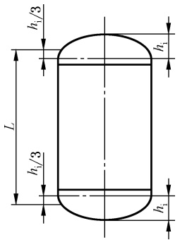

图 6-1 中 f) 中的 $L_{X}$ 指锥壳段的轴向长度，其外压计算长度取当量长度 $L_{e}$ 见 7.6.6。

a-1）外压圆筒结构1

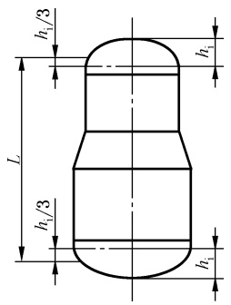

图6-1 外压圆筒的计算长度

<!-- page: 135 -->

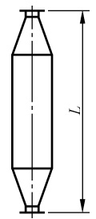

图6-1 外压圆筒的计算长度（续）

b-1) 外压圆筒结构 3

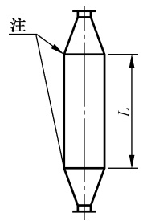

b-2）外压圆筒结构4

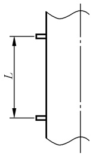

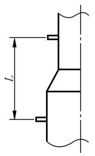

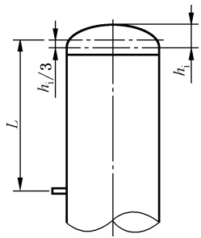

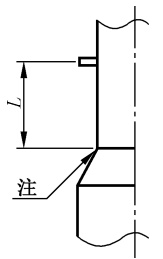

e-1）外压圆筒结构8

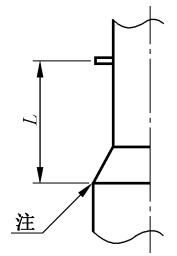

e-2）外压圆筒结构9

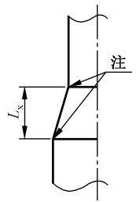

f）外压圆筒结构10

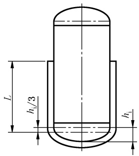

图6-1 外压圆筒的计算长度（续）

注:圆筒与锥壳连接处作为支撑线考虑。

#### 6.3.2 D_{\mathrm{o}} / \delta_{\mathrm{e}} \geqslant 20 的圆筒

#### 6.3.2.1 确定外压应变系数 A

外压应变系数 $A$ 应按步骤a)和b)进行确定:

a）根据 $L/D_{o}$ 和 $D_{o}/\delta_{e}$ 由图 6-2 或表 6-2 查取外压应变系数 A（中间值按内插法求得）；

b) 若 $L / D_{\mathrm{o}}$ 大于50，则用 $L / D_{\mathrm{o}} = 50$ 查图6-2；若 $L / D_{\mathrm{o}}$ 小于0.05，则用 $L / D_{\mathrm{o}} = 0.05$ 查图6-2。

<!-- page: 136 -->

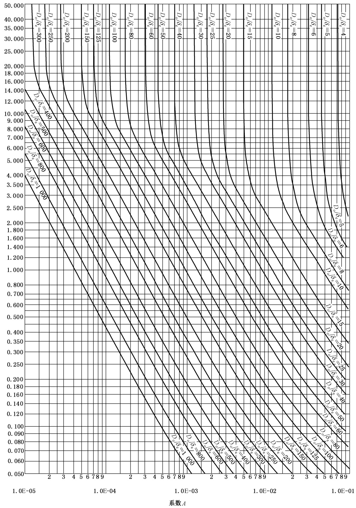

图6-2 外压应变系数 A 曲线

#### 6.3.2.2 确定外压应力系数 B

外压应变系数 $B$ 应按步骤a) $\sim \mathrm{c}$ )进行确定。

<!-- page: 137 -->

a) 按所用材料,查表 6-1 确定对应的外压应力系数 B 曲线图(图 6-3～图 6-14),由 A 查图得到 B(中间值按内插法求得)。

表 6-1 外压应力系数 B 曲线图选用表

| 序号 | 牌号或统一数字代号 | 材料标准号 | $R_{eL}(R_{p0.2}) MPa$ | 设计温度范围°C | 适用B曲线图 |
|---|---|---|---|---|---|
| 1 | Q245R | GB/T 713.2 | 245 | $\leqslant 475^a$ | 图6-5 |
| 2 | Q345R | GB/T 713.2 | 345 | $\leqslant 450^a$ | 图6-4 |
| 3 | GB/SA 516Cr70 | ASME BPVC.II.A SA-516M | 260 | $\leqslant 475^a$ | 图6-5 |
| 4 | GB/SA 537 Cl 1 | ASME BPVC.II.A SA-537M | 340 | $\leqslant 150$ | 图6-6 |
| 150~350 | 图6-5 |  |  |  |  |
| 5 | Q370R | GB/T 713.2 | 370 | $\leqslant 150$ | 图6-6 |
| 150~400 | 图6-4 |  |  |  |  |
| 6 | Q420R | GB/T 713.2 | 420 | $\leqslant 150$ | 图6-6 |
| 150~400 | 图6-4 |  |  |  |  |
| 7 | Q460R | GB/T 713.2 | 460 | $\leqslant 150$ | 图6-7 |
| 150~300 | 图6-4 |  |  |  |  |
| 8 | 18MnMoNbR | GB/T 713.2 | 400 | $\leqslant 150$ | 图6-6 |
| 150~ 450^a | 图6-4 |  |  |  |  |
| 9 | 13MnNiMoR | GB/T 713.2 | 390 | $\leqslant 150$ | 图6-6 |
| 150~400 | 图6-4 |  |  |  |  |
| 10 | 15CrMoR | GB/T 713.2 | 295 | $\leqslant 150$ | 图6-6 |
| 150~475 | 图6-5 |  |  |  |  |
| 11 | GB/SA387Gr12 Cl.2 | ASME BPVC.II.A SA-387M | 275 | $\leqslant 475$ | 图6-5 |
| 12 | 14Cr1MoR | GB/T 713.2 | 310 | $\leqslant 150$ | 图6-6 |
| 150~475 | 图6-5 |  |  |  |  |
| 13 | 12Cr2Mo1R | GB/T 713.2 | 310 | $\leqslant 150$ | 图6-6 |
| 150~475^a | 图6-5 |  |  |  |  |
| 14 | 12Cr1MoVR | GB/T 713.2 | 245 | $\leqslant 475$ | 图6-5 |
| 15 | 12Cr2Mo1VR | GB/T 713.2 | 415 | $\leqslant 150$ | 图6-6 |
| 150~475^a | 图6-5 |  |  |  |  |
| 16 | 16MnDR | GB/T 713.3 | 315 | $\leqslant 150$ | 图6-6 |
| 150~350 | 图6-5 |  |  |  |  |
| 17 | 15MnNiNbDR | GB/T 713.3 | 370 | $\leqslant 150$ | 图6-6 |
| 150~300 | 图6-4 |  |  |  |  |

<!-- page: 138 -->

表 6-1 外压应力系数 B 曲线图选用表（续）

| 序号 | 牌号或统一数字代号 | 材料标准号 | $R_{eL}(R_{p0.2}) MPa$ | 设计温度范围°C | 适用B曲线图 |
|---|---|---|---|---|---|
| 18 | Q420DR | GB/T 713.3 | 420 | ≤150 | 图6-6 |
| 150~300 | 图6-4 |  |  |  |  |
| 19 | Q460DR | GB/T 713.3 | 460 | ≤150 | 图6-6 |
| 150~300 | 图6-4 |  |  |  |  |
| 20 | 13MnNiDR | GB/T 713.3 | 345 | ≤150 | 图6-6 |
| 150~300 | 图6-4 |  |  |  |  |
| 21 | 09MnNiDR | GB/T 713.3 | 300 | ≤150 | 图6-6 |
| 150~350 | 图6-5 |  |  |  |  |
| 22 | 11MnNiMoDR | GB/T 713.3 | 440 | ≤150 | 图6-7 |
| 150~300 | 图6-4 |  |  |  |  |
| 23 | 08Ni3DR | GB/T 713.4 | 320 | ≤150 | 图6-6 |
| 150~300 | 图6-5 |  |  |  |  |
| 24 | 07Ni5DR | GB/T 713.4 | 370 | ≤150 | 图6-6 |
| 150~300 | 图6-4 |  |  |  |  |
| 25 | 06Ni7DR06Ni9DR | GB/T 713.4 | 560^b | ≤150 | 图6-7 |
| 26 | Q400GMDR | GB/T 713.5 | 400 | ≤150 | 图6-6 |
| 27 | Q490RQ490DRL1Q490DRL2Q490RW | GB/T 713.6 | 490 | ≤150 | 图6-7 |
| 150~300 | 图6-4 |  |  |  |  |
| 28 | Q580RQ580DR | GB/T 713.6 | 580^b | ≤150 | 图6-7 |
| 150~300 | 图6-4 |  |  |  |  |
| 29 | Q690RQ690DR | GB/T 713.6 | 690^b | ≤150 | 图6-7 |
| 150~300 | 图6-4 |  |  |  |  |
| 30 | 10 | GB/T 8163GB/T 6479GB/T 9948 | 205 | ≤475^a | 图6-3 |
| 31 | 20 | GB/T 8163GB/T 6479GB/T 9948 | 245 | ≤475^a | 图6-5 |
| 32 | Q345D\Q345E | GB/T 8163GB/T 6479 | 345 | ≤150 | 图6-6 |
| 150~475^a | 图6-5 |  |  |  |  |
| 33 | 12CrMo | GB/T 6479GB/T 9948 | 205 | ≤475 | 图6-3 |

<!-- page: 139 -->

表 6-1 外压应力系数 \mathbf{B} 曲线图选用表 (续)

| 序号 | 牌号或统一数字代号 | 材料标准号 | $R_{eL}(R_{p0.2}) MPa$ | 设计温度范围°C | 适用B曲线图 |
|---|---|---|---|---|---|
| 34 | 15CrMo | GB/T 6479GB/T 9948 | 235 | ≤475 | 图6-5 |
| 35 | 12Cr1MoV | GB/T 9948 | 255 | ≤475 | 图6-5 |
| 36 | 12Cr2Mo | GB/T 6479GB/T 9948 | 280 | ≤150 | 图6-6 |
| 150~475^a | 图6-5 |  |  |  |  |
| 37 | 12Cr5Mo | GB/T 6479 | 195(退火) | ≤475^a | 图6-3 |
| 38 | 12Cr5Mo1 | GB/T 9948 | 205(退火) | ≤475^a | 图6-3 |
| 39 | 08Cr2AlMo | GB/T 150.2—2024附录A | 250 | ≤300 | 图6-5 |
| 40 | 09CrCuSb | GB/T 150.2—2024附录A | 245 | ≤300 | 图6-5 |
| 41 | 16MnD | NB/T 47019.4 | 325 | ≤350 | 图6-5 |
| 42 | 09MnD09MnNiD | NB/T 47019.4 | 270 | ≤350 | 图6-5 |
| 43 | 08Ni3MoD | NB/T 47019.4 | 260 | ≤250 | 图6-5 |
| 44 | 20 | NB/T 47008 | 235 | ≤475^a | 图6-5 |
| 45 | 16Mn | NB/T 47008 | 305 | ≤150 | 图6-6 |
| 150~475^a | 图6-5 |  |  |  |  |
| 46 | 08Cr2AlMo | NB/T 47008 | 250 | ≤300 | 图6-5 |
| 47 | 09CrCuSb | NB/T 47008 | 245 | ≤300 | 图6-5 |
| 48 | 20MnMo | NB/T 47008 | 370 | ≤150 | 图6-6 |
| 150~475^a | 图6-5 |  |  |  |  |
| 49 | 20MnMoNb | NB/T 47008 | 470 | ≤150 | 图6-7 |
| 150~475^a | 图6-5 |  |  |  |  |
| 50 | 20MnNiMo | NB/T 47008 | 450 | ≤150 | 图6-7 |
| 150~450 | 图6-5 |  |  |  |  |
| 51 | 15NiCuMoNb | NB/T 47008 | 440 | ≤150 | 图6-7 |
| 150~450 | 图6-5 |  |  |  |  |
| 52 | 12CrMo | NB/T 47008 | 255 | ≤475 | 图6-5 |
| 53 | 15CrMo | NB/T 47008 | 280 | ≤150 | 图6-6 |
| 150~475 | 图6-5 |  |  |  |  |

<!-- page: 140 -->

表 6-1 外压应力系数 B 曲线图选用表（续）

| 序号 | 牌号或统一数字代号 | 材料标准号 | $R_{eL}(R_{p0.2}) MPa$ | 设计温度范围°C | 适用B曲线图 |
|---|---|---|---|---|---|
| 54 | 14Cr1Mo | NB/T 47008 | 290 | ≤150 | 图6-6 |
| 150~475 | 图6-5 |  |  |  |  |
| 55 | 12Cr2Mo1 | NB/T 47008 | 310 | ≤150 | 图6-6 |
| 150~475^a | 图6-5 |  |  |  |  |
| 56 | 12Cr1MoV | NB/T 47008 | 280 | ≤150 | 图6-6 |
| 150~475 | 图6-5 |  |  |  |  |
| 57 | 12Cr2MolV | NB/T 47008 | 420 | ≤150 | 图6-6 |
| 150~475^a | 图6-5 |  |  |  |  |
| 58 | 12Cr3MolV | NB/T 47008 | 420 | ≤150 | 图6-6 |
| 150~475^a | 图6-5 |  |  |  |  |
| 59 | 12Cr5Mo | NB/T 47008 | 390 | ≤150 | 图6-6 |
| 150~475^a | 图6-5 |  |  |  |  |
| 60 | 10Cr9Mo1VNbN | NB/T 47008 | 415 | ≤150 | 图6-6 |
| 150~475 | 图6-5 |  |  |  |  |
| 61 | 10Cr9MoW2VNbBN | NB/T 47008 | 440^b | ≤150 | 图6-6 |
| 150~475 | 图6-5 |  |  |  |  |
| 62 | 16MnD | NB/T 47009 | 305 | ≤150 | 图6-6 |
| 150~350 | 图6-5 |  |  |  |  |
| 63 | 20MnMoD | NB/T 47009 | 370 | ≤150 | 图6-6 |
| 150~350 | 图6-5 |  |  |  |  |
| 64 | 08MnNiMoVD | NB/T 47009 | 480 | ≤150 | 图6-7 |
| 150~300 | 图6-5 |  |  |  |  |
| 65 | 10Ni3MoVD | NB/T 47009 | 480 | ≤150 | 图6-7 |
| 150~300 | 图6-5 |  |  |  |  |
| 66 | 09MnNiD | NB/T 47009 | 280 | ≤150 | 图6-6 |
| 150~350 | 图6-5 |  |  |  |  |
| 67 | 08Ni3D | NB/T 47009 | 260 | ≤150 | 图6-6 |
| 150~350 | 图6-5 |  |  |  |  |
| 68 | 06Ni9D | NB/T 47009 | 550^b | ≤150 | 图6-7 |
| 150~300 | 图6-5 |  |  |  |  |
| 69 | S11306 | 注1 | 205 | ≤400 | 图6-5 |
| 70 | S11348 | 170 | ≤400 | 图6-3 |  |
| 71 | S11972 | 275 | ≤400 | 图6-5 |  |

<!-- page: 141 -->

表 6-1 外压应力系数 \mathbf{B} 曲线图选用表 (续)

| 序号 | 牌号或统一数字代号 | 材料标准号 | $R_{eL}(R_{p0.2}) MPa$ | 设计温度范围°C | 适用B曲线图 |
|---|---|---|---|---|---|
| 72 | S21953 | 注1 | 440 | ≤345 | 图6-12 |
| 73 | S22153 | 450 | ≤300 | 图6-12 |  |
| 74 | S22253 | 450 | ≤345 | 图6-12 |  |
| 75 | S22053 | 450 | ≤345 | 图6-12 |  |
| 76 | S22294 | 450 | ≤345 | 图6-12 |  |
| 77 | S23043 | 400 | ≤350 | 图6-13 |  |
| 78 | S25554 | 550 | ≤345 | 图6-12 |  |
| 79 | S25073 | 550 | ≤345 | 图6-12 |  |
| 80 | S27603 | 550 | ≤250 | 图6-14 |  |
| 81 | S30408 | 205 | $\leqslant 650^a$ | 图6-8 |  |
| 82 | S30403 | 175 | ≤425 | 图6-10 |  |
| 83 | S30409 | 205 | $\leqslant 650^a$ | 图6-8 |  |
| 84 | S30450 | 290 | ≤600 | 图6-13 |  |
| 85 | S30458 | 240 | $\leqslant 650^a$ | 图6-8 |  |
| 86 | S30453 | 205 | ≤500 | 图6-8 |  |
| 87 | S30478 | 275 | ≤500 | 图6-8 |  |
| 88 | S30859 | 310 | ≤600 | 图6-13 |  |
| 89 | S30908 | 205 | $\leqslant 650^a$ | 图6-8 |  |
| 90 | S31008 | 205 | $\leqslant 650^a$ | 图6-9 |  |
| 91 | S31252 | 310 | ≤450 | 图6-9 |  |
| 92 | S31608 | 205 | $\leqslant 650^a$ | 图6-9 |  |
| 93 | S31603 | 175 | ≤425 | 图6-11 |  |
| 94 | S31609 | 205 | $\leqslant 650^a$ | 图6-9 |  |
| 95 | S31653 | 205 | $\leqslant 650^a$ | 图6-9 |  |
| 96 | S31658 | 240 | $\leqslant 650^a$ | 图6-9 |  |
| 97 | S31668 | 205 | $\leqslant 650^a$ | 图6-9 |  |
| 98 | S31708 | 205 | $\leqslant 650^a$ | 图6-9 |  |
| 99 | S31703 | 205 | ≤425 | 图6-11 |  |
| 100 | S31782 | 220 | ≤350 | 图6-9 |  |
| 101 | S32168 | 205 | $\leqslant 650^a$ | 图6-9 |  |
| 102 | S32169 | 205 | $\leqslant 650^a$ | 图6-9 |  |
| 103 | S34778 | 205 | $\leqslant 650^a$ | 图6-9 |  |
| 104 | S34779 | 205 | $\leqslant 650^a$ | 图6-9 |  |

<!-- page: 142 -->

表 6-1 外压应力系数 B 曲线图选用表 (续)

| 序号 | 牌号或统一数字代号 | 材料标准号 | $R_{\text{eL}}(R_{\text{p0.2}}) MPa$ | 设计温度范围°C | 适用B曲线图 |
|---|---|---|---|---|---|
| 105 | S35656 | 注1 | 220 | $\leqslant 350$ | 图6-9 |
| 106 | S39042 | 220 | $\leqslant 350$ | 图6-9 |  |
| 107 | S41008 | 210 | $\leqslant 400$ | 图6-5 |  |
| 注1:指所选定统一数字代号的钢板、管材或锻件在GB/T 150.2—2024表C.2、表C.4、表C.6中所列出的标准号。注2:本表中B曲线图对应的曲线数据表见表6-2~表6-14。 |  |  |  |  |  |
| ^a 本表中指定的外压B曲线仅适用于不考虑蠕变屈曲失效模式的屈曲计算。若设备长时间在高温使用时,外压B曲线最高设计温度不应超过GB/T 150.2—2024表C.1~表C.6中“粗实线”所对应的温度。 ^b 若材料的屈服强度超过外压B曲线图中标记的最高值,则按图中屈服强度标记最高值的外压B曲线查取。 |  |  |  |  |  |

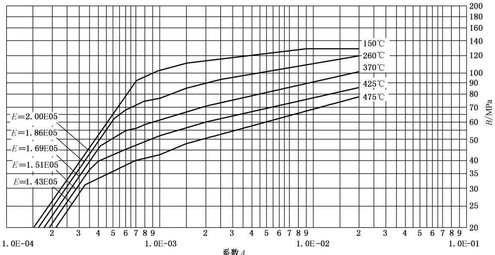

图6-3 外压应力系数 B 曲线1

<!-- page: 143 -->

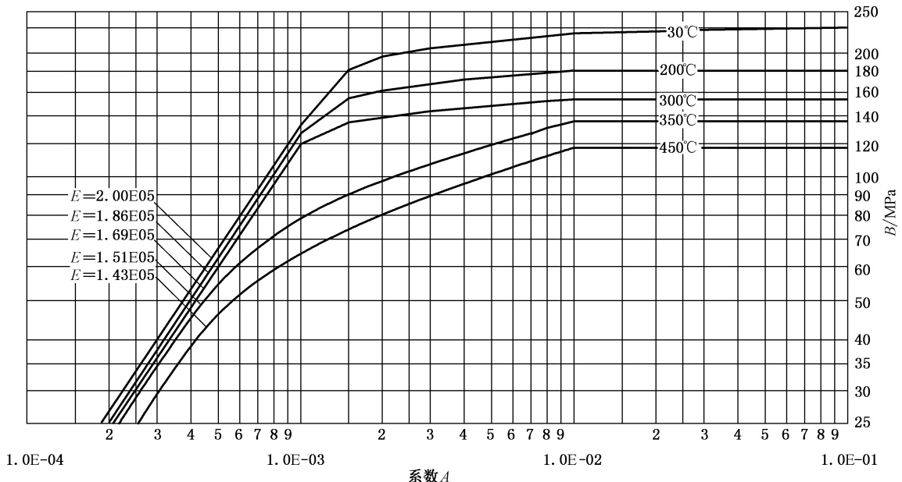

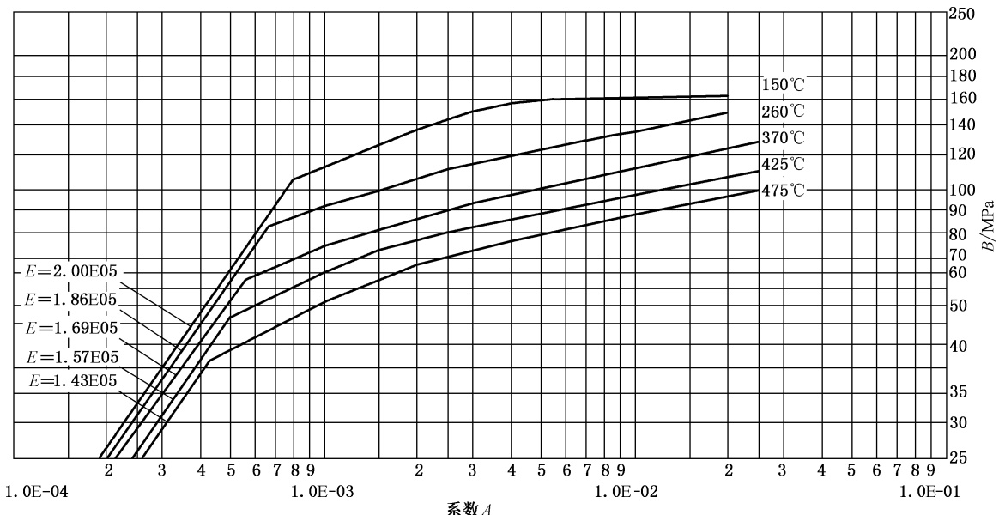

注:用于除图6-4外，材料的屈服强度 R_{\mathrm{eL}} > 207 \mathrm{MPa} 的非合金钢、合金钢和S11306钢等。

<!-- page: 144 -->

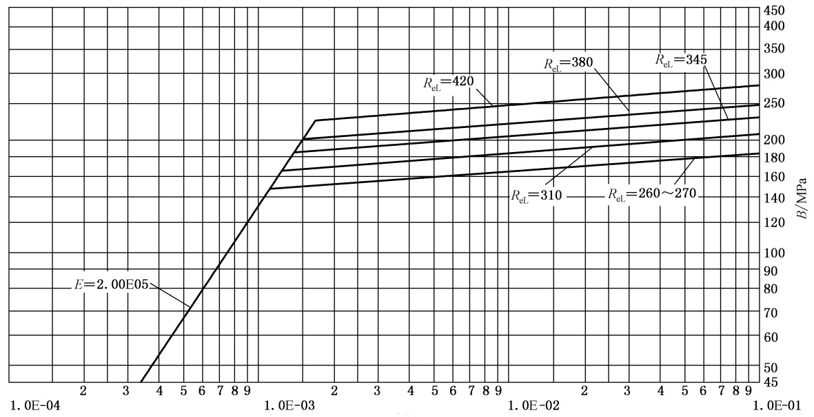

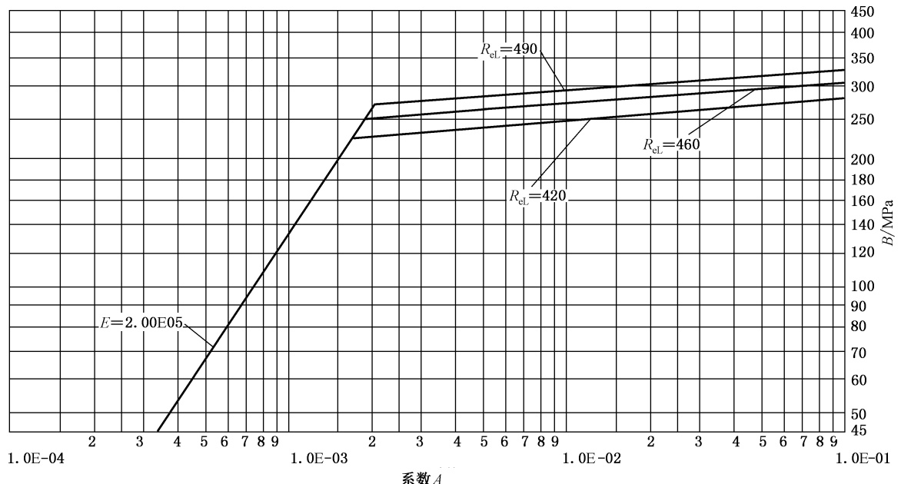

注:用于设计温度不大于 150^{\circ}\mathrm{C}，材料的屈服强度 420 < R_{\mathrm{eL}} \leqslant 490 \mathrm{MPa} 的非合金钢、低合金钢等。

<!-- page: 145 -->

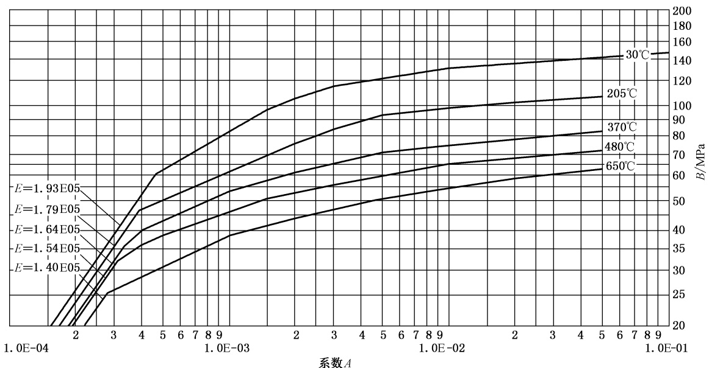

图6-9 外压应力系数 $B$ 曲线7

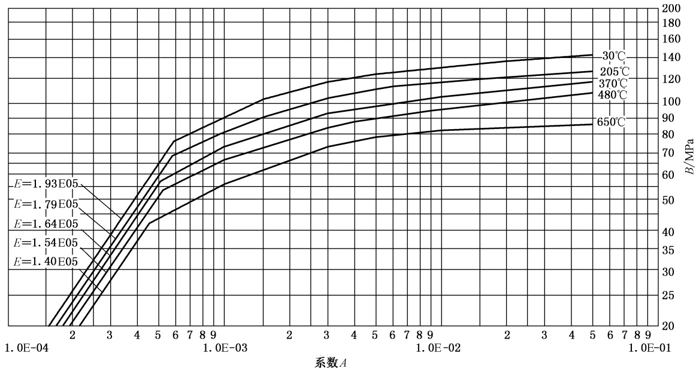

图6-8 外压应力系数 B 曲线6

<!-- page: 146 -->

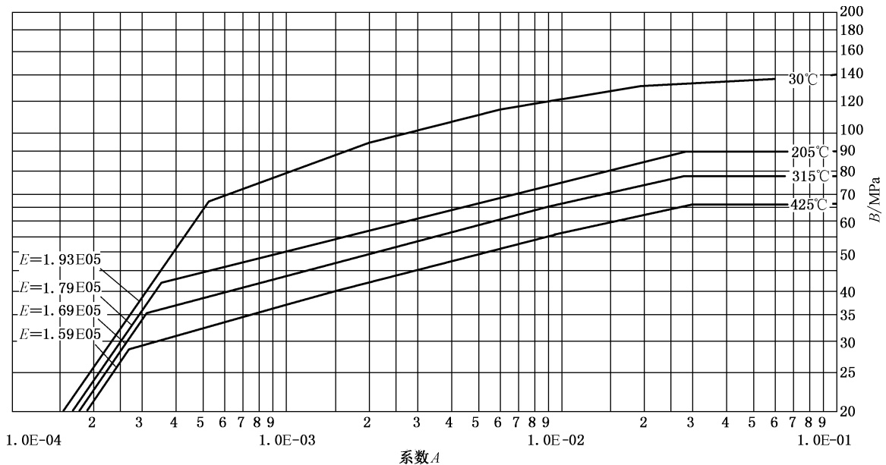

图6-11 外压应力系数 $B$ 曲线9

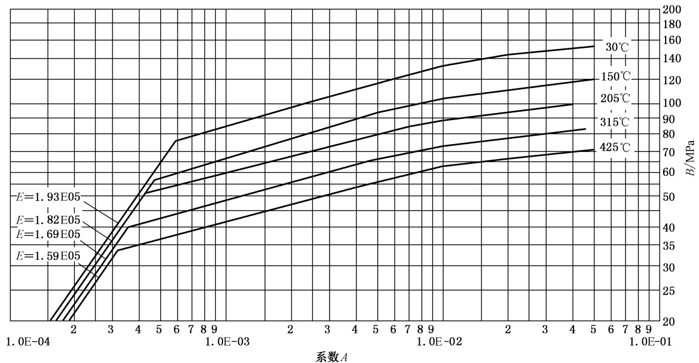

图6-10 外压应力系数 B 曲线8

<!-- page: 147 -->

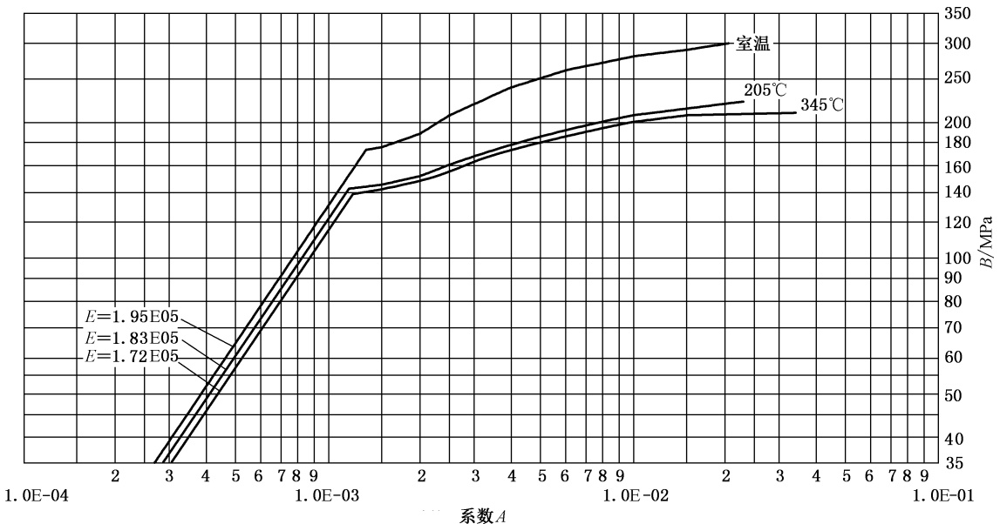

图6-13 外压应力系数 $B$ 曲线11

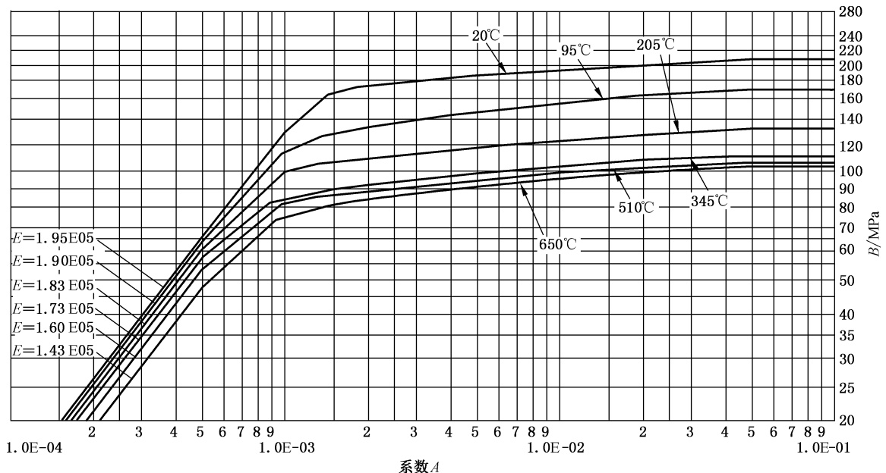

图6-12 外压应力系数 B 曲线10

<!-- page: 148 -->

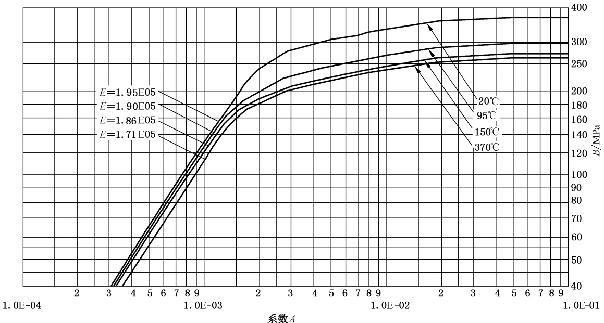

图6-14 外压应力系数 $B$ 曲线12

b) 若 $A$ 超出设计温度曲线的最大值, 则取对应温度曲线右端点的纵坐标值为 $B$ 。

c) 若 $A$ 小于设计温度曲线的最小值, 则按公式(6-1)计算 $B$:

$$ B = \frac {2 A E ^ {\mathrm{t}}}{3}\tag{6-1} $$

#### 6.3.2.3 确定许用外压力 [p]

根据 B, 按公式(6-2)计算许用外压力[p]:

$$ \left[ p \right] = \frac {B}{D _ {\mathrm{o}} / \delta_ {\mathrm{e}}}\tag{6-2} $$

计算得到的 $[p]$ 应大于或等于 $p_{\mathrm{c}}$ ，否则须调整设计参数，重复上述计算，直到满足为止。

#### 6.3.3 D_{\mathrm{o}} / \delta_{\mathrm{e}} < 20 的圆筒

#### 6.3.3.1 确定外压应变系数 A

外压应变系数 $A$ 应按下列步骤确定:

a）对 $D_{\mathrm{o}} / \delta_{\mathrm{e}} \geqslant 4.0$ 的圆筒，用与6.3.2.1相同的步骤得到外压应变系数 $A$；

b) 对 $D_{\mathrm{o}} / \delta_{\mathrm{e}} < 4.0$ 的圆筒，按公式(6-3)计算系数 $A$ :

$$ A = \frac {1 . 1}{(D _ {\mathrm{o}} / \delta_ {\mathrm{e}}) ^ {2}}\tag{6-3} $$

当系数 A>0.1 时，A 取 0.1。

#### 6.3.3.2 确定外压应力系数 B

用与6.3.2.2相同的步骤得到系数 $B$ 。

#### 6.3.3.3 确定许用外压力 [p]

按公式(6-4)计算许用外压力[p]:

<!-- page: 149 -->

$$ [ p ] = \min \left\{\left(\frac {2 . 2 5}{D _ {\mathrm{o}} / \delta_ {\mathrm{e}}} - 0. 0 6 2 5\right) B, \frac {2 \sigma_ {0}}{D _ {\mathrm{o}} / \delta_ {\mathrm{e}}} \left(1 - \frac {1}{D _ {\mathrm{o}} / \delta_ {\mathrm{e}}}\right) \right\}\tag{6-4} $$

式中，$\sigma_0$ 取以下两值中的较小值:

a) $\sigma_0 = 2[\sigma]^{\mathrm{t}}$

b) $\sigma_{0}=0.9R_{eL}^{t}$ 或 $0.9R_{p0.2}^{t}$

计算得到的 $[p]$ 应大于或等于 $p_{c}$ ，否则须调整设计参数，重复上述计算，直到满足为止。

### 6.4 外压球壳的计算

#### 6.4.1 确定外压应变系数 A

根据 $R_{o}/\delta_{e}$ ，用公式(5-5)计算系数 A:

$$ A = \frac {0 . 1 2 5}{(R _ {\mathrm{o}} / \delta_ {\mathrm{e}})}\tag{6-5} $$

#### 6.4.2 确定外压应力系数 B

外压应力系数 $B$ 应按下列步骤确定:

a）按所用材料，查表6-1确定对应的外压应力系数 $B$ 曲线图，由 $A$ 查取 $B$ （遇中间值用内插法）；

b) 若 $A$ 超出设计温度曲线的最大值, 则取对应温度曲线右端点的纵坐标值为 $B$;

c) 若 $A$ 小于设计温度曲线的最小值，则按公式(6-1)计算 $B$。

#### 6.4.3 确定许用外压力 [p]

根据 B, 按公式(6-6)计算许用外压力[p]:

$$ [ p ] = \frac {B}{(R _ {\mathrm{o}} / \delta_ {\mathrm{e}})}\tag{\( \cdots(6-6) \} $$

计算得到的 $[p]$ 应大于或等于 $p_{\mathrm{c}}$ ，否则应调整设计参数，重复上述计算，直到满足为止。

### 6.5 外压圆筒加强圈的设计

#### 6.5.1 加强圈的计算

#### 6.5.1.1 惯性矩计算

选定加强圈材料与截面尺寸,计算其横截面积 $A_{s}$ 和加强圈与圆筒有效段组合截面的惯性矩 $I_{s}$ ,圆筒有效段指在加强圈中心线两侧有效宽度各为 $0.55\sqrt{D_{o}\delta_{e}}$ 的壳体。

若加强圈中心线两侧圆筒有效宽度与相邻加强圈的圆筒有效宽度相重叠,则该圆筒的有效宽度中相重叠部分每侧按一半计算。

#### 6.5.1.2 确定外压应力系数 B

按公式(6-7)计算 B:

$$ B = \frac {P _ {\mathrm{c}} D _ {\mathrm{o}}}{\delta_ {\mathrm{e}} + (A _ {\mathrm{s}} / L _ {\mathrm{s}})}\tag{6-7} $$

#### 6.5.1.3 确定外压应变系数 A

外压应变系数 $A$ 按下列步骤确定:

a) 按筒体所用材料,查表 6-1 确定对应的外压应力系数 $B$ 曲线图,由 $B$ 查取 $A$(遇中间值用内插法);

b) 若 $B$ 超出设计温度曲线的最大值, 则取对应温度曲线右端点的横坐标值为 $A$;

<!-- page: 150 -->

c) 若 $B$ 小于设计温度曲线的最小值, 则按公式(6-8)计算 $A$:

$$ A = \frac {3 B}{2 E},\tag{6-8} $$

#### 6.5.1.4 确定所需的惯性矩 I

按公式(6-9)计算加强圈与圆筒组合段所需的惯性矩 $I$ :

$$ I = \frac {D _ {\mathrm{o}} ^ {2} L _ {\mathrm{s}} (\delta_ {\mathrm{e}} + A _ {\mathrm{s}} / L _ {\mathrm{s}})}{1 0 . 9} A\tag{6-9} $$

$I_{\mathrm{s}}$ 应大于或等于 $I$ ，否则选用较大惯性矩的加强圈，重复上述步骤，直到 $I_{\mathrm{s}}$ 大于且接近 $I$ 为止。

#### 6.5.2 加强圈的设置

6.5.2.1 加强圈可设置在容器的内部或外部，应整圈围绕在圆筒的圆周上。加强圈两端的接合形式应按图6-15中A、B所示。

间隙(不应超过圆筒名义厚度的8倍)

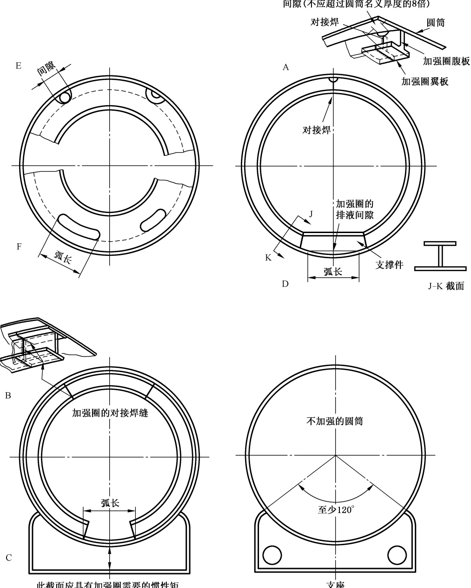

图6-15 外压容器加强圈的各种布置图

<!-- page: 151 -->

6.5.2.2 容器内部的加强圈,若布置成图 6-15 中 C、D、E 或 F 所示的结构时,则应取具有最小惯性矩的截面进行计算。

6.5.2.3 在加强圈上需要留出如图 6-15 中 D、E 及 F 所示的间隙时, 则不应超过图 6-16 规定的弧长, 否则应将容器内部和外部的加强圈相邻两部分接合起来, 采用如图 6-15 中 C 所示的结构。但若能同时满足以下条件者可以除外。

a）每圈只允许一处无支撑的壳体弧长。

b) 无支撑的壳体弧长不超过 $90^{\circ}$ 。

c）相邻两加强圈的不受支撑的圆筒弧长相互交错 $180^{\circ}$。

d) 圆筒计算长度 $L$ 应取下列数值中的较大者:

——相间隔加强圈之间的最大距离；

——从封头切线至第二个加强圈中心的距离再加上 1/3 封头曲面深度。

6.5.2.4 容器内部的构件如塔盘支撑圈等,若设计成起加强作用时,也可作加强圈用。

6.5.2.5 加强圈与圆筒之间可采用连续或间断焊接,当加强圈设置在容器外面时,加强圈每侧间断焊接的总长,应不少于圆筒外圆周长的 1/2,当设置在容器里面时,应不少于圆筒内圆周长的 1/3。焊脚尺寸不应小于焊接件中较薄件的厚度。

间断焊缝的布置与间距可参照图6-17所示的型式，间断焊缝可以相互错开或并排布置。最大间隙$t$ ，对外加强圈为 $8\delta_{\mathrm{n}}$ ，对内加强圈为 $12\delta_{\mathrm{n}}$ 。

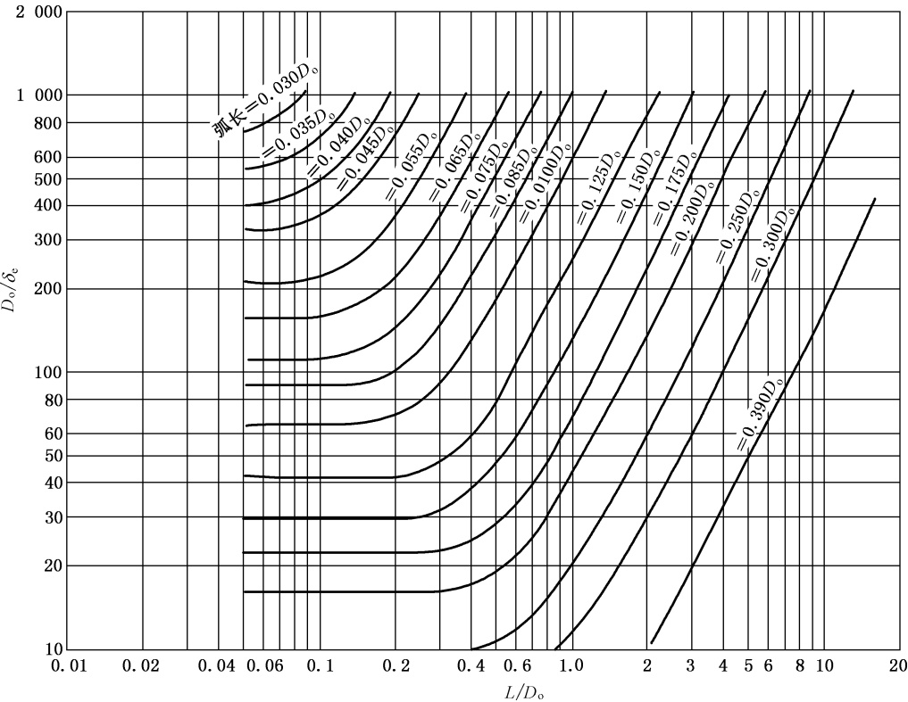

图6-16 圆筒上加强圈允许的间断弧长值

<!-- page: 152 -->

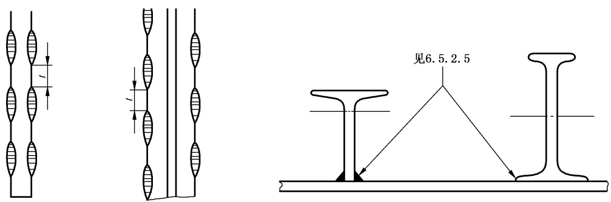

图6-17 加强圈与圆筒的连接

#### 6.5.2.6 加强圈结构的截面尺寸要求

图 6-18 所示的扁钢、角钢和 T 型钢的加强圈结构的截面尺寸应符合公式(6-10)和公式(6-11)要求。

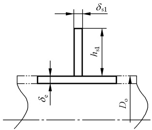

图 6-18 所示的扁钢、角钢和 T 型钢的加强圈结构的截面尺寸应符合公式(6-10)和公式(6-11)要求。

a) 扁钢

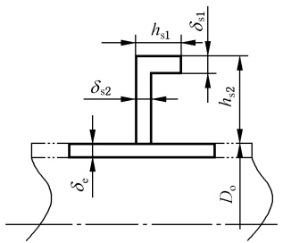

b) 角钢

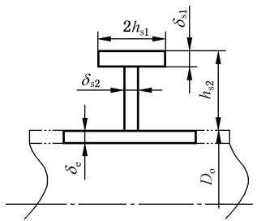

图6-18 加强圈结构的截面尺寸

$$ \begin{array}{c} \frac {h _ {\mathrm{s} 1}}{\delta_ {\mathrm{s} 1}} \leqslant 0. 3 7 5 \left(\frac {E ^ {\mathrm{t}}}{R _ {\mathrm{eL}} ^ {\mathrm{t}}}\right) ^ {0. 5} \\ \frac {h _ {\mathrm{s} 2}}{\delta_ {\mathrm{s} 2}} \leqslant \left(\frac {E ^ {\mathrm{t}}}{R _ {\mathrm{eL}} ^ {\mathrm{t}}}\right) ^ {0. 5} \end{array}\tag{6-10} $$

(6-11)

表6-2 图6-2的曲线数据表

| $D_o/\delta_e$ | L/D_o | A | $D_o/\delta_e$ | L/D_o | A | $D_o/\delta_e$ | L/D_o | A |
|---|---|---|---|---|---|---|---|---|
| 4 | 2.2 | 9.59E-02 | 5 | 7 | 4.65 | 8 | 0.8 | 8.75 |
| 2.6 | 8.84 | 10 | 4.59 | 1 | 6.60 |  |  |  |
| 3 | 8.39 | 30 | 4.54 | 1.6 | 3.72 |  |  |  |
| 4 | 7.83 | 50 | 4.53 | 2 | 2.85 |  |  |  |
| 5 | 7.59 | 6 | 1.2 | 8.37E-02 | 2.4 | 2.42 |  |  |
| 7 | 7.39 | 1.6 | 5.84 | 3 | 2.12 |  |  |  |
| 10 | 7.29 | 2 | 4.69 | 4 | 1.92 |  |  |  |
| 30 | 7.20 | 2.4 | 4.11 | 5 | 1.84 |  |  |  |
| 50 | 7.20 | 3 | 3.69 | 7 | 1.79 |  |  |  |
| 5 | 1.4 | 9.29E-02 | 4 | 3.41 | 10 | 1.76 |  |  |
| 1.6 | 8.02 | 5 | 3.29 | 20 | 1.74 |  |  |  |
| 2 | 6.58 | 7 | 3.20 | 50 | 1.74 |  |  |  |
| 2.4 | 5.86 | 10 | 3.16 | 10 | 0.56 | 9.64E-02 |  |  |
| 3 | 5.32 | 30 | 3.12 | 0.7 | 7.20 |  |  |  |
| 4 | 4.94 | 50 | 3.12 | 1 | 4.63 |  |  |  |
| 5 | 4.78 | 8 | 0.74 | 9.68E-02 | 1.2 | 3.71 |  |  |

<!-- page: 153 -->

表 6-2 图 6-2 的曲线数据表（续）

| $D_o/\delta_e$ | L/D_o | A | $D_o/\delta_e$ | L/D_o | A | $D_o/\delta_e$ | L/D_o | A |
|---|---|---|---|---|---|---|---|---|
| 10 | 2 | 2.01 | 25 | 3 | 3.23 | 40 | 50 | 6.88 |
| 2.4 | 1.65 | 3.4 | 2.78 | 50 | 0.088 | 9.30E-02 |  |  |
| 3 | 1.39 | 4 | 2.35 | 0.1 | 7.82 |  |  |  |
| 4 | 1.24 | 4.4 | 2.19 | 0.2 | 2.63 |  |  |  |
| 5 | 1.18 | 5 | 2.04 | 0.3 | 1.54 |  |  |  |
| 7 | 1.14 | 6 | 1.91 | 0.4 | 1.08 |  |  |  |
| 10 | 1.12 | 7 | 1.86 | 0.6 | 6.77E-03 |  |  |  |
| 16 | 1.11 | 10 | 1.80 | 0.8 | 4.90 |  |  |  |
| 50 | 1.11 | 30 | 1.76 | 1 | 3.84 |  |  |  |
| 15 | 0.34 | 9.68E-02 | 50 | 1.76 | 2 | 1.71 |  |  |
| 0.4 | 7.70 | 30 | 0.16 | 9.04E-02 | 4 | 8.42E-04 |  |  |
| 0.6 | 4.53 | 2 | 6.35 | 5 | 6.52 |  |  |  |
| 1 | 2.44 | 0.3 | 3.57 | 6 | 5.48 |  |  |  |
| 1.2 | 1.97 | 0.4 | 2.46 | 7 | 5.02 |  |  |  |
| 2 | 1.09 | 0.6 | 1.50 | 8 | 4.78 |  |  |  |
| 2.4 | 8.90E-03 | 0.8 | 1.08 | 10 | 4.58 |  |  |  |
| 3 | 6.91 | 1 | 8.38E-03 | 12 | 4.49 |  |  |  |
| 4 | 5.73 | 1.2 | 6.83 | 16 | 4.44 |  |  |  |
| 5 | 5.34 | 2 | 3.88 | 40 | 4.40 |  |  |  |
| 6 | 5.16 | 3 | 2.46 | 50 | 4.40 |  |  |  |
| 10 | 4.97 | 4 | 1.77 | 60 | 0.074 | 9.54E-02 |  |  |
| 40 | 4.90 | 4.4 | 1.61 | 0.1 | 5.56 |  |  |  |
| 50 | 4.90 | 5 | 1.47 | 0.14 | 3.23 |  |  |  |
| 20 | 0.24 | 9.82E-02 | 6 | 1.36 | 0.2 | 1.93 |  |  |
| 0.4 | 4.77 | 7 | 1.30 | 0.4 | 8.12E-03 |  |  |  |
| 0.6 | 2.86 | 10 | 1.25 | 0.6 | 5.10 |  |  |  |
| 0.8 | 2.03 | 30 | 1.22 | 0.8 | 3.71 |  |  |  |
| 1 | 1.56 | 50 | 1.22 | 1 | 2.91 |  |  |  |
| 1.2 | 1.27 | 40 | 0.12 | 8.64E-02 | 2 | 1.38 |  |  |
| 2 | 7.13E-03 | 0.2 | 3.85 | 3 | 8.86E-04 |  |  |  |
| 3 | 4.46 | 0.3 | 2.22 | 4 | 6.45 |  |  |  |
| 3.4 | 3.88 | 0.4 | 1.55 | 6 | 4.09 |  |  |  |
| 4 | 3.42 | 0.6 | 9.58E-03 | 7 | 3.64 |  |  |  |
| 5 | 3.08 | 0.8 | 6.91 | 8 | 3.41 |  |  |  |
| 7 | 2.87 | 1 | 5.39 | 10 | 3.22 |  |  |  |
| 10 | 2.80 | 1.2 | 4.41 | 14 | 3.10 |  |  |  |
| 40 | 2.75 | 2 | 2.52 | 40 | 3.06 |  |  |  |
| 50 | 2.75 | 4 | 1.17 | 50 | 3.06 |  |  |  |
| 25 | 0.2 | 8.77E-02 | 5 | 9.12E-04 | 80 | 0.054 | 9.90E-02 |  |
| 0.3 | 4.84 | 6 | 8.04 | 0.07 | 6.08 |  |  |  |
| 0.5 | 2.50 | 7 | 7.56 | 0.09 | 3.91 |  |  |  |
| 0.8 | 1.43 | 8 | 7.31 | 0.1 | 3.28 |  |  |  |
| 1 | 1.11 | 10 | 7.08 | 0.14 | 1.96 |  |  |  |
| 1.2 | 9.02E-03 | 16 | 6.92 | 0.2 | 1.20 |  |  |  |
| 2 | 5.08 | 40 | 6.88 | 0.24 | 9.50E-03 |  |  |  |

<!-- page: 154 -->

表 6-2 图 6-2 的曲线数据表（续）

| $D_o/\delta_e$ | L/D_o | A | $D_o/\delta_e$ | L/D_o | A | $D_o/\delta_e$ | L/D_o | A |
|---|---|---|---|---|---|---|---|---|
| 80 | 0.4 | 5.16 | 125 | 14 | 7.40 | 250 | 0.05 | 1.29E-02 |
| 0.6 | 3.28 | 20 | 7.13 | 0.06 | 9.55E-03 |  |  |  |
| 0.8 | 2.39 | 40 | 7.04 | 0.08 | 6.17 |  |  |  |
| 1 | 1.88 | 50 | 7.04 | 0.1 | 4.52 |  |  |  |
| 2 | 8.95E-04 | 150 | 0.05 | 3.38E-02 | 0.14 | 2.93 |  |  |
| 4 | 4.24 | 0.06 | 2.44 | 0.2 | 1.91 |  |  |  |
| 6.6 | 2.41 | 0.08 | 1.51 | 0.4 | 8.81E-04 |  |  |  |
| 8 | 2.05 | 0.1 | 1.08 | 0.6 | 5.72 |  |  |  |
| 10 | 1.86 | 0.12 | 8.33E-03 | 0.8 | 4.22 |  |  |  |
| 14 | 1.76 | 0.16 | 5.69 | 1 | 3.35 |  |  |  |
| 30 | 1.72 | 0.2 | 4.31 | 2 | 1.63 |  |  |  |
| 50 | 1.72 | 0.4 | 1.94 | 4 | 7.89E-05 |  |  |  |
| 100 | 0.05 | 7.41E-02 | 0.6 | 1.25 | 6 | 5.13 |  |  |
| 0.07 | 3.98 | 1 | 7.26E-05 | 8 | 3.77 |  |  |  |
| 0.1 | 2.20 | 2 | 3.49 | 10 | 2.93 |  |  |  |
| 0.14 | 1.33 | 4 | 1.68 | 12 | 2.38 |  |  |  |
| 0.2 | 8.31E-03 | 6 | 1.08 | 14 | 2.10 |  |  |  |
| 0.4 | 3.64 | 8 | 7.87E-05 | 16 | 1.96 |  |  |  |
| 0.5 | 2.83 | 10 | 6.19 | 20 | 1.84 |  |  |  |
| 0.8 | 1.70 | 12 | 5.53 | 40 | 1.76 |  |  |  |
| 1 | 1.34 | 16 | 5.10 | 50 | 1.76 |  |  |  |
| 2 | 6.41E-04 | 20 | 4.98 | 300 | 0.05 | 9.23E-03 |  |  |
| 4 | 3.05 | 40 | 4.89 | 0.06 | 6.90 |  |  |  |
| 6 | 1.95 | 50 | 4.89 | 0.08 | 4.52 |  |  |  |
| 8 | 1.42 | 200 | 0.05 | 1.96E-02 | 0.1 | 3.34 |  |  |
| 10 | 1.24 | 0.06 | 1.43 | 0.12 | 2.64 |  |  |  |
| 14 | 1.14 | 0.08 | 9.09E-03 | 0.2 | 1.43 |  |  |  |
| 25 | 1.10 | 0.1 | 6.59 | 0.4 | 6.66E-04 |  |  |  |
| 50 | 1.10 | 0.14 | 4.21 | 0.6 | 4.33 |  |  |  |
| 125 | 0.05 | 4.80E-02 | 0.2 | 2.72 | 0.8 | 3.21 |  |  |
| 0.06 | 3.44 | 0.3 | 1.71 | 1 | 2.54 |  |  |  |
| 0.08 | 2.10 | 0.5 | 9.76E-04 | 2 | 1.24 |  |  |  |
| 0.1 | 1.48 | 0.8 | 5.92 | 4 | 6.02E-05 |  |  |  |
| 0.14 | 9.17E-03 | 1 | 4.69 | 6 | 3.93 |  |  |  |
| 0.2 | 5.78 | 2 | 2.27 | 8 | 2.87 |  |  |  |
| 0.4 | 2.57 | 4 | 1.10 | 10 | 2.25 |  |  |  |
| 0.6 | 1.65 | 6 | 7.11E-05 | 14 | 1.56 |  |  |  |
| 0.8 | 1.21 | 8 | 5.20 | 16 | 1.42 |  |  |  |
| 1 | 9.55E-04 | 10 | 4.03 | 20 | 1.30 |  |  |  |
| 2 | 4.59 | 12 | 3.38 | 40 | 1.23 |  |  |  |
| 4 | 2.20 | 14 | 3.09 | 50 | 1.22 |  |  |  |
| 6 | 1.41 | 16 | 2.95 | 400 | 0.05 | 5.49E-03 |  |  |
| 9 | 9.04E-05 | 20 | 2.83 | 0.06 | 4.17 |  |  |  |
| 10 | 8.37 | 40 | 2.75 | 0.08 | 2.78 |  |  |  |
| 12 | 7.70 | 50 | 2.75 | 0.1 | 2.08 |  |  |  |

<!-- page: 155 -->

表 6-2 图 6-2 的曲线数据表（续）

| $D_o/\delta_e$ | L/D_o | A | $D_o/\delta_e$ | L/D_o | A | $D_o/\delta_e$ | L/D_o | A |
|---|---|---|---|---|---|---|---|---|
| 400 | 0.12 | 1.66 | 500 | 2 | 5.79E-05 | 800 | 0.1 | 6.82 |
| 0.16 | 1.18 | 4 | 2.82 | 0.12 | 5.51 |  |  |  |
| 0.2 | 9.14E-04 | 6 | 1.85 | 0.16 | 3.98 |  |  |  |
| 0.4 | 4.29 | 8 | 1.37 | 0.2 | 3.12 |  |  |  |
| 0.6 | 2.80 | 10 | 1.07 | 0.4 | 1.49 |  |  |  |
| 0.8 | 2.07 | 12 | 8.80E-06 | 0.6 | 9.80E-05 |  |  |  |
| 1 | 1.65 | 600 | 0.05 | 2.70E-03 | 0.8 | 7.28 |  |  |
| 2 | 8.08E-05 | 0.06 | 2.08 | 1 | 5.80 |  |  |  |
| 4 | 3.93 | 0.08 | 1.42 | 2 | 2.86 |  |  |  |
| 6 | 2.57 | 0.1 | 1.08 | 4 | 1.40 |  |  |  |
| 8 | 1.89 | 0.12 | 8.68E-04 | 5 | 1.12 |  |  |  |
| 10 | 1.48 | 0.16 | 6.24 | 5.6 | 9.92E-06 |  |  |  |
| 14 | 1.02 | 0.2 | 4.86 | 1 000 | 0.05 | 1.13E-03 |  |  |
| 16 | 8.82E-06 | 0.4 | 2.31 | 0.06 | 8.91E-04 |  |  |  |
| 500 | 0.05 | 3.70E-03 | 0.6 | 1.51 | 0.07 | 7.33 |  |  |
| 0.06 | 2.84 | 0.8 | 1.12 | 0.09 | 5.41 |  |  |  |
| 0.08 | 1.92 | 1 | 8.94E-05 | 0.12 | 3.88 |  |  |  |
| 0.1 | 1.45 | 2 | 4.39 | 0.16 | 2.82 |  |  |  |
| 0.12 | 1.16 | 4 | 2.16 | 0.2 | 2.21 |  |  |  |
| 0.16 | 8.30E-04 | 6 | 1.41 | 0.4 | 1.06 |  |  |  |
| 0.2 | 6.45 | 8 | 1.04 | 0.7 | 5.96E-05 |  |  |  |
| 0.4 | 3.05 | 8.4 | 9.88E-06 | 1 | 4.14 |  |  |  |
| 0.6 | 1.99 | 800 | 0.05 | 1.65E-03 | 2 | 2.04 |  |  |
| 0.8 | 1.48 | 0.06 | 1.29 | 4 | 1.01 |  |  |  |
| 1 | 1.18 | 0.08 | 8.92E-04 | 4.2 | 9.57E-06 |  |  |  |

表6-3 图6-3的曲线数据表

| 温度/°C | A | B/MPa | 温度/°C | A | B/MPa | 温度/°C | A | B/MPa |
|---|---|---|---|---|---|---|---|---|
| 150 | 1.00E-05 | 1.33 | 260 | 2.00E-02 | 120 | 425 | 5.00 | 42.7 |
| 6.20E-04 | 82.7 | 1.00E-01 | 120 | 6.00 | 45.3 |  |  |  |
| 7.00 | 92.0 | 370 | 1.00E-05 | 1.14 | 7.00 | 47.0 |  |  |
| 8.00 | 96.0 | 4.09E-04 | 46.7 | 1.00E-03 | 52.0 |  |  |  |
| 9.00 | 100 | 5.00 | 50.7 | 1.50 | 56.0 |  |  |  |
| 1.00E-03 | 103 | 6.00 | 54.7 | 2.00 | 60.0 |  |  |  |
| 1.50 | 111 | 7.00 | 56.0 | 2.00E-02 | 86.0 |  |  |  |
| 2.00 | 113 | 8.00 | 58.7 | 1.00E-01 | 86.0 |  |  |  |
| 9.00 | 128 | 9.00 | 60.0 | 475 | 1.00E-05 | 0.956 |  |  |
| 1.00E-01 | 128 | 1.00E-03 | 61.3 | 3.25E-04 | 31.0 |  |  |  |
| 260 | 1.00E-05 | 1.24 | 1.50 | 66.7 | 5.00 | 36.0 |  |  |
| 5.08E-04 | 62.7 | 2.00 | 70.7 | 7.00 | 40.0 |  |  |  |
| 6.00 | 68.0 | 2.00E-02 | 101 | 1.00E-03 | 42.7 |  |  |  |
| 8.00 | 74.7 | 1.00E-01 | 105 | 1.50 | 48.0 |  |  |  |
| 1.00E-03 | 77.3 | 425 | 1.00E-05 | 1.05 | 2.50 | 53.3 |  |  |
| 1.50 | 85.3 | 3.54E-04 | 37.3 | 2.00E-02 | 78.0 |  |  |  |
| 2.50 | 93.3 | 4.00 | 40.0 | 1.00E-01 | 78.0 |  |  |  |

<!-- page: 156 -->

表6-4 图6-4的曲线数据表

| 温度/°C | A | B/MPa | 温度/°C | A | B/MPa | 温度/°C | A | B/MPa |
|---|---|---|---|---|---|---|---|---|
| 30 | 1.38 | 1.00E-05 | 300 | 1.00E-03 | 120 | 350 | 5.00 | 119 |
| 1.00E-03 | 133 | 1.50 | 135 | 7.00 | 127 |  |  |  |
| 1.50 | 182 | 2.00 | 139 | 8.00 | 131 |  |  |  |
| 2.00 | 195 | 3.00 | 144 | 1.00E-02 | 136 |  |  |  |
| 3.00 | 205 | 4.00 | 146 | 450 | 1.00E-05 | 1.08 |  |  |
| 1.00E-02 | 223 | 5.00 | 148 | 3.80E-04 | 38.0 |  |  |  |
| 1.00E-01 | 230 | 8.00 | 152 | 5.00 | 46.4 |  |  |  |
| 200 | 1.00E-05 | 1.28 | 1.00E-02 | 153 | 6.00 | 51.7 |  |  |
| 9.30E-04 | 118 | 350 | 1.00E-05 | 1.20 | 7.00 | 56.0 |  |  |
| 1.00E-03 | 127 | 4.00E-04 | 45.9 | 8.00 | 59.4 |  |  |  |
| 1.50 | 155 | 5.00 | 54.9 | 9.00 | 62.4 |  |  |  |
| 2.00 | 162 | 6.00 | 61.9 | 1.00E-03 | 65.0 |  |  |  |
| 3.00 | 168 | 7.00 | 67.5 | 1.50 | 74.4 |  |  |  |
| 4.00 | 172 | 8.00 | 72.0 | 2.00 | 80.8 |  |  |  |
| 1.00E-02 | 181 | 9.00 | 75.7 | 3.00 | 89.7 |  |  |  |
| 300 | 1.00E-05 | 1.22 | 1.00E-03 | 78.9 | 4.00 | 96.1 |  |  |
| 5.00E-04 | 61.0 | 1.50 | 90.1 | 5.00 | 101 |  |  |  |
| 6.00 | 73.1 | 2.00 | 97.3 | 6.00 | 105 |  |  |  |
| 7.00 | 85.4 | 3.00 | 107 | 8.00 | 112 |  |  |  |
| 8.00 | 97.7 | 4.00 | 114 | 1.00E-02 | 117 |  |  |  |

表6-5 图6-5的曲线数据表

| 温度/°C | A | B/MPa | 温度/°C | A | B/MPa | 温度/°C | A | B/MPa |
|---|---|---|---|---|---|---|---|---|
| 150 | 1.00E-05 | 1.33 | 260 | 3.00 | 114 | 425 | 1.00E-03 | 65.3 |
| 7.65E-04 | 101 | 8.00 | 132 | 1.50 | 73.3 |  |  |  |
| 8.00 | 105 | 1.00E-02 | 135 | 2.00 | 77.3 |  |  |  |
| 9.00 | 109 | 1.50 | 143 | 3.00 | 82.7 |  |  |  |
| 1.00E-03 | 113 | 2.00 | 149 | 3.00E-02 | 113 |  |  |  |
| 2.00 | 137 | 2.72 | 156 | 1.00E-01 | 113 |  |  |  |
| 3.00 | 149 | 1.00E-01 | 156 | 475 | 1.00E-05 | 0.956 |  |  |
| 4.00 | 156 | 370 | 1.00E-05 | 1.39 | 4.27E-04 | 41.3 |  |  |
| 5.00 | 159 | 5.59E-04 | 62.7 | 1.00E-03 | 56.0 |  |  |  |
| 2.50E-02 | 164 | 1.00E-03 | 74.7 | 1.50 | 62.7 |  |  |  |
| 1.00E-01 | 164 | 3.00 | 93.3 | 2.00 | 68.0 |  |  |  |
| 260 | 1.00E-05 | 1.24 | 1.00E-02 | 112 | 3.00 | 73.3 |  |  |
| 6.63E-04 | 82.2 | 2.50 | 128 | 8.00 | 85.3 |  |  |  |
| 9.00 | 89.0 | 1.00E-01 | 128 | 3.00E-02 | 102 |  |  |  |
| 1.00E-03 | 93.3 | 425 | 1.00E-05 | 1.05 | 1.00E-01 | 102 |  |  |
| 2.50 | 111 | 5.00E-04 | 52.0 |  |  |  |  |  |

<!-- page: 157 -->

表6-6 图6-6的曲线数据表

| 屈服强度MPa | A | BMPa | 屈服强度MPa | A | BMPa | 屈服强度MPa | A | BMPa |
|---|---|---|---|---|---|---|---|---|
| 420 | 4.00E-05 | 5.33 | 380 | 1.00E-01 | 248 | 310 | 1.24 | 165 |
| 1.00E-03 | 133 | 345 | 4.00E-05 | 5.33 | 1.00E-01 | 207 |  |  |
| 1.69 | 224 | 1.00E-03 | 133 | 260~275 | 4.00E-05 | 5.33 |  |  |
| 1.00E-01 | 280 | 1.38 | 184 | 1.00E-03 | 133 |  |  |  |
| 380 | 4.00E-05 | 5.33 | 310 | 1.00E-01 | 229 | 1.10 | 147 |  |
| 1.00E-03 | 133 | 4.00E-05 | 5.33 | 1.00E-01 | 184 |  |  |  |
| 1.51 | 201 | 1.00E-03 | 133 |  |  |  |  |  |

表6-7 图6-7的曲线数据表

| 屈服强度MPa | A | BMPa | 屈服强度MPa | A | BMPa | 屈服强度MPa | A | BMPa |
|---|---|---|---|---|---|---|---|---|
| 490 | 4.00E-05 | 5.33 | 460 | 4.00E-05 | 5.33 | 420 | 4.00E-05 | 5.33 |
| 1.00E-03 | 133 | 1.00E-03 | 133 | 1.00E-03 | 133 |  |  |  |
| 2.04 | 271 | 1.88 | 250 | 1.69 | 224 |  |  |  |
| 1.00E-01 | 327 | 1.00E-01 | 306 | 1.00E-01 | 280 |  |  |  |

表6-8 图6-8的曲线数据表

| 温度/°C | A | B/MPa | 温度/°C | A | B/MPa | 温度/°C | A | B/MPa |
|---|---|---|---|---|---|---|---|---|
| 30 | 1.00E-05 | 1.29 | 370 | 1.00E-05 | 1.07 | 480 | 1.50E-03 | 50.7 |
| 4.63E-04 | 60.0 | 3.34E-04 | 36.0 | 3.00 | 56.0 |  |  |  |
| 1.50E-03 | 97.3 | 4.00 | 40.0 | 1.00E-02 | 65.3 |  |  |  |
| 2.00 | 105 | 5.00 | 42.7 | 2.00 | 68.0 |  |  |  |
| 3.00 | 115 | 6.00 | 45.3 | 7.00 | 73.3 |  |  |  |
| 1.00E-02 | 131 | 1.00E-03 | 53.3 | 1.00E-01 | 73.3 |  |  |  |
| 1.00E-01 | 147 | 2.00 | 61.3 | 650 | 1.00E-05 | 0.933 |  |  |
| 205 | 1.00E-05 | 1.20 | 5.00 | 70.7 | 2.78E-04 | 25.3 |  |  |
| 3.86E-04 | 46.4 | 6.00 | 72.0 | 1.00E-03 | 38.7 |  |  |  |
| 2.00E-03 | 76.0 | 1.00E-02 | 74.7 | 2.00 | 44.0 |  |  |  |
| 3.00 | 84.0 | 5.00 | 82.7 | 5.00 | 50.7 |  |  |  |
| 4.00 | 89.3 | 1.00E-01 | 82.7 | 1.00E-02 | 54.7 |  |  |  |
| 5.00 | 93.3 | 480 | 1.00E-05 | 1.07 | 2.00 | 58.7 |  |  |
| 1.00E-02 | 98.7 | 3.09E-04 | 32.0 | 5.00 | 62.7 |  |  |  |
| 5.00 | 107 | 4.00 | 36.0 | 1.00E-01 | 62.7 |  |  |  |
| 1.00E-01 | 107 | 5.00 | 38.7 |  |  |  |  |  |

<!-- page: 158 -->

表6-9 图6-9的曲线数据表

| 温度/°C | A | B/MPa | 温度/°C | A | B/MPa | 温度/°C | A | B/MPa |
|---|---|---|---|---|---|---|---|---|
| 30 | 1.00E-05 | 1.29 | 205 | 3.00 | 104 | 480 | 6.00 | 56.0 |
| 5.88E-04 | 75.7 | 4.00 | 108 | 1.00E-03 | 66.7 |  |  |  |
| 1.50E-03 | 103 | 5.00 | 111 | 3.00 | 84.0 |  |  |  |
| 2.00 | 109 | 6.00 | 113 | 4.00 | 88.0 |  |  |  |
| 2.50 | 113 | 1.00E-02 | 117 | 1.00E-02 | 96.0 |  |  |  |
| 3.00 | 117 | 5.00 | 126 | 5.00 | 108 |  |  |  |
| 4.00 | 120 | 1.00E-01 | 126 | 1.00E-01 | 108 |  |  |  |
| 5.00 | 123 | 370 | 1.00E-05 | 1.07 | 650 | 1.00E-05 | 0.933 |  |
| 7.00 | 128 | 5.07E-04 | 57.3 | 4.50E-04 | 42.0 |  |  |  |
| 1.00E-02 | 129 | 1.00E-03 | 73.3 | 1.00E-03 | 56.0 |  |  |  |
| 2.00 | 136 | 3.00 | 93.3 | 2.00 | 66.7 |  |  |  |
| 7.00 | 144 | 4.00 | 96.0 | 3.00 | 73.3 |  |  |  |
| 1.00E-01 | 144 | 1.00E-02 | 105 | 4.00 | 76.0 |  |  |  |
| 205 | 1.00E-05 | 1.20 | 5.00 | 117 | 5.00 | 78.7 |  |  |
| 5.75E-04 | 68.6 | 6.00 | 118 | 1.00E-02 | 82.3 |  |  |  |
| 1.00E-03 | 81.3 | 1.00E-01 | 118 | 7.00 | 87.1 |  |  |  |
| 1.50 | 90.7 | 480 | 1.00E-05 | 1.07 |  |  |  |  |
| 2.00 | 96.0 | 5.19E-04 | 53.3 |  |  |  |  |  |

表 6-10 图 6-10 的曲线数据表

| 温度/°C | A | B/MPa | 温度/°C | A | B/MPa | 温度/°C | A | B/MPa |
|---|---|---|---|---|---|---|---|---|
| 30 | 1.00E-05 | 1.29 | 205 | 1.00E-03 | 50.1 | 315 | 2.81 | 77.7 |
| 5.24E-04 | 67.4 | 1.00E-02 | 74.9 | 1.00E-01 | 77.7 |  |  |  |
| 2.00E-03 | 94.7 | 2.83 | 89.6 | 425 | 1.00E-05 | 1.06 |  |  |
| 6.00 | 115 | 1.00E-01 | 89.6 | 2.70E-04 | 28.6 |  |  |  |
| 2.00E-02 | 132 | 315 | 1.00E-05 | 1.13 | 1.50E-03 | 40.0 |  |  |
| 1.00E-01 | 140 | 3.13E-04 | 35.3 | 1.00E-02 | 56.0 |  |  |  |
| 205 | 1.00E-05 | 1.20 | 1.00E-03 | 44.0 | 3.00 | 66.2 |  |  |
| 3.52E-04 | 42.0 | 1.00E-02 | 66.7 | 1.00E-01 | 66.2 |  |  |  |

表6-11 图6-11的曲线数据表

| 温度/°C | A | B/MPa | 温度/°C | A | B/MPa | 温度/°C | A | B/MPa |
|---|---|---|---|---|---|---|---|---|
| 30 | 1.00E-05 | 1.29 | 150 | 1.00E-02 | 103 | 315 | 5.00E-03 | 66.2 |
| 5.87E-04 | 75.5 | 5.00 | 119 | 1.00E-02 | 72.6 |  |  |  |
| 7.00E-03 | 124 | 1.00E-01 | 119 | 4.56 | 82.7 |  |  |  |
| 1.00E-02 | 132 | 205 | 1.00E-05 | 1.2 | 1.00E-01 | 86.7 |  |  |
| 2.00 | 143 | 4.22E-04 | 51.2 | 425 | 1.00E-05 | 1.06 |  |  |
| 5.00 | 152 | 7.00E-03 | 84.0 | 3.16E-04 | 33.5 |  |  |  |
| 1.00E-01 | 152 | 1.00E-02 | 88.0 | 5.00E-03 | 56.0 |  |  |  |
| 150 | 1.00E-05 | 1.20 | 4.00 | 98.7 | 1.00E-02 | 62.7 |  |  |
| 4.66E-04 | 56.5 | 1.00E-01 | 98.7 | 5.00 | 70.8 |  |  |  |
| 5.00E-03 | 93.3 | 315 | 1.00E-05 | 1.13 | 1.00E-01 | 70.8 |  |  |
| 6.00 | 96.0 | 3.55E-04 | 40.0 |  |  |  |  |  |

<!-- page: 159 -->

表6-12 图6-12的曲线数据表

| 温度/°C | A | B/MPa | 温度/°C | A | B/MPa | 温度/°C | A | B/MPa |
|---|---|---|---|---|---|---|---|---|
| 室温 | 1.41E-04 | 18.4 | 205 | 1.51E-04 | 18.4 | 345 | 1.60E-04 | 18.4 |
| 1.34E-03 | 175 | 1.17E-03 | 142 | 1.20E-03 | 138 |  |  |  |
| 1.50 | 177 | 1.50 | 145 | 1.50 | 143 |  |  |  |
| 2.00 | 189 | 2.00 | 152 | 2.00 | 149 |  |  |  |
| 2.50 | 207 | 2.50 | 161 | 2.50 | 156 |  |  |  |
| 3.00 | 219 | 3.00 | 168 | 3.00 | 164 |  |  |  |
| 4.00 | 239 | 4.00 | 179 | 4.00 | 175 |  |  |  |
| 6.00 | 260 | 6.00 | 193 | 6.00 | 187 |  |  |  |
| 1.00E-02 | 280 | 1.00E-02 | 207 | 1.00E-02 | 201 |  |  |  |
| 1.50 | 289 | 1.50 | 214 | 1.50 | 207 |  |  |  |
| 2.10 | 300 | 2.30 | 221 | 3.40 | 210 |  |  |  |

表6-13 图6-13的曲线数据表

| 温度/°C | A | B/MPa | 温度/°C | A | B/MPa | 温度/°C | A | B/MPa |
|---|---|---|---|---|---|---|---|---|
| 20 | 7.07E-05 | 9.19 | 205 | 7.55E-05 | 9.19 | 510 | 8.62E-05 | 9.19 |
| 5.00E-04 | 65.1 | 5.00E-04 | 60.8 | 4.99E-05 | 53.2 |  |  |  |
| 1.00E-03 | 129 | 9.76 | 99.3 | 9.64 | 81.3 |  |  |  |
| 1.44 | 165 | 1.31E-03 | 104 | 1.09E-03 | 83.2 |  |  |  |
| 1.81 | 173 | 1.97 | 109 | 1.27 | 85.1 |  |  |  |
| 4.48 | 185 | 4.44 | 116 | 4.84 | 94.7 |  |  |  |
| 9.42 | 192 | 9.57 | 122 | 9.68 | 99.3 |  |  |  |
| 1.89E-02 | 198 | 1.99E-02 | 126 | 1.99E-02 | 102 |  |  |  |
| 5.00 | 206 | 5.00 | 132 | 5.00 | 105 |  |  |  |
| 1.00E-01 | 206 | 1.00E-01 | 132 | 1.00E-01 | 105 |  |  |  |
| 95 | 7.25E-05 | 9.19 | 345 | 7.98E-05 | 9.19 | 650 | 9.64E-05 | 9.19 |
| 5.00E-04 | 63.5 | 4.99E-04 | 57.5 | 4.98E-04 | 47.5 |  |  |  |
| 9.71 | 113 | 8.85 | 82 | 9.32 | 74 |  |  |  |
| 1.37E-03 | 126 | 1.44E-03 | 88.7 | 1.38E-03 | 80 |  |  |  |
| 1.95 | 133 | 1.81 | 91.1 | 1.90 | 83.3 |  |  |  |
| 4.81 | 146 | 4.66 | 98.4 | 4.88 | 90.4 |  |  |  |
| 9.81 | 156 | 9.80 | 102 | 9.94 | 95.6 |  |  |  |
| 1.96E-02 | 164 | 2.00E-02 | 108 | 1.94E-02 | 99.3 |  |  |  |
| 5.00 | 169 | 5.00 | 110 | 5.00 | 103 |  |  |  |
| 1.00E-01 | 169 | 1.00E-01 | 110 | 1.00E-01 | 103 |  |  |  |

<!-- page: 160 -->

表 6-14 图 6-14 的曲线数据表

| 温度/°C | A | B/MPa | 温度/°C | A | B/MPa | 温度/°C | A | B/MPa |
|---|---|---|---|---|---|---|---|---|
| 20 | 1.00E-05 | 6.51 | 95 | 1.12E-03 | 141 | 150 | 7.21 | 236 |
| 7.07 | 9.19 | 1.33 | 164 | 8.93 | 243 |  |  |  |
| 1.03E-04 | 13.3 | 1.63 | 185 | 1.90E-02 | 264 |  |  |  |
| 5.00 | 65.1 | 1.94 | 197 | 5.00 | 272 |  |  |  |
| 7.50 | 97.5 | 2.72 | 223 | 1.00E-01 | 272 |  |  |  |
| 9.92 | 129 | 4.31 | 244 | 370 | 1.00E-05 | 5.69 |  |  |
| 1.21E-03 | 157 | 6.83 | 256 | 8.06 | 9.19 |  |  |  |
| 1.43 | 185 | 8.72 | 265 | 1.17E-04 | 13.3 |  |  |  |
| 1.66 | 212 | 1.87E-02 | 287 | 5.00 | 56.9 |  |  |  |
| 1.97 | 241 | 5.00 | 296 | 7.50 | 85.5 |  |  |  |
| 2.84 | 277 | 1.00E-01 | 296 | 9.33 | 107 |  |  |  |
| 4.91 | 307 | 150 | 1.00E-05 | 6.2 | 1.08E-03 | 123 |  |  |
| 6.97 | 317 | 7.41 | 9.19 | 1.24 | 140 |  |  |  |
| 8.49 | 328 | 1.08E-04 | 13.3 | 1.43 | 156 |  |  |  |
| 1.92E-02 | 356 | 5.00 | 62 | 1.71 | 173 |  |  |  |
| 5.00 | 368 | 7.50 | 92.8 | 2.77 | 200 |  |  |  |
| 1.00E-01 | 368 | 9.23 | 114 | 3.75 | 211 |  |  |  |
| 95 | 1.00E-05 | 6.35 | 1.09E-03 | 132 | 7.01 | 229 |  |  |
| 7.25 | 9.19 | 1.28 | 152 | 9.34 | 237 |  |  |  |
| 1.05E-04 | 13.3 | 1.53 | 171 | 1.92E-02 | 255 |  |  |  |
| 5.00 | 63.5 | 1.98 | 188 | 5.00 | 263 |  |  |  |
| 7.50 | 94.7 | 2.69 | 203 | 1.00E-01 | 263 |  |  |  |
| 9.39 | 119 | 3.92 | 217 |  |  |  |  |  |

## 7 封头

### 7.1 一般规定

本章规定了受内压或外压的凸形封头、平盖、锥形封头(含偏心锥壳)、变径段、锻制紧缩口以及内压元件的拉撑结构设计方法。其中，凸形封头包括椭圆形封头、碟形封头、球冠形封头(见图 7-1～图 7-3)和半球形封头。

半球形封头按第5章或第6章计算。

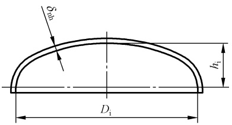

图7-1 椭圆形封头

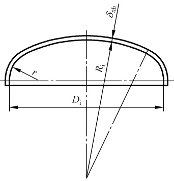

图7-2 碟形封头

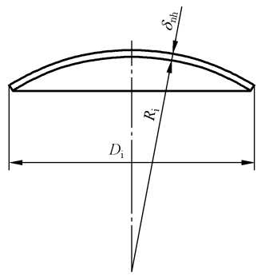

图7-3 球冠形封头

<!-- page: 161 -->

### 7.2 术语和定义、符号

#### 7.2.1 术语和定义

GB/T 150.1—2024 中界定的术语和定义适用于本章。

#### 7.2.2 符号

下列符号适用于本章:

$D_{i}$ ——封头内直径或与其连接的圆筒内直径, mm;

$D_{0}$ ——封头外直径或与其连接的圆筒外直径, mm;

$h_{i}$ ——凸形封头内曲面深度，mm；

$p_{c}$ ——计算压力,MPa;

$\left[p_{w}\right]$ ——封头的最大允许工作压力,MPa;

$R_{eL}^{t}$ ——椭圆或碟形封头材料在设计温度下的屈服强度,MPa;

$\delta$ ——与封头连接的圆筒计算厚度，mm；

$\delta_{b}$ ——防止内压屈曲的封头计算厚度, mm;

$\delta_{c}$ ——按内压强度的封头计算厚度, mm;

$\delta_{e}$ ——与封头连接的圆筒有效厚度, mm;

$\delta_{eh}$ ——凸形封头有效厚度，mm；

$\delta_{h}$ ——凸形封头计算厚度，mm；

$\delta_{n}$ ——与封头连接的圆筒名义厚度, mm;

$\delta_{nh}$ ——凸形封头名义厚度, mm;

$\delta_{r}$ ——与封头和圆筒连接的加强段或过渡段计算厚度, mm;

$[\sigma]^{t}$ ——设计温度下封头材料的许用应力(按 GB/T 150.2—2024), MPa;

$\left[\sigma\right]_{s}^{t}$ ——设计温度下，封头所连圆筒材料的许用应力（按 GB/T 150.2—2024），MPa；

$\phi$ ——焊接接头系数(按 GB/T 150.1—2024);

$h_{0}$ ——凸形封头外曲面深度, $h_{0}=h_{i}+\delta_{nh},mm;$

α——锥壳半顶角，(°)。

### 7.3 椭圆形封头

#### 7.3.1 椭圆形封头的选型

椭圆形封头一般采用 $D_{i}/2h_{i}=2.0$ 的标准型。

#### 7.3.2 受内压(凹面受压)椭圆形封头

考虑强度和屈曲两种失效模式,按以下步骤进行椭圆形封头设计计算:

a）按7.3.2.1进行内压强度计算，确定椭圆形封头的内压强度计算厚度 $\delta_{\mathrm{c}}$；

b）按7.3.2.2判断椭圆形封头内压屈曲可能性；

c）可能发生内压屈曲时，按7.3.2.3确定椭圆形封头防止屈曲计算厚度 $\delta_{\mathrm{b}}$

d）按7.3.2.4确定椭圆形封头计算厚度 $\delta_{\mathrm{h}}$ 和最大允许工作压力 $[p_{\mathrm{w}}]$。

#### 7.3.2.1 椭圆形封头内压强度设计

按公式(7-1)或公式(7-2)确定椭圆形封头内压强度计算厚度 $\delta_{c}$ :

$$ \delta_ {\mathrm{c}} = \frac {K p _ {\mathrm{c}} D _ {\mathrm{i}}}{2 [ \sigma ] ^ {\mathrm{t}} \phi - 0 . 5 p _ {\mathrm{c}}}\tag{7-1} $$

<!-- page: 162 -->

$$ \delta_ {\mathrm{c}} = \frac {K p _ {\mathrm{c}} D _ {\mathrm{o}}}{2 [ \sigma ] ^ {\mathrm{t}} \phi + (2 K - 0 . 5) p _ {\mathrm{c}}}\tag{7-2} $$

式中:

K——椭圆形封头形状系数, $K=\frac{1}{6}\left[2+\left(\frac{D_{i}}{2h_{i}}\right)^{2}\right]$ ，其值见表7-1。

表 7-1 椭圆形封头形状系数 K

| $\frac{D_i}{2h_i}$ | 2.6 | 2.5 | 2.4 | 2.3 | 2.2 | 2.1 | 2.0 | 1.9 | 1.8 |
|---|---|---|---|---|---|---|---|---|---|
| K | 1.46 | 1.37 | 1.29 | 1.21 | 1.14 | 1.07 | 1.00 | 0.93 | 0.87 |
| $\frac{D_i}{2h_i}$ | 1.7 | 1.6 | 1.5 | 1.4 | 1.3 | 1.2 | 1.1 | 1.0 |  |
| K | 0.81 | 0.76 | 0.71 | 0.66 | 0.61 | 0.57 | 0.53 | 0.50 |  |

#### 7.3.2.2 椭圆形封头内压屈曲判别

根据 $D_{i}/2h_{i}$ 和 $D_{i}/\delta_{c}$ ，按图 7-4 判断椭圆形封头是否可能发生屈曲。若 $D_{i}/2h_{i}$ 和 $D_{i}/\delta_{c}$ 落在图 7-4 中曲线上或曲线右上方，则封头可能发生屈曲；若 $D_{i}/2h_{i}$ 和 $D_{i}/\delta_{c}$ 落在图 7-4 中曲线左下方，则封头不可能发生屈曲。

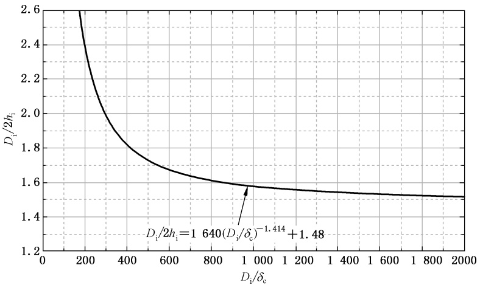

图7-4 内压椭圆形封头屈曲判别

#### 7.3.2.3 椭圆形封头防止内压屈曲设计

当根据 7.3.2.2 判别椭圆形封头存在内压屈曲可能时, 可按以下 a) 或 b) 方法之一进行设计:

a) 解析法

椭圆形封头防止内压屈曲计算厚度 $\delta_{\mathrm{b}}$ 按公式(7-3)确定:

$$ \delta_ {\mathrm{b}} = D _ {\mathrm{i}} \left[ \frac {p _ {\mathrm{c}}}{2 3 R _ {\mathrm{eL}} ^ {\mathrm{t}}} \left(\frac {D _ {\mathrm{i}}}{2 h _ {\mathrm{i}}}\right) ^ {1. 9 3} \right] ^ {0. 7 7}\tag{……(7-3} $$

b) 经验法

椭圆形封头防止内压屈曲计算厚度 $\delta_{\mathrm{b}}$ 亦可按公式(7-4)确定:

$$ \delta_ {\mathrm{b}} \geqslant \left\{ \begin{array}{l} 0. 0 0 1 5 \cdot D _ {\mathrm{i}} (D _ {\mathrm{i}} / 2 h _ {\mathrm{i}} \leqslant 2) \\ 0. 0 0 3 0 \cdot D _ {\mathrm{i}} (D _ {\mathrm{i}} / 2 h _ {\mathrm{i}} > 2) \end{array} \right.\tag{……(7-4} $$

<!-- page: 163 -->

#### 7.3.2.4 椭圆形封头的计算厚度和最大允许工作压力

根据7.3.2.2的判别结果，当不可能发生内压屈曲时，椭圆形封头计算厚度 $\delta_{\mathrm{h}}$ 取内压强度计算厚度$\delta_{\mathrm{c}}$ ，最大允许工作压力按公式(7-5)确定；当有可能发生内压屈曲时，椭圆形封头计算厚度 $\delta_{\mathrm{h}}$ 取内压强度计算厚度 $\delta_{\mathrm{c}}$ 与防止内压屈曲计算厚度 $\delta_{\mathrm{b}}$ 的较大值后确定封头的名义厚度 $\delta_{\mathrm{nh}}$ 及有效厚度 $\delta_{\mathrm{eh}}$ ，最大允许工作压力取公式(7-5)和公式(7-6)计算值的较小者。

$$ \left[ p _ {\mathrm{w}} \right] = \frac {2 \left[ \sigma \right] ^ {\mathrm{t}} \phi \delta_ {\mathrm{eh}}}{K D _ {\mathrm{i}} + 0 . 5 \delta_ {\mathrm{eh}}}\tag{……(7-5} $$

式中:

$K$ ——椭圆形封头形状系数。

$$ \left[ p _ {\mathrm{w}} \right] = 2 3 R _ {\mathrm{eL}} ^ {\mathrm{t}} \left(\frac {\delta_ {\mathrm{eh}}}{D _ {\mathrm{i}}}\right) ^ {1. 2 9} \left(\frac {D _ {\mathrm{i}}}{2 h _ {\mathrm{i}}}\right) ^ {- 1. 9 3}\tag{\( \cdots(7-6) \} $$

#### 7.3.3 受外压(凸面受压)椭圆形封头

凸面受压椭圆形封头的厚度计算应采用第6章外压球壳设计方法，其中 $R_{0}$ 为椭圆形封头的当量球壳外半径， $R_{0}=K_{1}D_{0}$ 。

$K_{1}$ 由椭圆形长短轴比值决定的系数,见表7-2。

表 7-2 由椭圆形长短轴比值决定的系数 {\mathbf{K}}_{1}

| $\frac{D_{o}}{2h_{o}}$ | 2.6 | 2.4 | 2.2 | 2.0 | 1.8 | 1.6 | 1.4 | 1.2 | 1.0 |
|---|---|---|---|---|---|---|---|---|---|
| $K_{1}$ | 1.18 | 1.08 | 0.99 | 0.90 | 0.81 | 0.73 | 0.65 | 0.57 | 0.50 |
|注1:中间值用内插法求得。注2:标准椭圆形封头 $K_{1}=0.9$ 。|  |  |  |  |  |  |  |  |  |

### 7.4 碟形封头

#### 7.4.1 碟形封头的选型

碟形封头球面部分的内半径应不大于封头的内直径，通常取0.9倍的封头内直径。封头转角内半径应不小于封头内直径的 $10\%$ ，且不应小于3倍的名义厚度 $\delta_{\mathrm{nh}}$ 。

#### 7.4.2 受内压(凹面受压)碟形封头

考虑强度和屈曲两种失效模式,按以下步骤进行碟形封头设计计算:

a）按7.4.2.1进行内压强度计算，确定碟形封头的内压强度计算厚度 $\delta_{\mathrm{c}}$；

b) 按7.4.2.2判断碟形封头内压屈曲可能性；

c) 可能发生内压屈曲时，按7.4.2.3确定碟形封头防止屈曲计算厚度 $\delta_{\mathrm{b}}$

d）按7.4.2.4确定碟形封头计算厚度 $\delta_{\mathrm{h}}$ 和最大允许工作压力 $[p_{\mathrm{w}}]$。

#### 7.4.2.1 碟形封头内压强度设计

按公式(7-7)或公式(7-8)确定碟形封头内压强度计算厚度 $\delta_{\mathrm{c}}$ :

$$ \delta_ {\mathrm{c}} = \frac {M p _ {\mathrm{c}} R _ {\mathrm{i}}}{2 [ \sigma ] ^ {\mathrm{t}} \phi - 0 . 5 p _ {\mathrm{c}}}\tag{7-7} $$

<!-- page: 164 -->

$$ \delta_ {\mathrm{c}} = \frac {M p _ {\mathrm{c}} R _ {\mathrm{o}}}{2 [ \sigma ] ^ {\mathrm{t}} \phi + (M - 0 . 5) p _ {\mathrm{c}}}\tag{7-8} $$

式中:

$R_{i}$ ——碟形封头球面部分内半径,单位为毫米(mm);

$R_{o}$ ——碟形封头球面部分外半径， $R_{o}=R_{i}+\delta_{nh}$ ，单位为毫米(mm)；

M——碟形封头形状系数, $M=\frac{1}{4}\left(\frac{1}{3}+\sqrt{\frac{R_{i}}{r}}\right)$ ，其值见表7-3；

r ——碟形封头过渡段转角内半径,单位为毫米(mm)。

表7-3 系数 M

| $\frac{R_i}{r}$ | 1.0 | 1.25 | 1.50 | 1.75 | 2.0 | 2.25 | 2.50 | 2.75 |
|---|---|---|---|---|---|---|---|---|
| M | 1.00 | 1.03 | 1.06 | 1.08 | 1.10 | 1.13 | 1.15 | 1.17 |
| $\frac{R_i}{r}$ | 3.0 | 3.25 | 3.50 | 4.0 | 4.5 | 5.0 | 5.5 | 6.0 |
| M | 1.18 | 1.20 | 1.22 | 1.25 | 1.28 | 1.31 | 1.34 | 1.36 |
| $\frac{R_i}{r}$ | 6.5 | 7.0 | 7.5 | 8.0 | 8.5 | 9.0 | 9.5 | 10.0 |
| M | 1.39 | 1.41 | 1.44 | 1.46 | 1.48 | 1.50 | 1.52 | 1.54 |

#### 7.4.2.2 碟形封头内压屈曲判别

根据 $R_{\mathrm{i}} / r$ 和 $D_{\mathrm{i}} / \delta_{\mathrm{c}}$ 按图7-5判别碟形封头是否可能发生屈曲。若 $R_{\mathrm{i}} / r$ 和 $D_{\mathrm{i}} / \delta_{\mathrm{c}}$ 落在图7-5中曲线上或曲线右上方，则碟形封头可能发生屈曲；若 $R_{\mathrm{i}} / r$ 和 $D_{\mathrm{i}} / \delta_{\mathrm{c}}$ 落在图7-5中曲线左下方，则碟形封头不可能发生屈曲。

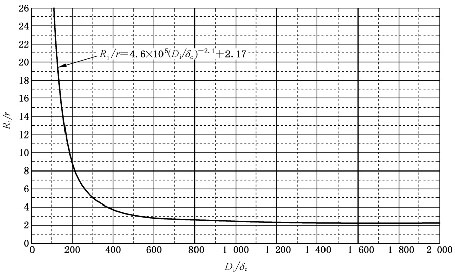

图7-5 内压碟形封头屈曲判别

#### 7.4.2.3 碟形封头防止内压屈曲设计

当根据7.4.2.2判别碟形封头存在内压屈曲可能时，可按以下a)或b)两种方法之一设计:

<!-- page: 165 -->

**a) 解析法**

碟形封头防止内压屈曲计算厚度 $\delta_{\mathrm{b}}$ 按公式(7-9)确定:

$$ \delta_ {\mathrm{b}} = D _ {\mathrm{i}} \left[ \frac {p _ {\mathrm{c}}}{1 2 0 R _ {\mathrm{eL}} ^ {\mathrm{t}}} \left(\frac {(R _ {\mathrm{i}} / D _ {\mathrm{i}}) ^ {1 . 3 2}}{(r / D _ {\mathrm{i}}) ^ {0 . 4 7}}\right) \right] ^ {0. 6}\tag{7-9} $$

**b) 经验法**

碟形封头防止内压屈曲计算厚度 $\delta_{b}$ 亦可按公式(7-10)确定:

$$ \delta_ {\mathrm{b}} \geqslant \left\{ \begin{array}{l} 0. 0 0 1 5 \cdot D _ {\mathrm{i}} \left(R _ {\mathrm{i}} / r \leqslant 5. 5\right) \\ 0. 0 0 3 0 \cdot D _ {\mathrm{i}} \left(R _ {\mathrm{i}} / r > 5. 5\right) \end{array} \right.\tag{7-10} $$

#### 7.4.2.4 碟形封头的计算厚度和最大允许工作压力

根据7.4.2.2的判别结果，当不可能发生内压屈曲时，碟形封头计算厚度 $\delta_{\mathrm{h}}$ 取内压强度计算厚度$\delta_{\mathrm{c}}$ ，最大允许工作压力按公式(7-11)确定；当有可能发生内压屈曲时，碟形封头计算厚度 $\delta_{\mathrm{h}}$ 取内压强度计算厚度 $\delta_{\mathrm{c}}$ 与防止内压屈曲计算厚度 $\delta_{\mathrm{b}}$ 的较大值后确定封头的名义厚度 $\delta_{\mathrm{nh}}$ 及有效厚度 $\delta_{\mathrm{eh}}$ ，最大允许工作压力取公式(7-11)和公式(7-12)计算值的较小者。

$$ \left[ p _ {\mathrm{w}} \right] = \frac {2 \left[ \sigma \right] ^ {\mathrm{t}} \phi \delta_ {\mathrm{eh}}}{M R _ {\mathrm{i}} + 0 . 5 \delta_ {\mathrm{eh}}}\tag{7-11} $$

$$ \left[ p _ {\mathrm{w}} \right] = 1 2 0 R _ {\mathrm{eL}} ^ {\mathrm{t}} \left(\delta_ {\mathrm{eh}} / D _ {\mathrm{i}}\right) ^ {1. 6 7} \left(R _ {\mathrm{i}} / D _ {\mathrm{i}}\right) ^ {- 1. 3 2} \left(r / D _ {\mathrm{i}}\right) ^ {0. 4 7}\tag{……(7-12} $$

式中:

$R_{i}$ ——碟形封头球面部分内半径,单位为毫米(mm)。

#### 7.4.3 受外压(凸面受压)碟形封头

凸面受压碟形封头的厚度计算应采用第6章外压球壳设计方法,其中 $R_{0}$ 为碟形封头球面部分外半径。

### 7.5 球冠形封头

#### 7.5.1 球冠形封头的结构形式

球冠形封头可用作端封头，也可用作容器中两独立受压室的中间封头，如采用加强段结构，其形式如图7-6所示。封头与圆筒连接的T形接头应为全焊透结构。

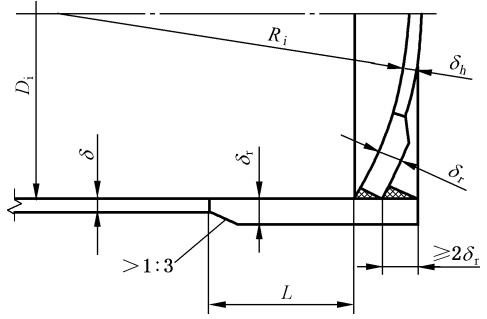

图7-6 球冠形封头加强段结构

a）端封头结构

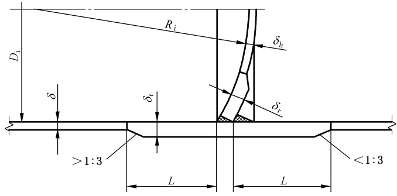

b）中间封头结构

注: $R_{i}$ ——球冠形封头内半径，单位为毫米(mm)。

<!-- page: 166 -->

#### 7.5.2 球冠形封头的计算厚度

受内压(凹面受压)球冠形封头的计算厚度 $\delta_{h}$ 按第 5 章内压球壳计算；受外压(凸面受压)球冠形封头的计算厚度 $\delta_{h}$ 按第 6 章外压球壳计算。对于中间封头，应按照封头两侧最苛刻的压力组合工况。如能保证在任何情况下封头两侧的压力同时作用，可以按封头两侧的压力差进行计算。

#### 7.5.3 球冠形端封头加强段厚度

封头加强段的计算厚度按公式(7-13)计算:

$$ \delta_ {\mathrm{r}} = Q \delta\tag{……(7-13} $$

式中:

$Q$ ——系数，按圆筒材料和参数由图7-7查取。

凸面受压时,封头加强段的厚度应同时不小于按 7.5.2 确定的球壳厚度。

当 $2\delta/D_{i}<0.002$ 时，加强段厚度按 7.5.5 计算。

与封头连接的圆筒端部厚度不应小于球冠形封头加强段厚度,否则应在圆筒端部设置加强段过渡连接。圆筒加强段计算厚度一般取封头加强段计算厚度,封头加强段长度和圆筒加强段长度均应不小于 $\sqrt{2D_{i}\delta_{r}}$ 。

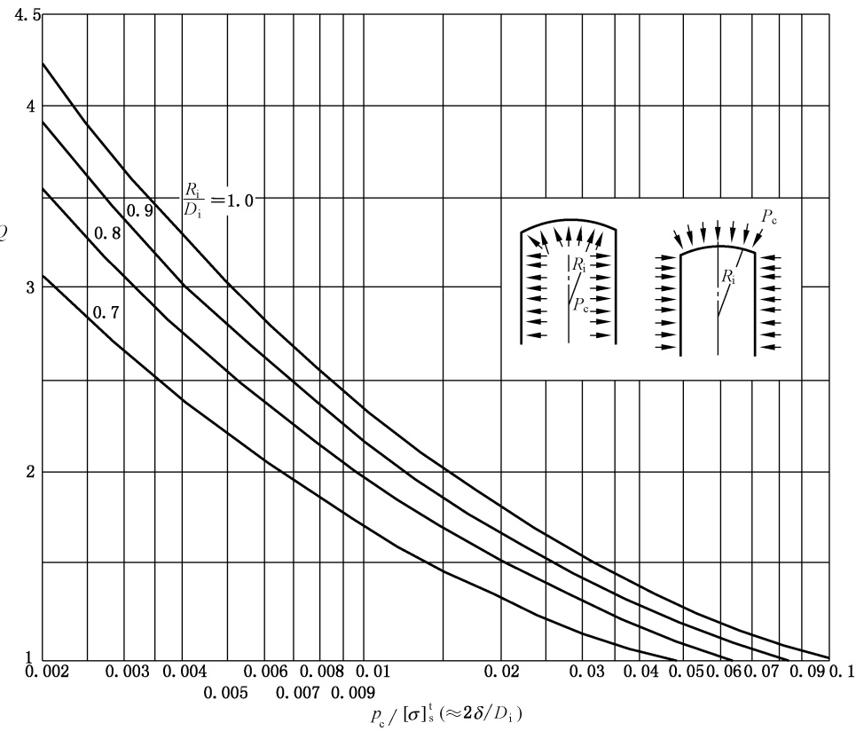

图7-7 球冠形端封头 Q

#### 7.5.4 球冠形中间封头加强段厚度

球冠形中间封头加强段厚度的计算应符合下列规则。

a）根据封头两侧最苛刻的压力组合工况，按公式(7-13)计算确定。

b) 如果凹面侧受压, Q 由图 7-8 查取。如果凸面侧受压, Q 由图 7-9 查取, 此外还应不小于按

<!-- page: 167 -->

7.5.2确定的球壳厚度。

c) 当 $2\delta / D_{\mathrm{i}} < 0.002$ 时，加强段厚度按7.5.5计算。

d) 与封头连接处的圆筒厚度不应小于球冠形封头加强段厚度, 否则应设置圆筒加强段过渡连接, 如图 7-6 所示。

e) 圆筒加强段计算厚度一般取等于封头加强段计算厚度, 封头加强段长度和两侧圆筒加强段长度均应不小于 $\sqrt{2D_{i}\delta_{r}}$ 。

#### 7.5.5 2\delta /D_{\mathrm{i}} <   0.002 时加强段厚度计算

对于需要加强的球冠形端封头与球冠形中间封头，当按照公式(5-1)计算得到的 $\delta$ ，使得 $2\delta / D_{\mathrm{i}} < 0.002$ 时，按以下步骤计算加强段厚度:

a) 取 $\delta=0.001D_{i}$ ;

b) 由 $p_{\mathrm{c}} / (\left[\sigma \right]_{\mathrm{s}}^{\prime} \phi) = 0.002$ 分别查图7-7（或图7-8、图7-9）得到 $Q$;

c) 将 a)、b) 得到的 $\delta$、$Q$ 代入公式 (7-13)(即 $\delta_{\mathrm{r}} = Q\delta$) 计算加强段厚度。

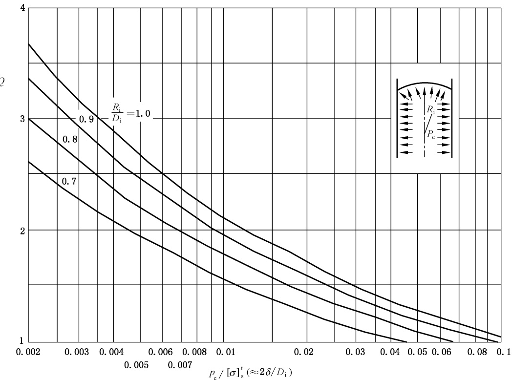

图7-8 球冠形中间封头 Q

<!-- page: 168 -->

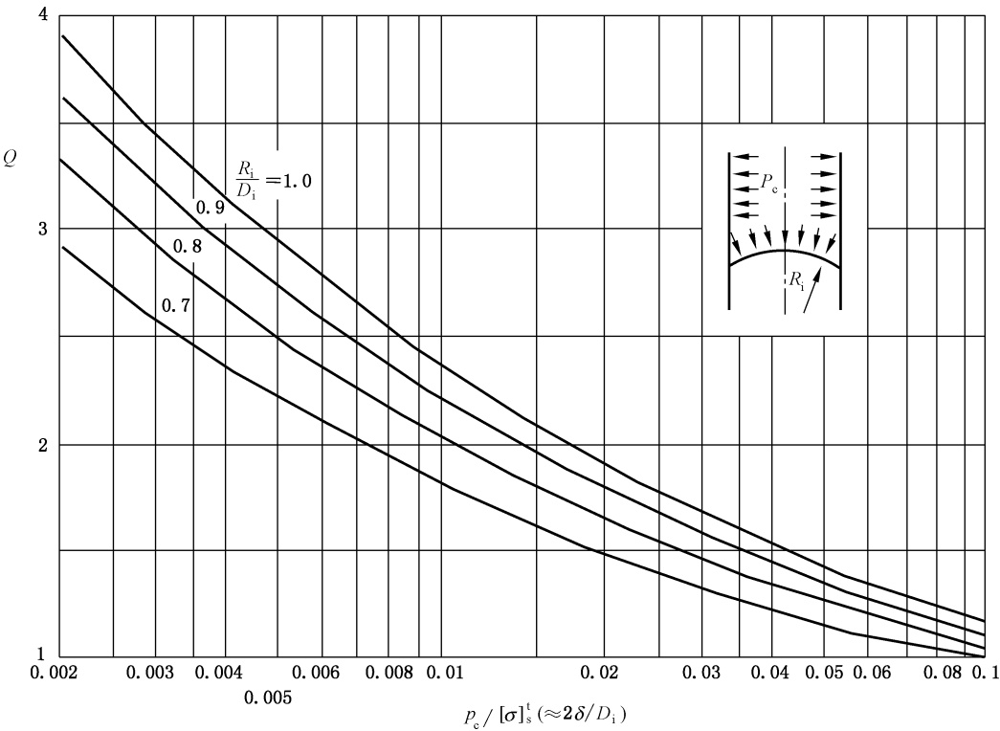

图7-9 球冠形中间封头 Q

### 7.6 锥形封头

#### 7.6.1 一般要求

7.6.1.1 本条规定仅适用于锥壳半顶角 $\alpha \leqslant 60^{\circ}$ 的轴对称无折边或折边锥形封头，锥形封头可有以下几种形式:

a）单一厚度的锥壳，见图7-10；

b）同一半顶角不同厚度的多段锥壳的组合；

c) 大端或小端带有折边(圆环壳)和直边段(圆筒壳)的锥壳, 见图 7-11、图 7-12;

d) 大端或小端带有加强段的无折边锥壳, 见图 7-14、图 7-16。

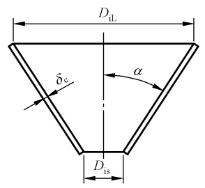

图7-10 无折边锥壳

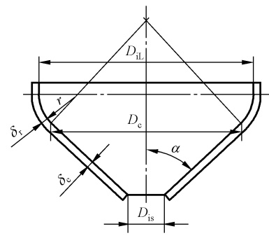

图7-11 大端折边锥壳

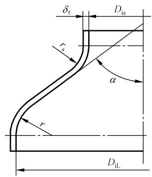

图7-12 两端折边锥壳

<!-- page: 169 -->

#### 7.6.1.2 锥形封头折边设置要求按表7-4。

表 7-4 锥形封头折边设置要求

|锥封头半顶角 $( \alpha )$ | $\leqslant 30^{\circ}$ | $\leqslant 45^{\circ}$ | $\leqslant 60^{\circ}$ | $>60^{\circ}$ |
|---|---|---|---|---|
| 锥壳大端 | 允许无折边 |允许无折边 $^{a}$ |应有折边 $( r \geqslant 10\$ % $D_{iL}$ 且 $\geqslant 3\delta_{r} )$ | 按平盖(或应力分析) |
| 锥壳小端 | 允许无折边 |应有折边 $( r_{s} \geqslant 5\$ % $D_{is}$ 且 $\geqslant 3\delta_{r} )$ |  |  |
| $^{a}$ 当锥壳半顶角 $30^{\circ} < \alpha \leqslant 45^{\circ}$ 时,锥壳大端和圆筒连接处应采用全截面焊透的焊接接头,焊接接头的内、外表面应打磨成圆滑过渡,其圆角半径 $r_{o} \geqslant \delta_{r}$ ,且应进行100%射线或超声检测。|  |  |  |  |

7.6.1.3 锥形封头的厚度确定应符合下列规则。

a) 当锥壳大端或大、小端同时具有加强段或过渡段时，应按 7.6.3～7.6.5 分别确定锥形封头各部分计算厚度。若考虑只由一种厚度组成时，则应取上述各部分厚度中的最大值作为锥形封头的厚度。

b) 在任何情况下,过渡段或加强段的有效厚度不应小于与其连接的锥壳的计算厚度,并不小于圆筒内直径的 0.15%。

c) 对于承受外压的锥形封头应首先满足其内压设计条件下的强度要求。

7.6.1.4 锥壳与圆筒的连接应采用全焊透结构。

#### 7.6.2 符号

下列符号适用于本节:

A ——外压计算应变系数；

$A_{eL}$ ——外压计算时，锥壳大端与圆筒连接处的有效加强截面积， $mm^{2}$ ;

$A_{es}$ ——外压计算时，锥壳小端与圆筒连接处的有效加强截面积， $mm^{2}$ ;

$A_{rL}$ ——锥壳大端需要加强的截面积, $mm^{2}$ ;

$A_{rs}$ ——锥壳小端需要加强的截面积, $mm^{2}$ ;

$A_{s}$ ——加强圈横截面积, $mm^{2}$ ;

$A_{T}$ ——圆筒、锥壳和加强圈的当量截面积,大端为 $A_{TL}$ 见公式(7-34),小端为 $A_{Ts}$ 见公式(7-39),mm $^{2}$ ;

B —— 外压计算应力系数, MPa;

C ——厚度附加量(按 GB/T 150.1—2024), mm;

$D_{c}$ ——锥壳计算内直径，mm；

$D_{i}$ ——圆筒内直径, mm;

$D_{iL}$ ——锥壳大端直边段内直径, mm;

$D_{is}$ ——锥壳小端直边段内直径, mm;

$D_{L}$ ——外压计算时,所考虑锥壳段大端外直径(见图7-18),mm;

$D_{oL}$ ——锥壳大端直边段外直径, mm;

$D_{os}$ ——锥壳小端直边段外直径, mm;

$D_{s}$ ——外压计算时,所考虑锥壳段小端外直径(见图7-18),mm;

$E_{c}$ 、 $E_{r}$ 、 $E_{s}$ ——材料在设计温度下的弹性模量， $E_{c}$ 、 $E_{r}$ 、 $E_{s}$ 分别表示锥壳、加强圈及圆筒，MPa； $f_{1}$ ——除压力载荷外，由外载荷在锥壳大端产生的单位圆周长度上轴向力，N/mm；

<!-- page: 170 -->

$f_{2}$ ——除压力载荷外，由外载荷在锥壳小端产生的单位圆周长度上轴向力，N/mm；

I ——圆筒-锥壳或加强圈-圆筒-锥壳组合段所需的惯性矩, $mm^{4}$ ;

$I_{s}$ ——圆筒-锥壳或加强圈-圆筒-锥壳组合段有效横截面对平行于壳体轴线的形心轴的惯性矩, $mm^{4}$ ;

k ——系数,见公式(7-17);

$L_{c}$ ——沿锥壳表面度量的锥壳上两加强圈之间的长度, mm;

$L_{e}$ ——锥壳当量长度, mm;

$L_{L}$ ——与锥壳大端相连圆筒的计算长度, mm;

$L_{sm}$ ——与锥壳小端相连圆筒的计算长度，mm；

$L_{x}$ ——锥壳段轴向长度(见图7-18), mm;

$p_{\mathrm{c}}$ ——计算压力， $\mathrm{MPa}$

$Q_{L}$ ——内压时取 $\frac{1}{4}p_{c}D_{iL}$ 与 $f_{1}$ 的代数和，外压时取 $\frac{1}{4}p_{c}D_{L}$ 与 $f_{1}$ 的代数和，N/mm；

$Q_{s}$ ——内压时取 $\frac{1}{4}p_{c}D_{is}$ 与 $f_{2}$ 的代数和，外压时取 $\frac{1}{4}p_{c}D_{s}$ 与 $f_{2}$ 的代数和，N/mm；

R ——圆筒中面半径, mm;

$R_{L}$ ——锥壳大端直边段中面半径, mm;

$R_{oL}$ ——锥壳大端直边段外半径, mm;

$R_{os}$ ——锥壳小端直边段外半径, mm;

$R_{s}$ ——锥壳小端直边段中面半径, mm;

r ——折边锥壳大端过渡段转角半径(见图 7-12), mm;

$r_{s}$ ——折边锥壳小端过渡段转角半径(见图7-12), mm;

$r_{0}$ ——锥壳与圆筒连接焊缝内、外表面过渡圆角半径，mm；

α ——锥壳半顶角, $(^\circ)$ ;

$\Delta$ ——锥壳端部与圆筒连接处需要加强的指数值, 当 $\Delta \geqslant \alpha$ 时, 该连接处不需要加强 (见表 7-5, 表 7-8), ($^\circ$);

$\delta_{c}$ ——锥壳计算厚度, mm;

$\delta_{ec}$ ——锥壳当量有效厚度, mm;

$\delta_{nc}$ ——锥壳名义厚度, mm;

$\left[\sigma\right]_{c}^{t}$ ——设计温度下锥壳所用材料的许用应力(按 GB/T 150.2—2024 的规定), MPa;

$\left[\sigma\right]_{r}^{t}$ ——设计温度下加强圈所用材料的许用应力(按 GB/T 150.2—2024 的规定),MPa;

$\left[\sigma\right]_{s}^{t}$ ——设计温度下圆筒所用材料的许用应力(按 GB/T 150.2—2024 的规定),MPa;

$\phi$ ——焊接接头系数(按 GB/T 150.1—2024)。

#### 7.6.3 受内压锥壳厚度

锥壳的计算厚度按公式(7-14)计算:

$$ \delta_ {\mathrm{c}} = \frac {p _ {\mathrm{c}} D _ {\mathrm{c}}}{2 [ \sigma ] _ {\mathrm{c}} ^ {\mathrm{t}} \phi - p _ {\mathrm{c}}} \cdot \frac {1}{\cos \alpha} $$

……(7-14)

当锥壳由同一半顶角的几个不同厚度的锥壳段组成时，式中 $D_{\mathrm{c}}$ 分别为各锥壳段大端内直径。

<!-- page: 171 -->

#### 7.6.4 受内压无折边锥壳

#### 7.6.4.1 受内压无折边锥壳大端厚度

无折边锥壳大端与圆筒连接时,应按以下步骤确定连接处锥壳大端的厚度。

a) 按图 7-13 确定是否需要在连接处进行加强；当坐标交点落在曲线上或曲线下方，以及锥壳半顶角大于 $31.5^{\circ}$ 后，连接处均需加强。

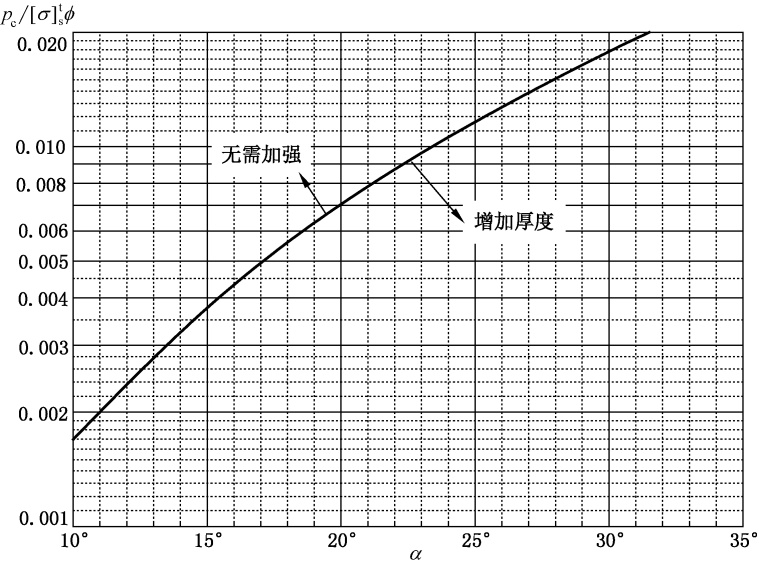

图7-13 确定锥壳大端连接处的加强图

b) 无需加强时, 锥壳大端厚度按公式(7-14)计算。

c) 需要增加厚度予以加强时,应在锥壳与圆筒之间设置加强段,锥壳加强段与圆筒加强段应具有相同的厚度 $\delta_{r}$ ,步骤如下。

1）按公式(5-1)求取与锥壳相连接的圆筒计算厚度 $\delta$ ，该公式中的 $D_{i}$ 取锥壳大端内直径 $D_{iL}$ 。

2）按公式(7-15)计算:

$$ \delta_ {\mathrm{r}} = \left\{ \begin{array}{l} Q _ {1} \delta , \delta / R _ {\mathrm{L}} \geqslant 0. 0 0 1 \\ 0. 0 0 1 Q _ {1} R _ {\mathrm{L}}, \delta / R _ {\mathrm{L}} <   0. 0 0 1 \end{array} \right.\tag{7-15} $$

式中:

$Q_{1}$ ——大端应力增值系数，由图7-14查取；当 $\delta/R_{L}<0.001$ 时， $Q_{1}$ 按 $p_{c}/[\sigma]_{s}^{t}\phi=0.001$ 查图7-14得到。

d) 锥壳加强段的长度 $L_{1}$ 应不小于 $\sqrt{\frac{2D_{\mathrm{iL}}\delta_{\mathrm{r}}}{\cos\alpha}}$；圆筒加强段的长度 $L$ 应不小于 $\sqrt{2D_{\mathrm{iL}}\delta_{\mathrm{r}}}$。

<!-- page: 172 -->

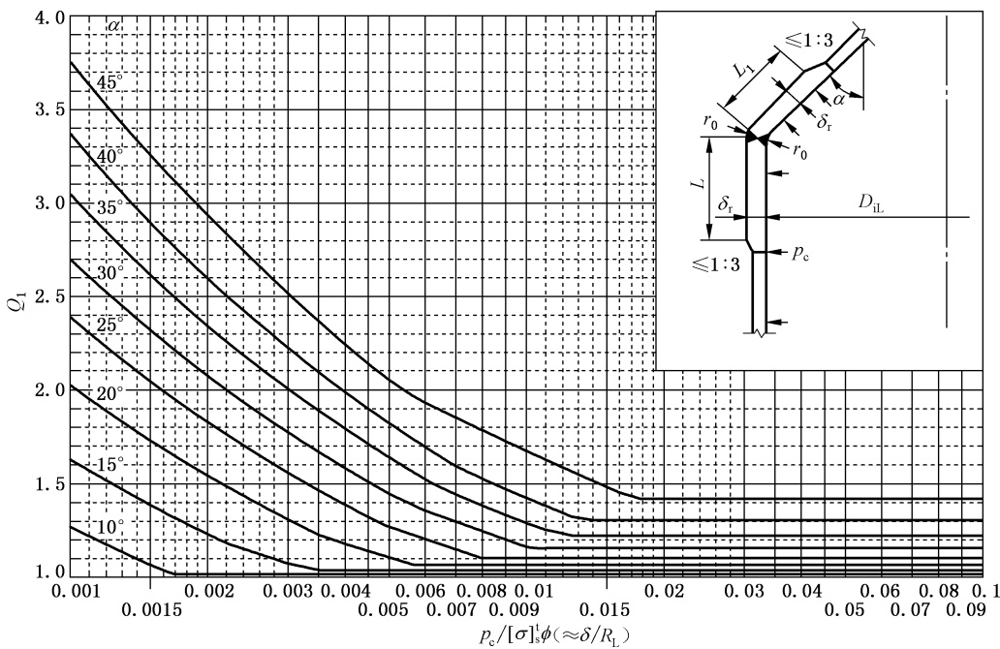

图7-14 锥壳大端连接处的 Q_{1}

#### 7.6.4.2 受内压无折边锥壳小端厚度

无折边锥壳小端与圆筒连接时,应按以下步骤确定连接处锥壳小端的厚度。

a) 按图 7-15 确定是否需要在连接处进行加强。当坐标交点落在曲线上或曲线下方时, 连接处需进行加强。

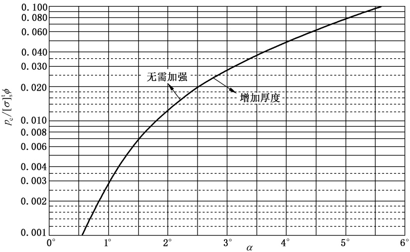

图7-15 确定锥壳小端连接处的加强图

b）无需加强时，锥壳小端按公式(7-14)计算。

c) 锥壳与圆筒之间需设置加强时, 锥壳加强段与圆筒加强段应具有相同的厚度 $\delta_{r}$ , 计算步骤如下:

1) 按公式(5-1)求取与锥壳相连接的筒体计算厚度 $\delta$, 该公式中的 $D_{\mathrm{i}}$ 取锥壳小端内直径 $D_{\mathrm{is}}$;

2）按公式(7-16)计算:

$$ \delta_ {\mathrm{r}} = \left\{ \begin{array}{l} Q _ {2} \delta , \delta / R _ {\mathrm{s}} \geqslant 0. 0 0 1 \\ 0. 0 0 1 Q _ {2} R _ {\mathrm{s}}, \delta / R _ {\mathrm{s}} <   0. 0 0 1 \end{array} \right.\tag{7-16} $$

<!-- page: 173 -->

式中:

$Q_{2}$ ——小端应力增值系数,由图 7-16 查取;当 $\delta/R_{s}<0.001$ 时, $Q_{2}$ 按 $p_{c}/[\sigma]_{s}^{t}\phi=0.001$ 查图 7-16 确定。

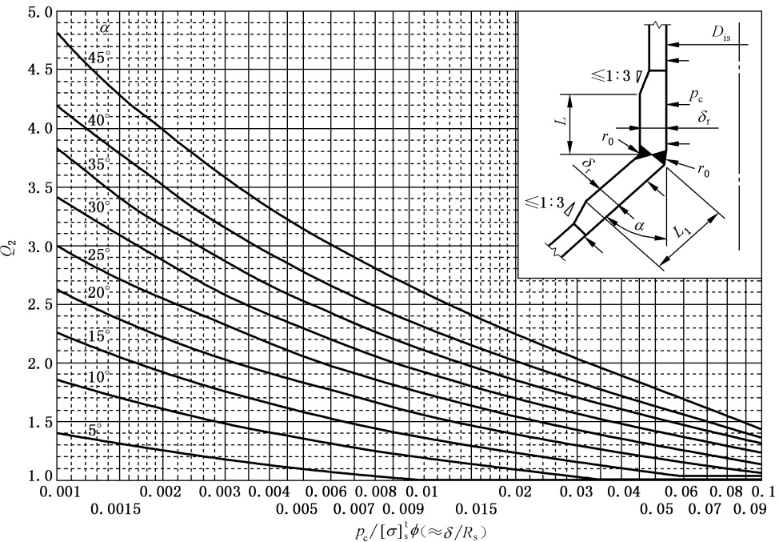

图7-16 锥壳小端连接处的 Q_{2}

d) 锥壳加强段的长度 $L_{1}$ 应不小于 $\sqrt{\frac{2D_{\mathrm{is}}\delta_{\mathrm{r}}}{\cos\alpha}}$；圆筒加强段的长度 $L$ 应不小于 $\sqrt{2D_{\mathrm{is}}\delta_{\mathrm{r}}}$。

#### 7.6.4.3 在内压和轴向载荷共同作用下无折边锥壳与圆筒连接处的加强设计

#### 7.6.4.3.1 一般规定

此时锥壳与圆筒连接处的加强设计符合下列规则。

a) 本条计算方法适用于半顶角 $\alpha \leqslant 45^{\circ}$ 的无折边锥壳、在内压与其他轴向载荷（如偏心重量、风载荷、地震载荷等）共同作用时，与圆筒连接处的结构应力校核计算。

b) 半顶角 $30^{\circ} < \alpha \leqslant 45^{\circ}$ 时，锥壳大端、小端和圆筒连接处应采用全截面焊透的焊接接头，接头的内、外表面应打磨成圆滑过渡，其圆角半径 $r_0 \geqslant \delta_{\mathrm{r}}$ ，且焊接接头应进行 $100\%$ 射线或超声检测。

c) 在进行锥壳与圆筒连接处的加强结构设计时,首先应分别满足按7.6.3、7.6.4.1、7.6.4.2计算的锥壳厚度。考虑加强圈、锥壳、圆筒间不同材料对加强计算的影响,引入系数k,见公式(7-17)。

$$ k = \left\{ \begin{array}{l} 1, \text {无加强圈} \\ \max \left\{\left[ \sigma \right] _ {\mathrm{s}} ^ {\mathrm{t}} E _ {\mathrm{s}} / \left(\left[ \sigma \right] _ {\mathrm{r}} ^ {\mathrm{t}} E _ {\mathrm{r}}\right), 1 \right\}, \text {加强圈在圆筒} \\ \max \left\{\left[ \sigma \right] _ {\mathrm{c}} ^ {\mathrm{t}} E _ {\mathrm{c}} / \left(\left[ \sigma \right] _ {\mathrm{r}} ^ {\mathrm{t}} E _ {\mathrm{r}}\right), 1 \right\}, \text {加强圈在锥壳} \end{array} \dots \tag {7-17}\right\} $$

d) 本条内压加强设计仅适用于 $Q_{\mathrm{L}}, Q_{\mathrm{s}}$ 为拉伸载荷的情况（即二者为正值）；同时，$f_{1}, f_{2}$ 为轴向拉伸时取正值，反之取负值。

#### 7.6.4.3.2 锥壳大端与圆筒连接处的加强设计

锥壳大端与圆筒连接处的加强设计应按以下步骤进行。

a) 用 $p_{\mathrm{c}} / [\sigma]_{\mathrm{s}}^{\mathrm{t}}\phi$ 的值从表7-5查得 $\Delta$ ，若 $\Delta$ 小于锥壳半顶角 $\alpha$ 时，应进行加强设计（中间值用内插法）。

<!-- page: 174 -->

b) 需要的加强面积最小值按公式(7-18)确定。

$$ A _ {\mathrm{rL}} = \frac {k Q _ {\mathrm{L}} D _ {\mathrm{iL}} \tan \alpha}{2 [ \sigma ] _ {\mathrm{s}} ^ {\mathrm{t}} \phi} \left(1 - \frac {\Delta}{\alpha}\right)\tag{……(7-18} $$

式中，$\phi = 1.0$。

c) 锥壳大端与圆筒连接处的有效加强截面积可按公式(7-19)计算,如设置加强圈,还应计入加强圈截面积。

$$ A _ {\mathrm{eL}} = 0. 7 1 (\delta_ {\mathrm{n}} - \delta - C) \sqrt {D _ {\mathrm{iL}} \delta_ {\mathrm{nc}}} + 0. 7 1 (\delta_ {\mathrm{nc}} - \delta_ {\mathrm{c}} - C) \sqrt {D _ {\mathrm{iL}} \delta_ {\mathrm{nc}} / \cos \alpha}\tag{……(7-19} $$

校核条件: $A_{el} \geqslant A_{rL}$ 。

表 7-5 \alpha \leqslant 45^{\circ} 锥壳端部与圆筒连接处 \Delta

| 大端 |  | 小端 |  |
|---|---|---|---|
| $p_c/[σ]_s^t\phi$ | Δ/(°) | $p_c/[σ]_s^t\phi$ | Δ/(°) |
| 0.001 0 | 9.5 | 0.002 | 4 |
| 0.001 5 | 11.5 | 0.005 | 6 |
| 0.002 | 13 | 0.010 | 9 |
| 0.003 | 16 | 0.02 | 12.5 |
| 0.004 | 19 | 0.04 | 17.5 |
| 0.005 | 21 | 0.06 | 22 |
| 0.006 | 23 | 0.08 | 25 |
| 0.007 | 25 | 0.1 | 28 |
| 0.008 | 26.5 | 0.115 | 30 |
| 0.009 | 28 | 0.13 | 32 |
| 0.010 | 30 | 0.14 | 33.5 |
| 0.011 | 31 | 0.16 | 35.5 |
| 0.012 | 32.5 | 0.18 | 37.5 |
| 0.014 | 35 | 0.20 | 40 |
| 0.016 | 37.5 | 0.22 | 41.5 |
| 0.018 | 39.5 | 0.24 | 43.5 |
| 0.020 | 42 | 0.255 | 45 |
| 0.022 | 44 |  |  |
| 0.023 | 45 |  |  |
|注:对于更大的 $p_c/[$ σ $]_s^t\phi$ ,取 Δ=45° 。|  |  |  |

d) 锥壳与圆筒上所有能用于加强的截面都应在距锥壳与圆筒连接处为 $\sqrt{D_{\mathrm{iL}}\delta_{\mathrm{n}} / 2}$ 的范围之内，并且要求加强面积的形心应在距连接处 $0.25\sqrt{D_{\mathrm{iL}}\delta_{\mathrm{n}} / 2}$ 的范围之内。

#### 7.6.4.3.3 锥壳小端与圆筒连接处的加强设计

锥壳小端与圆筒连接处的加强设计应按以下步骤进行。

a) 用 $p_{\mathrm{c}} / [\sigma]_{\mathrm{s}}^{\mathrm{t}} \phi$ 的比值从表7-5查得 $\Delta$，若 $\Delta$ 小于锥壳半顶角 $\alpha$ 时，应进行加强设计（中间值用内插法）。

b）需要的加强面积最小值按公式(7-20)计算:

<!-- page: 175 -->

$$ A _ {\mathrm{rs}} = \frac {k Q _ {\mathrm{s}} D _ {\mathrm{is}} \tan \alpha}{2 [ \sigma ] _ {\mathrm{s}} ^ {\mathrm{t}} \phi} \left(\frac {1 - \Delta}{\alpha}\right)\tag{7-20} $$

c) 锥壳小端与圆筒连接处的有效加强截面积可按公式(7-21)计算,如设置加强圈,还应计入加强圈截面积。

$$ A _ {\mathrm{es}} = 0. 5 5 \left(\delta_ {\mathrm{n}} - \delta - C\right) \sqrt {D _ {\mathrm{is}} \delta_ {\mathrm{n}}} + 0. 5 5 \left(\delta_ {\mathrm{nc}} - \delta_ {\mathrm{c}} - C\right) \sqrt {\frac {D _ {\mathrm{is}} \delta_ {\mathrm{nc}}}{\cos \alpha}}\tag{……(7-21} $$

校核条件: $A_{es} \geqslant A_{rs}$ 。

d) 锥壳及圆筒上所有能用于加强的面积都应在距锥壳与圆筒连接处为 $\sqrt{D_{\mathrm{is}}\delta_{\mathrm{n}} / 2}$ 的范围之内，并且要求加强截面积的形心在距连接处 $0.25\sqrt{D_{\mathrm{is}}\delta_{\mathrm{n}} / 2}$ 的范围内。

e) 若锥壳小端连接到法兰、平盖等结构件或之间连接筒体的长度小于 $\sqrt{D_{\mathrm{is}} \delta_{\mathrm{n}}}$ 时, 小端筒体连接处所需最小加强面积可按公式(7-22)计算。连接处的有效加强面积可按公式(7-23)计算。任何加强面积均应位于锥壳上。

$$ A _ {\mathrm{rs}} = \frac {k Q _ {\mathrm{s}} D _ {\mathrm{is}} \tan \alpha}{2 [ \sigma ] _ {\mathrm{c}} ^ {\mathrm{t}} \phi}\tag{7-22} $$

$$ A _ {\mathrm{es}} = 0. 5 5 (\delta_ {\mathrm{nc}} - \delta_ {\mathrm{c}} - C) \sqrt {D _ {\mathrm{is}} \delta_ {\mathrm{nc}} / \cos \alpha}\tag{……(7-23} $$

#### 7.6.5 受内压折边锥壳

#### 7.6.5.1 受内压折边锥壳大端厚度

折边锥壳大端厚度按公式(7-24)、公式(7-25)计算,取其较大值:

a）过渡段厚度:

$$ \delta_ {\mathrm{r}} = \frac {K p _ {\mathrm{c}} D _ {\mathrm{iL}}}{2 [ \sigma ] _ {\mathrm{c}} ^ {\mathrm{t}} \phi - 0 . 5 p _ {\mathrm{c}}}\tag{7-24} $$

式中:

K——系数,见表7-6。

表 7-6 系数 \mathbf{K}

| $\alpha$ | $r/D_{\text{iL}}$ |  |  |  |  |  |
|---|---|---|---|---|---|---|
| 0.10 | 0.15 | 0.20 | 0.30 | 0.40 | 0.50 |  |
| $10^{\circ}$ | 0.664 4 | 0.611 1 | 0.578 9 | 0.540 3 | 0.516 8 |  |
| $20^{\circ}$ | 0.695 6 | 0.635 7 | 0.598 6 | 0.552 2 | 0.522 3 |  |
| $30^{\circ}$ | 0.754 4 | 0.681 9 | 0.635 7 | 0.574 9 | 0.532 9 |  |
| $35^{\circ}$ | 0.798 0 | 0.716 1 | 0.662 9 | 0.591 4 | 0.540 7 |  |
| $40^{\circ}$ | 0.854 7 | 0.760 4 | 0.698 1 | 0.612 7 | 0.550 6 | 0.500 0 |
| $45^{\circ}$ | 0.925 3 | 0.818 1 | 0.744 0 | 0.640 2 | 0.563 5 |  |
| $50^{\circ}$ | 1.027 0 | 0.894 4 | 0.804 5 | 0.676 5 | 0.580 4 |  |
| $55^{\circ}$ | 1.160 8 | 0.998 0 | 0.885 9 | 0.724 9 | 0.602 8 |  |
| $60^{\circ}$ | 1.350 0 | 1.143 3 | 1.000 0 | 0.792 3 | 0.633 7 |  |
| 注:中间值用内插法。 |  |  |  |  |  |  |

b) 与过渡段相接处的锥壳厚度:

$$ \delta_ {\mathrm{r}} = \frac {f p _ {\mathrm{c}} D _ {\mathrm{iL}}}{\left[ \sigma \right] _ {\mathrm{c}} ^ {\mathrm{t}} \phi - 0 . 5 p _ {\mathrm{c}}}\tag{7-25} $$

式中:

$f$ ——系数，$f = \frac{1 - \frac{2r}{D_{\mathrm{iL}}}(1 - \cos\alpha)}{2\cos\alpha}$，其值见表7-7。

<!-- page: 176 -->

表7-7 系数 f

| $\alpha$ | $r/D_{iL}$ |  |  |  |  |  |
|---|---|---|---|---|---|---|
| 0.10 | 0.15 | 0.20 | 0.30 | 0.40 | 0.50 |  |
| $10^{\circ}$ | 0.506 2 | 0.505 5 | 0.504 7 | 0.503 2 | 0.501 7 |  |
| $20^{\circ}$ | 0.525 7 | 0.522 5 | 0.519 3 | 0.512 8 | 0.506 4 |  |
| $30^{\circ}$ | 0.561 9 | 0.554 2 | 0.546 5 | 0.531 0 | 0.515 5 |  |
| $35^{\circ}$ | 0.588 3 | 0.577 3 | 0.566 3 | 0.544 2 | 0.522 1 |  |
| $40^{\circ}$ | 0.622 2 | 0.606 9 | 0.591 6 | 0.561 1 | 0.530 5 | 0.500 0 |
| $45^{\circ}$ | 0.665 7 | 0.645 0 | 0.624 3 | 0.582 8 | 0.541 4 |  |
| $50^{\circ}$ | 0.722 3 | 0.694 5 | 0.666 8 | 0.611 2 | 0.555 6 |  |
| $55^{\circ}$ | 0.797 3 | 0.760 2 | 0.723 0 | 0.648 6 | 0.574 3 |  |
| $60^{\circ}$ | 0.900 0 | 0.850 0 | 0.800 0 | 0.700 0 | 0.600 0 |  |
| 注:中间值用内插法。 |  |  |  |  |  |  |

#### 7.6.5.2 受内压折边锥壳小端厚度

当锥壳半顶角 $\alpha \leqslant 45^{\circ}$ 时，如需采用折边，其小端过渡段厚度按公式(7-16)计算，式中 $Q_{2}$ 由图7-16查取。

当锥壳半顶角 $\alpha > 45^{\circ}$ 时，小端过渡段厚度仍按公式(7-16)计算，但式中 $Q_{2}$ 由图 7-17 查取。

与过渡段相接的锥壳和圆筒的加强段厚度应与过渡段厚度相同。锥壳加强段的长度 $L_{1}$ 应不小于 $\sqrt{D_{\mathrm{is}}\delta_{\mathrm{r}} / \cos\alpha}$；圆筒加强段的长度 $L$ 应不小于 $\sqrt{D_{\mathrm{is}}\delta_{\mathrm{r}}}$。

图7-17 锥壳小端带过渡段连接的 Q_{2}

<!-- page: 177 -->

#### 7.6.6 受外压锥壳

7.6.6.1 锥壳承受外压作用时，锥壳的计算长度取当量长度 $L_{c}$ ，其计算如下:

a) 无折边锥壳或锥壳上相邻两加强圈之间锥壳段[见图 7-18 中 a) 和 b)]的当量长度按公式 (7-26) 计算:

a）无折边锥壳的当量长度示意图

b）锥壳上相邻两加强圈之间锥壳段的当量长度示意图

c) 大端折边锥壳的当量长度示意图

d）小端折边锥壳的当量长度示意图

图7-18 锥壳的当量长度计算参数示意图

<!-- page: 178 -->

$$ L _ {\mathrm{e}} = \frac {L _ {\mathrm{x}}}{2} \Big (1 + \frac {D _ {\mathrm{s}}}{D _ {\mathrm{L}}} \Big)\tag{7-26} $$

b) 大端折边锥壳[见图 7-18c)]的当量长度按公式(7-27)计算:

$$ L _ {\mathrm{e}} = (r + \delta_ {\mathrm{r}}) \sin \alpha + \frac {L _ {\mathrm{x}}}{2} \left(1 + \frac {D _ {\mathrm{s}}}{D _ {\mathrm{L}}}\right)\tag{7-27} $$

c) 小端折边锥壳[见图 7-18d)]的当量长度按公式(7-28)计算:

$$ L _ {\mathrm{e}} = r _ {\mathrm{s}} \frac {D _ {\mathrm{s}}}{D _ {\mathrm{L}}} \sin \alpha + \frac {L _ {\mathrm{x}}}{2} \left(1 + \frac {D _ {\mathrm{s}}}{D _ {\mathrm{L}}}\right)\tag{7-28} $$

d) 折边锥壳[见图 7-18e)]的当量长度按公式(7-29)计算:

$$ L _ {\mathrm{e}} = (r + \delta_ {\mathrm{r}}) \sin \alpha + r _ {\mathrm{s}} \frac {D _ {\mathrm{s}}}{D _ {\mathrm{L}}} \sin \alpha + \frac {L _ {\mathrm{x}}}{2} \Big (1 + \frac {D _ {\mathrm{s}}}{D _ {\mathrm{L}}} \Big)\tag{7-29} $$

#### 7.6.6.2 外压锥壳的计算

锥壳(见图 7-18)承受外压,所需的有效厚度按下述方法和步骤确定:

a）假设锥壳的名义厚度 $\delta_{\mathrm{nc}}$；

b) 计算 $\delta_{\mathrm{ec}}=(\delta_{\mathrm{nc}}-C)\cos\alpha;$

c) 按 6.3 的规定进行外压校核计算，并以 $L_{\mathrm{e}} / D_{\mathrm{L}}$ 代替 $L / D_{\mathrm{o}}, D_{\mathrm{L}} / \delta_{\mathrm{ec}}$ 代替 $D_{\mathrm{o}} / \delta_{\mathrm{s}}$；

d) 在外压锥壳计算中, 设计外压力 $p_{\mathrm{c}}$ 取正值; 外压加强计算方法仅适用于 $Q_{\mathrm{L}}, Q_{\mathrm{s}}$ 为压缩载荷的情况 (即二者为正值); $f_{1}, f_{2}$ 为轴向压缩载荷时, 取正值, 反之取负值。

#### 7.6.6.3 锥壳与圆筒连接处的外压加强设计一般要求

半顶角 $\alpha \leqslant 60^{\circ}$ 的锥壳承受外压，其与圆筒连接处的结构应按7.6.6.4和7.6.6.5进行计算，以确定是否需要加强。

锥壳与圆筒连接处加强材料一般与壳体材料相同,若加强材料许用应力小于壳体材料许用应力,则加强面积应按壳体材料与加强材料许用应力之比增加。若加强材料许用应力大于壳体材料许用应力,则所需加强面积不应减少。

加强圈的设置应满足6.5.2的规定。

#### 7.6.6.4 锥壳大端与圆筒连接处的加强设计

#### 7.6.6.4.1 无折边锥壳大端与圆筒连接处加强面积校核

锥壳大端与圆筒连接处的加强面积校核应按以下步骤进行。

a) 用 $p_{\mathrm{c}} / [\sigma]_{\mathrm{s}}^{\mathrm{t}}\phi$ 的比值从表7-8查 $\Delta$ ，若 $\Delta$ 小于锥壳半顶角 $\alpha$ 时，应进行加强设计（中间值用内插法）。

b) 需要的加强面积最小值按公式(7-30)计算:

$$ A _ {\mathrm{rL}} = \frac {k Q _ {\mathrm{L}} D _ {\mathrm{oL}} \tan \alpha}{2 [ \sigma ] _ {\mathrm{s}} ^ {\mathrm{t}} \phi} \left[ 1 - \frac {1}{4} \left(\frac {p _ {\mathrm{c}} D _ {\mathrm{oL}} - 2 Q _ {\mathrm{L}}}{2 Q _ {\mathrm{L}}}\right) \frac {\Delta}{\alpha} \right]\tag{7-30} $$

式中:

k——系数,同公式(7-17)。

c) 锥壳大端与圆筒连接处的有效加强截面积可按公式(7-31)计算,如设置加强圈,还应计入加强圈截面积。

<!-- page: 179 -->

$$ A _ {\mathrm{eL}} = 0. 5 5 (\delta_ {\mathrm{n}} - C) \sqrt {D _ {\mathrm{oL}} \delta_ {\mathrm{n}}} + 0. 5 5 (\delta_ {\mathrm{nc}} - C) \sqrt {\frac {D _ {\mathrm{oL}} \delta_ {\mathrm{nc}}}{\cos \alpha}}\tag{……(7-31} $$

校核条件: $A_{eL} \geqslant A_{rL}$ 。

表 7-8  \alpha\leqslant60^{\circ}  锥壳大端与圆筒连接处  \Delta

| $p_{\mathrm {c}}/\left[\sigma\right]_{\mathrm {s}}^{\mathrm {t}}\phi$ | 0 | 0.002 | 0.005 | 0.01 | 0.02 | 0.04 | 0.08 |
|---|---|---|---|---|---|---|---|
| $\Delta /\left(^{\circ}\right)$ | 0 | 5 | 7 | 10 | 15 | 21 | 29 |
| $p_{\mathrm {c}}/\left[\sigma\right]_{\mathrm {s}}^{\mathrm {t}}\phi$ | 0.10 | 0.125 | 0.15 | 0.20 | 0.25 | 0.30 | 0.35 |
| $\Delta /\left(^{\circ}\right)$ | 33 | 37 | 40 | 47 | 52 | 57 | 60 |
|注: $p_{\mathrm {c}}/\left[\sigma\right]_{\mathrm {s}}^{\mathrm {t}}\phi >0.35$ 时,取 $\Delta = 60^{\circ}$ 。|  |  |  |  |  |  |  |

d) 锥壳与圆筒上所有能用于加强的截面都应在距锥壳与圆筒连接处为 $\sqrt{D_{\mathrm{L}}\delta_{\mathrm{n}} / 2}$ 的范围之内，并且要求加强面积的形心应在距连接处 $0.25\sqrt{D_{\mathrm{L}}\delta_{\mathrm{n}} / 2}$ 的范围之内。

#### 7.6.6.4.2 锥壳大端与圆筒连接处作为支撑线的判定

判定锥壳大端与圆筒连接处是否可作为支撑线，应按以下步骤进行。

a) 当锥壳大端与圆筒连接处不作为支撑线时，按图 6-1 中 a-2）、b-1）、c-2) 所示确定外压计算长度；否则按图 6-1 中 b-2）、e-2）、f) 确定。

b) 选取锥壳大端与圆筒连接处的加强结构, 确定与锥壳连接的外压圆筒计算长度 $L_{\mathrm{L}}$ [见图7-19a)]。

a）锥壳大端与圆筒连接处的加强结构

图7-19 计算长度示意图

c) 按以下步骤计算锥壳大端与圆筒连接处惯性矩:

1）确定外压应力系数 $B$

由锥壳大端与圆筒连接处的当量截面积 $A_{TL}$ ，按公式(7-32)计算系数 B:

$$ B = \frac{F_{\mathrm{L}}D_{\mathrm{L}}}{A_{\mathrm{TL}}}\tag{7-32} $$

式中:

$$ A _ {\mathrm{TL}} = \frac {1}{2} L _ {\mathrm{L}} (\delta_ {\mathrm{n}} - C) + \frac {1}{2} L _ {\mathrm{c}} (\delta_ {\mathrm{nc}} - C) + A _ {\mathrm{s}} $$

<!-- page: 180 -->

$$ L _ {\mathrm{c}} = \sqrt {L _ {\mathrm{x}} ^ {2} + \frac {(D _ {\mathrm{L}} - D _ {\mathrm{s}}) ^ {2}}{4}} $$

$$ F _ {\mathrm{L}} = p _ {c} M + f _ {1} \tan \alpha $$

$$ M = - \frac {D _ {\mathrm{L}} \tan \alpha}{4} + \frac {L _ {\mathrm{L}}}{2} + \frac {D _ {\mathrm{L}} ^ {2} - D _ {\mathrm{s}} ^ {2}}{6 D _ {\mathrm{L}} \tan \alpha} $$

2）确定外压应变系数 $A$

按所用材料,查表 6-1 确定对应的外压应力系数 B 曲线图,由 B 查取 A;若 B 超出设计温度下曲线的最大值,则取对应温度曲线右端点的横坐标值为 A;若 B 小于设计温度曲线的最小值,则按公式(7-33)计算 A:

$$ A = 1. 5 B / E _ {\mathrm{X}}\tag{……(7-33} $$

式中 $E_{\mathrm{X}}$ ，取 $E_{\mathrm{r}}$ 和 $E_{\mathrm{c}}, E_{\mathrm{s}}$ 之小者。

3）确定所需的惯性矩 $I$

按公式(7-34)计算锥壳-圆筒或锥壳-加强圈-圆筒组合截面所需的惯性矩 $I$ :

$$ I = \frac {A D _ {\mathrm{L}} ^ {2} A _ {\mathrm{TL}}}{1 0 . 9}\tag{7-34} $$

d) 计算锥壳大端与筒体连接处组合结构的有效惯性矩 $I_{s}$ ，应满足 $I_{s} \geqslant I$ ；否则应选取更大惯性矩的组合加强结构重新计算 $I_{s}$ 直至满足要求。当有效宽度内有加强圈时，有效惯性矩 $I_{s}$ 的计算应包括加强圈。

e) 有效惯性矩 $I_{\mathrm{s}}$ 的计算应计入圆筒与锥壳连接线两侧各为 $0.55 \sqrt{D_{\mathrm{oL}} \delta_{\mathrm{n}}}$ 的壳体，若两侧壳体有效宽度与相邻加强圈的壳体有效宽度相重叠，则重叠部分每侧各按一半计算。

#### 7.6.6.5 锥壳小端与圆筒连接处的加强设计

#### 7.6.6.5.1 无折边锥壳小端与圆筒连接处加强面积校核

锥壳小端与圆筒连接处的加强面积校核应按以下步骤进行。

a) 需要的加强面积最小值按公式(7-35)计算:

$$ A _ {\mathrm{rs}} = \frac {k Q _ {\mathrm{s}} D _ {\mathrm{os}} \tan \alpha}{2 [ \sigma ] _ {\mathrm{s}} ^ {\mathrm{t}} \phi}\tag{7-35} $$

式中，$\phi = 1.0$。

b) 锥壳小端与圆筒连接处的有效加强截面积可按公式(7-36)计算,如设置加强圈,还应计入加强圈截面积。

$$ A _ {\mathrm{es}} = 0. 5 5 (\delta_ {\mathrm{n}} - \delta - C) \sqrt {D _ {\mathrm{os}} \delta_ {\mathrm{n}}} + 0. 5 5 (\delta_ {\mathrm{nc}} - \delta_ {\mathrm{c}} - C) \sqrt {\frac {D _ {\mathrm{os}} \delta_ {\mathrm{nc}}}{\cos \alpha}}\tag{……(7-36} $$

校核条件: $A_{es} \geqslant A_{rs}$ 。

c) 锥壳及圆筒上所有能用于加强的面积都应在距锥壳与圆筒连接处为 $\sqrt{D_{\mathrm{s}}\delta_{\mathrm{n}} / 2}$ 的范围之内，并且要求加强截面积的形心在距连接处 $0.25\sqrt{D_{\mathrm{s}}\delta_{\mathrm{n}} / 2}$ 的范围内。

d) 若锥壳小端连接到法兰、平盖等结构件或之间连接筒体的长度小于 $\sqrt{D_{\mathrm{s}}\delta_{\mathrm{n}}}$ 时，小端筒体连接处所需最小加强面积仍按公式(7-35)计算，其中许用应力改用锥壳材料的许用应力 $[\sigma]_{\mathrm{c}}^{\mathrm{t}}$ 。连接处的有效加强面积可按公式(7-37)计算。任何加强面积均应位于锥壳上。

$$ A _ {\mathrm{es}} = 0. 5 5 (\delta_ {\mathrm{nc}} - \delta_ {\mathrm{c}} - C) \sqrt {\frac {D _ {\mathrm{os}} \delta_ {\mathrm{nc}}}{\cos \alpha}}\tag{7-37} $$

<!-- page: 181 -->

#### 7.6.6.5.2 锥壳小端与圆筒连接处作为支撑线的判定

判定锥壳小端与圆筒连接处是否可作为支撑线，应按以下步骤进行。

a) 当锥壳小端与圆筒连接处不作为支撑线时，应按图 6-1 中 a-2）、b-1）、c-2）、e-2) 所示确定外压计算长度；否则按图 6-1 中 e-1）、f) 确定。

b) 选取锥壳小端与圆筒连接处的加强结构, 确定与锥壳连接的外压圆筒计算长度 $L_{\mathrm{sm}}$ [见图 7-19 b)]。

c) 按以下步骤计算锥壳小端与圆筒连接处惯性矩:

1）确定外压应力系数 $B$

由锥壳小端与圆筒连接处的当量截面积 $A_{\mathrm{Ts}}$ ，按公式(7-38)计算系数 $B$ :

$$ B = \frac {F _ {\mathrm{s}} D _ {\mathrm{s}}}{A _ {\mathrm{Ts}}}\tag{7-38} $$

式中:

$$ A _ {\mathrm{Ts}} = \frac {1}{2} L _ {\mathrm{sm}} (\delta_ {\mathrm{n}} - C) + \frac {1}{2} L _ {\mathrm{c}} (\delta_ {\mathrm{nc}} - C) + A _ {\mathrm{s}} $$

$$ F _ {\mathrm{s}} = p _ {\mathrm{c}} N + f _ {2} \tan \alpha $$

$$ N = \frac {D _ {\mathrm{s}} \tan \alpha}{4} + \frac {L _ {\mathrm{sm}}}{2} + \frac {D _ {\mathrm{L}} ^ {2} - D _ {\mathrm{s}} ^ {2}}{1 2 D _ {\mathrm{s}} \tan \alpha} $$

2）确定外压应变系数 $A$

按所用材料,查表 6-1 确定对应的外压应力系数 B 曲线图,由 B 查取 A;若 B 超出设计温度下曲线的最大值,则取对应温度曲线右端点的横坐标值为 A;若 B 小于设计温度曲线的最小值,则按公式(7-33)计算 A;

3）确定所需的惯性矩 $I$

按公式(7-39)计算锥壳-圆筒或锥壳-加强圈-圆筒组合截面所需的惯性矩 I:

$$ I = \frac {A D _ {\mathrm{s}} ^ {2} A _ {\mathrm{Ts}}}{1 0 . 9}\tag{……(7-39} $$

d) 计算锥壳小端与筒体连接处组合结构的有效惯性矩 $I_{\mathrm{s}}$，应满足 $I_{\mathrm{s}} \geqslant I$；否则应选取更大惯性矩的组合加强结构重新计算 $I_{\mathrm{s}}$ 直至满足要求。

e) 有效惯性矩 $I_{\mathrm{s}}$ 的计算可计入圆筒与锥壳连接线两侧各为 $0.55\sqrt{D_{\mathrm{os}}\delta_{\mathrm{n}}}$ 的壳体，若两侧壳体有效宽度与相邻加强圈的壳体有效宽度相重叠，则重叠部分每侧各按一半计算。

#### 7.6.6.6 锥壳与圆筒相连的外压计算

锥壳与圆筒相连的外压计算框图见图7-20。

<!-- page: 182 -->

图7-20 锥壳与圆筒连接处外压计算框图

<!-- page: 183 -->

### 7.7 偏心锥壳

#### 7.7.1 一般规定

连接具有平行轴线两圆筒的非轴对称偏心锥壳(见图 7-21)按本条计算时,应满足以下要求:

a）两筒体轴线间距 L 应不大于两筒体内直径差值的 1/2；

b) 对内压情况偏心锥壳与筒体间夹角大值 $\alpha_{1} \leqslant 45^{\circ}$, 对于外压情况 $\alpha_{1} \leqslant 60^{\circ}$;

c) 当内压偏心锥壳的夹角大值 $\alpha_{1} = 45^{\circ}$ 时，锥壳的所有经线长度均应不小于 $5\sqrt{D_{\mathrm{iL}}\delta_{\mathrm{n}}}$，并满足 $D_{\mathrm{iL}} / D_{\mathrm{is}} \geqslant 1.2$；

d) 对于夹角大值 $\alpha_{1} > 30^{\circ}$ 的内压情况，锥壳两端和圆筒连接处应采用全截面焊透的焊接接头；焊接接头的内、外表面应打磨成圆滑过渡，其圆角半径 $r_0 \geqslant \delta_{\mathrm{r}}$ ，且应进行 $100\%$ 射线或超声检测。

图7-21 偏心锥壳

#### 7.7.2 符号

下列符号适用于本节:

L ——两筒体轴线间距, mm;

$\alpha_{1}$ ——偏心锥壳的夹角最大值， $(^\circ)$ ;

$\alpha_{2}$ ——偏心锥壳的夹角最小值，(°)。

#### 7.7.3 受内压偏心锥壳厚度计算

锥壳厚度计算应按以下步骤进行:

a）锥壳半顶角 $\alpha$ 取偏心锥壳与筒体间的最大夹角 $\alpha_{1}$ ;

b) 按 7.6.3 要求确定偏心锥壳厚度；

c) 按 7.6.4.1 要求确定偏心锥壳大端厚度；

d) 按 7.6.4.2 要求确定偏心锥壳小端厚度；

e) 取上述 b)、c)、d) 的大值作为偏心锥壳的厚度。

#### 7.7.4 受外压偏心锥壳厚度计算

受外压偏心锥壳的厚度确定、与圆筒连接处的外压加强设计参照7.6.6，锥壳半顶角 $\alpha$ 分别取 $\alpha_{1},\alpha_{2}$ 进行设计，分别满足二者的要求并取大值作为偏心锥壳的厚度。

### 7.8 变径段

7.8.1 以折边锥壳或无折边锥壳作为变径段时，应按7.6的相应规定进行变径段设计。

7.8.2 当变径段为反向曲线的形式时, 见图 7-22, 则应按 7.6 的相应规定分别确定各部分厚度, 取较大值作为变径段厚度。

<!-- page: 184 -->

图7-22 反向曲线变径段

### 7.9 平盖

#### 7.9.1 一般规定

本条计算公式适用于受内压或外压的无孔或有孔但已被加强的平盖设计。平盖的几何形状包括:圆形、椭圆形、长圆形、矩形及正方形。平盖与圆筒连接形式及其结构见表7-9、表7-10。其中表7-10对应的设计方法是基于塑性分析导出的，适用于封头与筒体全焊透连接结构。

#### 7.9.2 符号

下列符号适用于本节:

a ——非圆形平盖的短轴长度, mm;

b ——非圆形平盖的长轴长度, mm;

$D_{c}$ ——平盖计算直径, mm;

d ——当量直径, mm;

K ——结构特征系数；

L ——非圆形平盖螺栓中心连线周长, mm;

$L_{G}$ ——螺栓中心至垫片压紧力作用中心线的径向距离(见表7-9中简图),mm;

n ——加筋平盖筋板数, 见图 7-25;

W ——预紧状态时或操作状态时的螺栓设计载荷(按第9章), N;

Z ——非圆形平盖的形状系数；

$R_{i}$ ——圆筒内半径, mm;

$\delta_{e}$ ——与平盖相连接的圆筒有效厚度, mm;

$\delta_{ep}$ ——平盖有效厚度, mm;

$\delta_{p}$ ——平盖计算厚度, mm;

$[\sigma]^{t}$ ——设计温度下平盖材料的许用应力(按 GB/T 150.2—2024 的规定), MPa;

$\left[\sigma\right]_{\mathrm{r}}^{\mathrm{t}}$ ——筋板材料设计温度下的许用应力， $\mathrm{MPa}$ 。

#### 7.9.3 圆形平盖厚度

平盖的厚度按公式(7-40)计算:

<!-- page: 185 -->

$$ \delta_ {\mathrm{p}} = D _ {\mathrm{c}} \sqrt {\frac {K p _ {\mathrm{c}}}{[ \sigma ] ^ {\mathrm{t}} \phi}}\tag{7-40} $$

对于表 7-9 中序号 2～序号 7 所示结构，焊接接头表面应进行 100% 表面检测。

对于表 7-9 中序号 9、序号 10 所示平盖，应分别取其操作状态及预紧状态的 K 代入公式(7-40)进行计算，取较大值。对预紧状态， $\left[\sigma\right]^{t}$ 取常温的许用应力。

对于表 7-10 中序号 1～序号 4 所示平盖宜采用锻件加工制造。如采用轧制板材直接加工制造，则应提出抗层状撕裂性能的附加要求。

表 7-9 平盖系数 \mathbf{K} 选择表

| 固定方法 | 序号 | 简图 | 结构特征系数K | 备注 |
|---|---|---|---|---|
| 与圆筒一体或对焊 | 1 |  | 0.145 |仅适用于圆形平盖 $p_{\mathrm {c}} \leqslant 0.6 \$ , $\mathrm{MPa} L_{1} \geqslant 1.1 \$ , $\sqrt{D_{\mathrm {c}} \delta_{\mathrm {ep}}} r \geqslant 3 \delta_{\mathrm {ep}}$ |
| 角焊缝或组合焊缝连接 | 2 |  |圆形平盖: $0.4m( m = \delta / \delta_{\mathrm {e}} )$ ,且不小于0.3;非圆形平盖:0.4| $f \geqslant 1.4 \delta_{\mathrm {e}}$ |
| 3 |  |圆形平盖: $0.4m( m = \delta / \delta_{\mathrm {e}} )$ ,且不小于0.3;非圆形平盖:0.4| $f \geqslant \delta_{\mathrm {e}}$ |  |
| 4 |  |圆形平盖: $0.44m( m = \delta / \delta_{\mathrm {e}} )$ ,且不小于0.3;非圆形平盖:0.44| $f \geqslant 0.7 \delta_{\mathrm {e}}$ |  |
| 5 |  | $f \geqslant 1.4 \delta_{\mathrm {e}}$ |  |  |

<!-- page: 186 -->

表 7-9 平盖系数 K 选择表 (续)

| 固定方法 | 序号 | 简图 | 结构特征系数K | 备注 |
|---|---|---|---|---|
| 锁底对接焊缝 | 6 | 单位为毫米 | $0.4m(m=\delta/\delta_{e})$ ,且不小于0.3|仅适用于圆形平盖,且 $\delta_1\geqslant\delta_e+3mm$ |
| 7 | 单位为毫米 | 0.4 |a) 仅适用于圆形平盖,且 $\delta_1\geqslant\delta_{e}+3mm$ 、 $\delta_{e}\geqslant1.25\delta$ ,简体增厚段 $( \delta_e )$ 长度不小于 $2\sqrt{D_{c}\delta_{e}}$ |  |
| 0.5 |b) 仅适用于圆形平盖,且 $\delta_1\geqslant\delta_{e}+3mm$ |  |  |  |
| 螺栓连接 | 8 |  | 圆形平盖或非圆形平盖:0.25 |  |
| 9 |  |圆形平盖:操作时, $0.3+\frac{1.78WL_{G}}{p_{c}D_{c}^{3}}$ 预紧时, $\frac{1.78WL_{G}}{p_{c}D_{c}^{3}}$ 非圆形平盖:操作时, $0.3Z+\frac{6WL_{G}}{p_{c}La^{2}}$ 预紧时, $\frac{6WL_{G}}{p_{c}La^{2}}$ |  |  |
| 10 |  |  |  |  |

<!-- page: 187 -->

表 7-10 平盖系数 \mathbf{K} 选择表

| 序号 | 简图 | 结构参数要求 | 系数K |
|---|---|---|---|
| 1 |  | $\delta_{e} \leqslant 38 mm$ 时, $r \geqslant 10 mm$ ; $\delta_{e} >38 mm$ 时, $r \geqslant 0.25\delta_{e}$ ,且不超过20mm| 查图7-23 |
| 2 |  |  |  |
| 3 |  | $r \geqslant 3\delta_{f}^{a} L \geqslant 2 \sqrt{D_{c}\delta_{e}}$ |  |
| 4 |  | $\delta_{f} \geqslant 2\delta_{e} r \geqslant 3\delta_{f}$ |  |
| 5 |  |要求全截面熔透接头 $f \geqslant \delta_{e}$ | 查图7-24 |
| 6 |  |  |  |
| 7 |  |  |  |
| $^a$ 查图7-23时,以 $\delta_{f}$ 作为与平盖相连接的圆筒有效厚度 $\delta_{e}$ 。|  |  |  |

<!-- page: 188 -->

图7-24 平盖结构特征系数

图7-23 平盖结构特征系数

<!-- page: 189 -->

#### 7.9.4 非圆形平盖厚度

非圆形平盖的厚度设计应按以下步骤进行计算:

a）对于表7-9中序号 $2\sim$ 序号5、序号8所示平盖，按公式(7-41)计算:

$$ \delta_ {\mathrm{p}} = a \sqrt {\frac {K Z p _ {\mathrm{c}}}{\left[ \sigma \right] ^ {\mathrm{t}} \phi}}\tag{7-41} $$

式中， $Z=3.4-2.4a/b$ ，且 $Z\leqslant2.5$ 。

b) 对于表 7-9 中序号 9、序号 10 所示平盖，按公式(7-42)计算:

$$ \delta_ {\mathrm{p}} = a \sqrt {\frac {K p _ {\mathrm{c}}}{\left[ \sigma \right] ^ {\mathrm{t}} \phi}}\tag{7-42} $$

注:当预紧时 $\left[\sigma\right]^{+}$ 取常温的许用应力。

#### 7.9.5 加筋圆形平盖厚度

加筋平盖的厚度设计应符合以下规则。

a）对于如图 7-25 所示的加筋平盖厚度按公式(7-43)计算，且平盖厚度值不小于 6 mm。

$$ \delta_ {\mathrm{p}} = 0. 5 5 d \sqrt {\frac {p _ {\mathrm{c}}}{[ \sigma ] ^ {\mathrm{t}} \phi}}\tag{……(7-43} $$

式中，当量直径 $d$ 取图7-25所示 $d_{1}$ 和 $d_{2}$ 中较大者。

$$ d _ {1} \approx \frac {\sin (1 8 0 ^ {\circ} / n)}{1 + \sin (1 8 0 ^ {\circ} / n)} D _ {\mathrm{c}}\tag{7-44} $$

图7-25 加筋平盖结构示意图

注:图中筋板数 $n \geqslant 6; d_1 \approx d_2; L_3$ 取相邻径向筋板间的最小间距。

b) 若加筋平盖采用表 7-9 中序号 8 所示的螺栓连接固定方法,亦可按公式(7-43)计算。

c）筋板与平盖之间应采用双面焊。

d) 如采用矩形截面筋板, 其高厚比一般为 5~8, 且筋板与平盖组合截面 (平盖有效宽度见图 7-25 的 $L_{3}$) 抗弯模量 $W$ 应满足公式 (7-45):

<!-- page: 190 -->

$$ W \geqslant 0. 0 8 \frac {p _ {\mathrm{c}} D _ {\mathrm{c}} ^ {3}}{n [ \sigma ] _ {\mathrm{r}} ^ {\mathrm{t}}}\tag{7-45} $$

平盖中心加强圆环截面的抗弯模量不小于加强筋板的截面抗弯模量。

### 7.10 锻制紧缩口封头

#### 7.10.1 一般规定

紧缩口封头的结构形式见图 7-26, 直边段的厚度按公式(5-1)计算, 但其有效厚度不应小于与之对接的圆筒有效厚度; 直边段长度 l 一般应不小于 50 mm。其余尺寸一般可按结构要求确定。此形式封头可按图 7-27 所示范围及内容进行强度校核。

图7-26 带直边的紧缩口封头

图7-27 不带直边的紧缩口封头

#### 7.10.2 符号

下列符号适用于本节:

A ——轴线一侧纵向截面的面积, $A=\sum A_{i},mm^{2}$ ;

$A_{i}$ ——轴线一侧纵向截面各分区的面积, $mm^{2}$ ;

$A_{n}$ ——内腔纵向截面的面积, $mm^{2}$ ;

$A_{ni}$ ——内腔纵向截面各分区的面积, $mm^{2}$ ;

b ——垫片有效密封宽度(见第9章), mm;

$D_{b}$ ——螺栓孔中心圆直径, mm;

$D_{G}$ ——垫片压紧力作用中心圆直径, mm;

$D_{i}$ ——封头内直径, mm;

F ——流体静压总轴向力,N;

$F_{D}$ ——作用于法兰内径截面上的流体静压轴向力,N;

$F_{p}$ ——操作状态下,需要的最小垫片压紧力,N;

H ——不包括直边段的封头高度, mm;

h ——截面尺寸(见表 7-11), mm;

I ——纵向截面的惯性矩, $mm^{4}$ ;

$I_{i}$ ——轴线一侧纵向截面各分区的惯性矩, $mm^{4}$ ;

$L_{c}$ ——纵向截面的形心离 Y-Y 轴的距离, mm;

$L_{ci}$ ——纵向截面各分区的形心离 Y-Y 轴的距离, mm;

$L_{i}$ ——轴线一侧纵向截面各分区形心离纵向截面中性轴 $Y_{c}-Y_{c}$ 的距离, mm;

$L_{n}$ ——内腔纵向截面的形心离 Y-Y 轴的距离, mm;

<!-- page: 191 -->

$L_{o}$ ——纵向截面中性轴 $Y_{c}-Y_{c}$ 与内腔纵向截面中性轴 $Y_{n}-Y_{n}$ 之间的距离，mm；

l ——封头直边高度, mm;

M ——作用于纵向截面的弯矩, $N \cdot mm$ ;

m ——垫片系数(见表 9-2);

$p_{c}$ ——计算压力(见 GB/T 150.1—2024), MPa;

r ——封头的内腔圆弧半径, mm;

S ——由截面形心轴至最远端距离, mm;

W ——轴线一侧纵向截面对 Y-Y 轴的静矩, $W=\sum I_{ci}A_{i},mm^{3}$ ;

Z ——纵向截面的截面系数, $mm^{3}$ ;

$\delta_{e}$ ——封头与圆筒连接处的有效厚度, mm;

$\sigma_{m}$ ——纵向截面的弯曲应力,MPa;

$\left[\sigma\right]^{t}$ ——材料在设计温度下的许用应力(见 GB/T 150.2—2024)，MPa。

#### 7.10.3 弯矩计算

作用于纵向截面的弯矩按公式(7-46)计算:

$$ M = \frac {1}{6 . 2 8} \left[ \left(\delta_ {\mathrm{e}} + \frac {1}{3} D _ {\mathrm{i}}\right) F _ {\mathrm{D}} - \left(D _ {\mathrm{b}} - \frac {2}{3} D _ {\mathrm{G}}\right) F - \left(D _ {\mathrm{b}} - D _ {\mathrm{G}}\right) F _ {\mathrm{p}} \right] - p _ {\mathrm{c}} A _ {\mathrm{n}} L _ {\mathrm{o}} \dots \tag {7-46} $$

式中:

$$ F _ {\mathrm{D}} = 0. 7 8 5 D _ {\mathrm{i}} ^ {2} P _ {\mathrm{c}} $$

$$ F = 0. 7 8 5 D _ {\mathrm{G}} ^ {2} P _ {\mathrm{c}} $$

$$ F _ {\mathrm{p}} = 6. 2 8 D _ {\mathrm{G}} b m P _ {\mathrm{c}} $$

$$ L _ {\mathrm{o}} = L _ {\mathrm{c}} - L _ {\mathrm{n}} $$

$$ A _ {\mathrm{n}} = \sum A _ {\mathrm{ni}} $$

#### 7.10.4 截面系数计算

截面系数应按下列步骤进行计算:

a) 当 $L_{\mathrm{c}} \geqslant \frac{H}{2}$ 时，纵向截面的截面系数按公式(7-47)计算:

$$ Z = \frac {I}{L _ {\mathrm{c}}}\tag{7-47} $$

b) 当 $L_{\mathrm{c}} < \frac{H}{2}$ 时，纵向截面的截面系数按公式(7-48)计算:

$$ Z = \frac {I}{H - L _ {\mathrm{c}}}\tag{7-48} $$

式中:

$$ I = 2 \left[ \sum I _ {i} + \sum (L _ {i} ^ {2} A _ {i}) \right] $$

$$ L _ {\mathrm{c}} = \frac {W}{A} $$

几种常用截面的特性见表7-11。

<!-- page: 192 -->

表7-11 几种截面的特性

| 截面 | 截面面积 A_i | 由截面形心轴至最远端距离S | 惯性矩 I_i |
|---|---|---|---|
|  | bh | $\frac{h}{2}$ | $\frac{bh^3}{12}$ |
|  | $\frac{(b_1+b)h}{2}$ | $\frac{(b_1+2b)h}{3(b_1+b)}$ | $\frac{(b_1^2+4b_1b+b^2)h^3}{36(b_1+b)}$ |
|  | $\frac{bh}{2}$ | $\frac{2h}{3}$ | $\frac{bh^3}{36}$ |
|  | (b=h=r)0.214\ 6r^2 | (b=h=r)0.776\ 7r | (b=h=r)0.007\ 5r^4 |
|  | $(b=h=r)\frac{\pi r^2}{4}$ | (b=h=r)0.575\ 4r | (b=h=r)0.055\ 2r^4 |

#### 7.10.5 弯曲应力校核计算

弯曲应力的校核按公式(7-49)进行:

$$ \sigma_ {\mathrm{m}} = \frac {M}{Z} \leqslant 0. 8 [ \sigma ] ^ {\mathrm{t}}\tag{……(7-49} $$

### 7.11 带法兰的凸形封头

#### 7.11.1 适用情况

本条适用于带法兰凸形封头的设计,封头形式如图 7-28 所示。

<!-- page: 193 -->

b) 封头形式2

图7-28 带法兰凸形封头

d) 封头形式 4

#### 7.11.2 符号

下列符号适用于本节:

$D_{o}$ ——法兰外直径, mm;

$D_{b}$ ——螺栓中心圆直径, mm;

$D_{G}$ ——垫片压紧力作用中心圆直径, mm;

$D_{i}$ ——法兰内直径, mm;

$F_{D}$ ——封头压力载荷引起的作用在法兰环内直径上的轴向分力 $(F_{\mathrm{D}}=0.785D_{\mathrm{i}}^{2}p_{\mathrm{c}})$ ，N；

$F_{r}$ ——封头压力载荷引起的作用在法兰环内直径上的径向分力(见表7-12),N;

$L_{D}$ —— $F_{D}$ 对螺栓中心的力臂，mm；

$L_{r}$ —— $F_{r}$ 对法兰环截面形心的力臂，mm；

$L_{G}$ ——螺栓中心至 $F_{G}$ 作用位置处的径向距离(见图 9-1), mm;

$L_{T}$ ——螺栓中心至 $F_{T}$ 作用位置处的径向距离(见图 9-1), mm;

$M_{a}$ ——法兰预紧力矩，N·mm；

$M_{o}$ ——法兰设计力矩， $N \cdot mm$ ;

$M_{p}$ ——法兰操作力矩，N·mm；

$p_{c}$ ——计算压力, mm;

$R_{i}$ ——封头球面部分内半径，mm；

$\beta_{1}$ ——封头边缘处球壳中面切线与法兰环直径的夹角(见表7-12)， $(^\circ)$ ;

$\delta_{ef}$ ——法兰有效厚度，mm；

$\delta_{f}$ ——法兰计算厚度, mm;

$\delta_{eh}$ ——封头有效厚度, mm;

$\delta_{h}$ ——封头计算厚度, mm;

$\left[\sigma\right]_{f}$ ——室温下法兰材料的许用应力(按 GB/T 150.2—2024), MPa;

$[\sigma]$ ——设计温度下法兰材料的许用应力(按 GB/T 150.2—2024), MPa;

<!-- page: 194 -->

……(7-55)

$\left[\sigma\right]^{t}$ ——设计温度下封头材料的许用应力(按 GB/T 150.2—2024)，MPa。

#### 7.11.3 受内压带法兰凸形封头

7.11.3.1 除 $7.11.3.2 \sim 7.11.3.5$ 另有规定外，对凹面受压封头总力矩 $M_{\circ}$ 见9.5.3。

7.11.3.2 图 7-28a) 所示封头计算厚度 $\delta_{h}$ 按 7.3.2 或 7.4.2 计算，法兰设计按第 9 章进行。

7.11.3.3 图 7-28b) 所示封头结构的计算按下列步骤进行:

a）封头计算厚度按公式(7-50)计算:

$$ \delta_ {\mathrm{h}} = \frac {5 p _ {\mathrm{c}} R _ {\mathrm{i}}}{6 [ \sigma ] ^ {\mathrm{t}}}\tag{7-50} $$

b) 法兰计算厚度 $\delta_{\mathrm{f}}$ 按公式(7-51)或公式(7-52)计算:

对于窄面法兰:

$$ \delta_ {\mathrm{f}} = \sqrt {\frac {M _ {\mathrm{o}}}{\left[ \sigma \right] _ {\mathrm{f}} ^ {\mathrm{t}} D _ {\mathrm{i}}} \left(\frac {D _ {\mathrm{o}} + D _ {\mathrm{i}}}{D _ {\mathrm{o}} - D _ {\mathrm{i}}}\right)}\tag{……(7-51} $$

式中: $M_{o}$ 按9.5.3计算。

对于宽面法兰:

$$ \delta_ {\mathrm{f}} = 0. 6 \sqrt {\frac {p _ {\mathrm{c}}}{[ \sigma ] _ {\mathrm{f}} ^ {\mathrm{t}}} \left[ \frac {D _ {\mathrm{i}} \left(D _ {\mathrm{o}} + D _ {\mathrm{i}}\right) \left(D _ {\mathrm{b}} - D _ {\mathrm{i}}\right)}{D _ {\mathrm{o}} - D _ {\mathrm{i}}} \right]}\tag{……(7-52} $$

7.11.3.4 图 7-28c) 所示封头结构的计算按下列步骤进行。

a）封头计算厚度按公式(7-50)计算。

b) 圆形螺栓孔窄面法兰计算厚度按公式(7-53)分操作和预紧两种状态计算,且取较大值:

$$ \delta_ {\mathrm{f}} = Q + \sqrt {\frac {1 . 8 7 5 M _ {\mathrm{o}} \left(D _ {\mathrm{b}} + D _ {\mathrm{i}}\right)}{\left[ \sigma \right] _ {\mathrm{f}} ^ {\mathrm{t}} D _ {\mathrm{i}} \left(7 D _ {\mathrm{b}} - 5 D _ {\mathrm{i}}\right)}}\tag{……(7-53} $$

操作状态 $Q$ 按公式(7-54)计算，$M_{\mathrm{o}}$ 取 $M_{\mathrm{p}}$ 按公式(9-14)计算:

$$ Q = \frac {p _ {\mathrm{c}} R _ {\mathrm{i}}}{4 [ \sigma ] _ {\mathrm{f}} ^ {\mathrm{t}}} \left(\frac {D _ {\mathrm{b}} + D _ {\mathrm{i}}}{7 D _ {\mathrm{b}} - 5 D _ {\mathrm{i}}}\right)\tag{7-54} $$

预紧状态 $Q = 0, M_{\mathrm{o}}$ 取 $M_{\mathrm{a}}[\sigma]_{\mathrm{f}} / [\sigma]_{\mathrm{f}}$ ，其中 $M_{\mathrm{a}}$ 按公式(9-11)计算。

c) 槽形螺栓孔窄面法兰计算厚度按公式(7-55)分操作和预紧两种状态计算,且取较大值:

$$ \delta_ {\mathrm{f}} = Q + \sqrt {\frac {1 . 8 7 5 M _ {\mathrm{o}} \left(D _ {\mathrm{b}} + D _ {\mathrm{i}}\right)}{\left[ \sigma \right] _ {\mathrm{f}} ^ {\mathrm{t}} D _ {\mathrm{i}} \left(3 D _ {\mathrm{b}} - D _ {\mathrm{i}}\right)}} $$

操作状态 $Q$ 按公式(7-56)计算，$M_{\mathrm{o}}$ 取 $M_{\mathrm{p}}$ 按公式(9-14)计算:

$$ Q = \frac {p _ {\mathrm{c}} R _ {\mathrm{i}}}{4 [ \sigma ] _ {\mathrm{f}} ^ {\mathrm{i}}} \left(\frac {D _ {\mathrm{b}} + D _ {\mathrm{i}}}{3 D _ {\mathrm{b}} - D _ {\mathrm{i}}}\right)\tag{7-56} $$

预紧状态 $Q = 0, M_{\mathrm{o}}$ 取 $M_{\mathrm{a}}[\sigma]_{\mathrm{f}}^{\mathrm{t}} / [\sigma]_{\mathrm{f}}$ ，其中 $M_{\mathrm{a}}$ 按公式(9-11)计算。

d）圆形螺栓孔宽面法兰计算厚度按公式(7-57)计算:

$$ \delta_ {\mathrm{f}} = Q + \sqrt {Q ^ {2} + \frac {3 D _ {\mathrm{i}} Q \left(D _ {\mathrm{b}} - D _ {\mathrm{i}}\right)}{R _ {\mathrm{i}}}}\tag{7-57} $$

式中: $Q$ 按公式(7-54)计算。

e）开槽螺栓孔宽面法兰计算厚度，按公式(7-57)计算，其中 Q 按公式(7-56)计算。

f）在任何情况下，要求法兰厚度不应小于封头厚度。

7.11.3.5 图 7-28d) 所示封头结构的计算按下列步骤进行:

a）封头厚度按公式(7-50)计算；

b) 法兰应力按表 7-12 校核。

<!-- page: 195 -->

#### 7.11.4 受外压(凸面受压)的带法兰凸形封头

受外压(凸面受压)的带法兰凸形封头按下列步骤进行计算。

a）封头厚度按6.4计算。

b) 除另有规定外，总力矩 $M_{\mathrm{o}}$ 按9.5.3确定；对图7-28d)所示封头结构的法兰力矩计算中 $M_{\mathrm{p}} = F_{\mathrm{D}}(L_{\mathrm{D}} - L_{\mathrm{G}}) + F_{\mathrm{T}}(L_{\mathrm{T}} - L_{\mathrm{G}}) - F_{\mathrm{r}}L_{\mathrm{r}}$；式中 $L_{\mathrm{r}}$ 的计算同表7-12。

c) 图 7-28 所示各种形式,除图 7-28a)的法兰按第 9 章计算外,其他的法兰厚度分别按公式(7-51)、公式(7-52)、公式(7-53)、公式(7-55)及公式(7-57)计算。

表 7-12 受内压带法兰无折边球面封头的法兰计算表

| 设计条件 |  |  | 垫片及螺栓计算 |  |  |  |
|---|---|---|---|---|---|---|
|计算压力 $p_c = \text{MPa}$ |  |  | 垫片 | 材料 | N= mm | y= MPa |
| 设计温度t= °C |  |  | 外径×内径×厚度 | b= mm | m= |  |
| 法兰 | 材料 |  |假设法兰有效厚度 $\delta_{\text{ef}} = \text{mm}$ |  |封头有效厚度 $\delta_{\text{eh}} = \text{mm}$ |  |
| 许用应力 | $[\sigma]_f = \text{MPa}$ | $F=0.785D_G^2P_c = \text{N}$ |  | $F_p=6.28D_Gbmp_c = \text{N}$ |  |  |
| $[\sigma]_f^t = \text{MPa}$ | $W_a=3.14bD_Gy = \text{N}$ |  | $F+F_p = \text{N}$ |  |  |  |
| 螺栓 | 材料 |  |螺栓直径 $d_B = \text{mm}$ |  | 螺栓数量n= 个 |  |
| 许用应力 | $[\sigma]_b = \text{MPa}$ | $A_{\text{ml}}=(F+F_p)/[\sigma]_b^t = \text{mm}^2$ |  | $A_{\text{m2}}=W_a/[\sigma]_b = \text{mm}^2$ |  |  |
| $[\sigma]_b^t = \text{MPa}$ | $A_m=\text{Max}\{A_{\text{ml}},A_{\text{m2}}\}= \text{mm}^2$ |  | $A_b = \text{mm}^2$ |  |  |  |
| $\beta_1=\arcsin\frac{0.5D_i}{R_i+0.5\delta_{\text{eh}}} = (^\circ)$ |  |  | $W=0.5(A_m+A_b)[\sigma]_b = \text{N}$ |  | 假设l= mm(l见表7-12所列示意图) |  |
| 预紧情况 | 法兰受力 |  | 力臂 |  | 力矩 |  |
| $F_G=W = \text{N}$ |  | $L_G=0.5(D_b-D_G) = \text{mm}$ |  | $M_a=F_GL_G = \text{N} \cdot \text{mm}$ |  |  |
| 操作情况 | $F_D=0.785D_i^2p_c = \text{N}$ |  | $L_D=0.5(D_b-D_i) = \text{mm}$ |  | $M_D=F_DL_D = \text{N} \cdot \text{mm}$ |  |
| $F_G=F_p = \text{N}$ |  | $L_G=0.5(D_b-D_G) = \text{mm}$ |  | $M_G=F_GL_G = \text{N} \cdot \text{mm}$ |  |  |
| $F_T=F-F_D = \text{N}$ |  | $L_T=0.5(L_D+L_G) = \text{mm}$ |  | $M_T=F_TL_T = \text{N} \cdot \text{mm}$ |  |  |
| $F_r=F_D\cot\beta_1 = \text{N}$ |  | $L_r=\frac{\delta_{\text{ef}}}{2}-\frac{\delta_{\text{eh}}}{2\cos\beta_1}-l= \text{mm}$ |  | $M_r=F_rL_r = \text{N} \cdot \text{mm}$ |  |  |
|操作情况下法兰总力矩 $M_p=M_D+M_G+M_T-M_r = \text{N} \cdot \text{mm}$ |  |  |  |  |  |  |
| $J_a=\frac{M_a}{[\sigma]_fD_i}\left[\frac{D_o+D_i}{D_o-D_i}\right]= \text{mm}^2$ |  |  | $J_p=\frac{M_p}{[\sigma]_f^tD_i}\left[\frac{D_o+D_i}{D_o-D_i}\right]= \text{mm}^2$ |  | $L=\frac{p_cD_i\sqrt{4R_i^2-D_i^2}}{8[\sigma]_f^t(D_o-D_i)} = \text{mm}^2$ |  |
|  |  |  |  | 法兰厚度 |  |  |
|假设的法兰有效厚度 $\delta_{\text{ef}}\geqslant\max\{\delta_{\text{fa}}$ , $\delta_{\text{fp}}\}$ 且 $\delta_{\text{ef}}\geqslant2\delta_{\text{eh}}$ ,否则应重新假设 $\delta_{\text{ef}}$ ,直至满足要求。 $\delta_{\text{fa}}=\sqrt{J_a}= \text{mm} \delta_{\text{fp}}=L+\sqrt{J_p+L^2}= \text{mm}$ |  |  |  |  |  |  |
| 注:表中符号含义及其对应数值凡未列入7.11.2符号说明者均按第9章。 |  |  |  |  |  |  |

<!-- page: 196 -->

### 7.12 拉撑结构

#### 7.12.1 一般规定

本条适用于以棒材、管材或板材支撑(以下简称“拉撑”)的凸型封头、平封头(平板)及筒体的设计。拉撑结构包括焊接与非焊接两种类型。常用结构型式见表7-13。

#### 7.12.2 符号

下列符号适用于本节:

a ——单根拉撑所需截面面积, $mm^{2}$ ;

d ——拉杆直径，mm；

$d_{c}$ ——拉撑杆间当量圆直径, mm;

K ——拉撑常数, 按表 7-13 由拉撑的结构型式选取;

L ——拉撑的间距, mm;

$L_{1}$ ——水平方向拉撑间距, mm;

$L_{2}$ ——垂直方向拉撑间距, mm;

$L_{3}$ ——斜向拉撑间距, mm;

W ——单根拉撑所受轴向载荷,N;

$\delta_{p}$ ——平板计算厚度, mm;

$\delta_{np}$ ——平板名义厚度, mm;

$\left[\sigma\right]_{g}^{t}$ ——设计温度下拉撑材料的许用应力,MPa;

$\left[\sigma\right]_{p}^{t}$ ——设计温度下被支撑板材料的许用应力，MPa。

#### 7.12.3 受拉撑的板厚计算

#### 7.12.3.1 计算厚度

计算厚度按公式(7-58)计算:

$$ \delta_ {\mathrm{p}} = L \sqrt {\frac {p _ {\mathrm{c}}}{\left[ \sigma \right] _ {\mathrm{p}} ^ {\mathrm{t}} K}}\tag{7-58} $$

对于带夹套容器进行拉撑设计时,夹套及容器的壁厚还需考虑相应的内外压计算要求。

对非焊接拉撑连接的平封头,其厚度不应小于 $8 \, mm$ 。

#### 7.12.3.2 规则拉撑布置的 L, K 取值

如图 7-29 所示, 规则布置拉撑时, 拉撑的间距 L, 取水平方向 $L_{1}$ 、垂直方向 $L_{2}$ 、斜向间距 $L_{3}$ 三者的最大值。拉撑常数 K 按表 7-13 取值。

图7-29 规则的拉撑布置

<!-- page: 197 -->

表 7-13 典型拉撑结构型式及参数

| 序号 | 结构型式 | K | 适用条件 |
|---|---|---|---|
| 1 |  | 2.2 |夹套设计压力 $p \leqslant 1.6 \text{ MPa}$ ;夹套板厚不大于 12 mm;角焊缝根部完全熔合,焊脚尺寸不小于夹套壁厚|
| 2 | 单位为毫米 | 2.2 |适用于焊接棒状或板状拉撑,且板厚 $\delta_{p} \leqslant 30 \text{ mm}$ ;角焊缝的轴向受剪面积不小于拉杆横截面积的 1.4 倍|
| 3 |  | 2.0 | 角焊缝的轴向受剪面积不小于拉杆横截面积的 1.4 倍 |
| 4 |  | 3.2 | 可在壁板、垫圈、螺母、拉杆的接触面之间加装密封材料或涂料。适用于可能出现渗漏的低压场合。贯穿平封头的螺纹结构拉撑,平封头内外侧均有螺母和垫圈,垫圈厚度不小于 6 mm。垫圈外径不小于螺栓直径的 2.5 倍 |
| 2.8 | 内外均有螺母,但仅外侧有垫圈(其余条件同上) |  |  |

#### 7.12.3.3 不规则拉撑布置的 L, K 取值

如图 7-30 所示, 不规则的拉撑布置时, L、K 分别按照下列方法求取:

a) 取通过任意3个相邻支撑点的最大当量圆(其内部无拉撑)直径为 $d_{\mathrm{c}}$ ，则支撑的间距 $L = d_{\mathrm{c}} / \sqrt{2}$

b) 系数 $K$ 按表7-14选取，支撑点类型按最大当量圆通过的支撑结构确定；一个当量圆具有不同支撑点类型时，$K$ 取平均值。

<!-- page: 198 -->

图7-30 不规则支撑设置

表 7-14 与支撑点类型相关的系数 K

| 支撑点类型 | K |
|---|---|
| 支撑点在封头圆弧过渡的起点 | 3.2 |
| 管板外周的固定线 | 3.2 |
| 管排中心线 | 2.0 |
| 管状支撑 | 2.6 |
| 其他支点 | 按表 7-13 |

#### 7.12.4 拉撑的支承载荷

拉撑的支承载荷 $W$ 应符合下列规定。

a) 无孔板的支承载荷: 拉杆与其相邻的所有支撑中心连线的垂直平分线所围成的面积为该拉杆的支撑面积, 其上承受的计算压力载荷为该拉杆所承受的支承载荷。

b) 多孔板的支撑载荷:由一根支撑管(杆)的支撑面积减去该面积内的管孔总面积,其上承受的计算压力载荷为该管状拉撑所承受的支承载荷。

#### 7.12.5 单根拉撑所需截面面积

单根拉撑所需截面面积计算按公式(7-59):

$$ a = \frac {1 . 1 W}{\left[ \sigma \right] _ {\mathrm{g}} ^ {\mathrm{t}}}\tag{7-59} $$

#### 7.12.6 拉撑的设置

拉撑的设置应符合下列规定。

a) 采用角接接头设置斜拉撑时,焊接接头的焊缝截面面积,以及平行于筒体轴线方向测得的角接接头焊缝截面面积不应小于拉撑所需最小断面面积的1.4倍。

选择斜拉撑结构,封头凹面内不应采用角接接头。

b) 拉撑间距一般不大于 30 倍拉杆直径。

### 7.13 焊接结构

封头与筒体的焊接结构除满足前述要求外,不应采用如图 7-31 所示结构。

<!-- page: 199 -->

a) 结构 1

图7-31 不应采用的焊接结构

## 8 开孔与开孔补强

### 8.1 通则

#### 8.1.1 一般要求

本章规定适用于容器本体的开孔及其补强计算，包括内压或外压的等面积法、平盖中心大开孔的法兰设计方法和内压圆柱壳开孔补强分析设计法。超出此范围，可采用GB/T150.1—2024附录E规定的分析设计方法。

#### 8.1.2 等面积法适用情况

等面积法适用于压力作用下圆筒体、锥壳本体、凸形封头和平盖上的圆形、椭圆形或长圆形开孔。当在壳体上开椭圆形或长圆形孔时，孔的长径与短径之比应不大于2.0。本方法适用下列情况。

a) 当圆筒内径 $D_{\mathrm{i}} \leqslant 1500 \mathrm{~mm}$ 时，开孔最大直径 $d_{\max} \leqslant D_{\mathrm{i}} / 2$ ，且 $d_{\max} \leqslant 520 \mathrm{~mm}$；当圆筒内径 $D_{\mathrm{i}} > 1500 \mathrm{~mm}$ 时，开孔最大直径 $d_{\max} \leqslant D_{\mathrm{i}} / 3$ ，且 $d_{\max} \leqslant 1000 \mathrm{~mm}$。

b) 凸形封头或球壳开孔的最大直径 $d_{\mathrm{max}} \leqslant D_{\mathrm{i}} / 2$。

c) 锥形封头开孔的最大直径 $d_{\mathrm{max}} \leqslant D_{\mathrm{i}} / 3$ 且 $d_{\mathrm{max}} \leqslant 1000 \mathrm{~mm}, D_{\mathrm{i}}$ 为开孔中心处的锥壳内直径。

#### 8.1.3 圆柱壳开孔补强分析法适用情况

本方法是根据弹性薄壳理论得到的应力分析法,用于内压作用下具有径向接管圆筒的开孔补强设计,其适用范围如下:

$0.1D \leqslant d \leqslant 0.9D, d / \sqrt{D\delta_{\mathrm{e}}} \leqslant 12$ 且 $\mathrm{MAX}[0.5, d / D] \leqslant \delta_{\mathrm{et}} / \delta_{\mathrm{e}} \leqslant 2$。

本方法与等面积法适用的开孔率范围比较见图 8-1。

图8-1 圆筒开孔补强分析法与等面积法适用范围

<!-- page: 200 -->

#### 8.1.4 不另行补强的最大开孔直径

壳体开孔满足下述全部要求时,可不另行补强。

a) 设计压力 $p \leqslant 2.5 \, MPa$ 。

b) 两相邻开孔中心的间距(对曲面间距以弧长计算)应不小于两孔直径之和;对于3个或以上相邻开孔,任意两孔中心的间距(对曲面间距以弧长计算)应不小于该两孔直径之和的2.5倍。

c) 外径小于或等于 $89 \mathrm{~mm}$ 的径向接管。

d) 接管壁厚满足表 8-1 要求, 表中接管壁厚的腐蚀裕量不大于 1 mm, 腐蚀裕量超过 1 mm 时, 应相应增加接管壁厚。

e）开孔不应位于A类、B类焊接接头上。

f）钢材的标准抗拉强度下限值 $R_{m} > 540 \, MPa$ 时，接管与壳体的连接宜采用全焊透的结构型式。

单位为毫米

| 接管外径 | 25 | 32 | 38 | 45 | 48 | 57 | 65 | 76 | 89 |
|---|---|---|---|---|---|---|---|---|---|
| 接管壁厚 | ≥3.5 |  |  | ≥4.0 |  | ≥5.0 |  | ≥6.0 |  |

#### 8.1.5 开孔位置的要求

容器上的开孔宜避开容器焊接接头。当开孔通过或邻近容器焊接接头时，则应保证在开孔为中心，半径为 $d_{\mathrm{op}}$ 范围内的接头进行 $100\%$ 无损检测，不存在有任何表面和内部超标缺陷。

#### 8.1.6 补强件材料要求

用于开孔补强的材料应符合下列要求。

a) 补强材料宜与壳体材料相同。若补强材料许用应力小于壳体材料许用应力，则补强面积应按壳体材料与补强材料许用应力之比而增加。若补强材料许用应力大于壳体材料许用应力，则所需补强面积不应减少。

b) 对于接管材料与壳体材料不同时，应引入强度削弱系数 $f_{r}=[\sigma]_{t}^{t}/[\sigma]^{t}$ ，表示设计温度下接管材料与壳体材料许用应力的比值，且该系数宜在 $0.8 \leqslant f_{r} \leqslant 1.0$ 范围内，对安放式接管取 $f_{r}=1.0$ 。

c) 有效补强范围内，可作为补强用的接管和焊缝金属，应满足 $|\left(\alpha_{\mathrm{R}} - \alpha_{\mathrm{V}}\right)\Delta T| \leqslant 0.0008$ ，否则不能作为补强材料使用。

### 8.2 术语和定义、符号

#### 8.2.1 术语和定义

GB/T 150.1—2024 中界定的术语和定义适用于本章。

#### 8.2.2 符号

下列符号适用于本章:

A ——开孔削弱所需要的补强截面积, $mm^{2}$ ;

<!-- page: 201 -->

- B ——补强有效宽度, mm;
- C ——厚度附加量(按 GB/T 150.1—2024 规定), mm;
- C_s ——圆筒厚度附加量, mm;
- C_t ——接管厚度附加量, mm;
- D ——圆筒中面直径, mm;
- D_i ——圆筒内直径, mm;
- D_o ——平盖直径, mm;
- d ——接管中面直径, mm;
- d_{\text{max}} ——开孔最大直径, 对椭圆形或长圆形开孔指长轴尺寸, mm;
- d_o ——接管外直径, mm;
- d_{\text{op}} ——所计算截面的开孔直径, mm;
- f_r ——强度削弱系数;
- g ——接管补强系数;
- h ——圆筒补强系数;
- h_1 ——外伸接管有效补强高度, mm;
- h_2 ——内伸接管有效补强高度, mm;
- K ——等效总应力集中系数;
- K_m ——等效薄膜应力集中系数;
- n_{\text{II}} ——等效薄膜应力校核系数;
- n_{\text{IV}} ——等效总应力校核系数;
- p ——设计压力, MPa;
- p_c ——计算压力(按第 5 章), MPa;
- R ——圆筒中面半径, mm;
- R_{\text{eL}} ——钢材标准屈服强度, MPa;
- R_i ——球壳或半球形封头内半径, 椭圆形封头当量球面或碟形封头球面内半径, mm;
- R_m ——钢材标准抗拉强度下限值, MPa;
- r ——接管中面半径, mm;
- S_1 ——管孔的轴向节距, mm;
- S_2 ——孔带的单位长度(见图 8-6、图 8-7), mm;
- S_3 ——管孔的对角向节距, mm;
- S_{\text{II}} ——等效薄膜应力, MPa;
- S_{\text{IV}} ——等效总应力, MPa;
- v_1 ——轴向排孔削弱系数;
- v_2 ——当量轴向排孔削弱系数;
- v_3 ——对角向排孔削弱系数;
- \alpha_R ——设计温度下补强金属的平均热膨胀系数, mm/(mm·°C);
- \alpha_V ——设计温度下器壁金属的平均热膨胀系数, mm/(mm·°C);
- \delta ——壳体开孔处的计算厚度, mm;
- \delta_e ——壳体开孔处的有效厚度, mm;
- \delta_{\text{et}} ——接管有效厚度, mm;

<!-- page: 202 -->

$\delta_{n}$ ——壳体开孔处的名义厚度, mm;

$\delta_{nt}$ ——接管名义厚度, mm;

$\delta_{p}$ ——平盖计算厚度, mm;

$\delta_{t}$ ——接管计算厚度, mm;

$\phi$ ——焊接接头系数(按 GB/T 150.1—2024 规定);

θ ——两相邻开孔中心线与壳体轴线之夹角, $(^\circ)$ ;

$\rho$ ——开孔率, $\rho=d/D$ ;

$\Delta T$ ——20 ℃ 与操作温度的差值,最低操作温度与最高操作温度差值,取二者较大值,℃。

### 8.3 单个开孔补强的等面积法

#### 8.3.1 单个开孔的适用情况

在等面积法的适用情况(见8.1.2)内,满足下列条件的多个开孔均按单个开孔分别设计。

a) 壳体上有两个开孔，开孔中心间距（对曲面间距以弧长计算）不小于两孔直径之和；壳体上有3个或以上开孔，任意两孔中心的间距（对曲面间距以弧长计算）不小于两孔直径之和的2倍。

b) 平封头(平板)上有多个开孔,任意两开孔直径之和不超过封头直径的 0.5 倍,任意两相邻开孔中心的间距不小于两孔直径之和。

#### 8.3.2 补强结构型式

#### 8.3.2.1 补强圈补强

补强圈与接管、壳体的焊接结构按附录 D 和 NB/T 11025。采用该结构补强时，应符合下列规定:

a）低合金钢的标准抗拉强度下限值 $R_{\mathrm{m}} < 540 \mathrm{MPa}$;

b) 补强圈厚度小于或等于 $1.5\delta_{\mathrm{n}}$

c) 壳体名义厚度 $\delta_{n} \leqslant 38 \, mm$ 。

若条件许可，推荐以厚壁接管代替补强圈进行补强，其 $\delta_{\mathrm{nt}} / \delta_{\mathrm{n}}$ 宜控制在 $0.5\sim 2.0$ 。

#### 8.3.2.2 整体补强

增加壳体的厚度,或用全截面焊透的结构型式将厚壁接管或整体补强锻件与壳体相焊接。结构可参见附录 D。

#### 8.3.3 壳体开孔补强

#### 8.3.3.1 开孔补强的计算截面选取

开孔补强的计算截面选取按以下规定。

a）所需的最小补强面积应在下列规定的截面上求取:

1）对于圆筒或锥壳开孔，该截面通过开孔中心点与筒体轴线；

2）对于凸形封头或球壳开孔，该截面通过封头开孔中心点，沿开孔最大尺寸方向，且垂直于壳体表面。

b) 对于圆形开孔 $d_{\mathrm{op}}$ 取接管内直径加2倍厚度附加量，对于椭圆形或长圆形孔 $d_{\mathrm{op}}$ 取所考虑截面上的尺寸(弦长)加2倍厚度附加量。

<!-- page: 203 -->

#### 8.3.3.2 内压容器

壳体开孔削弱所需要的补强截面积按公式(8-1)计算:

$$ A = d _ {\mathrm{op}} \delta + 2 \delta \delta_ {\mathrm{et}} (1 - f _ {\mathrm{r}})\tag{8-1} $$

$\delta$ ——计算厚度,单位为毫米(mm)。按下述方法确定壳体的计算厚度:

a）对于圆筒或球壳开孔，为开孔处的壳体计算厚度。

b) 对于锥壳(或锥形封头)开孔, 由公式(7-14)计算, 式中 $D_{\mathrm{c}}$ 取开孔中心处锥壳内直径。

c) 若开孔及其补强金属均位于椭圆形封头中心 $80\%$ 直径范围内的球面时，$\delta$ 按公式(8-2)计算，否则按公式(7-1)或公式(7-2)计算。

$$ \delta = \frac {p _ {\mathrm{c}} K _ {1} D _ {\mathrm{i}}}{2 [ \sigma ] ^ {\mathrm{t}} \phi - 0 . 5 p _ {\mathrm{c}}}\tag{8-2} $$

式中:

$K_{1}$ ——椭圆形长短轴比值决定的系数，由表7-2查得。

d) 若开孔及其补强金属位于碟形封头球面部分内, $\delta$ 按公式(8-3)计算, 否则按公式(7-7)或公式(7-8)计算。

$$ \delta = \frac {p _ {\mathrm{c}} R _ {\mathrm{i}}}{2 [ \sigma ] ^ {\mathrm{t}} \phi - 0 . 5 p _ {\mathrm{c}}}\tag{8-3} $$

#### 8.3.3.3 外压容器

壳体开孔所需补强面积按公式(8-4)计算:

$$ A = 0. 5 \big [ d _ {\mathrm{op}} \delta + 2 \delta \delta_ {\mathrm{et}} (1 - f _ {\mathrm{r}}) \big ]\tag{8-4} $$

式中:

$\delta$ ——计算厚度,单位为毫米(mm)。

#### 8.3.3.4 承受内压与外压两种设计工况的容器

容器存在内压与外压两种设计工况时，开孔所需补强面积应同时满足8.3.3.2和8.3.3.3的要求。

#### 8.3.4 平盖开孔补强

8.3.4.1 平盖开单个孔，且开孔直径 $d_{\mathrm{op}} \leqslant 0.5 D_{\mathrm{o}}$ （$D_{\mathrm{o}}$ 取平盖计算直径，对非圆形平盖取短轴长度）时，所需最小补强面积按公式(8-5)计算:

$$ A = 0. 5 d _ {\mathrm{op}} \delta_ {\mathrm{p}} + \delta \delta_ {\mathrm{et}} (1 - f _ {\mathrm{r}})\tag{8-5} $$

式中:

$\delta_{p}$ ——平盖计算厚度, 按第 7 章计算, 单位为毫米(mm)。

8.3.4.2 圆形平盖中心单个圆形开孔，且 $d_{\mathrm{op}} > 0.5D$ 时，可按8.5进行补强设计。

#### 8.3.5 有效补强范围及补强面积

计算开孔补强时,有效补强范围及补强面积按图 8-2 中矩形 WXYZ 范围确定。

<!-- page: 204 -->

图8-2 有效补强范围

#### 8.3.5.1 有效补强范围

有效补强范围应按下列步骤进行计算:

a）有效宽度 B 按公式(8-6)计算，取二者中较大值。

$$ B = \left\{ \begin{array}{l} 2 d _ {\mathrm{op}} \\ d _ {\mathrm{op}} + 2 \delta_ {\mathrm{n}} + 2 \delta_ {\mathrm{nt}} \end{array} \right.\tag{8-6} $$

b) 有效高度按公式(8-7)和公式(8-8)计算,分别取式中较小值。

外伸接管有效补强高度:

$$ h _ {1} = \left\{ \begin{array}{l} \sqrt {d _ {\mathrm{op}} \delta_ {\mathrm{nt}}} \\ \text {接管实际外伸高度} \end{array} \right.\tag{8-7} $$

内伸接管有效补强高度:

$$ h _ {2} = \left\{ \begin{array}{l} \sqrt {d _ {\mathrm{op}} \delta_ {\mathrm{nt}}} \\ \text {接管实际内伸高度} \end{array} \right.\tag{8-8} $$

#### 8.3.5.2 补强面积

在有效补强范围内,可作为补强的截面积按公式(8-9)计算:

<!-- page: 205 -->

$$ A _ {\mathrm{e}} = A _ {1} + A _ {2} + A _ {3}\tag{8-9} $$

式中:

$A_{e}$ ——补强面积,单位为平方毫米 $\left(\mathrm{mm}^{2}\right)$ ;

$A_{1}$ ——壳体有效厚度减去计算厚度之外的多余面积,按公式(8-10)计算,单位为平方毫米 $\left(\mathrm{mm}^{2}\right)$ ;

$$ A _ {1} = (B - d _ {\mathrm{op}}) (\delta_ {\mathrm{e}} - \delta) - 2 \delta_ {\mathrm{et}} (\delta_ {\mathrm{e}} - \delta) (1 - f _ {\mathrm{r}}) $$

$A_{2}$ ——接管有效厚度减去计算厚度之外的多余面积,按公式(8-11)计算,单位为平方毫米 $\left(\mathrm{mm}^{2}\right)$ ;

$$ A _ {2} = 2 h _ {1} (\delta_ {\mathrm{et}} - \delta_ {\mathrm{t}}) f _ {\mathrm{r}} + 2 h _ {2} (\delta_ {\mathrm{et}} - c _ {2}) f _ {\mathrm{r}}\tag{8-11} $$

$A_{3}$ ——焊缝金属截面积(见图8-2)，单位为平方毫米 $\left(\mathrm{mm}^{2}\right)$ 。

若 $A_{\mathrm{e}} \geqslant A$ ，则开孔不需另加补强；

若 $A_{\mathrm{c}} < A$ ，则开孔需另加补强，其另加补强面积按公式(8-12)计算:

$$ A _ {4} \geqslant A - A _ {\mathrm{e}}\tag{……(8-12} $$

式中:

$A_{4}$ ——有效补强范围内另加的补强面积(见图8-2)，单位为平方毫米 $\left(\mathrm{mm}^{2}\right)$ 。

### 8.4 多个开孔补强的等面积法

#### 8.4.1 壳体多个开孔补强

壳体多个开孔补强满足以下要求。

a) 当任意两个相邻开孔的中心距小于两孔直径之和,而使其补强范围彼此重叠时(见图 8-3),在通过两孔中心点连线的壳体法截面内采用联合补强。联合补强的总面积应不小于各孔单独补强所需面积(按 8.3.3 和 8.3.5 计算)之和,且两孔之间的补强面积不小于两孔所需总补强面积的 50%。

在计算联合补强面积时,任何截面不应重复计入。

多个开孔中心连线在同一直线上时,按逐次配对的开孔处理,重叠部分的面积应按该相邻两孔的直径比分摊。

b) 对 3 个及以上开孔, 若两两相邻开孔的中心距小于该两孔直径之和, 且采用联合补强时 (见图 8-4), 则这些相邻开孔的中心距应至少等于其平均直径的 $4 / 3$ 倍。任意相邻两孔之间的补强面积应至少等于该两孔所需总补强面积的 $50 \%$ 。

若任意两相邻开孔中心距小于其平均直径的 4/3 倍, 则该两孔之间的任何金属均不应用作补强, 这些开孔应按 c) 的方法进行补强。

c) 任何数量并以任意方式排列的相邻开孔,均可作为一个假想孔(其直径包括所有靠近的开孔)进行补强。假想孔的直径不应超过8.1.2规定,所有接管金属均不应用作补强。

d) 圆筒上一系列规则排列的开孔, 其每个开孔又无法进行单独补强时, 应采用 8.4.2 的方法补强。

e）多个开孔的补强结构型式应按照8.3.2的要求。

图8-3 相邻开孔

<!-- page: 206 -->

图8-4 多个开孔

#### 8.4.2 排孔的补强要求

圆筒全长(或部分)范围内开设排孔时,应用排孔削弱系数代替公式(5-1)中的焊接接头系数 $\phi$ ,对该圆筒(或该部分)厚度进行校核。

a) 排孔沿轴向规则分布, 管孔节距每排相等时(见图 8-5), 轴向排孔削弱系数 $v_{1}$ 按公式(8-13)计算; 任意一排管孔节距不均匀时(见图 8-6、图 8-7), 平均排孔削弱系数 $v_{1}$ 按公式(8-14)计算。

$$ v _ {1} = \frac {S _ {1} - d _ {\mathrm{op}}}{S _ {1}}\tag{8-13} $$

$$ v _ {1} = \frac {S _ {2} - n d _ {\mathrm{op}}}{S _ {2}}\tag{8-14} $$

式中:

$n——S_{2}长度内的管孔数。$

b) 对规则的多排轴向开孔或对角线孔带(见图 8-8)，还应校核当量轴向排孔削弱与对角向排孔削弱:

1）当量轴向排孔削弱系数 $v_{2}$ 根据 $\theta$ 角与 $S_{3} / d_{\mathrm{op}}$ 由图8-9确定；

2) 按公式(8-13)计算轴向排孔削弱系数 $v_{1}$ ，对角向排孔削弱系数 $v_{3}$ 按图 8-10 由 $S_{3}/S_{2}$ 和 $v_{1}$ 值查取；

3）取 $v_{1}, v_{2}, v_{3}$ 中的最小值。

c）排孔沿轴向不规则分布时，平均排孔削弱系数应取以下小值:

1) 在长度等于圆筒内直径(当圆筒内直径超过 $1500 \, mm$ , 按 $1500 \, mm$ ) 的任意排孔段, 计算各段孔排削弱系数, 取最小者作为平均排孔削弱系数;

2）在长度等于圆筒内半径(当圆筒内半径超过 $750 \, mm$ ，按 $750 \, mm$ ) 的任意排孔段，计算各段孔排削弱系数，取最小者的 1.25 倍作为平均排孔削弱系数。

d) 在圆筒上非轴向单排开孔布置, 当量轴向排孔削弱系数 $v_{2}$ 根据 $\theta$ 角与 $S_{3}/d_{op}$ 由图 8-9 确定。

e) 必要时,还应校核:圆筒环向排孔间承受的轴向应力不应超过圆筒排孔间承受环向应力的一半。

<!-- page: 207 -->

图8-6 每第二排孔节距不等示例

图8-7 每第二排、第三排孔节距不等示例

图8-8 对角线排列示例

<!-- page: 208 -->

图8-9 对角向排孔当量轴向排孔削弱系数计算图

当量轴向排孔削弱系数也可用注的公式计算,但不应超出图中横坐标及纵坐标所示范围。

$$ v _ {2} = \frac {\sec^ {2} \theta + 1 - \left(\frac {\sec \theta}{S _ {3} / d _ {\mathrm{op}}}\right) \sqrt {3 + \sec^ {2} \theta}}{1 . 5 + 0 . 5 \sec^ {2} \theta}. $$

<!-- page: 209 -->

图8-10 对角向排孔削弱系数计算图

v_{3} 也可用注1和注2中公式计算，并允许超出图中所规定的范围。

注1: $v_{3} = \frac{J + 0.25 - (1 - v_{1})\sqrt{0.75 + J}}{0.375 + 0.5J}$

其中 $J=\left(\frac{S_{3}}{S_{2}}\right)^{2}$ 。

注2:对角向与环向排孔削弱系数相等时，对角向排孔削弱系数的计算为:

$$ v _ {3} = \frac {2 M + 1 - 2 (1 - v _ {1}) \sqrt {1 + M}}{1 + M} $$

其中 $M = \left[\frac{(1 - v_1)}{(2 - 0.5v_1)}\right]^2$。

#### 8.4.3 平盖上开多个孔

8.4.3.1 当每个开孔直径均不超过 $D_{i}/2$ ，任意相邻两个孔的平均直径不超过 $D_{i}/4$ ，任意相邻两孔中心距大于或等于两孔平均直径的 2.0 倍时，可按 8.3.4.1 的要求对每个开孔进行独立补强。

8.4.3.2 当每个开孔直径均不超过 $D_{\mathrm{i}} / 2$ ，任意相邻两个孔的平均直径不超过 $D_{\mathrm{i}} / 4$ ，任意相邻两孔中心距大于或等于两孔平均直径的1.25倍且小于2.0倍时，可采用联合补强。联合补强的总面积应不小于各孔单独补强所需面积(按8.3.4.1计算)之和，且两孔之间的补强面积不小于两孔所需总补强面积的

<!-- page: 210 -->

$50\%$ 。此时的开孔位置应满足下列规定:

a）相邻两个开孔之间的间距不小于这两个孔的最小直径的 $1 / 4$

b) 在平盖的半径方向,开孔边缘和圆筒内壁之间的距离不小于开孔直径的 1/4。

### 8.5 圆形平盖中心单个圆形开孔且 d_{\mathrm{op}} > 0.5D_{\mathrm{o}}

#### 8.5.1 螺栓连接的平盖的计算

用螺栓连接的平盖按第9章作为法兰结构进行计算。

#### 8.5.2 焊接的平盖的计算

#### 8.5.2.1 一般规定

表 7-9 序号 2～序号 7, 表 7-10 所示平盖(若与圆筒对接焊接连接, 应是全焊透结构), 开孔带有接管的平盖(平盖与接管连接处应是整体结构或用全焊透连接)或无接管(见图 8-11)的平盖, 均按步骤 8.5.2.2～8.5.2.5 进行计算, 其各项应力及其开口结构应满足相应要求(计算中未注明符号的定义同 9.3)。

图8-11 中心大开孔的整体平盖示意图

#### 8.5.2.2 平盖的计算力矩和计算应力

略去与平盖连接的圆筒,根据法兰计算的原理,确定平盖的计算力矩和计算应力。

a） 计算力矩按公式(8-15)计算:

$$ M _ {\mathrm{o}} = F _ {\mathrm{D}} S _ {\mathrm{D}} + F _ {\mathrm{T}} S _ {\mathrm{T}}\tag{8-15} $$

式中:

$M_{o}$ ——计算力矩,单位为牛毫米(N·mm);

<!-- page: 211 -->

$F_{D}$ ——作用力, 按公式(8-16)计算, 单位为牛(N);

$$ F _ {\mathrm{D}} = 0. 7 8 5 d _ {\mathrm{op}} ^ {2} p _ {\mathrm{c}}\tag{8-16} $$

$S_{D}$ ——力臂,按公式(8-17)计算,单位为毫米(mm);

$$ S _ {\mathrm{D}} = \frac {D _ {\mathrm{i}} - (d _ {\mathrm{op}} + \delta_ {1})}{2}\tag{8-17} $$

$\delta_{1}$ ——厚度(取接管处,见图8-11),单位为毫米(mm);

$F_{T}$ ——作用力, 按公式(8-18)计算, 单位为牛(N);

$$ F _ {\mathrm{T}} = 0. 7 8 5 p _ {\mathrm{c}} \left(D _ {\mathrm{i}} ^ {2} - d _ {\mathrm{op}} ^ {2}\right)\tag{8-18} $$

$S_{T}$ ——力臂, 按公式(8-19)计算, 单位为毫米(mm);

$$ S _ {\mathrm{T}} = \frac {D _ {\mathrm{i}} - d _ {\mathrm{op}}}{4}\tag{……(8-19} $$

b) 取 $K = D_{\mathrm{o}} / d_{\mathrm{op}}$，计算应力按公式(8-20)～公式(8-22)计算:

$$ \sigma_ {\mathrm{H}} = \frac {f M _ {\mathrm{o}}}{\lambda \delta_ {1} ^ {2} d _ {\mathrm{op}}}\tag{……(8-20} $$

$$ \sigma_ {\mathrm{R}} = \frac {(1 . 3 3 \delta_ {\mathrm{p}} e + 1) M _ {\mathrm{o}}}{\lambda \delta_ {\mathrm{p}} ^ {2} d _ {\mathrm{op}}}\tag{8-21} $$

$$ \sigma_ {\mathrm{T}} = \frac {Y M _ {\mathrm{o}}}{\delta_ {\mathrm{p}} ^ {2} d _ {\mathrm{op}}} - Z \sigma_ {\mathrm{R}}\tag{8-22} $$

式中:

$\sigma_{H}$ 、 $\sigma_{R}$ 、 $\sigma_{T}$ ——计算应力，单位为兆帕(MPa)；对不带接管的开孔平盖，其 $\sigma_{H}=\sigma_{R}=0$ ；f、 $\lambda$ 、e、Y、Z ——见 9.3，f、 $\lambda$ 、e 按照平盖开孔处的接管参数确定，Y、Z 查相应图表得到； $\delta_{1}$ ——厚度(取接管处，见图 8-11)，单位为毫米(mm)。

#### 8.5.2.3 圆筒与平盖连接处的应力

按下列步骤计算圆筒与平盖连接处的应力。

a）按公式(8-23)或公式(8-24)计算 $(\mathrm{E}\theta)$ :

带接管:

$$ \left(\mathrm{E} \theta\right) = \frac {0 . 9 1 \left(\frac {\delta_ {1}}{\delta_ {0}}\right) ^ {2} D _ {\mathrm{il}} V _ {\mathrm{I}}}{f h _ {\mathrm{o}}} \sigma_ {\mathrm{H}}\left. \right\}\tag{8-23} $$

无接管:

$$ (\mathrm{E} \theta) = \frac {d _ {\mathrm{op}}}{\delta_ {\mathrm{p}}} \sigma_ {\mathrm{T}}\tag{8-24} $$

式中:

$$ D _ {\mathrm{il}} = \left\{ \begin{array}{l} D _ {\mathrm{i}} + \delta_ {1} (f <   1. 0) \\ D _ {\mathrm{i}} + \delta_ {0} (f \geqslant 1. 0) \end{array} ; \right. $$

(Eθ) ——参数,单位为兆帕(MPa);

$\delta_{1}$ 、 $\delta_{0}$ ——厚度(取接管处,见图8-11),单位为毫米(mm);

$V_{1}, f, h_{0}$ ——由平盖开孔处的接管参数确定(见9.3)。

b) 按公式(8-25)计算 $M_{\mathrm{H}}$ :

$$ M _ {\mathrm{H}} = \frac {(\mathrm{E} \theta)}{\frac {1 . 7 4 h _ {\mathrm{o}} V _ {\mathrm{I}}}{\delta_ {0} ^ {3} D _ {\mathrm{il}}} + \frac {(\mathrm{E} \theta)}{M _ {\mathrm{o}}} \left(1 + \frac {F _ {\mathrm{I}} \delta_ {\mathrm{p}}}{h _ {\mathrm{o}}}\right)}\tag{8-25} $$

<!-- page: 212 -->

式中:

$M_{H}$ ——作用在平封头外径与圆筒连接处的力矩,单位为牛毫米(N·mm);

$h_{o}$ 、 $V_{1}$ 、 $D_{i1}$ 、 $F_{1}$ ——由平盖外径处圆筒的参数确定(见9.3);

$\delta_{0}$ ——厚度(取圆筒处,见图8-11),单位为毫米(mm)。

c) 按公式(8-26)计算 $x_{1}$ :

$$ x _ {1} = \frac {M _ {\mathrm{o}} - M _ {\mathrm{H}} (1 + \frac {F _ {\mathrm{I}} \delta_ {\mathrm{p}}}{h _ {\mathrm{o}}})}{M _ {\mathrm{o}}}\tag{8-26} $$

式中:

$x_{1}$ ——参数；

$F_{1}, h_{0}$ ——由平盖外径处圆筒的参数确定(见9.3)。

d) 按公式(8-27)～公式(8-29)计算平盖和圆筒连接处的圆筒颈部轴向应力 $\sigma_{Hs}$ 、平盖外径处的径向应力 $\sigma_{Rs}$ 和环向应力 $\sigma_{Ts}$ :

$$ \sigma_ {\mathrm{Hs}} = x _ {1} (\mathrm{E} \theta) \frac {1 . 1 h _ {\mathrm{o}} f}{\left(\frac {\delta_ {1}}{\delta_ {0}}\right) ^ {2} D _ {\mathrm{i}} V _ {\mathrm{I}}}\tag{8-27} $$

$$ \sigma_ {\mathrm{Rs}} = \frac {1 . 9 1 M _ {\mathrm{H}} \left(1 + \frac {F _ {\mathrm{I}} \delta_ {\mathrm{p}}}{h _ {\mathrm{o}}}\right)}{D _ {\mathrm{i}} \delta_ {\mathrm{p}} ^ {2}} + \frac {0 . 6 4 F _ {\mathrm{I}} M _ {\mathrm{H}}}{D _ {\mathrm{i}} h _ {\mathrm{o}} \delta_ {\mathrm{p}}} \Bigg |\tag{8-28} $$

$$ \sigma_ {\mathrm{Ts}} = \frac {x _ {1} (\mathrm{E} \theta) \delta_ {\mathrm{p}}}{D _ {\mathrm{i}}} - \frac {0 . 5 7 \left(1 + \frac {F _ {\mathrm{I}} \delta_ {\mathrm{p}}}{h _ {\mathrm{o}}}\right) M _ {\mathrm{H}}}{D _ {\mathrm{i}} \delta_ {\mathrm{p}} ^ {2}} + \frac {0 . 6 4 F _ {\mathrm{I}} Z _ {1} M _ {\mathrm{H}}}{D _ {\mathrm{i}} h _ {\mathrm{o}} \delta_ {\mathrm{p}}}\tag{8-29} $$

式中:

$h_{0}$ 、 $V_{1}$ 、 $f$ 、 $F_{1}$ ——由平盖外径处圆筒的参数确定(见9.3);

$\delta_{1},\delta_{0}$ ——厚度(取圆筒处,见图8-11),单位为毫米(mm);

$Z_{1}$ ——系数,按公式(8-30)计算:

$$ Z _ {1} = \frac {K ^ {2} + 1}{K ^ {2} - 1}\tag{8-30} $$

$K$ ——系数，按公式(8-31)计算:

$$ K = D _ {\mathrm{o}} / d _ {\mathrm{op}}\tag{……(8-31} $$

#### 8.5.2.4 计算平盖开孔处的应力

平盖开孔处接管的颈部轴向应力 $\sigma_{Ho}$ 、开孔处平盖的径向应力 $\sigma_{Ro}$ 和环向应力 $\sigma_{To}$ ，按公式(8-32)～公式(8-34)计算:

$$ \sigma_ {\mathrm{Ho}} = x _ {1} \sigma_ {\mathrm{H}}\tag{……(8-32} $$

$$ \sigma_ {\mathrm{Ro}} = x _ {1} \sigma_ {\mathrm{R}}\tag{8-33} $$

$$ \sigma_ {\mathrm{To}} = x _ {1} \sigma_ {\mathrm{T}} + \frac {0 . 6 4 F _ {1} Z _ {2} M _ {\mathrm{H}}}{D _ {\mathrm{i}} h _ {\mathrm{o}} \delta_ {\mathrm{p}}}\tag{8-34} $$

式中:

$F_{1}, h_{0}$ ——由平盖外径处圆筒的参数确定(见9.3);

$Z_{2}$ ——系数,按公式(8-35)计算:

$$ Z _ {2} = \frac {2 K ^ {2}}{K ^ {2} - 1}\tag{8-35} $$

<!-- page: 213 -->

#### 8.5.2.5 应力校核

上述8.5.2.3及8.5.2.4计算中平盖与圆筒连接处的应力 $\sigma_{\mathrm{Hs}}$ 、 $\sigma_{\mathrm{Rs}}$ 和 $\sigma_{\mathrm{Ts}}$ 以及平盖开孔处的应力 $\sigma_{\mathrm{Ho}}$ 、$\sigma_{\mathrm{Ro}}$ 和 $\sigma_{\mathrm{To}}$ 均应分别满足9.5.3.4中 $\sigma_{\mathrm{H}}$ 、 $\sigma_{\mathrm{R}}$ 和 $\sigma_{\mathrm{T}}$ 的相应要求。

### 8.6 圆筒径向接管开孔补强设计的分析法

#### 8.6.1 一般规定

8.6.1.1 本节给出了内压作用下圆筒具有径向平齐接管开孔补强设计的另一种方法,本计算方法是根据弹性薄壳理论得到的圆筒开孔补强的应力分析法,结构如图 8-12a)。在本方法涵盖的补强适用范围内,与前述等面积补强法具有同样的设计可靠性。

8.6.1.2 本计算方法可用于带有径向内伸接管的补强计算。

8.6.1.3 本条给出两种等效的补强计算途径,根据需要可任择其一:

a）等效应力校核；

b) 补强结构尺寸设计。

8.6.1.4 有特殊要求(如核能装置中按本文件进行设计的容器)的压力容器圆筒开孔补强计算,仅可采用等效应力校核方法。

#### 8.6.2 适用情况

开孔补强分析法的适用情况如下:

a）适用于内压作用下具有单个径向接管的圆筒；

b) 当圆筒具有两个或两个以上开孔时,相邻两开孔边缘的间距不应小于 $2\sqrt{D_{i}\delta_{n}}$ ;

c) 圆筒、接管或补强件的材料，其标准室温屈服强度与标准抗拉强度下限值之比 $R_{\mathrm{eL}} / R_{\mathrm{m}} \leqslant 0.8$;

d）接管或补强件与壳体应采用截面全熔透焊缝，从而确保补强结构的整体性；

e) 对圆筒或接管进行整体补强，应满足补强范围尺寸（自接管、圆筒交线至补强区边缘的距离:对于圆筒 $l > \sqrt{D_{\mathrm{i}}\delta_{\mathrm{n}}}$，对于接管 $l_{\mathrm{t}} > \sqrt{d_{\mathrm{o}}\delta_{\mathrm{nt}}}$，或整体加厚圆筒体；补强范围内的A类、B类焊接接头不应有任何超标缺陷，必要时应对此提出无损检测要求；

f) 圆筒与接管之间角焊缝的焊脚尺寸应分别不小于 $\delta_{\mathrm{n}} / 2$ 和 $\delta_{\mathrm{nt}} / 2$ ，接管内壁与圆筒内壁交线处圆角半径在 $\delta_{\mathrm{n}} / 8$ 和 $\delta_{\mathrm{n}} / 2$ 之间，见图8-12b）；

g）8.6所列设计方法适用下列参数范围:

$$ 0. 1 \leqslant \rho \leqslant 0. 9, d / \sqrt {D \delta_ {\mathrm{e}}} \leqslant 1 2 \text {且} \mathrm{MAX} [ 0. 5, \rho ] \leqslant \delta_ {\mathrm{et}} / \delta_ {\mathrm{e}} \leqslant 2 。 $$

图8-12 开孔补强设计分析法结构图

<!-- page: 214 -->

#### 8.6.3 等效应力校核

#### 8.6.3.1 计算步骤

等效应力校核应按下列步骤进行计算:

a）按公式(8-36)和公式(8-37)计算圆筒与接管中面直径 $D, d$ :

$$ D = D _ {\mathrm{i}} + \delta_ {\mathrm{e}} + 2 C _ \mathrm{s}\tag{……(8-36} $$

$$ d = d _ {0} - \delta_ {\mathrm{et}}\tag{8-37} $$

b) 令开孔参数 $\lambda = \rho \sqrt{D / \delta_{\mathrm{e}}} = d / \sqrt{D\delta_{\mathrm{e}}}$，计算 $\rho, \lambda, \delta_{\mathrm{et}} / \delta_{\mathrm{e}}$；

c) 由 $\rho, \lambda, \delta_{\mathrm{et}} / \delta_{\mathrm{e}}$ 查曲线图8-13，得 $K_{\mathrm{m}}$ 和 $K$；

d) 按公式(8-38)和公式(8-39)计算等效薄膜应力 $S_{\mathrm{II}}$ 和等效总应力 $S_{\mathrm{IV}}$ :

$$ S _ {\mathrm{II}} = K _ {\mathrm{m}} \frac {p D}{2 \delta_ {\mathrm{e}}}\tag{8-38} $$

$$ S _ {\mathrm{IV}} = K \frac {p D}{2 \delta_ {\mathrm{e}}}\tag{……(8-39} $$

e) 校核, 按公式(8-40)和公式(8-41)计算:

$$ S _ {\mathrm{II}} \leqslant n _ {\mathrm{II}} [ \sigma ] ^ {\mathrm{t}}\tag{8-40} $$

$$ S _ {\mathrm{IV}} \leqslant n _ {\mathrm{IV}} [ \sigma ] ^ {\mathrm{t}}\tag{……(8-41} $$

式中:

$n_{II}$ ——校核系数,取2.2(对于特殊要求的压力容器,可取1.5~2.2);

$n_{IV}$ ——校核系数,取2.6;

$[\sigma]^{t}$ ——设计温度下材料许用应力,单位为兆帕(MPa),圆筒、接管和补强件的材料不同时,取其中较小者;

$\left[\sigma\right]_{s}^{t}$ ——设计温度下圆筒材料许用应力,单位为兆帕(MPa);

$\left[\sigma\right]_{t}^{t}$ ——设计温度下接管材料许用应力，单位为兆帕（MPa）。

#### 8.6.3.2 厚度调整

当不能满足 8.6.3.1 等效应力校核条件时,考虑结构设计的合理性,有以下两种可能方式调整接管或圆筒厚度。

a）直接适当增加圆筒厚度，按8.6.3.1步骤重新计算，直到满足校核条件。

b) 首先增加接管厚度,必要时再增加圆筒厚度:

1）确定圆筒计算厚度:

$$ \delta = \frac {p D}{2 [ \sigma ] _ {\mathrm{s}} ^ {\mathrm{t}}}\tag{……(8-42} $$

2）针对不满足校核条件的 $S_{\mathrm{II}}$ （或 $S_{\mathrm{IV}}$ ）计算:

$$ K _ {\mathrm{m}} ^ {\prime} = n _ {\text {II}} \frac {\delta_ {\mathrm{e}}}{\delta} \cdot \frac {[ \sigma ] ^ {\mathrm{t}}}{[ \sigma ] _ {\mathrm{s}} ^ {\mathrm{t}}} \quad (\text {或} K ^ {\prime} = 2. 6 \frac {\delta_ {\mathrm{e}}}{\delta} \cdot \frac {[ \sigma ] ^ {\mathrm{t}}}{[ \sigma ] _ {\mathrm{s}} ^ {\mathrm{t}}})\tag{……(8-43} $$

3) 在曲线图 8-13 中, 在开孔率 $\rho = d / D$ 的曲线纵坐标 $K_{\mathrm{m}}$ (或 $K$) 上找到 $K_{\mathrm{m}}^{\prime}$ (或 $K^{\prime}$), 过此点沿水平线向右移与对应的 $\lambda$ 竖直线相交, 由交点得到该族曲线参数 $[\delta_{\mathrm{et}} / \delta_{\mathrm{e}}]$, 遇中间值时采用内插法;

4）以 $\left[\delta_{\mathrm{et}} / \delta_{\mathrm{e}}\right]$ 比例增加接管厚度；

5）在3)中，如果交点超出了 $\left[\delta_{\mathrm{et}} / \delta_{\mathrm{e}}\right]$ 曲线族的范围，不应外延取值。此时应增加圆筒厚度$\delta_{\mathrm{e}}$ ，再按8.6.3.1重新计算，直到满足校核条件。

<!-- page: 215 -->

#### 8.6.3.3 等效应力校核计算

等效应力校核计算见表8-2。

表 8-2 圆筒开孔补强等效应力校核计算表

| 一、已知条件 |  |  |  |  |  |  |
|---|---|---|---|---|---|---|
| 设计压力 | MPa | p= |  |  |  |  |
| 设计温度 | °C |  |  |  |  |  |
|  |  | 圆筒 |  |  | 接管 |  |
| 材料许用应力 | MPa | [σ]t s= |  |  | [σ]t t= |  |
| 内径(外径) | mm | Di= |  |  | d0= |  |
| 名义厚度 | mm | δn= |  |  | δnt= |  |
| 厚度附加量 | mm | Cs= |  |  | Ct= |  |
| 二、参数计算 |  |  |  |  |  |  |
|  |  | 圆筒 |  |  | 接管 |  |
| 有效厚度 | mm | δe= | δn-Cs |  | δet= | δnt-Ct |
| 中面直径 | mm | D= | Di+δe+2Cs |  | d= | d0-δet |
| 环向薄膜应力 | MPa | σ0= | pD/2δe |  |  |  |
| 材料许用应力 | MPa | [σ]t= | min([σ]t s, [σ]t t) |  |  |  |
| 参数 |  | δet/δe= |  |  |  |  |
| 参数 |  | D/δe= |  |  |  |  |
| 开孔率 |  | ρ= | d/D |  |  |  |
| 三、查图 |  |  |  |  |  |  |
|  |  | 路径一 |  |  | 路径二 |  |
| 向下、上圆整至 |  | ρ(1) |  | ρ(2) | ρ(1) | ρ(2) |
| λ=ρ√D/δe |  | λ(1)=ρ(1)√D/δe |  | λ(2)=ρ(2)√D/δe | λ=d/√Dδe |  |
| 查图,Km= |  | Km(1) |  | Km(2) | Km(1) | Km(2) |
| 查图,K= |  | K(1) |  | K(2) | K(1) | K(2) |
| Km(按ρ内插) |  |  |  |  |  |  |
| K(按ρ内插) |  |  |  |  |  |  |
| 四、结果及校核 |  |  |  |  |  |  |
| 等效薄膜应力 | MPa | SII= |  | Kmσ0 | Kmσ0 |  |
| 等效总应力 | MPa | SIV= |  | Kσ0 | Kσ0 |  |
| 许用值[SII] | MPa | [SII]= |  | nII[σ]t | nII[σ]t |  |
| 许用值[SIV] | MPa | [SIV]= |  | 2.6[σ]t | 2.6[σ]t |  |
| 校核 |  | SII≤[SII] |  |  |  |  |
|  | SIV≤[SIV] |  |  |  |  |  |
| 注:表中并列路径一、路径二,任选其一。 |  |  |  |  |  |  |

<!-- page: 216 -->

图8-13 \pmb{K} 及 K_{\mathrm{m}} 曲线

<!-- page: 217 -->

图8-13 \pmb{K} 及 K_{\mathrm{m}} 曲线（续）

<!-- page: 218 -->

f) \rho = 0.3 时 K 曲线

图8-13 \pmb{K} 及 K_{\mathrm{m}} 曲线（续）

<!-- page: 219 -->

g)  \rho=0.4  时  K_{m}  曲线

图8-13 \pmb{K} 及 K_{\mathrm{m}} 曲线（续）

<!-- page: 220 -->

i) \rho = 0.5 时 K_{\mathrm{m}} 曲线

图8-13 \pmb{K} 及 K_{\mathrm{m}} 曲线（续）

<!-- page: 221 -->

k)  \rho=0.6  时  K_{m}  曲线

图8-13 \pmb{K} 及 K_{\mathrm{m}} 曲线（续）

<!-- page: 222 -->

m)  \rho=0.7  时  K_{m}  曲线

图8-13 \pmb{K} 及 K_{\mathrm{m}} 曲线（续）

<!-- page: 223 -->

图8-13 K 及 K_{\mathrm{m}} 曲线（续）

<!-- page: 224 -->

图8-13 K 及 K_{\mathrm{m}} 曲线（续）

#### 8.6.4 补强结构尺寸设计

#### 8.6.4.1 设计计算步骤

补强结构尺寸设计按下列步骤进行计算。

<!-- page: 225 -->

a）根据强度与结构设计初步设定圆筒与接管的初始厚度 $\delta_{\mathrm{e}}^{(0)},\delta_{\mathrm{et}}^{(0)}$ 。

b) 计算圆筒与接管中面半径 R、r:

$$ R = D / 2 = (D _ {\mathrm{i}} + \delta_ {\mathrm{e}} ^ {(0)}) / 2 + C _ {\mathrm{s}} $$

$$ r = d / 2 = \left(d _ {0} - \delta_ {\mathrm{et}} ^ {(0)}\right) / 2 $$

c) 计算开孔率:

$$ \rho = d / D = r / R $$

d) 计算中间参数:

$$ U = \left[ \sigma \right] ^ {\mathrm{t}} / p \quad (= R / \delta = r / \delta_ {\mathrm{t}}) $$

e）求取圆筒与接管的计算厚度:

$$ \delta = R / U $$

$$ \delta_ {\mathrm{t}} = r / U $$

f) 计算初始补强系数:

$$ h ^ {(0)} = \delta_ {\mathrm{e}} ^ {(0)} / \delta $$

$$ g ^ {(0)} = \delta_ {\mathrm{et}} ^ {(0)} / \delta_ {\mathrm{t}} $$

g) 考虑结构设计的合理性,从以下两种可能方式(见表 8-3 中方式一和方式二)中任选一种,求取接管或圆筒所需厚度:

1）方式一

令 $h = h^{(0)}$ ，由 $\rho, U, h$ 查曲线图8-14，遇中间值采用内插法，得到 $g_{\mathrm{min}}$ （超出曲线的取值范围时，不应外延取值，应改变 $h^{(0)}$ 取值，重新进行计算）。

计算: $(\delta_{\mathrm{t}})_{\min} = g_{\min}\delta_{\mathrm{t}}$

校核: $(\delta_{\mathrm{t}})_{\min}\leqslant\delta_{\mathrm{et}}^{(0)}$

2）方式二

令 $g = g^{(0)}$ ，由 $\rho, U, g$ 查图8-14，遇中间值采用内插法，步骤如下:在插值区间的两开孔率端点处 $\rho_{(1)}, \rho_{(2)}$ ，分别计算得到相应的接管中径 $d_{(1)}, d_{(2)}$ 和计算厚度 $\delta_{\mathrm{t}(1)}, \delta_{\mathrm{t}(2)}$ ，进而计算相应的接管补强系数:

$$ g _ {(1)} = \delta_ {\mathrm{et}} ^ {(0)} / \delta_ {\mathrm{t(1)}} $$

$$ g _ {(2)} = \delta_ {\mathrm{et}} ^ {(0)} / \delta_ {\mathrm{t(2)}} $$

查图8-14，由 $\rho_{(1)}, U, g_{(1)}$ 得到 $h_{(1)}$ ，由 $\rho_{(2)}, U, g_{(2)}$ 得到 $h_{(2)}$ ；

再以 $\rho$ 在 $h_{(1)}$ 、 $h_{(2)}$ 之间插值，得到 $h_{\min}$ （超出曲线的取值范围时，不应外延取值，应改变 $g^{(0)}$ 取值，重新进行计算）；

计算: $\delta_{\mathrm{min}} = h_{\mathrm{min}}\delta$

校核: $\delta_{\mathrm{min}}\leqslant \delta_{\mathrm{e}}^{(0)}$

h) 当不能满足上述 a)～g) 校核条件时, 应适当增加接管或圆筒有效厚度, 重新计算至满足校核条件。

#### 8.6.4.2 补强结构尺寸设计表

补强结构尺寸设计见表8-3。

<!-- page: 226 -->

表 8-3 圆筒开孔补强结构尺寸设计计算表

| 一、已知条件 |  |  |  |  |  |
|---|---|---|---|---|---|
| 设计压力 | MPa | p= |  |  |  |
| 设计温度 | °C |  |  |  |  |
|  |  | 圆筒 |  | 接管 |  |
| 材料许用应力 | MPa | [σ]t_s= |  | [σ]t_t= |  |
| 内径(外径) | mm | Di= |  | d0= |  |
| 名义厚度 | mm | δn= |  | δnt= |  |
| 壁厚附加量 | mm | Cs= |  | Ct= |  |
| 二、参数计算 |  |  |  |  |  |
|  |  | 圆筒 |  | 接管 |  |
| 有效厚度 | mm | δe(0)= | δn-Cs | δet(0)= | δnt-Ct |
| 中面直径 | mm | D= | Di+δe(0)+2Cs | d= | d0-δet(0) |
| 材料许用应力 | MPa | [σ]t= | min([σ]t_s,[σ]t_t) |  |  |
| 中间参数 |  | U= | [σ]t/p |  |  |
| 计算厚度 | mm | δ= | R/U | δt= | r/U |
| 补强系数 |  | h(0)= | δe(0)/δ | g(0)= | δet(0)/δt |
| 开孔率 |  | ρ= | d/D |  |  |
| 三、查图及结果 |  |  |  |  |  |
| 向下、上圆整至 |  | ρ(1)= |  | ρ(2)= |  |
| 方式一:令h=h(0) | 由ρ,U,h查曲线得g |  |  |  |  |
| 查图,由U、h查得g |  | g(1)= | g[U,h,ρ(1)] | g(2)= | g[U,h,ρ(2)] |
| 按ρ内插得gmin |  | gmin= |  |  |  |
| 需接管最小壁厚(δt)min | mm | (δt)min= | gminδt |  |  |
| 校核 |  | 要求δet(0)≥(δt)min |  |  |  |
| 方式二:令g=g(0) | 由ρ,U,g查曲线得h |  |  |  |  |
| 接管中径d(n) | mm | d(1)= | Dρ(1) | d(2)= | Dρ(2) |
| 接管计算厚度δt(n) | mm | δt(1)= | d(1)/2U | δ′t(2)= | d(2)/2U |
| 计算g(n) |  | g(1)= | δet(0)/δt(1) | g(2)= | δet(0)/δt(2) |
| 查图,由U,g(n)查得h |  | h(1)= | h[U,g(1),ρ(1)] | h(2)= | h[U,g(2),ρ(2)] |
| 按ρ内插得hmin | mm | hmin= |  |  |  |
| 需筒体最小厚度δmin |  | δmin= | hminδ |  |  |
| 校核 |  | 要求δe(0)≥δmin |  |  |  |

<!-- page: 227 -->

a) \pmb{\rho}_{0} = 0.1 时 g 曲线

图8-14 g 曲线

<!-- page: 228 -->

图8-14 g 曲线（续）

<!-- page: 229 -->

图8-14 g 曲线（续）

<!-- page: 230 -->

图8-14 g 曲线（续）

<!-- page: 231 -->

图8-14 g 曲线（续）

## 9 法兰

### 9.1 通则

9.1.1 本章适用于承受流体静压力及垫片压紧力作用的螺栓法兰连接的设计。当选用符合NB/T 47020～NB/T 47023、HG/T 20592、HG/T 20615、HG/T 20623标准要求的法兰时，可免除本章计算。

9.1.2 螺栓法兰连接设计包括:

a）确定垫片材料、型式及尺寸；

b) 确定螺栓材料、规格及数量；

c）确定法兰材料、密封面型式、法兰结构型式及尺寸；

d) 进行应力校核；

e）对承受内压的窄面法兰进行刚度校核。

9.1.3 螺栓、法兰的选材应符合 GB/T 150.2—2024 的规定。

9.1.4 带颈法兰应采用热轧钢棒或锻件经机加工制成，加工后的法兰轴线应与原热轧件或锻件的轴线平行。

9.1.5 采用厚度大于 60 mm 的 Q245R 钢板制造法兰，应经正火热处理；采用厚度大于 60 mm 的 Q345R 及 GB/SA516Gr70 钢板制造法兰，应经正火或正火加回火热处理。

9.1.6 用非合金钢或低合金钢板材或型材制造的法兰环对接接头、焊制整体法兰[见图9-1g)]，应经焊后热处理。

9.1.7 螺栓的公称直径应不小于 M12，当公称直径大于 M48 时，应采用细牙螺纹。

### 9.2 法兰分类

9.2.1 窄面法兰: 垫片的接触面位于法兰螺栓孔包围的圆周范围内, 常用的窄面法兰型式见图 9-1、法

<!-- page: 232 -->

兰结构见图9-2，计算方法按9.5；对于特殊结构型式的窄面法兰，如反向法兰计算方法按9.6；筒体端部结构计算按9.7。

9.2.2 宽面法兰: 垫片的接触面分布于法兰螺栓中心圆的内外两侧, 计算方法按 9.8。

### 9.3 术语和定义、符号

#### 9.3.1 术语和定义

GB/T 150.1—2024 通用要求中的术语和定义适用于本章。

#### 9.3.2 符号

下列符号适用于本章: $A_{a}$ ——预紧状态下，需要的螺栓总截面积， $mm^{2}$ ; $A_{b}$ ——实际使用的螺栓总截面积， $mm^{2}$ ; $A_{m}$ ——需要的螺栓总截面积， $mm^{2}$ ; $A_{p}$ ——操作状态下，需要的螺栓总截面积， $mm^{2}$ ; b ——垫片有效密封宽度，mm； $b_{o}$ ——垫片基本密封宽度(见表9-1)，mm； $D_{b}$ ——螺栓中心圆直径，mm； $D_{G}$ ——垫片压紧力作用中心圆直径(见图9-1)，mm； $D_{i}$ ——法兰或筒体端部结构内直径(应扣除腐蚀裕量)，mm； $D_{il}$ ——法兰计算直径，mm； $D_{o}$ ——法兰外直径(对使用活节螺栓槽形螺栓孔的法兰，则为槽孔底部圆直径；对筒体端部结构，则为筒体端部外径)，mm； $D_{2}$ ——筒体端部密封面外直径，mm； $d_{1}$ ——参数，见公式(9-16)或表9-5， $mm^{3}$ ; $d_{B}$ ——螺栓公称直径，mm； $d_{b}$ ——螺栓孔直径，mm； E ——法兰材料的弹性模量(按GB/T 150.2—2024)，MPa； e ——参数，见公式(9-16)或表9-5， $mm^{-1}$ ; F ——内压作用于 $D_{G}$ 范围产生的总轴向力，N； $F_{a}$ ——预紧状态下，需要的垫片压紧力，N； $F_{D}$ ——内压作用于法兰内径截面范围产生的轴向力，N； $F_{G}$ ——窄面法兰垫片压紧力，N； $F_{I}$ ——整体法兰系数，由图9-3、表9-8查得或按表9-7计算； $F_{L}$ ——带颈松式法兰系数，由图9-5查得或按表9-7计算； $F_{p}$ ——操作状态下，需要的垫片压紧力，N； $F_{T}$ ——内压引起的总轴向力F与 $F_{D}$ 之差，N； f ——整体法兰颈部应力校正系数(法兰颈部小端应力与大端应力的比值)； h ——法兰颈部高度，对筒体端部结构为端部圆柱段的高度，mm； $h_{o}$ ——参数，见公式(9-16)或表9-5，mm； J ——法兰刚度指数； K ——法兰外径与内径的比值； $\hat{L}$ ——相邻螺栓间距(见表9-3)，mm；

<!-- page: 233 -->

<!-- page: 234 -->

### 9.4 法兰型式

9.4.1 法兰按其整体性程度,分为三种型式(见图 9-1)。

9.4.2 松式法兰: 法兰未能有效地与容器或接管连接成一整体, 不具有整体式连接的同等结构强度。

松式法兰及其载荷作用位置见图 9-1 中 a-1) 和 b-1)，典型的松式法兰——活套法兰结构如图 9-1 的 a-1) 不带颈的型式（即实线部分），其计算按表 9-6 进行。对带颈的松式法兰可按整体法兰（表 9-5）计算，但其中系数 $V_{\mathrm{I}}$、$F_{\mathrm{I}}$ 应以 $V_{\mathrm{L}}$、$F_{\mathrm{L}}$ 代替，$f$ 取 1.0。

9.4.3 整体法兰: 法兰、法兰颈部及容器或接管三者能有效地连接成一整体结构。

各种型式的整体法兰及载荷作用位置见图 9-1 中 c)、d)、e)、f)、g)，其计算按表 9-5 进行。

带颈整体法兰,当颈部斜度大于1∶3时,应采用图9-1中e)、f)所示结构。

9.4.4 任意式法兰，如图9-1中h）、i）、j）、k)的焊接法兰，其计算按整体法兰(表9-5)，但为了简便，当满足下列条件时也可按活套法兰(表9-6)计算:

a) $\delta_0\leqslant 15\mathrm{mm},D_{\mathrm{i}} / \delta_{0}\leqslant 300;$

b) $p\leqslant 2$ MPa;

c) 设计温度小于或等于 $370^{\circ}C$ 。

b-1) 松式法兰3

图9-1 法兰型式

<!-- page: 235 -->

c) 整体法兰1

d) 整体法兰2

e) 整体法兰3

f) 整体法兰4

h）任意式法兰1

图9-1 法兰型式（续）

<!-- page: 236 -->

$F_{1} = 1.0\delta_{\mathrm{n}}$ ，但不大于 $10\mathrm{mm}$

a-2）平焊法兰

j) 任意式法兰3

注1:带颈松式法兰，当颈部斜度不大于 $6^{\circ}$ 时，计算中取 $\delta_1 = \delta_0$ 。

注2:圆角半径 $r\geqslant 0.25\delta_1$ ，且不小于 $5\mathrm{mm}$ 。

注3:榫槽、凹凸面及平面密封面的台肩高度不包括在法兰有效厚度内。

注4:图i）、j)中未标注的尺寸与图h)相同。

图9-1 法兰型式（续）

F_{1} = 1.0\delta_{\mathrm{n}} ，但不大于 16\mathrm{mm}

b-1）正面和反面焊接的法兰

图9-2 法兰结构

<!-- page: 237 -->

$^{a}$ 图 a-1)、a-2)、b-1)、b-2) 法兰内径与圆筒外径间的间隙不应大于 3 mm，且两侧径向间隙之和不应大于 4.5 mm。

$g_{2}$ 的最大和最小尺寸根据施焊焊接工艺(例如焊条种类和尺寸)及施焊位置确定。 $g_{2} \leqslant 3 \mathrm{~mm}$, 且两侧径向间隙之和不应大于 $4.5 \mathrm{~mm}$ 。

表 9-1 垫片基本密封宽度

| 序号 | 压紧面形状(简图) |  |  |垫片基本密封宽度 $b_{o}$ |  |
|---|---|---|---|---|---|
| I | II |  |  |  |  |
| 1a |  |  |  | $\frac{N}{2}$ | $\frac{N}{2}$ |
| 1b |  |  |  |  |  |

<!-- page: 238 -->

表 9-1 垫片基本密封宽度（续）

| 序号 | 压紧面形状(简图) |垫片基本密封宽度 $b_{o}$ |  |
|---|---|---|---|
| I | II |  |  |
| 1c |  | $\frac{\omega+\delta_{g}}{2}$ 和 $\frac{\omega+N}{4}$ 两者取小值| $\frac{\omega+\delta_{g}}{2}$ 和 $\frac{\omega+N}{4}$ 两者取小值|
| 1d |  |  |  |
| 2 |  | $\frac{\omega+N}{4}$ | $\frac{\omega+3N}{8}$ |
| 3 |  | $\frac{N}{4}$ | $\frac{3N}{8}$ |
| 4 |  | $\frac{3N}{8}$ | $\frac{7N}{16}$ |
| 5 |  | $\frac{N}{4}$ | $\frac{3N}{8}$ |
| 6 |  | $\frac{\omega}{8}$ | — |
| 对序号4、序号5,当锯齿深度不超过0.4mm,齿距不超过0.8mm时,应采用序号1b或序号1d的压紧面形状 |  |  |  |

<!-- page: 239 -->

表 9-2 常用垫片特性参数

| 垫片材料 |  | 垫片系数m | 比压力yMPa | 简图 | 压紧面形状(见表9-1) | 类别(见表9-1) |
|---|---|---|---|---|---|---|
| 自紧式(O形环及其他有自紧密封形式的垫片) |  | 0 | 0 | — | — | — |
| 无织物或含少量矿物纤维的合成橡胶:肖氏硬度低于75肖氏硬度大于或等于75 |  | 0.501.00 | 01.4 |  | 序号1a、序号1b、序号1c、序号1d、序号4、序号5 | II |
| 具有适当加固物的矿物橡胶板:厚度3mm厚度1.5mm厚度0.75mm |  | 2.002.753.50 | 112645 |  |  |  |
| 内有棉纤维的橡胶 |  | 1.25 | 2.8 |  |  |  |
| 内有矿物纤维的橡胶,具有金属加强丝或不具有金属加强丝:3层2层1层 |  | 2.252.502.75 | 152026 |  |  |  |
| 植物纤维 |  | 1.75 | 7.6 |  | 序号1a、序号1b、序号1c、序号1d、序号4、序号5 |  |
| 内有矿物纤维或石墨缠绕式金属 | 非合金钢不锈钢及镍基合金或蒙乃尔 | 2.503.00 | 6969 |  | 序号1a、序号1b |  |
| 波纹金属板类壳内包矿物纤维或波纹金属板内包矿物纤维 | 软铝软铜或黄铜铁或软钢蒙乃尔或4%~6%铬钢不锈钢及镍基合金 | 2.502.753.003.253.50 | 2026313845 |  |  |  |
| 波纹金属板 | 软铝软铜或黄铜铁或软钢蒙乃尔或4%~6%铬钢不锈钢及镍基合金 | 2.753.003.253.503.75 | 2631384552 |  | 序号1a、序号1b、序号1c、序号1d |  |

<!-- page: 240 -->

表 9-2 常用垫片特性参数（续）

| 垫片材料 |  | 垫片系数m | 比压力yMPa | 简图 | 压紧面形状(见表9-1) | 类别(见表9-1) |
|---|---|---|---|---|---|---|
| 平金属板内包矿物纤维 | 软铝 | 3.25 | 38 |  | 序号1a、序号1b、序号1c、序号1d、序号2 | II |
| 软铜或黄铜 | 3.50 | 45 |  |  |  |  |
| 铁或软钢 | 3.75 | 52 |  |  |  |  |
| 蒙乃尔 | 3.50 | 55 |  |  |  |  |
| 4%~6%铬钢 | 3.75 | 62 |  |  |  |  |
| 不锈钢及镍基合金 | 3.75 | 62 |  |  |  |  |
| 槽形金属 | 软铝 | 3.25 | 38 |  | 序号1a、序号1b、序号1c、序号1d、序号2、序号3 |  |
| 软铜或黄铜 | 3.50 | 45 |  |  |  |  |
| 铁或软钢 | 3.75 | 52 |  |  |  |  |
| 蒙乃尔或4%~6%铬钢 | 3.75 | 62 |  |  |  |  |
| 不锈钢及镍基合金 | 4.25 | 70 |  |  |  |  |
| 复合柔性石墨波齿金属板 | 非合金钢 | 3.0 | 50 |  | 序号1a、序号1b |  |
| 不锈钢及镍基合金 |  |  |  |  |  |  |
| 金属平板 | 软铝 | 4.00 | 61 |  | 序号1a、序号1b、序号1c、序号1d、序号2~序号5 | I |
| 软铜或黄铜 | 4.75 | 90 |  |  |  |  |
| 铁或软钢 | 5.50 | 124 |  |  |  |  |
| 蒙乃尔或4%~6%铬钢 | 6.00 | 150 |  |  |  |  |
| 不锈钢及镍基合金 | 6.50 | 180 |  |  |  |  |
| 金属环 | 铁或软钢 | 5.50 | 124 |  | 序号6 |  |
| 蒙乃尔或4%~6%铬钢 | 6.00 | 150 |  |  |  |  |
| 不锈钢及镍基合金 | 6.50 | 180 |  |  |  |  |
| 本表所列各种垫片的m、y及适用的压紧面形状,均属推荐性资料。采用本表推荐的垫片参数(m、y)并按本章规定设计的法兰,在一般使用条件下,通常能得到比较满意的使用效果。但在使用条件特别苛刻的场合,如氰化物介质中使用的垫片,其参数(m、y)应根据成熟的使用经验确定。对于平金属板内包矿物纤维,若压紧面形状为表9-1序号1c、1d或2,垫片表面的搭接接头不应位于凸台侧 |  |  |  |  |  |  |

### 9.5 窄面法兰

#### 9.5.1 垫片

#### 9.5.1.1 垫片特性参数

各种常用垫片的特性参数 $(m, y)$ 按表9-2查取。

#### 9.5.1.2 垫片有效密封宽度

选定垫片尺寸,按表 9-1 确定垫片接触宽度 N 和基本密封宽度 $b_{0}$ , 并按以下规定计算垫片有效密

<!-- page: 241 -->

封宽度 $b$ :

当 $b_{o}\leqslant6.4\ mm$ 时， $b=b_{o}$ ;

当 $b_{0}>6.4\ mm$ 时， $b=2.53\sqrt{b_{0}}$ 。

#### 9.5.1.3 垫片压紧力作用中心圆直径

垫片压紧力作用中心圆直径按下列规定确定。

a) 对于图 9-1 中 a-1)、a-2) 所示活套法兰, 垫片压紧力作用中心圆直径 $D_{G}$ 即是法兰与翻边接触面的平均直径。

b) 对于其他型式法兰, 则按下述规定计算 $D_{G}$ :

当 $b_{\mathrm{o}} \leqslant 6.4 \mathrm{~mm}$ 时，$D_{\mathrm{G}}$ 等于垫片接触面的平均直径；

当 $b_{0}>6.4\ mm$ 时， $D_{G}$ 等于垫片接触面的外径减去2b。

c) 对筒体端部结构, $D_{G}$ 等于密封面平均直径。

#### 9.5.1.4 垫片压紧力

垫片压紧力 $F_{\mathrm{G}}$ 分为预紧时的压紧力 $F_{\mathrm{a}}$ 和操作时的压紧力 $F_{\mathrm{p}}$ ，分别按下列规定计算:

a）预紧螺栓使法兰面压紧垫片需要的垫片压紧力按公式(9-1)计算:

$$ F _ {\mathrm{a}} = \pi D _ {\mathrm{G}} b y\tag{9-1} $$

b) 操作状态下使垫片保持紧密性需要的垫片压紧力按公式(9-2)计算:

$$ F _ {\mathrm{p}} = 2 b \pi D _ {\mathrm{G}} m p _ {\mathrm{c}}\tag{9-2} $$

#### 9.5.1.5 垫片宽度

垫片在预紧状态下受到最大的螺栓载荷作用，当压紧过度将失去密封性能。垫片宽度可按经验确定。

#### 9.5.2 螺栓

#### 9.5.2.1 螺栓的布置

螺栓的布置一般按下列规定确定:

a）法兰径向尺寸 $L_{\mathrm{A}}, L_{\mathrm{e}}$ 及螺栓间距 $\hat{L}$ 的最小值可按表9-3选取；

b) 螺栓最大间距 $L_{\mathrm{max}}$ 不宜超过公式(9-3)的计算值:

$$ \hat {L} _ {\max} = 2 d _ {\mathrm{B}} + \frac {6 \delta_ {\mathrm{f}}}{m + 0 . 5}\tag{9-3} $$

<!-- page: 242 -->

表 9-3 L_{\mathrm{A}}, L_{\mathrm{e}}, \hat{L} 的最小值

|  |  |  |  |  |  |  |  |  |  |
|---|---|---|---|---|---|---|---|---|---|
|螺栓公称直径 $d_{\text{B}}$ | $L_{\text{A}}$ |  | $L_{\text{e}}$ | $\hat{L}$ |螺栓公称直径 $d_{\text{B}}$ | $L_{\text{A}}$ |  | $L_{\text{e}}$ | $\hat{L}$ |
| A组 | B组 | A组 | B组 |  |  |  |  |  |  |
| 12 | 20 | 16 | 16 | 32 | 30 | 44 | 35 | 30 | 70 |
| 16 | 24 | 20 | 18 | 38 | 36 | 48 | 38 | 36 | 80 |
| 20 | 30 | 24 | 20 | 46 | 42 | 56 |  | 42 | 90 |
| 22 | 32 | 26 | 24 | 52 | 48 | 60 |  | 48 | 102 |
| 24 | 34 | 27 | 26 | 56 | 56 | 70 |  | 55 | 116 |
| 27 | 38 | 30 | 28 | 62 |  |  |  |  |  |
|对图9-1中a-1)、a-2)所示的活套法兰,其径向尺寸 $L_{\text{D}}$ 也应满足A组 $L_{\text{A}}$ 最小尺寸的要求注:表中A组数据适用于a)图所示的带颈法兰结构。表中B组数据适用于b)图所示的焊制法兰结构。|  |  |  |  |  |  |  |  |  |

#### 9.5.2.2 需要的螺栓载荷

为满足法兰密封要求需要的螺栓载荷按下列规定计算:

a）预紧状态下压紧垫片需要的螺栓载荷按公式(9-4)计算:

$$ W _ {\mathrm{a}} = F _ {\mathrm{a}}\tag{9-4} $$

b) 操作状态下承受内压力作用并使垫片密封面保持有最小压紧力需要的螺栓载荷计算:

内压作用在 $D_{\mathrm{G}}$ 范围引起的总轴向力 $F$ ，按公式(9-5)计算:

$$ F = \frac {\pi}{4} D _ {\mathrm{G}} ^ {2} p _ {\mathrm{c}}\tag{9-5} $$

需要的螺栓载荷按公式(9-6)计算:

$$ W _ {\mathrm{p}} = F + F _ {\mathrm{p}}\tag{9-6} $$

对于类似 U 形管式热交换器夹持管板两侧成对法兰的设计中,由于两侧的压力和温度及所用垫片可能不同,因此在螺栓的设计中应兼顾两侧的条件,要求以较大的螺栓载荷和较高的设计温度进行设计,且对法兰设计力矩应以此为基础进行计算。

对于自紧式垫片，当安装时需要较大的轴向力来压缩垫片时， $W_{a}$ 需要按该轴向力取值。此外，一些自紧式垫片由于楔入作用而产生轴向载荷，则此载荷也应计入 $W_{a}$ 。

#### 9.5.2.3 螺栓面积

螺栓面积按下列规定确定:

a） 预紧状态下需要的螺栓面积按公式(9-7)计算:

$$ A _ {\mathrm{a}} = \frac {W _ {\mathrm{a}}}{\left[ \sigma \right] _ {\mathrm{b}}}\tag{9-7} $$

<!-- page: 243 -->

b) 操作状态下需要的螺栓面积按公式(9-8)计算:

$$ A _ {\mathrm{p}} = \frac {W _ {\mathrm{p}}}{\left[ \sigma \right] _ {\mathrm{b}} ^ {\mathrm{t}}}\tag{9-8} $$

c) 需要的螺栓面积 $A_{m}$ 取 $A_{a}$ 与 $A_{p}$ 中的大值；

d) 实际螺栓面积 $A_{b}$ 应不小于需要的螺栓面积 $A_{m}$ ;

e）螺栓截面积以螺纹小径及无螺纹部分的最小直径分别计算，取小值。

#### 9.5.2.4 螺栓设计载荷

螺栓设计载荷按下列规定确定:

a）预紧状态螺栓设计载荷按公式(9-9)计算:

$$ W = \frac {A _ {\mathrm{m}} + A _ {\mathrm{b}}}{2} [ \sigma ] _ {\mathrm{b}}\tag{9-9} $$

b) 操作状态螺栓设计载荷按公式(9-10)计算:

$$ W = W _ {\mathrm{p}}\tag{9-10} $$

#### 9.5.3 法兰

#### 9.5.3.1 法兰力矩

法兰力矩按下列规定计算:

a） 预紧状态的法兰力矩按公式(9-11)计算:

$$ M _ {\mathrm{a}} = \frac {A _ {\mathrm{m}} + A _ {\mathrm{b}}}{2} [ \sigma ] _ {\mathrm{b}} L _ {\mathrm{G}}\tag{9-11} $$

b) 操作状态的法兰力矩计算:

作用于法兰内径截面上的内压引起的轴向力 $F_{\mathrm{D}}$ ，按公式(9-12)计算:

$$ F _ {\mathrm{D}} = \frac {\pi}{4} D _ {\mathrm{i}} ^ {2} p _ {\mathrm{c}}\tag{9-12} $$

$F_{T}$ 取内压引起的轴向力 F 与 $F_{D}$ 之差, 按公式(9-13)计算:

$$ F _ {\mathrm{T}} = F - F _ {\mathrm{D}}\tag{9-13} $$

法兰力矩按公式(9-14)计算:

$$ M _ {\mathrm{p}} = F _ {\mathrm{D}} L _ {\mathrm{D}} + F _ {\mathrm{T}} L _ {\mathrm{T}} + F _ {\mathrm{G}} L _ {\mathrm{G}}\tag{9-14} $$

式中: $L_{D}$ 、 $L_{T}$ 、 $L_{G}$ 按表9-4计算， $F_{G}=F_{p}$ 。

单位为毫米

| 法兰形式 | $L_{\text{D}}$ | $L_{\text{T}}$ | $L_{\text{G}}$ |
|---|---|---|---|
| 整体法兰:图9-1中c)、d)、e)、f)、g);任意式法兰(按整体法兰计算时):图9-1中h)、i)、j)、k) | $L_{\text{A}}+0.5\delta_{1}$ | $\frac{L_{\text{A}}+\delta_{1}+L_{\text{G}}}{2}$ | $\frac{D_{\text{b}}-D_{\text{G}}}{2}$ |
| 松式法兰:图9-1中b-1)、b-2);任意式法兰(按活套法兰计算时):图9-1中h)、i)、j)、k) | $\frac{D_{\text{b}}-D_{\text{i}}}{2}$ | $\frac{L_{\text{D}}+L_{\text{G}}}{2}$ | $\frac{D_{\text{b}}-D_{\text{G}}}{2}$ |
| 活套法兰:图9-1中a-1)、a-2) | $\frac{D_{\text{b}}-D_{\text{i}}}{2}$ | $\frac{D_{\text{b}}-D_{\text{G}}}{2}$ | $\frac{D_{\text{b}}-D_{\text{G}}}{2}$ |

<!-- page: 244 -->

#### 9.5.3.2 法兰设计力矩

法兰设计力矩取公式(9-15)大值:

$$ M _ {\mathrm{o}} = \left\{ \begin{array}{l} M _ {\mathrm{a}} \frac {\left[ \sigma \right] _ {\mathrm{f}} ^ {\mathrm{t}}}{\left[ \sigma \right] _ {\mathrm{f}}} \\ M _ {\mathrm{p}} \end{array} \right.\tag{9-15} $$

#### 9.5.3.3 法兰应力

9.5.3.3.1 整体法兰、带颈松式法兰以及按整体法兰计算的任意式法兰应力按下列规定计算:

a）轴向应力按公式(9-16)计算:

$$ \sigma_ {\mathrm{H}} = \frac {f M _ {\mathrm{o}}}{\lambda \delta_ {\mathrm{i}} ^ {2} D _ {\mathrm{i}}}\tag{9-16} $$

式中:

$$ \lambda = \frac {\delta_ {\mathrm{f}} e + 1}{T} + \frac {\delta_ {\mathrm{f}} ^ {3}}{d _ {1}} $$

$$ e = \frac {F _ {\mathrm{I}}}{h _ {\mathrm{o}}} $$

$$ h _ {\mathrm{o}} = \sqrt {D _ {\mathrm{i}} \delta_ {0}} $$

$$ d _ {1} = \frac {U}{V _ {\mathrm{I}}} h _ {\mathrm{o}} \delta_ {0} ^ {2} $$

当 $D_{\mathrm{i}} < 20\delta_{1}$ 时，以 $D_{\mathrm{il}}$ 代替 $D_{\mathrm{i}}$ ，此时，对带颈松式法兰及 $f < 1$ 的整体法兰，$D_{\mathrm{il}} = D_{\mathrm{i}} + \delta_{1}$；对 $f \geqslant 1$ 的整体法兰，$D_{\mathrm{il}} = D_{\mathrm{i}} + \delta_{0}$；

系数 $T, U$ 根据参数 $K$ 由图9-8或表9-9查得，或按图9-8所给公式计算；

整体法兰系数 $F_{\mathrm{I}}$ 由表9-8或图9-3查得，或按表9-7计算。对带颈松式法兰则用 $F_{\mathrm{L}}$ 代替 $F_{\mathrm{I}}$；

整体法兰系数 $V_{1}$ 由表9-8或图9-4查得，或按表9-7计算。对带颈松式法兰则用 $V_{\mathrm{L}}$ 代替 $V_{1}$

整体法兰颈部应力校正系数 $f$ 由图9-7查得，或按表9-7计算，当 $f < 1$ 时，取 $f = 1$ 。

b) 径向应力按公式(9-17)计算:

$$ \sigma_ {\mathrm{R}} = \frac {(1 . 3 3 \delta_ {\mathrm{f}} e + 1) M _ {\mathrm{o}}}{\lambda \delta_ {\mathrm{i}} ^ {2} D _ {\mathrm{i}}}\tag{9-17} $$

c) 环向应力按公式(9-18)计算:

$$ \sigma_ {\mathrm{T}} = \frac {Y M _ {\mathrm{o}}}{\delta_ {\mathrm{f}} ^ {2} D _ {\mathrm{i}}} - Z \sigma_ {\mathrm{R}}\tag{9-18} $$

式中:系数 $Y, Z$ 根据参数 $K$ 由图9-8或表9-9查得，或按图9-8所给公式计算。

9.5.3.3.2 活套法兰以及按活套法兰计算的任意式法兰应力按下列规定计算:

轴向应力: $\sigma_{H}=0$ ;

径向应力: $\sigma_{R}=0;$

环向应力按公式(9-19)计算:

$$ \sigma_ {\mathrm{T}} = \frac {Y M _ {\mathrm{o}}}{\delta_ {\mathrm{f}} ^ {2} D _ {\mathrm{i}}}\tag{9-19} $$

式中:系数 $Y$ 同9.5.3.3.1。

9.5.3.3.3 对如图 9-1 中 a-1)、a-2) 的活套法兰，其翻边部分的切应力及图 9-1 中的 b-1)、b-2)、g)、h)、i)、j) 的焊接法兰焊缝的切应力应按下列规定进行计算。

a）剪切载荷 $W$ :

1）预紧状态的剪切载荷 $W$ 按公式(9-9)计算；

<!-- page: 245 -->

2）操作状态的剪切载荷 $W$ 按公式(9-10)计算。

b) 剪切面积:

1）对图9-1中a-1）、a-2)所示的法兰，按公式(9-20)计算:

$$ A _ {\tau} = \pi D _ {\mathrm{i}} l\tag{9-20} $$

2）对其他法兰，按公式(9-21)计算:

$$ A _ {\tau} = \pi D _ {\tau} l\tag{9-21} $$

式中:

$A_{\tau}$ ——剪切面积,单位为平方毫米 $\left(\mathrm{mm}^{2}\right)$ ;

$D_{\tau}$ ——剪切面计算直径,单位为毫米(mm),取圆筒外径;

l ——剪切面计算高度,单位为毫米(mm),见图 9-1 所示尺寸。

c) 切应力:

以预紧和操作两种状态分别按公式(9-22)计算切应力 $\tau$ :

$$ \tau = \frac {W}{A _ {\tau}}\tag{9-22} $$

#### 9.5.3.4 应力校核

应力校核应符合下列规定:

a）轴向应力:

1) 对图 9-1 中 d)、e)、f) 所示的整体法兰:

$$ \sigma_ {\mathrm{H}} \leqslant \min \left\{1. 5 [ \sigma ] _ {\mathrm{f}} ^ {\mathrm{t}}, 2. 5 [ \sigma ] _ {\mathrm{n}} ^ {\mathrm{t}} \right\} $$

2）对按整体法兰计算的任意法兰及图9-1中 $\mathrm{g})$ 所示的整体法兰:

$$ \sigma_ {\mathrm{H}} \leqslant \min \left\{1. 5 \left[ \sigma \right] _ {\mathrm{f}} ^ {\mathrm{t}}, 1. 5 \left[ \sigma \right] _ {\mathrm{n}} ^ {\mathrm{t}} \right\} $$

3）对图9-1中c)所示的整体法兰及图9-1的b-1）、b-2)所示的带颈松式法兰:

$$ \sigma_ {\mathrm{H}} \leqslant 1. 5 [ \sigma ] _ {\mathrm{f}} $$

b) 径向应力:

$$ \sigma_ {\mathrm{R}} \leqslant \left[ \sigma \right] _ {\mathrm{f}} ^ {\mathrm{t}} $$

c) 环向应力:

$$ \sigma_ {\mathrm{T}} \leqslant [ \sigma ] _ {\mathrm{f}} ^ {\mathrm{t}} $$

d) 组合应力:

$$ \left| \begin{array}{l} \left(\sigma_ {\mathrm{H}} + \sigma_ {\mathrm{R}}\right) / 2 \leqslant \left[ \sigma \right] _ {\mathrm{f}} ^ {\mathrm{t}} \\ \left(\sigma_ {\mathrm{H}} + \sigma_ {\mathrm{T}}\right) / 2 \leqslant \left[ \sigma \right] _ {\mathrm{f}} ^ {\mathrm{t}} \end{array} \right| $$

e) 切应力:

预紧和操作两种状态下的切应力应分别小于或等于翻边(或圆筒)材料在室温和设计温度下的许用应力的0.8倍。

#### 9.5.3.5 法兰刚度校核

法兰刚度校核应按下列步骤进行:

a）当法兰在相同的操作条件下有成功的使用经验时，可以免除刚度校核。

b) 对整体法兰、按整体法兰计算的任意法兰以及带颈松式法兰, 刚度指数按公式(9-23)计算:

$$ J = \frac {5 2 . 1 4 V _ {\mathrm{I}} M _ {\mathrm{o}}}{\lambda E \delta_ {0} ^ {2} K _ {\mathrm{I}} h _ {\mathrm{o}}}\tag{……(9-23} $$

式中:

$M_{\mathrm{o}}$ 分别取预紧状态的 $M_{\mathrm{a}}$ 和操作状态的 $M_{\mathrm{p}}$ 代入；

<!-- page: 246 -->

$K_{1}$ ——刚度系数，可取0.3，对带颈松式法兰，用 $K_{\mathrm{L}}$ 代替 $K_{1}$，取 $K_{\mathrm{L}} = 0.2$；

E ——法兰材料的弹性模量,单位为兆帕(MPa);当计算预紧状态的刚度指数时,E 取室温下的弹性模量,当计算操作状态的刚度指数时,E 取设计温度下的弹性模量;

对带颈松式法兰则用 $V_{\mathrm{L}}$ 代替 $V_{1}$

其他系数同9.5.3.3.1。

校核条件: 刚度指数应满足 $J \leqslant 1$ 。

c) 对松式法兰, 刚度指数按公式(9-24)计算:

$$ J = \frac {1 0 9 . 4 M _ {\mathrm{o}}}{E \delta_ {\mathrm{i}} ^ {3} K _ {\mathrm{L}} \ln K}\tag{9-24} $$

式中:

$K_{L}$ ——刚度系数, 可取 0.2;

$M_{o}$ 和 E 的取值同 b);

其他系数同9.5.3.3.1。

校核条件: 刚度指数应满足 $J \leqslant 1$ 。

#### 9.5.4 外压法兰

外压法兰可按内压法兰计算,但螺栓面积仅需按预紧状态考虑,按公式(9-7)计算。此外,操作状态下的法兰力矩须按公式(9-25)确定:

$$ M _ {\mathrm{p}} = F _ {\mathrm{D}} (L _ {\mathrm{D}} - L _ {\mathrm{G}}) + F _ {\mathrm{T}} (L _ {\mathrm{T}} - L _ {\mathrm{G}})\tag{……(9-25} $$

计算中计算外压力取正值,单位为兆帕(MPa)。

法兰在操作过程中,若分别承受内压和外压的作用,则法兰应按两种压力工况单独进行设计,且应同时满足要求。

图9-3 F_{1} 图

<!-- page: 247 -->

图9-5 F_{\mathrm{L}} 图

<!-- page: 248 -->

图9-6 V_{\mathrm{L}} 图

图9-7 f 图

<!-- page: 249 -->

图9-8 $T,U,Y,Z$ 图

$$ Y = \frac {1}{K - 1} \left(0. 6 6 8 4 5 + 5. 7 1 6 9 0 \frac {K ^ {2} \log K}{K ^ {2} - 1}\right) \quad Z = \frac {K ^ {2} + 1}{K ^ {2} - 1} \quad K = D _ {0} / D _ {\mathrm{i}} $$

### 9.6 反向法兰

#### 9.6.1 通则

本条计算方法适用于 $K_{\mathrm{r}} \leqslant 2$ 的反向法兰。垫片设计按9.5.1规定，螺栓设计按9.5.2规定，法兰力矩、法兰应力计算按9.6.3和9.6.4进行。本条采用符号除9.6.2规定外，其余同9.3。

#### 9.6.2 符号

下列符号适用于本节:

$D_{i}$ ——反向法兰连接的筒体内直径(不含腐蚀裕量), mm;

$D_{f}$ ——反向法兰环内直径(不含腐蚀裕量), mm;

$D_{0}$ ——反向法兰连接的筒体外直径, mm;

$d_{r}$ ——参数, $mm^{3}$ ;

$e_{\mathrm{r}}$ ——参数， $\mathrm{mm}^{-1}$

$F_{D}$ ——内压引起的作用于法兰颈部小端内径截面上的轴向力,N;

$F_{G}$ ——垫片压紧力,N;

$F_{p}$ ——操作状态下垫片压紧力,N;

$F_{\mathrm{r}}$ ——系数；

$F_{T}$ —— $F_{D}$ 与内压作用在 $D_{G}$ 范围产生的轴向力之差，N；

$f_{r}$ ——系数；

$h_{or}$ ——参数, mm;

<!-- page: 250 -->

$K_{r}$ ——反向整体法兰为 $D_{o}$ 与 $D_{f}$ 之比，反向松式法兰为 $D_{i}$ 与 $D_{f}$ 之比；

$L_{D}$ ——螺栓中心至 $F_{D}$ 作用位置处的径向距离(见图 9-9), mm;

$L_{G}$ ——螺栓中心至 $F_{G}$ 作用位置处的径向距离(见图 9-9), mm;

$L_{T}$ ——螺栓中心至 $F_{T}$ 作用位置处的径向距离(见图 9-9)，mm；

$T_{\mathrm{r}}$ ——系数；

$U_{r}$ ——系数；

$V_{\mathrm{r}}$ ——系数；

$Y_{\mathrm{r}}$ ——系数；

$\lambda_{\mathrm{r}}$ ——系数；

$\psi_{r}$ ——系数；

$\sigma_{Hr}$ ——法兰颈部轴向应力,MPa;

$\sigma_{Tr}$ ——法兰外径处环向应力,MPa;

$\sigma_{Rr}$ ——法兰外径处径向应力,MPa;

$\sigma_{fr}$ ——法兰内径处环向应力,MPa。

a）反向整体法兰

图9-9 反向法兰

#### 9.6.3 法兰力矩

9.6.3.1 法兰预紧力矩按公式(9-11)计算,其中,螺栓中心至 $F_{G}$ 作用位置处的径向距离 $L_{G}$ (见图 9-9) 按公式(9-26)计算:

$$ L _ {\mathrm{G}} = (D _ {\mathrm{b}} - D _ {\mathrm{G}}) / 2\tag{9-26} $$

9.6.3.2 法兰操作力矩按公式(9-27)计算:

$$ M _ {\mathrm{p}} = \left| F _ {\mathrm{D}} L _ {\mathrm{D}} + F _ {\mathrm{T}} L _ {\mathrm{T}} - F _ {\mathrm{G}} L _ {\mathrm{G}} \right|\tag{……(9-27} $$

式中:

$$ \left| \begin{array}{c} F _ {\mathrm{D}} = \frac {\pi}{4} D _ {\mathrm{i}} ^ {2} p _ {\mathrm{c}} \\ F _ {\mathrm{G}} = F _ {\mathrm{p}} = 2 b \pi D _ {\mathrm{G}} m p _ {\mathrm{c}} \\ F _ {\mathrm{T}} = \frac {\pi}{4} (D _ {\mathrm{i}} ^ {2} - D _ {\mathrm{G}} ^ {2}) p _ {\mathrm{c}} \end{array} \right| $$

对反向整体法兰， $L_{\mathrm{D}} = (D_{\mathrm{o}} - D_{\mathrm{b}} - \delta_{1}) / 2$

<!-- page: 251 -->

对反向松式法兰， $L_{\mathrm{D}} = (D_{\mathrm{i}} - D_{\mathrm{b}}) / 2$

$$ L _ {\mathrm{T}} = \left(D _ {\mathrm{b}} - \frac {D _ {\mathrm{i}} + D _ {\mathrm{G}}}{2}\right) / 2 $$

当 $L_{\mathrm{T}}$ 为负值时，表示 $F_{\mathrm{T}}$ 作用圆直径大于螺栓中心圆直径 $D_{\mathrm{b}}$ ，此时力矩 $F_{\mathrm{T}}L_{\mathrm{T}}$ 为负值。

9.6.3.3 法兰设计力矩取公式(9-28)中大值:

$$ M _ {\mathrm{o}} = \left\{ \begin{array}{l} M _ {\mathrm{p}} \\ M _ {\mathrm{a}} \frac {[ \sigma ] _ {\mathrm{f}} ^ {\mathrm{t}}}{[ \sigma ] _ {\mathrm{f}}} \end{array} \right\}\tag{9-28} $$

#### 9.6.4 法兰应力

9.6.4.1 反向整体法兰的应力按下列规定计算:

a）法兰颈部轴向应力按公式(9-29)计算:

$$ \sigma_ {\mathrm{Hr}} = \frac {f _ {\mathrm{r}} M _ {\mathrm{o}}}{\lambda_ {\mathrm{r}} \delta_ {\mathrm{l}} ^ {2} D _ {\mathrm{f}}}\tag{9-29} $$

式中:

$$ \lambda_ {\mathrm{r}} = \frac {\delta_ {\mathrm{f}} e _ {\mathrm{r}} + 1}{T _ {\mathrm{r}}} + \frac {\delta_ {\mathrm{f}} ^ {3}}{d _ {\mathrm{r}}} $$

$$ e _ {\mathrm{r}} = F _ {\mathrm{r}} / h _ {\mathrm{or}} $$

$$ h _ {\mathrm{or}} = \sqrt {D _ {\mathrm{o}} \delta_ {0}} $$

$$ d _ {\mathrm{r}} = U _ {\mathrm{r}} h _ {\text {or}} \delta_ {0} ^ {2} / V _ {\mathrm{r}} $$

$$ U _ {\mathrm{r}} = \psi_ {\mathrm{r}} U $$

$$ \psi_ {\mathrm{r}} = \left[ 1 + \frac {0 . 6 6 8 (K _ {\mathrm{r}} + 1)}{Y} \right] \frac {1}{K _ {\mathrm{r}} ^ {2}} $$

$$ K _ {\mathrm{r}} = \frac {D _ {\mathrm{o}}}{D _ {\mathrm{f}}} $$

$$ T _ {\mathrm{r}} = \left(\frac {Z + 0 . 3}{Z - 0 . 3}\right) \psi_ {\mathrm{r}} T $$

系数 $F_{\mathrm{r}}$ 是以 $h_\mathrm{or}$ 代替 $h_\mathrm{o}$，由图9-3或表9-8查得，或按表9-7计算的 $F_{1}$。

系数 $V_{\mathrm{r}}$ 是以 $h_{\mathrm{or}}$ 代替 $h_{\mathrm{o}}$，由图9-4或表9-8查得，或按表9-7计算的 $V_{1}$。

系数 $f_{\mathrm{r}}$ 是以 $h_{\mathrm{or}}$ 代替 $h_{\mathrm{o}}$，由图9-7查得或按表9-7计算的 $f$，当 $f_{\mathrm{r}} < 1$ 时，取 $f_{\mathrm{r}} = 1$。

系数 T、U、Y、Z 以 $K_{r}$ 代替 K，由图 9-8（或按图注公式计算）或表 9-9 查取。

b) 法兰外径处径向应力按公式(9-30)计算:

$$ \sigma_ {\mathrm{Rr}} = \frac {(1 . 3 3 \delta_ {\mathrm{f}} e _ {\mathrm{r}} + 1) M _ {\mathrm{o}}}{\lambda_ {\mathrm{r}} \delta_ {\mathrm{f}} ^ {2} D _ {\mathrm{f}}}\tag{9-30} $$

c) 法兰外径处环向应力按公式(9-31)计算:

$$ \sigma_ {\mathrm{Tr}} = \frac {Y _ {\mathrm{r}} M _ {\mathrm{o}}}{\delta_ {\mathrm{f}} ^ {2} D _ {\mathrm{f}}} - Z \sigma_ {\mathrm{Rr}} \frac {0 . 6 7 \delta_ {\mathrm{f}} e _ {\mathrm{r}} + 1}{1 . 3 3 \delta_ {\mathrm{f}} e _ {\mathrm{r}} + 1}\tag{9-31} $$

式中: $Y_{\mathrm{r}} = \psi_{\mathrm{r}}Y$

d) 法兰内径处环向应力按公式(9-32)计算:

$$ \sigma_ {\mathrm{Tr}} ^ {\prime} = \frac {M _ {\mathrm{o}}}{\delta_ {\mathrm{f}} ^ {2} D _ {\mathrm{f}}} \left[ Y - \frac {2 K _ {\mathrm{r}} ^ {2} \left(\frac {2 \delta_ {\mathrm{f}} e _ {\mathrm{r}}}{3} + 1\right)}{\left(K _ {\mathrm{r}} ^ {2} - 1\right) \lambda_ {\mathrm{r}}} \right]\tag{9-32} $$

<!-- page: 252 -->

#### 9.6.4.2 反向松式法兰的应力按下列规定计算:

轴向应力: $\sigma_{\mathrm{Hr}} = 0$

径向应力: $\sigma_{Rr}=0$ ;

环向应力按公式(9-33)计算:

$$ \sigma_ {\mathrm{Tr}} = \frac {Y M _ {\mathrm{o}}}{\delta_ {\mathrm{f}} ^ {2} D _ {\mathrm{f}}}\tag{9-33} $$

#### 9.6.5 应力校核

$\sigma_{\mathrm{Hr}}, \sigma_{\mathrm{Rr}}, \sigma_{\mathrm{Tr}}$ 应分别符合9.5.3.4 $\sigma_{\mathrm{H}}, \sigma_{\mathrm{R}}, \sigma_{\mathrm{T}}$ 的相应规定，且 $\sigma_{\mathrm{Tr}}^{\prime} \leqslant [\sigma]_{\mathrm{t}}$。

#### 9.6.6 刚度校核

反向法兰的刚度校核按9.5.3.5的要求进行，用 $h_\mathrm{or}$ 和 $\lambda_{\mathrm{r}}$ 代替公式(9-23)的 $h_\mathrm{o}$ 和 $\lambda$ ，用 $K_{\mathrm{r}}$ 代替公式(9-24)的 $K$ 。

### 9.7 筒体端部

#### 9.7.1 符号

下列符号适用于本节:

a ——主螺母高度，mm；

$C_{2}$ ——腐蚀裕量, mm;

D ——主螺母外接圆直径, mm;

$D_{o}$ ——端部结构外直径, mm;

$d_{0}$ ——主螺栓无螺纹部分直径，mm；

$H_{g}$ ——筒体端部总高度, mm;

h ——筒体端部外缘长度, mm;

$h_{1}$ ——螺孔有效螺纹深度，mm；

$h_{s}$ ——螺孔深度, mm;

L ——筒体端部直边长度, mm;

r ——过渡圆角半径, mm;

α ——倾角(见图 9-11), (°);

$\delta_{n}$ ——筒体端部厚度, mm;

$\sigma_{m}$ ——筒体端部纵向截面弯曲应力,MPa。

其他符号见9.3。

#### 9.7.2 主螺栓

主螺栓无螺纹部分直径 $d_{0}$ 按公式(9-34)计算:

$$ d _ {\mathrm{o}} = \sqrt {\frac {4 A _ {\mathrm{m}}}{\pi n}}\tag{9-34} $$

式中:

$A_{m}$ ——需要的螺栓面积, 按 9.5.2.3 确定;

n ——螺栓数量,取偶数。

螺栓的螺纹小径应大于或等于 $d_{\circ}$，推荐采用细牙螺纹 $\mathrm{M}64 \times 4, \mathrm{M}80 \times 4, \mathrm{M}105 \times 4, \mathrm{M}125 \times 4$。

螺纹旋入端结构形式见图 9-10。

<!-- page: 253 -->

图9-10 主螺栓旋入端

#### 9.7.3 主螺母

主螺母的硬度应略低于主螺栓的硬度。

主螺母高度 $a$ 按公式(9-35)计算:

$$ a = (1. 0 \sim 1. 1) d _ {\mathrm{B}}\tag{……(9-35} $$

主螺母外接圆直径 D 按公式(9-36)计算:

$$ D = (1. 7 0 \sim 1. 7 5) d _ {\mathrm{B}}\tag{9-36} $$

#### 9.7.4 筒体端部

#### 9.7.4.1 端部厚度

端部厚度 $\delta_{n}$ （见图 9-11），不应小于按内压确定的圆筒的名义厚度。

图9-11 筒体端部结构

#### 9.7.4.2 端部结构

筒体端部的结构可按下列要求确定(见图 9-11)。

a）主螺栓中心圆直径，按公式(9-37)计算:

$$ D _ {\mathrm{b}} \geqslant D _ {2} + 1. 5 d _ {\mathrm{B}}\tag{……(9-37} $$

b) 筒体端部外径,按公式(9-38)计算:

$$ D _ {\mathrm{o}} \geqslant D _ {\mathrm{b}} + 1. 8 d _ {\mathrm{B}}\tag{……(9-38} $$

c) 螺孔有效螺纹深度,按公式(9-39)计算:

$$ h _ {1} \geqslant (1. 3 \sim 1. 5) d _ {\mathrm{B}}\tag{9-39} $$

<!-- page: 254 -->

d) 螺孔深度:

$h_{s}$ 等于 $h_{1}$ 加上螺孔加工工艺所需的无效螺纹长度，单位为毫米(mm)。

e）过渡圆角 $r \geqslant 0.8\delta_{n}$ ，单位为毫米(mm)。

f) 直边长度 $L = 50\mathrm{mm}$。

g）端部外缘长度 h，单位为毫米(mm)。

当 $\alpha=30^{\circ}$ 时, 按公式(9-40)计算:

$$ h \geqslant h _ {\mathrm{s}} + 0. 5 d _ {\mathrm{B}}\tag{9-40} $$

当 $\alpha = 45^{\circ}$ 时，按公式(9-41)计算:

$$ h \geqslant h _ {\mathrm{s}} + d _ {\mathrm{B}}\tag{9-41} $$

#### 9.7.4.3 应力校核

9.7.4.3.1 作用于筒体端部纵向截面的弯矩,按公式(9-42)计算:

$$ M = \frac {1}{2 \pi} \left[ \left(\delta_ {\mathrm{n}} - C _ {2} + \frac {1}{3} D _ {\mathrm{i}}\right) F _ {\mathrm{D}} - \left(D _ {\mathrm{b}} - \frac {2}{3} D _ {\mathrm{G}}\right) F - \left(D _ {\mathrm{b}} - D _ {\mathrm{G}}\right) F _ {\mathrm{p}} \right] - p _ {\mathrm{c}} D _ {\mathrm{i}} H _ {\mathrm{g}} J _ {\mathrm{o}}\tag{……(9-42} $$

式中:

$J_{o}$ ——参数, $J_{o}=J_{c}-H_{g}/2$ , 单位为毫米(mm);

$J_{c}$ ——尺寸, 见图 9-12, 单位为毫米(mm)。

9.7.4.3.2 筒体端部纵向截面的抗弯截面系数(见图 9-12)按公式(9-43)计算:

$$ Z _ {\mathrm{g}} = \frac {I _ {\mathrm{c}}}{J _ {\mathrm{c}}}\tag{9-43} $$

式中:

$I_{c}=2(I_{1}+A_{1}a_{1}^{2}+I_{s}+A_{s}a_{s}^{2})$ ，单位为毫米的4次方 $(\mathrm{mm}^{4})$ ;

$J_{c}=\frac{A_{1}J_{1}+A_{s}J_{s}}{A_{1}+A_{s}}$ , 单位为毫米(mm);

$A_{1}=hB$ , 单位为平方毫米 $(\mathrm{mm}^{2})$ ;

$A_{s}=\frac{(H_{g}-h)(\delta_{e}+B)}{2}$ ，单位为平方毫米 $\left(\mathrm{mm}^{2}\right)$ ;

$a_{1} = J_{1} - J_{\mathrm{c}}$ ，单位为毫米 $(\mathrm{mm})$

$a_{\mathrm{s}} = J_{\mathrm{c}} - J_{\mathrm{s}}$ ，单位为毫米(mm)；

$B=\frac{(D_{o}-D_{i})}{2}-C_{2}$ ，单位为毫米(mm);

$I_{1}=\frac{Bh^{3}}{12}$ ，单位为毫米的4次方 $\left(\mathrm{mm}^{4}\right)$ ;

$I_{\mathrm{s}} = \frac{(H_{\mathrm{g}} - h)^{3}(\delta_{\mathrm{e}}^{2} + 4\delta_{\mathrm{e}}B + B^{2})}{36(\delta_{\mathrm{e}} + B)}$ ，单位为毫米的4次方 $(\mathrm{mm}^4)$

$J_{1}=H_{g}-\frac{h}{2}$ ，单位为毫米(mm);

$J_{\mathrm{s}} = \frac{(H_{\mathrm{g}} - h)(\delta_{\mathrm{e}} + 2B)}{3(\delta_{\mathrm{e}} + B)}$ ，单位为毫米(mm)；

$\delta_{e}=\delta_{n}-C_{2}$ ，单位为毫米(mm)。

<!-- page: 255 -->

图9-12 筒体端部计算图

标引序号说明:

0——筒体端部计算截面形心；

$0'$ ——计算截面矩形部分形心；

$0''$ ——计算截面梯形部分形心。

#### 9.7.4.3.3 筒体端部纵向截面的弯曲应力按公式(9-44)校核:

$$ \sigma_ {\mathrm{m}} = \frac {M}{Z _ {\mathrm{g}}} \leqslant [ \sigma ] _ {\mathrm{f}} ^ {\mathrm{t}}\tag{9-44} $$

### 9.8 宽面法兰

#### 9.8.1 一般规定

本条适用于采用厚度不小于 $1.5 \, mm$ 非金属软垫片的宽面法兰(见图 9-13)。

#### 9.8.2 符号

下列符号适用于本节:

$b_{0}^{\prime}$ ——预紧状态垫片基本密封宽度, mm;

$b'$ ——预紧状态垫片有效密封宽度, mm;

$2b''$ ——操作状态垫片有效密封宽度, mm;

$D_{G}^{\prime}$ ——垫片压紧力作用中心圆直径, mm;

D ——垫片外径或法兰外径,取两者之小值,mm;

$F'$ ——内压引起的总轴向力,N;

$F_{a}^{\prime}$ ——预紧状态需要的垫片压紧力，N；

$F_{T}^{\prime}$ ——内压引起的总轴向力 $F^{\prime}$ 与作用于法兰内径截面上的内压引起的轴向力 $F_{D}$ 之差，N；

$F_{p}^{\prime}$ ——操作状态需要的垫片压紧力,N;

$F_{\mathrm{R}}$ ——作用在螺栓中心圆外侧，为平衡 $F_{\mathrm{D}}, F_{\mathrm{p}}^{\prime}, F_{\mathrm{T}}^{\prime}$ 产生的力矩所需的轴向力，N。

其他符号见9.3。

<!-- page: 256 -->

图9-13 宽面法兰

#### 9.8.3 垫片

#### 9.8.3.1 一般规定

常用软垫片的特性参数 $(m,y)$ 按表9-2查取。

#### 9.8.3.2 垫片有效密封宽度

垫片有效密封宽度按下列规定计算:

a） 预紧状态有效密封宽度按公式(9-46)计算:

$$ b _ {\mathrm{o}} ^ {\prime} = D - D _ {\mathrm{b}}\tag{9-45} $$

$$ b ^ {\prime} = 4 \sqrt {b _ {\mathrm{o}} ^ {\prime}}\tag{9-46} $$

b) 操作状态垫片有效密封宽度: $2b'' = 5 \, mm$ 。

#### 9.8.3.3 垫片压紧力作用中心圆直径

垫片压紧力作用中心圆直径 $D_{G}^{\prime}$ (见图 9-13) 按公式 (9-47) 计算:

$$ D _ {\mathrm{G}} ^ {\prime} = D _ {\mathrm{b}} - (d _ {\mathrm{b}} + 2 b ^ {\prime \prime})\tag{……(9-47} $$

#### 9.8.3.4 垫片压紧力

垫片压紧力按下列规定计算:

a）预紧螺栓使法兰面压紧垫片需要的垫片压紧力按公式(9-48)计算:

$$ F _ {\mathrm{a}} ^ {\prime} = \pi D _ {\mathrm{b}} b ^ {\prime} y\tag{9-48} $$

b) 操作状态下使垫片保持紧密性需要的垫片压紧力按公式(9-49)计算:

$$ F _ {\mathrm{p}} ^ {\prime} = 2 b ^ {\prime \prime} \pi D _ {\mathrm{G}} ^ {\prime} m p _ {\mathrm{c}}\tag{9-49} $$

#### 9.8.4 螺栓

#### 9.8.4.1 螺栓的布置

螺栓的布置一般按下列规定确定:

<!-- page: 257 -->

a）法兰径向尺寸 $L_{\mathrm{A}}, L_{\mathrm{e}}$ 及螺栓间距 $\hat{L}$ 的最小值可按表9-3选取。

b）螺栓最大间距 $L_{\mathrm{max}}$ 不宜超过公式(9-50)的计算值:

$$ \widehat {L} _ {\max} = 3 d _ {\mathrm{B}} + 2 \delta_ {\mathrm{f}}\tag{9-50} $$

#### 9.8.4.2 需要的螺栓载荷

为满足法兰密封要求需要的螺栓载荷按下列规定计算:

a）预紧状态下压紧垫片需要的螺栓载荷按公式(9-51)计算:

$$ W _ {\mathrm{a}} = F _ {\mathrm{a}} ^ {\prime}\tag{9-51} $$

b) 操作状态下承受内压力作用并使垫片密封面保持有最小压紧力需要的螺栓载荷按公式(9-52)计算:

$$ W _ {\mathrm{p}} = F ^ {\prime} + F _ {\mathrm{p}} ^ {\prime} + F _ {\mathrm{R}}\tag{9-52} $$

式中:

$$ F ^ {\prime} = \frac {\pi}{4} (D _ {\mathrm{b}} - d _ {\mathrm{b}}) ^ {2} p _ {\mathrm{c}} $$

$$ F _ {\mathrm{R}} = \frac {F _ {\mathrm{D}} L _ {\mathrm{D}} + F _ {\mathrm{p}} ^ {\prime} L _ {\mathrm{p}} ^ {\prime} + F _ {\mathrm{T}} ^ {\prime} L _ {\mathrm{T}} ^ {\prime}}{L _ {\mathrm{R}}} $$

$$ F _ {\mathrm{T}} ^ {\prime} = F ^ {\prime} - F _ {\mathrm{D}} $$

$$ L _ {\mathrm{T}} ^ {\prime} = \frac {(D _ {\mathrm{b}} + d _ {\mathrm{b}} + 2 b ^ {\prime \prime}) - D _ {\mathrm{i}}}{4} $$

$$ L _ {\mathrm{p}} ^ {\prime} = \frac {d _ {\mathrm{b}} + 2 b ^ {\prime \prime}}{2} $$

$$ L _ {\mathrm{R}} = \frac {D - (D _ {\mathrm{b}} + d _ {\mathrm{b}})}{4} + \frac {d _ {\mathrm{b}}}{2} $$

#### 9.8.4.3 螺栓面积

需要的螺栓面积和实际的螺栓面积按9.5.2.3确定。

#### 9.8.5 法兰

#### 9.8.5.1 法兰设计力矩

法兰设计力矩按公式(9-53)计算:

$$ M _ {\mathrm{o}} = F _ {\mathrm{R}} L _ {\mathrm{R}}\tag{9-53} $$

#### 9.8.5.2 法兰厚度

法兰厚度按公式(9-54)确定:

$$ \delta_ {\mathrm{f}} = \sqrt {\frac {6 M _ {\mathrm{o}}}{\left[ \sigma \right] _ {\mathrm{f}} ^ {\mathrm{t}} \left(\pi D _ {\mathrm{b}} - n d _ {\mathrm{b}}\right)}}\tag{……(9-54} $$

<!-- page: 258 -->

表 9-5 整体法兰计算表

| 计算压力 pc |  | MPa | (垫片简图) |  | 当bo≤6.4mm时b=b0当bo>6.4mm时b=2.53√bo |  | N |  | mm |
|---|---|---|---|---|---|---|---|---|---|
| 设计温度t |  | °C | bo |  | mm |  |  |  |  |
| 法兰材料 |  |  | 法兰压紧面形状垫片外径 |  | b |  | mm |  |  |
| 螺栓材料 |  |  | y |  | MPa |  |  |  |  |
| 腐蚀裕量C2 |  | mm | m |  |  |  |  |  |  |
| 螺栓许用应力 | 设计温度[σ]b | MPa | Wa=Fa=πbDgy=N |  |  |  |  |  |  |
| 室温[σ]b | MPa | Fb=2bπDgmpc=N |  |  |  |  |  |  |  |
| 法兰许用应力 | 设计温度[σ]f | MPa | F=πD2Gpc/4=N |  |  | Wp=Fp+F=N |  |  |  |
| 室温[σ]f | MPa | Am=Max(Wa/[σ]b,Wp/[σ]b)=mm2 |  |  |  |  |  |  |  |
| 法兰材料室温弹性模量E |  | MPa | 法兰材料设计温度弹性模量Et |  | MPa |  | Ab= |  | mm2 |
| 所有尺寸均不包括腐蚀裕量 |  |  | W=(Am+Ab)[σ]b/2=N |  |  |  |  |  |  |
| 预紧螺栓情况 |  |  |  |  |  |  |  |  |  |
| FG=W=N |  |  | LG=(Db-DG)/2=mm |  |  |  | Ma=FGLG=N·mm |  |  |
| 操作情况 |  |  |  |  |  |  |  |  |  |
| FD=π/4Di2pc=N |  |  | LD=LA+0.5δ1=mm |  |  |  | FDLD=N·mm |  |  |
| FG=Fp=N |  |  | LG=(Db-DG)/2=mm |  |  |  | FGLG=N·mm |  |  |
| FT=F-FD=N |  |  | LT=(LA+δ1+LG)/2=mm |  |  |  | FTLT=N·mm |  |  |
| Mp=FDLD+FTLT+FGLG=N·mm |  |  |  |  |  |  |  |  |  |
| Mo=max(Mp,Ma[σ]f/[σ]f)=N·mm |  |  |  |  |  |  |  |  |  |
| WK82] |  | 形状常数 |  |  |  |  |  |  |  |
| ho=√Diδ0= |  |  |  | h/h0= |  |  |  |  |  |
| K=D0/D1= |  |  |  | δ1/δ0= |  |  |  |  |  |
| 查表9-9 |  | T= |  | 查图9-3 |  | F1= |  |  |  |
| Z= |  | 查图9-4 |  | V1= |  |  |  |  |  |
| Y= |  | 查图9-7 |  | f= |  |  |  |  |  |
| U= |  | e=F1/h0= |  |  |  |  |  |  |  |
| d1=(U/V1)hoδ02= |  |  |  |  |  |  |  |  |  |
| δf(假设)=mm |  |  |  |  |  |  |  |  |  |
| ψ=δfe+1 |  |  |  |  |  |  |  |  |  |
| β=1.33δfe+1 |  |  |  |  |  |  |  |  |  |
| γ=ψ/T |  |  |  |  |  |  |  |  |  |
| 许用值 |  | 应力计算 | η=δ3f/d1 |  |  |  |  |  |  |
| λ=γ+η |  |  |  |  |  |  |  |  |  |

<!-- page: 259 -->

表 9-5 整体法兰计算表（续）

| $1.5[\sigma]_{\mathrm{f}}^{\mathrm{t}}$ 或 $2.5[\sigma]_{\mathrm{n}}^{\mathrm{t}}$ |轴向应力 $\sigma_{\mathrm{H}} = fM_{\mathrm{o}} / (\lambda \delta_{1}^{2}D_{\mathrm{i}}) = MPa$ |                                                                               |     |     |
| -------------------------------------------------------------------------------------------------------------------------------------------- | ----------------------------------------------------------------------------------------------------------------- | ----------------------------------------------------------------------------- | --- | --- |
| $[\sigma]_{\mathrm{f}}^{\mathrm{t}} =$ |径向应力 $\sigma_{\mathrm{R}} = \beta M_{\mathrm{o}} / (\lambda \delta_{\mathrm{f}}^{2}D_{\mathrm{i}}) = MPa$ |                                                                               |     |     |
| $[\sigma]_{\mathrm{f}}^{\mathrm{t}} =$ |切向应力 $\sigma_{\mathrm{T}} = YM_{\mathrm{o}} / (\delta_{\mathrm{f}}^{2}D_{\mathrm{i}}) - Z\sigma_{\mathrm{R}} = MPa$ |                                                                               |     |     |
| $[\sigma]_{\mathrm{f}}^{\mathrm{t}} =$ | $\max \{(\sigma_{\mathrm{H}} + \sigma_{\mathrm{T}})/2, (\sigma_{\mathrm{H}} + \sigma_{\mathrm{R}})/2\} = MPa$ |                                                                               |     |     |
|刚度指数 $J \leqslant 1$ | $J = 52.14V_{\mathrm{I}}M_{\mathrm{p}} / (\lambda E^{\mathrm{t}}\delta_{0}^{2}K_{1}h_{0}) =$ | $J = 52.14V_{\mathrm{I}}M_{\mathrm{a}} / (\lambda E\delta_{0}^{2}K_{1}h_{0}) =$ |     |     |
|对于带颈的松式法兰,表中系数 $V_{\mathrm{I}}$ , $F_{\mathrm{I}}$ 应以 $V_{\mathrm{L}}$ , $F_{\mathrm{L}}$ 代替, f 取1.0,力臂 $L_{\mathrm{D}} = L_{\mathrm{A}} + \delta_{1}$ 。|                                                                                                                   |                                                                               |     |     |
|                                                                                                                                              |                                                                                                                   |                                                                               |     |     |

表9-6 活套法兰计算表

| 计算压力 p_c |  | MPa | (垫片简图) |当 $b_o \leqslant 6.4 mm$ 时 $b=b_o$ 当 $b_o >6.4 mm$ 时 $b=2.53\sqrt{b_o}$ |  |  | N | mm |
|---|---|---|---|---|---|---|---|---|
| 设计温度t |  | °C | b_o | mm |  |  |  |  |
| 法兰材料 |  |  | 法兰压紧面形状垫片外径 | b | mm |  |  |  |
| 螺栓材料 |  |  | y | MPa |  |  |  |  |
| 腐蚀裕量 C_2 |  | mm | m |  |  |  |  |  |
| 螺栓许用应力 |设计温度 $[\sigma]_b^t$ | MPa | $W_a = F_a = \pi b D_G y = N$ |  |  |  |  |  |
|室温 $[\sigma]_b$ | MPa | $F_p = 2\pi b D_G mp_c = N$ |  |  |  |  |  |  |
| 法兰许用应力 |设计温度 $[\sigma]_f^t$ | MPa | $F = \pi D_G^2 p_c / 4 = N$ |  |  | W_p = F_p + F = N |  |  |
|室温 $[\sigma]_f$ | MPa | $A_m = \max (W_a / [\sigma]_b, W_p / [\sigma]_b^t) = mm2$ |  |  |  |  |  |  |
| 法兰材料室温弹性模量E |  | MPa | 法兰材料设计温度弹性模量 E^t |  | MPa |  | A_b = mm2 |  |
| 所有尺寸均不包括腐蚀裕量 |  |  | $W = (A_m + A_b)[\sigma]_b / 2 = N$ |  |  |  |  |  |
| 预紧螺栓情况 |  |  |  |  |  |  |  |  |
| F_G = W = N |  |  | L_G = (D_b - D_G) / 2 = mm |  |  | M_a = F_G L_G = N·mm |  |  |
| 操作情况 |  |  |  |  |  |  |  |  |
| $F_D = \frac{\pi}{4} D_i^2 p_c = N$ |  |  | L_D = (D_b - D_i) / 2 = mm |  |  | F_D L_D = N·mm |  |  |
| F_G = F_p = N |  |  | L_G = (D_b - D_G) / 2 = mm |  |  | F_G L_G = N·mm |  |  |
| F_T = F - F_D = N |  |  | L_T = (L_D + L_G) / 2 = mm |  |  | F_T L_T = N·mm |  |  |
| M_P = F_D L_D + F_T L_T + F_G L_G = N·mm |  |  |  |  |  |  |  |  |
| $M_o = \max (M_p, M_a [\sigma]_f^t / [\sigma]_f) = N·mm$ |  |  |  |  |  |  |  |  |
| a) 法兰 b) 法兰 |  |  |  |  |  |形状常数: $K = D_o / D_i = Y =$ 法兰厚度: $\delta_f = \sqrt{YM_o / ([\sigma]_f^t D_i)} = mm$ |  |  |
|刚度指数 $J \leqslant 1$ |  | $J = \frac{109.4 M_p}{E^t \delta_f^3 K_L \ln K} =$ |  | $J = \frac{109.4 M_a}{E \delta_f^3 K_L \ln K} =$ |  |  |  |  |
| 注:本表中a)图所示法兰, L_G = L_T = (D_b - D_G) / 2 。 |  |  |  |  |  |  |  |  |

<!-- page: 260 -->

表9-7 法兰系数 F_{1}, V_{1}, f, F_{\mathrm{L}}, V_{\mathrm{L}} 计算式

| 整体法兰 | 带颈松式法兰 |
|---|---|
| $F_{1}=-\frac{E_{6}}{\left(\frac{C}{2.73}\right)^{1/4}\frac{(1+A)^{3}}{C}} V_{1}=\frac{E_{4}}{\left(\frac{2.73}{C}\right)^{1/4}(1+A)^{3}} f=C_{36}/(1+A)$ 当 $\delta_{1}=\delta_{0}$ 时, $F_{1}=0.908\ 920$ , $V_{1}=0.550\ 103$ ,f=1| $F_{L}= -\frac{C_{18}\left(\frac{1}{2}+\frac{A}{6}\right)+C_{21}\left(\frac{1}{4}+\frac{11A}{84}\right)+C_{24}\left(\frac{1}{70}+\frac{A}{105}\right)-\left(\frac{1}{40}+\frac{A}{72}\right)}{\left(\frac{C}{2.73}\right)^{1/4}\frac{(1+A)^{3}}{C}} V_{L}=\frac{\frac{1}{4}-\frac{C_{24}}{5}-\frac{3C_{21}}{2}-C_{18}}{\left(\frac{2.73}{C}\right)^{1/4}(1+A)^{3}} f=1$ |
|以上公式中系数: $(1) A=(\delta_{1}/\delta_{0})-1 (2) C=43.68(h/h_{0})^{4} (3) C_{1}=1/3+A/12 (4) C_{2}=5/42+17A/336 (5) C_{3}=1/210+A/360 (6) C_{4}=11/360+59A/5\ 040+(1+3A)/C (7) C_{5}=1/90+5A/1\ 008-(1+A)^{3}/C (8) C_{6}=1/120+17A/5\ 040+1/C (9) C_{7}=215/2\ 772+51A/1\ 232+(60/7+225A/14+75A^{2}/7+5A^{3}/2)/C (10) C_{8}=31/6\ 930+128A/45\ 045+(6/7+15A/7+12A^{2}/7+5A^{3}/11)/C (11) C_{9}=533/30\ 240+653A/73\ 920+(1/2+33A/14+39A^{2}/28+25A^{3}/84)/C (12) C_{10}=29/3\ 780+3A/704-(1/2+33A/14+81A^{2}/28+13A^{3}/12)/C (13) C_{11}=31/6\ 048+1\ 763A/665\ 280+(1/2+6A/7+15A^{2}/28+5A^{3}/42)/C (14) C_{12}=1/2\ 925+71A/300\ 300+(8/35+18A/35+156A^{2}/385+6A^{3}/55)/C (15) C_{13}=761/831\ 600+937A/1\ 663\ 200+(1/35+6A/35+11A^{2}/70+3A^{3}/70)/C (16) C_{14}=197/415\ 800+103A/332\ 640-(1/35+6A/35+17A^{2}/70+A^{3}/10)/C (17) C_{15}=233/831\ 600+97A/554\ 400+(1/35+3A/35+A^{2}/14+2A^{3}/105)/C (18) C_{16}=C_{1}C_{7}C_{12}+C_{2}C_{8}C_{3}+C_{3}C_{8}C_{2}-(C_{3}^{2}C_{7}+C_{8}^{2}C_{1}+C_{2}^{2}C_{12}) (19) C_{17}=[C_{4}C_{7}C_{12}+C_{2}C_{8}C_{13}+C_{3}C_{8}C_{9}-(C_{13}C_{7}C_{3}+C_{8}^{2}C_{4}+C_{12}C_{2}C_{9})]/C_{16} (20) C_{18}=[C_{5}C_{7}C_{12}+C_{2}C_{8}C_{14}+C_{3}C_{8}C_{10}-(C_{14}C_{7}C_{3}+C_{8}^{2}C_{5}+C_{12}C_{2}C_{10})]/C_{16} (21) C_{19}=[C_{6}C_{7}C_{12}+C_{2}C_{8}C_{15}+C_{3}C_{8}C_{11}-(C_{15}C_{7}C_{3}+C_{8}^{2}C_{6}+C_{12}C_{2}C_{11})]/C_{16} (22) C_{20}=[C_{1}C_{9}C_{12}+C_{4}C_{8}C_{3}+C_{3}C_{13}C_{2}-(C_{3}^{2}C_{9}+C_{13}C_{8}C_{1}+C_{12}C_{4}C_{2})]/C_{16} (23) C_{21}=[C_{1}C_{10}C_{12}+C_{5}C_{8}C_{3}+C_{3}C_{14}C_{2}-(C_{3}^{2}C_{10}+C_{14}C_{8}C_{1}+C_{12}C_{5}C_{2})]/C_{16} (24) C_{22}=[C_{1}C_{11}C_{12}+C_{6}C_{8}C_{3}+C_{3}C_{15}C_{2}-(C_{3}^{2}C_{11}+C_{15}C_{8}C_{1}+C_{12}C_{6}C_{2})]/C_{16} (25) C_{23}=[C_{1}C_{7}C_{13}+C_{2}C_{9}C_{3}+C_{4}C_{8}C_{2}-(C_{3}^{2}C_{7}C_{4}+C_{8}C_{9}C_{1}+C_{2}^{2}C_{13})]/C_{16} (26) C_{24}=[C_{1}C_{7}C_{14}+C_{2}C_{10}C_{3}+C_{5}C_{8}C_{2}-(C_{3}C_{7}C_{5}+C_{8}C_{10}C_{1}+C_{2}^{2}C_{14})]/C_{16} (27) C_{25}=[C_{1}C_{7}C_{15}+C_{2}C_{11}C_{3}+C_{6}C_{8}C_{2}-(C_{3}C_{7}C_{6}+C_{8}C_{11}C_{1}+C_{2}^{2}C_{15})]/C_{16} (28) C_{26}=-(C/4)^{1/4} (29) C_{27}=C_{20}-C_{17}-5/12+C_{17}C_{26} (30) C_{28}=C_{22}-C_{19}-1/12+C_{19}C_{26} (31) C_{29}=-(C/4)^{1/2} (32) C_{30}=-(C/4)^{3/4} (33) C_{31}=3A/2-C_{17}C_{30} (34) C_{32}=1/2-C_{19}C_{30} (35) C_{33}=0.5C_{26}C_{32}+C_{28}C_{31}C_{29}-(0.5C_{30}C_{28}+C_{32}C_{27}C_{29}) (36) C_{34}=1/12+C_{18}-C_{21}-C_{18}C_{26} (37) C_{35}=C_{18}C_{30} (38) C_{36}=(C_{28}C_{35}C_{29}-C_{32}C_{34}C_{29})/C_{33} (39) C_{37}=[0.5C_{26}C_{35}+C_{34}C_{31}C_{29}-(0.5C_{30}C_{34}+C_{35}C_{27}C_{29})]/C_{33} (40) E_{1}=C_{17}C_{36}+C_{18}+C_{19}C_{37} (41) E_{2}=C_{20}C_{36}+C_{21}+C_{22}C_{37} (42) E_{3}=C_{23}C_{36}+C_{24}+C_{25}C_{37} (43) E_{4}=1/4+C_{37}/12+C_{36}/4-E_{3}/5-3E_{2}/2-E_{1} (44) E_{5}=E_{1}(1/2+A/6)+E_{2}(1/4+11A/84)+E_{3}(1/70+A/105) (45) E_{6}=E_{5}-C_{36}(7/120+A/36+3A/C)-1/40-A/72-C_{37}(1/60+A/120+1/C)$ |  |

<!-- page: 261 -->

表 9-8 {\mathrm{F}}_{1},{\mathrm{\;V}}_{1} 系数

| $\delta_1/\delta_0$ | h/h_o | F_1 | V_1 | $\delta_1/\delta_0$ | h/h_o | F_1 | V_1 |
|---|---|---|---|---|---|---|---|
| 1.00 | 0.01 | 0.908 92 | 0.550 10 | 3.00 | 0.06 | 0.908 07 | 0.463 27 |
| 1.00 | 0.02 | 0.908 92 | 0.550 10 | 3.00 | 0.07 | 0.907 67 | 0.450 37 |
| 1.00 | 0.03 | 0.908 92 | 0.550 10 | 3.00 | 0.08 | 0.907 17 | 0.437 90 |
| 1.00 | 0.04 | 0.908 92 | 0.550 10 | 3.00 | 0.09 | 0.906 58 | 0.425 83 |
| 1.00 | 0.05 | 0.908 92 | 0.550 10 | 3.00 | 0.10 | 0.905 88 | 0.414 15 |
| 1.00 | 0.06 | 0.908 92 | 0.550 10 |  |  |  |  |
| 1.00 | 0.07 | 0.908 92 | 0.550 10 | 3.50 | 0.01 | 0.908 94 | 0.533 41 |
| 1.00 | 0.08 | 0.908 92 | 0.550 10 | 3.50 | 0.02 | 0.908 97 | 0.517 27 |
| 1.00 | 0.09 | 0.908 92 | 0.550 10 | 3.50 | 0.03 | 0.908 99 | 0.501 66 |
| 1.00 | 0.10 | 0.908 92 | 0.550 10 | 3.50 | 0.04 | 0.908 98 | 0.486 56 |
|  |  |  |  | 3.50 | 0.05 | 0.908 92 | 0.471 96 |
| 1.50 | 0.01 | 0.908 87 | 0.541 33 | 3.50 | 0.06 | 0.908 80 | 0.457 85 |
| 1.50 | 0.02 | 0.908 72 | 0.532 80 | 3.50 | 0.07 | 0.908 60 | 0.444 21 |
| 1.50 | 0.03 | 0.908 48 | 0.524 49 | 3.50 | 0.08 | 0.908 32 | 0.431 03 |
| 1.50 | 0.04 | 0.908 15 | 0.516 42 | 3.50 | 0.09 | 0.907 94 | 0.418 29 |
| 1.50 | 0.05 | 0.907 74 | 0.508 57 | 3.50 | 0.10 | 0.907 45 | 0.405 97 |
| 1.50 | 0.06 | 0.907 24 | 0.500 93 |  |  |  |  |
| 1.50 | 0.07 | 0.906 66 | 0.493 51 | 4.00 | 0.01 | 0.908 97 | 0.532 55 |
| 1.50 | 0.08 | 0.906 00 | 0.486 29 | 4.00 | 0.02 | 0.909 08 | 0.515 58 |
| 1.50 | 0.09 | 0.905 27 | 0.479 27 | 4.00 | 0.03 | 0.909 22 | 0.499 20 |
| 1.50 | 0.10 | 0.904 47 | 0.472 45 | 4.00 | 0.04 | 0.909 37 | 0.483 37 |
|  |  |  |  | 4.00 | 0.05 | 0.909 50 | 0.468 08 |
| 2.00 | 0.01 | 0.908 87 | 0.537 74 | 4.00 | 0.06 | 0.909 58 | 0.453 31 |
| 2.00 | 0.02 | 0.908 71 | 0.525 73 | 4.00 | 0.07 | 0.909 60 | 0.439 06 |
| 2.00 | 0.03 | 0.908 46 | 0.514 08 | 4.00 | 0.08 | 0.909 54 | 0.425 29 |
| 2.00 | 0.04 | 0.908 09 | 0.502 76 | 4.00 | 0.09 | 0.909 39 | 0.412 00 |
| 2.00 | 0.05 | 0.907 63 | 0.491 78 | 4.00 | 0.10 | 0.909 14 | 0.399 17 |
| 2.00 | 0.06 | 0.907 06 | 0.481 12 |  |  |  |  |
| 2.00 | 0.07 | 0.906 40 | 0.470 78 | 4.50 | 0.01 | 0.909 00 | 0.531 77 |
| 2.00 | 0.08 | 0.905 63 | 0.460 74 | 4.50 | 0.02 | 0.909 19 | 0.514 07 |
| 2.00 | 0.09 | 0.904 77 | 0.451 01 | 4.50 | 0.03 | 0.909 47 | 0.496 99 |
| 2.00 | 0.10 | 0.903 82 | 0.441 56 | 4.50 | 0.04 | 0.909 78 | 0.480 50 |
|  |  |  |  | 4.50 | 0.05 | 0.910 09 | 0.464 60 |
| 2.50 | 0.01 | 0.908 88 | 0.535 76 | 4.50 | 0.06 | 0.910 38 | 0.449 25 |
| 2.50 | 0.02 | 0.908 77 | 0.521 85 | 4.50 | 0.07 | 0.910 62 | 0.434 45 |
| 2.50 | 0.03 | 0.908 58 | 0.508 37 | 4.50 | 0.08 | 0.910 79 | 0.420 17 |
| 2.50 | 0.04 | 0.908 30 | 0.495 31 | 4.50 | 0.09 | 0.910 87 | 0.406 40 |
| 2.50 | 0.05 | 0.907 92 | 0.482 65 | 4.50 | 0.10 | 0.910 84 | 0.393 12 |
| 2.50 | 0.06 | 0.907 45 | 0.470 37 |  |  |  |  |
| 2.50 | 0.07 | 0.906 88 | 0.458 48 | 5.00 | 0.01 | 0.909 03 | 0.531 03 |
| 2.50 | 0.08 | 0.906 20 | 0.446 96 | 5.00 | 0.02 | 0.909 31 | 0.512 65 |
| 2.50 | 0.09 | 0.905 43 | 0.435 80 | 5.00 | 0.03 | 0.909 71 | 0.494 92 |
| 2.50 | 0.10 | 0.904 55 | 0.424 99 | 5.00 | 0.04 | 0.910 19 | 0.477 83 |
|  |  |  |  | 5.00 | 0.05 | 0.910 69 | 0.461 35 |
| 3.00 | 0.01 | 0.908 91 | 0.534 43 | 5.00 | 0.06 | 0.911 19 | 0.445 47 |
| 3.00 | 0.02 | 0.908 86 | 0.519 26 | 5.00 | 0.07 | 0.911 64 | 0.430 17 |
| 3.00 | 0.03 | 0.908 77 | 0.504 57 | 5.00 | 0.08 | 0.912 04 | 0.415 42 |
| 3.00 | 0.04 | 0.908 61 | 0.490 35 | 5.00 | 0.09 | 0.912 34 | 0.401 21 |
| 3.00 | 0.05 | 0.908 38 | 0.476 59 | 5.00 | 0.10 | 0.912 54 | 0.387 52 |

<!-- page: 262 -->

表9-9 系数 K, T, Z, Y, U

| K | T | Z | Y | U | K | T | Z | Y | U |
|---|---|---|---|---|---|---|---|---|---|
| 1.001 | 1.91 | 1000.50 | 1899.43 | 2078.85 | 1.041 | 1.90 | 24.90 | 47.81 | 53.10 |
| 1.002 | 1.91 | 500.50 | 951.81 | 1052.80 | 1.042 | 1.90 | 24.32 | 46.71 | 51.33 |
| 1.003 | 1.91 | 333.83 | 637.56 | 700.80 | 1.043 | 1.90 | 23.77 | 45.64 | 50.15 |
| 1.004 | 1.91 | 250.50 | 478.04 | 525.45 | 1.044 | 1.90 | 23.23 | 44.64 | 49.05 |
| 1.005 | 1.91 | 200.50 | 383.67 | 421.72 | 1.045 | 1.90 | 22.74 | 43.69 | 48.02 |
| 1.006 | 1.91 | 167.17 | 319.71 | 351.42 | 1.046 | 1.90 | 22.05 | 42.75 | 46.99 |
| 1.007 | 1.91 | 143.36 | 274.11 | 301.30 | 1.047 | 1.90 | 21.79 | 41.87 | 46.03 |
| 1.008 | 1.91 | 125.50 | 239.95 | 263.75 | 1.048 | 1.90 | 21.35 | 41.02 | 45.09 |
| 1.009 | 1.91 | 111.61 | 213.40 | 234.42 | 1.049 | 1.90 | 20.92 | 40.21 | 44.21 |
| 1.010 | 1.91 | 100.50 | 192.19 | 211.19 | 1.050 | 1.89 | 20.51 | 39.43 | 43.34 |
| 1.011 | 1.91 | 91.41 | 174.83 | 192.13 | 1.051 | 1.89 | 20.12 | 38.68 | 42.51 |
| 1.012 | 1.91 | 83.84 | 160.38 | 176.25 | 1.052 | 1.89 | 19.74 | 37.96 | 41.73 |
| 1.013 | 1.91 | 77.43 | 148.06 | 162.81 | 1.053 | 1.89 | 19.38 | 37.27 | 40.69 |
| 1.014 | 1.91 | 71.93 | 137.69 | 151.30 | 1.054 | 1.89 | 19.03 | 36.60 | 40.23 |
| 1.015 | 1.91 | 67.17 | 128.61 | 141.33 | 1.055 | 1.89 | 18.69 | 35.96 | 39.64 |
| 1.016 | 1.90 | 63.00 | 120.56 | 132.49 | 1.056 | 1.89 | 18.38 | 35.34 | 38.84 |
| 1.017 | 1.90 | 59.33 | 111.98 | 124.81 | 1.057 | 1.89 | 18.06 | 34.74 | 38.19 |
| 1.018 | 1.90 | 56.06 | 107.36 | 118.00 | 1.058 | 1.89 | 17.76 | 34.17 | 37.56 |
| 1.019 | 1.90 | 53.14 | 101.72 | 111.78 | 1.059 | 1.89 | 17.47 | 33.92 | 36.95 |
| 1.020 | 1.90 | 50.51 | 96.73 | 106.30 | 1.060 | 1.89 | 17.18 | 33.64 | 36.34 |
| 1.021 | 1.90 | 48.12 | 92.21 | 101.33 | 1.061 | 1.89 | 16.91 | 32.55 | 35.78 |
| 1.022 | 1.90 | 45.96 | 88.04 | 96.75 | 1.062 | 1.89 | 16.64 | 32.04 | 35.21 |
| 1.023 | 1.90 | 43.98 | 84.30 | 92.64 | 1.063 | 1.89 | 16.40 | 31.55 | 34.68 |
| 1.024 | 1.90 | 42.17 | 80.81 | 88.81 | 1.064 | 1.89 | 16.15 | 31.08 | 34.17 |
| 1.025 | 1.90 | 40.51 | 77.61 | 85.29 | 1.065 | 1.89 | 15.90 | 30.61 | 33.65 |
| 1.026 | 1.90 | 38.97 | 74.70 | 82.09 | 1.066 | 1.89 | 15.67 | 30.17 | 33.17 |
| 1.027 | 1.90 | 37.54 | 77.97 | 79.08 | 1.067 | 1.89 | 15.45 | 29.74 | 32.69 |
| 1.028 | 1.90 | 36.22 | 69.43 | 76.30 | 1.068 | 1.89 | 15.22 | 29.32 | 32.22 |
| 1.029 | 1.90 | 34.99 | 67.11 | 73.75 | 1.069 | 1.89 | 15.02 | 28.91 | 31.79 |
| 1.030 | 1.90 | 33.84 | 64.91 | 71.33 | 1.070 | 1.89 | 14.80 | 28.51 | 31.34 |
| 1.031 | 1.90 | 32.76 | 62.85 | 69.06 | 1.071 | 1.89 | 14.61 | 28.13 | 30.92 |
| 1.032 | 1.90 | 31.76 | 60.92 | 66.94 | 1.072 | 1.89 | 14.41 | 27.76 | 30.51 |
| 1.033 | 1.90 | 30.81 | 59.11 | 63.95 | 1.073 | 1.89 | 14.22 | 27.39 | 30.11 |
| 1.034 | 1.90 | 29.92 | 57.41 | 63.08 | 1.074 | 1.88 | 14.04 | 27.04 | 29.72 |
| 1.035 | 1.90 | 29.08 | 55.80 | 61.32 | 1.075 | 1.88 | 13.85 | 26.69 | 29.34 |
| 1.036 | 1.90 | 28.29 | 54.29 | 59.66 | 1.076 | 1.88 | 13.68 | 26.36 | 28.96 |
| 1.037 | 1.90 | 27.54 | 52.85 | 58.08 | 1.077 | 1.88 | 13.56 | 26.03 | 28.69 |
| 1.038 | 1.90 | 26.83 | 51.50 | 56.59 | 1.078 | 1.88 | 13.35 | 25.72 | 28.27 |
| 1.039 | 1.90 | 26.15 | 50.21 | 55.17 | 1.079 | 1.88 | 13.18 | 25.40 | 27.92 |
| 1.040 | 1.90 | 25.51 | 48.97 | 53.82 | 1.080 | 1.88 | 13.02 | 25.10 | 27.59 |

<!-- page: 263 -->

表 9-9 系数 K、T、Z、Y、U（续）

| K | T | Z | Y | U | K | T | Z | Y | U |
|---|---|---|---|---|---|---|---|---|---|
| 1.081 | 1.88 | 12.87 | 24.81 | 27.27 | 1.121 | 1.87 | 8.79 | 17.00 | 18.68 |
| 1.082 | 1.88 | 12.72 | 24.52 | 26.95 | 1.122 | 1.87 | 8.72 | 16.87 | 18.54 |
| 1.083 | 1.88 | 12.57 | 24.24 | 26.65 | 1.123 | 1.87 | 8.66 | 16.74 | 18.40 |
| 1.084 | 1.88 | 12.43 | 24.00 | 26.34 | 1.124 | 1.87 | 8.59 | 16.62 | 18.26 |
| 1.085 | 1.88 | 12.29 | 23.69 | 26.05 | 1.125 | 1.87 | 8.53 | 16.49 | 18.11 |
| 1.086 | 1.88 | 12.15 | 23.44 | 25.57 | 1.126 | 1.87 | 8.47 | 16.37 | 17.99 |
| 1.087 | 1.88 | 12.02 | 23.18 | 25.48 | 1.127 | 1.87 | 8.40 | 16.25 | 17.86 |
| 1.088 | 1.88 | 11.89 | 22.93 | 25.02 | 1.128 | 1.87 | 8.34 | 16.14 | 17.73 |
| 1.089 | 1.88 | 11.76 | 22.68 | 24.93 | 1.129 | 1.87 | 8.28 | 16.02 | 17.60 |
| 1.090 | 1.88 | 11.63 | 22.44 | 24.66 | 1.130 | 1.87 | 8.22 | 15.91 | 17.48 |
| 1.091 | 1.88 | 11.52 | 22.22 | 24.41 | 1.131 | 1.87 | 8.16 | 15.79 | 17.35 |
| 1.092 | 1.88 | 11.40 | 21.99 | 24.16 | 1.132 | 1.87 | 8.11 | 15.68 | 17.24 |
| 1.093 | 1.88 | 11.28 | 21.76 | 23.91 | 1.133 | 1.86 | 8.05 | 15.57 | 17.11 |
| 1.094 | 1.88 | 11.16 | 21.54 | 23.67 | 1.134 | 1.86 | 7.99 | 15.46 | 16.99 |
| 1.095 | 1.88 | 11.05 | 21.32 | 23.44 | 1.135 | 1.86 | 7.94 | 15.36 | 16.90 |
| 1.096 | 1.88 | 10.94 | 21.11 | 23.20 | 1.136 | 1.86 | 7.88 | 15.26 | 16.77 |
| 1.097 | 1.88 | 10.83 | 20.91 | 22.97 | 1.137 | 1.86 | 7.83 | 15.15 | 16.65 |
| 1.098 | 1.88 | 10.73 | 20.71 | 22.75 | 1.138 | 1.86 | 7.78 | 15.05 | 16.54 |
| 1.099 | 1.88 | 10.62 | 20.51 | 22.39 | 1.139 | 1.86 | 7.73 | 14.95 | 16.43 |
| 1.100 | 1.88 | 10.52 | 20.31 | 22.18 | 1.140 | 1.86 | 7.68 | 14.86 | 16.35 |
| 1.101 | 1.88 | 10.43 | 20.15 | 22.12 | 1.141 | 1.86 | 7.62 | 14.76 | 16.22 |
| 1.102 | 1.88 | 10.33 | 19.94 | 21.92 | 1.142 | 1.86 | 7.57 | 14.66 | 16.11 |
| 1.103 | 1.88 | 10.23 | 19.76 | 21.72 | 1.143 | 1.86 | 7.53 | 14.57 | 16.01 |
| 1.104 | 1.88 | 10.14 | 19.58 | 21.52 | 1.144 | 1.86 | 7.48 | 14.48 | 15.91 |
| 1.105 | 1.88 | 10.05 | 19.38 | 21.30 | 1.145 | 1.86 | 7.43 | 14.39 | 15.83 |
| 1.106 | 1.88 | 9.96 | 19.33 | 21.14 | 1.146 | 1.86 | 7.38 | 14.29 | 15.71 |
| 1.107 | 1.87 | 9.87 | 19.07 | 20.96 | 1.147 | 1.86 | 7.34 | 14.20 | 15.61 |
| 1.108 | 1.87 | 9.78 | 18.90 | 20.77 | 1.148 | 1.86 | 7.29 | 14.12 | 15.51 |
| 1.109 | 1.87 | 9.70 | 18.74 | 20.59 | 1.149 | 1.86 | 7.25 | 14.03 | 15.42 |
| 1.110 | 1.87 | 9.62 | 18.55 | 20.38 | 1.150 | 1.86 | 7.20 | 13.95 | 15.34 |
| 1.111 | 1.87 | 9.54 | 18.42 | 20.25 | 1.151 | 1.86 | 7.16 | 13.86 | 15.23 |
| 1.112 | 1.87 | 9.46 | 18.27 | 20.08 | 1.152 | 1.86 | 7.11 | 13.77 | 15.14 |
| 1.113 | 1.87 | 9.38 | 18.13 | 19.91 | 1.153 | 1.86 | 7.07 | 13.69 | 15.05 |
| 1.114 | 1.87 | 9.30 | 17.97 | 19.75 | 1.154 | 1.86 | 7.03 | 13.61 | 14.96 |
| 1.115 | 1.87 | 9.22 | 17.81 | 19.55 | 1.155 | 1.86 | 6.99 | 13.54 | 14.87 |
| 1.116 | 1.87 | 9.15 | 17.68 | 19.43 | 1.156 | 1.86 | 6.95 | 13.45 | 14.78 |
| 1.117 | 1.87 | 9.07 | 17.54 | 19.27 | 1.157 | 1.86 | 6.91 | 13.37 | 14.70 |
| 1.118 | 1.87 | 9.00 | 17.40 | 19.12 | 1.158 | 1.86 | 6.87 | 13.30 | 14.61 |
| 1.119 | 1.87 | 8.94 | 17.27 | 18.98 | 1.159 | 1.86 | 6.83 | 13.22 | 14.53 |
| 1.120 | 1.87 | 8.86 | 17.13 | 18.80 | 1.160 | 1.86 | 6.79 | 13.15 | 14.45 |

<!-- page: 264 -->

表 9-9 系数 K、T、Z、Y、U（续）

| K | T | Z | Y | U | K | T | Z | Y | U |
|---|---|---|---|---|---|---|---|---|---|
| 1.161 | 1.85 | 6.75 | 13.07 | 14.36 | 1.201 | 1.84 | 5.52 | 10.70 | 11.76 |
| 1.162 | 1.85 | 6.71 | 13.00 | 14.28 | 1.202 | 1.84 | 5.50 | 10.65 | 11.71 |
| 1.163 | 1.85 | 6.67 | 12.92 | 14.20 | 1.203 | 1.84 | 5.47 | 10.61 | 11.66 |
| 1.164 | 1.85 | 6.64 | 12.85 | 14.12 | 1.204 | 1.84 | 5.45 | 10.56 | 11.61 |
| 1.165 | 1.85 | 6.60 | 12.78 | 14.04 | 1.205 | 1.84 | 5.42 | 10.52 | 11.56 |
| 1.166 | 1.85 | 6.56 | 12.71 | 13.97 | 1.206 | 1.84 | 5.40 | 10.47 | 11.51 |
| 1.167 | 1.85 | 6.53 | 12.64 | 13.89 | 1.207 | 1.84 | 5.38 | 10.43 | 11.46 |
| 1.168 | 1.85 | 6.49 | 12.58 | 13.82 | 1.208 | 1.84 | 5.35 | 10.38 | 11.41 |
| 1.169 | 1.85 | 6.46 | 12.51 | 13.74 | 1.209 | 1.84 | 5.33 | 10.34 | 11.36 |
| 1.170 | 1.85 | 6.42 | 12.43 | 13.66 | 1.210 | 1.84 | 5.31 | 10.30 | 11.32 |
| 1.171 | 1.85 | 6.39 | 12.38 | 13.60 | 1.211 | 1.83 | 5.29 | 10.25 | 11.27 |
| 1.172 | 1.85 | 6.35 | 12.31 | 13.53 | 1.212 | 1.83 | 5.27 | 10.21 | 11.22 |
| 1.173 | 1.85 | 6.32 | 12.25 | 13.46 | 1.213 | 1.83 | 5.24 | 10.16 | 11.17 |
| 1.174 | 1.85 | 6.29 | 12.18 | 13.39 | 1.214 | 1.83 | 5.22 | 10.12 | 11.12 |
| 1.175 | 1.85 | 6.25 | 12.10 | 13.30 | 1.215 | 1.83 | 5.20 | 10.09 | 11.09 |
| 1.176 | 1.85 | 6.22 | 12.06 | 13.25 | 1.216 | 1.83 | 5.18 | 10.04 | 11.03 |
| 1.177 | 1.85 | 6.19 | 12.00 | 13.18 | 1.217 | 1.83 | 5.16 | 10.00 | 10.99 |
| 1.178 | 1.85 | 6.16 | 11.93 | 13.11 | 1.218 | 1.83 | 5.14 | 9.96 | 10.94 |
| 1.179 | 1.85 | 6.13 | 11.87 | 13.05 | 1.219 | 1.83 | 5.12 | 9.92 | 10.90 |
| 1.180 | 1.85 | 6.10 | 11.79 | 12.96 | 1.220 | 1.83 | 5.10 | 9.89 | 10.87 |
| 1.181 | 1.85 | 6.07 | 11.76 | 12.92 | 1.221 | 1.83 | 5.07 | 9.84 | 10.81 |
| 1.182 | 1.85 | 6.04 | 11.70 | 12.86 | 1.222 | 1.83 | 5.05 | 9.80 | 10.77 |
| 1.183 | 1.85 | 6.01 | 11.64 | 12.79 | 1.223 | 1.83 | 5.03 | 9.76 | 10.73 |
| 1.184 | 1.85 | 5.98 | 11.58 | 12.73 | 1.224 | 1.83 | 5.01 | 9.72 | 10.68 |
| 1.185 | 1.85 | 5.95 | 11.50 | 12.64 | 1.225 | 1.83 | 5.00 | 9.69 | 10.65 |
| 1.186 | 1.85 | 5.92 | 11.47 | 12.61 | 1.226 | 1.83 | 4.98 | 9.65 | 10.60 |
| 1.187 | 1.85 | 5.89 | 11.42 | 12.54 | 1.227 | 1.83 | 4.96 | 9.61 | 10.56 |
| 1.188 | 1.85 | 5.86 | 11.36 | 12.49 | 1.228 | 1.83 | 4.94 | 9.57 | 10.52 |
| 1.189 | 1.85 | 5.83 | 11.31 | 12.43 | 1.229 | 1.83 | 4.92 | 9.53 | 10.48 |
| 1.190 | 1.84 | 5.81 | 11.26 | 12.37 | 1.230 | 1.83 | 4.90 | 9.50 | 10.44 |
| 1.191 | 1.84 | 5.78 | 11.20 | 12.31 | 1.231 | 1.83 | 4.88 | 9.46 | 10.40 |
| 1.192 | 1.84 | 5.75 | 11.15 | 12.25 | 1.232 | 1.83 | 4.86 | 9.43 | 10.36 |
| 1.193 | 1.84 | 5.73 | 11.10 | 12.20 | 1.233 | 1.83 | 4.84 | 9.39 | 10.32 |
| 1.194 | 1.84 | 5.70 | 11.05 | 12.14 | 1.234 | 1.83 | 4.83 | 9.36 | 10.28 |
| 1.195 | 1.84 | 5.67 | 11.00 | 12.08 | 1.235 | 1.83 | 4.81 | 9.32 | 10.24 |
| 1.196 | 1.84 | 5.65 | 10.95 | 12.03 | 1.236 | 1.82 | 4.79 | 9.29 | 10.20 |
| 1.197 | 1.84 | 5.62 | 10.90 | 11.97 | 1.237 | 1.82 | 4.77 | 9.25 | 10.17 |
| 1.198 | 1.84 | 5.60 | 10.85 | 11.92 | 1.238 | 1.82 | 4.76 | 9.22 | 10.13 |
| 1.199 | 1.84 | 5.57 | 10.80 | 11.87 | 1.239 | 1.82 | 4.74 | 9.18 | 10.09 |
| 1.200 | 1.84 | 5.55 | 10.75 | 11.81 | 1.240 | 1.82 | 4.72 | 9.15 | 10.05 |

<!-- page: 265 -->

表 9-9 系数 K、T、Z、Y、U（续）

| K | T | Z | Y | U | K | T | Z | Y | U |
|---|---|---|---|---|---|---|---|---|---|
| 1.241 | 1.82 | 4.70 | 9.12 | 10.02 | 1.281 | 1.81 | 4.12 | 7.98 | 8.77 |
| 1.242 | 1.82 | 4.69 | 9.08 | 9.98 | 1.282 | 1.81 | 4.11 | 7.96 | 8.74 |
| 1.243 | 1.82 | 4.67 | 9.05 | 9.95 | 1.283 | 1.80 | 4.10 | 7.93 | 8.71 |
| 1.244 | 1.82 | 4.65 | 9.02 | 9.91 | 1.284 | 1.80 | 4.08 | 7.91 | 8.69 |
| 1.245 | 1.82 | 4.64 | 8.99 | 9.87 | 1.285 | 1.80 | 4.07 | 7.89 | 8.66 |
| 1.246 | 1.82 | 4.62 | 8.95 | 9.84 | 1.286 | 1.80 | 4.06 | 7.86 | 8.64 |
| 1.247 | 1.82 | 4.60 | 8.92 | 9.81 | 1.287 | 1.80 | 4.05 | 7.84 | 8.61 |
| 1.248 | 1.82 | 4.59 | 8.89 | 9.77 | 1.288 | 1.80 | 4.04 | 7.81 | 8.59 |
| 1.249 | 1.82 | 4.57 | 8.86 | 9.74 | 1.289 | 1.80 | 4.02 | 7.79 | 8.56 |
| 1.250 | 1.82 | 4.56 | 8.83 | 9.70 | 1.290 | 1.80 | 4.01 | 7.77 | 8.53 |
| 1.251 | 1.82 | 4.54 | 8.80 | 9.67 | 1.291 | 1.80 | 4.00 | 7.75 | 8.51 |
| 1.252 | 1.82 | 4.52 | 8.77 | 9.64 | 1.292 | 1.80 | 3.99 | 7.72 | 8.48 |
| 1.253 | 1.82 | 4.51 | 8.74 | 9.60 | 1.293 | 1.80 | 3.98 | 7.70 | 8.46 |
| 1.254 | 1.82 | 4.49 | 8.71 | 9.57 | 1.294 | 1.80 | 3.97 | 7.68 | 8.43 |
| 1.255 | 1.82 | 4.48 | 8.68 | 9.54 | 1.295 | 1.80 | 3.95 | 7.66 | 8.41 |
| 1.256 | 1.82 | 4.46 | 8.65 | 9.51 | 1.296 | 1.80 | 3.94 | 7.63 | 8.39 |
| 1.257 | 1.82 | 4.45 | 8.62 | 9.47 | 1.297 | 1.80 | 3.93 | 7.61 | 8.36 |
| 1.258 | 1.81 | 4.43 | 8.59 | 9.44 | 1.298 | 1.80 | 3.92 | 7.59 | 8.33 |
| 1.259 | 1.81 | 4.42 | 8.56 | 9.41 | 1.299 | 1.80 | 3.91 | 7.57 | 8.31 |
| 1.260 | 1.81 | 4.40 | 8.53 | 9.38 | 1.300 | 1.80 | 3.90 | 7.55 | 8.29 |
| 1.261 | 1.81 | 4.39 | 8.51 | 9.35 | 1.301 | 1.80 | 3.89 | 7.53 | 8.27 |
| 1.262 | 1.81 | 4.37 | 8.49 | 9.32 | 1.302 | 1.80 | 3.88 | 7.50 | 8.24 |
| 1.263 | 1.81 | 4.36 | 8.45 | 9.28 | 1.303 | 1.80 | 3.87 | 7.48 | 8.22 |
| 1.264 | 1.81 | 4.35 | 8.42 | 9.25 | 1.304 | 1.80 | 3.86 | 7.46 | 8.20 |
| 1.265 | 1.81 | 4.33 | 8.39 | 9.23 | 1.305 | 1.80 | 3.84 | 7.44 | 8.18 |
| 1.266 | 1.81 | 4.32 | 8.37 | 9.19 | 1.306 | 1.80 | 3.83 | 7.42 | 8.16 |
| 1.267 | 1.81 | 4.30 | 8.34 | 9.16 | 1.307 | 1.80 | 3.82 | 7.40 | 8.13 |
| 1.268 | 1.81 | 4.29 | 8.31 | 9.14 | 1.308 | 1.79 | 3.81 | 7.38 | 8.11 |
| 1.269 | 1.81 | 4.28 | 8.29 | 9.11 | 1.309 | 1.79 | 3.80 | 7.36 | 8.09 |
| 1.270 | 1.81 | 4.26 | 8.26 | 9.08 | 1.310 | 1.79 | 3.79 | 7.34 | 8.07 |
| 1.271 | 1.81 | 4.25 | 8.23 | 9.05 | 1.311 | 1.79 | 3.78 | 7.32 | 8.05 |
| 1.272 | 1.81 | 4.24 | 8.21 | 9.02 | 1.312 | 1.79 | 3.77 | 7.30 | 8.02 |
| 1.273 | 1.81 | 4.22 | 8.18 | 8.99 | 1.313 | 1.79 | 3.76 | 7.28 | 8.00 |
| 1.274 | 1.81 | 4.21 | 8.15 | 8.96 | 1.314 | 1.79 | 3.75 | 7.26 | 7.98 |
| 1.275 | 1.81 | 4.20 | 8.13 | 8.93 | 1.315 | 1.79 | 3.74 | 7.24 | 7.96 |
| 1.276 | 1.81 | 4.18 | 8.11 | 8.91 | 1.316 | 1.79 | 3.73 | 7.22 | 7.94 |
| 1.277 | 1.81 | 4.17 | 8.08 | 8.88 | 1.317 | 1.79 | 3.72 | 7.20 | 7.92 |
| 1.278 | 1.81 | 4.16 | 8.05 | 8.85 | 1.318 | 1.79 | 3.71 | 7.18 | 7.89 |
| 1.279 | 1.81 | 4.15 | 8.03 | 8.82 | 1.319 | 1.79 | 3.70 | 7.16 | 7.87 |
| 1.280 | 1.81 | 4.13 | 8.01 | 8.79 | 1.320 | 1.79 | 3.69 | 7.14 | 7.85 |

<!-- page: 266 -->

表 9-9 系数 K、T、Z、Y、U（续）

| K | T | Z | Y | U | K | T | Z | Y | U |
|---|---|---|---|---|---|---|---|---|---|
| 1.321 | 1.79 | 3.68 | 7.12 | 7.83 | 1.361 | 1.77 | 3.35 | 6.45 | 7.09 |
| 1.322 | 1.79 | 3.67 | 7.10 | 7.81 | 1.362 | 1.77 | 3.34 | 6.44 | 7.08 |
| 1.323 | 1.79 | 3.67 | 7.09 | 7.79 | 1.363 | 1.77 | 3.33 | 6.42 | 7.06 |
| 1.324 | 1.79 | 3.66 | 7.07 | 7.77 | 1.364 | 1.77 | 3.32 | 6.41 | 7.04 |
| 1.325 | 1.79 | 3.65 | 7.05 | 7.75 | 1.365 | 1.77 | 3.32 | 6.39 | 7.03 |
| 1.326 | 1.79 | 3.64 | 7.03 | 7.73 | 1.366 | 1.77 | 3.31 | 6.38 | 7.01 |
| 1.327 | 1.79 | 3.63 | 7.01 | 7.71 | 1.367 | 1.77 | 3.30 | 6.37 | 7.00 |
| 1.328 | 1.78 | 3.62 | 7.00 | 7.69 | 1.368 | 1.77 | 3.30 | 6.35 | 6.98 |
| 1.329 | 1.78 | 3.61 | 6.98 | 7.67 | 1.369 | 1.77 | 3.29 | 6.34 | 6.97 |
| 1.330 | 1.78 | 3.60 | 6.96 | 7.65 | 1.370 | 1.77 | 3.28 | 6.32 | 6.95 |
| 1.331 | 1.78 | 3.59 | 6.94 | 7.63 | 1.371 | 1.77 | 3.27 | 6.31 | 6.93 |
| 1.332 | 1.78 | 3.58 | 6.92 | 7.61 | 1.372 | 1.77 | 3.27 | 6.30 | 6.91 |
| 1.333 | 1.78 | 3.57 | 6.91 | 7.59 | 1.373 | 1.77 | 3.26 | 6.28 | 6.90 |
| 1.334 | 1.78 | 3.57 | 6.89 | 7.57 | 1.374 | 1.77 | 3.25 | 6.27 | 6.89 |
| 1.335 | 1.78 | 3.56 | 6.87 | 7.55 | 1.375 | 1.77 | 3.25 | 6.25 | 6.87 |
| 1.336 | 1.78 | 3.55 | 6.85 | 7.53 | 1.376 | 1.77 | 3.24 | 6.24 | 6.86 |
| 1.337 | 1.78 | 3.54 | 6.84 | 7.51 | 1.377 | 1.77 | 3.23 | 6.22 | 6.84 |
| 1.338 | 1.78 | 3.53 | 6.82 | 7.50 | 1.378 | 1.77 | 3.22 | 6.21 | 6.82 |
| 1.339 | 1.78 | 3.52 | 6.81 | 7.48 | 1.379 | 1.77 | 3.22 | 6.19 | 6.81 |
| 1.340 | 1.78 | 3.51 | 6.79 | 7.46 | 1.380 | 1.77 | 3.21 | 6.18 | 6.80 |
| 1.341 | 1.78 | 3.51 | 6.77 | 7.44 | 1.381 | 1.76 | 3.20 | 6.17 | 6.79 |
| 1.342 | 1.78 | 3.50 | 6.76 | 7.42 | 1.382 | 1.76 | 3.20 | 6.16 | 6.77 |
| 1.343 | 1.78 | 3.49 | 6.74 | 7.41 | 1.383 | 1.76 | 3.19 | 6.14 | 6.75 |
| 1.344 | 1.78 | 3.48 | 6.72 | 7.39 | 1.384 | 1.76 | 3.18 | 6.13 | 6.74 |
| 1.345 | 1.78 | 3.47 | 6.71 | 7.37 | 1.385 | 1.76 | 3.18 | 6.12 | 6.73 |
| 1.346 | 1.78 | 3.46 | 6.69 | 7.35 | 1.386 | 1.76 | 3.17 | 6.11 | 6.72 |
| 1.347 | 1.78 | 3.46 | 6.68 | 7.33 | 1.387 | 1.76 | 3.16 | 6.10 | 6.70 |
| 1.348 | 1.78 | 3.45 | 6.66 | 7.32 | 1.388 | 1.76 | 3.16 | 6.08 | 6.68 |
| 1.349 | 1.78 | 3.44 | 6.65 | 7.30 | 1.389 | 1.76 | 3.15 | 6.07 | 6.67 |
| 1.350 | 1.78 | 3.43 | 6.63 | 7.28 | 1.390 | 1.76 | 3.15 | 6.06 | 6.66 |
| 1.351 | 1.78 | 3.42 | 6.61 | 7.27 | 1.391 | 1.76 | 3.14 | 6.05 | 6.64 |
| 1.352 | 1.78 | 3.42 | 6.60 | 7.25 | 1.392 | 1.76 | 3.13 | 6.04 | 6.63 |
| 1.353 | 1.77 | 3.41 | 6.58 | 7.23 | 1.393 | 1.76 | 3.13 | 6.02 | 6.61 |
| 1.354 | 1.77 | 3.40 | 6.57 | 7.21 | 1.394 | 1.76 | 3.12 | 6.01 | 6.60 |
| 1.355 | 1.77 | 3.39 | 6.55 | 7.19 | 1.395 | 1.76 | 3.11 | 6.00 | 6.59 |
| 1.356 | 1.77 | 3.38 | 6.53 | 7.17 | 1.396 | 1.76 | 3.11 | 5.99 | 6.58 |
| 1.357 | 1.77 | 3.38 | 6.52 | 7.16 | 1.397 | 1.76 | 3.10 | 5.98 | 6.56 |
| 1.358 | 1.77 | 3.37 | 6.50 | 7.14 | 1.398 | 1.75 | 3.10 | 5.96 | 6.55 |
| 1.359 | 1.77 | 3.36 | 6.49 | 7.12 | 1.399 | 1.75 | 3.09 | 5.95 | 6.53 |
| 1.360 | 1.77 | 3.35 | 6.47 | 7.11 | 1.400 | 1.75 | 3.08 | 5.94 | 6.52 |

<!-- page: 267 -->

表 9-9 系数 K、T、Z、Y、U（续）

| K | T | Z | Y | U | K | T | Z | Y | U |
|---|---|---|---|---|---|---|---|---|---|
| 1.401 | 1.75 | 3.08 | 5.93 | 6.50 | 1.441 | 1.74 | 2.86 | 5.49 | 6.02 |
| 1.402 | 1.75 | 3.07 | 5.92 | 6.49 | 1.442 | 1.74 | 2.85 | 5.48 | 6.01 |
| 1.403 | 1.75 | 3.07 | 5.90 | 6.47 | 1.443 | 1.74 | 2.85 | 5.47 | 6.00 |
| 1.404 | 1.75 | 3.06 | 5.89 | 6.46 | 1.444 | 1.74 | 2.84 | 5.46 | 5.99 |
| 1.405 | 1.75 | 3.05 | 5.88 | 6.45 | 1.445 | 1.74 | 2.84 | 5.45 | 5.98 |
| 1.406 | 1.75 | 3.05 | 5.87 | 6.44 | 1.446 | 1.74 | 2.83 | 5.44 | 5.97 |
| 1.407 | 1.75 | 3.04 | 5.86 | 6.43 | 1.447 | 1.73 | 2.83 | 5.43 | 5.96 |
| 1.408 | 1.75 | 3.04 | 5.84 | 6.41 | 1.448 | 1.73 | 2.82 | 5.42 | 5.95 |
| 1.409 | 1.75 | 3.03 | 5.83 | 6.40 | 1.449 | 1.73 | 2.82 | 5.41 | 5.94 |
| 1.410 | 1.75 | 3.02 | 5.82 | 6.39 | 1.450 | 1.73 | 2.81 | 5.40 | 5.93 |
| 1.411 | 1.75 | 3.02 | 5.81 | 6.38 | 1.451 | 1.73 | 2.81 | 5.39 | 5.92 |
| 1.412 | 1.75 | 3.01 | 5.80 | 6.37 | 1.452 | 1.73 | 2.80 | 5.38 | 5.91 |
| 1.413 | 1.75 | 3.01 | 5.78 | 6.35 | 1.453 | 1.73 | 2.80 | 5.37 | 5.90 |
| 1.414 | 1.75 | 3.00 | 5.77 | 6.34 | 1.454 | 1.73 | 2.80 | 5.36 | 5.89 |
| 1.415 | 1.75 | 3.00 | 5.76 | 6.33 | 1.455 | 1.73 | 2.79 | 5.35 | 5.88 |
| 1.416 | 1.75 | 2.99 | 5.75 | 6.32 | 1.456 | 1.73 | 2.79 | 5.34 | 5.87 |
| 1.417 | 1.75 | 2.98 | 5.74 | 6.31 | 1.457 | 1.73 | 2.78 | 5.33 | 5.86 |
| 1.418 | 1.75 | 2.98 | 5.72 | 6.29 | 1.458 | 1.73 | 2.78 | 5.32 | 5.85 |
| 1.419 | 1.75 | 2.97 | 5.71 | 6.28 | 1.459 | 1.73 | 2.77 | 5.31 | 5.84 |
| 1.420 | 1.75 | 2.97 | 5.70 | 6.27 | 1.460 | 1.73 | 2.77 | 5.30 | 5.83 |
| 1.421 | 1.75 | 2.96 | 5.69 | 6.26 | 1.461 | 1.73 | 2.76 | 5.29 | 5.82 |
| 1.422 | 1.75 | 2.96 | 5.68 | 6.25 | 1.462 | 1.73 | 2.76 | 5.28 | 5.80 |
| 1.423 | 1.75 | 2.95 | 5.67 | 6.23 | 1.463 | 1.73 | 2.75 | 5.27 | 5.79 |
| 1.424 | 1.74 | 2.95 | 5.66 | 6.22 | 1.464 | 1.73 | 2.75 | 5.26 | 5.78 |
| 1.425 | 1.74 | 2.94 | 5.65 | 6.21 | 1.465 | 1.73 | 2.74 | 5.25 | 5.77 |
| 1.426 | 1.74 | 2.94 | 5.64 | 6.20 | 1.466 | 1.73 | 2.74 | 5.24 | 5.76 |
| 1.427 | 1.74 | 2.93 | 5.63 | 6.19 | 1.467 | 1.73 | 2.74 | 5.23 | 5.74 |
| 1.428 | 1.74 | 2.92 | 5.62 | 6.17 | 1.468 | 1.72 | 2.73 | 5.22 | 5.73 |
| 1.429 | 1.74 | 2.92 | 5.61 | 6.16 | 1.469 | 1.72 | 2.73 | 5.21 | 5.72 |
| 1.430 | 1.74 | 2.91 | 5.60 | 6.15 | 1.470 | 1.72 | 2.72 | 5.20 | 5.71 |
| 1.431 | 1.74 | 2.91 | 5.59 | 6.14 | 1.471 | 1.72 | 2.72 | 5.19 | 5.70 |
| 1.432 | 1.74 | 2.90 | 5.58 | 6.13 | 1.472 | 1.72 | 2.71 | 5.18 | 5.69 |
| 1.433 | 1.74 | 2.90 | 5.57 | 6.11 | 1.473 | 1.72 | 2.71 | 5.18 | 5.68 |
| 1.434 | 1.74 | 2.89 | 5.56 | 6.10 | 1.474 | 1.72 | 2.71 | 5.17 | 5.67 |
| 1.435 | 1.74 | 2.89 | 5.55 | 6.09 | 1.475 | 1.72 | 2.70 | 5.16 | 5.66 |
| 1.436 | 1.74 | 2.88 | 5.54 | 6.08 | 1.476 | 1.72 | 2.70 | 5.15 | 5.65 |
| 1.437 | 1.74 | 2.88 | 5.53 | 6.07 | 1.477 | 1.72 | 2.69 | 5.14 | 5.64 |
| 1.438 | 1.74 | 2.87 | 5.52 | 6.05 | 1.478 | 1.72 | 2.69 | 5.14 | 5.63 |
| 1.439 | 1.74 | 2.87 | 5.51 | 6.04 | 1.479 | 1.72 | 2.68 | 5.13 | 5.62 |
| 1.440 | 1.74 | 2.86 | 5.50 | 6.03 | 1.480 | 1.72 | 2.68 | 5.12 | 5.61 |

<!-- page: 268 -->

表 9-9 系数 K、T、Z、Y、U（续）

| K | T | Z | Y | U | K | T | Z | Y | U |
|---|---|---|---|---|---|---|---|---|---|
| 1.481 | 1.72 | 2.68 | 5.11 | 5.60 | 1.521 | 1.70 | 2.52 | 4.79 | 5.28 |
| 1.482 | 1.72 | 2.67 | 5.10 | 5.59 | 1.522 | 1.70 | 2.52 | 4.79 | 5.27 |
| 1.483 | 1.72 | 2.67 | 5.10 | 5.59 | 1.523 | 1.70 | 2.52 | 4.78 | 5.27 |
| 1.484 | 1.72 | 2.66 | 5.09 | 5.58 | 1.524 | 1.70 | 2.51 | 4.78 | 5.26 |
| 1.485 | 1.72 | 2.66 | 5.08 | 5.57 | 1.525 | 1.70 | 2.51 | 4.77 | 5.25 |
| 1.486 | 1.72 | 2.66 | 5.07 | 5.56 | 1.526 | 1.70 | 2.51 | 4.77 | 5.24 |
| 1.487 | 1.72 | 2.65 | 5.06 | 5.55 | 1.527 | 1.70 | 2.50 | 4.76 | 5.23 |
| 1.488 | 1.72 | 2.65 | 5.06 | 5.55 | 1.528 | 1.70 | 2.50 | 4.76 | 5.23 |
| 1.489 | 1.72 | 2.64 | 5.05 | 5.54 | 1.529 | 1.70 | 2.49 | 4.75 | 5.22 |
| 1.490 | 1.72 | 2.64 | 5.04 | 5.53 | 1.530 | 1.70 | 2.49 | 4.74 | 5.21 |
| 1.491 | 1.72 | 2.64 | 5.03 | 5.52 | 1.531 | 1.70 | 2.49 | 4.73 | 5.20 |
| 1.492 | 1.72 | 2.63 | 5.02 | 5.51 | 1.532 | 1.70 | 2.48 | 4.72 | 5.19 |
| 1.493 | 1.71 | 2.63 | 5.02 | 5.51 | 1.533 | 1.70 | 2.48 | 4.72 | 5.19 |
| 1.494 | 1.71 | 2.62 | 5.01 | 5.50 | 1.534 | 1.70 | 2.48 | 4.71 | 5.17 |
| 1.495 | 1.71 | 2.62 | 5.00 | 5.49 | 1.535 | 1.70 | 2.47 | 4.70 | 5.17 |
| 1.496 | 1.71 | 2.62 | 4.99 | 5.48 | 1.536 | 1.70 | 2.47 | 4.69 | 5.16 |
| 1.497 | 1.71 | 2.61 | 4.98 | 5.47 | 1.537 | 1.70 | 2.47 | 4.68 | 5.15 |
| 1.498 | 1.71 | 2.61 | 4.98 | 5.47 | 1.538 | 1.69 | 2.46 | 4.68 | 5.15 |
| 1.499 | 1.71 | 2.60 | 4.97 | 5.46 | 1.539 | 1.69 | 2.46 | 4.67 | 5.14 |
| 1.500 | 1.71 | 2.60 | 4.96 | 5.45 | 1.540 | 1.69 | 2.46 | 4.66 | 5.13 |
| 1.501 | 1.71 | 2.60 | 4.95 | 5.44 | 1.541 | 1.69 | 2.45 | 4.66 | 5.12 |
| 1.502 | 1.71 | 2.59 | 4.94 | 5.43 | 1.542 | 1.69 | 2.45 | 4.65 | 5.11 |
| 1.503 | 1.71 | 2.59 | 4.94 | 5.43 | 1.543 | 1.69 | 2.45 | 4.64 | 5.11 |
| 1.504 | 1.71 | 2.58 | 4.93 | 5.42 | 1.544 | 1.69 | 2.45 | 4.64 | 5.10 |
| 1.505 | 1.71 | 2.58 | 4.92 | 5.41 | 1.545 | 1.69 | 2.44 | 4.63 | 5.09 |
| 1.506 | 1.71 | 2.58 | 4.91 | 5.40 | 1.546 | 1.69 | 2.44 | 4.63 | 5.08 |
| 1.507 | 1.71 | 2.57 | 4.90 | 5.39 | 1.547 | 1.69 | 2.44 | 4.62 | 5.07 |
| 1.508 | 1.71 | 2.57 | 4.90 | 5.39 | 1.548 | 1.69 | 2.43 | 4.62 | 5.07 |
| 1.509 | 1.71 | 2.57 | 4.89 | 5.38 | 1.549 | 1.69 | 2.43 | 4.61 | 5.06 |
| 1.510 | 1.71 | 2.56 | 4.88 | 5.37 | 1.550 | 1.69 | 2.43 | 4.60 | 5.05 |
| 1.511 | 1.71 | 2.56 | 4.87 | 5.36 | 1.551 | 1.69 | 2.42 | 4.60 | 5.05 |
| 1.512 | 1.71 | 2.56 | 4.86 | 5.35 | 1.552 | 1.69 | 2.42 | 4.59 | 5.04 |
| 1.513 | 1.71 | 2.55 | 4.86 | 5.35 | 1.553 | 1.69 | 2.42 | 4.58 | 5.03 |
| 1.514 | 1.71 | 2.55 | 4.85 | 5.34 | 1.554 | 1.69 | 2.41 | 4.58 | 5.03 |
| 1.515 | 1.71 | 2.54 | 4.84 | 5.33 | 1.555 | 1.69 | 2.41 | 4.57 | 5.02 |
| 1.516 | 1.71 | 2.54 | 4.83 | 5.32 | 1.556 | 1.69 | 2.41 | 4.57 | 5.02 |
| 1.517 | 1.71 | 2.54 | 4.82 | 5.31 | 1.557 | 1.69 | 2.40 | 4.56 | 5.01 |
| 1.518 | 1.71 | 2.53 | 4.82 | 5.31 | 1.558 | 1.69 | 2.40 | 4.56 | 5.00 |
| 1.519 | 1.70 | 2.53 | 4.81 | 5.30 | 1.559 | 1.69 | 2.40 | 4.55 | 4.99 |
| 1.520 | 1.70 | 2.53 | 4.80 | 5.29 | 1.560 | 1.69 | 2.40 | 4.54 | 4.99 |

<!-- page: 269 -->

表 9-9 系数 K、T、Z、Y、U（续）

| K | T | Z | Y | U | K | T | Z | Y | U |
|---|---|---|---|---|---|---|---|---|---|
| 1.561 | 1.69 | 2.39 | 4.54 | 4.98 | 1.571 | 1.68 | 2.36 | 4.47 | 4.91 |
| 1.562 | 1.69 | 2.39 | 4.53 | 4.97 | 1.572 | 1.68 | 2.36 | 4.47 | 4.91 |
| 1.563 | 1.68 | 2.39 | 4.52 | 4.97 | 1.573 | 1.68 | 2.36 | 4.46 | 4.90 |
| 1.564 | 1.68 | 2.38 | 4.51 | 4.96 | 1.574 | 1.68 | 2.35 | 4.46 | 4.89 |
| 1.565 | 1.68 | 2.38 | 4.51 | 4.95 | 1.575 | 1.68 | 2.35 | 4.45 | 4.89 |
| 1.566 | 1.68 | 2.38 | 4.50 | 4.95 | 1.576 | 1.68 | 2.35 | 4.44 | 4.88 |
| 1.567 | 1.68 | 2.37 | 4.50 | 4.94 | 1.577 | 1.68 | 2.35 | 4.44 | 4.88 |
| 1.568 | 1.68 | 2.37 | 4.49 | 4.93 | 1.578 | 1.68 | 2.34 | 4.43 | 4.87 |
| 1.569 | 1.68 | 2.37 | 4.48 | 4.92 | 1.579 | 1.68 | 2.34 | 4.42 | 4.86 |
| 1.570 | 1.68 | 2.37 | 4.48 | 4.92 | 1.580 | 1.68 | 2.34 | 4.42 | 4.86 |

<!-- page: 270 -->

## 附录A

**非圆形截面容器**

**A.1 通则**

A.1.1 本附录规定了非圆形截面容器的设计、制造和验收。

A.1.2 本附录给出的设计方法所适用的容器其截面形状为矩形、长圆形和椭圆形，如图 A.1～图 A.8、图 A.10～图 A.14 所示。其他形状截面的非圆形容器可采用其他方法计算薄膜应力和弯曲应力，然后按本附录的强度条件进行校核。

A.1.3 本附录的计算公式仅考虑内压载荷引起的薄膜应力和弯曲应力,对于由其他机械载荷(如支座、接管或其他构件产生的反作用力)引起的局部应力以及热应力应按其他合适的方法进行计算,强度条件可按 A.3 确定。

A.1.4 本附录的计算公式适用于容器纵横比(容器长度与横截面内侧长边长度或长轴之比)大于4的情况。对于纵横比小于4的容器,仍可用本附录的公式进行计算,但结果将偏于保守。若考虑端盖的加强作用,也可采用更精确的方法进行设计计算。

A.1.5 按本附录进行容器的设计计算时,应先确定结构尺寸(如厚度、加强件尺寸等),然后按要求进行应力计算和校核,直至满足强度要求为止。

**A.2 符号**

下列符号适用于本附录。

A ——参数,见表 A.1, mm。

$A_{1}$ ——短边侧板上加强件的横截面积, $mm^{2}$ 。

$A_{2}$ ——长边侧板上加强件的横截面积, $mm^{2}$ 。

$A_{3}$ ——参数, 见表 A.1, mm。

$A_{a}$ ——矩形截面容器侧板总截面积, $mm^{2}$ 。

a ——椭圆截面中面长轴半径(见图 A.5), mm。

B ——参数, 见表 A.1, mm²。

b ——椭圆截面中面短轴半径(见图 A.5), mm。

$C_{1}$ ——参数, 见表 A.1, mm $^{2}$ 。

$C_{2}$ ——参数, 见表 A.1, mm $^{2}$ 。

c ——板截面或板与加强件组合截面中性轴至计算截面内表面的距离 $c_{i}$ 或至计算截面外表面的距离 $c_{o}$ 。在对内、外表面的弯曲应力计算中，应分别以 $c_{i}$ 或 $c_{o}$ 代入，mm。

$c_{e}$ ——用于计算矩形截面容器组合截面惯性矩的轴线至外壁的最大距离，mm。

$D_{1}$ ——参数, 见表 A.1, mm $^{3}$ 。

$D_{2}$ ——参数, 见表 A.1, mm $^{3}$ 。

$d_{j}$ ——焊缝至中心线的距离(见图 A.1～图 A.4, 图 A.6～图 A.8), mm。

E ——常温时材料的弹性模量,MPa。

$E^{t}$ ——设计温度下材料的弹性模量,MPa。

F ——参数,见表 A.1。

H ——矩形容器短边内侧长度, mm。

$H_{1}$ ——矩形容器短边加强件中心线长度(见图 A.6), mm。

<!-- page: 271 -->

- H_{o} ——矩形容器短边外侧长度，mm。
- h ——矩形容器长边内侧长度，mm。
- h_{1} ——矩形容器长边加强件中心线长度(见图 A.6)，mm。
- h_{o} ——矩形容器长边外侧长度，mm。
- I ——矩形截面容器最小截面惯性矩， mm^{4} 。
- I_{1} 、 I_{2} ——短边侧板和长边侧板截面的惯性矩，计算式见表 A.1， mm^{4} 。
- I_{11} ——在有效宽度 W 范围内，厚度为 \delta_{1} 的侧板与加强件组合截面惯性矩， mm^{4} 。
- I_{21} ——在有效宽度 W 范围内，厚度为 \delta_{2} 的侧板与加强件组合截面惯性矩， mm^{4} 。
- I_{22} ——非对称矩形截面容器中厚度为 \delta_{22} 的侧板的惯性矩， mm^{4} 。
- J ——应力参数，见表 A.3。
- J_{2} ——应力参数，见表 A.2。
- J_{3} ——应力参数，见表 A.2。
- K ——参数，见表 A.1。
- K_{1} ——参数，见表 A.1。
- K_{2} ——参数，见表 A.1。
- k ——参数，见表 A.1。
- k_{1} ——参数，见表 A.1。
- k_{2} ——参数，见表 A.1。
- L ——无外加强或外加强的长圆形截面容器(见图 A.4 和图 A.8)以及无外加强带圆角矩形截面容器(见图 A.3)的长边侧板半长，mm。
- L_{0} ——外加强带圆角矩形截面容器长边上加强件的半长(见图 A.7)，mm。
- L_{1} ——容器轴向长度，mm。
- L_{11} ——外加强带圆角矩形截面容器长边上加强件边缘到圆角边缘的距离(见图 A.7)，mm。
- L_{h} ——孔中心矩，mm。
- L_{s} ——加强件起加强作用的有效宽度，对非加强容器取 1，mm。
- l_{0} ——外加强带圆角矩形截面容器短边上加强件的半长(见图 A.7)，mm。
- l_{1} ——无外加强带圆角矩形截面容器(见图 A.3)的短边侧板半长，mm。
- l_{11} ——外加强带圆角矩形截面容器短边上加强件边缘到圆角边缘的距离(见图 A.7)，mm。
- M_{A} 、 M_{r} ——弯矩，N·mm。
- N ——参数，见表 A.1。
- p_{c} ——计算压力，MPa。
- R ——椭圆形截面容器大圆弧区中面半径(见图 A.5 和图 A.10)，计算式见表 A.1，mm。
- R_{eL} 、 R_{p0.2} ——常温下材料屈服点，MPa。
- R_{eL}^{t} 、 R_{p0.2}^{t} ——设计温度下材料屈服点，MPa。
- r ——长圆形截面容器内半径(见图 A.4)或椭圆形截面容器小圆弧区中面半径(见图 A.5 和图 A.10)。当为椭圆形截面容器小圆弧区中面半径时，计算式见表 A.1，mm。
- W ——有效板宽，mm。
- y_{c} ——矩形截面容器的四块侧板截面形心至端板中心的投影距离(沿端板法线)，mm。
- \alpha ——参数，见表 A.1。
- \alpha_{1} ——参数，见表 A.1。
- \alpha_{2} ——参数，见表 A.1。
- \alpha_{3} ——参数，见表 A.1。
- \beta ——系数，见表 A.1。

<!-- page: 272 -->

$\delta_{1}$ ——容器短边侧板的有效厚度, mm。

$\delta_{2}$ ——容器长边侧板的有效厚度,mm。

$\delta_{3}$ 、 $\delta_{4}$ ——拉撑板的有效厚度，mm。

$\delta_{5}$ ——端板的有效厚度,mm。

$\delta_{22}$ ——非对称矩形截面容器长边侧板中较厚件的有效厚度，mm。

γ ——参数,见表 A.1。

$\gamma_{1}$ ——参数,见表 A.1。

$\eta_{\mathrm{b}}$ ——针对弯曲应力的开孔削弱系数。

$\eta_{m}$ ——针对薄膜应力的开孔削弱系数。

$\mu$ ——侧板和端板材料的泊松比。

$\sigma_{b}$ ——弯曲应力,MPa。

$\sigma_{m}$ ——薄膜应力,MPa。

$\sigma_{T}$ ——总应力,MPa。

$\left[\sigma\right]^{t}$ ——设计温度下材料的许用应力,MPa。

$\phi$ ——焊接接头系数。

$\varphi$ ——参数，见表A.1。

表 A.1 计算参数表

| 序号 | 计算参数表达式 | 单位 |
|---|---|---|
| 1 | $A = r(2\gamma + \pi\alpha_{2})$ | mm |
| 2 | $A_{3} = r_{1}(2\gamma_{1} + \pi)$ | mm |
| 3 | $B = r^{2}(\gamma^{2} + \pi\gamma\alpha_{2} + 2\alpha_{2})$ | $mm^{2}$ |
| 4 | $C_{1} = r^{2}(2\gamma^{2} + 3\pi\gamma\alpha_{2} + 12\alpha_{2})$ | $mm^{2}$ |
| 5 | $C_{2} = r_{1}^{2}(2\gamma_{1}^{2} + 3\pi\gamma_{1} + 12)$ | $mm^{2}$ |
| 6 | $D_{1} = r^{3}(\gamma^{3} + 2\pi\gamma^{2}\alpha_{2} + 12\gamma\alpha_{2} + 2\pi\alpha_{2})$ | $mm^{3}$ |
| 7 | $D_{2} = r^{3}(4\gamma^{3} + 6\pi\gamma^{2}\alpha_{2} + 24\gamma\alpha^{2} + 3\pi\alpha_{2})$ | $mm^{3}$ |
| 8 | $F = (3AD_{1} - 2BC_{1}) / (AD_{2} - 6B^{2})$ |  |
| 9 | $I_{1} = L_{s} \cdot \delta_{1}^{3}/12$ | $mm^{4}$ |
| 10 | $I_{2} = L_{s} \cdot \delta_{2}^{3}/12$ | $mm^{4}$ |
| 11 | $K = (I_{2}/I_{1})\alpha$ |  |
| 12 | $K_{1} = 2k_{2} + 3$ |  |
| 13 | $K_{2} = 3k_{1} + 2k_{2}$ |  |
| 14 | $k = (I_{21}/I_{11})\alpha$ |  |
| 15 | $k_{1} = (I_{22}/I_{2})$ |  |
| 16 | $k_{2} = (I_{22}/I_{1})\alpha$ |  |
| 17 | $N = K_{1}K_{2} - k_{2}^{2}$ |  |
| 18 | $R = \frac{\sqrt{a^{2} + b^{2}}[\sqrt{a^{2} + b^{2}} + (a - b)]}{2b}$ | mm |

<!-- page: 273 -->

表 A.1 计算参数表（续）

| 序号 | 计算参数表达式 | 单位 |
|---|---|---|
| 19 | $r = \frac{\sqrt{a^2 + b^2} \left[ \sqrt{a^2 + b^2} - (a - b) \right]}{2a}$ | mm |
| 20 | $\alpha = H/h$ |  |
| 21 | $\alpha_1 = H_1 / h_1$ |  |
| 22 | $\alpha_2 = I_2 / I_1$ |  |
| 23 | $\alpha_3 = L/l_1$ |  |
| 24 | $\beta = h/L_s$ 或 $H/L_s$ |  |
| 25 | $\gamma = Lr$ |  |
| 26 | $\gamma_1 = L/r_1$ |  |
| 27 | $\phi = rl_1$ |  |

**A.3 非圆形截面容器设计的强度条件**

A.3.1 本附录要求对非圆形截面容器中的薄膜应力和弯曲应力进行计算和校核。压力和机械载荷引起的薄膜应力应不大于 $[\sigma]^{t}\phi$ ; 压力和机械载荷引起的总应力(即薄膜应力与弯曲应力之和)应不超过以下数值。

a) 无加强容器(图 A.1～图 A.5)的侧板或外加强带圆角矩形截面容器上无加强圆角处，(图 A.7)取 $1.5[\sigma]^{t}\phi$ 。

b）外加强容器的组合截面处:

1）非合金钢、低合金钢、铁素体不锈钢取: $\frac{R_{eL}^{t}}{1.5}\phi$ ;

2）奥氏体不锈钢取: $0.9R_{\mathrm{p0.2}}^{\mathrm{t}}\cdot \phi$ 和 $\frac{R_{\mathrm{p0.2}}}{1.5}\phi$ 两者中小值。

A.3.2 在对焊缝处的应力进行校核时，A 类、B 类接头的焊接接头系数取值按 GB/T 150.1—2024 的规定。C 类、D 类焊缝的结构和焊脚尺寸应符合图 D.11 和图 D.13 规定的要求，其焊接接头系数可取为 1.0。

**A.3.3 应力应按如下原则进行校核:**

a) 对无加强容器,只需计算侧板的薄膜应力和总应力,然后对该薄膜应力和两个总应力按 A.3.1 进行校核;

b) 有加强但加强件的许用应力和屈服点与容器壳体相同时,只需计算侧板、侧板与加强件组合截面的薄膜应力以及侧板与加强件组合截面内、外表面的总应力,然后对该薄膜应力和两个总应力按 A.3.1 进行校核;

c) 当有加强且加强件的许用应力和屈服点与容器壳体不同时，应对壳体和加强件分别计算和校核其薄膜应力以及内、外壁处的总应力。

A.3.4 计算得到的总应力应为薄膜应力与弯曲应力的代数和。薄膜应力与弯曲应力的正、负号规定如下。

a）薄膜应力以拉应力为正，以压应力为负。

<!-- page: 274 -->

b) 计算内压作用下的弯曲应力, 对于 A.3.3 中 a) 和 b) 的情况, $c_{\mathrm{o}}$ 取负号, $c_{\mathrm{i}}$ 取正号; 对于 A.3.3c) 的情况, 如应力计算点在组合截面中性轴的内侧, 则 $c_{\mathrm{o}}$ 或 $c_{\mathrm{i}}$ 取正号, 否则, $c_{\mathrm{o}}$ 或 $c_{\mathrm{i}}$ 取负号。

**A.4 无加强的非圆形截面容器**

**A.4.1 对称矩形截面容器**

**A.4.1.1 结构**

本节计算公式适用的对称矩形截面容器如图 A.1 所示。容器的两对边侧板厚度应相等，但相邻侧板的厚度可以不相等。

图A.1 对称矩形截面容器

**A.4.1.2 应力计算**

对称矩形截面容器的应力应按如下步骤进行计算:

**a) 短边侧板**

侧板上 $N$ 点和 $Q$ 点的薄膜应力按公式(A.1)计算:

$$ \sigma_ {\mathrm{m}} ^ {\mathrm{N}} = \sigma_ {\mathrm{m(1)}} ^ {\mathrm{Q}} = \frac {p _ {\mathrm{c}} \cdot h}{2 \delta_ {1}}\tag{……(A.1} $$

侧板上 $N$ 点和 $Q$ 点的弯曲应力分别按公式(A.2)、公式(A.3)计算:

$$ \sigma_ {\mathrm{b}} ^ {\mathrm{N}} = \frac {p _ {\mathrm{c}} \cdot c \cdot h ^ {2} \cdot L _ {\mathrm{s}}}{1 2 I _ {1}} \left(- 1. 5 \alpha^ {2} + \frac {1 + \alpha^ {2} K}{1 + K}\right)\tag{……(A.2} $$

$$ \sigma_ {\mathrm{b} (1)} ^ {\mathrm{Q}} = \frac {p _ {\mathrm{c}} \cdot c \cdot h ^ {2} \cdot L _ {\mathrm{s}}}{1 2 I _ {1}} \left(\frac {1 + \alpha^ {2} K}{1 + K}\right)\tag{……(A.3} $$

$N$ 点和 $Q$ 点的总应力分别按公式(A.4)、公式(A.5)计算:

$$ \sigma_ {\mathrm{T}} ^ {\mathrm{N}} = \sigma_ {\mathrm{m}} ^ {\mathrm{N}} + \sigma_ {\mathrm{b}} ^ {\mathrm{N}}\tag{……(A,4} $$

$$ \sigma_ {\mathrm{T} (1)} ^ {\mathrm{Q}} = \sigma_ {\mathrm{m} (1)} ^ {\mathrm{Q}} + \sigma_ {\mathrm{b} (1)} ^ {\mathrm{Q}}\tag{……(A.5} $$

**b) 长边侧板**

侧板上 $M$ 点和 $Q$ 点的薄膜应力按公式(A.6)计算:

<!-- page: 275 -->

$$ \sigma_ {\mathrm{m}} ^ {\mathrm{M}} = \sigma_ {\mathrm{m} (2)} ^ {\mathrm{Q}} = \frac {p _ {\mathrm{c}} \cdot H}{2 \delta_ {2}}\tag{……(A.6} $$

侧板上 $M$ 点和 $Q$ 点的弯曲应力分别按公式(A.7)、公式(A.8)计算:

$$ \sigma_ {\mathrm{b}} ^ {\mathrm{M}} = \frac {p _ {\mathrm{c}} \cdot c \cdot h ^ {2} \cdot L _ {\mathrm{s}}}{1 2 I _ {2}} \left(- 1. 5 + \frac {1 + \alpha^ {2} K}{1 + K}\right)\tag{……(A.7} $$

$$ \sigma_ {\mathrm{b} (2)} ^ {\mathrm{Q}} = \frac {p _ {\mathrm{c}} \cdot c \cdot h ^ {2} \cdot L _ {\mathrm{s}}}{1 2 I _ {2}} \left(\frac {1 + \alpha^ {2} K}{1 + K}\right)\tag{……(A.8} $$

$M$ 点和 $Q$ 点的总应力分别按公式(A.9)、公式(A.10)计算:

$$ \sigma_{\mathrm{T}}^{\mathrm{M}} = \sigma_{\mathrm{m}}^{\mathrm{M}} + \sigma_{\mathrm{b}}^{\mathrm{M}}\tag{……(A.9} $$

$$ \sigma_ {\mathrm{T} (2)} ^ {\mathrm{Q}} = \sigma_ {\mathrm{m} (2)} ^ {\mathrm{Q}} + \sigma_ {\mathrm{h} (2)} ^ {\mathrm{Q}}\tag{……(A.10} $$

**c) 考虑封头的加强作用**

当容器纵横比 $(L_{1}/H$ 或 $L_{1}/h)$ 小于2时，设计中可考虑封头的加强作用，侧板中点N和M处的弯曲应力为公式(A.2)和公式(A.7)的计算值分别乘以表A.2中的系数 $J_{2}$ ；容器拐角Q点的弯曲应力为公式(A.3)和公式(A.8)的计算值分别乘以表A.2中的系数 $J_{3}$ 。

表A.2 系数 J_{2} 和 J_{3}

| L_1/H 或 L_1/h | J_2 | J_3 |
|---|---|---|
| 1.0 | 0.56 | 0.62 |
| 1.1 | 0.64 | 0.70 |
| 1.2 | 0.73 | 0.77 |
| 1.3 | 0.79 | 0.83 |
| 1.4 | 0.85 | 0.88 |
| 1.5 | 0.89 | 0.91 |
| 1.6 | 0.92 | 0.94 |
| 1.7 | 0.95 | 0.96 |
| 1.8 | 0.97 | 0.98 |
| 1.9 | 0.99 | 0.99 |
| 2.0 | 1.0 | 1.0 |

**A.4.2 非对称矩形截面容器**

**A.4.2.1 结构**

本条计算公式适用的非对称矩形截面容器如图A.2所示。其中一对对边侧板厚度相同，而另一对侧板的厚度不等。

<!-- page: 276 -->

图A.2 非对称矩形截面容器

**A.4.2.2 应力计算**

非对称矩形截面容器的应力应按如下步骤进行计算。

**a）短边侧板**

侧板上 $Q$ 点和 $Q_{1}$ 点的薄膜应力按公式(A.11)计算:

$$ \sigma_ {\mathrm{m(1)}} ^ {\mathrm{Q}} = \sigma_ {\mathrm{m(1)}} ^ {\mathrm{Q} _ {\mathrm{l}}} = \frac {p _ {\mathrm{c}} \cdot h}{2 \delta_ {1}}\tag{……(A.11} $$

侧板上 $Q$ 点和 $Q_{1}$ 点的弯曲应力分别按公式(A.12)、公式(A.13)计算:

$$ \sigma_ {\mathrm{b} (1)} ^ {\mathrm{Q}} = \frac {p _ {\mathrm{c}} \cdot c \cdot h ^ {2} \cdot L _ {\mathrm{s}}}{4 N \cdot I _ {1}} \left[ \left(K _ {2} - k _ {1} \cdot k _ {2}\right) + \alpha^ {2} k _ {2} \left(K _ {2} - k _ {2}\right) \right]\tag{……(A.12} $$

$$ \sigma_ {\mathrm{b} (1)} ^ {\mathrm{Q} _ {1}} = \frac {p _ {\mathrm{c}} \cdot c \cdot h ^ {2} \cdot L _ {\mathrm{s}}}{4 N \cdot I _ {1}} \left[ (K _ {1} \cdot k _ {1} - k _ {2}) + \alpha^ {2} k _ {2} (K _ {1} - k _ {2}) \right]\tag{……(A.13} $$

$Q$ 点和 $Q_{1}$ 点的总应力分别按公式(A.14)、公式(A.15)计算:

$$ \sigma_ {\mathrm{f(1)}} ^ {\mathrm{Q}} = \sigma_ {\mathrm{m(1)}} ^ {\mathrm{Q}} + \sigma_ {\mathrm{h(1)}} ^ {\mathrm{Q}}\tag{……(A.14} $$

$$ \sigma_ {\mathrm{f(1)}} ^ {\mathrm{Q}} = \sigma_ {\mathrm{m(1)}} + \sigma_ {\mathrm{h(1)}} ^ {\mathrm{Q}}\tag{……(A.15} $$

**b) 长边侧板**

侧板上 $M_{1}$ 和 $Q_{1}$ 点的薄膜应力按公式(A.16)计算:

$$ \sigma_ {\mathrm{m}} ^ {\mathrm{M} _ {1}} = \sigma_ {\mathrm{m} (2)} ^ {\mathrm{Q} _ {1}} = \frac {p _ {\mathrm{c}} \cdot h}{4 \alpha \cdot N \cdot \delta_ {2}} \left[ 2 \alpha^ {2} \cdot N - \left(K _ {2} + k _ {2}\right) + k _ {1} \left(K _ {1} + k _ {2}\right) - \alpha^ {2} \cdot k _ {2} \left(K _ {2} - K _ {1}\right) \right]\tag{A.16} $$

侧板上 $M$ 和 $Q$ 点的薄膜应力按公式(A.17)计算:

$$ \sigma_ {\mathrm{m}} ^ {\mathrm{M}} = \sigma_ {\mathrm{m} (2)} ^ {\mathrm{Q}} = \frac {p _ {\mathrm{c}} \cdot h}{4 \alpha \cdot N \cdot \delta_ {2 2}} \left[ 2 \alpha^ {2} \cdot N + \left(K _ {2} + k _ {2}\right) - k _ {1} \left(K _ {1} + k _ {2}\right) + \alpha^ {2} \cdot k _ {2} \left(K _ {2} - K _ {1}\right) \right]\tag{……(A.17} $$

侧板上 $M, M_{1}, Q, Q_{1}$ 点的弯曲应力分别按公式(A.18)～公式(A.21)计算:

<!-- page: 277 -->

$$ \sigma_ {\mathrm{b}} ^ {\mathrm{M}} = \frac {p _ {\mathrm{c}} \cdot c \cdot h ^ {2} \cdot L _ {\mathrm{s}}}{8 N \cdot I _ {2 2}} \left\{2 \left[ \left(K _ {2} - k _ {1} \cdot k _ {2}\right) + \alpha^ {2} \cdot k _ {2} \left(K _ {2} - k _ {2}\right) \right] - N \right\}\tag{……(A.18} $$

$$ \sigma_ {\mathrm{b}} ^ {\mathrm{M} _ {1}} = \frac {p _ {\mathrm{c}} \cdot c \cdot h ^ {2} \cdot L _ {\mathrm{s}}}{8 N \cdot I _ {2}} \left\{2 \left[ \left(K _ {1} \cdot k _ {1} - k _ {2}\right) + \alpha^ {2} \cdot k _ {2} \left(K _ {1} - k _ {2}\right) \right] - N \right\}\tag{……(A.19} $$

$$ \sigma_ {\mathrm{b} (2)} ^ {\mathrm{Q}} = \frac {p _ {\mathrm{c}} \cdot c \cdot h ^ {2} \cdot L _ {\mathrm{s}}}{4 N \cdot I _ {2 2}} \left[ \left(K _ {2} - k _ {1} \cdot k _ {2}\right) + \alpha^ {2} \cdot k _ {2} \left(K _ {2} - k _ {2}\right) \right]\tag{……(A.20} $$

$$ \sigma_ {\mathrm{b} (2)} ^ {\mathrm{Q} _ {1}} = \frac {p _ {\mathrm{c}} \cdot c \cdot h ^ {2} \cdot L _ {\mathrm{s}}}{4 N \cdot I _ {2}} \left[ \left(K _ {1} \cdot k _ {1} - k _ {2}\right) + \alpha^ {2} \cdot k _ {2} \left(K _ {1} - k _ {2}\right) \right]\tag{……(A.21} $$

侧板 $M, M_{1}, Q, Q_{1}$ 点的总应力分别按公式(A.22)～公式(A.25)计算:

$$ \sigma_ {\mathrm{T}} ^ {\mathrm{M}} = \sigma_ {\mathrm{m}} ^ {\mathrm{M}} + \sigma_ {\mathrm{b}} ^ {\mathrm{M}}\tag{……(A.22} $$

$$ \sigma_ {\mathrm{T}} ^ {\mathrm{M} _ {1}} = \sigma_ {\mathrm{m}} ^ {\mathrm{M} _ {1}} + \sigma_ {\mathrm{b}} ^ {\mathrm{M} _ {1}}\tag{……(A.23} $$

$$ \sigma_ {\mathrm{T} (2)} ^ {\mathrm{Q}} = \sigma_ {\mathrm{m} (2)} ^ {\mathrm{Q}} + \sigma_ {\mathrm{h} (2)} ^ {\mathrm{Q}}\tag{……(A.24} $$

$$ \sigma_ {\mathrm{T} (2)} ^ {\mathrm{Q} _ {1}} = \sigma_ {\mathrm{m} (2)} ^ {\mathrm{Q} _ {1}} + \sigma_ {\mathrm{b} (2)} ^ {\mathrm{Q} _ {1}}\tag{……(A.25} $$

**c) 考虑封头的加强作用**

当容器纵横比 $(L_{1}/H$ 或 $L_{1}/h)$ 小于2时，设计中可考虑封头的加强作用，短边侧板Q和 $Q_{1}$ 点的弯曲应力为公式(A.12)和公式(A.13)的计算值分别乘以表A.2中的系数 $J_{3}$ ；长边侧板M和 $M_{1}$ 点的弯曲应力为公式(A.18)和公式(A.19)的计算值分别乘以表A.2中的系数 $J_{2}$ ；长边侧板Q和 $Q_{1}$ 点的弯曲应力为公式(A.20)和公式(A.21)的计算值分别乘以表A.2中的系数 $J_{3}$ 。

**A.4.3 带圆角的矩形截面容器**

**A.4.3.1 结构**

本条计算公式适用的带圆角的矩形截面容器如图 A.3 所示。容器侧板与圆角的厚度相同；圆角半径 r 应不小于侧板厚度的 3 倍。

图A.3 带圆角的矩形截面容器

<!-- page: 278 -->

**A.4.3.2 应力计算**

带圆角的矩形截面容器的应力应按如下步骤进行计算:

a）短边侧板:

侧板上 $C$ 点和 $D$ 点的薄膜应力按公式(A.26)计算:

$$ \sigma_ {\mathrm{m}} ^ {\mathrm{C}} = \sigma_ {\mathrm{m}} ^ {\mathrm{D}} = \frac {p _ {\mathrm{c}} (r + L)}{\delta_ {1}}\tag{……(A.26} $$

侧板上 $C$ 点和 $D$ 点的弯曲应力分别按公式(A.27)和公式(A.28)计算:

$$ \sigma_ {\mathrm{b}} ^ {\mathrm{C}} = \frac {c}{2 I _ {1}} [ 2 M _ {\mathrm{A}} + p _ {\mathrm{c}} L _ {\mathrm{s}} (L ^ {2} + 2 r \cdot L - 2 r \cdot l _ {1}) ]\tag{……(A.27} $$

$$ \sigma_ {\mathrm{b}} ^ {\mathrm{D}} = \frac {c}{2 I _ {1}} [ 2 M _ {\mathrm{A}} + p _ {\mathrm{c}} L _ {\mathrm{s}} (L ^ {2} + 2 r \cdot L - 2 r \cdot l _ {1} - l _ {1} ^ {2}) ]\tag{……(A.28} $$

式中:

$M_{A}=p_{c}\cdot K_{3}\cdot L_{s}$ ，单位为牛毫米(N·mm)；

$$ K _ {3} = \frac {- l _ {1} ^ {2} \left[ 3 \varphi^ {2} \left(2 \alpha_ {3} - \pi + 2\right) - 6 \varphi \left(1 - \alpha_ {3}\right) + \alpha_ {3} ^ {2} \left(\alpha_ {3} + 3 + 1 . 5 \pi \cdot \varphi\right) - 2 \right]}{3 \left(2 \alpha_ {3} + \pi \cdot \varphi + 2\right)}, $$

$$ (\mathrm{mm} ^ {2}) $$

侧板上 $C$ 点和 $D$ 点的总应力分别按公式(A.29)和公式(A.30)计算:

$$ \sigma_ {\mathrm{T}} ^ {\mathrm{C}} = \sigma_ {\mathrm{m}} ^ {\mathrm{C}} + \sigma_ {\mathrm{b}} ^ {\mathrm{C}}\tag{……(A.29} $$

$$ \sigma_ {\mathrm{T}} ^ {\mathrm{D}} = \sigma_ {\mathrm{m}} ^ {\mathrm{D}} + \sigma_ {\mathrm{b}} ^ {\mathrm{D}}\tag{……(A.30} $$

b) 长边侧板:

侧板上 A 点和 B 点的薄膜应力按公式(A.31)计算:

$$ \sigma_ {\mathrm{m}} ^ {\mathrm{A}} = \sigma_ {\mathrm{m}} ^ {\mathrm{B}} = \frac {p _ {\mathrm{c}} (r + l _ {1})}{\delta_ {1}}\tag{……(A.31} $$

侧板上 $A$ 点和 $B$ 点的弯曲应力分别按公式(A.32)和公式(A.33)计算:

$$ \sigma_ {\mathrm{b}} ^ {\mathrm{A}} = \frac {M _ {\mathrm{A}} \cdot c}{I _ {1}}\tag{……(A.32} $$

$$ \sigma_ {\mathrm{b}} ^ {\mathrm{B}} = \frac {c}{2 I _ {1}} \left(2 M _ {\mathrm{A}} + p _ {\mathrm{c}} \cdot L ^ {2} \cdot L _ {\mathrm{s}}\right)\tag{……(A.33} $$

侧板上 $A$ 点和 $B$ 点的总应力分别按公式(A.34)和公式(A.35)计算:

$$ \sigma_ {\mathrm{T}} ^ {\mathrm{A}} = \sigma_ {\mathrm{m}} ^ {\mathrm{A}} + \sigma_ {\mathrm{b}} ^ {\mathrm{A}}\tag{……(A.34} $$

$$ \sigma_ {\mathrm{T}} ^ {\mathrm{B}} = \sigma_ {\mathrm{m}} ^ {\mathrm{B}} + \sigma_ {\mathrm{b}} ^ {\mathrm{B}}\tag{……(A.35} $$

c) 圆角区:

薄膜应力按公式(A.36)计算:

$$ \sigma_ {\mathrm{m}} = \frac {p _ {\mathrm{c}}}{\delta_ {1}} (\sqrt {L ^ {2} + l _ {1} ^ {2}} + r)\tag{……(A.36} $$

弯曲应力按公式(A.37)计算:

$$ \sigma_ {\mathrm{b}} = \frac {c}{2 I _ {1}} (2 M _ {\mathrm{A}} + p _ {\mathrm{c}} \cdot L _ {\mathrm{s}} \{2 r [ L \cdot \cos \theta - l _ {1} (1 - \sin \theta) ] + L ^ {2} \})\tag{……(A.37} $$

式中:

$\theta=\arctan(l_{1}/L)$ （见图 A.3），单位为度（°）。

总应力按公式(A.38)计算:

<!-- page: 279 -->

$$ \sigma_ {\mathrm{T}} = \sigma_ {\mathrm{m}} + \sigma_ {\mathrm{b}}\tag{……(A.38} $$

**A.4.4 长圆形截面容器**

**A.4.4.1 结构**

本条计算公式适用的长圆形截面容器如图 A.4 所示。容器侧板厚度需相等,两半圆部分厚度也需相等,但侧板与半圆部分的厚度可以不同。

图A.4 长圆形截面容器

**A.4.4.2 应力计算**

长圆形截面容器的应力应按如下步骤进行计算:

**a） 半圆部分**

$B$ 点和 $C$ 点的薄膜应力分别按公式(A.39)和公式(A.40)计算:

$$ \sigma_ {\mathrm{m(1)}} ^ {\mathrm{B}} = \frac {p _ {\mathrm{c}} \cdot r}{\delta_ {1}}\tag{……(A.39} $$

$$ \sigma_ {\mathrm{m}} ^ {\mathrm{C}} = \frac {p _ {\mathrm{c}} (r + L)}{\delta_ {1}}\tag{……(A.40} $$

$B$ 点和 $C$ 点的弯曲应力分别按公式(A.41)和公式(A.42)计算:

$$ \sigma_ {\mathrm{b} (1)} ^ {\mathrm{B}} = \frac {p _ {\mathrm{c}} \cdot L \cdot L _ {\mathrm{s}} \cdot c}{6 I _ {1}} \left(3 L - \frac {C _ {1}}{A}\right)\tag{……(A.41} $$

$$ \sigma_ {\mathrm{b}} ^ {\mathrm{C}} = \frac {p _ {\mathrm{c}} \cdot L \cdot L _ {\mathrm{s}} \cdot c}{6 I _ {1}} \left[ 3 (L + 2 r) - \frac {C _ {1}}{A} \right]\tag{……(A.42} $$

$B$ 点和 $C$ 点的总应力分别按公式(A.43)和公式(A.44)计算:

$$ \sigma_ {\mathrm{T(1)}} ^ {\mathrm{B}} = \sigma_ {\mathrm{m(1)}} ^ {\mathrm{B}} + \sigma_ {\mathrm{h(1)}} ^ {\mathrm{B}}\tag{……(A.43} $$

$$ \sigma_ {\mathrm{T}} ^ {\mathrm{C}} = \sigma_ {\mathrm{m}} ^ {\mathrm{C}} + \sigma_ {\mathrm{b}} ^ {\mathrm{C}}\tag{……(A.44} $$

**b) 直侧板**

<!-- page: 280 -->

侧板上 $A$ 点和 $B$ 点的薄膜应力分别按公式(A.45)计算:

$$ \sigma_ {\mathrm{m}} ^ {\mathrm{A}} = \sigma_ {\mathrm{m(2)}} ^ {\mathrm{B}} = \frac {p _ {\mathrm{c}} \cdot r}{\delta_ {2}}\tag{……(A.45} $$

侧板 $A$ 点和 $B$ 点的弯曲应力分别按公式(A.46)和公式(A.47)计算:

$$ \sigma_ {\mathrm{b}} ^ {\mathrm{A}} = \frac {p _ {\mathrm{c}} \cdot L \cdot L _ {\mathrm{s}} \cdot c}{6 I _ {2}} \left(\frac {C _ {1}}{A}\right)\tag{……(A.46} $$

$$ \sigma_ {\mathrm{b} (2)} ^ {\mathrm{B}} = \frac {p _ {\mathrm{c}} \cdot L \cdot L _ {\mathrm{s}} \cdot c}{6 I _ {2}} \left(3 L - \frac {C _ {1}}{A}\right)\tag{……(A.47} $$

侧板 $A$ 点和 $B$ 点的总应力分别按公式(A.48)和公式(A.49)计算:

$$ \sigma_ {\mathrm{T}} ^ {\mathrm{A}} = \sigma_ {\mathrm{m}} ^ {\mathrm{A}} + \sigma_ {\mathrm{b}} ^ {\mathrm{A}}\tag{……(A.48} $$

$$ \sigma_ {\mathrm{T} (2)} ^ {\mathrm{B}} = \sigma_ {\mathrm{m} (2)} ^ {\mathrm{B}} + \sigma_ {\mathrm{h} (2)} ^ {\mathrm{B}}\tag{A.49} $$

**A.4.5 椭圆形截面容器**

**A.4.5.1 结构**

本条计算公式适用的椭圆形截面容器如图A.5所示。容器横截面为中面半径为 $R$ 的大圆弧区和中面半径为 $r$ 的小圆弧区组成，大圆弧区与小圆弧区的厚度可以相等，也可以不相等。

图A.5 椭圆形截面容器

**A.4.5.2 应力计算**

椭圆形截面容器的应力应按如下步骤进行计算:

a) 小圆弧区:

$A$ 点和 $C$ 点的薄膜应力分别按公式(A.50)和公式(A.51)计算:

$$ \sigma_ {\mathrm{m}} ^ {\mathrm{A}} = \frac {p _ {\mathrm{c}} \cdot a}{\delta_ {1}}\tag{……(A.50} $$

$$ \sigma_ {\mathrm{m} (1)} ^ {\mathrm{C}} = \frac {p _ {\mathrm{c}}}{\delta_ {1}} (R \sin^ {2} \theta + r \cos^ {2} \theta)\tag{A.51} $$

式中:

$\theta = \arctan (b / a)$ ，单位为度（°）。

<!-- page: 281 -->

$A$ 点和 $C$ 点的弯曲应力分别按公式(A.52)和公式(A.53)计算:

$$ \sigma_ {\mathrm{b}} ^ {\mathrm{A}} = \frac {M _ {\mathrm{A}} \cdot c}{I _ {1}}\tag{……(A.52} $$

$$ \sigma_ {\mathrm{b} (1)} ^ {\mathrm{C}} = \frac {c}{2 I _ {1}} \left[ 2 M _ {\mathrm{A}} - L _ {\mathrm{s}} \cdot p _ {\mathrm{c}} (a ^ {2} - R ^ {2} \cdot \sin^ {2} \theta - r ^ {2} \cdot \cos^ {2} \theta) \right]\tag{……(A.53} $$

式中:

$$ M _ {\mathrm{A}} = \frac {p _ {\mathrm{c}} \cdot a ^ {2} \cdot L _ {\mathrm{s}}}{2} - \frac {p _ {\mathrm{c}} \cdot L _ {\mathrm{s}}}{2 \left(a _ {2} \cdot r \cdot \Psi + R \cdot \theta\right)} \left\{\left[ r ^ {2} + (R - r) ^ {2} \sin^ {2} \theta \right] \cdot \alpha_ {2} \cdot r \cdot \Psi + \right. $$

$\left[R^{2} + (R - r)^{2}\cos^{2}\theta \right]\cdot R\cdot \theta -(R - r)(R^{2} - \alpha_{2}\cdot r^{2})\cdot \sin (2\theta)\}$ ，单位为牛毫米 $(\mathrm{N}\cdot \mathrm{mm})$

$\Psi = \frac{\pi}{2}\left(1 - \frac{\theta}{90}\right)$, 单位为弧度(rad)。

$A$ 点和 $C$ 点的总应力分别按公式(A.54)和公式(A.55)计算:

$$ \sigma_ {\mathrm{T}} ^ {\mathrm{A}} = \sigma_ {\mathrm{m}} ^ {\mathrm{A}} + \sigma_ {\mathrm{b}} ^ {\mathrm{A}}\tag{……(A.54} $$

$$ \sigma_ {\mathrm{T(1)}} ^ {\mathrm{C}} = \sigma_ {\mathrm{m(1)}} ^ {\mathrm{C}} + \sigma_ {\mathrm{b(1)}} ^ {\mathrm{C}}\tag{……(A.55} $$

b) 大圆弧区:

$B$ 点和 $C$ 点的薄膜应力分别按公式(A.56)和公式(A.57)计算:

$$ \sigma_ {\mathrm{m}} ^ {\mathrm{B}} = \frac {p _ {\mathrm{c}} \cdot b}{\delta_ {2}}\tag{……(A.56} $$

$$ \sigma_ {\mathrm{m} (2)} ^ {\mathrm{c}} = \frac {p _ {\mathrm{c}}}{\delta_ {2}} (R \cdot \sin^ {2} \theta + r \cdot \cos^ {2} \theta)\tag{……(A.57} $$

$B$ 点和 $C$ 点的弯曲应力分别按公式(A.58)和公式(A.59)计算:

$$ \sigma_ {\mathrm{b}} ^ {\mathrm{B}} = \frac {c}{2 I _ {2}} \left[ 2 M _ {\mathrm{A}} - p _ {\mathrm{c}} \cdot L _ {\mathrm{s}} (a ^ {2} - b ^ {2}) \right]\tag{……(A.58} $$

$$ \sigma_ {\mathrm{b(2)}} ^ {\mathrm{C}} = \frac {c}{2 I _ {2}} [ 2 M _ {\mathrm{A}} - L _ {\mathrm{s}} \cdot p _ {\mathrm{c}} (a ^ {2} - R ^ {2} \cdot \sin^ {2} \theta - r ^ {2} \cdot \cos^ {2} \theta) ]\tag{A.59} $$

$B$ 点和 $C$ 点的总应力分别按公式(A.60)和公式(A.61)计算:

$$ \sigma_ {\mathrm{T}} ^ {\mathrm{B}} = \sigma_ {\mathrm{m}} ^ {\mathrm{B}} + \sigma_ {\mathrm{b}} ^ {\mathrm{B}}\tag{……(A.60} $$

$$ \sigma_ {\mathrm{T} (2)} ^ {\mathrm{C}} = \sigma_ {\mathrm{m} (2)} ^ {\mathrm{C}} + \sigma_ {\mathrm{h} (2)} ^ {\mathrm{C}}\tag{……(A.61} $$

**A.5 外加强的非圆形截面容器**

**A.5.1 外加强的对称矩形截面容器**

**A.5.1.1 结构**

本条计算公式适用的外加强对称矩形截面容器如图 A.6 所示。加强件设置在容器的外表面，且垂直于容器轴线的平面内。加强件与容器侧板可采用连续焊或间断焊。当采用间断焊时，间断焊缝可以互相错开或并排布置，间断焊缝的焊缝间距不应大于所加强板厚的 8 倍。每对加强件每侧间断焊的焊缝长度不少于加强件外表面长度的 1/2，侧板上的加强件应对称布置且具有相同的惯性矩，加强件之间的间距可以不同。

<!-- page: 282 -->

图A.6 外加强的对称矩形截面容器

**A.5.1.2 加强件的允许最大间距**

任意两相邻加强件之间的间距不大于公式(A.62)～公式(A.66)确定的 $L_{s}\sim L_{s2}$ 中的最小值。

$$ L _ {\mathrm{s}} = \frac {\delta}{\sqrt {\frac {p _ {\mathrm{c}}}{[ \sigma ] ^ {\mathrm{t}} \cdot Z}}}\tag{……(A.62} $$

式中:

$\delta$ ——侧板有效厚度，取 $\delta_{1}$ 和 $\delta_{2}$ 中的小值，单位为毫米(mm);

Z——系数, $\delta\leqslant11\ mm$ 时,Z=2.1; $\delta>11\ mm$ 时,Z=2.2。

用公式(A.62)得到的 $L_{s}$ 分别计算短边和长边的 $\beta$ ，然后按公式(A.63)～公式(A.66)计算 $L_{s1}$ 和 $L_{s2}$ :

$$ H \geqslant L _ {\mathrm{s}} \text {时,} L _ {\mathrm{sl}} = \delta_ {1} \cdot \sqrt {\frac {[ \sigma ] ^ {\mathrm{t}} \cdot J}{p _ {\mathrm{c}}}}\tag{……(A.63} $$

$$ H <   L _ {\mathrm{s}} \text {时,} L _ {\mathrm{sl}} = \left(\frac {\delta_ {1}}{\beta}\right) \cdot \sqrt {\frac {[ \sigma ] ^ {\mathrm{t}} \cdot J}{p _ {\mathrm{c}}}}\tag{……(A.64} $$

$$ h \geqslant L _ {\mathrm{s}} \text {时}, L _ {\mathrm{s} 2} = \delta_ {2} \cdot \sqrt {\frac {[ \sigma ] ^ {\mathrm{t}} \cdot J}{p _ {\mathrm{c}}}}\tag{……(A.65} $$

$$ h <   L _ {\mathrm{s}} \text {时,} L _ {\mathrm{s2}} = \left(\frac {\delta_ {2}}{\beta}\right) \cdot \sqrt {\frac {[ \sigma ] ^ {\mathrm{t}} \cdot J}{p _ {\mathrm{c}}}}\tag{……(A.66} $$

注:包括平盖到第一个加强件的距离。

<!-- page: 283 -->

表A.3 应力参数 J

| $\beta$ 或 $1/ \beta ($ 取其中较大值)| 应力参数J |
|---|---|
| 1.0 | 4.9 |
| 1.1 | 4.3 |
| 1.2 | 3.9 |
| 1.3 | 3.6 |
| 1.4 | 3.3 |
| 1.5 | 3.1 |
| 1.6 | 2.9 |
| 1.7 | 2.8 |
| 1.8 | 2.6 |
| 1.9 | 2.5 |
| 2.0 | 2.4 |
| 3.0 | 2.1 |
| $\geqslant 4.0$ | 2.0 |

**A.5.1.3 有效宽度**

计算组合截面惯性距 $I_{11}, I_{21}$ 以及应力值时，加强件起加强作用的有效宽度 $L_{\mathrm{s}}$ 按以下取值。

a) 按公式(A.67)计算 W:

$$ W = \frac {\delta \cdot \Delta}{\sqrt {R _ {\mathrm{eL}} ^ {\mathrm{t}}}} $$

……(A.67)

式中:

$\delta$ ——侧板有效厚度,单位为毫米(mm);

$\Delta$ ——系数，查表A.4。

b）取加强件两侧间距之和的一半。

c) 取 a) 和 b) 得到的两个值中的小值。

表 A.4 有效宽度系数 \Delta

| 材料 |有效宽度系数 $\Delta$ |
|---|---|
|非合金钢 $( C \leqslant 0.30\$ % )| 483 |
| 非合金钢( C >0.30\% ) | 500 |
| 碳锰钢 | 500 |
| 碳钼钢、低铬钼钢(Cr3Mo) | 500 |
| 中铬钼钢(Cr5Mo~Cr9Mo) | 479 |
| 奥氏体钢(至Cr25Ni20) | 487 |
|当设计温度非 $20^{\circ}C$ 时,有效宽度系数 $\Delta$ 应按下式修正: $\Delta^{t} = \Delta \cdot \sqrt{E^{t}/E}$ |  |

<!-- page: 284 -->

**A.5.1.4 应力计算**

外加强的对称非圆形截面容器应力应按如下步骤进行计算:

a）短边组合件:

$N$ 点和 $Q$ 点的薄膜应力按公式(A.68)计算:

$$ \sigma_ {\mathrm{m}} ^ {\mathrm{N}} = \sigma_ {\mathrm{m(1)}} ^ {\mathrm{Q}} = \frac {p _ {\mathrm{c}} \cdot h \cdot L _ {\mathrm{s}}}{2 (A _ {1} + \delta_ {1} \cdot L _ {\mathrm{s}})}\tag{……(A.68} $$

$N$ 点和 $Q$ 点的弯曲应力分别按公式(A.69)和公式(A.70)计算:

$$ \sigma_ {\mathrm{b}} ^ {\mathrm{N}} = \frac {p _ {\mathrm{c}} \cdot h ^ {2} \cdot L _ {\mathrm{s}} \cdot c}{2 4 I _ {1 1}} \left[ - 3 \alpha^ {2} + 2 \left(\frac {1 + \alpha_ {1} ^ {2} \cdot k}{1 + k}\right) \right]\tag{……(A.69} $$

$$ \sigma_ {\mathrm{b} (1)} ^ {\mathrm{Q}} = \frac {p _ {\mathrm{c}} \cdot h ^ {2} \cdot L _ {\mathrm{s}} \cdot c}{1 2 I _ {1 1}} \left(\frac {1 + \alpha_ {1} ^ {2} \cdot k}{1 + k}\right)\tag{……(A.70} $$

$N$ 点和 $Q$ 点的总应力分别按公式(A.71)和公式(A.72)计算:

$$ \sigma_ {\mathrm{T}} ^ {\mathrm{N}} = \sigma_ {\mathrm{m}} ^ {\mathrm{N}} + \sigma_ {\mathrm{b}} ^ {\mathrm{N}}\tag{……(A.71} $$

$$ \sigma_ {\mathrm{f} (1)} ^ {\mathrm{Q}} = \sigma_ {\mathrm{m} (1)} ^ {\mathrm{Q}} + \sigma_ {\mathrm{l} (1)} ^ {\mathrm{Q}}\tag{……(A.72} $$

b) 长边组合件:

$M$ 点和 $Q$ 点的薄膜应力按公式(A.73)计算:

$$ \sigma_ {\mathrm{m}} ^ {\mathrm{M}} = \sigma_ {\mathrm{m} (2)} ^ {\mathrm{Q}} = \frac {p _ {\mathrm{c}} \cdot H \cdot L _ {\mathrm{s}}}{2 (A _ {2} + \delta_ {2} \cdot L _ {\mathrm{s}})}\tag{……(A.73} $$

$M$ 点和 $Q$ 点的弯曲应力分别按公式(A.74)和公式(A.75)计算:

$$ \sigma_ {\mathrm{b}} ^ {\mathrm{M}} = \frac {p _ {\mathrm{c}} \cdot h ^ {2} \cdot L _ {\mathrm{s}} \cdot c}{2 4 I _ {2 1}} \left[ - 3 + 2 \left(\frac {1 + \alpha_ {1} ^ {2} \cdot k}{1 + k}\right) \right]\tag{……(A.74} $$

$$ \sigma_ {\mathrm{b} (2)} ^ {\mathrm{Q}} = \frac {p _ {\mathrm{c}} \cdot h ^ {2} \cdot L _ {\mathrm{s}} \cdot c}{1 2 I _ {2 1}} \left(\frac {1 + \alpha_ {1} ^ {2} \cdot k}{1 + k}\right)\tag{……(A.75} $$

$M$ 点和 $Q$ 点的总应力分别按公式(A.76)和公式(A.77)计算:

$$ \sigma_ {\mathrm{T}} ^ {\mathrm{M}} = \sigma_ {\mathrm{m}} ^ {\mathrm{M}} + \sigma_ {\mathrm{b}} ^ {\mathrm{M}}\tag{……(A.76} $$

$$ \sigma_ {\mathrm{T} (2)} ^ {\mathrm{Q}} = \sigma_ {\mathrm{m} (2)} ^ {\mathrm{Q}} + \sigma_ {\mathrm{h} (2)} ^ {\mathrm{Q}}\tag{……(A.77} $$

**A.5.2 外加强带圆角的矩形截面容器**

**A.5.2.1 结构**

本条计算公式适用的外加强带圆角矩形截面容器如图 A.7 所示。加强件设置在侧板外表面宽度方向上，且垂直于容器轴线的平面内，容器圆角区不设置加强件。每对侧板上的加强件应对称布置且具有相同的惯性矩，加强件与容器的连接焊缝应符合 A.5.1.1 的规定。

**A.5.2.2 加强件最大允许间距**

加强件最大允许间距按 A.5.1.2 确定，但公式(A.63)～公式(A.66)以及 $\beta$ 的计算式中，应以 $2l_{s}$ 代替 H，以 $2l_{L}$ 代替 h（见图 A.7）。

<!-- page: 285 -->

图A.7 外加强带圆角的矩形截面容器

**A.5.2.3 有效宽度**

组合截面惯性矩与应力计算时,加强件起加强作用的有效宽度按 A.5.1.3 确定。

**A.5.2.4 应力计算**

外加强带圆角的矩形截面容器的应力应按如下步骤进行计算:

a）短边组合件:

$D$ 点、 $E$ 点和 $F$ 点的薄膜应力按公式(A.78)和公式(A.79)计算:

$$ \sigma_ {\mathrm{m}} ^ {\mathrm{D}} = \sigma_ {\mathrm{m}} ^ {\mathrm{E}} = \frac {p _ {\mathrm{c}} (L _ {0} + L _ {1 1} + r)}{\delta_ {1}}\tag{……(A.78} $$

$$ \sigma_ {\mathrm{m}} ^ {\mathrm{F}} = \frac {p _ {\mathrm{c}} (L _ {0} + L _ {1 1} + r) L _ {\mathrm{s}}}{A _ {1} + \delta_ {1} \cdot L _ {\mathrm{s}}}\tag{A.79} $$

$D$ 点、 $E$ 点和 $F$ 点的弯曲应力分别按公式(A.80)～公式(A.82)计算:

$$ \sigma_ {\mathrm{b}} ^ {\mathrm{D}} = \frac {c}{I _ {1}} \left\{M _ {\mathrm{A}} + p _ {\mathrm{c}} \cdot L _ {\mathrm{s}} \left[ \frac {\left(L _ {0} + L _ {1 1}\right) ^ {2}}{2} + r \cdot \left(L _ {0} + L _ {1 1} - l _ {0} - l _ {1 1}\right) \right] \right\}\tag{……( A.80} $$

$$ \sigma_ {\mathrm{b}} ^ {\mathrm{E}} = \frac {c}{I _ {1}} \left\{M _ {\mathrm{A}} + \frac {p _ {\mathrm{c}} \cdot L _ {\mathrm{s}}}{2} \left[ L _ {0} ^ {2} + 2 L _ {0} \cdot L _ {1 1} + L _ {1 1} ^ {2} - 2 l _ {0} \cdot l _ {1 1} - l _ {1 1} ^ {2} + 2 r \left(L _ {0} + L _ {1 1} - l _ {0} - l _ {1 1}\right) \right] \right\}\tag{……(A.81} $$

$$ \sigma_ {\mathrm{b}} ^ {\mathrm{F}} = \frac {c}{I _ {1 1}} \left\{M _ {\mathrm{A}} + \frac {p _ {\mathrm{c}} \cdot L _ {\mathrm{s}}}{2} \left[ \left(L _ {0} + L _ {1 1}\right) ^ {2} + 2 r \left(L _ {0} + L _ {1 1} - l _ {0} - l _ {1 1}\right) - \left(l _ {0} + L _ {1 1}\right) ^ {2} \right] \right\}\tag{……(A.82} $$

式中:

$M_{A}=p_{c}\cdot L_{s}\cdot K_{4}$ ，单位为牛毫米(N·mm);

$$ \begin{array}{l} K _ {4} = \left[ - 3 r L _ {0} \left(4 r + \pi \cdot L _ {0}\right) - L _ {1 1} \left(1 2 r ^ {2} + 3 \pi \cdot r \cdot L _ {1 1} + 2 L _ {1 1} ^ {2}\right) + 1 2 r \cdot l _ {1 1} ^ {2} \right. \\ \quad - 6 L _ {0} \cdot L _ {1 1} \left(L _ {0} + L _ {1 1} + \pi \cdot r + 2 l _ {1 1}\right) - 6 L _ {0} l _ {1 1} \left(2 r + L _ {0}\right) - 6 L _ {1 1} \cdot l _ {1 1} \left(2 r + L _ {1 1}\right) \\ \quad + 6 l _ {0} \cdot l _ {1 1} \left(2 r + l _ {1 1}\right) + 6 r ^ {2} (\pi - 2) \left(l _ {0} + l _ {1 1}\right) + 4 l _ {1 1} ^ {3} - 2 L _ {0} ^ {3} \left(I _ {1} / I _ {2 1}\right) \\ \quad - 2 \left(I _ {1} / I _ {1 1}\right) \left(6 L _ {0} \cdot L _ {1 1} \cdot l _ {0} + 3 L _ {0} ^ {2} \cdot l _ {0} + 3 L _ {1 1} ^ {2} \cdot l _ {0} - 6 l _ {0} ^ {2} \cdot l _ {1 1} - 3 l _ {0} \cdot l _ {1 1} ^ {2} - 6 r \cdot l _ {0} ^ {2} - 2 l _ {0} ^ {3} \right. \\ \quad + 6 r \cdot L _ {0} \cdot l _ {0} + 6 r \cdot L _ {1 1} \cdot l _ {0} - 6 r \cdot l _ {0} \cdot l _ {1 1}) ] \cdot \left\{6 \left[ 2 L _ {1 1} + 2 l _ {1 1} + \pi \cdot r + 2 l _ {0} \left(I _ {1} / I _ {1 1}\right) \right. \right. \\ \quad + 2 L _ {0} \left(I _ {1} / I _ {2 1}\right) ] \rbrace^ {- 1}, \text {单位为平方毫米( mm } ^ {2}) \end{array} $$

<!-- page: 286 -->

$D$ 点、 $E$ 点和 $F$ 点的总应力分别按公式(A.83)～公式(A.85)计算:

$$ \sigma_ {\mathrm{T}} ^ {\mathrm{D}} = \sigma_ {\mathrm{m}} ^ {\mathrm{D}} + \sigma_ {\mathrm{b}} ^ {\mathrm{D}}\tag{……(A.83} $$

$$ \sigma_ {\mathrm{T}} ^ {\mathrm{E}} = \sigma_ {\mathrm{m}} ^ {\mathrm{E}} + \sigma_ {\mathrm{b}} ^ {\mathrm{E}}\tag{A.84} $$

$$ \sigma_ {\mathrm{T}} ^ {\mathrm{F}} = \sigma_ {\mathrm{m}} ^ {\mathrm{F}} + \sigma_ {\mathrm{b}} ^ {\mathrm{F}}\tag{……(A.85} $$

b) 长边组合件:

$A$ 点、 $B$ 点和 $C$ 点的薄膜应力按公式(A.86)和公式(A.87)计算:

$$ \sigma_ {\mathrm{m}} ^ {\mathrm{A}} = \frac {p _ {\mathrm{c}} (l _ {0} + l _ {1 1} + r) L _ {\mathrm{s}}}{A _ {2} + \delta_ {2} \cdot L _ {\mathrm{s}}}\tag{……(A.86} $$

$$ \sigma_ {\mathrm{m}} ^ {\mathrm{B}} = \sigma_ {\mathrm{m}} ^ {\mathrm{C}} = \frac {p _ {\mathrm{c}} (l _ {0} + l _ {1 1} + r)}{\delta_ {2}}\tag{……(A.87} $$

$A$ 点、 $B$ 点和 $C$ 点的弯曲应力分别按公式(A.88)～公式(A.90)计算:

$$ \sigma_ {\mathrm{b}} ^ {\mathrm{A}} = \frac {M _ {\mathrm{A}} \cdot c}{I _ {2 1}}\tag{……(A.88} $$

$$ \sigma_ {\mathrm{b}} ^ {\mathrm{B}} = \frac {c}{I _ {2 1}} \left(M _ {\mathrm{A}} + \frac {p _ {\mathrm{c}} \cdot L _ {\mathrm{s}} \cdot L _ {0} ^ {2}}{2}\right)\tag{……(A.89} $$

$$ \sigma_ {\mathrm{b}} ^ {\mathrm{C}} = \frac {c}{I _ {2}} \left[ M _ {\mathrm{A}} + \frac {p _ {\mathrm{c}} \cdot L _ {\mathrm{s}}}{2} (L _ {0} + L _ {1 1}) ^ {2}) \right]\tag{……(A.90} $$

A 点、B 点和 C 点的总应力分别按公式(A.91)～公式(A.93)计算:

$$ \sigma_ {\mathrm{T}} ^ {\mathrm{A}} = \sigma_ {\mathrm{m}} ^ {\mathrm{A}} + \sigma_ {\mathrm{b}} ^ {\mathrm{A}}\tag{……(A,91} $$

$$ \sigma_ {\mathrm{T}} ^ {\mathrm{B}} = \sigma_ {\mathrm{m}} ^ {\mathrm{B}} + \sigma_ {\mathrm{b}} ^ {\mathrm{B}}\tag{……(A.92} $$

$$ \sigma_ {\mathrm{T}} ^ {\mathrm{C}} = \sigma_ {\mathrm{m}} ^ {\mathrm{C}} + \sigma_ {\mathrm{b}} ^ {\mathrm{C}}\tag{……(A.93} $$

c) 圆角区:

薄膜应力按公式(A.94)计算:

$$ \sigma_ {\mathrm{m}} = \frac {p _ {\mathrm{c}}}{\delta_ {1}} \left[ \sqrt {\left(L _ {0} + L _ {1 1}\right) ^ {2} + \left(l _ {0} + l _ {1 1}\right) ^ {2}} + r \right]\tag{……(A.94} $$

弯曲应力按公式(A.95)计算:

$$ \sigma_ {\mathrm{b}} = \frac {M _ {\mathrm{r}} \cdot c}{I _ {1}}\tag{……(A.95} $$

式中:

$$ M _ {\mathrm{r}} = M _ {\mathrm{A}} + p _ {\mathrm{c}} \cdot L _ {\mathrm{s}} \left\{\left(L _ {0} + L _ {1 1}\right) \left(\frac {L _ {0} + L _ {1 1}}{2} + r \cdot \cos \theta\right) + (1 - \sin \theta) \left[ r ^ {2} - r \left(l _ {0} + l _ {1 1} + r\right) \right] \right\} $$

为牛毫米(N·mm);

$\theta = \arctan \left(\frac{l_0 + l_{11}}{L_0 + L_{11}}\right)$, 单位为度 $(^\circ)$。

**A.5.3 外加强的长圆形截面容器**

**A.5.3.1 结构**

本条计算公式适用的外加强长圆形截面容器如图 A.8 所示。侧板和半圆部分的厚度应相等，加强件应整圈围绕在容器的周边。加强件与容器的连接焊缝应符合 A.5.1.1 的规定。

<!-- page: 287 -->

图A.8外加强的长圆形截面容器

**A.5.3.2 加强件最大允许间距**

加强件最大允许间距按A.5.1.2确定，但公式(A.63)～公式(A.66)以及 $\beta$ 的计算式中，应以 $2r$ 代替 $H$ ，以 $2(L + r)$ 代替 $h$ （见图A.8）。

**A.5.3.3 有效宽度**

组合截面惯性矩与应力计算时,加强件起加强作用的有效宽度按 A.5.1.3 确定。

**A.5.3.4 应力计算**

外加强的长圆形截面容器的应力应按如下步骤进行计算:

a）半圆筒组合件:

$B$ 点和 $C$ 点的薄膜应力分别按公式(A.96)和公式(A.97)计算:

$$ \sigma_ {\mathrm{m}} ^ {\mathrm{B}} = \frac {p _ {\mathrm{c}} \cdot r \cdot L _ {\mathrm{s}}}{A _ {1} + \delta_ {1} \cdot L _ {\mathrm{s}}}\tag{……(A.96} $$

$$ \sigma_ {\mathrm{m}} ^ {\mathrm{C}} = \frac {p _ {\mathrm{c}} \cdot (r + L) \cdot L _ {\mathrm{s}}}{A _ {1} + \delta_ {1} \cdot L _ {\mathrm{s}}}\tag{……(A.97} $$

式中:

$A_{1}$ ——加强件的横截面面积,单位为平方毫米 $\left(\mathrm{mm}^{2}\right)$ ;

$B$ 点和 $C$ 点的弯曲应力分别按公式(A.98)和公式(A.99)计算:

$$ \sigma_ {\mathrm{b}} ^ {\mathrm{B}} = \frac {p _ {\mathrm{c}} \cdot L \cdot L _ {\mathrm{s}} \cdot c}{6 I _ {1 1}} \left(3 L - \frac {C _ {2}}{A _ {3}}\right)\tag{……(A.98} $$

$$ \sigma_ {\mathrm{b}} ^ {\mathrm{C}} = \frac {p _ {\mathrm{c}} \cdot L \cdot L _ {\mathrm{s}} \cdot c}{6 I _ {1 1}} \left[ 3 (L + 2 r _ {1}) - \frac {C _ {2}}{A _ {3}} \right]\tag{……(A.99} $$

<!-- page: 288 -->

式中:

$r_{1}$ ——长圆形截面容器的加强件与壳体组合截面形心轴半径(见图 A.9)，单位为毫米(mm)； B 点和 C 点的总应力分别按公式(A.100)和公式(A.101)计算:

$$ \sigma_ {\mathrm{T}} ^ {\mathrm{B}} = \sigma_ {\mathrm{m}} ^ {\mathrm{B}} + \sigma_ {\mathrm{b}} ^ {\mathrm{B}}\tag{……(A.100} $$

$$ \sigma_ {\mathrm{T}} ^ {\mathrm{C}} = \sigma_ {\mathrm{m}} ^ {\mathrm{C}} + \sigma_ {\mathrm{b}} ^ {\mathrm{C}}\tag{……(A.101} $$

b）侧板组合件:

A 点的薄膜应力按公式(A.102)计算:

$$ \sigma_ {\mathrm{m}} ^ {\mathrm{A}} = \frac {p _ {\mathrm{c}} \cdot r \cdot L _ {\mathrm{s}}}{A _ {1} + \delta_ {1} \cdot L _ {\mathrm{s}}}\tag{……(A.102} $$

$A$ 点的弯曲应力按公式(A.103)计算:

$$ \sigma_ {\mathrm{b}} ^ {\mathrm{A}} = \frac {p _ {\mathrm{c}} \cdot L \cdot L _ {\mathrm{s}} \cdot c}{6 I _ {1 1}} \left(- \frac {C _ {2}}{A _ {3}}\right)\tag{……(A.103} $$

$A$ 点的总应力按公式(A.104)计算:

$$ \sigma_ {\mathrm{T}} ^ {\mathrm{A}} = \sigma_ {\mathrm{m}} ^ {\mathrm{A}} + \sigma_ {\mathrm{b}} ^ {\mathrm{A}}\tag{……(A.104} $$

图A.9 加强件与壳体组合截面形心

**A.5.4 外加强的椭圆形截面容器**

**A.5.4.1 结构**

本条计算公式适用的外加强椭圆形截面容器如图 A.10 所示。容器横截面为中面半径为 R 的大圆弧区和中面半径为 r 的小圆弧区组成，大圆弧区与小圆弧区的厚度相等，加强件整圈围绕在容器的周边。加强件与容器的连接焊缝应符合 A.5.1.1 的规定。

<!-- page: 289 -->

图A.10 外加强的椭圆形截面容器

**A.5.4.2 加强件最大允许间距**

加强件最大允许间距按 A.5.1.2 确定,但公式(A.63)～公式(A.66)以及 $\beta$ 的计算式中,应以 2b 代替 H,以 2a 代替 h(见图 A.10)。

**A.5.4.3 有效宽度**

组合截面惯性矩与应力计算时,加强件起加强作用的有效宽度按 A.5.1.3 确定。

**A.5.4.4 应力计算**

外加强的椭圆形截面容器的应力应按如下步骤进行计算:

a）小圆弧区:

$A$ 点和 $C$ 点的薄膜应力分别按公式(A.105)和公式(A.106)计算:

$$ \sigma_ {\mathrm{m}} ^ {\mathrm{A}} = \frac {p _ {\mathrm{c}} \cdot a \cdot L _ {\mathrm{s}}}{A _ {1} + \delta_ {1} \cdot L _ {\mathrm{s}}}\tag{……(A.105} $$

$$ \sigma_ {\mathrm{m}} ^ {\mathrm{C}} = \frac {p _ {\mathrm{c}} \cdot L _ {\mathrm{s}}}{A _ {1} + \delta_ {1} \cdot L _ {\mathrm{s}}} (R \cdot \sin^ {2} \theta + r \cdot \cos^ {2} \theta)\tag{……(A.106} $$

式中:

$A_{1}$ ——加强件的横截面面积,单位为平方毫米 $\left(\mathrm{mm}^{2}\right)$ ;

$\theta = \operatorname{arccot}\left(\frac{b}{a}\right)$, 单位为度 $(^{\circ})$。

$A$ 点和 $C$ 点的弯曲应力分别按公式(A.107)和公式(A.108)计算:

$$ \sigma_ {\mathrm{b}} ^ {\mathrm{A}} = \frac {M _ {\mathrm{A}} \cdot c}{I _ {1 1}}\tag{……(A.107} $$

$$ \sigma_ {\mathrm{b}} ^ {\mathrm{C}} = \frac {c}{2 I _ {1 1}} \left(2 M _ {\mathrm{A}} - L _ {\mathrm{s}} \cdot p _ {\mathrm{c}} \left\{\left[ a ^ {2} + 2 A _ {4} (a - r) \right] - \left[ R ^ {2} + 2 A _ {4} (R - r) \right] \sin^ {2} \theta - r ^ {2} \cdot \cos^ {2} \theta \right\}\right)\tag{A.108} $$

式中:

$$ M _ {\mathrm{A}} = \frac {p _ {\mathrm{c}} \cdot a ^ {2} \cdot L _ {\mathrm{s}}}{2} - \frac {p _ {\mathrm{c}} \cdot L _ {\mathrm{s}}}{2 (r \cdot \Psi + R \cdot \theta)} \left\{\left[ r ^ {2} + (R - r) ^ {2} \sin^ {2} \theta - 2 A _ {4} (a - r) \right] \cdot r \cdot \Psi + \right. $$

$$ \left[ R ^ {2} + (R - r) ^ {2} \cos^ {2} \theta + 2 A _ {4} (R - a) \right] \cdot R \cdot \theta - (R + r + A _ {4}) (R - r) ^ {2} \cdot \sin 2 \theta\} $$

<!-- page: 290 -->

$\Psi = \frac{\pi}{2}\left(1 - \frac{\theta}{90}\right)$, 单位为弧度(rad);

$A_{4}=a_{1}-a$ ，单位为毫米(mm);

$a_{1}$ ——加强件与壳体组合截面中性线椭圆长轴半径,单位为毫米(mm)。

$A$ 点和 $C$ 点的弯曲应力分别按公式(A.109)和公式(A.110)计算:

$$ \sigma_ {\mathrm{T}} ^ {\mathrm{A}} = \sigma_ {\mathrm{m}} ^ {\mathrm{A}} + \sigma_ {\mathrm{b}} ^ {\mathrm{A}}\tag{……(A.109} $$

$$ \sigma_ {\mathrm{T}} ^ {\mathrm{C}} = \sigma_ {\mathrm{m}} ^ {\mathrm{C}} + \sigma_ {\mathrm{b}} ^ {\mathrm{C}}\tag{……(A.110} $$

b) 大圆弧区:

$B$ 点的薄膜应力按公式(A.111)计算:

$$ \sigma_ {\mathrm{m}} ^ {\mathrm{B}} = \frac {p _ {\mathrm{c}} \cdot b \cdot L _ {\mathrm{s}}}{A _ {1} + \delta_ {1} \cdot L _ {\mathrm{s}}}\tag{……(A.111} $$

$B$ 点的弯曲应力按公式(A.112)计算:

$$ \sigma_ {\mathrm{b}} ^ {\mathrm{B}} = \frac {c}{2 I _ {1 1}} \left\{2 M _ {\mathrm{A}} - p _ {\mathrm{c}} \cdot L _ {\mathrm{s}} \left[ a ^ {2} - b ^ {2} + 2 A (a - b) \right] \right\}\tag{……(A.112} $$

$B$ 点的总应力按公式(A.113)计算:

$$ \sigma_ {\mathrm{T}} ^ {\mathrm{B}} = \sigma_ {\mathrm{m}} ^ {\mathrm{B}} + \sigma_ {\mathrm{b}} ^ {\mathrm{B}}\tag{……(A.113} $$

**A.6 拉撑加强的非圆形截面容器**

**A.6.1 单拉撑加强的对称矩形截面容器**

**A.6.1.1 结构**

本条计算公式适用的单拉撑加强的对称矩形截面容器见图 A.11。拉撑板位于容器长边侧板的中点，拉撑板可以是沿容器侧板全长焊接的平板，但拉撑板不应承受压力的横向作用，否则应作为独立受压室的侧板进行计算。

**A.6.1.2 应力计算**

单拉撑加强的对称矩形截面容器的应力应按下列步骤进行计算:

a）短边侧板:

$N$ 点和 $Q$ 点的薄膜应力按公式(A.114)计算:

$$ \sigma_ {\mathrm{m}} ^ {\mathrm{N}} = \sigma_ {\mathrm{m} (1)} ^ {\mathrm{Q}} = \frac {p _ {\mathrm{c}} \cdot h}{4 \delta_ {1}} \left[ 4 - \frac {2 + K (5 - \alpha^ {2})}{1 + 2 K} \right]\tag{……(A,114} $$

$N$ 点和 $Q$ 点的弯曲应力分别按公式(A.115)和公式(A.116)计算:

$$ \sigma_ {\mathrm{b}} ^ {\mathrm{N}} = \frac {p _ {\mathrm{c}} \cdot h ^ {2} \cdot c \cdot L _ {\mathrm{s}}}{2 4 I _ {1}} \left[ - 3 \alpha^ {2} + 2 \left(\frac {1 + 2 \alpha^ {2} K}{1 + 2 K}\right) \right]\tag{……(A.115} $$

$$ \sigma_ {\mathrm{b} (1)} ^ {\mathrm{Q}} = \frac {p _ {\mathrm{c}} \cdot h ^ {2} \cdot c \cdot L _ {\mathrm{s}}}{1 2 I _ {1}} \left(\frac {1 + 2 \alpha^ {2} K}{1 + 2 K}\right)\tag{……(A.116} $$

$N$ 点和 $Q$ 点的总应力分别按公式(A.117)和公式(A.118)计算:

$$ \sigma_ {\mathrm{T}} ^ {\mathrm{N}} = \sigma_ {\mathrm{m}} ^ {\mathrm{N}} + \sigma_ {\mathrm{b}} ^ {\mathrm{N}}\tag{……(A.117} $$

$$ \sigma_ {\mathrm{T} (1)} ^ {\mathrm{Q}} = \sigma_ {\mathrm{m} (1)} ^ {\mathrm{Q}} + \sigma_ {\mathrm{b} (1)} ^ {\mathrm{Q}}\tag{……(A.118} $$

<!-- page: 291 -->

图A.11 单拉撑加强的对称矩形截面容器

b) 长边侧板:

$M$ 点和 $Q$ 点的薄膜应力按公式(A.119)计算:

$$ \sigma_ {\mathrm{m}} ^ {\mathrm{M}} = \sigma_ {\mathrm{m} (2)} ^ {\mathrm{Q}} = \frac {p _ {\mathrm{c}} \cdot H}{2 \delta_ {2}}\tag{……(A.119} $$

$M$ 点和 $Q$ 点的弯曲应力分别按公式(A.120)和公式(A.121)计算:

$$ \sigma_ {\mathrm{b}} ^ {\mathrm{M}} = \frac {p _ {\mathrm{c}} \cdot h ^ {2} \cdot c \cdot L _ {\mathrm{s}}}{1 2 I _ {2}} \left[ \frac {1 + K (3 - \alpha^ {2})}{1 + 2 K} \right]\tag{……(A.120} $$

$$ \sigma_ {\mathrm{b} (2)} ^ {\mathrm{M}} = \frac {p _ {\mathrm{c}} \cdot h ^ {2} \cdot c \cdot L _ {\mathrm{s}}}{1 2 I _ {2}} \left(\frac {1 + 2 \alpha^ {2} K}{1 + 2 K}\right)\tag{……(A.121} $$

M 点和 Q 点的总应力分别按公式(A.122)和公式(A.123)计算:

$$ \sigma_ {\mathrm{T}} ^ {\mathrm{M}} = \sigma_ {\mathrm{m}} ^ {\mathrm{M}} + \sigma_ {\mathrm{b}} ^ {\mathrm{M}}\tag{……(A.122} $$

$$ \sigma_ {\mathrm{T} (2)} ^ {\mathrm{Q}} = \sigma_ {\mathrm{m} (2)} ^ {\mathrm{Q}} + \sigma_ {\mathrm{b} (2)} ^ {\mathrm{Q}}\tag{……(A.123} $$

c) 拉撑板:

拉撑板的薄膜应力按公式(A.124)计算:

$$ \sigma_ {\mathrm{m}} = \frac {p _ {\mathrm{c}} \cdot h}{2 \delta_ {3}} \left[ \frac {2 + K \left(5 - \alpha^ {2}\right)}{1 + 2 K} \right]\tag{……(A.124} $$

**A.6.2 双拉撑加强的对称矩形截面容器**

**A.6.2.1 结构**

本条计算公式适用的双拉撑加强的对称矩形截面容器见图 A.12 所示。两拉撑板沿长边侧板均布，两拉撑板厚度可相同也可不同。拉撑板可以是沿容器侧板全长焊接的平板，但拉撑板不应承受压力的横向作用，否则应作为独立受压室的侧板进行计算。

<!-- page: 292 -->

图A.12 双拉撑加强的对称矩形截面容器

**A.6.2.2 应力计算**

双拉撑加强的对称矩形截面容器的应力应按下列步骤进行计算:

a）短边侧板:

N 点和 Q 点的薄膜应力按公式(A.125)计算:

$$ \sigma_ {\mathrm{m}} ^ {\mathrm{N}} = \sigma_ {\mathrm{m} (1)} ^ {\mathrm{Q}} = \frac {p _ {\mathrm{c}} \cdot h}{2 \delta_ {1}} \left\{3 - \left[ \frac {6 + K \left(1 1 - \alpha^ {2}\right)}{3 + 5 K} \right] \right\}\tag{……(A.125} $$

$N$ 点和 $Q$ 点的弯曲应力分别按公式(A.126)和公式(A.127)计算:

$$ \begin{array}{r l} \sigma_ {\mathrm{b}} ^ {\mathrm{N}} & = \frac {p _ {\mathrm{c}} \cdot h ^ {2} \cdot c \cdot L _ {\mathrm{s}}}{2 4 I _ {1}} \left[ - 3 \alpha^ {2} + 2 \left(\frac {3 + 5 \alpha^ {2} K}{3 + 5 K}\right) \right] \\ \sigma_ {\mathrm{b(1)}} ^ {\mathrm{Q}} & = \frac {p _ {\mathrm{c}} \cdot h ^ {2} \cdot c \cdot L _ {\mathrm{s}}}{1 2 I _ {1}} \left(\frac {3 + 5 \alpha^ {2} K}{3 + 5 K}\right) \end{array}\tag{……(A.126} $$

……(A.127)

$N$ 点和 $Q$ 点的总应力分别按公式(A.128)和公式(A.129)计算:

$$ \begin{array}{c} \sigma_ {\mathrm{T}} ^ {\mathrm{N}} = \sigma_ {\mathrm{m}} ^ {\mathrm{N}} + \sigma_ {\mathrm{b}} ^ {\mathrm{N}} \\ \sigma_ {\mathrm{T(1)}} ^ {\mathrm{Q}} = \sigma_ {\mathrm{m(1)}} ^ {\mathrm{Q}} + \sigma_ {\mathrm{b(1)}} ^ {\mathrm{Q}} \end{array}\tag{……(A.128} $$

……(A.129)

b) 长边侧板:

$M$ 点和 $Q$ 点的薄膜应力按公式(A.130)计算:

$$ \sigma_ {\mathrm{m}} ^ {\mathrm{M}} = \sigma_ {\mathrm{m(2)}} ^ {\mathrm{Q}} = \frac {P _ {\mathrm{c}} \cdot H}{2 \delta_ {2}}\tag{……(A.130} $$

$M$ 点和 $Q$ 点的弯曲应力分别按公式(A.131)和公式(A.132)计算:

<!-- page: 293 -->

$$ \sigma_ {\mathrm{b}} ^ {\mathrm{M}} = \frac {p _ {\mathrm{c}} \cdot h ^ {2} \cdot c \cdot L _ {\mathrm{s}}}{1 2 I _ {2}} \left[ \frac {3 + K (6 - \alpha^ {2})}{3 + 5 K} \right]\tag{……(A.131} $$

$$ \sigma_ {\mathrm{b(2)}} ^ {\mathrm{Q}} = \frac {p _ {\mathrm{c}} \cdot h ^ {2} \cdot c \cdot L _ {\mathrm{s}}}{1 2 I _ {2}} \left(\frac {3 + 5 \alpha^ {2} K}{3 + 5 K}\right)\tag{……(A.132} $$

$M$ 点和 $Q$ 点的总应力分别按公式(A.133)和公式(A.134)计算:

$$ \sigma_ {\mathrm{T}} ^ {\mathrm{M}} = \sigma_ {\mathrm{m}} ^ {\mathrm{M}} + \sigma_ {\mathrm{b}} ^ {\mathrm{M}}\tag{A.133} $$

$$ \sigma_ {\mathrm{T} (2)} ^ {\mathrm{Q}} = \sigma_ {\mathrm{m} (2)} ^ {\mathrm{Q}} + \sigma_ {\mathrm{b} (2)} ^ {\mathrm{Q}}\tag{........( A.134} $$

c) 拉撑板:

拉撑板的薄膜应力按公式(A.135)计算:

$$ \sigma_ {\mathrm{m}} = \frac {p _ {\mathrm{c}} \cdot h}{2 \delta} \left[ \frac {6 + K (1 1 - \alpha^ {2})}{3 + 5 K} \right]\tag{……(A.135} $$

式中，$\delta$ 取 $\delta_3$ 和 $\delta_4$ 中之小值。

**A.6.3 单拉撑加强的长圆形截面容器**

**A.6.3.1 结构**

本条计算公式适用的单拉撑加强长圆形截面容器见图 A.13 所示。拉撑板可以是沿容器侧板全长焊接的平板，但拉撑板不应承受压力的横向作用，否则应作为独立受压室的侧板进行计算。

**A.6.3.2 应力计算**

单拉撑加强的长圆形截面容器的应力应按下列步骤进行计算:

a）半圆筒部分:

$B$ 点和 $C$ 点的薄膜应力分别按公式(A.136)和公式(A.137)计算:

$$ \sigma_ {\mathrm{m(1)}} ^ {\mathrm{B}} = \frac {p _ {\mathrm{c}} \cdot r}{\delta_ {1}}\tag{……(A.136} $$

$$ \sigma_ {\mathrm{m}} ^ {\mathrm{C}} = \frac {p _ {\mathrm{c}}}{2 \delta_ {1}} [ 2 (r + L) - L \cdot F ]\tag{……(A.137} $$

$B$ 点和 $C$ 点的弯曲应力分别按公式(A.138)和公式(A.139)计算:

$$ \sigma_ {\mathrm{b} (1)} ^ {\mathrm{B}} = \frac {p _ {\mathrm{c}} \cdot L \cdot c \cdot L _ {\mathrm{s}}}{2 I _ {1} \cdot A} \left[ F (B - A \cdot L) - \frac {C _ {1}}{3} + A \cdot L \right]\tag{……(A.138} $$

$$ \sigma_ {\mathrm{b}} ^ {\mathrm{C}} = \frac {p _ {\mathrm{c}} \cdot L \cdot c \cdot L _ {\mathrm{s}}}{2 I _ {1} \cdot A} \left[ F (B - A \cdot L - A \cdot r) + A (L + 2 r) - \frac {C _ {1}}{3} \right]\tag{……(A.139} $$

$B$ 点和 $C$ 点的总应力分别按公式(A.140)和公式(A.141)计算:

$$ \sigma_ {\mathrm{T} (1)} ^ {\mathrm{B}} = \sigma_ {\mathrm{m} (1)} ^ {\mathrm{B}} + \sigma_ {\mathrm{h} (1)} ^ {\mathrm{B}}\tag{……(A.140} $$

$$ \sigma_ {\mathrm{T}} ^ {\mathrm{C}} = \sigma_ {\mathrm{m}} ^ {\mathrm{C}} + \sigma_ {\mathrm{b}} ^ {\mathrm{C}}\tag{……(A.141} $$

<!-- page: 294 -->

图A.13 单拉撑加强的长圆形截面容器

b) 侧板:

$A$ 点和 $B$ 点的薄膜应力按公式(A.142)计算:

$$ \sigma_ {\mathrm{m}} ^ {\mathrm{A}} = \sigma_ {\mathrm{m(2)}} ^ {\mathrm{B}} = \frac {p _ {\mathrm{c}} \cdot r}{\delta_ {2}}\tag{……(A.142} $$

$A$ 点和 $B$ 点的弯曲应力分别按公式(A.143)和公式(A.144)计算:

$$ \sigma_ {\mathrm{b}} ^ {\mathrm{A}} = \frac {p _ {\mathrm{c}} \cdot L \cdot c \cdot L _ {\mathrm{s}}}{2 I _ {2} \cdot A} \left(B \cdot F - \frac {C _ {1}}{3}\right)\tag{……(A,143} $$

$$ \sigma_ {\mathrm{b} (2)} ^ {\mathrm{B}} = \frac {p _ {\mathrm{c}} \cdot L \cdot c \cdot L _ {\mathrm{s}}}{2 I _ {2} \cdot A} \left[ F (B - A \cdot L) - \frac {C _ {1}}{3} + A \cdot L \right]\tag{……(A.144} $$

$A$ 点和 $B$ 点的总应力分别按公式(A.145)和公式(A.146)计算:

$$ \sigma_ {\mathrm{T}} ^ {\mathrm{A}} = \sigma_ {\mathrm{m}} ^ {\mathrm{A}} + \sigma_ {\mathrm{b}} ^ {\mathrm{A}}\tag{……(A.145} $$

$$ \sigma_ {\mathrm{T} (2)} ^ {\mathrm{B}} = \sigma_ {\mathrm{m} (2)} ^ {\mathrm{B}} + \sigma_ {\mathrm{h} (2)} ^ {\mathrm{B}}\tag{……(A.146} $$

c) 拉撑板:

拉撑板的薄膜应力按公式(A.147)计算:

$$ \sigma_ {\mathrm{m}} = \frac {p _ {\mathrm{c}} \cdot L \cdot F}{\delta_ {3}}\tag{……(A.147} $$

**A.7 非均布拉撑加强的对称矩形截面容器**

**A.7.1 结构**

矩形截面容器可由一个或若干个支撑板非均匀间隔,如图 A.14 中 a) 和 b) 所示,各支撑板厚度相

<!-- page: 295 -->

同，拉撑板不承受压力的横向作用。

**A.7.2 应力计算和校核**

按 A.6.1 和 A.6.2 所述方法, 按间隔尺寸为最大的空间, 进行侧板和支撑板的应力计算和强度校核。如当只有一块支撑板将矩形截面分割成两不同尺寸空间时, 应取较大尺寸的间隔按 A.6.1.2 中方法进行应力计算。而当矩形截面被多于两块支撑板分割时, 可取较大尺寸的间隔按 A.6.2.2 中方法进行应力计算。即对于图 A.14a) 所示结构, 取最大的间隔的尺寸, 将其按两块支撑板隔成的三个均匀空间的结构进行计算。

a）截面容器

图A.14 非均匀布置拉撑加强的矩形截面容器

**A.8 开孔补强**

**A.8.1 侧板上的单孔补强**

A.8.1.1 本条单孔补强计算方法的适用范围为开孔直径不大于容器横截面开孔所在侧板长度的一半。

A.8.1.2 侧板上的单孔无需另行进行补强的条件同第8章的有关条款。

A.8.1.3 单孔的补强计算和校核方法按第 8 章的规定,但开孔削弱所需的最小补强面积按公式 (A.148)确定:

$$ A = 0. 5 d \cdot \delta + 2 \delta \cdot \delta_ {\mathrm{t}} (1 - f _ {\mathrm{r}})\tag{……(A.148} $$

式中:

A ——开孔削弱所需的最小补强面积,单位为平方毫米( $mm^{2}$ );

d ——腐蚀后的开孔直径,单位为毫米(mm);

$\delta$ ——侧板开孔处的计算厚度,单位为毫米(mm);

$\delta_{t}$ ——侧板开孔接管的计算厚度,单位为毫米(mm);

<!-- page: 296 -->

$f_{r}$ ——强度削弱系数,等于设计温度下接管材料与壳体材料许用应力之比值,当比值大于1.0时,取该值为1.0。

**A.8.2 侧板上的排孔补强**

**A.8.2.1 一般规定**

排孔对侧板强度的削弱通过应力计算中引入开孔削弱系数 $\eta_{m}$ 和 $\eta_{b}$ 来考虑。当 $\eta_{m}$ 和 $\eta_{b}$ 小于焊接接头系数 $\phi$ 时，按无排孔计算得到的薄膜应力和弯曲应力应分别除以 $\eta_{m}$ 和 $\eta_{b}$ ，然后，在按 A.3.1 的强度条件进行应力校核时，取 $\phi = 1.0$ ；当 $\eta_{m}$ 和 $\eta_{b}$ 大于焊接接头系数 $\phi$ 时，薄膜应力和弯曲应力均应按无排孔的情况进行计算和校核，开孔削弱系数的影响不应计算在内。

**A.8.2.2 开孔削弱系数的计算**

**A.8.2.2.1 等间距等直径开孔(见图 A.15)的削弱系数**

计算薄膜应力和弯曲应力时的开孔削弱系数按公式(A.149)计算:

$$ \eta_ {\mathrm{m}} = \eta_ {\mathrm{b}} = \frac {L _ {\mathrm{h}} - d}{L _ {\mathrm{h}}}\tag{……(A.149} $$

图A.15 等间距等直径开孔

**A.8.2.2.2 等间距变直径开孔(见图 A.16)的削弱系数**

计算薄膜应力和弯曲应力时的开孔削弱系数按下列步骤进行计算:

a）薄膜应力的开孔削弱系数按公式(A.150)计算:

$$ \eta_ {\mathrm{m}} = \frac {L _ {\mathrm{h}} - D _ {\mathrm{e}}}{L _ {\mathrm{h}}}\tag{……(A.150} $$

式中:

$D_{e}$ ——变径孔当量直径,单位为毫米(mm);

$$ D _ {\mathrm{e}} = \frac {1}{\delta} (d _ {0} \cdot \delta_ {0} + d _ {1} \cdot \delta_ {1} + \dots + d _ {\mathrm{n}} \cdot \delta_ {\mathrm{n}}); $$

$d_{0}, d_{1}, \cdots, d_{n}$ ——孔直径(见图 A.16)，单位为毫米(mm);

$\delta_{0},\delta_{1},\cdots,\delta_{n}$ ——孔直径为 $d_{0},d_{1},\cdots,d_{n}$ 处的厚度(见图 A.16)，单位为毫米(mm)。

b) 弯曲应力的开孔削弱系数按公式(A.151)计算:

<!-- page: 297 -->

……(A.151)

$$ \begin{array}{c} \eta_ {\mathrm{b}} = \frac {6 I}{\delta^ {2} \cdot c \cdot L _ {\mathrm{h}}} \quad \dots \\ I = \frac {1}{1 2} (b _ {0} \cdot \delta_ {0} ^ {3} + b _ {1} \cdot \delta_ {1} ^ {3} + \dots + b _ {\mathrm{n}} \cdot \delta_ {\mathrm{n}} ^ {3}) + \\ b _ {0} \cdot \delta_ {0} \left(\frac {\delta_ {0}}{2} + \delta_ {1} + \dots + \delta_ {\mathrm{n}} - x\right) ^ {2} + \\ b _ {1} \cdot \delta_ {1} \left(\frac {\delta_ {1}}{2} + \delta_ {2} + \dots + \delta_ {\mathrm{n}} - x\right) ^ {2} + \\ \dots \dots + b _ {\mathrm{n}} \cdot \delta_ {\mathrm{n}} \left(x - \frac {\delta_ {\mathrm{n}}}{2}\right) ^ {2}, \mathrm{mm} ^ {4} \quad \dots \dots \end{array}\tag{……(A.152} $$

式中:

$b_{0}=L_{h}-d_{0}$ ，单位为毫米(mm);

$b_{1}=L_{h}-d_{1}$ ，单位为毫米(mm);

$b_{2}=L_{h}-d_{2}$ ，单位为毫米(mm);

$b_{n}=L_{h}-d_{n}$ ，单位为毫米(mm);

$$ x = \left[ b _ {0} \cdot \delta_ {0} \left(\frac {\delta_ {0}}{2} + \delta_ {1} + \delta_ {2} + \dots + \delta_ {\mathrm{n}}\right) + \right. $$

$$ b _ {1} \cdot \delta_ {1} \left(\frac {\delta_ {1}}{2} + \delta_ {2} + \delta_ {3} + \dots + \delta_ {\mathrm{n}}\right) + $$

$$ b _ {2} \cdot \delta_ {2} \left(\frac {\delta_ {2}}{2} + \delta_ {3} + \delta_ {4} + \dots + \delta_ {\mathrm{n}}\right) $$

$$ \left. + b _ {\mathrm{n}} \cdot \delta_ {\mathrm{n}} \cdot \frac {\delta_ {\mathrm{n}}}{2} \right] (b _ {0} \cdot \delta_ {0} + b _ {1} \cdot \delta_ {1} + b _ {2} \cdot \delta_ {2} + \dots + b _ {\mathrm{n}} \cdot \delta_ {\mathrm{n}}) ^ {- 1} $$

c) 弯曲应力计算时，应按公式(A.152)～公式(A.154)确定 $I, c_{i}, c_{o}$ 等值。

$$ c _ {\mathrm{i}} = x\tag{……(A.153} $$

$$ c _ {0} = \delta - x\tag{……(A.154} $$

$c\left\{\begin{aligned}c_{i}\\ & 中的大值, 单位为毫米(mm)。\\ & c_{o}\end{aligned}\right.$

图A.16 等间距变直径开孔

**A.9 受外压无加强矩形截面容器**

**A.9.1 结构**

本条设计计算方法适用于A.4.1.1和A.4.2.1所述结构的容器。

<!-- page: 298 -->

**A.9.2 计算和校核**

受外压力作用的A.9.1所述结构容器应满足以下要求。

a) 侧板按 A.4.1.2 和 A.4.2.2 提供的方法进行应力计算和校核, 端盖按第 6 章进行厚度设计, 以外压力的绝对值替代 A.4.1.2、A.4.2.2 和第 6 章中所有公式所使用的计算压力 $p_{c}$ 。

b) 对容器的四块侧板以及两端封头应分别进行稳定性校核, 公式(A.155)～公式(A.173)中符号说明如下:

A ——应力或载荷的下标,作用方向为沿侧板或端板的长边方向;

B ——应力或载荷的下标,作用方向为沿侧板或端板的短边方向;

$p_{e}$ ——外压,取绝对值,单位为兆帕(MPa);

$S_{crA}$ 、 $S_{crB}$ ——薄板屈曲临界应力，应力方向见图 A.17，单位为兆帕（MPa）。

$S_{\mathrm{crA}} = \left\{ \begin{array}{ll}S_{\mathrm{crA}}^{\prime} & S_{\mathrm{crA}}^{\prime}\leqslant R_{\mathrm{eL}}^{\mathrm{t}} / 2\\ S_{\mathrm{crA}}^{\prime \prime} & S_{\mathrm{crB}}^{\prime} > R_{\mathrm{eL}}^{\mathrm{t}} / 2 \end{array} \right.$

$$ S _ {\mathrm{crB}} = \left\{ \begin{array}{l l} S _ {\mathrm{crB}} ^ {\prime} & S _ {\mathrm{crB}} ^ {\prime} \leqslant R _ {\mathrm{eL}} ^ {\mathrm{t}} / 2 \\ S _ {\mathrm{crB}} ^ {\prime \prime} & S _ {\mathrm{crB}} ^ {\prime} > R _ {\mathrm{eL}} ^ {\mathrm{t}} / 2 \end{array} \right. $$

式中，针对短边侧板、长边侧板以及端板的 $S_{\mathrm{crA}}^{\prime}, S_{\mathrm{crA}}^{\prime \prime}, S_{\mathrm{crB}}^{\prime}, S_{\mathrm{crB}}^{\prime \prime}$ 计算式分别见公式(A.158)～公式(A.161)、公式(A.164)～公式(A.167)以及公式(A.170)～公式(A.173)。

$K_{A}$ 、 $K_{B}$ ——薄板屈曲系数，用于分别计算 $S_{crA}$ 、 $S_{crB}$ ，从图 A.18 查取。在使用图 A.18 中曲线查得这两个系数时，需先计算侧板或端板的长边与短边之比 $e_{1}$ 以及短边与长边之比 $e_{2}$ ，以 $e_{1}$ 查得系数 $K_{A}$ ，以 $e_{2}$ 查得系数 $K_{B}$ 。

注1: $h\geqslant H$

注2: $L_{1}\geqslant h$

注3:对于侧板， $ll_{1} = L_{1}$ ；对于端板， $ll_{1} = h$

注4:对于侧板， $ll_{2} = h$ 或 $H$ ；对于端板， $ll_{2} = H$ 。

图A.17 沿侧板长边和短边的应力以及屈曲临界应力

<!-- page: 299 -->

注1:当 $e_1$ 大于5，取 $K_{\mathrm{A}} = 5.5$

注2:当 $e_2$ 小于0.258，取 $K_{\mathrm{B}} = 1$ ，并在计算 $S_{\mathrm{crB}}^{\prime}$ 时取侧板长度 $L_{1}$ 等于侧板短边长度 $H$ 或 $h$ 。

图A.18 薄板屈曲系数 $K_{\mathrm{A}}$ 和 $K_{\mathrm{B}}$

四块侧板和端板均应满足以下不等式:

$$ \frac {2 S _ {\mathrm{mA}}}{S _ {\mathrm{crA}}} + \frac {2 S _ {\mathrm{mB}}}{S _ {\mathrm{crB}}} \leqslant 1. 0\tag{……(A.155} $$

式中:

$S_{mA}$ ——外压作用于端盖，在侧板中产生的沿长轴的压应力（见图 A.17），单位为兆帕（MPa）；

$S_{mB}$ ——外压作用于侧板，而在相邻侧板中产生的沿短轴的压应力以及在端盖中产生的压应力（见图 A.17），单位为兆帕（MPa）；

短边侧板的应力计算:

$$ S _ {\mathrm{mA}} = \frac {p _ {\mathrm{e}} \cdot h \cdot H}{2 (\delta_ {1} H + \delta_ {2} h)}\tag{……(A.156} $$

$$ S _ {\mathrm{mB}} = \frac {p _ {\mathrm{e}} \cdot h}{2 \delta_ {1}}\tag{……(A.157} $$

$$ S _ {\mathrm{crA}} ^ {\prime} = \frac {\pi^ {2} E ^ {\mathrm{t}}}{1 2 (1 - \mu^ {2})} \left(\frac {\delta_ {1}}{H}\right) ^ {2} \cdot K _ {\mathrm{A}}\tag{……(A.158} $$

$$ S _ {\mathrm{crA}} ^ {\prime \prime} = R _ {\mathrm{eL}} ^ {\mathrm{t}} - \frac {(R _ {\mathrm{eL}} ^ {\mathrm{t}}) ^ {2}}{4 S _ {\mathrm{crA}} ^ {\prime}}\tag{……(A.159} $$

$$ S _ {\mathrm{crB}} ^ {\prime} = \frac {\pi^ {2} E ^ {\mathrm{t}}}{1 2 (1 - \mu^ {2})} \left(\frac {\delta_ {1}}{L _ {1}}\right) ^ {2} \cdot K _ {\mathrm{B}}\tag{……(A.160} $$

$$ S _ {\mathrm{crB}} ^ {\prime \prime} = R _ {\mathrm{eL}} ^ {\mathrm{t}} - \frac {(R _ {\mathrm{eL}} ^ {\mathrm{t}}) ^ {2}}{4 S _ {\mathrm{crB}} ^ {\prime}}\tag{A.161} $$

长边侧板的应力计算:

$$ S _ {\mathrm{mA}} = \frac {p _ {\mathrm{e}} \cdot h \cdot H}{2 (\delta_ {1} H + \delta_ {2} h)}\tag{……(A.162} $$

$$ S _ {\mathrm{mB}} = \frac {p _ {\mathrm{e}} \cdot H}{2 \delta_ {2}}\tag{……(A.163} $$

<!-- page: 300 -->

$$ S _ {\mathrm{crA}} ^ {\prime} = \frac {\pi^ {2} E ^ {\mathrm{t}}}{1 2 (1 - \mu^ {2})} \left(\frac {\delta_ {2}}{h}\right) ^ {2} \cdot K _ {\mathrm{A}}\tag{……(A.164} $$

$$ S _ {\mathrm{crA}} ^ {\prime \prime} = R _ {\mathrm{eL}} ^ {\mathrm{t}} - \frac {(R _ {\mathrm{eL}} ^ {\mathrm{t}}) ^ {2}}{4 S _ {\mathrm{crA}} ^ {\prime}}\tag{……(A.165} $$

$$ S _ {\mathrm{crB}} ^ {\prime} = \frac {\pi^ {2} E ^ {\mathrm{t}}}{1 2 (1 - \mu^ {2})} \left(\frac {\delta_ {2}}{L _ {1}}\right) ^ {2} \cdot K _ {\mathrm{B}}\tag{……(A.166} $$

$$ S _ {\mathrm{crB}} ^ {\prime \prime} = R _ {\mathrm{eL}} ^ {\mathrm{t}} - \frac {(R _ {\mathrm{eL}} ^ {\mathrm{t}}) ^ {2}}{4 S _ {\mathrm{crB}} ^ {\prime}}\tag{……(A.167} $$

端板的应力计算:

$$ S _ {\mathrm{mA}} = \left\{ \begin{array}{l l} \frac {p _ {\mathrm{e}} \cdot H \cdot L _ {1}}{2 \left(\delta_ {2} L _ {1} + \delta_ {5} H\right)} & \text {对称矩形截面容器} \\ \frac {p _ {\mathrm{e}} \cdot H \cdot L _ {1}}{\left(\delta_ {2} + \delta_ {2 2}\right) L _ {1} + 2 \delta_ {5} H} & \text {非对称矩形截面容器} \end{array} \right.\tag{……(A.168} $$

$$ S _ {\mathrm{mB}} = \left\{\frac {p _ {\mathrm{e}} \cdot h \cdot L _ {1}}{2 (\delta_ {1} L _ {1} + \delta_ {5} h)} \right.\tag{……(A.169} $$

$$ S _ {\mathrm{crA}} ^ {\prime} = \frac {\pi^ {2} E ^ {\mathrm{t}}}{1 2 (1 - \mu^ {2})} \left(\frac {\delta_ {5}}{H}\right) ^ {2} \cdot K _ {\mathrm{A}}\tag{……(A.170} $$

$$ S _ {\mathrm{crA}} ^ {\prime \prime} = R _ {\mathrm{eL}} ^ {\mathrm{t}} - \frac {(R _ {\mathrm{eL}} ^ {\mathrm{t}}) ^ {2}}{4 S _ {\mathrm{crA}} ^ {\prime}}\tag{……(A.171} $$

$$ S _ {\mathrm{crB}} ^ {\prime} = \frac {\pi^ {2} E ^ {\mathrm{t}}}{1 2 (1 - \mu^ {2})} \left(\frac {\delta_ {5}}{L _ {1}}\right) \cdot K _ {\mathrm{B}}\tag{……(A.172} $$

$$ S _ {\mathrm{crB}} ^ {\prime \prime} = R _ {\mathrm{eL}} ^ {\mathrm{t}} - \frac {(R _ {\mathrm{eL}} ^ {\mathrm{t}}) ^ {2}}{4 S _ {\mathrm{crB}} ^ {\prime \prime}}\tag{……(A.173} $$

c) 容器在外压力作用下还需按轴向受压柱进行稳定性校核, 校核方法和步骤如下:

$$ \begin{array}{c} C _ {\mathrm{c}} = \sqrt {\frac {2 \pi^ {2} E ^ {\mathrm{t}}}{R _ {\mathrm{eL}} ^ {\mathrm{t}}}} \\ M = p _ {\mathrm{e}} \cdot h _ {\mathrm{o}} \cdot H _ {\mathrm{o}} \cdot y _ {\mathrm{c}} \end{array}\tag{……(A.174} $$

……(A.175)

$$ R _ {1} = \sqrt {\frac {I}{A _ {\mathrm{a}}}}\tag{……(A.176} $$

$$ S _ {\mathrm{a}} = \left\{ \begin{array}{c} \frac {p _ {\mathrm{e}} \cdot H _ {\mathrm{o}} \cdot h _ {\mathrm{o}}}{2 (\delta_ {1} H _ {\mathrm{o}} + \delta_ {2} h _ {\mathrm{o}})} \\ \frac {p _ {\mathrm{e}} \cdot H \cdot L _ {1}}{2 \delta_ {1} H _ {\mathrm{o}} + (\delta_ {2} + \delta_ {2 2}) h _ {\mathrm{o}}} \end{array} \right. $$

对称矩形截面容器

……(A.177)

非对称矩形截面容器

$$ S _ {\mathrm{b}} = \frac {M \cdot c _ {\mathrm{e}}}{I}\tag{……(A.178} $$

$$ F _ {\mathrm{e}} ^ {\prime} = \frac {1 2 \pi^ {2} E ^ {\mathrm{t}}}{2 3 (2 L _ {1} / R) ^ {2}}\tag{……(A.179} $$

当 $2L_{1} / R\leqslant C_{\mathrm{c}}$

$$ F _ {\mathrm{a}} = \frac {\left[ 1 - \frac {(2 L _ {1} / R) ^ {2}}{2 C _ {\mathrm{c}} ^ {2}} \right] R _ {\mathrm{eL}} ^ {\mathrm{t}}}{\frac {5}{3} + \frac {3 (2 L _ {1} / R)}{8 C _ {\mathrm{c}}} - \frac {(2 L _ {1} / R) ^ {3}}{8 C _ {\mathrm{c}} ^ {3}}}\tag{……(A.180a} $$

当 $2L_{1} / R > C_{\mathrm{c}}$

$$ F _ {\mathrm{a}} = \frac {1 2 \pi^ {2} E ^ {\mathrm{t}}}{2 3 (2 L _ {1} / R) ^ {2}}\tag{……(A.180b} $$

<!-- page: 301 -->

应满足以下不等式:

$$ \frac {S _ {\mathrm{a}}}{F _ {\mathrm{a}}} + \frac {S _ {\mathrm{b}}}{\left(1 - \frac {S _ {\mathrm{a}}}{F _ {\mathrm{e}} ^ {\prime}}\right) [ \sigma ] ^ {\mathrm{t}}} \leqslant 1. 0\tag{……(A.181} $$

d) 受外压无加强对称矩形截面容器上的开孔补强计算按受内压矩形截面容器上的开孔补强计算方法进行。

**A.10 焊接接头或排孔处的应力计算和校核**

A.10.1 A.4～A.7 给出的应力公式是用来计算容器横截面上最大弯矩处的应力，当焊接接头或排孔不在最大弯矩处而在侧板的其他部位时，应对该焊缝处或排孔处的应力另行进行计算和校核。表 A.5 给出了各种非圆形截面容器（不包括椭圆形截面容器）直边上任意位置处的弯曲应力计算公式，可利用表 A.5 计算得到的应力，然后按 A.3.1 的强度条件进行校核。

表 A.5 侧板上焊接接头处弯曲应力计算公式

| 图号 | 焊接接头位置 |接头处的弯曲应力 $( \sigma_{b} )/MPa$ |
|---|---|---|
| A.1 | M和Q之间 | $\frac{p_{c} \cdot c \cdot h^{2} \cdot L_{s}}{12I_{2}} \left[ -1.5 + \left( \frac{1 + \alpha^{2} \cdot K}{1 + K} \right) + 6 \frac{d_{j}^{2}}{h^{2}} \right]$ |
| N和Q之间 | $\frac{p_{c} \cdot c \cdot h^{2} \cdot L_{s}}{12I_{2}} \left[ -1.5\alpha^{2} + \left( \frac{1 + \alpha^{2} \cdot K}{1 + K} \right) + 6 \frac{d_{j}^{2}}{h^{2}} \right]$ |  |
| A.2 | M和Q之间 | $\frac{p_{c} \cdot c \cdot h^{2} \cdot L_{s}}{2I_{22}} \left\{ \frac{1}{2N} \left[ (K_{2} - k_{1} \cdot k_{2}) + \alpha^{2} \cdot k_{2}(K_{2} - k_{2}) \right] - \frac{1}{4} + \frac{d_{j}^{2}}{h^{2}} \right\}$ |
| $M_{1}$ 和 $Q_{1}$ 之间| $\frac{p_{c} \cdot c \cdot h^{2} \cdot L_{s}}{2I_{2}} \left\{ \frac{1}{2N} \left[ (K_{1} \cdot k_{1} - k_{2}) + \alpha^{2} \cdot k_{2}(K_{1} - k_{2}) \right] - \frac{1}{4} + \frac{d_{j}^{2}}{h^{2}} \right\}$ |  |
| A.3 | A和B之间 | $\frac{c}{I_{1}} \left( M_{A} + \frac{p_{c} \cdot d_{j}^{2} \cdot L_{s}}{2} \right)$ |
| D和C之间 | $\frac{c}{I_{1}} \left[ M_{A} + \frac{p_{c} \cdot L_{s}}{2}(L^{2} + 2r \cdot L - 2r \cdot l_{1} - l_{1}^{2} + d_{j}^{2}) \right]$ |  |
| A.4 | A和B之间 | $\frac{p_{c} \cdot c \cdot L_{s}}{I_{2}} \left( \frac{-LC_{1}}{6A} + \frac{d_{j}^{2}}{2} \right)$ |
| A.6 | M和Q之间 | $\frac{p_{c} \cdot c \cdot h^{2} \cdot L_{s}}{24I_{21}} \left[ -3 + 2 \left( \frac{1 + \alpha_{1}^{2} \cdot k}{1 + k} \right) + 12 \frac{d_{j}^{2}}{h^{2}} \right]$ |
| N和Q之间 | $\frac{p_{c} \cdot c \cdot h^{2} \cdot L_{s}}{24I_{11}} \left[ -3\alpha + 2 \left( \frac{1 + \alpha_{1}^{2} \cdot k}{1 + k} \right) + 12 \frac{d_{j}^{2}}{h^{2}} \right]$ |  |
| A.7 | A和B之间 | $\frac{c}{I_{21}} \left( M_{A} + \frac{p_{c} \cdot d_{j}^{2} \cdot L_{s}}{2} \right)$ |
| B和C之间 | $\frac{c}{I_{2}} \left( M_{A} + \frac{p_{c} \cdot d_{j}^{2} \cdot L_{s}}{2} \right)$ |  |
| F和E之间 | $\frac{c}{I_{11}} \left\{ M_{A} + p_{c} \cdot \frac{L_{s}}{2} \left[ (L_{0} + L_{11})^{2} + 2r(L_{0} + L_{11} - l_{0} - l_{11}) - (l_{0} + l_{11})^{2} + d_{j}^{2} \right] \right\}$ |  |

<!-- page: 302 -->

表 A.5 侧板上焊接接头处弯曲应力计算公式（续）

| 图号 | 焊接接头位置 |接头处的弯曲应力 $( \sigma_{b} )/MPa$ |
|---|---|---|
| A.7 | E 和 D 之间 | $\frac{c}{I_{1}}\left\{M_{\mathrm {A}} + p_{\mathrm {c}} \cdot \frac{L_{\mathrm {s}}}{2}[(L_{0}+L_{11})^{2}+2r(L_{0}+L_{11}-l_{0}-l_{11})-2l_{0} \cdot l_{11}-l_{11}^{2}+d_{\mathrm {j}}^{2}] \right\}$ |
| A.8 | A 和 B 之间 | $\frac{p_{\mathrm {c}} \cdot c \cdot L_{\mathrm {s}}}{I_{11}}\left(\frac{-LC_{2}}{6A_{2}}+\frac{d_{\mathrm {j}}^{2}}{2}\right)$ |

A.10.2 薄膜应力的计算同 A.4～A.7 中的方法, 计算应力处有排孔时, 应按 A.8.2.1 考虑开孔削弱系数 $\eta_{m}$ 的影响。

A.10.3 弯曲应力的计算按表 A.5, 表 A.5 中没有包括的非圆形截面容器上有关位置的弯曲应力可采用其他的应力分析方法进行计算。计算应力处有排孔时, 开孔削弱系数 $\eta_{\mathrm{b}}$ 的影响应按 A.8.2.1 确定。 A.10.4 总应力的计算同前述各条规定。薄膜应力和总应力的校核方法按 A.3.1 的规定。

**A.11 端盖**

受内压矩形截面容器端盖的设计可按第7章的有关规定。

**A.12 非圆形截面容器的制造与验收**

A.12.1 非圆形截面容器的圆弧区(长圆形截面容器的半圆、椭圆形截面容器的大小圆弧区)，其横截面上最大和最小成品内半径之差应不大于设计内半径的 $1\%$ ，且不大于 $15\mathrm{mm}$ 。

A.12.2 成形后矩形截面容器横截面上两对角线长度之差应不大于对角线设计长度的 $1\%$ ，且不大于 $30~\mathrm{mm}$ 。侧板宽度及其他尺寸的极限偏差按GB/T150.4—2024的规定。

A.12.3 容器的直线度不大于 $2\%$ ，且在容器总体长度上偏移量不大于 $20~\mathrm{mm}$ 。

A.12.4 A、B类焊缝的无损检测要求见 GB/T 150.4—2024；不带圆角矩形截面容器相邻两侧板转角处的焊接接头表面应进行磁粉或渗透检测。

<!-- page: 303 -->

## 附录B

**B.1 总则**

本附录规定了内直径大于或等于 $500 \, mm$ 的钢带错绕筒体设计。

**B.2 术语和定义、符号**

**B.2.1 术语和定义**

GB/T 150.1—2024界定的术语和定义适用于本附录。

**B.2.2 符号**

下列符号适用于本附录:

B ——钢带宽度,mm;

$C_{2}$ ——内筒腐蚀裕量, mm;

$D_{i}$ ——筒体内直径, mm;

$D_{k}$ ——第 k 层钢带层平均直径, mm;

$e_{k}$ ——第 k 层钢带的带间间隙, mm;

j ——内筒名义厚度与钢带错绕筒体名义厚度之比；

$K_{1}$ ——内筒外直径与内直径之比；

$K_{2}$ ——钢带层外直径与内直径之比；

m ——钢带设计层数；

$m_{\mathrm{c}}$ ——钢带计算层数；

$m_{k}$ ——第 $k$ 层钢带根数；

$p_{c}$ ——计算压力,MPa;

$R_{i}$ ——内筒内半径, mm;

$R_{j}$ ——内筒外半径, mm;

$R_{mi}$ ——内筒材料标准常温抗拉强度下限值,MPa;

$R_{mw}$ ——钢带材料标准常温抗拉强度下限值,MPa;

$R_{o}$ ——钢带层外半径, mm;

y ——系数；

α ——相对于筒体环向的钢带平均缠绕倾角，(°);

$\alpha_{k}$ ——第 k 层钢带的缠绕倾角, $(^\circ)$ ;

$\delta$ ——钢带错绕筒体计算厚度,mm;

$\delta_{1}$ ——内筒设计厚度, mm;

$\delta_{n}$ ——钢带错绕筒体名义厚度, mm;

$\delta_{ni}$ ——内筒名义厚度, mm;

$\delta_{nw}$ ——钢带层名义厚度, mm;

$\delta_{r}$ ——钢带厚度, mm;

$\phi$ ——焊接接头系数；

<!-- page: 304 -->

$\lambda$ ——钢带缠绕平均导程, mm;

$\lambda_{e}$ ——钢带缠绕计算导程，mm；

$[\sigma]^{t}$ ——设计温度下钢带错绕筒体材料的许用应力,MPa;

$[\sigma]$ ; ——设计温度下内筒材料的许用应力,MPa;

$\left[\sigma\right]_{w}^{t}$ ——设计温度下钢带材料的许用应力,MPa。

**B.3 结构**

钢带错绕筒体由内筒、钢带层和保护壳组成，见图 B.1。保护壳的厚度为 $3 \, mm \sim 6 \, mm$ ，不承受内压作用。

标引序号说明:

1——端部法兰；

2——内筒；

3——钢带层；

4——保护壳。

图B.1 钢带错绕筒体结构

**B.4 钢带错绕筒体厚度**

B.4.1 钢带错绕筒体计算厚度按公式(B.1)计算:

$$ \delta = \frac {p _ {\mathrm{c}} D _ {\mathrm{i}}}{2 [ \sigma ] ^ {\mathrm{t}} \phi - p _ {\mathrm{c}}}\tag{……(B.1} $$

设计温度下钢带错绕筒体材料的许用应力按公式(B.2)计算:

$$ \left[ \sigma \right] ^ {\mathrm{t}} \phi = j \left[ \sigma \right] _ {\mathrm{i}} ^ {\mathrm{t}} + y (1 - j) \left[ \sigma \right] _ {\mathrm{w}} ^ {\mathrm{t}} $$

式中:

$$ y = 0. 9 8;\tag{……(B.2} $$

$$ j = \frac {1}{1 0} \sim \frac {1}{4}. $$

B.4.2 内筒设计厚度按公式(B.3)计算:

$$ \delta_ {1} = j \delta + C _ {2}\tag{……(B.3} $$

将 $\delta_{\mathrm{i}}$ 向上圆整至钢材标准规格的厚度得到 $\delta_{\mathrm{ni}}$ 。

B.4.3 钢带计算层数按公式(B.4)计算:

$$ m _ {\mathrm{c}} = \frac {(1 - j) \delta}{\delta_ {\mathrm{r}}}\tag{……(B.4} $$

式中 $\delta_{\mathrm{r}} = 4\mathrm{mm}\sim 8\mathrm{mm}$ 。将 $m_{c}$ 向上圆整至最接近的偶数得到 $m$ 。

B.4.4 钢带层的名义厚度按公式(B.5)计算:

$$ \delta_ {\mathrm{nw}} = m \delta_ {\mathrm{r}}\tag{……(B.5} $$

<!-- page: 305 -->

B.4.5 钢带错绕筒体名义厚度按公式(B.6)计算:

$$ \delta_ {\mathrm{n}} = \delta_ {\mathrm{ni}} + \delta_ {\mathrm{nw}}\tag{B.6} $$

**B.5 钢带缠绕参数**

**B.5.1 钢带平均缠绕倾角**

钢带平均缠绕倾角按公式(B.7)计算:

$$ \alpha = \arccos \sqrt {\frac {0 . 9 5 \left(K _ {2} ^ {2} - 1\right) R _ {\mathrm{mw}} + R _ {\mathrm{mi}} \left[ 0 . 9 5 \left(K _ {1} ^ {2} - 1\right) / K _ {1} ^ {2} - 2 \ln K _ {1} / \sqrt {3} \right]}{R _ {\mathrm{mw}} \left[ \ln K _ {2} + 0 . 8 3 1 2 5 \left(K _ {2} ^ {2} - 1\right) \right]}}\tag{……(B,7} $$

**B.5.2 钢带缠绕平均导程**

钢带缠绕计算导程按公式(B.8)计算:

$$ \lambda_ {\mathrm{c}} = 2 \pi \left(\frac {R _ {\mathrm{o}} + R _ {\mathrm{j}}}{2}\right) \tan \alpha\tag{B.8} $$

在绕带机床的导程中,选择与 $\lambda_{c}$ 最接近的值作为 $\lambda$ 。

**B.5.3 钢带缠绕倾角**

第 $k$ 层钢带的缠绕倾角按公式(B.9)计算:

$$ \alpha_ {k} = \arctan (\lambda / \pi D _ {k})\tag{……(B.9} $$

**B.5.4 同层钢带根数**

第 $k$ 层钢带的根数按公式(B.10)计算:

$$ m _ {k} = (\pi D _ {k} / B) \sin \alpha_ {k}\tag{……(B.10} $$

$m_{k}$ 向下圆整至最接近的整数。

**B.5.5 带间间隙**

第 k 层钢带的带间间隙按公式(B.11)计算:

$$ e _ {k} = (\pi D _ {k} / m _ {k}) \sin \alpha_ {k} - B\tag{........( B,11} $$

式中取 $B = 80\mathrm{mm}\sim 160\mathrm{mm},e_k$ 应小于或等于 $3\mathrm{mm}$ 。否则应调整 $\lambda$ ，重新计算。

<!-- page: 306 -->

## 附录C

（规范性）

密封结构

**C.1 总则**

本附录规定了圆筒形压力容器用金属平垫密封、双锥密封、伍德密封、卡扎里密封、八角垫和椭圆垫密封、卡箍紧固结构的设计方法。各密封结构型式的适用情况见表 C.1。

表 C.1 适用情况

| 密封结构型式 | 设计温度/°C | 设计压力/MPa | 内直径 D_i /mm |
|---|---|---|---|
| 金属平垫密封 | ≤200 | ≤16 | ≤1 000 |
| >16~22 | ≤800 |  |  |
| >22~35 | ≤600 |  |  |
| 双锥密封 | 0~400 | 6.4~35 | 400~3 200 |
| 伍德密封卡扎里密封八角垫和椭圆垫密封卡箍紧固结构 |  | ≤35 |  |

**C.2 金属平垫密封**

**C.2.1 符号**

下列符号适用于本章:

b ——平垫片宽度, mm;

$D_{i}$ ——内直径, mm;

$\delta$ ——平垫片厚度,mm;

$\delta_{p}$ ——平盖厚度，mm。

**C.2.2 结构**

金属平垫密封的结构见图 C.1。

<!-- page: 307 -->

标引序号说明:

1——主螺母；

2——垫圈；

3——平盖；

4——主螺栓；

5——筒体端部；

6——平垫片。

图C.1 金属平垫密封结构

**C.2.3 平垫片材料和尺寸**

C.2.3.1 平垫片的材料应满足下列要求:

a) 退火铝(硬度为 $15HBW10/250 \sim 30HBW10/250$ );

b) 退火紫铜(硬度为 30HBW10/500~50HBW10/500);

c) 10 钢。

C.2.3.2 平垫片的宽度 $b$ 和厚度 $\delta$ 按表C.2和表C.3选取。

**C.2.4 密封面**

密封面尺寸按表 C.4 确定。平盖和筒体端部的密封面上应各有 2 条深 1 mm 的三角形沟槽。密封面配合公差见图 C.2。

表 C.2 平垫片宽度 b

| 设计压力MPa |内直径 $D_{i} /mm$ |  |  |  |  |  |  |  |  |
|---|---|---|---|---|---|---|---|---|---|
| $\leqslant 100$ | >100~200 | >200~300 | >300~400 | >400~500 | >500~600 | >600~700 | >700~800 | >800~1 000 |  |
| 平垫片宽度/mm |  |  |  |  |  |  |  |  |  |
| $\leqslant 16$ | 6 | 6 | 6 | 7 | 8 | 9 | 10 | 10 | 12 |
| >16~22 | 6 | 6 | 7 | 8 | 9 | 10 | 10 | 12 | — |
| >22~35 | 6 | 7 | 8 | 9 | 10 | 12 | — | — | — |

<!-- page: 308 -->

表 C.4 密封面尺寸

| 宽度 b | 厚度 δ |
|---|---|
| 6 | 3 |
| 7~9 | 5 |
| 10~12 | 6 |

单位为毫米

| $D_{i}$ | $D_{1}$ | $h_{1}$ | $h_{2}$ |
|---|---|---|---|
| $\leqslant 100$ | $D_{i} + 6$ | $2\delta + 1$ | $2.5\delta$ |
| $>100 \sim 200$ | $D_{i} + 8$ |  |  |
| $>200 \sim 400$ | $D_{i} + 10$ |  |  |
| $>400 \sim 600$ | $D_{i} + 12$ |  |  |
| $>600 \sim 800$ | $D_{i} + 12$ |  |  |
| $>800 \sim 1\,000$ | $D_{i} + 12$ |  |  |

图C.2 密封面配合公差

**C.2.5 筒体端部**

筒体端部和主螺栓、主螺母的设计按9.7的规定。

**C.2.6 平盖**

平盖的结构见图C.3，其厚度 $\delta_{\mathrm{p}}$ 按公式(7-33)计算。

<!-- page: 309 -->

图C.3 平盖

**C.3 双锥密封**

**C.3.1 符号**

下列符号适用于本章: A ——双锥环高度，mm； B ——双锥环厚度，mm； b ——双锥环的有效高度，mm； C ——双锥环外侧面高度，mm； $D_{\mathrm{b}}$ ——螺栓孔中心圆直径，mm； $D_{\mathrm{G}}$ ——密封面平均直径，mm； $D_{\mathrm{i}}$ ——内直径，mm； $D_{\mathrm{T}}$ ——平盖支撑面直径，mm； $D_{1}$ ——双锥环内圆柱面直径，mm； E ——设计温度下材料的弹性模量，MPa； F ——内压引起的轴向力，N； $F_{\mathrm{c}}$ ——双锥环回弹力的轴向分力，N； $F_{\mathrm{p}}$ ——双锥环自紧作用的轴向分力，N； f ——双锥环的截面积，$\mathrm{mm}^{2}$； g ——单侧径向间隙（见图 C.4），mm； $h_{1}$ ——厚度（见图 C.5），mm； $p_{\mathrm{c}}$ ——计算压力，MPa； W ——主螺栓总载荷，N； $W_{\mathrm{a}}$ ——预紧状态的螺栓载荷，N； $W_{\mathrm{p}}$ ——操作状态的螺栓载荷，N； y ——密封比压，MPa； α ——双锥环密封面锥角，(°)； ρ ——摩擦角，(°)； $\tau_{\mathrm{a}}$ ——a-a 环向截面的切应力，MPa； $\sigma_{\mathrm{m}}$ ——双锥环中点处的弯曲应力，MPa； $\sigma_{\mathrm{ma}}$ ——a-a 环向截面的弯曲应力，MPa； $\sigma_{\mathrm{oa}}$ ——a-a 环向截面的当量应力，MPa； $[\sigma]^{\mathrm{t}}$ ——设计温度下元件材料的许用应力，MPa。

<!-- page: 310 -->

**C.3.2 结构**

C.3.2.1 双锥密封结构见图 C.4。

C.3.2.2 双锥环用托环、螺栓固定在平盖上。双锥环的内圆柱面与平盖的圆柱支承面之间的单侧径向间隙 $[g = (D_1 - D_T) / 2]$ 应控制在双锥环内圆柱面直径的 $0.075\% \sim 0.125\%$ 。

C.3.2.3 平盖的圆柱支承面上应开几条纵向的半圆形沟槽。

C.3.2.4 密封面之间的软金属垫片厚度约 1 mm, 密封特性参数按表 9.2。非金属垫片厚度为 0.5 mm～1 mm, 软金属丝直径 $d_{s}$ 为 2 mm～5 mm, 其密封特性参数和摩擦角按经验确定。

C.3.2.5 图 C.4b) 所示双锥环的两个密封面上应各开 2 条半径为 $1 \mathrm{~mm} \sim 1.5 \mathrm{~mm}$, 深 $1 \mathrm{~mm}$ 的半圆形沟槽或深 $1 \mathrm{~mm}$ 的三角形沟槽, 沟槽槽口圆角半径约 $0.5 \mathrm{~mm}$; 图 C.4 c) 所示双锥环的两个密封面上应各开 1 条或 2 条半圆形沟槽, 沟槽直径为 $d_{\mathrm{s}}^{+0.1} \mathrm{~mm}$。

C.3.2.6 双锥环密封面锥角 $\alpha=30^{\circ}_{-15^{\prime}}$ ，粗糙度 Ra 为 $3.2\ \mu m\sim1.6\ \mu m$ 。平盖及筒体端部密封面锥角 $\alpha=30^{\circ}_{0}+15^{\prime}$ 粗糙度 Ra 为 $3.2\ \mu m\sim1.6\ \mu m$ 。

标引序号说明:

1——主螺母；

2——垫圈；

6——软垫片或金属丝；

7——筒体端部；

3——主螺栓；

8——螺栓；

4——平盖；

9——托环。

5——双锥环；

图C.4 双锥密封结构

**C.3.3 双锥环、软垫片和软金属丝材料**

C.3.3.1 双锥环应选用 35、16Mn、20MnMo、15CrMo、S30408 和 S32168 等的Ⅲ级或Ⅳ级压力容器用锻件。

C.3.3.2 软垫片和软金属丝材料按表 C.5 选用。

<!-- page: 311 -->

表 C.5 软垫片和软金属丝材料

| 软垫片 | 软金属丝 |
|---|---|
| 退火铝(硬度为15HBW10/250~30HBW10/250)退火紫铜(硬度为30HBW10/500~50HBW10/500)纯铁奥氏体不锈钢 |  |
| 柔性石墨 | 银 |

**C.3.4 双锥环结构尺寸**

双锥环结构尺寸按公式(C.1)～公式(C.3)计算:

$$ \begin{array}{c} A = 2. 7 \sqrt {D _ {\mathrm{i}}} \\ C = (0. 5 \sim 0. 6) A \end{array} $$

C.1

……(C.2)

$$ B = \frac {A + C}{2} \sqrt {\frac {0 . 7 5 p _ {\mathrm{c}}}{\sigma_ {\mathrm{m}}}} $$

……(C.3)

式中双锥环中点处的弯曲应力 $\sigma_{\mathrm{m}} = 50\mathrm{MPa}\sim 100\mathrm{MPa}$。

推荐的双锥环的系列结构尺寸见表 C.6。

表 C.6 双锥环的系列结构尺寸

|封口内径 $D_{i} /mm$ | 设计压力/MPa | A/mm | B/mm | C/mm | $D_{1} /mm$ |
|---|---|---|---|---|---|
| 1 000 | 6.4 | 85 | 23 | 48 | 975 |
| 1 200 | 94 | 26 | 54 | 1 171 |  |
| 1 400 | 101 | 28 | 58 | 1 369 |  |
| 1 600 | 108 | 29 | 62 | 1 569 |  |
| 1 800 | 115 | 31 | 66 | 1 766 |  |
| 2 000 | 121 | 33 | 69 | 1 964 |  |
| 2 200 | 127 | 34 | 72 | 2 164 |  |
| 2 400 | 132 | 36 | 75 | 2 361 |  |
| 2 600 | 138 | 38 | 79 | 2 558 |  |
| 2 800 | 143 | 39 | 82 | 2 757 |  |
| 3 000 | 148 | 40 | 84 | 2 957 |  |
| 3 200 | 153 | 42 | 87 | 3 154 |  |
| 1 000 | 10 | 85 | 25 | 47 | 972 |
| 1 200 | 94 | 27 | 52 | 1 170 |  |
| 1 400 | 101 | 30 | 56 | 1 366 |  |
| 1 600 | 108 | 31 | 59 | 1 566 |  |
| 1 800 | 115 | 33 | 63 | 1 764 |  |
| 2 000 | 121 | 35 | 67 | 1 961 |  |
| 2 200 | 127 | 37 | 70 | 2 159 |  |
| 2 400 | 132 | 39 | 73 | 2 356 |  |
| 2 600 | 138 | 40 | 76 | 2 556 |  |
| 2 800 | 143 | 42 | 79 | 2 753 |  |
| 3 000 | 148 | 43 | 81 | 2 953 |  |
| 3 200 | 153 | 45 | 84 | 3 150 |  |

<!-- page: 312 -->

表 C.6 双锥环的系列结构尺寸（续）

|封口内径 $D_{i} /mm$ | 设计压力/MPa | A/mm | B/mm | C/mm | $D_{1} /mm$ |
|---|---|---|---|---|---|
| 600 | 20 | 66 | 23 | 33 | 573 |
| 800 | 76 | 27 | 38 | 768 |  |
| 1 000 | 85 | 30 | 43 | 964 |  |
| 1 200 | 94 | 33 | 47 | 1 161 |  |
| 1 400 | 101 | 36 | 51 | 1 357 |  |
| 1 600 | 108 | 38 | 54 | 1 555 |  |
| 1 800 | 115 | 40 | 58 | 1 753 |  |
| 2 000 | 121 | 43 | 61 | 1 949 |  |
| 2 200 | 127 | 45 | 64 | 2 146 |  |
| 2 400 | 132 | 46 | 66 | 2 346 |  |
| 2 600 | 138 | 48 | 69 | 2 544 |  |
| 2 800 | 143 | 50 | 72 | 2 741 |  |
| 3 000 | 148 | 52 | 74 | 2 939 |  |
| 3 200 | 153 | 54 | 77 | 3 136 |  |
| 400 | 35 | 54 | 22 | 27 | 372 |
| 500 | 60 | 24 | 30 | 469 |  |
| 600 | 66 | 27 | 33 | 565 |  |
| 700 | 71 | 29 | 36 | 662 |  |
| 800 | 76 | 31 | 38 | 760 |  |
| 1 000 | 85 | 34 | 43 | 956 |  |
| 1 200 | 94 | 38 | 47 | 1 151 |  |
| 1 400 | 101 | 41 | 51 | 1 347 |  |
| 1 600 | 108 | 44 | 54 | 1 543 |  |
| 1 800 | 115 | 46 | 58 | 1 741 |  |
| 2 000 | 121 | 49 | 61 | 1 937 |  |
| 2 200 | 127 | 51 | 64 | 2 134 |  |
| 2 400 | 132 | 53 | 66 | 2 332 |  |
| 2 600 | 138 | 56 | 69 | 2 528 |  |
| 2 800 | 143 | 58 | 72 | 2 725 |  |
| 3 000 | 148 | 60 | 74 | 2 923 |  |
| 3 200 | 153 | 62 | 77 | 3 120 |  |

**C.3.5 筒体端部**

C.3.5.1 筒体端部、主螺栓和主螺母的设计按9.7的规定。但确定 $A_{\mathrm{m}}$ 时，公式(9-4)和公式(9-5)中螺栓载荷 $W_{\mathrm{a}}, W_{\mathrm{p}}$ 分别按公式(C.4)和公式(C.6)计算。

C.3.5.2 预紧状态的主螺栓载荷按公式(C.4)计算:

$$ W _ {\mathrm{a}} = 1. 5 7 D _ {\mathrm{G}} (A - C) y \frac {\sin (\alpha + \rho)}{\cos \alpha \cos \rho}\tag{……(C.4} $$

双锥环的密封面平均直径按公式(C.5)计算:

$$ D _ {\mathrm{G}} = D _ {1} + 2 B - \frac {A - C}{2} \tan \alpha\tag{C.5} $$

<!-- page: 313 -->

C.3.5.3 操作状态的主螺栓载荷按公式(C.6)计算:

$$ W _ {\mathrm{p}} = F + F _ {\mathrm{p}} + F _ {\mathrm{c}}\tag{C.6} $$

内压引起的轴向力按公式(C.7)计算:

$$ F = 0. 7 8 5 D _ {\mathrm{G}} ^ {2} p _ {\mathrm{c}}\tag{C.7} $$

双锥环自紧作用的轴向分力按公式(C.8)计算:

$$ F _ {\mathrm{p}} = 1. 5 7 D _ {\mathrm{G}} b p _ {\mathrm{c}} \tan (\alpha - \rho)\tag{……(C.8} $$

双锥环的有效高度按公式(C.9)计算:

$$ b = \frac {1}{2} (A + C)\tag{……(C.9} $$

双锥环回弹力的轴向分力按公式(C.10)计算:

$$ F _ {\mathrm{c}} = 3. 1 4 f \frac {2 g}{D _ {1}} E \tan (\alpha - \rho)\tag{……(C.10} $$

式中单侧径向间隙 $g = (0.075\% \sim 0.125\%) D_1$。钢与钢接触时 $\rho = 8^\circ 30'$，钢与铜接触时 $\rho = 10^\circ 31'$，钢与铝接触时 $\rho = 15^\circ$。

双锥环的截面积按公式(C.11)计算:

$$ f = A B - \left(\frac {A - C}{2}\right) ^ {2} \tan \alpha\tag{C.11} $$

**C.3.6 平盖**

平盖结构见图 C.5。其厚度 $\delta_{p}$ 按公式(7.33)计算，式中 $D_{c}$ 以 $D_{G}$ 代入。

作用于平盖 $a - a$ 环向截面的当量应力应按公式(C.12)校核:

$$ \sigma_ {\mathrm{oa}} = \sqrt {\sigma_ {\mathrm{ma}} ^ {2} + 3 \tau_ {\mathrm{a}} ^ {2}} \leqslant 0. 7 [ \sigma ] ^ {\mathrm{t}}\tag{C.12} $$

$a - a$ 环向截面的弯曲应力按公式(C.13)计算:

$$ \sigma_ {\mathrm{ma}} = \frac {3 W (D _ {\mathrm{b}} - D _ {\mathrm{G}})}{3 . 1 4 D _ {\mathrm{G}} h _ {1} ^ {2}}\tag{……(C.13} $$

$a - a$ 环向截面的切应力按公式(C.14)计算:

$$ \tau_ {\mathrm{a}} = \frac {W}{3 . 1 4 D _ {\mathrm{G}} h _ {1}}\tag{……(C.14} $$

图C.5 平盖

**C.4 伍德密封**

**C.4.1 符号**

下列符号适用于本章:

C ——计算系数(见式 C.44);

<!-- page: 314 -->

$D_{a}$ ——a-a 环向截面的直径, mm; $D_{b}$ ——螺栓孔中心圆直径, mm; $D_{c}$ ——密封接触圆直径, mm; $D_{n}$ ——筒体端部中性面 Y-Y 的直径, mm; $D_{o}$ ——外直径, mm; $D_{1}$ ——牵制环内径, mm; $D_{3}$ ——牵制环外径, mm; $D_{5}$ ——顶盖 a-a 环向截面的平均直径, mm; $D_{6}$ ——直径(见图 C.9), mm; $D_{7}$ ——直径(见图 C.10), mm; $d_{k}$ ——螺栓孔或螺孔直径, mm; F ——内压引起的轴向力, N; $F_{a}$ ——密封垫密封力的轴向分力, N; H ——力臂(见图 C.10), mm; h ——厚度(见图 C.7), mm; $h_{1}$ ——厚度(见图 C.8), mm; $h_{2}$ ——厚度(见图 C.9), mm; $h_{3}$ ——厚度(见图 C.10), mm; $I_{c}$ ——纵向截面惯性矩, mm⁴; L ——特征长度(见图 C.9), mm; l ——特征长度(见图 C.9), mm; $l_{1}, l_{2}$ ——特征长度(见图 C.10), mm; M ——纵向截面的弯矩, N·mm; $M_{max}$ ——作用于 a-a 环向截面单位长度上的最大弯矩, N·mm/mm; $M_{r}$ ——单位长度弯矩, N·mm/mm; $M_{1}$ ——中性面单位长度的弯矩, N·mm/mm; $M_{3}, M_{4}$ ——单位长度弯矩, N·mm/mm; n ——拉紧螺栓数量; $p_{c}$ ——计算压力, MPa; $Q_{r}$ ——密封反力引起的径向载荷, N; $q_{r}$ ——沿中性面 Y-Y 单位长度上的径向载荷, N/mm; $q_{1}$ ——线密封比压, N/mm; S ——a-a 环向截面处厚度, mm; $S_{o}$ ——筒体端部中性面 Y-Y 离直径 $D_{7}$ 的距离, mm; Z ——纵向截面抗弯截面系数, mm³; $Z_{c}$ ——纵向截面形心离截面最外端距离, mm; α ——压垫的锥角, (°); β ——计算系数, mm⁻¹; δ ——牵制环厚度, mm; $\delta_{1}$ ——顶盖厚度, mm; ρ ——摩擦角, (°); μ ——平均壁温下材料的泊松比; $\tau_{a}$ ——a-a 环向截面的切应力, MPa;

<!-- page: 315 -->

$\tau_{b}$ —— b-b 环向截面的切应力, MPa;

$\sigma_{a}$ ——a-a 环向截面拉应力,MPa;

$\sigma_{m}$ ——弯曲应力,MPa;

$\sigma_{ma}$ ——a-a 环向截面的弯曲应力,MPa;

$\sigma_{mb}$ —— b-b 环向截面的弯曲应力, MPa;

$\sigma_{oa}$ ——a-a 环向截面的当量应力,MPa;

$\sigma_{ob}$ —— b-b 环向截面的当量应力, MPa;

$\left[\sigma\right]^{t}$ ——设计温度下元件材料的许用应力,MPa。

**C.4.2 结构**

伍德密封的结构见图C.6。

顶盖和压垫之间按线接触密封设计。为防止密封力过大把密封面压溃，设计中应选配适当强度的材料。

压垫的外锥面上应开1条～2条环形沟槽。压垫的锥角分别为:

$$ \alpha = 3 0 ^ {\circ} \sim 3 5 ^ {\circ}; \beta = 5 ^ {\circ}; \nu = 5 ^ {\circ} \sim 1 0 ^ {\circ} $$

标引序号说明:

1——顶盖； 5——四合环；

2——牵制螺栓；6——拉紧螺栓；

3——螺母； 7——压垫；

4——牵制环；

8——筒体端部。

图C.6 伍德密封结构

**C.4.3 载荷**

C.4.3.1 内压引起的轴向力按公式(C.15)计算:

$$ F = 0. 7 8 5 D _ {\mathrm{c}} ^ {2} p _ {\mathrm{c}}\tag{C.15} $$

C.4.3.2 预紧状态时,压垫密封力的轴向分力,即牵制螺栓的载荷按公式(C.16)计算:

$$ F _ {\mathrm{a}} = 3. 1 4 D _ {\mathrm{c}} q _ {1} \frac {\sin (\alpha + \rho)}{\cos \rho}\tag{C.16} $$

式中对于非合金钢、低合金钢的线密封比压 $q_{1} = 200\mathrm{N / mm}\sim 300\mathrm{N / mm}$ 。钢与钢接触时 $\rho = 8^{\circ}30^{\prime}$，钢与铜接触时 $\rho = 10^{\circ}31^{\prime}$，钢与铝接触时 $\rho = 15^{\circ}$。

**C.4.4 牵制环**

C.4.4.1 确定牵制环的结构尺寸(见图 C.7)，并对作用于纵向截面的弯曲应力和 $a - a$ 环向截面的当量

<!-- page: 316 -->

应力进行强度校核。

图C.7 牵制环

C.4.4.2 纵向截面的弯曲应力按公式(C.17)校核:

$$ \sigma_ {\mathrm{m}} = \frac {3 F _ {\mathrm{a}} (D _ {\mathrm{a}} - D _ {\mathrm{b}})}{3 . 1 4 (D _ {3} - D _ {1} - 2 d _ {\mathrm{k}}) \delta^ {2}} \leqslant 0. 9 [ \sigma ] ^ {\mathrm{t}}\tag{C.17} $$

C.4.4.3 $a - a$ 环向截面的当量应力按公式(C.18)校核:

$$ \sigma_ {\mathrm{oa}} = \sqrt {\sigma_ {\mathrm{ma}} ^ {2} + 3 \tau_ {\mathrm{a}} ^ {2}} \leqslant 0. 9 [ \sigma ] ^ {\mathrm{t}}\tag{C.18} $$

$a - a$ 环向截面的弯曲应力 $\sigma_{\mathrm{ma}}$ 按公式(C.19)计算:

$$ \sigma_ {\mathrm{ma}} = \frac {3 F _ {\mathrm{a}} (D _ {\mathrm{a}} - D _ {\mathrm{b}})}{3 . 1 4 D _ {\mathrm{a}} h ^ {2}}\tag{C.19} $$

$a - a$ 环向截面的切应力 $\tau_{\mathrm{a}}$ 按公式(C.20)计算；

$$ \tau_ {\mathrm{a}} = \frac {F _ {\mathrm{a}}}{3 . 1 4 D _ {\mathrm{a}} h}\tag{C.20} $$

式中厚度 h 见图 C.7 标注部分。

**C.4.5 四合环**

四合环系由四块元件组成,每块元件均有一个径向螺孔(见图 C.8)。计算时视为一个圆环,对作用于 a-a 环向截面的切应力按公式(C.21)校核:

$$ \tau_ {\mathrm{a}} = \frac {F + F _ {\mathrm{a}}}{3 . 1 4 D _ {\mathrm{a}} h _ {1} - 0 . 7 8 5 n d _ {\mathrm{k}} ^ {2}} \leqslant 0. 9 [ \sigma ] ^ {\mathrm{t}}\tag{……(C.21} $$

式中厚度 $h_{1}$ 见图 C.8 标注部分。

图C.8 四合环

**C.4.6 牵制螺栓**

牵制螺栓设计按9.7的规定，其中 $A_{\mathrm{m}}$ 取预紧状态需要的螺栓面积，即 $A_{\mathrm{m}} = A_{\mathrm{a}}$ ，公式(9-7)中螺栓载荷 $W_{\mathrm{a}}$ 等于 $F_{\mathrm{a}}, F_{\mathrm{a}}$ 按公式(C.16)计算。

**C.4.7 顶盖**

C.4.7.1 确定顶盖的结构尺寸(见图 C.9)，并对作用于纵向截面的弯曲应力和 $a - a$ 环向截面的当量应

<!-- page: 317 -->

力进行强度校核。

C.4.7.2 纵向截面的弯曲应力按公式(C.22)校核:

$$ \sigma_ {\mathrm{m}} = \frac {M}{Z} \leqslant 0. 7 [ \sigma ] ^ {\mathrm{t}}\tag{C.22} $$

纵向截面的弯矩 $M$ 按公式(C.23)计算:

$$ M = \frac {1}{6 . 2 \delta} \left[ \left(D _ {\mathrm{c}} - \frac {2}{3} D _ {\mathrm{c}}\right) F + (D _ {\mathrm{c}} - D _ {\mathrm{b}}) F _ {\mathrm{a}} \right]\tag{……(C.23} $$

纵向截面抗弯截面系数 $Z$ 按公式(C.24)选取:

$$ \left\{ \begin{array}{l} \text {当} Z _ {\mathrm{c}} \geqslant \frac {\delta_ {1}}{2} \text {时,} Z = \frac {I _ {\mathrm{c}}}{Z _ {\mathrm{c}}} \\ \text {当} Z _ {\mathrm{c}} <   \frac {\delta_ {1}}{2} \text {时,} Z = \frac {I _ {\mathrm{c}}}{\delta_ {1} - Z _ {\mathrm{c}}} \end{array} \right.\tag{C.24} $$

图C.9 顶盖

C.4.7.3 $a - a$ 环向截面的当量应力按公式(C.25)校核:

$$ \sigma_ {\mathrm{oa}} = \sqrt {\sigma_ {\mathrm{ma}} ^ {2} + 3 \tau_ {\mathrm{a}} ^ {2}} \leqslant 0. 7 [ \sigma ] ^ {1}\tag{……(C,25} $$

弯曲应力 $\sigma_{ma}$ 按公式(C.26)计算:

$$ \sigma_ {\mathrm{ma}} = \frac {6 (F + F _ {\mathrm{a}}) L}{3 . 1 4 D _ {5} l ^ {2} \sin \alpha}\tag{C.26} $$

切应力 $\tau_{\mathrm{a}}$ 按公式(C.27)计算:

$$ \tau_ {\mathrm{a}} = \frac {F + F _ {\mathrm{a}}}{3 . 1 4 D _ {5} l \sin \alpha}\tag{C.27} $$

顶盖 $a - a$ 环向截面的平均直径 $D_{5}$ 按公式(C.28)计算:

$$ D _ {5} = D _ {6} - \frac {h _ {2}}{\tan \alpha}\tag{C.28} $$

其他符号见图 C.9。

**C.4.8 筒体端部**

C.4.8.1 确定筒体端部的结构尺寸(见图 C.10)，并对作用于 a-a 和 b-b 环向截面的当量应力进行强度校核。

<!-- page: 318 -->

图C.10 筒体端部

C.4.8.2 $a - a$ 环向截面的当量应力按公式(C.29)校核:

$$ \sigma_ {\mathrm{oa}} = \sigma_ {\mathrm{a}} + \sigma_ {\mathrm{ma}} \leqslant 0, 9 [ \sigma ] ^ {1}\tag{C.29} $$

筒体端部 $a - a$ 环向截面拉应力 $\sigma_{\mathrm{a}}$ 按公式(C.30)计算:

$$ \sigma_ {\mathrm{a}} = \frac {4 (F + F _ {\mathrm{a}})}{3 . 1 4 (D _ {\mathrm{o}} ^ {2} - D _ {7} ^ {2})}\tag{C,30} $$

$D_{7}$ 见图C.10标注部分。

弯曲应力 $\sigma_{ma}$ 按公式(C.31)计算:

$$ \sigma_ {\mathrm{ma}} = \frac {6 M _ {\max}}{S ^ {2}}\tag{C.31} $$

式中:

a-a 环向截面单位长度上的最大弯矩 $M_{max}$ 的计算见 C4.8.3。 a-a 环向截面处厚度 S 按公式(C.32)计算:

$$ S = \frac {D _ {\mathrm{o}} - D _ {7}}{2}\tag{C.32} $$

C.4.8.3 b-b 环向截面的当量应力按公式(C,33)校核:

$$ \sigma_ {\mathrm{ob}} = \sqrt {\sigma_ {\mathrm{mb}} ^ {2} + 3 \tau_ {\mathrm{b}} ^ {2}} \leqslant 0, 9 [ \sigma ] ^ {\mathrm{t}}\tag{……(C.33} $$

b-b 环向截面的弯曲应力 $\sigma_{mb}$ 按公式(C.34)计算:

$$ \sigma_ {\mathrm{mb}} = \frac {3 (F + F _ {\mathrm{a}}) h _ {3}}{3 . 1 4 D _ {7} l _ {1} ^ {2}}\tag{……(C.34} $$

$b - b$ 环向截面的切应力 $\tau_{\mathrm{b}}$ 按公式(C.35)计算:

$$ \tau_ {\mathrm{b}} = \frac {F + F _ {\mathrm{a}}}{3 . 1 4 D _ {7} l _ {1}}\tag{……(C.35} $$

其他符号见图 C,10。

C.4.8.4 最大弯矩 $M_{\mathrm{max}}$

C.4.8.4.1 $F + F_{\mathrm{a}}$ 引起的弯矩 $M$ 按公式(C.36)计算:

$$ M = (F + F _ {\mathrm{a}}) H\tag{……(C.36} $$

式中力臂 $H$ 按公式(C.37)计算:

<!-- page: 319 -->

$$ H = S _ {\mathrm{o}} + 0. 5 h _ {3}\tag{……(C.37} $$

筒体端部中性面 Y-Y 离直径 $D_{7}$ 的距离 $S_{0}$ 。按公式(C.38)选取:

$$ \left\{ \begin{array}{l} \text {当} \frac {D _ {o}}{D _ {7}} \leqslant 1. 4 5 \text {时,} S _ {\mathrm{o}} = \frac {D _ {\mathrm{o}} - D _ {7}}{4} \\ \text {当} \frac {D _ {o}}{D _ {7}} > 1. 4 5 \text {时,} S _ {\mathrm{o}} = \frac {D _ {\mathrm{o}} - D _ {7}}{6} \frac {2 D _ {\mathrm{o}} + D _ {7}}{D _ {\mathrm{o}} + D _ {7}} \end{array} \right.\tag{……(C.38} $$

C.4.8.4.2 中性面单位长度的弯矩 $M_{1}$ 按公式(C.39)计算:

$$ M _ {1} = \frac {M}{3 . 1 4 D _ {\mathrm{n}}}\tag{……(C.39} $$

筒体端部中性面 $Y - Y$ 的直径 $D_{\mathrm{n}}$ 按公式(C,40)计算:

$$ D _ {\mathrm{n}} = D _ {7} + 2 S _ {\mathrm{o}}\tag{……(C.40} $$

C.4.8.4.3 计算系数 $\beta$ 按公式(C.41)计算:

$$ \beta = 4 \sqrt {\frac {1 2 (1 - \mu^ {2})}{D _ {\mathrm{n}} ^ {2} S ^ {2}}}\tag{……(C,41} $$

C.4.8.4.4 根据 $\beta l_{1}$ 查图C.11，得 $\left(\frac{M_3}{M_1}\right)$ 和 $\left(\frac{M_4}{M_1}\right)$，则:

$$ M _ {3} = \left(\frac {M _ {3}}{M _ {1}}\right) M _ {1}\tag{……(C,42} $$

$$ M _ {4} = \left(\frac {M _ {4}}{M _ {1}}\right) M _ {1}\tag{……(C.43} $$

C.4.8.4.5 系数 $C$ 按公式(C.44)计算:

$$ C = \frac{l_2}{l_1}\tag{……(C.44} $$

式中宽度 $l_{2}$ 见图C.10。

C.4.8.4.6 根据 $\beta l_{1}$ 及 C 查图 C.12 得 $\left(\frac{\beta M_{\mathrm{r}}}{q_{\mathrm{r}}} \times 10\right)$ 。

C.4.8.4.7 单位长度弯矩 $M_{r}$ 按公式(C.45)计算:

$$ M _ {\mathrm{r}} = \left(\frac {\beta M _ {\mathrm{r}}}{q _ {\mathrm{r}}} \times 1 0\right) \frac {q _ {\mathrm{r}}}{1 0 \beta}\tag{C.45} $$

式中沿中性面 $Y - Y$ 单位长度上的径向载荷 $q_{\mathrm{r}}$ 按公式(C.46)计算:

$$ q _ {\mathrm{r}} = \frac {Q _ {\mathrm{r}}}{3 . 1 4 D _ {\mathrm{n}}}\tag{C.46} $$

密封反力引起的径向载荷 $Q_{\mathrm{r}}$ 按公式(C.47)计算:

$$ Q _ {\mathrm{r}} = \frac {F + F _ {\mathrm{a}}}{\tan (\alpha + \rho)}\tag{C.47} $$

C.4.8.4.8 最大弯矩 $M_{\mathrm{max}}$ 取公式(C.48)中绝对值较大者。

$$ M _ {\max} = \left\{ \begin{array}{l} M _ {\mathrm{r}} + M _ {3} \\ M _ {\mathrm{r}} - M _ {4} \end{array} \right.\tag{C.48} $$

<!-- page: 320 -->

图C.11 曲线1

图C.12 曲线2

<!-- page: 321 -->

**C.5 卡扎里密封**

**C.5.1 符号**

下列符号适用于本章: b ——密封垫宽度,mm; C ——计算系数(见式C.86); $D_{\mathrm{b}}$ ——螺栓孔中心圆直径,mm; $D_{\mathrm{G}}$ ——密封面平均直径,mm; $D_{\mathrm{i}}$ ——密封垫内径,mm; $D_{\mathrm{n}}$ ——中性面的直径,mm; D ——螺纹套筒外径,mm; $D_{\mathrm{o}}$ ——平盖螺纹大径,mm; $D_{1}$ ——压环内径,mm; $D_{2}$ ——压环外径,mm; $d_{\mathrm{i}}$ ——平盖螺纹小径,mm; $d_{\mathrm{k}}$ ——螺栓孔或螺孔直径,mm; F ——内压引起的轴向力,N; $F_{\mathrm{a}}$ ——密封垫密封力的轴向分力,N; H ——压环厚度,mm; $H_{1}$ ——力臂(见图C.18),mm; $H_{2}$ ——力臂(见图C.18),mm; $H_{3}$ ——力臂(见图C.21),mm; h ——密封垫高度,mm; $h_{1}$ ——螺纹齿高度(见图C.17),mm; $h_{2}$ ——厚度(见图C.16),mm; k ——计算系数(见式C.85); $l_{1},l_{2},l_{3}$ ——特征长度,mm; M ——($F+F_{\mathrm{a}}$)引起的弯矩,$N·mm$; $M_{\max}$ ——环向截面单位长度上最大弯矩,$N·mm/mm$; $M_{1}$ ——沿中性面单位长度上的弯矩,$N·mm/mm$; $M_{2}$ ——$F_{\mathrm{a}}$引起的弯矩,$N·mm/mm$; $M_{5}$ ——由$F_{\mathrm{a}}$引起的作用于a-a环向截面单位长度上的弯矩,$N·mm/mm$; m ——沿$l_{1}$单位长度上的弯矩,$N·mm/mm$; n ——螺纹圈数; $p_{\mathrm{c}}$ ——计算压力,MPa; S ——厚度(见图C.18),mm; $S_{\mathrm{o}}$ ——筒体端部中性面Y-Y离直径$d_{\mathrm{i}}$的距离,mm; $S_{\mathrm{ol}}$ ——螺纹套筒中性面Y-Y离直径$D_{\mathrm{o}}$的距离,mm; $S_{1}$ ——厚度(见图C.21),mm; $t_{1}$ ——厚度(见图C.17),mm; $W_{\mathrm{a}}$ ——预紧状态的螺栓载荷,N; y ——密封比压,MPa; c ——楔形角,(°); β ——系数,$mm^{-1}$;

<!-- page: 322 -->

$\delta_{p}$ ——平盖厚度, mm;

$\mu$ ——平均壁温下材料的泊松比；

ρ ——摩擦角，(°);

$\tau$ ——切应力,MPa;

σ ——拉伸应力,MPa;

$\sigma_{a}$ ——a-a 环向截面拉应力,MPa;

$\sigma_{m}$ ——弯曲应力,MPa;

$\sigma_{ma}$ ——a-a 环向截面弯曲应力,MPa;

$\sigma_{o}$ ——当量应力,MPa;

$\sigma_{oa}$ ——a-a 环向截面当量应力,MPa;

$\left[\sigma\right]^{t}$ ——设计温度下元件材料的许用应力,MPa。

**C.5.2 结构**

卡扎里密封结构见图 C.13。

标引序号说明:

1——平盖；3——筒体端部；5——压环；

2——螺纹套筒； 4——顶紧螺栓； 6——密封垫。

图C.13 卡扎里密封结构

<!-- page: 323 -->

螺纹套筒内壁的上下两段是锯齿形螺纹。为便于与平盖相互连接和快拆，上段用间断锯齿形螺纹，间断部分夹角 $\theta$ 应取 $10^{\circ} \sim 30^{\circ}$ 。

**C.5.3 载荷**

C.5.3.1 内压引起的轴向力按公式(C.49)计算:

$$ F = 0. 7 8 5 D _ {\mathrm{G}} ^ {2} p _ {\mathrm{c}}\tag{……(C.49} $$

C.5.3.2 密封垫结构见图 C.14。密封力的轴向分力取公式(C.50)中计算值较大者。

$$ F _ {\mathrm{a}} = \left\{ \begin{array}{l} 3. 1 4 y \left(D _ {\mathrm{G}} b + D _ {\mathrm{i}} h \tan \rho\right) \\ 3. 1 4 y \left(D _ {\mathrm{i}} h + D _ {\mathrm{G}} b \tan \rho\right) \tan (\alpha + \rho) \end{array} \right.\tag{……(C.50} $$

式中楔形角 $\alpha$ 可取 $30^{\circ}, 45^{\circ}, 60^{\circ}$ 。钢与钢接触时 $\rho = 8^{\circ}30'$，钢与铜接触时 $\rho = 10^{\circ}31'$，钢与铝接触时 $\rho = 15^{\circ}$。

**C.5.4 压环**

确定压环的结构尺寸(见图 C.15)，并对作用于纵向截面的弯曲应力按公式(C.51)进行校核:

$$ \sigma_ {\mathrm{m}} = \frac {3 F _ {\mathrm{a}} (D _ {\mathrm{b}} - D _ {\mathrm{G}})}{3 . 1 4 (D _ {2} - D _ {1}) H ^ {2}} \leqslant 0. 9 [ \sigma ] ^ {\mathrm{t}}\tag{C.51} $$

图C.14 密封垫

图C.15 压环

**C.5.5 顶紧螺栓**

顶紧螺栓的设计按9.7的规定，其中 $A_{\mathrm{m}}$ 取预紧状态下需要的螺栓面积，即 $A_{\mathrm{m}} = A_{\mathrm{a}}$ ，公式(9-7)中螺栓载荷 $W_{\mathrm{a}}$ 等于 $F_{\mathrm{a}}, F_{\mathrm{a}}$ 按公式(C.50)计算。

**C.5.6 平盖**

C.5.6.1 确定平盖的结构尺寸(见图 C.16)，并对作用于纵向截面的弯曲应力和间断锯齿形螺纹的当量应力进行强度校核。

<!-- page: 324 -->

图 C.17 锯齿形螺纹

C.5.6.2 纵向截面弯曲应力按公式(C.52)校核:

$$ \sigma_ {\mathrm{m}} = \frac {3 \left[ \left(D _ {\mathrm{o}} - \frac {2}{3} D _ {\mathrm{l}}\right) F + (D _ {\mathrm{o}} - D _ {\mathrm{b}}) F _ {\mathrm{a}} \right]}{3 . 1 4 \left[ D _ {\mathrm{l}} - \sum d _ {\mathrm{i}}\right) \delta_ {\mathrm{p}} ^ {2} + \left(D _ {\mathrm{o}} - D _ {\mathrm{l}} - 2 d _ {\mathrm{k}}\right) h _ {2} ^ {2} ]} \leqslant 0. 7 [ \sigma ] ^ {\mathrm{t}}\tag{\( \cdots\cdots(\text{C.52}) \} $$

式中: $\sum d_{i}=d_{1}+d_{2}+d_{3}+\cdots+d_{i}$ ，单位为毫米(mm)；

厚度 $h_2$ 见图C.16。

C.5.6.3 间断锯齿形螺纹的当量应力按公式(C.53)校核:

$$ \sigma_ {\mathrm{o}} = \sqrt {\sigma_ {\mathrm{m}} ^ {2} + 3 \tau^ {2}} \leqslant 0. 7 [ \sigma ] ^ {\mathrm{t}}\tag{C.53} $$

弯曲应力 $\sigma_{m}$ 按公式(C.54)计算:

$$ \sigma_ {\mathrm{m}} = \frac {3 (F + F _ {\mathrm{a}}) (D _ {\mathrm{o}} - d _ {\mathrm{i}})}{3 . 1 4 d _ {\mathrm{i}} t _ {1} ^ {2} n}\tag{C.54} $$

厚度 $t_1$ 见图C.17。

切应力 $\tau$ 按公式(C.55)计算:

$$ \tau = \frac {2 (F + F _ {\mathrm{a}})}{3 . 1 4 d _ {\mathrm{i}} t _ {1} n}\tag{C.55} $$

**C.5.7 筒体端部**

**C.5.7.1 筒体端部结构**

确定筒体端部结构尺寸(见图 C.18)，并对作用于 a-a 环向截面的当量应力进行强度校核。

<!-- page: 325 -->

图C.18 筒体端部

**C.5.7.2 拉应力**

拉应力按公式(C.56)计算:

$$ \sigma_ {\mathrm{a}} = \frac {4 (F + F _ {\mathrm{a}})}{3 . 1 4 (d _ {\mathrm{i}} ^ {2} - D _ {\mathrm{i}} ^ {2})}\tag{C.56} $$

**C.5.7.3 弯曲应力**

C.5.7.3.1 由 $F + F_{\mathrm{a}}$ 引起的，作用于 $a - a$ 环向截面单位长度上最大弯矩 $M_{\mathrm{max}}$ 。

a) $F + F_{\mathrm{a}}$ 引起的弯矩按公式(C.57)计算:

$$ M = (F + F _ {\mathrm{a}}) H _ {1}\tag{……(C.57} $$

力臂 $H_{1}$ 按公式(C.58)计算:

$$ H _ {1} = S _ {\mathrm{o}} + 0. 5 h _ {1}\tag{C.58} $$

筒体端部中性面 Y-Y 离直径 $d_{i}$ 的距离 $S_{0}$ 按公式(C.59)选取:

$$ \left\{ \begin{array}{l} \text {当} \frac {d _ {\mathrm{i}}}{D _ {\mathrm{i}}} \leqslant 1. 4 5 \text {时,} S _ {\mathrm{o}} = \frac {d _ {\mathrm{i}} - D _ {\mathrm{i}}}{4} \\ \text {当} \frac {d _ {\mathrm{i}}}{D _ {\mathrm{i}}} > 1. 4 5 \text {时,} S _ {\mathrm{o}} = \frac {d _ {\mathrm{i}} - D _ {\mathrm{i}}}{6} \frac {d _ {\mathrm{i}} + 2 D _ {\mathrm{i}}}{d _ {\mathrm{i}} + D _ {\mathrm{i}}} \end{array} \right.\tag{……(C.59} $$

b) 沿中性面单位长度上的弯矩按公式(C.60)计算:

$$ M _ {1} = \frac {M}{\pi D _ {\mathrm{n}}}\tag{................( C,60} $$

筒体端部中性面 $Y - Y$ 的直径 $D_{\mathrm{n}}$ 按公式(C.61)计算:

$$ D _ {\mathrm{n}} = d _ {\mathrm{i}} - 2 S _ {\mathrm{o}}\tag{C.61} $$

c) 沿 $l_{1}$ 单位长度上的弯矩 $m$ 按公式(C.62)计算:

$$ m = \frac {M _ {1}}{l _ {1}}\tag{C.62} $$

式中长度 $l_{1}$ 见图C.18。

d) 计算系数 $\beta$ 按公式(C.63)计算:

$$ \beta = 4 \sqrt {\frac {1 2 \left(1 - \mu^ {2}\right)}{D _ {\mathrm{n}} ^ {2} S ^ {2}}}\tag{……(C,63} $$

<!-- page: 326 -->

式中厚度 $S$ 见图C.18。

e) 根据 $\beta l_{1}$ 查图C.19得 $\left(\frac{\beta}{m} M_{\max}\right)$。

f) 最大弯矩 $M_{\mathrm{max}}$ 按公式(C.64)计算:

$$ M _ {\max} = \left(\frac {\beta}{m} M _ {\max}\right) \frac {m}{\beta}\tag{……(C,64} $$

C.5.7.3.2 由 $F_{\mathrm{a}}$ 引起的，作用于 $a - a$ 环向截面单位长度上弯矩 $M_{5}$ 。

a) $F_{\mathrm{a}}$ 引起的弯矩按公式(C.65)计算:

$$ M _ {2} = F _ {\mathrm{a}} H _ {2}\tag{……(C,65} $$

式中力臂 $H_{2}$ 按公式(C.66)计算:

$$ H _ {2} = \frac {D _ {\mathrm{n}} - D _ {\mathrm{G}}}{2}\tag{C.66} $$

b）沿中性面单位长度上的弯矩按公式(C.67)计算:

$$ M _ {1} = \frac {M _ {2}}{3 . 1 4 D _ {\mathrm{n}}}\tag{C.67} $$

c) 按公式(C.63)计算系数 $\beta$ 。

d) 根据 $\beta l_{1}$ 查图C.20得系数 $\varphi$。

e) 由 $F_{\mathrm{a}}$ 引起的作用于环向截面单位长度上的弯矩 $M_{5}$ 按公式(C.68)计算:

$$ M _ {5} = M _ {1} \varphi\tag{C.68} $$

图C.19 曲线3

<!-- page: 327 -->

图C.20 曲线4

C.5.7.3.3 弯曲应力 $\sigma_{\mathrm{ma}}$ 按公式(C.69)计算:

$$ \sigma_ {\mathrm{ma}} = \frac {6 (M _ {\max} + M _ {5})}{S ^ {2}}\tag{……(C.69} $$

**C.5.7.4 环向截面的当量应力**

$a - a$ 环向截面的当量应力按公式(C.70)校核:

$$ \sigma_ {\mathrm{oa}} = \sigma_ {\mathrm{ma}} + \sigma_ {\mathrm{a}} \leqslant 0. 9 [ \sigma ] ^ {\mathrm{t}}\tag{C.70} $$

**C.5.8 螺纹套筒**

C.5.8.1 确定螺纹套筒的结构尺寸(见图 C.21)，并对作用于环向截面的当量应力和下段锯齿形螺纹（见图 C.22）的当量应力进行强度校核。

图C.21 螺纹套筒

<!-- page: 328 -->

图C.22 锯齿形螺纹

C.5.8.2 环向截面的当量应力按公式(C.71)校核:

$$ \sigma_ {\mathrm{o}} = \sigma_ {\mathrm{m}} + \sigma \leqslant 0. 9 [ \sigma ] ^ {\mathrm{t}}\tag{……(C,71} $$

公式(C.71)中拉应力按公式(C.72)计算:

$$ \sigma = \frac {4 (F + F _ {\mathrm{a}})}{3 . 1 4 (D ^ {2} - D _ {\mathrm{o}} ^ {2})}\tag{……(C,72} $$

弯曲应力 $\sigma_{m}$ 按公式(C.73)计算:

$$ \sigma_ {\mathrm{m}} = \frac {6 M _ {\max}}{S _ {1} ^ {2}}\tag{……(C.73} $$

厚度 $S_{1}$ 按公式(C.74)计算:

$$ S _ {1} = \frac {D - D _ {\mathrm{o}}}{2}\tag{C.74} $$

环向截面单位长度上最大弯矩 $M_{\mathrm{max}}$ ，计算见C.5.8.3。

C.5.8.3 螺纹套筒下段锯齿形螺纹的当量应力按公式(C.75)校核:

$$ \sigma_ {\mathrm{o}} = \sqrt {\sigma_ {\mathrm{m}} ^ {2} + 3 \tau^ {2}} \leqslant 0, 9 [ \sigma ] ^ {\mathrm{t}}\tag{C.75} $$

弯曲应力 $\sigma_{\mathrm{m}}$ 按公式(C.76)计算:

$$ \sigma_ {\mathrm{m}} = \frac {3 (F + F _ {\mathrm{a}}) (D _ {\mathrm{o}} - d _ {\mathrm{i}})}{6 . 2 8 D _ {\mathrm{o}} t _ {1} ^ {2} n}\tag{C.76} $$

切应力 $\tau$ 按公式(C.77)计算:

$$ \tau = \frac {F + F _ {\mathrm{a}}}{3 . 1 4 D _ {\mathrm{o}} t _ {1} n}\tag{C.77} $$

内径 $d_{i}$ 和厚度 $t_{1}$ 见图 C.22。

C.5.8.4 环向截面单位长度上最大弯矩 $M_{\mathrm{max}}$ 应按下列步骤进行计算。

a) $F + F_{\mathrm{a}}$ 引起的弯矩按公式(C.78)计算:

$$ M = \left(F + F _ {\mathrm{a}}\right) H _ {3}\tag{C.78} $$

力臂 $H_{3}$ 按公式(C.79)计算:

$$ H _ {3} = S _ {\mathrm{ol}} + 0. 5 h _ {1}\tag{C.79} $$

螺纹套筒中性面 $Y - Y$ 离直径 $D_{\mathrm{o}}$ 的距离 $S_{\mathrm{ol}}$ 按公式(C.80)选取:

$$ \left\{ \begin{array}{l} \text {当} \frac {D}{D _ {\mathrm{o}}} \leqslant 1. 4 5 \text {时,} S _ {\mathrm{ol}} = \frac {D - D _ {\mathrm{o}}}{4} \\ \text {当} \frac {D}{D _ {\mathrm{o}}} > 1. 4 5 \text {时,} S _ {\mathrm{ol}} = \frac {D - D _ {\mathrm{o}}}{6} \frac {2 D + 2 D _ {\mathrm{o}}}{D + D _ {\mathrm{o}}} \end{array} \right.\tag{……(C.80} $$

<!-- page: 329 -->

b）沿中性面单位长度上的弯矩按公式(C.81)计算:

$$ M _ {1} = \frac {M}{3 . 1 4 D _ {\mathrm{n}}}\tag{C.81} $$

螺纹套筒中性面 $Y - Y$ 的直径 $D_{\mathrm{n}}$ 按公式(C.82)计算:

$$ D _ {\mathrm{n}} = D _ {\mathrm{o}} + 2 S _ {\mathrm{ol}}\tag{……(C,82} $$

c) 沿轴向 $l_{1}$ 单位长度上弯矩 $m$ 按公式(C.83)计算:

$$ m = \frac {M _ {1}}{l _ {1}}\tag{C.83} $$

式中 $l_{1}$ 见图 C.21。

d) 计算系数 $\beta$ 按公式(C.84)计算:

$$ \beta = 4 \sqrt {\frac {1 2 (1 - \mu^ {2})}{D _ {\mathrm{n}} ^ {2} S _ {1} ^ {2}}}\tag{……(C,84} $$

e) 根据 $\beta l_{1}$ 和 k、C 查图 C.23 中 a)～e) 得 $\left(\frac{\beta}{m}M_{\max}\right)$ 。 其中 k、C 分别按公式(C.85)和公式(C.86)计算:

$$ k = \frac{l_3}{l_1}\tag{C.85} $$

$$ C = \frac {l _ {2}}{l _ {1}}\tag{C.86} $$

式中 $l_{2}$ 和 $l_{3}$ 见图C.21。

f) 最大弯矩 $M_{\mathrm{max}}$ 按公式(C.87)计算:

$$ M _ {\max} \left(\frac {\beta}{m} M _ {\max}\right) \frac {m}{\beta}\tag{……(C,87} $$

<!-- page: 330 -->

图C.23 曲线5

<!-- page: 331 -->

图C.23 曲线5（续）

<!-- page: 332 -->

图C.23 曲线5（续）

<!-- page: 333 -->

图C.23 曲线5（续）

<!-- page: 334 -->

图C.23 曲线5（续）

**C.5.9 卡扎里密封**

C.5.9.1 卡扎里密封的另外两种结构形式见图 C.24 和图 C.25。

C.5.9.2 内螺纹卡扎里密封各元件的设计同卡扎里密封,但应计算的载荷分别为:

a）螺栓、压环的载荷只计算轴向力 $F_{\mathrm{a}}$ ，按C.5.3.2计算；

b) 平盖、筒体端部的载荷只计算轴向力 $F$ ，按C.5.3.1计算。

C.5.9.3 改良卡扎里密封各元件的设计计算同卡扎里密封，但主螺栓设计按9.7的规定，其中 $A_{\mathrm{m}}$ 取操作状态下需要的螺栓面积，即 $A_{\mathrm{m}} = A_{\mathrm{p}}$ ，螺栓载荷 $W_{\mathrm{a}}$ 按 $F + F_{\mathrm{a}}$ 进行计算。

<!-- page: 335 -->

标引序号说明:

1——主螺栓；

4——平盖；

2——主螺母；

5——预紧螺栓；

3——垫圈；

6——筒体端部法兰。

图C.24 内螺纹卡扎里密封

标引序号说明:

1——螺栓；

5——密封垫；

2——螺母；

6——筒体端部；

3——压环；

7——压环；

4——平盖；

8——密封垫。

图C.25 改良卡扎里密封

<!-- page: 336 -->

**C.6 八角垫和椭圆垫密封**

**C.6.1 符号**

下列符号适用于本章:

b ——垫片有效密封宽度, mm;

$D_{G}$ ——密封面平均直径, mm;

m ——垫片系数；

$p_{c}$ ——计算压力,MPa;

$W_{a}$ ——预紧状态的螺栓载荷，N；

$W_{p}$ ——操作状态的螺栓载荷,N;

y ——密封比压,MPa。

**C.6.2 结构**

C.6.2.1 八角垫和椭圆垫主要用作管法兰的密封垫片,少量用作特殊设备法兰的密封垫片。

C.6.2.2 八角垫和椭圆垫用于管法兰的密封垫片时,一般都为标准垫片。应用于压力容器的管法兰有多个标准系列,相同公称直径、相近压力等级法兰的密封面尺寸各不相同,因此,每个法兰标准都有各自的标准八角垫和椭圆垫。最常用的管法兰标准与八角垫和椭圆垫标准对照表见表 C.7。

表 C.7 最常用的管法兰标准与八角垫和椭圆垫标准对照表

| 法兰标准 | 八角垫和椭圆垫标准 | 垫片结构尺寸与压力等级 |
|---|---|---|
| HG/T 20615HG/T 20623 | HG/T 20633 | 按环号列出结构尺寸,表4-1为环号与压力等级的对照表 |
| HG/T 20592 | HG/T 20612 | 按PN63、PN100、PN160三个压力等级直接列出结构尺寸 |
| ASME B16.5ASME B16.47API Specification 6AISO 10423 | ASME B16.20 R型 | 按Ring号列出结构尺寸,表RJ-5-2为法兰标准、压力等级和管径的对照表 |

C.6.2.3 当有特殊需求时,可以设计非标八角垫和椭圆垫,现无通用设计方法,多为工程经验设计方法。

各标准的八角垫和椭圆垫的结构形状相似，八角垫密封结构见图C.26，椭圆垫密封结构见图C.27。八角垫环、椭圆垫环及环槽结构见图C.28。

<!-- page: 337 -->

图C.28 结构尺寸图

标准八角垫和椭圆垫密封的结构尺寸见各自的八角垫和椭圆垫标准。

**C.6.3 垫环材料**

垫环材料及技术要求见相应的八角垫和椭圆垫标准。垫环材料的硬度应比垫环槽元件材料的硬度低 30 HBW～40 HBW。

**C.6.4 垫环尺寸**

垫环、垫环槽的公差要求见相应的八角垫和椭圆垫标准。

**C.6.5 螺栓载荷**

C.6.5.1 操作状态的螺栓载荷按公式(C.88)计算:

$$ \mathrm{W} _ {\mathrm{p}} = 0. 7 8 5 D _ {\mathrm{G}} ^ {2} p _ {\mathrm{c}} + 6. 2 8 b D _ {\mathrm{G}} m p _ {\mathrm{c}}\tag{................( C,88} $$

式中垫片有效密封宽度 $b$ 见9.5.1.2；垫片系数 $m$ 见表9-2。

C.6.5.2 预紧状态的螺栓载荷按公式(C.89)计算:

$$ W _ {\mathrm{a}} = 3. 1 4 b D _ {\mathrm{G}} y\tag{……(C.89} $$

**C.6.6 平盖设计**

平盖设计见7.9。

**C.6.7 法兰设计**

法兰设计见第9章。

<!-- page: 338 -->

- C.6.8 筒体端部、螺栓及螺母的设计

筒体端部、螺栓及螺母的设计见9.7。

- C.7 卡箍紧固结构

- C.7.1 符号

- 下列符号适用于本章:
- C ——计算系数(见公式 C.108);
- D_{b} ——直径(见图 C.30 和图 C.34), mm;
- D_{c} ——密封接触圆直径, mm;
- D_{G} ——密封面平均直径, mm;
- D_{i} ——内直径, mm;
- D_{n} ——中性面直径, mm;
- D_{o} ——外直径, mm;
- D_{1} ——直径(见图 C.30), mm;
- D_{2} ——直径(见图 C.31), mm;
- D_{3} ——直径(见图 C.33), mm;
- d_{i} ——螺纹小径, mm;
- F ——内压引起的轴向力, N;
- F_{a} ——密封垫密封力的轴向分力, N;
- H ——力臂(见图 C.31), mm;
- H_{1} ——力臂(见图 C.33), mm;
- H_{2} ——力臂(见图 C.33), mm;
- h ——高度(见图 C.30), mm;
- h_{1} ——高度(见图 C.30), mm;
- h_{2} ——高度(见图 C.31), mm;
- h_{3} ——高度(见图 C.33), mm;
- l_{1}, l_{2} ——特征长度, mm;
- M ——(F + F_{a})引起的弯矩, N · mm;
- M_{max} ——单位长度上最大弯矩, N · mm/mm;
- M_{1} ——沿中性面单位长度上的弯矩, N · mm/mm;
- M_{2} ——F_{a} 引起的弯矩, N · mm;
- M_{3} ——单位长度上的弯矩(见式 C.122), N · mm/mm;
- M_{5} ——单位长度上的弯矩(见式 C.127), N · mm/mm;
- n ——螺栓数量;
- p_{c} ——计算压力, MPa;
- S ——厚度(见图 C.31), mm;
- S_{o} ——卡箍中性面 Y-Y 离直径 D_{2} 的距离, mm;
- S_{o1} ——筒体端部中性面 Y-Y 离直径 D_{3} 的距离, mm;
- S_{1} ——厚度(见图 C.33), mm;
- W ——紧固螺栓载荷, N;
- \alpha ——角度(见图 C.34), (°);

<!-- page: 339 -->

$\beta$ ——系数， $\mathrm{mm}^{-1}$

$\delta_{p}$ ——平盖厚度, mm;

$\mu$ ——平均壁温下材料的泊松比；

$\tau_{a}$ ——a-a 环向截面的切应力,MPa;

$\tau_{b}$ ——b-b 环向截面的切应力,MPa;

$\sigma_{a}$ ——筒体端部 a-a 环向截面拉应力, MPa;

$\sigma_{m}$ ——弯曲应力,MPa;

$\sigma_{ma}$ ——a-a 环向截面的弯曲应力,MPa;

$\sigma_{mb}$ —— b-b 环向截面的弯曲应力, MPa;

$\sigma_{oa}$ ——a-a 环向截面的当量应力,MPa;

$\sigma_{ob}$ —— b-b 环向截面的当量应力, MPa;

$\left[\sigma\right]^{t}$ ——设计温度下元件材料的许用应力,MPa。

**C.7.2 结构**

卡箍紧固结构见图 C.29。密封环应具有自紧功能。

标引序号说明:

1——平盖；

2——卡箍；

4,5——紧固螺栓和螺母；

6 ——筒体端部。

3——密封环；

图C.29 卡箍紧固结构

**C.7.3 载荷**

C.7.3.1 内压引起的轴向力按公式(C.90)计算:

$$ F = 0. 7 8 5 D _ {\mathrm{G}} ^ {2} p _ {\mathrm{c}}\tag{……(C.90} $$

C.7.3.2 预紧状态密封环的密封轴向力 $F_{\mathrm{a}}$ ，其值根据密封环的形式确定。

**C.7.4 平盖**

C.7.4.1 确定平盖的结构尺寸(见图 C.30)，并对作用于纵向截面的弯曲应力和作用于 a-a 环向截面的当量应力进行强度校核。

<!-- page: 340 -->

图C.30 平盖

C.7.4.2 纵向截面的弯曲应力按公式(C.91)校核:

$$ \sigma_ {\mathrm{m}} = \frac {3 \left[ \left(D _ {\mathrm{b}} - \frac {2}{3} D _ {\mathrm{G}}\right) F + \left(D _ {\mathrm{b}} - D _ {\mathrm{G}}\right) F _ {\mathrm{a}} \right]}{3 . 1 4 \left[ \left(D _ {1} - \sum d _ {\mathrm{i}}\right) \delta_ {\mathrm{p}} ^ {2} + \left(D _ {\mathrm{o}} - D _ {1}\right) h ^ {2} \right]} \leqslant 0. 7 [ \sigma ] ^ {\mathrm{t}}\tag{……(C.91} $$

式中: $\sum d_{i}=d_{1}+d_{2}+d_{3}+\cdots+d_{i}$ ;

其他符号见图 C.30。

C.7.4.3 $a - a$ 环向截面的当量应力按公式(C.92)校核:

$$ \sigma_ {\mathrm{oa}} = \sqrt {\sigma_ {\mathrm{ma}} ^ {2} + 3 \tau_ {\mathrm{a}} ^ {2}} \leqslant 0. 7 [ \sigma ] ^ {\mathrm{t}}\tag{……(C.92} $$

弯曲应力 $\sigma_{ma}$ 按公式(C.93)计算:

$$ \sigma_ {\mathrm{ma}} = \frac {3 (F + F _ {\mathrm{a}}) (D _ {\mathrm{b}} - D _ {1})}{3 . 1 4 D _ {1} h _ {1} ^ {2}}\tag{C.93} $$

切应力 $\tau_{\mathrm{a}}$ 按公式(C.94)计算:

$$ \tau_ {\mathrm{a}} = \frac {F + F _ {\mathrm{a}}}{3 . 1 4 D _ {1} h _ {1}}\tag{……(C.94} $$

C.7.5 卡箍

C.7.5.1 确定卡箍结构尺寸(见图 C.31)，并对作用于 a-a 和 b-b 环向截面的当量应力进行强度校核。 C.7.5.2 a-a 环向截面的当量应力按公式(C.95)校核:

$$ \sigma_ {\mathrm{oa}} = \sigma_ {\mathrm{ma}} + \sigma_ {\mathrm{a}} \leqslant 0. 9 [ \sigma ] ^ {\mathrm{t}}\tag{C.95} $$

弯曲应力 $\sigma_{\mathrm{ma}}$ 按公式(C.96)计算:

$$ \sigma_ {\mathrm{ma}} = \frac {6 M _ {\mathrm{max}}}{S ^ {2}}\tag{……(C.96} $$

$a - a$ 环向截面单位长度上最大弯矩 $M_{\mathrm{max}}$ 计算见C.7.5.3；

拉应力 $\sigma_{\mathrm{a}}$ 按公式(C.97)计算:

$$ \sigma_ {\mathrm{a}} = \frac {4 (F + F _ {\mathrm{a}})}{3 . 1 4 (D _ {\mathrm{o}} ^ {2} - D _ {2} ^ {2})}\tag{C.97} $$

其他符号见图 C.31。

C.7.5.3 $b - b$ 环向截面的当量应力按公式(C.98)校核:

$$ \sigma_ {\mathrm{ob}} = \sqrt {\sigma_ {\mathrm{mb}} ^ {2} + 3 \tau_ {\mathrm{b}} ^ {2}} \leqslant 0. 9 [ \sigma ] ^ {\mathrm{t}}\tag{................( C,98} $$

弯曲应力 $\sigma_{mb}$ 按公式(C,99)计算:

$$ \sigma_ {\mathrm{mb}} = \frac {3 (F + F _ {\mathrm{a}}) h _ {2}}{3 . 1 4 D _ {2} l _ {1} ^ {2}}\tag{……(C.99} $$

<!-- page: 341 -->

切应力 $\tau_{\mathrm{b}}$ 按公式(C.100)计算:

$$ \tau_ {\mathrm{b}} = \frac {F + F _ {\mathrm{a}}}{3 . 1 4 D _ {2} l _ {1}}\tag{……(C.100} $$

其他符号见图 C.31。

C.7.5.4 最大弯矩 $M_{max}$ 。

C.7.5.4.1 $F + F_{\mathrm{a}}$ 引起的弯矩按公式(C.101)计算:

$$ M = (F + F _ {\mathrm{a}}) H\tag{……(C.101} $$

力臂 $H$ 按公式(C.102)计算:

$$ H = S _ {\mathrm{o}} + 0. 5 h _ {2}\tag{……(C,102} $$

卡箍中性面 $Y - Y$ 离直径 $D_{2}$ 的距离 $S_{\circ}$ 按公式(C.103)选取:

$$ \left\{ \begin{array}{l} \text {当} \frac {D _ {\mathrm{o}}}{D _ {2}} \leqslant 1. 4 5 \text {时,} S _ {\mathrm{o}} = \frac {D - D _ {\mathrm{o}}}{4} \\ \text {当} \frac {D}{D _ {\mathrm{o}}} > 1. 4 5 \text {时,} S _ {\mathrm{o}} = \frac {D _ {\mathrm{o}} - D _ {2}}{6} \frac {2 D _ {\mathrm{o}} + D _ {\mathrm{o}}}{D + D _ {\mathrm{o}}} \end{array} \right.\tag{……(C.103} $$

其他符号见图 C.31。

C.7.5.4.2 沿中性面单位长度上的弯矩按公式(C.104)计算:

$$ M _ {1} = \frac {M}{3 . 1 4 D _ {\mathrm{n}}}\tag{……(C.104} $$

中性面直径 $D_{\mathrm{n}}$ 按公式(C.105)计算:

$$ D _ {\mathrm{n}} = D _ {2} + 2 S _ {\mathrm{o}}\tag{……(C,105} $$

C.7.5.4.3 计算系数 $\beta$ 按公式(C.106)计算:

$$ \beta = 4 \sqrt {\frac {1 2 \left(1 - \mu^ {2}\right)}{D _ {\mathrm{n}} ^ {2} S ^ {2}}}\tag{……(C.106} $$

厚度 $S$ 按公式(C.107)计算:

$$ S = \frac {D _ {\mathrm{o}} - D _ {2}}{2}\tag{……(C,107} $$

C.7.5.4.4 计算系数 $C$ 按公式(C.108)计算:

$$ C = \frac{l_2}{l_1}\tag{……(C.108} $$

式中长度 $l_{1}, l_{2}$ 见图C.31。

C.7.5.4.5 根据 $\beta l_{1}$ 和 $C$ 查图C.32得 $\left(\frac{M_{\max}}{M_1}\right)$。

C.7.5.4.6 最大弯矩 $M_{max}$ 按公式(C.109)计算:

$$ M _ {\max} = \left(\frac {M _ {\max}}{M _ {1}}\right) M _ {1}\tag{……(C.109} $$

<!-- page: 342 -->

图C.31 卡箍

图C.32 曲线6

<!-- page: 343 -->

**C.7.6 筒体端部**

**C.7.6.1 一般规定**

确定筒体端部的结构尺寸(见图 C.33)，并对作用于 $a - a$ 和 $b - b$ 环向截面的当量应力进行强度校核。

**C.7.6.2 当量应力 \sigma_{\mathrm{oa}}**

a-a 环向截面的当量应力按公式(C.110)校核:

$$ \sigma_ {\mathrm{oa}} = \sigma_ {\mathrm{ma}} + \sigma_ {\mathrm{a}} \leqslant 0. 9 [ \sigma ] ^ {\mathrm{t}}\tag{……(C,110} $$

弯曲应力 $\sigma_{\mathrm{ma}}$ 按公式(C.111)计算:

$$ \sigma_ {\mathrm{ma}} = \frac {6 (M _ {3} + M _ {5})}{S _ {1} ^ {2}}\tag{……(C,111} $$

弯矩 $M_3$ 计算见C.7.6.4；

弯矩 $M_{5}$ 计算见 C.7.6.5。

拉应力 $\sigma_{\mathrm{a}}$ 按公式(C.112)计算:

$$ \sigma_ {\mathrm{a}} = \frac {4 (F + F _ {\mathrm{a}})}{3 . 1 4 (D _ {3} ^ {2} - D _ {\mathrm{i}} ^ {2})}\tag{……(C,112} $$

其他符号见图 C.33。

**C.7.6.3 当量应力 \sigma_{\mathrm{ob}}**

b-b 环向截面的当量应力按公式(C.113)校核:

$$ \sigma_ {\mathrm{ob}} = \sqrt {\sigma_ {\mathrm{mb}} ^ {2} + 3 \tau_ {\mathrm{b}} ^ {2}} \leqslant 0. 9 [ \sigma ] ^ {\mathrm{t}}\tag{……(C.113} $$

弯曲应力 $\sigma_{mb}$ 按公式(C.114)计算:

$$ \sigma_ {\mathrm{mb}} = \frac {3 (F + F _ {\mathrm{a}}) h _ {3}}{3 . 1 4 D _ {3} l _ {1} ^ {2}}\tag{……(C.114} $$

切应力 $\tau_{\mathrm{b}}$ 按公式(C.115)计算:

$$ \tau_ {\mathrm{b}} = \frac {F + F _ {\mathrm{a}}}{3 . 1 4 D _ {3} l _ {1}}\tag{……(C.115} $$

其他符号见图 C.33。

**C.7.6.4 弯矩 M_{3}**

C.7.6.4.1 $F + F_{\mathrm{a}}$ 引起的弯矩按公式(C.116)计算:

$$ M = \left(F + F _ {\mathrm{a}}\right) H _ {1}\tag{……(C,116} $$

力臂 $H_{1}$ 按公式(C.117)计算:

$$ H _ {1} = S _ {\mathrm{ol}} + 0. 5 h _ {3}\tag{C.117} $$

筒体端部中性面 $Y - Y$ 离直径 $D_{3}$ 的距离 $S_{\mathrm{o1}}$ 按公式(C.118)选取:

$$ \text {当} \frac {D _ {3}}{D _ {\mathrm{i}}} \leqslant 1. 4 5 \text {时,} S _ {\mathrm{o1}} = \frac {D _ {3} - D _ {\mathrm{i}}}{4}\tag{……(C.118} $$

$$ \text {当} \frac {D _ {3}}{D _ {\mathrm{i}}} > 1. 4 5 \text {时,} S _ {\mathrm{ol}} = \frac {D _ {3} - D _ {\mathrm{i}}}{6} \frac {D _ {3} + 2 D _ {\mathrm{i}}}{D _ {3} + D _ {\mathrm{i}}} $$

其他符号见图 C.33。

<!-- page: 344 -->

图C.33 筒体端部

C.7.6.4.2 沿中性面单位长度上的弯矩按公式(C.119)选取:

$$ M _ {1} = \frac {M}{3 . 1 4 D _ {\mathrm{n}}}\tag{……(C,119} $$

中性面直径 $D_{\mathrm{n}}$ 按公式(C.120)计算:

$$ D _ {\mathrm{n}} = D _ {3} - 2 S _ {\mathrm{ol}}\tag{……(C,120} $$

C.7.6.4.3 计算系数 $\beta$ 按公式(C.121)计算:

$$ \beta = 4 \sqrt {\frac {1 2 \left(1 - \mu^ {2}\right)}{D _ {\mathrm{n}} ^ {2} S _ {1} ^ {2}}}\tag{……(C,121} $$

C.7.6.4.4 根据 $\beta l_{1}$ 查图C.11得 $\left(\frac{M_3}{M_1}\right)$。

C.7.6.4.5 弯矩 $M_{3}$ 按公式(C.122)计算:

$$ M _ {3} = \left(\frac {M _ {3}}{M _ {1}}\right) M _ {1}\tag{……(C.122} $$

C.7.6.5 弯矩 $M_{5}$

C.7.6.5.1 $F_{\mathrm{a}}$ 引起的弯矩按公式(C.123)计算:

$$ M _ {2} = F _ {\mathrm{a}} H _ {2}\tag{……(C.123} $$

力臂 $H_{2}$ 按公式(C.124)计算:

$$ H _ {2} = \frac {D _ {\mathrm{n}} - D _ {\mathrm{c}}}{2}\tag{……(C,124} $$

C.7.6.5.2 沿中性面单位长度上的弯矩按公式(C.125)计算:

$$ M _ {1} = \frac {M _ {2}}{3 . 1 4 D _ {\mathrm{n}}}\tag{……(C.125} $$

C.7.6.5.3 计算系数 $\beta$ 按公式(C.126)计算:

$$ \beta = 4 \sqrt {\frac {1 2 \left(1 - \mu^ {2}\right)}{D _ {\mathrm{n}} ^ {2} S _ {1} ^ {2}}}\tag{C.126} $$

C.7.6.5.4 根据 $\beta l_{1}$ 查图C.20得系数 $\varphi$。

C.7.6.5.5 弯矩 $M_{5}$ 按公式(C.127)计算:

$$ M _ {5} = M _ {1} \varphi\tag{……(C,127} $$

<!-- page: 345 -->

**C.7.7 紧固螺栓**

卡箍上每个紧固端的螺栓数量按公式(C.128)计算:

$$ n = \frac {4 W}{3 . 1 4 [ \sigma ] _ {\mathrm{b}} ^ {\mathrm{t}} d _ {\mathrm{i}} ^ {2}}\tag{……(C.128} $$

式中紧固螺栓载荷 $W$ 取公式(C.129)中计算值较大者:

$$ W = \left\{ \begin{array}{l} D _ {\mathrm{b}} q _ {2} \tan (\alpha + \rho) \\ M _ {1} \beta^ {2} D _ {2} l _ {2} \frac {\operatorname{sh} 2 \theta - \sin \theta}{\operatorname{sh} 2 \theta + \sin \theta} \end{array} \right.\tag{……(C,129} $$

$$ q _ {2} = \frac {F _ {\mathrm{a}}}{3 . 1 4 D _ {\mathrm{G}}}\tag{C.130} $$

$$ \theta = \frac {\beta l _ {2}}{2}\tag{……(C,131} $$

$$ \mathrm{sh} 2 \theta = \frac {e ^ {2 \theta} - e ^ {- 2 \theta}}{2}\tag{……(C,132} $$

直径 $D_{b}$ 见图 C.34；

直径 $D_{2}$ 见图 C.31;

长度 $l_{2}$ 见图 C.31;

弯矩 $M_{1}$ 见公式(C.104);

角度 $\alpha$ 见图C.34，一般取 $\alpha = 5^{\circ}\sim 7^{\circ}$

系数 $\beta$ 见公式(C.106)。

设计温度下螺栓材料的许用应力 $[\sigma]_{\mathrm{b}}^{\mathrm{t}}$ 按GB/T150,2—2024选取。

图C.34 卡箍和紧固螺栓

**C.7.8 螺母设计**

螺母设计按9.7的规定。

<!-- page: 346 -->

## 附录D

（规范性）

**焊接接头结构**

**D.1 通则**

本附录规定了焊接接头和坡口的型式及尺寸均基于等强度原则确定。

本附录仅给出一些常用焊接接头结构，供设计及制造时参考选用，焊缝坡口的基本型式及尺寸仅为推荐内容，本附录中各类焊接接头的施焊工艺按NB/T47014评定合格后采用。

在保证焊接质量的前提下,焊接接头设计应遵循以下原则:

a）焊缝填充金属少；

b) 焊接工作量少,且操作方便;

c) 合理选择坡口角度、钝边高、根部间隙等结构尺寸,使之有利于坡口加工及焊透,以减少各种缺陷产生的可能;

d) 有利于焊接防护；

e) 合理选择焊材, 至少应保证对接焊接接头的抗拉强度不低于母材标准规定的下限值;

f）焊缝外形应连续、圆滑，减少应力集中。

**D.2 A类、B类焊接接头结构**

**D.2.1 常见A类、B类焊接接头**

A 类、B 类焊接接头，当两侧钢材厚度相等时，可采用图 D.1 的连接形式。

B 类焊接接头, 当两侧钢材厚度不等时, 可单面或双面削薄厚板边缘, 或采用堆焊方法将薄板边缘焊成斜面, 具体见 GB/T 150.4—2024 的相关规定。

a）钢板拼接，筒体纵、环焊缝

| δ | 5~10 | 12~20 |
|---|---|---|
| α | 60°±5° | 50°±5° |
| b | 1±1 | 2±1 |
| P | $1^{+1}_{0}$ | 2±1 |

图D.1 两侧等厚的A类、B类焊接接头结构

<!-- page: 347 -->

d) 钢板拼接,筒体的纵、环焊缝

c) 钢板拼接,筒体的纵、环焊缝

e）钢板拼接，筒体的纵、环焊缝

| $\delta$ | 30~60 | 65~90 | 95~130 |
|---|---|---|---|
| $\beta$ | $10^{\circ} \pm 2^{\circ}$ | $8^{\circ} \pm 2^{\circ}$ | $6^{\circ} \pm 2^{\circ}$ |
| $\alpha$ | $70^{\circ} \pm 5^{\circ}$ |  |  |
| b | $0^{+2}_{0}$ |  |  |
| P | $3 \pm 1$ |  |  |
| H | $10 \pm 1$ |  |  |
| R | $10 \pm 1$ |  |  |

注1:分图g)适用于氩弧焊打底或类似焊接方法打底的单面手工电弧焊的焊接接头，一般能达到全焊透的要求；  
注2:图中 \delta, \beta, b, P, H, R 单位为毫米(mm)，其余单位为度(°)。

图D.1 两侧等厚的A类、B类焊接接头结构（续）

<!-- page: 348 -->

**D.2.2 圆筒与封头的连接**

圆筒与封头的对接接头，可采用图D.2的连接型式。

单位为毫米

c) 封头厚度大于圆筒厚度

d）封头厚度小于圆筒厚度，且中心线偏移

e) 封头厚度小于圆筒厚度1

分图 b)、分图 c) 对接接头可位于锥形截面内或锥形过渡区。所需锥形长度 L 不应超过封头切线。

分图 b)、分图 c)、分图 d)削薄可在内或在外, 内侧或外侧的斜度可不对称, 但两中心线偏差应小于或等于 $\frac{1}{2} \left| \delta_{\mathrm{h}} - \delta_{\mathrm{n}} \right|$。分图 e) 可采用堆焊形成锥形过渡, 后加工坡口。对堆焊金属熔敷的整个表面应按要求进行磁粉或渗透检测。分图 d) 中的锥形过渡区起始点距切线的距离也可参照分图 f) 留 $10 \mathrm{~mm} \sim 12 \mathrm{~mm}$ 的直边段。注: 接头的坡口形式由设计确定, 图中表示的坡口仅为说明用。

图D.2 圆筒与封头的对接接头

**D.3 接管、凸缘与壳体的连接**

**D.3.1 一般要求**

本节图中所示为接管、凸缘与壳体的连接常用的接头尺寸，也可根据焊接方法、焊接参数、加工条件以及施焊位置等的具体情况另行确定。

坡口形式的选择应结合元件结构、厚度以及材料焊接性等因素的影响。

<!-- page: 349 -->

**D.3.2 插入式接管**

**D.3.2.1 插入式接管与壳体的连接**

插入式接管与壳体的连接，如图 D.3～图 D.5 所示。接管与壳体之间的间隙应不大于 3 mm。在下列使用条件下，接管内径边角处应倒圆，圆角半径一般取 $\delta_{nt}/4$ 或 19 mm 两者中的较小值。

a）承受交变载荷的压力容器。

b) 低温压力容器。

c) 标准抗拉强度下限值 $R_{\mathrm{m}} > 540 \mathrm{MPa}$ 的低合金钢制压力容器。

d) 图样注明有应力腐蚀的压力容器。

**D.3.2.2 无补强圈的接管**

无补强圈接管与壳体的连接，如图 D.3、图 D.4 所示。其中截面非全焊透的焊接接头（见图 D.3）不适用于有急剧温度梯度的场合以及其他法规中规定的禁用场合。图 D.4 为全截面焊透接头。

H = \frac{2}{3}\delta_{\mathrm{n}};K_{1} = \frac{1}{2}\delta_{\mathrm{nt}} ，且不小于6mm；

图D.3 无补强圈接管与壳体非全焊透的焊接接头

<!-- page: 350 -->

$K \geqslant \frac{1}{2} \delta_{nt}$ ; 且不小于6 mm; $H=\frac{2}{3}\delta_{nt}$ ，且不小于6 mm。

$K \geqslant \frac{1}{2} \delta_{\mathrm{nt}}$ ；且不小于6 mm；

$$ H = \frac {2}{3} \delta_ {\mathrm{n}}; H _ {1} = \delta_ {\mathrm{nt}}. $$

c) 焊接接头3

d) 焊接接头4

注1:分图a)、分图b)适用于壳体厚度 $\delta_{\mathrm{n}} < 12\mathrm{mm}$ 的非合金钢和碳锰钢，或 $\delta_{\mathrm{n}} < 16\mathrm{mm}$ 的奥氏体钢，且 $\delta_{\mathrm{nt}} < \frac{\delta_{\mathrm{n}}}{2}$。注2:分图c)、分图d)一般适用于 $\delta_{\mathrm{nt}} \approx \frac{\delta_{\mathrm{n}}}{2}$，且 $\delta_{\mathrm{n}} \leqslant 50\mathrm{mm}$。

图D.3 无补强圈接管与壳体非全焊透的焊接接头（续）

单位为毫米

$K \geqslant \frac{\delta_{\mathrm{n}}}{3}$，且不小于 $6 \mathrm{~mm}$；$\delta_{\mathrm{n}} \leqslant 16 \mathrm{~mm}$。

a) 焊接接头 1

$$ K \geqslant \frac {\delta_ {\mathrm{n}}}{3} $$

$$ \delta_ {\mathrm{n}} $$

b) 焊接接头2

图D.4 无补强圈接管与壳体全焊透的焊接接头

<!-- page: 351 -->

h) 焊接接头8

单位为毫米

$$ K \geqslant \frac {\delta_ {\mathrm{n}}}{3} $$

c) 焊接接头3

$$ K \geqslant \frac {\delta_ {\mathrm{n}}}{3} $$

K\geqslant 0.3\min \{\delta_{\mathrm{n}},\delta_{\mathrm{m}}\} ，且不小于6mm。

f) 焊接接头6

$$ \{\delta_ {\mathrm{n}}, \delta_ {\mathrm{nt}} \} $$

$$ \delta_ {\mathrm{n}} \leqslant 5 0 \mathrm{mm} $$

$$ H = 1 0 \mathrm{mm}; $$

$$ H = 1 5 \mathrm{mm}, $$

$$ \delta_ {\mathrm{n}} > 5 0 \mathrm{mm} $$

g) 焊接接头 7

图D.4 无补强圈接管与壳体全焊透的焊接接头（续）

<!-- page: 352 -->

$\delta_{\mathrm{c}} \leqslant 8 \mathrm{~mm}$ 时， $K = \delta_{\mathrm{c}}$

i) 焊接接头 9

单位为毫米

j) 焊接接头 10

插入式接管采用全焊透的连接时，应具备从内侧清根及施焊条件。只有采用保证焊透的焊接工艺时，方可采用分图a)、分图c)所示的单面焊焊缝。

焊接接头有效厚度超过 $16 \, mm$ 时，则应优先选择单边 J 形坡口形式。

注:图所示接头一般用于 $\delta_{nt} \geqslant \frac{1}{2} \delta_{n}$ 。

图D.4 无补强圈接管与壳体全焊透的焊接接头（续）

**D.3.2.3 带补强圈的接管**

带补强圈接管与壳体的连接如图 D.5 所示。这些结构不适用于有急剧温度梯度的场合。补强圈应与壳体紧密贴合，并开设讯号孔。

单位为毫米

\delta_{\mathrm{c}} \leqslant 8 \mathrm{~mm} 时， K = \delta_{\mathrm{c}}

$\delta_{c}>8\ mm$ 时， $K=0.7\delta_{c}$ ，且不小于8 mm；

$K_{\mathrm{l}} \geqslant \frac{1}{3} \delta_{\mathrm{nt}}$ ，且不小于 $6 \mathrm{~mm}$ 。

a) 焊接接头1

$\delta_{c}>8\ mm$ 时， $K=0.7\delta_{c}$ ，且不小于8 mm；

$K_{\mathrm{l}} \geqslant \frac{1}{3} \delta_{\mathrm{nt}}$ 且不小于 $6 \mathrm{~mm}$; $H = \frac{2}{3} \delta_{\mathrm{nt}}$。

b) 焊接接头2

图D.5 带补强圈接管与壳体的焊接接头

<!-- page: 353 -->

$\delta_{\mathrm{c}} \leqslant 8 \mathrm{~mm}$ 时，$K = \delta_{\mathrm{c}}$；$\delta_{\mathrm{c}} > 8 \mathrm{~mm}$ 时，$K = 0.7 \delta_{\mathrm{c}}$，且不小于 $8 \mathrm{~mm}$；$K_{1} \geqslant \frac{1}{3} \delta_{\mathrm{nt}}$，且不小于 $6 \mathrm{~mm}$。

单位为毫米

\delta_{\mathrm{c}} \leqslant 8 \mathrm{~mm} 时， K = \delta_{\mathrm{c}}；  
\delta_{\mathrm{c}} > 8 \mathrm{~mm} 时， K = 0.7 \delta_{\mathrm{c}} ，且不小于 8 \mathrm{~mm}；  
K_{1} \geqslant \frac{\delta_{\mathrm{nt}}}{3} ；且不小于 6 \mathrm{~mm} ；采用焊透的焊接工艺。

d) 焊接接头4

$$ K _ {1} \geqslant \delta_ {\mathrm{nt}} $$

$$ K _ {2} = \delta_ {\mathrm{c}}; $$

$$ K _ {2} = \max (0. 7 \delta_ {\mathrm{c}}, 8) $$

$$ K _ {1} \geqslant \delta_ {\mathrm{nt}} $$

$$ K _ {2} = \delta_ {\mathrm{c}}; $$

$$ H = 0. 7 \delta_ {\mathrm{n}} $$

$$ K _ {2} = \max (0. 7 \delta_ {\mathrm{c}}, 8); $$

e) 焊接接头5

$$ H _ {1} = 0. 7 \delta_ {\mathrm{nt}}, H _ {2} = \delta_ {\mathrm{nt}} $$

f) 焊接接头6

图D.5 带补强圈接管与壳体的焊接接头（续）

**D.3.3 嵌入式接管**

嵌入式接管与壳体的连接如图D.6所示。图D.6a)一般适用于球形封头、椭圆形封头中心部位的接管与封头或其他特殊部位的连接。

<!-- page: 354 -->

图D.6 嵌入式接管与壳体的焊接接头

**D.3.4 安放式接管**

安放式接管的结构如图 D.7 所示。采用此结构时，壳体开孔处的钢板截面上应无分层现象。

<!-- page: 355 -->

a) 焊接接头 1

单位为毫米

b) 焊接接头2

c) 焊接接头3

分图 c)、分图 d) 一般适用于平盖开孔，也可用于筒体上的开孔。

分图d)适用于壳体厚度 $\delta_{\mathrm{n}}\leqslant 16\mathrm{mm}$ 的非合金钢和碳锰钢，或 $\delta_{\mathrm{n}}\leqslant 25\mathrm{mm}$ 的奥氏体钢容器。对分图d)，接管内径应大于 $50~\mathrm{mm}$，且小于或等于 $150~\mathrm{mm}$，壁厚 $\delta_{\mathrm{nt}} > 6\mathrm{mm}$。

注1:当接管直径与壳体直径之比较小时，一般采用分图a)、分图b)的型式。

注2:分图c)一般适用于接管内径小于或等于 $100\mathrm{mm}$ 。

图D.7 安放式接管的结构

**D.3.5 凸缘**

**D.3.5.1 角焊缝连接**

角焊缝连接的凸缘如图 D.8 所示。此结构不适用于承受脉动载荷的容器。焊角尺寸取决于传递载荷的大小，并考虑制造和使用要求，一般情况下，角焊缝的腰高不小于两相焊件中较薄者厚度的 0.7 倍，在任何情况下均不应小于 6 mm。

<!-- page: 356 -->

a）角焊缝焊接接头1

图D.8 角焊缝焊接接头

c) 角焊缝焊接接头3

**D.3.5.2 全截面焊透接头连接**

全截面焊透接头连接的凸缘如图 D.9 所示。适用于承受脉动载荷的容器。

单位为毫米

c) 全截面焊透接头3

d) 全截面焊透接头4

图D.9 全截面焊透接头

**D.3.5.3 小直径凸缘和接管**

小直径凸缘和接管的结构如图 D.10 所示。与壳体直接连接的凸缘和接管的公称直径应小于或等于 50 mm。其中分图 b)、分图 c)、分图 d) 一般适用于壳体厚度 $\delta_{n} \leqslant 16 \, mm$ 的非合金钢和碳锰钢，或 $\delta_{n} \leqslant 25 \, mm$ 的奥氏体钢容器。分图 a) 中壳体与堆焊层的总厚度，应满足螺纹数的要求。

<!-- page: 357 -->

图D.10 小直径凸缘和接管的结构

单位为毫米

**D.4 平封头与受压元件的连接**

平封头与受压元件的连接如图D.11所示。

<!-- page: 358 -->

图D.11 平封头与受压元件的连接

<!-- page: 359 -->

$b\geqslant3\delta_{h}$ ，且不大于38 mm； $L\geqslant2\delta_{h}$ ； $K\geqslant\delta_{h}, K_{1}\geqslant1.3\delta_{h}$

$a + b\geqslant 2\delta_{\mathrm{n}};a\geqslant \delta_{\mathrm{n}}$

a\geqslant 2\delta_{\mathrm{n}}

j) 连接形式 10

k) 连接形式11

注:分图e)适用于 \delta_{\mathrm{n}}\leqslant 16 的抗拉强度不超过 432\mathrm{MPa} 的非合金钢和碳锰钢，不推荐使用在有缝隙腐蚀和疲劳工况的容器上。

图D.11 平封头与受压元件的连接（续）

**D.5 凸形封头与圆筒的搭接连接**

凸面或凹面受压的椭圆形、碟形封头，其直边长度应不小于图 D.12 中的要求。套装在圆筒内、外侧的封头，直边段应与圆筒紧密贴合。

注:对分图 b) 结构，设计时取剪应力为两侧可能出现的最大压力差的 1.5 倍。对接焊缝的许用应力为圆筒材料许用应力的 70%，角焊缝的许用应力为圆筒材料许用应力的 55%。

图D.12 凸形封头与圆筒的搭接连接

<!-- page: 360 -->

**D.6 矩形容器侧板间的连接**

矩形容器侧板间的连接见图 D.13。

单位为毫米

图D.13 矩形容器侧板间的连接

**D.7 裙座与封头的连接**

立式容器的裙座与封头的连接如图 D.14 所示。

单位为毫米

图D.14 立式容器的裙座与封头的连接

<!-- page: 361 -->

单位为毫米

图D.14 立式容器的裙座与封头的连接（续）

**D.8 多层容器**

D.8.1 等厚度圆筒间的 B 类焊接接头见图 D.15。图 D.15 中 a)、b) 为多层圆筒与单层圆筒的连接，c)、d)、e) 为多层圆筒间的连接；f)、g) 为具有不锈钢内筒的多层圆筒间的连接。

a) 焊接接头1

图D.15 等厚度圆筒间的B类焊接接头

<!-- page: 362 -->

c) 焊接接头3

d) 焊接接头4

e) 焊接接头5

f) 焊接接头6

g) 焊接接头 7

对分图 b) 结构, 当单层圆筒要求进行焊后热处理时, 为避免对此环缝作焊后消除应力热处理, 一般应在加工后的坡口面上堆焊一层厚度大于或等于 $3 \mathrm{~mm}$ 的不需焊后热处理的焊接材料, 先将堆焊后的单层圆筒进行热处理, 其后再与多层圆筒相焊。但上述要求不包括多层圆筒需作焊后热处理的情况。

图D.15 等厚度圆筒间的B类焊接接头（续）

D.8.2 不等厚圆筒间的 B 类焊接接头见图 D.16。不等厚圆筒间的连接采用图 D.16 所示的过渡型式。其中分图 a)、b) 为厚度不等的多层圆筒间的连接；分图 c)、d)、e)、f) 为多层圆筒与厚度不等的单层圆筒间的连接。过渡段的斜边长度 $L \geqslant 3Y$ 。过渡部分可在筒壁的一侧或两侧。

<!-- page: 363 -->

图D.16 不等厚圆筒间的B类焊接接头

D.8.3 多层圆筒与封头的连接见图 D.17。

<!-- page: 364 -->

图D.17 多层圆筒与封头的连接

<!-- page: 365 -->

层板厚度  \delta_{L} \leqslant 16 \, mm ;  Y \leqslant \delta_{L} 。

任意厚度层板； Y\leqslant \frac{\delta_{\mathrm{n}}}{2}

g) 连接形式7

h) 连接形式8

i) 连接形式9

分图e)、分图f)、分图h)、分图i)中封头与圆筒的对接焊接接头可位于封头的切线上，也可低于封头切线。注:分图a)、分图b)、分图c)、分图d)仅用于半球形封头与圆筒的连接。

图D.17 多层圆筒与封头的连接（续）

D.8.4 多层圆筒与法兰的连接见图 D.18。

a) 连接形式 1

b) 连接形式2

图D.18 多层圆筒与法兰的连接

D.8.5 多层圆筒与接管的连接见图 D.19。

a) 连接形式 1

图D.19 多层圆筒与接管的连接

<!-- page: 366 -->

c) 连接形式3

d) 连接形式4

对分图 e)、分图 f) 应设法防止外界杂物进入层板与接管外径间的间隙,但不准许用密封焊。

注1:圆角半径 $r_{1\min}$ 取 $\delta_{\mathrm{nt}} / 4$ 或 $19\mathrm{mm}$ 两者中的较小值； $r_2\geqslant 6\mathrm{mm};r_{3\min} = r_{1\min};t_{\mathrm{c}}\geqslant 6\mathrm{mm}$，或不小于 $\delta_{\mathrm{nt}}$ 和 $19\mathrm{mm}$ 两者中较小值的0.7倍。

注2:对分图e)结构，一般适用于公称管径大于 $\mathrm{DN50~mm}$ 的开孔。

图D.19 多层圆筒与接管的连接（续）

D.8.6 多层圆筒与支座的连接见图 D.20。

a) 连接形式1

图D.20 多层圆筒与支座的连接

<!-- page: 367 -->

对非半球形封头，应计算不连续应力的作用。

图D.20 多层圆筒与支座的连接（续）

**D.9 钢带错绕容器端部焊接结构**

钢带错绕容器端部焊接结构见图 D.21。此结构的适用范围等要求见附录 B。

图D.21 带错绕容器端部焊接结构

**D.10 非受压附件与受压元件的连接**

非受压附件与受压元件的连接一般应采用连续焊，根据具体情况可采用角焊缝、部分焊透、全焊透等结构型式。

T型连接的角焊缝高度及部分焊透的深度 $a$ 应不小于附件连接件厚度 $S$ 的1/4，如图D.22中a)、b)所示。图D.22a)中角焊缝焊脚高度 $a$ 也可取相焊件中较薄者的厚度。

垫板与容器壁的搭接角焊缝焊脚高度及部分焊透的深度 b 应不小于垫板厚度 S 的 1/2，如图 D.22 中 c)、d) 所示。图 D.22c) 中，对于补强圈的焊脚高度 b，当补强圈的厚度不小于 8 mm 时，其值可取补强圈厚度的 70%，且不小于 8 mm。

T型连接的全焊透焊接结构见图D.22e)，一般适用于承受较大载荷的设备吊耳等附件与容器壁或其垫板的连接。

<!-- page: 368 -->

a）T型连接焊接结构1

b) T型连接焊接结构2

c）T型连接焊接结构3

图D.22 非受压附件与受压元件的连接

**D.11 其他**

本附录未给出的焊缝坡口的基本型式及尺寸可按 GB/T 985.1 和 GB/T 985.2 的规定。

制造单位可根据所采用的焊接方法等具体情况，在保证焊接质量和设计要求的前提下，对已给出的焊接接头坡口的基本型式及尺寸进行适当的修正。

对于管板与筒体的连接参见 GB/T 151, 法兰与筒体的连接及复合板焊接接头的连接结构尺寸参见相关标准规范。

<!-- page: 369 -->

## 附录E

**E.1 通则**

E.1.1 设计温度低于 $-20\;^{\circ}C$ 的非合金钢、低合金钢制低温容器和铬镍奥氏体型不锈钢制容器的材料、设计应符合本附录的规定。

E.1.2 对非合金钢、低合金钢制容器，由于环境温度的影响导致操作条件下容器壳体的金属温度低于 $-20^{\circ}C$ 时，也应遵循本附录的规定。

注:环境温度指容器使用地区历年来“月平均最低气温的最低值”，“月平均最低气温”系按当月各天的最低气温相加后除以当月的天数。

E.1.3 非合金钢和低合金钢受压元件按“低温低应力工况”设计时，应满足 E.4 的要求。

**E.2 低合金钢制低温容器**

**E.2.1 材料**

E.2.1.1 受压元件用钢材应符合 GB/T 150.2—2024 的相关规定。钢板、钢管、钢锻件和螺柱的使用温度下限应分别符合 GB/T 150.2—2024 表 3、表 4、表 5 及表 7 的规定。元件的许用应力按 GB/T 150.2—2024 中 4.24 确定。

E.2.1.2 受压元件用钢板、钢管和锻件，应采用氧气转炉冶炼加炉外精炼或电弧炉冶炼加炉外精炼，或采用电渣重熔法冶炼。

E.2.1.3 受压元件用低合金钢材(钢板、钢管和锻件)，其化学成分应满足下列要求:

a) 材料标准抗拉强度下限值 $R_{m} \leqslant 540 \, MPa$ 的钢材，磷含量不大于 0.025%，硫含量不大于 0.012%。

b) 材料标准抗拉强度下限值 $R_{m} > 540 \, MPa$ 的钢材，磷含量不大于 0.020%，硫含量不大于 0.010%。

E.2.1.4 使用温度为 $-20^{\circ}\mathrm{C} \sim -70^{\circ}\mathrm{C}$ 的 $35\mathrm{CrMoA}(35\mathrm{CrMoE})$、$30\mathrm{CrMoA}(30\mathrm{CrMoE})$ 螺柱用钢，其化学成分(熔炼分析)中磷、硫含量应满足磷含量不大于 $0.020\%$，硫含量不大于 $0.010\%$。使用温度为 $-70^{\circ}\mathrm{C} \sim -100^{\circ}\mathrm{C}$ 的 $30\mathrm{CrMoA}(30\mathrm{CrMoE})$ 螺柱用钢，其化学成分(熔炼分析)中磷、硫含量应满足磷含量不大于 $0.015\%$，硫含量不大于 $0.008\%$。

E.2.1.5 焊接材料(焊条电弧焊焊条、气体保护焊焊丝、埋弧焊焊丝和焊剂等)应符合下列要求。

a) 受压元件间的焊接或受压元件与非受压元件的焊接,焊条电弧焊应选用低氢碱性焊条;埋弧焊应选用碱度适中、脱渣性良好的焊剂。其熔敷金属化学成分应满足下列要求:

1) 熔敷金属标准抗拉强度下限值 $R_{\mathrm{m}} \leqslant 550 \mathrm{MPa}$ 的焊材，磷含量不大于 $0.025\%$，硫含量不大于 $0.012\%$;

2）熔敷金属标准抗拉强度下限值 $R_{\mathrm{m}}>550\ \mathrm{MPa}$ 的焊材，磷含量不大于0.020%，硫含量不大于0.010%。

b）焊接材料除应符合相应的国家标准之外，尚应符合NB/T47018的规定。

c) 低合金钢之间的异种钢焊接用焊接材料宜按韧性要求较高侧的母材选用，并应满足下列要求:

1) 不同强度等级钢号的低合金钢钢材之间相焊时,选用的焊接材料应保证焊缝金属的抗拉强度不低于强度较低一侧母材抗拉强度下限值,且不超过强度较高一侧母材标准规定的

<!-- page: 370 -->

上限值；

2）熔敷金属的冲击吸收能量按较低强度侧母材的要求。

d) 不宜出现低合金钢与奥氏体型高合金钢之间的异种钢焊接。如不可避免时,则应遵循下列要求:

1）选用的焊接材料应保证焊缝金属的低温性能、抗裂性能和力学性能，宜选用铬镍含量为25%Cr-13%Ni或26%Cr-21%Ni的高铬镍或镍基焊接材料；

2）异种钢焊接工艺评定和产品焊接试件应符合E.2.3.2的要求。

E.2.1.6 冲击试验满足下列要求:

a) 容器用低合金钢钢材(钢板、锻件和钢管以及螺柱)和焊接接头应进行低温冲击试验,其中钢材的冲击试验温度不应高于容器最低设计温度和材料标准规定的冲击试验温度的较低值。

b) 钢板、钢管、锻件的冲击试验应分别符合 GB/T 150.2—2024 中 4.11 和第 5 章～第 7 章的规定。钢板、钢管、锻件的冲击吸收能量还不应低于相应材料标准的规定值。

c) 低合金钢螺柱的冲击试验应符合 GB/T 150.2—2024 中 8.1.6 的规定，固溶处理后经应变强化的 S30408 螺柱冲击试验应符合 GB/T 150.2—2024 中 8.2.5 的要求。

E.2.1.7 用于容器设计温度低于 $-20^{\circ}\mathrm{C}$ 且厚度大于 $36\mathrm{mm}$ 调质状态的钢板和用于容器设计温度低于 $-40^{\circ}\mathrm{C}$ 且厚度大于 $40\mathrm{mm}$ 的正火或正火加回火状态的钢板可附加进行落锤试验，试验按GB/T6803进行，采用P-2型试样，无塑性转变温度(NDTT)的合格指标按设计文件的规定。

E.2.1.8 低合金低温钢钢板的断后伸长率(A)应符合 TSG 21—2016 中 2.2.1.3.2 表 2-2 的规定。

E.2.1.9 使用温度低于 $-20^{\circ}\mathrm{C}$ 且公称厚度大于 $100\mathrm{mm}$ 的低温用钢锻件应选用Ⅲ级或IV级锻件。

E.2.1.10 壳体用低合金钢板，应按 GB/T 150.2—2024 中 5.1.9 的规定逐张进行超声检测，检测方法按 NB/T 47013.3 的规定。

E.2.1.11 用作容器筒体的无缝钢管应按 NB/T 47013.3 的要求逐根进行超声检测, 质量等级应符合下列要求:

a）容器设计压力小于 $10\mathrm{MPa}$ 时，不低于Ⅱ级为合格；

b）容器设计压力大于或等于 $10\mathrm{MPa}$ 时，不低于I级为合格。

E.2.1.12 法兰用紧固件满足下列要求。

a）螺柱不应采用铁素体商品级紧固件。

b) 设计温度不低于 $-100^{\circ}\mathrm{C}$ 的低温容器, 应采用低合金钢专用级紧固件(螺柱和螺母); 设计温度不低于 $-50^{\circ}\mathrm{C}$ 的低温容器, 螺柱可选用 $35\mathrm{CrMoA}(35\mathrm{CrMoE})$、$30\mathrm{CrMoA}(30\mathrm{CrMoE})$ 或 $40\mathrm{CrNiMoA}(40\mathrm{CrNiMoE})$; 设计温度低于 $-50^{\circ}\mathrm{C}$ 但不低于 $-70^{\circ}\mathrm{C}$ 的低温容器, 螺柱可选用 $35\mathrm{CrMoA}(35\mathrm{CrMoE})$ 或 $30\mathrm{CrMoA}(30\mathrm{CrMoE})$; 设计温度低于 $-70^{\circ}\mathrm{C}$ 但不低于 $-100^{\circ}\mathrm{C}$ 的低温容器, 螺柱可选用 $30\mathrm{CrMoA}(30\mathrm{CrMoE})$。

E.2.1.13 容器的支座选材宜考虑低温的影响,必要时支座应选用与容器壳体相同的的材料。

**E.2.2 结构设计**

E.2.2.1 元件结构设计满足下列基本要求:

a) 宜避免结构形状的突然变化,以减小局部应力;结构宜简单,减少约束,同时宜避免产生过大的温度梯度;

b) 接管与壳体连接部位应圆滑过渡, 插入式接管端部内壁边角处应倒圆;

c) 接管补强宜采用整体补强,若采用补强圈,补强圈与接管和壳体的焊缝应采用全焊透结构,且焊缝应圆滑过渡;

d) 容器的附件,如支座、吊耳、管道支架、梯子平台支架等,如其材料与壳体材料不同,不应直接

<!-- page: 371 -->

焊在壳体上，需设置垫板，容器用裙座应设置与壳体材料相同的过渡段；

e) 设计温度不高于 $-40^{\circ}\mathrm{C}$ 的低温容器用管法兰和容器法兰，应采用带颈对焊法兰或长高颈法兰；

f) 低温容器的紧固件,宜采用全螺纹螺柱或无螺纹部分的光杆直径不大于0.95倍螺纹根径的双头螺柱。

E.2.2.2 容器焊接接头符合下列要求。

a) A 类、B 类焊接接头应采用双面焊或相当于双面焊的全截面焊透对接接头。

b) B 类焊接接头因结构限制不能采用双面焊时, 允许采用焊后不拆除垫板的单面对接接头。

c) C 类焊接接头符合下列要求。

1）平盖、管板与圆筒的焊接，应采用全截面焊透的对接接头或T型接头结构形式。

2) 平焊法兰或法兰短节与圆筒的焊接应采用全截面焊透的结构; 若采用非全截面焊透的结构, 仅适用于以下范围:

- 最低设计温度 $t \geqslant -30^{\circ}\mathrm{C}$，或者设计压力 $p \leqslant 1.0\mathrm{MPa}$ 的容器；

——钢材的标准抗拉强度下限值 $R_{m}<540\ MPa$ 。

3）球冠形封头、锥壳等部件与壳体的连接，均应采用全截面焊透结构。

d) D 类焊接接头: 插入式接管、安放式接管、凸缘等与壳体的连接, 带补强圈的接管与壳体的焊接均应采用全焊透结构。

e）E类焊接接头除结构要求外不应间断焊和点焊，且不应与A类、B类焊接接头相干涉。

f) 壳体拼接不应采用十字焊缝。

**E.2.3 冷、热加工成形及焊接**

E.2.3.1 承压焊缝用焊材应按批进行熔敷金属扩散氢含量的复检, 合格指标按 NB/T 47018 对应焊材或设计文件的规定。

E.2.3.2 低温容器的焊接工艺评定,应包括焊缝和热影响区的夏比(V形缺口)冲击试验,冲击试验取样方法,按NB/T 47014的要求,冲击试验温度不应高于容器的最低设计温度。当焊缝两侧母材具有不同的冲击试验要求时,冲击吸收能量按母材抗拉强度的较低值基于TSG 21—2016中表2-1在设计文件上规定,焊接接头的拉伸和弯曲性能基于两侧母材中的较低要求确定。

E.2.3.3 承压焊缝的焊接应控制焊接热输入,在焊接工艺评定所确认的范围内,宜选用较小的焊接热输入(对淬硬倾向较大的材料宜采用适中的焊接热输入),并多道多层施焊。

E.2.3.4 有 A 类纵向焊接接头的低温容器应逐台制备产品焊接试件，当一台容器的受压元件（筒体、锥壳、封头）的 A 类焊接接头采用几种不同的焊接工艺施焊时，应按焊接工艺分别制备产品焊接试件。试件的热处理状态应与容器材料的最终使用状态相同，并应经历和容器相同的加热过程，包括热加工、焊后热处理等。焊接试件的冲击试验应包括焊缝金属和热影响区，并按 NB/T 47016 的规定进行检验和评定，试验温度不应高于容器最低设计温度，冲击吸收能量应符合 TSG 21—2016 中表 2-1 并在设计文件上规定。

E.2.3.5 受压元件采用冷成形时应控制变形率不超过 GB/T 150.4—2024 中 8.3.1.1 的规定, 否则成形后应进行恢复性能热处理; 采用热成形时, 对规定以正火状态使用的材料, 如热成形破坏了材料的正火状态, 成形后还应重新进行正火处理。规定调质状态使用的材料, 热成形后须重新进行调质处理。

E.2.3.6 受压元件的焊缝表面不应有咬边。

E.2.3.7 焊缝余高应打磨到最小。角焊缝应圆滑过渡，焊缝不应向外凸起。

<!-- page: 372 -->

E.2.3.8 焊后热处理符合下列规定。

a) 符合 GB/T 150.4—2024 中 8.4.3 规定的钢制低温容器，应进行焊后热处理。

b) 焊后热处理应包括受压元件之间及其与非受压元件之间的连接焊缝。

c) 制定焊后热处理技术要求时,对有再热裂纹倾向的焊接接头,应采取措施防止出现由热处理导致的再热裂纹。

E.2.3.9 受压元件不应采用硬印标记。

**E.2.4 无损检测**

E.2.4.1 符合下列条件之一的低合金钢制低温容器,焊接坡口焊接前应进行磁粉或渗透检测:

a）钢材标准规定的抗拉强度下限值 $R_{\mathrm{m}} > 540 \mathrm{MPa}$，其焊接坡口采用热切割加工而成；

b) 受压元件材料中合金元素总含量不小于 3%。

E.2.4.2 对安放式接管、平盖与壳体的连接结构，坡口处不小于3倍焊缝宽度范围内的壳体、平盖应做100%超声检测，检测结果应无分层缺陷。

E.2.4.3 设计温度低于 $-40^{\circ}\mathrm{C}$ 或者焊接接头厚度大于 $25\mathrm{mm}$ 低温容器，A类、B类焊接接头需按NB/T47013.2或NB/T47013.3进行 $100\%$ 射线或超声检测。

E.2.4.4 钢材标准规定的抗拉强度下限值 $R_{\mathrm{m}} > 540 \mathrm{MPa}$ 或合金元素总含量大于 $3\%$ 的低合金钢容器的A类、B类焊接接头需按NB/T47013.2或NB/T47013.3进行 $100\%$ 射线或超声检测。

E.2.4.5 容器的 A 类、B 类焊接接头如按本文件的规定可进行局部无损检测，检测长度应当不低于各条焊接接头长度的 50% 和 250 mm 的较大值。

E.2.4.6 A 类～E 类焊接接头、缺陷修磨或补焊处的表面、卡具或拉筋等拆除处的割痕表面需进行 100% 磁粉或渗透检测，优先采用磁粉检测。

E.2.4.7 设计压力大于或等于 1.60 MPa 且设计温度低于 $-40^{\circ}C$ 的低温容器用紧固件材料为低合金钢时，应逐件按 NB/T 47013.4 进行磁粉检测，I 级为合格。

**E.2.5 试验**

E.2.5.1 耐压试验应符合 GB/T 150.4—2024 中第 11 章的规定。

E.2.5.2 耐压试验后,不应再在受压元件上进行焊接或可能引起应力集中的加工。

**E.3 设计温度低于 -70^{\circ}\mathrm{C} 的铬镍奥氏体型不锈钢制容器**

**E.3.1 材料和结构设计**

E.3.1.1 奥氏体型不锈钢材料(钢板、钢管、锻件)应在不高于容器最低设计温度下进行冲击试验,液氢、液氦压力容器用奥氏体型不锈钢材料可进行-196℃的冲击试验,合格指标按该产品设计文件的规定。用于最低设计温度不低于-196℃的压力容器用奥氏体型不锈钢材料(钢板、钢管、锻件)可免除进行冲击试验。

E.3.1.2 奥氏体型不锈钢容器的结构设计应符合 E.2.2 的规定, 设计温度不低于 $-196^{\circ}C$ 时 E.2.2.1b) 除外。

E.3.1.3 设计温度低于 $-100^{\circ}\mathrm{C}$ 的奥氏体型不锈钢容器，应采用奥氏体型不锈钢紧固件，设计温度低于 $-70^{\circ}\mathrm{C}$ 但不低于 $-100^{\circ}\mathrm{C}$ 的容器，螺柱可选用 $30\mathrm{CrMoA}(30\mathrm{CrMoE})$ 或奥氏体型不锈钢紧固件。

**E.3.2 冷、热加工成形及焊接**

E.3.2.1 奥氏体型不锈钢板制容器符合下列规定。

a）冷加工成形元件应按 GB/T 150.4—2024 中 8.3.1.4 的规定，对封头、弯制管子、膨胀节等变形

<!-- page: 373 -->

大的部位进行检测铁素体含量，并符合下列要求:

1）容器设计温度不低于 $-196\;^{\circ}C$ 时，如铁素体含量超过15%，成形后应进行固溶处理；

2) 容器设计温度低于 $-196^{\circ}\mathrm{C}$ 时，成形后应进行固溶处理，奥氏体型不锈钢钢管冷弯后如铁素体含量低于 $5\%$ 时除外。

b) 冷加工成形的奥氏体型不锈钢凸形封头或带折边的锥壳过渡段, 当介质的氢分压不低于 0.6 MPa 时, 成形后应进行固溶处理。

c) 热成形的奥氏体型不锈钢受压元件, 成形后应重新固溶处理。

E.3.2.2 受压元件的焊接接头焊缝表面不应有咬边。

E.3.2.3 焊接工艺评定和产品焊接试验除满足NB/T47014和NB/T47016的规定外，还符合下列规定。

a) 当容器最低设计温度不低于 $-100^{\circ}\mathrm{C}$ 时，焊接工艺评定宜对焊缝金属进行冲击试验，当最低设计温度低于 $-100^{\circ}\mathrm{C}$ 但不低于 $-196^{\circ}\mathrm{C}$ 时，焊接工艺评定应对焊缝金属进行冲击试验，试验温度不应高于容器最低设计温度，试样应经受与其所代表的元件或容器相同的加热过程，3个标准试样的冲击吸收能量平均值不应低于 $31\mathrm{J}$，且每个试样的侧膨胀值不应低于 $0.38\mathrm{mm}$，允许其中1个试样的冲击吸收能量低于 $31\mathrm{J}$ 但不应低于 $27\mathrm{J}$。当由压力和机械载荷等非压力载荷产生的计算拉应力之和与材料的许用应力之比小于0.25时，焊缝金属的冲击试验可以免除。当容器设计最低温度不低于 $-196^{\circ}\mathrm{C}$ 且焊缝金属的含碳量不超过 $0.10\%$ 时，热影响区可以免除冲击试验。

b) 当容器最低设计温度低于 $-196^{\circ}\mathrm{C}$ 时，应满足下列要求:

1) 每一炉号或批号的填充金属应先按 E.3.2.5 的规定进行熔敷金属的材料性能试验。试样应采用容器产品相同的焊接工艺来制备，熔敷金属的冲击试验合格指标按 E.3.2.3b）2) 合格指标 A 或合格指标 B 的规定。

2) 焊接工艺评定应进行焊接接头的冲击试验,冲击试验按 GB/T 229。对于采用 316L 型焊缝填充金属或用钨极气体保护焊(GTAW)、熔化极气体保护焊(GMAW)焊接的 308L 型填充金属的焊接接头,冲击试验应同时满足下列合格指标 A 或合格指标 B 中之一和合格指标 C 的要求。

——合格指标 A

- 由单个熔炼炉的316L型填充金属熔敷而成的焊缝金属，其铁素体含量测量值(FN)不应大于8。由单个熔炼炉的308L型填充金属熔敷而成的焊缝金属，其FN应在3～8的范围内。FN由经校准的铁素体仪测定，或根据焊缝的化学成分由图E.1确定。

- 焊接接头取3组试样，每组3个试样，1组取自母材、1组取自焊缝金属，另1组取自热影响区，冲击试验可在容器最低设计温度或 $-196^{\circ}\mathrm{C}$ 下进行。在最低设计温度下进行试验时，每组3个标准试样冲击吸收能量平均值应满足 $KV_{2} \geqslant 38\mathrm{J}$，且每个试样的侧膨胀值 $\mathrm{LE} \geqslant 0.38\mathrm{mm}$ 。在 $-196^{\circ}\mathrm{C}$ 下进行冲击试验时，每组3个标准试样冲击吸收能量平均值应满足 $KV_{2} \geqslant 47\mathrm{J}$，且每个试样的侧膨胀值不应小于 $0.53\mathrm{mm}$ 。

合格指标 B。当合格指标 A 不能满足时, 可按下列进行:

- 生产中由单个熔炼炉或单个批次的奥氏体型不锈钢填充金属熔敷而成的焊缝金属,其铁素体含量 FN 不应大于熔敷金属的材料性能试验焊缝所确定的 FN;

- 对母材的 3 个试样在 $-196^{\circ} \mathrm{C}$ 下进行冲击试验, 每个试样的侧膨胀值不应小于 $0.53 \mathrm{~mm}$;

- 对焊缝金属和热影响区各取1组试样,每组2个试样按照GB/T 21143—2014进行断裂韧度测试,试验温度不高于最低设计温度,热影响区的试样方位应为

<!-- page: 374 -->

T-L。要求所有试样的断裂韧度 $K_{\mathrm{IC}}(\mathrm{J})$ 不小于 $132\mathrm{MPa}\cdot m^{\frac{1}{2}}$ 。

——合格指标 C。如不能满足 E.3.2.3b)2) 合格指标 A 或合格指标 B 中的侧膨胀值要求时，允许另外再取 1 组 2 个试样代表失败的那一组冲击试验试样，在试验温度不高于容器最低设计温度下按照 GB/T 21143—2014 进行断裂韧度的测试，母材和热影响区的试样方向应为 T-L。要求所有试样的断裂韧度 $K_{\mathrm{IC}}(\mathrm{J})$ 不小于 $132 \, \mathrm{MPa} \cdot m^{\frac{1}{2}}$。

图E.1 焊缝金属铁素体含量FN

3) 容器的 A 类焊接接头应按每种焊接工艺分别制作产品焊接试件。对于焊接工艺与 A 类焊接接头不同的 B 类焊接接头, 应按每种焊接工艺制作鉴证环试件。产品焊接试件和鉴证环试件应按 E.3.2.3b) 2) 的要求进行冲击试验或测试断裂韧度并合格。

E.3.2.4 若奥氏体型不锈钢受压元件经历了 $480\;^{\circ}C \sim 900\;^{\circ}C$ 范围内的加热处理或热加工，则应进行容器最低设计温度下的冲击试验，如 S30408、S30403、S31608 和 S31603 制受压元件仅经历 $480\;^{\circ}C \sim 705\;^{\circ}C$ 范围内的加热处理，可免除本条要求的冲击试验。

E.3.2.5 熔敷金属的材料性能试验的试样应按 GB/T 25774.1 制备，应对熔敷金属试样进行冲击试验，冲击试样轴线位于熔敷金属厚度中心（T/2）处，缺口轴线应开在熔敷金属中心且垂直于熔敷金属表面。将使用的每一种焊材及其组合、每一个炉号或批号的焊接材料均应制备试样进行冲击试验，不应将多于一种焊接方法或多于一个炉、批的焊材混用于一个试件，冲击试验按 GB/T 229 进行。必要时应对熔敷金属制备拉伸试样进行拉伸试验，拉伸试验按 GB/T 228 进行，试验合格指标在设计文件中注明。性能试验还应测量熔敷金属试样的铁素体含量。

**E.3.3 无损检测**

E.3.3.1 焊缝厚度大于 30 mm 的 A 类、B 类焊接接头应按 NB/T 47013.2 进行 100% 射线检测。

E.3.3.2 焊缝厚度大于 20 mm 的焊接接头表面应按 NB/T 47013.5 进行渗透检测。

<!-- page: 375 -->

**E.4 低温低应力工况**

**E.4.1 一般规定**

低温低应力工况指受压元件的设计温度虽然低于 $-20^{\circ}\mathrm{C}$，但满足下列条件a)或b)的应力状况。

a) 对元件厚度由一次总体薄膜拉应力确定的元件,如圆筒、球壳和锥壳,在该温度下元件实际承受的最大一次总体薄膜拉应力不大于 50 MPa,且其与元件材料在室温下许用应力之比不大于 0.25。计算最大一次总体薄膜拉应力时,还应计入由弯矩等外载荷引起的轴向总体薄膜拉应力。接管补强圈、加强圈、鞍座垫板等元件,其应力比可视为与其所连接的壳体相等。

注:一次应力指为平衡压力与其他机械载荷所需要的法向应力或切应力。

b) 对元件厚度不由一次总体薄膜拉应力确定的元件,如平盖、管板和法兰等,元件设计温度下的最大计算压力与设计温度下的最大允许工作压力之比值不超过0.25。

**E.4.2 低温低应力工况下非合金钢和低合金钢制受压元件的选材**

E.4.2.1 “低温低应力工况”元件根据调整后的温度 $T_{dm}$ 选材， $T_{dm}$ 按下述原则确定:

a）如元件做焊后热处理， $T_{dm}$ 可取设计温度 $T_{d}$ 加 $50^{\circ}C$ ;

b) 如元件不进行焊后热处理, $T_{\mathrm{dm}}$ 取设计温度 $T_{\mathrm{d}}$ 加 $40^{\circ}\mathrm{C}$ 。

E.4.2.2 按调整后的温度值 $T_{\mathrm{dm}}$ 选用的材料应满足GB/T150.2—2024的要求。

**E.4.3 低温低应力工况下非合金钢和低合金钢制受压元件其他要求**

E.4.3.1 如按 E.4.2.1 确定的 $T_{dm}$ 低于 $-20^{\circ}C$ ，应根据 $T_{dm}$ 依据本附录的规定确定受压元件的冲击试验（包括母材及焊接接头）和相关的设计、制造、检验要求，冲击试验温度不应高于 $T_{dm}$ 。

E.4.3.2 如按 E.4.2.1 确定的 $T_{\mathrm{dm}}$ 低于 $0^{\circ}\mathrm{C}$ 但不低于 $-20^{\circ}\mathrm{C}$, 应根据材料及厚度按 GB/T 150.2—2024 表 3 对受压元件母材和焊接接头提出冲击试验要求, 除另有规定或设计文件有要求外, 设计、制造和检验可不必遵循本附录的规定。

E.4.3.3 如按 E.4.2.1 确定的 $T_{dm}$ 不低于 $0^{\circ}C$ ，除另有规定或设计文件有要求外，设计、制造和检验可不必遵循本附录的规定。

**E.4.4 不适用情况**

低温低应力工况不适用于下列元件:

a）采用钢材标准规定抗拉强度下限值 $R_{m} > 540 \, MPa$ 的材料的元件；

b) 最低设计温度低于 $-100^{\circ}\mathrm{C}$ 的受压元件；

c) 紧固件；

d) Q235系列钢板。

<!-- page: 376 -->

## 附录F

**F.1 通则**

F.1.1 当压力容器最低设计温度低于 GB/T 150.2—2024 中规定的材料使用温度下限时，可依照本附录进行压力容器防止低温脆断校核，确保设计温度不低于由本附录确定的压力容器最低允许使用温度。

F.1.2 本附录适用于列入表 F.2 的交货状态为正火态或调质态材料制造的压力容器及其组成元件。

F.1.3 本附录规定的方法适用于表 F.2 所列材料牌号以及相应的厚度范围, 包括基材满足表 F.2 规定范围的复合钢板或堆焊元件。

F.1.4 列入 GB/T 150.2—2024 中钢管和钢锻件标准的元件的最低允许使用温度可以按照相应化学成分和交货状态的钢板材料牌号确定。

F.1.5 确定容器最低允许使用温度时，压力容器受压元件以及采用焊接方法连接到容器本体的元件（如衬板、垫板等），都应作为单独元件对待。

**F.2 术语和定义、符号**

**F.2.1 术语和定义**

F.2.1.1

元件最低允许使用温度 minimum allowable temperature of component

压力容器组成元件按本附录方法确定的不会发生低温脆性断裂的最低金属温度。

F.2.1.2

压力容器最低允许使用温度 minimum allowable temperature of pressure vessel

压力容器各组成元件最低允许使用温度中的最高值。

F.2.1.3

**控制厚度 governing thickness**

确定元件最低允许使用温度时所采用的厚度。

**F.2.2 符号**

下列符号适用于本附录:

C ——厚度附加量,为材料厚度负偏差与腐蚀裕量之和,mm;

$P_{c}$ ——计算压力,MPa;

$\left[P_{w}\right]$ ——最大允许工作压力,MPa;

$R_{ts}$ ——由 F.6 定义的应力比；

$R_{eL}$ ——材料标准室温屈服强度,MPa;

$T_{MAT}^{Ci}$ ——第 i 个组成元件最低允许使用温度 $(i=1,2,\cdots,$ 共 n 个组成元件 $)$ ,℃;

$T_{MAT}$ ——压力容器最低允许使用温度, $℃$ ;

$\Delta T$ ——由应力比 $R_{ts}$ 查得的最低允许使用温度的降低值，℃；

$\delta_{n}$ ——元件的名义厚度,mm;

<!-- page: 377 -->

$\delta_{d}$ ——主要承受一次总体薄膜拉伸应力元件的设计厚度,mm;

$\delta_{g}$ ——元件的控制厚度, mm;

$\sigma_{m}^{p}$ ——一次总体薄膜应力,MPa;

$\left[\sigma\right]^{t}$ ——压力容器的组成元件材料在最低允许使用温度下的许用应力,MPa;

$\phi$ ——焊接接头系数。

**F.3 确定压力容器最低允许使用温度的程序**

按以下步骤确定压力容器最低允许使用温度:

a) 按 F.4 确定元件的控制厚度；

b) 按材料牌号、使用状态、控制厚度根据表 F.2 确定元件的最低允许使用温度；

c) 必要时, 按 F.6 调整元件的最低允许使用温度或调整元件设计参数, 直至元件所有工况组合下的最低设计温度均高于或等于最低允许使用温度;

d) 取容器各组成元件的最低允许使用温度中的最高值,作为压力容器的最低允许使用温度。

**F.4 控制厚度的确定**

压力容器组成元件的控制厚度 $\delta_{\mathrm{g}}$ 按表F.1确定。表中 $\delta_1, \delta_2, \delta_3, \delta_{\mathrm{f}}$ 为名义厚度。

单位为毫米

| 序号 | 结构类型 | 控制厚度 |  |
|---|---|---|---|
| 部件A | 部件B |  |  |
| 1 |  | $\delta_1$ | $\delta_3$ |
| 2 |  | $\delta_2$ | $\delta_1$ |

<!-- page: 378 -->

单位为毫米

| 序号 | 结构类型 | 控制厚度 |  |
|---|---|---|---|
| 部件A | 部件B |  |  |
| 3 |  | $\delta_2$ | $\delta_1$ |
| 4 |  | $max(\delta_2, \delta_3)$ | $\delta_1$ |
| 5 |  | $\delta_3$ | $\delta_2$ |
| 6 |  | $\delta_2$ | $max(\delta_1, \delta_f/4)$ |

<!-- page: 379 -->

单位为毫米

| 序号 | 结构类型 | 控制厚度 |  |
|---|---|---|---|
| 部件A | 部件B |  |  |
| 7 |  | $\delta_2$ | $max(\delta_1, \delta_f/4)$ |
| 8 |  | $max(\delta_2, \delta_f/4)$ | $\delta_2$ |
| 9 |  | $max(\delta_2, \delta_f/4)$ | $\delta_2$ |
| 10 |  | $max(\delta_2, \delta_f/4)$ | $\delta_1$ |

<!-- page: 380 -->

单位为毫米

| 序号 | 结构类型 | 控制厚度 |  |
|---|---|---|---|
| 部件A | 部件B |  |  |
| 11 |  | $\max(\delta_2, \delta_f/4)$ | $\delta_1$ |
| 12 |  | $\delta_1$ | $\max(\delta_1, \delta_f/4)$ |
| 13 |  | $\delta_2$ | $\max(\delta_2, \delta_f/4)$ |
| 14 |  | $\delta_f/4$ | 不适用 |

<!-- page: 381 -->

单位为毫米

| 序号 | 结构类型 | 控制厚度 |  |
|---|---|---|---|
| 部件A | 部件B |  |  |
| 15 |  | $\delta_{\mathrm {f}}/4$ | 不适用 |
| 16 |  | $\max(\delta_2,\delta_f/4)$ | $\delta_2$ |
| 17 |  | $\max(\delta_2,\delta_f/4)$ | $\max(\delta_2,\delta_f/4)$ |
| 18 |  | $\max(\delta_2,\delta_f/4)$ | $\delta_2$ |

<!-- page: 382 -->

单位为毫米

| 序号 | 结构类型 | 控制厚度 |  |  |
|---|---|---|---|---|
| 部件A | 部件B |  |  |  |
| 19 |  | $\delta_{\mathrm {f}}/4$ | $\delta_1$ |  |
| 序号 | 结构类型 | 控制厚度 |  |  |
| 部件A | 部件B | 部件C |  |  |
| 20 |  | $max( \delta_2, \delta_3, \delta_{\mathrm {f}}/4 )$ | $\delta_2$ | $\delta_3$ |

**F.5 确定元件最低允许使用温度**

根据元件所用材料牌号、控制厚度、使用状态，在表 F.2 中确定相应的最低允许使用温度 $T_{\mathrm{MAT}}^{\mathrm{C}_i}$ 。非焊接元件的使用状态可选择炉内整体热处理。对于适用厚度范围内但表 F.2 未给出的控制厚度值，允许使用线性插值确定对应的最低允许使用温度。钢管和钢锻件元件的最低允许使用温度可按照相应化学成分和交货状态的钢板材料牌号确定。

**F.6 元件最低允许使用温度的调整**

F.6.1 当应力比 $R_{\mathrm{ts}}$ 小于1时，可对元件最低允许使用温度进行调整。

a）根据最低允许使用温度下的设计载荷或结构尺寸，按公式(F.1)确定元件的 $R_{ts}$ 。

$$ R _ {\mathrm{ts}} = \max \left\{\frac {\delta_ {\mathrm{d}} \phi}{\delta_ {\mathrm{n}} - C}, \frac {\sigma_ {\mathrm{m}} ^ {\mathrm{P}}}{[ \sigma ] ^ {\mathrm{t}}} \right\}\tag{F.1} $$

b) 对于不承受总体一次薄膜应力的元件,例如平封头、平盖、管板和法兰,可用该温度下的计算压力和该元件的最大允许工作压力的比值作为该元件的 $R_{ts}$ 。

$$ R _ {\mathrm{ts}} = \frac {P _ {\mathrm{c}}}{\left[ P _ {\mathrm{w}} \right]}\tag{……(F.2} $$

c) 当确定的 $R_{\mathrm{ts}}$ 小于0.27时，则 $R_{\mathrm{ts}}$ 取0.27。

<!-- page: 383 -->

F.6.2 选择图 F.1～图 F.3 中相应的曲线(遇中间值可内插)，纵坐标 $R_{ts}$ 对应的横坐标，即为元件最低允许使用温度降低值 $\Delta T$ 。

F.6.3 由 F.6.2 得到的 $\Delta T$ 不应超过 $50^{\circ}C$ 。

F.6.4 按照 F.5 得到的最低允许使用温度可降低 $\Delta T$ ，作为该元件在此工况条件下的最低允许使用温度，但不应低于 $-100^{\circ}C$ 。

F.6.5 当 $R_{ts}$ 小于 0.27，免做母材冲击试验的最低允许使用温度为 $-70^{\circ}C$ 。

图F.2 最低允许使用温度的降低值——局部或现场热处理

<!-- page: 384 -->

图F.3 最低允许使用温度的降低值——炉内整体热处理或非焊接件

**F.7 确定压力容器的最低允许使用温度**

取容器各组成元件调整后的最低允许使用温度中最高值作为整台压力容器的最低允许使用温度, 即: $T_{\mathrm{MAT}} = \max (T_{\mathrm{MAT}}^{\mathrm{C1}}, T_{\mathrm{MAT}}^{\mathrm{C2}}, \cdots, T_{\mathrm{MAT}}^{\mathrm{Cn}})$。

<!-- page: 385 -->

表 F.2 非合金钢和低合金钢最低允许使用温度

| 材料牌号 | 材料标准 | 厚度范围 | 使用状态 | 在下列控制厚度(mm)下的最低允许使用温度(℃) |  |  |  |  |  |  |  |  |  |  |  |  |  |  |  |  |  |  |  |  |  | 行号 |  |
|---|---|---|---|---|---|---|---|---|---|---|---|---|---|---|---|---|---|---|---|---|---|---|---|---|---|---|---|
| ≤10 | 12 | 14 | 16 | 18 | 20 | 22 | 24 | 26 | 28 | 30 | 32 | 34 | 36 | 38 | 40 | 42 | 44 | 46 | 48 | 50 | 52 | 54 |  |  |  |  |  |
| Q245R | GB/T 713.2 | 6~100 | 焊态 | -10 | -7 | -4 | 0 | 3 | 6 | 10 | 12 | 15 | 18 | 20 | 22 | 25 | 27 | 29 | - | - | - | - | - | - | - | - | 1 |
| 局部或现场热处理 | -20 | -20 | -20 | -20 | -20 | -20 | -16 | -13 | -10 | -8 | -5 | -3 | -2 | 0 | 2 | 3 | 5 | 6 | 7 | 9 | 10 | 11 | 12 | 2 |  |  |  |
| 炉内整体热处理 | -20 | -20 | -20 | -20 | -20 | -20 | -20 | -20 | -20 | -20 | -20 | -20 | -20 | -20 | -20 | -19 | -17 | -15 | -13 | -12 | -10 | -9 | -8 | 3 |  |  |  |
| Q345R | GB/T 713.2 | 6~100 | 焊态 | -34 | -32 | -29 | -26 | -24 | -21 | -19 | -16 | -14 | -12 | -10 | -8 | -6 | -4 | -3 | - | - | - | - | - | - | - | - | 4 |
| 局部或现场热处理 | -45 | -45 | -45 | -45 | -43 | -40 | -38 | -35 | -33 | -32 | -30 | -29 | -27 | -26 | -25 | -24 | -23 | -21 | -20 | -19 | -18 | -17 | -16 | 5 |  |  |  |
| 炉内整体热处理 | -45 | -45 | -45 | -45 | -45 | -45 | -45 | -45 | -45 | -45 | -45 | -44 | -43 | -42 | -40 | -39 | -38 | -37 | -36 | -35 | -34 | -33 | -32 | 6 |  |  |  |
| Q370R | GB/T 713.2 | 10~100 | 焊态 | -50 | -50 | -50 | -50 | -50 | -50 | -50 | -50 | -50 | -50 | -50 | -50 | -50 | -48 | -46 | - | - | - | - | - | - | - | - | 7 |
| 局部或现场热处理 | -50 | -50 | -50 | -50 | -50 | -50 | -50 | -50 | -50 | -50 | -50 | -50 | -50 | -50 | -50 | -50 | -50 | -50 | -50 | -50 | -50 | -50 | -50 | 8 |  |  |  |
| 炉内整体热处理 | -50 | -50 | -50 | -50 | -50 | -50 | -50 | -50 | -50 | -50 | -50 | -50 | -50 | -50 | -50 | -50 | -50 | -50 | -50 | -50 | -50 | -50 | -50 | 9 |  |  |  |
| Q420R | GB/T 713.2 | 10~30 | 焊态 | -28 | -26 | -24 | -21 | -19 | -16 | -14 | -12 | -10 | -8 | -6 | - | - | - | - | - | - | - | - | - | - | - | - | 10 |
| 局部或现场热处理 | -40 | -40 | -40 | -38 | -36 | -33 | -31 | -29 | -28 | -26 | -25 | - | - | - | - | - | - | - | - | - | - | - | - | 11 |  |  |  |
| 炉内整体热处理 | -40 | -40 | -40 | -40 | -40 | -40 | -40 | -40 | -40 | -40 | -40 | - | - | - | - | - | - | - | - | - | - | - | - | 12 |  |  |  |
| 16MnDR | GB/T 3531 | 6~100 | 焊态 | -60 | -60 | -60 | -60 | -60 | -58 | -55 | -53 | -50 | -48 | -46 | -44 | -42 | -40 | -38 | - | - | - | - | - | - | - | - | 13 |
| 局部或现场热处理 | -60 | -60 | -60 | -60 | -60 | -60 | -60 | -60 | -60 | -60 | -60 | -60 | -60 | -60 | -60 | -60 | -59 | -58 | -57 | -56 | -55 | -54 | -53 | 14 |  |  |  |
| 炉内整体热处理 | -60 | -60 | -60 | -60 | -60 | -60 | -60 | -60 | -60 | -60 | -60 | -60 | -60 | -60 | -60 | -60 | -60 | -60 | -60 | -60 | -60 | -60 | -60 | 15 |  |  |  |
| 07MnMoVR | GB/T 19189 | 10~60 | 焊态 | -40 | -40 | -40 | -40 | -40 | -40 | -40 | -39 | -37 | -35 | -33 | -32 | -30 | -28 | -27 | - | - | - | - | - | - | - | - | 16 |
| 局部或现场热处理 | -40 | -40 | -40 | -40 | -40 | -40 | -40 | -40 | -40 | -40 | -40 | -40 | -40 | -40 | -40 | -40 | -40 | -40 | -40 | -40 | -40 | -40 | -39 | 17 |  |  |  |
| 炉内整体热处理 | -40 | -40 | -40 | -40 | -40 | -40 | -40 | -40 | -40 | -40 | -40 | -40 | -40 | -40 | -40 | -40 | -40 | -40 | -40 | -40 | -40 | -40 | -40 | 18 |  |  |  |
| 07MnNiVDR | GB/T 19189 | 10~60 | 焊态 | -50 | -50 | -48 | -46 | -44 | -41 | -39 | -37 | -35 | -34 | -32 | -30 | -29 | -27 | -25 | - | - | - | - | - | - | - | - | 19 |
| 局部或现场热处理 | -50 | -50 | -50 | -50 | -50 | -50 | -50 | -50 | -50 | -50 | -49 | -48 | -47 | -46 | -45 | -44 | -43 | -42 | -41 | -40 | -39 | -38 | -37 | 20 |  |  |  |
| 炉内整体热处理 | -50 | -50 | -50 | -50 | -50 | -50 | -50 | -50 | -50 | -50 | -50 | -50 | -50 | -50 | -50 | -50 | -50 | -50 | -50 | -50 | -50 | -50 | -50 | 21 |  |  |  |
| 07MnNiMoDR | GB/T 19189 | 10~50 | 焊态 | -47 | -45 | -43 | -41 | -39 | -36 | -34 | -32 | -30 | -28 | -27 | -25 | -23 | -22 | -20 | - | - | - | - | - | - | - | - | 22 |
| 局部或现场热处理 | -60 | -60 | -59 | -57 | -54 | -52 | -50 | -49 | -47 | -46 | -44 | -43 | -42 | -41 | -40 | -39 | -38 | -37 | -36 | -35 | -34 | -33 | -32 | 23 |  |  |  |
| 炉内整体热处理 | -60 | -60 | -60 | -60 | -60 | -60 | -60 | -60 | -60 | -58 | -57 | -56 | -55 | -54 | -53 | -52 | -51 | -50 | -49 | -48 | -47 | -47 | -46 | 24 |  |  |  |

<!-- page: 386 -->

表 F.2 非合金钢和低合金钢最低允许使用温度（续）

| 材料牌号 | 材料标准 | 厚度范围 | 使用状态 | 在下列控制厚度(mm)下的最低允许使用温度(℃) |  |  |  |  |  |  |  |  |  |  |  |  |  |  |  |  |  |  |  |  |  | 行号 |
|---|---|---|---|---|---|---|---|---|---|---|---|---|---|---|---|---|---|---|---|---|---|---|---|---|---|---|
| 56 | 58 | 60 | 62 | 64 | 66 | 68 | 70 | 72 | 74 | 76 | 78 | 80 | 82 | 84 | 86 | 88 | 90 | 92 | 94 | 97 | 98 | 100 |  |  |  |  |
| Q245R | GB/T 713.2 | 6~100 | 焊态 | - | - | - | - | - | - | - | - | - | - | - | - | - | - | - | - | - | - | - | - | - | - | 1 |
| 局部或现场热处理 | 13 | 15 | 16 | 17 | 18 | 19 | 20 | 21 | 22 | 23 | 24 | 25 | 26 | 27 | 28 | 29 | 29 | 30 | 31 | 32 | 32 | 33 | 2 |  |  |  |
| 炉内整体热处理 | -7 | -6 | -4 | -3 | -2 | -2 | -1 | 0 | 1 | 2 | 3 | 3 | 4 | 4 | 5 | 6 | 6 | 7 | 7 | 8 | 8 | 8 | 3 |  |  |  |
| Q345R | GB/T 713.2 | 6~100 | 焊态 | - | - | - | - | - | - | - | - | - | - | - | - | - | - | - | - | - | - | - | - | - | - | 4 |
| 局部或现场热处理 | -15 | -14 | -13 | -13 | -12 | -11 | -10 | -9 | -8 | -7 | -7 | -6 | -5 | -4 | -4 | -3 | -3 | -2 | -1 | -1 | 0 | 0 | 5 |  |  |  |
| 炉内整体热处理 | -31 | -30 | -29 | -29 | -28 | -27 | -27 | -26 | -25 | -25 | -24 | -24 | -23 | -23 | -22 | -22 | -21 | -21 | -20 | -20 | -20 | -19 | 6 |  |  |  |
| Q370R | GB/T 713.2 | 10~100 | 焊态 | - | - | - | - | - | - | - | - | - | - | - | - | - | - | - | - | - | - | - | - | - | - | 7 |
| 局部或现场热处理 | -50 | -50 | -50 | -50 | -50 | -50 | -50 | -50 | -50 | -50 | -49 | -49 | -48 | -47 | -47 | -46 | -46 | -45 | -45 | -44 | -44 | -43 | 8 |  |  |  |
| 炉内整体热处理 | -50 | -50 | -50 | -50 | -50 | -50 | -50 | -50 | -50 | -50 | -50 | -50 | -50 | -50 | -50 | -50 | -50 | -50 | -50 | -50 | -50 | -50 | 9 |  |  |  |
| Q420R | GB/T 713.2 | 10~30 | 焊态 | - | - | - | - | - | - | - | - | - | - | - | - | - | - | - | - | - | - | - | - | - | - | 10 |
| 局部或现场热处理 | - | - | - | - | - | - | - | - | - | - | - | - | - | - | - | - | - | - | - | - | - | - | 11 |  |  |  |
| 炉内整体热处理 | - | - | - | - | - | - | - | - | - | - | - | - | - | - | - | - | - | - | - | - | - | - | 12 |  |  |  |
| 16MnDR | GB/T 3531 | 6~100 | 焊态 | - | - | - | - | - | - | - | - | - | - | - | - | - | - | - | - | - | - | - | - | - | - | 13 |
| 局部或现场热处理 | -52 | -51 | -50 | -49 | -48 | -47 | -46 | -45 | -44 | -43 | -42 | -41 | -40 | -40 | -39 | -38 | -38 | -37 | -36 | -36 | -35 | -35 | 14 |  |  |  |
| 炉内整体热处理 | -60 | -60 | -60 | -60 | -60 | -60 | -60 | -60 | -60 | -60 | -60 | -60 | -59 | -59 | -58 | -58 | -57 | -57 | -57 | -56 | -56 | -56 | 15 |  |  |  |
| 07MnMoVR | GB/T 19189 | 10~60 | 焊态 | - | - | - | - | - | - | - | - | - | - | - | - | - | - | - | - | - | - | - | - | - | - | 16 |
| 局部或现场热处理 | -38 | -37 | -36 | - | - | - | - | - | - | - | - | - | - | - | - | - | - | - | - | - | - | - | 17 |  |  |  |
| 炉内整体热处理 | -40 | -40 | -40 | - | - | - | - | - | - | - | - | - | - | - | - | - | - | - | - | - | - | - | 18 |  |  |  |
| 07MnNiVDR | GB/T 19189 | 10~60 | 焊态 | - | - | - | - | - | - | - | - | - | - | - | - | - | - | - | - | - | - | - | - | - | - | 19 |
| 局部或现场热处理 | -37 | -36 | -35 | - | - | - | - | - | - | - | - | - | - | - | - | - | - | - | - | - | - | - | 20 |  |  |  |
| 炉内整体热处理 | -50 | -50 | -50 | - | - | - | - | - | - | - | - | - | - | - | - | - | - | - | - | - | - | - | 21 |  |  |  |
| 07MnNiMoDR | GB/T 19189 | 10~50 | 焊态 | - | - | - | - | - | - | - | - | - | - | - | - | - | - | - | - | - | - | - | - | - | - | 22 |
| 局部或现场热处理 | -31 | -31 | -30 | - | - | - | - | - | - | - | - | - | - | - | - | - | - | - | - | - | - | - | 23 |  |  |  |
| 炉内整体热处理 | -45 | -44 | -44 | - | - | - | - | - | - | - | - | - | - | - | - | - | - | - | - | - | - | - | 24 |  |  |  |

<!-- page: 387 -->

## 附录G

**夹套容器基本要求**

**G.1 通则**

G.1.1 整体夹套容器、蜂窝短管夹套容器和半管夹套容器的设计应符合本附录的基本设计要求以及本文件其他章节有关条款的要求。

G.1.2 本附录提出了承受压力载荷的夹套容器最低设计要求,但并未给出设计、制造所需的全部细节规定,对未规定的设计细节,可以采用其他现行国家、行业标准的有关规定,也可采用基于有限元分析的方法设计。

G.1.3 夹套容器包括内容器(外部整体或部分被夹套包围的容器)和夹套两部分。内容器中的公用元件指被夹套包围的内容器圆筒或封头,夹套端部的环形或锥形封闭元件简称为封闭件。

G.1.4 本附录中的整体夹套容器分为如下5种类型(见图G.1)，其中1型、2型、4型和5型的夹套在圆周方向应是连续的圆环，3型夹套的横截面应是圆形的。

a）1型——夹套仅包围内筒轴向的一部分；

b) 2 型——夹套包国内筒的一部分和一个封头；

c）3型——夹套包围一个封头的一部分；

d) 4型——夹套包围内筒和一个封头，在内筒上设有中间支撑；

e）5型——夹套包围内筒和一个封头，以及另一个封头的一部分。

a) 1型

b) 2型

c) 3型

d) 4型

e) 5型

图G.1 整体夹套容器类型

G.1.5 蜂窝短管夹套容器、半管夹套容器分别见图 G.2、图 G.3。

图G.2 蜂窝短管夹套

<!-- page: 388 -->

图G.3 半管夹套容器

G.1.6 夹套内介质应为水、水蒸气等无毒、非易燃、非易爆的简单介质。

**G.2 材料**

G.2.1 夹套容器受压元件的材料应符合 GB/T 150.2—2024 的要求。

G.2.2 当夹套与内容器材料不同或内容器要求进行热处理时，封闭件材料宜与内容器相同，或设置和内容器材料相同的垫板。

**G.3 符号**

下列符号适用于本附录:

$b_{1}$ ——螺旋导流板的厚度, mm;

$D_{i}$ ——内容器内直径, mm;

DN ——半管夹套管子的公称直径, mm;

$d_{0}$ ——蜂窝短管的外直径, mm;

$F_{j}$ ——半管夹套在内容器壳体上引起的弯曲应力控制值,MPa;

$h_{1}$ ——螺旋导流板的高度, mm;

j ——整体夹套的间距,等于夹套内半径减去内容器外半径,mm;

$K_{1}$ ——蜂窝短管夹套容器的内容器拉撑常数；

$K_{\mathrm{j}}$ ——半管夹套系数；

L ——蜂窝短管夹套的蜂窝短管计算节距，按 7.12 的拉撑间距 L 取值，mm；

$P_{cl}$ ——内容器计算压力,MPa;

$P_{c2}$ ——夹套计算压力,MPa;

$P_{T1}$ ——内容器试验压力,MPa;

$P_{T2}$ ——夹套试验压力,MPa;

$P_{1}$ ——内容器设计压力,MPa;

$P_{2}$ ——夹套设计压力,MPa;

$P_{2max}$ ——半管夹套最大许用压力,MPa;

$R_{eL}$ ——材料标准规定的设计温度下屈服强度下限值,MPa;

$R_{m}$ ——材料标准规定的室温下抗拉强度下限值,MPa;

$R_{j}$ ——整体夹套内半径, mm;

$R_{p}$ ——穿透夹套处在夹套上的开孔半径, mm;

$R_{s}$ ——内容器外半径, mm;

<!-- page: 389 -->

r ——环形封闭件的转角半径, mm;

$r_{j}$ ——半管夹套内半径, mm;

$t_{c}$ ——封闭件名义厚度, mm;

$t_{e}$ ——内容器壳体有效厚度, mm;

$t_{j}$ ——夹套壳体名义厚度, mm;

$t_{n}$ ——接管公称厚度, mm;

$t_{\mathrm{rc}}$ ——封闭件需要的最小(或计算)厚度， $\mathrm{mm}$

$t_{rj}$ ——夹套壳体需要的计算厚度, mm;

$t_{s}$ ——内容器壳体名义厚度, mm;

$t_{sc}$ ——内容器筒体计算厚度, mm;

$[\sigma]$ ——内容器元件材料在试验温度下许用应力,MPa;

$\left[\sigma\right]^{t}$ ——内容器元件材料在设计温度下许用应力,MPa;

$\left[\sigma\right]_{e}^{t}$ ——夹套封闭件材料在设计温度下许用应力,MPa;

$[\sigma]_{g}$ ——公用元件材料在试验温度下许用应力,MPa;

$\left[\sigma\right]_{g}^{t}$ ——公用元件材料在设计温度下许用应力,MPa;

$[\sigma]_{j}$ ——夹套元件材料在试验温度下许用应力,MPa;

$[\sigma]_{j}^{t}$ ——夹套元件材料在设计温度下许用应力,MPa;

$\sigma_{z}$ ——由压力和其他轴向力在封头或筒体上引起的轴向拉应力,MPa;当忽略其他轴向力时, $\sigma_{z}$ 按公式(G.1)计算:

$$ \sigma_ {\mathrm{z}} = \frac {P _ {1} D _ {\mathrm{i}}}{4 t _ {\mathrm{e}}}\tag{……(G,1} $$

$\phi$ ——焊接接头系数。

**G.4 整体夹套**

**G.4.1 一般规定**

**G.4.1.1 载荷与支撑**

设计时除应计算 GB/T 150.1—2024 中 5.3.2 所列的载荷外, 还应计算以下载荷:

a）夹套与内容器之间温度梯度或热膨胀量不同引起的作用力；

b) 如容器支座支撑在夹套上,设计中还需考虑内容器及介质引起的重量等载荷通过夹套封闭件的传递以及支撑部位局部应力的影响。

**G.4.1.2 设计参数的确定**

G.4.1.2.1 内容器和夹套分别按两腔的最大工作压力来确定各自的设计压力。

G.4.1.2.2 不计入液柱静压力和内件引起的压降时,夹套容器受压元件的计算压力按如下原则确定。

a）夹套的计算压力 $P_{\mathrm{c2}}$ 等于夹套的设计压力 $P_{2}$ 。

b） 内容器非公用元件计算压力 $P_{\mathrm{cl}}$ 等于内容器的设计压力 $P_{1}$ 。

c) 如公用元件两侧的压力同步升压和降压, 公用元件的计算压力应取相邻室之间压差。

d) 当夹套容器公用元件两侧的压力不能同步升压和降压(即压差不恒定时), 公用元件设计时应计算其承受的最大压力。整体夹套容器和蜂窝短管夹套容器各部分的计算压力可按表 G.1 确定。

<!-- page: 390 -->

表G.1 夹套容器中各元件的计算压力取值

| 序号 | $P_{1}$ 和 $P_{2}$ 的关系|夹套计算压力 $P_{c2}$ |公用元件三种工况的计算压力 $P_{c1}$ |  |  |内容器非公用元件计算压力 $P_{c1}$ |
|---|---|---|---|---|---|---|
| 正压 | 负压(设计) | 负压(校核) |  |  |  |  |
| 1 | $P_{1} \geqslant 0, P_{2} \geqslant 0$ | $P_{2}$ | $P_{1}$ | $-P_{2}$ | $-P_{T2}$ | $P_{1}$ |
| 2 | $P_{1} < 0, P_{2} \geqslant 0$ | $P_{2}$ | — | $-(P_{2} - P_{1})$ | $-P_{T2}$ | $P_{1}$ |
| 3 | $P_{1} \geqslant 0, P_{2} \leqslant 0$ | $P_{2}$ | $P_{1} - P_{2}$ | — | $-P_{T2}$ | $P_{1}$ |
| 4 | $P_{1} < 0, P_{2} < 0$ | $P_{2}$ | $-P_{2}$ | $P_{1}$ | $-P_{T2}$ | $P_{1}$ |

G.4.1.2.3 公用元件的设计温度是对应内容器设计压力单独作用、夹套设计压力单独作用、两者同时作用这三种工况分别确定的元件金属温度,公用元件的设计温度应计入内容器和夹套内介质温度的影响,可按下列方法之一确定:

a）传热计算求得；

b) 当夹套或内容器的介质进出口温度均高于 $0^{\circ}$ C 时, 公用元件的最高设计温度不应低于其中最高值;

c) 当夹套或内容器的介质进出口温度之一低于 $0^{\circ}$ C 时, 公用元件的最低设计温度不应高于其中最低值。

**G.4.1.3 腐蚀裕量**

夹套容器各元件的腐蚀裕量应满足如下规定:

a）夹套和内容器的非公用元件分别取相应腔室的腐蚀裕量；

b) 公用元件需同时计入内容器和夹套内介质的腐蚀作用,如内容器和夹套材料相同,公用元件的腐蚀裕量取不小于内容器介质引起的腐蚀裕量和夹套腐蚀裕量之和;

c） 内容器外壁的螺旋导流板或加强圈宜考虑夹套内介质的腐蚀影响。

**G.4.1.4 最小厚度**

夹套加工成形后不包括腐蚀裕量的最小厚度应满足下列要求:

a）非合金钢、低合金钢制夹套，不小于3 mm；

b）高合金钢制夹套，不小于2 mm；

c) 夹套壳体和封闭件的名义厚度和最小成形厚度应标注在设计图样上。

**G.4.2 结构**

G.4.2.1 夹套顶端应设置不大于 DN50 的排气孔，底部应设置不大于 DN50 的排净孔，当夹套上的工艺管口能起到排气或排净的作用时，无需另行设置排气孔及排净孔。

G.4.2.2 当夹套中介质为水蒸气时，宜在整体夹套或蜂窝短管夹套入口处采取防冲措施，如在内容器上装设防冲板，或采用图 G.4 所示的防冲结构。

<!-- page: 391 -->

图G.4 夹套入口防冲结构

G.4.2.3 当夹套内介质黏度较大或为了减少夹套内流体短路时，宜在夹套内设螺旋形导流板。

G.4.2.4 若整体夹套容器的夹套压力或内容器直径较大,必要时可在内容器外壁设置加强圈。起外压加强作用的加强圈设计还应符合第6章的规定。

G.4.2.5 与内容器筒体外壁焊接的螺旋导流板, 当满足下列要求时, 该导流板可起到外压加强圈的作用。

a）螺距小于 $0.3D_{\mathrm{i}}$

b) 连续的导流板圈数大于1圈；

c) 导流板的高度 $h_{1}$ 和厚度 $b_{1}$ 应满足 $\frac{h_{1}}{b_{1}} \leqslant 8$ 。

**G.4.3 设计**

**G.4.3.1 导流板与筒体的焊接**

导流板与筒体应双面焊接(可为双面交错焊接)，焊脚高度 $a$ 应满足公式(G.2)的规定:

$$ a \geqslant \frac {2 h _ {1} b _ {1}}{\psi_ {0} D _ {\mathrm{i}}}\tag{……(G,2} $$

式中，$\psi_0$ 等于单面焊缝总长和导流板的总长之比，间断焊缝的间距应不大于内容器壳体名义厚度的8倍，且导流板一整圈与内容器焊接的单面连接焊缝的总长度应不小于导流板长度的一半。

**G.4.3.2 内容器和夹套壳体厚度的计算**

内容器和夹套应按第5章～第7章计算筒体和封头的厚度。

**G.4.3.3 整体夹套封闭件的设计**

G.4.3.3.1 夹套封闭件应按照表 G.2 设计。

<!-- page: 392 -->

表G.2 夹套与内容器封闭件的设计

| 图号 | 夹套类型 | 设计要求 | 结构图 |
|---|---|---|---|
| 1 | 1型2型4型 |a) 材料的屈强比 $\frac{R_{\text{eL}}}{R_{\text{m}}} \leqslant 0.625$ ;b) 无压力循环; $c) t_{\text{rc}} \geqslant t_{\text{rj}}$ ; $d) r \geqslant 3t_{\text{c}}$ ; $e) t_{\text{rc}} \leqslant 16$ ;f) 对1型夹套: $Y \geqslant 0.7t_{\text{c}}$ 对2型、4型夹套: $Y \geqslant 0.83t_{\text{c}}$ | a) b) |
| 2 | 1型2型3型4型5型 | $a) t_{\text{rc}} \geqslant t_{\text{rj}}$ ;b) 封闭件与内容器的连接焊缝为开坡口的全焊透结构时,适用于1型~5型夹套;c) 图c)应满足: $t_{\text{rc}} = 0.707j \sqrt{\frac{P_2}{\phi[\sigma]_c^t}}$ ;d) 如封闭件与内容器的连接采用最小焊缝厚度为 $0.7t_{\text{c}}$ 的填角焊缝,可用于1型夹套容器;e) 封闭件和夹套壳体可是整体结构,或用全焊透结构连接,也可采用带垫板的焊接接头| 最小1.2E a)b) c) |

<!-- page: 393 -->

表 G.2 夹套与内容器封闭件的设计（续）

| 图号 | 夹套类型 | 设计要求 | 结构图 |
|---|---|---|---|
| 3 | 1型 | $a) t_{rc}$ 应按7.6计算确定; $b) t_{rc} \geqslant t_{rj}$ ; $c) \theta \leqslant 30^{\circ}$ |  |
| 4 | 1型 |a) 结构图a)、b)、c)要求材料的屈强比 $\frac{R_{eL}}{R_m} \leqslant 0.625$ ,且无压力循环; $b) t_{rj} \leqslant 16$ ; $c) t_{rc} = \max \left[ 2t_{rj}$ , $0.707j \sqrt{\frac{P_2}{\phi[\sigma]_c^t}} \right]$ ;d) 填角焊缝应满足如下要求: $Y \geqslant \min [0.75t_c$ , $0.75t_s]$ ,且 $c \geqslant 0.7Y$ ; $Z \geqslant t_j$ ,且 $b \geqslant 0.7Z$ | $c ^{-t_s} a)b) c)d)$ |

<!-- page: 394 -->

表 G.2 夹套与内容器封闭件的设计（续）

| 图号 | 夹套类型 | 设计要求 | 结构图 |
|---|---|---|---|
| 5 | 1型2型3型4型5型 |a) 结构图a)、b)、c)要求材料的屈强比 $\frac{R_{\text{eL}}}{R_{\text{m}}} \leqslant 0.625$ ,且无压力循环;b) 用于1型夹套容器时,封闭件的厚度由本表图号4的公式计算确定;c) 对2型~5型夹套容器,封闭板所需的最小厚度和夹套空间的许用宽度按下式计算确定: $t_{\text{rc}} = 1.414 \sqrt{\frac{P_2 R_s j}{\phi [\sigma]_{\text{c}}^{\text{t}}}} j = \frac{2 S_{\text{c}} t_{\text{s}}^{2}}{P_{\text{j}} R_{\text{j}}} - \frac{t_{\text{s}} + t_{\text{j}}}{2}$ ;d) 焊缝应满足如下要求: $Y \geqslant \min[1.5 t_{\text{c}}$ , $1.5 t_{\text{s}}]$ 且 Y = a + b, a, $b \geqslant \min[6$ , $t_{\text{c}}$ , $t_{\text{s}}]$ ;Z=为使尺寸Y保持所需的最小值而用坡口焊缝和填角焊缝组合使用时所需的最小填角尺寸| a)b) c) |
| 6 | 1型2型3型4型5型 |a) 结构图a)、b)、c)要求材料的屈强比 $\frac{R_{\text{eL}}}{R_{\text{m}}} \leqslant 0.625$ ,且无压力循环;b) 结构图d)、e)、f)应满足 $t_{\text{rj}} \leqslant 16 \text{mm}$ ;| a)b) |

<!-- page: 395 -->

表 G.2 夹套与内容器封闭件的设计（续）

| 图号 | 夹套类型 | 设计要求 | 结构图 |
|---|---|---|---|
| 6 | 1型2型3型4型5型 |c)封闭板所需的最小厚度和夹套空间的许用宽度按下式计算确定: $t_{\text{rc}} = 1.414 \sqrt{\frac{P_2 R_s j}{\phi [\sigma]_c^t}} j = \frac{2 S_c t_s^2}{P_j R_j} - \frac{t_s + t_j}{2}$ | c)d)至保厚度 e)f) in.(6 mm)中较小者in.(6 mm)1)中较小者2) |
| 7 | 3型 |a)结构图a)、b)、c)要求材料的屈强比 $\frac{R_{\text{eL}}}{R_m} \leqslant 0.625$ ,且无压力循环;b)应满足 $t_{\text{rj}} \leqslant 16 \text{ mm}$ ;c)对椭圆形、碟形和半球形封头,夹套封头的外径应不大于内容器封头的外径,或夹套封头的公称内径等于内容器封头的公称外径| 见焊缝详图a)、b)和c)— 评图 a)用于A>Bb)用于A=B |

<!-- page: 396 -->

表 G.2 夹套与内容器封闭件的设计（续）

| 图号 | 夹套类型 | 设计要求 | 结构图 |
|---|---|---|---|
| 7 | 3型 |a) 结构图a)、b)、c)要求材料的屈强比 $\frac{R_{\text{eL}}}{R_{\text{m}}} \leqslant 0.625$ ,且无压力循环;b) 应满足 $t_{\text{rj}} \leqslant 16 \text{ mm}$ ;c) 对椭圆形、蝶形和半球形封头,夹套封头的外径应不大于内容器封头的外径,或夹套封头的公称内径等于内容器封头的公称外径| c) 用于A |
| 8 | 2型 | 封闭件应符合本表图号5和图号6的要求 |  |

G.4.3.3.2 封闭件的径向焊缝应是全焊透对接焊缝，且焊缝应与母材齐平。

G.4.3.3.3 设计文件中应标注封闭件的最小成形厚度。

**G.4.3.4 穿过夹套的元件设计**

穿过夹套的接管封闭件的设计应满足表G.3的要求，还应满足下列规定。

a) 在内容器上开孔并穿过夹套的接管, 表 G.3 中图号 1, 夹套需焊接到接管上, 接管可作为夹套的封闭件, 其内容器和夹套的开孔补强设计可按第 8 章的有关规定, 但内容器和夹套的补强范围不应重叠; 表 G.3 中图号 2~图号 6, 其结构具有一定的柔性, 夹套的开孔补强设计宜采用有限元方法进行应力分析。

b) 仅穿过夹套的开孔接管,应按第8章进行夹套开孔补强。

c) 表 G.3 在确定穿过夹套的接管封闭件的最小厚度时只考虑了压力的作用, 如作用有 GB/T 150.1—2024 中 5.3.2 所列的其他轴向力等其他载荷, 在设计中应另行考虑。

d) 表 G.3 中详图 2～详图 6 等穿过夹套开孔的封闭件, 其与内容器的连接焊缝(连接 A)按表 G.3 中图号 7 的要求, 开孔封闭元件的所有径向焊缝都是穿透整个封闭件厚度的对接焊缝。

e) 封闭件焊缝宜为圆形、长圆形或椭圆形，如采用矩形封闭焊缝，转角处应采用适当半径的圆角过渡。

f) 材料的屈强比 $\frac{R_{eL}}{R_{m}}\leqslant0.625$ ，且无压力循环载荷存在。

<!-- page: 397 -->

表 G.3 穿过夹套的接管结构设计

| 图号 | 设计要求 | 结构图 |
|---|---|---|
| 1 |a) 当夹套焊在接管壁上时,接管壁可作为封闭件; $b) a_{\min} = 2t_{j}$ ; $c) b_{\min} = t_{j}$ |  |
| 2 |a) 应将封闭件作为外压壳体按第6章计算 $t_{rc}$ ; $b) a_{\min} = 2t_{j}$ ; $c) b_{\min} = t_{j}$ ;d) “连接A”见本表图号7|  |
| 3 |a) 需要的最小 $t_{rc} = t_{rj}$ ;b) “连接A”见本表图号7| 接管1 |
| 4 |a) 应将封闭件作为外压壳体按第6章计算 $t_{rc}$ ;b) “连接A”见本表图号7| 接管 |

<!-- page: 398 -->

表 G.3 穿过夹套的接管结构设计（续）

| 图号 | 设计要求 | 结构图 |
|---|---|---|
| 5 |a) 应将封闭件连接至内容器的元件作为外压壳体按第6章计算 $t_{\text{rc1}}$ ;b) 柔性元件所需要的厚度 $t_{\text{rc2}}$ :当夹套与圆环之间没有管状段时, $t_{\text{rc2}} = \frac{P_2 r}{\phi [\sigma]_{\text{c}}^{\text{t}} - 0.5 P_{\text{j}}}$ ;当夹套与圆环之间有管状段时, $t_{\text{rc2}} = \frac{P_2 R_{\text{p}}}{\phi [\sigma]_{\text{c}}^{\text{t}} - 0.5 P_{\text{j}}}$ ; $c) a = 2 t_{\text{j}}$ , $b = t_{\text{j}}$ , $c = 1.25 t_{\text{c1}}$ ;d) “连接 A”见本表图号 7| 接管 接管a) b) |
| 6 |a) 最小厚度 $t_{\text{rc}}$ 应将封闭件作为半径为 $R_{\text{p}}$ 的外压壳体按第 6 章计算; $b) a = 2 t_{\text{j}}$ , $b = t_{\text{j}}$ ;c) “连接 A”见本表图号 7| 接管 |
| 7 | “连接 A”的焊接应符合图号 7的规定 | [AG5TG]连接A |

G.4.3.5 夹套容器除满足 G.4.3.2、G.4.3.3、G.4.3.4 的要求外，必要时还应校核封闭件及其连接焊缝在容器和介质重量、外部载荷、夹套内压力联合作用下的强度，以及夹套和内容器热膨胀差引起的应力。

<!-- page: 399 -->

**G.5 蜂窝短管夹套**

**G.5.1 一般规定**

蜂窝短管夹套设计温度不宜超过 $200^{\circ}C$ ，设计压力不应超过 1.6 MPa。

**G.5.2 蜂窝短管**

G.5.2.1 蜂窝短管中心线之间的间距(节距)不应超过短管直径的 15 倍,如果夹套板厚大于 19 mm,蜂窝短管节距不应超过 500 mm。蜂窝短管在周向和轴向的节距之比应不小于 0.8 且不大于 1.25。

G.5.2.2 夹套边缘至第一排蜂窝短管的距离不应大于蜂窝短管的节距。

G.5.2.3 蜂窝短管和内容器及夹套的连接应满足表 7-13 的规定。典型的连接示意见图 G.5。

图G.5 蜂窝短管与夹套和内容器的连接示意图

G.5.2.4 短管与内容器或夹套连接的角焊缝根部应完全熔合，焊脚尺寸不小于所连接的板厚，必要时应采用开坡口的焊接结构。

**G.5.3 夹套壳体**

G.5.3.1 蜂窝短管拉撑区域的夹套壳体厚度和蜂窝短管的设计可按 7.12 的规定。

G.5.3.2 蜂窝短管拉撑区域的内容器筒体计算厚度按公式(G.3)确定:

$$ t _ {\mathrm{sc}} = L \sqrt {\frac {p _ {\mathrm{c2}}}{\left[ \sigma \right] ^ {\mathrm{t}} K _ {1}} + \left(\frac {p _ {\mathrm{c1}} D _ {\mathrm{i}}}{2 \left[ \sigma \right] ^ {\mathrm{t}} L}\right) ^ {2}}\tag{……(G.3} $$

式中 $K_{1}$ 按公式(G.4)计算:

$$ K _ {1} = \frac {\pi}{2} \left[ 1 + 1. 3 \frac {1 . 8 + 2 . 3 \frac {d _ {\mathrm{o}}}{L}}{\ln \frac {L}{d _ {\mathrm{o}}}} \right]\tag{……(G.4} $$

G.5.3.3 夹套和内容器无蜂窝短管拉撑区域的壳体壁厚还应符合第 5 章～第 7 章的要求。

G.5.3.4 夹套壳体和蜂窝短管的厚度宜考虑夹套内介质的腐蚀作用。

**G.5.4 封闭件**

G.5.4.1 当夹套由压力引起的端部力已由蜂窝短管承受时，封闭件可按1型整体夹套的要求设计。

G.5.4.2 夹套封闭件的厚度计算应符合 G.4.3.3 的规定。

**G.6 半管夹套**

G.6.1 一般规定

G.6.1.1 本附录适用于内容器承受内压或外压、夹套承受内压且夹套由公称直径为 DN50、DN80 和 DN100 的半圆管制造的夹套容器，内容器的设计压力范围应满足 GB/T 150.1—2024 的规定，夹套的设计压力范围应满足 G.6.3 的规定。截面小于半圆管( $<180^{\circ}$ )的夹套，可参照本附录设计。

<!-- page: 400 -->

G.6.1.2 连接半管夹套和内容器的角焊缝腰高不应小于夹套或内容器壳体厚度中的较小值，带外坡口的填角焊缝应焊透夹套的整个厚度。

G.6.1.3 内容器和夹套材料的屈强比应满足 $\frac{R_{eL}}{R_{m}}\leqslant0.625$ ，且无压力循环。

G.6.1.4 内容器的内直径大于 $4\ 000 \, mm$ 时，应选用公称直径较小的半管。

G.6.1.5 当夹套和内容器内介质温差较大时，必要时还应校核热应力。

**G.6.2 内容器壳体厚度**

内容器圆筒和封头的厚度按不带夹套的结构,根据本文件有关章节计算。

**G.6.3 夹套厚度**

当 $P_{2} \leqslant 0.4\phi[\sigma]$ 时，夹套厚度按公式(G.5)计算。

$$ t _ {\mathrm{rj}} = \frac {P _ {2} r _ {\mathrm{j}}}{\phi [ \sigma ] _ {\mathrm{j}} ^ {\mathrm{t}} - 0 . 5 P _ {2}}\tag{\( \cdots(G,5) \} $$

式中，$\phi$ ——对无纵缝钢管，取环焊缝的焊接接头系数。

**G.6.4 夹套最大允许压力**

G.6.4.1 夹套最大允许压力 $P_{2\mathrm{max}}$ 按公式(G.6)计算:

$$ P _ {2 \max} = \frac {F _ {\mathrm{j}}}{K _ {\mathrm{j}}}\tag{……(G,6} $$

式中，

$$ F _ {\mathrm{j}} = \min \left[ (1. 5 [ \sigma ] ^ {\mathrm{t}} - \sigma_ {\mathrm{z}}), 1. 5 [ \sigma ] ^ {\mathrm{t}} \right]\tag{\( \cdots(G,7) \} $$

$$ K _ {\mathrm{j}} = C _ {1} + C _ {2} D _ {\mathrm{i}} ^ {0. 5} + C _ {3} D + C _ {4} D _ {\mathrm{i}} ^ {1. 5} + C _ {5} D _ {\mathrm{i}} ^ {2} + C _ {6} D _ {\mathrm{i}} ^ {2. 5} + C _ {7} D _ {\mathrm{i}} ^ {3} + C _ {8} D _ {\mathrm{i}} ^ {3. 5} + C _ {9} D _ {\mathrm{i}} ^ {4} + C _ {1 0} D _ {\mathrm{i}} ^ {4. 5}\tag{……( G.8} $$

$C_{1}\sim C_{10}$ ，系数，可根据半管的公称直径和壳体厚度按表 G.4 查得，表中其他壳体厚度时允许插值选取，但不应外延。

G.6.4.2 夹套设计压力应满足公式(G.9):

$$ P _ {2} \leqslant P _ {2 \max}\tag{\( \cdots(G,9) \} $$

**G.7 耐压试验**

**G.7.1 整体夹套容器和蜂窝短管容器**

G.7.1.1 当公用元件是按压差 $\Delta P$ 设计且 $\Delta P > \max(P_1, P_2)$ 时，试验时公用元件承受的压力不应小于 $\Delta P \frac{[\sigma]_{\mathrm{g}}}{[\sigma]_{\mathrm{g}}^{\mathrm{t}}}([\sigma]_{\mathrm{g}}$ 和 $[\sigma]_{\mathrm{g}}^{\mathrm{t}}$ 分别为试验温度和设计温度下的许用应力）；当公用元件是按压差设计且压差 $\Delta P \leqslant \max(P_1, P_2)$ 时，耐压试验时公用元件承受的压力不应小于 $1.25 \Delta P \frac{[\sigma]_{\mathrm{g}}}{[\sigma]_{\mathrm{g}}^{\mathrm{t}}}$。

G.7.1.2 夹套和内容器均按独立操作的容器设计,应满足如下要求。

a) 内容器和夹套应分别进行耐压试验,试验时其相邻室应无压力,按 G.7.1.2b) 在夹套试验时内容器要适当保压者除外。

b) 夹套耐压试验应满足 GB/T 150.1—2024 中 5.6.1.7 的规定。夹套试验前应先校核公用元件的稳定性,如不能满足稳定性要求,应先对夹套进行泄漏检查,合格后进行耐压试验。夹套耐压试验时,内容器应同时保持一定压力,以使整个压力试验过程中的任一时刻,公用元件承受的压差不超过允许压差,设计图样上应注明这一要求和允许压差。

c) 试验压力和试验步骤可按表 G.5 的规定, 如需提高试验压力, 应满足 G.7.1.6 的要求。

<!-- page: 401 -->

G.7.1.3 夹套和内容器按非独立操作的容器设计,应满足如下要求。

a) 内容器耐压试验完成后,内容器和夹套应同时进行耐压试验,试验时应控制相邻受压室之间的压力差始终不应超过公用元件试验时的允许压差,设计图样上应注明这一要求和允许压差。

b）夹套和内容器的试验压力和步骤可按表 G.6 的规定。

G.7.1.4 无法进入内容器检漏且 $P_{\mathrm{T_2}} > P_{\mathrm{T_1}}$ 的夹套容器，可采取如下方式进行耐压试验:

a) 对 1 型、2 型、3 型和 4 型夹套容器, 可先把夹套与内容器筒体和下封头焊接后, 再进行夹套侧耐压试验, 最后再焊接内容器的上封头并进行内容器耐压试验;

b) 必要时可把内容器的试验压力提高到夹套的试验压力,但应满足 G.7.1.6 的要求。

G.7.1.5 对 1 型、2 型、3 型和 4 型夹套容器, 如果 $P_{\mathrm{T}_{2}} > P_{\mathrm{T}_{1}}$, 可先取 $P_{\mathrm{T}_{2}}$ 为计算外压校核公用元件, 合格后将公用元件与夹套焊接后对夹套进行耐压试验, 再焊接内容器的其他元件后对内容器按由非公用元件确定的试验压力进行耐压试验。

G.7.1.6 受压元件在耐压试验时承受的压力值大于GB/T150.1—2024中5.6的规定值时，应在试验前按GB/T150.1—2024中5.6.3的要求对该元件进行应力校核。

G.7.1.7 夹套容器的所有受压元件和承压焊缝都应经受耐压试验,必要时应对内容器和夹套进行多次耐压试验。

**G.7.2 半管夹套容器**

半管夹套容器的内容器和夹套分别按 GB/T 150.1—2024 中 5.6 和 GB/T 150.4—2024 中第 11 章的要求进行耐压试验。

**G.8 其他要求**

G.8.1 夹套容器的制造应符合 GB/T 150.4—2024 的要求。

G.8.2 当内容器的焊接接头需要进行 100% 无损检测时, 夹套封闭件焊到内容器上的焊接接头以及内容器与加强圈的焊接接头应进行表面检测。

G.8.3 当内容器需要进行焊后热处理时,除相关标准规范允许免除热处理或焊接处预先设置了和内容器材料相同的垫板外,封闭件直接焊到内容器上的焊接接头以及内容器与加强圈的焊接接头也应进行焊后热处理。

<!-- page: 402 -->

表 G.4 C₁ ~ C₁₀ 系数

| 公称直径mm | 系数 | 内容器壳体厚度 |  |  |  |  |  |  |
|---|---|---|---|---|---|---|---|---|
| 5 mm | 6 mm | 10 mm | 13 mm | 19 mm | 25 mm | 50 mm |  |  |
| DN50 | C1 | -3.6674510E+01 | -1.8874043E+04 | 4.0083779E+02 | -2.6447784E+02 | -4.0085121E+02 | 3.6782666E+00 | 1.0000000E+00 |
| C2 | 2.4419408E+00 | 3.5456510E+03 | -1.1315656E+02 | 3.5848256E+01 | 7.0742121E+01 | -2.5138808E-01 | 0.0000000E+00 |  |
| C3 | 1.4055781E-01 | -2.8679693E+02 | 1.2594369E+01 | -1.9407467E+00 | -5.1856697E+00 | 1.7910036E-02 | 0.0000000E+00 |  |
| C4 | -6.2116522E-03 | 1.3064218E+01 | -7.3654213E-01 | 5.5871668E-02 | 2.0685858E-01 | -4.9123508E-04 | 0.0000000E+00 |  |
| C5 | 9.1126296E-05 | -3.6655915E-01 | 2.5407285E-02 | -8.9745286E-04 | -4.8450598E-03 | 6.1072215E-06 | 0.0000000E+00 |  |
| C6 | -4.7256276E-07 | 6.4898404E-03 | -5.3609708E-04 | 7.6144720E-06 | 6.6678236E-05 | -2.8735428E-08 | 0.0000000E+00 |  |
| C7 | 0.0000000E+00 | -7.0841793E-05 | 6.8103591E-06 | -2.6647604E-08 | -4.9983443E-07 | 0.0000000E+00 | 0.0000000E+00 |  |
| C8 | 0.0000000E+00 | 4.3617261E-07 | -4.7887702E-08 | 0.0000000E+00 | 1.5764927E-09 | 0.0000000E+00 | 0.0000000E+00 |  |
| C9 | 0.0000000E+00 | -1.1604903E-09 | 1.4329579E-10 | 0.0000000E+00 | 0.0000000E+00 | 0.0000000E+00 | 0.0000000E+00 |  |
| C10 | 0.0000000E+00 | 0.0000000E+00 | 0.0000000E+00 | 0.0000000E+00 | 0.0000000E+00 | 0.0000000E+00 | 0.0000000E+00 |  |
| DN80 | C1 | -3.7588705E+03 | -1.2551406E+04 | -3.8104460E+04 | -1.4263782E+04 | -1.5045135E+03 | 8.1206324E+00 | -3.2789303E+03 |
| C2 | 5.9366691E+02 | 2.4107704E+03 | 8.0342882E+03 | 3.2199580E+03 | 2.8746249E+02 | -1.6655999E+00 | 6.8294417E+02 |  |
| C3 | -3.7077883E+01 | -1.9944006E+02 | -7.4189283E+02 | -3.1585783E+02 | -2.3561691E+01 | 1.4909478E-01 | -6.2413118E+01 |  |
| C4 | 1.1935212E+00 | 9.3040996E+00 | 3.9383272E+01 | 1.7714402E+01 | 1.0866497E+00 | -5.5374652E-03 | 3.2858777E+00 |  |
| C5 | -2.0851198E-02 | -2.6745420E-01 | -1.3242509E+00 | -6.2683644E-01 | -3.0826779E-02 | 1.0380747E-04 | -1.0982672E-01 |  |
| C6 | 1.8812040E-04 | 4.8501051E-03 | 2.9252771E-02 | 1.4534146E-02 | 5.5121953E-04 | -9.6843981E-07 | 2.4171328E-03 |  |
| C7 | -6.8564033E-07 | -5.4178206E-05 | -4.2465672E-04 | -2.2110873E-04 | -6.0731609E-06 | 3.5705689E-09 | -3.5037292E-05 |  |
| C8 | -2.5991306E-11 | 3.4083480E-07 | 3.9082477E-06 | 2.1307469E-06 | 3.7735096E-08 | 0.0000000E+00 | 3.2265293E-07 |  |
| C9 | 0.0000000E+00 | -9.2470103E-10 | -2.0703040E-08 | -1.1815307E-08 | -1.0134176E-10 | 0.0000000E+00 | -1.7134522E-09 |  |
| C10 | 0.0000000E+00 | 0.0000000E+00 | 4.8122782E-11 | 2.8752564E-11 | 0.0000000E+00 | 0.0000000E+00 | 3.9995389E-12 |  |

<!-- page: 403 -->

表 G.4  C_{1} \sim C_{10}  系数（续）

| 公称直径mm | 系数 | 内容器壳体厚度 |  |  |  |  |  |  |
|---|---|---|---|---|---|---|---|---|
| 5 mm | 6 mm | 10 mm | 13 mm | 19 mm | 25 mm | 50 mm |  |  |
| DN100 | C1 | -2.1336346E+04 | 7.3995872E+03 | 8.3115447E+02 | -4.0097574E+02 | -3.5172282E+00 | -2.5016604E+02 | -5.3121462E+00 |
| C2 | 3.1711451E+03 | -1.3411674E+03 | -1.5130084E+02 | 8.4531482E+01 | 8.6311480E-01 | 3.4084943E+01 | 6.7642239E-01 |  |
| C3 | -1.9660034E+02 | 1.0288115E+02 | 1.1614439E+01 | -6.8687657E+00 | -1.0692001E-02 | -1.8442880E+00 | -2.1891943E-02 |  |
| C4 | 6.6333032E+00 | -4.2865724E+00 | -4.7757984E-01 | 2.9492434E-01 | 8.7385970E-05 | 5.2240698E-02 | 3.2931396E-04 |  |
| C5 | -1.3164392E-01 | 1.0473636E-01 | 1.1506166E-02 | -7.2461000E-03 | -1.1055872E-06 | -8.1386873E-04 | -2.0029120E-06 |  |
| C6 | 1.5391294E-03 | -1.4999109E-03 | -1.6281120E-04 | 1.0264792E-04 | 7.0622364E-09 | 6.6206125E-06 | 2.0525957E-09 |  |
| C7 | -9.8282609E-06 | 1.1663413E-05 | 1.2545427E-06 | -7.8083353E-07 | 0.0000000E+00 | -2.2024415E-08 | 0.0000000E+00 |  |
| C8 | 2.6465904E-08 | -3.8035334E-08 | -4.0676144E-09 | 2.4708004E-09 | 0.0000000E+00 | 0.0000000E+00 | 0.0000000E+00 |  |
| C9 | 0.0000000E+00 | 0.0000000E+00 | 0.0000000E+00 | 0.0000000E+00 | 0.0000000E+00 | 0.0000000E+00 | 0.0000000E+00 |  |
| C10 | 0.0000000E+00 | 0.0000000E+00 | 0.0000000E+00 | 0.0000000E+00 | 0.0000000E+00 | 0.0000000E+00 | 0.0000000E+00 |  |

<!-- page: 404 -->

表 G.5 夹套和内容器均按独立操作的容器设计时耐压试验压力及步骤

| 序号 | $P_{1},P_{2}$ | 耐压试验步骤 |  | 说明 |
|---|---|---|---|---|
| 步骤1(内容器试验) | 步骤2(夹套试验) |  |  |  |
| 1 | $P_{1}>0,P_{2}>0$ | $P_{\mathrm {T1}}=1.25P_{1}\frac{[\sigma]}{[\sigma]^{\mathrm {t}}}$ | $P_{\mathrm {T2}}=1.25P_{2}\frac{[\sigma]_{\mathrm {j}}}{[\sigma]_{\mathrm {j}}^{\mathrm {t}}}$ | 试验压力值必要时可调整或在夹套试验时内容器采取保压措施,使公用元件满足G.7.1.1和G.7.1.2b)的要求 |
| 2 | $P_{1}>0,P_{2}<0$ | $P_{\mathrm {T1}}=1.25P_{1}\frac{[\sigma]}{[\sigma]^{\mathrm {t}}}$ | $P_{\mathrm {T2}}=1.25\|P_{2}\|$ |  |
| 3 | $P_{1}<0,P_{2}>0$ | $P_{\mathrm {T1}}=1.25\|P_{1}\|$ | $P_{\mathrm {T2}}=1.25P_{2}\frac{[\sigma]_{\mathrm {j}}}{[\sigma]_{\mathrm {j}}^{\mathrm {t}}}$ |  |
| 4 | $P_{1}<0,P_{2}<0$ | $P_{\mathrm {T1}}=1.25\|P_{1}\|$ | $P_{\mathrm {T2}}=1.25\|P_{2}\|$ |  |

表 G.6 夹套和内容器按非独立操作的容器设计时耐压试验压力及步骤

| 序号 | $P_{1},P_{2}$ | 公用元件压差 | 耐压试验步骤 |  | 说明 |
|---|---|---|---|---|---|
| 步骤1(内容器试验) | 步骤2(内容器和夹套同步试验) |  |  |  |  |
| 1 | $P_{1} \geqslant P_{2} >0$ | $\Delta P = P_{1} - P_{2} \geqslant 0$ | $P_{\mathrm{T}1} = 1.25 \|P_{1} - P_{2}\| \frac{[\sigma]_{\mathrm{g}}}{[\sigma]_{\mathrm{g}}^{\mathrm{t}}}$ | $P_{\mathrm{T}1} = 1.25 P_{1} \frac{[\sigma]}{[\sigma]^{\mathrm{t}}}P_{\mathrm{T}2} = 1.25 P_{2} \frac{[\sigma]_{\mathrm{j}}}{[\sigma]_{\mathrm{j}}^{\mathrm{t}}}$ | 公用元件不承受外压:步骤1检验公用元件 |
| 2 | $P_{2} \geqslant P_{1} >0$ | $\Delta P = P_{1} - P_{2} \leqslant 0$ | $P_{\mathrm{T}1} = 1.25 P_{1} \frac{[\sigma]}{[\sigma]^{\mathrm{t}}}$ | $P_{\mathrm{T}1} = 1.25 P_{1} \frac{[\sigma]_{\mathrm{g}}}{[\sigma]^{\mathrm{t}}}P_{\mathrm{T}2} = 1.25 P_{2} \frac{[\sigma]_{\mathrm{j}}}{[\sigma]_{\mathrm{j}}^{\mathrm{t}}}$ |公用元件承受外压 $\Delta P$ :步骤1检验内容器;步骤2中 $P_{\mathrm{T}1}$ 为推荐值,可根据保压要求调整,使公用元件满足G.7.1.1和G.7.1.3a)的要求|
| 3 | $P_{1} >0, P_{2} < 0$ | $\Delta P = P_{1} - P_{2} >0$ | $P_{\mathrm{T}1} = 1.25 \|P_{1} - P_{2}\| \frac{[\sigma]_{\mathrm{g}}}{[\sigma]^{\mathrm{t}}}P_{\mathrm{T}2} = 1.25 \|P_{2}\|$ | $P_{\mathrm{T}1} = 1.25 P_{1} \frac{[\sigma]}{[\sigma]^{\mathrm{t}}}P_{\mathrm{T}2} = 1.25 \|P_{2}\|$ | 公用元件不承受外压:步骤1检验公用元件 |
| 4 | $P_{2} \leqslant P_{1} < 0$ | $\Delta P = P_{1} - P_{2} \geqslant 0$ | $P_{\mathrm{T}1} = 1.25 \|P_{1} - P_{2}\| \frac{[\sigma]_{\mathrm{g}}}{[\sigma]^{\mathrm{t}}}P_{\mathrm{T}2} = 1.25 \|P_{2}\|$ | $P_{\mathrm{T}1} = 1.25 \|P_{1}\|P_{\mathrm{T}2} = 1.25 \|P_{2}\|$ | 公用元件不承受外压:步骤1检验公用元件 |
| 5 | $P_{1} \leqslant P_{2} < 0$ | $\Delta P = P_{1} - P_{2} \leqslant 0$ | $P_{\mathrm{T}1} = 1.25 \|P_{1}\|$ | $P_{\mathrm{T}1} = 1.25 \|P_{1}\|P_{\mathrm{T}2} = 1.25 \|P_{2}\|$ |公用元件承受外压 $\Delta P$ :步骤1检验内容器|
| 6 | $P_{1} < 0, P_{2} >0$ | $\Delta P = P_{1} - P_{2} < 0$ | $P_{\mathrm{T}1} = 1.25 \|P_{1}\|$ | $P_{\mathrm{T}1} = 1.25 \|P_{1}\|P_{\mathrm{T}2} = 1.25 P_{2} \frac{[\sigma]_{\mathrm{j}}}{[\sigma]^{\mathrm{t}}}$ |公用元件承受外压 $\Delta P$ :步骤1检验内容器;步骤2中 $P_{\mathrm{T}1}$ 为推荐值,可根据保压要求调整,使公用元件满足G.7.1.1和G.7.1.3a)的要求|

<!-- page: 405 -->

GB/T 150.4—2024

代替GB/T150.4—2011

Pressure vessels—

Part 4: Fabrication, inspection and testing, and acceptance

2024-07-24 发布

2025-02-01 实施

<!-- page: 406 -->

## 前言

本文件按照 GB/T 1.1—2020《标准化工作导则 第1部分:标准化文件的结构和起草规则》的规定起草。

本文件是GB/T150《压力容器》的第4部分，GB/T150已经发布了以下部分:

——第1部分:通用要求；

——第2部分:材料;

——第3部分:设计;

——第 4 部分: 制造、检验和验收。

本文件代替 GB/T 150.4—2011《压力容器 第4部分:制造、检验和验收》，与 GB/T 150.4—2011 相比，除结构调整和编辑性改动外，主要技术变化如下。

a）更改了适用范围(见第1章，2011年版的1.2)。

b) 第3章

1）更改了钢材厚度的定义(见3.6,2011年版的3.6);

2) 增加了成形温度、热过程、模拟最小热过程处理、模拟最大热过程处理、模拟最小程度焊后热过程、模拟最大程度焊后热处理、中间消除应力热处理、简单疲劳设计压力容器、焊缝置换等名词术语(见 3.9～3.17)。

**c) 第4章**

1）增加了对制造压力容器所使用的原材料(含焊接材料)的要求(见4.3.1);

2）增加了对制造压力容器所使用的零、部件（含自制、外协加工和外购的零、部件）的要求（见4.3.2）；

3）增加了对高合金钢制压力容器、有色金属衬里件制造环境的要求(见 4.4);

4）更改了压力容器制造过程中风险预防和控制的规定(见 4.5,2011 年版的 4.2)。

**d) 第 5 章**

1）删除了用于制造主要受压元件的铬镍奥氏体型不锈钢开平板应进行复验的规定[见2011年版的5.1.1的d)]；

2）增加了对焊接材料进行复验的要求(见5.1.2);

3）增加了对复合板材料分割的要求(见5.2.2);

4）更改了使用硬印标记的规定（见5.3.2、5.3.3、5.3.4，2011年版的5.3.2、5.3.3）。

**e) 第6章**

1）增加了当钢材厚度跳档时的处理规定(见6.1.1);

2）增加了对成形件的规定(见6.1.2、6.1.3、6.1.5、6.1.6)；

3）增加了对计入强度的堆焊层、覆层修磨深度的规定(见6.2.2);

4）增加了对修磨工具的规定(见6.2.3);

5）更改了钢材焊接坡口表面无损检测方法的规定(见6.3,2011年版的6.3);

6）增加了不带顶圆板的先分瓣成形后组装封头的相关规定(见 6.4.2);

7）更改了对大直径封头进行形状检查使用工具的规定(见6.4.4,2011年版的6.4.2);

8) 增加了对采用单面或双面削薄厚板边缘的方法进行组装的壳体应满足设计强度要求的规定(见6.5.3);

9）增加了对复合板压力容器、衬里压力容器、带堆焊层压力容器基层组装对齐方式和复合板

<!-- page: 407 -->

压力容器、衬里压力容器中衬里件组装对齐方式的要求[见 6.5.5 的 a)]；

10）增加了对压力容器制造过程中目视检测的规定(见 6.8.4)。

**f) 第7章**

1）更改了对施焊环境的规定(见7.1.1,2011年版的7.1.2);

2）增加了对有色金属衬里件的施焊环境要求(见7.1.1.3);

3）增加了对焊接用气体的规定(见7.1.2.1);

4）更改了对焊接材料贮存、管理的规定(见7.1.2.2,2011年版的7.1.1);

5）增加了对 Fe-5A、Fe-5C 类材料用焊材熔敷金属进行回火脆性评定的规定(见 7.1.2.3);

6) 增加了对 Fe-5C 类材料进行焊缝金属和焊接接头高温持久试验的规定及相关要求(见 7.1.2.4);

7) 增加了对 Fe-5C 类材料埋弧焊用焊材进行熔敷金属再热裂纹敏感性评定的规定(见 7.1.2.5);

8）增加了药芯焊丝适用范围的规定(见7.1.2.6);

9）增加了对焊件清理与保护的规定(见7.1.3)；

10）增加了对焊接压力容器所使用的焊接方法的规定(见 7.2);

11）更改了设计温度低于 $-100^{\circ}\mathrm{C}$ 但不低于 $-196^{\circ}\mathrm{C}$ 的铬镍奥氏体型不锈钢制压力容器焊接工艺评定中的冲击试验合格指标[见7.3.1的c)]；

12）增加了对非合金钢、低合金钢焊接工艺评定中冲击试验的要求[见7.3.1的d)]；

13）增加了 Fe-5A、Fe-5C 类材料的焊接工艺评定试件进行模拟最大程度焊后热处理和模拟最小程度焊后热处理的规定[见 7.3.1 的 e)]；

14）增加了 Fe-5A、Fe-5C 类材料的焊接工艺评定进行附加高温拉伸试验、回火脆性评定试验的规定[见 7.3.1 的 f)]；

15) 增加了对 Fe-3 组材料打底焊缝采用焊材置换时进行焊接工艺评定的规定[见 7.3.1 的 g)];

16）增加了焊接工艺评定试件进行模拟最大热过程处理、模拟最小热过程处理的规定[见7.3.1的h)]；

17）增加了焊接预热和后热的规定(见7.3.2)；

18）增加了对药芯焊丝使用、保存的要求(见7.3.3.2);

19）增加了对堆焊层、覆层焊缝焊接的要求(见7.3.3.3);

20）增加了对焊接引弧、电弧擦伤修磨的规定(见7.4.5)；

21）更改了压力容器焊接返修后需重新进行热处理范围的规定（见7.5.6、7.5.7，2011年版的7.4.3、7.4.4）；

22）增加了压力容器不重新进行热处理时焊接返修的规定(见7.5.8)；

23）增加了焊接检查与检验的规定(见7.6)。

**g) 第8章**

1）增加了对热处理类型的规定(见8.1.1);

2）增加了对热处理方式的规定(见8.1.2、8.1.3、8.1.4)；

3）更改了冷成形铬镍奥氏体型不锈钢制封头、膨胀节的合格指标及进行恢复性能热处理的规定(见8.3.1.1、8.3.1.4、8.3.1.5,2011年版的8.1.1);

4）增加了复合板制成形件进行恢复性能热处理的规定(见8.3.1.8)；

5）增加了成形受压元件恢复性能热处理方法的规定(见8.3.1.9)；

6）更改了确定焊后热处理厚度的规定(见8.4.2、表4,2011年版的8.2.1、表5);

7）增加了确定复合板焊接接头是否进行焊后热处理的规定(见8.4.5);

<!-- page: 408 -->

8) 增加了对采用降低保温温度、延长保温时间的热处理工艺时最大降温幅度的规定[见8.4.7的a)]；

9）增加了确定复合板压力容器及其受压元件焊后热处理保温温度、保温时间的规定[见8.4.7的b)]；

10）增加了对复合板压力容器、衬里压力容器及其受压元件焊后热处理时机的规定（见8.4.8）；

11）增加了对焊后热处理炉的规定[见8.4.9的b)]；

12）增加了对测温点布置的补充规定[见8.4.9的c)]；

13）更改了对炉内热处理操作的规定[见8.4.9的d)，2011年版的8.2.7.1]。

**h) 第9章**

1）更改了对制备产品焊接试件条件的规定(见9.1.1.1,2011年版的9.1.1.1);

2）增加了制备封头焊接试件的规定(见9.1.1.3);

3）增加了制备模拟焊后热处理试件的要求(见9.1.2.7);

4）增加了制备模拟热过程处理试件的要求(见9.1.2.8);

5）更改了对试件检验与评定的规定(见9.1.3,2011年版的9.1.3);

6）增加了对产品焊接试件、热处理试件检验与评定时机的规定(见9.6)。

**i) 第10章**

1) 更改了对无损检测方法的规定,增加了射线数字成像检测(DR)、射线计算机辅助成像检测(CR)和相控阵超声检测(PAUT)等三种无损检测方法(见 10.1.1、10.1.2,2011 年版的 10.1.1);

2）更改了对不可记录脉冲反射法超声检测进行附加局部检测的规定(见10.1.3,2011年版的10.1.2);

3）更改了拼接封头无损检测实施时机的规定(见10.2.2,2011年版的10.2.2);

4）增加了对复合板压力容器、带堆焊层压力容器、衬里压力容器无损检测实施时机的规定（见10.2.5、10.2.6、10.2.7）；

5）更改了进行全部射线或超声检测的规定(见10.3.1,2011年版的10.3.1);

6）更改了进行局部射线或超声检测的规定(见10.3.2,2011年版的10.3.2);

7）增加了对插入式接管和安放式接管与筒体、封头之间焊接接头的无损检测要求（见10.3.3）；

8）更改了对焊接接头进行表面检测的规定(见10.4,2011年版的10.4);

9）增加了对采用不同无损检测方法进行组合检测的确定原则及其组合方式的规定（见10.5.1）；

10）增加了对采用 $\gamma$ 射线全景曝光射线检测进行附加局部检测的规定(见 10.5.3);

11）增加了对原材料和零、部件进行无损检测的相关规定(见 10.6.4);

12）更改了射线、超声检测合格指标(见表5,2011年版的表6)。

**j) 第11章**

1）更改了对耐压试验时试验温度(含压力容器金属壁温、试验用液体和气体的温度)的规定（见11.4.2.3,2011年版的11.4.9.3);

2）增加了对泄漏试验时机的规定(见11.5.2);

3）更改了对氨检漏试验的规定(见11.5.4,2011年版的11.5.4);

4）更改了对卤素检漏试验的规定(见11.5.5,2011年版的11.5.4);

5）更改了对氦检漏试验的规定(见11.5.6,2011年版的11.5.4);

6）增加了对压力容器泄漏率的规定(见10.5.7)。

<!-- page: 409 -->

k) 增加了热气循环试验的规定,内容包括:试验对象、试验时机、试验操作要求、试验后的检验要求及合格判定(见第12章)。

1) 第13章

1）更改了产品质量证明书提供方式及所包含的内容的规定(见 13.1.2,2011 年版的 13.1.2);

2）更改了产品铭牌内容(见13.2,2011年版的13.2);

3）增加了对出厂压力容器表面除锈的要求(见13.3.1)；

4）增加了对出厂压力容器酸洗钝化处理的要求(见13.3.2);

5）增加了对出厂压力容器喷丸处理的要求(见13.3.3)；

6）增加了对出厂压力容器抛光处理的要求(见13.3.4)；

7）增加了对分片或分段出厂压力容器的要求(见13.3.5)。

m）增加了对锻焊压力容器的制造、检验和验收附加要求(见附录 A)。

n) 增加了对套合压力容器的制造、检验和验收附加要求(见附录 B)。

o）增加了对多层包扎压力容器的制造、检验和验收附加要求(见附录 C)。

p）增加了对钢带错绕压力容器的制造、检验和验收附加要求(见附录 D)。

q）增加了对基于防止低温脆断校核设计的压力容器的制造、检验和验收附加要求(见附录E)。

请注意本文件的某些内容可能涉及专利。本文件的发布机构不承担识别专利的责任。

本文件由全国锅炉压力容器标准化技术委员会(SAC/TC 262)提出并归口。

本文件起草单位:合肥通用机械研究院有限公司、中国机械工业集团有限公司、中国特种设备检测研究院、二重(德阳)重型装备有限公司、大连金州重型机器集团有限公司、一重集团大连工程技术有限公司、浙江大学、江苏省特种设备安全监督检验研究院、中石化南京化工机械有限公司、中国石化工程建设有限公司、兰州兰石重型装备股份有限公司。

本文件主要起草人:崔军、陈学东、李军、王迎君、徐锋、刘静、范志超、孙亮、赵景玉、陈志伟、姚佐权、陈志平、缪春生、阎长周、韩冰、段瑞、郑晖、郑逸翔、陈建玉、房务农、贾小斌、陈永东、元少昀。

本文件及其所代替文件的历次版本发布情况为:

——1989年首次发布为GB 150—1989,1998年第一次修订；

——2011年第二次修订时分为部分出版，本文件对应GB/T 150.4—2011《压力容器 第4部分:

制造、检验和验收》；

——本次为第三次修订。

<!-- page: 410 -->

## 引言

压力容器是涉及公共安全的特种设备之一，是石油化工、能源装备、生物医药等领域的重要设备。为了提高压力容器的经济性和安全性，我国在1967年发布了《钢制化工容器设计规定》，1989年发布了GB 150《钢制压力容器》，1998年对GB 150进行了修订，其作为压力容器法规的配套标准，规范了钢制压力容器的建造要求。GB/T 150系列标准自2011年发布实施已十余年，在此期间《固定式压力容器安全技术监察规程》于2016年进行了修改，其引用的材料、零部件和无损检测标准也进行了修订。鉴于此，确有必要修订完善GB/T 150，以不断适应经济发展对该标准的新需求，更好地促进压力容器产品的高质量发展。

本文件是压力容器建造方法通用技术标准之一，用以规范在中国境内建造或使用的压力容器设计、制造、检验和验收的相关技术要求。GB/T 150《压力容器》由四个部分构成。

——第 1 部分:通用要求。目的在于给出压力容器建造的基本要求。

——第 2 部分: 材料。目的在于给出压力容器选材的基本要求和设计制造过程用到的材料数据。

——第 3 部分: 设计。目的在于给出压力容器的设计方法和设计技术要求。

——第 4 部分: 制造、检验和验收。目的在于给出压力容器制造过程中的要求以及检验和验收规定。

本文件的技术条款包括了压力容器建造过程(即指设计、制造、检验和验收)中需遵循的技术要求。本文件没有必要,也不可能囊括适用范围内压力容器建造中的所有技术细节。

本文件不限制实际工程设计和建造中采用先进的技术方法,但工程技术人员采用先进的技术方法时需能做出可靠的判断,确保其满足本文件规定,特别是关于强度或稳定性设计公式等设计规定。本文件既不要求也不限制设计人员使用计算机程序实现压力容器的分析或设计。

对于未经委员会书面授权或认可的其他机构对标准的宣贯或解释所产生的理解歧义和由此产生的任何后果,委员会不承担任何责任。

<!-- page: 411 -->

# 压力容器 第4部分：制造、检验和验收

## 1 范围

本文件规定了钢制压力容器的制造、检验和验收要求。

本文件适用于钢制压力容器以及复合板压力容器、衬里压力容器、带堆焊层压力容器中非合金钢、低合金钢或高合金钢制基层的制造、检验和验收。

本文件适用的压力容器结构形式为单层焊接(含管制筒体)压力容器、锻焊压力容器、套合压力容器、多层包扎(包括多层筒节包扎、多层整体包扎)压力容器和钢带错绕压力容器。

## 2 规范性引用文件

下列文件中的内容通过文中的规范性引用而构成本文件必不可少的条款。其中，注日期的引用文件，仅该日期对应的版本适用于本文件；不注日期的引用文件，其最新版本（包括所有的修改单）适用于本文件。

GB/T 150.1 压力容器 第1部分:通用要求

GB/T 150.2—2024 压力容器 第2部分:材料

GB/T 150.3—2024 压力容器 第3部分:设计

GB/T151 热交换器

GB/T 196 普通螺纹 基本尺寸

GB/T 197 普通螺纹 公差

GB/T 228.1 金属材料 拉伸试验 第1部分:室温试验方法

GB/T 228.2 金属材料 拉伸试验 第2部分:高温试验方法

GB/T 229 金属材料 夏比摆锤冲击试验方法

GB/T 232 金属材料 弯曲试验方法

GB/T 1804—2000 一般公差 未注公差的线性和角度尺寸的公差

GB/T 1954 铬镍奥氏体不锈钢焊缝铁素体含量测量方法

GB/T 2039 金属材料 单轴拉伸蠕变试验方法

GB/T 3965 熔敷金属中扩散氢测定方法

GB/T 5310 高压锅炉用无缝钢管

GB/T 6396 复合钢板力学及工艺性能试验方法

GB/T 6479 高压化肥设备用无缝钢管

GB/T 8923.1—2011 涂覆涂料前钢材表面处理 表面清洁度的目视评定 第1部分:未涂覆过的钢材表面和全部清除原有涂层后的钢面的锈蚀等级和处理等级

GB/T 9948 石油裂化用无缝钢管

GB/T 12337 钢制球形储罐

GB/T 16749 压力容器波形膨胀节

GB/T 21433 不锈钢压力容器晶间腐蚀敏感性检验

GB/T 25198 压力容器封头

<!-- page: 412 -->

GB/T 30583 承压设备焊后热处理规程

HG/T 20592～20635 钢制管法兰、垫片、紧固件

JB/T 3223 焊接材料质量管理规程

JB/T4734 铝制焊接容器

JB/T 4755 铜制压力容器

JB/T 4756 镍及镍合金制压力容器

NB/T 10558 压力容器涂敷与运输包装

NB/T 11025 补强圈

NB/T 11270 钛制压力容器

NB/T 47002(所有部分) 压力容器用复合板

NB/T 47008 承压设备用碳素钢和合金钢锻件

NB/T 47009 低温承压设备用合金钢锻件

NB/T 47011 锆制压力容器

NB/T 47013(所有部分) 承压设备无损检测

NB/T 47014 承压设备焊接工艺评定

NB/T 47015 压力容器焊接规程

NB/T 47016 承压设备产品焊接试件的力学性能检验

NB/T 47018(所有部分) 承压设备用焊接材料订货技术条件

NB/T 47019.4 锅炉、热交换器用管订货技术条件 第4部分:低温用低合金钢

NB/T 47020～47027 压力容器法兰、垫片、紧固件

NB/T47041 塔式容器

NB/T 47042 卧式容器

NB/T 47065(所有部分) 容器支座

## 3 术语和定义

GB/T 150.1、GB/T 151 和 GB/T 30583 界定的以及下列术语和定义适用于本文件。

### 3.1

**锻焊压力容器 forged-welded pressure vessel**

由筒形或其他形状锻件经机械加工制成筒节或封头(或筒体端部)，通过环向焊接接头连接而形成的压力容器。

### 3.2

**多层压力容器 layered pressure vessel**

圆筒或封头由两层以上(含两层)板材或带材、层间以非焊接方法连接构成的压力容器(不包括衬里压力容器)。

### 3.3

**多层包扎压力容器 wrapped pressure vessel**

在内筒上逐层包扎层板形成的多层压力容器。

注:多层包扎压力容器包括多层筒节包扎压力容器和多层整体包扎压力容器两种结构形式。多层筒节包扎压力容器，指在单节内筒上逐层包扎层板形成多层筒节，通过环向焊接接头组焊后形成的压力容器；多层整体包扎压力容器，指在整体内筒上逐层包扎层板形成的压力容器。

### 3.4

**钢带错绕压力容器 flat steel ribbon wound pressure vessel**

在整体内筒上沿一定缠绕倾角,逐层交错缠绕钢带形成的多层压力容器。

<!-- page: 413 -->

### 3.5

**套合压力容器 shrink fit pressure vessel**

由数层具有一定过盈量的筒节,经加热(或冷却)逐层套合,并经热处理消除其套合预应力形成套合筒节,再通过环向焊接接头组焊后形成的压力容器。

### 3.6

**钢材厚度 thickness of steel material**

制造受压元件用钢板、钢管或锻件等的投料厚度。

### 3.7

**冷成形 cold forming**

在工件材料再结晶温度以下进行的塑性变形加工。

注:工程实践中，包括环境温度下进行塑性变形加工的室温成形和加热温度不超过材料再结晶温度进行塑性变形加工的温成形。

### 3.8

**热成形 hot forming**

在工件材料再结晶温度以上进行的塑性变形加工。

### 3.9

**成形温度 forming temperature**

成形工件塑性变形时的温度。

### 3.10

**热过程 thermal treatment**

制造和使用时,非合金钢、低合金钢制压力容器或受压元件经历的温度超过 $490^{\circ}$ C 的制造和修理工艺过程以及高合金钢制压力容器或受压元件经历的温度超过 $315^{\circ}$ C 的制造和修理工艺过程,但均不包括热切割和制造过程中的焊接。

### 3.11

**模拟最小热过程处理 minimum thermal treatment; Min.TT**

为模拟制造过程中压力容器或受压元件发生的最少的热过程循环,而对试件(或试样)进行的特定热处理。

### 3.12

**模拟最大热过程处理 maximum thermal treatment; Max.TT**

为模拟制造和使用过程中压力容器或受压元件可能发生的最多的热过程循环,而对试件(或试样)进行的特定热处理。

注:对于制造过程中实施的返修，按返修过程中实际发生的热过程循环计入；对于使用过程中实施的返修，若无另行规定，按实施一次返修发生的热过程循环计入。

### 3.13

**模拟最小程度焊后热处理 minimum postweld heat treatment; Min.PWHT**

为模拟制造过程中发生的最少的热过程循环,而对试件(或试样)进行的特定热处理。

注1:对于具有与材料出厂时相同的奥氏体化和回火热处理状态的试件(或试样)，该模拟热处理累计制造过程中所

有高于 $490 \,^{\circ}C$ 的热处理，包括中间消除应力热处理(不与 PWHT 合并时)和一次焊后热处理。

注2:对Cr-Mo、Cr-Mo-V钢，不高于最终焊后热处理温度的热处理，可使用Larson-Miller公式计算等效保温时间，结果得到设计单位的书面认可。

### 3.14

**模拟最大程度焊后热处理 maximum postweld heat treatment; Max.PWHT**

为模拟制造和使用过程中可能发生的最多的热过程循环,而对试件(或试样)进行的特定热处理。注1:对于具有与材料出厂时相同的奥氏体化和回火热处理状态的试件(或试样),该模拟热处理累计制造过程中所

<!-- page: 414 -->

有高于 $490^{\circ}$ C 的热处理，包括中间消除应力热处理、所有焊后热处理、一次制造单位返修后进行的焊后热处理以及至少一次留给用户进行的焊后热处理。

注2:对Cr-Mo、Cr-Mo-V钢，不高于最终焊后热处理温度的热处理，可使用Larson-Miller公式计算等效保温时间，结果得到设计单位的书面认可。

### 3.15

**中间消除应力热处理 intermediate stress relief; ISR**

进行最终焊后热处理前,为消除焊接残余应力等目的而将焊件均匀加热到一定温度,并保持一定时间,然后均匀冷却的过程。

### 3.16

**简单疲劳设计压力容器 pressure vessel designed by simple fatigue analysis**

有成功使用经验、经设计单位技术负责人批准按 GB/T 150.3 进行设计、按分析设计补充疲劳分析和评定并同时满足其相关制造、检验和验收要求的压力容器。

### 3.17

**焊缝置换 weld metal replacement**

对先拼板后热成形的封头(含锥体)等零、部件,在成形完成后去除原拼接焊缝金属重新焊接的操作。

## 4 通则

### 4.1 压力容器的制造、检验和验收要求

4.1.1 不同结构形式压力容器的制造、检验和验收应在单层焊接(含管制筒体)压力容器制造、检验和验收要求的基础上附加要求:

a）锻焊压力容器的制造、检验和验收附加要求按附录A；

b) 套合压力容器的制造、检验和验收附加要求按附录 B;

c) 多层包扎压力容器的制造、检验和验收附加要求按附录 C;

d）钢带错绕压力容器的制造、检验和验收附加要求按附录D。

4.1.2 基于防止低温脆断设计的压力容器的制造、检验和验收附加要求按附录E。

4.1.3 对于铬镍奥氏体型不锈钢制低温压力容器(设计温度低于 $-196\;^{\circ}C$ )，由参与建造的各方协商规定附加的制造、检验和验收要求，设计单位在设计文件中予以规定。

### 4.2 压力容器的制造、检验和验收依据

压力容器的制造、检验和验收除应符合本文件和设计文件的要求外，还应符合下列要求:

a) 热交换器、球形储罐、塔式容器、卧式容器的制造、检验和验收分别符合 GB/T 151、GB/T 12337、NB/T 47041 和 NB/T 47042。

b) 压力容器中的有色金属衬里、堆焊层以及复合板覆层的制造、检验和验收分别符合 JB/T 4734、NB/T 11270、JB/T 4755、JB/T 4756 和 NB/T 47011。

### 4.3 原材料及零、部件(含自制、外协加工和外购的零、部件)

#### 4.3.1 原材料

4.3.1.1 板材、管材、锻件、棒材、复合板按以下要求。

a) 板材、管材、锻件、棒材应分别符合 GB/T 150.2、GB/T 151、GB/T 12337、JB/T 4734、NB/T 11270、JB/T 4755、JB/T 4756 和 NB/T 47011 中对材料的相关规定，材料供应商应提供材料出厂热处理工艺参数。当需要时，压力容器制造单位可提出材料经历模拟最小热过程处理和/或模拟最大热过程处理后的性能要求。

<!-- page: 415 -->

b) 复合板应符合 NB/T 47002(所有部分)。当换热管受轴向压应力时,若选用复合板制造管板,应对复合板的粘结强度提出要求,并按 GB/T 6396 进行粘结试验测定粘结强度。

c) 有色金属衬里件应按 JB/T 4734、NB/T 11270、JB/T 4755、JB/T 4756 和 NB/T 47011 的相关规定选材。

4.3.1.2 焊接材料除应符合NB/T47018(所有部分)外，还应满足GB/T150.2的要求。当需要时，压力容器制造单位可提出焊接材料经历模拟最小热过程处理和/或模拟最大热过程处理后的性能要求。

#### 4.3.2 零、部件(含自制、外协加工和外购的零、部件)

4.3.2.1 封头除符合 GB/T 25198 外,附加要求如下:

a) 厚度不大于 6 mm 的封头、不锈钢封头、低温压力容器用封头、按简单疲劳设计压力容器用封头以及复合板封头的覆层不应采用硬印标记。

b) 对冷成形铬镍奥氏体型不锈钢封头，应采用铁素体仪、参照 GB/T 1954 在相互垂直的两条母线上进行检测。其中，椭圆形封头、碟形封头检测点至少应包括顶点、小半径转角部位 4 个点、直边靠近端口部位 4 个点，锥形封头检测点至少应包括大、小端靠近端口部位各 4 个点和中部 4 个点，对半球形封头检测点至少包括顶点、靠近端口部位 4 个点、顶点与端口中间部位 4 个点，测得的铁素体显示含量应符合 8.3.1.4、8.3.1.5 的要求，且压力容器制造单位应对成形封头逐只进行复验。对先拼板后成形的封头，检测部位应包括焊缝。

c) 分瓣成形后组装的封头, 若组装不由封头制造单位完成, 则封头制造单位应进行封头的预组装, 预组装封头的检验项目和检验结果应符合相应标准的规定或订货技术文件的要求。

4.3.2.2 压力容器法兰及其组件应分别符合 NB/T 47020～47027 和设计文件的要求。

4.3.2.3 压力容器管法兰及其组件应分别符合 HG/T 20592～20635 和设计文件的要求。

4.3.2.4 膨胀节除应符合GB/T16749和设计文件的要求外，还应对冷成形的铬镍奥氏体型不锈钢制膨胀节采用铁素体仪、参照GB/T1954在相互间隔 $90^{\circ}$ 的膨胀节四条母线上进行检测。检测点至少包括波峰、波谷及波峰与波谷间中间部位，测得的铁素体显示含量应符合8.3.1.4、8.3.1.5的要求，且压力容器制造单位应对成形膨胀节逐件进行复验。对先拼板后成形的膨胀节，检测部位应包括焊缝。

4.3.2.5 补强圈应符合NB/T11025和设计文件的要求。

4.3.2.6 外购成品零、部件的供货单位应向压力容器制造单位提供完整、真实的产品质量证明文件。当压力容器制造单位要求时，供货单位应提供成品零、部件的钢材厚度。

### 4.4 制造环境

4.4.1 高合金钢制压力容器的制造宜在洁净且相对独立的环境中进行。

4.4.2 有色金属衬里件的制造环境应分别符合JB/T4734、NB/T11270、JB/T4755、JB/T4756和NB/T47011的相关规定。

### 4.5 压力容器制造过程中的风险预防和控制

4.5.1 制造单位应当根据风险评估报告提出的主要失效模式、压力容器制造检验要求和建议，完成下述工作:

a）合理地确定制造、检验工艺和质量计划；

b) 在产品质量证明文件中体现风险评估报告中给出的预防失效措施落实情况。

4.5.2 对于设计单位没有出具风险评估报告或出具的风险评估报告未充分考虑制造风险的压力容器，制造单位应根据压力容器的制造、检验工艺评估风险，并进行有效控制。技术措施至少应包括以下内容。

a）评估压力容器制造工艺过程对材料的影响，合理确定材料(包括焊材)订货技术条件中对材料

<!-- page: 416 -->

使用性能的要求。

评估压力容器制造工艺过程对材料的影响时,根据制造工艺路线中的热过程、可能存在的返修对材料使用性能的影响,采用模拟最大热过程处理工艺试验或模拟最大热过程处理+模拟最小热过程处理工艺试验确定。

b) 评估压力容器后续制造、检验工艺过程对外购成品零、部件的要求,合理制订外购成品零、部件订货技术条件。

评估压力容器后续制造、检验工艺过程对外购成品零、部件的要求时，可根据其后续制造工艺路线中的热过程、可能存在的返修对材料使用性能的影响，采用模拟最大热过程处理工艺试验或模拟最大热过程处理+模拟最小热过程处理工艺试验确定。

### 4.6 设计修改和材料代用

制造单位对设计文件的修改以及对受压元件的材料代用,应事先取得原设计单位(当原设计单位不具备相应的设计资质时,可委托其他具有相应设计资质的设计单位)的书面批准,并在竣工图上做详细记录。

### 4.7 新技术和新工艺的使用

采用未列入本文件的压力容器制造、检验的新技术、新工艺和新方法时，制造单位在使用前应按相应安全技术规范的规定进行技术评审。

### 4.8 信息化管理

压力容器制造单位应按照特种设备信息化管理的规定,及时将所要求的压力容器制造过程中的相关数据输入特种设备信息化管理系统。

## 5 材料复验、分割与标志移植

### 5.1 材料复验

#### 5.1.1 原材料复验

5.1.1.1 下列材料应进行复验:

a）外购的第Ⅲ类压力容器用Ⅳ级锻件；

b) 不能确定质量证明书真实性或者对性能和化学成分有怀疑的主要受压元件材料；

c) 用于制造主要受压元件的境外牌号材料；

d）设计文件要求进行复验的材料。

5.1.1.2 材料复验时，应按炉号复验化学成分，按热处理批号复验力学性能。

5.1.1.3 材料复验结果应符合相应材料标准的规定或设计文件的要求。

#### 5.1.2 焊接材料复验

5.1.2.1 不能确定质量证明书真实性或者对性能和化学成分有怀疑的焊接材料，应按批进行熔敷金属的化学成分和力学性能复验，复验结果应符合相应焊材标准的规定或设计文件的要求。

5.1.2.2 焊接受压元件的药芯焊丝应按批进行熔敷金属化学成分、力学性能复验，其熔敷金属化学成分应符合相应标准的规定，冲击吸收能量应符合 NB/T 47018.2 相对应的焊条（具有相同的最小抗拉强度代号及化学成分分类代号）规定。

5.1.2.3 标准抗拉强度下限值大于 $540\mathrm{MPa}$ 低合金钢制受压元件或设计温度低于 $-40^{\circ}\mathrm{C}$ 的压力容器

<!-- page: 417 -->

受压元件用焊接材料，应按批进行熔敷金属化学成分复验，熔敷金属中的磷含量不大于 $0.020\%$ 、硫含量不大于 $0.010\%$ 。

5.1.2.4 制造单位应采用 GB/T 3965 中的水银法或热导法对下列焊接材料的熔敷金属扩散氢含量按批进行复验，其扩散氢含量不应大于 5 mL/100 g。

a）焊接受压元件使用的药芯焊丝；

b) 焊接 Fe-5A、Fe-5C 类材料制压力容器、低温压力容器、非合金钢和低合金钢制现场组装压力容器的受压元件所使用的焊条以及每一种焊丝和焊剂组合；

c) 焊接厚度大于 36 mm 的采用标准抗拉强度下限值大于 540 MPa 的低合金钢制造的受压元件所使用的除实心焊丝之外的焊接材料；

d) 经熔敷金属扩散氢含量复验合格的有缝药芯焊丝, 若其真空包装发生损坏, 则施焊前应再次对真空包装损坏的药芯焊丝进行熔敷金属扩散氢含量复验。

### 5.2 材料分割

5.2.1 材料分割可采用冷切割或热切割方法，分割时不应对材料性能产生有害的影响。当采用热切割方法分割材料时，应清除表面熔渣和影响制造质量的表面层。

5.2.2 采用机械切割方法分割复合板时，应使复合板的覆层面对切割具；采用火焰切割方法分割复合板时，应使复合板的基层面对切割具。

### 5.3 材料标志移植

5.3.1 制造受压元件的材料应有可追溯的标志。在制造过程中，如原标志被裁掉或材料分成若干块时，制造单位应规定标志的表达方式，并在材料分割前完成标志的移植。

5.3.2 衬里表面、复合板覆层表面和有耐腐蚀要求不锈钢接触介质的表面不应采用硬印标记。

5.3.3 按简单疲劳设计压力容器、低温压力容器的受压元件不应采用硬印标记。

5.3.4 厚度不大于 6 mm 的受压元件、预制或预成形的受压元件表面不应采用硬印标记。

## 6 冷、热加工成形与组装

### 6.1 成形

6.1.1 制造单位应根据制造工艺确定加工余量和钢材厚度,以确保受压元件成形后的实际厚度不小于设计图样标注的最小成形厚度。当确定的钢材厚度跳档时,制造单位(或制造部门)应及时书面告知设计单位(或设计部门),并应得到设计单位(或设计部门)的书面确认。

6.1.2 受压元件的成形工艺应能保证压力容器制造完成后，成形件的性能仍满足设计文件的要求。其中，有色金属复合板和有色金属衬里件的成形应符合对应材料产品标准的规定。

6.1.3 与成形工序衔接的相关制造单位(或部门)宜协商制订成形件投料材料的技术要求和成形件的技术要求,并加以控制。

6.1.4 采用经过正火、正火加回火或调质处理的钢材制造的受压元件，宜采用冷成形或温成形；采用温成形时成形加热温度和成形温度宜避开钢材的回火脆性温度区。

6.1.5 成形件加热所使用的加热炉参照 8.4.9 的 b)，制造单位（或部门）应记录成形加热的时间-温度曲线。

6.1.6 先拼接后热成形的零、部件，当有工艺评定支持且成形件焊接试件经检验合格时，其拼缝可不作焊缝置换。

<!-- page: 418 -->

### 6.2 表面修磨

6.2.1 制造中不应造成材料表面的机械损伤。对于尖锐伤痕以及高合金钢制压力容器耐腐蚀表面的局部伤痕、刻槽等缺陷应予修磨，修磨斜度最大为 1:3。修磨的深度不应大于该部位钢材厚度的 5%，且不大于 2 mm，否则应予焊补。

6.2.2 对于堆焊层、复合板覆层以及金属衬里层,其修磨深度不应大于堆焊层(或覆层、衬里层)厚度的30%,且不大于1 mm,否则应予焊补;当堆焊层、覆层计入强度时,修磨后覆层或堆焊层的剩余厚度不应小于其计入强度的厚度,否则应予焊补。

6.2.3 修磨不同类别金属的工具应各自专用。

### 6.3 坡口

坡口应符合下列要求:

a) 按 NB/T 47013.7 对坡口表面进行目视检查,无裂纹、分层、夹杂等缺陷;对于复合板坡口,还不应存在基、覆层剥离;

b) 标准抗拉强度下限值大于 $540\mathrm{MPa}$ 的低合金钢材及Cr-Mo、Cr-Mo-V钢材经热切割的坡口表面，加工完成后按NB/T47013.4或NB/T47013.5进行表面检测，I级合格；

c) 施焊前,清除钢材坡口及两侧母材表面至少 20 mm 范围内(以离坡口边缘的距离计)的氧化皮、油污、熔渣及其他有害杂质。

### 6.4 封头

6.4.1 凸形封头上各种不相交的拼接焊缝中心线间距离(L)至少应为封头钢材厚度的3倍,且不小于100 mm,见图1。

6.4.2 分瓣成形后组装的封头,分带顶圆板和不带顶圆板两种型式,见图1。除顶圆板自身的拼接焊缝外,瓣片与瓣片之间、瓣片与顶圆板之间的焊缝方向应是径向的或是环向的。顶圆板若拼接,其拼接焊缝的间距应符合6.4.1(图1示意其中一种)。

a) 带顶圆板封头

图1分瓣成形后组装封头示意图

6.4.3 先拼板后成形的凸形封头,其拼接焊缝的内表面以及影响成形质量的拼接焊缝的外表面,在成形前应进行打磨、处理。若封头材料为基层与覆层不能直接熔焊的复合板,拼接焊缝剥去覆层的一侧可在成形前置入垫板。

6.4.4 凸形封头内表面的形状偏差可采用带间隙的全尺寸内样板检查或使用测量仪器检查,对大直径封头,推荐使用测量仪器检查。当采用全尺寸内样板检查椭圆形、碟形、半球形、球冠形封头内表面的形状偏差(见图2)时,样板的缩进尺寸 $a$ 为 $(3\% \sim 5\%)D_{\mathrm{i}}$,其最大形状偏差外凸不应大于 $1.25\% D_{\mathrm{i}}$,内凹

<!-- page: 419 -->

不应大于 $0.625\% D_{\mathrm{i}}$ ，且不应有形状突变。检查时应使样板垂直于待测表面。对图1所示的先分瓣成形后组装的封头，允许样板避开焊缝进行测量。当使用测量仪器检查椭圆形、碟形、半球形、球冠形封头内表面的形状偏差时，测得的形状应与封头内表面基准曲线对比，其最大形状偏差外凸不应大于 $1.25\% D_{\mathrm{i}}$ ，内凹不应大于 $0.625\% D_{\mathrm{i}}$ ，且不应有形状突变。

标引序号说明:

1——间隙样板；

2——间隙样板的测量基准线；

3——封头。

图2封头的形状偏差检查

6.4.5 折边锥形封头，其过渡区转角半径不应小于设计图样的规定值。

6.4.6 封头直边部分不应存在纵向皱褶。

6.4.7 先拼板后热成形的封头(含锥体)，当有工艺评定支持且封头焊接试件经检验合格时，其拼缝可不作焊缝置换。

### 6.5 圆筒与壳体

6.5.1 A 类、B 类焊接接头对口错边量 b(见图 3)应符合表 1 的规定。半球形封头与圆筒连接的环向接头以及嵌入式接管与圆筒或封头对接连接的 A 类接头，按 B 类焊接接头的对口错边量要求。复合板的对口错边量 b(见图 4)不应大于钢板覆层厚度的 50%，且不大于 2 mm。

图3A类、B类焊接接头对口错边量示意图

单位为毫米

|对口处钢材厚度 $( \delta_s )$ | 按焊接接头类别划分对口错边量(b) |  |
|---|---|---|
| A类焊接接头 | B类焊接接头 |  |
| $\leqslant 12$ | $\leqslant \delta_s / 4$ | $\leqslant \delta_s / 4$ |
| >12~20 | $\leqslant 3$ | $\leqslant \delta_s / 4$ |
| >20~40 | $\leqslant 3$ | $\leqslant 5$ |
| >40~50 | $\leqslant 3$ | $\leqslant \delta_s / 8$ |
| >50 | $\leqslant \delta_s / 16$ ,且 $\leqslant 10$ | $\leqslant \delta_s / 8$ ,且 $\leqslant 20$ |

<!-- page: 420 -->

图4 复合板A类、B类焊接接头对口错边量示意图

6.5.2 在焊接接头环向、轴向形成的棱角(E)，宜分别用弦长L等于 $D_{i}/6$ ，且不小于300 mm的内样板（或外样板）和量具检查（见图5、图6），其E不应大于 $(\delta_{\mathrm{s}}/10+2)\mathrm{mm}$ ，且不大于5 mm。

图5 焊接接头处的环向棱角示意图

图6 焊接接头处的轴向棱角示意图

6.5.3 壳体上的环向焊接接头，当两侧钢材厚度不等时（包括因成形增厚造成的厚度不等），若薄板厚度 $\delta_{\mathrm{s2}} \leqslant 10 \mathrm{~mm}$，两板厚度差超过 $3 \mathrm{~mm}$；若薄板厚度 $\delta_{\mathrm{s2}} > 10 \mathrm{~mm}$，两板厚度差大于 $30 \% \delta_{\mathrm{s2}}$，或超过 $5 \mathrm{~mm}$ 时，均应按图7的要求单面或双面削薄厚板边缘，或按同样要求采用堆焊方法将薄板边缘焊成斜面。当采用单面或双面削薄厚板边缘的方法时，应保证被削薄件的强度满足设计要求。

当两板厚度差小于上述数值时，则对口错边量 $b$ 按6.5.1要求，且对口错边量 $b$ 以较薄板厚度为基准确定。在测量对口错边量 $b$ 时，不应计入两板厚度的差值。

单面削薄结构: L_{1}\geqslant 3(\delta_{\mathrm{s1}} - \delta_{\mathrm{s2}}) ；双面削薄结构: L_{1},L_{2} 长度可保证所在侧厚度以不大于 1:3 的坡度过渡。

图7 不等厚度的B类焊接接头以及圆筒与球形封头相连的A类焊接接头连接型式

6.5.4 除设计文件另有规定外，壳体总长度上的直线度偏差不应大于壳体长度 $(L)$ 的1‰。当直立容器壳体总长度超过30 000 mm时，其壳体直线度偏差不应大于 $(0.5L/1\ 000)+15\ \text{mm}$ 。

注:壳体直线度检查是通过中心线的水平和垂直面，即沿圆周 $0^{\circ}$ 、 $90^{\circ}$ 、 $180^{\circ}$ 、 $270^{\circ}$ 四个部位进行测量。测量位置与筒体纵向接头焊缝中心线的距离不小于 100 mm。当壳体厚度不同时，直线度中不包括厚度差。

6.5.5 壳体组装的附加要求如下:

a) 除另有规定外,复合板压力容器、衬里压力容器、带堆焊层压力容器的基层应采用内对齐方式组装,复合板压力容器、衬里压力容器中的衬里件应采用外对齐方式组装;

<!-- page: 421 -->

b) 相邻筒节 A 类接头间外圆弧长, 应大于钢材厚度( $\delta_{s}$ ) 的 3 倍, 且不小于 100 mm;

c) 封头 A 类拼接接头、封头上嵌入式接管 A 类接头、与封头相邻筒节的 A 类接头相互间的外圆弧长，均应大于钢材厚度( $\delta_{s}$ )的 3 倍，且不小于 100 mm；

d) 组装筒体中,任何单个筒节的长度不应小于 $300 \, mm$ ;

e）不宜采用十字焊缝。

注:外圆弧长指接头焊缝中心线之间、沿壳体外表面的距离。

6.5.6 法兰面应垂直于接管或圆筒的主轴中心线。接管和法兰的组件与壳体组装应保证法兰面的水平或垂直(有特殊要求的,如斜接管应按设计文件规定),其偏差均不应超过法兰外径的1%(法兰外径小于100 mm时,按100 mm计算),且不大于3 mm。

法兰螺栓孔应跨中布置(见图 8)。有特殊要求时,应在设计图样上注明。

图8法兰螺栓孔的跨中布置

6.5.7 直立容器的底座圈、底板上地脚螺栓孔应均布，中心圆直径允差、相邻两孔弦长允差和任意两孔弦长允差均不大于±3 mm。

6.5.8 压力容器内、外附件及接管、人孔与壳体间的焊接宜避开壳体上的 A 类、B 类焊接接头。

6.5.9 压力容器上凡被补强圈、支座、垫板等覆盖的焊缝，均应打磨至与母材齐平。

6.5.10 压力容器组焊完成后,按下列要求检查壳体的直径:

a) 壳体同一断面上最大内径与最小内径之差,不应大于该断面内径 $(D_{i})$ 的1%,且不大于25 mm (见图9);

b) 当被检断面与开孔中心的距离小于开孔直径时，则该断面最大内径与最小内径之差，不应大于该断面内径 $(D_{i})$ 的1%与开孔直径的2%之和，且不大于25 mm。

图9 壳体同一断面上最大内径与最小内径之差

6.5.11 外压容器组焊完成后, 按 6.5.10 和下列要求检查壳体的圆度:

a) 采用内弓形或外弓形样板(依测量部位而定)测量。样板圆弧半径等于壳体内半径或外半径,其弦长等于 GB/T 150.3—2024 图 6-16 中查得的弧长的 2 倍。测量点应避开焊接接头或其他凸起部位;

b) 用样板沿壳体径向测量的最大正负偏差 $e$ 不应大于由图10中查得的最大允许偏差值。

注1:当外径与有效厚度比值 $(D_{\mathrm{o}} / \delta_{\mathrm{e}})$ 和计算长度与有效厚度比值 $(L / D_{\mathrm{o}})$ 的交点位于图10中任意两条曲线之间

<!-- page: 422 -->

时, 其最大正负偏差 $e$ 由内插法确定; 当外径与有效厚度比值 $(D_{\mathrm{o}} / \delta_{\mathrm{e}})$ 和计算长度与有效厚度比值 $(L / D_{\mathrm{o}})$ 的交点位于图中 $e = 1.0 \delta_{\mathrm{e}}$ 曲线的上方或 $e = 0.2 \delta_{\mathrm{e}}$ 曲线的下方时, 其最大正负偏差 $e$ 分别不大于 $\delta_{\mathrm{e}}$ 及 $0.2 \delta_{\mathrm{e}}$ 值。注2: 圆筒的计算长度 $(L)$ 与外径 $(D_{\mathrm{o}})$、锥壳的当量长度 $(L_{\mathrm{e}})$ 与大端外径 $(D_{\mathrm{oL}})$ 分别按GB/T150.3选取; 球壳计算长度 $(L)$ 取0.5倍球壳外径 $(D_{\mathrm{o}})$。

注3:确定锥壳最大正负偏差 $e$ 时，锥壳外径取测量点所在截面外径 $(D_{\mathrm{ox}})$，计算长度 $(L)$ 取换算长度 $(L_{\mathrm{e}} \cdot D_{\mathrm{oL}} / D_{\mathrm{ox}})$。其中，锥壳当量长度 $(L_{\mathrm{e}})$ 按GB/T150.3—2024公式(7-26)计算。

图10 外压壳体圆度最大允许偏差

### 6.6 平盖和筒体端部

平盖和筒体端部的加工按以下规定:

a) 螺柱孔或螺栓孔的中心圆直径以及相邻两孔弦长允差为 $\pm 0.6 \mathrm{~mm}$; 任意两孔弦长允差按表2的规定:

单位为毫米

| 螺孔中心圆直径 | <600 | 600~1 200 | >1 200 |
|---|---|---|---|
| 允差 | ±1.0 | ±1.5 | ±2.0 |

b) 螺孔中心线与端面的垂直度允差不应大于 0.25%;

c) 螺纹基本尺寸与公差分别按 GB/T 196、GB/T 197；

d) 螺孔的螺纹精度一般为中等精度,或按相应标准选取。

### 6.7 螺栓、螺柱和螺母

6.7.1 公称直径小于M36的螺栓、螺柱和螺母，按设计文件要求制造。

6.7.2 公称直径大于或等于 M36 的螺柱和螺母除应符合 6.6 中 c)、d) 和相应标准规定外, 还应满足如下要求:

a）有热处理要求的螺柱，其试样与试验按 GB/T 150.2 的有关规定；

b）螺母毛坯热处理后做硬度试验。

### 6.8 组装及其他要求

6.8.1 机械加工表面和非机械加工表面的线性尺寸的极限偏差,分别按 GB/T 1804—2000 中的 m 级 418

<!-- page: 423 -->

和c级。

6.8.2 压力容器受压元件的组装过程中不应强力进行对中、找平等操作。

6.8.3 组装后，应对压力容器的主要几何尺寸、形位公差、管口方位进行检查，并应符合设计图样要求。

6.8.4 压力容器制造过程中的目视检测应符合 NB/T 47013.7。

## 7 焊接

### 7.1 施焊环境及焊前准备

#### 7.1.1 施焊环境

7.1.1.1 施焊钢制焊件,若出现下列任一情况,且无有效防护措施时,不应施焊:

a）焊条电弧焊时风速大于 $10\mathrm{m / s}$

b) 实心焊丝、药芯焊丝气体保护焊时风速大于 $2 \, m/s$ ;

c) 焊件表面有结露或有缝药芯焊丝气体保护焊相对湿度大于 80%, 其他焊接方法相对湿度大于 90%;

d) 雨、雪环境；

e）焊件温度低于-20℃。

7.1.1.2 当焊件温度为 $-20^{\circ}\mathrm{C} \sim 0^{\circ}\mathrm{C}$ 时，应在始焊处 $100\mathrm{mm}$ 范围内预热到 $15^{\circ}\mathrm{C}$ 以上。

7.1.1.3 有色金属衬里件的施焊环境应符合对应的产品标准的相关规定。

#### 7.1.2 焊材准备

7.1.2.1 焊接用气体应符合 GB/T 150.2。

7.1.2.2 焊接材料的贮存、质量管理应符合 JB/T 3223，有缝药芯焊丝应真空包装保存。

7.1.2.3 Fe-5A、Fe-5C 类材料制造的、在含氢介质环境使用的压力容器，若使用温度高于 $350^{\circ}$ C，应对其所使用焊材的熔敷金属进行回火脆性评定，试验方法及合格指标由设计文件规定。

7.1.2.4 Fe-5C 类材料制造的、在含氢介质环境使用的压力容器, 若设计温度高于 $440^{\circ}$ C, 应按批对其所使用的每一种焊丝和焊剂组合进行焊缝金属和焊接接头的高温持久试验, 高温持久试验按 GB/T 2039 进行。要求如下:

a）制备试件所用的材料应与压力容器用材料同钢号、同热处理状态，焊材为同批号；

b) 焊接试件应进行模拟最大程度焊后热处理；

c) 高温持久试验取两件试样: 一件试样平行于焊缝轴线(全焊缝金属试样); 另一件试样垂直于焊缝轴线(焊接接头试样);

d) 在标定长度(检测长度)范围内,试样的直径应大于或等于 13 mm,且不大于 20 mm,试样中心线应位于 t/2 处(t 为焊接试件厚度);

e) 焊接接头试样的标定长度(检测长度)应包括焊缝及其每侧邻近熔合区至少 20 mm 宽范围内的母材；

f) 应力断裂试验合格指标为: 在 $540^{\circ}$ C 下, 施加 210 MPa 应力, 试样发生断裂的时间不应少于 900 h。

7.1.2.5 当设计文件要求时，Fe-5C 类材料埋弧焊(SAW)所使用的焊材应按批对每一种焊丝和焊剂组合进行熔敷金属再热裂纹敏感性评定并应合格。

7.1.2.6 药芯焊丝可用于 Fe-8-1 组铬镍奥氏体型不锈钢母材之间和 Fe-1-1 组母材之间的焊接，但不应使用其焊接其中的低温压力容器、按简单疲劳设计压力容器、盛装毒性为极度和高度危害介质的压力容器、现场组装压力容器中在现场施焊的受压元件焊接接头以及厚度大于 60 mm 的 Fe-1-1 组母材制受

<!-- page: 424 -->

压元件焊接接头。

#### 7.1.3 焊件清理与保护

7.1.3.1 钢焊件的清理应符合 6.3, 不同材料的清理工具应各自专用。

7.1.3.2 对于有色金属复合板覆层，施焊前应采取措施予以保护，防止发生损伤、氧化和污染。

### 7.2 焊接方法

应选用NB/T47014允许使用的焊接方法焊接受压元件。

### 7.3 焊接工艺

#### 7.3.1 焊接工艺评定

压力容器及其受压元件的焊接工艺评定应符合 NB/T 47014，并应满足如下补充要求。

a) 压力容器施焊前,受压元件焊缝、与受压元件相焊的焊缝、熔入永久焊缝内的定位焊缝、受压元件母材表面堆焊与补焊,以及上述焊缝的返修焊缝应按 NB/T 47014 进行焊接工艺评定或者具有经过评定合格的焊接工艺支持。

b) 用于焊接结构受压元件的境外牌号材料(含焊接材料), 压力容器制造单位在首次使用前, 应按 NB/T 47014 进行焊接工艺评定。

c) 设计温度低于 $-100^{\circ}\mathrm{C}$ 但不低于 $-196^{\circ}\mathrm{C}$ 的铬镍奥氏体型不锈钢制压力容器, 母材(包括焊材)的含碳量应小于或等于 $0.10\%$, 并应根据设计温度选择合适的焊接方法, 在相应的焊接工艺评定中, 应进行焊缝金属的低温夏比(V形缺口)冲击试验, 在不高于设计温度下的冲击吸收能量不应小于 $31\mathrm{J}$, 且任一试样的侧膨胀值LE不应小于 $0.38\mathrm{mm}$ (当设计温度在 $-192^{\circ}\mathrm{C} \sim 196^{\circ}\mathrm{C}$ 时, 其冲击试验温度取 $-192^{\circ}\mathrm{C}$)。设计温度不低于 $-100^{\circ}\mathrm{C}$ 的铬镍奥氏体型不锈钢制压力容器, 焊接工艺评定中免做冲击试验。

d) 非合金钢、低合金钢的焊接工艺评定应按母材标准要求进行冲击试验，但冲击试验温度不应高于设计温度，冲击吸收能量不应低于 GB/T 150.2—2024 中表 1。

e) Fe-5A、Fe-5C 类材料的焊接工艺评定试件应进行模拟最大程度焊后热处理和模拟最小程度焊后热处理。

f) Fe-5A、Fe-5C 类材料制压力容器, 若设计温度高于 $350^{\circ}C$ , 焊接工艺评定时应附加高温拉伸试验, 若在含氢介质环境使用, 还应进行回火脆性评定试验, 试验方法及合格指标由设计文件规定。其中, 高温拉伸试验温度为设计温度。

g) 焊接 Fe-3 组材料、拘束度较大的焊接接头时, 若采用先以低氢(熔敷金属扩散氢含量不大于 5 mL/100 g)、低强度匹配的高韧性焊条打底, 待施焊完成再采用匹配焊材置换打底焊缝的焊接工艺, 则应按 NB/T 47014 进行焊接工艺评定, 并应制订可行的焊接实施方案。

h) 当设计文件要求时,非合金钢壳体 A 类、B 类焊接接头的焊接工艺评定试件可进行模拟最大热过程处理;低合金钢壳体 A 类、B 类焊接接头的焊接工艺评定试件可进行模拟最大热过程处理+模拟最小热过程处理;高合金钢壳体 A 类、B 类焊接接头的焊接工艺评定试件可进行模拟最大热过程处理,模拟参数、试件检查项目和合格指标由设计文件规定。

#### 7.3.2 焊前预热和后热

压力容器及其受压元件的焊前预热和后热应符合NB/T47015，并满足如下补充要求。

a) 对 Fe-3-3 组材料, 当焊件厚度大于或等于 70 mm 时, 焊前预热温度宜不低于 170 ℃, 焊接过程中焊件温度应保持在 170 ℃～300 ℃ 之间, 焊后应立即进行不低于 300 ℃ 的后热, 保温时间不

<!-- page: 425 -->

应少于 $2\mathrm{h}$。

b) 对 Fe-5A、Fe-5C 类材料, 焊前预热应保证焊接接头坡口及两侧各一倍壁厚 (且不小于 100 mm) 范围内的母材温度始终不低于预热温度, 且不高于允许的最高层间温度, 并保持至焊接完毕; 若焊接中断, 仍应维持预热范围内的母材温度不低于预热温度, 并保持至焊接重新开始, 否则应进行中间消除应力热处理。

c) Fe-5C 类材料制压力容器及其受压元件的焊前预热不宜低于 $180^{\circ} \mathrm{C}$ 。

d) 当焊件厚度增大或拘束度增大时,应适当提高预热温度。

e) 在 Fe-5A、Fe-5C 类材料母材上堆焊第一层奥氏体不锈钢、镍及镍合金时，焊前预热温度不应低于 100 ℃，道间温度不应超过 175 ℃；在其他钢材的母材上堆焊第一层奥氏体不锈钢、镍及镍合金时，焊前预热温度宜不低于 NB/T 47015 规定的预热温度减 50 ℃，且不应低于 15 ℃。

f) 压力容器及其受压元件的后热处理应在施焊完毕立即进行；若施焊完毕随即进行中间消除应力热处理或焊后热处理，可免做后热处理。

#### 7.3.3 其他要求

7.3.3.1 低温压力容器的焊接应控制焊接热输入,多层多道施焊。

7.3.3.2 采用有缝药芯焊丝焊接受压元件时,施焊前方可打开药芯焊丝的真空包装,真空包装打开8 h后未使用完的药芯焊丝应进行除湿处理后方可继续使用;完成施焊后剩余的药芯焊丝,应进行除湿处理后置于真空环境中保存,方可继续使用。

7.3.3.3 对于带堆焊层压力容器，若单层堆焊不能满足要求，则堆焊层应包括过渡层和盖面层；对于基层与覆层可直接熔焊的复合板压力容器，覆层焊缝应包括过渡层和盖面层。

7.3.3.4 应在受压元件焊接接头附近的指定部位打上焊工代号钢印，或者在含焊缝布置图的焊接记录中记录焊工代号。其中，钢印的使用应符合5.3.2～5.3.4。

7.3.3.5 焊接工艺评定技术档案应保存至该工艺评定失效为止，焊接工艺评定试样保存期不少于5年。

### 7.4 焊缝表面的形状尺寸及外观要求

7.4.1 A类、B类焊接接头的焊缝余高 $e_1, e_2$ 按表3和图11的规定。

单位为毫米

| 材料 | $R_{\text{m}} >540 MPa$ 的低合金钢材、Cr-Mo和Cr-Mo-V钢|  |  |  | 其他钢材 |  |  |  |
|---|---|---|---|---|---|---|---|---|
| 坡口型式 | 单面坡口 |  | 双面坡口 |  | 单面坡口 |  | 双面坡口 |  |
| 焊缝余高 | $e_{1}$ | $e_{2}$ | $e_{1}$ | $e_{2}$ | $e_{1}$ | $e_{2}$ | $e_{1}$ | $e_{2}$ |
|0~10% $\delta_{\text{s}}$ 且 $\leqslant 3$ | 0~1.5 |0~10% $\delta_{1}$ 且 $\leqslant 3$ |0~10% $\delta_{2}$ 且 $\leqslant 3$ |0~15% $\delta_{\text{s}}$ 且 $\leqslant 4$ | 0~1.5 |0~15% $\delta_{1}$ 且 $\leqslant 4$ |0~15% $\delta_{2}$ 且 $\leqslant 4$ |  |
| 注:按百分数乘以厚度所得的计算值小于1.5 mm时,按1.5 mm计。 |  |  |  |  |  |  |  |  |

<!-- page: 426 -->

a）单面坡口

图11 A类、B类焊接接头的焊缝余高

7.4.2 C 类、D 类焊接接头的焊脚尺寸，在设计文件无规定时，取焊件中较薄件的厚度。补强圈的焊脚，当补强圈的厚度不小于 8 mm 时，其焊脚尺寸等于补强圈厚度的 70%，且不小于 8 mm。

7.4.3 焊接接头表面应按相关标准进行外观检查，不应有表面裂纹、未焊透、未熔合、表面气孔、弧坑、未填满、夹渣和飞溅物；焊缝与母材应圆滑过渡；角焊缝的外形应凹形圆滑过渡。

7.4.4 下列压力容器的焊缝表面不应有咬边:

a）标准抗拉强度下限值大于 540 MPa 低合金钢材制造的压力容器；

b) Cr-Mo、Cr-Mo-V 钢材制造的压力容器；

c）不锈钢材料制造的压力容器；

d）按简单疲劳设计压力容器；

e）有应力腐蚀倾向的压力容器；

f）低温压力容器；

g）焊接接头系数 $\phi$ 为1.0的压力容器。

其他压力容器焊缝表面的咬边深度不应大于 0.5 mm, 咬边连续长度不应大于 100 mm, 焊缝两侧咬边的总长不应超过该焊缝长度的 10%。

7.4.5 不应在压力容器的非焊接部位引弧。因电弧擦伤而产生的弧坑、焊疤以及因切割卡具、拉筋板等临时性附件后遗留的焊疤需修磨平滑。

7.4.6 焊接接头表面的修磨应符合 6.2 的有关规定。

### 7.5 焊接返修

7.5.1 焊接返修前,应当分析缺陷产生的原因,制定返修方案。

7.5.2 焊接返修需有合格的焊接工艺评定支持。

7.5.3 焊缝同一部位的返修次数不宜超过2次。如超过2次，返修前应经制造单位技术负责人批准，返修次数、部位和返修情况应记入压力容器的质量证明文件。

7.5.4 返修前应将缺陷清除干净,必要时可采用无损检测确认。

7.5.5 返修部位应制备坡口，坡口形状与尺寸应可防止产生焊接缺陷且便于焊接操作。

7.5.6 下列压力容器在焊后热处理后进行的任何焊接返修，均应对返修部位重新进行焊后热处理:

a）盛装毒性为极度或高度危害介质的压力容器；

b) Cr-Mo、Cr-Mo-V 钢制压力容器；

c）低温压力容器；

d) 设计文件注明有应力腐蚀的压力容器；

e）按简单疲劳设计压力容器；

f) 设计文件要求重新进行焊后热处理的压力容器。

7.5.7 除 7.5.6 之外, 符合下列条件的 Fe-1-1、Fe-1-2、Fe-1-3 组和 Fe-3 类材料, 焊接返修后可不重新进

<!-- page: 427 -->

行焊后热处理，但焊接返修应符合7.5.8。

a）对于 Fe-1-1、Fe-1-2 和 Fe-1-3 组材料，返修焊缝厚度小于要求进行焊后热处理的焊缝厚度。

b) 对于 Fe-3 类材料, 返修焊缝厚度小于钢材厚度( $\delta_{s}$ ) 的 1/3, 且不大于 13 mm。

7.5.8 实施7.5.7中的焊接返修应符合下列规定:

a) 表面积较小、深度较浅的缺陷采用氩弧焊修复；表面积较小、深度较深的缺陷采用焊条电弧焊修复。其中，Fe-1-1、Fe-1-2 和 Fe-1-3 组材料采用焊条电弧焊的焊接返修可参照 f)，采用半焊道加回火焊道技术。

b) 返修焊缝的坡口应按 NB/T 47013.4 或 NB/T 47013.5 进行表面检测(优先选用磁粉检测)，I 级合格。

c) 采用焊条电弧焊的返修焊接应选用低氢型药皮焊条。

d) 返修焊接 Fe-1-1、Fe-1-2 和 Fe-1-3 组材料，预热温度不应低于 $100^{\circ}$ C；返修焊接 Fe-3 类材料，预热温度不应低于 $180^{\circ}$ C，焊道间温度不应超过 $230^{\circ}$ C。

e）返修焊道的最大宽度为焊芯直径的4倍。

f) 对于 Fe-3 类钢, 应采用半焊道加回火焊道技术进行焊接返修:

1）采用最大直径为 $3.2\mathrm{mm}$ 的焊条在坡口表面上堆焊一层；

2）在焊第二层之前，将坡口表面层上的堆焊金属磨去一半厚度；

3）采用最大直径为 $4\mathrm{mm}$ 的焊条继续施焊；

4）在返修焊缝表面施焊回火焊道；

5）返修焊缝及回火焊道完成后进行后热: $200^{\circ}\mathrm{C} \sim 250^{\circ}\mathrm{C}$ 保温 $4\mathrm{h}$

6）磨去回火焊道余高，与母材表面圆滑过渡；

7）返修焊缝应在焊后至少48 h后进行无损检测。

g）返修焊缝厚度大于 $10 \, mm$ 时应进行射线或超声检测。

注:位于焊缝同一厚度方向横截面的两处返修部位，返修焊缝厚度为两处之和。

7.5.9 有特殊耐腐蚀要求的压力容器或受压元件，返修部位仍需达到相应的力学性能、耐腐蚀性能要求。

### 7.6 焊接检查与检验

7.6.1 焊前检查与检验应包括:

a）母材钢号和焊接材料型号及牌号；

b) 焊接设备、仪表、工艺装备；

c) 焊接材料的储存、保管、烘干及发放；

d）焊接坡口、接头装配及清理；

e) 焊工资质；

f) 焊接工艺文件。

7.6.2 施焊过程中检查与检验应包括:

a）焊接方法、焊接材料使用等；

b）焊接规范参数检查与记录；

c) 纠偏及整改措施；

d) 执行技术标准及设计文件规定情况。

7.6.3 焊后检查与检验应包括:

a） 实际施焊记录完整性，与焊接技术要求的符合性；

b）焊工钢印代号标识及可追溯性；

c) 焊缝外观及尺寸的检查；

<!-- page: 428 -->

d) 无损检测；

e）焊后热处理的实施及曲线的正确性确认；

f) 产品焊接试件的检验。

## 8 热处理

### 8.1 热处理类型及方式

8.1.1 压力容器及其受压元件的热处理类型分为恢复性能热处理、改善性能热处理、焊后热处理和其他热处理。

8.1.2 压力容器及其受压元件的热处理可采用炉内整体热处理、分段炉内热处理和局部热处理三种方式。当条件许可时，应优先选用炉内整体热处理，且宜避免现场热处理。

8.1.3 当压力容器及其受压元件无法炉内整体热处理时,允许分段热处理。分段热处理时,其重复加热长度不应小于 $1500 \, mm$ ,且相邻部分应采取保温、隔热措施,使温度梯度不致对工件消除残余应力效果、变形和性能产生有害影响。

8.1.4 B 类、C 类、D 类、E 类焊接接头，球形封头与圆筒连接接头以及缺陷的焊接返修部位，允许采用局部热处理。局部热处理的加热带、均温带和隔热带范围应符合 GB/T 30583，热处理工件在不同方向上的温度梯度不应对工件消除残余应力效果、变形和性能产生有害影响，且不会产生非预期的热处理残余应力。必要时，设计单位或制造单位应对热处理工件温度场和变形进行模拟计算，给出具体控制措施。

### 8.2 热处理工艺

制造单位应按设计文件和标准的要求在热处理前编制热处理工艺。

### 8.3 恢复性能热处理

#### 8.3.1 成形受压元件的恢复性能热处理

8.3.1.1 非合金钢、低合金钢制冷成形受压元件，当符合下列a)～d)中任意条件之一，且变形率超过$5\%$时，应于成形后进行恢复性能热处理；铬镍奥氏体型不锈钢制冷成形受压元件，除封头、膨胀节外，若符合下列a)～d)中任意条件之一，且当设计温度高于 $675^{\circ}\mathrm{C}$ 时变形率超过 $10\%$ 或设计温度等于或高于 $-196^{\circ}\mathrm{C}$ 但低于 $675^{\circ}\mathrm{C}$ 时变形率超过 $15\%$ ，应于成形后进行恢复性能热处理。

a）盛装毒性为极度或高度危害介质的压力容器；

b）设计文件注明有应力腐蚀的压力容器；

c) 成形前厚度大于 $16 \, mm$ 者；

d) 成形后减薄量大于 10% 者。

8.3.1.2 冷成形件变形率计算:

a）单向拉弯[如筒体成形，见图12中a)]:

$$ \text {变形率} (\%) = 50 \delta \left[ 1 - \left(R _ {\mathrm{f}} / R _ {\mathrm{o}}\right) \right] / R _ {\mathrm{f}} $$

b) 双向拉弯[如封头成形, 见图 12 中 b)]:

$$ \text {变形率} (\%) = 75 \delta \left[ 1 - (R _ {\mathrm{f}} / R _ {\mathrm{o}}) \right] / R _ {\mathrm{f}} $$

c) 弯管(见图 13):

$$ \text {变形率} (\%) = 100 r / R $$

式中:

δ ——板材厚度,单位为毫米(mm);

<!-- page: 429 -->

$R_{f}$ ——成形后中面半径,单位为毫米(mm);

$R_{0}$ ——成形前中面半径(对于平板为 $\infty$ ), 单位为毫米(mm);

r ——管子的外半径,单位为毫米(mm);

R ——管子中心线处的弯曲半径,单位为毫米(mm)。

注:封头成形后中面半径取成形封头截面的最小中面半径。对标准椭圆形封头，EHA型 $R_{\mathrm{f}}$ 为 $(0.1727D_{\mathrm{i}} + 0.5\delta)$；EHB型为 $(0.1727D_{\mathrm{o}} - 0.5\delta)$。

b) 双向拉弯

图13 弯管成形

8.3.1.3 分步冷成形时,若不进行恢复性能热处理,则成形件的变形率为各分步成形的变形率之和;若在成形过程中进行恢复性能热处理,则成形件的变形率为进行恢复性能热处理后的各分步成形的变形率之和。若投料钢板经过开平操作,进行变形率计算时应计入开平操作产生的变形率。

8.3.1.4 设计温度低于 $-40^{\circ}\mathrm{C}$ 和进行应变强化处理的压力容器用铬镍奥氏体型不锈钢制冷成形封头、膨胀节，按GB/T1954测得的铁素体显示含量不应大于 $15\%$ ，否则应进行恢复性能热处理。设计温度等于或高于 $-40^{\circ}\mathrm{C}$ 但低于 $675^{\circ}\mathrm{C}$ 的压力容器用铬镍奥氏体型不锈钢制封头、膨胀节，按GB/T1954测得的铁素体显示含量不应大于 $25\%$ ，否则应进行恢复性能热处理。封头、膨胀节上的铁素体检测部位应分别按4.3.2.1b)、4.3.2.4确定。当设计文件另有规定时，按设计文件要求执行。

8.3.1.5 设计温度高于 $675^{\circ}$ C 的铬镍奥氏体型不锈钢制封头、膨胀节，应在成形后进行恢复性能热处理，按 GB/T 1954 测得的铁素体显示含量不应大于 15%。

<!-- page: 430 -->

8.3.1.6 若需消除温成形的变形对材料性能的影响,可参照 8.3.1.1、8.3.1.4 或按设计文件要求对成形受压元件进行恢复性能热处理。

8.3.1.7 当材料的供货热处理状态与使用的热处理状态一致时，若热成形或温成形改变了受压元件材料供货热处理状态，应进行恢复性能热处理。

8.3.1.8 复合板制造的成形受压元件,应按基层材料确定成形后是否进行恢复性能热处理及其热处理参数。其中,计算变形率、确定热处理保温时间时,应取复合板总厚度;确定恢复性能热处理参数时,不应对覆层性能产生有害影响。

8.3.1.9 成形受压元件恢复性能热处理方法:

a) 非合金钢、低合金钢冷成形、温成形受压元件可根据成形工艺,选择按焊后热处理工艺参数或按材料供货热处理工艺参数进行恢复性能热处理;

b) 当材料的供货热处理状态与使用的热处理状态一致时,非合金钢、低合金钢热成形受压元件按材料供货热处理工艺参数进行恢复性能热处理;

c) 铬镍奥氏体型不锈钢成形受压元件的恢复性能热处理采用固溶处理；

d) 铬镍奥氏体型不锈钢复合板成形受压元件按基层材料确定恢复性能热处理工艺参数；

e）当设计文件指定恢复性能热处理方法时，按设计文件要求执行。

8.3.1.10 当对成形温度、恢复材料性能热处理等有特殊要求时，应遵循相关标准、规范或设计文件的规定。

#### 8.3.2 破坏材料供货热处理状态后的恢复性能热处理

当材料的供货热处理状态与使用的热处理状态一致时,若制造过程中除成形外的其他工艺过程破坏了材料供货热处理状态,应按供货热处理工艺参数对材料进行恢复性能热处理。

### 8.4 焊后热处理(PWHT)

8.4.1 压力容器及其受压元件应按焊后热处理厚度( $\delta_{PWHT}$ )、材料和设计要求确定是否进行焊后热处理。

8.4.2 焊后热处理厚度 $(\delta_{\mathrm{PWHT}})$ 应按下列规定确定。

a）对于等厚度全焊透焊缝连接的对接接头为钢材厚度。

b）对于对接焊缝连接的焊接接头为对接焊缝厚度。

c) 对于角焊缝连接的焊接接头为角焊缝厚度。

d) 对于组合焊缝连接的焊接接头为对接焊缝与角焊缝厚度中较大者。

e）对于螺柱焊缝为螺柱的公称直径。

f) 当不同厚度受压元件焊接时:

—— 不等厚对接接头取较薄元件的钢材厚度；

——壳体与管板、平封头、盖板、凸缘、压力容器法兰[不包括图14a)所示的法兰全厚度截面焊透的焊接接头]及其他类似元件的B类焊接接头，取壳体厚度；

接管与壳体焊接时:对安放式接管,取接管厚度、筒体焊缝厚度或封头焊缝厚度(视接管位置取其中之一)、补强圈厚度和补强圈连接角焊缝厚度中较大者;对插入式接管,取接管焊缝厚度、筒体焊缝厚度或封头焊缝厚度(视接管位置取其中之一)、补强圈厚度和补强圈连接角焊缝厚度中较大者;

接管与法兰焊接时,取焊接接头处接管颈厚度;但对于图 14a)所示结构,应取法兰厚度; 对于图 14b)所示的封头置于筒体内的连接结构取圆筒厚度、封头厚度和角焊缝厚度中的较大者;

——非受压元件与受压元件焊接时,取连接焊缝厚度;

<!-- page: 431 -->

——换热管与管板之间的焊接接头,取换热管厚度。

g）进行堆焊但不与其他元件相焊的元件，取堆焊层厚度。

h）焊接返修时，取填充焊缝金属厚度。

a）全厚度截面焊透的法兰

图14 确定焊缝厚度的结构图

8.4.3 压力容器及其受压元件符合下列条件之一者，应进行焊后热处理，焊后热处理应包括受压元件间、受压元件与非受压元件间的连接焊缝。当制定热处理技术要求时，除满足以下规定外，还不应产生焊后热处理导致的再热裂纹。

a）焊后热处理厚度 $(\delta_{\mathrm{PWHT}})$ 符合表4规定时；

b) 设计文件注明有应力腐蚀的压力容器；

c) 用于盛装毒性为极度危害介质的非合金钢、低合金钢制压力容器(含以非合金钢、低合金钢为基层的复合板压力容器);

d）当相关标准或设计文件另有规定时。

单位为毫米

| 材料组别 | 材料牌号 |需进行焊后热处理的焊后热处理厚度 $( \delta_{PWHT} )$ |
|---|---|---|
| Fe-1-1 | Q245R、10、20 |若焊前不预热: $\delta_{PWHT} >32$ ;若焊前预热至100°C以上: $\delta_{PWHT} >38$ |
| Fe-1-2 | Q345R、GB/SA-516 Gr70、GB/SA-537 Cl1、Q345D、Q345E、16Mn |若焊前不预热: $\delta_{PWHT} >32$ ;若焊前预热至100°C以上: $\delta_{PWHT} >38$ |
| Fe-1-2 | 16MnDR、16MnD | $\delta_{PWHT} >25$ |
| Fe-1-2 | 09MnNiDR、09MnNiD |对于设计温度不低于-45°C的低温压力容器: $\delta_{PWHT} >20$ ;对于设计温度低于-45°C的低温压力容器:任意厚度|
| Fe-1-3 | Q370R、Q420R |若焊前不预热: $\delta_{PWHT} >32$ ;若焊前预热至100°C以上: $\delta_{PWHT} >38$ |
| Fe-1-3 | 15MnNiNbDR |对于设计温度不低于-45°C的低温压力容器: $\delta_{PWHT} >20$ ;对于设计温度低于-45°C的低温压力容器:任意厚度|
| Fe-1-4 | Q490R、Q490DRL1、Q490DRL2、12MnNiVR、08MnNiMoVD、10Ni3MoVD |若焊前不预热: $\delta_{PWHT} >32$ ;若焊前预热至100°C以上: $\delta_{PWHT} >38$ |
| Fe-3-1 | 12CrMo | 任意厚度 |
| Fe-3-2 | 20MnMo | 任意厚度 |
| Fe-3-2 | 20MnMoD |对于设计温度不低于-30°C的低温压力容器: $\delta_{PWHT} >20$ ;对于设计温度低于-30°C的低温压力容器:任意厚度|

<!-- page: 432 -->

单位为毫米

| 材料组别 | 材料牌号 |需进行焊后热处理的焊后热处理厚度 $( \delta_{PWHT} )$ |
|---|---|---|
| Fe-3-3 | 13MnNiMoR、18MnMoNbR、20MnNiMo、20MnMoNb、15NiCuMoNb | 任意厚度 |
| Fe-4-1 | 15CrMoR、GB/SA-387 Gr12 Cl2、14Cr1MoR、09CrCuSb、15CrMo、14Cr1Mo | 任意厚度 |
| Fe-4-2 | 12Cr1MoVR、12Cr1MoV | 任意厚度 |
| Fe-5A | 12Cr2Mo1R、12Cr2Mo、08Cr2AlMo、12Cr2Mo1 | 任意厚度 |
| Fe-5B-1 | 12Cr5Mo、12Cr5Mo1 | 任意厚度 |
| Fe-5B-2 | 10Cr9Mo1VNbN、10Cr9MoW2VNbBN | 任意厚度 |
| Fe-5C | 12Cr2Mo1VR、12Cr2Mo1V、12Cr3Mo1V | 任意厚度 |
| Fe-7-1 | S11306、S11348 | $\delta_{PWHT} >10$ |
| Fe-7-2 | S11972 | $\delta_{PWHT} >10$ |
| Fe-9B | 08Ni3DR、08Ni3D | 任意厚度 |

8.4.4 对于不同材料之间的焊接接头，按热处理要求严格者确定是否进行焊后热处理。

8.4.5 对于复合板之间的焊接接头，按基层的焊后热处理厚度 $(\delta_{\mathrm{PWHT}})$ 确定是否进行焊后热处理。

8.4.6 除设计文件另有规定，铬镍奥氏体型不锈钢、奥氏体-铁素体型不锈钢的焊接接头可不进行焊后热处理。

8.4.7 焊后热处理工艺应按下列规定确定。

a) 焊后热处理保温温度、保温时间按 GB/T 30583。当采用降低保温温度、延长保温时间的热处理工艺时，保温温度最大降温幅度不应大于 $55^{\circ}$ C。

b) 复合板压力容器及其受压元件的焊后热处理的保温温度按基层材料确定,但不应对覆层性能产生有害影响;焊后热处理的保温时间,应按复合板的总厚度确定。

8.4.8 基层与覆层不能直接熔焊的复合板压力容器及其受压元件、衬里压力容器及其受压元件的焊后热处理应在组焊衬里件前进行。

8.4.9 焊后热处理实施要求如下。

a）焊后热处理实施依据

压力容器制造单位应按热处理工艺文件进行焊后热处理。

b) 热处理炉

热处理炉应符合下列规定。

1) 热处理炉应符合 GB/T 30583，炉内气氛应呈中性或弱氧化性。当采用燃气炉对有色金属复合板压力容器、有色金属衬里压力容器、带有色金属堆焊层压力容器或受压元件进行热处理时，燃气中的硫含量应低于 $0.57 \, g/m^{3}$ ; 当采用燃油炉加热时，燃油中的硫含量应低于 0.5%。

2) 热处理炉应配有自动记录温度曲线的测温仪表,并能自动绘制热处理的时间与工件壁温关系曲线。

**c) 测温点布置**

<!-- page: 433 -->

测温点布置应符合下列规定。

1) 压力容器及其受压元件上测温点的布置应符合 GB/T 30583, 且接管与壳体焊接接头部位、刚性构件与壳体相焊的焊接接头部位应布置测温点, 相邻测温点沿壳体轮廓线测量的间距不应超过 $4600 \mathrm{~mm}$ 。

2) 当热源在压力容器及其受压元件的外部时,测温点宜更多地布置在压力容器及其受压元件的内部;当热源在压力容器及其受压元件的内部时,测温点宜更多地布置在压力容器及其受压元件的外部。

**d) 炉内热处理操作**

炉内热处理操作应符合下列规定。

1）加热前，应去除工件上所有的油、油污、油漆、标记、润滑剂等杂物和有害介质。

2）热处理工件应放置在有效加热区内，加热的火焰不宜与工件直接接触，并应控制工件表面的过度氧化、脱碳、增碳和腐蚀。对复合板工件，当对应产品标准对覆层材料热处理的表面保护有要求时，应采取措施对覆层加以保护。

3）非合金钢、低合金钢的焊后热处理操作应符合如下规定:

① 焊件进炉时炉内温度不应高于 $400^{\circ}C$ ;

② 焊件升温至 $400^{\circ}C$ 后，加热区升温速度按 $5\ 500/\delta_{PWHT}^{\circ}C/h$ 计算确定，且最快不应超过 $220^{\circ}C/h$ ，最慢不应低于 $15^{\circ}C/h$ ；若仅对换热管与管板之间的焊接接头进行焊后热处理，无论厚度，升温速度均不应超过 $140^{\circ}C/h$ ；

③ 升温时,加热区内任意 4 600 mm 长度内的温差不应大于 140 ℃;

④ 保温时,加热区内最高与最低温度之差不宜超过 $80^{\circ}$ C;

⑤ 炉温高于 $400^{\circ}$ C 时, 加热区降温速度按 $7\ 000/\delta_{PWHT}^{\circ}C/h$ 计算确定, 且最快不应超过 $280^{\circ}C/h$ , 最慢不应低于 $15^{\circ}C/h$ ;

⑥ 焊件出炉时，炉温不应高于 $400^{\circ}C$ ，出炉后应在空气中继续冷却。

e) S11306、S11348 铁素体型不锈钢的焊后热处理操作按 8.4.9d)。其中，对于 8.4.9d)3) 中⑤和

⑥, 当温度高于 $650^{\circ}\mathrm{C}$ 时, 降温速度不应大于 $55^{\circ}\mathrm{C} / \mathrm{h}$, 当温度低于 $650^{\circ}\mathrm{C}$ 时, 应快速降温。

### 8.5 改善材料力学性能热处理

压力容器或受压元件制造单位进行的改善性能热处理应有工艺试验支持并据此制定热处理工艺。

### 8.6 其他热处理

8.6.1 当需要对钢制压力容器及其受压元件进行其他热处理时，应在设计文件中予以规定。

8.6.2 有色金属衬里件的热处理应符合对应产品标准的规定。

### 8.7 热处理前、后的表面处理

有耐腐蚀要求的不锈钢及复合板压力容器的表面，应在热处理前清除不锈钢及覆层表面污物及有害介质。该类材料制零部件进行热处理后，还应进行表面清理。

## 9 试件与试样

### 9.1 产品焊接试件

#### 9.1.1 制备产品焊接试件条件

9.1.1.1 凡符合以下条件之一、有 A 类纵向焊缝的压力容器，应逐台制备产品焊接试件:

<!-- page: 434 -->

a）盛装毒性为极度或高度危害介质的压力容器；

b) 材料标准抗拉强度大于 $540\mathrm{MPa}$ 的低合金钢制压力容器；

c）低温压力容器；

d）制造过程中，通过热处理改善材料性能的钢制压力容器；

e）采用药芯焊丝焊接的压力容器；

f）设计文件要求制备产品焊接试件的压力容器。

9.1.1.2 除设计文件规定制作鉴证环试件外，B类焊接接头、球形封头与圆筒相连的A类焊接接头免做产品焊接试件。

9.1.1.3 需要增加制备封头焊接试件和带焊接接头的热处理试件的压力容器，设计单位应在设计文件中规定。

#### 9.1.2 制备产品焊接试件与试样的要求

9.1.2.1 产品焊接试件应在筒节纵向焊缝延长部位与筒节纵缝同时施焊；封头焊接试件应在封头拼缝的延长部位与封头拼缝同时施焊。其中，钢制球形储罐的产品焊接试件应按GB/T12337制备。

9.1.2.2 试件应取自合格的原材料，且与压力容器用材具有相同标准、相同牌号（等级）、相同厚度和相同热处理状态。

9.1.2.3 试件应由施焊该压力容器的焊工焊接(多焊工焊接的压力容器,制备试件的焊工由制造单位的检验部门指定),并应采用与压力容器相同的条件、过程与焊接工艺(包括施焊及其之后的热处理条件)施焊。

9.1.2.4 有热处理要求的压力容器,产品焊接试件应随压力容器进行热处理;封头焊接试件应经历与封头成形过程中相同的加热、冷却过程。否则应采取措施保证试件与所代表的压力容器、封头经历相同的热过程。

9.1.2.5 当一台压力容器不同筒节的 A 类焊接接头(不含半球形封头与圆筒间的焊接接头)需由数种焊接工艺施焊时,则每种焊接工艺均应制备一块试件。

9.1.2.6 当筒节厚度不同时，同一焊接工艺条件下，应在厚度最大的筒节上制备试件。

9.1.2.7 制造单位是否制备模拟焊后热处理产品焊接试件、模拟焊后热处理封头焊接试件由设计文件规定。模拟焊后热处理产品焊接试件、模拟焊后热处理封头焊接试件可对应替代 9.1.1.1 中的产品焊接试件和 9.1.1.3 中的封头焊接试件。

9.1.2.8 制造单位是否制备模拟热过程处理产品焊接试件、模拟热过程处理封头焊接试件由设计文件规定。模拟热过程处理产品焊接试件、模拟热过程处理封头焊接试件可对应替代 9.1.1.1 中的产品焊接试件和 9.1.1.3 中的封头焊接试件。

9.1.2.9 按制造过程中热过程对焊接接头使用性能影响的不同,可制备模拟热过程处理试件如下:

a) 对于制造过程中最多和最少热过程循环均会对焊接接头使用性能产生影响的压力容器(如厚壁 Cr-Mo、Cr-Mo-V 钢制造的压力容器), 可制备模拟最大热过程处理和模拟最小热过程处理试件;

b) 对于制造过程中最多热过程循环会对焊接接头使用性能产生影响的压力容器(如厚壁非合金钢、低合金钢材料制造的压力容器;高合金钢材料制造的、有耐腐蚀性能要求的压力容器),可制备模拟最大热过程处理试件。

9.1.2.10 模拟热过程处理试件制备要求如下。

a）模拟热过程处理的产品焊接试件制备:

1) 按压力容器壳体 A 类焊接接头在制造过程发生的最少热过程确定模拟最小热过程处理试件的模拟热循环, 试件已经历过的热过程可不再模拟;

2）按压力容器壳体 A 类焊接接头在制造过程发生的最多热过程（返修按实际发生的热过程

<!-- page: 435 -->

循环计入),加上使用过程中实施一次返修发生的热过程,确定模拟最大热过程处理试件的模拟热循环,试件已经历过的热过程可不再模拟;

3）每一热过程的温度、保温时间和降温速度应按实际发生的情况模拟。

b）模拟热过程处理的封头焊接试件制备:

1) 按封头上焊接接头在制造过程发生的最少热过程确定模拟最小热过程处理试件的模拟热循环,试件已经历过的热过程可不再模拟;

2) 按封头上焊接接头在制造过程可能发生的最多热过程(至少计入一次制造返修热过程循环), 加上使用过程中实施一次返修发生的热过程, 确定模拟最大热过程处理试件的模拟热循环, 试件已经历过的热过程可不再模拟;

3）每一热过程的温度、保温时间和降温速度应按实际发生的情况模拟；

4) 若设计文件要求,制造单位可制备模拟热过程处理的封头与筒体焊接的试件,对封头与筒体连接的环焊缝进行模拟和检验。

9.1.2.11 试件的尺寸和试样的截取按 NB/T 47016。

#### 9.1.3 试件检验与评定

9.1.3.1 试件应按NB/T47016取样进行拉伸、弯曲和冲击试验，并按GB/T150.2和设计文件的要求进行评定。若有附加检验要求，设计文件中应明确规定试验项目、试验方法和合格指标。

9.1.3.2 当需要进行耐腐蚀性能检验时,应按相关标准和设计文件规定制备试样进行试验,并满足要求。其中,不锈钢的晶间腐蚀敏感性检验应按 GB/T 21433 规定进行;有色金属覆层、堆焊层的耐腐蚀性能检验按对应的产品标准规定或设计文件要求进行。

9.1.3.3 对于低温压力容器，除另有规定外，冲击试验应包括焊缝金属和热影响区，冲击试验温度不应高于设计温度，冲击吸收能量不应低于 GB/T 150.2—2024 中表 1 或设计文件的规定。

9.1.3.4 除另有规定，铬镍奥氏体型不锈钢焊缝金属冲击吸收能量不应低于31 J、任一试样的侧膨胀值LE不应小于0.38 mm。

9.1.3.5 奥氏体-铁素体型不锈钢焊接接头的铁素体或奥氏体含量应在 35%～65% 范围内。

9.1.3.6 当试样评定结果不能满足要求时,可按 NB/T 47016 的要求取样进行复验。如复验结果仍达不到要求时,则该试件所代表的产品应判为不合格。

9.1.3.7 若采用模拟焊后热处理的产品焊接试件、封头焊接试件和模拟热过程处理的产品焊接试件、封头焊接试件，则应按设计文件要求的检验项目和合格指标进行检验并合格。

### 9.2 母材热处理试件

#### 9.2.1 制备母材热处理试件条件

凡符合以下条件之一者,应制备母材热处理试件:

a) 当要求材料的使用热处理状态与供货热处理状态一致时，在制造过程中若改变了供货的热处理状态，需要重新进行热处理的；

b) 在制造过程中,需要采用热处理改善材料力学性能的;

c) 冷成形或温成形的受压元件, 成形后需要通过热处理恢复材料性能的;

d）设计文件要求制备母材热处理试件的。

#### 9.2.2 制备热处理试件与试样的要求

9.2.2.1 热处理试件应与热处理工件同炉进行热处理；当无法同炉时，应模拟与热处理工件相同的热处理状态。

<!-- page: 436 -->

9.2.2.2 母材热处理试样的尺寸参照对应的材料标准确定，在试件上切取拉伸试样1个、冷弯试样2个、冲击试样3个。

#### 9.2.3 试件检验与评定

试样的拉伸、冷弯和冲击试验分别按 GB/T 228.1、GB/T 232 和 GB/T 229 进行，并按 GB/T 150.2 和设计文件要求进行评定。当试样评定结果不满足要求时，允许重新取样进行复验。如复验结果仍达不到要求，则该试件所代表的母材或焊接接头应判为不合格。

### 9.3 B类焊接接头鉴证环

9.3.1 鉴证环的制备应符合9.1.2.2、9.1.2.3。

9.3.2 鉴证环试样的种类、尺寸、数量、截取及试验方法与结果评定按设计文件要求。

### 9.4 其他试件与试样

9.4.1 要求做耐腐蚀性能检验的压力容器或者受压元件，应按设计文件规定制备耐腐蚀性能试验试件并进行检验与评定。其中，不锈钢晶间腐蚀敏感性检验按 GB/T 21433 进行。

9.4.2 对于设计文件要求热处理后进行力学性能试验的螺柱，应按批制备热处理试样并进行检验与评定。每批指同时投料的具有相同钢号、相同炉罐号、相同断面尺寸、相同制造工艺的同类螺柱。

### 9.5 试件的合并制备

当压力容器同时要求制备产品焊接试件和母材热处理试件时,在保证两种试件代表性的情况下可合并制备。

### 9.6 试件的检验与评定时机

产品焊接试件的检验与评定应在耐压试验前进行；热处理试件的检验与评定应在热处理完成后即进行。若设计文件提出要求，可在制造工序间增加试件的检验与评定。

## 10 无损检测

### 10.1 无损检测方法的选择

10.1.1 应当采用 NB/T 47013(所有部分)规定的方法对焊接接头进行无损检测。

10.1.2 压力容器的对接接头应采用射线检测或超声检测。其中，射线检测包括射线胶片照相检测(RT)、射线数字成像检测(DR)、射线计算机辅助成像检测(CR)；超声检测包括相控阵超声检测(PAUT)、衍射时差法超声检测(TOFD)、脉冲反射法超声成像检测(UIT)和不可记录的脉冲反射法超声检测(UT)。

10.1.3 当采用不可记录的脉冲反射法超声检测时,还应采用射线胶片照相检测、射线数字成像检测、射线计算机辅助成像检测或者相控阵超声检测、衍射时差法超声检测做为附加局部检测,局部检测长度不应小于各条焊接接头长度的 20%,且不应小于 250 mm。

10.1.4 压力容器焊接接头的表面检测应选用磁粉检测、渗透检测等NB/T47013(所有部分)规定的表面检测方法。其中，铁磁性材料制压力容器焊接接头表面优先采用磁粉检测。

### 10.2 无损检测的实施时机

10.2.1 压力容器的焊接接头和需要进行缺陷检查的部位，应在形状尺寸检查、外观检查合格后，再进行无损检测。

<!-- page: 437 -->

10.2.2 成形受压元件应在成形后进行无损检测。

10.2.3 有延迟裂纹倾向的材料(如:12Cr2Mo1R)应在焊接完成的至少24 h以后再进行设计文件要求的无损检测;有再热裂纹倾向的材料(如:Q490DRL1、13MnNiMoR、Fe-5C类材料等)应在热处理后、水压试验前对所有焊接接头增加一次表面无损检测。

10.2.4 标准抗拉强度下限值大于 540 MPa 的低合金钢制压力容器，在耐压试验后，还应对焊接接头进行表面无损检测。

10.2.5 若设计时计入覆层(或堆焊层)强度,则不锈钢复合板压力容器、基层与覆层可直接熔焊的有色金属复合板压力容器、带堆焊层压力容器中的A类、B类焊接接头,其射线或超声检测应在基、覆层(或堆焊层)焊接均完成后进行;若设计时未计入覆层(或堆焊层)强度,则不锈钢复合板压力容器、基层与覆层可直接熔焊的有色金属复合板压力容器、带堆焊层压力容器中的A类、B类焊接接头,其射线或超声检测可在基层和过渡层焊接完成后进行。

10.2.6 基层与覆层不能直接熔焊的有色金属复合板压力容器中的 A 类、B 类焊接接头，其射线或超声检测应在基层焊接完成后进行。

10.2.7 有色金属复合板压力容器、衬里压力容器若进行热气循环试验，则试验后还应对覆层、衬里的焊接接头进行表面无损检测。

10.2.8 被压力容器内、外构件覆盖的焊接接头，应在内、外构件组装前进行无损检测。

### 10.3 射线和超声检测

#### 10.3.1 全部(100%)射线或超声检测

凡符合下列条件之一的压力容器,应采用设计文件规定的方法,对其 A 类和 B 类焊接接头,进行全部射线或超声检测:

a）盛装毒性危害程度为极度或高度危害介质的压力容器；

b）设计压力大于或等于 $1.6 \, MPa$ 的第Ⅲ类压力容器；

c) 采用气压或气液组合压力试验的压力容器；

d）焊接接头系数取1.0的压力容器；

e) 设计文件规定进行全部(100%)射线或超声检测的使用后无法进行内部检验的压力容器；

f）标准抗拉强度下限值大于 $540\mathrm{MPa}$ 的低合金钢制压力容器；

g）设计温度低于 $-40^{\circ}C$ 或者焊接接头厚度大于25 mm的低温压力容器；

h) 奥氏体型不锈钢、非合金钢、Q345R、Q370R 及其配套锻件制、焊接接头厚度大于 30 mm 的压力容器；

i) 15CrMoR、14Cr1MoR、奥氏体-铁素体型不锈钢及其配套锻件制、焊接接头厚度大于 16 mm 的压力容器；

j）铁素体型不锈钢、其他Cr-Mo和Cr-Mo-V钢制压力容器；

k）采用药芯焊丝焊接的压力容器；

1) 设计文件规定需进行 100% 射线或超声检测的压力容器。

注:上述压力容器中公称直径 DN 大于或等于 250 mm 的接管与接管对接接头、接管与法兰对接接头的检测要求与 A 类和 B 类焊接接头相同。

#### 10.3.2 局部射线或超声检测

除 10.3.1 规定以外的压力容器, 应对其 A 类及 B 类焊接接头进行局部射线或超声检测。检测方法按设计文件规定。其中, 对低温压力容器检测长度不应少于各条焊接接头长度的 50%, 对非低温压力容器检测长度不应少于各条焊接接头长度的 20%, 且均不应小于 250 mm。

下列a)～e)部位、焊缝交叉部位应 $100\%$ 检测，其中a）、b）、c)部位及焊缝交叉部位的检测长度可计

<!-- page: 438 -->

入局部检测长度之内。

a）先拼板后成形封头、筒体和锥段上的所有拼接接头。

b) 凡被补强圈、支座、垫板、内件等所覆盖的焊接接头。

c) 对于满足 GB/T 150.3—2024 中 8.1.4 不另行补强的接管，自开孔中心、沿压力容器表面的最短长度等于开孔直径的范围内的焊接接头。

d) 嵌入式接管与圆筒或封头对接连接的焊接接头。

e）公称直径 DN 大于或等于 250 mm 的接管与接管对接接头和接管与法兰的对接接头。

注:按本条规定检测后，制造单位对未检查部分的质量仍需负责。

#### 10.3.3 插入式和安放式接管与筒体、封头之间焊接接头的射线或超声检测

插入式和安放式接管与筒体、封头之间焊接接头的射线或超声检测要求如下:

a) 10.3.1 中压力容器上公称直径大于或等于 250 mm 的插入式和安放式接管与筒体、封头之间的焊接接头应进行射线或超声检测，推荐进行相控阵超声检测；

b) 本条 a) 款规定之外的插入式和安放式接管与筒体、封头之间的焊接接头按设计文件规定进行射线或超声检测。

#### 10.3.4 公称直径 DN 小于 250 mm 的接管与接管对接接头、接管与法兰对接接头的射线或超声检测

公称直径 DN 小于 250 mm 的接管与接管对接接头、接管与法兰对接接头的射线或超声检测要求按设计文件规定。

### 10.4 表面检测

下列焊接接头或部位,应按图样规定的方法,对其表面进行磁粉或渗透检测:

a）盛装毒性为极度或高度危害介质的压力容器上的 A 类、B 类、C 类、D 类、E 类焊接接头；

b) 采用气压或气液组合压力试验的压力容器上的 A 类、B 类、C 类、D 类、E 类焊接接头；

c) 低温压力容器上的 A 类、B 类、C 类、D 类、E 类焊接接头，缺陷修磨或补焊处的表面，卡具和拉筋等拆除处的割痕表面；

d) 标准抗拉强度下限值大于 540 MPa 的低合金钢制压力容器、Cr-Mo 和 Cr-Mo-V 钢制压力容器、铁素体型不锈钢制压力容器、奥氏体-铁素体型不锈钢制压力容器上的 A 类、B 类、C 类、D 类、E 类焊接接头，缺陷修磨或补焊处的表面，卡具和拉筋等拆除处的割痕表面；

e) 壳体厚度大于 20 mm 的奥氏体型不锈钢制压力容器上的 A 类、B 类、C 类、D 类、E 类焊接接头；

f) 堆焊表面；

g）复合板的覆层焊接接头和衬里焊接接头；

h）异种钢焊接接头、具有再热裂纹倾向或者延迟裂纹倾向的焊接接头；

i) 先拼接后成形受压元件上的所有拼接接头；

j) 要求全部射线或超声检测的压力容器上公称直径 DN 小于 250 mm 的接管与接管的对接接头、接管与法兰的对接接头；

k）压力容器上受压元件之间连接用不锈钢制螺柱以及尺寸大于或等于 M36 的螺柱；

1）设计文件要求进行检测的焊接接头或部位。

### 10.5 组合检测

10.5.1 为提高缺陷的检出率和评判准确性,必要时可采用组合检测。组合检测包括射线检测与超声434

<!-- page: 439 -->

检测的组合,不同超声检测方法之间的组合,以及射线检测或超声检测与表面检测的组合等。

10.5.2 标准抗拉强度下限值大于 540 MPa 的低合金钢制压力容器的所有 A 类和 B 类焊接接头，若其焊接接头厚度大于 20 mm，还应采用 10.1.2 中所列的与原无损检测方法不同的检测方法另行进行局部检测，局部检测长度不应少于各条焊接接头长度的 20%，且不应小于 250 mm，该检测应包括所有的焊缝交叉部位。

10.5.3 当对接接头采用 $\gamma$ 射线全景曝光射线检测时, 还应另外采用 X 射线检测、相控阵超声检测或者衍射时差法超声检测进行 50% 的附加局部检测。如发现超标缺陷, 则应进行 100% 的 X 射线检测、相控阵超声检测或者衍射时差法超声检测。

10.5.4 当设计文件另有规定时，应按规定进行组合检测。

### 10.6 其他检测

10.6.1 经射线或超声检测的焊接接头，如有不应存在的缺陷，应在缺陷清除干净后进行补焊，并对该部分采用原检测方法重新检查，直至合格。

10.6.2 进行局部检测的焊接接头,发现有不应存在的缺陷时,应在该缺陷两端的延伸部位增加检查长度,增加的长度为该焊接接头长度的 10%,且两侧均不小于 250 mm。若仍有不应存在的缺陷,则对该焊接接头做全部检测。

10.6.3 磁粉与渗透检测发现的不应存在缺陷，应在进行修磨及必要的补焊后，对该部位采用原检测方法重新检测，直至合格。

10.6.4 原材料和零、部件的无损检测方法、检测比例、检测技术等级和合格级别按设计文件规定执行。

### 10.7 无损检测的技术要求

#### 10.7.1 射线检测的技术要求

按 NB/T 47013.2、NB/T 47013.11、NB/T 47013.14 对焊接接头进行射线检测，其合格指标见表 5。

#### 10.7.2 超声检测的技术要求

按 NB/T 47013.3、NB/T 47013.10、NB/T 47013.15 对焊接接头进行超声检测，合格指标见表 5。

表 5 射线、超声检测合格指标

| 检测方法 | 检测技术等级(不低于) | 检测范围 |  | 合格级别 |
|---|---|---|---|---|
| 射线胶片照相检测(RT) | AB | A类、B类接头 | 全部检测 | II |
| 局部检测 | III |  |  |  |
| 角接接头、T形接头 |  | II |  |  |
| 射线数字成像检测(DR) | AB | A类、B类接头 | 全部检测 | II |
| 局部检测 | III |  |  |  |
| 射线计算机辅助成像检测(CR) | AB | A类、B类接头 | 全部检测 | II |
| 局部检测 | III |  |  |  |
| 不可记录的脉冲反射法超声检测(UT)和脉冲反射法超声成像检测(UIT) | B | A类、B类接头 | 全部检测 | I |
| 局部检测 | II |  |  |  |
| 角接接头、T形接头 |  | I |  |  |

<!-- page: 440 -->

表 5 射线、超声检测合格指标（续）

| 检测方法 | 检测技术等级(不低于) | 检测范围 |  | 合格级别 |
|---|---|---|---|---|
| 衍射时差法超声检测(TOFD) | B | A类、B类接头 | 全部检测或局部检测 | II |
| 相控阵超声检测(PAUT) | B | A类、B类接头 | 全部检测 | I |
| 局部检测 | II |  |  |  |
| B | 插入式和安放式接管与筒体、封头之间的焊接接头 |  | I |  |

#### 10.7.3 表面检测的技术要求

按 NB/T 47013.4、NB/T 47013.5 对焊接接头进行磁粉、渗透检测，合格级别不低于Ⅰ级。

#### 10.7.4 组合检测技术要求

组合检测的技术等级和质量分级按照各无损检测方法对应的要求确定，并且均应合格。

### 10.8 无损检测档案

压力容器无损检测档案应妥善保存,保存时间不应少于压力容器设计使用年限。

## 11 耐压试验和泄漏试验

### 11.1 试验依据

制造完工的压力容器应按设计文件规定进行耐压试验和泄漏试验。

### 11.2 试验用压力表

耐压试验和泄漏试验采用压力表测量试验压力,应使用两个量程相同的并经检定合格的压力表。压力表的量程应为 1.5 倍~3 倍的试验压力,宜为试验压力的 2 倍。压力表的精度不应低于 1.6 级,表盘直径不应小于 100 mm。

### 11.3 试验前的检查

压力容器的开孔补强圈应在试验前以 0.4 MPa～0.5 MPa 的压缩空气检查焊接接头质量。对复合板压力容器、衬里压力容器，可在试验前对覆层、衬里及其焊接接头进行泄漏检查，检查方法、合格指标按设计文件要求。

### 11.4 耐压试验

#### 11.4.1 耐压试验通用要求

11.4.1.1 耐压试验分为液压试验、气压试验以及气液组合试验，应按设计文件规定的方法进行耐压试验。

11.4.1.2 耐压试验的试验压力和必要时的强度校核按 GB/T 150.1。

11.4.1.3 耐压试验前,压力容器各连接部位的紧固件应装配齐全,并紧固妥当;为进行耐压试验而装配

<!-- page: 441 -->

的临时受压元件，应按该压力容器同类受压元件的要求进行设计、制造、检验和验收，以保证其安全性。

11.4.1.4 试验用压力表应安装在被试验压力容器安放位置的顶部。

11.4.1.5 耐压试验保压期间不应采用连续加压以维持试验压力不变，试验过程中不应带压拧紧紧固件或对受压元件施加外力。

11.4.1.6 耐压试验后所进行的返修，如返修深度大于壁厚一半的压力容器，应重新进行耐压试验。

11.4.1.7 2个(或2个以上)压力室组成的多腔压力容器的耐压试验,应符合GB/T 150.1和设计文件的要求。

11.4.1.8 带夹套压力容器应先进行内容器耐压试验，再进行夹套耐压试验。

#### 11.4.2 液压试验

11.4.2.1 试验液体一般采用水,试验合格后应立即将水排尽并用压缩空气将内部吹干;无法完全排尽、吹干时,对存在奥氏体不锈钢、镍及镍合金制元件接触水的压力容器,应控制水的氯离子含量不超过25 mg/L。

11.4.2.2 需要时,也可采用不会导致发生危险的其他试验液体,但试验时液体的温度应低于其闪点或沸点,并有可靠的安全措施。

11.4.2.3 液压试验温度要求如下。

a) Q345R、Q370R、Q490R 制压力容器进行液压试验时，压力容器金属壁温和液体温度均不应低于 $5^{\circ}$ C；其他非合金钢和低合金钢制压力容器进行液压试验时，压力容器金属壁温和液体温度均不应低于 $15^{\circ}$ C；低温压力容器液压试验的液体温度不应低于壳体材料和焊接接头的冲击试验温度（取其高者）加 $20^{\circ}$ C。如果由于板厚等因素造成材料无塑性转变温度升高，则需相应提高试验温度。

b) 当有试验数据支持时,可使用较低温度液体进行试验,但试验时应保证试验温度(压力容器器壁金属温度)比压力容器器壁金属无塑性转变温度至少高 $30^{\circ}$ C。

11.4.2.4 液压试验程序和步骤规定如下:

a）试验压力容器内的气体应当排净并充满液体，试验过程中，应保持压力容器观察表面的干燥；

b) 当试验压力容器器壁金属温度与液体温度接近时, 方可缓慢升压至设计压力, 确认无泄漏后继续升压至规定的试验压力, 保压足够时间(一般不少于 30 min); 然后降至设计压力, 保压足够时间进行检查, 检查期间压力应保持不变。

11.4.2.5 液压试验的合格标准为:试验过程中,压力容器无渗漏,无可见的变形和异常声响。

#### 11.4.3 气压试验和气液组合试验

11.4.3.1 试验所用气体应为干燥洁净的空气、氮气或其他惰性气体；试验液体与液压试验的规定相同。

11.4.3.2 气压试验和气液组合试验应有安全措施，试验单位的安全管理部门应派人进行现场监督。

11.4.3.3 试验压力和必要时的强度校核按 GB/T 150.1。

11.4.3.4 试验温度(含器壁、液体和气体)按 11.4.2.3。

11.4.3.5 试验时应先缓慢升压至规定试验压力的 $10\%$ ，保压足够时间(一般不少于 $5\mathrm{min}$ )，并对所有焊接接头和连接部位进行初次检查；确认无泄漏后，再继续升压至规定试验压力的 $50\%$ ；如无异常现象，其后按规定试验压力的 $10\%$ 逐级升压，直到试验压力，保压足够时间(一般不少于 $10\mathrm{min}$ )；然后降至设计压力，保压足够时间进行检查，检查期间压力应保持不变。

11.4.3.6 对于气压试验,合格标准为:压力容器无异常声响,经肥皂液或其他检漏液检查无漏气,无可见的变形;对于气液组合试验,合格标准为:先保持压力容器外壁干燥进行检查,应无液体泄漏,再以检漏液检查,应无漏气,无异常声响,无可见的变形。

<!-- page: 442 -->

### 11.5 泄漏试验

#### 11.5.1 泄漏试验方法

泄漏试验包括气密性试验、氨检漏试验、卤素检漏试验和氦检漏试验，应按设计文件规定的方法和要求进行。

#### 11.5.2 泄漏试验时机

作为最终检验项目的泄漏试验,应在压力容器经耐压试验合格后或热气循环试验后(当要求压力容器进行热气循环试验时)进行;作为中间过程检验项目的泄漏试验,应在被检件局部结构制造完成后、流转到下道工序前进行,具体由设计文件规定。但不应以中间过程的泄漏试验替代最终检验的泄漏试验。

#### 11.5.3 气密性试验

11.5.3.1 气密性试验所用气体应符合 11.4.3.1。

11.5.3.2 气密性试验压力为压力容器的设计压力。

11.5.3.3 试验时压力应缓慢上升,达到规定压力后保持足够长的时间,对所有焊接接头和连接部位进行泄漏检查。小型压力容器亦可浸入水中检查。

11.5.3.4 试验过程中,无泄漏合格;如有泄漏,应在修补后重新进行试验。

11.5.3.5 气密性试验的其他要求应符合 NB/T 47013.8。

#### 11.5.4 氨检漏试验

11.5.4.1 氨检漏试验可选用充入 1%(体积浓度)氨气法、充入 10%~30%(体积浓度)氨气法或充入 100%氨气法。

11.5.4.2 氨检漏试验的试验方法及合格判定按 NB/T 47013.8。

11.5.4.3 氨介质环境下具有应力腐蚀倾向的压力容器不宜采用氨检漏试验。

11.5.4.4 进行氨检漏试验时，应采取措施，防止爆炸危险及对人体和环境的伤害。

#### 11.5.5 卤素检漏试验

11.5.5.1 卤素检漏试验的试验方法及合格判定按 NB/T 47013.8。

11.5.5.2 当卤素检漏介质对压力容器材质产生腐蚀或压力容器中不应有微量卤素检漏介质存在时,不应采用卤素检漏试验。

#### 11.5.6 氦检漏试验

11.5.6.1 氦检漏试验可选用吸枪法、示踪探头法或护罩法。

11.5.6.2 吸枪法、示踪探头法或护罩法的试验方法及合格判定应分别符合 NB/T 47013.8。

#### 11.5.7 泄漏率指标

盛装一般介质的压力容器,泄漏率宜小于 $10^{-3}$ Pa·m $^{3}$ /s;盛装毒性为极度或高度危害介质的及高价值介质的压力容器,泄漏率宜小于 $10^{-5}\sim10^{-7}$ Pa·m $^{3}$ /s。

## 12 热气循环试验

### 12.1 通用要求

12.1.1 当设计文件要求时，复合板压力容器、衬里压力容器可进行热气循环试验。

<!-- page: 443 -->

12.1.2 热气循环试验应在耐压试验合格后、最终泄漏试验前进行。

### 12.2 热气循环试验的操作

12.2.1 热气循环试验一般采用干燥洁净的空气、氮气或其他惰性气体作为试验介质。

12.2.2 热气循环试验可取设计温度与设计压力组合或操作压力与操作温度组合作为试验参数；升压、升温和降压、降温顺序及速率宜按压力容器操作要求确定。其中，升温、降温速率宜不低于压力容器操作要求。对多腔压力容器，应按试验时覆层或衬里的应力与操作时的应力相当的原则确定试验参数。

12.2.3 热气循环试验宜按如下步骤进行(示意如图 15):

a）先将试验压力容器按规定的升温速率，升温至试验温度，保温规定的时间；

b) 再按规定的升压速率,向试验压力容器充入试验介质,升压至试验压力;

c) 在试验压力、试验温度下保持规定的时间；

d) 先按规定的降压速率,泄放试验介质至常压(或微正压);

e）再按规定的降温速率，将试验压力容器降温至室温。降温过程中，压力容器内不应形成负压。

12.2.4 当设计文件有规定时,可重复 12.2.3 试验步骤进行多次循环。

12.2.5 热气循环试验完成后，应按设计文件要求对复合板的覆层、衬里表面及其焊接接头进行表面检测和/或泄漏试验。对发现的缺陷和泄漏部位应进行必要的补焊，并对该部位采用原检测方法进行表面检测和/或泄漏试验，直至合格。

图15 热气循环试验过程中压力、温度控制

## 13 压力容器出厂要求

### 13.1 出厂资料

13.1.1 制造单位应向压力容器采购方提供出厂资料；对压力容器使用有特殊要求时，还应提供使用说明书。

13.1.2 压力容器出厂资料至少应包括以下内容:

a）压力容器竣工图样；

b) 压力容器产品合格证(含产品数据表);

c) 产品质量证明文件(含材料清单、主要受压元件材质证明书、封头、膨胀节和锻件等外购件的质量证明文件、质量计划或检验计划、外观及几何尺寸检查报告、焊接记录、无损检测报告、热处理报告及自动记录曲线、耐压试验报告及泄漏试验报告、与风险预防和控制相关的制造文件、

<!-- page: 444 -->

现场组焊压力容器的组焊和质量检验技术资料等；对真空绝热压力容器，还包括封口真空度、

真空夹层泄漏率、静态蒸发率等检测结果）；

d) 产品铭牌的拓印件或者复印件；

e）特种设备监督检验证书(对需监督检验的压力容器)；

f) 压力容器设计文件。

所有文件的电子文档应采用光盘或其他电子介质存储，随纸质出厂资料一并提供。

13.1.3 压力容器出厂资料的保存期限不应少于压力容器设计使用年限。

### 13.2 产品铭牌

13.2.1 压力容器铭牌应固定于明显的位置,其中低温压力容器的铭牌不应直接铆固在壳体上。

13.2.2 铭牌应至少包括如下内容:

a）产品名称；

b）制造单位名称；

c) 制造单位许可证编号/许可级别；

d) 产品标准；

e) 主体材料；

f) 介质名称/组分；

g）设计温度；

h) 设计压力；

i) 耐压试验压力；

j）产品编号或产品批号；

k）设备代码；

1) 制造日期；

m）压力容器类别/级别；

n）压力容器自重；

o) 容积；

p）换热面积(对于热交换器)。

### 13.3 压力容器的表面处理、涂敷与运输包装

#### 13.3.1 表面除锈

13.3.1.1 压力容器的非合金钢、低合金钢外表面应在出厂前进行表面除锈；当设计文件要求时，非合金钢、低合金钢制压力容器及其连接件的内表面也应在出厂前进行表面除锈。

13.3.1.2 表面除锈可选用喷砂、喷丸、手工或动力工具打磨等方法进行。

13.3.1.3 除锈后的钢材表面至少应达到 GB/T 8923.1—2011 规定的 St2 级或 Sa2 级的要求。

#### 13.3.2 酸洗钝化处理

13.3.2.1 当设计文件要求时，可对非合金钢、低合金钢、高合金钢制压力容器以及复合板的覆层、衬里、堆焊层表面进行酸洗钝化处理。

13.3.2.2 酸洗钝化处理可选用酸洗液、钝化液浸泡或刷涂酸洗钝化膏的方法进行。

13.3.2.3 酸洗钝化处理后，应立即用清水将处理后表面冲洗干净。酸洗钝化处理效果按设计文件要求进行检验和验收。

13.3.2.4 经酸洗钝化处理后的压力容器及其受压元件表面,不应再进行任何有可能损伤钝化膜的操

<!-- page: 445 -->

作，否则需重新进行酸洗钝化处理。

#### 13.3.3 喷丸处理

若设计文件要求时,可对压力容器及其受压元件表面进行喷丸处理,设计单位宜在设计文件中对喷丸处理所采用的丸粒材料、粒径,喷丸动力作出规定。

#### 13.3.4 抛光处理

若设计文件要求时,应按其要求对压力容器及其受压元件表面进行抛光处理。

#### 13.3.5 分片或分段出厂压力容器

13.3.5.1 制造单位应在出厂前进行分片或分段出厂压力容器的预组装，经检验合格后，应对预组装确定的对应位置进行标识。

13.3.5.2 现场组焊的对接焊接接头的坡口由制造单位加工、检验和清理，并在坡口及内、外两侧母材表面至少 50 mm 范围内涂敷可焊性防锈涂料加以保护。

13.3.5.3 制造单位应采取措施防止分片或分段出厂压力容器在运输过程中的变形，保证组装后的压力容器能够达到设计文件要求的几何尺寸和形位公差。

#### 13.3.6 压力容器的涂敷与运输包装

压力容器的涂敷与运输包装应符合 NB/T 10558。

<!-- page: 446 -->

## 附录A

**A.1 通则**

本附录规定了锻焊压力容器的材料、制造、检验和验收的附加要求。

**A.2 材料**

A.2.1 锻焊压力容器壳体应采用Ⅳ级锻件,其他受压元件应采用不低于Ⅲ级锻件。

A.2.2 锻焊压力容器用锻件的杂质元素含量应控制。其中，低合金钢锻件的磷含量不大于 0.020%、硫含量不大于 0.010%。

A.2.3 Ⅳ级锻件主截面部分的锻造比不应小于3.5，且锻件各向锻造比接近，并宜锻至接近成品零件的形状和尺寸。

A.2.4 出厂热处理状态为淬火+回火的锻件,应保证锻件全截面淬透。

**A.3 材料复验**

A.3.1 外购的Ⅳ级锻件应按相应的标准对化学成分和力学性能进行复验。

A.3.2 材料复验试样应从锻件的延长段或开孔位置截取,截取的试样应经历与所代表锻件相同的热过程。

**A.4 成形与组装**

**A.4.1 成形**

A.4.1.1 封头可采用图 A.1 所示的径向分瓣成形后组装型式。其中，环向拼接焊缝的间距 L 至少应为封头钢材厚度的 3 倍，且不小于 100 mm；顶圆板若拼接，其拼接焊缝的布置应符合图 1a) 规定。

图A.1 径向分瓣成形后组装封头

A.4.1.2 封头若采用热冲压成形,成形道次不宜超过两次。

A.4.1.3 成形后的封头宜采用机加工方法对封头端面的内、外表面圆周进行加工，使之圆滑过渡，并保证制造公差。

**A.4.2 组装**

A.4.2.1 待焊部件的相互组装、对准可采用拉杆、千斤顶、连接板、定位焊或其他适宜的工具、措施，并 442

<!-- page: 447 -->

在焊接时保持其位置。

A.4.2.2 A 类、B 类焊接接头对口错边量 b 不应大于对口处钢材厚度 $\delta_{s}$ 的 1/8，且不大于 5 mm。

A.4.2.3 筒节加工后应检查直径,同一断面上最大内径与最小内径之差,不应大于该断面内直径 $D_{i}$ 的 1.5‰。

**A.5 焊接**

**A.5.1 焊接材料**

A.5.1.1 每炉或每批焊条、每批焊丝以及每一种焊丝和焊剂组合的熔敷金属均应进行化学成分复验和脱渣、焊缝成形等工艺性试验。若设计文件要求，还应进行力学性能复验（包括室温拉伸、高温拉伸、冲击和冷弯），试样的热处理状态和复验结果应符合相应的标准或设计文件的规定。

A.5.1.2 Fe-5A 类及 Fe-5C 类钢所选用的焊接材料应保证用相应方法焊成的接头的拉伸、弯曲、冲击等性能满足母材力学性能的要求。对埋弧焊，熔敷金属中主要合金元素应来自焊丝；对手工焊条电弧焊，熔敷金属中主要合金元素宜来自焊芯。

A.5.1.3 与壳体相焊的附件宜选用与壳体同类材料,且宜采用同类型焊接材料进行焊接。

**A.5.2 焊接工艺**

A.5.2.1 若设计温度高于 $350^{\circ}\mathrm{C}$，焊接工艺评定时应进行高温拉伸试验和回火脆性评定试验，试验要求由设计文件规定。其中，高温拉伸试验的试验温度为设计温度。

A.5.2.2 Fe-4-2 组、Fe-5A 类及 Fe-5C 类材料的焊接工艺评定试件应进行模拟最大程度焊后热处理和模拟最小程度焊后热处理。

A.5.2.3 中间消除应力热处理和后热处理要求如下:

a) 压力容器及其受压元件的后热处理应在施焊完毕立即进行;若施焊完毕随即进行中间消除应力热处理或焊后热处理,可免做后热处理。其中,Fe-5A、Fe-5C类材料的封头拼接焊接接头、接管与壳体连接的焊接接头只应进行中间消除应力热处理。

b) 中间消除应力热处理和后热处理推荐的工艺参数见表 A.1。

表 A.1 常见材料中间消除应力热处理、后热处理工艺推荐参数

| 材料 | 中间消除应力热处理 |  | 后热处理 |  |
|---|---|---|---|---|
| 温度 | 时间 | 温度 | 时间 |  |
| Fe-1-2 | 580 °C~620 °C | 2 h~4 h | 250 °C~350 °C | 2 h~4 h |
| Fe-3-2、Fe-3-3 | 580 °C~620 °C | 2 h~4 h | 250 °C~350 °C | 2 h~4 h |
| Fe-4-1、Fe-4-2、Fe-5A | 600 °C~640 °C | 2 h~4 h | 300 °C~350 °C | 2 h~4 h |
| Fe-5C(12Cr2Mo1V) | 650 °C~680 °C | 4 h~6 h | 350 °C~400 °C | 4 h~6 h |

**A.6 热处理**

含奥氏体不锈钢、镍及镍合金堆焊层的压力容器及其受压元件，其焊后热处理的时机和规范的选择应能保证堆焊层的性能符合设计文件的要求。

**A.7 试件与试样**

A.7.1 若压力容器只有 B 类焊接接头，或 B 类焊接接头采用与 A 类焊接接头不同的焊接工艺施焊、且制造单位无成功的制造案例时，应在施焊前对该焊接工艺制备 B 类焊接接头鉴证环。

<!-- page: 448 -->

A.7.2 制备 B 类焊接接头鉴证环的锻件级别应与压力容器相同。

A.7.3 采用锻造板坯成形的封头,优先在成形封头的端部或开孔处截取试件。

**A.8 无损检测**

A.8.1 压力容器的 A 类、B 类焊接接头应进行 100% 射线或超声检测并符合表 5 的规定。

A.8.2 压力容器的 A 类、B 类、C 类、D 类、E 类焊接接头应在最终焊后热处理前、后按 NB/T 47013.4 或 NB/T 47013.5 进行 100% 表面检测，I 级合格。

<!-- page: 449 -->

## 附录B

**B.1 通则**

本附录规定了套合压力容器的制造、检验和验收的附加要求。

**B.2 套合工艺选择**

B.2.1 套合工艺可采用高于室温的热套合、低于室温的冷套合以及冷热组合套合。其中，筒体制造不应采用冷套合和冷热组合套合工艺，且冷套合、冷热组合套合工艺中只允许冷却铬镍奥氏体型不锈钢、有色金属制套合件。

B.2.2 压力容器筒体可采用套合面未经机加工或经机加工的圆筒热套合。其中，采用套合面未经机加工的圆筒热套合时，应在套合后进行释放套合应力的热处理。

**B.3 制造**

**B.3.1 单层圆筒及套合件的制造**

B.3.1.1 套合面不进行机加工的单层圆筒及套合件的制造满足下列要求。

a) 单层圆筒成形后沿其轴向分上中下 3 个断面测量内径。同一断面最大内径与最小内径之差不应大于该圆筒内径的 0.5%。

b) 单层圆筒的直线度用不小于圆筒长度的直尺检查。将直尺沿轴向靠在筒壁上，直尺与筒壁之间的间隙不大于 1.0 mm。

c) 单层圆筒的 A 类焊接接头表面均需进行机加工或修磨，不应保留余高、错边、咬边，并使接头区的圆度和圆筒轮廓一致。用弦长等于该单层圆筒内径 1/3、且不小于 300 mm 的内样板或外样板进行检查，形成的棱角 E 的弧长在该棱角所在套合面圆周长中所占的百分比 A 应符合表 B.1 的规定。

表 B.1 套合面不进行机加工的单层圆筒棱角允差

| 棱角Emm | $\geqslant 1.5$ | <1.5~1.25 | <1.25~1.0 | <1.0~0.75 | <0.75~0.5 | <0.5~0.2 | <0.2 |
|---|---|---|---|---|---|---|---|
| A | 0 | 3 | 4 | 5 | 6 | 7 | 不计 |
|注: $A = \frac{\text{棱角 } E \text{ 的弧长}}{\text{套合面圆周长}} \times 100$ 。|  |  |  |  |  |  |  |

B.3.1.2 套合面进行机加工的单层圆筒及套合件, 其尺寸、外观及形状和位置偏差应按设计文件规定。

B.3.1.3 套合面的过盈量应按设计文件规定,确定过盈量时应计及操作状态下套合件间热膨胀差异的影响,防止内层套合件的失稳。

**B.3.2 套合操作**

B.3.2.1 套合操作前应对各套合件进行喷砂或喷丸处理,清除铁锈、油污及影响套合面贴合的杂物。

B.3.2.2 套合温度的选择,应以不影响材料的性能为准,并在设计文件中标明。套合应靠套合件的自

<!-- page: 450 -->

重自由套入,不应强力压入。

B.3.2.3 采用热套合工艺的加热参照8.4.9中的相关要求进行；采用冷套合工艺的冷却介质宜选用液态二氧化碳或液氮。

B.3.2.4 套合过程中,应将各套合件的 A 类接头互相错开,错开角度不小于 $30^{\circ}$ 。

**B.3.3 套合的其他要求**

B.3.3.1 除接触介质的内层外,每个套合件上应按设计文件要求加工检漏孔。

B.3.3.2 套合圆筒两端坡口加工后，用塞尺检查套合面间隙，间隙径向尺寸在 0.2 mm 以上的任何一块间隙面积不应大于套合面面积的 0.4%；径向尺寸大于 1.5 mm 的间隙应进行焊补。

注:间隙径向尺寸指间隙处塞入的最大塞尺厚度；间隙面积指间隙沿圆周轴向的深度与间隙弧长的乘积。

B.3.3.3 套合面不进行机加工的套合后的筒节及套合后的受压元件应作消除应力热处理,这一工序允许和焊后消除应力热处理合并进行。

B.3.3.4 套合压力容器壳体各单层焊接圆筒应制作产品焊接试件。

**B.3.4 无损检测**

B.3.4.1 压力容器的 A 类、B 类焊接接头应进行 100% 射线或超声检测并符合表 5 的规定。

B.3.4.2 压力容器的A类、B类、C类、D类、E类焊接接头应按NB/T47013.4或NB/T47013.5进行$100\%$ 表面检测，I级合格。

B.3.4.3 套合前,套合件上的焊接接头应进行全部(100%)射线或超声检测以及表面检测。

B.3.4.4 每套合一层后,套合件上所有可检测的受压元件焊接接头均应进行 100% 表面检测。

B.3.4.5 耐压试验后,所有可检测的受压元件上的焊接接头均应进行 100% 表面检测。

<!-- page: 451 -->

## 附录C

**C.1 通则**

本附录规定了多层包扎压力容器(含多层筒节包扎压力容器和多层整体包扎压力容器)的材料、制造、检验和验收的附加要求。

**C.2 材料**

**C.2.1 内筒材料**

用于制造内筒的钢板,按下列规定:

a) 宜选用非合金钢、标准抗拉强度下限值不大于 540 MPa 的低合金钢钢板及以这些材料为基层的复合板；

b) 多层筒节包扎压力容器的内筒厚度宜不大于所用材料需进行焊后热处理的最大厚度；

c) Q245R、Q345R 和 GB/SA-516 Gr.70 钢板应在正火状态下使用,其他钢板按标准规定的交货状态使用;

d）钢板逐张按NB/T47013.3规定的方法进行超声检测，合格级别不低于I级；

e) 钢板应按热处理批进行拉伸试验、冲击试验，试样取自钢板厚度 t/2 处，试验方法、合格指标应符合材料标准或设计文件的要求；

f) 复合板的级别应为 NB/T 47002(所有部分)规定的 1 级。

**C.2.2 层板**

用于制造层板的钢板,按下列规定:

a）宜选用非合金钢、标准抗拉强度下限值不大于 $540\mathrm{MPa}$ 的低合金钢钢板，不推荐使用开平板；

b) 厚度不应大于所用材料需进行焊后热处理的最大厚度。

**C.2.3 封头**

用于制造封头的钢板,按下列规定:

a）可选用非合金钢、低合金钢钢板及以这些材料为基层的复合板；

b) Q245R、Q345R 和 GB/SA-516 Gr.70 钢板应在正火状态下使用,其他钢板按标准规定的交货状态使用;

c) 钢板逐张按 NB/T 47013.3 规定的方法进行超声检测, 合格级别不低于 I 级;

d）复合板的级别为NB/T47002(所有部分)规定的1级。

**C.2.4 锻件**

主要受压元件使用的锻件应为Ⅳ级锻件，其他受压元件使用的锻件不应低于Ⅲ级。

**C.3 多层整体包扎压力容器的端部结构**

多层整体包扎压力容器的筒体端部、封头或平盖的端面应加工成阶梯形(见图 C.1)，与内筒连接的台阶最小宽度 L 通过计算确定，一般不小于 20 mm；与层板连接的台阶宽度 b 根据坡口间隙、焊接热影

<!-- page: 452 -->

响区宽度确定。

图C.1 端面阶梯

**C.4 成形**

**C.4.1 内筒筒节**

C.4.1.1 内筒筒节成形允差应符合表 C.1 的规定。

表 C.1 内筒筒节成形允差

| 成形允差 |  |  |
|---|---|---|
| A类焊接接头的对口错边量b(见图3) | A类焊接接头处形成的棱角E(见图5) | 同一断面上最大、最小直径之差(见图9) |
| ≤1.0 mm | ≤1.5 mm | ≤0.4%D,且≤5 mm |

C.4.1.2 外圆周长的允差应小于或等于 $3 \text{‰}$, 且不大于 $3 \mathrm{~mm}$。

C.4.1.3 筒节最短长度不应小于 500 mm。

C.4.1.4 焊缝表面不应有咬边。

C.4.1.5 A 类焊接接头外表面应进行加工或修磨,使之与母材表面圆滑过渡。

**C.4.2 封头**

封头的形状和尺寸除符合 GB/T 25198 外，端口最大内径与最小内径之差不应大于封头内直径 $D_{i}$ 的 0.4%，且不大于 5 mm。

**C.5 组装与焊接**

**C.5.1 多层整体包扎压力容器的内壳**

C.5.1.1 多层整体包扎压力容器的内壳由内筒体、筒体端部、封头或平盖等组焊制成，内筒体由内筒筒节组焊制成。

C.5.1.2 内筒体筒节之间的 B 类焊接接头对口错边量 b(见图 3)不应大于 1.5 mm; 内筒体与筒体端部、封头或平盖之间的 B 类焊接接头对口错边量 b 不应大于 1.0 mm(见图 C.2)。

<!-- page: 453 -->

图C.2 内筒与筒体端部、封头或平盖的对口错边量

C.5.1.3 内壳的环向焊接接头在轴向形成的棱角 E 不应大于 $1.5 \, mm$ (见图 6)。

C.5.1.4 内筒任意 3 000 mm 长筒体直线度偏差应小于或等于 3 mm，内筒筒体总的直线度允差不应大于内筒长度的 0.1%，且不大于 6 mm。

C.5.1.5 内筒长度不大于 $10\ 000\ mm$ 时，长度允差为 $\pm15\ mm$ ; 内筒长度大于 $10\ 000\ mm$ 时，长度允差为 $\pm20\ mm$ 。

C.5.1.6 所有内壳焊缝表面不应有咬边。

C.5.1.7 内壳的 A、B 类焊接接头外表面应进行加工或修磨,使之与母材表面圆滑过渡。

**C.5.2 多层筒节包扎压力容器的壳体**

C.5.2.1 多层筒节包扎压力容器的壳体由多层筒体、筒体端部、封头或平盖等组焊制成，多层筒体由多层包扎筒节组焊制成。

C.5.2.2 多层包扎筒节两端坡口加工后，应对坡口端面进行封焊；壳体环向的 A 类或 B 类焊接接头对口错边量 b 不应大于 3 mm（见图 C.3）。

C.5.2.3 筒体长度不大于 $10\ 000\ mm$ 时，长度允差为 $\pm15\ mm$ ; 筒体长度大于 $10\ 000\ mm$ 时，长度允差为 $\pm20\ mm$ 。

图C.3 壳体的深环向A类或B类焊接接头的对口错边量

**C.5.3 层板包扎**

C.5.3.1 多层包扎压力容器一般采用钢丝绳捆扎拉紧装置和钳式夹紧装置进行层板的包扎。当采用钳式夹紧装置进行层板包扎时，设计计算应计及层板上开设的包扎工艺排孔对筒体强度的削弱。

<!-- page: 454 -->

C.5.3.2 层板包扎应在内筒筒节或内壳所有检验项目合格后进行。包扎前，应清除内筒、已包扎和待包扎表面的铁锈、油污和其他影响贴合的杂物。

C.5.3.3 多层筒节包扎压力容器的层板，在筒节长度方向(层板宽度方向)上不应拼接；多层整体包扎压力容器层板的最小宽度不应小于 500 mm。

C.5.3.4 多层筒节包扎压力容器每层层板的纵向焊接接头在圆周上均匀分布，逐层相错角按图样规定（见图C.4）；多层整体包扎压力容器每层层板的纵向焊接接头应均匀错开，相邻层板的纵向焊接接头错开夹角 $\alpha$ ，不应小于图样给出的错开角度(见图C.5)。多层筒节包扎和多层整体包扎压力容器任意两层层板之间及内筒与相邻层板之间的纵向焊接接头中心之间的外圆弧长不应小于 $100\mathrm{mm}$ 。

图C.5 内筒及每层层板纵向焊接接头均匀相错

C.5.3.5 多层整体包扎压力容器内筒的环向焊接接头及各层层板的环向焊接接头应相互错开，且内筒和层板与相邻层的环向焊接接头中心之间的最小距离不应小于 100 mm（见图 C.6）。

<!-- page: 455 -->

图C.6 各层板及内筒所有环向焊接接头位置错开

C.5.3.6 多层整体包扎压力容器的各层层板与筒体端部、封头或平盖之间的焊接接头对口错边量 b 均不应大于 0.8 mm(见图 C.7)。

图C.7 层板与筒体端部、封头或平盖C类焊接接头对口错边量

C.5.3.7 包扎下一层层板前,应将前一层焊缝修磨平滑,与母材表面圆滑过渡。

C.5.3.8 层板之间的焊接接头以及多层整体包扎压力容器层板与筒体端部、封头或平盖之间的焊接接头修磨后应进行外观目视检查，不应存在裂纹、未熔合、咬边和密集气孔。

C.5.3.9 层板包扎后应进行松动面积检查。对内筒内径 $D_{i} \leqslant 1\ 000\ mm$ 的压力容器，每一松动部位，沿环向长度不应超过 $30\% D_{i}$ ，沿轴向长度不应超过 600 mm；对内筒内径 $D_{i} > 1\ 000\ mm$ 的压力容器，每一松动部位，沿环向长度不应超过 300 mm，沿轴向长度不应超过 600 mm。

C.5.3.10 层板拉紧或夹紧后应进行端面径向间隙检查。层板端面的任意处的径向间隙 $h$ 不应大于 $1.5 \mathrm{~mm}$, 且层板端面径向间隙 $h \geqslant 0.25 \mathrm{~mm}$ 的弧长之和所导致的间隙面积 $A_{\mathrm{S}}$ 不应大于 $25 \delta_{\mathrm{s}}$ (见图 C.8); 每层层板端面间隙超过 $0.25 \mathrm{~mm}$ 的长度总和不应超过压力容器的内直径 $D_{\mathrm{i}}$ 。

<!-- page: 456 -->

标引序号说明:

h ——径向间隙,单位为毫米(mm);

b ——径向间隙大于或等于 $0.25 \, mm$ 的弧长之和，单位为毫米(mm);

$R_{i}$ ——径向间隙处压力容器半径,单位为毫米(mm);

$\delta_{s}$ ——层板投料厚度,单位为毫米(mm);

$A_{S}$ ——间隙面积, $A_{S}\approx2bh/3$ , 单位为平方毫米( $mm^{2}$ )。

图C.8 层板端面径向间隙

C.5.3.11 多层筒节包扎压力容器筒节的每张层板、多层整体包扎压力容器筒体的每层层板筒节均应按设计文件要求加工检漏孔。

**C.6 热处理**

C.6.1 多层筒节包扎压力容器的非合金钢和低合金钢制内筒筒节, 其 A 类焊接接头应在层板包扎前进行焊后热处理; 当内筒筒节厚度超过需进行焊后热处理的厚度时, 设计文件中应明确提出避免内筒环向焊接接头焊后热处理的技术措施以及避免层板与内筒直接相焊的技术措施。

C.6.2 多层整体包扎压力容器的非合金钢和低合金钢制内筒筒节,当厚度不超过需进行焊后热处理的厚度时,其 A 类焊接接头应在内筒组焊前进行焊后热处理;当内筒筒节厚度超过需进行焊后热处理的厚度时,应对内壳进行焊后热处理。设计文件中应给出避免层板与内筒直接相焊的技术措施。

C.6.3 多层整体包扎压力容器内筒与筒体端部、封头或平盖之间的A类、B类焊接接头，焊后热处理按本文件。设计文件中应给出避免层板与筒体端部、封头或平盖之间的焊接接头焊后热处理的技术措施。 C.6.4 需要单独进行焊后热处理的多层包扎压力容器的筒体端部、封头或平盖等，热处理应在与多层包扎筒体或内筒组焊前进行。

C.6.5 多层包扎筒体上接管的 A 类、D 类焊接接头，应按设计文件给出的技术措施避免焊后热处理。

C.6.6 多层筒节包扎压力容器壳体的深环向焊接接头,焊接后可不作焊后热处理,但设计文件应明确提出不进行焊后热处理的技术措施。

**C.7 试件与试样**

C.7.1 多层筒节包扎压力容器的内筒和层板均应制备产品焊接试件，层板的焊接试件在某一层纵向接头(C类)的延长部位焊制，在试件的焊缝根部应垫上与层板同材料、同厚度的垫板。

C.7.2 多层整体包扎压力容器的内筒应制备产品焊接试件。

**C.8 无损检测**

**C.8.1 射线检测或衍射时差法超声检测(TOFD)、相控阵超声检测**

下列焊接接头应进行全部(100%)射线检测或衍射时差法超声检测(TOFD)、相控阵超声检测:

<!-- page: 457 -->

a）多层筒节包扎压力容器内筒筒节的A类焊接接头；

b) 多层整体包扎压力容器内壳的 A 类和 B 类焊接接头；

c) 多层筒节包扎压力容器的深环向 A 类和 B 类焊接接头；

d) 层板的拼接接头。

射线检测按 NB/T 47013.2, 检测技术等级不低于 AB 级, 合格级别为不低于Ⅱ级; 衍射时差法超声检测 (TOFD) 按 NB/T 47013.10, 检测技术等级为 B 级, 合格级别为不低于Ⅱ级; 相控阵超声检测按 NB/T 47013.15, 检测技术等级为 B 级, 合格级别为不低于 I 级。

**C.8.2 超声检测**

下列焊接接头应进行全部(100%)超声检测:

a）多层整体包扎压力容器各层层板与筒体端部、封头或平盖连接的焊接接头；

b) 多层整体包扎压力容器最外层层板的纵向、环向焊接接头；多层筒节包扎压力容器最外层层板的纵向焊接接头。

超声检测按NB/T47013.3，检测技术等级为B级，合格级别为I级。

**C.8.3 表面检测**

下列焊接接头应对其表面进行 $100\%$ 磁粉或渗透检测:

a）材料标准抗拉强度下限值大于 $540 \, MPa$ 的多层包扎压力容器层板 C 类焊接接头；

b) D类焊接接头；

c）封焊或堆焊表面；

d) 复合板的覆层焊接接头；

e）缺陷修磨或补焊处；

f) 卡具、临时附件等拆除处；

g）最外层层板的 C 类焊接接头。

磁粉检测按NB/T47013.4，合格级别为I级；渗透检测按NB/T47013.5，合格级别为I级。铁磁性材料的表面检测应优先采用磁粉检测。

<!-- page: 458 -->

## 附录D

（规范性）

**D.1 通则**

本附录规定了内直径不小于 $500 \, mm$ 的钢带错绕压力容器的制造、检验和验收的附加要求。

**D.2 术语与符号**

**D.2.1 术语和定义**

**D.2.1.1**

**绕带筒体 flat steel ribbon wound pressure cylindrical**

由内筒和错绕钢带层组成的筒体。

**D.2.2 符号**

下列符号适用于本附录:

$E_{m}$ ——试验温度下材料的弹性模量,MPa;

$e_{m}$ ——耐压试验压力下,绕带筒体周长的实测伸长量平均值,mm;

$e_{th}$ ——耐压试验压力下，与绕带筒体尺寸相同的单层圆筒周向伸长量理论计算值，mm；

$p_{T}$ ——压力容器耐压试验压力,MPa;

$p_{Ti}$ ——内壳耐压试验压力,MPa;

$R_{i}$ ——压力容器圆筒内半径，mm；

$R_{o}$ ——压力容器圆筒外半径, mm;

$S_{mi}$ ——试验温度下,内筒材料的许用应力,MPa;

$\delta_{i}$ ——内筒名义壁厚, mm。

**D.3 内壳制造与钢带缠绕**

D.3.1 钢带错绕压力容器内筒筒节和内壳的制造、热处理、试件制备与试样检验以及无损检测应符合附录 C 中对多层整体包扎压力容器内筒筒节和内壳的相关规定。

D.3.2 钢带错绕压力容器的内壳制造完成后,应按设计文件要求进行内壳泄漏试验并合格。泄漏试验的压力不应大于公式(D.1)计算值。

$$ p _ {\mathrm{Ti}} = S _ {\mathrm{mi}} \frac {\delta_ {\mathrm{i}}}{R _ {\mathrm{i}}}\tag{D.1} $$

**D.3.3 钢带缠绕要求如下。**

a) 钢带缠绕应在内壳所有检验项目合格后进行。缠绕钢带前，应将内壳、钢带外表面的铁锈、油污及影响贴合的杂物清除干净。

b) 各层钢带应按设计文件规定的缠绕倾角和预拉应力进行缠绕，并记录测力装置读数。缠绕钢带过程中，应实测并记录各层钢带的实际厚度，并确保各层钢带的实际厚度总和大于钢带层设计厚度。否则，应增加钢带层数。

c) 同层钢带中, 相邻钢带间距应均匀分布且小于 $3 \mathrm{~mm}$, 不应因间距不均匀而切割钢带侧边。

d) 每层钢带缠绕后应进行松动面积检查,每根钢带上的松动面积不应超过该钢带总面积

<!-- page: 459 -->

的 15%。

e) 每层钢带的始、末两端应与前一层贴合，并通过焊接钢带端部长度不小于2倍钢带宽度的带间间距使之得到加强与箍紧。每层钢带端部焊缝均应修磨平整，并用不小于5倍的放大镜对焊缝进行外观检查，不应有咬边、密集气孔、夹渣、裂纹等缺陷。按简单疲劳设计压力容器应按NB/T 47013.4或NB/T 47013.5对钢带的所有焊接接头进行 $100\%$ 表面检测，I级合格。

f) 钢带可作 $45^{\circ}$ 切边对接拼接，拼接钢带长度不应小于 500 mm，每根钢带拼接至多 1 处，每一缠绕钢带层的钢带拼接不应多于 3 处。钢带拼接接头应采用全熔透结构，并应按 NB/T 47014 进行焊接工艺评定，拼接接头应按 NB/T 47013.4 或 NB/T 47013.5 进行 100% 表面检测，I 级合格，并修磨与钢带平齐。

**D.4 耐压试验和泄漏试验**

D.4.1 钢带错绕压力容器耐压试验时,还应测量以下三个部位的圆筒周长:距最外层钢带左端焊缝800 mm处,距最外层钢带右端焊缝800 mm处,筒体中部。试验过程中取两组测量值,第一组取自耐压试验前,零压力状态下3个部位的测量值;第二组取自耐压试验中,达到规定试验压力并至少保压5 min后3个部位的测量值。计算3个部位周长实测伸长量的平均值 $e_{m}$ ,并与公式(D.2)计算所得的相同尺寸单层圆筒周向伸长量理论计算值 $e_{th}$ 进行比较, $e_{m}$ 和 $e_{th}$ 之比在0.6~1.0之间为合格。

$$ e _ {\mathrm{th}} = \frac {1 0 . 6 8 R _ {\mathrm{o}} p _ {\mathrm{T}} R _ {\mathrm{i}} ^ {2}}{E _ {\mathrm{m}} (R _ {\mathrm{o}} ^ {2} - R _ {\mathrm{i}} ^ {2})}\tag{D.2} $$

D.4.2 钢带错绕压力容器的最终泄漏试验应按设计文件要求进行。

**D.5 钢带错绕压力容器外保护壳**

钢带错绕压力容器在耐压试验和泄漏试验合格后，应按设计文件要求加焊外保护壳。

<!-- page: 460 -->

## 附录E

**（规范性）**

**基于防止低温脆断校核设计的压力容器的制造、检验和验收附加要求**

**E.1 通则**

E.1.1 本附录规定了采用 GB/T 150.3—2024 附录 F 确定最低允许使用温度的压力容器的材料、制造、检验和验收的附加要求。

E.1.2 制造单位应当根据设计文件的要求制定质量计划，其内容至少应包括在制造过程中为防止低温脆性断裂所采取的工艺措施，如冷热加工成形、焊接、热处理、无损检测要求及必要的检验和试验等。

E.1.3 本附录中压力容器的受压元件表面不应采用硬印标志。

**E.2 原材料及外购(含外协加工)零、部件**

**E.2.1 原材料**

**E.2.1.1 板材**

板材应符合下列要求:

a）受压元件用Q245R、Q345R钢板的交货状态为正火；

b) 不选用开平板制造受压元件；

c) 制造受压元件用钢板按热处理批取样在不高于压力容器设计温度下进行冲击试验，并符合 GB/T 150.2 的要求；

d）制造壳体用钢板按 NB/T 47013.3 逐张进行超声检测，质量等级不低于Ⅱ级。

**E.2.1.2 管材**

管材应符合下列要求:

a) 受压元件选用符合 GB/T 5310、GB/T 6479、GB/T 9948、NB/T 47019.4 的钢管，钢管的交货状态为正火或正火+回火；

b) 制造受压元件的钢管按热处理批取样在不高于压力容器设计温度下进行冲击试验，并符合 GB/T 150.2 的要求。

**E.2.1.3 锻件**

锻件应符合下列要求:

a) 受压元件选用 NB/T 47008、NB/T 47009 中不低于Ⅲ级的锻件，锻件的交货状态为正火、正火+回火或淬火+回火(调质);

b) 制造受压元件的锻件逐件取样在不高于压力容器设计温度下进行冲击试验，并符合 GB/T 150.2 的要求。

**E.2.1.4 紧固件用棒材**

紧固件用棒材应依压力容器设计温度，按 GB/T 150.2 选用。

**E.2.1.5 焊材**

焊材应符合下列要求。

<!-- page: 461 -->

a) 受压元件之间、受压元件与非受压元件之间的焊接材料符合 NB/T 47018，并选用碱性低氢型焊条或焊剂，不应选用药芯焊丝。

b) 焊接材料熔敷金属化学成分中磷含量不大于 0.020%，硫含量不大于 0.010%。

c) 焊接材料熔敷金属扩散氢含量不大于 $5 \, mL/100 \, g$ ，熔敷金属扩散氢含量的测量按 GB/T 3965 进行。

**E.2.2 外购(含外协加工)零、部件**

**E.2.2.1 封头**

封头成形后应进行恢复性能热处理并应带母材热处理试件或封头产品焊接试件，试件检验中的冲击试验温度不高于压力容器设计温度，冲击试验结果应符合GB/T150.2的要求。

**E.2.2.2 压力容器法兰**

压力容器法兰应选用锻制长颈对焊法兰。

**E.2.2.3 管法兰**

压力容器管法兰及其组件应选用对焊法兰、锻制整体法兰、专用级紧固件。

**E.2.2.4 膨胀节**

压力容器膨胀节除应符合 GB/T 16749 外, 还应满足下列要求:

a）膨胀节成形后进行恢复性能热处理；

b) 膨胀节的对接焊接接头按 NB/T 47013.2、NB/T 47013.3 进行 100% 射线或超声检测，射线检测技术等级 AB 级，不低于Ⅱ级合格，超声检测技术等级 B 级，不低于 I 级合格；膨胀节的所有焊接接头按 NB/T 47013.4 或 NB/T 47013.5 进行 100% 表面检测，I 级合格。

**E.2.2.5 补强圈**

补强圈宜选用整板制造。当无法采用整板制造时，其拼接焊缝应采用全截面焊透型式。

**E.2.2.6 支座**

支座应符合NB/T47065(所有部分)，且应选用带垫板的支座，支座垫板用材料应符合E.2.1，其他材料应与预期的操作温度相适应。

**E.3 材料复验与标志移植**

**E.3.1 材料复验**

**E.3.1.1 复验范围**

下列材料应进行复验:

a）用于制造壳体的钢材；

b) 用于焊接受压元件之间、受压元件与非受压元件之间焊接接头的焊材(包括实心焊丝、焊条以及每一种焊丝和焊剂组合);

c) 设计文件要求进行复验的材料。

**E.3.1.2 复验要求**

材料复验要求如下:

<!-- page: 462 -->

a) 用于制造壳体的钢材,应按热处理批复验力学性能,其中冲击试验温度不应高于压力容器设计温度,冲击试验结果应符合 GB/T 150.2 的要求或设计文件的规定。

b) 用于焊接受压元件之间、受压元件与非受压元件之间焊接接头的焊材，应按批进行熔敷金属的冲击性能和扩散氢含量复验。其中冲击试验温度不应高于压力容器设计温度，冲击试验结果应符合 GB/T 150.2 的要求或设计文件的规定；扩散氢含量应采用 GB/T 3965 中的水银法或热导法进行检验，扩散氢含量不应大于 5 mL/100 g。

**E.3.2 材料标志移植**

制造受压元件的材料应有可追溯的标志,但不应采用硬印标记。

**E.4 冷、热加工成形与组装**

**E.4.1 成形**

E.4.1.1 成形受压元件应以投料厚度作为确定控制厚度的依据。

E.4.1.2 当钢材尺寸许可时,需成形的主要受压元件、承压弯管不宜拼接。

E.4.1.3 受压元件成形后应按 NB/T 47013.2、NB/T 47013.3 对其对接焊接接头进行 100% 射线或超声检测，射线检测技术等级 AB 级，Ⅱ级合格，超声检测技术等级 B 级，Ⅰ级合格；按 NB/T 47013.4 或 NB/T 47013.5 对其所有焊接接头进行 100% 表面检测，Ⅰ级合格。

E.4.1.4 封头成形后应进行恢复性能热处理。

**E.4.2 坡口**

受压元件坡口宜采用机械加工方法制备；若采用热切割方法制备坡口，应采取措施消除热切割对材料性能的影响，制备的坡口表面应按NB/T47013.4或NB/T47013.5进行表面检测（优先选用磁粉检测），I级合格。

**E.4.3 组装**

E.4.3.1 不应强力组装。

E.4.3.2 因定位、组装需要而焊接固定的工装、卡具，在去除工装、卡具后，应对焊接部位进行修磨、圆滑过渡，并按NB/T47013.4或NB/T47013.5进行表面检测（优先选用磁粉检测），I级合格。

**E.5 焊接**

**E.5.1 焊接工艺评定**

压力容器及其受压元件的焊接工艺评定除应符合NB/T47014，还应满足如下要求。

a) 焊接工艺评定试件的冲击试验包括焊缝和两侧热影响区, 冲击试验温度不高于压力容器设计温度, 冲击试验结果符合 GB/T 150.2 的要求或设计文件的规定。

b) 当焊缝两侧母材不同时,焊缝冲击试验结果按照两侧母材中冲击吸收能量较低者判定,两侧母材热影响区冲击试验结果按照母材各自的抗拉强度判定,或按照设计文件的要求执行。

**E.5.2 施焊**

**E.5.2.1 焊接接头型式**

压力容器上的焊接应符合下列要求。

a）A 类焊接接头采用双面焊或相当于双面焊的全截面焊透型式。

b) B类焊接接头的要求与A类相同,但因结构限制不能采用双面焊时,允许采用不拆除垫板的单面焊接头型式。

<!-- page: 463 -->

c) 除热交换器管板与换热管的焊接接头、加强圈与压力容器壳体的焊接接头外, 其他 C 类、D 类焊接接头采用全截面焊透型式。

d) E 类焊接接头除标准或结构要求外,采用连续焊。

E.5.2.2 压力容器的 A 类、B 类、C 类、D 类、E 类焊接接头均不应存在咬边。

**E.5.3 焊接返修**

E.5.3.1 焊接返修应编制焊接返修技术文件。

E.5.3.2 焊接缺陷宜采用冷加工方法去除；若采用热加工方法去除时，应采取措施消除热加工方法对材料性能的影响。

E.5.3.3 焊接缺陷去除后、返修施焊前，应按 NB/T 47013.4 或 NB/T 47013.5 对返修部位进行表面检测（优先选用磁粉检测），确认缺陷消除；焊接返修完成后，应按返修部位原无损检测方法和合格指标进行无损检测并合格。

E.5.3.4 当压力容器有焊后热处理要求时，焊接返修部位应进行焊后热处理。

**E.6 热处理**

E.6.1 压力容器应按设计文件要求进行焊后热处理。

E.6.2 压力容器焊后热处理宜优先选用炉内整体热处理方式,处理范围至少应包含压力容器的 A 类、B 类、C 类、D 类、E 类焊接接头。

E.6.3 焊后热处理保温温度、保温时间按 GB/T 30583 或设计文件的规定。当采用降低保温温度、延长保温时间的热处理工艺时，保温温度最大降温幅度不应大于 $55^{\circ}$ C。

**E.7 试件与试样**

E.7.1 需进行恢复性能热处理的成形件应逐件制备母材热处理试件或成形件产品焊接试件。

E.7.2 压力容器应逐台制备产品焊接试件。

E.7.3 试件按 NB/T 47016 进行拉伸、弯曲和冲击试验检验,若有附加检验要求,应在设计文件中明确规定。其中,冲击试验应包括焊缝和两侧热影响区,试验温度不应高于压力容器设计温度。当焊缝两侧母材不同时,焊缝冲击试验结果依两侧母材中抗拉强度较低者判定,两侧母材热影响区冲击试验结果依母材各自的抗拉强度判定。

**E.8 无损检测**

E.8.1 压力容器的 A 类、B 类焊接接头应进行 100% 射线或超声检测并符合表 5。

E.8.2 压力容器的 A 类、B 类、C 类、D 类、E 类焊接接头，应按 NB/T 47013.4 或 NB/T 47013.5 进行 100% 表面检测（优先选用磁粉检测），I 级合格。

**E.9 耐压试验**

E.9.1 设计单位应在总图上提出耐压试验的方法、压力容器器壁金属温度和介质温度、试验压力等要求，同时提出在试验过程中可能造成低温脆性断裂失效的风险控制措施。

E.9.2 耐压试验时,应保证压力容器壁金属温度和介质温度比压力容器最低允许使用温度高至少17℃,且最低试验温度不低于5℃。

**E.10 产品铭牌**

压力容器产品铭牌上应给出压力容器最低允许使用温度。

<!-- page: 464 -->

中国标准出版社

压力容器
