<!-- page: 1 -->

Steel pipe flanges, gaskets and bolting

HG/T 20592～20635—2009

编制说明

<!-- page: 2 -->

## 目录

- 第一章 钢制管法兰标准
- 第一节 管法兰标准体系 …… 479
- 第二节 HG/T 20592—2009《钢制管法兰(PN系列)》 …… 481
- 第三节 HG/T 20615—2009《钢制管法兰(Class系列)》和
- HG/T 20623—2009《大直径钢制管法兰(Class系列)》 …… 485
- 第二章 法兰用垫片标准 …… 490
- 第一节 垫片的型式 …… 490
- 第二节 垫片的尺寸和适用范围 …… 491
- 第三节 垫片材料 …… 491
- 第四节 其他 …… 493
- 第三章 管法兰用紧固件标准 …… 494
- 第一节 紧固件标准(PN系列) …… 494
- 第二节 紧固件标准(Class系列) …… 494
- 第四章 钢制管法兰、垫片、紧固件选配 …… 496

<!-- page: 3 -->

# 编制说明

## 第一章 钢制管法兰标准

### 第一节 管法兰标准体系

国际上管法兰标准主要有两个体系,一个是以欧盟 EN 为代表的欧洲管法兰标准体系(公称压力采用 PN 表示);另一个是以美国 ASME 为代表的美洲管法兰标准体系(公称压力采用 Class 表示)。

欧洲管法兰标准体系和美洲管法兰标准体系是两个不同的且不能互换的管法兰标准体系。此外，还有日本JIS管法兰(公称压力采用K表示)标准体系，但在我国石油化工装置中不多用，或仅用于公用管道工程。

EN 管法兰标准由两个标准体系组成, 即: (1) EN 1092-1—2002《法兰及其连接件—管道、阀门、管件和附件用圆盘法兰, PN 标识—第 1 篇: 钢制法兰》, 是在原 DIN、NF 和 BS 管法兰标准的基础上制定的。(2) 在参照 ASME B16.5 的基础上还制定了 EN 1759-1—2004《法兰及其连接件—管道、阀门、管件和附件用圆盘法兰, Class 标识—第 1 篇: 钢制法兰, NPS½ 至 24》。因此, EN 管法兰标准包括了国际上实用的两大管法兰标准体系。

根据欧盟成员国的内部章程规定,成员国应将 EN 标准原封不动地作为各成员国的国家标准使用,并废除与 EN 标准中相冲突的其他国家标准。因此,各成员国将 EN 1092-1 和 EN 1759-1 引入,作为国家标准使用。如英国的管法兰标准为 BS EN 1092-1 和 BS EN 1759-1,取消了 BS 4504-3 和 BS 1506-3-1,德国的管法兰标准为 DIN EN 1092-1 和 DIN EN 1759-1,仅保留了 EN 管道法兰标准中未覆盖的内容,如 PN160、PN320、PN250 和 PN400 带颈对焊法兰标准等。

EN 1092-1(PN 标识)包含了公称压力为 PN2.5、PN6、PN10、PN16、PN25、PN40 和 PN100 共七档, 公称尺寸为 DN10~DN4000。法兰的结构型式有板式平焊、对焊环松套、平焊环松套、翻边松套、带颈对焊、整体、螺纹和法兰盖共八种。密封面型式有全平面、突面、凹面/凸面、榫面/槽面和 O 形圈槽。与英制管系列钢管配合使用。

美国 ASME B16.5《管法兰和法兰管件》是一套完整的、系统的、使用广泛的管法兰标准。其公称压力为 Class150、Class300、Class400、Class600、Class900、Class 1500 和 Class2500 共七档，公称尺寸为 DN15～DN600，法兰结构型式有带颈平焊、承插焊、螺纹连接、对焊环松套、带颈对焊和法兰盖，密封面型式有突面、全平面、凹面/凸面（分大、小两种）、榫面/槽面（分大、小两种）以及金属环连接面。ASME B16.5—2003 中，除螺栓尺寸和螺栓孔尺寸以外，采用了米制单位，英制单位尺寸列在附录中。ASME B16.5—2003 对材料分组和相应的压力-温度额定值作了较大的调整，增加了许多新材料。ASME B16.47《大直径钢法兰》适用于公称尺寸大于 DN600 的法兰，内容包含 A、B 两个尺寸系列，A 系列为通用的大直径钢法兰（原 MSS SP44），B 系列为用于石油工业的紧凑型钢法兰（原 API 605）。

欧洲体系法兰标准和美洲体系法兰标准都是以英制管为对象,但公称压力等级不同,相互交叉

<!-- page: 4 -->

也有重复,连接尺寸完全不同,因此,无法互配。若以压力等级来区分,PN 系列为 PN2.5、PN6、PN10、PN16、PN25、PN40、PN63、PN100、PN160、PN250、PN320、PN400;Class 系列为 Class150(又可称为 PN20)、Class300(又可称为 PN50)、Class400(又可称为 PN68)、Class600(又可称为 PN110)、Class900(又可称为 PN150)、Class1500(又可称为 PN260)和 Class2500(又可称为 PN420)。

ISO 7005-1 是国际标准化组织发布的管法兰标准, ISO 7005-1:1992 实际上是把美国 ASME B16.5 与原德国 DIN 两套标准合并而成的。管法兰的公称压力分两个系列, 第一系列为 PN10、PN16、PN20、PN50、PN110、PN150、PN260、PN420, 第二系列为 PN2.5、PN6、PN25、PN40。在两个压力系列中, PN2.5、PN6、PN10、PN16、PN25、PN40 的法兰尺寸按照 DIN(欧洲体系)确定, PN 20、PN50、PN110、PN150、PN260、PN420 的法兰尺寸按 ASME B16.5(美洲体系)确定。法兰的结构型式有板式平焊、平焊环松套、翻边环松套、对焊环松套、带颈对焊、带颈平焊、螺纹法兰、承插焊法兰和法兰盖共九种类型。密封面有突面、全平面、凹面/凸面、榫面/槽面、橡胶环连接、环连接面共六种。由于 ISO 7005-1 在公称压力系列上处理不当, 即:

(1) 把两个体系混合编排，造成使用中的体系混乱；

(2) 而且把欧洲体系的公称压力限制在 PN40 以下, 致使欧洲体系的使用不便;

(3) 美洲体系公称压力用 PN 表示, 且管子外径按 ISO 4200 的规定, 致使美洲体系的使用不便。

为此，ISO 7005-1:1992 发布后，实际上并未获得国际上原使用欧洲体系和美洲体系各国的认同。

ISO 7005-1 在 2007 版修订时, 主要更正了上述存在的问题, 同时又纳入 JIS 的 K 系列, 实际上认同了国际上三个公称压力系列的管法兰标准并存的现实, 即: PN 系列、Class 系列和 K 系列。

PN 系列中公称压力用 PN 标识, 公称尺寸用 DN 标识, 管法兰标准采用 EN 1092-1, 管子外径按 ISO 4200 的规定。

Class 系列中公称压力用 Class 标识, 公称尺寸用 NPS 标识, 管法兰标准采用 ASME B16.5 或 ASME B16.47, 管子外径按 ASME B36.10M 的规定。

K 系列中公称压力用 K 标识, 公称尺寸用 A 标识, 管法兰标准采用 JIS B2220, 管子外直径按 JIS B2220 的规定。

因此，ISO7005-1是一个通用的原则性标准。

我国化工和石化行业常用的管法兰标准如表1-1所示。

表 1-1 管法兰标准

| 配管 | 欧洲体系(PN系列) | 美洲体系(Class系列) |
|---|---|---|
| 英制管 | GB/T 9112~9124—2000HG 20592~20605—1997 | GB/T 9112~9124—2000HG 20615~20626—1997SH3406—1996 |
| 公制管 | HG 20592~20605—1997JB/T 74~86—1994 | — |

HG 20592～20635—1997《钢制管法兰、垫片、紧固件》是一套按欧洲体系和美洲体系分别编制的管法兰标准，体系清晰、使用操作性强，包括了欧洲体系的英制管和公制管以及美洲体系的英制管的使用。在编制上参照 ISO 7005-1(1992)、ISO 7483:1991 和 ASME B16.5 等标准。自发布以来，已在化工、炼油、冶金、电力、轻工、医药、化纤等行业部门的配管、设备专业广泛使用，经历了多年生产

<!-- page: 5 -->

实践的检验,具有成熟的工程使用经验,满足了当时工程建设的需要。但是在使用过程中也反映出一些问题,如法兰密封面加工粗糙度的表示,紧固件长度规格化等,加上我国材料标准的调整以及新材料的出现等标准化基础建设进步,需及时进行调整、修订、补充和完善。随着国际上实用管法兰技术和标准的不断发展,和我国工程建设的大型化、复杂化等发展趋势,以及引进装置、国际工程项目合作增加,对工况多样复杂,涉及的介质、材料繁多等特点的石油化工行业用管法兰连接提出了很多特殊的要求和结构型式。

ISO 7005 法兰系列标准是一套通用的原则性标准,内容框架方面吸收了欧洲体系(PN 系列)、美洲体系(Class 系列)和 K 系列(JIS 标准)管法兰的规定。但在实际的工程运用中,各国包括欧洲及美国均采用实用标准,即 EN 标准系列(PN 标识和 Class 标识)和 ASME B 标准系列(Class 标识)。

因此,全国化工设备设计技术中心站组织开展对 HG 20592～20635—1997 系列标准进行调整和修订。

### 第二节 HG/T 20592—2009《钢制管法兰(PN系列)》

**1. 公称压力**

参照 EN 1092-1—2002, 公称压力范围定为 PN2.5～PN160, 取消 PN250 等级。PN250 主要用于高压法兰, 由于配合的钢管壁厚增加, 为了维持管内的通径, 必须对钢管的外径尺寸进行调整, 加大钢管的外径。鉴于高压法兰特点, 删除 PN250, 修订后不列入 HG 标准范围。

**2. 适用的配管尺寸系列**

标准中保留使用两套配管的钢管尺寸系列，即国际上(ISO 4200)通用的管子系列(俗称“英制管”)和国内仍然保留使用的钢管外径系列(俗称“公制管”)。取消PN250法兰配用的钢管外径系列。

英制管系列是 ISO 4200 中的第一系列,也是 HG/T 20553《化工配管用无缝及焊接钢管尺寸选用系列》中所列的 Ia 系列钢管外径尺寸,除表 1-2 所列外,与 ASME 钢管外径尺寸一致。

公制管系列是HG/T20553中所列的II系列钢管外径尺寸。

表 1-2 钢管外径

| 公称通径 DN | 65 | 125 |
|---|---|---|
| 英制管(ISO、HG、SH) | 76.1 | 139.7 |
| 英制管(ASME) | 73 | 141.3 |

**3. 连接尺寸**

连接尺寸主要指螺栓中心圆直径、螺栓孔直径、螺纹尺寸、螺栓个数、法兰外径。本次修订中，有三档螺栓孔径尺寸作了调整(见表1-3)。

表1-3

| 螺栓孔径 M | 2009 版 | 1997 版 |
|---|---|---|
| M27 | 30 | 29.5 |
| M30 | 33 | 32.5 |
| M33 | 36 | 35.5 |

<!-- page: 6 -->

我国 GB/T 9112～9124—2000《钢制管法兰》与 HG/T 20592—2009(PN 系列)的连接尺寸一致,可以配合使用。

但是 JB/T 74～86—1994《管路法兰》是一套 PN 系列的老标准，虽在 1994 年进行修订，但仍保留了众多不合时宜的规定，因此在新建的工程中不能再使用 JB/T 74～86。机械行业标准法兰的连接尺寸与修订后化工行业管法兰(PN 系列)并不完全一致:

(1) 紧固件的螺纹尺寸和螺栓孔径部分有差别,但对于互换使用影响不大。

(2) 有三个法兰的紧固件个数不同, 影响配合使用(PN2.5-DN500, PN6-DN500, PN10-DN80)。

（3）PN160 等级的机械行业标准法兰，其所有连接尺寸、结构尺寸以及配合的钢管外径尺寸与化工行业标准法兰等都不相同。

（4）管法兰的外径尺寸不同，不影响使用，但影响外观。

**4. 密封面尺寸**

化工行业标准法兰的密封面突台直径 $d$ 按EN1092-1进行了调整。与我国国家标准、机械行业标准都略有不同，不影响配合使用。密封面突台高度 $f_{1}, f_{2}, f_{3}$，按EN1092-1进行了调整。

法兰的凹面/凸面和榫面/槽面尺寸 $W, X, Y, Z$ 在标准包括的范围内，与EN、GB、JB是完全一致的。

**5. 法兰类型**

本标准包括的法兰类型有板式平焊法兰、带颈平焊法兰、带颈对焊法兰、整体法兰、承插焊法兰、螺纹法兰、对焊环松套法兰、平焊环松套法兰、法兰盖和衬里法兰盖、孔板法兰及夹套法兰共计12种。

（1）板式平焊法兰。板式平焊法兰的适用范围从PN25提高到PN40，建议不使用在易燃易爆和高度、极度危害介质等要求严格的场合。其密封面型式包括突面和全平面。国内外管法兰标准中板式平焊法兰的适用压力范围见表1-4。

表1-4

| 标准 | 适用压力范围 |
|---|---|
| EN 1092-1 | PN2.5~PN100 |
| ISO 7005-1、GB/T 9112 | PN2.5~PN40 |
| JB/T 81—1994 | PN2.5~PN25 |
| JIS B2220—2004 | PN7~PN14(5K、10K) |
| HG/T 20592 | PN2.5~PN40 |

(2) 带颈平焊法兰和承插焊法兰。与带颈对焊法兰相比, 带颈平焊法兰和承插焊法兰的颈部高度低, 生产采用滚轧或模锻的工艺, 比带颈对焊法兰简单。法兰上增加了短颈, 对提高法兰刚度、改善法兰的承载能力都大有益处。在引进的石油化工装置中普遍使用带颈平焊法兰和承插焊法兰结构型式。另一方面, 带颈平焊法兰和承插焊法兰采用填角焊缝结构, 现场安装较方便。对施工单位可以省略焊缝拍片探伤的工序, 所以, 比较受欢迎。

<!-- page: 7 -->

由于带颈平焊法兰和承插焊法兰的结构特点,对其使用亦有限制。可参考 GB/T 20801—2006《压力管道规范 工业管道》的规定。

(3) 螺纹法兰。螺纹法兰是工程设计中广泛使用的一种法兰结构, 具有现场安装方便, 不需要焊接的优点。螺纹法兰仅适用于英制管尺寸系列。采用的管螺纹分为按 GB/T 7306 规定的 $55^{\circ}$ 圆锥内螺纹 (Rc)、按 GB/T 7306 规定的 $55^{\circ}$ 圆柱内螺纹 (Rp) 和按 GB/T 12716 规定的 $60^{\circ}$ 圆锥管螺纹 (NPT)。在采用不同的管螺纹型式时应注意: 采用 $55^{\circ}$ 管螺纹时, DN150 法兰配用的钢管外径应为 165.1mm; 采用 $60^{\circ}$ 圆锥管螺纹时, DN65 法兰配用的钢管外径应为 73mm, DN125 法兰配用的钢管外径应为 141.3mm。

对于螺纹法兰在使用上亦有一定的限制,可参考 GB/T 20801 的规定。

（4）对焊环松套法兰和平焊环松套法兰。对焊环松套法兰和平焊环松套法兰主要适用于具有腐蚀性介质的管道系统，法兰和对焊环、平焊环可以采用不同的材料，所以能节省不锈钢的用量，降低法兰成本，提高使用性能。松套法兰中法兰的变形并不直接导致密封面的转角。

平焊环松套法兰的制作较为简单,尤其适合设备制造厂单件生产,可以避免单件、小批采购的困难。

(5) 不锈钢衬里法兰盖。不锈钢衬里法兰盖的使用可以节省不锈钢等贵重金属材料，降低成本。本标准不锈钢衬里法兰盖除可以用作内压法兰盖外，也适用于真空条件。

衬里层与法兰盖的外侧填角焊缝,实际上不承受强度,且与密封无关,因此,凸面或榫面衬里法兰盖可采用间断焊。

(6) 孔板管法兰。孔板管法兰是由美国 ASME B16.36 中移植到 PN 系列管法兰标准中的法兰型式。孔板管法兰与孔板配合，用于测定管内流体速度，广泛用于配管工程中。本次修订列入了带颈对焊孔板管法兰的结构型式，作为规范性附录列于正文后，以便于设计、制造、使用部门的应用。

孔板法兰的适用公称压力和公称尺寸范围参考 ASME B16.36 定为 PN10～PN160 和 DN25～DN600，密封面型式仅有突面一种，测压孔型式有 NPY 管螺纹连接和承插焊连接，适用于 A、B 两个钢管尺寸系列。

(7) 夹套管法兰。夹套管法兰是石油化工配管工程中经常使用的一种法兰结构型式。主要用于夹套管的管道连接，夹套管内的蒸汽等介质对内管介质进行加热。本次修订增加了夹套管法兰型式，作为资料性附录列于正文后。

夹套法兰的适用公称压力和公称尺寸范围参照了SH/T3040—2002《石油化工管道拌管和夹套管设计规范》，并结合工程上实际使用经验定为PN16～PN40和DN15×40～DN350×450，夹套法兰的连接型式有板式平焊夹套管法兰、带颈平焊夹套管法兰和带颈对焊夹套管法兰三种，密封面型式有突面、凹面/凸面和榫面/槽面三种，适用于A、B两个钢管尺寸系列。夹套法兰的压力额定值是按内管所承受的压力来确定。

**6. 法兰尺寸**

（1）法兰内径。平焊法兰的法兰内径是根据钢管外径并考虑 $1\%$ 左右的外径偏差，加上适当的间隙而确定的。本次修订考虑与HG、GB、SH、ASNI标准的钢管配合使用，带颈平焊法兰的内径(英制管)在以下四档作了调整(见表1-5):

<!-- page: 8 -->

表1-5

| DN | NPS | 法兰内径(A系列钢管)HG/T 20592-2009 | 法兰内径(A系列钢管)HG 20592-1997 |
|---|---|---|---|
| 15 | \frac{1}{2} | 22.5 | 22 |
| 125 | 5 | 143.5 | 141.5 |
| 300 | 12 | 328 | 327.5 |
| 350 | 14 | 360 | 359.5 |

其余法兰尺寸按 EN 1092-1 进行了调整, 公称压力 PN160 的法兰尺寸按 DIN 2638 标准法兰确定, 公制管系列按钢管外径作相应变动。法兰厚度包括密封面突台尺寸。

(2) 带颈平焊法兰、承插焊法兰和螺纹法兰的颈部。相同规格的带颈平焊法兰、承插焊法兰和螺纹法兰的颈部尺寸完全一致。颈部可以是平行的直筒形或者颈部外侧斜度不大于 $7^{\circ}$ 的锥形，以便于铸造或锻造。螺纹法兰内孔管螺纹的加工（定位孔或者倒角等），应使钢管拧紧后的端部靠近但不超出法兰密封面。

(3) 带颈对焊法兰和对焊环松套法兰对焊环的颈部厚度。带颈对焊法兰的颈部厚度 $S$ 和对焊环松套法兰的对焊环壁厚 $S$ 一般不应小于钢管名义厚度，用户应在订货时注明。本标准中仅给出最低要求，适用于用户未提出具体要求的场合。对焊环松套法兰对焊环的翻边厚度 $S_{1}$ 应不小于钢管最小壁厚 $(0.875S)$ 。

（4）夹套法兰。夹套法兰的外径、螺栓孔直径、螺栓尺寸和个数、法兰厚度以及法兰密封面尺寸均按与夹套管(外管)配合的相应法兰的公称尺寸确定。夹套法兰内径按与内管配合的相应法兰的内径尺寸确定。夹套法兰的压力额定值按内管承受的公称压力确定。

带颈平焊夹套法兰的颈部大端尺寸按与夹套管配合的法兰相应尺寸确定。带颈对焊夹套法兰的颈部大端尺寸按与内管配合的法兰相应尺寸确定，颈部小端外径尺寸按与内管配合的法兰相应尺寸确定。

夹套法兰的高度按与夹套管配合的法兰相应尺寸确定。

(5) 孔板法兰。主要参照 ASME B16.36，按 HG/T 20592—2009(PN 系列)进行调整。测压孔型式、尺寸以及相关要求按 ASME B16.36 规定。测压孔连接结构按我国相应管件标准要求。

7. 法兰的技术要求

（1）法兰用材料。本次修订对管法兰用材料品种进行调整。根据我国材料标准的制修订情况，增加了以下管法兰用材料:钢板有14Cr1MoR、12Cr2Mo1R（GB713—2007《锅炉和压力容器用钢板》）和0Cr18Ni11Nb（GB/T4237—2007《不锈钢热轧钢板和钢带》）。锻件有A105、25（GB/T12228—2006《通用阀门 碳素钢锻件技术条件》）、14Cr1Mo(JB4726—2000《压力容器用碳素钢和低合金钢锻件》)和08Ni3D(JB4727—2000《低温压力容器用低合金钢锻件》)。铸件有LC3、LCC（JB/T7248—1994《阀门用低温钢铸件技术条件》)和WC6、WC9、C12A(JB/T5263—2005《电站阀门铸钢件技术条件》)。增加的铸钢件品种满足了阀门、泵及法兰的使用需要。

同时取消了以下材料:GB/T 16253《承压钢铸件》中 ZG280/520G、ZG240/450G、ZG15Cr1Mo、ZG12Cr2MoG、ZG07Cr20Ni10、ZG07Cr19Ni11Mo2、ZG03Cr18Ni10、ZG03Cr19Ni11Mo、ZG08Cr20Ni10Nb；JB 4727 中 09Mn2VD；GB 3531《低温压力容器用低合金钢钢板》中 09Mn2VD。

<!-- page: 9 -->

(2) 法兰用材料的分组。本次修订对于法兰用材料分组进行了较大的调整，参照 EN 1092-1，按材料的许用应力和屈服强度相同或相近为原则，在一组中所列入的材料强度并不相同，取最小值为此组的屈服强度基准数值。1C1～1C14 为碳素钢和合金钢材料组，2C1～2C5、12E0 为不锈钢材料组。

JB 4726 和 JB 4727 修订后提高了 16Mn 和 16MnD 小截面锻件的抗拉强度, 因此, 列入 1C1 材料组中。

(3) 表面粗糙度和尺寸公差。参照 EN 1092-1 和 ASME B16.5 对未标注要求的法兰密封面的表面粗糙度进行了修订。对加工后法兰密封面缺陷尺寸进行了规定。突面、凹面/凸面及全平面密封面是采用加工刀具加工密封面时自然形成的一种锯齿形同心圆或螺旋齿槽。

参照EN1092-1对管法兰的尺寸公差进行了修订。

**8. 法兰的压力-温度表**

法兰的压力-温度表数值是指法兰在不同的工作温度下所能承受的最大允许工作压力，是标准法兰选用的重要参数，尤其是对高温下使用的法兰。长期以来，国外积累了大量的资料和使用经验，制定了相应的标准管法兰压力-温度等级表。EN 1092-1 中设定材料屈服强度 $225\mathrm{MPa}$ 为基准，按式(1-1)计算不同工作温度下最大允许工作压力 $p(\mathrm{PN}$ 为公称压力）:

$$ p = \mathrm{PN} \times (\text {设计强度} / 2 2 5)\tag{1-1} $$

设计强度取下列最小值:

(1) 当工作温度低于材料的蠕变温度时, 取材料的屈服强度;

(2) 蠕变温度时取材料最大许用应力的 1.5 倍；

(3) 材料的设计强度高于 225MPa 者, 仍取 225MPa。

由于法兰的失效并非仅强度失效,而大多为刚度-变形-密封失效。因此,当材料的设计强度高于 225MPa 时,并不增加承载能力。

本次修订的 HG/T 20592—2009《钢制管法兰(PN 系列)》按照法兰材料分组原则,参照 EN 1092-1 确定材料的压力-温度值。在压力-温度表中许多材料的温度上限并不说明高于此上限温度时不能使用该材料,而仅表明尚无可靠的、有经验的数据,因此,标准中不列出。设计者可根据使用经验或较为可靠的数据自行决定。此外,温度上限基本上是相应材料的蠕变温度。处于蠕变温度范围的法兰密封性能的影响因素更加复杂,尤其是涉及变形与压力松弛等问题,目前尚没有可靠的估量、计算方法。

### 第三节 HG/T 20615—2009《钢制管法兰(Class 系列)》和

**HG/T 20623—2009《大直径钢制管法兰(Class 系列)》**

**1. 公称压力和适用的钢管外径系列**

钢制管法兰(Class 系列)部分的编制以 ASME B16.5 和 ASME B16.47(大直径)为依据, 直径在 DN15~DN600 时, 公称压力设 Class150、Class300、Class600、Class900、Class1500、Class2500 六个等级, 直径在 DN650~DN1500 时, 公称压力范围定为 Class150、Class300、Class600、Class900 四个等级。公称压力等级标识由 PN 改为 Class。

美国 ASME 管法兰标准适用于英制管,其适用的钢管外径尺寸与 ISO 以及我国化工、石化部门

<!-- page: 10 -->

的 HG、SH 英制管尺寸有所差异。本标准中使用的钢管外径为 HG/T 20553 中所列的 Ia 系列钢管外径尺寸，也是 ISO 4200 中第一系列。除表 1-6 所列外，与 ANSI 钢管外径尺寸一致。

表 1-6 钢管外径

| 公称通径 DN | 65 | 125 |
|---|---|---|
| 英制管(ISO、HG、SH) | 76.1 | 139.7 |
| 英制管(ASME) | 73 | 141.3 |

**2. 连接尺寸**

连接尺寸主要指螺栓中心圆直径、螺栓孔直径、螺纹尺寸、螺栓个数、法兰外径。本次修订中，有三档螺栓孔径尺寸作了调整，见表1-7。

表 1-7

| 螺栓孔径 M | 2009 版 | 1997 版 |
|---|---|---|
| M27 | 30 | 29.5 |
| M30 | 33 | 32.5 |
| M33 | 36 | 35.5 |

**3. 密封面尺寸**

本标准法兰的密封面尺寸按 ASME B16.5 中 SI 制。法兰密封面突台高度取 $2mm(\leqslant Class300)$ 和 $7mm(>Class300)$ 。由于 ASME B16.5 在突台高度以及法兰盘厚度的表述方法上有所更改，造成新标准在突台高度以及法兰盘厚度的尺寸上似乎作了更改，但实际上未作更改，仅是表述方法上的变化而造成的假象。此外由于英寸(in)与毫米(mm)的单位换算圆整规则的修改，ASME B16.5 把突台高度 $\frac{1}{16}$ in 换算圆整为 2mm，把突台高度 $\frac{1}{4}$ in 换算圆整为 7mm。

**4. 法兰的类型**

本标准包括的法兰类型有带颈平焊法兰、带颈对焊法兰、整体法兰、长高颈法兰、承插焊法兰、螺纹法兰、对焊环松套法兰、法兰盖、孔板法兰以及夹套法兰共计10种。在1997版标准的基础上增加了长高颈法兰、孔板法兰和夹套法兰结构型式。各种类型法兰的适用公称压力和公称尺寸范围以及密封面型式同1997版标准。

(1) 长高颈法兰(LWN)。长高颈法兰其实是带颈对焊法兰的一种扩展型式。法兰颈部为直筒形,颈部高度取 $229\mathrm{mm}(\leqslant \mathrm{DN}100)$ 或 $305\mathrm{mm}(>\mathrm{DN}100)$ 。法兰颈端部不加工坡口,坡口的加工可参照本标准相关要求与用户协商确定。长高颈法兰在Class系列管法兰中经常使用,在公称尺寸小于或等于DN50的管法兰与筒体配合时,采用长高颈法兰也可避免法兰颈端部壁厚太薄引起焊接困难。

(2) 孔板管法兰。孔板管法兰是参照美国 ASME B16.36 为依据的法兰型式。孔板管法兰与孔板配合，用于测定管内流体速度，广泛用于配管工程中。本次修订列入了带颈对焊孔板管法兰的结构型式，作为规范性附录列于正文后，以便于设计、制造、使用部门的应用。

孔板法兰的适用公称压力和公称尺寸范围参考 ASME B16.36, 定为 Class150～Class2500 和 DN25～DN600, 密封面型式有突面和环连接面两种, 测压孔型式有 NPY 管螺纹连接和承插焊连接。

(3) 夹套管法兰。夹套管法兰是石油化工配管工程中经常使用的一种法兰结构型式。主要用

<!-- page: 11 -->

于夹套管的管道连接，夹套管内的蒸汽等介质对内管介质进行加热。本次修订列入了夹套管法兰型式，作为资料性附录列于正文后。

夹套管法兰的适用公称压力和公称尺寸范围参照了SH/T3040，并结合工程上实际使用经验，定为Class150和Class300， $\mathrm{DN15\times 40\sim DN350\times 450}$ ，夹套管法兰的连接型式有带颈平焊夹套管法兰和带颈对焊夹套管法兰两种，密封面型式有突面、凹面/凸面、榫面/槽面和环连接面四种。夹套管法兰的压力额定值按内管所承受的压力确定。

(4) 大直径管法兰。大直径管法兰基本按 ASME B16.47。美国于 1990 年将 API 605 以及 MSS SP-44 两套以大口径为主的管法兰标准合并，建立了 ASME B16.47，内有 A、B 两个系列，A 为符合 MSS SP-44 标准，B 系列为符合 API 605 标准，同时 API 605《大直径碳钢法兰》被收回，被 ASME B16.47—1996 代替。

本次修订在原来 1997 版标准的基础上,增加了大直径法兰 A 尺寸系列,密封面型式有突面和环连接面。

附带说明一下，GB/T 13402 大直径法兰将 B16.47 的 B 系列和 A 系列混合编制，易产生混淆，工程设计时不宜采用。

**5. 法兰尺寸**

(1) 法兰内径。带颈平焊法兰的内径是根据钢管外径并考虑 $1\%$ 左右的外径偏差，加上适当的间隙而确定的。本次修订考虑与HG、GB、SH、ASME标准的钢管配合使用，带颈平焊法兰的内径（英制管）对其中四档作了调整（见表1-8）。其余法兰尺寸按ASME B16.5进行了调整，法兰厚度和法兰高度未包括密封面突台尺寸。

表 1-8

| DN | NPS | 法兰内径(A系列钢管)HG/T 20592—2009 | 法兰内径(A系列钢管)HG 20592—1997 |
|---|---|---|---|
| 15 | \frac{1}{2} | 22.5 | 22 |
| 125 | 5 | 143.5 | 141.5 |
| 300 | 12 | 328 | 327.5 |
| 350 | 14 | 360 | 359.5 |

(2) 带颈平焊法兰、承插焊法兰和螺纹法兰的颈部。相同规格的带颈平焊法兰、承插焊法兰和螺纹法兰的颈部尺寸完全一致。颈部可以是平行的直筒形或者颈部外侧斜度不大于 $7^{\circ}$ 的锥形，以便于铸造或锻造。

螺纹法兰内孔管螺纹的加工应与法兰孔轴线同心，偏差不应超过 5mm/m。Class150 螺纹法兰在法兰颈端部倒角，倒角与螺纹轴线约成 45°。Class300 螺纹法兰应在法兰颈端部加工定位孔。

(3) 带颈对焊法兰和对焊环松套法兰对焊环的颈部厚度。带颈对焊法兰的颈部厚度 $S$ 和对焊环松套法兰的对焊环壁厚 $S$ 一般不应小于钢管名义厚度，用户应在订货时注明，本标准中仅给出Class150～Class300的颈部厚度要求，适用于用户未提出具体要求的场合。对焊环松套法兰对焊环的翻边厚度 $S_{1}$ 应不小于钢管最小壁厚(0.875S)。

（4）夹套法兰。夹套法兰的外径、螺栓孔直径、螺栓尺寸和个数、法兰厚度以及法兰密封面尺寸均按与夹套管(外管)配合的相应法兰的公称尺寸确定。夹套法兰内径按与内管配合的相应法兰的

<!-- page: 12 -->

内径尺寸确定。夹套法兰的压力额定值按内管承受的公称压力确定。

带颈平焊夹套法兰的颈部大端尺寸按与夹套管配合的法兰相应尺寸确定。带颈对焊夹套法兰的颈部大端尺寸按与内管配合的法兰相应尺寸确定，颈部小端外径尺寸按与内管配合的法兰相应尺寸确定。

夹套法兰的高度按与夹套管配合的法兰相应尺寸确定。

(5) 孔板法兰。主要参照 ASME B16.36，按 HG/T 20615—2009(Class 系列)进行调整。测压孔型式、尺寸以及相关要求按 ASME B16.36 规定。测压孔连接结构按我国相应管件标准要求。

**6. 法兰的技术要求**

(1) 法兰用材料, 见 PN 系列管法兰部分。

(2) 法兰用材料的分组: 本次修订对于法兰用材料分组进行了较大的调整, 参照 ASME B16.5, 按材料的许用应力和屈服强度相同或相近为原则, 在一组中所列入的材料强度并不相同, 取最小值为此组的屈服强度基准数值。1.0~1.17 为碳素钢和合金钢材料组, 2.1~2.11 为不锈钢材料组。

JB 4726 和 JB 4727 修订后提高了 16Mn 和 16MnD 小截面锻件的抗拉强度, 因此, 列入 1.1 材料组中。Class 系列管法兰和 PN 系列管法兰材料分组对照关系见表 1-9。

表1-9

| 材料分组 |  | 材料分组 |  |
|---|---|---|---|
| Class 系列法兰 | PN 系列法兰 | Class 系列法兰 | PN 系列法兰 |
| 1.0 | 1C4 | 1.15 | 1C15 |
| 1.1 | 1C1 | 1.17 | 1C9 |
| 1.2 | 1C2 | 2.1 | 2C1 |
| 1.3 | 1C3 | 2.2 | 2C2 |
| 1.4 | 1C4 | 2.3 | 2C3 |
| 1.9 | 1C9 | 2.4 | 2C4 |
| 1.10 | 1C10 | 2.5 | 2C5 |
| 1.13 | 1C13 | 2.11 | 12E0 |

(3) 表面粗糙度和尺寸公差。参照 ASME B16.5 和 ASME B16.47 对未标注要求的法兰密封面的表面粗糙度进行了修订。对加工后法兰密封面缺陷尺寸进行了规定。突面、凹面/凸面及全平面密封面是采用加工刀具加工密封面时自然形成的一种锯齿形同心圆或螺旋齿槽。

管法兰的尺寸公差参照 ASME B16.5 和 ASME B16.47 标准进行了修订。

**7. 法兰的压力-温度表**

法兰的压力-温度表数值是指法兰在不同的工作温度下所能承受的最大允许工作压力，是标准法兰选用的重要参数，尤其是对高温下使用的法兰。长期以来，国外积累了大量的资料和使用经验，制定了相应的标准管法兰压力-温度等级表。ASME B16.5 中材料设定许用应力 8750(psi)为基准，按公式(1-2)计算不同工作温度下最大允许工作压力 $p$ (Class 为公称压力)，而且最大允许工作压力 $p$ 应不大于按使用经验确定的最大允许工作压力 $p$ 的限定值 $p_{\mathrm{c}}$。

$$ p (\mathrm{bar}) = \mathrm{Class} \times [ (1 0 \times \mathrm{设计许用应力}) / 8 7 5 0 ] \leqslant p _ {\mathrm{c}}\tag{1-2} $$

$$ p \leqslant p _ {\mathrm{C}}\tag{1-3} $$

$p_{\mathrm{C}}(\mathrm{bar})$ 为最大允许工作压力 $p$ 的限定值。Class为公称压力标识后面的数字，对于公称压力为

<!-- page: 13 -->

Class150 的法兰, 取 115 代入。法兰材料许用应力 (MPa) 取下列最低值:

(1) 常温或设定温度下屈服强度的 $60\%$ (碳钢和合金钢)或者 $70\%$ (奥氏体不锈钢);

(2) 常温或设定温度下抗拉强度 25% 的 1.25 倍；

（3）由高温长期强度决定的许用应力值。

本次修订的HG/T20615—2009《钢制管法兰(Class系列)》按照法兰用材料分组原则，参照按ASME B16.5确定材料的压力-温度值。

法兰材料组 1.0 是根据国内低压法兰常用材料 20 号钢锻件的力学性能设定的碳钢组别,亦按上述原则确定其温度-压力额定值。

<!-- page: 14 -->

## 第二章 法兰用垫片标准

管法兰连接的主要失效形式是泄漏。泄漏与密封结构型式、被连接件的刚度、密封件的性能、操作、安装和配合等许多因素有关。垫片作为法兰连接的主要元件，对密封起着重要的作用。所以，在修订钢制管法兰标准的同时，也应相应地修订与管法兰配套的垫片标准。

## 第三章 管法兰用紧固件标准

### 第一节 垫片的型式

本系列标准中管法兰用垫片型式包括非金属平垫片、聚四氟乙烯包覆垫、金属包覆垫、缠绕垫、具有覆盖层的齿形垫和金属环垫。原1997版中的柔性石墨复合垫归入非金属平垫片标准中。此外，在非金属平垫片标准中增加了高温云母复合板垫片，它由316双向冲齿不锈钢板和云母层复合而成，可用于高温工况，在极端高温下(900℃)云母完全不会氧化。适用的密封面型式有突面、凹面/凸面和榫面/槽面。表2-1为本标准与1997版标准中垫片型式的对照。

表 2-1 法兰用垫片型式对照

| 标准 | 类型/种类 |  |
|---|---|---|
| 本标准 | 1997版 |  |
| 非金属平垫片 | 橡胶垫片 | 橡胶垫片 |
| 石棉橡胶板 | 石棉橡胶板 |  |
| 非石棉纤维橡胶板 | 合成纤维橡胶板 |  |
| 聚四氟乙烯板 | - |  |
| 膨胀或填充改性聚四氟乙烯板或带 | 改性或填充聚四氟乙烯板 |  |
| 增强柔性石墨板 | 。 |  |
| 高温云母复合板 | - |  |
| 聚四氟乙烯包覆垫 | 剖切型 | 机加工翅型 |
| 机加工型 | 机加工矩形 |  |
| 折包型 | 折包型 |  |
| 金属包覆垫 | I型 | I型 |
| II型 | - |  |
| 缠绕垫 | 基本型 | 基本型 |
| 带内环型 | 带内环型 |  |
| 带对中环型 | 带对中环型 |  |
| 带内环和对中环型 | 带内环和对中环型 |  |
| 齿形组合垫 | 基本型 | 基本型(仅欧洲体系) |
| 带整体对中环型 | 带整体对中环型 |  |
| 带活动对中环型 | - |  |
| 金属环垫 | 椭圆型 | 椭圆型 |
| 八角型 | 八角型 |  |

^{a}  1997 版中柔性石墨复合垫片标准为 HG 20608—1997(欧洲体系)和 HG 20629—1997(美洲体系)。

<!-- page: 15 -->

### 第二节 垫片的尺寸和适用范围

根据各种垫片的结构、材料和实际密封性能以及与其相配合的法兰结构型式、主要参数和密封面型式，确定了本标准六种垫片的适用范围。

(1) 管法兰用垫片(PN系列)的适用范围见 HG/T 20614—2009 附录 A 的表 A.0.3。

(2) 管法兰用垫片 (Class 系列) 的适用范围见 HG/T 20635—2009 附录 A 的表 A.0.3。

本次修订与 1997 版相比, 增加了缠绕垫 C 型(带对中环型)和 D 型(带内环和对中环型)Class2500 的尺寸, 以适应用户的订货要求。

扩大了齿形垫的公称压力范围,为 Class150~Class2500,并增加用于榫面/槽面和凹面/凸面法兰的 A 型(基本型)(Class300~Class1500)。补充了大直径法兰用金属环垫尺寸(Class 系列)。

需注意的是，除金属包覆垫外，垫片的外径到紧固件，而不是到螺栓孔边缘。

**(3) 垫片的最大 (p \times T) 值。**

垫片的使用压力和使用温度之间存在一定的关系。一般，使用温度升高，垫片的许用工作压力降低。垫片的使用不应超过HG/T20614—2009或HG/T20635—2009中规定的最大 $(p\times T)$ 值，且不推荐垫片在其最大 $(p\times T)$ 值附近使用。也有采用纵坐标为使用压力，横坐标为使用温度的曲线表示垫片的使用压力和使用温度之间的关系，称为垫片的 $p - T$ 图。

非石棉纤维橡胶板、填充改性聚四氟乙烯板垫片的 $p-T$ 图可参考 HG/T 20614—2009 附录 A 的图 A.0.4-1 和图 A.0.4-2。

**(4) 聚四氟乙烯包覆垫。**

聚四氟乙烯包覆垫包括 A 型(剖切型)、B 型(机加工型)及 C 型(折包型)。A 型和 B 型适用于公称尺寸小于或等于 DN500，C 型可用于公称尺寸大于或等于 DN350。推荐选用 B 型。

A型和B型的聚四氟乙烯包覆层均由筒料切制的环片料制成。A型由1mm厚的环状片料，沿环外侧面中心切开后嵌入芯材，适用的嵌入物厚度为1.5~2mm。B型对嵌入物厚度没有限制，且内径处的壁厚可以适当加厚以得到2~3mm厚的耐冲刷、耐腐蚀防护层。内径可以与法兰内径做到一样，有利于防止流体在法兰密封面连接处产生涡流，这种型式的缺点为聚四氟乙烯包覆层制造加工时的材料利用率较低。

C型采用筒料切削制成0.5mm厚的聚四氟乙烯带料，折包在芯材上，这种型式对芯材料的厚度和垫片尺寸没有限制，但存在带料始端和终端的重叠拼接，制造工艺应保证拼接处有适当的连接强度和平滑过渡。

由于原材料和制造方法的不同，A型和B型适用于较小尺寸的垫片，C型虽可制成很大尺寸的垫片，但由于总是存在一处拼接结构，因此密封性能不如A型和B型。

### 第三节 垫片材料

本次修订中,将原来的柔性石墨复合垫片修订为非金属平垫片,并在原来的基础上,引入了填充改性或膨胀聚四氟乙烯板或带、高温云母复合板垫片。其他垫片标准的修订中,也对所用材料进行了适当的调整和补充。

本标准中的非石棉纤维橡胶压制板垫片指由有机或(和)无机纤维、填料和橡胶粘接剂相混合，

<!-- page: 16 -->

经加热轧辊压制而成的板状密封垫片材料。缠绕垫片中的非石棉纤维带可以是由有机或(和)无机纤维材料、填料和粘接剂，经抄取(造纸)法制成的带状填充材料。它们的适用温度范围随主要原材料的特性和不同的生产厂而异。

由于非石棉纤维橡胶压制板、填充改性或膨胀聚四氟乙烯板或带国内尚无相应的经长期使用而确认的产品标准，因此，本标准中规定:非石棉纤维橡胶压制板、填充改性或膨胀聚四氟乙烯板或带使用时，应注明国际上经长期使用而公认的厂商牌号。HG 标准确认的非石棉纤维橡胶压制板、填充改性或膨胀聚四氟乙烯板或带垫片产品牌号见 HG/T 20614—2009 和 HG/T 20635—2009 的附录 A。

**1. 非石棉纤维橡胶板**

由于石棉对人类健康的影响受到人们的日益关注，许多国家已相继对石棉制品逐步加以禁止或限制使用，欧盟、日本等国外发达国家已全面禁止了含石棉产品的使用。但温石棉仍被广泛使用（主要集中在发展中国家），可能是温石棉的致癌危险性的界限值尚未被明确。

温石棉是石棉的一种。石棉的主要类别可分为蛇纹石类石棉(温石棉)和角闪石类石棉(青石棉等)，对于角闪石类石棉，我国已于2002年7月起规定停止生产、使用和进口，而石油化工设备和管道用密封垫片使用的温石棉我国尚无相应的法规规定，研究开发的非石棉纤维(石棉替代纤维)橡胶板在使用性能、范围以及经济性等方面尚不能完全替代石棉纤维橡胶板。因此，本标准修订中保留了石棉橡胶板垫片和耐油石棉橡胶板垫片，但规定:“含石棉材料的使用应遵守相关法律和法规的规定。当生产和使用含石棉材料垫片时，应采取防护措施，以确保不对人身健康构成危害。”

1999 年原国家技术监督局出台了从 2003 年 10 月 1 日开始不得使用石棉生产汽车摩擦材料的强制性国家标准。上海市(沪府[2000]58 号文)出台了《上海市禁止或限制生产和使用的用于建筑工程的材料目录》(第一批)，其中第 11 条规定禁止在上海生产和使用石棉制品。随着我国引进装置的增多，出于与国际接轨要求的考虑，我国对石棉制品使用的限制也越来越多，非石棉纤维橡胶垫等替代产品的应用将会逐渐增多。

非石棉纤维橡胶垫片通常是指有机纤维和植物纤维与丁腈橡胶、无机矿物质在高温下压延而成，常见的可用于代替石棉纤维的有:芳纶纤维、玻璃纤维、碳纤维、苯酚纤维、芳砜纶纤维、酚醛纤维、纤维素纤维等。在国外也常用增强柔性石墨垫代替石棉橡胶垫，用于低温等场合。化工行业标准确认的非石棉纤维橡胶板垫片和增强柔性石墨板垫片的主要性能见 HG/T 20614—2009 和 HG/T 20635—2009 的附录 A。

**2. 填充改性聚四氟乙烯板**

聚四氟乙烯是含氟塑料中最重要的一种产品。具有优良的耐腐蚀性能，作为密封材料它可使用在绝大部分强腐蚀介质中。此外，还具有极好的化学稳定性、良好的热性能、电绝缘性、表面不粘性、自润滑性和耐大气老化性等。但对普通的聚四氟乙烯而言，存在硬度较低、冷流性大、刚性尺寸稳定性差的缺点。填充改性或膨胀聚四氟乙烯采用特定的工艺过程和(或)添加不同的填充剂来改善性能，特别是降低冷流性，并能适应不同介质中的耐腐蚀要求，制成的平垫片既发挥了聚四氟乙烯耐腐蚀的优良特性，又具有作为垫片密封材料所要求的良好综合机械性能。

杜拉巴尔(Durabla)(上虞)流体装置密封有限公司生产的 PTFE 垫片材料中采用 DURLON 的特殊工艺加入填料,比以压延法或多层压合法加入的更为均匀,故 DURLON 法填充的 PTFE 在物

<!-- page: 17 -->

理性能和力学性能等方面更加一致。在 DURLON 垫片材料中不存在多层压合法中所发现的孔穴、分层和化学匹配性等问题。常用的填充改性聚四氟乙烯垫片牌号为 DURLON9000 和 DURLON9200，化工行业标准确认的填充改性聚四氟乙烯垫片的主要性能参数见 HG/T 20614—2009 和 HG/T 20635—2009 的附录 A。

**3. 高温云母复合板**

高温云母复合板是由316不锈钢双向冲齿板和云母层复合而成，其中不锈钢冲齿板起增强作用，云母经过化学处理和热处理，和层片状石墨有相似的物理结构，因此，与石墨材料一样具有优良的密封性能和低孔隙度。但与石墨材料不同的是，云母在高温下完全不会氧化，仍保持良好的密封性能，具有广泛的抗化学性及耐高温性。

**4. 聚四氟乙烯包覆垫片**

聚四氟乙烯包覆垫片是指采用纯聚四氟乙烯薄板或带作外层，非金属板作嵌入层或芯材，经不同包覆工艺制成的垫片。但聚四氟乙烯薄板或带的外层由于结构和生产中的缺陷，且易在安装使用中发生破裂，造成操作介质(流体)有可能透过聚四氟乙烯包覆层而进入嵌入层或芯材。使用后，这种渗透可能侵蚀垫片。因此，在重要场合建议经常更换垫片或选用改性聚四氟乙烯垫片替代。

**5. 金属包覆垫**

本次修订取消了 GB/T 2520《电镀锡薄钢板和钢带》，因该种材料很少使用。增加了不锈钢包覆金属材料品种，增加了柔性石墨和非石棉纤维橡胶板的填充材料。

**6. 金属环垫**

取消 1997 版标准中对金属环垫与法兰材料硬度相差 30～40HB 的规定, 修改为降低金属环垫的硬度上限值(相对于法兰材料), 从而达到金属环垫的材料硬度低于法兰材料硬度的要求。

取消 1997 版标准中对锻件应符合 JB 4726 的 I 级要求。对金属环垫元件,本标准规定进行硬度抽检。

### 第四节 其他

本次修订补充了非金属平垫片的材料性能要求,对于缠绕垫,具有覆盖层的齿形垫和金属环垫,本标准补充了材料性能要求、制造及检验规定。这对保证垫片质量、提高密封性能是有利的。

在垫片标记上,规定当用户选定具体厂商(AAA)和牌号(BBB)时,应予以附加标记(AAA/BBB)。

<!-- page: 18 -->

### 第一节 紧固件标准(PN系列)

本标准内容为管法兰用紧固件，包括六角头螺栓、双头螺柱、全螺纹螺柱、六角螺母。采用公制螺纹和相应的螺孔尺寸。附录A(资料性附录)给出紧固件用平垫圈的型式和尺寸。附录B(资料性附录)是有绝缘要求的法兰接头用紧固件以及紧固件绝缘零件的型式和尺寸。

**1. 粗牙螺纹和细牙螺纹**

本标准规定紧固件的螺纹尺寸 M10～M33 时可采用粗牙螺纹，螺纹直径 M36～M56 时可采用细牙螺纹。在石油化工或要求高的场合，一般采用细牙螺纹。

**2. 材料的性能等级**

紧固件材料的性能等级分为商品级和专用级。

商品级六角头螺栓和双头螺柱及配用的螺母均为符合国家标准的商品级外购件(1型)，其材料性能按相应国家标准。

全螺纹螺柱为采用材料牌号的专用级紧固件,配用螺母采用加厚螺母(2型),其材料性能按相应的材料标准。

**3. 紧固件用材料**

本次标准修订对紧固件用材料进行了调整和补充，增加了硬化不锈钢紧固件、高温高压用紧固件等。紧固件材料按强度的高低分为低强度紧固件、中强度紧固件和高强度紧固件。紧固件的常温抗拉强度不低于800MPa者为高强度紧固件，适用于所有法兰连接接头，但用于铸铁法兰和软垫片时应避免法兰上紧时过载。常温屈服强度小于或等于240MPa者为低强度紧固件，仅适用于法兰公称压力等级小于或者等于PN40的法兰连接接头，并应注意和垫片的配合。

**4. 螺栓长度**

本次修订对螺栓或螺柱长度进行重新计算和调整,给出了推荐的紧固件长度和质量,方便设计选用。螺栓或螺柱长度不包括平垫圈的厚度。

### 第二节 紧固件标准(Class系列)

本标准内容为管法兰用紧固件，包括六角头螺栓、全螺纹螺柱、六角螺母。采用公制螺纹和相应的螺孔尺寸。附录A(资料性附录)给出紧固件用平垫圈的型式和尺寸。附录B(资料性附录)是有绝缘要求的法兰接头用紧固件以及紧固件绝缘零件的型式和尺寸。

**1. 粗牙螺纹和细牙螺纹**

本标准规定紧固件的螺纹尺寸为 M10～M33 时可采用粗牙螺纹，螺纹直径 M36～M90 时可采用细牙螺纹。

<!-- page: 19 -->

**2. 材料的性能等级**

紧固件材料的性能等级分为商品级和专用级。

六角头螺栓及配用的螺母(1型)均为符合国家标准的商品级外购件,其材料性能按相应国家标准。

全螺纹螺柱为采用材料牌号的专用级紧固件，配用螺母按 ANSI 标准要求为加高、加宽的重型螺母，其材料性能按相应的材料标准。

**3. 紧固件用材料**

本次标准修订对紧固件用材料进行了调整和补充，增加了硬化不锈钢紧固件、高温高压用紧固件等。紧固件材料按强度的高低分为低强度紧固件、中强度紧固件和高强度紧固件。紧固件的常温抗拉强度不低于800MPa者为高强度紧固件，适用于所有法兰连接接头，但用于铸铁法兰和软垫片时应避免法兰上紧时过载。常温屈服强度小于或等于240MPa者为低强度紧固件，仅适用于法兰公称压力等级小于或者等于Class300(PN50)的法兰连接接头，并应注意和垫片的配合。

**4. 螺栓长度**

本次修订对螺栓或螺柱长度进行重新计算和调整,给出了推荐的紧固件长度和质量,方便设计选用。螺栓或螺柱长度不包括平垫圈的厚度。

<!-- page: 20 -->

## 第四章 钢制管法兰、垫片、紧固件选配

法兰、垫片、紧固件是构成法兰接头最主要的三个零件，三者合理地选配非常重要，应综合考虑法兰的压力等级、要求的预紧比压、垫片以及螺栓强度等级等许多因素。本标准是对法兰、垫片、紧固件三者的组合性规定内容，以规范管法兰接头的设计和选用。

本次修订在原来的基础上进行了进一步补充和完善,内容更详尽。如法兰和垫片类型选配,由于各种垫片的压紧要求不同,为解决在相应的压力等级下紧固件如何选配的问题,增加了标准法兰用垫片类型和紧固件强度等级的选配表(见 HG/T 20614 中表 3.0.3-2、HG/T 20635 中表 3.3.10)以及螺栓/螺母选配和使用限制要求等。

<!-- page: 21 -->

2009-02-05 发布

2009-07-01 实施

<!-- page: 22 -->

公告

工科[2009]第27号

工业和信息化部批准《钢制机械搅拌容器技术条件》等89项化工行业标准(标准编号、名称、主要内容及起始实施日期见附件)，现予公布。

以上化工行业产品标准由化工出版社出版,化工工程建设标准由中国计划出版社出版。

附件:19 项化工工程建设行业标准编号、名称及起始实施日期

中华人民共和国工业和信息化部

二〇〇九年二月五日

<!-- page: 23 -->

**附件:**

19项化工工程建设行业标准编号、名称及起始实施日期

| 序号 | 标准编号 | 标准名称 | 被代替标准编号 | 起始实施日期 |
|---|---|---|---|---|
| 71 | HG/T 20592-2009 | 钢制管法兰(PN系列) | HG 20592~20605-1997 | 2009-07-01 |
| 72 | HG/T 20606-2009 | 钢制管法兰用非金属平垫片(PN系列) | HG 20606-1997HG 20608-1997 | 2009-07-01 |
| 73 | HG/T 20607-2009 | 钢制管法兰用聚四氟乙烯包覆垫片(PN系列) | HG 20607-1997 | 2009-07-01 |
| 74 | HG/T 20609-2009 | 钢制管法兰用金属包覆垫片(PN系列) | HG 20609-1997 | 2009-07-01 |
| 75 | HG/T 20610-2009 | 钢制管法兰用缠绕式垫片(PN系列) | HG 20610-1997 | 2009-07-01 |
| 76 | HG/T 20611-2009 | 钢制管法兰用具有覆盖层的齿形组合垫(PN系列) | HG 20611-1997 | 2009-07-01 |
| 77 | HG/T 20612-2009 | 钢制管法兰用金属环形垫(PN系列) | HG 20612-1997 | 2009-07-01 |
| 78 | HG/T 20613-2009 | 钢制管法兰用紧固件(PN系列) | HG 20613-1997 | 2009-07-01 |
| 79 | HG/T 20614-2009 | 钢制管法兰、垫片、紧固件选配规定(PN系列) | HG 20614-1997 | 2009-07-01 |
| 80 | HG/T 20615-2009 | 钢制管法兰(Class系列) | HG 20615~20622-1997HG 20624~20626-1997 | 2009-07-01 |
| 81 | HG/T 20623-2009 | 大直径钢制管法兰(Class系列) | HG 20623-1997 | 2009-07-01 |
| 82 | HG/T 20627-2009 | 钢制管法兰用非金属平垫片(Class系列) | HG 20627-1997HG 20629-1997 | 2009-07-01 |
| 83 | HG/T 20628-2009 | 钢制管法兰用聚四氟乙烯包覆垫片(Class系列) | HG 20628-1997 | 2009-07-01 |
| 84 | HG/T 20630-2009 | 钢制管法兰用金属包覆垫片(Class系列) | HG 20630-1997 | 2009-07-01 |
| 85 | HG/T 20631-2009 | 钢制管法兰用缠绕式垫片(Class系列) | HG 20631-1997 | 2009-07-01 |
| 86 | HG/T 20632-2009 | 钢制管法兰用具有覆盖层的齿形组合垫(Class系列) | HG 20632-1997 | 2009-07-01 |
| 87 | HG/T 20633-2009 | 钢制管法兰用金属环形垫(Class系列) | HG 20633-1997 | 2009-07-01 |
| 88 | HG/T 20634-2009 | 钢制管法兰用紧固件(Class系列) | HG 20634-1997 | 2009-07-01 |
| 89 | HG/T 20635-2009 | 钢制管法兰、垫片、紧固件选配规定(Class系列) | HG 20635-1997 | 2009-07-01 |

<!-- page: 24 -->

## 目 次

- 前言 …… (Ⅱ)
- PN 系列(欧洲体系)
- HG/T 20592—2009 钢制管法兰(PN 系列) …… (3)
- HG/T 20606—2009 钢制管法兰用非金属平垫片(PN 系列) …… (117)
- HG/T 20607—2009 钢制管法兰用聚四氟乙烯包覆垫片(PN 系列) …… (131)
- HG/T 20609—2009 钢制管法兰用金属包覆垫片(PN 系列) …… (139)
- HG/T 20610—2009 钢制管法兰用缠绕式垫片(PN 系列) …… (147)
- HG/T 20611—2009 钢制管法兰用具有覆盖层的齿形组合垫(PN 系列) …… (159)
- HG/T 20612—2009 钢制管法兰用金属环形垫(PN 系列) …… (171)
- HG/T 20613—2009 钢制管法兰用紧固件(PN 系列) …… (181)
- HG/T 20614—2009 钢制管法兰、垫片、紧固件选配规定(PN 系列) …… (219)
- Class 系列(美洲体系)
- HG/T 20615—2009 钢制管法兰(Class 系列) …… (239)
- HG/T 20623—2009 大直径钢制管法兰(Class 系列) …… (329)
- HG/T 20627—2009 钢制管法兰用非金属平垫片(Class 系列) …… (355)
- HG/T 20628—2009 钢制管法兰用聚四氟乙烯包覆垫片(Class 系列) …… (369)
- HG/T 20630—2009 钢制管法兰用金属包覆垫片(Class 系列) …… (377)
- HG/T 20631—2009 钢制管法兰用缠绕式垫片(Class 系列) …… (385)
- HG/T 20632—2009 钢制管法兰用具有覆盖层的齿形组合垫(Class 系列) …… (401)
- HG/T 20633—2009 钢制管法兰用金属环形垫(Class 系列) …… (415)
- HG/T 20634—2009 钢制管法兰用紧固件(Class 系列) …… (429)
- HG/T 20635—2009 钢制管法兰、垫片、紧固件选配规定(Class 系列) …… (459)
- 本标准用词说明 …… (475)
- 编制说明 …… (477)

<!-- page: 25 -->

## 前言

本系列标准根据国家发展和改革委员会(发改办工业[2007]1415号文)和中国石油和化学工业协会(中石化协科发[2007]144号文)的要求,由中国石油和化工勘察设计协会组织全国化工设备设计技术中心站编制。

本系列标准自实施之日起代替 HG 20592～20635—1997《钢制管法兰、垫片、紧固件》。

本系列标准是对HG20592～20635—1997《钢制管法兰、垫片、紧固件》系列标准的修订。

本系列标准主要参照 EN1092-1:2002《法兰及其连接件 管道、阀门、管件和附件用圆盘法兰，PN 标识—第 1 篇:钢制法兰》、ASME B16.5—2003《管法兰和法兰管件》等国外先进标准，并结合国内实际情况修订而成，包括了国际通用的两大管法兰、垫片和紧固件标准系列:PN 系列（欧洲体系）和 Class 系列（美洲体系）。

HG/T 20592～20614—2009 属 PN 系列(欧洲体系)管法兰、垫片、紧固件标准。HG/T 20592—2009 代替 HG 20592～20605—1997; HG/T 20606—2009 代替 HG 20606—1997 和 HG 20608—1997; HG/T 20607—2009 代替 HG 20607—1997; HG/T 20609—2009 代替 HG 20609—1997; HG/T 20610—2009 代替 HG 20610—1997; HG/T 20611—2009 代替 HG 20611—1997; HG/T 20612—2009 代替 HG 20612—1997; HG/T 20613—2009 代替 HG 20613—1997; HG/T 20614—2009 代替 HG 20614—1997。新修订的标准和 1997 版相比, 主要变化如下:

——对 HG 20592～20605—1997 内容进行了整合，合并为 HG/T 20592—2009《钢制管法兰（PN 系列）》，并补充了石油化工行业经常使用的 PN 系列的钢制孔板管法兰和钢制夹套管法兰结构型式；

——HG/T 20592—2009《钢制管法兰(PN系列)》中取消了公称压力 PN250，以及相应的适用钢管外径系列；

——修订密封面尺寸，适当调整结构尺寸；

——对法兰密封面的表面粗糙度进行了修订；

——调整板式平焊法兰的压力等级范围，PN0.25～PN40；

——对管法兰用材料分组和材料种类进行了调整，增加了材料品种；

——修订了压力-温度等级表；

——增强柔性石墨板垫片列入 HG/T 20606—2009 中，取消 HG 20608—1997；

——对垫片材料进行了调整，增加了材料品种；

——对垫片材料性能规定进行了补充；

——对紧固件材料按强度进行分类，补充了管法兰用紧固件材料的种类；

——对管法兰用紧固件长度进行了修订；

——增加了管法兰紧固件用垫圈以及绝缘法兰连接用紧固件；

——对管法兰、垫片、紧固件的选配规定以及使用条件进行了补充。

<!-- page: 26 -->

HG/T 20615～20635—2009 属 Class 系列（美洲体系）管法兰、垫片、紧固件标准。HG/T 20615—2009 代替 HG 20615～20622—1997 和 HG 20624～20626—1997；HG/T 20623—2009 代替 HG 20623—1997；HG/T 20627—2009 代替 HG 20627—1997 和 HG 20629—1997；HG/T 20628—2009 代替 HG 20628—1997；HG/T 20630—2009 代替 HG 20630—1997；HG/T 20631—2009 代替 HG 20631—1997；HG/T 20632—2009 代替 HG 20632—1997；HG/T 20633—2009 代替 HG 20633—1997；HG/T 20634—2009 代替 HG 20634—1997；HG/T 20635—2009 代替 HG 20635—1997。新修订的标准和 1997 版相比，主要变化如下:

——对原 HG 20615～20622—1997 和 HG 20624～20626—1997 内容进行了整合，合并为 HG/T 20615—2009《钢制管法兰(Class 系列)》，并补充了石油化工行业经常使用的 Class 系列的钢制孔板管法兰和钢制夹套管法兰结构型式；

——补充长高颈法兰以及A系列大直径管法兰型式；

——对法兰密封面的表面粗糙度进行了修订；

——对管法兰用材料分组和材料种类进行了调整，增加了材料品种；

——修订了压力-温度等级表；

——HG/T 20623《大直径钢制管法兰(Class 系列)》中增加了大直径管法兰的 A 尺寸系列，Class150～900, DN650～1500；

——增强柔性石墨板垫片列入 HG/T 20627—2009 中，取消 HG 20629—1997；

——对垫片材料进行了调整，增加了材料品种；

——对垫片型式以及材料性能要求进行了补充；

——对紧固件材料按强度进行分类,补充了管法兰用紧固件材料的种类;

——对管法兰用紧固件长度进行了修订；

——增加了管法兰紧固件用垫圈以及绝缘法兰连接用紧固件；

——对管法兰、垫片、紧固件的选配规定以及使用条件进行了补充。

本标准由中国石油和化学工业协会提出并归口。

本标准技术内容的解释由全国化工设备设计技术中心站负责[地址:上海市延安西路376弄22号(永兴商务楼)10楼,邮编:200040,电话:021-32140328]。

本标准主编单位及主要起草人:

主编单位:全国化工设备设计技术中心站

参编单位:中国石化集团上海工程有限公司 全国锅炉压力容器标准化技术委员会压力管道分技术委员会 华东理工大学 上海工程化学设计院

主要起草人:蔡暖姝 应道宴 蔡仁良 刘宝中 康美琴 施雪峰 陈伟

<!-- page: 27 -->

<!-- page: 28 -->

PN 系列

(欧洲体系)

<!-- page: 29 -->

<!-- page: 30 -->

(PN 系列)

**Steel pipe flanges (PN designated)**

2009-02-05 发布

2009-07-01 实施

中华人民共和国工业和信息化部 发布

<!-- page: 31 -->

# HG/T 20592—2009 钢制管法兰(PN系列)

## 目 次

- 1 总 则 …… (5)
- 2 规范性引用文件 …… (6)
- 3 法兰类型和法兰密封面 …… (8)
- 3.1 法兰类型 …… (8)
- 3.2 法兰密封面 …… (13)
- 4 材 料 …… (19)
- 5 法兰用垫片及紧固件 …… (21)
- 6 法兰接头选配 …… (22)
- 7 压力-温度额定值 …… (23)
- 8 尺 寸 …… (33)
- 8.1 法兰连接尺寸 …… (33)
- 8.2 法兰结构尺寸 …… (36)
- 8.3 法兰颈部 …… (78)
- 8.4 管 螺 纹 …… (78)
- 9 焊接接头和坡口尺寸 …… (79)
- 9.1 板式平焊法兰和平焊环松套法兰 …… (79)
- 9.2 带颈平焊法兰 …… (80)
- 9.3 承插焊法兰与钢管连接的焊接接头 …… (81)
- 9.4 带颈对焊法兰 …… (82)
- 9.5 对 焊 环 …… (82)
- 10 尺寸公差 …… (84)
- 11 试 验 …… (87)
- 12 检验和验收 …… (88)
- 13 标记及标记示例 …… (89)
- 14 包装和钢印标志 …… (91)
- 附录 A(规范性附录) 钢制孔板法兰 …… (92)
- 附录 B(资料性附录) 钢制夹套法兰 …… (100)
- 附录 C(资料性附录) 可配合使用的管法兰标准 …… (108)
- 附录 D(资料性附录) 法兰的近似质量 …… (109)
- 附录 E(资料性附录) 环连接面法兰间近似距离 …… (115)

<!-- page: 32 -->

## 1 总 则

1.0.1 本标准规定了钢制管法兰(PN系列)的基本技术要求,包括公称尺寸、公称压力、材料、压力-温度额定值、法兰类型和尺寸、密封面、公差及标记。

1.0.2 本标准适用于公称压力 PN2.5～PN160 的钢制管法兰和法兰盖。法兰公称压力等级采用 PN 表示，包括下列九个等级:PN2.5, PN6, PN10, PN16, PN25, PN40, PN63, PN100, PN160。

#### 1.0.3 公称尺寸和钢管外径

本标准适用的钢管外径包括 A、B 两个系列，A 系列为国际通用系列（俗称英制管）、B 系列为国内沿用系列（俗称公制管）。其公称尺寸 DN 和钢管外径按表 1.0.3 的规定。

采用 B 系列钢管的法兰,应在公称尺寸 DN 的数值后标记“B”以示区别。但采用 A 系列钢管的法兰,不必在公称尺寸 DN 的数值后标记“A”,详见本标准第 13 章、第 14 章。

(mm)

| 公称尺寸 DN |  | 10 | 15 | 20 | 25 | 32 | 40 | 50 | 65 | 80 |
|---|---|---|---|---|---|---|---|---|---|---|
| 钢管外径 | A | 17.2 | 21.3 | 26.9 | 33.7 | 42.4 | 48.3 | 60.3 | 76.1 | 88.9 |
| B | 14 | 18 | 25 | 32 | 38 | 45 | 57 | 76 | 89 |  |
| 公称尺寸 DN |  | 100 | 125 | 150 | 200 | 250 | 300 | 350 | 400 | 450 |
| 钢管外径 | A | 114.3 | 139.7 | 168.3 | 219.1 | 273 | 323.9 | 355.6 | 406.4 | 457 |
| B | 108 | 133 | 159 | 219 | 273 | 325 | 377 | 426 | 480 |  |
| 公称尺寸 DN |  | 600 | 700 | 800 | 900 | 1000 | 1200 | 1400 | 1600 | 1800 |
| 钢管外径 | A | 610 | 711 | 813 | 914 | 1016 | 1219 | 1422 | 1626 | 1829 |
| B | 630 | 720 | 820 | 920 | 1020 | 1220 | 1420 | 1620 | 1820 |  |

1.0.4 本标准也适用于采用法兰作为连接型式的阀门、泵、化工机械、管路附件和设备零部件。

1.0.5 本标准不包括特殊流体工况下材料的选择原则。

<!-- page: 33 -->

## 2 规范性引用文件

下列文件中的条款通过本标准的引用而成为本标准的条款。凡是注日期的引用文件，其随后所有的修改单(不包括勘误的内容)或修订版均不适用于本标准，然而，鼓励根据本标准达成协议的各方研究是否可使用这些文件的最新版本。凡是不注日期的引用文件，其最新版本适用于本标准。

《管道元件DN(公称尺寸)的定义和选用》GB/T1047

《管道元件 PN(公称压力)的定义和选用》GB/T 1048

《钢制压力容器》GB 150

《紧固件通孔及沉孔》GB/T 152.1~152.4

《碳素结构钢》GB/T 700

《优质碳素结构钢热轧厚钢板和宽钢带》GB/T 711

《锅炉和压力容器用钢板》GB713

《碳素结构钢和低合金结构钢热轧厚钢板和钢带》GB/T3274

《低温压力容器用低合金钢钢板》GB 3531

《不锈钢热轧钢板和钢带》GB/T 4237

《55°密封管螺纹 第2部分:圆锥内螺纹与圆锥外螺纹》GB/T 7306.2

《通用阀门 碳素钢锻件技术条件》GB/T 12228

《通用阀门 碳素钢铸件技术条件》GB/T 12229

《通用阀门 不锈钢铸件技术条件》GB/T 12230

《60°密封管螺纹》GB/T 12716

《承压钢铸件》GB/T 16253

《化工配管用无缝及焊接钢管尺寸选用系列》HG/T 20553

《钢制管法兰用非金属平垫片(PN系列)》HG/T 20606

《钢制管法兰用聚四氟乙烯包覆垫片(PN系列)》HG/T 20607

《钢制管法兰用金属包覆垫片(PN系列)》HG/T 20609

《钢制管法兰用缠绕式垫片(PN系列)》HG/T 20610

《钢制管法兰用具有覆盖层的齿形组合垫(PN系列)》HG/T20611

《钢制管法兰用金属环形垫(PN系列)》HG/T20612

《钢制管法兰用紧固件(PN系列)》HG/T 20613

《钢制管法兰、垫片、紧固件选配规定(PN系列)》HG/T20614

《钢制压力容器焊接规程》JB/T 4709

《压力容器用碳素钢和低合金钢锻件》JB4726

《低温压力容器用低合金钢锻件》JB4727

<!-- page: 34 -->

《压力容器用不锈钢锻件》JB4728

《承压设备无损检测》JB/T 4730

《电站阀门铸钢件技术条件》JB/T 5263

《阀门用低温钢铸件技术条件》JB/T7248

<!-- page: 35 -->

### 3.1法兰类型

3.1.1 法兰类型及其代号按图 3.1.1 和表 3.1.1 的规定。法兰类型包括:板式平焊法兰、带颈平焊法兰、带颈对焊法兰、整体法兰、承插焊法兰、螺纹法兰、对焊环松套法兰、平焊环松套法兰、法兰盖和衬里法兰盖。

3.1.2 用于流量测量的孔板法兰，按本标准附录A的规定。

3.1.3 用于全夹套管道的夹套法兰，可参照本标准附录B的规定。

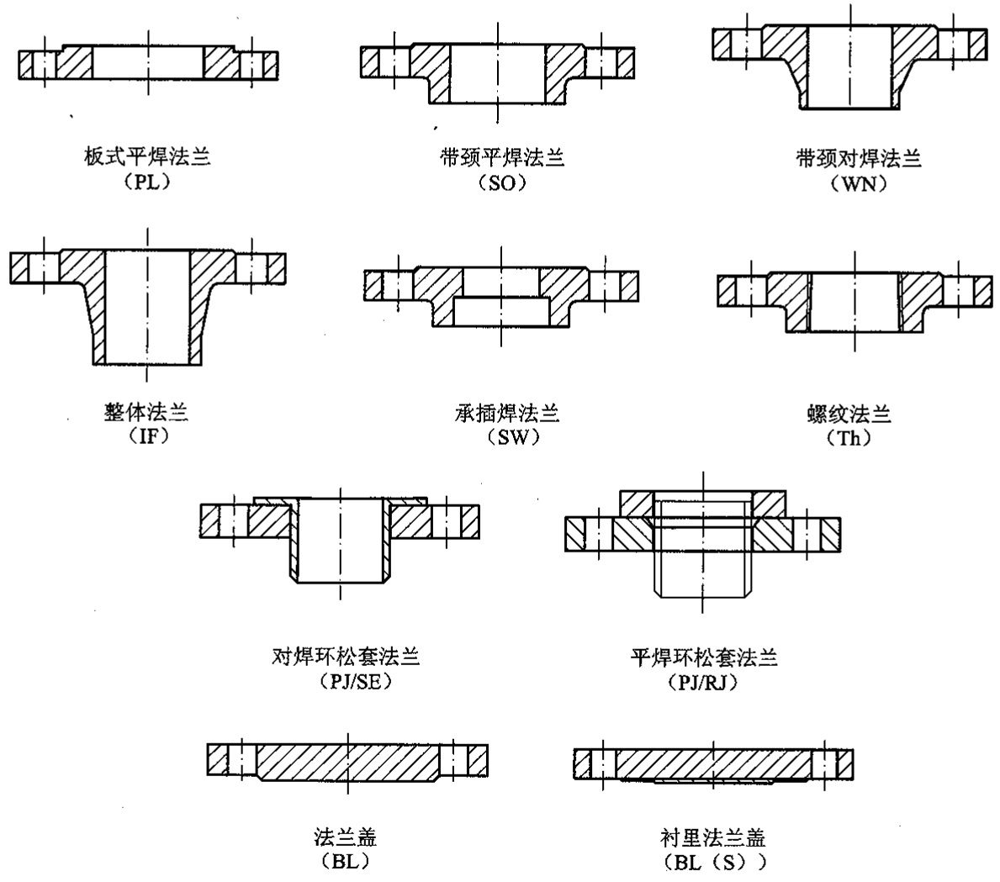

图3.1.1 法兰类型及其代号

<!-- page: 36 -->

表 3.1.1 法兰类型代号

| 法兰类型代号 | 法兰类型 |
|---|---|
| PL | 板式平焊法兰 |
| SO | 带颈平焊法兰 |
| WN | 带颈对焊法兰 |
| IF | 整体法兰 |
| SW | 承插焊法兰 |
| Th | 螺纹法兰 |
| PJ/SE | 对焊环松套法兰 |
| PJ/RJ | 平焊环松套法兰 |
| BL | 法兰盖 |
| BL(S) | 衬里法兰盖 |

3.1.4 各种法兰类型适用的公称尺寸和公称压力按表3.1.4的规定。

<!-- page: 37 -->

表 3.1.4 管法兰类型和适用范围

| 法兰类型 | 板式平焊法兰(PL) |  |  |  |  |  | 带颈平焊法兰(SO) |  |  |  |  | 带颈对焊法兰(WN) |  |  |  |  |  |  |
|---|---|---|---|---|---|---|---|---|---|---|---|---|---|---|---|---|---|---|
| 适用钢管外径系列 | A和B |  |  |  |  |  | A和B |  |  |  |  | A和B |  |  |  |  |  |  |
| 公称尺寸DN | 公称压力PN |  |  |  |  |  | 公称压力PN |  |  |  |  | 公称压力PN |  |  |  |  |  |  |
| 2.5 | 6 | 10 | 16 | 25 | 40 | 6 | 10 | 16 | 25 | 40 | 10 | 16 | 25 | 40 | 63 | 100 | 160 |  |
| 10 | X | X | X | X | X | X | X | X | X | X | X | X | X | X | X | X | X | X |
| 15 | X | X | X | X | X | X | X | X | X | X | X | X | X | X | X | X | X | X |
| 20 | X | X | X | X | X | X | X | X | X | X | X | X | X | X | X | X | X | X |
| 25 | X | X | X | X | X | X | X | X | X | X | X | X | X | X | X | X | X | X |
| 32 | X | X | X | X | X | X | X | X | X | X | X | X | X | X | X | X | X | X |
| 40 | X | X | X | X | X | X | X | X | X | X | X | X | X | X | X | X | X | X |
| 50 | X | X | X | X | X | X | X | X | X | X | X | X | X | X | X | X | X | X |
| 65 | X | X | X | X | X | X | X | X | X | X | X | X | X | X | X | X | X | X |
| 80 | X | X | X | X | X | X | X | X | X | X | X | X | X | X | X | X | X | X |
| 100 | X | X | X | X | X | X | X | X | X | X | X | X | X | X | X | X | X | X |
| 125 | X | X | X | X | X | X | X | X | X | X | X | X | X | X | X | X | X | X |
| 150 | X | X | X | X | X | X | X | X | X | X | X | X | X | X | X | X | X | X |
| 200 | X | X | X | X | X | X | X | X | X | X | X | X | X | X | X | X | X | X |
| 250 | X | X | X | X | X | X | X | X | X | X | X | X | X | X | X | X | X | X |
| 300 | X | X | X | X | X | X | X | X | X | X | X | X | X | X | X | X | X | X |
| 350 | X | X | X | X | X | X | - | X | X | X | X | X | X | X | X | X | X | - |
| 400 | X | X | X | X | X | X | - | X | X | X | X | X | X | X | X | X | - | - |
| 450 | X | X | X | X | X | X | - | X | X | X | X | X | X | X | X | - | - | - |
| 500 | X | X | X | X | X | X | - | X | X | X | X | X | X | X | X | - | - | - |
| 600 | X | X | X | X | X | X | - | X | X | X | X | X | X | X | X | - | - | - |
| 700 | X | - | - | - | - | - | - | - | - | - | - | X | X | - | - | - | - | - |
| 800 | X | - | - | - | - | - | - | - | - | - | - | X | X | - | - | - | - | - |
| 900 | X | - | - | - | - | - | - | - | - | - | - | X | X | - | - | - | - | - |
| 1000 | X | - | - | - | - | - | - | - | - | - | - | X | X | - | - | - | - | - |
| 1200 | X | - | - | - | - | - | - | - | - | - | - | X | X | - | - | - | - | - |
| 1400 | X | - | - | - | - | - | - | - | - | - | - | X | X | - | - | - | - | - |
| 1600 | X | - | - | - | - | - | - | - | - | - | - | X | X | - | - | - | - | - |
| 1800 | X | - | - | - | - | - | - | - | - | - | - | X | X | - | - | - | - | - |
| 2000 | X | - | - | - | - | - | - | - | - | - | - | X | X | - | - | - | - | - |

<!-- page: 38 -->

| 法兰类型 | 整体法兰(IF) |  |  |  |  |  |  |  | 承插焊法兰(SW) |  |  |  |  |  | 螺纹法兰(Th) |  |  |  |  |
|---|---|---|---|---|---|---|---|---|---|---|---|---|---|---|---|---|---|---|---|
| 适用钢管外径系列 | A、B一致 |  |  |  |  |  |  |  | A和B |  |  |  |  |  | A |  |  |  |  |
| 公称尺寸DN | 公称压力PN |  |  |  |  |  |  |  | 公称压力PN |  |  |  |  |  | 公称压力PN |  |  |  |  |
| 6 | 10 | 16 | 25 | 40 | 63 | 100 | 160 | 10 | 16 | 25 | 40 | 63 | 100 | 6 | 10 | 16 | 25 | 40 |  |
| 10 | X | X | X | X | X | X | X | X | X | X | X | X | X | X | X | X | X | X | X |
| 15 | X | X | X | X | X | X | X | X | X | X | X | X | X | X | X | X | X | X | X |
| 20 | X | X | X | X | X | X | X | X | X | X | X | X | X | X | X | X | X | X | X |
| 25 | X | X | X | X | X | X | X | X | X | X | X | X | X | X | X | X | X | X | X |
| 32 | X | X | X | X | X | X | X | X | X | X | X | X | X | X | X | X | X | X | X |
| 40 | X | X | X | X | X | X | X | X | X | X | X | X | X | X | X | X | X | X | X |
| 50 | X | X | X | X | X | X | X | X | X | X | X | X | X | X | X | X | X | X | X |
| 65 | X | X | X | X | X | X | X | X | - | - | - | - | - | - | X | X | X | X | X |
| 80 | X | X | X | X | X | X | X | X | - | - | - | - | - | - | X | X | X | X | X |
| 100 | X | X | X | X | X | X | X | X | - | - | - | - | - | - | X | X | X | X | X |
| 125 | X | X | X | X | X | X | X | X | - | - | - | - | - | - | X | X | X | X | X |
| 150 | X | X | X | X | X | X | X | X | - | - | - | - | - | - | X | X | X | X | X |
| 200 | X | X | X | X | X | X | X | X | - | - | - | - | - | - | - | - | - | - | - |
| 250 | X | X | X | X | X | X | X | X | - | - | - | - | - | - | - | - | - | - | - |
| 300 | X | X | X | X | X | X | X | X | - | - | - | - | - | - | - | - | - | - | - |
| 350 | X | X | X | X | X | X | X | - | - | - | - | - | - | - | - | - | - | - | - |
| 400 | X | X | X | X | X | X | X | - | - | - | - | - | - | - | - | - | - | - | - |
| 450 | X | X | X | X | X | - | - | - | - | - | - | - | - | - | - | - | - | - | - |
| 500 | X | X | X | X | X | - | - | - | - | - | - | - | - | - | - | - | - | - | - |
| 600 | X | X | X | X | X | - | - | - | - | - | - | - | - | - | - | - | - | - | - |
| 700 | X | X | X | X | - | - | - | - | - | - | - | - | - | - | - | - | - | - | - |
| 800 | X | X | X | X | - | - | - | - | - | - | - | - | - | - | - | - | - | - | - |
| 900 | X | X | X | X | - | - | - | - | - | - | - | - | - | - | - | - | - | - | - |
| 1000 | X | X | X | X | - | - | - | - | - | - | - | - | - | - | - | - | - | - | - |
| 1200 | X | X | X | X | - | - | - | - | - | - | - | - | - | - | - | - | - | - | - |
| 1400 | X | X | X | - | - | - | - | - | - | - | - | - | - | - | - | - | - | - | - |
| 1600 | X | X | X | - | - | - | - | - | - | - | - | - | - | - | - | - | - | - | - |
| 1800 | X | X | X | - | - | - | - | - | - | - | - | - | - | - | - | - | - | - | - |
| 2000 | X | X | X | - | - | - | - | - | - | - | - | - | - | - | - | - | - | - | - |

<!-- page: 39 -->

续表3.1.4

| 法兰类型 | 对焊环松套法兰(PJ/SE) |  |  |  |  | 平焊环松套法兰(PJ/RJ) |  |  | 法兰盖(BL) |  |  |  |  |  |  |  | 衬里法兰盖(BL(S)) |  |  |  |  |  |
|---|---|---|---|---|---|---|---|---|---|---|---|---|---|---|---|---|---|---|---|---|---|---|
| 适用钢管外径系列 | A和B |  |  |  |  | A和B |  |  | A、B一致 |  |  |  |  |  |  |  | A、B一致 |  |  |  |  |  |
| 公称尺寸DN | 公称压力PN |  |  |  |  | 公称压力PN |  |  | 公称压力PN |  |  |  |  |  |  |  | 公称压力PN |  |  |  |  |  |
| 6 | 10 | 16 | 25 | 40 | 6 | 10 | 16 | 2.5 | 6 | 10 | 16 | 25 | 40 | 63 | 100 | 160 | 6 | 10 | 16 | 25 | 40 |  |
| 10 | X | X | X | X | X | X | X | X | X | X | X | X | X | X | X | X | X | - | - | - | - | - |
| 15 | X | X | X | X | X | X | X | X | X | X | X | X | X | X | X | X | X | - | - | - | - | - |
| 20 | X | X | X | X | X | X | X | X | X | X | X | X | X | X | X | X | X | - | - | - | - | - |
| 25 | X | X | X | X | X | X | X | X | X | X | X | X | X | X | X | X | X | - | - | - | - | - |
| 32 | X | X | X | X | X | X | X | X | X | X | X | X | X | X | X | X | X | - | - | - | - | - |
| 40 | X | X | X | X | X | X | X | X | X | X | X | X | X | X | X | X | X | X | X | X | X | X |
| 50 | X | X | X | X | X | X | X | X | X | X | X | X | X | X | X | X | X | X | X | X | X | X |
| 65 | X | X | X | X | X | X | X | X | X | X | X | X | X | X | X | X | X | X | X | X | X | X |
| 80 | X | X | X | X | X | X | X | X | X | X | X | X | X | X | X | X | X | X | X | X | X | X |
| 100 | X | X | X | X | X | X | X | X | X | X | X | X | X | X | X | X | X | X | X | X | X | X |
| 125 | X | X | X | X | X | X | X | X | X | X | X | X | X | X | X | X | X | X | X | X | X | X |
| 150 | X | X | X | X | X | X | X | X | X | X | X | X | X | X | X | X | X | X | X | X | X | X |
| 200 | X | X | X | X | X | X | X | X | X | X | X | X | X | X | X | X | X | X | X | X | X | X |
| 250 | X | X | X | X | X | X | X | X | X | X | X | X | X | X | X | X | X | X | X | X | X | X |
| 300 | X | X | X | X | X | X | X | X | X | X | X | X | X | X | X | X | X | X | X | X | X | X |
| 350 | X | X | X | X | X | X | X | X | X | X | X | X | X | X | X | X | - | X | X | X | X | X |
| 400 | X | X | X | X | X | X | X | X | X | X | X | X | X | X | X | X | - | X | X | X | X | X |
| 450 | X | X | X | X | X | X | X | X | X | X | X | X | X | X | - | - | - | X | X | X | X | X |
| 500 | X | X | X | X | X | X | X | X | X | X | X | X | X | X | - | - | - | X | X | X | X | X |
| 600 | X | X | X | X | X | X | X | X | X | X | X | X | X | X | - | - | - | X | X | X | X | X |
| 700 | - | - | - | - | - | - | - | - | X | X | X | X | - | - | - | - | - | - | - | - | - | - |
| 800 | - | - | - | - | - | - | - | - | X | X | X | X | - | - | - | - | - | - | - | - | - | - |
| 900 | - | - | - | - | - | - | - | - | X | X | X | X | - | - | - | - | - | - | - | - | - | - |
| 1000 | - | - | - | - | - | - | - | - | X | X | X | X | - | - | - | - | - | - | - | - | - | - |
| 1200 | - | - | - | - | - | - | - | - | X | X | X | X | - | - | - | - | - | - | - | - | - | - |
| 1400 | - | - | - | - | - | - | - | - | X | X | - | - | - | - | - | - | - | - | - | - | - | - |
| 1600 | - | - | - | - | - | - | - | - | X | X | - | - | - | - | - | - | - | - | - | - | - | - |
| 1800 | - | - | - | - | - | - | - | - | X | X | - | - | - | - | - | - | - | - | - | - | - | - |
| 2000 | - | - | - | - | - | - | - | - | X | X | - | - | - | - | - | - | - | - | - | - | - | - |

<!-- page: 40 -->

### 3.2 法兰密封面

3.2.1 法兰的密封面型式及其代号按图 3.2.1 和表 3.2.1 的规定。法兰的密封面型式包括:突面、凹面/凸面、榫面/槽面、全平面和环连接面。

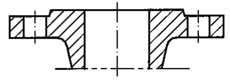

突面（RF）

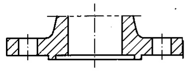

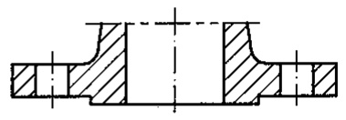

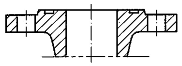

榫面/槽面（TG）

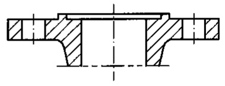

凹面/凸面(MFM)

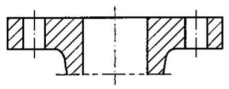

全平面（FF）

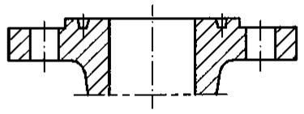

环连接面（RJ）

表 3.2.1 密封面型式及其代号

| 密封面型式 | 突面 | 凹面 | 凸面 | 榫面 | 槽面 | 全平面 | 环连接面 |
|---|---|---|---|---|---|---|---|
| 代号 | RF | FM | M | T | G | FF | RJ |

3.2.2 各种类型法兰密封面型式的适用范围按表3.2.2的规定。

表 3.2.2 各种类型法兰的密封面型式及其适用范围

| 法兰类型 | 密封面型式 | 公称压力 PN |  |  |  |  |  |  |  |  |
|---|---|---|---|---|---|---|---|---|---|---|
| 2.5 | 6 | 10 | 16 | 25 | 40 | 63 | 100 | 160 |  |  |
| 板式平焊法兰(PL) | 突面(RF) | DN10~DN2000 | DN10~DN600 |  |  |  |  | — |  |  |
| 全平面(FF) | DN10~DN2000 | DN10~DN600 |  |  | — |  |  |  |  |  |
| 带颈平焊法兰(SO) | 突面(RF) | — | DN10~DN300 | DN10~DN600 |  |  |  | — |  |  |
| 凹面(FM)凸面(M) | — |  | DN10~DN600 |  |  |  | — |  |  |  |
| 榫面(T)槽面(G) | — |  | DN10~DN600 |  |  |  | — |  |  |  |
| 全平面(FF) | — | DN10~DN300 | DN10~DN600 |  | — |  |  |  |  |  |

<!-- page: 41 -->

(mm)

| 法兰类型 | 密封面型式 | 公称压力 PN |  |  |  |  |  |  |  |  |
|---|---|---|---|---|---|---|---|---|---|---|
| 2.5 | 6 | 10 | 16 | 25 | 40 | 63 | 100 | 160 |  |  |
| 带颈对焊法兰(WN) | 突面(RF) | - |  | DN10~DN2000 |  | DN10~DN600 |  | DN10~DN400 | DN10~DN350 | DN10~DN300 |
| 凹面(FM)凸面(M) | - |  | DN10~DN600 |  |  |  | DN10~DN400 | DN10~DN350 | DN10~DN300 |  |
| 榫面(T)槽面(G) | - |  | DN10~DN600 |  |  |  | DN10~DN400 | DN10~DN350 | DN10~DN300 |  |
| 全平面(FF) | - |  | DN10~DN2000 |  | - |  |  |  |  |  |
| 环连接面(RJ) | - |  |  |  |  |  | DN15~DN400 |  | DN15~DN300 |  |
| 整体法兰(IF) | 突面(RF) | - | DN10~DN2000 |  |  | DN10~DN1200 | DN10~DN600 | DN10~DN400 |  | DN10~DN300 |
| 凹面(FM)凸面(M) | - |  | DN10~DN600 |  |  |  | DN10~DN400 |  | DN10~DN300 |  |
| 榫面(T)槽面(G) | - |  | DN10~DN600 |  |  |  | DN10~DN400 |  | DN10~DN300 |  |
| 全平面(FF) | - | DN10~DN2000 |  |  | - |  |  |  |  |  |
| 环连接面(RJ) | - |  |  |  |  |  | DN15~DN400 |  | DN15~DN300 |  |
| 承插焊法兰(SW) | 突面(RF) | - |  | DN10~DN50 |  |  |  |  |  | - |
| 凹面(FM)凸面(M) | - |  | DN10~DN50 |  |  |  |  |  | - |  |
| 榫面(T)槽面(G) | - |  | DN10~DN50 |  |  |  |  |  | - |  |
| 螺纹法兰(Th) | 突面(RF) | - | DN10~DN150 |  |  |  |  | - |  |  |
| 全平面(FF) | - | DN10~DN150 |  |  | - |  |  |  |  |  |
| 对焊环松套法兰(PJ/SE) | 突面(RF) | - | DN10~DN600 |  |  |  |  | - |  |  |
| 平焊环松套法兰(PJ/RJ) | 突面(RF) | - | DN10~DN600 |  |  | - |  |  |  |  |
| 凹面(FM)凸面(M) | - |  | DN10~DN600 |  | - |  |  |  |  |  |
| 榫面(T)槽面(G) | - |  | DN10~DN600 |  | - |  |  |  |  |  |
| 法兰盖(BL) | 突面(RF) | DN10~DN2000 |  | DN10~DN1200 |  | DN10~DN600 |  | DN10~DN400 |  | DN10~DN300 |
| 凹面(FM)凸面(M) | - |  | DN10~DN600 |  |  |  | DN10~DN400 |  | DN10~DN300 |  |
| 榫面(T)槽面(G) | - |  | DN10~DN600 |  |  |  | DN10~DN400 |  | DN10~DN300 |  |
| 全平面(FF) | DN10~DN2000 |  | DN10~DN1200 |  | - |  |  |  |  |  |
| 环连接面(RJ) | - |  |  |  |  |  | DN15~DN400 |  | DN15~DN300 |  |
| 衬里法兰盖(BL(S)) | 突面(RF) | - | DN40~DN600 |  |  |  |  | - |  |  |
| 凸面(M) | - |  | DN40~DN600 |  |  |  | - |  |  |  |
| 槽面(T) | - |  | DN40~DN600 |  |  |  | - |  |  |  |

<!-- page: 42 -->

#### 3.2.3 法兰密封面表面粗糙度。

1 法兰密封面应进行机加工,表面粗糙度按表 3.2.3-1 的规定。用户有特殊要求时应在订货时注明。

2 法兰密封面缺陷不得超过表3.2.3-2规定的范围。任意两相邻缺陷之间的距离应大于或等于4倍缺陷最大径向尺寸，不允许有凸出法兰密封面的缺陷。

表 3.2.3-1 密封面的表面粗糙度

| 密封面型式 | 密封面代号 | Ra(\mu m) |  |
|---|---|---|---|
| 最小 | 最大 |  |  |
| 全平面凹面/凸面突面 | FFFM/MRF | 3.2 | 6.3 |
| 榫面/槽面 | T/G | 0.8 | 3.2 |
| 环连接面 | RJ | 0.4 | 1.6 |

注:突面、凹面/凸面及全平面密封面是采用加工刀具加工时自然形成的一种锯齿形同心圆或螺旋齿槽。加工刀具的圆角半径应不小于1.5mm，形成的锯齿形同心圆或螺旋齿槽深度约为0.05mm，节距约为0.45~0.55mm。

(mm)

| 公称尺寸DN | 缺陷的最大径向投影尺寸(缺陷深度≤h) | 缺陷的最大深度和径向投影尺寸(缺陷深度>h) | 公称尺寸DN | 缺陷的最大径向投影尺寸(缺陷深度≤h) | 缺陷的最大深度和径向投影尺寸(缺陷深度>h) |
|---|---|---|---|---|---|
| 15 | 3.0 | 1.5 | 200 | 8.0 | 4.5 |
| 20 | 3.0 | 1.5 | 250 | 8.0 | 4.5 |
| 25 | 3.0 | 1.5 | 300 | 8.0 | 4.5 |
| 32 | 3.0 | 1.5 | 350 | 8.0 | 4.5 |
| 40 | 3.0 | 1.5 | 400 | 10.0 | 4.5 |
| 50 | 3.0 | 1.5 | 450 | 12.0 | 6.0 |
| 65 | 3.0 | 1.5 | 500 | 12.0 | 6.0 |
| 80 | 4.5 | 3.0 | 600 | 12.0 | 6.0 |
| 100 | 6.0 | 3.0 | 700~900 | 12.5 | 6.0 |
| 125 | 6.0 | 3.0 | 1000~1400 | 14.0 | 7.0 |
| 150 | 6.0 | 3.0 | 1600~2000 | 15.5 | 7.5 |

2 h 为法兰密封面的锯齿形同心圆或螺旋齿槽深。

#### 3.2.4 螺栓支承面。

1 螺栓支承面应进行机加工或锪孔(鱼眼孔)。锪孔尺寸按 GB/T 152.4 的规定。螺栓支承面与密封面的平行度应符合本标准表 10.0.1 的规定。

2 螺栓支承面机加工或锪孔后，应保证法兰的厚度符合本标准表10.0.1规定的尺寸公差要求。

3 下列采用 B 系列钢管外径的法兰,应在法兰的螺栓支承面,以螺栓孔为中心,锪出表 3.2.4 所列直径的平面,以适用于紧固件的装配。锪平面应与法兰的螺栓支承面齐平,允许与法兰颈部大

<!-- page: 43 -->

端直径 $N$ 或转角 $R$ 相交。

1) DN350～DN600 带颈平焊钢制管法兰；

2) DN350～DN900 带颈对焊钢制管法兰。

(mm)

| 螺栓尺寸 | 螺栓孔直径L | 锪平面直径 |
|---|---|---|
| M20 | 22 | 40 |
| M24 | 26 | 48 |
| M27 | 30 | 53 |
| M30 | 33 | 61 |
| M33 | 36 | 66 |
| M36 | 39 | 71 |
| M39 | 42 | 76 |
| M45 | 48 | 89 |

3.2.5 密封面尺寸。

1 突面、凹面或凸面、榫面或槽面法兰的密封面尺寸按图3.2.5-1和表3.2.5-1的规定。

2 环连接面法兰的密封面尺寸按图3.2.5-2和表3.2.5-2的规定。

3 突面、凹面或凸面、榫面或槽面法兰的密封面尺寸 $f_{1}, f_{2}$ 包括在法兰厚度 $C$ 内（如图3.2.5-1所示），环连接面法兰的突台高度 $E$ 未包括在法兰厚度 $C$ 内（如图3.2.5-2所示）。

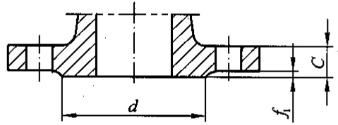

突面（RF）

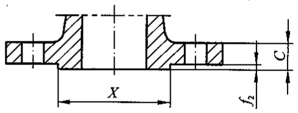

凸面（M）

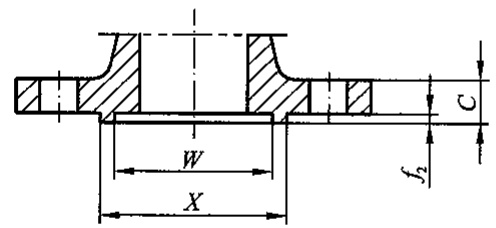

榫面（T）

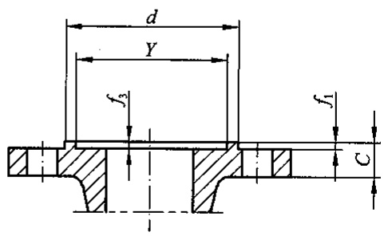

凹面（FM）

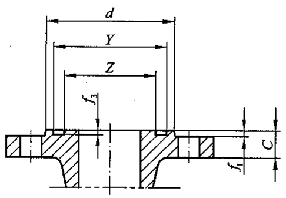

图3.2.5-1 突面、凹面/凸面、榫面/槽面的密封面尺寸

<!-- page: 44 -->

(mm)

| 公称尺寸DN | d |  |  |  |  |  | f1 | f2 | f3 | W | X | Y | Z |
|---|---|---|---|---|---|---|---|---|---|---|---|---|---|
| 公称压力PN |  |  |  |  |  |  |  |  |  |  |  |  |  |
| 2.5 | 6 | 10 | 16 | 25 | ≥40 |  |  |  |  |  |  |  |  |
| 10 | 35 | 35 | 40 | 40 | 40 | 40 | 2 | 4.5 | 4.0 | 24 | 34 | 35 | 23 |
| 15 | 40 | 40 | 45 | 45 | 45 | 45 | 2 | 4.5 | 4.0 | 29 | 39 | 40 | 28 |
| 20 | 50 | 50 | 58 | 58 | 58 | 58 | 2 | 4.5 | 4.0 | 36 | 50 | 51 | 35 |
| 25 | 60 | 60 | 68 | 68 | 68 | 68 | 2 | 4.5 | 4.0 | 43 | 57 | 58 | 42 |
| 32 | 70 | 70 | 78 | 78 | 78 | 78 | 2 | 4.5 | 4.0 | 51 | 65 | 66 | 50 |
| 40 | 80 | 80 | 88 | 88 | 88 | 88 | 2 | 4.5 | 4.0 | 61 | 75 | 76 | 60 |
| 50 | 90 | 90 | 102 | 102 | 102 | 102 | 2 | 4.5 | 4.0 | 73 | 87 | 88 | 72 |
| 65 | 110 | 110 | 122 | 122 | 122 | 122 | 2 | 4.5 | 4.0 | 95 | 109 | 110 | 94 |
| 80 | 128 | 128 | 138 | 138 | 138 | 138 | 2 | 4.5 | 4.0 | 106 | 120 | 121 | 105 |
| 100 | 148 | 148 | 158 | 158 | 162 | 162 | 2 | 5.0 | 4.5 | 129 | 149 | 150 | 128 |
| 125 | 178 | 178 | 188 | 188 | 188 | 188 | 2 | 5.0 | 4.5 | 155 | 175 | 176 | 154 |
| 150 | 202 | 202 | 212 | 212 | 218 | 218 | 2 | 5.0 | 4.5 | 183 | 203 | 204 | 182 |
| 200 | 258 | 258 | 268 | 268 | 278 | 285 | 2 | 5.0 | 4.5 | 239 | 259 | 260 | 238 |
| 250 | 312 | 312 | 320 | 320 | 335 | 345 | 2 | 5.0 | 4.5 | 292 | 312 | 313 | 291 |
| 300 | 365 | 365 | 370 | 378 | 395 | 410 | 2 | 5.0 | 4.5 | 343 | 363 | 364 | 342 |
| 350 | 415 | 415 | 430 | 428 | 450 | 465 | 2 | 5.5 | 5.0 | 395 | 421 | 422 | 394 |
| 400 | 465 | 465 | 482 | 490 | 505 | 535 | 2 | 5.5 | 5.0 | 447 | 473 | 474 | 446 |
| 450 | 520 | 520 | 532 | 550 | 555 | 560 | 2 | 5.5 | 5.0 | 497 | 523 | 524 | 496 |
| 500 | 570 | 570 | 585 | 610 | 615 | 615 | 2 | 5.5 | 5.0 | 549 | 575 | 576 | 548 |
| 600 | 670 | 670 | 685 | 725 | 720 | 735 | 2 | 5.5 | 5.0 | 649 | 675 | 676 | 648 |
| 700 | 775 | 775 | 800 | 795 | 820 | - | 2 | - |  |  |  |  |  |
| 800 | 880 | 880 | 905 | 900 | 930 | 2 |  |  |  |  |  |  |  |
| 900 | 980 | 980 | 1005 | 1000 | 1030 | 2 |  |  |  |  |  |  |  |
| 1000 | 1080 | 1080 | 1110 | 1115 | 1140 | 2 |  |  |  |  |  |  |  |
| 1200 | 1280 | 1295 | 1330 | 1330 | 1350 | 2 |  |  |  |  |  |  |  |
| 1400 | 1480 | 1510 | 1535 | 1530 |  | 2 |  |  |  |  |  |  |  |
| 1600 | 1690 | 1710 | 1760 | 1750 |  | 2 |  |  |  |  |  |  |  |
| 1800 | 1890 | 1920 | 1960 | 1950 |  | 2 |  |  |  |  |  |  |  |
| 2000 | 2090 | 2125 | 2170 | 2150 |  | 2 |  |  |  |  |  |  |  |

<!-- page: 45 -->

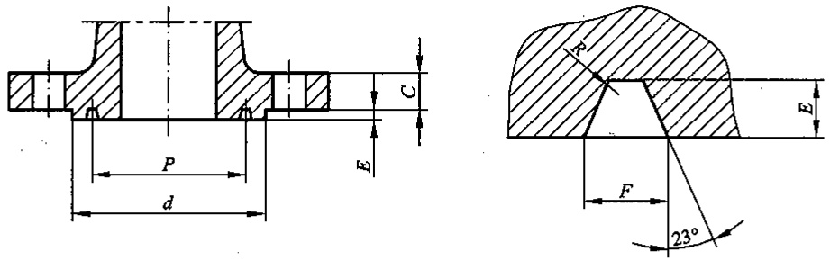

图3.2.5-2 环连接面的密封面尺寸

(mm)

| 公称尺寸DN | PN63 |  |  |  |  | PN100 |  |  |  |  | PN160 |  |  |  |  |
|---|---|---|---|---|---|---|---|---|---|---|---|---|---|---|---|
| d | P | E | F | Rmax | d | P | E | F | Rmax | d | P | E | F | Rmax |  |
| 15 | 55 | 35 | 6.5 | 9 | 0.8 | 55 | 35 | 6.5 | 9 | 0.8 | 58 | 35 | 6.5 | 9 | 0.8 |
| 20 | 68 | 45 | 68 | 45 | 70 | 45 |  |  |  |  |  |  |  |  |  |
| 25 | 78 | 50 | 78 | 50 | 80 | 50 |  |  |  |  |  |  |  |  |  |
| 32 | 86 | 65 | 86 | 65 | 86 | 65 |  |  |  |  |  |  |  |  |  |
| 40 | 102 | 75 | 102 | 75 | 102 | 75 |  |  |  |  |  |  |  |  |  |
| 50 | 112 | 85 | 8 | 12 | 116 | 85 | 8 | 12 | 118 | 95 | 8 | 12 |  |  |  |
| 65 | 136 | 110 | 140 | 110 | 142 | 110 |  |  |  |  |  |  |  |  |  |
| 80 | 146 | 115 | 150 | 115 | 152 | 130 |  |  |  |  |  |  |  |  |  |
| 100 | 172 | 145 | 176 | 145 | 178 | 160 |  |  |  |  |  |  |  |  |  |
| 125 | 208 | 175 | 212 | 175 | 215 | 190 |  |  |  |  |  |  |  |  |  |
| 150 | 245 | 205 | 250 | 205 | 255 | 205 | 10 | 14 |  |  |  |  |  |  |  |
| 200 | 306 | 265 | 312 | 265 | 322 | 275 | 11 | 17 |  |  |  |  |  |  |  |
| 250 | 362 | 320 | 376 | 320 | 388 | 330 |  |  |  |  |  |  |  |  |  |
| 300 | 422 | 375 | 448 | 375 | 456 | 380 | 14 | 23 |  |  |  |  |  |  |  |
| 350 | 475 | 420 | 505 | 420 | 11 | 17 | - |  |  |  |  |  |  |  |  |
| 400 | 540 | 480 | 565 | 480 |  |  |  |  |  |  |  |  |  |  |  |

<!-- page: 46 -->

## 4 材料

4.0.1 钢制管法兰用材料按表 4.0.1 的规定, 其化学成分、力学性能和其他技术要求应符合表 4.0.1 所列有关标准的规定。

表 4.0.1 钢制管法兰用材料

| 类别号 | 类别 | 钢板 |  | 锻件 |  | 铸件 |  |
|---|---|---|---|---|---|---|---|
| 材料牌号 | 标准编号 | 材料牌号 | 标准编号 | 材料牌号 | 标准编号 |  |  |
| 1C1 | 碳素钢 | — | — | A10516Mn16MnD | GB/T 12228JB 4726JB 4727 | WCB | GB/T 12229 |
| 1C2 | 碳素钢 | Q345R | GB 713 | — | — | WCCLC3、LCC | GB/T 12229JB/T 7248 |
| 1C3 | 碳素钢 | 16MnDR | GB 3531 | 08Ni3D25 | JB 4727GB/T 12228 | LCB | JB/T 7248 |
| 1C4 | 碳素钢 | Q235A,Q235B20Q245R09MnNiDR | GB/T 3274(GB/T 700)GB/T 711GB 713GB 3531 | 2009MnNiD | JB 4726JB 4727 | WCA | GB/T 12229 |
| 1C9 | 铬钼钢(1~1.25Cr-0.5Mo) | 14Cr1MoR15CrMoR | GB 713GB 713 | 14Cr1Mo15CrMo | JB 4726JB 4726 | WC6 | JB/T 5263 |
| 1C10 | 铬钼钢(2.25Cr-1Mo) | 12Cr2Mo1R | GB 713 | 12Cr2Mo1 | JB 4726 | WC9 | JB/T 5263 |
| 1C13 | 铬钼钢(5Cr-0.5Mo) | — | — | 1Cr5Mo | JB 4726 | ZG16Cr5MoG | GB/T 16253 |
| 1C14 | 铬钼铬钢(9Cr-1Mo-V) | — | — | — | — | C12A | JB/T 5263 |
| 2C1 | 304 | 0Cr18Ni9 | GB/T 4237 | 0Cr18Ni9 | JB 4728 | CF3CF8 | GB/T 12230GB/T 12230 |
| 2C2 | 316 | 0Cr17Ni12Mo2 | GB/T 4237 | 0Cr17Ni12Mo2 | JB 4728 | CF3MCF8M | GB/T 12230GB/T 12230 |
| 2C3 | 304L316L | 00Cr19Ni1000Cr17Ni14Mo2 | GB/T 4237GB/T 4237 | 00Cr19Ni1000Cr17Ni14Mo2 | JB 4728JB 4728 | — | — |
| 2C4 | 321 | 0Cr18Ni10Ti | GB/T 4237 | 0Cr18Ni10Ti | JB 4728 | — | — |
| 2C5 | 347 | 0Cr18Ni11Nb | GB/T 4237 | — | — | — | — |
| 12E0 | CF8C | — | — | — | — | CF8C | GB/T 12230 |

1 符合下列情况之一者，应符合 III 级或 III 级以上锻件的要求:

1）公称压力大于或等于PN100者；

<!-- page: 47 -->

2）公称压力大于PN40的铬钼钢锻件；

3）公称压力大于PN16且工作温度小于或等于 $-20^{\circ}\mathrm{C}$ 的铁素体钢锻件。

2 除上述规定外,公称压力不大于 PN63 的锻件应符合 II 级或 II 级以上锻件的要求。

4.0.3 带颈的法兰应采用锻件(或锻轧工艺)和铸(钢)件制作,不得采用钢板、拼焊或板卷等工艺制作。法兰盖等板式环形法兰可采用钢板或钢板拼焊制作,且符合下列要求:

1 钢板应经超声探伤,无分层缺陷。

2 应沿钢板轧制方向切割成条状，经弯制对焊成圆环，并使钢材的表面形成环的上下表面。

3 对接焊缝应采用全熔透焊缝。

4 对接焊缝应进行焊后热处理，并做 100% 射线或超声探伤，射线检测应符合 JB/T 4730 的 II 级要求，超声检测应符合 JB/T 4730 的 I 级要求。

4.0.4 不锈钢衬里法兰盖。

1 衬里层与法兰盖应紧密贴合，并按图 4.0.4 及 JB/T 4709 的规定施焊。填角焊和塞焊孔底层焊接材料按过渡层焊条选用，面层焊接材料按盖面层焊条选用。塞焊按表 4.0.4 的规定。

表 4.0.4 塞焊要求

| 焊接材料 | 低碳不锈钢衬里 | 超低碳不锈钢衬里 |
|---|---|---|
| 过渡层焊条 | 填角焊和塞焊孔底层焊接 | 母材塞焊孔焊接 |
| 盖面层焊条 | 塞焊孔面层焊接 | 衬里层塞焊孔焊接 |

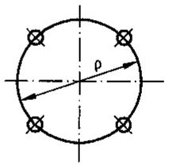

图4.0.4 衬里法兰盖的塞焊

DN150~DN250 中央1孔

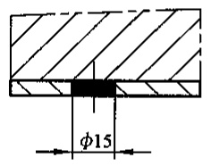

适用于低碳不锈钢衬里

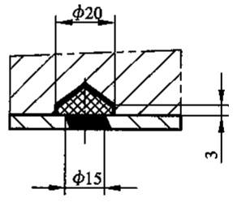

适用于超低碳不锈钢衬里

DN300~DN450 4孔均布

DN500～DN600 6孔均布+中央1孔

(a)

(b)

(c)

2 填角焊缝焊角高度等于衬里层周边厚度，塞焊焊缝应饱满。

3 衬里法兰盖的公称压力和工作温度下的最高允许工作压力根据法兰盖材料类别按第7章的规定。不锈钢衬里法兰盖的使用温度上限不大于 $350^{\circ}\mathrm{C}$ 。

4 在法兰盖上应开设一个 M6 的通气、检验孔，位置自定。塞焊后应通入压力不大于 0.1MPa 的压缩空气检漏，也可根据制造厂情况，开设其他尺寸的检验孔。

5 衬里层厚度 $t$ 的厚度负偏差为 $-1\mathrm{mm}$。

4.0.5 除本标准规定外，管法兰用材料尚应遵循相关标准、规范的要求。

<!-- page: 48 -->

## 5 法兰用垫片及紧固件

5.0.1 垫片应满足法兰接头在工作条件下的密封性能。在螺栓预紧荷载作用下，保证预紧和工作条件下要求的垫片应力，且不产生有害的变形、压碎等损伤。

5.0.2 垫片按 HG/T 20606～HG/T 20612 的规定。

5.0.3 紧固件包括六角头螺栓、等长双头螺柱、全螺纹螺柱和螺母，其适用的螺栓数量和规格按本标准表8.1.1的规定。

5.0.4 紧固件分为高强度、中强度和低强度紧固件。紧固件材料应根据垫片、压力、温度和法兰、密封面型式选用，以满足法兰接头在预紧和工作条件下的密封性能和承压强度。

5.0.5 紧固件按HG/T20613的规定。

<!-- page: 49 -->

## 6 法兰接头选配

法兰与垫片和紧固件的选配按HG/T20614的规定。

<!-- page: 50 -->

## 7 压力-温度额定值

7.0.1 公称压力等级为 PN2.5～PN160 的钢制管法兰和法兰盖，在工作温度下的最高允许工作压力按表 7.0.1-1～表 7.0.1-9 的规定。中间温度可采用内插法确定。

7.0.2 表 7.0.1-1～表 7.0.1-9 所列的管法兰材料类别按本标准表 4.0.1 的规定。

7.0.3 衬里法兰盖的公称压力和不同温度下的最高允许工作压力根据法兰盖材料类别确定。不锈钢衬里法兰盖的使用温度上限不大于 $350^{\circ}$ C。

7.0.4 工作温度系指压力作用下法兰金属的温度。工作温度低于 $20^{\circ}$ C 时，法兰的最高允许工作压力值与 $20^{\circ}$ C 时相同。工作温度高于表列温度上限时，最高允许工作压力可根据使用经验或计算，由设计者自行确定。

7.0.5 如果一个法兰接头上的两个法兰具有不同的压力额定值,该连接接头的最高允许工作压力值按较低值,并应控制安装时螺柱扭矩,防止过紧。

7.0.6 确定法兰接头的压力-温度额定值时，应考虑高温或者低温下管道系统中外力和外力矩对法兰接头密封性能的影响。

7.0.7 高温蠕变范围或者承受较大温度梯度的法兰接头应采取措施防止螺栓松弛，如定期上紧等。在低温操作条件下，应保证材料有足够的韧性。

7.0.8 采用本标准表4.0.1以外的材料时，法兰的最高允许工作压力可根据材料机械强度(常温/高温)相当的原则，参照表中的材料予以确定，但不大于表中对应材料的数值。

<!-- page: 51 -->

表 7.0.1-1 PN2.5 钢制管法兰用材料最大允许工作压力(表压)

| 法兰材料类别号 | 工作温度(℃) |  |  |  |  |  |  |  |  |  |  |  |  |  |  |  |  |  |  |  |  |
|---|---|---|---|---|---|---|---|---|---|---|---|---|---|---|---|---|---|---|---|---|---|
| 20 | 50 | 100 | 150 | 200 | 250 | 300 | 350 | 375 | 400 | 425 | 450 | 475 | 500 | 510 | 520 | 530 | 540 | 550 | 575 | 600 |  |
| 1C1 | 2.5 | 2.5 | 2.5 | 2.4 | 2.3 | 2.2 | 2.0 | 2.0 | 1.9 | 1.6 | 1.4 | 0.9 | 0.6 | 0.4 | - | - | - | - | - | - | - |
| 1C2 | 2.5 | 2.5 | 2.5 | 2.5 | 2.5 | 2.5 | 2.3 | 2.2 | 2.1 | 1.6 | 1.4 | 0.9 | 0.6 | 0.4 | - | - | - | - | - | - | - |
| 1C3 | 2.5 | 2.5 | 2.4 | 2.3 | 2.3 | 2.1 | 2.0 | 1.9 | 1.8 | 1.5 | 1.3 | 0.9 | 0.6 | 0.4 | - | - | - | - | - | - | - |
| 1C4 | 2.3 | 2.2 | 2.0 | 2.0 | 1.9 | 1.8 | 1.7 | 1.6 | 1.6 | 1.4 | 1.2 | 0.9 | 0.6 | 0.4 | - | - | - | - | - | - | - |
| 1C9 | 2.5 | 2.5 | 2.5 | 2.5 | 2.5 | 2.5 | 2.4 | 2.3 | 2.3 | 2.2 | 2.2 | 2.1 | 1.7 | 1.2 | 1.0 | 0.9 | 0.8 | 0.7 | 0.6 | 0.4 | 0.2 |
| 1C10 | 2.5 | 2.5 | 2.5 | 2.5 | 2.5 | 2.5 | 2.5 | 2.5 | 2.5 | 2.4 | 2.4 | 2.3 | 1.8 | 1.4 | 1.2 | 1.1 | 0.9 | 0.8 | 0.7 | 0.5 | 0.3 |
| 1C13 | 2.5 | 2.5 | 2.5 | 2.5 | 2.5 | 2.5 | 2.5 | 2.5 | 2.4 | 2.4 | 2.3 | 2.2 | 1.5 | 1.0 | 0.9 | 0.8 | 0.7 | 0.6 | 0.5 | 0.4 | 0.3 |
| 1C14 | 2.5 | 2.5 | 2.5 | 2.5 | 2.5 | 2.5 | 2.5 | 2.5 | 2.5 | 2.5 | 2.5 | 2.5 | 2.1 | 1.4 | 1.2 | 1.1 | 0.9 | 0.8 | 0.7 | 0.5 | 0.3 |
| 2C1 | 2.3 | 2.2 | 1.8 | 1.7 | 1.6 | 1.5 | 1.4 | 1.3 | 1.3 | 1.3 | 1.2 | 1.2 | 1.2 | 1.2 | 1.2 | 1.2 | 1.2 | 1.1 | 1.1 | 1.0 | 0.8 |
| 2C2 | 2.3 | 2.2 | 1.9 | 1.7 | 1.6 | 1.5 | 1.4 | 1.4 | 1.3 | 1.3 | 1.3 | 1.3 | 1.3 | 1.3 | 1.3 | 1.3 | 1.3 | 1.3 | 1.2 | 1.2 | 0.9 |
| 2C3 | 1.9 | 1.8 | 1.6 | 1.4 | 1.3 | 1.2 | 1.1 | 1.1 | 1.0 | 1.0 | 1.0 | 1.0 | - | - | - | - | - | - | - | - | - |
| 2C4 | 2.3 | 2.2 | 2.0 | 1.9 | 1.7 | 1.6 | 1.5 | 1.5 | 1.4 | 1.4 | 1.4 | 1.4 | 1.4 | 1.4 | 1.3 | 1.3 | 1.3 | 1.3 | 1.3 | 1.2 | 0.9 |
| 2C5 | 2.3 | 2.2 | 2.0 | 1.9 | 1.8 | 1.7 | 1.6 | 1.6 | 1.5 | 1.5 | 1.5 | 1.5 | 1.5 | 1.5 | 1.5 | 1.5 | 1.5 | 1.5 | 1.4 | 1.2 | 0.9 |
| 12E0 | 2.2 | 2.1 | 2.0 | 1.8 | 1.7 | 1.6 | 1.5 | 1.4 | - | 1.4 | - | 1.4 | - | 1.3 | - | - | - | - | 1.3 | - | 1.0 |

<!-- page: 52 -->

注:本标准表4.0.1所示管法兰用材料的适用压力-温度范围尚应遵循相同标准、规范的要求。

| 法兰材料类别号 | 工作温度(℃) |  |  |  |  |  |  |  |  |  |  |  |  |  |  |  |  |  |  |  |  |
|---|---|---|---|---|---|---|---|---|---|---|---|---|---|---|---|---|---|---|---|---|---|
| 20 | 50 | 100 | 150 | 200 | 250 | 300 | 350 | 375 | 400 | 425 | 450 | 475 | 500 | 510 | 520 | 530 | 540 | 550 | 575 | 600 |  |
| 1C1 | 6.0 | 6.0 | 6.0 | 5.8 | 5.6 | 5.4 | 5.0 | 4.7 | 4.6 | 4.0 | 3.3 | 2.3 | 1.5 | 1.0 | - | - | - | - | - | - | - |
| 1C2 | 6.0 | 6.0 | 6.0 | 6.0 | 6.0 | 6.0 | 5.5 | 5.3 | 5.1 | 4.0 | 3.3 | 2.3 | 1.5 | 1.0 | - | - | - | - | - | - | - |
| 1C3 | 6.0 | 6.0 | 5.8 | 5.7 | 5.5 | 5.2 | 4.8 | 4.6 | 4.5 | 3.8 | 3.1 | 2.3 | 1.5 | 1.0 | - | - | - | - | - | - | - |
| 1C4 | 5.5 | 5.4 | 5.0 | 4.8 | 4.7 | 4.5 | 4.1 | 4.0 | 3.9 | 3.5 | 3.0 | 2.2 | 1.5 | 1.0 | - | - | - | - | - | - | - |
| 1C9 | 6.0 | 6.0 | 6.0 | 6.0 | 6.0 | 6.0 | 5.8 | 5.6 | 5.5 | 5.4 | 5.3 | 5.1 | 4.1 | 2.9 | 2.5 | 2.2 | 1.9 | 1.6 | 1.4 | 1.0 | 0.7 |
| 1C10 | 6.0 | 6.0 | 6.0 | 6.0 | 6.0 | 6.0 | 6.0 | 6.0 | 6.0 | 5.9 | 5.8 | 5.7 | 4.3 | 3.3 | 3.0 | 2.7 | 2.3 | 2.0 | 1.7 | 1.2 | 0.8 |
| 1C13 | 6.0 | 6.0 | 6.0 | 6.0 | 6.0 | 6.0 | 6.0 | 6.0 | 5.9 | 5.8 | 5.6 | 5.4 | 3.6 | 2.4 | 2.2 | 1.9 | 1.7 | 1.5 | 1.4 | 1.0 | 0.7 |
| 1C14 | 6.0 | 6.0 | 6.0 | 6.0 | 6.0 | 6.0 | 6.0 | 6.0 | 6.0 | 6.0 | 6.0 | 6.0 | 5.2 | 3.5 | 3.0 | 2.6 | 2.3 | 1.9 | 1.7 | 1.2 | 0.8 |
| 2C1 | 5.5 | 5.3 | 4.5 | 4.1 | 3.8 | 3.6 | 3.4 | 3.2 | 3.2 | 3.1 | 3.0 | 3.0 | 2.9 | 2.9 | 2.9 | 2.9 | 2.8 | 2.8 | 2.7 | 2.4 | 1.9 |
| 2C2 | 5.5 | 5.3 | 4.6 | 4.2 | 3.9 | 3.7 | 3.5 | 3.3 | 3.3 | 3.2 | 3.2 | 3.2 | 3.1 | 3.1 | 3.1 | 3.1 | 3.1 | 3.1 | 3.1 | 2.8 | 2.3 |
| 2C3 | 4.6 | 4.4 | 3.8 | 3.4 | 3.1 | 2.9 | 2.8 | 2.6 | 2.6 | 2.5 | 2.5 | 2.4 | - | - | - | - | - | - | - | - | - |
| 2C4 | 5.5 | 5.3 | 4.9 | 4.5 | 4.2 | 4.0 | 3.7 | 3.6 | 3.5 | 3.5 | 3.4 | 3.4 | 3.3 | 3.3 | 3.3 | 3.3 | 3.3 | 3.3 | 3.2 | 2.9 | 2.3 |
| 2C5 | 5.5 | 5.4 | 5.0 | 4.7 | 4.4 | 4.1 | 3.9 | 3.8 | 3.7 | 3.7 | 3.7 | 3.7 | 3.7 | 3.7 | 3.7 | 3.6 | 3.6 | 3.6 | 3.5 | 3.0 | 2.3 |
| 12E0 | 5.3 | 5.1 | 4.7 | 4.4 | 4.1 | 3.9 | 3.6 | 3.5 | - | 3.3 | - | 3.3 | - | 3.2 | - | - | - | - | 3.1 | - | 2.3 |

<!-- page: 53 -->

注:本标准表4.0.1所示管法兰用材料的适用压力-温度范围尚应遵循相关标准、规范的要求。

| 法兰材料类别号 | 工作温度(℃) |  |  |  |  |  |  |  |  |  |  |  |  |  |  |  |  |  |  |  |  |
|---|---|---|---|---|---|---|---|---|---|---|---|---|---|---|---|---|---|---|---|---|---|
| 20 | 50 | 100 | 150 | 200 | 250 | 300 | 350 | 375 | 400 | 425 | 450 | 475 | 500 | 510 | 520 | 530 | 540 | 550 | 575 | 600 |  |
| 1C1 | 10.0 | 10.0 | 10.0 | 9.7 | 9.4 | 9.0 | 8.3 | 7.9 | 7.7 | 6.7 | 5.5 | 3.8 | 2.6 | 1.7 | - | - | - | - | - | - | - |
| 1C2 | 10.0 | 10.0 | 10.0 | 10.0 | 10.0 | 10.0 | 9.3 | 8.8 | 8.5 | 6.7 | 5.5 | 3.8 | 2.6 | 1.7 | - | - | - | - | - | - | - |
| 1C3 | 10.0 | 10.0 | 9.7 | 9.4 | 9.2 | 8.7 | 8.1 | 7.7 | 7.5 | 6.3 | 5.3 | 3.8 | 2.6 | 1.7 | - | - | - | - | - | - | - |
| 1C4 | 9.1 | 9.0 | 8.3 | 8.1 | 7.9 | 7.5 | 6.9 | 6.6 | 6.5 | 5.9 | 5.0 | 3.8 | 2.6 | 1.7 | - | - | - | - | - | - | - |
| 1C9 | 10.0 | 10.0 | 10.0 | 10.0 | 10.0 | 10.0 | 9.72 | 9.4 | 9.2 | 9.0 | 8.8 | 8.6 | 6.8 | 4.9 | 4.2 | 3.7 | 3.2 | 2.8 | 2.4 | 1.7 | 1.1 |
| 1C10 | 10.0 | 10.0 | 10.0 | 10.0 | 10.0 | 10.0 | 10.0 | 10.0 | 10.0 | 9.9 | 9.7 | 9.5 | 7.3 | 5.5 | 5.0 | 4.4 | 3.9 | 3.4 | 2.9 | 2.0 | 1.3 |
| 1C13 | 10.0 | 10.0 | 10.0 | 10.0 | 10.0 | 10.0 | 10.0 | 10.0 | 9.9 | 9.7 | 9.4 | 9.1 | 6.0 | 4.1 | 3.6 | 3.3 | 2.9 | 2.6 | 2.3 | 1.7 | 1.2 |
| 1C14 | 10.0 | 10.0 | 10.0 | 10.0 | 10.0 | 10.0 | 10.0 | 10.0 | 10.0 | 10.0 | 10.0 | 10.0 | 8.7 | 5.9 | 5.0 | 4.4 | 3.8 | 3.3 | 2.9 | 2.0 | 1.4 |
| 2C1 | 9.1 | 8.8 | 7.5 | 6.8 | 6.3 | 6.0 | 5.6 | 5.4 | 5.4 | 5.2 | 5.1 | 5.0 | 4.9 | 4.9 | 4.8 | 4.8 | 4.8 | 4.7 | 4.6 | 4.0 | 3.2 |
| 2C2 | 9.1 | 8.9 | 7.8 | 7.1 | 6.6 | 6.1 | 5.8 | 5.6 | 5.5 | 5.4 | 5.4 | 5.3 | 5.3 | 5.2 | 5.2 | 5.2 | 5.2 | 5.1 | 5.1 | 4.7 | 3.8 |
| 2C3 | 7.6 | 7.4 | 6.3 | 5.7 | 5.3 | 4.9 | 4.6 | 4.4 | 4.3 | 4.2 | 4.2 | 4.1 | - | - | - | - | - | - | - | - | - |
| 2C4 | 9.1 | 8.9 | 8.1 | 7.5 | 7.0 | 6.6 | 6.3 | 6.0 | 5.9 | 5.8 | 5.7 | 5.7 | 5.6 | 5.6 | 5.5 | 5.5 | 5.5 | 5.5 | 5.4 | 4.9 | 3.9 |
| 2C5 | 9.1 | 9.0 | 8.3 | 7.8 | 7.3 | 6.9 | 6.6 | 6.4 | 6.3 | 6.2 | 6.2 | 6.2 | 6.1 | 6.1 | 6.1 | 6.1 | 6.1 | 6.0 | 5.8 | 5.0 | 3.8 |
| 12E0 | 8.9 | 8.4 | 7.8 | 7.3 | 6.9 | 6.4 | 6.0 | 5.8 | - | 5.6 | - | 5.4 | - | 5.3 | - | - | - | - | 5.1 | - | 3.8 |

<!-- page: 54 -->

注:本标准表4.0.1所示管法兰用材料的适用压力-温度范围尚应遵循相关标准、规范的要求。

| 法兰材料类别号 | 工作温度(℃) |  |  |  |  |  |  |  |  |  |  |  |  |  |  |  |  |  |  |  |  |
|---|---|---|---|---|---|---|---|---|---|---|---|---|---|---|---|---|---|---|---|---|---|
| 20 | 50 | 100 | 150 | 200 | 250 | 300 | 350 | 375 | 400 | 425 | 450 | 475 | 500 | 510 | 520 | 530 | 540 | 550 | 575 | 600 |  |
| 1C1 | 16.0 | 16.0 | 16.0 | 15.6 | 15.1 | 14.4 | 13.4 | 12.8 | 12.4 | 10.8 | 8.9 | 6.2 | 4.2 | 2.7 | - | - | - | - | - | - | - |
| 1C2 | 16.0 | 16.0 | 16.0 | 16.0 | 16.0 | 16.0 | 14.9 | 14.2 | 13.7 | 10.8 | 8.9 | 6.2 | 4.2 | 2.7 | - | - | - | - | - | - | - |
| 1C3 | 16.0 | 16.0 | 15.6 | 15.2 | 14.7 | 14.0 | 13.0 | 12.4 | 12.1 | 10.1 | 8.4 | 6.1 | 4.2 | 2.7 | - | - | - | - | - | - | - |
| 1C4 | 14.7 | 14.4 | 13.4 | 13.0 | 12.6 | 12.0 | 11.2 | 10.7 | 10.5 | 9.4 | 8.0 | 6.0* | 4.2 | 2.7 | - | - | - | - | - | - | - |
| 1C9 | 16.0 | 16.0 | 16.0 | 16.0 | 16.0 | 16.0 | 15.5 | 15.0 | 14.8 | 14.5 | 14.1 | 13.8 | 11.0 | 7.9 | 6.8 | 6.0 | 5.2 | 4.5 | 3.9 | 2.7 | 1.8 |
| 1C10 | 16.0 | 16.0 | 16.0 | 16.0 | 16.0 | 16.0 | 16.0 | 16.0 | 16.0 | 15.9 | 15.6 | 15.3 | 11.7 | 8.9 | 8.0 | 7.1 | 6.2 | 5.4 | 4.7 | 3.2 | 2.1 |
| 1C13 | 16.0 | 16.0 | 16.0 | 16.0 | 16.0 | 16.0 | 16.0 | 16.0 | 15.9 | 15.6 | 15.1 | 14.6 | 9.6 | 6.6 | 5.8 | 5.3 | 4.7 | 4.1 | 3.7 | 2.7 | 1.9 |
| 1C14 | 16.0 | 16.0 | 16.0 | 16.0 | 16.0 | 16.0 | 16.0 | 16.0 | 16.0 | 16.0 | 16.0 | 16.0 | 14.0 | 9.4 | 8.0 | 7.1 | 6.1 | 5.3 | 4.6 | 3.2 | 2.2 |
| 2C1 | 14.7 | 14.2 | 12.1 | 11.0 | 10.2 | 9.6 | 9.0 | 8.7 | 8.6 | 8.4 | 8.2 | 8.1 | 7.9 | 7.8 | 7.7 | 7.7 | 7.6 | 7.5 | 7.3 | 6.4 | 5.2 |
| 2C2 | 14.7 | 14.3 | 12.5 | 11.4 | 10.6 | 9.8 | 9.3 | 9.0 | 8.8 | 8.7 | 8.6 | 8.5 | 8.5 | 8.4 | 8.3 | 8.3 | 8.3 | 8.3 | 8.2 | 7.6 | 6.1 |
| 2C3 | 12.3 | 11.8 | 10.2 | 9.2 | 8.5 | 7.9 | 7.4 | 7.1 | 6.9 | 6.8 | 6.7 | 6.5 | - | - | - | - | - | - | - | - | - |
| 2C4 | 14.7 | 14.4 | 13.1 | 12.1 | 11.3 | 10.7 | 10.1 | 9.7 | 9.4 | 9.3 | 9.2 | 9.1 | 9.0 | 8.9 | 8.9 | 8.8 | 8.8 | 8.8 | 8.7 | 7.9 | 6.3 |
| 2C5 | 14.7 | 14.4 | 13.4 | 12.5 | 11.8 | 11.2 | 10.6 | 10.2 | 10.1 | 10.0 | 9.9 | 9.9 | 9.8 | 9.8 | 9.8 | 9.8 | 9.8 | 9.7 | 9.4 | 8.1 | 6.1 |
| 12E0 | 14.2 | 13.5 | 12.5 | 11.7 | 11.0 | 10.3 | 9.7 | 9.2 | - | 8.9 | - | 8.7 | - | 8.5 | - | - | - | - | 8.2 | - | 6.1 |

<!-- page: 55 -->

表 7.0.1-5 PN25 钢制管法兰用材料最大允许工作压力(表压)

| 法兰材料类别号 | 工作温度(℃) |  |  |  |  |  |  |  |  |  |  |  |  |  |  |  |  |  |  |  |  |
|---|---|---|---|---|---|---|---|---|---|---|---|---|---|---|---|---|---|---|---|---|---|
| 20 | 50 | 100 | 150 | 200 | 250 | 300 | 350 | 375 | 400 | 425 | 450 | 475 | 500 | 510 | 520 | 530 | 540 | 550 | 575 | 600 |  |
| 1C1 | 25.0 | 25.0 | 25.0 | 24.4 | 23.7 | 22.5 | 20.9 | 20.0 | 19.4 | 16.9 | 14.0 | 9.7 | 6.5 | 4.2 | - | - | - | - | - | - | - |
| 1C2 | 25.0 | 25.0 | 25.0 | 25.0 | 25.0 | 25.0 | 23.3 | 22.2 | 21.4 | 16.9 | 14.0 | 9.7 | 6.5 | 4.2 | - | - | - | - | - | - | - |
| 1C3 | 25.0 | 25.0 | 24.4 | 23.7 | 23.0 | 21.9 | 20.4 | 19.4 | 18.8 | 15.9 | 13.3 | 9.6 | 6.5 | 4.2 | - | - | - | - | - | - | - |
| 1C4 | 23.0 | 22.5 | 20.9 | 20.4 | 19.7 | 18.8 | 17.5 | 16.7 | 16.5 | 14.8 | 12.6 | 9.5 | 6.5 | 4.2 | - | - | - | - | - | - | - |
| 1C9 | 25.0 | 25.0 | 25.0 | 25.0 | 25.0 | 25.0 | 24.3 | 23.5 | 23.1 | 22.7 | 22.1 | 21.5 | 17.1 | 12.5 | 10.7 | 9.4 | 8.2 | 7.0 | 6.1 | 4.2 | 2.9 |
| 1C10 | 25.0 | 25.0 | 25.0 | 25.0 | 25.0 | 25.0 | 25.0 | 25.0 | 25.0 | 24.8 | 24.4 | 23.9 | 18.3 | 14.0 | 12.6 | 11.2 | 9.8 | 8.5 | 7.4 | 5.1 | 3.3 |
| 1C13 | 25.0 | 25.0 | 25.0 | 25.0 | 25.0 | 25.0 | 25.0 | 25.0 | 24.9 | 24.3 | 23.6 | 22.8 | 15.1 | 10.4 | 9.1 | 8.2 | 7.3 | 6.5 | 5.8 | 4.3 | 3.0 |
| 1C14 | 25.0 | 25.0 | 25.0 | 25.0 | 25.0 | 25.0 | 25.0 | 25.0 | 25.0 | 25.0 | 25.0 | 25.0 | 21.9 | 14.8 | 12.6 | 11.2 | 9.6 | 8.2 | 7.2 | 5.0 | 3.4 |
| 2C1 | 23.0 | 22.1 | 18.9 | 17.2 | 16.0 | 15.0 | 14.2 | 13.7 | 13.5 | 13.2 | 12.9 | 12.7 | 12.5 | 12.3 | 12.2 | 12.1 | 12.0 | 11.9 | 11.5 | 10.1 | 8.2 |
| 2C2 | 23.0 | 22.3 | 19.5 | 17.8 | 16.5 | 15.5 | 14.6 | 14.1 | 13.8 | 13.6 | 13.5 | 13.4 | 13.3 | 13.2 | 13.1 | 13.1 | 13.0 | 13.0 | 12.9 | 12.0 | 9.6 |
| 2C3 | 19.2 | 18.5 | 16.0 | 14.5 | 13.3 | 12.4 | 11.7 | 11.1 | 10.9 | 10.7 | 10.5 | 10.3 | - | - | - | - | - | - | - | - | - |
| 2C4 | 23.0 | 22.5 | 20.4 | 19.0 | 17.7 | 16.7 | 15.8 | 15.2 | 14.8 | 14.6 | 14.4 | 14.3 | 14.1 | 14.0 | 13.9 | 13.9 | 13.8 | 13.8 | 13.6 | 12.4 | 9.8 |
| 2C5 | 23.0 | 22.6 | 20.9 | 19.6 | 18.4 | 17.4 | 16.6 | 16.0 | 15.8 | 15.7 | 15.6 | 15.5 | 15.4 | 15.4 | 15.4 | 15.4 | 15.3 | 15.2 | 14.7 | 12.7 | 9.6 |
| 12E0 | 22.2 | 21.1 | 19.6 | 18.3 | 17.2 | 16.1 | 15.1 | 14.4 | - | 13.9 | - | 13.6 | - | 13.2 | - | - | - | - | 12.8 | - | 9.6 |

<!-- page: 56 -->

表 7.0.1-6 PN40 钢制管法兰用材料最大允许工作压力(表压)

| 法兰材料类别号 | 工作温度(℃) |  |  |  |  |  |  |  |  |  |  |  |  |  |  |  |  |  |  |  |  |
|---|---|---|---|---|---|---|---|---|---|---|---|---|---|---|---|---|---|---|---|---|---|
| 20 | 50 | 100 | 150 | 200 | 250 | 300 | 350 | 375 | 400 | 425 | 450 | 475 | 500 | 510 | 520 | 530 | 540 | 550 | 575 | 600 |  |
| 1C1 | 40.0 | 40.0 | 40.0 | 39.1 | 37.9 | 36.0 | 33.5 | 31.9 | 31.1 | 27.0 | 22.4 | 15.6 | 10.5 | 6.8 | - | - | - | - | - | - | - |
| 1C2 | 40.0 | 40.0 | 40.0 | 40.0 | 40.0 | 40.0 | 37.2 | 35.6 | 34.2 | 27.0 | 22.4 | 15.6 | 10.5 | 6.8 | - | - | - | - | - | - | - |
| 1C3 | 40.0 | 40.0 | 39.0 | 38.0 | 36.9 | 35.1 | 32.6 | 31.1 | 30.1 | 25.4 | 21.2 | 15.4 | 10.5 | 6.8 | - | - | - | - | - | - | - |
| 1C4 | 36.8 | 36.1 | 33.5 | 32.6 | 31.6 | 30.1 | 27.9 | 26.7 | 26.3 | 23.7 | 20.1 | 15.2 | 10.5 | 6.8 | - | - | - | - | - | - | - |
| 1C9 | 40.0 | 40.0 | 40.0 | 40.0 | 40.0 | 40.0 | 38.9 | 37.6 | 36.9 | 36.2 | 35.4 | 34.5 | 27.4 | 19.9 | 17.1 | 15.1 | 13.1 | 11.3 | 9.8 | 6.8 | 4.7 |
| 1C10 | 40.0 | 40.0 | 40.0 | 40.0 | 40.0 | 40.0 | 40.0 | 40.0 | 40.0 | 39.7 | 39.0 | 38.3 | 29.2 | 22.3 | 20.2 | 18.0 | 15.7 | 13.6 | 12.0 | 8.1 | 5.3 |
| 1C13 | 40.0 | 40.0 | 40.0 | 40.0 | 40.0 | 40.0 | 40.0 | 40.0 | 39.8 | 38.9 | 37.8 | 36.4 | 24.1 | 16.6 | 14.7 | 13.3 | 11.8 | 10.4 | 9.3 | 6.9 | 4.8 |
| 1C14 | 40.0 | 40.0 | 40.0 | 40.0 | 40.0 | 40.0 | 40.0 | 40.0 | 40.0 | 40.0 | 40.0 | 40.0 | 35.0 | 23.7 | 20.2 | 17.8 | 15.5 | 13.3 | 11.7 | 8.1 | 5.5 |
| 2C1 | 36.8 | 35.4 | 30.3 | 27.5 | 25.5 | 24.1 | 22.7 | 21.9 | 21.6 | 21.2 | 20.6 | 20.3 | 19.9 | 19.6 | 19.5 | 19.4 | 19.2 | 19.0 | 18.4 | 16.2 | 13.1 |
| 2C2 | 36.8 | 35.6 | 31.3 | 28.5 | 26.4 | 24.7 | 23.4 | 22.6 | 22.1 | 21.8 | 21.6 | 21.4 | 21.2 | 21.0 | 21.0 | 20.9 | 20.8 | 20.8 | 20.7 | 19.1 | 15.5 |
| 2C3 | 30.6 | 29.6 | 25.5 | 23.1 | 21.2 | 19.8 | 18.7 | 17.8 | 17.5 | 17.1 | 16.8 | 16.5 | - | - | - | - | - | - | - | - | - |
| 2C4 | 36.8 | 35.9 | 32.7 | 30.3 | 28.4 | 26.7 | 25.3 | 24.2 | 23.7 | 23.4 | 23.1 | 22.8 | 22.6 | 22.4 | 22.3 | 22.2 | 22.1 | 22.0 | 21.8 | 19.9 | 15.8 |
| 2C5 | 36.8 | 36.1 | 33.4 | 31.3 | 29.5 | 27.9 | 26.6 | 25.6 | 25.2 | 25.1 | 24.9 | 24.8 | 24.7 | 24.6 | 24.6 | 24.6 | 24.6 | 24.3 | 23.5 | 20.4 | 15.4 |
| 12E0 | 35.6 | 33.8 | 31.3 | 29.3 | 27.6 | 25.8 | 24.2 | 23.1 | - | 22.2 | - | 21.7 | - | 21.2 | - | - | - | - | 20.4 | - | 15.3 |

<!-- page: 57 -->

表 7.0.1-7 PN63 钢制管法兰用材料最大允许工作压力(表压)

| 法兰材料类别号 | 工作温度(℃) |  |  |  |  |  |  |  |  |  |  |  |  |  |  |  |  |  |  |  |  |
|---|---|---|---|---|---|---|---|---|---|---|---|---|---|---|---|---|---|---|---|---|---|
| 20 | 50 | 100 | 150 | 200 | 250 | 300 | 350 | 375 | 400 | 425 | 450 | 475 | 500 | 510 | 520 | 530 | 540 | 550 | 575 | 600 |  |
| 1C1 | 63.0 | 63.0 | 63.0 | 61.5 | 59.6 | 56.8 | 52.7 | 50.3 | 49.0 | 42.5 | 35.2 | 24.5 | 16.6 | 10.8 | - | - | - | - | - | - | - |
| 1C2 | 63.0 | 63.0 | 63.0 | 63.0 | 63.0 | 63.0 | 58.7 | 56.0 | 53.8 | 42.5 | 35.2 | 24.5 | 16.6 | 10.8 | - | - | - | - | - | - | - |
| 1C3 | 63.0 | 63.0 | 61.4 | 59.8 | 58.1 | 55.2 | 51.3 | 48.9 | 47.5 | 40.0 | 33.4 | 24.3 | 16.6 | 10.8 | - | - | - | - | - | - | - |
| 1C4 | 57.9 | 56.8 | 52.7 | 51.3 | 49.8 | 47.4 | 44.0 | 42.1 | 41.5 | 37.4 | 31.7 | 24.0 | 16.6 | 10.8 | - | - | - | - | - | - | - |
| 1C9 | 63.0 | 63.0 | 63.0 | 63.0 | 63.0 | 63.0 | 61.2 | 59.2 | 58.1 | 57.1 | 55.7 | 54.3 | 43.2 | 31.4 | 26.9 | 23.8 | 20.7 | 17.8 | 15.6 | 10.8 | 7.4 |
| 1C10 | 63.0 | 63.0 | 63.0 | 63.0 | 63.0 | 63.0 | 63.0 | 63.0 | 63.0 | 62.5 | 61.5 | 60.3 | 46.0 | 35.2 | 31.9 | 28.3 | 24.8 | 21.4 | 18.8 | 12.9 | 8.4 |
| 1C13 | 63.0 | 63.0 | 63.0 | 63.0 | 63.0 | 63.0 | 63.0 | 63.0 | 62.7 | 61.3 | 59.6 | 57.3 | 37.9 | 26.1 | 23.2 | 20.9 | 18.6 | 16.4 | 14.8 | 10.9 | 7.6 |
| 1C14 | 63.0 | 63.0 | 63.0 | 63.0 | 63.0 | 63.0 | 63.0 | 63.0 | 63.0 | 63.0 | 63.0 | 63.0 | 55.1 | 37.3 | 31.9 | 28.1 | 24.3 | 20.9 | 18.4 | 12.8 | 8.7 |
| 2C1 | 57.9 | 55.8 | 47.7 | 43.4 | 40.2 | 37.9 | 35.8 | 34.5 | 34.0 | 33.3 | 32.5 | 31.9 | 31.4 | 30.9 | 30.7 | 30.5 | 30.3 | 29.9 | 29.0 | 25.5 | 20.7 |
| 2C2 | 57.9 | 56.1 | 49.2 | 44.9 | 41.6 | 38.9 | 36.9 | 35.5 | 34.9 | 34.4 | 34.0 | 33.7 | 33.5 | 33.2 | 33.0 | 32.9 | 32.8 | 32.7 | 32.6 | 30.2 | 24.4 |
| 2C3 | 48.3 | 46.6 | 40.2 | 36.4 | 33.5 | 31.1 | 29.5 | 28.1 | 27.5 | 27.0 | 26.5 | 26.0 | - | - | - | - | - | - | - | - | - |
| 2C4 | 57.9 | 56.6 | 51.4 | 47.8 | 44.7 | 42.0 | 39.8 | 38.2 | 37.4 | 36.8 | 36.3 | 36.0 | 35.6 | 35.3 | 35.1 | 35.0 | 34.9 | 34.7 | 34.4 | 31.3 | 24.8 |
| 2C5 | 57.9 | 56.8 | 52.6 | 49.4 | 46.4 | 43.9 | 41.9 | 40.3 | 39.7 | 39.6 | 39.2 | 39.0 | 38.9 | 38.8 | 38.8 | 38.7 | 38.7 | 38.3 | 37.0 | 32.1 | 24.3 |
| 12E0 | 56.0 | 53.2 | 49.3 | 46.2 | 43.4 | 40.6 | 38.1 | 36.4 | - | 35.0 | - | 34.2 | - | 33.3 | - | - | - | - | 32.2 | - | 24.1 |

<!-- page: 58 -->

注:本标准表4.0.1所示管法兰用材料的适用压力-温度范围尚应遵循相关标准、规范的要求。

| 法兰材料类别号 | 工作温度(℃) |  |  |  |  |  |  |  |  |  |  |  |  |  |  |  |  |  |  |  |  |
|---|---|---|---|---|---|---|---|---|---|---|---|---|---|---|---|---|---|---|---|---|---|
| 20 | 50 | 100 | 150 | 200 | 250 | 300 | 350 | 375 | 400 | 425 | 450 | 475 | 500 | 510 | 520 | 530 | 540 | 550 | 575 | 600 |  |
| 1C1 | 100.0 | 100.0 | 100.0 | 97.7 | 94.7 | 90.1 | 83.6 | 79.8 | 77.8 | 67.5 | 55.9 | 38.9 | 26.3 | 17.1 | - | - | - | - | - | - | - |
| 1C2 | 100.0 | 100.0 | 100.0 | 100.0 | 100.0 | 100.0 | 93.1 | 88.9 | 85.4 | 67.5 | 55.9 | 38.9 | 26.3 | 17.1 | - | - | - | - | - | - | - |
| 1C3 | 100.0 | 100.0 | 97.4 | 94.9 | 92.2 | 87.6 | 81.4 | 77.7 | 75.3 | 63.4 | 53.1 | 38.5 | 26.3 | 17.1 | - | - | - | - | - | - | - |
| 1C4 | 91.9 | 90.2 | 83.7 | 81.5 | 79.0 | 75.2 | 69.8 | 66.8 | 65.8 | 59.3 | 50.3 | 38.1 | 26.3 | 17.1 | - | - | - | - | - | - | - |
| 1C9 | 100.0 | 100.0 | 100.0 | 100.0 | 100.0 | 100.0 | 97.2 | 94.0 | 92.3 | 90.6 | 88.4 | 86.2 | 68.6 | 49.9 | 42.7 | 37.8 | 32.8 | 28.2 | 24.7 | 17.1 | 11.8 |
| 1C10 | 100.0 | 100.0 | 100.0 | 100.0 | 100.0 | 100.0 | 100.0 | 100.0 | 100.0 | 99.2 | 97.6 | 95.6 | 73.1 | 55.9 | 50.6 | 44.9 | 39.3 | 34.0 | 29.9 | 20.5 | 13.4 |
| 1C13 | 100.0 | 100.0 | 100.0 | 100.0 | 100.0 | 100.0 | 100.0 | 100.0 | 99.6 | 97.3 | 94.6 | 91.0 | 60.2 | 41.4 | 36.8 | 33.1 | 29.5 | 26.1 | 23.4 | 17.3 | 12.1 |
| 1C14 | 100.0 | 100.0 | 100.0 | 100.0 | 100.0 | 100.0 | 100.0 | 100.0 | 100.0 | 100.0 | 100.0 | 100.0 | 87.5 | 59.2 | 50.6 | 44.6 | 38.6 | 33.1 | 29.2 | 20.3 | 14.0 |
| 2C1 | 91.9 | 88.6 | 75.7 | 68.8 | 63.9 | 60.2 | 56.8 | 54.7 | 54.0 | 52.9 | 51.6 | 50.7 | 49.9 | 49.1 | 48.7 | 48.4 | 48.0 | 47.5 | 46.0 | 40.5 | 32.8 |
| 2C2 | 91.9 | 89.1 | 78.1 | 71.3 | 66.0 | 61.8 | 58.5 | 56.4 | 55.3 | 54.5 | 54.0 | 53.4 | 53.1 | 52.6 | 52.4 | 52.2 | 52.1 | 51.9 | 51.7 | 47.9 | 38.7 |
| 2C3 | 76.6 | 74.0 | 63.9 | 57.8 | 53.1 | 49.4 | 46.8 | 44.5 | 43.7 | 42.9 | 42.0 | 41.2 | - | - | - | - | - | - | - | - | - |
| 2C4 | 91.9 | 89.8 | 81.6 | 75.9 | 70.9 | 66.7 | 63.2 | 60.6 | 59.3 | 58.5 | 57.6 | 57.1 | 56.5 | 56.0 | 55.8 | 55.6 | 55.3 | 55.1 | 54.5 | 49.7 | 39.4 |
| 2C5 | 91.9 | 90.2 | 83.6 | 78.4 | 73.6 | 69.7 | 66.5 | 64.0 | 63.1 | 62.8 | 62.2 | 62.0 | 61.7 | 61.6 | 61.6 | 61.5 | 61.4 | 60.8 | 58.8 | 50.9 | 38.5 |
| 12E0 | 88.9 | 84.4 | 78.2 | 73.3 | 68.9 | 64.4 | 60.4 | 57.8 | - | 55.6 | - | 54.2 | - | 52.9 | - | - | - | - | 51.1 | - | 38.2 |

<!-- page: 59 -->

注:本标准表4.0.1所示管法兰用材料的适用压力-温度范围尚应遵循相关标准、规范的要求。

| 法兰材料类别号 | 工作温度(℃) |  |  |  |  |  |  |  |  |  |  |  |  |  |  |  |  |  |  |  |  |
|---|---|---|---|---|---|---|---|---|---|---|---|---|---|---|---|---|---|---|---|---|---|
| 20 | 50 | 100 | 150 | 200 | 250 | 300 | 350 | 375 | 400 | 425 | 450 | 475 | 500 | 510 | 520 | 530 | 540 | 550 | 575 | 600 |  |
| 1C1 | 160.0 | 160.0 | 160.0 | 156.3 | 151.4 | 144.1 | 133.8 | 127.7 | 124.4 | 108.0 | 89.4 | 62.2 | 42.0 | 27.3 | - | - | - | - | - | - |  |
| 1C2 | 160.0 | 160.0 | 160.0 | 160.0 | 160.0 | 160.0 | 148.9 | 142.2 | 136.6 | 108.0 | 89.4 | 62.2 | 42.0 | 27.3 | - | - | - | - | - | - |  |
| 1C3 | 160.0 | 160.0 | 155.8 | 151.8 | 147.4 | 140.2 | 130.2 | 124.3 | 120.5 | 101.4 | 84.9 | 61.5 | 42.0 | 27.3 | - | - | - | - | - | - |  |
| 1C4 | 147.0 | 144.2 | 133.9 | 130.3 | 126.3 | 120.3 | 111.7 | 106.8 | 105.3 | 94.9 | 80.4 | 60.8 | 42.0 | 27.3 | - | - | - | - | - | - |  |
| 1C9 | 160.0 | 160.0 | 160.0 | 160.0 | 160.0 | 160.0 | 155.4 | 150.3 | 147.6 | 144.9 | 141.4 | 137.8 | 109.7 | 79.7 | 68.3 | 60.4 | 52.4 | 45.0 | 39.5 | 27.3 | 18.7 |
| 1C10 | 160.0 | 160.0 | 160.0 | 160.0 | 160.0 | 160.0 | 160.0 | 160.0 | 160.0 | 158.7 | 156.0 | 153.0 | 116.9 | 89.3 | 80.9 | 71.8 | 62.8 | 54.4 | 47.7 | 32.7 | 21.4 |
| 1C13 | 160.0 | 160.0 | 160.0 | 160.0 | 160.0 | 160.0 | 160.0 | 160.0 | 159.2 | 155.7 | 151.3 | 145.6 | 96.3 | 66.2 | 58.8 | 52.9 | 47.1 | 41.6 | 37.4 | 27.5 | 19.3 |
| 1C14 | 160.0 | 160.0 | 160.0 | 160.0 | 160.0 | 160.0 | 160.0 | 160.0 | 160.0 | 160.0 | 160.0 | 160.0 | 140.0 | 94.7 | 81.0 | 71.4 | 61.8 | 53.0 | 46.7 | 32.5 | 22.4 |
| 2C1 | 147.0 | 141.7 | 121.1 | 110.1 | 102.1 | 96.2 | 90.8 | 87.5 | 86.4 | 84.6 | 82.4 | 81.1 | 79.7 | 78.5 | 77.9 | 77.4 | 76.8 | 75.9 | 73.6 | 64.8 | 52.4 |
| 2C2 | 147.0 | 142.5 | 125.0 | 114.0 | 105.6 | 98.9 | 93.6 | 90.2 | 88.5 | 87.2 | 86.3 | 85.4 | 84.9 | 84.1 | 83.8 | 83.5 | 83.3 | 83.0 | 82.7 | 76.5 | 61.9 |
| 2C3 | 122.5 | 118.4 | 102.1 | 92.5 | 84.9 | 79.0 | 74.8 | 71.2 | 69.9 | 68.5 | 67.2 | 65.9 | - | - | - | - | - | - | - | - | - |
| 2C4 | 147.0 | 143.7 | 130.6 | 121.3 | 113.4 | 106.7 | 101.1 | 96.9 | 94.9 | 93.5 | 92.2 | 91.3 | 90.4 | 89.6 | 89.2 | 88.8 | 88.5 | 88.1 | 87.2 | 79.5 | 63.0 |
| 2C5 | 147.0 | 144.3 | 133.6 | 125.3 | 117.8 | 111.5 | 106.4 | 102.4 | 100.9 | 100.4 | 99.5 | 99.1 | 98.7 | 98.5 | 98.5 | 98.3 | 98.2 | 97.3 | 94.0 | 81.4 | 61.5 |
| 12E0 | 142.2 | 135.0 | 125.0 | 117.3 | 110.0 | 103.0 | 96.6 | 92.48 | - | 89.0 | - | 86.7 | - | 84.6 | - | - | - | - | 81.8 | - | 61.1 |

<!-- page: 60 -->

## 8 尺 寸

### 8.1 法兰连接尺寸

8.1.1 法兰的连接尺寸按图 8.1.1 和表 8.1.1 的规定(表 8.1.1 黑线框内为不同压力等级,但具有相同连接尺寸的法兰)。可与本标准配合使用的国内外法兰标准参见本标准附录 C。

8.1.2 螺栓孔应等间距均布。

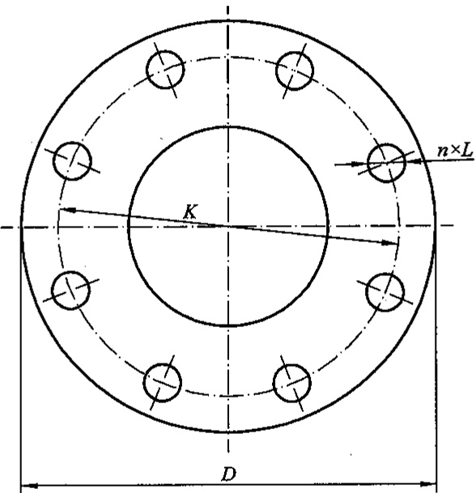

图8.1.1 法兰的连接尺寸

<!-- page: 61 -->

表8.1.1 连接尺寸

| 公称尺寸DN | PN2.5 |  |  |  |  | PN6 |  |  |  |  | PN10 |  |  |  |  | PN16 |  |  |  |  |
|---|---|---|---|---|---|---|---|---|---|---|---|---|---|---|---|---|---|---|---|---|
| D | K | L | Th | n(个) | D | K | L | Th | n(个) | D | K | L | Th | n(个) | D | K | L | Th | n(个) |  |
| 10 | 75 | 50 | 11 | M10 | 4 | 75 | 50 | 11 | M10 | 4 | 90 | 60 | 14 | M12 | 4 | 90 | 60 | 14 | M12 | 4 |
| 15 | 80 | 55 | 11 | M10 | 4 | 80 | 55 | 11 | M10 | 4 | 95 | 65 | 14 | M12 | 4 | 95 | 65 | 14 | M12 | 4 |
| 20 | 90 | 65 | 11 | M10 | 4 | 90 | 65 | 11 | M10 | 4 | 105 | 75 | 14 | M12 | 4 | 105 | 75 | 14 | M12 | 4 |
| 25 | 100 | 75 | 11 | M10 | 4 | 100 | 75 | 11 | M10 | 4 | 115 | 85 | 14 | M12 | 4 | 115 | 85 | 14 | M12 | 4 |
| 32 | 120 | 90 | 14 | M12 | 4 | 120 | 90 | 14 | M12 | 4 | 140 | 100 | 18 | M16 | 4 | 140 | 100 | 18 | M16 | 4 |
| 40 | 130 | 100 | 14 | M12 | 4 | 130 | 100 | 14 | M12 | 4 | 150 | 110 | 18 | M16 | 4 | 150 | 110 | 18 | M16 | 4 |
| 50 | 140 | 110 | 14 | M12 | 4 | 140 | 110 | 14 | M12 | 4 | 165 | 125 | 18 | M16 | 4 | 165 | 125 | 18 | M16 | 4 |
| 65 | 160 | 130 | 14 | M12 | 4 | 160 | 130 | 14 | M12 | 4 | 185 | 145 | 18 | M16 | 8(4)a | 185 | 145 | 18 | M16 | 8(4)a |
| 80b | 190 | 150 | 18 | M16 | 4 | 190 | 150 | 18 | M16 | 4 | 200 | 160 | 18 | M16 | 8 | 200 | 160 | 18 | M16 | 8 |
| 100 | 210 | 170 | 18 | M16 | 4 | 210 | 170 | 18 | M16 | 4 | 220 | 180 | 18 | M16 | 8 | 220 | 180 | 18 | M16 | 8 |
| 125 | 240 | 200 | 18 | M16 | 8 | 240 | 200 | 18 | M16 | 8 | 250 | 210 | 18 | M16 | 8 | 250 | 210 | 18 | M16 | 8 |
| 150 | 265 | 225 | 18 | M16 | 8 | 265 | 225 | 18 | M16 | 8 | 285 | 240 | 22 | M20 | 8 | 285 | 240 | 22 | M20 | 8 |
| 200 | 320 | 280 | 18 | M16 | 8 | 320 | 280 | 18 | M16 | 8 | 340 | 295 | 22 | M20 | 8 | 340 | 295 | 22 | M20 | 12 |
| 250 | 375 | 335 | 18 | M16 | 12 | 375 | 335 | 18 | M16 | 12 | 395 | 350 | 22 | M20 | 12 | 405 | 355 | 26 | M24 | 12 |
| 300 | 440 | 395 | 22 | M20 | 12 | 440 | 395 | 22 | M20 | 12 | 445 | 400 | 22 | M20 | 12 | 460 | 410 | 26 | M24 | 12 |
| 350 | 490 | 445 | 22 | M20 | 12 | 490 | 445 | 22 | M20 | 12 | 505 | 460 | 22 | M20 | 16 | 520 | 470 | 26 | M24 | 16 |
| 400 | 540 | 495 | 22 | M20 | 16 | 540 | 495 | 22 | M20 | 16 | 565 | 515 | 26 | M24 | 16 | 580 | 525 | 30 | M27 | 16 |
| 450 | 595 | 550 | 22 | M20 | 16 | 595 | 550 | 22 | M20 | 16 | 615 | 565 | 26 | M24 | 20 | 640 | 585 | 30 | M27 | 20 |
| 500 | 645 | 600 | 22 | M20 | 20 | 645 | 600 | 22 | M20 | 20 | 670 | 620 | 26 | M24 | 20 | 715 | 650 | 33 | M30 | 20 |
| 600 | 755 | 705 | 26 | M24 | 20 | 755 | 705 | 26 | M24 | 20 | 780 | 725 | 30 | M27 | 20 | 840 | 770 | 36 | M33 | 20 |
| 700 | 860 | 810 | 26 | M24 | 24 | 860 | 810 | 26 | M24 | 24 | 895 | 840 | 30 | M27 | 24 | 910 | 840 | 36 | M33 | 24 |
| 800 | 975 | 920 | 30 | M27 | 24 | 975 | 920 | 30 | M27 | 24 | 1015 | 950 | 33 | M30 | 24 | 1025 | 950 | 39 | M36 | 24 |
| 900 | 1075 | 1020 | 30 | M27 | 24 | 1075 | 1020 | 30 | M27 | 24 | 1115 | 1050 | 33 | M30 | 28 | 1125 | 1050 | 39 | M36 | 28 |
| 1000 | 1175 | 1120 | 30 | M27 | 28 | 1175 | 1120 | 30 | M27 | 28 | 1230 | 1160 | 36 | M33 | 28 | 1255 | 1170 | 42 | M39 | 28 |
| 1200 | 1375 | 1320 | 30 | M27 | 32 | 1405 | 1340 | 33 | M30 | 32 | 1455 | 1380 | 39 | M36 | 32 | 1485 | 1390 | 48 | M45 | 32 |
| 1400 | 1575 | 1520 | 30 | M27 | 36 | 1630 | 1560 | 36 | M33 | 36 | 1675 | 1590 | 42 | M39 | 36 | 1685 | 1590 | 48 | M45 | 36 |
| 1600 | 1790 | 1730 | 30 | M27 | 40 | 1830 | 1760 | 36 | M33 | 40 | 1915 | 1820 | 48 | M45 | 40 | 1930 | 1820 | 56 | M52 | 40 |
| 1800 | 1990 | 1930 | 30 | M27 | 44 | 2045 | 1970 | 39 | M36 | 44 | 2115 | 2020 | 48 | M45 | 44 | 2130 | 2020 | 56 | M52 | 44 |
| 2000 | 2190 | 2130 | 30 | M27 | 48 | 2265 | 2180 | 42 | M39 | 48 | 2325 | 2230 | 48 | M45 | 48 | 2345 | 2230 | 62 | M56 | 48 |

<!-- page: 62 -->

续表 8.1.1

| 公称尺寸DN | PN25 |  |  |  |  | PN40 |  |  |  |  | PN63 |  |  |  |  |
|---|---|---|---|---|---|---|---|---|---|---|---|---|---|---|---|
| D | K | L | Th | n(个) | D | K | L | Th | n(个) | D | K | L | Th | n(个) |  |
| 10 | 90 | 60 | 14 | M12 | 4 | 90 | 60 | 14 | M12 | 4 | 100 | 70 | 14 | M12 | 4 |
| 15 | 95 | 65 | 14 | M12 | 4 | 95 | 65 | 14 | M12 | 4 | 105 | 75 | 14 | M12 | 4 |
| 20 | 105 | 75 | 14 | M12 | 4 | 105 | 75 | 14 | M12 | 4 | 130 | 90 | 18 | M16 | 4 |
| 25 | 115 | 85 | 14 | M12 | 4 | 115 | 85 | 14 | M12 | 4 | 140 | 100 | 18 | M16 | 4 |
| 32 | 140 | 100 | 18 | M16 | 4 | 140 | 100 | 18 | M16 | 4 | 155 | 110 | 22 | M20 | 4 |
| 40 | 150 | 110 | 18 | M16 | 4 | 150 | 110 | 18 | M16 | 4 | 170 | 125 | 22 | M20 | 4 |
| 50 | 165 | 125 | 18 | M16 | 4 | 165 | 125 | 18 | M16 | 4 | 180 | 135 | 22 | M20 | 4 |
| 65 | 185 | 145 | 18 | M16 | 8 | 185 | 145 | 18 | M16 | 8 | 205 | 160 | 22 | M20 | 8 |
| 80b | 200 | 160 | 18 | M16 | 8 | 200 | 160 | 18 | M16 | 8 | 215 | 170 | 22 | M20 | 8 |
| 100 | 235 | 190 | 22 | M20 | 8 | 235 | 190 | 22 | M20 | 8 | 250 | 200 | 26 | M24 | 8 |
| 125 | 270 | 220 | 26 | M24 | 8 | 270 | 220 | 26 | M24 | 8 | 295 | 240 | 30 | M27 | 8 |
| 150 | 300 | 250 | 26 | M24 | 8 | 300 | 250 | 26 | M24 | 8 | 345 | 280 | 33 | M30 | 8 |
| 200 | 360 | 310 | 26 | M24 | 12 | 375 | 320 | 30 | M27 | 12 | 415 | 345 | 36 | M33 | 12 |
| 250 | 425 | 370 | 30 | M27 | 12 | 450 | 385 | 33 | M30 | 12 | 470 | 400 | 36 | M33 | 12 |
| 300 | 485 | 430 | 30 | M27 | 16 | 515 | 450 | 33 | M30 | 16 | 530 | 460 | 36 | M33 | 16 |
| 350 | 555 | 490 | 33 | M30 | 16 | 580 | 510 | 36 | M33 | 16 | 600 | 525 | 39 | M36 | 16 |
| 400 | 620 | 550 | 36 | M33 | 16 | 660 | 585 | 39 | M36 | 16 | 670 | 585 | 42 | M39 | 16 |
| 450 | 670 | 600 | 36 | M33 | 20 | 685 | 610 | 39 | M36 | 20 | - | - | - | - | - |
| 500 | 730 | 660 | 36 | M33 | 20 | 755 | 670 | 42 | M39 | 20 | - | - | - | - | - |
| 600 | 845 | 770 | 39 | M36 | 20 | 890 | 795 | 48 | M45 | 20 | - | - | - | - | - |
| 700 | 960 | 875 | 42 | M39 | 24 | - | - | - | - | - | - | - | - | - | - |
| 800 | 1085 | 990 | 48 | M45 | 24 | - | - | - | - | - | - | - | - | - | - |
| 900 | 1185 | 1090 | 48 | M45 | 28 | - | - | - | - | - | - | - | - | - | - |
| 1000 | 1320 | 1210 | 55 | M52 | 28 | - | - | - | - | - | - | - | - | - | - |
| 1200 | 1530 | 1420 | 55 | M52 | 32 | - | - | - | - | - | - | - | - | - | - |

<!-- page: 63 -->

(mm)

| 公称尺寸DN | PN100 |  |  |  |  | PN160 |  |  |  |  |
|---|---|---|---|---|---|---|---|---|---|---|
| D | K | L | Th | n(个) | D | K | L | Th | n(个) |  |
| 10 | 100 | 70 | 14 | M12 | 4 | 100 | 70 | 14 | M12 | 4 |
| 15 | 105 | 75 | 14 | M12 | 4 | 105 | 75 | 14 | M12 | 4 |
| 20 | 130 | 90 | 18 | M16 | 4 | 130 | 90 | 18 | M16 | 4 |
| 25 | 140 | 100 | 18 | M16 | 4 | 140 | 100 | 18 | M16 | 4 |
| 32 | 155 | 110 | 22 | M20 | 4 | 155 | 110 | 22 | M20 | 4 |
| 40 | 170 | 125 | 22 | M20 | 4 | 170 | 125 | 22 | M20 | 4 |
| 50 | 195 | 145 | 26 | M24 | 4 | 195 | 145 | 26 | M24 | 4 |
| 65 | 220 | 170 | 26 | M24 | 8 | 220 | 170 | 26 | M24 | 8 |
| 80 | 230 | 180 | 26 | M24 | 8 | 230 | 180 | 26 | M24 | 8 |
| 100 | 265 | 210 | 30 | M27 | 8 | 265 | 210 | 30 | M27 | 8 |
| 125 | 315 | 250 | 33 | M30 | 8 | 315 | 250 | 33 | M30 | 8 |
| 150 | 355 | 290 | 33 | M30 | 12 | 355 | 290 | 33 | M30 | 12 |
| 200 | 430 | 360 | 36 | M33 | 12 | 430 | 360 | 36 | M33 | 12 |
| 250 | 505 | 430 | 39 | M36 | 12 | 515 | 430 | 42 | M39 | 12 |
| 300 | 585 | 500 | 42 | M39 | 16 | 585 | 500 | 42 | M39 | 16 |
| 350 | 655 | 560 | 48 | M45 | 16 | — | — | — | — | — |
| 400 | 715 | 620 | 48 | M45 | 16 | — | — | — | — | — |

b PN10～40、DN80法兰的连接尺寸相同。

### 8.2 法兰结构尺寸

8.2.1 板式平焊法兰的尺寸按图 8.2.1 和表 8.2.1-1～表 8.2.1-6 的规定。

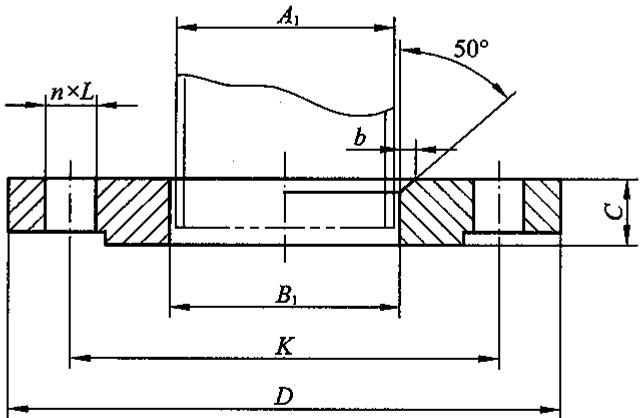

图8.2.1 板式平焊钢制管法兰

<!-- page: 64 -->

(mm)

| 公称尺寸DN | 钢管外径A1 |  | 连接尺寸 |  |  |  |  | 法兰厚度C | 法兰内径B1 |  |
|---|---|---|---|---|---|---|---|---|---|---|
| 法兰外径D | 螺栓孔中心圆直径K | 螺栓孔直径L | 螺栓孔数量n(个) | 螺栓Th | A | B |  |  |  |  |
| A | B |  |  |  |  |  |  |  |  |  |
| 10 | 17.2 | 14 | 75 | 50 | 11 | 4 | M10 | 12 | 18 | 15 |
| 15 | 21.3 | 18 | 80 | 55 | 11 | 4 | M10 | 12 | 22.5 | 19 |
| 20 | 26.9 | 25 | 90 | 65 | 11 | 4 | M10 | 14 | 27.5 | 26 |
| 25 | 33.7 | 32 | 100 | 75 | 11 | 4 | M10 | 14 | 34.5 | 33 |
| 32 | 42.4 | 38 | 120 | 90 | 14 | 4 | M12 | 16 | 43.5 | 39 |
| 40 | 48.3 | 45 | 130 | 100 | 14 | 4 | M12 | 16 | 49.5 | 46 |
| 50 | 60.3 | 57 | 140 | 110 | 14 | 4 | M12 | 16 | 61.5 | 59 |
| 65 | 76.1 | 76 | 160 | 130 | 14 | 4 | M12 | 16 | 77.5 | 78 |
| 80 | 88.9 | 89 | 190 | 150 | 18 | 4 | M16 | 18 | 90.5 | 91 |
| 100 | 114.3 | 108 | 210 | 170 | 18 | 4 | M16 | 18 | 116 | 110 |
| 125 | 139.7 | 133 | 240 | 200 | 18 | 8 | M16 | 20 | 143.5 | 135 |
| 150 | 168.3 | 159 | 265 | 225 | 18 | 8 | M16 | 20 | 170.5 | 161 |
| 200 | 219.1 | 219 | 320 | 280 | 18 | 8 | M16 | 22 | 221.5 | 222 |
| 250 | 273 | 273 | 375 | 335 | 18 | 12 | M16 | 24 | 276.5 | 276 |
| 300 | 323.9 | 325 | 440 | 395 | 22 | 12 | M20 | 24 | 328 | 328 |
| 350 | 355.6 | 377 | 490 | 445 | 22 | 12 | M20 | 26 | 360 | 381 |
| 400 | 406.4 | 426 | 540 | 495 | 22 | 16 | M20 | 28 | 411 | 430 |
| 450 | 457 | 480 | 595 | 550 | 22 | 16 | M20 | 30 | 462 | 485 |
| 500 | 508 | 530 | 645 | 600 | 22 | 20 | M20 | 30 | 513.5 | 535 |
| 600 | 610 | 630 | 755 | 705 | 26 | 20 | M24 | 32 | 616.5 | 636 |
| 700 | 711 | 720 | 860 | 810 | 26 | 24 | M24 | 36 | 715 | 724 |
| 800 | 813 | 820 | 975 | 920 | 30 | 24 | M27 | 38 | 817 | 824 |
| 900 | 914 | 920 | 1075 | 1020 | 30 | 24 | M27 | 40 | 918 | 924 |
| 1000 | 1016 | 1020 | 1175 | 1120 | 30 | 28 | M27 | 42 | 1020 | 1024 |
| 1200 | 1219 | 1220 | 1375 | 1320 | 30 | 32 | M27 | 44 | 1223 | 1224 |
| 1400 | 1422 | 1420 | 1575 | 1520 | 30 | 36 | M27 | 48 | 1426 | 1424 |
| 1600 | 1626 | 1620 | 1790 | 1730 | 30 | 40 | M27 | 51 | 1630 | 1624 |
| 1800 | 1829 | 1820 | 1990 | 1930 | 30 | 44 | M27 | 54 | 1833 | 1824 |
| 2000 | 2032 | 2020 | 2190 | 2130 | 30 | 48 | M27 | 58 | 2036 | 2024 |

<!-- page: 65 -->

(mm)

| 公称尺寸DN | 钢管外径A1 |  | 连接尺寸 |  |  |  |  | 法兰厚度C | 法兰内径B1 |  |
|---|---|---|---|---|---|---|---|---|---|---|
| 法兰外径D | 螺栓孔中心圆直径K | 螺栓孔直径L | 螺栓孔数量n(个) | 螺栓Th | A | B |  |  |  |  |
| A | B |  |  |  |  |  |  |  |  |  |
| 10 | 17.2 | 14 | 75 | 50 | 11 | 4 | M10 | 12 | 18 | 15 |
| 15 | 21.3 | 18 | 80 | 55 | 11 | 4 | M10 | 12 | 22.5 | 19 |
| 20 | 26.9 | 25 | 90 | 65 | 11 | 4 | M10 | 14 | 27.5 | 26 |
| 25 | 33.7 | 32 | 100 | 75 | 11 | 4 | M10 | 14 | 34.5 | 33 |
| 32 | 42.4 | 38 | 120 | 90 | 14 | 4 | M12 | 16 | 43.5 | 39 |
| 40 | 48.3 | 45 | 130 | 100 | 14 | 4 | M12 | 16 | 49.5 | 46 |
| 50 | 60.3 | 57 | 140 | 110 | 14 | 4 | M12 | 16 | 61.5 | 59 |
| 65 | 76.1 | 76 | 160 | 130 | 14 | 4 | M12 | 16 | 77.5 | 78 |
| 80 | 88.9 | 89 | 190 | 150 | 18 | 4 | M16 | 18 | 90.5 | 91 |
| 100 | 114.3 | 108 | 210 | 170 | 18 | 4 | M16 | 18 | 116 | 110 |
| 125 | 139.7 | 133 | 240 | 200 | 18 | 8 | M16 | 20 | 143.5 | 135 |
| 150 | 168.3 | 159 | 265 | 225 | 18 | 8 | M16 | 20 | 170.5 | 161 |
| 200 | 219.1 | 219 | 320 | 280 | 18 | 8 | M16 | 22 | 221.5 | 222 |
| 250 | 273 | 273 | 375 | 335 | 18 | 12 | M16 | 24 | 276.5 | 276 |
| 300 | 323.9 | 325 | 440 | 395 | 22 | 12 | M20 | 24 | 328 | 328 |
| 350 | 355.6 | 377 | 490 | 445 | 22 | 12 | M20 | 26 | 360 | 381 |
| 400 | 406.4 | 426 | 540 | 495 | 22 | 16 | M20 | 28 | 411 | 430 |
| 450 | 457 | 480 | 595 | 550 | 22 | 16 | M20 | 30 | 462 | 485 |
| 500 | 508 | 530 | 645 | 600 | 22 | 20 | M20 | 30 | 513.5 | 535 |
| 600 | 610 | 630 | 755 | 705 | 26 | 20 | M24 | 32 | 616.5 | 636 |

(mm)

| 公称尺寸DN | 钢管外径 A_1 |  | 连接尺寸 |  |  |  |  | 法兰厚度C | 法兰内径 B_1 |  |
|---|---|---|---|---|---|---|---|---|---|---|
| 法兰外径D | 螺栓孔中心圆直径K | 螺栓孔直径L | 螺栓孔数量n(个) | 螺栓Th | A | B |  |  |  |  |
| 10 | 17.2 | 14 | 90 | 60 | 14 | 4 | M12 | 14 | 18 | 15 |
| 15 | 21.3 | 18 | 95 | 65 | 14 | 4 | M12 | 14 | 22.5 | 19 |
| 20 | 26.9 | 25 | 105 | 75 | 14 | 4 | M12 | 16 | 27.5 | 26 |
| 25 | 33.7 | 32 | 115 | 85 | 14 | 4 | M12 | 16 | 34.5 | 33 |
| 32 | 42.4 | 38 | 140 | 100 | 18 | 4 | M16 | 18 | 43.5 | 39 |
| 40 | 48.3 | 45 | 150 | 110 | 18 | 4 | M16 | 18 | 49.5 | 46 |
| 50 | 60.3 | 57 | 165 | 125 | 18 | 4 | M16 | 19 | 61.5 | 59 |
| 65 | 76.1 | 76 | 185 | 145 | 18 | 8 | M16 | 20 | 77.5 | 78 |
| 80 | 88.9 | 89 | 200 | 160 | 18 | 8 | M16 | 20 | 90.5 | 91 |
| 100 | 114.3 | 108 | 220 | 180 | 18 | 8 | M16 | 22 | 116 | 110 |

<!-- page: 66 -->

(mm)

| 公称尺寸DN | 钢管外径 A_1 |  | 连接尺寸 |  |  |  |  | 法兰厚度C | 法兰内径 B_1 |  |
|---|---|---|---|---|---|---|---|---|---|---|
| 法兰外径D | 螺栓孔中心圆直径K | 螺栓孔直径L | 螺栓孔数量n(个) | 螺栓Th | A | B |  |  |  |  |
| A | B |  |  |  |  |  |  |  |  |  |
| 125 | 139.7 | 133 | 250 | 210 | 18 | 8 | M16 | 22 | 143.5 | 135 |
| 150 | 168.3 | 159 | 285 | 240 | 22 | 8 | M20 | 24 | 170.5 | 161 |
| 200 | 219.1 | 219 | 340 | 295 | 22 | 8 | M20 | 24 | 221.5 | 222 |
| 250 | 273 | 273 | 395 | 350 | 22 | 12 | M20 | 26 | 276.5 | 276 |
| 300 | 323.9 | 325 | 445 | 400 | 22 | 12 | M20 | 26 | 328 | 328 |
| 350 | 355.6 | 377 | 505 | 460 | 22 | 16 | M20 | 28 | 360 | 381 |
| 400 | 406.4 | 426 | 565 | 515 | 26 | 16 | M24 | 32 | 411 | 430 |
| 450 | 457 | 480 | 615 | 565 | 26 | 20 | M24 | 36 | 462 | 485 |
| 500 | 508 | 530 | 670 | 620 | 26 | 20 | M24 | 38 | 513.5 | 535 |
| 600 | 610 | 630 | 780 | 725 | 30 | 20 | M27 | 42 | 616.5 | 636 |

(mm)

| 公称尺寸DN | 钢管外径 A_1 |  | 连接尺寸 |  |  |  |  | 法兰厚度C | 法兰内径 B_1 |  | 坡口宽度b |
|---|---|---|---|---|---|---|---|---|---|---|---|
| 法兰外径D | 螺栓孔中心圆直径K | 螺栓孔直径L | 螺栓孔数量n(个) | 螺栓Th | A | B |  |  |  |  |  |
| A | B |  |  |  |  |  |  |  |  |  |  |
| 10 | 17.2 | 14 | 90 | 60 | 14 | 4 | M12 | 14 | 18 | 15 | 4 |
| 15 | 21.3 | 18 | 95 | 65 | 14 | 4 | M12 | 14 | 22.5 | 19 | 4 |
| 20 | 26.9 | 25 | 105 | 75 | 14 | 4 | M12 | 16 | 27.5 | 26 | 4 |
| 25 | 33.7 | 32 | 115 | 85 | 14 | 4 | M12 | 16 | 34.5 | 33 | 5 |
| 32 | 42.4 | 38 | 140 | 100 | 18 | 4 | M16 | 18 | 43.5 | 39 | 5 |
| 40 | 48.3 | 45 | 150 | 110 | 18 | 4 | M16 | 18 | 49.5 | 46 | 5 |
| 50 | 60.3 | 57 | 165 | 125 | 18 | 4 | M16 | 19 | 61.5 | 59 | 5 |
| 65 | 76.1 | 76 | 185 | 145 | 18 | 8 | M16 | 20 | 77.5 | 78 | 6 |
| 80 | 88.9 | 89 | 200 | 160 | 18 | 8 | M16 | 20 | 90.5 | 91 | 6 |
| 100 | 114.3 | 108 | 220 | 180 | 18 | 8 | M16 | 22 | 116 | 110 | 6 |
| 125 | 139.7 | 133 | 250 | 210 | 18 | 8 | M16 | 22 | 143.5 | 135 | 6 |
| 150 | 168.3 | 159 | 285 | 240 | 22 | 8 | M20 | 24 | 170.5 | 161 | 6 |
| 200 | 219.1 | 219 | 340 | 295 | 22 | 12 | M20 | 26 | 221.5 | 222 | 8 |
| 250 | 273 | 273 | 405 | 355 | 26 | 12 | M24 | 29 | 276.5 | 276 | 10 |
| 300 | 323.9 | 325 | 460 | 410 | 26 | 12 | M24 | 32 | 328 | 328 | 11 |
| 350 | 355.6 | 377 | 520 | 470 | 26 | 16 | M24 | 35 | 360 | 381 | 12 |
| 400 | 406.4 | 426 | 580 | 525 | 30 | 16 | M27 | 38 | 411 | 430 | 12 |
| 450 | 457 | 480 | 640 | 585 | 30 | 20 | M27 | 42 | 462 | 485 | 12 |
| 500 | 508 | 530 | 715 | 650 | 33 | 20 | M30 | 46 | 513.5 | 535 | 12 |
| 600 | 610 | 630 | 840 | 770 | 33 | 20 | M30 | 52 | 616.5 | 636 | 12 |

<!-- page: 67 -->

(mm)

| 公称尺寸DN | 钢管外径A1 |  | 连接尺寸 |  |  |  |  | 法兰厚度C | 法兰内径B1 |  | 坡口宽度b |
|---|---|---|---|---|---|---|---|---|---|---|---|
| 法兰外径D | 螺栓孔中心圆直径K | 螺栓孔直径L | 螺栓孔数量n(个) | 螺栓Th | A | B |  |  |  |  |  |
| A | B |  |  |  |  |  |  |  |  |  |  |
| 10 | 17.2 | 14 | 90 | 60 | 14 | 4 | M12 | 14 | 18 | 15 | 4 |
| 15 | 21.3 | 18 | 95 | 65 | 14 | 4 | M12 | 14 | 22.5 | 19 | 4 |
| 20 | 26.9 | 25 | 105 | 75 | 14 | 4 | M12 | 16 | 27.5 | 26 | 4 |
| 25 | 33.7 | 32 | 115 | 85 | 14 | 4 | M12 | 16 | 34.5 | 33 | 5 |
| 32 | 42.4 | 38 | 140 | 100 | 18 | 4 | M16 | 18 | 43.5 | 39 | 5 |
| 40 | 48.3 | 45 | 150 | 110 | 18 | 4 | M16 | 18 | 49.5 | 46 | 5 |
| 50 | 60.3 | 57 | 165 | 125 | 18 | 4 | M16 | 20 | 61.5 | 59 | 5 |
| 65 | 76.1 | 76 | 185 | 145 | 18 | 8 | M16 | 22 | 77.5 | 78 | 6 |
| 80 | 88.9 | 89 | 200 | 160 | 18 | 8 | M16 | 24 | 90.5 | 91 | 6 |
| 100 | 114.3 | 108 | 235 | 190 | 22 | 8 | M20 | 26 | 116 | 110 | 6 |
| 125 | 139.7 | 133 | 270 | 220 | 26 | 8 | M24 | 28 | 143.5 | 135 | 6 |
| 150 | 168.3 | 159 | 300 | 250 | 26 | 8 | M24 | 30 | 170.5 | 161 | 6 |
| 200 | 219.1 | 219 | 360 | 310 | 26 | 12 | M24 | 32 | 221.5 | 222 | 8 |
| 250 | 273 | 273 | 425 | 370 | 30 | 12 | M27 | 35 | 276.5 | 276 | 10 |
| 300 | 323.9 | 325 | 485 | 430 | 30 | 16 | M27 | 38 | 328 | 328 | 11 |
| 350 | 355.6 | 377 | 555 | 490 | 33 | 16 | M30 | 42 | 360 | 381 | 12 |
| 400 | 406.4 | 426 | 620 | 550 | 36 | 16 | M33 | 46 | 411 | 430 | 12 |
| 450 | 457 | 480 | 670 | 600 | 36 | 20 | M33 | 50 | 462 | 485 | 12 |
| 500 | 508 | 530 | 730 | 660 | 36 | 20 | M33 | 56 | 513.5 | 535 | 12 |
| 600 | 610 | 630 | 845 | 770 | 39 | 20 | M36×3 | 68 | 616.5 | 636 | 12 |

(mm)

| 公称尺寸DN | 钢管外径 A_1 |  | 连接尺寸 |  |  |  |  | 法兰厚度C | 法兰内径 B_1 |  | 坡口宽度b |
|---|---|---|---|---|---|---|---|---|---|---|---|
| 法兰外径D | 螺栓孔中心圆直径K | 螺栓孔直径L | 螺栓孔数量n(个) | 螺栓Th | A | B |  |  |  |  |  |
| A | B |  |  |  |  |  |  |  |  |  |  |
| 10 | 17.2 | 14 | 90 | 60 | 14 | 4 | M12 | 14 | 18 | 15 | 4 |
| 15 | 21.3 | 18 | 95 | 65 | 14 | 4 | M12 | 14 | 22.5 | 19 | 4 |
| 20 | 26.9 | 25 | 105 | 75 | 14 | 4 | M12 | 16 | 27.5 | 26 | 4 |
| 25 | 33.7 | 32 | 115 | 85 | 14 | 4 | M12 | 16 | 34.5 | 33 | 5 |
| 32 | 42.4 | 38 | 140 | 100 | 18 | 4 | M16 | 18 | 43.5 | 39 | 5 |
| 40 | 48.3 | 45 | 150 | 110 | 18 | 4 | M16 | 18 | 49.5 | 46 | 5 |
| 50 | 60.3 | 57 | 165 | 125 | 18 | 4 | M16 | 20 | 61.5 | 59 | 5 |
| 65 | 76.1 | 76 | 185 | 145 | 18 | 8 | M16 | 22 | 77.5 | 78 | 6 |
| 80 | 88.9 | 89 | 200 | 160 | 18 | 8 | M16 | 24 | 90.5 | 91 | 6 |

<!-- page: 68 -->

(mm)

| 公称尺寸DN | 钢管外径 A_1 |  | 连接尺寸 |  |  |  |  | 法兰厚度C | 法兰内径 B_1 |  | 坡口宽度b |
|---|---|---|---|---|---|---|---|---|---|---|---|
| 法兰外径D | 螺栓孔中心圆直径K | 螺栓孔直径L | 螺栓孔数量n(个) | 螺栓Th | A | B |  |  |  |  |  |
| A | B |  |  |  |  |  |  |  |  |  |  |
| 100 | 114.3 | 108 | 235 | 190 | 22 | 8 | M20 | 26 | 116 | 110 | 6 |
| 125 | 139.7 | 133 | 270 | 220 | 26 | 8 | M24 | 28 | 143.5 | 135 | 6 |
| 150 | 168.3 | 159 | 300 | 250 | 26 | 8 | M24 | 30 | 170.5 | 161 | 6 |
| 200 | 219.1 | 219 | 375 | 320 | 30 | 12 | M27 | 36 | 221.5 | 222 | 8 |
| 250 | 273 | 273 | 450 | 385 | 33 | 12 | M30 | 42 | 276.5 | 276 | 10 |
| 300 | 323.9 | 325 | 515 | 450 | 33 | 16 | M30 | 48 | 328 | 328 | 11 |
| 350 | 355.6 | 377 | 580 | 510 | 36 | 16 | M33 | 54 | 360 | 381 | 12 |
| 400 | 406.4 | 426 | 660 | 585 | 39 | 16 | M36 \times 3 | 60 | 411 | 430 | 12 |
| 450 | 457 | 480 | 685 | 610 | 39 | 20 | M36 \times 3 | 66 | 462 | 485 | 12 |
| 500 | 508 | 530 | 755 | 670 | 42 | 20 | M39 \times 3 | 72 | 513.5 | 535 | 12 |
| 600 | 610 | 630 | 890 | 795 | 48 | 20 | M45 \times 3 | 84 | 616.5 | 636 | 12 |

8.2.2 带颈平焊法兰的尺寸按图 8.2.2 和表 8.2.2-1～表 8.2.2-5 的规定。 8.2.3 带颈对焊法兰的尺寸按图 8.2.3 和表 8.2.3-1～表 8.2.3-7 的规定。 8.2.4 整体法兰的尺寸按图 8.2.4 和表 8.2.4-1～表 8.2.4-8 的规定。 8.2.5 承插焊法兰的尺寸按图 8.2.5 和表 8.2.5-1～表 8.2.5-6 的规定。 8.2.6 螺纹法兰的尺寸按图 8.2.6 和表 8.2.6-1～表 8.2.6-5 的规定。 8.2.7 对焊环松套法兰的尺寸按图 8.2.7 和表 8.2.7-1～表 8.2.7-5 的规定。 8.2.8 平焊环松套法兰的尺寸按图 8.2.8 和表 8.2.8-1～表 8.2.8-3 的规定。 8.2.9 法兰盖的尺寸按图 8.2.9 和表 8.2.9-1～表 8.2.9-9 的规定。 8.2.10 衬里法兰盖的尺寸按图 8.2.10 和表 8.2.10-1～表 8.2.10-5 的规定。

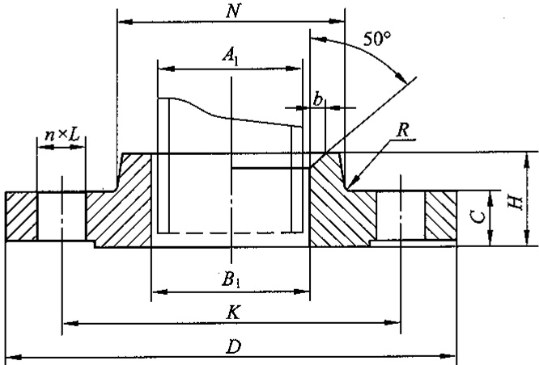

图8.2.2 带颈平焊钢制管法兰

<!-- page: 69 -->

(mm)

| 公称尺寸DN | 钢管外径A1 |  | 连接尺寸 |  |  |  |  | 法兰厚度C | 法兰内径B1 |  | 法兰颈 |  |  | 法兰高度H |
|---|---|---|---|---|---|---|---|---|---|---|---|---|---|---|
| 法兰外径D | 螺栓孔中心圆直径K | 螺栓孔直径L | 螺栓孔数量n(个) | 螺栓Th | N |  | R |  |  |  |  |  |  |  |
| A | B | A | B | A | B |  |  |  |  |  |  |  |  |  |
| 10 | 17.2 | 14 | 75 | 50 | 11 | 4 | M10 | 12 | 18 | 15 | 25 | 25 | 4 | 20 |
| 15 | 21.3 | 18 | 80 | 55 | 11 | 4 | M10 | 12 | 22.5 | 19 | 30 | 30 | 4 | 20 |
| 20 | 26.9 | 25 | 90 | 65 | 11 | 4 | M10 | 14 | 27.5 | 26 | 40 | 40 | 4 | 24 |
| 25 | 33.7 | 32 | 100 | 75 | 11 | 4 | M10 | 14 | 34.5 | 33 | 50 | 50 | 4 | 24 |
| 32 | 42.4 | 38 | 120 | 90 | 14 | 4 | M12 | 14 | 43.5 | 39 | 60 | 60 | 6 | 26 |
| 40 | 48.3 | 45 | 130 | 100 | 14 | 4 | M12 | 14 | 49.5 | 46 | 70 | 70 | 6 | 26 |
| 50 | 60.3 | 57 | 140 | 110 | 14 | 4 | M12 | 14 | 61.5 | 59 | 80 | 80 | 6 | 28 |
| 65 | 76.1 | 76 | 160 | 130 | 14 | 4 | M12 | 14 | 77.5 | 78 | 100 | 100 | 6 | 32 |
| 80 | 88.9 | 89 | 190 | 150 | 18 | 4 | M16 | 16 | 90.5 | 91 | 110 | 110 | 8 | 34 |
| 100 | 114.3 | 108 | 210 | 170 | 18 | 4 | M16 | 16 | 116 | 110 | 130 | 130 | 8 | 40 |
| 125 | 139.7 | 133 | 240 | 200 | 18 | 8 | M16 | 18 | 143.5 | 135 | 160 | 160 | 8 | 44 |
| 150 | 168.3 | 159 | 265 | 225 | 18 | 8 | M16 | 18 | 170.5 | 161 | 185 | 185 | 10 | 44 |
| 200 | 219.1 | 219 | 320 | 280 | 18 | 8 | M16 | 20 | 221.5 | 222 | 240 | 240 | 10 | 44 |
| 250 | 273 | 273 | 375 | 335 | 18 | 12 | M16 | 22 | 276.5 | 276 | 295 | 295 | 12 | 44 |
| 300 | 323.9 | 325 | 440 | 395 | 22 | 12 | M20 | 22 | 328 | 328 | 355 | 355 | 12 | 44 |

(mm)

| 公称尺寸DN | 钢管外径 A_1 |  | 连接尺寸 |  |  |  |  | 法兰厚度C | 法兰内径 B_1 |  | 法兰颈 |  |  | 法兰高度H | 坡口宽度b |
|---|---|---|---|---|---|---|---|---|---|---|---|---|---|---|---|
| 法兰外径D | 螺栓孔中心圆直径K | 螺栓孔直径L | 螺栓孔数量n(个) | 螺栓Th | N |  | R |  |  |  |  |  |  |  |  |
| A | B | A | B | A | B |  |  |  |  |  |  |  |  |  |  |
| 10 | 17.2 | 14 | 90 | 60 | 14 | 4 | M12 | 16 | 18 | 15 | 30 | 30 | 4 | 22 | — |
| 15 | 21.3 | 18 | 95 | 65 | 14 | 4 | M12 | 16 | 22.5 | 19 | 35 | 35 | 4 | 22 | — |
| 20 | 26.9 | 25 | 105 | 75 | 14 | 4 | M12 | 18 | 27.5 | 26 | 45 | 45 | 4 | 26 | — |
| 25 | 33.7 | 32 | 115 | 85 | 14 | 4 | M12 | 18 | 34.5 | 33 | 52 | 52 | 4 | 28 | — |
| 32 | 42.4 | 38 | 140 | 100 | 18 | 4 | M16 | 18 | 43.5 | 39 | 60 | 60 | 6 | 30 | — |
| 40 | 48.3 | 45 | 150 | 110 | 18 | 4 | M16 | 18 | 49.5 | 46 | 70 | 70 | 6 | 32 | — |
| 50 | 60.3 | 57 | 165 | 125 | 18 | 4 | M16 | 18 | 61.5 | 59 | 84 | 84 | 5 | 28 | — |
| 65 | 76.1 | 76 | 185 | 145 | 18 | 8 | M16 | 18 | 77.5 | 78 | 104 | 104 | 6 | 32 | — |
| 80 | 88.9 | 89 | 200 | 160 | 18 | 8 | M16 | 20 | 90.5 | 91 | 118 | 118 | 6 | 34 | — |
| 100 | 114.3 | 108 | 220 | 180 | 18 | 8 | M16 | 20 | 116 | 110 | 140 | 140 | 8 | 40 | — |
| 125 | 139.7 | 133 | 250 | 210 | 18 | 8 | M16 | 22 | 143.5 | 135 | 168 | 168 | 8 | 44 | — |
| 150 | 168.3 | 159 | 285 | 240 | 22 | 8 | M20 | 22 | 170.5 | 161 | 195 | 195 | 10 | 44 | — |
| 200 | 219.1 | 219 | 340 | 295 | 22 | 8 | M20 | 24 | 221.5 | 222 | 246 | 246 | 10 | 44 | — |
| 250 | 273 | 273 | 395 | 350 | 22 | 12 | M20 | 26 | 276.5 | 276 | 298 | 298 | 12 | 46 | — |

<!-- page: 70 -->

(mm)

| 公称尺寸DN | 钢管外径 A_1 |  | 连接尺寸 |  |  |  |  | 法兰厚度C | 法兰内径 B_1 |  | 法兰颈 |  |  | 法兰高度H | 坡口宽度b |
|---|---|---|---|---|---|---|---|---|---|---|---|---|---|---|---|
| 法兰外径D | 螺栓孔中心圆直径K | 螺栓孔直径L | 螺栓孔数量n(个) | 螺栓Th | N |  | R |  |  |  |  |  |  |  |  |
| A | B | A | B | A | B |  |  |  |  |  |  |  |  |  |  |
| 300 | 323.9 | 325 | 445 | 400 | 22 | 12 | M20 | 26 | 328 | 328 | 350 | 350 | 12 | 46 | — |
| 350 | 355.6 | 377 | 505 | 460 | 22 | 16 | M20 | 26 | 360 | 381 | 400 | 412 | 12 | 53 | — |
| 400 | 406.4 | 426 | 565 | 515 | 26 | 16 | M24 | 26 | 411 | 430 | 456 | 475 | 12 | 57 | — |
| 450 | 457 | 480 | 615 | 565 | 26 | 20 | M24 | 28 | 462 | 485 | 502 | 525 | 12 | 63 | 12 |
| 500 | 508 | 530 | 670 | 620 | 26 | 20 | M24 | 28 | 513.5 | 535 | 559 | 581 | 12 | 67 | 12 |
| 600 | 610 | 630 | 780 | 725 | 30 | 20 | M27 | 28 | 616.5 | 636 | 658 | 678 | 12 | 75 | 12 |

(mm)

| 公称尺寸DN | 钢管外径A1 |  | 连接尺寸 |  |  |  |  | 法兰厚度C | 法兰内径B1 |  | 法兰颈 |  |  | 法兰高度H | 坡口宽度b |
|---|---|---|---|---|---|---|---|---|---|---|---|---|---|---|---|
| 法兰外径D | 螺栓孔中心圆直径K | 螺栓孔直径L | 螺栓孔数量n(个) | 螺栓Th | N |  | R |  |  |  |  |  |  |  |  |
| A | B | A | B | A | B |  |  |  |  |  |  |  |  |  |  |
| 10 | 17.2 | 14 | 90 | 60 | 14 | 4 | M12 | 16 | 18 | 15 | 30 | 30 | 4 | 22 | 4 |
| 15 | 21.3 | 18 | 95 | 65 | 14 | 4 | M12 | 16 | 22.5 | 19 | 35 | 35 | 4 | 22 | 4 |
| 20 | 26.9 | 25 | 105 | 75 | 14 | 4 | M12 | 18 | 27.5 | 26 | 45 | 45 | 4 | 26 | 4 |
| 25 | 33.7 | 32 | 115 | 85 | 14 | 4 | M12 | 18 | 34.5 | 33 | 52 | 52 | 4 | 28 | 5 |
| 32 | 42.4 | 38 | 140 | 100 | 18 | 4 | M16 | 18 | 43.5 | 39 | 60 | 60 | 6 | 30 | 5 |
| 40 | 48.3 | 45 | 150 | 110 | 18 | 4 | M16 | 18 | 49.5 | 46 | 70 | 70 | 6 | 32 | 5 |
| 50 | 60.3 | 57 | 165 | 125 | 18 | 4 | M16 | 18 | 61.5 | 59 | 84 | 84 | 5 | 28 | 5 |
| 65 | 76.1 | 76 | 185 | 145 | 18 | 8 | M16 | 18 | 77.5 | 78 | 104 | 104 | 6 | 32 | 6 |
| 80 | 88.9 | 89 | 200 | 160 | 18 | 8 | M16 | 20 | 90.5 | 91 | 118 | 118 | 6 | 34 | 6 |
| 100 | 114.3 | 108 | 220 | 180 | 18 | 8 | M16 | 20 | 116 | 110 | 140 | 140 | 8 | 40 | 6 |
| 125 | 139.7 | 133 | 250 | 210 | 18 | 8 | M16 | 22 | 143.5 | 135 | 168 | 168 | 8 | 44 | 6 |
| 150 | 168.3 | 159 | 285 | 240 | 22 | 8 | M20 | 22 | 170.5 | 161 | 195 | 195 | 10 | 44 | 6 |
| 200 | 219.1 | 219 | 340 | 295 | 22 | 12 | M20 | 24 | 221.5 | 222 | 246 | 246 | 10 | 44 | 8 |
| 250 | 273 | 273 | 405 | 355 | 26 | 12 | M24 | 26 | 276.5 | 276 | 298 | 298 | 12 | 46 | 10 |
| 300 | 323.9 | 325 | 460 | 410 | 26 | 12 | M24 | 28 | 328 | 328 | 350 | 350 | 12 | 46 | 11 |
| 350 | 355.6 | 377 | 520 | 470 | 26 | 16 | M24 | 30 | 360 | 381 | 400 | 412 | 12 | 57 | 12 |
| 400 | 406.4 | 426 | 580 | 525 | 30 | 16 | M27 | 32 | 411 | 430 | 456 | 475 | 12 | 63 | 12 |
| 450 | 457 | 480 | 640 | 585 | 30 | 20 | M27 | 40 | 462 | 485 | 502 | 525 | 12 | 68 | 12 |
| 500 | 508 | 530 | 715 | 650 | 33 | 20 | M30 | 44 | 513.5 | 535 | 559 | 581 | 12 | 73 | 12 |
| 600 | 610 | 630 | 840 | 770 | 36 | 20 | M33 | 54 | 616.5 | 636 | 658 | 678 | 12 | 83 | 12 |

<!-- page: 71 -->

(mm)

| 公称尺寸DN | 钢管外径 A_1 |  | 连接尺寸 |  |  |  |  | 法兰厚度C | 法兰内径 B_1 |  | 法兰颈 |  |  | 法兰高度H | 坡口宽度b |
|---|---|---|---|---|---|---|---|---|---|---|---|---|---|---|---|
| 法兰外径D | 螺栓孔中心圆直径K | 螺栓孔直径L | 螺栓孔数量n(个) | 螺栓Th | N |  | R |  |  |  |  |  |  |  |  |
| A | B | A | B | A | B |  |  |  |  |  |  |  |  |  |  |
| 10 | 17.2 | 14 | 90 | 60 | 14 | 4 | M12 | 16 | 18 | 15 | 30 | 30 | 4 | 22 | 4 |
| 15 | 21.3 | 18 | 95 | 65 | 14 | 4 | M12 | 16 | 22.5 | 19 | 35 | 35 | 4 | 22 | 4 |
| 20 | 26.9 | 25 | 105 | 75 | 14 | 4 | M12 | 18 | 27.5 | 26 | 45 | 45 | 4 | 26 | 4 |
| 25 | 33.7 | 32 | 115 | 85 | 14 | 4 | M12 | 18 | 34.5 | 33 | 52 | 52 | 4 | 28 | 5 |
| 32 | 42.4 | 38 | 140 | 100 | 18 | 4 | M16 | 18 | 43.5 | 39 | 60 | 60 | 6 | 30 | 5 |
| 40 | 48.3 | 45 | 150 | 110 | 18 | 4 | M16 | 18 | 49.5 | 46 | 70 | 70 | 6 | 32 | 5 |
| 50 | 60.3 | 57 | 165 | 125 | 18 | 4 | M16 | 20 | 61.5 | 59 | 84 | 84 | 6 | 34 | 5 |
| 65 | 76.1 | 76 | 185 | 145 | 18 | 8 | M16 | 22 | 77.5 | 78 | 104 | 104 | 6 | 38 | 6 |
| 80 | 88.9 | 89 | 200 | 160 | 18 | 8 | M16 | 24 | 90.5 | 91 | 118 | 118 | 8 | 40 | 6 |
| 100 | 114.3 | 108 | 235 | 190 | 22 | 8 | M20 | 24 | 116 | 110 | 145 | 145 | 8 | 44 | 6 |
| 125 | 139.7 | 133 | 270 | 220 | 26 | 8 | M24 | 26 | 143.5 | 135 | 170 | 170 | 8 | 48 | 6 |
| 150 | 168.3 | 159 | 300 | 250 | 26 | 8 | M24 | 28 | 170.5 | 161 | 200 | 200 | 10 | 52 | 6 |
| 200 | 219.1 | 219 | 360 | 310 | 26 | 12 | M24 | 30 | 221.5 | 222 | 256 | 256 | 10 | 52 | 8 |
| 250 | 273 | 273 | 425 | 370 | 30 | 12 | M27 | 32 | 276.5 | 276 | 310 | 310 | 12 | 60 | 10 |
| 300 | 323.9 | 325 | 485 | 430 | 30 | 16 | M27 | 34 | 328 | 328 | 364 | 364 | 12 | 67 | 11 |
| 350 | 355.6 | 377 | 555 | 490 | 33 | 16 | M30 | 38 | 360 | 381 | 418 | 430- | 12 | 72 | 12 |
| 400 | 406.4 | 426 | 620 | 550 | 36 | 16 | M33 | 40 | 411 | 430 | 472 | 492 | 12 | 78 | 12 |
| 450 | 457 | 480 | 670 | 600 | 36 | 20 | M33 | 46 | 462 | 485 | 520 | 542 | 12 | 84 | 12 |
| 500 | 508 | 530 | 730 | 660 | 36 | 20 | M33 | 48 | 513.5 | 535 | 580 | 602 | 12 | 90 | 12 |
| 600 | 610 | 630 | 845 | 770 | 39 | 20 | M36×3 | 58 | 616.5 | 636 | 684 | 704 | 12 | 100 | 12 |

(mm)

| 公称尺寸DN | 钢管外径 A_1 |  | 连接尺寸 |  |  |  |  | 法兰厚度C | 法兰内径 B_1 |  | 法兰颈 |  |  | 法兰高度H | 坡口宽度b |
|---|---|---|---|---|---|---|---|---|---|---|---|---|---|---|---|
| 法兰外径D | 螺栓孔中心圆直径K | 螺栓孔直径L | 螺栓孔数量n(个) | 螺栓Th | N |  | R |  |  |  |  |  |  |  |  |
| A | B | A | B | A | B |  |  |  |  |  |  |  |  |  |  |
| 10 | 17.2 | 14 | 90 | 60 | 14 | 4 | M12 | 16 | 18 | 15 | 30 | 30 | 4 | 22 | 4 |
| 15 | 21.3 | 18 | 95 | 65 | 14 | 4 | M12 | 16 | 22.5 | 19 | 35 | 35 | 4 | 22 | 4 |
| 20 | 26.9 | 25 | 105 | 75 | 14 | 4 | M12 | 18 | 27.5 | 26 | 45 | 45 | 4 | 26 | 4 |
| 25 | 33.7 | 32 | 115 | 85 | 14 | 4 | M12 | 18 | 34.5 | 33 | 52 | 52 | 4 | 28 | 5 |
| 32 | 42.4 | 38 | 140 | 100 | 18 | 4 | M16 | 18 | 43.5 | 39 | 60 | 60 | 6 | 30 | 5 |
| 40 | 48.3 | 45 | 150 | 110 | 18 | 4 | M16 | 18 | 49.5 | 46 | 70 | 70 | 6 | 32 | 5 |
| 50 | 60.3 | 57 | 165 | 125 | 18 | 4 | M16 | 20 | 61.5 | 59 | 84 | 84 | 6 | 34 | 5 |
| 65 | 76.1 | 76 | 185 | 145 | 18 | 8 | M16 | 22 | 77.5 | 78 | 104 | 104 | 6 | 38 | 6 |
| 80 | 88.9 | 89 | 200 | 160 | 18 | 8 | M16 | 24 | 90.5 | 91 | 118 | 118 | 8 | 40 | 6 |

<!-- page: 72 -->

(mm)

| 公称尺寸DN | 钢管外径 A_1 |  | 连接尺寸 |  |  |  |  | 法兰厚度C | 法兰内径 B_1 |  | 法兰颈 |  |  | 法兰高度H | 坡口宽度b |
|---|---|---|---|---|---|---|---|---|---|---|---|---|---|---|---|
| 法兰外径D | 螺栓孔中心圆直径K | 螺栓孔直径L | 螺栓孔数量n(个) | 螺栓Th | N |  | R |  |  |  |  |  |  |  |  |
| A | B | A | B | A | B |  |  |  |  |  |  |  |  |  |  |
| 100 | 114.3 | 108 | 235 | 190 | 22 | 8 | M20 | 24 | 116 | 110 | 145 | 145 | 8 | 44 | 6 |
| 125 | 139.7 | 133 | 270 | 220 | 26 | 8 | M24 | 26 | 143.5 | 135 | 170 | 170 | 8 | 48 | 7 |
| 150 | 168.3 | 159 | 300 | 250 | 26 | 8 | M24 | 28 | 170.5 | 161 | 200 | 200 | 10 | 52 | 8 |
| 200 | 219.1 | 219 | 375 | 320 | 30 | 12 | M27 | 34 | 221.5 | 222 | 260 | 260 | 10 | 52 | 10 |
| 250 | 273 | 273 | 450 | 385 | 33 | 12 | M30 | 38 | 276.5 | 276 | 312 | 312 | 12 | 60 | 11 |
| 300 | 323.9 | 325 | 515 | 450 | 33 | 16 | M30 | 42 | 328 | 328 | 380 | 380 | 12 | 67 | 12 |
| 350 | 355.6 | 377 | 580 | 510 | 36 | 16 | M33 | 46 | 360 | 381 | 424 | 444 | 12 | 72 | 13 |
| 400 | 406.4 | 426 | 660 | 585 | 39 | 16 | M36×3 | 50 | 411 | 430 | 478 | 518 | 12 | 78 | 14 |
| 450 | 457 | 480 | 685 | 610 | 39 | 20 | M36×3 | 57 | 462 | 485 | 522 | 545 | 12 | 84 | 16 |
| 500 | 508 | 530 | 755 | 670 | 42 | 20 | M39×3 | 57 | 513.5 | 535 | 576 | 598 | 12 | 90 | 17 |
| 600 | 610 | 630 | 890 | 795 | 48 | 20 | M45×3 | 72 | 616.5 | 636 | 686 | 706 | 12 | 100 | 18 |

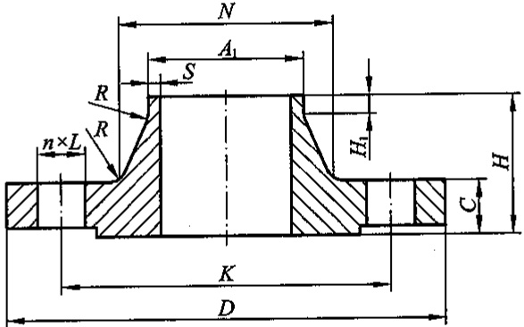

图8.2.3 带颈对焊钢制管法兰

(mm)

| 公称尺寸DN | 钢管外径法兰焊端外径 A_1 |  | 连接尺寸 |  |  |  |  | 法兰厚度C | 法兰颈 |  |  |  |  | 法兰高度H |
|---|---|---|---|---|---|---|---|---|---|---|---|---|---|---|
| 法兰外径D | 螺栓孔中心圆直径K | 螺栓孔直径L | 螺栓孔数量n(个) | 螺栓Th | N |  | S≥ | H_1 \approx | R |  |  |  |  |  |
| A | B | A | B |  |  |  |  |  |  |  |  |  |  |  |
| 10 | 17.2 | 14 | 90 | 60 | 14 | 4 | M12 | 16 | 28 | 28 | 1.8 | 6 | 4 | 35 |
| 15 | 21.3 | 18 | 95 | 65 | 14 | 4 | M12 | 16 | 32 | 32 | 2.0 | 6 | 4 | 38 |
| 20 | 26.9 | 25 | 105 | 75 | 14 | 4 | M12 | 18 | 40 | 40 | 2.3 | 6 | 4 | 40 |
| 25 | 33.7 | 32 | 115 | 85 | 14 | 4 | M12 | 18 | 46 | 46 | 2.6 | 6 | 4 | 40 |
| 32 | 42.4 | 38 | 140 | 100 | 18 | 4 | M16 | 18 | 56 | 56 | 2.6 | 6 | 6 | 42 |
| 40 | 48.3 | 45 | 150 | 110 | 18 | 4 | M16 | 18 | 64 | 64 | 2.6 | 7 | 6 | 45 |
| 50 | 60.3 | 57 | 165 | 125 | 18 | 4 | M16 | 18 | 74 | 74 | 2.9 | 8 | 5 | 45 |
| 65 | 76.1 | 65 | 185 | 145 | 18 | 8 | M16 | 18 | 92 | 92 | 2.9 | 10 | 6 | 45 |

<!-- page: 73 -->

| 公称尺寸DN | 钢管外径法兰焊端外径A1 |  | 连接尺寸 |  |  |  |  | 法兰厚度C | 法兰颈 |  |  |  |  | 法兰高度H |
|---|---|---|---|---|---|---|---|---|---|---|---|---|---|---|
| 法兰外径D | 螺栓孔中心圆直径K | 螺栓孔直径L | 螺栓孔数量n(个) | 螺栓Th | N |  | S≥ | H1≈ | R |  |  |  |  |  |
| A | B | A | B |  |  |  |  |  |  |  |  |  |  |  |
| 80 | 88.9 | 89 | 200 | 160 | 18 | 8 | M16 | 20 | 105 | 105 | 3.2 | 10 | 6 | 50 |
| 100 | 114.3 | 108 | 220 | 180 | 18 | 8 | M16 | 20 | 131 | 131 | 3.6 | 12 | 8 | 52 |
| 125 | 139.7 | 133 | 250 | 210 | 18 | 8 | M16 | 22 | 156 | 156 | 4 | 12 | 8 | 55 |
| 150 | 168.3 | 159 | 285 | 240 | 22 | 8 | M20 | 22 | 184 | 184 | 4.5 | 12 | 10 | 55 |
| 200 | 219.1 | 219 | 340 | 295 | 22 | 8 | M20 | 24 | 234 | 234 | 6.3 | 16 | 10 | 62 |
| 250 | 273 | 273 | 395 | 350 | 22 | 12 | M20 | 26 | 292 | 292 | 6.3 | 16 | 12 | 70 |
| 300 | 323.9 | 325 | 445 | 400 | 22 | 12 | M20 | 26 | 342 | 342 | 7.1 | 16 | 12 | 78 |
| 350 | 355.6 | 377 | 505 | 460 | 22 | 16 | M20 | 26 | 385 | 402 | 7.1 | 16 | 12 | 82 |
| 400 | 406.4 | 426 | 565 | 515 | 26 | 16 | M24 | 26 | 440 | 458 | 7.1 | 16 | 12 | 85 |
| 450 | 457 | 480 | 615 | 565 | 26 | 20 | M24 | 28 | 488 | 510 | 7.1 | 16 | 12 | 87 |
| 500 | 508 | 530 | 670 | 620 | 26 | 20 | M24 | 28 | 542 | 562 | 7.1 | 16 | 12 | 90 |
| 600 | 610 | 630 | 780 | 725 | 30 | 20 | M27 | 28 | 642 | 660 | 7.1 | 18 | 12 | 95 |
| 700 | 711 | 720 | 895 | 840 | 30 | 24 | M27 | 30 | 746 | 755 | 8 | 18 | 12 | 100 |
| 800 | 813 | 820 | 1015 | 950 | 33 | 24 | M30 | 32 | 850 | 855 | 8 | 18 | 12 | 105 |
| 900 | 914 | 920 | 1115 | 1050 | 33 | 28 | M30 | 34 | 950 | 954 | 10 | 20 | 12 | 110 |
| 1000 | 1016 | 1020 | 1230 | 1160 | 36 | 28 | M33 | 34 | 1052 | 1054 | 10 | 20 | 16 | 120 |
| 1200 | 1219 | 1220 | 1455 | 1380 | 39 | 32 | M36×3 | 38 | 1256 | 1256 | 11 | 25 | 16 | 130 |
| 1400 | 1422 | 1420 | 1675 | 1590 | 42 | 36 | M39×3 | 42 | 1460 | 1460 | 12 | 25 | 16 | 145 |
| 1600 | 1626 | 1620 | 1915 | 1820 | 48 | 40 | M45×3 | 46 | 1666 | 1666 | 14 | 25 | 16 | 160 |
| 1800 | 1829 | 1820 | 2115 | 2020 | 48 | 44 | M45×3 | 50 | 1868 | 1866 | 15 | 30 | 16 | 170 |
| 2000 | 2032 | 2020 | 2325 | 2230 | 48 | 48 | M45×3 | 54 | 2072 | 2070 | 16 | 30 | 16 | 180 |

(mm)

| 公称尺寸DN | 钢管外径法兰焊端外径 A_1 |  | 连接尺寸 |  |  |  |  | 法兰厚度C | 法兰颈 |  |  |  |  | 法兰高度H |
|---|---|---|---|---|---|---|---|---|---|---|---|---|---|---|
| 法兰外径D | 螺栓孔中心圆直径K | 螺栓孔直径L | 螺栓孔数量n(个) | 螺栓Th | N |  | S≥ | H_1 ≈ | R |  |  |  |  |  |
| A | B | A | B |  |  |  |  |  |  |  |  |  |  |  |
| 10 | 17.2 | 14 | 90 | 60 | 14 | 4 | M12 | 16 | 28 | 28 | 1.8 | 6 | 4 | 35 |
| 15 | 21.3 | 18 | 95 | 65 | 14 | 4 | M12 | 16 | 32 | 32 | 2.0 | 6 | 4 | 38 |
| 20 | 26.9 | 25 | 105 | 75 | 14 | 4 | M12 | 18 | 40 | 40 | 2.3 | 6 | 4 | 40 |
| 25 | 33.7 | 32 | 115 | 85 | 14 | 4 | M12 | 18 | 46 | 46 | 2.6 | 6 | 4 | 40 |
| 32 | 42.4 | 38 | 140 | 100 | 18 | 4 | M16 | 18 | 56 | 56 | 2.6 | 6 | 6 | 42 |
| 40 | 48.3 | 45 | 150 | 110 | 18 | 4 | M16 | 18 | 64 | 64 | 2.6 | 7 | 6 | 45 |
| 50 | 60.3 | 57 | 165 | 125 | 18 | 4 | M16 | 18 | 74 | 74 | 2.9 | 8 | 5 | 45 |
| 65 | 76.1 | 65 | 185 | 145 | 18 | 8 | M16 | 18 | 92 | 92 | 2.9 | 10 | 6 | 45 |

<!-- page: 74 -->

(mm)

| 公称尺寸DN | 钢管外径法兰焊端外径 A_1 |  | 连接尺寸 |  |  |  |  | 法兰厚度C | 法兰颈 |  |  |  |  | 法兰高度H |
|---|---|---|---|---|---|---|---|---|---|---|---|---|---|---|
| 法兰外径D | 螺栓孔中心圆直径K | 螺栓孔直径L | 螺栓孔数量n(个) | 螺栓Th | N |  | S≥ | H_1 \approx | R |  |  |  |  |  |
| A | B | A | B |  |  |  |  |  |  |  |  |  |  |  |
| 80 | 88.9 | 89 | 200 | 160 | 18 | 8 | M16 | 20 | 105 | 105 | 3.2 | 10 | 6 | 50 |
| 100 | 114.3 | 108 | 220 | 180 | 18 | 8 | M16 | 20 | 131 | 131 | 3.6 | 12 | 8 | 52 |
| 125 | 139.7 | 133 | 250 | 210 | 18 | 8 | M16 | 22 | 156 | 156 | 4.0 | 12 | 8 | 55 |
| 150 | 168.3 | 159 | 285 | 240 | 22 | 8 | M20 | 22 | 184 | 184 | 4.5 | 12 | 10 | 55 |
| 200 | 219.1 | 219 | 340 | 295 | 22 | 12 | M20 | 24 | 235 | 235 | 6.3 | 16 | 10 | 62 |
| 250 | 273 | 273 | 405 | 355 | 26 | 12 | M24 | 26 | 292 | 292 | 6.3 | 16 | 12 | 70 |
| 300 | 323.9 | 325 | 460 | 410 | 26 | 12 | M24 | 28 | 344 | 344 | 7.1 | 16 | 12 | 78 |
| 350 | 355.6 | 377 | 520 | 470 | 26 | 16 | M24 | 30 | 390 | 410 | 8.0 | 16 | 12 | 82 |
| 400 | 406.4 | 426 | 580 | 525 | 30 | 16 | M27 | 32 | 445 | 464 | 8.0 | 16 | 12 | 85 |
| 450 | 457 | 480 | 640 | 585 | 30 | 20 | M27 | 40 | 490 | 512 | 8.0 | 16 | 12 | 87 |
| 500 | 508 | 530 | 715 | 650 | 33 | 20 | M30 | 44 | 548 | 578 | 8.0 | 16 | 12 | 90 |
| 600 | 610 | 630 | 840 | 770 | 36 | 20 | M33 | 54 | 652 | 670 | 8.8 | 18 | 12 | 95 |
| 700 | 711 | 720 | 910 | 840 | 36 | 24 | M33 | 36 | 755 | 759 | 8.8 | 18 | 12 | 100 |
| 800 | 813 | 820 | 1025 | 950 | 39 | 24 | M36×3 | 38 | 855 | 855 | 10.0 | 20 | 12 | 105 |
| 900 | 914 | 920 | 1125 | 1050 | 39 | 28 | M36×3 | 40 | 955 | 954 | 10.0 | 20 | 12 | 110 |
| 1000 | 1016 | 1020 | 1255 | 1170 | 42 | 28 | M39×3 | 42 | 1058 | 1060 | 10.0 | 22 | 16 | 120 |
| 1200 | 1219 | 1220 | 1485 | 1390 | 48 | 32 | M45×3 | 48 | 1262 | 1260 | 12.5 | 30 | 16 | 130 |
| 1400 | 1422 | 1420 | 1685 | 1590 | 48 | 36 | M45×3 | 52 | 1465 | 1465 | 14.2 | 30 | 16 | 145 |
| 1600 | 1626 | 1620 | 1930 | 1820 | 56 | 40 | M52×4 | 58 | 1668 | 1668 | 16 | 35 | 16 | 160 |
| 1800 | 1829 | 1820 | 2130 | 2020 | 56 | 44 | M52×4 | 62 | 1870 | 1870 | 17.5 | 35 | 16 | 170 |
| 2000 | 2032 | 2020 | 2345 | 2230 | 62 | 48 | M56×4 | 66 | 2072 | 2072 | 20 | 40 | 16 | 180 |

(mm)

| 公称尺寸DN | 钢管外径法兰焊端外径 A_1 |  | 连接尺寸 |  |  |  |  | 法兰厚度C | 法兰颈 |  |  |  |  | 法兰高度H |
|---|---|---|---|---|---|---|---|---|---|---|---|---|---|---|
| 法兰外径D | 螺栓孔中心圆直径K | 螺栓孔直径L | 螺栓孔数量n(个) | 螺栓Th | N |  | S≥ | H_1 ≈ | R |  |  |  |  |  |
| A | B | A | B |  |  |  |  |  |  |  |  |  |  |  |
| 10 | 17.2 | 14 | 90 | 60 | 14 | 4 | M12 | 16 | 28 | 28 | 1.8 | 6 | 4 | 35 |
| 15 | 21.3 | 18 | 95 | 65 | 14 | 4 | M12 | 16 | 32 | 32 | 2.0 | 6 | 4 | 38 |
| 20 | 26.9 | 25 | 105 | 75 | 14 | 4 | M12 | 18 | 40 | 40 | 2.3 | 6 | 4 | 40 |
| 25 | 33.7 | 32 | 115 | 85 | 14 | 4 | M12 | 18 | 46 | 46 | 2.6 | 6 | 4 | 40 |
| 32 | 42.4 | 38 | 140 | 100 | 18 | 4 | M16 | 18 | 56 | 56 | 2.6 | 6 | 6 | 42 |
| 40 | 48.3 | 45 | 150 | 110 | 18 | 4 | M16 | 18 | 64 | 64 | 2.6 | 7 | 6 | 45 |
| 50 | 60.3 | 57 | 165 | 125 | 18 | 4 | M16 | 20 | 75 | 75 | 2.9 | 8 | 6 | 48 |
| 65 | 76.1 | 65 | 185 | 145 | 18 | 8 | M16 | 22 | 90 | 90 | 2.9 | 10 | 6 | 52 |
| 80 | 88.9 | 89 | 200 | 160 | 18 | 8 | M16 | 24 | 105 | 105 | 3.2 | 12 | 8 | 58 |

<!-- page: 75 -->

(mm)

| 公称尺寸DN | 钢管外径法兰焊端外径 A_1 |  | 连接尺寸 |  |  |  |  | 法兰厚度C | 法兰颈 |  |  |  |  | 法兰高度H |
|---|---|---|---|---|---|---|---|---|---|---|---|---|---|---|
| 法兰外径D | 螺栓孔中心圆直径K | 螺栓孔直径L | 螺栓孔数量n(个) | 螺栓Th | N |  | S≥ | H_1 \approx | R |  |  |  |  |  |
| A | B | A | B |  |  |  |  |  |  |  |  |  |  |  |
| 100 | 114.3 | 108 | 235 | 190 | 22 | 8 | M20 | 24 | 134 | 134 | 3.6 | 12 | 8 | 65 |
| 125 | 139.7 | 133 | 270 | 220 | 26 | 8 | M24 | 26 | 162 | 162 | 4.0 | 12 | 8 | 68 |
| 150 | 168.3 | 159 | 300 | 250 | 26 | 8 | M24 | 28 | 192 | 190 | 4.5 | 12 | 10 | 75 |
| 200 | 219.1 | 219 | 360 | 310 | 26 | 12 | M24 | 30 | 244 | 244 | 6.3 | 16 | 10 | 80 |
| 250 | 273 | 273 | 425 | 370 | 30 | 12 | M27 | 32 | 298 | 298 | 7.1 | 18 | 12 | 88 |
| 300 | 323.9 | 325 | 485 | 430 | 30 | 16 | M27 | 34 | 352 | 352 | 8.0 | 18 | 12 | 92 |
| 350 | 355.6 | 377 | 555 | 490 | 33 | 16 | M30 | 38 | 398 | 420 | 8.0 | 20 | 12 | 100 |
| 400 | 406.4 | 426 | 620 | 550 | 36 | 16 | M33 | 40 | 452 | 472 | 8.8 | 20 | 12 | 110 |
| 450 | 457 | 480 | 670 | 600 | 36 | 20 | M33 | 46 | 500 | 522 | 8.8 | 20 | 12 | 110 |
| 500 | 508 | 530 | 730 | 660 | 36 | 20 | M33 | 48 | 558 | 580 | 10 | 20 | 12 | 125 |
| 600 | 610 | 630 | 845 | 770 | 39 | 20 | M36 \times 3 | 58 | 660 | 680 | 11 | 20 | 12 | 125 |

(mm)

| 公称尺寸DN | 钢管外径法兰焊端外径 A_1 |  | 连接尺寸 |  |  |  |  | 法兰厚度C | 法兰颈 |  |  |  |  | 法兰高度H |
|---|---|---|---|---|---|---|---|---|---|---|---|---|---|---|
| 法兰外径D | 螺栓孔中心圆直径K | 螺栓孔直径L | 螺栓孔数量n(个) | 螺栓Th | N |  | S≥ | H_1 ≈ | R |  |  |  |  |  |
| A | B | A | B |  |  |  |  |  |  |  |  |  |  |  |
| 10 | 17.2 | 14 | 90 | 60 | 14 | 4 | M12 | 16 | 28 | 28 | 1.8 | 6 | 4 | 35 |
| 15 | 21.3 | 18 | 95 | 65 | 14 | 4 | M12 | 16 | 32 | 32 | 2.0 | 6 | 4 | 38 |
| 20 | 26.9 | 25 | 105 | 75 | 14 | 4 | M12 | 18 | 40 | 40 | 2.3 | 6 | 4 | 40 |
| 25 | 33.7 | 32 | 115 | 85 | 14 | 4 | M12 | 18 | 46 | 46 | 2.6 | 6 | 4 | 40 |
| 32 | 42.4 | 38 | 140 | 100 | 18 | 4 | M16 | 18 | 56 | 56 | 2.6 | 6 | 6 | 42 |
| 40 | 48.3 | 45 | 150 | 110 | 18 | 4 | M16 | 18 | 64 | 64 | 2.6 | 7 | 6 | 45 |
| 50 | 60.3 | 57 | 165 | 125 | 18 | 4 | M16 | 20 | 75 | 75 | 2.9 | 8 | 6 | 48 |
| 65 | 76.1 | 65 | 185 | 145 | 18 | 8 | M16 | 22 | 90 | 90 | 2.9 | 10 | 6 | 52 |
| 80 | 88.9 | 89 | 200 | 160 | 18 | 8 | M16 | 24 | 105 | 105 | 3.2 | 12 | 8 | 58 |
| 100 | 114.3 | 108 | 235 | 190 | 22 | 8 | M20 | 24 | 134 | 134 | 3.6 | 12 | 8 | 65 |
| 125 | 139.7 | 133 | 270 | 220 | 26 | 8 | M24 | 26 | 162 | 162 | 4.0 | 12 | 8 | 68 |
| 150 | 168.3 | 159 | 300 | 250 | 26 | 8 | M24 | 28 | 192 | 192 | 4.5 | 12 | 10 | 75 |
| 200 | 219.1 | 219 | 375 | 320 | 30 | 12 | M27 | 34 | 244 | 244 | 6.3 | 16 | 10 | 88 |
| 250 | 273 | 273 | 450 | 385 | 33 | 12 | M30 | 38 | 306 | 306 | 7.1 | 18 | 12 | 105 |
| 300 | 323.9 | 325 | 515 | 450 | 33 | 16 | M30 | 42 | 362 | 362 | 8.0 | 18 | 12 | 115 |
| 350 | 355.6 | 377 | 580 | 510 | 36 | 16 | M33 | 46 | 408 | 430 | 8.8 | 20 | 12 | 125 |
| 400 | 406.4 | 426 | 660 | 585 | 39 | 16 | M36 \times 3 | 50 | 462 | 482 | 11.0 | 20 | 12 | 135 |
| 450 | 457 | 480 | 685 | 610 | 39 | 20 | M36 \times 3 | 57 | 500 | 522 | 12.5 | 20 | 12 | 135 |
| 500 | 508 | 530 | 755 | 670 | 42 | 20 | M39 \times 3 | 57 | 562 | 584 | 14.2 | 20 | 12 | 140 |
| 600 | 610 | 630 | 890 | 795 | 48 | 20 | M45 \times 3 | 72 | 666 | 686 | 16.0 | 20 | 12 | 150 |

<!-- page: 76 -->

(mm)

| 公称尺寸DN | 钢管外径法兰焊端外径 A_1 |  | 连接尺寸 |  |  |  |  | 法兰厚度C | 法兰颈 |  |  |  |  | 法兰高度H |
|---|---|---|---|---|---|---|---|---|---|---|---|---|---|---|
| 法兰外径D | 螺栓孔中心圆直径K | 螺栓孔直径L | 螺栓孔数量n(个) | 螺栓Th | N |  | S≥ | H_1 ≈ | R |  |  |  |  |  |
| A | B | A | B |  |  |  |  |  |  |  |  |  |  |  |
| 10 | 17.2 | 14 | 100 | 70 | 14 | 4 | M12 | 20 | 32 | 32 | 1.8 | 6 | 4 | 45 |
| 15 | 21.3 | 18 | 105 | 75 | 14 | 4 | M12 | 20 | 34 | 34 | 2.0 | 6 | 4 | 45 |
| 20 | 26.9 | 25 | 130 | 90 | 18 | 4 | M16 | 22 | 42 | 42 | 2.6 | 8 | 4 | 48 |
| 25 | 33.7 | 32 | 140 | 100 | 18 | 4 | M16 | 24 | 52 | 52 | 2.6 | 8 | 4 | 58 |
| 32 | 42.4 | 38 | 155 | 110 | 22 | 4 | M20 | 24 | 62 | 62 | 2.9 | 8 | 6 | 60 |
| 40 | 48.3 | 45 | 170 | 125 | 22 | 4 | M20 | 26 | 70 | 70 | 2.9 | 10 | 6 | 62 |
| 50 | 60.3 | 57 | 180 | 135 | 22 | 4 | M20 | 26 | 82 | 82 | 2.9 | 10 | 6 | 62 |
| 65 | 76.1 | 65 | 205 | 160 | 22 | 8 | M20 | 26 | 98 | 98 | 3.2 | 12 | 6 | 68 |
| 80 | 88.9 | 89 | 215 | 170 | 22 | 8 | M20 | 28 | 112 | 112 | 3.6 | 12 | 8 | 72 |
| 100 | 114.3 | 108 | 250 | 200 | 26 | 8 | M24 | 30 | 138 | 138 | 4.0 | 12 | 8 | 78 |
| 125 | 139.7 | 133 | 295 | 240 | 30 | 8 | M27 | 34 | 168 | 168 | 4.5 | 12 | 8 | 88 |
| 150 | 168.3 | 159 | 345 | 280 | 33 | 8 | M30 | 36 | 202 | 202 | 5.6 | 12 | 10 | 95 |
| 200 | 219.1 | 219 | 415 | 345 | 36 | 12 | M33 | 42 | 256 | 256 | 7.1 | 16 | 10 | 110 |
| 250 | 273 | 273 | 470 | 400 | 36 | 12 | M33 | 46 | 316 | 316 | 8.8 | 18 | 12 | 125 |
| 300 | 323.9 | 325 | 530 | 460 | 36 | 16 | M33 | 52 | 372 | 372 | 11.0 | 18 | 12 | 140 |
| 350 | 355.6 | 377 | 600 | 525 | 39 | 16 | M36×3 | 56 | 420 | 442 | 12.5 | 20 | 12 | 150 |
| 400 | 406.4 | 426 | 670 | 585 | 42 | 16 | M39×3 | 60 | 475 | 495 | 14.2 | 20 | 12 | 160 |

(mm)

| 公称尺寸DN | 钢管外径法兰焊端外径 A_1 |  | 连接尺寸 |  |  |  |  | 法兰厚度C | 法兰颈 |  |  |  |  | 法兰高度H |
|---|---|---|---|---|---|---|---|---|---|---|---|---|---|---|
| 法兰外径D | 螺栓孔中心圆直径K | 螺栓孔直径L | 螺栓孔数量n(个) | 螺栓Th | N |  | S≥ | H_1 ≈ | R |  |  |  |  |  |
| A | B | A | B |  |  |  |  |  |  |  |  |  |  |  |
| 10 | 17.2 | 14 | 100 | 70 | 14 | 4 | M12 | 20 | 32 | 32 | 1.8 | 6 | 4 | 45 |
| 15 | 21.3 | 18 | 105 | 75 | 14 | 4 | M12 | 20 | 34 | 34 | 2.0 | 6 | 4 | 45 |
| 20 | 26.9 | 25 | 130 | 90 | 18 | 4 | M16 | 22 | 42 | 42 | 2.6 | 8 | 4 | 48 |
| 25 | 33.7 | 32 | 140 | 100 | 18 | 4 | M16 | 24 | 52 | 52 | 2.6 | 8 | 4 | 58 |
| 32 | 42.4 | 38 | 155 | 110 | 22 | 4 | M20 | 24 | 62 | 62 | 2.9 | 8 | 6 | 60 |
| 40 | 48.3 | 45 | 170 | 125 | 22 | 4 | M20 | 26 | 70 | 70 | 2.9 | 10 | 6 | 62 |
| 50 | 60.3 | 57 | 195 | 145 | 26 | 4 | M24 | 28 | 90 | 90 | 3.2 | 10 | 6 | 68 |
| 65 | 76.1 | 65 | 220 | 170 | 26 | 8 | M24 | 30 | 108 | 108 | 3.6 | 12 | 6 | 76 |
| 80 | 88.9 | 89 | 230 | 180 | 26 | 8 | M24 | 32 | 120 | 120 | 4.0 | 12 | 8 | 78 |
| 100 | 114.3 | 108 | 265 | 210 | 30 | 8 | M27 | 36 | 150 | 150 | 5.0 | 12 | 8 | 90 |
| 125 | 139.7 | 133 | 315 | 250 | 33 | 8 | M30 | 40 | 180 | 180 | 6.3 | 12 | 8 | 105 |
| 150 | 168.3 | 159 | 355 | 290 | 33 | 12 | M30 | 44 | 210 | 210 | 7.1 | 12 | 10 | 115 |

<!-- page: 77 -->

(mm)

| 公称尺寸DN | 钢管外径法兰焊端外径 A_1 |  | 连接尺寸 |  |  |  |  | 法兰厚度C | 法兰颈 |  |  |  |  | 法兰高度H |
|---|---|---|---|---|---|---|---|---|---|---|---|---|---|---|
| 法兰外径D | 螺栓孔中心圆直径K | 螺栓孔直径L | 螺栓孔数量n(个) | 螺栓Th | N |  | S≥ | H_1 ≈ | R |  |  |  |  |  |
| A | B | A | B |  |  |  |  |  |  |  |  |  |  |  |
| 200 | 219.1 | 219 | 430 | 360 | 36 | 12 | M33 | 52 | 278 | 278 | 10.0 | 16 | 10 | 130 |
| 250 | 273 | 273 | 505 | 430 | 39 | 12 | M36×3 | 60 | 340 | 340 | 12.5 | 18 | 12 | 157 |
| 300 | 323.9 | 325 | 585 | 500 | 42 | 16 | M39×3 | 68 | 400 | 400 | 14.2 | 18 | 12 | 170 |
| 350 | 355.6 | 377 | 655 | 560 | 48 | 16 | M45×3 | 74 | 460 | 482 | 16.0 | 20 | 12 | 189 |

(mm)

| 公称尺寸DN | 钢管外径法兰焊端外径 A_1 |  | 连接尺寸 |  |  |  |  | 法兰厚度C | 法兰颈 |  |  |  |  | 法兰高度H |
|---|---|---|---|---|---|---|---|---|---|---|---|---|---|---|
| 法兰外径D | 螺栓孔中心圆直径K | 螺栓孔直径L | 螺栓孔数量n(个) | 螺栓Th | N |  | S≥ | H_1 \approx | R |  |  |  |  |  |
| A | B | A | B |  |  |  |  |  |  |  |  |  |  |  |
| 10 | 17.2 | 14 | 100 | 70 | 14 | 4 | M12 | 20 | 32 | 32 | 2.0 | 6 | 4 | 45 |
| 15 | 21.3 | 18 | 105 | 75 | 14 | 4 | M12 | 20 | 34 | 34 | 2.0 | 6 | 4 | 45 |
| 20 | 26.9 | 25 | 130 | 90 | 18 | 4 | M16 | 24 | 42 | 42 | 2.9 | 6 | 4 | 52 |
| 25 | 33.7 | 32 | 140 | 100 | 18 | 4 | M16 | 24 | 52 | 52 | 2.9 | 8 | 4 | 58 |
| 32 | 42.4 | 38 | 155 | 110 | 22 | 4 | M20 | 28 | 60 | 60 | 3.6 | 8 | 5 | 60 |
| 40 | 48.3 | 45 | 170 | 125 | 22 | 4 | M20 | 28 | 70 | 70 | 3.6 | 10 | 6 | 64 |
| 50 | 60.3 | 57 | 195 | 145 | 26 | 4 | M24 | 30 | 90 | 90 | 4 | 10 | 6 | 75 |
| 65 | 76.1 | 65 | 220 | 170 | 26 | 8 | M24 | 34 | 108 | 108 | 5 | 12 | 6 | 82 |
| 80 | 88.9 | 89 | 230 | 180 | 26 | 8 | M24 | 36 | 120 | 120 | 6.3 | 12 | 8 | 86 |
| 100 | 114.3 | 108 | 265 | 210 | 30 | 8 | M27 | 40 | 150 | 150 | 8 | 12 | 8 | 100 |
| 125 | 139.7 | 133 | 315 | 250 | 33 | 8 | M30 | 44 | 180 | 180 | 10 | 14 | 8 | 115 |
| 150 | 168.3 | 159 | 355 | 290 | 33 | 12 | M30 | 50 | 210 | 210 | 12.5 | 14 | 10 | 128 |
| 200 | 219.1 | 219 | 430 | 360 | 36 | 12 | M33 | 60 | 278 | 278 | 16 | 16 | 10 | 140 |
| 250 | 273 | 273 | 515 | 430 | 42 | 12 | M39×3 | 68 | 340 | 340 | 20 | 18 | 12 | 155 |
| 300 | 323.9 | 325 | 585 | 500 | 42 | 16 | M39×3 | 78 | 400 | 400 | 22.2 | 18 | 12 | 175 |

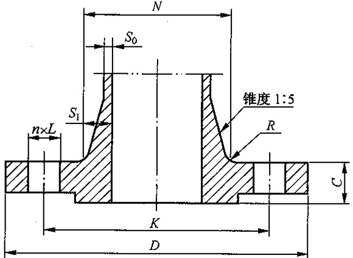

图8.2.4 整体钢制管法兰

<!-- page: 78 -->

(mm)

| 公称尺寸DN | 连接尺寸 |  |  |  |  | 法兰厚度C | 法兰颈 |  |  |  |
|---|---|---|---|---|---|---|---|---|---|---|
| 法兰外径D | 螺栓孔中心圆直径K | 螺栓孔直径L | 螺栓孔数量n(个) | 螺栓Th | N | R | S0 | S1 |  |  |
| 10 | 75 | 50 | 11 | 4 | M10 | 12 | 20 | 4 | 3 | 5 |
| 15 | 80 | 55 | 11 | 4 | M10 | 12 | 26 | 4 | 3 | 5.5 |
| 20 | 90 | 65 | 11 | 4 | M10 | 14 | 34 | 4 | 3.5 | 7 |
| 25 | 100 | 75 | 11 | 4 | M10 | 14 | 44 | 4 | 4 | 9.5 |
| 32 | 120 | 90 | 14 | 4 | M12 | 14 | 54 | 6 | 4 | 11 |
| 40 | 130 | 100 | 14 | 4 | M12 | 14 | 64 | 6 | 4.5 | 12 |
| 50 | 140 | 110 | 14 | 4 | M12 | 14 | 74 | 6 | 5 | 12 |
| 65 | 160 | 130 | 14 | 4 | M12 | 14 | 94 | 6 | 6 | 14.5 |
| 80 | 190 | 150 | 18 | 4 | M16 | 16 | 110 | 8 | 7 | 15 |
| 100 | 210 | 170 | 18 | 4 | M16 | 16 | 130 | 8 | 8 | 15 |
| 125 | 240 | 200 | 18 | 8 | M16 | 18 | 160 | 8 | 9 | 17.5 |
| 150 | 265 | 225 | 18 | 8 | M16 | 18 | 182 | 10 | 10 | 16 |
| 200 | 320 | 280 | 18 | 8 | M16 | 20 | 238 | 10 | 11 | 19 |
| 250 | 375 | 335 | 18 | 12 | M16 | 22 | 284 | 12 | 11 | 17 |
| 300 | 440 | 395 | 22 | 12 | M20 | 22 | 342 | 12 | 12 | 21 |
| 350 | 490 | 445 | 22 | 12 | M20 | 22 | 392 | 12 | 14 | 21 |
| 400 | 540 | 495 | 22 | 16 | M20 | 22 | 442 | 12 | 15 | 21 |
| 450 | 595 | 550 | 22 | 16 | M20 | 22 | 494 | 12 | 16 | 22 |
| 500 | 645 | 600 | 22 | 20 | M20 | 24 | 544 | 12 | 16 | 22 |
| 600 | 755 | 705 | 26 | 20 | M24 | 30 | 642 | 12 | 17 | 21 |
| 700 | 860 | 810 | 26 | 24 | M24 | 24 | 746 | 12 | 17 | 23 |
| 800 | 975 | 920 | 30 | 24 | M27 | 24 | 850 | 12 | 18 | 25 |
| 900 | 1075 | 1020 | 30 | 24 | M27 | 26 | 950 | 12 | 18 | 25 |
| 1000 | 1175 | 1120 | 30 | 28 | M27 | 26 | 1050 | 16 | 19 | 25 |
| 1200 | 1405 | 1340 | 33 | 32 | M30 | 28 | 1264 | 16 | 20 | 32 |
| 1400 | 1630 | 1560 | 36 | 36 | M33 | 32 | 1480 | 16 | 22 | 40 |
| 1600 | 1830 | 1760 | 36 | 40 | M33 | 34 | 1680 | 16 | 24 | 40 |
| 1800 | 2045 | 1970 | 39 | 44 | M36×3 | 36 | 1878 | 16 | 26 | 39 |
| 2000 | 2265 | 2180 | 42 | 48 | M39×3 | 38 | 2082 | 16 | 28 | 41 |

<!-- page: 79 -->

(mm)

| 公称尺寸DN | 连接尺寸 |  |  |  |  | 法兰厚度C | 法兰颈 |  |  |  |
|---|---|---|---|---|---|---|---|---|---|---|
| 法兰外径D | 螺栓孔中心圆直径K | 螺栓孔直径L | 螺栓孔数量n(个) | 螺栓Th | N | R | S0 | S1 |  |  |
| 10 | 90 | 60 | 14 | 4 | M12 | 16 | 28 | 4 | 6 | 10 |
| 15 | 95 | 65 | 14 | 4 | M12 | 16 | 32 | 4 | 6 | 11 |
| 20 | 105 | 75 | 14 | 4 | M12 | 18 | 40 | 4 | 6.5 | 12 |
| 25 | 115 | 85 | 14 | 4 | M12 | 18 | 50 | 4 | 7 | 14 |
| 32 | 140 | 100 | 18 | 4 | M16 | 18 | 60 | 6 | 7 | 14 |
| 40 | 150 | 110 | 18 | 4 | M16 | 18 | 70 | 6 | 7.5 | 14 |
| 50 | 165 | 125 | 18 | 4 | M16 | 18 | 84 | 5 | 8 | 15 |
| 65 | 185 | 145 | 18 | 8 | M16 | 18 | 104 | 6 | 8 | 14 |
| 80 | 200 | 160 | 18 | 8 | M16 | 20 | 120 | 6 | 8.5 | 15 |
| 100 | 220 | 180 | 18 | 8 | M16 | 20 | 140 | 8 | 9.5 | 15 |
| 125 | 250 | 210 | 18 | 8 | M16 | 22 | 170 | 8 | 10 | 17 |
| 150 | 285 | 240 | 22 | 8 | M20 | 22 | 190 | 10 | 11 | 17 |
| 200 | 340 | 295 | 22 | 8 | M20 | 24 | 246 | 10 | 12 | 23 |
| 250 | 395 | 350 | 22 | 12 | M20 | 26 | 298 | 12 | 14 | 24 |
| 300 | 445 | 400 | 22 | 12 | M20 | 26 | 348 | 12 | 15 | 24 |
| 350 | 505 | 460 | 22 | 16 | M20 | 26 | 408 | 12 | 16 | 29 |
| 400 | 565 | 515 | 26 | 16 | M24 | 26 | 456 | 12 | 18 | 28 |
| 450 | 615 | 565 | 26 | 20 | M24 | 28 | 502 | 12 | 20 | 26 |
| 500 | 670 | 620 | 26 | 20 | M24 | 28 | 559 | 12 | 21 | 29.5 |
| 600 | 780 | 725 | 30 | 20 | M27 | 34 | 658 | 12 | 23 | 29 |
| 700 | 895 | 840 | 30 | 24 | M27 | 34 | 772 | 12 | 24 | 36 |
| 800 | 1015 | 950 | 33 | 24 | M30 | 36 | 876 | 12 | 26 | 38 |
| 900 | 1115 | 1050 | 33 | 28 | M30 | 38 | 976 | 12 | 27 | 38 |
| 1000 | 1230 | 1160 | 36 | 28 | M33 | 38 | 1080 | 16 | 29 | 40 |
| 1200 | 1455 | 1380 | 39 | 32 | M36×3 | 44 | 1292 | 16 | 32 | 46 |
| 1400 | 1675 | 1590 | 42 | 36 | M39×3 | 48 | 1496 | 16 | 34 | 48 |
| 1600 | 1915 | 1820 | 48 | 40 | M45×3 | 52 | 1712 | 16 | 36 | 56 |
| 1800 | 2115 | 2020 | 48 | 44 | M45×3 | 56 | 1910 | 16 | 39 | 55 |
| 2000 | 2325 | 2230 | 48 | 48 | M45×3 | 60 | 2120 | 16 | 41 | 60 |

<!-- page: 80 -->

(mm)

| 公称尺寸DN | 连接尺寸 |  |  |  |  | 法兰厚度C | 法兰颈 |  |  |  |
|---|---|---|---|---|---|---|---|---|---|---|
| 法兰外径D | 螺栓孔中心圆直径K | 螺栓孔直径L | 螺栓孔数量n(个) | 螺栓Th | N | R | S0 | S1 |  |  |
| 10 | 90 | 60 | 14 | 4 | M12 | 16 | 28 | 4 | 6 | 10 |
| 15 | 95 | 65 | 14 | 4 | M12 | 16 | 32 | 4 | 6 | 11 |
| 20 | 105 | 75 | 14 | 4 | M12 | 18 | 40 | 4 | 6.5 | 12 |
| 25 | 115 | 85 | 14 | 4 | M12 | 18 | 50 | 4 | 7 | 14 |
| 32 | 140 | 100 | 18 | 4 | M16 | 18 | 60 | 6 | 7 | 14 |
| 40 | 150 | 110 | 18 | 4 | M16 | 18 | 70 | 6 | 7.5 | 14 |
| 50 | 165 | 125 | 18 | 4 | M16 | 18 | 84 | 5 | 8 | 15 |
| 65 | 185 | 145 | 18 | 8 | M16 | 18 | 104 | 6 | 8 | 14 |
| 80 | 200 | 160 | 18 | 8 | M16 | 20 | 120 | 6 | 8.5 | 15 |
| 100 | 220 | 180 | 18 | 8 | M16 | 20 | 140 | 8 | 9.5 | 15 |
| 125 | 250 | 210 | 18 | 8 | M16 | 22 | 170 | 8 | 10 | 17 |
| 150 | 285 | 240 | 22 | 8 | M20 | 22 | 190 | 10 | 11 | 17 |
| 200 | 340 | 295 | 22 | 12 | M20 | 24 | 246 | 10 | 12 | 18 |
| 250 | 405 | 355 | 26 | 12 | M24 | 26 | 296 | 12 | 14 | 20 |
| 300 | 460 | 410 | 26 | 12 | M24 | 28 | 350 | 12 | 15 | 21 |
| 350 | 520 | 470 | 26 | 16 | M24 | 30 | 410 | 12 | 16 | 23 |
| 400 | 580 | 525 | 30 | 16 | M27 | 32 | 458 | 12 | 18 | 24 |
| 450 | 640 | 585 | 30 | 20 | M27 | 40 | 516 | 12 | 20 | 27 |
| 500 | 715 | 650 | 33 | 20 | M30 | 44 | 576 | 12 | 21 | 30 |
| 600 | 840 | 770 | 36 | 20 | M33 | 54 | 690 | 12 | 23 | 30 |
| 700 | 910 | 840 | 36 | 24 | M33 | 42 | 760 | 12 | 24 | 32 |
| 800 | 1025 | 950 | 39 | 24 | M36x3 | 42 | 862 | 12 | 26 | 33 |
| 900 | 1125 | 1050 | 39 | 28 | M39x3 | 44 | 962 | 12 | 27 | 35 |
| 1000 | 1255 | 1170 | 42 | 28 | M39x3 | 46 | 1076 | 16 | 29 | 39 |
| 1200 | 1485 | 1390 | 48 | 32 | M45x3 | 52 | 1282 | 16 | 32 | 44 |
| 1400 | 1685 | 1590 | 48 | 36 | M45x3 | 58 | 1482 | 16 | 34 | 48 |
| 1600 | 1930 | 1820 | 56 | 40 | M52x4 | 64 | 1696 | 16 | 36 | 51 |
| 1800 | 2130 | 2020 | 56 | 44 | M52x4 | 68 | 1896 | 16 | 39 | 53 |
| 2000 | 2345 | 2230 | 62 | 48 | M56x4 | 70 | 2100 | 16 | 41 | 56 |

<!-- page: 81 -->

表 8.2.4-4 PN25 整体钢制管法兰

(mm)

| 公称尺寸DN | 连接尺寸 |  |  |  |  | 法兰厚度C | 法兰颈 |  |  |  |
|---|---|---|---|---|---|---|---|---|---|---|
| 法兰外径D | 螺栓孔中心圆直径K | 螺栓孔直径L | 螺栓孔数量n(个) | 螺栓Th | N | R | S0 | S1 |  |  |
| 10 | 90 | 60 | 14 | 4 | M12 | 16 | 28 | 4 | 6 | 10 |
| 15 | 95 | 65 | 14 | 4 | M12 | 16 | 32 | 4 | 6 | 11 |
| 20 | 105 | 75 | 14 | 4 | M12 | 18 | 40 | 4 | 6.5 | 12 |
| 25 | 115 | 85 | 14 | 4 | M12 | 18 | 50 | 4 | 7 | 14 |
| 32 | 140 | 100 | 18 | 4 | M16 | 18 | 60 | 6 | 7 | 14 |
| 40 | 150 | 110 | 18 | 4 | M16 | 18 | 70 | 6 | 7.5 | 14 |
| 50 | 165 | 125 | 18 | 4 | M16 | 20 | 84 | 6 | 8 | 15 |
| 65 | 185 | 145 | 18 | 8 | M16 | 22 | 104 | 6 | 8.5 | 17 |
| 80 | 200 | 160 | 18 | 8 | M16 | 24 | 120 | 8 | 9 | 18 |
| 100 | 235 | 190 | 22 | 8 | M20 | 24 | 142 | 8 | 10 | 18 |
| 125 | 270 | 220 | 26 | 8 | M24 | 26 | 162 | 8 | 11 | 20 |
| 150 | 300 | 250 | 26 | 8 | M24 | 28 | 192 | 10 | 12 | 21 |
| 200 | 360 | 310 | 26 | 12 | M24 | 30 | 252 | 10 | 12 | 23 |
| 250 | 425 | 370 | 30 | 12 | M27 | 32 | 304 | 12 | 14 | 24 |
| 300 | 485 | 430 | 30 | 16 | M27 | 34 | 364 | 12 | 15 | 26 |
| 350 | 555 | 490 | 33 | 16 | M30 | 38 | 118 | 12 | 16 | 29 |
| 400 | 620 | 550 | 36 | 16 | M33 | 40 | 472 | 12 | 18 | 30 |
| 450 | 670 | 600 | 36 | 20 | M33 | 46 | 520 | 12 | 19 | 31 |
| 500 | 730 | 660 | 36 | 20 | M33 | 48 | 580 | 12 | 21 | 33 |
| 600 | 845 | 770 | 39 | 20 | M36×3 | 58 | 684 | 12 | 23 | 35 |
| 700 | 960 | 875 | 42 | 24 | M39×3 | 50 | 780 | 12 | 24 | 38 |
| 800 | 1085 | 990 | 48 | 24 | M45×3 | 54 | 882 | 12 | 26 | 41 |
| 900 | 1185 | 1090 | 48 | 28 | M45×3 | 58 | 982 | 12 | 27 | 44 |
| 1000 | 1320 | 1210 | 55 | 28 | M52×4 | 62 | 1086 | 16 | 29 | 47 |
| 1200 | 1530 | 1420 | 55 | 32 | M52×4 | 70 | 1296 | 18 | 32 | 53 |

(mm)

| 公称尺寸DN | 连接尺寸 |  |  |  |  | 法兰厚度C | 法兰颈 |  |  |  |
|---|---|---|---|---|---|---|---|---|---|---|
| 法兰外径D | 螺栓孔中心圆直径K | 螺栓孔直径L | 螺栓孔数量n(个) | 螺栓Th | N | R | S_0 | S_1 |  |  |
| 10 | 90 | 60 | 14 | 4 | M12 | 16 | 28 | 4 | 6 | 10 |
| 15 | 95 | 65 | 14 | 4 | M12 | 16 | 32 | 4 | 6 | 11 |
| 20 | 105 | 75 | 14 | 4 | M12 | 18 | 40 | 4 | 6.5 | 12 |
| 25 | 115 | 85 | 14 | 4 | M12 | 18 | 50 | 4 | 7 | 14 |
| 32 | 140 | 100 | 18 | 4 | M16 | 18 | 60 | 6 | 7 | 14 |

<!-- page: 82 -->

(mm)

| 公称尺寸DN | 连接尺寸 |  |  |  |  | 法兰厚度C | 法兰颈 |  |  |  |
|---|---|---|---|---|---|---|---|---|---|---|
| 法兰外径D | 螺栓孔中心圆直径K | 螺栓孔直径L | 螺栓孔数量n(个) | 螺栓Th | N | R | S_0 | S_1 |  |  |
| 40 | 150 | 110 | 18 | 4 | M16 | 18 | 70 | 6 | 7.5 | 14 |
| 50 | 165 | 125 | 18 | 4 | M16 | 20 | 84 | 6 | 8 | 15 |
| 65 | 185 | 145 | 18 | 8 | M16 | 22 | 104 | 6 | 8.5 | 17 |
| 80 | 200 | 160 | 18 | 8 | M16 | 24 | 120 | 8 | 9 | 18 |
| 100 | 235 | 190 | 22 | 8 | M20 | 24 | 142 | 8 | 10_1 | 18 |
| 125 | 270 | 220 | 26 | 8 | M24 | 26 | 162 | 8 | 11 | 20 |
| 150 | 300 | 250 | 26 | 8 | M24 | 28 | 192 | 10 | 12 | 21 |
| 200 | 375 | 320 | 30 | 12 | M27 | 34 | 254 | 10 | 14 | 26 |
| 250 | 450 | 385 | 33 | 12 | M30 | 38 | 312 | 12 | 16 | 29 |
| 300 | 515 | 450 | 33 | 16 | M30 | 42 | 378 | 12 | 17 | 32 |
| 350 | 580 | 510 | 36 | 16 | M33 | 46 | 432 | 12 | 19 | 35 |
| 400 | 660 | 585 | 39 | 16 | M36 \times 3 | 50 | 498 | 12 | 21 | 38 |
| 450 | 685 | 610 | 39 | 20 | M36 \times 3 | 57 | 522 | 12 | 21 | 38 |
| 500 | 755 | 670 | 42 | 20 | M39 \times 3 | 57 | 576 | 12 | 21 | 39 |
| 600 | 890 | 795 | 48 | 20 | M45 \times 3 | 72 | 686 | 12 | 24 | 45 |

(mm)

| 公称尺寸DN | 连接尺寸 |  |  |  |  | 法兰厚度C | 法兰颈 |  |  |  |
|---|---|---|---|---|---|---|---|---|---|---|
| 法兰外径D | 螺栓孔中心圆直径K | 螺栓孔直径L | 螺栓孔数量n(个) | 螺栓Th | N | R | S0 | S1 |  |  |
| 10 | 100 | 70 | 14 | 4 | M12 | 20 | 40 | 4 | 10 | 15 |
| 15 | 105 | 75 | 14 | 4 | M12 | 20 | 45 | 4 | 10 | 15 |
| 20 | 130 | 90 | 18 | 4 | M16 | 22 | 50 | 4 | 10 | 15 |
| 25 | 140 | 100 | 18 | 4 | M16 | 24 | 61 | 4 | 10 | 18 |
| 32 | 155 | 110 | 22 | 4 | M20 | 26 | 68 | 6 | 10 | 18 |
| 40 | 170 | 125 | 22 | 4 | M20 | 28 | 82 | 6 | 10 | 21 |
| 50 | 180 | 135 | 22 | 4 | M20 | 26 | 90 | 6 | 10 | 20 |
| 65 | 205 | 160 | 22 | 8 | M20 | 26 | 105 | 6 | 10 | 20 |
| 80 | 215 | 170 | 22 | 8 | M20 | 28 | 122 | 8 | 11 | 21 |
| 100 | 250 | 200 | 26 | 8 | M24 | 30 | 146 | 8 | 12 | 23 |
| 125 | 295 | 240 | 30 | 8 | M27 | 34 | 177 | 8 | 13 | 26 |
| 150 | 345 | 280 | 33 | 8 | M30 | 36 | 204 | 10 | 14 | 27 |
| 200 | 415 | 345 | 36 | 12 | M33 | 42 | 264 | 10 | 16 | 32 |
| 250 | 470 | 400 | 36 | 12 | M33 | 46 | 320 | 12 | 19 | 35 |
| 300 | 530 | 460 | 36 | 16 | M33 | 52 | 378 | 12 | 21 | 39 |
| 350 | 600 | 525 | 39 | 16 | M36×3 | 56 | 434 | 12 | 23 | 42 |
| 400 | 670 | 585 | 42 | 16 | M39×3 | 60 | 490 | 12 | 26 | 45 |

<!-- page: 83 -->

表 8.2.4-7 PN100 整体钢制管法兰

(mm)

| 公称尺寸DN | 连接尺寸 |  |  |  |  | 法兰厚度C | 法兰颈 |  |  |  |
|---|---|---|---|---|---|---|---|---|---|---|
| 法兰外径D | 螺栓孔中心圆直径K | 螺栓孔直径L | 螺栓孔数量n(个) | 螺栓Th | N | R | S0 | S1 |  |  |
| 10 | 100 | 70 | 14 | 4 | M12 | 20 | 40 | 4 | 10 | 15 |
| 15 | 105 | 75 | 14 | 4 | M12 | 20 | 45 | 4 | 10 | 15 |
| 20 | 130 | 90 | 18 | 4 | M16 | 22 | 50 | 4 | 10 | 15 |
| 25 | 140 | 100 | 18 | 4 | M16 | 24 | 61 | 4 | 10 | 18 |
| 32 | 155 | 110 | 22 | 4 | M20 | 26 | 68 | 6 | 10 | 18 |
| 40 | 170 | 125 | 22 | 4 | M20 | 28 | 82 | 6 | 10 | 21 |
| 50 | 195 | 145 | 26 | 4 | M24 | 30 | 96 | 6 | 10 | 23 |
| 65 | 220 | 170 | 26 | 8 | M24 | 34 | 118 | 6 | 11 | 24 |
| 80 | 230 | 180 | 26 | 8 | M24 | 36 | 128 | 8 | 12 | 24 |
| 100 | 265 | 210 | 30 | 8 | M27 | 40 | 150 | 8 | 14 | 25 |
| 125 | 315 | 250 | 33 | 8 | M30 | 40 | 185 | 8 | 16 | 30 |
| 150 | 355 | 290 | 33 | 12 | M30 | 44 | 216 | 10 | 18 | 33 |
| 200 | 430 | 360 | 36 | 12 | M33 | 52 | 278 | 10 | 21 | 39 |
| 250 | 505 | 430 | 39 | 12 | M36×3 | 60 | 340 | 12 | 25 | 45 |
| 300 | 585 | 500 | 42 | 16 | M39×3 | 68 | 407 | 12 | 29 | 51 |
| 350 | 655 | 560 | 48 | 16 | M45×3 | 74 | 460 | 12 | 32 | 55 |
| 400 | 715 | 620 | 48 | 16 | M45×3 | 78 | 518 | 12 | 36 | 59 |

(mm)

| 公称尺寸DN | 连接尺寸 |  |  |  |  | 法兰厚度C | 法兰颈 |  |  |  |
|---|---|---|---|---|---|---|---|---|---|---|
| 法兰外径D | 螺栓孔中心圆直径K | 螺栓孔直径L | 螺栓孔数量n(个) | 螺栓Th | N | R | S0 | S1 |  |  |
| 10 | 100 | 70 | 14 | 4 | M12 | 20 | 40 | 4 | 10 | 15 |
| 15 | 105 | 75 | 14 | 4 | M12 | 20 | 45 | 4 | 10 | 15 |
| 20 | 130 | 90 | 18 | 4 | M16 | 24 | 50 | 4 | 10 | 15 |
| 25 | 140 | 100 | 18 | 4 | M16 | 24 | 61 | 4 | 10 | 18 |
| 32 | 155 | 110 | 22 | 4 | M20 | 28 | 68 | 4 | 10 | 18 |
| 40 | 170 | 125 | 22 | 4 | M20 | 28 | 82 | 4 | 10 | 21 |
| 50 | 195 | 145 | 26 | 4 | M24 | 30 | 96 | 4 | 10 | 23 |
| 65 | 220 | 170 | 26 | 8 | M24 | 34 | 118 | 5 | 11 | 24 |
| 80 | 230 | 180 | 26 | 8 | M24 | 36 | 128 | 5 | 12 | 24 |
| 100 | 265 | 210 | 30 | 8 | M27 | 40 | 150 | 5 | 14 | 25 |
| 125 | 315 | 250 | 33 | 8 | M30 | 44 | 184 | 6 | 16 | 29.5 |
| 150 | 355 | 290 | 33 | 12 | M30 | 50 | 224 | 6 | 18 | 37 |
| 200 | 430 | 360 | 36 | 12 | M33 | 60 | 288 | 8 | 21 | 44 |
| 250 | 515 | 430 | 42 | 12 | M39×3 | 68 | 346 | 8 | 31 | 48 |
| 300 | 585 | 500 | 42 | 16 | M39×3 | 78 | 414 | 10 | 46 | 57 |

<!-- page: 84 -->

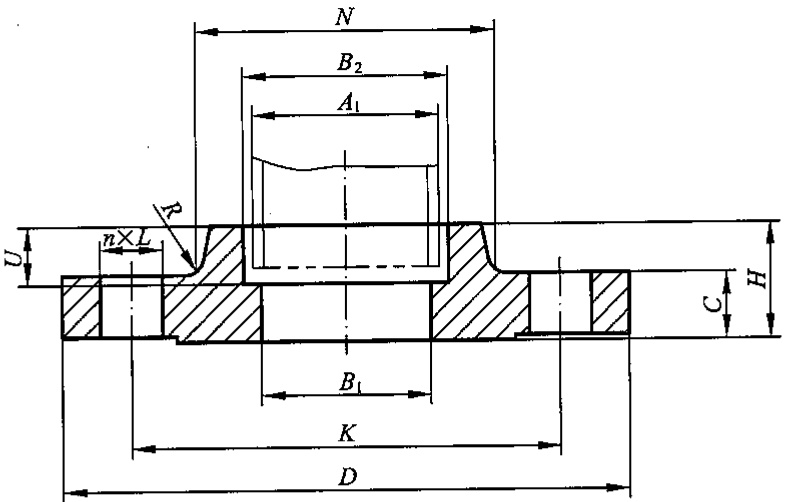

图8.2.5 承插焊钢制管法兰

(mm)

| 公称尺寸DN | 钢管外径 A_1 |  | 连接尺寸 |  |  |  |  | 法兰厚度C | 法兰内径 B_1 |  | 承插孔 |  |  | 法兰颈 |  | 法兰高度H |
|---|---|---|---|---|---|---|---|---|---|---|---|---|---|---|---|---|
| 法兰外径D | 螺栓孔中心圆直径K | 螺栓孔直径L | 螺栓孔数量n(个) | 螺栓Th | B_2 |  | U | N | R |  |  |  |  |  |  |  |
| A | B | A | B | A | B |  |  |  |  |  |  |  |  |  |  |  |
| 10 | 17.2 | 14 | 90 | 60 | 14 | 4 | M12 | 16 | 11.5 | 9 | 18 | 15 | 9 | 30 | 4 | 22 |
| 15 | 21.3 | 18 | 95 | 65 | 14 | 4 | M12 | 16 | 15.5 | 12 | 22.5 | 19 | 10 | 35 | 4 | 22 |
| 20 | 26.9 | 25 | 105 | 75 | 14 | 4 | M12 | 18 | 21 | 19 | 27.5 | 26 | 11 | 45 | 4 | 26 |
| 25 | 33.7 | 32 | 115 | 85 | 14 | 4 | M12 | 18 | 27 | 26 | 34.5 | 33 | 13 | 52 | 4 | 28 |
| 32 | 42.5 | 38 | 140 | 100 | 18 | 4 | M16 | 18 | 35 | 30 | 43.5 | 39 | 14 | 60 | 6 | 30 |
| 40 | 48.3 | 45 | 150 | 110 | 18 | 4 | M16 | 18 | 41 | 37 | 49.5 | 46 | 16 | 70 | 6 | 32 |
| 50 | 60.3 | 57 | 165 | 125 | 18 | 4 | M16 | 18 | 52 | 49 | 61.5 | 59 | 17 | 84 | 5 | 28 |

表8.2.5-2 PN16承插焊钢制管法兰

| 公称尺寸DN | 钢管外径 A_1 |  | 连接尺寸 |  |  |  |  | 法兰厚度C | 法兰内径 B_1 |  | 承插孔 |  |  | 法兰颈 |  | 法兰高度H |
|---|---|---|---|---|---|---|---|---|---|---|---|---|---|---|---|---|
| 法兰外径D | 螺栓孔中心圆直径K | 螺栓孔直径L | 螺栓孔数量n(个) | 螺栓Th | B_2 |  | U | N | R |  |  |  |  |  |  |  |
| A | B | A | B | A | B |  |  |  |  |  |  |  |  |  |  |  |
| 10 | 17.2 | 14 | 90 | 60 | 14 | 4 | M12 | 16 | 11.5 | 9 | 18 | 15 | 9 | 30 | 4 | 22 |
| 15 | 21.3 | 18 | 95 | 65 | 14 | 4 | M12 | 16 | 15.5 | 12 | 22.5 | 19 | 10 | 35 | 4 | 22 |
| 20 | 26.9 | 25 | 105 | 75 | 14 | 4 | M12 | 18 | 21 | 19 | 27.5 | 26 | 11 | 45 | 4 | 26 |
| 25 | 33.7 | 32 | 115 | 85 | 14 | 4 | M12 | 18 | 27 | 26 | 34.5 | 33 | 13 | 52 | 4 | 28 |
| 32 | 42.5 | 38 | 140 | 100 | 18 | 4 | M16 | 18 | 35 | 30 | 43.5 | 39 | 14 | 60 | 6 | 30 |
| 40 | 48.3 | 45 | 150 | 110 | 18 | 4 | M16 | 18 | 41 | 37 | 49.5 | 46 | 16 | 70 | 6 | 32 |
| 50 | 60.3 | 57 | 165 | 125 | 18 | 4 | M16 | 18 | 52 | 49 | 61.5 | 59 | 17 | 84 | 5 | 28 |

<!-- page: 85 -->

(mm)

| 公称尺寸DN | 钢管外径 A_1 |  | 连接尺寸 |  |  |  |  | 法兰厚度C | 法兰内径 B_1 |  | 承插孔 |  |  | 法兰颈 |  | 法兰高度H |
|---|---|---|---|---|---|---|---|---|---|---|---|---|---|---|---|---|
| 法兰外径D | 螺栓孔中心圆直径K | 螺栓孔直径L | 螺栓孔数量n(个) | 螺栓Th | B_2 |  | U | N | R |  |  |  |  |  |  |  |
| A | B | A | B | A | B |  |  |  |  |  |  |  |  |  |  |  |
| 10 | 17.2 | 14 | 90 | 60 | 14 | 4 | M12 | 16 | 11.5 | 9 | 18 | 15 | 9 | 30 | 4 | 22 |
| 15 | 21.3 | 18 | 95 | 65 | 14 | 4 | M12 | 16 | 15.5 | 12 | 22.5 | 19 | 10 | 35 | 4 | 22 |
| 20 | 26.9 | 25 | 105 | 75 | 14 | 4 | M12 | 18 | 21 | 19 | 27.5 | 26 | 11 | 45 | 4 | 26 |
| 25 | 33.7 | 32 | 115 | 85 | 14 | 4 | M12 | 18 | 27 | 26 | 34.5 | 33 | 13 | 52 | 4 | 28 |
| 32 | 42.5 | 38 | 140 | 100 | 18 | 4 | M16 | 18 | 35 | 30 | 43.5 | 39 | 14 | 60 | 6 | 30 |
| 40 | 48.3 | 45 | 150 | 110 | 18 | 4 | M16 | 18 | 41 | 37 | 49.5 | 46 | 16 | 70 | 6 | 32 |
| 50 | 60.3 | 57 | 165 | 125 | 18 | 4 | M16 | 20 | 52 | 49 | 61.5 | 59 | 17 | 84 | 6 | 34 |

(mm)

| 公称尺寸DN | 钢管外径 A_1 |  | 连接尺寸 |  |  |  |  | 法兰厚度C | 法兰内径 B_1 |  | 承插孔 |  |  | 法兰颈 |  | 法兰高度H |
|---|---|---|---|---|---|---|---|---|---|---|---|---|---|---|---|---|
| 法兰外径D | 螺栓孔中心圆直径K | 螺栓孔直径L | 螺栓孔数量n(个) | 螺栓Th | B_2 |  | U | N | R |  |  |  |  |  |  |  |
| A | B | A | B | A | B |  |  |  |  |  |  |  |  |  |  |  |
| 10 | 17.2 | 14 | 90 | 60 | 14 | 4 | M12 | 16 | 11.5 | 9 | 18 | 15 | 9 | 30 | 4 | 22 |
| 15 | 21.3 | 18 | 95 | 65 | 14 | 4 | M12 | 16 | 15.5 | 12 | 22.5 | 19 | 10 | 35 | 4 | 22 |
| 20 | 26.9 | 25 | 105 | 75 | 14 | 4 | M12 | 18 | 21 | 19 | 27.5 | 26 | 11 | 45 | 4 | 26 |
| 25 | 33.7 | 32 | 115 | 85 | 14 | 4 | M12 | 18 | 27 | 26 | 34.5 | 33 | 13 | 52 | 4 | 28 |
| 32 | 42.5 | 38 | 140 | 100 | 18 | 4 | M16 | 18 | 35 | 30 | 43.5 | 39 | 14 | 60 | 6 | 30 |
| 40 | 48.3 | 45 | 150 | 110 | 18 | 4 | M16 | 18 | 41 | 37 | 49.5 | 46 | 16 | 70 | 6 | 32 |
| 50 | 60.3 | 57 | 165 | 125 | 18 | 4 | M16 | 20 | 52 | 49 | 61.5 | 59 | 17 | 84 | 6 | 34 |

(mm)

| 公称尺寸DN | 钢管外径A1 |  | 连接尺寸 |  |  |  |  | 法兰厚度C | 法兰内径B1 |  | 承插孔 |  |  | 法兰颈 |  | 法兰高度H |
|---|---|---|---|---|---|---|---|---|---|---|---|---|---|---|---|---|
| 法兰外径D | 螺栓孔中心圆直径K | 螺栓孔直径L | 螺栓孔数量n(个) | 螺栓Th | B2 |  | U | N | R |  |  |  |  |  |  |  |
| A | B | A | B | A | B |  |  |  |  |  |  |  |  |  |  |  |
| 10 | 17.2 | 14 | 100 | 70 | 14 | 4 | M12 | 20 | 11.5 | 9 | 18 | 15 | 9 | 40 | 4 | 28 |
| 15 | 21.3 | 18 | 105 | 75 | 14 | 4 | M12 | 20 | 15.5 | 12 | 22.5 | 19 | 10 | 43 | 4 | 28 |
| 20 | 26.9 | 25 | 130 | 90 | 18 | 4 | M16 | 22 | 21 | 19 | 27.5 | 26 | 11 | 52 | 4 | 30 |
| 25 | 33.7 | 32 | 140 | 100 | 18 | 4 | M16 | 24 | 27 | 26 | 34.5 | 33 | 13 | 60 | 4 | 32 |
| 32 | 42.5 | 38 | 155 | 110 | 22 | 4 | M20 | 24 | 35 | 30 | 43.5 | 39 | 14 | 68 | 6 | 32 |
| 40 | 48.3 | 45 | 170 | 125 | 22 | 4 | M20 | 26 | 41 | 37 | 49.5 | 46 | 16 | 80 | 6 | 34 |
| 50 | 60.3 | 57 | 180 | 135 | 22 | 4 | M20 | 26 | 52 | 49 | 61.5 | 59 | 17 | 90 | 6 | 36 |

<!-- page: 86 -->

(mm)

| 公称尺寸DN | 钢管外径 A_1 |  | 连接尺寸 |  |  |  |  | 法兰厚度C | 法兰内径 B_1 |  | 承插孔 |  |  | 法兰颈 |  | 法兰高度H |
|---|---|---|---|---|---|---|---|---|---|---|---|---|---|---|---|---|
| 法兰外径D | 螺栓孔中心圆直径K | 螺栓孔直径L | 螺栓孔数量n(个) | 螺栓Th | B_2 |  | U | N | R |  |  |  |  |  |  |  |
| A | B | A | B | A | B |  |  |  |  |  |  |  |  |  |  |  |
| 10 | 17.2 | 14 | 100 | 70 | 14 | 4 | M12 | 20 | 11.5 | 9 | 18 | 15 | 9 | 40 | 4 | 28 |
| 15 | 21.3 | 18 | 105 | 75 | 14 | 4 | M12 | 20 | 15.5 | 12 | 22.5 | 19 | 10 | 43 | 4 | 28 |
| 20 | 26.9 | 25 | 130 | 90 | 18 | 4 | M16 | 22 | 21 | 19 | 27.5 | 26 | 11 | 52 | 4 | 30 |
| 25 | 33.7 | 32 | 140 | 100 | 18 | 4 | M16 | 24 | 27 | 26 | 34.5 | 33 | 13 | 60 | 4 | 32 |
| 32 | 42.5 | 38 | 155 | 110 | 22 | 4 | M20 | 24 | 35 | 30 | 43.5 | 39 | 14 | 68 | 6 | 32 |
| 40 | 48.3 | 45 | 170 | 125 | 22 | 4 | M20 | 26 | 41 | 37 | 49.5 | 46 | 16 | 80 | 6 | 34 |
| 50 | 60.3 | 57 | 195 | 145 | 26 | 4 | M24 | 28 | 52 | 49 | 61.5 | 59 | 17 | 95 | 6 | 36 |

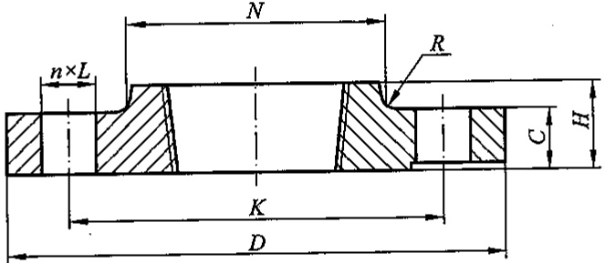

图8.2.6 螺纹钢制管法兰

(mm)

| 公称尺寸DN | 钢管外径A | 连接尺寸 |  |  |  |  | 法兰厚度C | 法兰颈 |  | 法兰高度H | 管螺纹规格Rc、Rp或NPT(in) |
|---|---|---|---|---|---|---|---|---|---|---|---|
| 法兰外径D | 螺栓孔中心圆直径K | 螺栓孔直径L | 螺栓孔数量n(个) | 螺栓Th | N | R |  |  |  |  |  |
| 10 | 17.2 | 75 | 50 | 11 | 4 | M10 | 12 | 25 | 4 | 20 | 3/8 |
| 15 | 21.3 | 80 | 55 | 11 | 4 | M10 | 12 | 30 | 4 | 20 | 1/2 |
| 20 | 26.9 | 90 | 65 | 11 | 4 | M10 | 14 | 40 | 4 | 24 | 3/4 |
| 25 | 33.7 | 100 | 75 | 11 | 4 | M10 | 14 | 50 | 4 | 24 | 1 |
| 32 | 42.4 | 120 | 90 | 14 | 4 | M12 | 14 | 60 | 6 | 26 | 11⁄4 |
| 40 | 48.3 | 130 | 100 | 14 | 4 | M12 | 14 | 70 | 6 | 26 | 11⁄2 |
| 50 | 60.3 | 140 | 110 | 14 | 4 | M12 | 14 | 80 | 6 | 28 | 2 |
| 65 | 76.1 | 160 | 130 | 14 | 4 | M12 | 14 | 100 | 6 | 32 | 21⁄2 |
| 80 | 88.9 | 190 | 150 | 18 | 4 | M16 | 16 | 110 | 8 | 34 | 3 |
| 100 | 114.3 | 210 | 170 | 18 | 4 | M16 | 16 | 130 | 8 | 40 | 4 |
| 125 | 169.7 | 240 | 200 | 18 | 8 | M16 | 18 | 160 | 8 | 44 | 5 |
| 150 | 168.3 | 265 | 225 | 18 | 8 | M16 | 18 | 185 | 10 | 44 | 6 |

<!-- page: 87 -->

(mm)

| 公称尺寸DN | 钢管外径A | 连接尺寸 |  |  |  |  | 法兰厚度C | 法兰颈 |  | 法兰高度H | 管螺纹规格Rc、Rp或NPT(in) |
|---|---|---|---|---|---|---|---|---|---|---|---|
| 法兰外径D | 螺栓孔中心圆直径K | 螺栓孔直径L | 螺栓孔数量n(个) | 螺栓Th | N | R |  |  |  |  |  |
| 10 | 17.2 | 90 | 60 | 14 | 4 | M12 | 16 | 30 | 4 | 22 | \frac{3}{8} |
| 15 | 21.3 | 95 | 65 | 14 | 4 | M12 | 16 | 35 | 4 | 22 | \frac{1}{2} |
| 20 | 26.9 | 105 | 75 | 14 | 4 | M12 | 18 | 45 | 4 | 26 | \frac{3}{4} |
| 25 | 33.7 | 115 | 85 | 14 | 4 | M12 | 18 | 52 | 4 | 28 | 1 |
| 32 | 42.4 | 140 | 100 | 18 | 4 | M16 | 18 | 60 | 6 | 30 | 1\frac{1}{4} |
| 40 | 48.3 | 150 | 110 | 18 | 4 | M16 | 18 | 70 | 6 | 32 | 1\frac{1}{2} |
| 50 | 60.3 | 165 | 125 | 18 | 4 | M16 | 18 | 84 | 5 | 28 | 2 |
| 65 | 76.1 | 185 | 145 | 18 | 8 | M16 | 18 | 104 | 6 | 32 | 2\frac{1}{2} |
| 80 | 88.9 | 200 | 160 | 18 | 8 | M16 | 20 | 118 | 6 | 34 | 3 |
| 100 | 114.3 | 220 | 180 | 18 | 8 | M16 | 20 | 140 | 8 | 40 | 4 |
| 125 | 169.7 | 250 | 210 | 18 | 8 | M16 | 22 | 168 | 8 | 44 | 5 |
| 150 | 168.3 | 285 | 240 | 22 | 8 | M20 | 22 | 195 | 10 | 44 | 6 |

(mm)

| 公称尺寸DN | 钢管外径A | 连接尺寸 |  |  |  |  | 法兰厚度C | 法兰颈 |  | 法兰高度H | 管螺纹规格Rc、Rp或NPT(in) |
|---|---|---|---|---|---|---|---|---|---|---|---|
| 法兰外径D | 螺栓孔中心圆直径K | 螺栓孔直径L | 螺栓孔数量n(个) | 螺栓Th | N | R |  |  |  |  |  |
| 10 | 17.2 | 90 | 60 | 14 | 4 | M12 | 16 | 30 | 4 | 22 | \frac{3}{8} |
| 15 | 21.3 | 95 | 65 | 14 | 4 | M12 | 16 | 35 | 4 | 22 | \frac{1}{2} |
| 20 | 26.9 | 105 | 75 | 14 | 4 | M12 | 18 | 45 | 4 | 26 | \frac{3}{4} |
| 25 | 33.7 | 115 | 85 | 14 | 4 | M12 | 18 | 52 | 4 | 28 | 1 |
| 32 | 42.4 | 140 | 100 | 18 | 4 | M16 | 18 | 60 | 6 | 30 | 1\frac{1}{4} |
| 40 | 48.3 | 150 | 110 | 18 | 4 | M16 | 18 | 70 | 6 | 32 | 1\frac{1}{2} |
| 50 | 60.3 | 165 | 125 | 18 | 4 | M16 | 18 | 84 | 5 | 28 | 2 |
| 65 | 76.1 | 185 | 145 | 18 | 8 | M16 | 18 | 104 | 6 | 32 | 2\frac{1}{2} |
| 80 | 88.9 | 200 | 160 | 18 | 8 | M16 | 20 | 118 | 6 | 34 | .3 |
| 100 | 114.3 | 220 | 180 | 18 | 8 | M16 | 20 | 140 | 8 | 40 | 4 |
| 125 | 169.7 | 250 | 210 | 18 | 8 | M16 | 22 | 168 | 8 | 44 | 5 |
| 150 | 168.3 | 285 | 240 | 22 | 8 | M20 | 22 | 195 | 10 | 44 | 6 |

<!-- page: 88 -->

(mm)

| 公称尺寸DN | 钢管外径A | 连接尺寸 |  |  |  |  | 法兰厚度C | 法兰颈 |  | 法兰高度H | 管螺纹规格Rc、Rp或NPT(in) |
|---|---|---|---|---|---|---|---|---|---|---|---|
| 法兰外径D | 螺栓孔中心圆直径K | 螺栓孔直径L | 螺栓孔数量n(个) | 螺栓Th | N | R |  |  |  |  |  |
| 10 | 17.2 | 90 | 60 | 14 | 4 | M12 | 16 | 30 | 4 | 22 | \frac{3}{8} |
| 15 | 21.3 | 95 | 65 | 14 | 4 | M12 | 16 | 35 | 4 | 22 | \frac{1}{2} |
| 20 | 26.9 | 105 | 75 | 14 | 4 | M12 | 18 | 45 | 4 | 26 | \frac{3}{4} |
| 25 | 33.7 | 115 | 85 | 14 | 4 | M12 | 18 | 52 | 4 | 28 | 1 |
| 32 | 42.4 | 140 | 100 | 18 | 4 | M16 | 18 | 60 | 6 | 30 | 1\frac{1}{4} |
| 40 | 48.3 | 150 | 110 | 18 | 4 | M16 | 18 | 70 | 6 | 32 | 1\frac{1}{2} |
| 50 | 60.3 | 165 | 125 | 18 | 4 | M16 | 20 | 84 | 6 | 34 | 2 |
| 65 | 76.1 | 185 | 145 | 18 | 8 | M16 | 22 | 104 | 6 | 38 | 2\frac{1}{2} |
| 80 | 88.9 | 200 | 160 | 18 | 8 | M16 | 24 | 118 | 8 | 40 | 3 |
| 100 | 114.3 | 235 | 190 | 22 | 8 | M20 | 24 | 145 | 8 | 44 | 4 |
| 125 | 169.7 | 270 | 220 | 26 | 8 | M24 | 26 | 170 | 8 | 48 | 5 |
| 150 | 168.3 | 300 | 250 | 26 | 8 | M24 | 28 | 200 | 10 | 52 | 6 |

表 8.2.6-5 PN40 螺纹钢制管法兰

| 公称尺寸DN | 钢管外径A | 连接尺寸 |  |  |  |  | 法兰厚度C | 法兰颈 |  | 法兰高度H | 管螺纹规格Rc、Rp或NPT(in) |
|---|---|---|---|---|---|---|---|---|---|---|---|
| 法兰外径D | 螺栓孔中心圆直径K | 螺栓孔直径L | 螺栓孔数量n(个) | 螺栓Th | N | R |  |  |  |  |  |
| 10 | 17.2 | 90 | 60 | 14 | 4 | M12 | 16 | 30 | 4 | 22 | 3/8 |
| 15 | 21.3 | 95 | 65 | 14 | 4 | M12 | 16 | 35 | 4 | 22 | 1/2 |
| 20 | 26.9 | 105 | 75 | 14 | 4 | M12 | 18 | 45 | 4 | 26 | 3/4 |
| 25 | 33.7 | 115 | 85 | 14 | 4 | M12 | 18 | 52 | 4 | 28 | 1 |
| 32 | 42.4 | 140 | 100 | 18 | 4 | M16 | 18 | 60 | 6 | 30 | 11/4 |
| 40 | 48.3 | 150 | 110 | 18 | 4 | M16 | 18 | 70 | 6 | 32 | 11/2 |
| 50 | 60.3 | 165 | 125 | 18 | 4 | M16 | 20 | 84 | 6 | 34 | 2 |
| 65 | 76.1 | 185 | 145 | 18 | 8 | M16 | 22 | 104 | 6 | 38 | 21/2 |
| 80 | 88.9 | 200 | 160 | 18 | 8 | M16 | 24 | 118 | 8 | 40 | 3 |
| 100 | 114.3 | 235 | 190 | 22 | 8 | M20 | 24 | 145 | 8 | 44 | 4 |
| 125 | 169.7 | 270 | 220 | 26 | 8 | M24 | 26 | 170 | 8 | 48 | 5 |
| 150 | 168.3 | 300 | 250 | 26 | 8 | M24 | 28 | 200 | 10 | 52 | 6 |

<!-- page: 89 -->

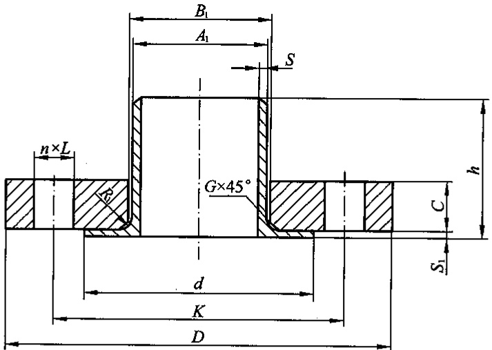

图8.2.7 对焊环松套钢制管法兰

(mm)

| 公称尺寸DN | 钢管外径(对焊环颈部外径)A1 |  | 连接尺寸 |  |  |  |  | 法兰厚度C | 法兰内径B1 |  | 圆角R1 | 倒角G | 对焊环 |  |  |  |
|---|---|---|---|---|---|---|---|---|---|---|---|---|---|---|---|---|
| 法兰外径D | 螺栓孔中心圆直径K | 螺栓孔直径L | 螺栓孔数量n(个) | 螺栓Th | 高度h | 外径d | S | S1 |  |  |  |  |  |  |  |  |
| A | B | A | B |  |  |  |  |  |  |  |  |  |  |  |  |  |
| 10 | 17.2 | 14 | 75 | 50 | 11 | 4 | M10 | 12 | 21 | 18 | 3 | 3 | 28 | 35 | 1.8 | 1.8 |
| 15 | 21.3 | 18 | 80 | 55 | 11 | 4 | M10 | 12 | 25 | 22 | 3 | 3 | 30 | 40 | 2.0 | 2.0 |
| 20 | 26.9 | 25 | 90 | 65 | 11 | 4 | M10 | 14 | 31 | 29 | 4 | 4 | 32 | 50 | 2.3 | 2.3 |
| 25 | 33.7 | 32 | 100 | 75 | 11 | 4 | M10 | 14 | 38 | 36 | 4 | 4 | 35 | 60 | 2.6 | 2.6 |
| 32 | 42.4 | 38 | 120 | 90 | 14 | 4 | M12 | 16 | 46 | 42 | 5 | 5 | 35 | 70 | 2.6 | 2.6 |
| 40 | 48.3 | 45 | 130 | 100 | 14 | 4 | M12 | 16 | 53 | 50 | 5 | 5 | 38 | 80 | 2.6 | 2.6 |
| 50 | 60.3 | 57 | 140 | 110 | 14 | 4 | M12 | 16 | 65 | 62 | 5 | 5 | 38 | 90 | 2.9 | 2.9 |
| 65 | 76.1 | 76 | 160 | 130 | 14 | 4 | M12 | 16 | 81 | 81 | 6 | 6 | 38 | 110 | 2.9 | 2.9 |
| 80 | 88.9 | 89 | 190 | 150 | 18 | 4 | M16 | 18 | 94 | 94 | 6 | 6 | 42 | 128 | 3.2 | 3.2 |
| 100 | 114.3 | 108 | 210 | 170 | 18 | 4 | M16 | 18 | 120 | 114 | 6 | 6 | 45 | 148 | 3.6 | 3.6 |
| 125 | 139.7 | 133 | 240 | 200 | 18 | 8 | M16 | 20 | 145 | 139 | 6 | 6 | 48 | 178 | 4.0 | 4.0 |
| 150 | 168.3 | 159 | 265 | 225 | 18 | 8 | M16 | 20 | 174 | 165 | 6 | 6 | 48 | 202 | 4.5 | 4.5 |
| 200 | 219.1 | 219 | 320 | 280 | 18 | 8 | M16 | 22 | 226 | 226 | 6 | 6 | 55 | 258 | 6.3 | 6.3 |
| 250 | 273 | 273 | 375 | 335 | 18 | 12 | M16 | 24 | 281 | 281 | 8 | 8 | 60 | 312 | 6.3 | 6.3 |
| 300 | 323.9 | 325 | 440 | 395 | 22 | 12 | M20 | 24 | 333 | 334 | 8 | 8 | 62 | 365 | 7.1 | 7.1 |
| 350 | 355.6 | 377 | 490 | 445 | 22 | 12 | M20 | 26 | 365 | 386 | 8 | 8 | 62 | 415 | 7.1 | 7.1 |
| 400 | 406.4 | 426 | 540 | 495 | 22 | 16 | M20 | 28 | 416 | 435 | 8 | 8 | 65 | 465 | 7.1 | 7.1 |
| 450 | 457 | 480 | 595 | 550 | 22 | 16 | M20 | 30 | 467 | 490 | 8 | 8 | 65 | 520 | 7.1 | 7.1 |
| 500 | 508 | 530 | 645 | 600 | 22 | 20 | M20 | 30 | 519 | 541 | 8 | 8 | 68 | 570 | 7.1 | 7.1 |
| 600 | 610 | 630 | 755 | 705 | 26 | 20 | M24 | 32 | 622 | 642 | 8 | 8 | 70 | 670 | 7.1 | 7.1 |

<!-- page: 90 -->

(mm)

| 公称尺寸DN | 钢管外径(对焊环颈部外径)A1 |  | 连接尺寸 |  |  |  |  | 法兰厚度C | 法兰内径B1 |  | 圆角R1 | 倒角G | 对焊环 |  |  |  |
|---|---|---|---|---|---|---|---|---|---|---|---|---|---|---|---|---|
| 法兰外径D | 螺栓孔中心圆直径K | 螺栓孔直径L | 螺栓孔数量n(个) | 螺栓Th | 高度h | 外径d | S | S1 |  |  |  |  |  |  |  |  |
| A | B | A | B |  |  |  |  |  |  |  |  |  |  |  |  |  |
| 10 | 17.2 | 14 | 90 | 60 | 14 | 4 | M12 | 14 | 21 | 18 | 3 | 3 | 35 | 40 | 1.8 | 1.8 |
| 15 | 21.3 | 18 | 95 | 65 | 14 | 4 | M12 | 14 | 25 | 22 | 3 | 3 | 38 | 45 | 2.0 | 2.0 |
| 20 | 26.9 | 25 | 105 | 75 | 14 | 4 | M12 | 16 | 31 | 29 | 4 | 4 | 40 | 58 | 2.3 | 2.3 |
| 25 | 33.7 | 32 | 115 | 85 | 14 | 4 | M12 | 16 | 38 | 36 | 4 | 4 | 40 | 68 | 2.6 | 2.6 |
| 32 | 42.4 | 38 | 140 | 100 | 18 | 4 | M16 | 18 | 47 | 42 | 5 | 5 | 42 | 78 | 2.6 | 2.6 |
| 40 | 48.3 | 45 | 150 | 110 | 18 | 4 | M16 | 18 | 53 | 50 | 5 | 5 | 45 | 88 | 2.6 | 2.6 |
| 50 | 60.3 | 57 | 165 | 125 | 18 | 4 | M16 | 19 | 65 | 62 | 5 | 5 | 45 | 102 | 2.9 | 2.9 |
| 65 | 76.1 | 76 | 185 | 145 | 18 | 8 | M16 | 20 | 81 | 81 | 6 | 6 | 45 | 122 | 2.9 | 2.9 |
| 80 | 88.9 | 89 | 200 | 160 | 18 | 8 | M16 | 20 | 94 | 94 | 6 | 6 | 50 | 138 | 3.2 | 3.2 |
| 100 | 114.3 | 108 | 220 | 180 | 18 | 8 | M16 | 22 | 120 | 114 | 6 | 6 | 52 | 158 | 3.6 | 3.6 |
| 125 | 139.7 | 133 | 250 | 210 | 18 | 8 | M16 | 22 | 145 | 139 | 6 | 6 | 55 | 188 | 4.0 | 4.0 |
| 150 | 168.3 | 159 | 285 | 240 | 22 | 8 | M20 | 24 | 174 | 165 | 6 | 6 | 55 | 212 | 4.5 | 4.5 |
| 200 | 219.1 | 219 | 340 | 295 | 22 | 8 | M20 | 24 | 226 | 226 | 6 | 6 | 62 | 268 | 6.3 | 6.3 |
| 250 | 273 | 273 | 395 | 350 | 22 | 12 | M20 | 26 | 281 | 281 | 8 | 8 | 68 | 320 | 6.3 | 6.3 |
| 300 | 323.9 | 325 | 445 | 400 | 22 | 12 | M20 | 26 | 333 | 334 | 8 | 8 | 68 | 370 | 7.1 | 7.1 |
| 350 | 355.6 | 377 | 505 | 460 | 22 | 16 | M20 | 28 | 365 | 386 | 8 | 8 | 68 | 430 | 7.1 | 7.1 |
| 400 | 406.4 | 426 | 565 | 515 | 26 | 16 | M24 | 32 | 416 | 435 | 8 | 8 | 72 | 482 | 7.1 | 7.1 |
| 450 | 457 | 480 | 615 | 565 | 26 | 20 | M24 | 36 | 467 | 490 | 8 | 8 | 72 | 532 | 7.1 | 7.1 |
| 500 | 508 | 530 | 670 | 620 | 26 | 20 | M24 | 38 | 519 | 541 | 8 | 8 | 75 | 585 | 7.1 | 7.1 |
| 600 | 610 | 630 | 780 | 725 | 30 | 20 | M27 | 42 | 622 | 642 | 8 | 8 | 80 | 685 | 7.1 | 7.1 |

表 8.2.7-3 PN16 对焊环松套钢制管法兰

| 公称尺寸DN | 钢管外径(对焊环颈部外径) A_1 |  | 连接尺寸 |  |  |  |  | 法兰厚度C | 法兰内径 B_1 |  | 圆角 R_1 | 倒角G | 对焊环 |  |  |  |
|---|---|---|---|---|---|---|---|---|---|---|---|---|---|---|---|---|
| 法兰外径D | 螺栓孔中心圆直径K | 螺栓孔直径L | 螺栓孔数量n(个) | 螺栓Th | 高度h | 外径d | S | S_1 |  |  |  |  |  |  |  |  |
| A | B | A | B |  |  |  |  |  |  |  |  |  |  |  |  |  |
| 10 | 17.2 | 14 | 90 | 60 | 14 | 4 | M12 | 14 | 21 | 18 | 3 | 3 | 35 | 40 | 1.8 | 1.8 |
| 15 | 21.3 | 18 | 95 | 65 | 14 | 4 | M12 | 14 | 25 | 22 | 3 | 3 | 38 | 45 | 2.0 | 2.0 |
| 20 | 26.9 | 25 | 105 | 75 | 14 | 4 | M12 | 16 | 31 | 29 | 4 | 4 | 40 | 58 | 2.3 | 2.3 |
| 25 | 33.7 | 32 | 115 | 85 | 14 | 4 | M12 | 16 | 38 | 36 | 4 | 4 | 40 | 68 | 2.6 | 2.6 |
| 32 | 42.4 | 38 | 140 | 100 | 18 | 4 | M16 | 18 | 47 | 42 | 5 | 5 | 42 | 78 | 2.6 | 2.6 |
| 40 | 48.3 | 45 | 150 | 110 | 18 | 4 | M16 | 18 | 53 | 50 | 5 | 5 | 45 | 88 | 2.6 | 2.6 |
| 50 | 60.3 | 57 | 165 | 125 | 18 | 4 | M16 | 19 | 65 | 62 | 5 | 5 | 45 | 102 | 2.9 | 2.9 |
| 65 | 76.1 | 76 | 185 | 145 | 18 | 8 | M16 | 20 | 81 | 81 | 6 | 6 | 45 | 122 | 2.9 | 2.9 |
| 80 | 88.9 | 89 | 200 | 160 | 18 | 8 | M16 | 20 | 94 | 94 | 6 | 6 | 50 | 138 | 3.2 | 3.2 |

<!-- page: 91 -->

(mm)

| 公称尺寸DN | 钢管外径(对焊环颈部外径)A1 |  | 连接尺寸 |  |  |  |  | 法兰厚度C | 法兰内径B1 |  | 圆角R1 | 倒角G | 对焊环 |  |  |  |
|---|---|---|---|---|---|---|---|---|---|---|---|---|---|---|---|---|
| 法兰外径D | 螺栓孔中心圆直径K | 螺栓孔直径L | 螺栓孔数量n(个) | 螺栓Th | 高度h | 外径d | S | S1 |  |  |  |  |  |  |  |  |
| A | B | A | B |  |  |  |  |  |  |  |  |  |  |  |  |  |
| 100 | 114.3 | 108 | 220 | 180 | 18 | 8 | M16 | 22 | 120 | 114 | 6 | 6 | 52 | 158 | 3.6 | 3.6 |
| 125 | 139.7 | 133 | 250 | 210 | 22 | 8 | M16 | 22 | 145 | 139 | 6 | 6 | 55 | 188 | 4.0 | 4.0 |
| 150 | 168.3 | 159 | 285 | 240 | 22 | 8 | M20 | 24 | 174 | 165 | 6 | 6 | 55 | 212 | 4.5 | 4.5 |
| 200 | 219.1 | 219 | 340 | 295 | 26 | 12 | M20 | 26 | 226 | 226 | 6 | 6 | 62 | 268 | 6.3 | 6.3 |
| 250 | 273 | 273 | 405 | 355 | 26 | 12 | M24 | 29 | 281 | 281 | 8 | 8 | 70 | 320 | 6.3 | 6.3 |
| 300 | 323.9 | 325 | 460 | 410 | 26 | 12 | M24 | 32 | 333 | 334 | 8 | 8 | 78 | 378 | 7.1 | 7.1 |
| 350 | 355.6 | 377 | 520 | 470 | 30 | 16 | M24 | 35 | 365 | 386 | 8 | 8 | 82 | 428 | 8.0 | 8.0 |
| 400 | 406.4 | 426 | 580 | 525 | 30 | 16 | M27 | 38 | 416 | 435 | 8 | 8 | 85 | 490 | 8.0 | 8.0 |
| 450 | 457 | 480 | 640 | 585 | 33 | 20 | M27 | 42 | 467 | 490 | 8 | 8 | 87 | 550 | 8.0 | 8.0 |
| 500 | 508 | 530 | 715 | 650 | 33 | 20 | M30 | 46 | 519 | 541 | 8 | 8 | 90 | 610 | 8.0 | 8.0 |
| 600 | 610 | 630 | 840 | 770 | 36 | 20 | M30 | 52 | 622 | 642 | 8 | 8 | 95 | 725 | 8.8 | 8.8 |

(mm)

| 公称尺寸DN | 钢管外径(对焊环颈部外径)A1 |  | 连接尺寸 |  |  |  |  | 法兰厚度C | 法兰内径B1 |  | 圆角R1 | 倒角G | 对焊环 |  |  |  |
|---|---|---|---|---|---|---|---|---|---|---|---|---|---|---|---|---|
| 法兰外径D | 螺栓孔中心圆直径K | 螺栓孔直径L | 螺栓孔数量n(个) | 螺栓Th | 高度h | 外径d | S | S1 |  |  |  |  |  |  |  |  |
| A | B | A | B |  |  |  |  |  |  |  |  |  |  |  |  |  |
| 10 | 17.2 | 14 | 90 | 60 | 14 | 4 | M12 | 14 | 21 | 18 | 3 | 3 | 35 | 40 | 1.8 | 1.8 |
| 15 | 21.3 | 18 | 95 | 65 | 14 | 4 | M12 | 14 | 25 | 22 | 3 | 3 | 38 | 45 | 2.0 | 2.0 |
| 20 | 26.9 | 25 | 105 | 75 | 14 | 4 | M12 | 16 | 31 | 29 | 4 | 4 | 40 | 58 | 2.3 | 2.3 |
| 25 | 33.7 | 32 | 115 | 85 | 14 | 4 | M12 | 16 | 38 | 36 | 4 | 4 | 40 | 68 | 2.6 | 2.6 |
| 32 | 42.4 | 38 | 140 | 100 | 18 | 4 | M16 | 18 | 47 | 42 | 5 | 5 | 42 | 78 | 2.6 | 2.6 |
| 40 | 48.3 | 45 | 150 | 110 | 18 | 4 | M16 | 18 | 53 | 50 | 5 | 5 | 45 | 88 | 2.6 | 2.6 |
| 50 | 60.3 | 57 | 165 | 125 | 18 | 4 | M16 | 20 | 65 | 62 | 5 | 5 | 48 | 102 | 2.9 | 2.9 |
| 65 | 76.1 | 76 | 185 | 145 | 18 | 8 | M16 | 22 | 81 | 81 | 6 | 6 | 52 | 122 | 2.9 | 2.9 |
| 80 | 88.9 | 89 | 200 | 160 | 18 | 8 | M16 | 24 | 94 | 94 | 6 | 6 | 58 | 138 | 3.2 | 3.2 |
| 100 | 114.3 | 108 | 235 | 190 | 22 | 8 | M20 | 26 | 120 | 114 | 6 | 6 | 65 | 162 | 3.6 | 3.6 |
| 125 | 139.7 | 133 | 270 | 220 | 26 | 8 | M24 | 28 | 145 | 139 | 6 | 6 | 68 | 188 | 4.0 | 4.0 |
| 150 | 168.3 | 159 | 300 | 250 | 26 | 8 | M24 | 30 | 174 | 165 | 6 | 6 | 75 | 218 | 4.5 | 4.5 |
| 200 | 219.1 | 219 | 360 | 310 | 26 | 12 | M24 | 32 | 226 | 226 | 6 | 6 | 80 | 278 | 6.3 | 6.3 |
| 250 | 273 | 273 | 425 | 370 | 30 | 12 | M27 | 35 | 281 | 281 | 8 | 8 | 88 | 335 | 7.1 | 7.1 |
| 300 | 323.9 | 325 | 485 | 430 | 30 | 16 | M27 | 38 | 333 | 334 | 8 | 8 | 92 | 395 | 8.0 | 8.0 |
| 350 | 355.6 | 377 | 555 | 490 | 33 | 16 | M30 | 42 | 365 | 386 | 8 | 8 | 100 | 450 | 8.0 | 8.0 |
| 400 | 406.4 | 426 | 620 | 550 | 36 | 16 | M33 | 46 | 416 | 435 | 8 | 8 | 110 | 505 | 8.8 | 8.8 |
| 450 | 457 | 480 | 670 | 600 | 36 | 20 | M33 | 50 | 467 | 490 | 8 | 8 | 110 | 555 | 8.8 | 8.8 |
| 500 | 508 | 530 | 730 | 660 | 36 | 20 | M33 | 56 | 519 | 541 | 8 | 8 | 125 | 615 | 10.0 | 10.0 |
| 600 | 610 | 630 | 845 | 770 | 39 | 20 | M36×3 | 68 | 622 | 642 | 8 | 8 | 125 | 720 | 11.0 | 11.0 |

<!-- page: 92 -->

(mm)

| 公称尺寸DN | 钢管外径(对焊环颈部外径)A1 |  | 连接尺寸 |  |  |  |  | 法兰厚度C | 法兰内径B1 |  | 圆角R1 | 倒角G | 对焊环 |  |  |  |
|---|---|---|---|---|---|---|---|---|---|---|---|---|---|---|---|---|
| 法兰外径D | 螺栓孔中心圆直径K | 螺栓孔直径L | 螺栓孔数量n(个) | 螺栓Th | 高度h | 外径d | S | S1 |  |  |  |  |  |  |  |  |
| A | B | A | B |  |  |  |  |  |  |  |  |  |  |  |  |  |
| 10 | 17.2 | 14 | 90 | 60 | 14 | 4 | M12 | 14 | 21 | 18 | 3 | 3 | 35 | 40 | 1.8 | 1.8 |
| 15 | 21.3 | 18 | 95 | 65 | 14 | 4 | M12 | 14 | 25 | 22 | 3 | 3 | 38 | 45 | 2.0 | 2.0 |
| 20 | 26.9 | 25 | 105 | 75 | 14 | 4 | M12 | 16 | 31 | 29 | 4 | 4 | 40 | 58 | 2.3 | 2.3 |
| 25 | 33.7 | 32 | 115 | 85 | 14 | 4 | M12 | 16 | 38 | 36 | 4 | 4 | 40 | 68 | 2.6 | 2.6 |
| 32 | 42.4 | 38 | 140 | 100 | 18 | 4 | M16 | 18 | 47 | 42 | 5 | 5 | 42 | 78 | 2.6 | 2.6 |
| 40 | 48.3 | 45 | 150 | 110 | 18 | 4 | M16 | 18 | 53 | 50 | 5 | 5 | 45 | 88 | 2.6 | 2.6 |
| 50 | 60.3 | 57 | 165 | 125 | 18 | 4 | M16 | 20 | 65 | 62 | 5 | 5 | 48 | 102 | 2.9 | 2.9 |
| 65 | 76.1 | 76 | 185 | 145 | 18 | 8 | M16 | 22 | 81 | 81 | 6 | 6 | 52 | 122 | 2.9 | 2.9 |
| 80 | 88.9 | 89 | 200 | 160 | 18 | 8 | M16 | 24 | 94 | 94 | 6 | 6 | 58 | 138 | 3.2 | 3.2 |
| 100 | 114.3 | 108 | 235 | 190 | 22 | 8 | M20 | 26 | 120 | 114 | 6 | 6 | 65 | 162 | 3.6 | 3.6 |
| 125 | 139.7 | 133 | 270 | 220 | 26 | 8 | M24 | 28 | 145 | 139 | 6 | 6 | 68 | 188 | 4.0 | 4.0 |
| 150 | 168.3 | 159 | 300 | 250 | 26 | 8 | M24 | 30 | 174 | 165 | 6 | 6 | 75 | 218 | 4.5 | 4.5 |
| 200 | 219.1 | 219 | 375 | 320 | 30 | 12 | M27 | 36 | 226 | 226 | 6 | 6 | 88 | 285 | 6.3 | 6.3 |
| 250 | 273 | 273 | 450 | 385 | 33 | 12 | M30 | 42 | 281 | 281 | 8 | 8 | 105 | 345 | 7.1 | 7.1 |
| 300 | 323.9 | 325 | 515 | 450 | 33 | 16 | M30 | 48 | 333 | 334 | 8 | 8 | 115 | 410 | 8.0 | 8.0 |
| 350 | 355.6 | 377 | 580 | 510 | 36 | 16 | M33 | 54 | 365 | 386 | 8 | 8 | 125 | 465 | 8.8 | 8.8 |
| 400 | 406.4 | 426 | 660 | 585 | 39 | 16 | M36×3 | 60 | 416 | 435 | 8 | 8 | 135 | 535 | 11.0 | 11.0 |
| 450 | 457 | 480 | 685 | 610 | 39 | 20 | M36×3 | 66 | 467 | 490 | 8 | 8 | 135 | 560 | 12.5 | 12.5 |
| 500 | 508 | 530 | 755 | 670 | 42 | 20 | M39×3 | 72 | 519 | 541 | 8 | 8 | 140 | 615 | 14.2 | 14.2 |
| 600 | 610 | 630 | 890 | 795 | 48 | 20 | M45×3 | 84 | 622 | 642 | 8 | 8 | 150 | 735 | 16.0 | 16.0 |

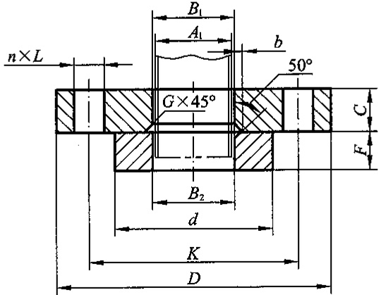

图8.2.8 平焊环松套钢制管法兰

<!-- page: 93 -->

(mm)

| 公称尺寸DN | 钢管外径 A_1 |  | 连接尺寸 |  |  |  |  | 法兰厚度C | 法兰内径 |  |  | 焊环 |  |  |  |
|---|---|---|---|---|---|---|---|---|---|---|---|---|---|---|---|
| 法兰外径D | 螺栓孔中心圆直径K | 螺栓孔直径L | 螺栓孔数量n(个) | 螺栓Th | B_1 |  | G | 外径d | 内径 B_2 |  | 厚度F |  |  |  |  |
| A | B | A | B | A | B |  |  |  |  |  |  |  |  |  |  |
| 10 | 17.2 | 14 | 75 | 50 | 11 | 4 | M10 | 12 | 21 | 18 | 3 | 35 | 18 | 15 | 10 |
| 15 | 21.3 | 18 | 80 | 55 | 11 | 4 | M10 | 12 | 25 | 22 | 3 | 40 | 22.5 | 19 | 10 |
| 20 | 26.9 | 25 | 90 | 65 | 11 | 4 | M10 | 14 | 31 | 29 | 4 | 50 | 27.5 | 26 | 10 |
| 25 | 33.7 | 32 | 100 | 75 | 11 | 4 | M10 | 14 | 38 | 36 | 4 | 60 | 34.5 | 33 | 10 |
| 32 | 42.4 | 38 | 120 | 90 | 14 | 4 | M12 | 16 | 46 | 42 | 5 | 70 | 43.5 | 39 | 10 |
| 40 | 48.3 | 45 | 130 | 100 | 14 | 4 | M12 | 16 | 53 | 50 | 5 | 80 | 49.5 | 46 | 10 |
| 50 | 60.3 | 57 | 140 | 110 | 14 | 4 | M12 | 16 | 65 | 62 | 5 | 90 | 61.5 | 59 | 12 |
| 65 | 76.1 | 76 | 160 | 130 | 14 | 4 | M12 | 16 | 81 | 81 | 6 | 110 | 77.5 | 78 | 12 |
| 80 | 88.9 | 89 | 190 | 150 | 18 | 4 | M16 | 18 | 94 | 94 | 6 | 128 | 90.5 | 91 | 12 |
| 100 | 114.3 | 108 | 210 | 170 | 18 | 4 | M16 | 18 | 120 | 114 | 6 | 148 | 116 | 110 | 14 |
| 125 | 139.7 | 133 | 240 | 200 | 18 | 8 | M16 | 20 | 145 | 139 | 6 | 178 | 143.5 | 135 | 14 |
| 150 | 168.3 | 159 | 265 | 225 | 18 | 8 | M16 | 20 | 174 | 165 | 6 | 202 | 170.5 | 161 | 14 |
| 200 | 219.1 | 219 | 320 | 280 | 18 | 8 | M16 | 22 | 226 | 226 | 6 | 258 | 221.5 | 222 | 16 |
| 250 | 273 | 273 | 375 | 335 | 18 | 12 | M16 | 24 | 281 | 281 | 8 | 312 | 276.5 | 276 | 18 |
| 300 | 323.9 | 325 | 440 | 395 | 22 | 12 | M20 | 24 | 333 | 334 | 8 | 365 | 328 | 328 | 18 |
| 350 | 355.6 | 377 | 490 | 445 | 22 | 12 | M20 | 26 | 365 | 386 | 8 | 415 | 360 | 381 | 18 |
| 400 | 406.4 | 426 | 540 | 495 | 22 | 16 | M20 | 28 | 416 | 435 | 8 | 465 | 411 | 430 | 20 |
| 450 | 457 | 480 | 595 | 550 | 22 | 16 | M20 | 30 | 467 | 490 | 8 | 520 | 462 | 485 | 20 |
| 500 | 508 | 530 | 645 | 600 | 22 | 20 | M20 | 30 | 519 | 541 | 8 | 570 | 513.5 | 535 | 22 |
| 600 | 610 | 630 | 755 | 705 | 26 | 20 | M24 | 32 | 622 | 642 | 8 | 670 | 616.5 | 636 | 22 |

(mm)

| 公称尺寸DN | 钢管外径A1 |  | 连接尺寸 |  |  |  |  | 法兰厚度C | 法兰内径 |  |  | 焊环 |  |  |  |
|---|---|---|---|---|---|---|---|---|---|---|---|---|---|---|---|
| 法兰外径D | 螺栓孔中心圆直径K | 螺栓孔直径L | 螺栓孔数量n(个) | 螺栓Th | B1 |  | G | 外径d | 内径B2 |  | 厚度F |  |  |  |  |
| A | B | A | B | A | B |  |  |  |  |  |  |  |  |  |  |
| 10 | 17.2 | 14 | 90 | 60 | 14 | 4 | M12 | 14 | 21 | 18 | 3 | 40 | 18 | 15 | 12 |
| 15 | 21.3 | 18 | 95 | 65 | 14 | 4 | M12 | 14 | 25 | 22 | 3 | 45 | 22.5 | 19 | 12 |
| 20 | 26.9 | 25 | 105 | 75 | 14 | 4 | M12 | 16 | 31 | 29 | 4 | 58 | 27.5 | 26 | 14 |
| 25 | 33.7 | 32 | 115 | 85 | 14 | 4 | M12 | 16 | 38 | 36 | 4 | 68 | 34.5 | 33 | 14 |
| 32 | 42.4 | 38 | 140 | 100 | 18 | 4 | M16 | 18 | 47 | 42 | 5 | 78 | 43.5 | 39 | 14 |
| 40 | 48.3 | 45 | 150 | 110 | 18 | 4 | M16 | 18 | 53 | 50 | 5 | 88 | 49.5 | 46 | 14 |
| 50 | 60.3 | 57 | 165 | 125 | 18 | 4 | M16 | 19 | 65 | 62 | 5 | 102 | 61.5 | 59 | 16 |
| 65 | 76.1 | 76 | 185 | 145 | 18 | 8 | M16 | 20 | 81 | 81 | 6 | 122 | 77.5 | 78 | 16 |
| 80 | 88.9 | 89 | 200 | 160 | 18 | 8 | M16 | 20 | 94 | 94 | 6 | 138 | 90.5 | 91 | 16 |

<!-- page: 94 -->

| 公称尺寸DN | 钢管外径 A_1 |  | 连接尺寸 |  |  |  |  | 法兰厚度C | 法兰内径 |  |  | 焊环 |  |  |  |
|---|---|---|---|---|---|---|---|---|---|---|---|---|---|---|---|
| 法兰外径D | 螺栓孔中心圆直径K | 螺栓孔直径L | 螺栓孔数量n(个) | 螺栓Th | B_1 |  | G | 外径d | 内径 B_2 |  | 厚度F |  |  |  |  |
| A | B | A | B | A | B |  |  |  |  |  |  |  |  |  |  |
| 100 | 114.3 | 108 | 220 | 180 | 18 | 8 | M16 | 22 | 120 | 114 | 6 | 158 | 116 | 110 | 18 |
| 125 | 139.7 | 133 | 250 | 210 | 18 | 8 | M16 | 22 | 145 | 139 | 6 | 188 | 143.5 | 135 | 18 |
| 150 | 168.3 | 159 | 285 | 240 | 22 | 8 | M20 | 24 | 174 | 165 | 6 | 212 | 170.5 | 161 | 20 |
| 200 | 219.1 | 219 | 340 | 295 | 22 | 8 | M20 | 24 | 226 | 226 | 6 | 268 | 221.5 | 222 | 20 |
| 250 | 273 | 273 | 395 | 350 | 22 | 12 | M20 | 26 | 281 | 281 | 8 | 320 | 276.5 | 276 | 22 |
| 300 | 323.9 | 325 | 445 | 400 | 22 | 12 | M20 | 26 | 333 | 334 | 8 | 370 | 328 | 328 | 22 |
| 350 | 355.6 | 377 | 505 | 460 | 22 | 16 | M20 | 28 | 365 | 386 | 8 | 430 | 360 | 381 | 22 |
| 400 | 406.4 | 426 | 565 | 515 | 26 | 16 | M24 | 32 | 416 | 435 | 8 | 482 | 411 | 430 | 24 |
| 450 | 457 | 480 | 615 | 565 | 26 | 20 | M24 | 36 | 467 | 490 | 8 | 532 | 462 | 485 | 24 |
| 500 | 508 | 530 | 670 | 620 | 26 | 20 | M24 | 38 | 519 | 541 | 8 | 585 | 513.5 | 535 | 26 |
| 600 | 610 | 630 | 780 | 725 | 30 | 20 | M27 | 42 | 622 | 642 | 8 | 685 | 616.5 | 636 | 26 |

(mm)

| 公称尺寸DN | 钢管外径 A_1 |  | 连接尺寸 |  |  |  |  | 法兰厚度C | 法兰内径 |  |  | 焊环 |  |  |  |
|---|---|---|---|---|---|---|---|---|---|---|---|---|---|---|---|
| 法兰外径D | 螺栓孔中心圆直径K | 螺栓孔直径L | 螺栓孔数量n(个) | 螺栓Th | B_1 |  | G | 外径d | 内径 B_2 |  | 厚度F |  |  |  |  |
| A | B | A | B | A | B |  |  |  |  |  |  |  |  |  |  |
| 10 | 17.2 | 14 | 90 | 60 | 14 | 4 | M12 | 14 | 21 | 18 | 3 | 40 | 18 | 15 | 12 |
| 15 | 21.3 | 18 | 95 | 65 | 14 | 4 | M12 | 14 | 25 | 22 | 3 | 45 | 22.5 | 19 | 12 |
| 20 | 26.9 | 25 | 105 | 75 | 14 | 4 | M12 | 16 | 31 | 29 | 4 | 58 | 27.5 | 26 | 14 |
| 25 | 33.7 | 32 | 115 | 85 | 14 | 4 | M12 | 16 | 38 | 36 | 4 | 68 | 34.5 | 33 | 14 |
| 32 | 42.4 | 38 | 140 | 100 | 18 | 4 | M16 | 18 | 47 | 42 | 5 | 78 | 43.5 | 39 | 14 |
| 40 | 48.3 | 45 | 150 | 110 | 18 | 4 | M16 | 18 | 53 | 50 | 5 | 88 | 49.5 | 46 | 14 |
| 50 | 60.3 | 57 | 165 | 125 | 18 | 4 | M16 | 19 | 65 | 62 | 5 | 102 | 61.5 | 59 | 16 |
| 65 | 76.1 | 76 | 185 | 145 | 18 | 8 | M16 | 20 | 81 | 81 | 6 | 122 | 77.5 | 78 | 16 |
| 80 | 88.9 | 89 | 200 | 160 | 18 | 8 | M16 | 20 | 94 | 94 | 6 | 138 | 90.5 | 91 | 16 |
| 100 | 114.3 | 108 | 220 | 180 | 18 | 8 | M16 | 22 | 120 | 114 | 6 | 158 | 116 | 110 | 18 |
| 125 | 139.7 | 133 | 250 | 210 | 22 | 8 | M16 | 22 | 145 | 139 | 6 | 188 | 143.5 | 135 | 18 |
| 150 | 168.3 | 159 | 285 | 240 | 22 | 8 | M20 | 24 | 174 | 165 | 6 | 212 | 170.5 | 161 | 20 |
| 200 | 219.1 | 219 | 340 | 295 | 26 | 12 | M20 | 26 | 226 | 226 | 6 | 268 | 221.5 | 222 | 20 |
| 250 | 273 | 273 | 405 | 355 | 26 | 12 | M24 | 29 | 281 | 281 | 8 | 320 | 276.5 | 276 | 22 |
| 300 | 323.9 | 325 | 460 | 410 | 26 | 12 | M24 | 32 | 333 | 334 | 8 | 378 | 328 | 328 | 24 |
| 350 | 355.6 | 377 | 520 | 470 | 30 | 16 | M24 | 35 | 365 | 386 | 8 | 428 | 360 | 381 | 26 |
| 400 | 406.4 | 426 | 580 | 525 | 30 | 16 | M27 | 38 | 416 | 435 | 8 | 490 | 411 | 430 | 28 |
| 450 | 457 | 480 | 640 | 585 | 33 | 20 | M27 | 42 | 467 | 490 | 8 | 550 | 462 | 485 | 30 |
| 500 | 508 | 530 | 715 | 650 | 33 | 20 | M30 | 46 | 519 | 541 | 8 | 610 | 513.5 | 535 | 32 |
| 600 | 610 | 630 | 840 | 770 | 36 | 20 | M30 | 52 | 622 | 642 | 8 | 725 | 616.5 | 636 | 32 |

<!-- page: 95 -->

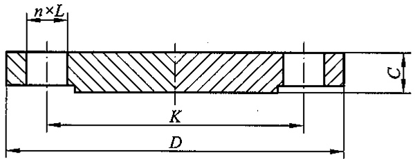

图8.2.9 钢制管法兰盖

(mm)

| 公称尺寸DN | 连接尺寸 |  |  |  |  | 法兰厚度C |
|---|---|---|---|---|---|---|
| 法兰外径D | 螺栓孔中心圆直径K | 螺栓孔直径L | 螺栓孔数量n(个) | 螺栓Th |  |  |
| 10 | 75 | 50 | 11 | 4 | M10 | 12 |
| 15 | 80 | 55 | 11 | 4 | M10 | 12 |
| 20 | 90 | 65 | 11 | 4 | M10 | 14 |
| 25 | 100 | 75 | 11 | 4 | M10 | 14 |
| 32 | 120 | 90 | 14 | 4 | M12 | 16 |
| 40 | 130 | 100 | 14 | 4 | M12 | 16 |
| 50 | 140 | 110 | 14 | 4 | M12 | 16 |
| 65 | 160 | 130 | 14 | 4 | M12 | 16 |
| 80 | 190 | 150 | 18 | 4 | M16 | 18 |
| 100 | 210 | 170 | 18 | 4 | M16 | 18 |
| 125 | 240 | 200 | 18 | 8 | M16 | 20 |
| 150 | 265 | 225 | 18 | 8 | M16 | 20 |
| 200 | 320 | 280 | 18 | 8 | M16 | 22 |
| 250 | 375 | 335 | 18 | 12 | M16 | 24 |
| 300 | 440 | 395 | 22 | 12 | M20 | 24 |
| 350 | 490 | 445 | 22 | 12 | M20 | 26 |
| 400 | 540 | 495 | 22 | 16 | M20 | 28 |
| 450 | 595 | 550 | 22 | 16 | M20 | 30 |
| 500 | 645 | 600 | 22 | 20 | M20 | 30 |
| 600 | 755 | 705 | 26 | 20 | M24 | 32 |
| 700 | 860 | 810 | 26 | 24 | M24 | 36 |
| 800 | 975 | 920 | 30 | 24 | M27 | 38 |
| 900 | 1075 | 1020 | 30 | 24 | M27 | 40 |
| 1000 | 1175 | 1120 | 30 | 28 | M27 | 42 |
| 1200 | 1375 | 1320 | 30 | 32 | M27 | 44 |
| 1400 | 1575 | 1520 | 30 | 36 | M27 | 48 |
| 1600 | 1790 | 1730 | 30 | 40 | M27 | 51 |
| 1800 | 1990 | 1930 | 30 | 44 | M27 | 54 |
| 2000 | 2190 | 2130 | 30 | 48 | M27 | 58 |

<!-- page: 96 -->

(mm)

| 公称尺寸DN | 连接尺寸 |  |  |  |  | 法兰厚度C |
|---|---|---|---|---|---|---|
| 法兰外径D | 螺栓孔中心圆直径K | 螺栓孔直径L | 螺栓孔数量n(个) | 螺栓Th |  |  |
| 10 | 75 | 50 | 11 | 4 | M10 | 12 |
| 15 | 80 | 55 | 11 | 4 | M10 | 12 |
| 20 | 90 | 65 | 11 | 4 | M10 | 14 |
| 25 | 100 | 75 | 11 | 4 | M10 | 14 |
| 32 | 120 | 90 | 14 | 4 | M12 | 14 |
| 40 | 130 | 100 | 14 | 4 | M12 | 14 |
| 50 | 140 | 110 | 14 | 4 | M12 | 14 |
| 65 | 160 | 130 | 14 | 4 | M12 | 14 |
| 80 | 190 | 150 | 18 | 4 | M16 | 16 |
| 100 | 210 | 170 | 18 | 4 | M16 | 16 |
| 125 | 240 | 200 | 18 | 8 | M16 | 18 |
| 150 | 265 | 225 | 18 | 8 | M16 | 18 |
| 200 | 320 | 280 | 18 | 8 | M16 | 20 |
| 250 | 375 | 335 | 18 | 12 | M16 | 22 |
| 300 | 440 | 395 | 22 | 12 | M20 | 22 |
| 350 | 490 | 445 | 22 | 12 | M20 | 22 |
| 400 | 540 | 495 | 22 | 16 | M20 | 22 |
| 450 | 595 | 550 | 22 | 16 | M20 | 24 |
| 500 | 645 | 600 | 22 | 20 | M20 | 24 |
| 600 | 755 | 705 | 26 | 20 | M24 | 30 |
| 700 | 860 | 810 | 26 | 24 | M24 | 40 |
| 800 | 975 | 920 | 30 | 24 | M27 | 44 |
| 900 | 1075 | 1020 | 30 | 24 | M27 | 48 |
| 1000 | 1175 | 1120 | 30 | 28 | M27 | 52 |
| 1200 | 1405 | 1340 | 33 | 32 | M30 | 60 |
| 1400 | 1630 | 1560 | 36 | 36 | M33 | 68 |
| 1600 | 1830 | 1760 | 36 | 40 | M33 | 76 |
| 1800 | 2045 | 1970 | 39 | 44 | M36×3 | 84 |
| 2000 | 2265 | 2180 | 42 | 48 | M39×3 | 92 |

<!-- page: 97 -->

(mm)

| 公称尺寸DN | 连接尺寸 |  |  |  |  | 法兰厚度C |
|---|---|---|---|---|---|---|
| 法兰外径D | 螺栓孔中心圆直径K | 螺栓孔直径L | 螺栓孔数量n(个) | 螺栓Th |  |  |
| 10 | 90 | 60 | 14 | 4 | M12 | 16 |
| 15 | 95 | 65 | 14 | 4 | M12 | 16 |
| 20 | 105 | 75 | 14 | 4 | M12 | 18 |
| 25 | 115 | 85 | 14 | 4 | M12 | 18 |
| 32 | 140 | 100 | 18 | 4 | M16 | 18 |
| 40 | 150 | 110 | 18 | 4 | M16 | 18 |
| 50 | 165 | 125 | 18 | 4 | M16 | 18 |
| 65 | 185 | 145 | 18 | 8 | M16 | 18 |
| 80 | 200 | 160 | 18 | 8 | M16 | 20 |
| 100 | 220 | 180 | 18 | 8 | M16 | 20 |
| 125 | 250 | 210 | 18 | 8 | M16 | 22 |
| 150 | 285 | 240 | 22 | 8 | M20 | 22 |
| 200 | 340 | 295 | 22 | 8 | M20 | 24 |
| 250 | 395 | 350 | 22 | 12 | M20 | 26 |
| 300 | 445 | 400 | 22 | 12 | M20 | 26 |
| 350 | 505 | 460 | 22 | 16 | M20 | 26 |
| 400 | 565 | 515 | 26 | 16 | M24 | 26 |
| 450 | 615 | 565 | 26 | 20 | M24 | 28 |
| 500 | 670 | 620 | 26 | 20 | M24 | 28 |
| 600 | 780 | 725 | 30 | 20 | M27 | 34 |
| 700 | 895 | 840 | 30 | 24 | M27 | 38 |
| 800 | 1015 | 950 | 33 | 24 | M30 | 42 |
| 900 | 1115 | 1050 | 33 | 28 | M30 | 46 |
| 1000 | 1230 | 1160 | 36 | 28 | M33 | 52 |
| 1200 | 1455 | 1380 | 39 | 32 | M36×3 | 60 |

(mm)

| 公称尺寸DN | 连接尺寸 |  |  |  |  | 法兰厚度C |
|---|---|---|---|---|---|---|
| 法兰外径D | 螺栓孔中心圆直径K | 螺栓孔直径L | 螺栓孔数量n(个) | 螺栓Th |  |  |
| 10 | 90 | 60 | 14 | 4 | M12 | 16 |
| 15 | 95 | 65 | 14 | 4 | M12 | 16 |
| 20 | 105 | 75 | 14 | 4 | M12 | 18 |
| 25 | 115 | 85 | 14 | 4 | M12 | 18 |
| 32 | 140 | 100 | 18 | 4 | M16 | 18 |

<!-- page: 98 -->

| 公称尺寸DN | 连接尺寸 |  |  |  |  | 法兰厚度C |
|---|---|---|---|---|---|---|
| 法兰外径D | 螺栓孔中心圆直径K | 螺栓孔直径L | 螺栓孔数量n(个) | 螺栓Th |  |  |
| 40 | 150 | 110 | 18 | 4 | M16 | 18 |
| 50 | 165 | 125 | 18 | 4 | M16 | 18 |
| 65 | 185 | 145 | 18 | 8 | M16 | 18 |
| 80 | 200 | 160 | 18 | 8 | M16 | 20 |
| 100 | 220 | 180 | 18 | 8 | M16 | 20 |
| 125 | 250 | 210 | 22 | 8 | M16 | 22 |
| 150 | 285 | 240 | 22 | 8 | M20 | 22 |
| 200 | 340 | 295 | 26 | 12 | M20 | 24 |
| 250 | 405 | 355 | 26 | 12 | M24 | 26 |
| 300 | 460 | 410 | 26 | 12 | M24 | 28 |
| 350 | 520 | 470 | 30 | 16 | M24 | 30 |
| 400 | 580 | 525 | 30 | 16 | M27 | 32 |
| 450 | 640 | 585 | 33 | 20 | M27 | 40 |
| 500 | 715 | 650 | 33 | 20 | M30 | 44 |
| 600 | 840 | 770 | 36 | 20 | M33 | 54 |
| 700 | 910 | 840 | 36 | 24 | M33 | 48 |
| 800 | 1025 | 950 | 39 | 24 | M36×3 | 52 |
| 900 | 1125 | 1050 | 39 | 28 | M36×3 | 58 |
| 1000 | 1255 | 1170 | 42 | 28 | M39×3 | 64 |
| 1200 | 1485 | 1390 | 48 | 32 | M45×3 | 76 |

(mm)

| 公称尺寸DN | 连接尺寸 |  |  |  |  | 法兰厚度C |
|---|---|---|---|---|---|---|
| 法兰外径D | 螺栓孔中心圆直径K | 螺栓孔直径L | 螺栓孔数量n(个) | 螺栓Th |  |  |
| 10 | 90 | 60 | 14 | 4 | M12 | 16 |
| 15 | 95 | 65 | 14 | 4 | M12 | 16 |
| 20 | 105 | 75 | 14 | 4 | M12 | 18 |
| 25 | 115 | 85 | 14 | 4 | M12 | 18 |
| 32 | 140 | 100 | 18 | 4 | M16 | 18 |
| 40 | 150 | 110 | 18 | 4 | M16 | 18 |
| 50 | 165 | 125 | 18 | 4 | M16 | 20 |
| 65 | 185 | 145 | 18 | 8 | M16 | 22 |
| 80 | 200 | 160 | 18 | 8 | M16 | 24 |

<!-- page: 99 -->

(mm)

| 公称尺寸DN | 连接尺寸 |  |  |  |  | 法兰厚度C |
|---|---|---|---|---|---|---|
| 法兰外径D | 螺栓孔中心圆直径K | 螺栓孔直径L | 螺栓孔数量n(个) | 螺栓Th |  |  |
| 100 | 235 | 190 | 22 | 8 | M20 | 24 |
| 125 | 270 | 220 | 26 | 8 | M24 | 26 |
| 150 | 300 | 250 | 26 | 8 | M24 | 28 |
| 200 | 360 | 310 | 26 | 12 | M24 | 30 |
| 250 | 425 | 370 | 30 | 12 | M27 | 32 |
| 300 | 485 | 430 | 30 | 16 | M27 | 34 |
| 350 | 555 | 490 | 33 | 16 | M30 | 38 |
| 400 | 620 | 550 | 36 | 16 | M33 | 40 |
| 450 | 670 | 600 | 36 | 20 | M33 | 46 |
| 500 | 730 | 660 | 36 | 20 | M33 | 48 |
| 600 | 845 | 770 | 39 | 20 | M36×3 | 58 |

(mm)

| 公称尺寸DN | 连接尺寸 |  |  |  |  | 法兰厚度C |
|---|---|---|---|---|---|---|
| 法兰外径D | 螺栓孔中心圆直径K | 螺栓孔直径L | 螺栓孔数量n(个) | 螺栓Th |  |  |
| 10 | 90 | 60 | 14 | 4 | M12 | 16 |
| 15 | 95 | 65 | 14 | 4 | M12 | 16 |
| 20 | 105 | 75 | 14 | 4 | M12 | 18 |
| 25 | 115 | 85 | 14 | 4 | M12 | 18 |
| 32 | 140 | 100 | 18 | 4 | M16 | 18 |
| 40 | 150 | 110 | 18 | 4 | M16 | 18 |
| 50 | 165 | 125 | 18 | 4 | M16 | 20 |
| 65 | 185 | 145 | 18 | 8 | M16 | 22 |
| 80 | 200 | 160 | 18 | 8 | M16 | 24 |
| 100 | 235 | 190 | 22 | 8 | M20 | 24 |
| 125 | 270 | 220 | 26 | 8 | M24 | 26 |
| 150 | 300 | 250 | 26 | 8 | M24 | 28 |
| 200 | 375 | 320 | 30 | 12 | M27 | 36 |
| 250 | 450 | 385 | 33 | 12 | M30 | 38 |
| 300 | 515 | 450 | 33 | 16 | M30 | 42 |
| 350 | 580 | 510 | 36 | 16 | M33 | 46 |
| 400 | 660 | 585 | 39 | 16 | M36×3 | 50 |
| 450 | 685 | 610 | 39 | 20 | M36×3 | 57 |
| 500 | 755 | 670 | 42 | 20 | M39×3 | 57 |
| 600 | 890 | 795 | 48 | 20 | M45×3 | 72 |

<!-- page: 100 -->

(mm)

| 公称尺寸DN | 连接尺寸 |  |  |  |  | 法兰厚度C |
|---|---|---|---|---|---|---|
| 法兰外径D | 螺栓孔中心圆直径K | 螺栓孔直径L | 螺栓孔数量n(个) | 螺栓Th |  |  |
| 10 | 100 | 70 | 14 | 4 | M12 | 20 |
| 15 | 105 | 75 | 14 | 4 | M12 | 20 |
| 20 | 130 | 90 | 18 | 4 | M16 | 22 |
| 25 | 140 | 100 | 18 | 4 | M16 | 24 |
| 32 | 155 | 110 | 22 | 4 | M20 | 24 |
| 40 | 170 | 125 | 22 | 4 | M20 | 26 |
| 50 | 180 | 135 | 22 | 4 | M20 | 26 |
| 65 | 205 | 160 | 22 | 8 | M20 | 26 |
| 80 | 215 | 170 | 22 | 8 | M20 | 28 |
| 100 | 250 | 200 | 26 | 8 | M24 | 30 |
| 125 | 295 | 240 | 30 | 8 | M27 | 34 |
| 150 | 345 | 280 | 33 | 8 | M30 | 36 |
| 200 | 415 | 345 | 36 | 12 | M33 | 42 |
| 250 | 470 | 400 | 36 | 12 | M33 | 46 |
| 300 | 530 | 460 | 36 | 16 | M33 | 52 |
| 350 | 600 | 525 | 39 | 16 | M36×3 | 56 |
| 400 | 670 | 585 | 42 | 16 | M39×3 | 60 |

(mm)

| 公称尺寸DN | 连接尺寸 |  |  |  |  | 法兰厚度C |
|---|---|---|---|---|---|---|
| 法兰外径D | 螺栓孔中心圆直径K | 螺栓孔直径L | 螺栓孔数量n(个) | 螺栓Th |  |  |
| 10 | 100 | 70 | 14 | 4 | M12 | 20 |
| 15 | 105 | 75 | 14 | 4 | M12 | 20 |
| 20 | 130 | 90 | 18 | 4 | M16 | 22 |
| 25 | 140 | 100 | 18 | 4 | M16 | 24 |
| 32 | 155 | 110 | 22 | 4 | M20 | 24 |
| 40 | 170 | 125 | 22 | 4 | M20 | 26 |
| 50 | 195 | 145 | 26 | 4 | M24 | 28 |
| 65 | 220 | 170 | 26 | 8 | M24 | 30 |

<!-- page: 101 -->

续表8.2.9-8

| 公称尺寸DN | 连接尺寸 |  |  |  |  | 法兰厚度C |
|---|---|---|---|---|---|---|
| 法兰外径D | 螺栓孔中心圆直径K | 螺栓孔直径L | 螺栓孔数量n(个) | 螺栓Th |  |  |
| 80 | 230 | 180 | 26 | 8 | M24 | 32 |
| 100 | 265 | 210 | 30 | 8 | M27 | 36 |
| 125 | 315 | 250 | 33 | 8 | M30 | 40 |
| 150 | 355 | 290 | 33 | 12 | M30 | 44 |
| 200 | 430 | 360 | 36 | 12 | M33 | 52 |
| 250 | 505 | 430 | 39 | 12 | M36×3 | 60 |
| 300 | 585 | 500 | 42 | 16 | M39×3 | 68 |
| 350 | 655 | 560 | 48 | 16 | M45×3 | 74 |
| 400 | 715 | 620 | 48 | 16 | M45×3 | 82 |

(mm)

| 公称尺寸DN | 连接尺寸 |  |  |  |  | 法兰厚度C |
|---|---|---|---|---|---|---|
| 法兰外径D | 螺栓孔中心圆直径K | 螺栓孔直径L | 螺栓孔数量n(个) | 螺栓Th |  |  |
| 10 | 100 | 70 | 14 | 4 | M12 | 24 |
| 15 | 105 | 75 | 14 | 4 | M12 | 26 |
| 20 | 130 | 90 | 18 | 4 | M16 | 30 |
| 25 | 140 | 100 | 18 | 4 | M16 | 32 |
| 32 | 155 | 110 | 22 | 4 | M20 | 34 |
| 40 | 170 | 125 | 22 | 4 | M20 | 36 |
| 50 | 195 | 145 | 26 | 4 | M24 | 38 |
| 65 | 220 | 170 | 26 | 8 | M24 | 42 |
| 80 | 230 | 180 | 26 | 8 | M24 | 46 |
| 100 | 265 | 210 | 30 | 8 | M27 | 52 |
| 125 | 315 | 250 | 33 | 8 | M30 | 56 |
| 150 | 355 | 290 | 33 | 12 | M30 | 62 |
| 200 | 430 | 360 | 36 | 12 | M33 | 66 |
| 250 | 515 | 430 | 42 | 12 | M39×3 | 76 |
| 300 | 585 | 500 | 42 | 16 | M39×3 | 88 |

<!-- page: 102 -->

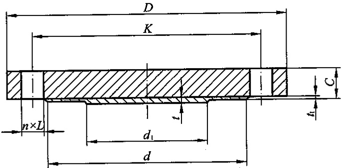

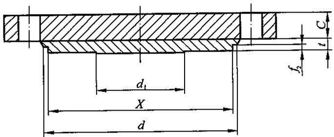

凸面（M）

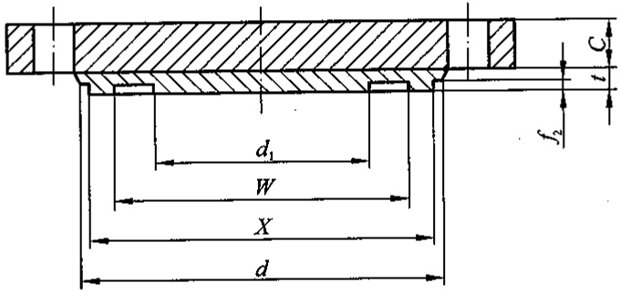

樺面（T）

(mm)

| 公称尺寸DN | 连接尺寸 |  |  |  |  | 法兰厚度C | 密封面尺寸 |  | 衬里厚度 |  | 塞焊孔(突面) |  |  |
|---|---|---|---|---|---|---|---|---|---|---|---|---|---|
| 法兰外径D | 螺栓孔中心圆直径K | 螺栓孔直径L | 螺栓孔数量n(个) | 螺栓Th | d | d_1 | 突面 |  | 中心圆直径P | 孔径φ | 数量n(个) |  |  |
| t | t_1 |  |  |  |  |  |  |  |  |  |  |  |  |
| 40 | 130 | 100 | 14 | 4 | M12 | 14 | 80 | 30 | 3 | 2 | — | — | — |
| 50 | 140 | 110 | 14 | 4 | M12 | 14 | 90 | 45 | 3 | 2 | — | — | — |
| 65 | 160 | 130 | 14 | 4 | M12 | 14 | 110 | 60 | 3 | 2 | — | — | — |
| 80 | 190 | 150 | 18 | 4 | M16 | 16 | 128 | 75 | 3 | 2 | — | — | — |
| 100 | 210 | 170 | 18 | 4 | M16 | 16 | 148 | 95 | 3 | 2 | — | — | — |
| 125 | 240 | 200 | 18 | 8 | M16 | 18 | 178 | 110 | 3 | 2 | — | — | — |
| 150 | 265 | 225 | 18 | 8 | M16 | 18 | 202 | 130 | 3 | 2 | — | 15 | 1 |

<!-- page: 103 -->

(mm)

| 公称尺寸DN | 连接尺寸 |  |  |  |  | 法兰厚度C | 密封面尺寸 |  | 衬里厚度 |  | 塞焊孔(突面) |  |  |
|---|---|---|---|---|---|---|---|---|---|---|---|---|---|
| 法兰外径D | 螺栓孔中心圆直径K | 螺栓孔直径L | 螺栓孔数量n(个) | 螺栓Th | d | d_1 | 突面 |  | 中心圆直径P | 孔径φ | 数量n(个) |  |  |
| t | t_1 |  |  |  |  |  |  |  |  |  |  |  |  |
| 200 | 320 | 280 | 18 | 8 | M16 | 20 | 258 | 190 | 4 | 2 | - | 15 | 1 |
| 250 | 375 | 335 | 18 | 12 | M16 | 22 | 312 | 235 | 4 | 2 | - | 15 | 1 |
| 300 | 440 | 395 | 22 | 12 | M20 | 22 | 365 | 285 | 5 | 3 | 170 | 15 | 4 |
| 350 | 490 | 445 | 22 | 12 | M20 | 22 | 415 | 330 | 5 | 3 | 220 | 15 | 4 |
| 400 | 540 | 495 | 22 | 16 | M20 | 22 | 465 | 380 | 5 | 3 | 230 | 15 | 4 |
| 450 | 595 | 550 | 22 | 16 | M20 | 24 | 520 | 430 | 5 | 3 | 250 | 15 | 4 |
| 500 | 645 | 600 | 22 | 20 | M20 | 24 | 570 | 475 | 6 | 4 | 260 | 15 | 7 |
| 600 | 755 | 705 | 26 | 20 | M24 | 30 | 670 | 570 | 6 | 4 | 320 | 15 | 7 |

(mm)

| 公称尺寸DN | 连接尺寸 |  |  |  |  | 法兰厚度C | 密封面尺寸 |  | 衬里厚度 |  |  | 塞焊孔(突面) |  |  |
|---|---|---|---|---|---|---|---|---|---|---|---|---|---|---|
| 法兰外径D | 螺栓孔中心圆直径K | 螺栓孔直径L | 螺栓孔数量n(个) | 螺栓Th | d | d1 | 突面 |  | 凸面 | 中心圆直径P | 孔径ø | 数量n(个) |  |  |
| 榫面 |  |  |  |  |  |  |  |  |  |  |  |  |  |  |
| t | t1 | t |  |  |  |  |  |  |  |  |  |  |  |  |
| 40 | 150 | 110 | 18 | 4 | M16 | 18 | 88 | 30 | 3 | 2 | 10 | - | - | - |
| 50 | 165 | 125 | 18 | 4 | M16 | 18 | 102 | 45 | 3 | 2 | 10 | - | - | - |
| 65 | 185 | 145 | 18 | 8 | M16 | 18 | 122 | 60 | 3 | 2 | 10 | - | - | - |
| 80 | 200 | 160 | 18 | 8 | M16 | 20 | 138 | 75 | 3 | 2 | 10 | - | - | - |
| 100 | 220 | 180 | 18 | 8 | M16 | 20 | 158 | 95 | 3 | 2 | 10 | - | - | - |
| 125 | 250 | 210 | 18 | 8 | M16 | 22 | 188 | 110 | 3 | 2 | 10 | - | - | - |
| 150 | 285 | 240 | 22 | 8 | M20 | 22 | 212 | 130 | 3 | 2 | 10 | - | 15 | 1 |
| 200 | 340 | 295 | 22 | 8 | M20 | 24 | 268 | 190 | 4 | 2 | 10 | - | 15 | 1 |
| 250 | 395 | 350 | 22 | 12 | M20 | 26 | 320 | 235 | 4 | 2 | 10 | - | 15 | 1 |
| 300 | 445 | 400 | 22 | 12 | M20 | 26 | 370 | 285 | 5 | 3 | 10 | 170 | 15 | 4 |
| 350 | 505 | 460 | 22 | 16 | M20 | 26 | 430 | 330 | 5 | 3 | 10 | 220 | 15 | 4 |
| 400 | 565 | 515 | 26 | 16 | M24 | 26 | 482 | 380 | 5 | 3 | 10 | 230 | 15 | 4 |
| 450 | 615 | 565 | 26 | 20 | M24 | 28 | 532 | 430 | 5 | 3 | 10 | 250 | 15 | 4 |
| 500 | 670 | 620 | 26 | 20 | M24 | 28 | 585 | 475 | 6 | 4 | 10 | 260 | 15 | 7 |
| 600 | 780 | 725 | 30 | 20 | M27 | 34 | 685 | 570 | 6 | 4 | 10 | 320 | 15 | 7 |

<!-- page: 104 -->

(mm)

| 公称尺寸DN | 连接尺寸 |  |  |  |  | 法兰厚度C | 密封面尺寸 |  | 衬里厚度 |  |  | 塞焊孔(突面) |  |  |
|---|---|---|---|---|---|---|---|---|---|---|---|---|---|---|
| 法兰外径D | 螺栓孔中心圆直径K | 螺栓孔直径L | 螺栓孔数量n(个) | 螺栓Th | d | d_1 | 突面 |  | 凸面 | 中心圆直径P | 孔径φ | 数量n(个) |  |  |
| 榫面 |  |  |  |  |  |  |  |  |  |  |  |  |  |  |
| t | t_1 | t |  |  |  |  |  |  |  |  |  |  |  |  |
| 40 | 150 | 110 | 18 | 4 | M16 | 18 | 88 | 30 | 3 | 2 | 10 | - | - | - |
| 50 | 165 | 125 | 18 | 4 | M16 | 18 | 102 | 45 | 3 | 2 | 10 | - | - | - |
| 65 | 185 | 145 | 18 | 8 | M16 | 18 | 122 | 60 | 3 | 2 | 10 | - | - | - |
| 80 | 200 | 160 | 18 | 8 | M16 | 20 | 138 | 75 | 3 | 2 | 10 | - | - | - |
| 100 | 220 | 180 | 18 | 8 | M16 | 20 | 158 | 95 | 3 | 2 | 10 | - | - | - |
| 125 | 250 | 210 | 18 | 8 | M16 | 22 | 188 | 110 | 3 | 2 | 10 | - | - | - |
| 150 | 285 | 240 | 22 | 8 | M20 | 22 | 212 | 130 | 3 | 2 | 10 | - | 15 | 1 |
| 200 | 340 | 295 | 22 | 12 | M20 | 24 | 268 | 190 | 4 | 2 | 10 | - | 15 | 1 |
| 250 | 405 | 355 | 26 | 12 | M24 | 26 | 320 | 235 | 4 | 2 | 10 | - | 15 | 1 |
| 300 | 460 | 410 | 26 | 12 | M24 | 28 | 378 | 285 | 5 | 3 | 10 | 170 | 15 | 4 |
| 350 | 520 | 470 | 26 | 16 | M24 | 30 | 428 | 330 | 5 | 3 | 10 | 220 | 15 | 4 |
| 400 | 580 | 525 | 30 | 16 | M27 | 32 | 490 | 380 | 5 | 3 | 10 | 230 | 15 | 4 |
| 450 | 640 | 585 | 30 | 20 | M27 | 40 | 550 | 430 | 5 | 3 | 10 | 250 | 15 | 4 |
| 500 | 715 | 650 | 33 | 20 | M30 | 44 | 610 | 475 | 6 | 4 | 10 | 260 | 15 | 7 |
| 600 | 840 | 770 | 36 | 20 | M33 | 54 | 725 | 570 | 6 | 4 | 10 | 320 | 15 | 7 |

(mm)

| 公称尺寸DN | 连接尺寸 |  |  |  |  | 法兰厚度C | 密封面尺寸 |  | 衬里厚度 |  |  | 塞焊孔(突面) |  |  |
|---|---|---|---|---|---|---|---|---|---|---|---|---|---|---|
| 法兰外径D | 螺栓孔中心圆直径K | 螺栓孔直径L | 螺栓孔数量n(个) | 螺栓Th | d | d_1 | 突面 |  | 凸面 | 中心圆直径P | 孔径φ | 数量n(个) |  |  |
| 榫面 |  |  |  |  |  |  |  |  |  |  |  |  |  |  |
| t | t_1 | t |  |  |  |  |  |  |  |  |  |  |  |  |
| 40 | 150 | 110 | 18 | 4 | M16 | 18 | 88 | 30 | 3 | 2 | 10 | - | - | - |
| 50 | 165 | 125 | 18 | 4 | M16 | 20 | 102 | 45 | 3 | 2 | 10 | - | - | - |
| 65 | 185 | 145 | 18 | 8 | M16 | 22 | 122 | 60 | 3 | 2 | 10 | - | - | - |
| 80 | 200 | 160 | 18 | 8 | M16 | 24 | 138 | 75 | 3 | 2 | 10 | - | - | - |
| 100 | 235 | 190 | 22 | 8 | M20 | 24 | 162 | 95 | 3 | 2 | 10 | - | - | - |
| 125 | 270 | 220 | 26 | 8 | M24 | 26 | 188 | 110 | 3 | 2 | 10 | - | - | - |
| 150 | 300 | 250 | 26 | 8 | M24 | 28 | 218 | 130 | 3 | 2 | 10 | - | 15 | 1 |
| 200 | 360 | 310 | 26 | 12 | M24 | 30 | 278 | 190 | 4 | 2 | 10 | - | 15 | 1 |
| 250 | 425 | 370 | 30 | 12 | M27 | 32 | 335 | 235 | 4 | 2 | 10 | - | 15 | 1 |
| 300 | 485 | 430 | 30 | 16 | M27 | 34 | 395 | 285 | 5 | 3 | 10 | 170 | 15 | 4 |
| 350 | 555 | 490 | 33 | 16 | M30 | 38 | 450 | 330 | 5 | 3 | 10 | 220 | 15 | 4 |
| 400 | 620 | 550 | 36 | 16 | M33 | 40 | 505 | 380 | 5 | 3 | 10 | 230 | 15 | 4 |
| 450 | 670 | 600 | 36 | 20 | M33 | 46 | 555 | 430 | 5 | 3 | 10 | 250 | 15 | 4 |
| 500 | 730 | 660 | 36 | 20 | M33 | 48 | 615 | 475 | 6 | 4 | 10 | 260 | 15 | 7 |
| 600 | 845 | 770 | 39 | 20 | M36×3 | 58 | 720 | 570 | 6 | 4 | 10 | 320 | 15 | 7 |

<!-- page: 105 -->

(mm)

| 公称尺寸DN | 连接尺寸 |  |  |  |  | 法兰厚度C | 密封面尺寸 |  | 衬里厚度 |  |  | 塞焊孔(突面) |  |  |
|---|---|---|---|---|---|---|---|---|---|---|---|---|---|---|
| 法兰外径D | 螺栓孔中心圆直径K | 螺栓孔直径L | 螺栓孔数量n(个) | 螺栓Th | d | d_1 | 突面 |  | 凸面 | 中心圆直径P | 孔径φ | 数量n(个) |  |  |
| 榫面 |  |  |  |  |  |  |  |  |  |  |  |  |  |  |
| t | t_1 | t |  |  |  |  |  |  |  |  |  |  |  |  |
| 40 | 150 | 110 | 18 | 4 | M16 | 18 | 88 | 30 | 3 | 2 | 10 | - | - | - |
| 50 | 165 | 125 | 18 | 4 | M16 | 20 | 102 | 45 | 3 | 2 | 10 | - | - | - |
| 65 | 185 | 145 | 18 | 8 | M16 | 22 | 122 | 60 | 3 | 2 | 10 | - | - | - |
| 80 | 200 | 160 | 18 | 8 | M16 | 24 | 138 | 75 | 3 | 2 | 10 | - | - | - |
| 100 | 235 | 190 | 22 | 8 | M20 | 24 | 162 | 95 | 3 | 2 | 10 | - | - | - |
| 125 | 270 | 220 | 26 | 8 | M24 | 26 | 188 | 110 | 3 | 2 | 10 | - | - | - |
| 150 | 300 | 250 | 26 | 8 | M24 | 28 | 218 | 130 | 3 | 2 | 10 | - | 15 | 1 |
| 200 | 375 | 320 | 30 | 12 | M27 | 36 | 285 | 190 | 4 | 2 | 10 | - | 15 | 1 |
| 250 | 450 | 385 | 33 | 12 | M30 | 38 | 345 | 235 | 4 | 2 | 10 | - | 15 | 1 |
| 300 | 515 | 450 | 33 | 16 | M30 | 42 | 410 | 285 | 5 | 3 | 10 | 170 | 15 | 4 |
| 350 | 580 | 510 | 36 | 16 | M33 | 46 | 465 | 330 | 5 | 3 | 10 | 220 | 15 | 4 |
| 400 | 660 | 585 | 39 | 16 | M36×3 | 50 | 535 | 380 | 5 | 3 | 10 | 230 | 15 | 4 |
| 450 | 685 | 610 | 39 | 20 | M36×3 | 57 | 560 | 430 | 5 | 3 | 10 | 250 | 15 | 4 |
| 500 | 755 | 670 | 42 | 20 | M39×3 | 57 | 615 | 475 | 6 | 4 | 10 | 260 | 15 | 7 |
| 600 | 890 | 795 | 48 | 20 | M45×3 | 72 | 735 | 570 | 6 | 4 | 10 | 320 | 15 | 7 |

### 8.3法兰颈部

8.3.1 带颈平焊法兰、承插焊法兰和螺纹法兰的颈部外侧斜度应不大于 $7^{\circ}$ 。

8.3.2 带颈对焊法兰的锥颈斜度应不大于 $45^{\circ}$，且应具有斜度不大于 $7^{\circ}$ 的直边段，焊接端部按本标准第9章的规定。

8.3.3 带颈对焊法兰的颈部厚度 $S$ 一般不小于钢管名义厚度，用户应在订货时注明。本标准中所列 $S$ 值仅适用于用户未提出具体要求的场合。

8.3.4 对焊环松套法兰的对焊环壁厚 $S$ 一般不小于钢管名义厚度。用户应在订货时注明。对焊环的翻边厚度 $S_{1}$ 应不小于钢管最小壁厚(0.875S)。

### 8.4 管螺纹

8.4.1 本标准规定的螺纹法兰仅适用于A外径系列钢管。

8.4.2 螺纹法兰采用的管螺纹分为三种情况:

1 采用按 GB/T 7306 规定的 55° 圆锥内螺纹 (Rc)。

2 采用按 GB/T 7306 规定的 $55^{\circ}$ 圆柱内螺纹 (Rp)。

3 采用按 GB/T 12716 规定的 $60^{\circ}$ 圆锥管螺纹(NPT)。

用户应在订货时注明螺纹代号。如未标注螺纹代号，则表示为Rp管螺纹。

8.4.3 采用 $55^{\circ}$ 管螺纹时，DN150法兰配用的钢管外径应为 $165.1\mathrm{mm}$ 。采用 $60^{\circ}$ 圆锥管螺纹时，DN65法兰配用的钢管外径应为 $73\mathrm{mm}$ ；DN125法兰配用的钢管外径应为 $141.3\mathrm{mm}$ 。

8.4.4 螺纹法兰的内孔管螺纹加工，应使钢管拧入后的端部靠近但不超出法兰密封面。

<!-- page: 106 -->

## 9 焊接接头和坡口尺寸

### 9.1 板式平焊法兰和平焊环松套法兰

9.1.1 表 9.1.1 所示范围的板式平焊法兰、平焊环与钢管连接的焊接接头应符合图 9.1.1 的要求。

表9.1.1

| 法兰类型 | 公称压力 PN | 公称尺寸 DN |
|---|---|---|
| 板式平焊法兰 | 2.5 | 10~2000 |
| 6 | 10~1600 |  |
| 10 | 10~600 |  |
| 平焊环 | 6 | 10~600 |
| 10 | 10~600 |  |

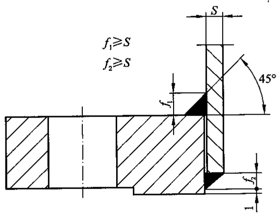

图9.1.1 板式平焊法兰或平焊环与钢管连接的焊接接头

9.1.2 表 9.1.2-1 所示范围的板式平焊法兰、平焊环与钢管连接的焊接接头和坡口尺寸应符合图 9.1.2 和表 9.1.2-2 的要求。

表9.1.2-1

| 法兰类型 | 公称压力 PN | 公称尺寸 DN |
|---|---|---|
| 板式平焊法兰 | 6 | 1800~2000 |
| 16 | 10~600 |  |
| 25 | 10~600 |  |
| 40 | 10~600 |  |
| 平焊环 | 16 | 10~600 |

<!-- page: 107 -->

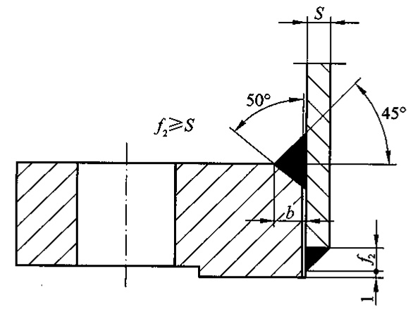

图9.1.2 板式平焊法兰或平焊环与钢管连接的焊接接头

9.2 带颈平焊法兰

| 公称尺寸 DN | 10 | 15 | 20 | 25 | 32 | 40 | 50 | 65 | 80 | 100 | 125 | 150 | 200 |
|---|---|---|---|---|---|---|---|---|---|---|---|---|---|
| 坡口宽度 b | 4 | 4 | 4 | 5 | 5 | 5 | 5 | 6 | 6 | 6 | 6 | 6 | 8 |
| 公称尺寸 DN | 250 | 300 | 350 | 400 | 450 | 500 | 600 | 1200 | 1400 | 1600 | 1800 | 2000 | — |
| 坡口宽度 b | 10 | 11 | 12 | 12 | 12 | 12 | 12 | 13 | 14 | 16 | 17 | 18 | — |

9.2.1 表 9.2.1 所示范围的带颈平焊法兰与钢管连接的焊接接头应符合图 9.2.1 的要求。

表9.2.1

| 法兰类型 | 公称压力 PN | 公称尺寸 DN |
|---|---|---|
| 带颈平焊法兰 | 6 | 10~300 |
| 10 | 10~400 |  |

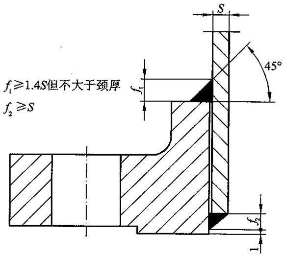

图9.2.1 带颈平焊法兰与钢管连接的焊接接头

<!-- page: 108 -->

9.2.2 表 9.2.2-1 所示范围的带颈平焊法兰与钢管连接的焊接接头和坡口尺寸应符合图 9.2.2 和表 9.2.2-2 的要求。

表9.2.2-1

| 法兰类型 | 公称压力 PN | 公称尺寸 DN |
|---|---|---|
| 带颈平焊法兰 | 10 | 450~600 |
| 16 | 10~600 |  |
| 25 | 10~600 |  |
| 40 | 10~600 |  |

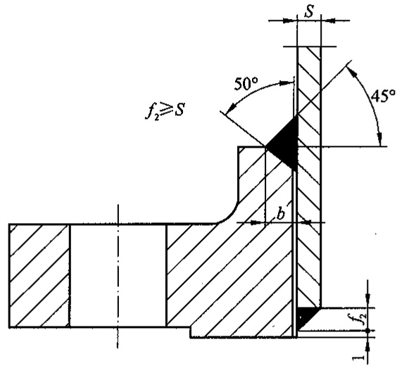

图9.2.2 带颈平焊法兰与钢管连接的焊接接头

9.3 承插焊法兰与钢管连接的焊接接头

| 公称尺寸DN | 坡口宽度b |  | 公称尺寸DN | 坡口宽度b |  |
|---|---|---|---|---|---|
| ≤PN25 | PN 40 | ≤PN25 | PN 40 |  |  |
| 10 | 4 | 4 | 125 | 6 | 7 |
| 15 | 4 | 4 | 150 | 6 | 8 |
| 20 | 4 | 4 | 200 | 8 | 10 |
| 25 | 5 | 5 | 250 | 10 | 11 |
| 32 | 5 | 5 | 300 | 11 | 12 |
| 40 | 5 | 5 | 350 | 12 | 13 |
| 50 | 5 | 5 | 400 | 12 | 14 |
| 65 | 6 | 6 | 450 | 12 | 16 |
| 80 | 6 | 6 | 500 | 12 | 17 |
| 100 | 6 | 6 | 600 | 12 | 18 |

承插焊法兰与钢管连接的焊接接头应符合图9.3的要求。

<!-- page: 109 -->

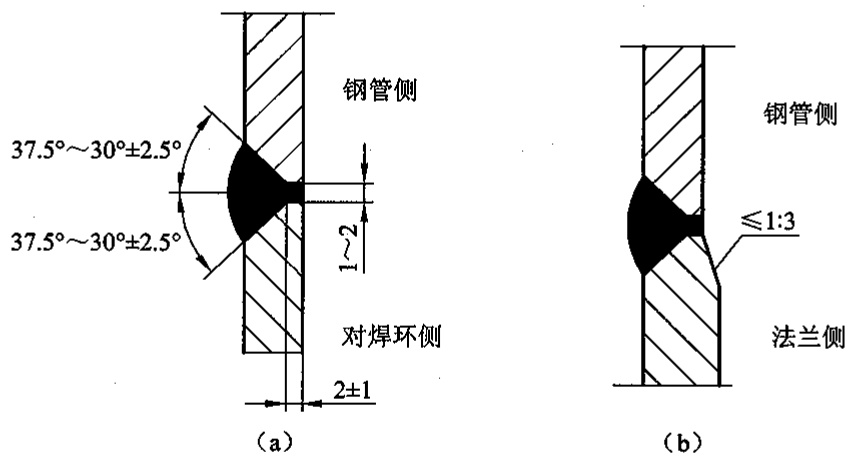

图9.4 带颈对焊法兰与钢管连接的焊接接头

注:当法兰与公称壁厚小于或等于 4.8\mathrm{mm} 的铁素体钢管或小于或等于 3.2\mathrm{mm} 的奥氏体钢管连接时，钝边可取消。

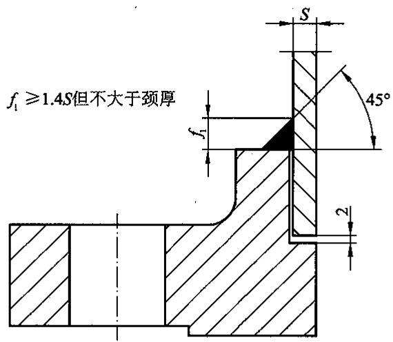

9.4 带颈对焊法兰

9.4.1 带颈对焊法兰与钢管连接的焊接接头和坡口尺寸应符合图9.4(a)的要求。

9.4.2 带颈对焊法兰的直边段厚度超过与其对接的钢管壁厚 1mm 以上时, 法兰的直边段应在内径处削薄, 削薄段的斜度应小于或等于 1:3, 如图 9.4(b) 所示。

### 9.5 对焊环

对焊环(松套法兰)与钢管连接的焊接接头和坡口尺寸应符合图9.5的要求。

<!-- page: 110 -->

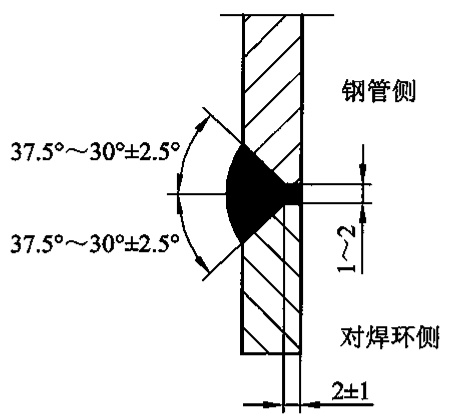

图9.5 对焊环与钢管连接的焊接接头

注:当对焊环与公称壁厚小于或等于 3.2\mathrm{mm} 的奥氏体钢管连接时，钝边可取消。

<!-- page: 111 -->

## 10 尺寸公差

10.0.1 法兰的尺寸公差按表10.0.1的规定。

10.0.2 环连接面的密封面尺寸公差按表 10.0.2 的规定。法兰环槽密封面的硬度应高于所配合的金属环形垫的硬度。

10.0.3 法兰(包括平焊环、对焊环)端部的坡口尺寸公差按本标准第9章的规定。

. (mm)

| 项目 | 法兰型式 | 尺寸范围 | 尺寸公差 |
|---|---|---|---|
| 法兰厚度C | 双面加工的所有型式法兰(包括锪孔) | C≤18 | ±1.0 |
| 18<C≤50 | ±1.5 |  |  |
| C>50 | ±2.0 |  |  |
| 法兰高度H | 带颈法兰对焊环 | ≤DN80 | ±1.5 |
| DN100~DN250 | ±2.0 |  |  |
| ≥DN300 | ±3.0 |  |  |
| 法兰颈部大端直径N | 带颈对焊法兰整体法兰 | ≤DN50 | 0-2 |
| DN65~DN150 | 0-4 |  |  |
| DN200~DN300 | 0-6 |  |  |
| DN350~DN600 | 0-8 |  |  |
| ≥DN700 | 0-10 |  |  |
| 带颈平焊法兰承插焊法兰螺纹法兰 | ≤DN50 | +1.00 |  |
| DN65~DN150 | +2.00 |  |  |
| DN200~DN300 | +4.00 |  |  |
| DN350~DN600 | +8.00 |  |  |
| 对焊法兰或对焊环焊端外径A或A1 | 带颈对焊法兰对焊环 | ≤DN125 | +3.00 |
| DN150~DN1200 | +4.50 |  |  |
| ≥DN1300 | +6.00 |  |  |

<!-- page: 112 -->

(mm)

| 项目 |  | 法兰型式 | 尺寸范围 | 尺寸公差 |
|---|---|---|---|---|
| 法兰内径和承插孔内径 B1、B2 |  | 所有型式 | ≤DN100 | +0.50 |
| DN125~DN400 | +1.00 |  |  |  |
| DN450~DN600 | +1.50 |  |  |  |
| ≥DN700 | +3.00 |  |  |  |
| 法兰外径D |  | 整体法兰 | ≤DN250 | ±4.0 |
| DN300~DN500 | ±5.0 |  |  |  |
| DN600~DN800 | ±6.0 |  |  |  |
| DN900~DN1200 | ±7.0 |  |  |  |
| DN1400~DN1600 | ±8.0 |  |  |  |
| >DN1600 | ±10.0 |  |  |  |
| 所有型式 | ≤DN150 | ±2.0 |  |  |
| DN200~DN500 | ±3.0 |  |  |  |
| DN600~DN1200 | ±5.0 |  |  |  |
| DN1400~DN1800 | ±7.0 |  |  |  |
| >DN1800 | ±10.0 |  |  |  |
| 法兰突台外径d(环连接面除外) |  | 所有型式 | ≤DN250 | +2.0-1.0 |
| >DN250 | +3.0-1.0 |  |  |  |
| 法兰突台高度 f1(环连接面除外) |  | 所有型式 | 2 | 0-1.0 |
| 环连接面法兰突台高度E |  | 所有型式 | - | ±1.0 |
| 凹面/凸面和榫面/槽面高度 f2、f3 |  | 所有型式 | - | +0.50 |
| 凹面/凸面和榫面/槽面直径 | X、Z | 所有型式 | - | 0-0.5 |
| W、Y | +0.50 |  |  |  |
| 螺栓孔中心圆直径K |  | 所有型式 | ≤M24 | ±1.0 |
| >M24 | ±1.5 |  |  |  |
| 相邻两螺栓孔间距 |  | 所有型式 | ≤M24 | ±1.0 |
| >M24 | ±1.5 |  |  |  |

<!-- page: 113 -->

续表 10.0.1

| 项目 | 法兰型式 | 尺寸范围 | 尺寸公差 |
|---|---|---|---|
| 螺栓孔直径L | 所有型式 |  | ±0.5 |
| 螺栓孔中心圆与加工密封面的同轴度偏差 | 所有型式 | ≤DN100 | 1.0 |
| ≥DN125 | 2.0 |  |  |
| 密封面与螺栓支承面的平行度 | 所有型式 |  | 1° |
| 颈部厚度S | 带颈对焊法兰整体法兰 | ≤DN80 | +1.00 |
| DN100~DN400 | +1.50 |  |  |
| DN450~DN600 | +2.00 |  |  |
| DN700~DN1000 | +3.00 |  |  |
| ≥DN1200 | +4.00 |  |  |
| 对焊环焊端以及翻边壁厚 | 对焊环 |  | +1.6-12.5%钢管名义厚度 |

(mm)

(mm)

| 项目 |  | 尺寸公差 |
|---|---|---|
| 环槽深度 E |  | +0.40 |
| 环槽顶宽度 F |  | \pm 0.2 |
| 环槽中心圆直径 P |  | \pm 0.13 |
| 环槽角度 23^{\circ} |  | \pm 0.5^{\circ} |
| 环槽圆角 R_{\max} | R_{\max} \leqslant 2 | +0.80 |
| R_{\max} >2 | \pm 0.8 |  |
| 密封面外径 d |  | \pm 0.5 |

<!-- page: 114 -->

## 11 试 验

11.0.2 当法兰安装到管道或设备上以后,其水压试验压力应不大于本标准第7章规定的常温时最高允许工作压力的1.5倍。

11.0.1 法兰原则上不进行单个法兰的水压试验。

<!-- page: 115 -->

## 12 检验和验收

12.0.1 法兰外观检验应符合以下要求:

1 锻造表面应光滑，不得有锻造伤痕、裂纹等缺陷。

2 锻造表面的粘砂、氧化皮等应清除干净，不允许有影响铸件使用性能的缺陷（如裂纹、缩孔、夹渣等）存在。

3 机加工表面不得有毛刺、有害的划痕和其他降低法兰强度和连接可靠性的缺陷。

4 环连接面法兰的密封面应逐个检查,槽的两个侧面不得有机械加工引起的裂纹、划痕和撞伤等表面缺陷。

12.0.2 法兰材料应符合有关标准的规定，并具有相应的质量证明文件。

12.0.3 法兰加工完毕后，应在其密封面上涂防锈油，并防止划伤和撞击。

<!-- page: 116 -->

#### 13.0.1 法兰按下列规定标记:

$$ \mathrm{HG} / \mathrm{T} 2 0 5 9 2 \quad \text {法兰(或法兰盖)} \quad \boxed {\mathrm{b}} \quad \boxed {\mathrm{c}} - \boxed {\mathrm{d}} \quad \boxed {\mathrm{e}} \quad \boxed {\mathrm{f}} \quad \boxed {\mathrm{g}} \quad \boxed {\mathrm{h}} $$

其中:

b 为法兰类型代号, 按本标准表 3.1.1 的规定。螺纹法兰采用按 GB/T 7306 规定的锥管螺纹时, 标记为“Th(Rc)”或“Th(Rp)”; 螺纹法兰采用按 GB/T 12716 规定的锥管螺纹时, 标记为 “Th(NPT)”。螺纹法兰如未标记螺纹代号, 则为 Rp(GB/T 7306.1)。

c为法兰公称尺寸DN与适用钢管外径系列；

整体法兰、法兰盖、衬里法兰盖、螺纹法兰，适用钢管外径系列的标记可省略。适用于本标准A系列钢管的法兰，适用钢管外径系列的标记可省略。适用于本标准B系列钢管的法兰，标记为“DN×××(B)”。

d 为法兰公称压力等级 PN。

e 为密封面型式代号, 按本标准表 3.2.1 的规定。

f为钢管壁厚，应由用户提供。对于带颈对焊法兰、对焊环(松套法兰)应标注钢管壁厚。

g为材料牌号。

h表示其他。如附加要求或采用与本标准规定不一致的要求等。

#### 13.0.2 标记示例

示例 1: 公称尺寸 DN1200、公称压力 PN6、配用公制管的突面板式平焊钢制管法兰, 材料为 Q235A, 其标记为:

$$ \mathrm{HG/T20592} \quad \text {法兰} \quad \mathrm{PL1200(B)-6} \quad \mathrm{RF} \quad \mathrm{Q235A} $$

示例 2: 公称尺寸 DN300、公称压力 PN25、配用英制管的凸面带颈平焊钢制管法兰, 材料为 20 钢, 其标记为:

$$ \mathrm{HG} / \mathrm{T} 2 0 5 9 2 \quad \text {法兰} \quad \mathrm{SO} 3 0 0 - 2 5 \quad \mathrm{M} \quad 2 0 $$

示例 3: 公称尺寸 DN100、公称压力 PN100、配用公制管的凹面带颈对焊钢制管法兰, 材料为 16Mn, 钢管壁厚为 8mm, 其标记为:

$$ \mathrm{HG/T20592} \quad \text {法兰} \quad \mathrm{WN100(B)-100} \quad \mathrm{FM} \quad S = 8 \mathrm{mm} \quad 1 6 \mathrm{Mn} $$

示例 4: 公称尺寸 DN150、公称压力 PN160、配用英制管的环连接面带颈对焊钢制管法兰, 材料为 16Mn, 钢管壁厚为 10mm, 其标记为:

$$ \mathrm{HG} / \mathrm{T} 2 0 5 9 2 \quad \text {法兰} \quad \mathrm{WN} 1 5 0 - 1 6 0 \quad \mathrm{RJ} \quad S = 1 0 \mathrm{mm} \quad 1 6 \mathrm{Mn} $$

示例 5: 公称尺寸 DN500、公称压力 PN16、榫面整体钢制管法兰, 材料为 WCB, 密封面表面粗糙度为 Ra0.8~1.6, 其标记为:

$$ \mathrm{HG/T20592} \quad \text {法兰} \quad \mathrm{IF500-16} \quad \mathrm{T} \quad \mathrm{WCB} \quad R a 0. 8 \sim 1. 6 $$

<!-- page: 117 -->

示例 6: 公称尺寸 DN40、公称压力 PN63、配用英制管的突面承插焊钢制管法兰, 材料为 304, 其标记为:

$$ \mathrm{HG/T20592} \quad \text {法兰} \quad \mathrm{SW40-63} \quad \mathrm{RF} \quad 3 0 4 $$

示例 7: 公称尺寸 DN80、公称压力 PN25、采用 NPT 螺纹的突面螺纹钢制管法兰, 材料为 20 钢, 其标记为:

$$ \mathrm{HG/T20592} \quad \text {法兰} \quad \mathrm{Th(NPT)80-25} \quad \mathrm{RF} \quad 2 0 $$

示例 8: 公称尺寸 DN65、公称压力 PN16、采用 Rc 螺纹的全平面螺纹钢制管法兰, 材料为 316, 其标记为:

$$ \mathrm{HG/T20592法兰Th(Rc)65 - 16FF316} $$

示例 9: 公称尺寸 DN200、公称压力 PN10、配用公制管的突面对焊环松套钢制管法兰, 法兰材料为 20 钢、对焊环材料为 316, 钢管壁厚为 4mm, 其标记为:

$$ \mathrm{HG/T20592} \quad \text {法兰} \quad \mathrm{PJ/SE} \quad 2 0 0 (\mathrm{B}) - 1 0 \quad \mathrm{RF} \quad S = 4 \mathrm{mm} \quad 2 0 / 3 1 6 $$

示例 10: 公称尺寸 DN300、公称压力 PN10、配用英制管的凹面平焊环松套钢制管法兰, 法兰材料为 20 钢、平焊环材料为 316, 其标记为:

$$ \mathrm{HG/T20592} \quad \text {法兰} \quad \mathrm{PJ/RJ} \quad 3 0 0 - 1 0 \quad \mathrm{FM} \quad 2 0 / 3 1 6 $$

#### 13.0.3 采购和交货。

1 用户应提供以下采购要求:

1）标准编号；

2）管法兰类型或类型代号；

3）法兰密封面类型代号；

4）公称尺寸(DN)；

5）公称压力(PN)；

6）与带颈对焊法兰、对焊环(松套法兰)连接的钢管壁厚；

7）材料牌号。

2 根据需要并经供需双方协商同意,需方可提出附加要求,但应在订货合同中说明具体要求。例如:

1) 采用本标准表4.0.1以外的材料牌号。

2）法兰锻件级别高于本标准第4.0.3条的要求。

3）奥氏体不锈钢的晶间腐蚀试验要求。

4）法兰表面的防锈、涂漆要求。

5）其他。

<!-- page: 118 -->

## 14 包装和钢印标志

14.0.1 法兰(包括法兰盖)的外圆柱表面都应以钢印标志以下内容:

1 标准编号:HG/T 20592。

2 法兰类型代号(按本标准表 3.1.1 的规定)以及螺纹法兰的锥管螺纹代号(按本标准第 8.4.2 条的规定);

3 法兰公称尺寸DN及适用钢管外径系列。

整体法兰、法兰盖、衬里法兰盖、螺纹法兰，适用钢管外径系列的标记可省略；

适用于本标准A系列钢管的法兰，适用钢管外径系列的标记可省略；

适用于本标准 B 系列钢管的法兰, 标记为“DN×××(B)”。

4 法兰公称压力 PN。

5 密封面型式代号, 按本标准表 3.2.1 的规定。

6 带颈对焊法兰、对焊环(松套法兰)应标注钢管壁厚。

7 材料代号, 按表 14.0.1 的规定。

14.0.2 法兰应按规格、材料分别包装。

14.0.3 法兰交货时,应附有产品质量证明文件。每个法兰(包括法兰盖)的外圆柱表面上应以钢印标志 14.0.1 规定的内容。

表 14.0.1 材料代号

| 钢号 | 代号 | 钢号 | 代号 |
|---|---|---|---|
| Q235A,Q235B | Q | 12Cr2Mol,12Cr2MolR | C2M |
| 20,Q245R | 20 | 1Cr5Mo | C5M |
| 25 | 25 | 9Cr-1Mo-V | C9MV |
| A105 | A105 | 08Ni3D | 3.5Ni |
| 09Mn2VR | 09MnD | 0Cr18Ni9 | 304 |
| 09MnNiD | 09NiD | 00Cr19Ni10 | 304L |
| 16Mn,Q345R | 16Mn | 0Cr18Ni10Ti | 321 |
| 16MnD,16MnDR | 16MnD | 0Cr17Ni12Mo2 | 316 |
| 09MnNiD,09MnNiDR | 09MnNiD | 00Cr17Ni14Mo2 | 316L |
| 14Cr1Mo,14Cr1MoR | 14CM | 0Cr18Ni11Nb | 347 |
| 15CrMo,15CrMoR | 15CM |  |  |

<!-- page: 119 -->

**A.1 范围**

A.1.1 本附录规定了钢制孔板法兰(PN系列)的公称尺寸、公称压力、型式、尺寸、公差以及技术要求。

A.1.2 本附录适用于公称压力等级 PN10、PN16、PN25、PN40、PN63、PN100、PN160 的带颈对焊钢制孔板法兰。

**A.2 引用标准**

《锻制承插焊和螺纹管件》GB/T 14383

**A.3 类型和代号**

带颈对焊孔板法兰的类型和代号按图 A.3-1 和表 A.3-1 的规定。适用的公称压力和公称尺寸按表 A.3-2 的规定。

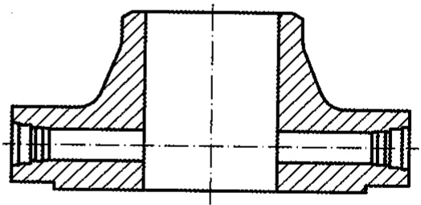

(a) NPT 管螺纹连接测压孔(KWN-T)

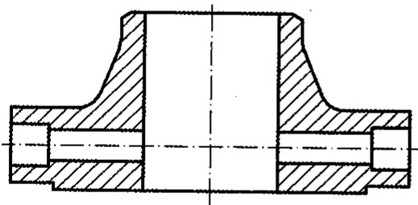

(b) 承插焊连接测压孔(KWN-S)

表 A. 3-1 孔板法兰类型代号

| 法兰类型代号 | 法兰类型 |  |
|---|---|---|
| 法兰 | 测压孔 |  |
| KWN-T | 带颈对焊 | NPT 管螺纹连接 |
| KWN-S | 承插焊连接 |  |

<!-- page: 120 -->

表 A. 3-2 带颈对焊孔板法兰(KWN)适用范围

| 公称尺寸DN | 公称压力 PN |  |  |  |  |  |  | 公称尺寸DN | 公称压力 PN |  |  |  |  |  |  |
|---|---|---|---|---|---|---|---|---|---|---|---|---|---|---|---|
| 10 | 16 | 25 | 40 | 63 | 100 | 160 | 10 | 16 | 25 | 40 | 63 | 100 | 160 |  |  |
| 25 | × | × | × | × | × | × | × | 200 | × | × | × | × | × | × | × |
| 32 | × | × | × | × | × | × | × | 250 | × | × | × | × | × | × | × |
| 40 | × | × | × | × | × | × | × | 300 | × | × | × | × | × | × | × |
| 50 | × | × | × | × | × | × | × | 350 | × | × | × | × | × | × | - |
| 65 | × | × | × | × | × | × | × | 400 | × | × | × | × | × | × | - |
| 80 | × | × | × | × | × | × | × | 450 | × | × | × | × | - | - | - |
| 100 | × | × | × | × | × | × | × | 500 | × | × | × | × | - | - | - |
| 125 | × | × | × | × | × | × | × | 600 | × | × | × | × | - | - | - |
| 150 | × | × | × | × | × | × | × |  |  |  |  |  |  |  |  |

**A.4 密封面**

A.4.1 本附录规定的孔板法兰密封面类型有突面(RF)，其适用范围按表 A.4.1 的规定。

A.4.2 法兰密封面表面粗糙度按本标准第3.2.3条的规定。

表 A.4.1 密封面型式及适用范围

| 密封面型式 | 公称压力 PN |  |  |  |  |  |  |
|---|---|---|---|---|---|---|---|
| 10 | 16 | 25 | 40 | 63 | 100 | 160 |  |
| 突面(RF) | DN25~DN600 |  |  |  | DN25~DN400 |  | DN25~DN300 |

**A.5 材料**

A.5.1 孔板法兰用材料按本标准第4章的规定，紧固件材料按HG/T20613的规定，垫片按HG/T20606、HG/T20607和HG/T20609～HG/T20612的规定。

A.5.2 管塞可以采用锻件或棒,材料的性能不得低于孔板法兰用材料。

**A.6 最高允许工作压力**

法兰的最高允许工作压力按本标准第7章的规定。

**A.7 测压孔**

A.7.1 每个孔板法兰上应对称开设 2 个 DN15(NPS½)的测压孔, 如图 A.7.1 所示, 每个测压孔应配置螺纹或承插管塞。测压孔也可采用其他公称尺寸, 用户应在订货时注明。

A.7.2 测压孔可采用承插焊连接或 NPT 管螺纹连接结构, 结构尺寸按 GB/T 14383 的规定。

A.7.3 采用环连接面的孔板法兰，必要时可采用图 A.7.3 所示的测压孔结构。

A.7.4 起重螺栓的位置与测压孔成 $90^{\circ}$ 布置，如图A.7.1所示。

<!-- page: 121 -->

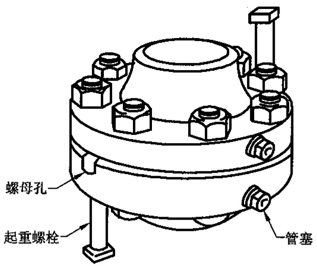

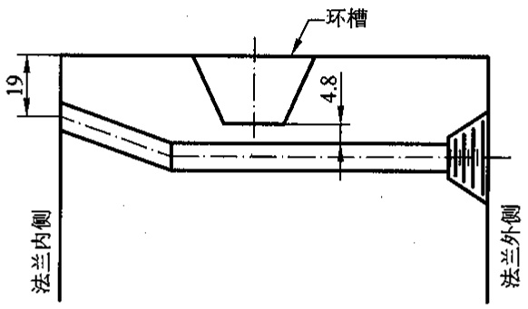

A.8 尺寸

A.8.1 法兰的密封面尺寸按本标准第3.2.5条的规定。

A.8.2 法兰的连接尺寸和结构尺寸按图 A.8.2 和表 A.8.2-1～表 A.8.2-7 的规定。

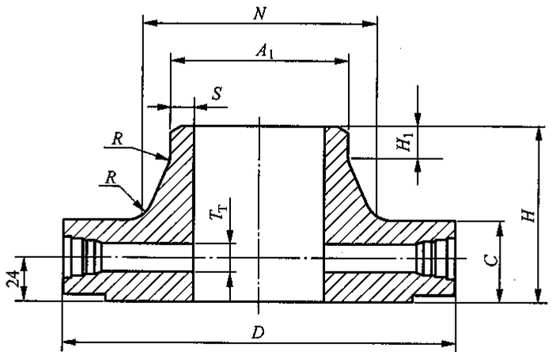

图A.8.2 带颈对焊孔板法兰

<!-- page: 122 -->

(mm)

| 公称尺寸DN | 钢管外径法兰焊端外径A1 |  | 连接尺寸 |  |  |  |  | 法兰厚度C | 法兰颈 |  |  |  |  | 法兰高度H | 测压孔直径TT |
|---|---|---|---|---|---|---|---|---|---|---|---|---|---|---|---|
| 法兰外径D | 螺栓孔中心圆直径K | 螺栓孔直径L | 螺栓孔数量n(个) | 螺栓Th | N |  | S | H1≈ | R |  |  |  |  |  |  |
| A | B | A | B |  |  |  |  |  |  |  |  |  |  |  |  |
| 25 | 33.7 | 32 | 115 | 85 | 14 | 4 | M12 | 38 | 46 | 46 | 2.6 | 6 | 4 | 60 | 7 |
| 32 | 42.4 | 38 | 140 | 100 | 18 | 4 | M16 | 38 | 56 | 56 | 2.6 | 6 | 6 | 62 | 7 |
| 40 | 48.3 | 45 | 150 | 110 | 18 | 4 | M16 | 38 | 64 | 64 | 2.6 | 7 | 6 | 65 | 7 |
| 50 | 60.3 | 57 | 165 | 125 | 18 | 4 | M16 | 38 | 74 | 74 | 2.9 | 8 | 5 | 65 | 7 |
| 65 | 76.1 | 65 | 185 | 145 | 18 | 8 | M16 | 38 | 92 | 92 | 2.9 | 10 | 6 | 65 | 7 |
| 80 | 88.9 | 89 | 200 | 160 | 18 | 8 | M16 | 38 | 105 | 105 | 3.2 | 10 | 6 | 68 | 10 |
| 100 | 114.3 | 108 | 220 | 180 | 18 | 8 | M16 | 38 | 131 | 131 | 3.6 | 12 | 8 | 70 | 13 |
| 125 | 139.7 | 133 | 250 | 210 | 18 | 8 | M16 | 38 | 156 | 156 | 4.0 | 12 | 8 | 71 | 13 |
| 150 | 168.3 | 159 | 285 | 240 | 22 | 8 | M20 | 38 | 184 | 184 | 4.5 | 12 | 10 | 71 | 13 |
| 200 | 219.1 | 219 | 340 | 295 | 22 | 8 | M20 | 38 | 234 | 234 | 6.3 | 16 | 10 | 76 | 13 |
| 250 | 273 | 273 | 395 | 350 | 22 | 12 | M20 | 38 | 292 | 292 | 6.3 | 16 | 12 | 82 | 13 |
| 300 | 323.9 | 325 | 445 | 400 | 22 | 12 | M20 | 38 | 342 | 342 | 7.1 | 16 | 12 | 90 | 13 |
| 350 | 355.6 | 377 | 505 | 460 | 22 | 16 | M20 | 38 | 385 | 402 | 7.1 | 16 | 12 | 94 | 13 |
| 400 | 406.4 | 426 | 565 | 515 | 26 | 16 | M24 | 38 | 440 | 458 | 7.1 | 16 | 12 | 97 | 13 |
| 450 | 457 | 480 | 615 | 565 | 26 | 20 | M24 | 38 | 488 | 510 | 7.1 | 16 | 12 | 97 | 13 |
| 500 | 508 | 530 | 670 | 620 | 26 | 20 | M24 | 38 | 542 | 562 | 7.1 | 16 | 12 | 100 | 13 |
| 600 | 610 | 630 | 780 | 725 | 30 | 20 | M27 | 38 | 642 | 660 | 7.1 | 18 | 12 | 105 | 13 |

表 A.8.2-2 PN16 带颈对焊孔板法兰

| 公称尺寸DN | 钢管外径法兰焊端外径 A_1 |  | 连接尺寸 |  |  |  |  | 法兰厚度C | 法兰颈 |  |  |  |  | 法兰高度H | 测压孔直径 T_T |
|---|---|---|---|---|---|---|---|---|---|---|---|---|---|---|---|
| 法兰外径D | 螺栓孔中心圆直径K | 螺栓孔直径L | 螺栓孔数量n(个) | 螺栓Th | N |  | S | H_1 \approx | R |  |  |  |  |  |  |
| A | B | A | B |  |  |  |  |  |  |  |  |  |  |  |  |
| 25 | 33.7 | 32 | 115 | 85 | 14 | 4 | M12 | 38 | 46 | 46 | 2.6 | 6 | 4 | 60 | 7 |
| 32 | 42.4 | 38 | 140 | 100 | 18 | 4 | M16 | 38 | 56 | 56 | 2.6 | 6 | 6 | 62 | 7 |
| 40 | 48.3 | 45 | 150 | 110 | 18 | 4 | M16 | 38 | 64 | 64 | 2.6 | 7 | 6 | 65 | 7 |
| 50 | 60.3 | 57 | 165 | 125 | 18 | 4 | M16 | 38 | 74 | 74 | 2.9 | 8 | 5 | 65 | 7 |
| 65 | 76.1 | 65 | 185 | 145 | 18 | 8 | M16 | 38 | 92 | 92 | 2.9 | 10 | 6 | 65 | 7 |
| 80 | 88.9 | 89 | 200 | 160 | 18 | 8 | M16 | 38 | 105 | 105 | 3.2 | 10 | 6 | 68 | 10 |
| 100 | 114.3 | 108 | 220 | 180 | 18 | 8 | M16 | 38 | 131 | 131 | 3.6 | 12 | 8 | 70 | 13 |

<!-- page: 123 -->

(mm)

| 公称尺寸DN | 钢管外径法兰焊端外径 A_1 |  | 连接尺寸 |  |  |  |  | 法兰厚度C | 法兰颈 |  |  |  |  | 法兰高度H | 测压孔直径 T_T |
|---|---|---|---|---|---|---|---|---|---|---|---|---|---|---|---|
| 法兰外径D | 螺栓孔中心圆直径K | 螺栓孔直径L | 螺栓孔数量n(个) | 螺栓Th | N |  | S | H_1 \approx | R |  |  |  |  |  |  |
| A | B | A | B |  |  |  |  |  |  |  |  |  |  |  |  |
| 125 | 139.7 | 133 | 250 | 210 | 18 | 8 | M16 | 38 | 156 | 156 | 4.0 | 12 | 8 | 71 | 13 |
| 150 | 168.3 | 159 | 285 | 240 | 22 | 8 | M20 | 38 | 184 | 184 | 4.5 | 12 | 10 | 71 | 13 |
| 200 | 219.1 | 219 | 340 | 295 | 22 | 12 | M20 | 38 | 235 | 235 | 6.3 | 16 | 10 | 76 | 13 |
| 250 | 273 | 273 | 405 | 355 | 26 | 12 | M24 | 38 | 292 | 292 | 6.3 | 16 | 12 | 82 | 13 |
| 300 | 323.9 | 325 | 460 | 410 | 26 | 12 | M24 | 38 | 344 | 344 | 7.1 | 16 | 12 | 88 | 13 |
| 350 | 355.6 | 377 | 520 | 470 | 26 | 16 | M24 | 38 | 390 | 410 | 8.0 | 16 | 12 | 90 | 13 |
| 400 | 406.4 | 426 | 580 | 525 | 30 | 16 | M27 | 38 | 445 | 464 | 8.0 | 16 | 12 | 91 | 13 |
| 450 | 457 | 480 | 640 | 585 | 30 | 20 | M27 | 40 | 490 | 512 | 8.0 | 16 | 12 | 87 | 13 |
| 500 | 508 | 530 | 715 | 650 | 33 | 20 | M30 | 44 | 548 | 570 | 8.0 | 16 | 12 | 90 | 13 |
| 600 | 610 | 630 | 840 | 770 | 36 | 20 | M33 | 54 | 652 | 672 | 8.8 | 18 | 12 | 95 | 13 |

(mm)

| 公称尺寸DN | 钢管外径法兰焊端外径A1 |  | 连接尺寸 |  |  |  |  | 法兰厚度C | 法兰颈 |  |  |  |  | 法兰高度H | 测压孔直径TT |
|---|---|---|---|---|---|---|---|---|---|---|---|---|---|---|---|
| 法兰外径D | 螺栓孔中心圆直径K | 螺栓孔直径L | 螺栓孔数量n(个) | 螺栓Th | N |  | S | H1≈ | R |  |  |  |  |  |  |
| A | B | A | B |  |  |  |  |  |  |  |  |  |  |  |  |
| 25 | 33.7 | 32 | 115 | 85 | 14 | 4 | M12 | 38 | 46 | 46 | 2.6 | 6 | 4 | 60 | 7 |
| 32 | 42.4 | 38 | 140 | 100 | 18 | 4 | M16 | 38 | 56 | 56 | 2.6 | 6 | 6 | 62 | 7 |
| 40 | 48.3 | 45 | 150 | 110 | 18 | 4 | M16 | 38 | 64 | 64 | 2.6 | 7 | 6 | 65 | 7 |
| 50 | 60.3 | 57 | 165 | 125 | 18 | 4 | M16 | 38 | 75 | 75 | 2.9 | 8 | 6 | 66 | 7 |
| 65 | 76.1 | 65 | 185 | 145 | 18 | 8 | M16 | 38 | 90 | 90 | 2.9 | 10 | 6 | 68 | 7 |
| 80 | 88.9 | 89 | 200 | 160 | 18 | 8 | M16 | 38 | 105 | 105 | 3.2 | 12 | 8 | 72 | 10 |
| 100 | 114.3 | 108 | 235 | 190 | 22 | 8 | M20 | 38 | 134 | 134 | 3.6 | 12 | 8 | 79 | 13 |
| 125 | 139.7 | 133 | 270 | 220 | 26 | 8 | M24 | 38 | 162 | 162 | 4.0 | 12 | 8 | 80 | 13 |
| 150 | 168.3 | 159 | 300 | 250 | 26 | 8 | M24 | 38 | 192 | 190 | 4.5 | 12 | 10 | 85 | 13 |
| 200 | 219.1 | 219 | 360 | 310 | 26 | 12 | M24 | 38 | 244 | 244 | 6.3 | 16 | 10 | 88 | 13 |
| 250 | 273 | 273 | 425 | 370 | 30 | 12 | M27 | 38 | 298 | 298 | 7.1 | 18 | 12 | 94 | 13 |
| 300 | 323.9 | 325 | 485 | 430 | 30 | 16 | M27 | 38 | 352 | 352 | 8.0 | 18 | 12 | 96 | 13 |
| 350 | 355.6 | 377 | 555 | 490 | 33 | 16 | M30 | 38 | 398 | 420 | 8.0 | 20 | 12 | 100 | 13 |
| 400 | 406.4 | 426 | 620 | 550 | 36 | 16 | M33 | 40 | 452 | 472 | 8.8 | 20 | 12 | 110 | 13 |
| 450 | 457 | 480 | 670 | 600 | 36 | 20 | M33 | 46 | 500 | 522 | 8.8 | 20 | 12 | 110 | 13 |
| 500 | 508 | 530 | 730 | 660 | 36 | 20 | M33 | 48 | 558 | 580 | 10 | 20 | 12 | 125 | 13 |
| 600 | 610 | 630 | 845 | 770 | 39 | 20 | M36×3 | 58 | 660 | 680 | 11 | 20 | 12 | 125 | 13 |

<!-- page: 124 -->

(mm)

| 公称尺寸DN | 钢管外径法兰焊端外径 A_1 |  | 连接尺寸 |  |  |  |  | 法兰厚度C | 法兰颈 |  |  |  |  | 法兰高度H | 测压孔直径 T_T |
|---|---|---|---|---|---|---|---|---|---|---|---|---|---|---|---|
| 法兰外径D | 螺栓孔中心圆直径K | 螺栓孔直径L | 螺栓孔数量n(个) | 螺栓Th | N |  | S | H_1 \approx | R |  |  |  |  |  |  |
| A | B | A | B |  |  |  |  |  |  |  |  |  |  |  |  |
| 25 | 33.7 | 32 | 115 | 85 | 14 | 4 | M12 | 38 | 46 | 46 | 2.6 | 6 | 4 | 60 | 7 |
| 32 | 42.4 | 38 | 140 | 100 | 18 | 4 | M16 | 38 | 56 | 56 | 2.6 | 6 | 6 | 62 | 7 |
| 40 | 48.3 | 45 | 150 | 110 | 18 | 4 | M16 | 38 | 64 | 64 | 2.6 | 7 | 6 | 65 | 7 |
| 50 | 60.3 | 57 | 165 | 125 | 18 | 4 | M16 | 38 | 75 | 75 | 2.9 | 8 | 6 | 66 | 7 |
| 65 | 76.1 | 65 | 185 | 145 | 18 | 8 | M16 | 38 | 90 | 90 | 2.9 | 10 | 6 | 68 | 7 |
| 80 | 88.9 | 89 | 200 | 160 | 18 | 8 | M16 | 38 | 105 | 105 | 3.2 | 12 | 8 | 72 | 10 |
| 100 | 114.3 | 108 | 235 | 190 | 22 | 8 | M20 | 38 | 134 | 134 | 3.6 | 12 | 8 | 79 | 13 |
| 125 | 139.7 | 133 | 270 | 220 | 26 | 8 | M24 | 38 | 162 | 162 | 4.0 | 12 | 8 | 80 | 13 |
| 150 | 168.3 | 159 | 300 | 250 | 26 | 8 | M24 | 38 | 192 | 192 | 4.5 | 12 | 10 | 85 | 13 |
| 200 | 219.1 | 219 | 375 | 320 | 30 | 12 | M27 | 38 | 244 | 244 | 6.3 | 16 | 10 | 92 | 13 |
| 250 | 273 | 273 | 450 | 385 | 33 | 12 | M30 | 38 | 306 | 306 | 7.1 | 18 | 12 | 105 | 13 |
| 300 | 323.9 | 325 | 515 | 450 | 33 | 16 | M30 | 42 | 362 | 362 | 8.0 | 18 | 12 | 115 | 13 |
| 350 | 355.6 | 377 | 580 | 510 | 36 | 16 | M33 | 46 | 408 | 430 | 8.8 | 20 | 12 | 125 | 13 |
| 400 | 406.4 | 426 | 660 | 585 | 39 | 16 | M36×3 | 50 | 462 | 482 | 11.0 | 20 | 12 | 135 | 13 |
| 450 | 457 | 480 | 685 | 610 | 39 | 20 | M36×3 | 57 | 500 | 522 | 12.5 | 20 | 12 | 135 | 13 |
| 500 | 508 | 530 | 755 | 670 | 42 | 20 | M39×3 | 57 | 562 | 584 | 14.2 | 20 | 12 | 140 | 13 |
| 600 | 610 | 630 | 890 | 795 | 48 | 20 | M45×3 | 72 | 666 | 686 | 16.0 | 20 | 12 | 150 | 13 |

(mm)

| 公称尺寸DN | 钢管外径法兰焊端外径 A_1 |  | 连接尺寸 |  |  |  |  | 法兰厚度C | 法兰颈 |  |  |  |  | 法兰高度H | 测压孔直径 T_T |
|---|---|---|---|---|---|---|---|---|---|---|---|---|---|---|---|
| 法兰外径D | 螺栓孔中心圆直径K | 螺栓孔直径L | 螺栓孔数量n(个) | 螺栓Th | N |  | S | H_1 \approx | R |  |  |  |  |  |  |
| A | B | A | B |  |  |  |  |  |  |  |  |  |  |  |  |
| 25 | 33.7 | 32 | 140 | 100 | 18 | 4 | M16 | 38 | 52 | 52 | 2.6 | 8 | 4 | 72 | 7 |
| 32 | 42.4 | 38 | 155 | 110 | 22 | 4 | M20 | 38 | 62 | 62 | 2.9 | 8 | 6 | 74 | 7 |
| 40 | 48.3 | 45 | 170 | 125 | 22 | 4 | M20 | 38 | 70 | 70 | 2.9 | 10 | 6 | 74 | 7 |
| 50 | 60.3 | 57 | 180 | 135 | 22 | 4 | M20 | 38 | 82 | 82 | 2.9 | 10 | 6 | 74 | 7 |
| 65 | 76.1 | 65 | 205 | 160 | 22 | 8 | M20 | 38 | 98 | 98 | 3.2 | 12 | 6 | 80 | 7 |
| 80 | 88.9 | 89 | 215 | 170 | 22 | 8 | M20 | 38 | 112 | 112 | 3.6 | 12 | 8 | 82 | 10 |
| 100 | 114.3 | 108 | 250 | 200 | 26 | 8 | M24 | 38 | 138 | 138 | 4.0 | 12 | 8 | 86 | 13 |
| 125 | 139.7 | 133 | 295 | 240 | 30 | 8 | M27 | 38 | 168 | 168 | 4.5 | 12 | 8 | 92 | 13 |
| 150 | 168.3 | 159 | 345 | 280 | 33 | 8 | M30 | 38 | 202 | 202 | 5.6 | 12 | 10 | 97 | 13 |
| 200 | 219.1 | 219 | 415 | 345 | 36 | 12 | M33 | 42 | 256 | 256 | 7.1 | 16 | 10 | 110 | 13 |
| 250 | 273 | 273 | 470 | 400 | 36 | 12 | M33 | 46 | 316 | 316 | 8.8 | 18 | 12 | 125 | 13 |
| 300 | 323.9 | 325 | 530 | 460 | 36 | 16 | M33 | 52 | 372 | 372 | 11.0 | 18 | 12 | 140 | 13 |
| 350 | 355.6 | 377 | 600 | 525 | 39 | 16 | M36×3 | 56 | 420 | 442 | 12.5 | 20 | 12 | 150 | 13 |
| 400 | 406.4 | 426 | 670 | 585 | 42 | 16 | M39×3 | 60 | 475 | 495 | 14.2 | 20 | 12 | 160 | 13 |

<!-- page: 125 -->

(mm)

| 公称尺寸DN | 钢管外径法兰焊端外径 A_1 |  | 连接尺寸 |  |  |  |  | 法兰厚度C | 法兰颈 |  |  |  |  | 法兰高度H | 测压孔直径 T_T |
|---|---|---|---|---|---|---|---|---|---|---|---|---|---|---|---|
| 法兰外径D | 螺栓孔中心圆直径K | 螺栓孔直径L | 螺栓孔数量n(个) | 螺栓Th | N |  | S | H_1 \approx | R |  |  |  |  |  |  |
| A | B | A | B |  |  |  |  |  |  |  |  |  |  |  |  |
| 25 | 33.7 | 32 | 140 | 100 | 18 | 4 | M16 | 38 | 52 | 52 | 2.6 | 8 | 4 | 72 | 7 |
| 32 | 42.4 | 38 | 155 | 110 | 22 | 4 | M20 | 38 | 62 | 62 | 2.9 | 8 | 6 | 74 | 7 |
| 40 | 48.3 | 45 | 170 | 125 | 22 | 4 | M20 | 38 | 70 | 70 | 2.9 | 10 | 6 | 74 | 7 |
| 50 | 60.3 | 57 | 195 | 145 | 26 | 4 | M24 | 38 | 90 | 90 | 3.2 | 10 | 6 | 78 | 7 |
| 65 | 76.1 | 65 | 220 | 170 | 26 | 8 | M24 | 38 | 108 | 108 | 3.6 | 12 | 6 | 84 | 7 |
| 80 | 88.9 | 89 | 230 | 180 | 26 | 8 | M24 | 38 | 120 | 120 | 4.0 | 12 | 8 | 84 | 10 |
| 100 | 114.3 | 108 | 265 | 210 | 30 | 8 | M27 | 38 | 150 | 150 | 5.0 | 12 | 8 | 92 | 13 |
| 125 | 139.7 | 133 | 315 | 250 | 33 | 8 | M30 | 40 | 180 | 180 | 6.3 | 12 | 8 | 105 | 13 |
| 150 | 168.3 | 159 | 355 | 290 | 33 | 12 | M30 | 44 | 210 | 210 | 7.1 | 12 | 10 | 115 | 13 |
| 200 | 219.1 | 219 | 430 | 360 | 36 | 12 | M33 | 52 | 278 | 278 | 10.0 | 16 | 10 | 130 | 13 |
| 250 | 273 | 273 | 505 | 430 | 39 | 12 | M36 \times 3 | 60 | 340 | 340 | 12.5 | 18 | 12 | 157 | 13 |
| 300 | 323.9 | 325 | 585 | 500 | 42 | 16 | M39 \times 3 | 68 | 400 | 400 | 14.2 | 18 | 12 | 170 | 13 |
| 350 | 355.6 | 377 | 655 | 560 | 48 | 16 | M45 \times 3 | 74 | 460 | 482 | 16.0 | 20 | 12 | 189 | 13 |

(mm)

| 公称尺寸DN | 钢管外径法兰焊端外径 A_1 |  | 连接尺寸 |  |  |  |  | 法兰厚度C | 法兰颈 |  |  |  |  | 法兰高度H | 测压孔直径 T_T |
|---|---|---|---|---|---|---|---|---|---|---|---|---|---|---|---|
| 法兰外径D | 螺栓孔中心圆直径K | 螺栓孔直径L | 螺栓孔数量n(个) | 螺栓Th | N |  | S | H_1 \approx | R |  |  |  |  |  |  |
| A | B | A | B |  |  |  |  |  |  |  |  |  |  |  |  |
| 25 | 33.7 | 32 | 140 | 100 | 18 | 4 | M16 | 38 | 52 | 52 | 2.9 | 8 | 4 | 72 | 7 |
| 32 | 42.4 | 38 | 155 | 110 | 22 | 4 | M20 | 38 | 60 | 60 | 3.6 | 8 | 5 | 70 | 7 |
| 40 | 48.3 | 45 | 170 | 125 | 22 | 4 | M20 | 38 | 70 | 70 | 3.6 | 10 | 6 | 74 | 7 |
| 50 | 60.3 | 57 | 195 | 145 | 26 | 4 | M24 | 38 | 90 | 90 | 4.0 | 10 | 6 | 83 | 7 |
| 65 | 76.1 | 65 | 220 | 170 | 26 | 8 | M24 | 38 | 108 | 108 | 5.0 | 12 | 6 | 86 | 7 |
| 80 | 88.9 | 89 | 230 | 180 | 26 | 8 | M24 | 38 | 120 | 120 | 6.3 | 12 | 8 | 88 | 10 |
| 100 | 114.3 | 108 | 265 | 210 | 30 | 8 | M27 | 40 | 150 | 150 | 8.0 | 12 | 8 | 100 | 13 |
| 125 | 139.7 | 133 | 315 | 250 | 33 | 8 | M30 | 44 | 180 | 180 | 10 | 14 | 8 | 115 | 13 |
| 150 | 168.3 | 159 | 355 | 290 | 33 | 12 | M30 | 50 | 210 | 210 | 12.5 | 14 | 10 | 128 | 13 |
| 200 | 219.1 | 219 | 430 | 360 | 36 | 12 | M33 | 60 | 278 | 278 | 16 | 16 | 10 | 140 | 13 |
| 250 | 273 | 273 | 515 | 430 | 42 | 12 | M39 \times 3 | 68 | 340 | 340 | 20 | 18 | 12 | 155 | 13 |
| 300 | 323.9 | 325 | 585 | 500 | 42 | 16 | M39 \times 3 | 78 | 400 | 400 | 22.2 | 18 | 12 | 175 | 13 |

A.9 尺寸公差

法兰的尺寸公差除应满足本标准第10章的规定外，测压孔的位置 $h$ 应符合下列规定:

<!-- page: 126 -->

1 法兰公称尺寸小于DN100时，尺寸公差为±0.5mm。

2 法兰公称尺寸大于或等于 DN100 时, 尺寸公差为 ±0.8mm。

**A.10 焊接接头和坡口尺寸，试验、检验、验收和包装**

法兰的焊接接头和坡口尺寸以及试验、检验、验收、包装等要求按本标准第9章、第10章、第11章、第12章和第14章的规定。

**A.11 标记**

**A.11.1 法兰的标记按本标准第13章的规定。**

**A.11.2 标记示例:**

$$ \mathrm{HG/T20592} \quad \text {孔板法兰} \quad \mathrm{KWN-T} \quad 2 0 0 - 6 3 \quad \mathrm{RF} \quad \mathrm{Sch40} \quad 2 0 $$

示例: 公称尺寸 DN200、公称压力 PN63 的突面带颈对焊钢制孔板法兰, 测压孔采用螺纹连接, 法兰材料为 20 钢, 钢管壁厚等级 Sch40, 其标记为:

<!-- page: 127 -->

**B.1 范围**

B.1.1 本附录规定了钢制夹套法兰(PN系列)的公称尺寸、公称压力,法兰类型、尺寸、公差以及技术要求。

B.1.2 本附录适用于公称压力等级PN16、PN25、PN40的全夹套管道连接用法兰。

B.1.3 本附录也适用于采用夹套管法兰作为连接形式的阀门、泵、化工机械、管路附件和设备零部件。

**B.2 公称尺寸和钢管外径**

本附录适用的钢管外径包括 A、B 两个系列，钢管外径按本标准表 1.0.3 的规定。夹套管的外管和内管公称尺寸配合按表 B.2 的规定。

表 B.2 夹套管的外管和内管公称尺寸配合

| 夹套管法兰公称尺寸 DN | 40 | 40 | 50 | 80 | 80 | 125 | 150 | 200 | 250 | 300 | 400 | 450 |
|---|---|---|---|---|---|---|---|---|---|---|---|---|
| 内管公称尺寸 DN | 15 | 20 | 25 | 40 | 50 | 80 | 100 | 150 | 200 | 250 | 300 | 350 |
| 外管公称尺寸 DN | 40 | 40 | 50 | 80 | 80 | 125 | 150 | 200 | 250 | 300 | 400 | 450 |

**B.3 法兰类型**

B.3.1 本附录规定的夹套法兰连接型式有板式平焊夹套法兰、带颈平焊夹套法兰和带颈对焊夹套法兰，如图 B.3.1 所示。法兰类型代号按表 B.3.1 的规定。

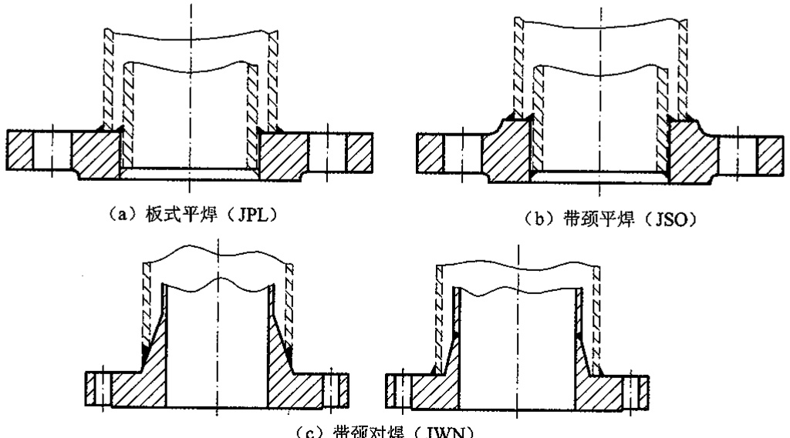

图B.3.1 夹套法兰类型

<!-- page: 128 -->

表 B.3.1 法兰类型代号

| 法兰类型代号 | 法兰类型 |
|---|---|
| JPL | 板式平焊夹套法兰 |
| JSO | 带颈平焊夹套法兰 |
| JWN | 带颈对焊夹套法兰 |

B.3.2 夹套法兰的密封面型式包括突面、凹面/凸面和榫面/槽面，其适用范围按表 B.3.2 的规定。

B.3.3 密封面表面粗糙度按本标准第3.2.3条的规定。

表B.3.2 适用范围

| 法兰类型 | 密封面型式 | 压力等级 PN |  |  |
|---|---|---|---|---|
| 16 | 25 | 40 |  |  |
| 板式平焊夹套法兰(JPL) | 突面(RF) | DN15×40~DN350×450 | — |  |
| 带颈平焊夹套法兰(JSO) | 突面(RF) | DN15×40~DN350×450 |  | — |
| 凹面(FM)凸面(M) | DN15×40~DN350×450 |  | — |  |
| 榫面(T)槽面(G) | DN15×40~DN350×450 |  | — |  |
| 带颈对焊夹套法兰(JWN) | 突面(RF) | DN15×40~DN350×450 |  | — |
| 凹面(FM)凸面(M) | DN15×40~DN350×450 |  | — |  |
| 榫面(T)槽面(G) | DN15×40~DN350×450 |  | — |  |

**B.4 材料**

夹套法兰用材料按本标准第4章的规定。

**B.5 压力额定值**

夹套法兰的压力额定值应按内管公称压力确定,且应符合本标准第7章的规定,大于或等于内管设计条件下的最大允许工作压力。

**B.6 尺寸**

B.6.1 夹套法兰密封面尺寸。

1 突面、凹面/凸面、榫面/槽面法兰的密封面尺寸按图 B.6.1 和表 B.6.1 的规定。

2 突面、凹面/凸面、榫面/槽面法兰的密封面尺寸 $f_{1}$ 、 $f_{2}$ 包括在法兰厚度 C 内(如图 B.6.1 所示)。

3 夹套法兰配用垫片的压力等级应按内管公称压力确定,垫片尺寸按对应的外管公称尺寸确定。

B.6.2 夹套法兰连接尺寸和结构尺寸。

1 PN16 板式平焊钢制夹套法兰的连接尺寸和结构尺寸按图 B. 6. 2-1 和表 B. 6. 2-1 的规定。

2 PN16 和 PN25 带颈平焊钢制夹套法兰的连接尺寸和结构尺寸按图 B.6.2-2 和表 B.6.2-2、

<!-- page: 129 -->

表B.6.2-3的规定。

3 PN16、PN25 和 PN40 带颈对焊钢制夹套法兰的连接尺寸和结构尺寸按图 B.6.2-3 和表 B.6.2-4～表 B.6.2-6 的规定。

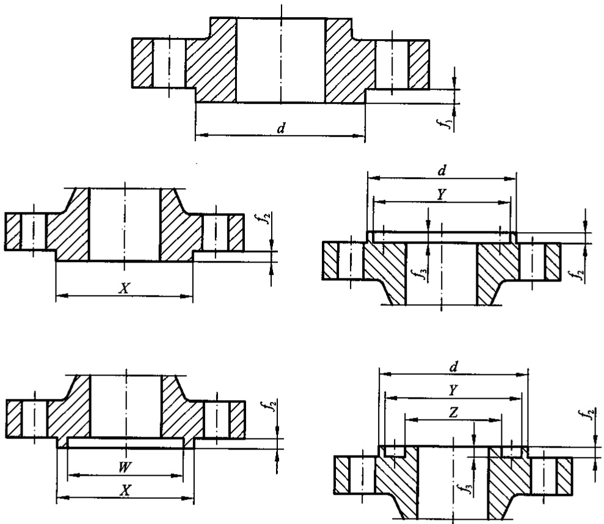

[(突面(RF)、凹面(FM)/凸面(M), 樟面(T)/槽面(G)]

[突面(RF)、凹面(FM)/凸面(M), 樟面(T)/槽面(G)]

| 公称尺寸(内管×外管)DN | d |  |  | f_{1} | f_{2} | f_{3} | W | X | Y | Z |
|---|---|---|---|---|---|---|---|---|---|---|
| PN |  |  |  |  |  |  |  |  |  |  |
| 16 | 25 | 40 |  |  |  |  |  |  |  |  |
| 15×40 | 88 | 88 | 88 | 2 | 4.5 | 4 | 61 | 75 | 76 | 60 |
| 20×40 | 88 | 88 | 88 | 2 | 4.5 | 4 | 61 | 75 | 76 | 60 |
| 25×50 | 102 | 102 | 102 | 2 | 4.5 | 4 | 73 | 87 | 88 | 72 |
| 40×80 | 138 | 138 | 138 | 2 | 4.5 | 4 | 106 | 120 | 121 | 105 |
| 50×80 | 138 | 138 | 138 | 2 | 4.5 | 4 | 106 | 120 | 121 | 105 |
| 80×125 | 188 | 188 | 188 | 2 | 5.0 | 4.5 | 155 | 175 | 176 | 154 |
| 100×150 | 212 | 218 | 218 | 2 | 5.0 | 4.5 | 183 | 203 | 204 | 182 |

<!-- page: 130 -->

续表 B.6.1

| 公称尺寸(内管×外管)DN | d |  |  | f_{1} | f_{2} | f_{3} | W | X | Y | Z |
|---|---|---|---|---|---|---|---|---|---|---|
| PN |  |  |  |  |  |  |  |  |  |  |
| 16 | 25 | 40 |  |  |  |  |  |  |  |  |
| 150×200 | 268 | 278 | 285 | 2 | 5.0 | 4.5 | 239 | 259 | 260 | 238 |
| 200×250 | 320 | 335 | 345 | 2 | 5.0 | 4.5 | 292 | 312 | 313 | 291 |
| 250×300 | 378 | 395 | 410 | 2 | 5.0 | 4.5 | 343 | 363 | 364 | 342 |
| 300×400 | 490 | 505 | 535 | 2 | 5.5 | 5.0 | 447 | 473 | 474 | 446 |
| 350×450 | 550 | 555 | 560 | 2 | 5.5 | 5.0 | 497 | 523 | 524 | 496 |

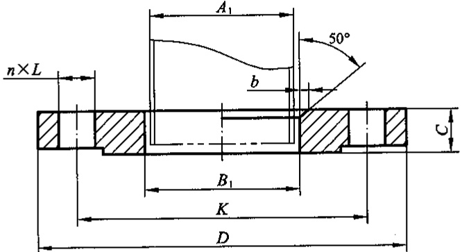

图B.6.2-1 板式平焊钢制夹套法兰

(mm)

| 公称尺寸(内管×外管)DN | 钢管外径(内管×外管) |  | 连接尺寸 |  |  |  |  | 法兰厚度C | 法兰内径 B_1 |  | 坡口宽度b |
|---|---|---|---|---|---|---|---|---|---|---|---|
| 法兰外径D | 螺栓孔中心圆直径K | 螺栓孔直径L | 螺栓孔数量n(个) | 螺栓Th | A | B |  |  |  |  |  |
| A | B |  |  |  |  |  |  |  |  |  |  |
| 15×40 | 21.3×48.3 | 18×45 | 150 | 110 | 18 | 4 | M16 | 18 | 22.5 | 19 | 4 |
| 20×40 | 26.9×48.3 | 25×45 | 150 | 110 | 18 | 4 | M16 | 18 | 27.5 | 26 | 4 |
| 25×50 | 33.7×60.3 | 32×57 | 165 | 125 | 18 | 4 | M16 | 19 | 34.5 | 33 | 5 |
| 40×80 | 48.3×88.9 | 45×89 | 200 | 160 | 18 | 8 | M16 | 20 | 49.5 | 46 | 5 |
| 50×80 | 60.3×88.9 | 57×89 | 200 | 160 | 18 | 8 | M16 | 20 | 61.5 | 59 | 5 |
| 80×125 | 88.9×139.7 | 89×133 | 250 | 210 | 18 | 8 | M16 | 22 | 90.5 | 91 | 6 |
| 100×150 | 114.3×168.3 | 108×159 | 285 | 240 | 22 | 8 | M20 | 24 | 116 | 110 | 6 |
| 150×200 | 168.3×219.1 | 159×219 | 340 | 295 | 22 | 12 | M20 | 26 | 170.5 | 161 | 6 |
| 200×250 | 219.1×273 | 219×273 | 405 | 355 | 26 | 12 | M24 | 29 | 221.5 | 222 | 8 |
| 250×300 | 273×323.9 | 273×325 | 460 | 410 | 26 | 12 | M24 | 32 | 276.5 | 276 | 10 |
| 300×400 | 323.9×406.4 | 325×426 | 580 | 525 | 30 | 16 | M27 | 38 | 328 | 328 | 11 |
| 350×450 | 355.6×457 | 377×480 | 640 | 585 | 30 | 20 | M27 | 42 | 360 | 381 | 12 |

<!-- page: 131 -->

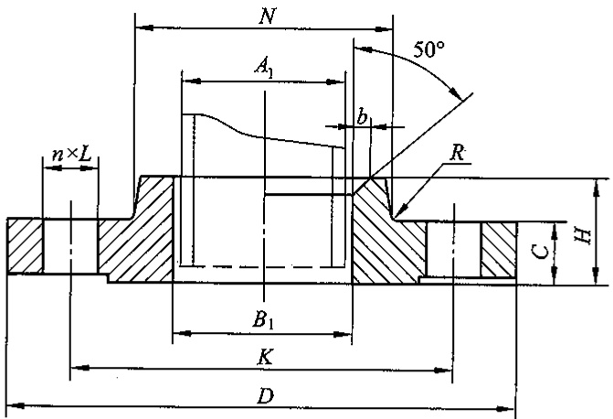

图B.6.2-2 带颈平焊钢制夹套法兰

(mm)

| 公称尺寸(内管×外管)DN | 钢管外径(内管×外管) |  | 连接尺寸 |  |  |  |  | 法兰厚度C | 法兰内径 B_1 |  | 法兰颈 |  |  | 法兰高度H | 坡口宽度b |
|---|---|---|---|---|---|---|---|---|---|---|---|---|---|---|---|
| 法兰外径D | 螺栓孔中心圆直径K | 螺栓孔直径L | 螺栓孔数量n(个) | 螺栓Th | N |  | R |  |  |  |  |  |  |  |  |
| A | B | A | B | A | B |  |  |  |  |  |  |  |  |  |  |
| 15×40 | 21.3×48.3 | 18×45 | 150 | 110 | 18 | 4 | M16 | 18 | 22.5 | 19 | 70 | 70 | 6 | 32 | 4 |
| 20×40 | 26.9×48.3 | 25×45 | 150 | 110 | 18 | 4 | M16 | 18 | 27.5 | 26 | 70 | 70 | 6 | 32 | 4 |
| 25×50 | 33.7×60.3 | 32×57 | 165 | 125 | 18 | 4 | M16 | 18 | 34.5 | 33 | 84 | 84 | 5 | 28 | 5 |
| 40×80 | 48.3×88.9 | 45×89 | 200 | 160 | 18 | 8 | M16 | 20 | 49.5 | 46 | 118 | 118 | 6 | 34 | 5 |
| 50×80 | 60.3×88.9 | 57×89 | 200 | 160 | 18 | 8 | M16 | 20 | 61.5 | 59 | 118 | 118 | 6 | 34 | 5 |
| 80×125 | 88.9×139.7 | 89×133 | 250 | 210 | 18 | 8 | M16 | 22 | 90.5 | 91 | 168 | 168 | 8 | 44 | 6 |
| 100×150 | 114.3×168.3 | 108×159 | 285 | 240 | 22 | 8 | M20 | 22 | 116 | 110 | 195 | 195 | 10 | 44 | 6 |
| 150×200 | 168.3×219.1 | 159×219 | 340 | 295 | 22 | 12 | M20 | 24 | 170.5 | 161 | 246 | 246 | 10 | 44 | 6 |
| 200×250 | 219.1×273 | 219×273 | 405 | 355 | 26 | 12 | M24 | 26 | 221.5 | 222 | 298 | 298 | 12 | 46 | 8 |
| 250×300 | 273×323.9 | 273×325 | 460 | 410 | 26 | 12 | M24 | 28 | 276.5 | 276 | 350 | 350 | 12 | 46 | 10 |
| 300×400 | 323.9×406.4 | 325×426 | 580 | 525 | 30 | 16 | M27 | 32 | 328 | 328 | 456 | 475 | 12 | 63 | 11 |
| 350×450 | 355.6×457 | 377×480 | 640 | 585 | 30 | 20 | M27 | 40 | 360 | 381 | 502 | 525 | 12 | 68 | 12 |

(mm)

| 公称尺寸(内管×外管)DN | 钢管外径(内管×外管) |  | 连接尺寸 |  |  |  |  | 法兰厚度C | 法兰内径 B_1 |  | 法兰颈 |  |  | 法兰高度H | 坡口宽度b |
|---|---|---|---|---|---|---|---|---|---|---|---|---|---|---|---|
| 法兰外径D | 螺栓孔中心圆直径K | 螺栓孔直径L | 螺栓孔数量n(个) | 螺栓Th | N |  | R |  |  |  |  |  |  |  |  |
| A | B | A | B | A | B |  |  |  |  |  |  |  |  |  |  |
| 15×40 | 21.3×48.3 | 18×45 | 150 | 110 | 18 | 4 | M16 | 18 | 22.5 | 19 | 70 | 70 | 6 | 32 | 4 |
| 20×40 | 26.9×48.3 | 25×45 | 150 | 110 | 18 | 4 | M16 | 18 | 27.5 | 26 | 70 | 70 | 6 | 32 | 4 |
| 25×50 | 33.7×60.3 | 32×57 | 165 | 125 | 18 | 4 | M16 | 20 | 34.5 | 33 | 84 | 84 | 6 | 34 | 5 |
| 40×80 | 48.3×88.9 | 45×89 | 200 | 160 | 18 | 8 | M16 | 24 | 49.5 | 46 | 118 | 118 | 8 | 40 | 5 |
| 50×80 | 60.3×88.9 | 57×89 | 200 | 160 | 18 | 8 | M16 | 24 | 61.5 | 59 | 118 | 118 | 8 | 40 | 5 |

<!-- page: 132 -->

(mm)

| 公称尺寸(内管×外管)DN | 钢管外径(内管×外管) |  | 连接尺寸 |  |  |  |  | 法兰厚度C | 法兰内径 B_1 |  | 法兰颈 |  |  | 法兰高度H | 坡口宽度b |
|---|---|---|---|---|---|---|---|---|---|---|---|---|---|---|---|
| 法兰外径D | 螺栓孔中心圆直径K | 螺栓孔直径L | 螺栓孔数量n(个) | 螺栓Th | N |  | R |  |  |  |  |  |  |  |  |
| A | B | A | B | A | B |  |  |  |  |  |  |  |  |  |  |
| 80×125 | 88.9×139.7 | 89×133 | 270 | 220 | 26 | 8 | M24 | 26 | 90.5 | 91 | 170 | 170 | 8 | 48 | 6 |
| 100×150 | 114.3×168.3 | 108×159 | 300 | 250 | 26 | 8 | M24 | 28 | 116 | 110 | 200 | 200 | 10 | 52 | 6 |
| 150×200 | 168.3×219.1 | 159×219 | 360 | 310 | 26 | 12 | M24 | 30 | 170.5 | 161 | 256 | 256 | 10 | 52 | 6 |
| 200×250 | 219.1×273 | 219×273 | 425 | 370 | 30 | 12 | M27 | 32 | 221.5 | 222 | 310 | 310 | 12 | 60 | 8 |
| 250×300 | 273×323.9 | 273×325 | 485 | 430 | 30 | 16 | M27 | 34 | 276.5 | 276 | 364 | 364 | 12 | 67 | 10 |
| 300×400 | 323.9×406.4 | 325×426 | 620 | 550 | 36 | 16 | M33 | 40 | 328 | 328 | 472 | 492 | 12 | 78 | 11 |
| 350×450 | 355.6×457 | 377×480 | 670 | 600 | 36 | 20 | M33 | 46 | 360 | 381 | 520 | 542 | 12 | 84 | 12 |

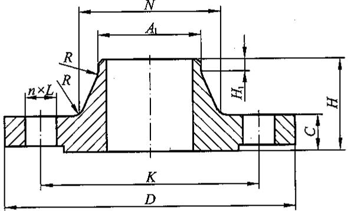

图B.6.2-3 带颈对焊钢制夹套法兰

(mm)

| 公称尺寸(内管×外管)DN | 钢管外径(法兰焊端外径)(内管×外管) |  | 连接尺寸 |  |  |  |  | 法兰厚度C | 法兰颈 |  |  |  |  | 法兰高度H |
|---|---|---|---|---|---|---|---|---|---|---|---|---|---|---|
| 法兰外径D | 螺栓孔中心圆直径K | 螺栓孔直径L | 螺栓孔数量n(个) | 螺栓Th | N |  | S | H_1 \approx | R |  |  |  |  |  |
| A | B | A | B |  |  |  |  |  |  |  |  |  |  |  |
| 15×40 | 21.3×48.3 | 18×45 | 150 | 110 | 18 | 4 | M16 | 18 | 32 | 32 | 2 | 6 | 4 | 45 |
| 20×40 | 26.9×48.3 | 25×45 | 150 | 110 | 18 | 4 | M16 | 18 | 40 | 40 | 2.3 | 6 | 4 | 45 |
| 25×50 | 33.7×60.3 | 32×57 | 165 | 125 | 18 | 4 | M16 | 18 | 46 | 46 | 2.6 | 6 | 4 | 45 |
| 40×80 | 48.3×88.9 | 45×89 | 200 | 160 | 18 | 8 | M16 | 20 | 64 | 64 | 2.6 | 7 | 6 | 50 |
| 50×80 | 60.3×88.9 | 57×89 | 200 | 160 | 18 | 8 | M16 | 20 | 74 | 74 | 2.9 | 8 | 5 | 50 |
| 80×125 | 88.9×139.7 | 89×133 | 250 | 210 | 18 | 8 | M16 | 22 | 105 | 105 | 3.2 | 10 | 6 | 55 |
| 100×150 | 114.3×168.3 | 108×159 | 285 | 240 | 22 | 8 | M20 | 22 | 131 | 131 | 3.6 | 12 | 8 | 55 |
| 150×200 | 168.3×219.1 | 159×219 | 340 | 295 | 22 | 12 | M20 | 24 | 184 | 184 | 4.5 | 12 | 10 | 62 |
| 200×250 | 219.1×273 | 219×273 | 405 | 355 | 26 | 12 | M24 | 26 | 235 | 235 | 6.3 | 16 | 10 | 70 |
| 250×300 | 273×323.9 | 273×325 | 460 | 410 | 26 | 12 | M24 | 28 | 292 | 292 | 6.3 | 16 | 12 | 78 |
| 300×400 | 323.9×406.4 | 325×426 | 580 | 525 | 30 | 16 | M27 | 32 | 344 | 344 | 7.1 | 16 | 12 | 85 |
| 350×450 | 355.6×457 | 377×480 | 640 | 585 | 30 | 20 | M27 | 40 | 390 | 410 | 8.0 | 16 | 12 | 87 |

注:用户可选用不同于本表所列的 S 值，但不应小于本表所列 S 值。

<!-- page: 133 -->

(mm)

| 公称尺寸(内管×外管)DN | 钢管外径(法兰焊端外径)(内管×外管) |  | 连接尺寸 |  |  |  |  | 法兰厚度C | 法兰颈 |  |  |  |  | 法兰高度H |
|---|---|---|---|---|---|---|---|---|---|---|---|---|---|---|
| 法兰外径D | 螺栓孔中心圆直径K | 螺栓孔直径L | 螺栓孔数量n(个) | 螺栓Th | N |  | S | H_1 \approx | R |  |  |  |  |  |
| A | B | A | B |  |  |  |  |  |  |  |  |  |  |  |
| 15×40 | 21.3×48.3 | 18×45 | 150 | 110 | 18 | 4 | M16 | 18 | 32 | 32 | 2 | 6 | 4 | 45 |
| 20×40 | 26.9×48.3 | 25×45 | 150 | 110 | 18 | 4 | M16 | 18 | 40 | 40 | 2.3 | 6 | 4 | 45 |
| 25×50 | 33.7×60.3 | 32×57 | 165 | 125 | 18 | 4 | M16 | 20 | 46 | 46 | 2.6 | 6 | 4 | 48 |
| 40×80 | 48.3×88.9 | 45×89 | 200 | 160 | 18 | 8 | M16 | 24 | 64 | 64 | 2.6 | 7 | 6 | 58 |
| 50×80 | 60.3×88.9 | 57×89 | 200 | 160 | 18 | 8 | M16 | 24 | 75 | 75 | 2.9 | 8 | 6 | 58 |
| 80×125 | 88.9×139.7 | 89×133 | 270 | 220 | 26 | 8 | M24 | 26 | 105 | 105 | 3.2 | 12 | 8 | 68 |
| 100×150 | 114.3×168.3 | 108×159 | 300 | 250 | 26 | 8 | M24 | 28 | 134 | 134 | 3.6 | 12 | 8 | 75 |
| 150×200 | 168.3×219.1 | 159×219 | 360 | 310 | 26 | 12 | M24 | 30 | 192 | 190 | 4.5 | 12 | 10 | 80 |
| 200×250 | 219.1×273 | 219×273 | 425 | 370 | 30 | 12 | M27 | 32 | 244 | 244 | 6.3 | 16 | 10 | 88 |
| 250×300 | 273×323.9 | 273×325 | 485 | 430 | 30 | 16 | M27 | 34 | 298 | 298 | 7.1 | 18 | 12 | 92 |
| 300×400 | 323.9×406.4 | 325×426 | 620 | 550 | 36 | 16 | M33 | 40 | 352 | 352 | 8.0 | 18 | 12 | 110 |
| 350×450 | 355.6×457 | 377×480 | 670 | 600 | 36 | 20 | M33 | 46 | 398 | 420 | 8.0 | 20 | 12 | 110 |

注:用户可选用不同于本表所列的 S 值，但不应小于本表所列 S 值。

(mm)

| 公称尺寸(内管×外管)DN | 钢管外径(法兰焊端外径)(内管×外管) |  | 连接尺寸 |  |  |  |  | 法兰厚度C | 法兰颈 |  |  |  |  | 法兰高度H |
|---|---|---|---|---|---|---|---|---|---|---|---|---|---|---|
| 法兰外径D | 螺栓孔中心圆直径K | 螺栓孔直径L | 螺栓孔数量n(个) | 螺栓Th | N |  | S | H_1 \approx | R |  |  |  |  |  |
| A | B | A | B |  |  |  |  |  |  |  |  |  |  |  |
| 15×40 | 21.3×48.3 | 18×45 | 150 | 110 | 18 | 4 | M16 | 18 | 32 | 32 | 2.0 | 6 | 4 | 45 |
| 20×40 | 26.9×48.3 | 25×45 | 150 | 110 | 18 | 4 | M16 | 18 | 40 | 40 | 2.3 | 6 | 4 | 45 |
| 25×50 | 33.7×60.3 | 32×57 | 165 | 125 | 18 | 4 | M16 | 20 | 46 | 46 | 2.6 | 6 | 4 | 48 |
| 40×80 | 48.3×88.9 | 45×89 | 200 | 160 | 18 | 8 | M16 | 24 | 64 | 64 | 2.6 | 7 | 6 | 58 |
| 50×80 | 60.3×88.9 | 57×89 | 200 | 160 | 18 | 8 | M16 | 24 | 75 | 75 | 2.9 | 8 | 6 | 58 |
| 80×125 | 88.9×139.7 | 89×133 | 270 | 220 | 26 | 8 | M24 | 26 | 105 | 105 | 3.2 | 12 | 8 | 68 |
| 100×150 | 114.3×168.3 | 108×159 | 300 | 250 | 26 | 8 | M24 | 28 | 134 | 134 | 3.6 | 12 | 8 | 75 |
| 150×200 | 168.3×219.1 | 159×219 | 375 | 320 | 30 | 12 | M27 | 34 | 192 | 192 | 4.5 | 12 | 10 | 88 |
| 200×250 | 219.1×273 | 219×273 | 450 | 385 | 33 | 12 | M30 | 38 | 244 | 244 | 6.3 | 16 | 10 | 105 |
| 250×300 | 273×323.9 | 273×325 | 515 | 450 | 33 | 16 | M30 | 42 | 306 | 306 | 7.1 | 18 | 12 | 115 |
| 300×400 | 323.9×406.4 | 325×426 | 660 | 585 | 39 | 16 | M36×3 | 50 | 362 | 362 | 8.0 | 18 | 12 | 135 |
| 350×450 | 355.6×457 | 377×480 | 685 | 610 | 39 | 20 | M36×3 | 57 | 408 | 430 | 8.8 | 20 | 12 | 135 |

注:用户可选用不同于本表所列的 S 值，但不应小于本表所列 S 值。

<!-- page: 134 -->

**B.7 焊接接头和坡口尺寸**

B.7.1 内管与夹套法兰的焊接接头和坡口尺寸按本标准第9章的规定。

B.7.2 外管和夹套法兰的焊接接头和坡口尺寸按图B.7.2的规定。

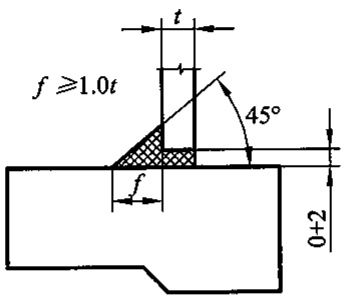

(a)

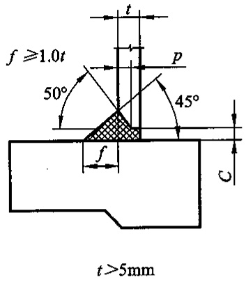

(b)

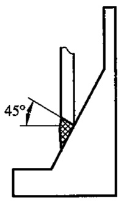

B.8 试验、检验、验收和包装

法兰的试验、检验和验收以及包装等要求按本标准第11章、第12章及第14章的规定。

**B.9 标记**

B.9.1 夹套法兰的标记按本标准第13章的规定。其中，法兰的公称尺寸DN为内管 $\times$ 外管。

**B.9.2 标记示例。**

示例 1: 公称尺寸 DN300×400、公称压力 PN16、配用公制管的突面板式平焊钢制夹套法兰, 材料为 Q235A, 其标记为:

$$ \mathrm{HG} / \mathrm{T} 2 0 5 9 2 \quad \text {夹套法兰} \quad \mathrm{JPL} \quad 3 0 0 \times 4 0 0 (\mathrm{B}) - 1 6 \quad \mathrm{RF} \quad \mathrm{Q} 2 3 5 \mathrm{A} $$

$$ \text {配用的垫片规格为公称压力PN16,公称尺寸DN400} $$

示例 2: 公称尺寸 DN300×400、公称压力 PN25、配用英制管的凸面带颈平焊钢制夹套法兰, 材料为 20 钢, 其标记为:

$$ \mathrm{HG/T20592} \quad \text {夹套法兰} \quad \mathrm{JSO} 3 0 0 \times 4 0 0 - 2 5 \quad \mathrm{M} \quad 2 0 $$

配用的垫片规格为公称压力PN25，公称尺寸DN400

<!-- page: 135 -->

## 附录 C(资料性附录) 可配合使用的管法兰标准

本标准法兰(PN系列)的连接尺寸(包括密封面尺寸)与符合表C所列标准的管法兰基本相同，可以配合使用。

表 C

| 标准编号 | 标准名称 | 压力等级 PN(bar) |
|---|---|---|
| EN 1092-1—2002 | 钢制法兰 | 2.5,6,10,16,25,40,63,100,160 |
| JB/T 74~90—1994 | 管路法兰 | 2.5,6,10,16,25,40,63,100 |
| HG/T 20592~20605—1997 | 钢制管法兰 | 2.5,6,10,16,25,40,63,100,160 |
| GB/T 9112~9124—2000 | 钢制管法兰 | 2.5,6,10,16,25,40,63,100,160 |

注:JB/T 74～90—1994 管路法兰中，管法兰 PN2.5-DN500、PN6-DN500 和 PN10-DN80 与本标准不能配合使用。

<!-- page: 136 -->

## 附录 D(资料性附录) 法兰的近似质量

(kg)

| 公称尺寸DN | 板式平焊PL | 法兰盖BL | 公称尺寸DN | 板式平焊PL | 法兰盖BL |
|---|---|---|---|---|---|
| 10 | 0.5 | 0.5 | 350 | 17.0 | 32.0 |
| 15 | 0.5 | 0.5 | 400 | 20.0 | 38.5 |
| 20 | 0.5 | 0.5 | 450 | 24.5 | 51.0 |
| 25 | 0.5 | 1.0 | 500 | 26.5 | 60.1 |
| 32 | 1.0 | 1.0 | 600 | 35.0 | 103.0 |
| 40 | 1.5 | 1.5 | 700 | 52.0 | 178.5 |
| 50 | 1.5 | 1.5 | 800 | 65.0 | 252.0 |
| 65 | 2.0 | 2.0 | 900 | 75.5 | 335.5 |
| 80 | 3.0 | 3.5 | 1000 | 84.5 | 434.5 |
| 100 | 3.5 | 4.0 | 1200 | 101.5 | 505.0 |
| 125 | 4.5 | 6.0 | 1400 | 128.0 | 724.5 |
| 150 | 5.0 | 7.5 | 1600 | 171.0 | 996.0 |
| 200 | 7.0 | 12.5 | 1800 | 202.5 | 1305.5 |
| 250 | 9.0 | 18.5 | 2000 | 240.5 | 1699.5 |
| 300 | 12.0 | 25.5 |  |  |  |

表 D-2 PN6 法兰的质量

| 公称尺寸DN | 板式平焊PL | 带颈平焊SO | 螺纹Th | PJ/SE |  | PJ/RJ |  | 法兰盖BL | BL(S) |  |
|---|---|---|---|---|---|---|---|---|---|---|
| 松套PJ | 对焊环SE | 松套PJ | 平焊环RJ | BL | S |  |  |  |  |  |
| 10 | 0.5 | 0.5 | 0.5 | 0.5 | 0.03 | 0.5 | 0.06 | 0.5 | - | - |
| 15 | 0.5 | 0.5 | 0.5 | 0.5 | 0.04 | 0.5 | 0.07 | 0.5 | - | - |
| 20 | 0.5 | 0.5 | 0.5 | 0.57 | 0.07 | 0.57 | 0.11 | 0.5 | - | - |
| 25 | 0.5 | 1.0 | 0.5 | 0.5 | 0.11 | 0.5 | 0.15 | 1.0 | - | - |
| 32 | 1.0 | 1.0 | 0.5 | 1.0 | 0.14 | 1.0 | 0.19 | 1.0 | - | - |
| 40 | 1.5 | 1.5 | 0.5 | 1.5 | 0.18 | 1.5 | 0.24 | 1.5 | 1.6 | 0.11 |
| 50 | 1.5 | 1.5 | 0.5 | 1.5 | 0.24 | 1.5 | 0.32 | 1.5 | 1.9 | 0.14 |
| 65 | 2.0 | 2.0 | 0.5 | 2.0 | 0.31 | 2.0 | 0.45 | 2.0 | 2.5 | 0.22 |
| 80 | 3.0 | 3.0 | 0.5 | 3.0 | 0.45 | 3.0 | 0.61 | 3.5 | 3.9 | 0.28 |
| 100 | 3.5 | 3.0 | 1.0 | 3.0 | 0.64 | 3.0 | 0.73 | 4.0 | 4.8 | 0.38 |
| 125 | 4.5 | 4.5 | 1.0 | 4.0 | 0.94 | 4.0 | 0.96 | 6.0 | 6.1 | 0.56 |

<!-- page: 137 -->

(kg)

| 公称尺寸DN | 板式平焊PL | 带颈平焊SO | 螺纹Th | PJ/SE |  | PJ/RJ |  | 法兰盖BL | BL(S) |  |
|---|---|---|---|---|---|---|---|---|---|---|
| 松套PJ | 对焊环SE | 松套PJ | 平焊环RJ | BL | S |  |  |  |  |  |
| 150 | 5.0 | 5.0 | 1.0 | 4.5 | 1.22 | 4.5 | 1.01 | 7.5 | 5.4 | 0.73 |
| 200 | 7.0 | 7.0 | 1.5 | 6.5 | 2.54 | 6.5 | 1.73 | 12.5 | 13.5 | 1.59 |
| 250 | 9.0 | 9.0 | - | 8.5 | 3.37 | 8.5 | 2.32 | 18.5 | 20.2 | 2.35 |
| 300 | 12.0 | 12.0 | - | 11.5 | 4.68 | 11.5 | 2.77 | 25.5 | 27.8 | 4.06 |
| 350 | 17.0 | - | - | 16.0 | 5.79 | 16.0 | 4.73 | 32.0 | 34.7 | 5.26 |
| 400 | 20.0 | - | - | 19.0 | 6.78 | 19.0 | 5.83 | 38.5 | 42.0 | 6.60 |
| 450 | 24.5 | - | - | 23.5 | 7.81 | 23.5 | 7.02 | 51.0 | 51.2 | 8.27 |
| 500 | 26.5 | - | - | 25.5 | 8.89 | 25.5 | 8.30 | 60.03 | 65.1 | 11.9 |
| 600 | 35.0 | - | - | 33.5 | 10.75 | 33.5 | 9.34 | 103.0 | 102.9 | 16.4 |
| 700 | 57.5 | - | - | - | - | - | - | 178.5 | - | - |
| 800 | 75.0 | - | - | - | - | - | - | 252.0 | - | - |
| 900 | 89.5 | - | - | - | - | - | - | 335.5 | - | - |
| 1000 | 104.0 | - | - | - | - | - | - | 434.5 | - | - |
| 1200 | 166.0 | - | - | - | - | - | - | 717.5 | - | - |
| 1400 | 242.5 | - | - | - | - | - | - | 1094.0 | - | - |
| 1600 | 328.5 | - | - | - | - | - | - | 1545.0 | - | - |
| 1800 | 417.5 | - | - | - | - | - | - | 2131.0 | - | - |
| 2000 | 533.0 | - | - | - | - | - | - | 2862.0 | - | - |

(kg)

| 公称尺寸DN | 板式平焊PL | 带颈平焊SO | 带颈对焊WN | 承插焊SW | 螺纹Th | PJ/SE |  | PJ/RJ |  | 法兰盖BL | BL(S) |  |  |
|---|---|---|---|---|---|---|---|---|---|---|---|---|---|
| 松套PJ | 对焊环SE | 松套PJ | 平焊环RJ | BL | S |  |  |  |  |  |  |  |  |
| 突面 | 凸面榫面 |  |  |  |  |  |  |  |  |  |  |  |  |
| 10 | 0.6 | 0.5 | 0.5 | 0.5 | 0.5 | 0.5 | 0.04 | 0.5 | 0.09 | 1.0 | - | - | - |
| 15 | 0.5 | 0.5 | 1.0 | 0.5 | 0.5 | 0.5 | 0.06 | 0.5 | 0.11 | 1.0 | - | - | - |
| 20 | 1.0 | 1.0 | 1.0 | 1.0 | 1.0 | 1.0 | 0.09 | 1.0 | 0.23 | 1.0 | - | - | - |
| 25 | 1.0 | 1.5 | 1.0 | 1.5 | 1.5 | 1.0 | 0.14 | 1.0 | 0.30 | 1.5 | - | - | - |
| 32 | 2.0 | 2.0 | 2.0 | 2.0 | 2.0 | 2.0 | 0.18 | 2.0 | 0.36 | 2.0 | - | - | - |
| 40 | 2.0 | 2.0 | 2.0 | 2.0 | 2.0 | 2.0 | 0.22 | 2.0 | 0.46 | 2.5 | 2.4 | 0.13 | 0.43 |
| 50 | 2.5 | 2.5 | 2.5 | 2.5 | 2.5 | 2.5 | 0.32 | 2.5 | 0.65 | 3.0 | 3.2 | 0.18 | 0.6 |
| 65 | 3.0 | 3.0 | 3.0 | - | 3.0 | 3.0 | 0.41 | 3.0 | 0.88 | 3.5 | 4.1 | 0.26 | 0.87 |
| 80 | 3.5 | 4.0 | 4.0 | - | 4.0 | 3.5 | 0.56 | 3.5 | 1.07 | 4.5 | 4.6 | 0.33 | 1.11 |
| 100 | 4.5 | 4.5 | 4.5 | - | 4.5 | 4.5 | 0.78 | 4.5 | 1.28 | 5.5 | 6.2 | 0.45 | 1.5 |
| 125 | 5.5 | 6.5 | 6.5 | - | 6.5 | 5.5 | 1.13 | 5.5 | 1.64 | 8.0 | 8.2 | 0.63 | 2.09 |
| 150 | 7.0 | 7.5 | 7.5 | - | 7.5 | 7.0 | 1.46 | 7.0 | 1.96 | 10.5 | 11.4 | 0.82 | 2.72 |

<!-- page: 138 -->

**续表 D-3**

(kg)

(kg)

| 公称尺寸DN | 板式平焊PL | 带颈平焊SO | 带颈对焊WN | 承插焊SW | 螺纹Th | PJ/SE |  | PJ/RJ |  | 法兰盖BL | BL(S) |  |  |
|---|---|---|---|---|---|---|---|---|---|---|---|---|---|
| 松套PJ | 对焊环SE | 松套PJ | 平焊环RJ | BL | S |  |  |  |  |  |  |  |  |
| 突面 | 凸面榫面 |  |  |  |  |  |  |  |  |  |  |  |  |
| 200 | 9.5 | 10.5 | 11.5 | - | - | 9.0 | 2.98 | 9.0 | 2.81 | 16.5 | 16.5 | 1.74 | 4.36 |
| 250 | 12.0 | 13.0 | 15.5 | - | - | 11.5 | 3.90 | 11.5 | 3.52 | 24.0 | 24.1 | 2.52 | 6.31 |
| 300 | 13.5 | 15.0 | 18.0 | - | - | 13.0 | 5.17 | 13.0 | 3.89 | 31.0 | 30.8 | 4.22 | 8.44 |
| 350 | 20.5 | - | 24.5 | - | - | 19.5 | 6.71 | 19.5 | 7.50 | 39.5 | 39.6 | 5.64 | 11.3 |
| 400 | 27.5 | - | 29.5 | - | - | 26.5 | 7.97 | 26.5 | 9.38 | 49.5 | 49.4 | 7.1 | 14.2 |
| 450 | 33.5 | - | 34.0 | - | - | 32.5 | 8.92 | 32.5 | 10.30 | 63.0 | 62.9 | 8.65 | 17.3 |
| 500 | 40.0 | - | 39.5 | - | - | 39.0 | 10.26 | 39.0 | 12.59 | 75.5 | 75.1 | 12.5 | 20.9 |
| 600 | 54.5 | - | 56.0 | - | - | 52.5 | 12.70 | 52.5 | 14.29 | 124.0 | 123.7 | 17.2 | 28.7 |
| 700 | - | - | 65.0 | - | - | - | - | - | - | 182.5 | - | - | - |
| 800 | - | - | 87.0 | - | - | - | - | - | - | 260.0 | - | - | - |
| 900 | - | - | 106.0 | - | - | - | - | - | - | 344.0 | - | - | - |
| 1000 | - | - | 123.0 | - | - | - | - | - | - | 473.5 | - | - | - |
| 1200 | - | - | 184.0 | - | - | - | - | - | - | 765.0 | - | - | - |
| 1400 | - | - | 252.0 | - | - | - | - | - | - | - | - | - | - |
| 1600 | - | - | 363.0 | - | - | - | - | - | - | - | - | - | - |
| 1800 | - | - | 445.5 | - | - | - | - | - | - | - | - | - | - |
| 2000 | - | - | 558.0 | - | - | - | - | - | - | - | - | - | - |

表 D-4 PN16 法兰的质量

| 公称尺寸DN | 板式平焊PL | 带颈平焊SO | 带颈对焊WN | 承插焊SW | 螺纹Th | PJ/SE |  | PJ/RJ |  | 法兰盖BL | BL(S) |  |  |
|---|---|---|---|---|---|---|---|---|---|---|---|---|---|
| 松套PJ | 对焊环SE | 松套PJ | 平焊环RJ | BL | S |  |  |  |  |  |  |  |  |
| 突面 | 凸面榫面 |  |  |  |  |  |  |  |  |  |  |  |  |
| 10 | 0.6 | 0.5 | 0.5 | 0.5 | 0.5 | 0.5 | 0.04 | 0.5 | 0.5 | 1.0 | - | - | - |
| 15 | 0.5 | 0.5 | 1.0 | 0.5 | 0.5 | 0.5 | 0.06 | 0.5 | 0.5 | 1.0 | - | - | - |
| 20 | 1.0 | 1.0 | 1.0 | 1.0 | 1.0 | 1.0 | 0.09 | 1.0 | 0.5 | 1.0 | - | - | - |
| 25 | 1.0 | 1.5 | 1.0 | 1.5 | 1.5 | 1.0 | 0.14 | 1.0 | 0.5 | 1.5 | - | - | - |
| 32 | 2.0 | 2.0 | 2.0 | 2.0 | 2.0 | 2.0 | 0.18 | 2.0 | 0.5 | 2.0 | - | - | - |
| 40 | 2.0 | 2.0 | 2.0 | 2.0 | 2.0 | 2.0 | 0.22 | 2.0 | 0.5 | 2.5 | 2.4 | 0.13 | 0.43 |
| 50 | 2.5 | 2.5 | 2.5 | 2.5 | 2.5 | 2.5 | 0.32 | 2.5 | 1.0 | 3.0 | 3.24 | 0.18 | 0.60 |
| 65 | 3.0 | 3.0 | 3.0 | - | 3.0 | 3.0 | 0.41 | 3.0 | 1.0 | 3.5 | 4.1 | 0.26 | 0.87 |
| 80 | 3.5 | 4.0 | 4.0 | - | 4.0 | 3.5 | 0.56 | 3.5 | 1.0 | 4.5 | 4.6 | 0.33 | 1.11 |
| 100 | 4.5 | 4.5 | 4.5 | - | 4.5 | 4.5 | 0.78 | 4.5 | 1.5 | 5.5 | 6.2 | 0.45 | 1.50 |
| 125 | 5.5 | 6.5 | 6.5 | - | 6.5 | 5.5 | 1.13 | 5.5 | 1.5 | 8.0 | 8.2 | 0.63 | 2.09 |
| 150 | 7.0 | 7.5 | 7.5 | - | 7.5 | 7.0 | 1.46 | 7.0 | 2.0 | 10.5 | 11.4 | 0.82 | 2.72 |

<!-- page: 139 -->

(kg)

| 公称尺寸DN | 板式平焊PL | 带颈平焊SO | 带颈对焊WN | 承插焊SW | 螺纹Th | PJ/SE |  | PJ/RJ |  | 法兰盖BL | BL(S) |  |  |
|---|---|---|---|---|---|---|---|---|---|---|---|---|---|
| 松套PJ | 对焊环SE | 松套PJ | 平焊环RJ | BL | S |  |  |  |  |  |  |  |  |
| 突面 | 凸面榫面 |  |  |  |  |  |  |  |  |  |  |  |  |
| 200 | 9.5 | 10.0 | 11.0 | - | - | 9.5 | 2.98 | 9.5 | 3.0 | 16.5 | 16.2 | 1.74 | 4.36 |
| 250 | 14.0 | 14.0 | 16.5 | - | - | 14.0 | 3.98 | 14.0 | 3.5 | 25.0 | 25.0 | 2.52 | 6.31 |
| 300 | 19.0 | 18.0 | 22.0 | - | - | 18.5 | 5.99 | 18.5 | 5.5 | 35.0 | 35.1 | 4.31 | 8.62 |
| 350 | 28.0 | 28.5 | 32.0 | - | - | 27.5 | 8.42 | 27.5 | 10.0 | 48.0 | 48.0 | 5.80 | 11.6 |
| 400 | 36.0 | 36.5 | 40.0 | - | - | 35.0 | 10.38 | 35.0 | 12.5 | 63.5 | 63.5 | 7.25 | 14.5 |
| 450 | 46.0 | 49.5 | 54.5 | - | - | 45.0 | 12.33 | 45.0 | 16.5 | 96.5 | 86.9 | 9.15 | 18.3 |
| 500 | 64.0 | 68.5 | 74.0 | - | - | 65.0 | 14.50 | 65.0 | 21.5 | 133.0 | 108.6 | 13.6 | 22.7 |
| 600 | 96.0 | 107.5 | 116.5 | - | - | 94.0 | 20.72 | 94.0 | 28.5 | 226.5 | 184.3 | 19.1 | 31.8 |
| 700 | - | - | 87.0 | - | - | - | - | - | - | 236.0 | - | - | - |
| 800 | - | - | 111.0 | - | - | - | - | - | - | 325.0 | - | - | - |
| 900 | - | - | 129.0 | - | - | - | - | - | - | 437.5 | - | - | - |
| 1000 | - | - | 169.0 | - | - | - | - | - | - | 602.0 | - | - | - |
| 1200 | - | - | 251.0 | - | - | - | - | - | - | 999.0 | - | - | - |
| 1400 | - | - | 329.0 | - | - | - | - | - | - | - | - | - | - |
| 1600 | - | - | 476.0 | - | - | - | - | - | - | - | - | - | - |
| 1800 | - | - | 582.0 | - | - | - | - | - | - | - | - | - | - |
| 2000 | - | - | 720.0 | - | - | - | - | - | - | - | - | - | - |

(kg)

| 公称尺寸DN | 板式平焊PL | 带颈平焊SO | 带颈对焊WN | 承插焊SW | 螺纹Th | PJ/SE |  | 法兰盖BL | BL(S) |  |  |
|---|---|---|---|---|---|---|---|---|---|---|---|
| 松套PJ | 对焊环SE | BL | S |  |  |  |  |  |  |  |  |
| 突面 | 凸面榫面 |  |  |  |  |  |  |  |  |  |  |
| 10 | 0.6 | 0.5 | 0.5 | 0.5 | 0.5 | 0.5 | 0.04 | 1.0 | - | - | - |
| 15 | 0.5 | 0.5 | 1.0 | 0.5 | 0.5 | 0.5 | 0.06 | 1.0 | - | - | - |
| 20 | 1.0 | 1.0 | 1.0 | 1.0 | 1.0 | 1.0 | 0.09 | 1.0 | - | - | - |
| 25 | 1.0 | 1.5 | 1.0 | 1.5 | 1.5 | 1.0 | 0.14 | 1.5 | - | - | - |
| 32 | 2.0 | 2.0 | 2.0 | 2.0 | 2.0 | 2.0 | 0.18 | 2.0 | - | - | - |
| 40 | 2.0 | 2.0 | 2.0 | 2.0 | 2.0 | 2.0 | 0.22 | 2.5 | 2.4 | 0.13 | 0.43 |
| 50 | 2.5 | 3.0 | 3.0 | 3.0 | 3.0 | 2.5 | 0.32 | 3.0 | 3.24 | 0.18 | 0.60 |
| 65 | 3.5 | 4.0 | 4.0 | - | 4.0 | 3.5 | 0.43 | 4.5 | 4.3 | 0.26 | 0.87 |
| 80 | 4.5 | 4.5 | 5.0 | - | 4.5 | 4.0 | 0.61 | 5.5 | 5.6 | 0.33 | 1.11 |
| 100 | 6.0 | 6.5 | 6.5 | - | 6.5 | 6.0 | 0.93 | 7.5 | 7.6 | 0.47 | 1.58 |
| 125 | 8.0 | 8.5 | 9.0 | - | 8.5 | 8.0 | 1.30 | 11.0 | 10.8 | 0.64 | 2.13 |

<!-- page: 140 -->

(kg)

| 公称尺寸DN | 板式平焊PL | 带颈平焊SO | 带颈对焊WN | 承插焊SW | 螺纹Th | PJ/SE |  | 法兰盖BL | BL(S) |  |  |
|---|---|---|---|---|---|---|---|---|---|---|---|
| 松套PJ | 对焊环SE | BL | S |  |  |  |  |  |  |  |  |
| 突面 | 凸面榫面 |  |  |  |  |  |  |  |  |  |  |
| 150 | 10.5 | 11.0 | 11.5 | — | 11.0 | 10.0 | 1.90 | 14.5 | 14.6 | 0.86 | 2.88 |
| 200 | 14.5 | 15.0 | 17.0 | — | — | 14.0 | 3.78 | 22.5 | 22.5 | 1.88 | 4.69 |
| 250 | 20.0 | 21.0 | 24.0 | — | — | 19.5 | 5.75 | 33.5 | 33.5 | 2.72 | 6.79 |
| 300 | 26.5 | 28.0 | 31.5 | — | — | 26.0 | 8.25 | 46.5 | 46.3 | 4.69 | 9.37 |
| 350 | 42.0 | 46.5 | 48.0 | — | — | 41.0 | 10.61 | 68.0 | 68.0 | 6.16 | 12.3 |
| 400 | 55.0 | 59.5 | 63.0 | — | — | 54.0 | 14.37 | 89.5 | 89.6 | 7.70 | 15.4 |
| 450 | 64.5 | 71.5 | 75.5 | — | — | 63.0 | 16.08 | 120.0 | 119.9 | 9.32 | 18.6 |
| 500 | 84.0 | 89.5 | 96.5 | — | — | 82.0 | 22.76 | 150.0 | 150.0 | 13.8 | 22.9 |
| 600 | 127.5 | 139.5 | 138.6 | — | — | 124.5 | 30.23 | 244.5 | 244.3 | 19.1 | 31.8 |

(kg)

| 公称尺寸DN | 板式平焊PL | 带颈平焊SO | 带颈对焊WN | 承插焊SW | 螺纹Th | PJ/SE |  | 法兰盖BL | BL(S) |  |  |
|---|---|---|---|---|---|---|---|---|---|---|---|
| 松套PJ | 对焊环SE | BL | S |  |  |  |  |  |  |  |  |
| 突面 | 凸面榫面 |  |  |  |  |  |  |  |  |  |  |
| 10 | 0.6 | 0.5 | 0.5 | 0.5 | 0.5 | 0.5 | 0.04 | 1.0 | - | - | - |
| 15 | 0.5 | 0.5 | 1.0 | 0.5 | 0.5 | 0.5 | 0.06 | 1.0 | - | - | - |
| 20 | 1.0 | 1.0 | 1.0 | 1.0 | 1.0 | 1.0 | 0.09 | 1.0 | - | - | - |
| 25 | 1.0 | 1.5 | 1.0 | 1.5 | 1.5 | 1.0 | 0.14 | 1.5 | - | - | - |
| 32 | 2.0 | 2.0 | 2.0 | 2.0 | 2.0 | 2.0 | 0.18 | 2.0 | - | - | - |
| 40 | 2.0 | 2.0 | 2.0 | 2.0 | 2.0 | 2.0 | 0.22 | 2.5 | 2.4 | 0.13 | 0.43 |
| 50 | 2.5 | 3.0 | 3.0 | 3.0 | 3.0 | 2.5 | 0.32 | 3.0 | 3.2 | 0.18 | 0.60 |
| 65 | 3.5 | 4.0 | 4.0 | - | 4.0 | 3.5 | 0.43 | 4.5 | 4.3 | 0.26 | 0.87 |
| 80 | 4.5 | 4.5 | 5.0 | - | 4.5 | 4.0 | 0.61 | 5.5 | 5.6 | 0.33 | 1.11 |
| 100 | 6.0 | 6.5 | 6.5 | - | 6.5 | 6.0 | 0.93 | 7.5 | 7.6 | 0.47 | 1.58 |
| 125 | 8.0 | 8.5 | 9.0 | - | 8.5 | 8.0 | 1.30 | 11.0 | 10.8 | 0.64 | 2.13 |
| 150 | 10.5 | 11.0 | 11.5 | - | 11.0 | 10.0 | 1.90 | 14.5 | 14.6 | 0.86 | 2.88 |
| 200 | 18.0 | 18.5 | 21.0 | - | - | 17.5 | 4.20 | 29.0 | 27.2 | 1.96 | 4.90 |
| 250 | 29.5 | 28.5 | 34.0 | - | - | 28.5 | 6.84 | 44.5 | 44.4 | 2.85 | 7.12 |
| 300 | 41.5 | 41.5 | 47.5 | - | - | 40.5 | 10.28 | 64.0 | 64.1 | 5.10 | 10.2 |
| 350 | 62.0 | 60.0 | 69.0 | - | - | 60.8 | 14.28 | 89.5 | 89.5 | 6.52 | 13.0 |
| 400 | 89.5 | 83.5 | 98.0 | - | - | 88.0 | 22.69 | 127.0 | 126.7 | 8.82 | 17.6 |
| 450 | 91.5 | 87.5 | 105.1 | - | - | 90.0 | 26.57 | 154.0 | 154.1 | 9.66 | 19.3 |
| 500 | 120.5 | 107.5 | 130.5 | - | - | 118.0 | 34.73 | 188.0 | 187.8 | 14.0 | 23.3 |
| 600 | 189.5 | 176.0 | 211.5 | - | - | 186.0 | 51.74 | 331.0 | 331.0 | 20.0 | 33.3 |

<!-- page: 141 -->

(kg)

| 公称尺寸DN | 带颈对焊WN | 承插焊SW | 法兰盖BL | 公称尺寸DN | 带颈对焊WN | 承插焊SW | 法兰盖BL |
|---|---|---|---|---|---|---|---|
| 10 | 1.0 | 1.0 | 1.0 | 100 | 9.5 | — | 10.5 |
| 15 | 1.0 | 1.0 | 1.5 | 125 | 14.5 | — | 16.5 |
| 20 | 2.0 | 2.0 | 2.0 | 150 | 21.5 | — | 24.5 |
| 25 | 2.5 | 2.5 | 2.5 | 200 | 34.0 | — | 40.5 |
| 32 | 3.0 | 3.0 | 3.5 | 250 | 48.0 | — | 58.0 |
| 40 | 4.0 | 4.0 | 4.5 | 300 | 67.5 | — | 83.5 |
| 50 | 4.5 | 4.5 | 5.0 | 350 | 97.5 | — | 116.0 |
| 65 | 5.5 | — | 6.0 | 400 | 129.0 | — | 155.5 |
| 80 | 6.5 | — | 7.5 |  |  |  |  |

(kg)

| 公称尺寸DN | 带颈对焊WN | 承插焊SW | 法兰盖BL | 公称尺寸DN | 带颈对焊WN | 承插焊SW | 法兰盖BL |
|---|---|---|---|---|---|---|---|
| 10 | 1.0 | 1.0 | 1.0 | 100 | 13.0 | — | 14.0 |
| 15 | 1.0 | 1.0 | 1.5 | 125 | 21.0 | — | 22.5 |
| 20 | 2.0 | 2.0 | 2.0 | 150 | 28.0 | — | 30.5 |
| 25 | 2.5 | 2.5 | 2.5 | 200 | 50.0 | — | 54.5 |
| 32 | 3.0 | 3.0 | 3.5 | 250 | 81.0 | — | 87.5 |
| 40 | 4.0 | 4.0 | 4.5 | 300 | 117.97 | — | 131.5 |
| 50 | 6.0 | 5.5 | 6.0 | 350 | 167.25 | — | 179.0 |
| 65 | 7.5 | — | 8.0 | 400 | — | — | 243.0 |
| 80 | 9.0 | — | 9.5 |  |  |  |  |

(kg)

| 公称尺寸DN | 带颈对焊WN | 法兰盖BL | 公称尺寸DN | 带颈对焊WN | 法兰盖BL |
|---|---|---|---|---|---|
| 10 | 1.5 | 1.5 | 80 | 10.6 | 14.0 |
| 15 | 1.5 | 2.0 | 100 | 15.6 | 20.5 |
| 20 | 2.5 | 3.0 | 125 | 25.0 | 32.0 |
| 25 | 3.0 | 4.0 | 150 | 35.5 | 44.0 |
| 32 | 4.0 | 5.0 | 200 | 61.5 | 70.0 |
| 40 | 4.5 | 6.0 | 250 | 98.5 | 115.5 |
| 50 | 6.5 | 8.5 | 300 | 142.0 | 172.0 |
| 65 | 9.5 | 11.5 |  |  |  |

<!-- page: 142 -->

## 附录 E(资料性附录) 环连接面法兰间近似距离

环连接面法兰间近似距离按图E和表E的规定。

图E 环连接面法兰

表 E 环连接面法兰间近似距离

| 公称尺寸DN | 环连接面法兰间近似距离h |  |  |  |
|---|---|---|---|---|
| PN63 | PN100 | PN160 | PN250 |  |
| 15 | 4.7 | 4.7 | 4.7 | 4.7 |
| 20 | 4.7 | 4.7 | 4.7 | 4.7 |
| 25 | 4.7 | 4.7 | 4.7 | 4.7 |
| 32 | 4.7 | 4.7 | 4.7 | 4.7 |
| 40 | 4.7 | 4.7 | 4.7 | 4.7 |
| 50 | 6.6 | 6.6 | 6.6 | 6.6 |
| 65 | 6.6 | 6.6 | 6.6 | 6.6 |
| 80 | 6.6 | 6.6 | 6.6 | 6.6 |
| 100 | 6.6 | 6.6 | 6.6 | 6.6 |
| 125 | 6.6 | 6.6 | 6.6 | 6.6 |
| 150 | 6.6 | 6.6 | 6.7 | 6.7 |
| 200 | 6.6 | 6.6 | 6.7 | 6.7 |
| 250 | 6.6 | 6.6 | 6.7 | 6.7 |
| 300 | 6.6 | 6.6 | 6.8 | 6.8 |
| 350 | 6.6 | 6.7 | - | - |
| 400 | 6.6 | 6.7 | - | - |

<!-- page: 143 -->

<!-- page: 144 -->

**Non-metallic flat gaskets for use with steel pipe flanges (PN designated)**

2009-02-05 发布 2009-07-01 实施

中华人民共和国工业和信息化部 发布

<!-- page: 145 -->

# HG/T 20606—2009 钢制管法兰用非金属平垫片(PN系列)

## 目 次

- 1 范围 …… (119)
- 2 规范性引用文件 …… (120)
- 3 材料和使用条件 …… (121)
- 3.1 材料种类 …… (121)
- 3.2 材料 …… (121)
- 3.3 使用条件 …… (122)
- 3.4 垫片适用的公称压力范围 …… (123)
- 3.5 垫片材料和厚度的选用 …… (123)
- 3.6 垫片与法兰及紧固件的选配 …… (123)
- 4 垫片型式和尺寸 …… (124)
- 5 技术要求 …… (129)
- 6 标记示例 …… (130)

<!-- page: 146 -->

## 1 范围

本标准规定了钢制管法兰(PN 系列)用非金属平垫片(具有嵌入物或无嵌入物)的型式、尺寸、技术要求和标记。

本标准适用于 HG/T 20592 所规定的公称压力 PN2.5～PN63 的钢制管法兰用非金属平垫片。

注:含石棉材料的使用应遵守相关法律和法规的规定。当生产和使用含石棉材料垫片时，应采取防护措施，以确保不对人身健康构成危害。

<!-- page: 147 -->

## 2 规范性引用文件

下列文件中的条款通过本标准的引用而成为本标准的条款。凡是注日期的引用文件，其随后所有的修改单(不包括勘误的内容)或修订版均不适用于本标准，然而，鼓励根据本标准达成协议的各方研究是否可使用这些文件的最新版本。凡是不注日期的引用文件，其最新版本适用于本标准。

《硫化橡胶或热塑性橡胶 拉伸应力应变性能的测定》GB/T 528

《耐油石棉橡胶板》GB/T 539

《不锈钢冷轧钢板和钢带》GB/T 3280

《石棉橡胶板》GB/T 3985

《钢制管法兰(PN系列)》HG/T 20592

《钢制管法兰、垫片、紧固件选配规定(PN系列)》HG/T 20614

《柔性石墨板、带 分类、代号及标记》JB/T 6613

《柔性石墨复合增强(板)垫》JB/T 6628

《柔性石墨板 技术条件》JB/T 7758.2

《聚四氟乙烯板材》QB/T 3625

<!-- page: 148 -->

### 3.1 材料种类

钢制管法兰用非金属平垫片的材料通常包括:

1 天然橡胶、氯丁橡胶、丁苯橡胶、丁腈橡胶、三元乙丙橡胶、氟橡胶等。

2 石棉橡胶板和耐油石棉橡胶板。

3 非石棉纤维橡胶板。

4 聚四氟乙烯板、膨胀聚四氟乙烯板或带、填充改性聚四氟乙烯板。

5 增强柔性石墨板。

6 高温云母复合板。

注:1 非石棉纤维橡胶板指有机纤维和(或)无机纤维与橡胶等材料在高温下压延而成。

2 增强柔性石墨板由冲齿或冲孔不锈钢 0Cr18Ni9(304)、0Cr17Ni12Mo2(316) 或 00Cr17Ni14Mo2(316L) 板和柔性石墨层复合而成。

3 高温云母复合板是由316双向冲齿不锈钢板和云母层复合而成。

### 3.2 材料

3.2.1 橡胶板类垫片材料按表3.2.1的规定。

表 3.2.1 橡胶板类垫片材料

| 试验项目 | 试验方法 | 橡胶种类 |  |  |  |
|---|---|---|---|---|---|
| 氯丁橡胶(CR) | 丁腈橡胶(NBR) | 三元乙丙橡胶(EPDM) | 氟橡胶(FKM) |  |  |
| 硬度(邵尔A) | GB/T 531 | 70±5 |  |  |  |
| 拉伸强度(MPa) | GB/T 528 | ≥10 |  |  |  |
| 扯断伸长率(%) | ≥250 |  |  | ≥150 |  |

3.2.2 石棉橡胶板材料按GB/T3985、GB/T539的规定。

3.2.3 聚四氟乙烯板材料按 QB/T 3625—1999 中 SFB-2 的规定。

3.2.4 聚四氟乙烯材料因具有冷流倾向，选用时应注意其适用的操作条件以及法兰的密封面型式。

3.2.5 增强柔性石墨板是由不锈钢冲齿或冲孔芯板与膨胀石墨粒子复合而成, 不锈钢冲齿或冲孔芯板起增强作用。增强柔性石墨板应符合 JB/T 6628 的规定, 柔性石墨层材料应符合 JB/T 7758.2 的要求。其中, 氯离子含量应小于或等于 $50 \times 10^{-6}$ 。

3.2.6 选用膨胀聚四氟乙烯板或带、填充改性聚四氟乙烯板垫片时，应注明公认的厂商牌号，根据使用工况确认垫片的适用压力、适用温度和最大 $(p\times T)$ 值。

<!-- page: 149 -->

3.2.7 膨胀聚四氟乙烯带一般用于管法兰的维护和保养，尤其是应急场合，也用于异形管法兰。选用时，应注明公认的厂商牌号。

3.2.8 选用非石棉纤维橡胶板垫片时，应注明公认的厂商牌号，根据使用工况确认垫片的适用压力、适用温度和最大 $(p\times T)$ 值。

### 3.3 使用条件

非金属平垫片的使用条件应符合表3.3的规定。

表3.3 非金属平垫片的使用条件

| 类别 | 名称 |  | 标准 | 代号 | 适用范围 |  | 最大(pxT)(MPaxC) |
|---|---|---|---|---|---|---|---|
| 公称压力PN | 工作温度(℃) |  |  |  |  |  |  |
| 橡胶 | 天然橡胶 |  | a | NR | ≤16 | -50~+80 | 60 |
| 氯丁橡胶 |  | CR | ≤16 | -20~+100 | 60 |  |  |
| 丁腈橡胶 |  | NBR | ≤16 | -20~+110 | 60 |  |  |
| 丁苯橡胶 |  | SBR | ≤16 | -20~+90 | 60 |  |  |
| 三元乙丙橡胶 |  | EPDM | ≤16 | -30~+140 | 90 |  |  |
| 氟橡胶 |  | FKM | ≤16 | -20~+200 | 90 |  |  |
| 石棉橡胶 | 石棉橡胶板 |  | GB/T 3985 | XB350 | ≤25 | -40~+300 | 650 |
| XB450 |  |  |  |  |  |  |  |
| 耐油石棉橡胶板 |  | GB/T 539 | NY400 |  |  |  |  |
| 非石棉纤维橡胶 | 非石棉纤维的橡胶压制板 | 无机纤维 | b | NAS | ≤40 | -40~+290d | 960 |
| 有机纤维 | -40~+200d |  |  |  |  |  |  |
| 聚四氟乙烯 | 聚四氟乙烯板 |  | QB/T 3625 | PTFE | ≤16 | -50~+100 |  |
| 膨胀聚四氟乙烯板或带 |  | b,c | ePTFE | ≤40 | -200~+200d |  |  |
| 填充改性聚四氟乙烯板 |  | RPTFE |  |  |  |  |  |
| 柔性石墨 | 增强柔性石墨板 |  | JB/T 6628JB/T 7758.2 | RSB | 10~63 | -240~+650(用于氧化性介质时:-240~+450) | 1200 |
| 高温云母 | 高温云母复合板 |  |  |  | 10~63 | -196~+900 |  |

^{d}  超过此温度范围或饱和蒸汽压大于 1.0 MPa(表压)使用时,应确认具体产品的适用条件。

<!-- page: 150 -->

### 3.4 垫片适用的公称压力范围

不同密封面法兰用垫片的公称压力范围见表3.4的规定。

表 3.4 不同密封面法兰用垫片的公称压力范围

| 密封面型式(代号) | 公称压力 PN |
|---|---|
| 全平面(FF) | 2.5~16 |
| 突面(RF) | 2.5~63 |
| 凹面/凸面(FM/M) | 10~63 |
| 榫面/槽面(T/G) | 10~63 |

### 3.5 垫片材料和厚度的选用

选用垫片的材料和厚度时,应考虑操作介质、使用工况、法兰密封面型式、表面粗糙度以及螺栓载荷的影响。用于临界场合的垫片,应向供应商咨询并确认。

### 3.6 垫片与法兰及紧固件的选配

垫片与法兰及紧固件的选配按HG/T20614的规定。

<!-- page: 151 -->

## 4 垫片型式和尺寸

4.0.1 垫片按密封面型式分为 FF 型、RF 型、MFM 型和 TG 型，分别适用于全平面、突面、凹面/凸面和榫面/槽面法兰，如图 4.0.1 所示。增强柔性石墨板垫片和高温云母复合板垫片仅适用于突面、凹面/凸面和榫面/槽面法兰。

(a) FF型

(b) RF型、MFM型、TG型

图4.0.1 垫片的型式

4.0.2 垫片尺寸。

1 全平面法兰用FF型垫片尺寸按表4.0.2-1的规定。

2 突面法兰用 RF 型垫片尺寸按表 4.0.2-2 的规定。根据需要，石棉橡胶板、耐油石棉橡胶板、非石棉纤维橡胶板、增强柔性石墨板和高温云母复合板制 RF 型垫片可带有不锈钢内包边（即 RF-E 型），其包边尺寸按表 4.0.2-2 的规定。

3 凹面/凸面法兰用 MFM 型垫片尺寸按表 4.0.2-3 的规定。

<!-- page: 152 -->

4 榫面/槽面法兰用TG型垫片尺寸按表4.0.2-4的规定。

5 表 4.0.2-1～表 4.0.2-4 所示的垫片尺寸适用于 HG/T 20592 所列 A、B 两个钢管外径系列的钢制管法兰。

6 表 4.0.2-1～表 4.0.2-3 中垫片内径 $D_{1}$ 为最大垫片内直径，适用于一般情况。用户可规定其他垫片内径尺寸，但应在订货时注明。

(mm)

| 公称尺寸DN | 垫片内径 D_1^n | PN2.5 |  |  |  | PN6 |  |  |  | 垫片厚度°T |
|---|---|---|---|---|---|---|---|---|---|---|
| 垫片外径 D_2 | 螺栓孔数量n(个) | 螺栓孔直径L | 螺栓孔中心圆直径K | 垫片外径 D_2 | 螺栓孔数量n(个) | 螺栓孔直径L | 螺栓孔中心圆直径K |  |  |  |
| 10 | 18 | 75 | 4 | 11 | 50 | 75 | 4 | 11 | 50 | 1.5^d |
| 15 | 22 | 80 | 4 | 11 | 55 | 80 | 4 | 11 | 55 |  |
| 20 | 27 | 90 | 4 | 11 | 65 | 90 | 4 | 11 | 65 |  |
| 25 | 34 | 100 | 4 | 11 | 75 | 100 | 4 | 11 | 75 |  |
| 32 | 43 | 120 | 4 | 14 | 90 | 120 | 4 | 14 | 90 |  |
| 40 | 49 | 130 | 4 | 14 | 100 | 130 | 4 | 14 | 100 |  |
| 50 | 61 | 140 | 4 | 14 | 110 | 140 | 4 | 14 | 110 |  |
| 65 | 77 | 160 | 4 | 14 | 130 | 160 | 4 | 14 | 130 |  |
| 80 | 89 | 190 | 4 | 18 | 150 | 190 | 4 | 18 | 150 |  |
| 100 | 115 | 210 | 4 | 18 | 170 | 210 | 4 | 18 | 170 |  |
| 125 | 141 | 240 | 8 | 18 | 200 | 240 | 8 | 18 | 200 |  |
| 150 | 169 | 265 | 8 | 18 | 225 | 265 | 8 | 18 | 225 |  |
| 200 | 220 | 320 | 8 | 18 | 280 | 320 | 8 | 18 | 280 |  |
| 250 | 273 | 375 | 12 | 18 | 335 | 375 | 12 | 18 | 335 |  |
| 300 | 324 | 440 | 12 | 22 | 395 | 440 | 12 | 22 | 395 |  |
| 350 | 377 | 490 | 12 | 22 | 445 | 490 | 12 | 22 | 445 | 3^e |
| 400 | 426 | 540 | 16 | 22 | 495 | 540 | 16 | 22 | 495 |  |
| 450 | 480 | 595 | 16 | 22 | 550 | 595 | 16 | 22 | 550 |  |
| 500 | 530 | 645 | 20 | 22 | 600 | 645 | 20 | 22 | 600 |  |
| 600 | 630 | 755 | 20 | 26 | 705 | 755 | 20 | 26 | 705 |  |

<!-- page: 153 -->

(mm)

| 公称尺寸DN | 垫片内径D1° | PN10 |  |  |  | PN16 |  |  |  | 垫片厚度°CT |
|---|---|---|---|---|---|---|---|---|---|---|
| 垫片外径D2 | 螺栓孔数量n(个) | 螺栓孔直径L | 螺栓孔中心圆直径K | 垫片外径D2 | 螺栓孔数量n(个) | 螺栓孔直径L | 螺栓孔中心圆直径K |  |  |  |
| 10 | 18 | 90 | 4 | 14 | 60 | 90 | 4 | 14 | 60 | 1.5d |
| 15 | 22 | 95 | 4 | 14 | 65 | 95 | 4 | 14 | 65 |  |
| 20 | 27 | 105 | 4 | 14 | 75 | 105 | 4 | 14 | 75 |  |
| 25 | 34 | 115 | 4 | 14 | 85 | 115 | 4 | 14 | 85 |  |
| 32 | 43 | 140 | 4 | 18 | 100 | 140 | 4 | 18 | 100 |  |
| 40 | 49 | 150 | 4 | 18 | 110 | 150 | 4 | 18 | 110 |  |
| 50 | 61 | 165 | 4 | 18 | 125 | 165 | 4 | 18 | 125 |  |
| 65 | 77 | 185 | 8b | 18 | 145 | 185 | 8b | 18 | 145 |  |
| 80 | 89 | 200 | 8 | 18 | 160 | 200 | 8 | 18 | 160 |  |
| 100 | 115 | 220 | 8 | 18 | 180 | 220 | 8 | 18 | 180 |  |
| 125 | 141 | 250 | 8 | 18 | 210 | 250 | 8 | 18 | 210 |  |
| 150 | 169 | 285 | 8 | 22 | 240 | 285 | 8 | 22 | 240 |  |
| 200 | 220 | 340 | 8 | 22 | 295 | 340 | 12 | 22 | 295 |  |
| 250 | 273 | 395 | 12 | 22 | 350 | 405 | 12 | 26 | 355 |  |
| 300 | 324 | 445 | 12 | 22 | 400 | 460 | 12 | 26 | 410 |  |
| 350 | 377 | 505 | 16 | 22 | 460 | 520 | 16 | 26 | 470 | 3e |
| 400 | 426 | 565 | 16 | 26 | 515 | 580 | 16 | 30 | 525 |  |
| 450 | 480 | 615 | 20 | 26 | 565 | 640 | 20 | 30 | 585 |  |
| 500 | 530 | 670 | 20 | 26 | 620 | 715 | 20 | 33 | 650 |  |
| 600 | 630 | 780 | 20 | 30 | 725 | 840 | 20 | 36 | 770 |  |
| 700 | 720 | 895 | 24 | 30 | 840 | 910 | 24 | 36 | 840 |  |
| 800 | 820 | 1015 | 24 | 33 | 950 | 1025 | 24 | 39 | 950 |  |
| 900 | 920 | 1115 | 28 | 33 | 1050 | 1125 | 28 | 39 | 1050 |  |
| 1000 | 1020 | 1230 | 28 | 36 | 1160 | 1255 | 28 | 42 | 1170 |  |
| 1200 | 1220 | 1455 | 32 | 39 | 1380 | 1485 | 32 | 48 | 1390 |  |
| 1400 | 1422 | 1675 | 36 | 42 | 1590 | 1685 | 36 | 48 | 1590 |  |
| 1600 | 1626 | 1915 | 40 | 48 | 1820 | 1930 | 40 | 56 | 1820 |  |
| 1800 | 1829 | 2115 | 44 | 48 | 2020 | 2130 | 44 | 56 | 2020 |  |
| 2000 | 2032 | 2325 | 48 | 48 | 2230 | 2345 | 48 | 62 | 2230 |  |

e 橡胶垫厚度大于或等于 3mm。

<!-- page: 154 -->

(mm)

| 公称尺寸DN | 垫片内径D1 | 垫片外径 D2 |  |  |  |  |  |  | 垫片厚度T | 包边宽度b |
|---|---|---|---|---|---|---|---|---|---|---|
| 公称压力 PN |  |  |  |  |  |  |  |  |  |  |
| 2.5 | 6 | 10 | 16 | 25 | 40 | 63 |  |  |  |  |
| 10 | 18 | 39 | 39 | 46 | 46 | 46 | 46 | 56 | 1.5 | 3 |
| 15 | 22 | 44 | 44 | 51 | 51 | 51 | 51 | 61 |  |  |
| 20 | 27 | 54 | 54 | 61 | 61 | 61 | 61 | 72 |  |  |
| 25 | 34 | 64 | 64 | 71 | 71 | 71 | 71 | 82 |  |  |
| 32 | 43 | 76 | 76 | 82 | 82 | 82 | 82 | 88 |  |  |
| 40 | 49 | 86 | 86 | 92 | 92 | 92 | 92 | 103 |  |  |
| 50 | 61 | 96 | 96 | 107 | 107 | 107 | 107 | 113 |  |  |
| 65 | 77 | 116 | 116 | 127 | 127 | 127 | 127 | 138 |  |  |
| 80 | 89 | 132 | 132 | 142 | 142 | 142 | 142 | 148 |  |  |
| 100 | 115 | 152 | 152 | 162 | 162 | 168 | 168 | 174 |  |  |
| 125 | 141 | 182 | 182 | 192 | 192 | 194 | 194 | 210 |  |  |
| 150 | 169 | 207 | 207 | 218 | 218 | 224 | 224 | 247 |  |  |
| 200 | 220 | 262 | 262 | 273 | 273 | 284 | 290 | 309 |  |  |
| 250 | 273 | 317 | 317 | 328 | 329 | 340 | 352 | 364 |  |  |
| 300 | 324 | 373 | 373 | 378 | 384 | 400 | 417 | 424 |  |  |
| 350 | 377 | 423 | 423 | 438 | 444 | 457 | 474 | 486 | 3 |  |
| 400 | 426 | 473 | 473 | 489 | 495 | 514 | 546 | 543 |  |  |
| 450 | 480 | 528 | 528 | 539 | 555 | 564 | 571 | - |  |  |
| 500 | 530 | 578 | 578 | 594 | 617 | 624 | 628 | - |  |  |
| 600 | 630 | 679 | 679 | 695 | 734 | 731 | 747 | - |  |  |
| 700 | 720 | 784 | 784 | 810 | 804 | 833 | - | - | 4 |  |
| 800 | 820 | 890 | 890 | 917 | 911 | 942 | - | - |  |  |
| 900 | 920 | 990 | 990 | 1017 | 1011 | 1042 | - | - |  |  |
| 1000 | 1020 | 1090 | 1090 | 1124 | 1128 | 1154 | - | - |  |  |
| 1200 | 1220 | 1290 | 1307 | 1341 | 1342 | 1364 | - | - | 5 |  |
| 1400 | 1422 | 1490 | 1524 | 1548 | 1542 | - | - | - |  |  |
| 1600 | 1626 | 1700 | 1724 | 1772 | 1764 | - | - | - |  |  |
| 1800 | 1829 | 1900 | 1931 | 1972 | 1964 | - | - | - |  |  |
| 2000 | 2032 | 2100 | 2138 | 2182 | 2168 | - | - | - |  |  |

2 表中的垫片厚度 T 为推荐选用的垫片厚度。

<!-- page: 155 -->

表 4.0.2-3 凹面/凸面法兰用 MFM 型垫片尺寸

(PN10~PN63)

(mm)

| 公称尺寸DN | 垫片内径 D_1 | 垫片外径 D_2 | 垫片厚度T | 公称尺寸DN | 垫片内径 D_1 | 垫片外径 D_2 | 垫片厚度T |
|---|---|---|---|---|---|---|---|
| 10 | 18 | 34 | 1.5 | 125 | 141 | 175 | 1.5 |
| 15 | 22 | 39 | 150 | 169 | 203 |  |  |
| 20 | 27 | 50 | 200 | 220 | 259 |  |  |
| 25 | 34 | 57 | 250 | 273 | 312 |  |  |
| 32 | 43 | 65 | 300 | 324 | 363 |  |  |
| 40 | 49 | 75 | 350 | 377 | 421 | 3 |  |
| 50 | 61 | 87 | 400 | 426 | 473 |  |  |
| 65 | 77 | 109 | 450 | 480 | 523 |  |  |
| 80 | 89 | 120 | 500 | 530 | 575 |  |  |
| 100 | 115 | 149 | 600 | 630 | 675 |  |  |

(mm)

表 4.0.2-4 樆面/槽面法兰用 TG 型垫片尺寸

| 公称尺寸DN | 垫片内径 D_1 | 垫片外径 D_2 | 垫片厚度T | 公称尺寸DN | 垫片内径 D_1 | 垫片外径 D_2 | 垫片厚度T |
|---|---|---|---|---|---|---|---|
| 10 | 24 | 34 | 1.5 | 125 | 155 | 175 | 1.5 |
| 15 | 29 | 39 | 150 | 183 | 203 |  |  |
| 20 | 36 | 50 | 200 | 239 | 259 |  |  |
| 25 | 43 | 57 | 250 | 292 | 312 |  |  |
| 32 | 51 | 65 | 300 | 343 | 363 |  |  |
| 40 | 61 | 75 | 350 | 395 | 421 | 3 |  |
| 50 | 73 | 87 | 400 | 447 | 473 |  |  |
| 65 | 95 | 109 | 450 | 497 | 523 |  |  |
| 80 | 106 | 120 | 500 | 549 | 575 |  |  |
| 100 | 129 | 149 | 600 | 649 | 675 |  |  |

注:表中的垫片厚度 T 为推荐选用的垫片厚度。

<!-- page: 156 -->

## 5 技术要求

5.0.1 FF型和RF型垫片的尺寸公差按表5.0.1的规定。

5.0.2 MFM型和TG型垫片的尺寸公差按表5.0.2的规定。

(mm)

| 公称尺寸 | \leqslant DN300 | \geqslant DN350 |
|---|---|---|
| 内径 D_1 | \pm 1.5 | \pm 3.0 |
| 外径 D_2 | +1.50 | +3.00 |
| FF型螺栓孔中心圆直径K | \pm 1.5 |  |
| 相邻螺栓孔中心距 | \pm 0.75 |  |

(mm)

| 内径 D_{1} | 外径 D_{2} |
|---|---|
| +1.00 | 0-1.0 |

5.0.3 厚度 1.5mm 垫片的厚度公差为 ±0.1mm，厚度大于或等于 3mm 垫片的厚度公差为 ±0.20mm，同一垫片的厚度差应不大于 0.20mm。

5.0.4 垫片应平整,无翘曲变形,不允许有夹渣、裂缝、气泡、外来杂质及其他可能影响使用的缺陷。边缘应整齐切割。

5.0.5 垫片一般应由整张板制成，不允许拼接。如因板材尺寸的限制必须拼接时，拼接段数、拼接型式和拼接质量应取得需方同意和确认。

注:拼接型式有模切燕尾槽式拼接、模切钮扣形拼接或焊接等。

<!-- page: 157 -->

## 6 标记示例

示例 1: 公称尺寸 DN100、公称压力 PN25 的突面法兰, 选用厚度为 1.5mm 的 0Cr18Ni9(304) 不锈钢包边的 XB450 石棉橡胶垫片, 其标记为:

$$ \mathrm{HG/T20606} \text {垫片} \mathrm{RF-E} 1 0 0 - 2 5 \mathrm{XB450/304} $$

示例 2: 公称尺寸 DN200、公称压力 PN10 的突面法兰, 选用厚度为 1.5mm 的填充改性聚四氟乙烯垫片, 其标记为:

$$ \mathrm{HG} / \mathrm{T} 2 0 6 0 6 \text {垫片} \quad \mathrm{RF} \quad 2 0 0 - 1 0 \quad \text {RPTFE (AAA / BBB)} $$

注:当用户选定具体厂商(AAA)和牌号(BBB)时，应予以附加标记(AAA/BBB)。

示例 3: 公称尺寸 DN500、公称压力 PN6 的全平面法兰, 选用厚度为 5mm(非标)的三元乙丙橡胶垫片, 其标记为:

$$ \mathrm{HG/T20606} \text {垫片} \mathrm{FF} 5 0 0 - 6 - T 5 \quad \text {EPDM} $$

示例 4: 公称尺寸 DN400、公称压力 PN16, 钢管外径为 B 系列的凹面/凸面法兰选用厚度为 3mm 的无机纤维橡胶板垫片, 其标记为:

$$ \mathrm{HG} / \mathrm{T} 2 0 6 0 6 \quad \text {垫片} \quad \mathrm{MFM} \quad 4 0 0 - 1 6 (\mathrm{B}) \quad \mathrm{NAS(AAA/BBB)} $$

注:当用户选定具体厂商(AAA)和牌号(BBB)时，应予以附加标记(AAA/BBB)。

示例 5: 公称尺寸 DN350、公称压力 PN63, 芯板材料和包边材料为 316L 的突面法兰, 选用厚度为 3mm 增强柔性石墨板垫片, 其标记为:

$$ \mathrm{HG/T20606} \quad \text {垫片} \quad \mathrm{RF-E} \quad 3 5 0 - 6 3 \quad \mathrm{RSB/316L} $$

<!-- page: 158 -->

**PTFE envelope gaskets for use with steel pipe flanges (PN designated)**

2009-02-05 发布

2009-07-01 实施

中华人民共和国工业和信息化部 发布

<!-- page: 159 -->

# HG/T 20607—2009 钢制管法兰用聚四氟乙烯包覆垫片(PN系列)

## 目 次

- 1 范围 …… (133)
- 2 规范性引用文件 …… (134)
- 3 垫片型式和尺寸 …… (135)
- 4 技术要求 …… (137)
- 5 标记和包装 …… (138)

<!-- page: 160 -->

## 1 范围

本标准规定了钢制管法兰(PN系列)用聚四氟乙烯包覆垫片的型式、尺寸、技术要求和标记。

本标准适用于 HG/T 20592 所规定的公称压力 PN6～PN40、工作温度小于或等于 150℃ 的突面钢制管法兰用聚四氟乙烯包覆垫片。

注:含石棉材料的使用应遵守相关法律和法规的规定。当生产和使用含石棉材料垫片时，应采取防护措施，以确保不对人身健康构成危害。

<!-- page: 161 -->

## 2 规范性引用文件

下列文件中的条款通过本标准的引用而成为本标准的条款。凡是注日期的引用文件，其随后所有的修改单(不包括勘误的内容)或修订版均不适用于本标准，然而，鼓励根据本标准达成协议的各方研究是否可使用这些文件的最新版本。凡是不注日期的引用文件，其最新版本适用于本标准。

《石棉橡胶板》GB/T 3985

《管法兰用聚四氟乙烯包覆垫片》GB/T 13404

《钢制管法兰(PN系列)》HG/T 20592

《钢制管法兰、垫片、紧固件选配规定(PN系列)》HG/T20614

《聚四氟乙烯板材》QB/T 3625

《聚四氟乙烯棒材》QB/T 3626

<!-- page: 162 -->

## 3 垫片型式和尺寸

3.0.1 垫片的型式按加工方法分为剖切型、机加工型和折包型，分别以A型、B型和C型表示，如图3.0.1所示。A型和B型适用于公称尺寸小于或等于DN500的场合，推荐选用B型。C型适用于公称尺寸大于或等于DN350的场合。

3.0.2 垫片尺寸:

1 A型、B型和C型的垫片尺寸按表3.0.2-1和表3.0.2-2的规定。

2 表 3.0.2-1 和表 3.0.2-2 中的垫片厚度 T 为推荐厚度。用户可规定其他垫片厚度，但应在订货时注明。

3 表 3.0.2-1 和表 3.0.2-2 中的包覆层内径 $D_{1}$ 适用于一般情况。用户可规定其他垫片内径尺寸，但应在订货时注明。

4 图3.0.1中的嵌入层内径 $D_{2}$ 由制造厂根据垫片型式和嵌入层材料的性能确定。

5 图 3.0.1 中 B 型垫片内径处的倒圆角尺寸 R 大于或等于 1mm。

A型——剖切型

图3.0.1 垫片的型式

<!-- page: 163 -->

3.0.3 选用垫片的材料和厚度时，应考虑操作介质、使用工况、法兰密封面型式、表面粗糙度以及螺栓载荷的影响。对于临界场合使用的垫片，应向垫片供应商咨询并确认。

3.0.4 垫片与法兰及紧固件的选配按HG/T20614的规定。

(mm)

| 公称尺寸DN | 包覆层内径 D_1 | 包覆层外径 D_{3min} | 垫片外径 D_4 |  |  |  |  | 垫片厚度T |
|---|---|---|---|---|---|---|---|---|
| 公称压力PN |  |  |  |  |  |  |  |  |
| 6 | 10 | 16 | 25 | 40 |  |  |  |  |
| 10 | 18 | 36 | 39 | 46 | 46 | 46 | 46 | 3 |
| 15 | 22 | 40 | 44 | 51 | 51 | 51 | 51 |  |
| 20 | 27 | 50 | 54 | 61 | 61 | 61 | 61 |  |
| 25 | 34 | 60 | 64 | 71 | 71 | 71 | 71 |  |
| 32 | 43 | 70 | 76 | 82 | 82 | 82 | 82 |  |
| 40 | 49 | 80 | 86 | 92 | 92 | 92 | 92 |  |
| 50 | 61 | 92 | 96 | 107 | 107 | 107 | 107 |  |
| 65 | 77 | 110 | 116 | 127 | 127 | 127 | 127 |  |
| 80 | 89 | 126 | 132 | 142 | 142 | 142 | 142 |  |
| 100 | 115 | 151 | 152 | 162 | 162 | 168 | 168 |  |
| 125 | 141 | 178 | 182 | 192 | 192 | 194 | 194 |  |
| 150 | 169 | 206 | 207 | 218 | 218 | 224 | 224 |  |
| 200 | 220 | 260 | 262 | 273 | 273 | 284 | 290 |  |
| 250 | 273 | 314 | 317 | 328 | 329 | 340 | 352 |  |
| 300 | 324 | 365 | 373 | 378 | 384 | 400 | 417 |  |
| 350 | 377 | 412 | 423 | 438 | 444 | 457 | 474 | 4 |
| 400 | 426 | 469 | 473 | 489 | 495 | 514 | 546 |  |
| 450 | 480 | 528 | 528 | 539 | 555 | 564 | 571 |  |
| 500 | 530 | 578 | 578 | 594 | 617 | 624 | 628 |  |

注:表中列出的垫片厚度 T 为推荐厚度。用户可规定其他垫片厚度，但应在订货时注明。

表 3.0.2-2 聚四氟乙烯包覆垫片尺寸(C 型)

| 公称尺寸DN | 包覆层内径 D_1 | 包覆层外径 D_{3min} | 垫片外径 D_4 |  |  |  |  | 垫片厚度T |
|---|---|---|---|---|---|---|---|---|
| 公称压力 PN |  |  |  |  |  |  |  |  |
| 6 | 10 | 16 | 25 | 40 |  |  |  |  |
| 350 | 377 | 412 | 423 | 438 | 444 | 457 | 474 | 4 |
| 400 | 426 | 469 | 473 | 489 | 495 | 514 | 546 |  |
| 450 | 480 | 528 | 528 | 539 | 555 | 564 | 571 |  |
| 500 | 530 | 578 | 578 | 594 | 617 | 624 | 628 |  |
| 600 | 630 | 679 | 679 | 695 | 734 | 731 | 747 |  |

注:表中列出的垫片厚度 T 为推荐厚度。用户可规定其他垫片厚度，但应在订货时注明。

<!-- page: 164 -->

## 4 技术要求

4.0.1 聚四氟乙烯包覆层材料应符合QB/T3625中规定的FSB-2和QB/T3626的规定。

4.0.2 嵌入层或芯材一般为石棉橡胶板或非石棉纤维橡胶板。用户有特殊要求时，也可采用其他合适的材料，但应在订货要求中注明。

4.0.3 垫片内径 $D_{1}$ 和外径 $D_{4}$ 的尺寸公差按表4.0.3的规定。包覆层厚度的公差为 $\pm 0.05\mathrm{mm}$，垫片厚度的公差为 $\pm 0.25\mathrm{mm}$。

4.0.4 包覆层表面应平整、光滑、无翘曲变形，厚度均匀且不允许有孔眼及夹渣等缺陷。

4.0.5 垫片的压缩率、回弹率、应力松弛率及密封泄漏率应符合 GB/T 13404 的规定。

(mm)

| 公称尺寸 DN | \leqslant 300 | \geqslant 350 |
|---|---|---|
| 包覆层内径 D_{1} | \pm 1.5 | \pm 3.0 |
| 垫片外径 D_{4} | +1.5 0 | +3.0 0 |

<!-- page: 165 -->

## 5 标记和包装

5.0.1 垫片应按型式、规格、材料分别包装，交货时应附有产品质量检验合格证。垫片应使用标签标明 5.0.2 中规定的内容。

#### 5.0.2 标记示例。

示例 1: 公称尺寸 DN100、公称压力 PN40 的突面钢制管法兰用机加工型聚四氟乙烯包覆垫片，芯材为 XB450 石棉橡胶板，其标记为:

$$ \mathrm{HG/T20607} \quad \text {四氟包覆垫(XB450)} \quad \mathrm{B} \quad 1 0 0 - 4 0 $$

示例 2: 公称尺寸 DN200、公称压力 PN10 的钢制管法兰用剖切型聚四氟乙烯包覆垫片, 嵌入层材料为丁腈橡胶板, 其标记为:

$$ \mathrm{HG/T20607} \quad \text {四氟包覆垫(NBR)} \quad \mathrm{A} \quad 2 0 0 - 1 0 $$

示例 3: 公称尺寸 DN600、公称压力 PN6, 钢制管法兰用折包型聚四氟乙烯包覆垫片, 嵌入层材料用非石棉纤维橡胶板, 其标记为:

$$ \mathrm{HG/T20607} \quad \text {四氟包覆垫(NAS)(AAA/BBB)} \quad \mathrm{C} \quad 6 0 0 - 6 $$

注:当用户选定具体厂商(AAA)和牌号(BBB)时，应予以附加标记(AAA/BBB)。

<!-- page: 166 -->

HG/T 20609—2009

代替HG20609—1997

**Metal jacketed gaskets for use with steel pipe flanges (PN designated)**

2009-02-05 发布

2009-07-01 实施

中华人民共和国工业和信息化部 发布

<!-- page: 167 -->

# HG/T 20609—2009 钢制管法兰用金属包覆垫片(PN系列)

## 目 次

- 1 范围 …… (141)
- 2 规范性引用文件 …… (142)
- 3 垫片使用条件 …… (143)
- 4 垫片型式和尺寸 …… (144)
- 5 技术要求 …… (145)
- 6 标记和包装 …… (146)

<!-- page: 168 -->

## 1 范围

本标准规定了钢制管法兰(PN系列)用金属包覆垫片的型式、尺寸、技术要求和标记。

本标准适用于 HG/T 20592 所规定的公称压力 PN25～PN100 的突面钢制管法兰用金属包覆垫片。

注:含石棉材料的使用应遵守相关法律和法规的规定。当生产和使用含石棉材料垫片时，应采取防护措施，以确保不对人身健康构成危害。

<!-- page: 169 -->

## 2 规范性引用文件

下列文件中的条款通过本标准的引用而成为本标准的条款。凡是注日期的引用文件，其随后所有的修改单(不包括勘误的内容)或修订版均不适用于本标准，然而，鼓励根据本标准达成协议的各方研究是否可使用这些文件的最新版本。凡是不注日期的引用文件，其最新版本适用于本标准。

《金属材料弯曲试验方法》GB/T 232

《优质碳素结构钢热轧薄钢板和钢带》GB/T710

《铜及铜合金板材》GB/T 2040

《连续热镀锌钢板和钢带》GB/T 2518

《不锈钢冷轧钢板和钢带》GB/T 3280

《一般工业用铝及铝合金板、带材》GB/T 3880

《石棉橡胶板》GB/T 3985

《管法兰用金属包覆垫片》GB/T 15601

《钢制管法兰(PN系列)》HG/T 20592

《钢制管法兰、垫片、紧固件选配规定(PN系列)》HG/T 20614

《柔性石墨板 技术条件》JB/T 7758.2

<!-- page: 170 -->

## 3 垫片使用条件

3.0.1 包覆金属材料的最高工作温度应符合表3.0.1的规定。

表 3.0.1 包覆金属材料的最高工作温度

| 包覆金属材料 | 标准 | 代号 | 最高工作温度(°C) |
|---|---|---|---|
| 纯铝板 L3 | GB/T 3880 | L3 | 200 |
| 纯铜板 T3 | GB/T 2040 | T3 | 300 |
| 镀锌钢板 | GB/T 2518 | St(Zn) | 400 |
| 08F | GB/T 710 | St |  |
| 0Cr13 | GB/T 3280 | 405 | 500 |
| 0Cr18Ni9 | 304 | 600 |  |
| 0Cr18Ni10Ti | 321 |  |  |
| 00Cr17Ni14Mo2 | 316L |  |  |
| 00Cr19Ni13Mo3 | 317L |  |  |

注:包覆金属材料也可采用其他材料，但应在订货时注明。

3.0.2 填充材料的最高工作温度见表3.0.2的规定。

表 3.0.2 填充材料的最高工作温度

| 填充材料 |  | 代号 | 最高工作温度(°C) |
|---|---|---|---|
| 柔性石墨板 |  | FG | 650 |
| 石棉橡胶板 |  | AS | 300 |
| 非石棉纤维橡胶板 | 有机纤维 | NAS | 200 |
| 无机纤维 | 290 |  |  |

3.0.3 金属包覆垫片的最高工作温度应低于包覆金属材料和填充材料的最高工作温度的较低值。

3.0.4 垫片与法兰及紧固件的选配按HG/T20614的规定。

<!-- page: 171 -->

## 4 垫片型式和尺寸

4.0.1 垫片的型式和尺寸按图4.0.1和表4.0.1的规定。

4.0.2 表4.0.1所列的垫片尺寸适用于HG/T20592所列A、B两个钢管外径系列的钢制管法兰。

a) I型

b) II型

(mm)

| 公称通径DN | 公称压力 |  |  |  |  |  |  |  | 垫片厚度T |
|---|---|---|---|---|---|---|---|---|---|
| PN 25 |  | PN 40 |  | PN 63 |  | PN 100 |  |  |  |
| 内径 D1 | 外径 D2 | 内径 D1 | 外径 D2 | 内径 D1 | 外径 D2 | 内径 D1 | 外径 D2 |  |  |
| 10 | 28 | 46 | 28 | 46 | 28 | 56 | 28 | 56 | 3 |
| 15 | 33 | 51 | 33 | 51 | 33 | 61 | 33 | 61 |  |
| 20 | 45.5 | 61 | 45.5 | 61 | 43.5 | 72 | 45.5 | 72 |  |
| 25 | 54 | 71 | 54 | 71 | 54 | 82 | 54 | 82 |  |
| 32 | 61.5 | 82 | 61.5 | 82 | 61.5 | 88 | 61.5 | 88 |  |
| 40 | 68 | 92 | 68 | 92 | 68 | 103 | 68 | 103 |  |
| 50 | 77.5 | 107 | 77.5 | 107 | 77.5 | 113 | 77.5 | 119 |  |
| 65 | 97.5 | 127 | 97.5 | 127 | 97.5 | 138 | 97.5 | 144 |  |
| 80 | 109.5 | 142 | 109.5 | 142 | 109.5 | 148 | 109.5 | 154 |  |
| 100 | 131.5 | 168 | 131.5 | 168 | 131.5 | 174 | 131.5 | 180 |  |
| 125 | 156 | 194 | 156 | 194 | 156 | 210 | 156 | 217 |  |
| 150 | 183.5 | 224 | 183.5 | 224 | 183.5 | 247 | 183.5 | 257 |  |
| 200 | 237.5 | 284 | 244.5 | 290 | 244.5 | 309 | 244.5 | 324 |  |
| 250 | 293.5 | 340 | 303.5 | 352 | 303.5 | 364 | 303.5 | 391 |  |
| 300 | 353 | 400 | 368 | 417 | 368 | 424 | 368 | 458 |  |
| 350 | 407 | 457 | 422 | 474 | 422 | 486 | 422 | 512 |  |
| 400 | 458.5 | 514 | 488.5 | 546 | 488.5 | 543 | 488.5 | 572 |  |
| 450 | 503 | 564 | 508 | 571 | - | - | - | - |  |
| 500 | 561 | 624 | 561 | 628 | - | - | - | - |  |
| 600 | 665.5 | 731 | 680.5 | 747 | - | - | - | - |  |
| 700 | 765.5 | 833 | - | - | - | - | - | - |  |
| 800 | 875.5 | 942 | - | - | - | - | - | - |  |
| 900 | 975.5 | 1042 | - | - | - | - | - | - |  |

<!-- page: 172 -->

## 5 技术要求

5.0.1 包覆层金属材料应符合相应标准的规定，其硬度值按表5.0.1的规定。

表 5.0.1 包覆层材料的硬度

| 包覆层金属材料 | 代号 | 硬度(HB),最大 |
|---|---|---|
| 纯铝板 L3 | L3 | 40 |
| 纯铜板 T3 | T3 | 60 |
| 镀锌薄钢板 | St(Zn) | 90 |
| 08F | St | 90 |
| 0Cr13 | 405 | 183 |
| 0Cr18Ni9 | 304 | 187 |
| 0Cr18Ni10Ti | 321 |  |
| 00Cr17Ni14Mo2 | 316L |  |
| 00Cr19Ni13Mo3 | 317L |  |

5.0.2 包覆层金属材料的厚度为 0.3~0.5mm。

5.0.3 包覆层金属材料一般采用整张金属板制作。需拼接时，其拼接接头数不得超过3个，拼接处板应切割成 $45^{\circ}$，采用氩弧焊或气焊，拼接焊缝必须打磨与母材齐平。焊缝按GB/T232的规定进行冷弯试验，其弯曲半径为 $1.5\mathrm{mm}$，弯曲度为 $180^{\circ}$，冷弯曲试样的焊缝处不得出现裂纹。

5.0.4 填充材料采用石棉橡胶板时，其技术性能指标应符合GB/T3985中XB450或XB350的规定。采用柔性石墨板时，应符合JB/T7758.2的规定，其中氯离子含量应小于或等于 $50\times 10^{-6}$ 。

5.0.5 填充材料应采用同一厚度的材料，在整个截面上填充材料的厚度应均匀一致。

5.0.6 填充材料应完全包裹在金属包壳内部，金属包边的宽度应对称相等。

5.0.7 垫片尺寸的尺寸公差按表 5.0.7 的规定。

(mm)

| 公称尺寸DN | 尺寸公差 D_1 、 D_2 | 尺寸公差T |
|---|---|---|
| \leqslant 600 | +1.50 | +0.750 |
| >600 | +3.00 |  |

5.0.8 垫片表面应平整光滑，不得有影响密封性能的径向贯通划痕、裂纹等缺陷。

5.0.9 垫片的压缩率、回弹率、应力松弛率及密封泄漏率应符合GB/T15601的规定。

<!-- page: 173 -->

## 6 标记和包装

6.0.1 垫片应按规格、材料分别包装，交货时应附有产品质量检验合格证，且每个垫片应有标签标明第6.0.2条规定的内容。

6.0.2 标记内容:

1 标准编号(HG/T 20609)。

2 公称尺寸DN。

3 公称压力 PN。

4 包覆层金属材料代号(见本标准表 3.0.1 的规定)。

5 填充材料。

6.0.3 标记示例:

公称尺寸DN500、公称压力PN25、金属包覆层材料为0Cr18Ni9，填充材料为XB450石棉橡胶板的金属包垫片，其标记为:

HG/T 20609 金属包垫片 500-25 304/XB450

<!-- page: 174 -->

**Spiral wound gaskets for use with steel pipe flanges (PN designated)**

2009-02-05 发布

2009-07-01 实施

中华人民共和国工业和信息化部 发布

<!-- page: 175 -->

# HG/T 20610—2009 钢制管法兰用缠绕式垫片(PN系列)

## 目 次

- 1 范围 …… (149)
- 2 规范性引用文件 …… (150)
- 3 一般规定 …… (151)
- 4 尺寸 …… (153)
- 5 技术要求 …… (155)
- 6 检验 …… (156)
- 7 标记和标志 …… (157)

<!-- page: 176 -->

## 1 范围

本标准规定了钢制管法兰(PN系列)用缠绕式垫片的型式、尺寸、技术要求、标记和标志。

本标准适用于 HG/T 20592 所规定的公称压力为 PN16～PN160 的钢制管法兰用缠绕式垫片。

<!-- page: 177 -->

## 2 规范性引用文件

下列文件中的条款通过本标准的引用而成为本标准的条款。凡是注日期的引用文件，其随后所有的修改单(不包括勘误的内容)或修订版均不适用于本标准，然而，鼓励根据本标准达成协议的各方研究是否可使用这些文件的最新版本。凡是不注日期的引用文件，其最新版本适用于本标准。

《碳素结构钢和低合金结构钢热轧薄钢板及钢带》GB/T 912

《不锈钢冷轧钢板和钢带》GB/T 3280

《不锈钢热轧钢板和钢带》GB/T 4237

《碳素结构钢和低合金钢冷轧薄钢板和钢带》GB/T 11253

《钢制管法兰(PN系列)》HG/T 20592

《钢制管法兰、垫片、紧固件选配规定(PN系列)》HG/T 20614

《柔性石墨板 技术条件》JB/T 7758.2

《石棉纸板》JC/T 69

《螺纹密封用聚四氟乙烯生料带》QB/T3628

<!-- page: 178 -->

## 3 一般规定

3.0.1 垫片的类型、代号、断面形状和适用法兰密封面型式按表3.0.1的规定。

表3.0.1 垫片的型式和代号

| 类型 | 代号 | 断面形状 | 适用法兰密封面型式 |
|---|---|---|---|
| 基本型 | A |  | 榫面/槽面 |
| 带内环型 | B |  | 凹面/凸面 |
| 带对中环型 | C |  | 突面a |
| 带内环和对中环型 | D |  | 突面a |

* 也适用于全平面的法兰密封面。

3.0.2 公称压力和公称尺寸。

1 垫片适用的公称压力为:PN16、PN 25、PN 40、PN 63、PN 100、PN 160。

2 垫片适用的公称尺寸范围见本标准表4.0.1-1和表4.0.1-2的规定。

3.0.3 垫片使用要求。

1 垫片的使用温度范围按表3.0.3的规定。

2 垫片的类型和材料应根据流体、操作工况、材料、法兰密封面型式、表面粗糙度以及螺栓载荷选取。用于特殊场合的垫片，应向供应商咨询并确认。

3 垫片与法兰及紧固件的选配按 HG/T 20614 的规定。

3.0.4 材料。

1 金属带的典型材料按本标准表3.0.3的规定。金属带厚度为 $0.2\mathrm{mm} \pm 0.02\mathrm{mm}$ 。金属带材料的化学成分和力学性能应符合GB/T3280的规定。金属带硬度 $\mathrm{HV} \leqslant 150$ 或按用户要求。

<!-- page: 179 -->

表 3.0.3 垫片的使用温度范围

| 金属带材料 |  | 填充材料 |  | 使用温度范围(°C) |
|---|---|---|---|---|
| 钢号 | 标准 | 名称 | 参考标准 |  |
| 0Cr18Ni9(304) | GB/T 3280 | 温石棉带a | JC/T 69 | -100~+300 |
| 00Cr19Ni10(304 L) | 柔性石墨带 | JB/T 7758.2 | -200~+650b |  |
| 0Cr17Ni12Mo2(316) | 聚四氟乙烯带 | QB/T 3628 | -200~+200 |  |
| 00Cr17Ni14Mo2(316 L) | 非石棉纤维带 | - | -100~+250c |  |
| 0Cr18Ni10Ti(321) |  |  |  |  |
| 0Cr18Ni11Nb(347) |  |  |  |  |
| 0Cr25Ni20(310) |  |  |  |  |

c 不同种类的非石棉纤维带材料有不同的使用温度范围，按材料生产厂的规定。

2 填充材料的化学成分和力学性能应符合表 3.0.4 和本标准表 3.0.3 的规定。聚四氟乙烯不得使用再生材料。填充材料的厚度由生产厂规定，以满足本标准第 5.0.4 条规定的垫片压缩载荷特性。

表 3.0.4 填充材料的主要性能

| 项目 | 温石棉和非石棉纤维 | 柔性石墨 | 聚四氟乙烯 |
|---|---|---|---|
| 拉伸强度(横向)(MPa) | \geqslant 2.0 | — | \geqslant 2.0 |
| 烧失量(%) | \leqslant 20 | — | — |
| 氯离子含量( \times 10^{-6} ) | — | \leqslant 50 | — |
| 熔点(°C) | — | — | 327 \pm 10 |

3 内环材料应具有与金属带材料同样或更高的耐腐蚀性能,不锈钢材料应符合 GB/T 3280 或 GB/T 4237 的规定。除用户另有规定外,对中环可采用碳钢,碳钢应符合 GB/T 11253 或 GB/T 912 的规定,并经喷涂、电镀或其他表面处理。

4 如采用其他金属带和填充材料，应在订货时注明。

3.0.5 除基本型外，PN63、PN100 和 PN160 以及采用 PTFE 为填充材料的垫片应使用内环。

<!-- page: 180 -->

## 4 尺 寸

4.0.1 垫片的尺寸按图4.0.1和表4.0.1-1、表4.0.1-2的规定。

(mm)

| 公称尺寸DN | 内环内径D1 | 缠绕部分内径D2min | 公称压力PN |  |  |  |  |  |  |  | 垫片厚度T | 内环对中环厚度t |
|---|---|---|---|---|---|---|---|---|---|---|---|---|
| 16~40 | 63~160 | 16 | 25 | 40 | 63 | 100 | 160 |  |  |  |  |  |
| 缠绕部分外径D3max |  | 对中环外径D4 |  |  |  |  |  |  |  |  |  |  |
| 10 | 18 | 24 | 34 | 34 | 46 |  |  | 56 |  |  | 4.5 | 3 |
| 15 | 22 | 28 | 38 | 38 | 51 |  |  | 61 |  |  |  |  |
| 20 | 27 | 33 | 45 | 45 | 61 |  |  | 72 |  |  |  |  |
| 25 | 34 | 40 | 52 | 52 | 71 |  |  | 82 |  |  |  |  |
| 32 | 43 | 49 | 61 | 61 | 82 |  |  | 88 |  |  |  |  |
| 40 | 49 | 55 | 67 | 67 | 92 |  |  | 103 |  |  |  |  |
| 50 | 61 | 70 | 86 | 86 | 107 |  |  | 113 | 119 |  |  |  |
| 65 | 77 | 86 | 102 | 106 | 127 |  |  | 138 | 144 |  |  |  |
| 80 | 90 | 99 | 115 | 119 | 142 |  |  | 148 | 154 |  |  |  |
| 100 | 116 | 128 | 144 | 148 | 162 | 168 |  | 174 | 180 |  |  |  |
| 125 | 143 | 155 | 173 | 179 | 192 | 194 |  | 210 | 217 |  |  |  |
| 150 | 170 | 182 | 200 | 206 | 218 | 224 |  | 247 | 257 |  |  |  |
| 200 | 222 | 234 | 254 | 258 | 273 | 284 | 290 | 309 | 324 |  |  |  |
| 250 | 276 | 288 | 310 | 316 | 329 | 340 | 352 | 364 | 391 | 388 |  |  |
| 300 | 328 | 340 | 364 | 368 | 384 | 400 | 417 | 424 | 458 | 458 |  |  |
| 350 | 381 | 393 | 417 | 421 | 444 | 457 | 474 | 486 | 512 | - |  |  |
| 400 | 430 | 442 | 470 | 476 | 495 | 514 | 546 | 543 | 572 | - |  |  |
| 450 | 471 | 480 | 506 | - | 555 | 564 | 571 | - | - | - |  |  |
| 500 | 535 | 547 | 575 | - | 617 | 624 | 628 | - | - | - |  |  |
| 600 | 636 | 648 | 676 | - | 734 | 731 | 747 | - | - | - |  |  |
| 700 | 720 | 732 | 766 | - | 804 | 833 | - | - | - | - |  |  |
| 800 | 820 | 840 | 874 | - | 911 | 942 | - | - | - | - |  |  |
| 900 | 920 | 940 | 974 | - | 1011 | 1042 | - | - | - | - |  |  |
| 1000 | 1020 | 1040 | 1084 | - | 1128 | 1155 | - | - | - | - |  |  |
| 1200 | 1220 | 1240 | 1290 | - | 1342 | 1365 | - | - | - | - |  |  |
| 1400 | 1420 | 1450 | 1510 | - | 1542 | - | - | - | - | - |  |  |
| 1600 | 1630 | 1660 | 1720 | - | 1764 | - | - | - | - | - |  |  |
| 1800 | 1830 | 1860 | 1920 | - | 1964 | - | - | - | - | - |  |  |
| 2000 | 2030 | 2060 | 2130 | - | 2168 | - | - | - | - | - |  |  |

<!-- page: 181 -->

表 4.0.1-2 榫面/槽面和凹面/凸面法兰用基本型(A 型)或带内环(B 型)垫片尺寸 (mm)

| 公称尺寸DN | 内环内径 D_1 | 缠绕部分 |  |  | 内环厚度t |
|---|---|---|---|---|---|
| 内径 D_2 | 外径 D_3 | 厚度T |  |  |  |
| 10 | 18 | 24 | 34 | 3.2 | 2.0 |
| 15 | 22 | 29 | 39 |  |  |
| 20 | 27 | 36 | 50 |  |  |
| 25 | 34 | 43 | 57 |  |  |
| 32 | 43 | 51 | 65 |  |  |
| 40 | 49 | 61 | 75 |  |  |
| 50 | 61 | 73 | 87 |  |  |
| 65 | 77 | 95 | 109 |  |  |
| 80 | 90 | 106 | 120 |  |  |
| 100 | 116 | 129 | 149 |  |  |
| 125 | 143 | 155 | 175 |  |  |
| 150 | 170 | 183 | 203 |  |  |
| 200 | 222 | 239 | 259 |  |  |
| 250 | 276 | 292 | 312 |  |  |
| 300 | 328 | 343 | 363 |  |  |
| 350 | 381 | 395 | 421 |  |  |
| 400 | 430 | 447 | 473 |  |  |
| 450 | 471 | 523 | 497 |  |  |
| 500 | 535 | 549 | 575 |  |  |
| 600 | 636 | 649 | 675 |  |  |

图4.0.1 金属缠绕垫片尺寸

4.0.2 表 4.0.1-1～表 4.0.1-2 中的缠绕垫片厚度系指缠绕部分金属带之间的高度，不包括高出金属带的填料厚度。

4.0.3 用户可以根据需要修改内环内径尺寸,但应在订货时注明,内环允许伸入管子内径的最大数值为 1.5mm。

<!-- page: 182 -->

## 5 技术要求

5.0.1 外观。垫片不得有影响其密封性能的损伤、扭曲和变形等缺陷。

5.0.2 垫片的尺寸偏差按表5.0.2的规定。

(mm)

| 项目 | 尺寸范围 | 尺寸公差 |
|---|---|---|
| 对中环外径 D_4 | DN≤600 | +0.760 |
| DN>600 | +1.520 |  |
| 内环内径 D_1 | DN≤80 | +0.760 |
| DN100~DN600 | +1.520 |  |
| DN>600 | ±3.0 |  |
| 缠绕部分内径 D_2 | DN≤200 | ±0.41 |
| DN250~DN850 | ±0.76 |  |
| DN>850 | ±1.27 |  |
| 缠绕部分外径 D_3 | DN≤200 | ±0.76 |
| DN250~DN600 | +1.52-0.76 |  |
| DN>600 | ±1.52 |  |
| 缠绕部分厚度(不包括填料部分)T | 4.5 | +0.30 |
| 3.2 | +0.20 |  |
| 内环和对中环厚度 T_1 | — | ±0.2 |

2 垫片的其他性能按用户指定，但应在订货时注明。

<!-- page: 183 -->

## 6 检验

6.0.1 垫片的材料、尺寸、外观、制造应符合本标准的规定。

6.0.2 用户如有其他检验要求，应在订货时与生产厂协商确定。

<!-- page: 184 -->

## 7 标记和标志

#### 7.0.1 标记和示例。

1 垫片的标记按以下规定:

1）标准名称；

2）垫片类型(按本标准表3.0.1的规定)；

3）公称尺寸(DN)；

4）公称压力(PN);

5) 材料代号(按表 7.0.1 的规定, 当无内环或无对中环时, 标记代号为“0”。)

表 7.0.1 材料标记代号和标志缩写

| 材料 | 标记代号 | 标志缩写 |
|---|---|---|
| 金属材料 |  |  |
| 碳钢 | 1 | CRS |
| 0Cr18Ni9 | 2 | 304 |
| 00Cr19Ni10 | 3 | 304L |
| 0Cr17Ni12Mo2 | 4 | 316 |
| 00Cr17Ni14Mo2 | 5 | 316L |
| 0Cr18Ni10Ti | 6 | 321 |
| 0Cr18Ni11Nb | 7 | 347 |
| 0Cr25Ni20 | 8 | 310 |
| 钛 | 9 | TI |
| Ni-Cu合金Monel 400 | MON |  |
| Ni-Mo合金Hastelloy B2 | HAST B |  |
| Ni-Mo-Cr合金Hastelloy C-276 | HAST C |  |
| Ni-Cr-Fe合金Inconel 600 | INC 600 |  |
| Ni-Fe-Cr合金Incoloy 800 | IN 800 |  |
| 锆 | ZIRC |  |
| 填充材料 |  |  |
| 温石棉带 | 1 | ASB |
| 柔性石墨带 | 2 | G.F. |
| 聚四氟乙烯带 | 3 | PTFE |
| 非石棉纤维带 | 4 | NA |

<!-- page: 185 -->

### 2 标记示例:

公称尺寸为DN100、公称压力为PN40的钢制管法兰用带内环和对中环的缠绕式垫片(D型)，对中环材料为碳钢，金属带材料为0Cr18Ni9，填料为柔性石墨带，内环材料为0Cr18Ni9，其标记为:

$$ \mathrm{HG} / \mathrm{T} 2 0 6 1 0 \text {缠绕垫} \quad \mathrm{D} 1 0 0 - 4 0 \quad 1 2 2 2 $$

#### 7.0.2 标志。

1 垫片在对中环上应有永久性(如打钢印)标志。基本型或带内环型的垫片应在包装上用固定标签进行标志。标志方式(包括色标)按生产厂或用户规定。标志应包含以下内容:

1）生产厂名或商标；

2）标准编号；

3）公称压力(PN)；

4）公称尺寸(DN)；

5）材料代号(按本标准表7.0.1的规定)。

2 根据用户的要求,生产厂可在对中环的外圆周边上标志金属带和填充材料色标。色标应由用户与生产厂协商确定。

<!-- page: 186 -->

**Covered serrated metal gaskets for use with steel pipe flanges (PN designated)**

2009-02-05 发布

2009-07-01 实施

中华人民共和国工业和信息化部 发布

<!-- page: 187 -->

# HG/T 20611—2009 钢制管法兰用具有覆盖层的齿形组合垫(PN系列)

## 目 次

- 1 范围 …… (161)
- 2 规范性引用文件 …… (162)
- 3 一般规定 …… (163)
- 3.1 类型和代号 …… (163)
- 3.2 公称压力和公称尺寸 …… (163)
- 3.3 垫片的使用 …… (163)
- 3.4 材料 …… (164)
- 4 尺寸 …… (165)
- 5 技术要求 …… (168)
- 6 检验 …… (169)
- 7 标记和标志 …… (170)

<!-- page: 188 -->

## 1 范围

本标准规定了钢制管法兰(PN系列)用具有覆盖层的齿形组合垫的型式、尺寸、技术要求、标记和标志。

本标准适用于 HG/T 20592 所规定的公称压力为 PN16～PN160 的钢制管法兰用具有覆盖层的齿形组合垫。

<!-- page: 189 -->

## 2 规范性引用文件

下列文件中的条款通过本标准的引用而成为本标准的条款。凡是注日期的引用文件，其随后所有的修改单(不包括勘误的内容)或修订版均不适用于本标准，然而，鼓励根据本标准达成协议的各方研究是否可使用这些文件的最新版本。凡是不注日期的引用文件，其最新版本适用于本标准。

《碳素结构钢和低合金结构钢热轧薄钢板和钢带》GB/T 912

《不锈钢热轧钢板和钢带》GB/T 4237

《不锈钢冷轧钢板和钢带》GB/T 3280

《钢制管法兰(PN系列)》HG/T 20592

《钢制管法兰、垫片、紧固件选配规定(PN系列)》HG/T20614

《柔性石墨板 技术条件》JB/T 7758.2

《聚四氟乙烯板材》QB/T 3625

<!-- page: 190 -->

## 3 一般规定

### 3.1 类型和代号

垫片的类型、代号、断面形状和适用法兰密封面型式按表3.1的规定。

表3.1 垫片的典型型式和代号

| 类型 | 代号 | 断面形状 | 适用法兰密封面型式 |
|---|---|---|---|
| 基本型 | A |  | 榫面/槽面或凹面/凸面 |
| 带整体对中环型 | B |  | 突面a |
| 带活动对中环型 | C |  | 突面a |

也适用于全平面的法兰密封面。

3.2 公称压力和公称尺寸

3.2.1 垫片的适用公称压力为:PN16、PN25、PN40、PN63、PN100、PN160。

3.2.2 适用本标准垫片的公称尺寸范围见本标准表4-1和表4-2的规定。

### 3.3 垫片的使用

3.3.1 垫片的使用温度范围按表3.3.1的规定。

3.3.2 垫片的类型和材料应根据流体、操作工况、材料、法兰密封面型式、表面粗糙度以及螺栓载荷选取。用于特殊场合的垫片，应向供应商咨询并确认。

3.3.3 垫片与法兰及紧固件的选配按HG/T20614的规定。

<!-- page: 191 -->

表 3.3.1 垫片的使用温度范围

| 齿形金属圆环材料 |  | 覆盖层材料 |  | 使用温度范围(°C) |
|---|---|---|---|---|
| 钢号 | 标准 | 名称 | 参考标准 |  |
| 0Cr18Ni9(304) | GB/T 4237GB/T 3280 | 柔性石墨 | JB/T 7758.2 | -200~+650a |
| 00Cr19Ni10(304 L) | 聚四氟乙烯 | QB/T 3625 | -200~+200 |  |
| 0Cr17Ni12Mo2(316) |  |  |  |  |
| 00Cr17Ni14Mo2(316 L) |  |  |  |  |
| 0Cr18Ni10Ti(321) |  |  |  |  |
| 0Cr18Ni11Nb(347) |  |  |  |  |
| 0Cr25Ni20(310) |  |  |  |  |

用于氧化性介质时,最高使用温度为  450^{\circ} C。

### 3.4 材料

3.4.1 齿形金属圆环的典型材料按本标准表 3.3.1 的规定,也可采用其他材料,但应在订货时注明。

3.4.2 覆盖层的典型材料为柔性石墨和聚四氟乙烯板材,也可采用其他覆盖层材料,但应在订货时注明。

3.4.3 柔性石墨、聚四氟乙烯板材的性能应符合表 3.4.3 和本标准表 3.3.1 的规定。聚四氟乙烯不得使用再生材料。

3.4.4 整体对中环采用与齿形金属圆环相同的材料。除用户另有规定外，活动对中环可以为碳钢，碳钢应符合 GB/T 912 规定，并经喷涂、电镀或其他表面处理。

表 3.4.3 覆盖层材料的主要性能

| 项目 | 柔性石墨 | 聚四氟乙烯 |
|---|---|---|
| 拉伸强度(横向)(MPa) | — | \geqslant 15 |
| 氯离子含量( \times 10^{-6} ) | \leqslant 50 | — |
| 熔点(°C) | — | 327 \pm 10 |

<!-- page: 192 -->

## 4 尺 寸

垫片的尺寸按图4和表4-1、表4-2的规定。图4中 $h$ 为最小值。

图4具有覆盖层的金属齿形垫尺寸

<!-- page: 193 -->

(mm)

| 公称尺寸DN | 齿形金属圆环 |  |  | 对中环外径 D1 |  |  |  |  |  | 齿形金属圆环厚度T | 整体对中环厚度t | 活动对中环厚度t1 | 覆盖层厚度S |
|---|---|---|---|---|---|---|---|---|---|---|---|---|---|
| 内径D3 | 外径 D2 |  |  |  |  |  |  |  |  |  |  |  |  |
| PN16~PN40 | PN 63~PN160 | PN16 | PN25 | PN40 | PN63 | PN100 | PN160 |  |  |  |  |  |  |
| 10 | 22 | 36 | 36 | 46 |  |  | 56 |  |  | 4.0 | 2.0 | 1.5 | 0.5 |
| 15 | 26 | 42 | 42 | 51 |  |  | 61 |  |  |  |  |  |  |
| 20 | 31 | 47 | 47 | 61 |  |  | 72 |  |  |  |  |  |  |
| 25 | 36 | 52 | 52 | 71 |  |  | 82 |  |  |  |  |  |  |
| 32 | 46 | 62 | 62 | 82 |  |  | 88 |  |  |  |  |  |  |
| 40 | 53 | 69 | 69 | 92 |  |  | 103 |  |  |  |  |  |  |
| 50 | 65 | 81 | 81 | 107 |  |  | 113 | 119 |  |  |  |  |  |
| 65 | 81 | 100 | 100 | 127 |  |  | 138 | 144 |  |  |  |  |  |
| 80 | 95 | 115 | 115 | 142 |  |  | 148 | 154 |  |  |  |  |  |
| 100 | 118 | 138 | 138 | 162 | 168 |  | 174 | 180 |  |  |  |  |  |
| 125 | 142 | 162 | 162 | 192 | 194 |  | 210 | 217 |  |  |  |  |  |
| 150 | 170 | 190 | 190 | 218 | 224 |  | 247 | 257 |  |  |  |  |  |
| 200 | 220 | 240 | 248 | 273 | 284 | 290 | 309 | 324 |  |  |  |  |  |
| 250 | 270 | 290 | 300 | 329 | 340 | 352 | 364 | 391 | 388 |  |  |  |  |
| 300 | 320 | 340 | 356 | 384 | 400 | 417 | 424 | 458 | 458 |  |  |  |  |
| 350 | 375 | 395 | 415 | 444 | 457 | 474 | 486 | 512 | - |  |  |  |  |
| 400 | 426 | 450 | 474 | 495 | 514 | 546 | 543 | 572 | - |  |  |  |  |
| 450 | 480 | 506 | - | 555 | 564 | 571 | - | - | - |  |  |  |  |
| 500 | 530 | 560 | - | 617 | 624 | 628 | - | - | - |  |  |  |  |
| 600 | 630 | 664 | - | 734 | 731 | 747 | - | - | - |  |  |  |  |
| 700 | 730 | 770 | - | 804 | 833 | - | - | - | - |  |  |  |  |
| 800 | 830 | 876 | - | 911 | 942 | - | - | - | - |  |  |  |  |
| 900 | 930 | 982 | - | 1011 | 1042 | - | - | - | - |  |  |  |  |
| 1000 | 1040 | 1098 | - | 1128 | 1155 | - | - | - | - |  |  |  |  |
| 1200 | 1250 | 1320 | - | 1342 | 1365 | - | - | - | - |  |  |  |  |
| 1400 | 1440 | 1522 | - | 1542 | - | - | - | - | - | 5.0 |  |  |  |
| 1600 | 1650 | 1742 | - | 1764 | - | - | - | - | - |  |  |  |  |
| 1800 | 1850 | 1914 | - | 1964 | - | - | - | - | - |  |  |  |  |
| 2000 | 2050 | 2120 | - | 2168 | - | - | - | - | - |  |  |  |  |

<!-- page: 194 -->

(mm)

| 公称尺寸DN | 齿形金属圆环(PN16~PN160) |  |  | 齿形金属圆环厚度T |
|---|---|---|---|---|
| 内径 D3 |  | 外径D2 |  |  |
| 榫面/槽面 | 凹面/凸面 |  |  |  |
| 10 | 24 | 18 | 34 | 3.0 |
| 15 | 29 | 22 | 39 |  |
| 20 | 36 | 28 | 50 |  |
| 25 | 43 | 35 | 57 |  |
| 32 | 51 | 43 | 65 |  |
| 40 | 61 | 49 | 75 |  |
| 50 | 73 | 61 | 87 |  |
| 65 | 95 | 77 | 109 |  |
| 80 | 106 | 90 | 120 |  |
| 100 | 129 | 115 | 149 |  |
| 125 | 155 | 141 | 175 |  |
| 150 | 183 | 169 | 203 |  |
| 200 | 239 | 220 | 259 |  |
| 250 | 292 | 274 | 312 |  |
| 300 | 343 | 325 | 363 |  |
| 350 | 395 | 368 | 421 |  |
| 400 | 447 | 420 | 473 |  |
| 450 | 497 | 470 | 523 |  |
| 500 | 549 | 520 | 575 |  |
| 600 | 649 | 620 | 675 |  |

<!-- page: 195 -->

## 5 技术要求

5.0.1 垫片密封表面不得有影响其性能的鼓包、裂纹、划痕和粘污物等缺陷。

5.0.2 垫片的尺寸公差按表5.0.2的规定。

(mm)

| 齿槽 |  | 齿形金属圆环 |  |  |  |  | 对中环 |  |  |
|---|---|---|---|---|---|---|---|---|---|
| 节距P | 齿深h | 外径 D_{2} |  | 内径 D_{3} |  | 厚度T | 外径 D_{1} |  | 厚度 t、t_{1} |
| \leqslant 1000 | >1000 | \leqslant 1000 | >1000 | \leqslant 1000 | >1000 |  |  |  |  |
| \pm 0.005 | 0-0.05 | 0-0.4 | 0-1.0 | +0.40 | +1.00 | 0-0.25 | +0.750 | +1.50 | 0-0.1 |

5.0.3 制造。

1 齿形金属圆环一般应为整体结构。如采用焊接结构，应符合以下要求:

1）应征求用户的同意；

2）焊缝结构应采用全焊透型式，焊接接头不应超过2个，焊后应进行消除应力热处理；

3）覆盖层覆盖前，焊接处的齿形和尺寸应与其他部分保持连续一致。

2 齿形金属圆环的平面度应不大于垫片外径的 1/100。

3 覆盖层材料应牢固地粘贴在齿形金属环上,不致在运输或安装过程中脱落。使用粘结剂应对金属材料不产生腐蚀。采用拼接的接头不应超过2个,且采用搭接时,两重叠部分用斜切拼接;或采用对接时,在接缝处用较薄的覆盖层材料加以覆盖。

4 活动对中环与齿形金属圆环上的对中槽应保持适当的间隙，在受热膨胀时，不妨碍其自由活动。活动对中环可以采用拼焊。

#### 5.0.4 性能。

垫片的性能按用户指定的有关标准规定。

<!-- page: 196 -->

## 6 检验

6.0.1 垫片的材料、尺寸、外观、制造应符合本标准的规定。

6.0.2 用户如有其他检验要求，应在订货时与生产厂协商确定。

<!-- page: 197 -->

## 7 标记和标志

#### 7.0.1 标记和示例。

1 垫片的标记按以下规定:

1）标准名称；

2）垫片类型(按本标准表3.1的规定)；

3）公称尺寸(DN);

4）公称压力(PN)；

5) 齿形金属圆环、覆盖层和活动对中环材料的代号(按表 7.0.1 的规定)。活动对中环材料为碳钢时, 其代号可省略。

表 7.0.1 材料标识和标志缩写代号

| 材料 | 缩写代号 | 材料 | 缩写代号 | 材料 | 缩写代号 |
|---|---|---|---|---|---|
| 0Cr18Ni9 | 304 | 0Cr25Ni20 | 310 | Ni-Fe-Cr合金Incoloy 800 | IN 800 |
| 00Cr19Ni10 | 304L | 钛 | TI | 锆 | ZIRC |
| 0Cr17Ni12Mo2 | 316 | Ni-Cu合金Monel 400 | MON | 柔性石墨 | FG |
| 00Cr17Ni14Mo2 | 316L | Ni-Mo合金Hastelloy B2 | HAST B | 聚四氟乙烯 | PTFE |
| 0Cr18Ni10Ti | 321 | Ni-Mo-Cr合金Hastelloy C-276 | HAST C |  |  |
| 0Cr18Ni11Nb | 347 | Ni-Cr-Fe合金Inconel 600 | INC 600 |  |  |

### 2 标记示例:

公称尺寸为DN100、公称压力为PN40的钢制管法兰用具有覆盖层的齿形组合垫(C型)，齿形金属圆环材料为0Cr18Ni9，覆盖层材料为柔性石墨，活动对中环材料为碳钢，其标记为:

$$ \mathrm{HG/T20611} \quad \text {齿形垫} \quad \mathrm{C} \quad 1 0 0 - 4 0 \quad 3 0 4 / \mathrm{FG} $$

#### 7.0.2 标志。

1 垫片对中环上应有永久性(如打钢印)标志。基本型的垫片应在包装上用固定标签进行标志。标志方式(包括色标)按生产厂或用户规定。标志应包含以下内容:

1）生产厂名或商标；

2）标准编号；

3）公称尺寸(DN)；

4）公称压力(PN);

5) 齿形金属圆环、覆盖层和活动对中环材料的代号(按本标准表 7.0.1)。活动对中环材料为碳钢时,其代号可省略。

2 根据用户的要求,生产厂可在对中环的外圆周边上标志齿形金属圆环和覆盖层材料色标。色标应由用户与生产厂协商确定。

<!-- page: 198 -->

**Metallic ring joint gaskets for use with steel pipe flanges (PN designated)**

2009-02-05 发布

2009-07-01 实施

中华人民共和国工业和信息化部 发布

<!-- page: 199 -->

# HG/T 20612—2009 钢制管法兰用金属环形垫(PN系列)

## 目 次

- 1 范围 …… (173)
- 2 规范性引用文件 …… (174)
- 3 一般规定 …… (175)
- 4 尺寸 …… (177)
- 5 技术要求 …… (178)
- 6 检验 …… (179)
- 7 标记和标志 …… (180)

<!-- page: 200 -->

## 1 范围

本标准规定了钢制管法兰(PN系列)用金属环形垫的型式、尺寸、技术要求、标记和标志。

本标准适用于 HG/T 20592 所规定的公称压力为 PN63～PN160 的钢制管法兰用金属环形垫。

<!-- page: 201 -->

## 2 规范性引用文件

下列文件中的条款通过本标准的引用而成为本标准的条款。凡是注日期的引用文件，其随后所有的修改单(不包括勘误的内容)或修订版均不适用于本标准，然而，鼓励根据本标准达成协议的各方研究是否可使用这些文件的最新版本。凡是不注日期的引用文件，其最新版本适用于本标准。

《钢的成品化学成分允许偏差》GB/T 222

《优质碳素结构钢》GB/T 699

《不锈钢棒》GB/T1220

《表面粗糙度比较样块 磨、车、镗、铣、插及刨加工表面》GB/T 6060.2

《电磁纯铁棒材技术条件》GB/T 6983

《钢制管法兰(PN系列)》HG/T 20592

《钢制管法兰、垫片、紧固件选配规定(PN系列)》HG/T 20614

《压力容器用碳素钢和低合金钢锻件》JB4726

《压力容器用不锈钢锻件》JB 4728

<!-- page: 202 -->

## 3 一般规定

3.0.1 类型。

环槽密封面法兰用金属环形垫，按其断面形状分为椭圆型和八角型两种，如图3.0.1所示。

八角型

图3.0.1 金属环形垫的型式

3.0.2 公称压力和公称尺寸。

1 金属环形垫适用的法兰公称压力为:PN63、PN100、PN160。

2 金属环形垫适用的法兰公称尺寸范围见本标准表4。

3.0.3 材料和使用要求。

1 金属环形垫的最高使用温度按表3.0.3的规定。

2 金属环形垫的典型材料应按表3.0.3的规定。采用表3.0.3以外的材料时，应在订货时注明。

3 金属环形垫的硬度应低于法兰环槽密封面的硬度。

4 金属环形垫的材料应根据流体和操作工况选取。用于特殊场合的垫片，应向供应商咨询并确认。

5 垫片与法兰及紧固件的选配按HG/T20614的规定。

<!-- page: 203 -->

表 3.0.3 金属环形垫的材料、代号和最高使用温度

| 金属环形垫材料 |  | 最高硬度 |  | 代号 | 最高使用温度(°C) |
|---|---|---|---|---|---|
| 钢号 | 标准 | HBS | HRB |  |  |
| 纯铁a | GB/T 6983 | 90 | 56 | D | 540 |
| 10 | GB/T 699 | 120 | 68 | S | 540 |
| 1Cr5Mo | JB 4726 | 130 | 72 | F5 | 650 |
| 0Cr13 | JB 4728GB/T 1220 | 170 | 86 | 410S | 650 |
| 0Cr18Ni9 | 160 | 83 | 304 | 700^b |  |
| 00Cr19Ni10 | 150 | 80 | 304L | 450 |  |
| 0Cr17Ni12Mo2 | 160 | 83 | 316 | 700^b |  |
| 00Cr17Ni14Mo2 | 150 | 80 | 316L | 450 |  |
| 0Cr18Ni10Ti | 160 | 83 | 321 | 700^b |  |
| 0Cr18Ni11Nb | 160 | 83 | 347 | 700^b |  |

纯铁的化学成分如下:

| C | Si | Mn | P | S |
|---|---|---|---|---|
| \leqslant 0.05 | \leqslant 0.40 | \leqslant 0.60 | \leqslant 0.035 | \leqslant 0.040 |

b 温度超过  550^{\circ} C 的使用场合，与生产厂协商。

<!-- page: 204 -->

## 4 尺寸

金属环形垫的尺寸按本标准图3.0.1和表4的规定。

(mm)

| 公称尺寸DN | 公称压力PN63 |  |  |  |  |  |  | 公称压力PN100 |  |  |  |  |  |  |
|---|---|---|---|---|---|---|---|---|---|---|---|---|---|---|
| 节径P | 环宽A | 环高 |  | 环平面宽度C | 圆角半径r | 节径P |  | 环宽A | 环高 |  | 环平面宽度C | 圆角半径r |  |  |
| 椭圆垫B | 八角垫H | 椭圆垫B | 八角垫H |  |  |  |  |  |  |  |  |  |  |  |
| 15 | 35 | 8 | 14 | 13 | 5.5 | 1.6 | 35 |  | 8 | 14 | 13 | 5.5 | 1.6 |  |
| 20 | 45 | 8 | 14 | 13 | 5.5 | 45 |  | 8 | 14 | 13 | 5.5 |  |  |  |
| 25 | 50 | 8 | 14 | 13 | 5.5 | 50 |  | 8 | 14 | 13 | 5.5 |  |  |  |
| 32 | 65 | 8 | 14 | 13 | 5.5 | 65 |  | 8 | 14 | 13 | 5.5 |  |  |  |
| 40 | 75 | 8 | 14 | 13 | 5.5 | 75 |  | 8 | 14 | 13 | 5.5 |  |  |  |
| 50 | 85 | 11 | 18 | 16 | 8 | 85 |  | 11 | 18 | 16 | 8 |  |  |  |
| 65 | 110 | 11 | 18 | 16 | 8 | 110 |  | 11 | 18 | 16 | 8 |  |  |  |
| 80 | 115 | 11 | 18 | 16 | 8 | 115 |  | 11 | 18 | 16 | 8 |  |  |  |
| 100 | 145 | 11 | 18 | 16 | 8 | 145 |  | 11 | 18. | 16 | 8 |  |  |  |
| 125 | 175 | 11 | 18 | 16 | 8 | 175 |  | 11 | 18 | 16 | 8 |  |  |  |
| 150 | 205 | 11 | 18 | 16 | 8 | 205 |  | 11 | 18 | 16 | 8 |  |  |  |
| 200 | 265 | 11 | 18 | 16 | 8 | 265 |  | 11 | 18 | 16 | 8 |  |  |  |
| 250 | 320 | 11 | 18 | 16 | 8 | 320 |  | 11 | 18 | 16 | 8 |  |  |  |
| 300 | 375 | 11 | 18 | 16 | 8 | 375 |  | 11 | 18 | 16 | 8 |  |  |  |
| 350 | 420 | 11 | 18 | 16 | 8 | 420 |  | 15.5 | 24 | 22 | 10.5 |  |  |  |
| 400 | 480 | 11 | 18 | 16 | 8 | 480 |  | 15.5 | 24 | 22 | 10.5 |  |  |  |
| 公称尺寸DN | 公称压力PN160 |  |  |  |  |  | 公称尺寸DN | 公称压力PN160 |  |  |  |  |  |  |
| 节径P | 环宽A | 环高 |  | 环平面宽度C | 圆角半径r | 节径P |  | 环宽A | 环高 |  | 环平面宽度C | 圆角半径r |  |  |
| 椭圆垫B | 八角垫H | 椭圆垫B | 八角垫H |  |  |  |  |  |  |  |  |  |  |  |
| 15 | 35 | 8 | 14 | 13 | 5.5 | 1.6 | 80 | 130 |  | 11 | 18 | 16 | 8 | 1.6 |
| 20 | 45 | 8 | 14 | 13 | 5.5 | 100 | 160 |  | 11 | 18 | 16 | 8 |  |  |
| 25 | 50 | 8 | 14 | 13 | 5.5 | 125 | 190 |  | 11 | 18 | 16 | 8 |  |  |
| 32 | 65 | 8 | 14 | 13 | 5.5 | 150 | 205 |  | 13 | 22 | 20 | 9 |  |  |
| 40 | 75 | 8 | 14 | 13 | 5.5 | 200 | 275 |  | 15.5 | 24 | 22 | 10.5 |  |  |
| 50 | 95 | 11 | 18 | 16 | 8 | 250 | 330 |  | 15.5 | 24 | 22 | 10.5 |  |  |
| 65 | 110 | 11 | 18 | 16 | 8 | 300 | 380 |  | 21 | 30 | 28 | 14 |  |  |

<!-- page: 205 -->

## 5 技术要求

#### 5.0.1 外观。

金属环形垫的密封表面不得有影响其密封性能的划痕、磕坑、裂纹等缺陷。密封面的表面粗糙度 $Ra \leqslant 1.6 \mu m$ 。

#### 5.0.2 尺寸公差。

金属环形垫的尺寸公差按表5.0.2的规定。

(mm)

| 项目 | 尺寸公差 | 项目 | 尺寸公差 |
|---|---|---|---|
| P | ±0.18 | C | ±0.20 |
| A | ±0.20 | r | ±0.5 |
| B或H | ±0.50 | 23° | ±0.5° |

#### 5.0.3 制造。

1 金属环形垫一般采用棒材、无缝钢管、锻件整体制作，如采用其他坯料应征得用户同意。

2 小尺寸的环形垫可直接由棒材、无缝钢管经机械加工制成，而较大尺寸的环形垫一般由锻件经热处理和机械加工制成整体圆环。

3 使用易生锈材料(纯铁、10钢、1Cr5Mo)的金属环形垫,检验后表面应涂覆防锈剂。不锈钢环形垫按用户要求进行防锈处理。

#### 5.0.4 检查。

### 1 外观和尺寸检查。

产品出厂前，应对环形垫的外观进行目视检查。对表面粗糙度采用目测法，与标准样块比较（GB/T 6060.2）。对其节径、环宽、环高和八角垫的角度、平面宽度采用专门量具进行检查，并符合本标准表5.0.2的规定。

### 2 材质检查。

金属环形垫的化学成分应符合本标准表3.0.3中相应标准的规定。成品分析与标准规定值的允许偏差应符合GB/T222的规定。

### 3 硬度检查:

1) 坏件的硬度采用布氏硬度方法进行抽检，且应符合本标准表3.0.3的规定。

2) 产品的硬度采用洛氏硬度方法进行抽检。R23以下对称测定2处，R24以上对称测定4处，其平均值应符合本标准表3.0.3的规定。

#### 5.0.5 性能试验和方法。

金属环形垫的性能试验和方法按用户指定的有关标准规定。

<!-- page: 206 -->

## 6 检验

6.0.1 垫片的材料、尺寸、外观、硬度应符合本标准的规定。

6.0.2 用户如有其他检验要求，应在订货时与生产厂协商确定。

<!-- page: 207 -->

## 7 标记和标志

#### 7.0.1 标记和示例。

1 垫片的标记按以下规定:

1）标准名称；

2）垫片类型；

3）公称尺寸(DN)；

4）公称压力(PN);

5）材料代号(按本标准表3.0.3的规定)。

### 2 示例:

公称尺寸为DN100、公称压力为PN63的钢制管法兰用金属环形垫(椭圆型)，材料为0Cr18Ni9，其标记为:

$$ \mathrm{HG} / \mathrm{T} 2 0 6 1 2 \text {椭圆垫} 1 0 0 - 6 3 3 0 4 $$

#### 7.0.2 标志。

金属环形垫应在其外侧面(非密封面)做出永久性(如打钢印)标志。标志内容如下:

1 生产厂名或商标；

2 标准编号；

3 公称尺寸(DN);

4 公称压力(PN);

5 材料代号(按本标准表 3.0.3 的规定)。

<!-- page: 208 -->

**Bolting for use with steel pipe flanges (PN designated)**

2009-02-05 发布

2009-07-01 实施

中华人民共和国工业和信息化部 发布

<!-- page: 209 -->

# HG/T 20613—2009 钢制管法兰用紧固件(PN系列)

## 目 次

- 1 范围 …… (183)
- 2 规范性引用文件 …… (184)
- 3 紧固件的型式、规格、尺寸 …… (185)
- 4 材料 …… (188)
- 5 紧固件的使用 …… (190)
- 6 尺寸公差 …… (209)
- 7 表面处理 …… (210)
- 8 检验 …… (211)
- 9 验收、包装和质量证明书 …… (212)
- 10 标记和标志 …… (213)
- 附录 A(资料性附录) 管法兰紧固件用平垫圈 …… (214)
- 附录 B(资料性附录) 绝缘法兰用紧固件及紧固件绝缘零件 …… (216)

<!-- page: 210 -->

## 1 范围

本标准适用于 HG/T 20592 钢制管法兰用紧固件，包括六角头螺栓、等长双头螺柱、全螺纹螺柱和螺母。

本标准规定了钢制管法兰(PN系列)用紧固件的型式、尺寸、材料、标记、技术要求和使用规定。

<!-- page: 211 -->

## 2 规范性引用文件

下列文件中的条款通过本标准的引用而成为本标准的条款。凡是注日期的引用文件，其随后所有的修改单(不包括勘误的内容)或修订版均不适用于本标准，然而，鼓励根据本标准达成协议的各方研究是否可使用这些文件的最新版本。凡是不注日期的引用文件，其最新版本适用于本标准。

《紧固件 外螺纹零件的末端》GB/T 2

《紧固件 验收检查》GB/T 90.1

《紧固件 标志与包装》GB/T 90.2

《普通螺纹 基本尺寸》GB/T 196

《普通螺纹 公差》GB/T 197

《等长双头螺柱 B级》GB/T 901

《不锈钢棒》GB/T1220

《合金结构钢》GB/T 3077

《紧固件机械性能 螺栓、螺钉和螺柱》GB/T 3098.1

《紧固件机械性能 螺母 粗牙螺纹》GB/T 3098.2

《紧固件机械性能 不锈钢螺栓、螺钉和螺柱》GB/T 3098.6

《紧固件机械性能 不锈钢螺母》GB/T 3098.15

《紧固件公差 螺栓、螺钉、螺柱和螺母》GB/T 3103.1

《层压棒》GB/T 5133

《六角头螺栓》GB/T 5782

《六角头螺栓 细牙》GB/T 5785

《I型六角螺母》GB/T 6170

《I型六角螺母 细牙》GB/T 6171

《Ⅱ型六角螺母》GB/T 6175

《Ⅱ型六角螺母 细牙》GB/T 6176

《紧固件表面缺陷、螺栓、螺钉和螺柱 一般要求》GB/T 5779.1

《紧固件表面缺陷 螺母》GB/T 5779.2

《紧固件表面缺陷 螺栓、螺钉和螺柱 特殊要求》GB/T 5779.3

《钢制管法兰(PN系列)》HG/T 20592

《钢制管法兰、垫片、紧固件选配规定(PN系列)》HG/T 20614

《承压设备无损检测》JB/T 4730

《电气绝缘用酚醛玻璃纤维模塑料》JB/T 5822

《环氧层压玻璃布管》JB/T 8150

《火力发电厂高温紧固件技术导则》DL/T 439

<!-- page: 212 -->

## 3 紧固件的型式、规格、尺寸

#### 3.0.1 紧固件型式。

钢制管法兰用紧固件的型式包括六角头螺栓、等长双头螺柱、全螺纹螺柱、I型六角螺母和Ⅱ型六角螺母。

#### 3.0.2 六角头螺栓。

1 六角头螺栓的型式和尺寸应符合 GB/T 5782(粗牙) 和 GB/T 5785(细牙) 的要求, 六角头螺栓的端部应采用倒角端, 如图 3.0.2 所示, 螺栓端部倒角按 GB/T 2 的规定。

图3.0.2 六角头螺栓

2 六角头螺栓的规格及性能等级按表3.0.2的规定。

表 3.0.2 六角头螺栓的螺纹规格和性能等级

| 标准 | 规格 | 性能等级(商品级) |
|---|---|---|
| GB/T 5782(粗牙)A级和B级 | M10,M12,M16,M20,M24,M27,M30,M33 | 5.68.8A2-50A4-50A2-70A4-70 |
| GB/T 5785(细牙)A级和B级 | M36×3,M39×3,M45×3,M52×4,M56×4 |  |

#### 3.0.3 等长双头螺柱。

1 等长双头螺柱的型式和尺寸应符合 GB/T 901 的要求, 螺柱的两端应采用倒角端, 如图 3.0.3 所示。螺纹的尺寸和公差应符合 GB/T 196 和 GB/T 197 的要求, 螺柱两端按 GB/T 2 中倒角端的要求。

2 等长双头螺栓的规格及性能等级按表3.0.3的规定。

图3.0.3 等长双头螺柱

<!-- page: 213 -->

表 3.0.3 等长双头螺柱的规格和性能等级

| 标准 | 规格 | 性能等级(商品级) |
|---|---|---|
| GB/T 901 | M10,M12,M16,M20,M24,M27,M30,M33,M36×3,M39×3,M45×3,M52×4,M56×4 | 8.8A2-50A2-70A4-50A4-70 |

#### 3.0.4 全螺纹螺柱。

1 管法兰用全螺纹螺柱的型式和尺寸如图3.0.4所示。

2 螺纹尺寸和公差以及两端部倒角等要求按GB/T901的规定。

3 全螺纹螺柱的规格和材料按表 3.0.4 的规定。

图3.0.4 全螺纹螺柱

表 3.0.4 全螺纹螺柱的规格和材料

| 标准 | 规格 | 材料 |
|---|---|---|
| HG/T 20613(全螺纹螺柱) | M10,M12,M16,M20,M24,M27,M30,M33, M36 \times 3 , M39 \times 3 , M45 \times 3 , M52 \times 4 , M56 \times 4 | 35CrMo42CrMo25Cr2MoV0Cr18Ni90Cr17Ni12Mo2A193,B8 Cl. 2^{a} A193,B8M Cl. 2^{a} A320, L7^{b} A453, 660^{b} |

A193, B8 Cl. 2 和 A193, B8M Cl. 2 为应变硬化不锈钢螺栓材料，按 ASTM A193《高温用合金钢和不锈钢螺栓材料》的规定使用。

b A320, L7 按 ASTM A320《低温用合金钢和不锈钢螺栓材料》的规定使用；A453, 660 按 ASTM A453《膨胀系数与奥氏体不锈钢相当的高温用螺栓材料》的规定使用。

#### 3.0.5 螺母。

1 与六角头螺栓、双头螺柱配合使用的螺母型式应符合 GB/T 6170 和 GB/T 6171 的要求，如图 3.0.5-1 所示。

图3.0.5-1 I型及Ⅱ型六角螺母

注:I型六角螺母的高度约为0.8d，Ⅱ型六角螺母的高度约为1.0d。

2 与全螺纹螺柱配合使用的螺母,其型式和尺寸按 GB/T 6175、GB/T 6176 的要求,如图 3.0.5-1 所示。当螺纹规格大于或等于 M39 时,螺母按图 3.0.5-2 和表 3.0.5-1 选用。

<!-- page: 214 -->

图3.0.5-2 管法兰专用螺母

表3.0.5-1 管法兰专用螺母尺寸表

| d |  | M39×3 | M45×3 | M52×4 | M56×4 |
|---|---|---|---|---|---|
| d_a | max | 42.1 | 48.6 | 56.2 | 60.5 |
| min | 39 | 45 | 52 | 56 |  |
| d_w | min | 60.1 | 65.1 | 75.1 | 79.3 |
| e | min | 70.67 | 76.27 | 87.47 | 92.74 |
| m | max | 39.5 | 45.5 | 52.5 | 56.5 |
| min | 37.9 | 43.92 | 50.6 | 54.6 |  |
| m' | min | 30.3 | 35.2 | 45.3 | 48.7 |
| s | max | 65 | 70 | 80 | 85 |
| min | 63.1 | 68.1 | 78.1 | 82.8 |  |

3 螺母的规格和性能等级、材料牌号按表3.0.5-2的规定。

表 3.0.5-2 螺母的规格和性能等级、材料牌号

| 标准编号 | 规格 | 性能等级 |  |
|---|---|---|---|
| 商品级 ^a | 专用级材料牌号 |  |  |
| GB/T 6170 | M10, M12, M16, M20, M24, M27, M30, M33 | 68A2-50A2-70A4-50A4-70 | — |
| GB/T 6171 | M36×3, M39×3, M45×3, M52×4, M56×4 |  |  |
| GB/T 6175 | M10, M12, M16, M20, M24, M27, M30, M33 | — | 30CrMo35CrMo0Cr18Ni90Cr17Ni12Mo2A194,8、8 ^M ^a A194, 7^a |
| GB/T 6176 | M36×3, M39×3, M45×3, M52×4, M56×4 |  |  |

a 按 ASTM A194—2006a《高压或(和)高温用碳和合金钢螺母》的规定。

<!-- page: 215 -->

## 4 材料

4.0.1 钢制管法兰用紧固件材料按表4.0.1分为高强度、中强度和低强度材料。

表 4.0.1 管法兰用紧固件材料的分类

| 紧固件材料 |  |  |
|---|---|---|
| 高强度 | 中强度 | 低强度 |
| GB/T 3098.1, 8.8 | GB/T 3098.6, A2-70 | GB/T 1220,0Cr17Ni12Mo2(316) |
| GB/T 3077,35CrMo | A4-70 | 0Cr18Ni9(304) |
| 25Cr2MoV | ASTM A193,B8-2 | GB/T 3098.1, 5.6 |
| DL/T 439,42CrMo | B8M-2 | GB/T 3098.6, A4-50 |
| ASTM A320,L7 | ASTM A453,660 | A2-50 |

注:低强度紧固件材料仅适用于压力等级小于或等于PN40的法兰以及非金属平垫片。

4.0.2 紧固件材料的使用压力和温度范围按本标准表5.0.4的规定。

4.0.3 商品级紧固件的材料和力学性能应符合 GB/T 3098.1、GB/T 3098.2、GB/T 3098.6 和 GB/T 3098.15 的规定。

4.0.4 专用级紧固件的化学成分、热处理制度以及力学性能应符合表4.0.4的要求。力学性能试样应在规定热处理后的毛坯上沿轧制方向切取，试样切取的位置为:

1 毛坯直径小于或者等于 $40\mathrm{mm}$ 者，在中心取样。

2 毛坯直径大于 40mm 者，在直径的 1/4 处取样。

4.0.5 全螺纹螺柱的毛坯应按批进行力学性能试验。Ⅱ型六角螺母的毛坯应按批进行硬度试验。

<!-- page: 216 -->

表 4.0.4 专用级紧固件材料力学性能要求

| 牌号 | 化学成分(标准编号) | 热处理制度 | 规格 | 力学性能 ≥ |  |  | HB |
|---|---|---|---|---|---|---|---|
| \sigma_{b} | \sigma_{s} | \delta_{5} (%) |  |  |  |  |  |
| (MPa) |  |  |  |  |  |  |  |
| 30CrMo | GB/T 3077 | 调质(回火≥550℃) | ≤M56 | - | - | - | 234~285 |
| 35CrMo ^{a} | GB/T 3077 | 调质(回火≥550℃) | ≤M22 | 835 | 735 | 13 | 269~321 |
| M24~M56 | 805 | 685 | 13 | 234~285 |  |  |  |
| 42CrMo | DL/T 439 | 调质(回火≥580℃) | ≤M65 | 860 | 720 | 16 | 255~321 |
| 25Cr2MoV | GB/T 3077 | 调质(回火≥600℃) | ≤M48 | 835 | 735 | 15 | 269~321 |
| >M48 | 805 | 685 | 15 | 245~277 |  |  |  |
| 0Cr18Ni9 | GB/T 1220 | 固溶 | ≤M56 | 515 | 205 | 40 | ≤187 |
| 0Cr17Ni12Mo2 | GB/T 1220 | 固溶 | ≤M56 | 515 | 205 | 40 | ≤187 |
| A193,B8-2 | ASTM A193 | 固溶+应变硬化 | ≤M20 | 860 | 690 | 12 | ≤321 |
| >M20~M24 | 795 | 550 | 15 |  |  |  |  |
| >M24~M30 | 725 | 450 | 20 |  |  |  |  |
| >M30~M36 | 690 | 345 | 28 |  |  |  |  |
| A193,B8M-2 | ASTM A193 | 固溶+应变硬化 | ≤M20 | 760 | 665 | 15 | ≤321 |
| >M20~M24 | 690 | 550 | 20 |  |  |  |  |
| >M24~M30 | 655 | 450 | 25 |  |  |  |  |
| >M30~M36 | 620 | 345 | 30 |  |  |  |  |
| A320,L7 ^{b} | ASTM A320 | 调质调质(回火≥620℃) | ≤M65 | 860 | 725 | 16 | -≤235 |
| 690 | 550 | 18 |  |  |  |  |  |
| A453,660 | ASTM A453 | 固溶+应变硬化 | - | 895 | 585 | 15 | ≥99 |

- 用于 -20^{\circ}\mathrm{C} 以下低温的 35\mathrm{CrMo} 应进行设计温度下的低温V型缺口冲击试验，其3个试样的冲击功 A_{\mathrm{KV}} 平均值应不低于27J，并在订货时注明。

<!-- page: 217 -->

## 5 紧固件的使用

5.0.1 商品级六角头螺栓及I型六角螺母的使用条件应符合下列要求:

1 公称压力等级小于或者等于PN16。

2 非有毒、非可燃介质以及非剧烈循环场合。

3 配用非金属平垫片。

5.0.2 商品级双头螺柱及I型六角螺母的使用条件应符合下列各项要求:

1 公称压力等级小于或者等于PN40。

2 非有毒、非可燃介质以及非剧烈循环场合。

5.0.3 除第5.0.1、5.0.2条外，应选用专用级全螺纹螺柱和Ⅱ型六角螺母。

5.0.4 紧固件的使用压力和温度范围应符合表5.0.4的规定。

表 5.0.4 紧固件使用压力和温度范围

| 型式 | 标准 | 规格 | 性能等级 | 公称压力 | 使用温度(℃) |
|---|---|---|---|---|---|
| 六角头螺栓等长双头螺柱 | GB/T 5782GB/T 5785GB/T 901 | M10~M33M36×3~M56×4 | 5.68.8 | ≤PN16 | >-20~+300 |
| A2-50A4-50A2-70A4-70 | -196~+400 |  |  |  |  |
| 等长双头螺柱 | GB/T 901 | M10~M33M36×3~M56×4 | 8.8 | ≤PN40 | >-20~+300 |
| A2-50A4-50A2-70A4-70 | -196~+400 |  |  |  |  |
| 全螺纹螺柱 | HG/T 20613 | M10~M33M36×3~M56×4 | 35CrMo | ≤PN160 | -100~+525 |
| 25Cr2MoV | >-20~+575 |  |  |  |  |
| 42CrMo | -100~+525 |  |  |  |  |
| 0Cr18Ni9 | -196~+800 |  |  |  |  |
| 0Cr17Ni12Mo2 | -196~+800 |  |  |  |  |
| A193,B8 Cl.2 | -196~+525 |  |  |  |  |
| A193,B8M Cl.2 |  |  |  |  |  |
| A320,L7 | -100~+340 |  |  |  |  |
| A453,660 | -29~+525 |  |  |  |  |
| I型六角螺母 | GB/T 6170GB/T 6171 | M10~M33M36×3~M56×4 | 68 | ≤PN16 | >-20~+300 |
| A2-50A4-50 | ≤PN40 | -196~+400 |  |  |  |
| A2-70A4-70 | -196~+400 |  |  |  |  |

<!-- page: 218 -->

(mm)

| 型式 | 标准 | 规格 | 性能等级 | 公称压力 | 使用温度,°C |
|---|---|---|---|---|---|
| II型六角螺母 | GB/T 6175GB/T 6176 | M10~M33M36×3~M56×4 | 30CrMo | ≤PN160 | -100~+525 |
| 35CrMo | -100~+525 |  |  |  |  |
| 0Cr18Ni9 | >-20~+800 |  |  |  |  |
| 0Cr17Ni12Mo2 | -196~+800 |  |  |  |  |
| A194,8、8M | -196~+525 |  |  |  |  |
| A194,7 | -100~+575 |  |  |  |  |

5.0.5 六角头螺栓、螺柱与螺母的配用应符合表5.0.5的规定。

表 5.0.5 六角头螺栓、螺柱与螺母的配用

| 六角头螺栓、螺柱 |  | 螺母 |  |
|---|---|---|---|
| 型式(标准编号) | 性能等级或材料牌号 | 型式(标准编号) | 性能等级或材料牌号 |
| 六角头螺栓GB/T 5782、GB/T 5782双头螺柱GB/T 901 B级 | 5.6,8.8 | I型六角螺母GB/T 6170,GB/T 6171 | 6,8 |
| A2-50,A4-50 | A2-50,A4-50 |  |  |
| A2-70,A4-70 | A2-70,A4-70 |  |  |
| 全螺纹螺柱HG/T 20613 | 42CrMo | II型六角螺母GB/T 6175,GB/T 6176 | 35CrMo |
| 35CrMo | 30CrMo |  |  |
| 25Cr2MoV |  |  |  |
| 0Cr18Ni9 | 0Cr18Ni9 |  |  |
| 0Cr17Ni12Mo2 | 0Cr17Ni12Mo2 |  |  |
| A193,B8 Cl. 2 | A194,8A194,8M |  |  |
| A193,B8M Cl. 2 |  |  |  |
| A453,660 |  |  |  |
| A320,L7 | A194,7 |  |  |

5.0.6 紧固件与法兰及垫片的选配按HG/T20614的规定。

5.0.7 表 5.0.7-1～表 5.0.7-23 为六角头螺栓或螺柱的长度和质量。用户也可选用其他螺栓长度以满足连接要求。表中紧固件的长度未包括垫圈的厚度。

5.0.8 螺母的质量按表5.0.8所示。

5.0.9 垫圈的选用可按本标准附录A的规定。

5.0.10 绝缘法兰用紧固件的选用按本标准附录B的规定。

表 5.0.7-1 相同压力等级法兰接头用六角头螺栓或螺柱长度代号

| 代号 | 突面 | 环连接面 |
|---|---|---|
| 六角头螺栓长度代号 | L_{SR} |  |
| 螺柱长度代号 | L_{ZR} | L_{ZJ} |

<!-- page: 219 -->

表 5.0.7-2 PN2.5 法兰配用六角头螺栓和螺柱的长度和近似质量(板式平焊法兰)

| 公称尺寸DN | 螺纹 | 数量n(个) | 六角头螺栓和螺柱 |  |  |  |
|---|---|---|---|---|---|---|
| LSR(mm) | 质量(kg) | LZR(mm) | 质量(kg) |  |  |  |
| 10 | M10 | 4 | 40 | 37 | 55 | 33 |
| 15 | M10 | 4 | 40 | 37 | 55 | 33 |
| 20 | M10 | 4 | 45 | 40 | 60 | 36 |
| 25 | M10 | 4 | 45 | 40 | 60 | 36 |
| 32 | M12 | 4 | 50 | 60 | 70 | 56 |
| 40 | M12. | 4 | 50 | 60 | 70 | 56 |
| 50 | M12 | 4 | 50 | 60 | 70 | 56 |
| 65 | M12 | 4 | 50 | 60 | 70 | 56 |
| 80 | M16 | 4 | 60 | 141 | 85 | 136 |
| 100 | M16 | 4 | 60 | 141 | 85 | 136 |
| 125 | M16 | 8 | 65 | 149 | 90 | 144 |
| 150 | M16 | 8 | 65 | 149 | 90 | 144 |
| 200 | M16 | 8 | 70 | 157 | 95 | 152 |
| 250 | M16 | 12 | 75 | 165 | 95 | 152 |
| 300 | M20 | 12 | 80 | 282 | 105 | 252 |
| 350 | M20 | 12 | 80 | 282 | 110 | 264 |
| 400 | M20 | 16 | 85 | 294 | 115 | 276 |
| 450 | M20 | 16 | 90 | 306 | 120 | 288 |
| 500 | M20 | 20 | 90 | 306 | 120 | 288 |
| 600 | M24 | 20 | 100 | 518 | 135 | 486 |
| 700 | M24 | 24 | 105 | 536 | 140 | 504 |
| 800 | M27 | 24 | 115 | 756 | 150 | 690 |
| 900 | M27 | 24 | 120 | 779 | 155 | 713 |
| 1000 | M27 | 28 | 120 | 779 | 160 | 736 |
| 1200 | M27 | 32 | 125 | 802 | 165 | 759 |
| 1400 | M27 | 36 | 135 | 848 | 170 | 782 |
| 1600 | M27 | 40 | 140 | 871 | 180 | 828 |
| 1800 | M27 | 44 | 145 | 894 | 185 | 851 |
| 2000 | M27 | 48 | 155 | 940 | 190 | 874 |

2 紧固件长度未计入垫圈厚度。

<!-- page: 220 -->

表 5.0.7-3 PN6 法兰配用六角头螺栓和螺柱的长度和质量(板式平焊法兰)

| 公称尺寸DN | 螺纹 | 数量n(个) | 六角头螺栓和螺柱 |  |  |  |
|---|---|---|---|---|---|---|
| LSR(mm) | 质量(kg) | LZR(mm) | 质量(kg) |  |  |  |
| 10 | M10 | 4 | 40 | 37 | 55 | 33 |
| 15 | M10 | 4 | 40 | 37 | 55 | 33 |
| 20 | M10 | 4 | 45 | 40 | 60 | 36 |
| 25 | M10 | 4 | 45 | 40 | 60 | 36 |
| 32 | M12 | 4 | 50 | 60 | 70 | 56 |
| 40 | M12 | 4 | 50 | 60 | 70 | 56 |
| 50 | M12 | 4 | 50 | 60 | 70 | 56 |
| 65 | M12 | 4 | 50 | 60 | 70 | 56 |
| 80 | M16 | 4 | 60 | 141 | 85 | 136 |
| 100 | M16 | 4 | 60 | 141 | 85 | 136 |
| 125 | M16 | 8 | 65 | 149 | 90 | 144 |
| 150 | M16 | 8 | 65 | 149 | 90 | 144 |
| 200 | M16 | 8 | 70 | 157 | 95 | 152 |
| 250 | M16 | 12 | 75 | 165 | 95 | 152 |
| 300 | M20 | 12 | 80 | 282 | 105 | 252 |
| 350 | M20 | 12 | 80 | 282 | 110 | 264 |
| 400 | M20 | 16 | 85 | 294 | 115 | 276 |
| 450 | M20 | 16 | 90 | 306 | 120 | 288 |
| 500 | M20 | 20 | 90 | 306 | 120 | 288 |
| 600 | M24 | 20 | 100 | 518 | 135 | 486 |

2 紧固件长度未计入垫圈厚度。

表 5.0.7-4 PN10 法兰配用六角头螺栓和螺柱的长度和质量(板式平焊法兰)

| 公称尺寸DN | 螺纹 | 数量n(个) | 六角头螺栓和螺柱 |  |  |  |
|---|---|---|---|---|---|---|
| L_{\mathrm{SR}}(\mathrm{mm}) | 质量(kg) | L_{\mathrm{ZR}}(\mathrm{mm}) | 质量(kg) |  |  |  |
| 10 | M12 | 4 | 50 | 60 | 65 | 52 |
| 15 | M12 | 4 | 50 | 60 | 65 | 52 |
| 20 | M12 | 4 | 50 | 60 | 70 | 56 |
| 25 | M12 | 4 | 50 | 60 | 70 | 56 |
| 32 | M16 | 4 | 60 | 141 | 85 | 136 |
| 40 | M16 | 4 | 60 | 141 | 85 | 136 |
| 50 | M16 | 4 | 65 | 149 | 85 | 136 |
| 65 | M16 | 8 | 65 | 149 | 90 | 144 |
| 80 | M16 | 8 | 65 | 149 | 90 | 144 |
| 100 | M16 | 8 | 70 | 157 | 95 | 152 |
| 125 | M16 | 8 | 70 | 157 | 95 | 152 |

<!-- page: 221 -->

续表 5.0.7-4

| 公称尺寸DN | 螺纹 | 数量n(个) | 六角头螺栓和螺柱 |  |  |  |
|---|---|---|---|---|---|---|
| L_{\text{SR}}(\text{mm}) | 质量(kg) | L_{\text{ZR}}(\text{mm}) | 质量(kg) |  |  |  |
| 150 | M20 | 8 | 80 | 282 | 105 | 252 |
| 200 | M20 | 8 | 80 | 282 | 105 | 252 |
| 250 | M20 | 12 | 80 | 282 | 110 | 264 |
| 300 | M20 | 12 | 80 | 282 | 110 | 264 |
| 350 | M20 | 16 | 85 | 294 | 115 | 276 |
| 400 | M24 | 16 | 100 | 518 | 135 | 486 |
| 450 | M24 | 20 | 105 | 536 | 140 | 504 |
| 500 | M24 | 20 | 110 | 554 | 145 | 522 |
| 600 | M27 | 20 | 120 | 779 | 160 | 736 |

2 紧固件长度未计入垫圈厚度。

表 5.0.7-5 PN16 法兰配用六角头螺栓和螺柱的长度和质量(板式平焊法兰)

| 公称尺寸DN | 螺纹 | 数量n(个) | 六角头螺栓和螺柱 |  |  |  |
|---|---|---|---|---|---|---|
| LSR(mm) | 质量(kg) | LZR(mm) | 质量(kg) |  |  |  |
| 10 | M12 | 4 | 50 | 60 | 65 | 52 |
| 15 | M12 | 4 | 50 | 60 | 65 | 52 |
| 20 | M12 | 4 | 50 | 60 | 70 | 56 |
| 25 | M12 | 4 | 50 | 60 | 70 | 56 |
| 32 | M16 | 4 | 60 | 141 | 85 | 136 |
| 40 | M16 | 4 | 60 | 141 | 85 | 136 |
| 50 | M16 | 4 | 65 | 149 | 85 | 136 |
| 65 | M16 | 8 | 65 | 149 | 70 | 112 |
| 80 | M16 | 8 | 65 | 149 | 70 | 112 |
| 100 | M16 | 8 | 70 | 157 | 95 | 152 |
| 125 | M16 | 8 | 70 | 157 | 95 | 152 |
| 150 | M20 | 8 | 80 | 282 | 105 | 252 |
| 200 | M20 | 12 | 80 | 282 | 110 | 264 |
| 250 | M24 | 12 | 95 | 500 | 125 | 450 |
| 300 | M24 | 12 | 100 | 518 | 135 | 486 |
| 350 | M24 | 16 | 105 | 536 | 140 | 504 |
| 400 | M27 | 16 | 115 | 756 | 150 | 690 |
| 450 | M27 | 20 | 120 | 779 | 160 | 736 |
| 500 | M30 | 20 | 135 | 1051 | 175 | 980 |
| 600 | M30 | 20 | 145 | 1107 | 185 | 1036 |

2 紧固件长度未计入垫圈厚度。

<!-- page: 222 -->

表 5.0.7-6 PN25 法兰配用螺柱长度和质量(板式平焊法兰)

| 公称尺寸DN | 螺纹 | 数量n(个) | 螺柱 |  |
|---|---|---|---|---|
| L_{ZR} (mm) | 质量(kg) |  |  |  |
| 10 | M12 | 4 | 65 | 52 |
| 15 | M12 | 4 | 65 | 52 |
| 20 | M12 | 4 | 70 | 56 |
| 25 | M12 | 4 | 70 | 56 |
| 32 | M16 | 4 | 85 | 136 |
| 40 | M16 | 4 | 85 | 136 |
| 50 | M16 | 4 | 90 | 144 |
| 65 | M16 | 8 | 95 | 152 |
| 80 | M16 | 8 | 95 | 152 |
| 100 | M20 | 8 | 110 | 264 |
| 125 | M24 | 8 | 125 | 450 |
| 150 | M24 | 8 | 130 | 468 |
| 200 | M24 | 12 | 135 | 486 |
| 250 | M27 | 12 | 145 | 667 |
| 300 | M27 | 16 | 150 | 690 |
| 350 | M30 | 16 | 165 | 924 |
| 400 | M33 | 16 | 180 | 1224 |
| 450 | M33 | 20 | 190 | 1292 |
| 500 | M33 | 20 | 200 | 1360 |
| 600 | M36×3 | 20 | 230 | 1840 |

2 紧固件长度未计入垫圈厚度。

表 5.0.7-7 PN40 法兰配用螺柱长度和质量(板式平焊法兰)

| 公称尺寸DN | 螺纹 | 数量n(个) | 螺柱 |  |
|---|---|---|---|---|
| L_{ZR} (mm) | 质量(kg) |  |  |  |
| 10 | M12 | 4 | 65 | 52 |
| 15 | M12 | 4 | 65 | 52 |
| 20 | M12 | 4 | 70 | 56 |
| 25 | M12 | 4 | 70 | 56 |
| 32 | M16 | 4 | 85 | 136 |
| 40 | M16 | 4 | 85 | 136 |
| 50 | M16 | 4 | 90 | 144 |
| 65 | M16 | 8 | 95 | 152 |
| 80 | M16 | 8 | 95 | 152 |
| 100 | M20 | 8 | 110 | 264 |

<!-- page: 223 -->

续表5.0.7-7

| 公称尺寸DN | 螺纹 | 数量n(个) | 螺柱 |  |
|---|---|---|---|---|
| L_{ZR} (mm) | 质量(kg) |  |  |  |
| 125 | M24 | 8 | 125 | 450 |
| 150 | M24 | 8 | 130 | 468 |
| 200 | M27 | 12 | 145 | 667 |
| 250 | M30 | 12 | 165 | 924 |
| 300 | M30 | 16 | 175 | 980 |
| 350 | M33 | 16 | 200 | 1360 |
| 400 | M36×3 | 16 | 210 | 1680 |
| 450 | M36×3 | 20 | 225 | 1800 |
| 500 | M39×3 | 20 | 245 | 2303 |
| 600 | M45×3 | 20 | 290 | 3596 |

2 紧固件长度未计入垫圈厚度。

表 5.0.7-8 PN6 法兰用六角头螺栓和螺柱的长度和质量(带颈平焊法兰、螺纹法兰)

| 公称尺寸DN | 螺纹 | 数量n(个) | 六角头螺栓和螺柱 |  |  |  |
|---|---|---|---|---|---|---|
| L_{\mathrm{SR}}(\mathrm{mm}) | 质量(kg) | L_{\mathrm{ZR}}(\mathrm{mm}) | 质量(kg) |  |  |  |
| 10 | M10 | 4 | 40 | 37 | 55 | 33 |
| 15 | M10 | 4 | 40 | 37 | 55 | 33 |
| 20 | M10 | 4 | 45 | 40 | 60 | 36 |
| 25 | M10 | 4 | 45 | 40 | 60 | 36 |
| 32 | M12 | 4 | 50 | 60 | 65 | 52 |
| 40 | M12 | 4 | 50 | 60 | 65 | 52 |
| 50 | M12 | 4 | 50 | 60 | 65 | 52 |
| 65 | M12 | 4 | 50 | 60 | 65 | 52 |
| 80 | M16 | 4 | 55 | 133 | 80 | 128 |
| 100 | M16 | 4 | 55 | 133 | 80 | 128 |
| 125 | M16 | 8 | 60 | 141 | 85 | 136 |
| 150 | M16 | 8 | 60 | 141 | 85 | 136 |
| 200 | M16 | 8 | 65 | 149 | 90 | 144 |
| 250 | M16 | 12 | 70 | 157 | 95 | 152 |
| 300 | M20 | 12 | 75 | 270 | 105 | 252 |

2 紧固件长度未计入垫圈厚度。

<!-- page: 224 -->

(带颈平焊法兰、带颈对焊法兰、螺纹法兰以及承插焊法兰)

| 公称尺寸DN | 螺纹 | 数量n(个) | 六角头螺栓和螺柱 |  |  |  |
|---|---|---|---|---|---|---|
| LSR(mm) | 质量(kg) | LZR(mm) | 质量(kg) |  |  |  |
| 10 | M12 | 4 | 50 | 60 | 70 | 56 |
| 15 | M12 | 4 | 50 | 60 | 70 | 56 |
| 20 | M12 | 4 | 55 | 64 | 75 | 60 |
| 25 | M12 | 4 | 55 | 64 | 75 | 60 |
| 32 | M16 | 4 | 60 | 141 | 85 | 136 |
| 40 | M16 | 4 | 60 | 141 | 85 | 136 |
| 50 | M16 | 4 | 60 | 141 | 85 | 136 |
| 65 | M16 | 8 | 60 | 141 | 85 | 136 |
| 80 | M16 | 8 | 65 | 149 | 90 | 144 |
| 100 | M16 | 8 | 65 | 149 | 90 | 144 |
| 125 | M16 | 8 | 70 | 157 | 95 | 152 |
| 150 | M20 | 8 | 75 | 270 | 105 | 252 |
| 200 | M20 | 8 | 80 | 282 | 105 | 252 |
| 250 | M20 | 12 | 80 | 282 | 110 | 264 |
| 300 | M20 | 12 | 80 | 282 | 110 | 264 |
| 350 | M20 | 16 | 80 | 282 | 110 | 264 |
| 400 | M24 | 16 | 85 | 464 | 120 | 432 |
| 450 | M24 | 20 | 90 | 482 | 125 | 450 |
| 500 | M24 | 20 | 90 | 482 | 125 | 450 |
| 600 | M27 | 20 | 95 | 664 | 130 | 598 |
| 700 | M27 | 24 | 100 | 687 | 135 | 621 |
| 800 | M30 | 24 | 105 | 883 | 145 | 812 |
| 900 | M30 | 28 | 110 | 911 | 150 | 840 |
| 1000 | M33 | 28 | 115 | 1184 | 155 | 1054 |
| 1200 | M36×3 | 32 | 125 | 1514 | 165 | 1320 |
| 1400 | M39×3 | 36 | 135 | 1942 | 185 | 1739 |
| 1600 | M45×3 | 40 | 145 | 2665 | 210 | 2604 |
| 1800 | M45×3 | 44 | 155 | 2789 | 215 | 2666 |
| 2000 | M45×3 | 48 | 160 | 2851 | 225 | 2790 |

2 紧固件长度未计入垫圈厚度。

<!-- page: 225 -->

(带颈平焊法兰、带颈对焊法兰、螺纹法兰以及承插焊法兰)

| 公称尺寸DN | 螺纹 | 数量n(个) | 六角头螺栓和螺柱 |  |  |  |
|---|---|---|---|---|---|---|
| LSR(mm) | 质量(kg) | LZR(mm) | 质量(kg) |  |  |  |
| 10 | M12 | 4 | 50 | 60 | 70 | 56 |
| 15 | M12 | 4 | 50 | 60 | 70 | 56 |
| 20 | M12 | 4 | 55 | 64 | 75 | 60 |
| 25 | M12 | 4 | 55 | 64 | 75 | 60 |
| 32 | M16 | 4 | 60 | 141 | 85 | 136 |
| 40 | M16 | 4 | 60 | 141 | 85 | 136 |
| 50 | M16 | 4 | 60 | 141 | 85 | 136 |
| 65 | M16 | 8 | 60 | 141 | 85 | 136 |
| 80 | M16 | 8 | 65 | 149 | 90 | 144 |
| 100 | M16 | 8 | 65 | 149 | 90 | 144 |
| 125 | M16 | 8 | 70 | 157 | 95 | 152 |
| 150 | M20 | 8 | 75 | 270 | 105 | 252 |
| 200 | M20 | 12 | 80 | 282 | 105 | 252 |
| 250 | M24 | 12 | 85 | 464 | 120 | 432 |
| 300 | M24 | 12 | 90 | 482 | 125 | 450 |
| 350 | M24 | 16 | 95 | 500 | 130 | 468 |
| 400 | M27 | 16 | 100 | 687 | 140 | 644 |
| 450 | M27 | 20 | 120 | 779 | 155 | 713 |
| 500 | M30 | 20 | 130 | 1023 | 170 | 952 |
| 600 | M33 | 20 | 155 | 1456 | 200 | 1360 |
| 700 | M33 | 24 | 115 | 1184 | 160 | 1088 |
| 800 | M36x3 | 24 | 125 | 1514 | 170 | 1360 |
| 900 | M36x3 | 28 | 130 | 1554 | 170 | 1360 |
| 1000 | M39x3 | 28 | 135 | 1942 | 185 | 1739 |
| 1200 | M45x3 | 32 | 150 | 2727 | 215 | 2666 |
| 1400 | M45x3 | 36 | 160 | 2851 | 220 | 2728 |
| 1600 | M52x4 | 40 | 175 | 4190 | 245 | 4067 |
| 1800 | M52x4 | 44 | 185 | 4360 | 255 | 4233 |
| 2000 | M56x4 | 48 | 195 | 5015 | 270 | 5238 |

2 紧固件长度未计入垫圈厚度。

<!-- page: 226 -->

(带颈平焊法兰、带颈对焊法兰、螺纹法兰以及承插焊法兰)

| 公称尺寸DN | 螺纹 | 数量n(个) | 螺柱 |  |
|---|---|---|---|---|
| L2R(mm) | 质量(kg) |  |  |  |
| 10 | M12 | 4 | 70 | 56 |
| 15 | M12 | 4 | 70 | 56 |
| 20 | M12 | 4 | 75 | 60 |
| 25 | M12 | 4 | 75 | 60 |
| 32 | M16 | 4 | 85 | 136 |
| 40 | M16 | 4 | 85 | 136 |
| 50 | M16 | 4 | 90 | 144 |
| 65 | M16 | 8 | 95 | 152 |
| 80 | M16 | 8 | 95 | 152 |
| 100 | M20 | 8 | 105 | 252 |
| 125 | M24 | 8 | 120 | 432 |
| 150 | M24 | 8 | 125 | 450 |
| 200 | M24 | 12 | 130 | 468 |
| 250 | M27 | 12 | 140 | 644 |
| 300 | M27 | 16 | 145 | 667 |
| 350 | M30 | 16 | 155 | 868 |
| 400 | M33 | 16 | 170 | 1156 |
| 450 | M33 | 20 | 180 | 1224 |
| 500 | M33 | 20 | 185 | 1258 |
| 600 | M36×3 | 20 | 205 | 1640 |

2 紧固件长度未计入垫圈厚度。

(带颈平焊法兰、带颈对焊法兰、螺纹法兰以及承插焊法兰)

| 公称尺寸DN | 螺纹 | 数量n(个) | 螺柱 |  |
|---|---|---|---|---|
| L_{ZR} (mm) | 质量(kg) |  |  |  |
| 10 | M12 | 4 | 70 | 56 |
| 15 | M12 | 4 | 70 | 56 |
| 20 | M12 | 4 | 75 | 60 |
| 25 | M12 | 4 | 75 | 60 |
| 32 | M16 | 4 | 85 | 136 |
| 40 | M16 | 4 | 85 | 136 |
| 50 | M16 | 4 | 90 | 144 |
| 65 | M16 | 8 | 95 | 152 |
| 80 | M16 | 8 | 95 | 152 |

<!-- page: 227 -->

续表 5.0.7-12

| 公称尺寸DN | 螺纹 | 数量n(个) | 螺柱 |  |
|---|---|---|---|---|
| L_{\text{ZR}} (mm) | 质量(kg) |  |  |  |
| 100 | M20 | 8 | 105 | 252 |
| 125 | M24 | 8 | 120 | 432 |
| 150 | M24 | 8 | 125 | 450 |
| 200 | M27 | 12 | 145 | 667 |
| 250 | M30 | 12 | 155 | 868 |
| 300 | M30 | 16 | 165 | 924 |
| 350 | M33 | 16 | 180 | 1224 |
| 400 | M36×3 | 16 | 190 | 1520 |
| 450 | M36×3 | 20 | 205 | 1640 |
| 500 | M39×3 | 20 | 215 | 2021 |
| 600 | M45×3 | 20 | 260 | 3224 |

2 紧固件长度未计入垫圈厚度。

表 5.0.7-13 PN63 法兰用六角头螺栓和螺柱的长度和质量(带颈对焊法兰、承插焊法兰)

| 公称尺寸DN | 螺纹 | 数量n(个) | 六角头螺栓和螺柱 |  |  |  |
|---|---|---|---|---|---|---|
| L_{\mathrm{ZR}}(\mathrm{mm}) | 质量(kg) | L_{\mathrm{ZJ}}(\mathrm{mm}) | 质量(kg) |  |  |  |
| 10 | M12 | 4 | 75 | 60 | 90 | 72 |
| 15 | M12 | 4 | 75 | 60 | 90 | 72 |
| 20 | M16 | 4 | 95 | 152 | 105 | 168 |
| 25 | M16 | 4 | 95 | 152 | 110 | 176 |
| 32 | M20 | 4 | 105 | 252 | 120 | 288 |
| 40 | M20 | 4 | 110 | 264 | 125 | 300 |
| 50 | M20 | 4 | 110 | 264 | 130 | 312 |
| 65 | M20 | 8 | 110 | 264 | 130 | 312 |
| 80 | M20 | 8 | 115 | 276 | 135 | 324 |
| 100 | M24 | 8 | 130 | 468 | 150 | 540 |
| 125 | M27 | 8 | 145 | 667 | 160 | 736 |
| 150 | M30 | 8 | 155 | 868 | 170 | 952 |
| 200 | M33 | 12 | 170 | 1156 | 190 | 1292 |
| 250 | M33 | 12 | 180 | 1224 | 200 | 1360 |
| 300 | M33 | 16 | 195 | 1326 | 215 | 1462 |
| 350 | M36×3 | 16 | 205 | 1640 | 225 | 1800 |
| 400 | M39×3 | 16 | 220 | 2068 | 240 | 2256 |

2 紧固件长度未计入垫圈厚度。

<!-- page: 228 -->

表 5.0.7-14 PN100 法兰用六角头螺栓和螺柱的长度和质量表(带颈对焊法兰、承插焊法兰)

| 公称尺寸DN | 螺纹 | 数量n(个) | 六角头螺栓和螺柱 |  |  |  |
|---|---|---|---|---|---|---|
| L_{ZR} (mm) | 质量(kg) | L_{ZJ} (mm) | 质量(kg) |  |  |  |
| 10 | M12 | 4 | 75 | 60 | 90 | 72 |
| 15 | M12 | 4 | 75 | 60 | 90 | 72 |
| 20 | M16 | 4 | 95 | 152 | 105 | 168 |
| 25 | M16 | 4 | 95 | 152 | 110 | 176 |
| 32 | M20 | 4 | 105 | 252 | 120 | 288 |
| 40 | M20 | 4 | 110 | 264 | 125 | 300 |
| 50 | M24 | 4 | 125 | 450 | 145 | 522 |
| 65 | M24 | 8 | 130 | 468 | 150 | 540 |
| 80 | M24 | 8 | 135 | 486 | 155 | 558 |
| 100 | M27 | 8 | 145 | 667 | 165 | 759 |
| 125 | M30 | 8 | 160 | 896 | 180 | 1008 |
| 150 | M30 | 12 | 170 | 952 | 190 | 1064 |
| 200 | M33 | 12 | 195 | 1326 | 215 | 1462 |
| 250 | M36×3 | 12 | 210 | 1680 | 230 | 1840 |
| 300 | M39×3 | 16 | 240 | 2256 | 260 | 2444 |
| 350 | M45×3 | 16 | 265 | 3286 | 290 | 3596 |

2 紧固件长度未计入垫圈厚度。

表 5.0.7-15 PN160 法兰用六角头螺栓和螺柱的长度和质量(带颈对焊法兰)

| 公称尺寸DN | 螺纹 | 数量n(个) | 六角头螺栓和螺柱 |  |  |  |
|---|---|---|---|---|---|---|
| L_{2R} (mm) | 质量(kg) | L_{ZJ} (mm) | 质量(kg) |  |  |  |
| 10 | M12 | 4 | 75 | 60 | 90 | 72 |
| 15 | M12 | 4 | 75 | 60 | 90 | 72 |
| 20 | M16 | 4 | 95 | 152 | 110 | 176 |
| 25 | M16 | 4 | 95 | 152 | 110 | 176 |
| 32 | M20 | 4 | 115 | 276 | 130 | 312 |
| 40 | M20 | 4 | 115 | 276 | 130 | 312 |
| 50 | M24 | 4 | 130 | 468 | 150 | 540 |
| 65 | M24 | 8 | 135 | 486 | 155 | 558 |
| 80 | M24 | 8 | 140 | 504 | 160 | 576 |
| 100 | M27 | 8 | 155 | 713 | 175 | 805 |
| 125 | M30 | 8 | 170 | 952 | 190 | 1064 |
| 150 | M30 | 12 | 180 | 1008 | 205 | 1148 |
| 200 | M33 | 12 | 210 | 1428 | 235 | 1598 |
| 250 | M39×3 | 12 | 240 | 2256 | 265 | 2491 |
| 300 | M39×3 | 16 | 260 | 2444 | 290 | 2726 |

2 紧固件长度未计入垫圈厚度。

<!-- page: 229 -->

表 5.0.7-16 PN6 法兰用六角头螺栓和螺柱的长度和质量(整体法兰)

| 公称尺寸DN | 螺纹 | 数量n(个) | 六角头螺栓和螺柱 |  |  |  |
|---|---|---|---|---|---|---|
| LSR(mm) | 质量(kg) | LZR(mm) | 质量(kg) |  |  |  |
| 10 | M10 | 4 | 40 | 37 | 55 | 33 |
| 15 | M10 | 4 | 40 | 37 | 55 | 33 |
| 20 | M10 | 4 | 45 | 40 | 60 | 36 |
| 25 | M10 | 4 | 45 | 40 | 60 | 36 |
| 32 | M12 | 4 | 50 | 60 | 65 | 52 |
| 40 | M12 | 4 | 50 | 60 | 65 | 52 |
| 50 | M12 | 4 | 50 | 60 | 65 | 52 |
| 65 | M12 | 4 | 50 | 60 | 65 | 52 |
| 80 | M16 | 4 | 55 | 133 | 80 | 128 |
| 100 | M16 | 4 | 55 | 133 | 80 | 128 |
| 125 | M16 | 8 | 60 | 141 | 85 | 136 |
| 150 | M16 | 8 | 60 | 141 | 85 | 136 |
| 200 | M16 | 8 | 65 | 149 | 90 | 144 |
| 250 | M16 | 12 | 70 | 157 | 95 | 152 |
| 300 | M20 | 12 | 75 | 270 | 105 | 252 |
| 350 | M20 | 12 | 75 | 270 | 105 | 252 |
| 400 | M20 | 16 | 75 | 270 | 105 | 252 |
| 450 | M20 | 16 | 75 | 270 | 105 | 252 |
| 500 | M20 | 20 | 80 | 282 | 105 | 252 |
| 600 | M24 | 20 | 95 | 500 | 130 | 468 |
| 700 | M24 | 24 | 85 | 464 | 115 | 414 |
| 800 | M27 | 24 | 85 | 618 | 125 | 575 |
| 900 | M27 | 24 | 90 | 641 | 125 | 575 |
| 1000 | M27 | 28 | 90 | 641 | 125 | 575 |
| 1200 | M30 | 32 | 95 | 827 | 135 | 756 |
| 1400 | M33 | 36 | 110 | 1150 | 150 | 1020 |
| 1600 | M33 | 40 | 115 | 1184 | 155 | 1054 |
| 1800 | M36x3 | 44 | 120 | 1474 | 165 | 1320 |
| 2000 | M39x3 | 48 | 125 | 1848 | 175 | 1645 |

2 紧固件长度未计入垫圈厚度。

<!-- page: 230 -->

表 5.0.7-17 PN10 法兰用六角头螺栓和螺柱的长度和质量(整体法兰)

| 公称尺寸DN | 螺纹 | 数量n(个) | 六角头螺栓和螺柱 |  |  |  |
|---|---|---|---|---|---|---|
| LSR(mm) | 质量(kg) | LZR(mm) | 质量(kg) |  |  |  |
| 10 | M12 | 4 | 50 | 60 | 70 | 56 |
| 15 | M12 | 4 | 50 | 60 | 70 | 56 |
| 20 | M12 | 4 | 55 | 64 | 75 | 60 |
| 25 | M12 | 4 | 55 | 64 | 75 | 60 |
| 32 | M16 | 4 | 60 | 141 | 85 | 136 |
| 40 | M16 | 4 | 60 | 141 | 85 | 136 |
| 50 | M16 | 4 | 60 | 141 | 85 | 136 |
| 65 | M16 | 8 | 60 | 141 | 85 | 136 |
| 80 | M16 | 8 | 65 | 149 | 90 | 144 |
| 100 | M16 | 8 | 65 | 149 | 90 | 144 |
| 125 | M16 | 8 | 70 | 157 | 95 | 152 |
| 150 | M20 | 8 | 75 | 270 | 105 | 252 |
| 200 | M20 | 8 | 80 | 282 | 105 | 252 |
| 250 | M20 | 12 | 80 | 282 | 110 | 264 |
| 300 | M20 | 12 | 80 | 282 | 110 | 264 |
| 350 | M20 | 16 | 80 | 282 | 110 | 264 |
| 400 | M24 | 16 | 85 | 464 | 120 | 432 |
| 450 | M24 | 20 | 90 | 482 | 125 | 450 |
| 500 | M24 | 20 | 90 | 482 | 125 | 450 |
| 600 | M27 | 20 | 105 | 710 | 145 | 667 |
| 700 | M27 | 24 | 105 | 710 | 145 | 667 |
| 800 | M30 | 24 | 115 | 939 | 155 | 868 |
| 900 | M30 | 28 | 115 | 939 | 155 | 868 |
| 1000 | M33 | 28 | 120 | 1218 | 165 | 1122 |
| 1200 | M36×3 | 32 | 135 | 1594 | 180 | 1440 |
| 1400 | M39×3 | 36 | 145 | 1674 | 195 | 1833 |
| 1600 | M45×3 | 40 | 160 | 2851 | 220 | 2728 |
| 1800 | M45×3 | 44 | 165 | 2913 | 230 | 2852 |
| 2000 | M45×3 | 48 | 175 | 3037 | 235 | 2914 |

2 紧固件长度未计入垫圈厚度。

<!-- page: 231 -->

表 5.0.7-18 PN16 法兰用六角头螺栓和螺柱的长度和质量(整体法兰)

| 公称尺寸DN | 螺纹 | 数量n(个) | 六角头螺栓和螺柱 |  |  |  |
|---|---|---|---|---|---|---|
| LSR(mm) | 质量(kg) | LZR(mm) | 质量(kg) |  |  |  |
| 10 | M12 | 4 | 50 | 60 | 70 | 56 |
| 15 | M12 | 4 | 50 | 60 | 70 | 56 |
| 20 | M12 | 4 | 55 | 64 | 75 | 60 |
| 25 | M12 | 4 | 55 | 64 | 75 | 60 |
| 32 | M16 | 4 | 60 | 141 | 85 | 136 |
| 40 | M16 | 4 | 60 | 141 | 85 | 136 |
| 50 | M16 | 4 | 60 | 141 | 85 | 136 |
| 65 | M16 | 8 | 60 | 141 | 85 | 136 |
| 80 | M16 | 8 | 65 | 149 | 90 | 144 |
| 100 | M16 | 8 | 65 | 149 | 90 | 144 |
| 125 | M16 | 8 | 70 | 157 | 95 | 152 |
| 150 | M20 | 8 | 75 | 270 | 105 | 252 |
| 200 | M20 | 12 | 80 | 282 | 105 | 252 |
| 250 | M24 | 12 | 85 | 464 | 120 | 432 |
| 300 | M24 | 12 | 90 | 482 | 125 | 450 |
| 350 | M24 | 16 | 95 | 500 | 130 | 468 |
| 400 | M27 | 16 | 100 | 687 | 140 | 644 |
| 450 | M27 | 20 | 120 | 779 | 155 | 713 |
| 500 | M30 | 20 | 130 | 1023 | 170 | 952 |
| 600 | M33 | 20 | 155 | 1456 | 195 | 1326 |
| 700 | M33 | 24 | 130 | 1286 | 175 | 1190 |
| 800 | M36x3 | 24 | 130 | 1554 | 175 | 1400 |
| 900 | M39x3 | 28 | 140 | 1989 | 190 | 1786 |
| 1000 | M39x3 | 28 | 140 | 1989 | 195 | 1833 |
| 1200 | M45x3 | 32 | 160 | 2851 | 220 | 2728 |
| 1400 | M45x3 | 36 | 170 | 2975 | 235 | 2914 |
| 1600 | M52x4 | 40 | 190 | 4445 | 260 | 4316 |
| 1800 | M52x4 | 44 | 200 | 4615 | 265 | 4399 |
| 2000 | M56x4 | 48 | 205 | 5500 | 280 | 5432 |

2 紧固件长度未计入垫圈厚度。

<!-- page: 232 -->

表 5.0.7-19 PN25 法兰用螺柱长度和质量(整体法兰)

| 公称尺寸DN | 螺纹 | 数量n(个) | 螺柱 |  |
|---|---|---|---|---|
| LZR(mm) | 质量(kg) |  |  |  |
| 10 | M12 | 4 | 70 | 56 |
| 15 | M12 | 4 | 70 | 56 |
| 20 | M12 | 4 | 75 | 60 |
| 25 | M12 | 4 | 75 | 60 |
| 32 | M16 | 4 | 85 | 136 |
| 40 | M16 | 4 | 85 | 136 |
| 50 | M16 | 4 | 90 | 144 |
| 65 | M16 | 8 | 95 | 152 |
| 80 | M16 | 8 | 95 | 152 |
| 100 | M20 | 8 | 105 | 252 |
| 125 | M24 | 8 | 120 | 432 |
| 150 | M24 | 8 | 125 | 450 |
| 200 | M24 | 12 | 130 | 468 |
| 250 | M27 | 12 | 140 | 644 |
| 300 | M27 | 16 | 145 | 667 |
| 350 | M30 | 16 | 155 | 868 |
| 400 | M33 | 16 | 170 | 1156 |
| 450 | M33 | 20 | 180 | 1224 |
| 500 | M33 | 20 | 185 | 1258 |
| 600 | M36×3 | 20 | 210 | 1680 |
| 700 | M39×3 | 24 | 200 | 1880 |
| 800 | M45×3 | 24 | 225 | 2790 |
| 900 | M45×3 | 28 | 235 | 2914 |
| 1000 | M52×4 | 28 | 255 | 4233 |
| 1200 | M52×4 | 32 | 270 | 4482 |

2 紧固件长度未计入垫圈厚度。

表 5.0.7-20 PN40 法兰用螺柱长度和质量(整体法兰)

| 公称尺寸DN | 螺纹 | 数量n(个) | 螺柱 |  |
|---|---|---|---|---|
| L_{ZR} (mm) | 质量(kg) |  |  |  |
| 10 | M12 | 4 | 70 | 56 |
| 15 | M12 | 4 | 70 | 56 |
| 20 | M12 | 4 | 75 | 60 |
| 25 | M12 | 4 | 75 | 60 |
| 32 | M16 | 4 | 85 | 136 |
| 40 | M16 | 4 | 85 | 136 |

<!-- page: 233 -->

续表 5.0.7-20

| 公称尺寸DN | 螺纹 | 数量n(个) | 螺柱 |  |
|---|---|---|---|---|
| L_{\mathrm{ZR}}(\mathrm{mm}) | 质量(kg) |  |  |  |
| 50 | M16 | 4 | 90 | 144 |
| 65 | M16 | 8 | 95 | 152 |
| 80 | M16 | 8 | 95 | 152 |
| 100 | M20 | 8 | 105 | 252 |
| 125 | M24 | 8 | 120 | 432 |
| 150 | M24 | 8 | 125 | 450 |
| 200 | M27 | 12 | 145 | 667 |
| 250 | M30 | 12 | 155 | 868 |
| 300 | M30 | 16 | 165 | 924 |
| 350 | M33 | 16 | 180 | 1224 |
| 400 | M36×3 | 16 | 190 | 1520 |
| 450 | M36×3 | 20 | 205 | 1640 |
| 500 | M39×3 | 20 | 215 | 2021 |
| 600 | M45×3 | 20 | 260 | 3224 |

2 紧固件长度未计入垫圈厚度。

表 5.0.7-21 PN63 法兰用六角头螺栓和螺柱的长度和质量(整体法兰)

| 公称尺寸DN | 螺纹 | 数量n(个) | 六角头螺栓和螺柱 |  |  |  |
|---|---|---|---|---|---|---|
| L_{ZR} (mm) | 质量(kg) | L_{ZJ} (mm) | 质量(kg) |  |  |  |
| 10 | M12 | 4 | 75 | 60 | 90 | 72 |
| 15 | M12 | 4 | 75 | 60 | 90 | 72 |
| 20 | M16 | 4 | 95 | 152 | 105 | 168 |
| 25 | M16 | 4 | 95 | 152 | 110 | 176 |
| 32 | M20 | 4 | 110 | 264 | 125 | 300 |
| 40 | M20 | 4 | 115 | 276 | 130 | 312 |
| 50 | M20 | 4 | 110 | 264 | 130 | 312 |
| 65 | M20 | 8 | 110 | 264 | 130 | 312 |
| 80 | M20 | 8 | 115 | 276 | 135 | 324 |
| 100 | M24 | 8 | 130 | 468 | 150 | 540 |
| 125 | M27 | 8 | 145 | 667 | 160 | 736 |
| 150 | M30 | 8 | 155 | 868 | 170 | 952 |
| 200 | M33 | 12 | 170 | 1156 | 190 | 1292 |
| 250 | M33 | 12 | 180 | 1224 | 200 | 1360 |
| 300 | M33 | 16 | 195 | 1326 | 215 | 1462 |
| 350 | M36 \times 3 | 16 | 205 | 1640 | 225 | 1800 |
| 400 | M39 \times 3 | 16 | 220 | 2068 | 240 | 2256 |

2 紧固件长度未计入垫圈厚度。

<!-- page: 234 -->

表 5.0.7-22 PN100 法兰用六角头螺栓和螺柱的长度和质量(整体法兰)

| 公称尺寸DN | 螺纹 | 数量n(个) | 六角头螺栓和螺柱 |  |  |  |
|---|---|---|---|---|---|---|
| LZR(mm) | 质量(kg) | LZJ(mm) | 质量(kg) |  |  |  |
| 10 | M12 | 4 | 75 | 60 | 90 | 72 |
| 15 | M12 | 4 | 75 | 60 | 90 | 72 |
| 20 | M16 | 4 | 95 | 152 | 105 | 168 |
| 25 | M16 | 4 | 95 | 152 | 110 | 176 |
| 32 | M20 | 4 | 110 | 264 | 125 | 300 |
| 40 | M20 | 4 | 115 | 276 | 130 | 312 |
| 50 | M24 | 4 | 130 | 468 | 150 | 558 |
| 65 | M24 | 8 | 135 | 486 | 155 | 558 |
| 80 | M24 | 8 | 140 | 504 | 160 | 576 |
| 100 | M27 | 8 | 155 | 713 | 175 | 805 |
| 125 | M30 | 8 | 160 | 896 | 180 | 1008 |
| 150 | M30 | 12 | 170 | 952 | 190 | 1064 |
| 200 | M33 | 12 | 195 | 1326 | 215 | 1462 |
| 250 | M36×3 | 12 | 210 | 1680 | 230 | 1840 |
| 300 | M39×3 | 16 | 240 | 2256 | 260 | 2444 |
| 350 | M45×3 | 16 | 265 | 3286 | 290 | 3596 |
| 400 | M45×3 | 16 | 275 | 3410 | 300 | 3720 |

2 紧固件长度未计入垫圈厚度。

表 5.0.7-23 PN160 法兰用六角头螺栓和螺柱的长度和质量(整体法兰)

| 公称尺寸DN | 螺纹 | 数量n(个) | 六角头螺栓和螺柱 |  |  |  |
|---|---|---|---|---|---|---|
| L_{\mathrm{ZR}}(\mathrm{mm}) | 质量(kg) | L_{\mathrm{ZJ}}(\mathrm{mm}) | 质量(kg) |  |  |  |
| 10 | M12 | 4 | 75 | 60 | 90 | 72 |
| 15 | M12 | 4 | 75 | 60 | 90 | 72 |
| 20 | M16 | 4 | 95 | 152 | 110 | 176 |
| 25 | M16 | 4 | 95 | 152 | 110 | 176 |
| 32 | M20 | 4 | 110 | 264 | 125 | 300 |
| 40 | M20 | 4 | 115 | 276 | 130 | 312 |
| 50 | M24 | 4 | 130 | 468 | 150 | 540 |
| 65 | M24 | 8 | 135 | 486 | 155 | 558 |
| 80 | M24 | 8 | 140 | 504 | 160 | 576 |
| 100 | M27 | 8 | 155 | 713 | 175 | 805 |

<!-- page: 235 -->

续表 5.0.7-23

| 公称尺寸DN | 螺纹 | 数量n(个) | 六角头螺栓和螺柱 |  |  |  |
|---|---|---|---|---|---|---|
| L_{ZR} (mm) | 质量(kg) | L_{ZJ} (mm) | 质量(kg) |  |  |  |
| 125 | M30 | 8 | 170 | 980 | 190 | 1064 |
| 150 | M30 | 12 | 180 | 1008 | 205 | 1148 |
| 200 | M33 | 12 | 210 | 1428 | 235 | 1598 |
| 250 | M39×3 | 12 | 240 | 2256 | 265 | 2491 |
| 300 | M39×3 | 16 | 260 | 2444 | 290 | 2726 |

2 紧固件长度未计入垫圈厚度。

(kg)

| 规格 | M10 | M12 |  | M16 |  | M20 | M24 | M27 |  | M30 |  | M33 |
|---|---|---|---|---|---|---|---|---|---|---|---|---|
| I型六角螺母 | 7.94 | 11.93 |  | 29.0 |  | 51.55 | 88.8 | 132.4 |  | 184.4 |  | 242.8 |
| II型六角螺母 | 15 | 23 |  | 50 |  | 101 | 177 | 251 |  | 322 |  | 429 |
| 规格 | M36×3 |  | M39×3 |  | M45×4 |  | M48×4 |  | M52×4 |  | M56×4 |  |
| I型六角螺母 | 317 |  | 414.9 |  | 605.2 |  | 744.4 |  | 924.8 |  | 1091 |  |
| II型六角螺母 | 558 |  | 598 |  | 862 |  | 1064 |  | 1267 |  | 1530 |  |

注: 紧固件质量为每 1000 件的近似质量。

<!-- page: 236 -->

## 6 尺寸公差

6.0.1 商品级紧固件的尺寸公差、表面缺陷等均应符合相应紧固件的国家标准的要求。

6.0.2 专用级紧固件。

1 等长双头螺柱和全螺纹螺柱的尺寸公差应符合 GB/T 3103.1 的规定, 螺纹尺寸公差按 GB/T 197 的 6g 规定, 表面缺陷等应符合 GB/T 5779.1 和 GB/T 5779.3 的相关要求。

2 管法兰专用螺母的尺寸公差应符合 GB/T 3103.1 的规定, 螺纹尺寸公差按 GB/T 197 的 6H 规定, 表面缺陷等应符合 GB/T 5779.2 的相关要求。

<!-- page: 237 -->

## 7 表面处理

合金钢制紧固件应进行发蓝处理。

<!-- page: 238 -->

## 8 检验

8.0.1 商品级紧固件的交货检验按相应国家标准的要求进行。

8.0.2 专用级紧固件的交货检验以批为单位。螺柱的最大批件为3000件，螺母的最大批件为5000件。

注:每批系指同一炉号、同一型式、同一规格且相同生产工艺生产的产品。螺栓长度小于或者等于100mm时，长度相差25mm的可视为同一批；螺柱长度大于或者等于100mm时，长度相差50mm的可视为同一批。

8.0.3 专用级紧固件应按批在热处理后取样检验，并符合本标准表4.0.4的要求。

8.0.4 公称压力大于 PN100 的全螺纹螺柱应逐根按 JB/T 4730 进行磁粉探伤，并应符合 II 级要求。

<!-- page: 239 -->

## 9 验收、包装和质量证明书

9.0.1 紧固件的尺寸、外观、性能检查、验收和包装按GB/T90.1和GB/T90.2的规定。

9.0.2 专用级紧固件应按批提供质量证明书，商品级紧固件应按批提供合格证。

<!-- page: 240 -->

## 10 标记和标志

#### 10.0.1 标记示例。

例1:螺纹规格为M16、公称长度 $L = 80\mathrm{mm}$ 、性能等级5.6级的六角头螺栓，标记为:

$$ \text {六角螺栓} \quad \mathrm{GB/T} 5 7 8 2 \quad \mathrm{M} 1 6 \times 8 0 \quad 5. 6 \text {级} $$

例2:螺纹规格为 $\mathrm{M}36\times 3$ 、公称长度 $L = 160\mathrm{mm}$ 、材料牌号为8.8级的双头螺柱，标记为:

$$ \text {双头螺柱} \quad \mathrm{GB/T} 9 0 1 \quad \mathrm{M} 3 6 \times 3 \times 1 6 0 \quad 8. 8 \text {级} $$

例3:螺纹规格为M24、公称长度 $L = 120\mathrm{mm}$ 、材料牌号为 $25\mathrm{Cr}2\mathrm{MoV}$ 的全螺纹螺柱，标记为:

$$ \text {全螺纹螺柱} \quad \mathrm{HG/T20613} \quad \mathrm{M24} \times 1 2 0 \quad 2 5 \mathrm{Cr2MoV} $$

例 4: 螺纹规格为 M12、性能等级 8 级的 I 型六角螺母, 标记为:

$$ \text {螺母} \quad \mathrm{GB/T6170} \quad \mathrm{M12} \quad 8 \text {级} $$

例 5: 螺纹规格为 M56×3、材料牌号为 30CrMo 的Ⅱ型六角螺母, 标记为:

$$ \text {螺母} \quad \mathrm{GB/T} 6 1 7 6 \quad \mathrm{M} 5 6 \times 3 \quad 3 0 \mathrm{CrMo} $$

#### 10.0.2 钢印标志。

1 用钢印或其他方法在六角头螺栓的头部顶面、螺柱顶部、螺母的侧面标志其性能等级代号。

2 性能等级标志代号和材料牌号标志代号按表 10.0.2-1 和表 10.0.2-2 的规定。

表 10.0.2-1 性能等级标志代号

| 性能等级 | 5.6 | 8.8 | A2-50 | A2-70 | A4-50 | A4-70 | 6 | 8 |
|---|---|---|---|---|---|---|---|---|
| 代号 | 5.6 | 8.8 | A2-50 | A2-70 | A4-50 | A4-70 | 6 | 8 |

表 10.0.2-2 材料牌号标志代号

| 材料牌号 | 30CrMo | 35CrMo | 42CrMo | 25Cr2MoV | 0Cr18Ni9 | 0Cr17Ni12Mo2 |
|---|---|---|---|---|---|---|
| 代号 | 30CM | 35CM | 42CM | 25CMV | 304 | 316 |
| 材料牌号 | A193,B8-2 | A193,B8M-2 | A320,L7 | A453,660 | A194,8 | A194,8M |
| 代号 | B8 | B8M | L7 | 660 | 8 | 8M |

<!-- page: 241 -->

## 附录 A(资料性附录) 管法兰紧固件用平垫圈

A.0.1 管法兰紧固件用平垫圈型式和尺寸按图 A.0.1 和表 A.0.1 的规定。

A.0.2 平垫圈的尺寸公差按表 A.0.2 的规定。

A.0.3 平垫圈与六角螺栓头和螺柱配合使用时,可按表 A.0.3 的要求,其他要求按 GB/T 97.2 的规定。

图A.0.1 平垫圈基本型式

表 A.0.1 紧固件用平垫圈尺寸表

| d | M12 | M14 | M16 |  | M20 |  | M24 | M27 | M30 | M33 | M36 |  | M39 | M42 |
|---|---|---|---|---|---|---|---|---|---|---|---|---|---|---|
| d_1 | 13 | 15 | 17 |  | 21 |  | 25 | 28 | 31 | 34 | 37 |  | 42 | 45 |
| d_2 | 24 | 28 | 30 |  | 37 |  | 44 | 50 | 56 | 60 | 66 |  | 72 | 78 |
| h | 2.5 | 2.5 | 3 |  | 3 |  | 4 | 4 | 4 | 5 | 5 |  | 6 | 8 |
| d | M45 | M48 |  | M52 |  | M56 |  | M64 | M70 |  | M76 |  | M82 | M90 |
| d_1 | 48 | 52 |  | 56 |  | 62 |  | 70 | 76 |  | 82 |  | 88 | 96 |
| d_2 | 85 | 92 |  | 98 |  | 105 |  | 115 | 123 |  | 135 |  | 142 | 160 |
| h | 8 | 8 |  | 8 |  | 10 |  | 10 | 10 |  | 10 |  | 12 | 12 |

<!-- page: 242 -->

(mm)

| 项目 | 尺寸范围 | 尺寸公差 |
|---|---|---|
| 厚度h | 1<h≤2.5 | ±0.2 |
| 2.5<h≤4 | ±0.3 |  |
| 4<h≤6 | ±0.6 |  |
| 6<h≤10 | ±1 |  |
| 10<h≤20 | ±1.2 |  |
| 内径d1 | 10<d1≤18 | +0.270 |
| 18<d1≤30 | +0.330 |  |
| 30<d1≤50 | +0.620 |  |
| 50<d1≤80 | +0.740 |  |
| 80<d1≤120 | +0.870 |  |
| 外径d2 | 10<d2≤18 | 0-0.43 |
| 18<d2≤30 | 0-0.52 |  |
| 30<d2≤50 | 0-1 |  |
| 50<d2≤80 | 0-1.2 |  |
| 80<d2≤120 | 0-1.4 |  |

表 A.0.3 平垫圈和六角头螺栓、螺柱及螺母的配合

| 紧固件材料 |  |  |
|---|---|---|
| 高强度 | 中强度 | 低强度 |
| GB/T 3098.1, 8.8GB/T 3077, 35CrMo25Cr2MoVDL/T 439,42CrMoASTM A320,L7 | GB/T 3098.6, A2-70A4-70ASTM A193,B8-2B8M-2ASTM A453,660 | GB/T 1220, 0Cr17Ni12Mo2(316)0Cr18Ni9(304)GB/T 3098.1, 5.6GB/T 3098.6, A4-50A2-50 |
| 平垫圈 A级(GB/T 97.2) |  |  |
| 300HV | 200HV |  |

<!-- page: 243 -->

## 附录 B(资料性附录) 绝缘法兰用紧固件及紧固件绝缘零件

B.0.1 本附录规定了有绝缘要求的法兰接头用紧固件与绝缘零件配合的推荐性尺寸。

B.0.2 绝缘法兰连接接头包括法兰、垫片、紧固件和绝缘零件，其中绝缘零件由绝缘衬套和绝缘垫圈组成，如图 B.0.2 所示。

图B.0.2 绝缘衬套和绝缘垫圈

B.0.3 紧固件绝缘零件适用于全平面带颈对焊法兰或全平面带颈平焊法兰,其适用范围按表 B.0.3 的规定。

表 B.0.3 绝缘衬套和绝缘垫圈的适用范围

| 法兰类型 | 密封面型式 | 公称压力 | 公称尺寸 |
|---|---|---|---|
| 带颈对焊法兰 | 全平面 | PN10,PN16 | DN10~DN600 |
| 带颈平焊法兰 | 全平面 | PN10,PN16 | DN10~DN600 |

B.0.4 材料。

1 紧固件绝缘零件的材料可按表 B.0.4 选用,也可采用材料性质相近的其他材料。

表 B.0.4 紧固件绝缘衬套和绝缘垫圈材料

| 绝缘零件 | 材料标准 | 材料 |
|---|---|---|
| 绝缘衬套 | GB/T 5133 | 层压棒 |
| JB/T 8150 | 环氧层压玻璃布管 |  |
| JB/T 5822 | 电气绝缘用酚醛玻璃纤维模塑料 |  |
| — | 聚乙烯管 |  |
| — | 尼龙 |  |
| 绝缘垫圈 | — | 酚醛玻璃纤维压塑料 |
| — | 环氧层压玻璃布板 |  |

<!-- page: 244 -->

2 紧固件绝缘零件的材料应具有一定的强度,保证安装和使用中不破损,且在大气中不易老化。

3 紧固件绝缘零件在绝缘工作表面间的电阻值应大于或等于 $500k\Omega$ 。

B.0.5 尺寸公差。

1 绝缘垫圈的尺寸公差和制造要求按本标准附录 A 中表 A.0.2 的要求。绝缘衬套长度 L 的尺寸公差为 $+3_{0}mm$ 。

2 紧固件绝缘衬套的内径和螺栓外径之间的间隙应尽可能小。当使用弹性良好的材料制作时,可采用过盈配合的结构。

B.0.6 紧固件绝缘零件的尺寸按表 B.0.6-1～表 B.0.6-2 的规定。

表 B.0.6-1 紧固件绝缘零件的尺寸(PN10)

| 法兰公称尺寸DN | 螺栓孔直径L | 螺栓 | 绝缘衬套 |  |  | 绝缘垫圈 |  |  |
|---|---|---|---|---|---|---|---|---|
| L1 | d3 | δ | d4 | d5 | t |  |  |  |
| 10 | 14 | M10 | 32 | 10.5 | 1.5 | 10.5 | 22 | 4 |
| 15 | 14 | M10 | 32 | 10.5 | 1.5 | 10.5 | 22 | 4 |
| 20 | 14 | M10 | 36 | 10.5 | 1.5 | 10.5 | 22 | 4 |
| 25 | 14 | M10 | 36 | 10.5 | 1.5 | 10.5 | 22 | 4 |
| 32 | 18 | M14 | 36 | 14.5 | 1.5 | 14.5 | 30 | 4 |
| 40 | 18 | M14 | 36 | 14.5 | 1.5 | 14.5 | 30 | 4 |
| 50 | 18 | M14 | 36 | 14.5 | 1.5 | 14.5 | 30 | 4 |
| 65 | 18 | M14 | 36 | 14.5 | 1.5 | 14.5 | 30 | 4 |
| 80 | 18 | M14 | 40 | 14.5 | 1.5 | 14.5 | 30 | 4 |
| 100 | 18 | M14 | 40 | 14.5 | 1.5 | 14.5 | 30 | 4 |
| 125 | 18 | M14 | 44 | 14.5 | 1.5 | 14.5 | 30 | 4 |
| 150 | 22 | M16 | 44 | 17 | 2 | 17 | 32 | 4 |
| 200 | 22 | M16 | 48 | 17 | 2 | 17 | 32 | 4 |
| 250 | 22 | M16 | 52 | 17 | 2 | 17 | 32 | 4 |
| 300 | 22 | M16 | 52 | 17 | 2 | 17 | 32 | 4 |
| 350 | 22 | M16 | 52 | 17 | 2 | 17 | 32 | 4 |
| 400 | 26 | M20 | 52 | 21 | 2 | 21 | 40 | 4 |
| 450 | 26 | M20 | 56 | 21 | 2 | 21 | 40 | 4 |
| 500 | 26 | M20 | 56 | 21 | 2 | 21 | 40 | 4 |
| 600 | 30 | M24 | 56 | 25 | 2 | 25 | 47 | 4 |

注: L_{1} 为带颈平焊法兰间或带颈对焊法兰间连接时紧固件绝缘衬套的长度，垫片厚度按 3\mathrm{mm} 计算。

<!-- page: 245 -->

(mm)

| 法兰公称尺寸DN | 螺栓孔直径L | 螺栓 | 绝缘衬套 |  |  | 绝缘垫圈 |  |  |
|---|---|---|---|---|---|---|---|---|
| L1 | d3 | δ | d4 | d5 | t |  |  |  |
| 10 | 14 | M10 | 32 | 10.5 | 1.5 | 10.5 | 22 | 4 |
| 15 | 14 | M10 | 32 | 10.5 | 1.5 | 10.5 | 22 | 4 |
| 20 | 14 | M10 | 36 | 10.5 | 1.5 | 10.5 | 22 | 4 |
| 25 | 14 | M10 | 36 | 10.5 | 1.5 | 10.5 | 22 | 4 |
| 32 | 18 | M14 | 36 | 14.5 | 1.5 | 14.5 | 30 | 4 |
| 40 | 18 | M14 | 36 | 14.5 | 1.5 | 14.5 | 30 | 4 |
| 50 | 18 | M14 | 36 | 14.5 | 1.5 | 14.5 | 30 | 4 |
| 65 | 18 | M14 | 36 | 14.5 | 1.5 | 14.5 | 30 | 4 |
| 80 | 18 | M14 | 40 | 14.5 | 1.5 | 14.5 | 30 | 4 |
| 100 | 18 | M14 | 40 | 14.5 | 1.5 | 14.5 | 30 | 4 |
| 125 | 18 | M14 | 44 | 14.5 | 1.5 | 14.5 | 30 | 4 |
| 150 | 22 | M16 | 44 | 17 | 2 | 17 | 32 | 4 |
| 200 | 22 | M16 | 48 | 17 | 2 | 17 | 32 | 4 |
| 250 | 26 | M20 | 52 | 21 | 2 | 21 | 40 | 4 |
| 300 | 26 | M20 | 56 | 21 | 2 | 21 | 40 | 4 |
| 350 | 26 | M20 | 60 | 21 | 2 | 21 | 40 | 4 |
| 400 | 30 | M24 | 64 | 25 | 2 | 25 | 47 | 4 |
| 450 | 30 | M24 | 80 | 25 | 2 | 25 | 47 | 4 |
| 500 | 33 | M27 | 88 | 28 | 2 | 28 | 53 | 4 |
| 600 | 36 | M27 | 108 | 28 | 2 | 28 | 53 | 4 |

注: L_{1} 为带颈平焊法兰间或带颈对焊法兰间连接时紧固件绝缘衬套的长度，垫片厚度按 3\mathrm{mm} 计算。

<!-- page: 246 -->

**Specification for selection of steel pipe flanges, gaskets and bolting (PN designated)**

2009-02-05 发布

2009-07-01 实施

中华人民共和国工业和信息化部 发布

<!-- page: 247 -->

# HG/T 20614—2009 钢制管法兰、垫片、紧固件选配规定(PN系列)

## 目 次

- 1 范围 …… (221)
- 2 规范性引用文件 …… (222)
- 3 选用规定 …… (223)
- 附录 A(资料性附录) 管法兰用垫片的使用说明 …… (229)

<!-- page: 248 -->

## 1 范围

本标准规定了钢制管法兰、垫片和紧固件(PN系列)配合使用时选用的一般规则。本标准适用于HG/T20592～HG/T20613所规定的钢制管法兰、垫片和紧固件。

<!-- page: 249 -->

## 2 规范性引用文件

下列文件中的条款通过本标准的引用而成为本标准的条款。凡是注日期的引用文件，其随后所有的修改单(不包括勘误的内容)或修订版均不适用于本标准，然而，鼓励根据本标准达成协议的各方研究是否可使用这些文件的最新版本。凡是不注日期的引用文件，其最新版本适用于本标准。

《钢制管法兰(PN系列)》HG/T 20592

《钢制管法兰用非金属平垫片(PN系列)》HG/T 20606

《钢制管法兰用聚四氟乙烯包覆垫片(PN系列)》HG/T20607

《钢制管法兰用金属包覆垫片(PN系列)》HG/T 20609

《钢制管法兰用缠绕式垫片(PN系列)》HG/T 20610

《钢制管法兰用具有覆盖层的齿形组合垫(PN系列)》HG/T 20611

《钢制管法兰用金属环形垫(PN系列)》HG/T 20612

《钢制管法兰用紧固件(PN系列)》HG/T 20613

<!-- page: 250 -->

## 3 选用规定

3.0.1 管法兰

1 法兰的型式和适用范围应符合HG/T20592中表3.1.4的规定。

2 法兰的密封面型式和适用范围按HG/T20592中表3.2.2的规定。

3 法兰用材料按 HG/T 20592 中第 4 章的规定。其他承压设备用锻件、铸件或板材，如其成分和性能不低于 HG/T 20592 中表 4.0.1 所列材料，也可用于法兰制作，法兰的最高允许工作压力应按表列对应材料的规定。

4 法兰在工作温度下的最高允许工作压力(表压)按 HG/T 20592 中表 7.0.1-1～表 7.0.1-9 的规定。

5 当法兰接头中的两个法兰具有不同的压力-温度额定值时,则该法兰接头的额定值不得超过其中较低者。

6 板式平焊法兰、螺纹法兰、对焊环松套法兰和平焊环松套法兰不应使用于剧烈循环工况。在剧烈循环工况下，应选用带颈对焊法兰或整体法兰。

7 螺纹法兰和承插焊法兰不应用于可能发生缝隙腐蚀或严重腐蚀的场合。

8 公称压力小于或等于 PN40 钢法兰与铸铁法兰连接的密封面宜采用全平面(FF)型式, 垫片应为全平面非金属平垫片, 如采用突面密封面和突面非金属平垫片, 应控制上紧扭矩, 防止过紧。

9 与公称压力大于或等于 PN40 的阀门配用时, 阀门上的整体法兰如为凹面时, 管法兰的密封面应为凸面。

10 PN 系列各种类型法兰的密封面型式及其适用范围按表 3.0.1 的规定。

表 3.0.1 PN 系列各种类型法兰的密封面型式及其适用范围

| 法兰类型 | 密封面型式 | 公称压力 PN |  |  |  |  |  |  |  |  |
|---|---|---|---|---|---|---|---|---|---|---|
| 2.5 | 6 | 10 | 16 | 25 | 40 | 63 | 100 | 160 |  |  |
| 板式平焊法兰(PL) | 突面(RF) | DN10~DN2000 | DN10~DN600 |  |  |  |  | — |  |  |
| 全平面(FF) | DN10~DN2000 | DN10~DN600 |  |  | — |  |  |  |  |  |
| 带颈平焊法兰(SO) | 突面(RF) | — | DN10~DN300 | DN10~DN600 |  |  |  | — |  |  |
| 凹面(FM)凸面(M) | — |  | DN10~DN600 |  |  |  | — |  |  |  |
| 榫面(T)槽面(G) | — |  | DN10~DN600 |  |  |  | — |  |  |  |
| 全平面(FF) | — | DN10~DN300 | DN10~DN600 |  | — |  |  |  |  |  |

<!-- page: 251 -->

续表3.0.1

| 法兰类型 | 密封面型式 | 公称压力 PN |  |  |  |  |  |  |  |  |
|---|---|---|---|---|---|---|---|---|---|---|
| 2.5 | 6 | 10 | 16 | 25 | 40 | 63 | 100 | 160 |  |  |
| 带颈对焊法兰(WN) | 突面(RF) | - |  | DN10~DN2000 |  | DN10~DN600 |  | DN10~DN400 | DN10~DN350 | DN10~DN300 |
| 凹面(FM)凸面(M) | - |  | DN10~DN600 |  |  |  | DN10~DN400 | DN10~DN350 | DN10~DN300 |  |
| 榫面(T)槽面(G) | - |  | DN10~DN600 |  |  |  | DN10~DN400 | DN10~DN350 | DN10~DN300 |  |
| 全平面(FF) | - |  | DN10~DN2000 |  | - |  |  |  |  |  |
| 环连接面(RJ) | - |  |  |  |  |  | DN15~DN400 |  | DN15~DN300 |  |
| 整体法兰(IF) | 突面(RF) | - | DN10~DN2000 |  |  | DN10~DN1200 | DN10~DN600 | DN10~DN400 |  | DN10~DN300 |
| 凹面(FM)凸面(M) | - |  | DN10~DN600 |  |  |  | DN10~DN400 |  | DN10~DN300 |  |
| 榫面(T)槽面(G) | - |  | DN10~DN600 |  |  |  | DN10~DN400 |  | DN10~DN300 |  |
| 全平面(FF) | - | DN10~DN2000 |  |  | - |  |  |  |  |  |
| 环连接面(RJ) | - |  |  |  |  |  | DN15~DN400 |  | DN15~DN300 |  |
| 承插焊法兰(SW) | 突面(RF) | - |  | DN10~DN50 |  |  |  |  |  | - |
| 凹面(FM)凸面(M) | - |  | DN10~DN50 |  |  |  |  |  | - |  |
| 榫面(T)槽面(G) | - |  | DN10~DN50 |  |  |  |  |  | - |  |
| 螺纹法兰(Th) | 突面(RF) | - | DN10~DN150 |  |  |  |  | - |  |  |
| 全平面(FF) | - | DN10~DN150 |  |  | - |  |  |  |  |  |
| 对焊环松套法兰(PJ/SE) | 突面(RF) | - | DN10~DN600 |  |  |  |  | - |  |  |
| 平焊环松套法兰(PJ/RJ) | 突面(RF) | - | DN10~DN600 |  |  | - |  |  |  |  |
| 凹面(FM)凸面(M) | - |  | DN10~DN600 |  | - |  |  |  |  |  |
| 榫面(T)槽面(G) | - |  | DN10~DN600 |  | - |  |  |  |  |  |
| 法兰盖(BL) | 突面(RF) | DN10~DN2000 |  | DN10~DN1200 |  | DN10~DN600 |  | DN10~DN400 |  | DN10~DN300 |
| 凹面(FM)凸面(M) | - |  | DN10~DN600 |  |  |  | DN10~DN400 |  | DN10~DN300 |  |
| 榫面(T)槽面(G) | - |  | DN10~DN600 |  |  |  | DN10~DN400 |  | DN10~DN300 |  |
| 全平面(FF) | DN10~DN2000 |  | DN10~DN1200 |  | - |  |  |  |  |  |
| 环连接面(RJ) | - |  |  |  |  |  | DN15~DN400 |  | DN15~DN300 |  |
| 衬里法兰盖(BL(S)) | 突面(RF) | - | DN40~DN600 |  |  |  |  | - |  |  |
| 凸面(M) | - |  | DN40~DN600 |  |  |  | - |  |  |  |
| 槽面(T) | - |  | DN40~DN600 |  |  |  | - |  |  |  |

<!-- page: 252 -->

3.0.2 垫片。

1 垫片的型式和适用范围按 HG/T 20606～HG/T 20612 的规定。

2 垫片的型式和材料应根据流体、使用工况(压力、温度)以及法兰接头的密封要求选用。法兰密封面型式和表面粗糙度应与垫片的型式和材料相适应。

3 垫片的密封载荷应与法兰的额定值、密封面型式、使用温度以及接头的密封要求相适应。紧固件材料、强度以及上紧要求应与垫片的型式、材料以及法兰接头的密封要求相适应。

4 聚四氟乙烯包覆垫片不应用于真空或其嵌入层材料易被介质腐蚀的场合。一般采用 PMF 型，PMS 型对减少管内液体滞留有利，PFT 型用于公称尺寸大于或等于 DN350 的场合。

5 石棉或柔性石墨垫片用于不锈钢和镍基合金法兰时，垫片材料中的氯离子含量不得超过 $50 \times 10^{-6}$ 。

6 柔性石墨材料用于氧化性介质时,最高使用温度应不超过 $450^{\circ}$ C。

7 石棉和非石棉垫片不应用于极度或高度危害介质和高真空密封场合。

8 具有冷流倾向的聚四氟乙烯平垫片，其密封面型式宜采用全平面、凹面/凸面或榫面/槽面。

9 公称压力小于或等于 PN16 的法兰,采用缠绕式垫片、金属包覆垫片等半金属垫或金属环垫时,应选用带颈对焊法兰等刚性较大的法兰结构型式。

10 HG/T 20606 和 HG/T 20610 所列非金属平垫片内径和缠绕垫内环内径可能大于相应法兰的内径, 如使用上要求垫片(或内环)内径与法兰内径齐平时, 用户应提出下列要求:

1）采用整体法兰、对焊法兰或承插焊法兰；

2）向垫片制造厂提供相应的法兰内径，作为垫片内径。

11 表3.0.2为垫片型式选配表。

表3.0.2 垫片类型选配表

| 垫片型式 |  | 公称压力PN | 公称尺寸DN(A,B) | 最高使用温度(°C) | 密封面型式 ^g | 密封面的表面粗糙度Ra(μm) | 法兰型式 |
|---|---|---|---|---|---|---|---|
| 非金属 ^h | 橡胶垫片 | ≤16 | 10~2000 | 200^a | 突面凹面/凸面榫面/槽面全平面 | 3.2~12.5 | 各种型式 |
| 石棉橡胶板 | ≤25 | 300 | 各种型式 |  |  |  |  |
| 非石棉纤维橡胶板 | ≤40 | 290^b | 各种型式 |  |  |  |  |
| 聚四氟乙烯板 | ≤16 | 100 | 各种型式 |  |  |  |  |
| 膨胀或填充改性聚四氟乙烯板或带 | ≤40 | 200 | 各种型式 |  |  |  |  |
| 增强柔性石墨板 | 10~63 | 650(450)^c | 突面凹面/凸面榫面/槽面 | 3.2~6.3 | 各种型式 |  |  |
| 高温云母复合板 | 10~63 | 900 | 突面凹面/凸面榫面/槽面 | 各种型式 |  |  |  |
| 聚四氟乙烯包覆垫 | 6~40 | 10~600 | 150 | 突面 | 各种型式 |  |  |

<!-- page: 253 -->

续表3.0.2

| 垫片型式 |  | 公称压力PN | 公称尺寸DN(A,B) | 最高使用温度(°C) | 密封面型式 ^{e} | 密封面的表面粗糙度Ra(μm) | 法兰型式 |
|---|---|---|---|---|---|---|---|
| 半金属 | 缠绕垫 | 16~160 | 10~2000 | ^{c} | 突面凹面/凸面榫面/槽面 | 3.2~6.3 | 带颈平焊法兰带颈对焊法兰整体法兰承插焊法兰法兰盖 |
| 齿形组合垫 | 16~160 | ^{f} | 突面凹面/凸面榫面/槽面 | 3.2~6.3 | 带颈平焊法兰带颈对焊法兰整体法兰承插焊法兰法兰盖 |  |  |
| 半金属/金属 | 金属包覆垫 | 25~100 | 10~900 | ^{d} | 突面 | 1.6~3.2(碳钢、有色金属)0.8~1.6(不锈钢、镍基合金) | 带颈对焊法兰整体法兰法兰盖 |
| 金属 | 金属环垫 | 63~160 | 15~400 | 700 | 环连接面 | 0.8~1.6(碳钢、铬钢)0.4~0.8(不锈钢) | 带颈对焊法兰整体法兰法兰盖 |

^{b}  非金属材料垫片的使用温度和压力的乘积 (p\times T) 最大值不应超过 HG/T 20606 的规定或按本标准附录 A 确认的厂商牌号，向有关垫片生产厂咨询。

#### 3.0.3 紧固件。

1 紧固件的型式及使用压力和温度范围按 HG/T 20613 的表 5.0.4 及本标准表 3.0.3-1 的规定。

2 紧固件材料的强度等级按HG/T20613的表4.0.1以及本标准表3.0.3-1的规定。

3 商品级紧固件和专用级紧固件的使用按 HG/T 20613 的第 5 章以及本标准表 3.0.3-1 的规定。

4 低温用紧固件，应对其材料的低温冲击韧性作出规定。

5 紧固件在蠕变温度范围内使用时,应考虑螺栓松弛引起的螺栓载荷损失,此将影响法兰接头的密封能力。

6 高温用紧固件材料应与法兰材料具有相近的热膨胀系数。

7 低强度紧固件仅用于公称压力小于或等于 PN 16、采用非金属平垫片的法兰接头，不应使用于剧烈循环的工况。5.6 级低强度碳钢紧固件适用工作温度不宜大于 $200^{\circ}$ C。

8 六角头螺栓仅适用于公称压力小于或等于PN16的场合。

<!-- page: 254 -->

9 公称压力大于或等于PN40或高温工况下，应采用全螺纹螺柱。

10 螺栓与螺母的配合按 HG/T 20613 的规定, 螺栓和螺母选配使用规定按本标准表 3.0.3-1 的规定。

11 法兰、紧固件和垫片的选配按本标准表3.0.3-2的规定。

表 3.0.3-1 螺栓和螺母选配和使用范围

| 螺栓/螺母 |  |  |  | 紧固件强度 | 公称压力等级 | 使用温度(°C) | 使用限制 |
|---|---|---|---|---|---|---|---|
| 型式 | 标准 | 规格 | 材料或性能等级 |  |  |  |  |
| 六角头螺栓I型六角螺母(粗牙、细牙) | GB/T 5782GB/T 6170,GB/T 6171 | M10~M33M36×3~M56×4 | 5.6/6 | 低 | ≤PN16 | >-20~+300 | 非有毒、非可燃介质以及非剧烈循环场合;配用非金属平垫片 |
| 8.8/8 | 高 |  |  |  |  |  |  |
| A2-50A4-50 | 低 | -196~+400 |  |  |  |  |  |
| A2-70A4-70 | 中 |  |  |  |  |  |  |
| 双头螺柱I型六角螺母(粗牙、细牙) | GB/T 901GB/T 6170,GB/T 6171 | M10~M33M36×3~M56×4 | 5.6/6 | 低 | ≤PN16 | >-20~+300 | 非有毒、非可燃介质以及非剧烈循环场合 |
| 8.8/8 | 高 |  |  |  |  |  |  |
| A2-50A4-50 | 低 | -196~+400 |  |  |  |  |  |
| A2-70A4-70 | 中 |  |  |  |  |  |  |
| 全螺纹螺柱II型六角螺母(粗牙、细牙) | HG/T 20634GB/T 6175,GB/T 6176 | M10~M33M36×3~M56×4 | 35CrMo/30CrMo | 高 | ≤PN160 | -100~+525 |  |
| 25Cr2MoV/30CrMo | 高 | >-20~+575 |  |  |  |  |  |
| 42CrMo/30CrMo | 高 | -100~+525 |  |  |  |  |  |
| 0Cr18Ni9 | 低 | -196~+800 |  |  |  |  |  |
| 0Cr17Ni12Mo2 | 低 | -196~+800 |  |  |  |  |  |
| A193,B8 Cl.2/A194-8 | 中 | -196~+525 |  |  |  |  |  |
| A193,B8M Cl.2/A194-8M | 中 |  |  |  |  |  |  |
| A320,L7/A194,7 | 高 | -100~+340 |  |  |  |  |  |
| A453,660/A194-8、8M | 中 | -29~+525 |  |  |  |  |  |

表 3.0.3-2 标准法兰用紧固件和垫片的选配

| 公称压力PN | 垫片类型 | 螺栓强度等级 |
|---|---|---|
| 2.5~16 | ·非金属平垫片·聚四氟乙烯包覆垫 | 低强度、中强度 ^a 、高强度 ^a |
| ·缠绕式垫片 | 中强度、高强度 ^b |  |
| 25 | ·非金属平垫片·聚四氟乙烯包覆垫 | 中强度、高强度 ^b |
| ·缠绕式垫片·具有覆盖层的齿形垫或金属平垫 | 中强度、高强度 ^b |  |
| ·金属包覆垫 | 高强度 |  |

<!-- page: 255 -->

续表 3.0.3-2

| 公称压力PN | 垫片类型 | 螺栓强度等级 |
|---|---|---|
| 40 | ·非金属平垫片·聚四氟乙烯包覆垫 | 中强度、高强度b |
| ·缠绕式垫片·具有覆盖层的齿形垫或金属平垫 | 中强度、高强度 |  |
| ·金属包覆垫 | 高强度 |  |
| 63 | ·增强柔性石墨板·高温蛭石复合增强板 | 中强度、高强度 |
| ·缠绕式垫片·具有覆盖层的齿形垫或金属平垫 | 中强度、高强度 |  |
| ·金属包覆垫·金属环垫 | 高强度 |  |
| ≥100 | ·缠绕式垫片·具有覆盖层的齿形垫或金属平垫 | 中强度、高强度 |
| ·金属包覆垫·金属环垫 | 高强度 |  |

b 应控制上紧扭矩。

#### 3.0.4 法兰接头。

1 法兰接头是由一对法兰和紧固件、垫片等元件组成的装配件。法兰接头的选用应根据设计条件、流体特性、密封要求等因素来考虑，同时还应综合考虑法兰、垫片和紧固件的选用和配合。

2 全平面法兰应采用橡胶、石棉橡胶板、非石棉纤维橡胶板、填充改性聚四氟乙烯等非金属平垫片。

3 危险工况下,法兰与垫片和紧固件的配合使用可参考本标准表 3.0.3-2 的规定并确定紧固件的上紧扭矩及上紧顺序。

4 法兰接头的密封面之间只允许安装一个垫片。

5 拧紧螺栓时,应遵循一定的紧固步骤。对于重要的使用场合(例如高压、高温、极度或高度危害介质等)的法兰接头,应选用扭矩板手或其他控制螺栓载荷的装置,遵循规定的紧固步骤,达到预定的紧固载荷,保证法兰接头的密封和避免因过分拧紧导致垫片压坏。

6 螺母应完全旋入螺栓或螺柱的螺纹内。任何情况下，与螺母未啮合的螺栓或螺柱的螺纹应不大于1个螺距。

7 用于高温或低温的法兰接头,应计及管道或设备的推力、力矩以及接头中各元件的不同热膨胀而引起的垫片密封载荷变化和应力松弛,此将可能导致法兰接头泄漏。

<!-- page: 256 -->

## 附录 A(资料性附录) 管法兰用垫片的使用说明

A.0.1 管法兰连接的主要失效形式是泄漏。泄漏与密封结构型式、被连接件的刚度、密封件的性能、操作、安装和配合等许多因素有关。垫片作为法兰连接的主要元件，对密封起着重要的作用。

A.0.2 本系列标准中管法兰用垫片型式包括非金属平垫片、聚四氟乙烯包覆垫、金属包覆垫、缠绕垫、具有覆盖层的齿形垫和金属环垫。非金属平垫片中，增强柔性石墨板的使用温度受柔性石墨材料高温氧化性能的限制。高温云母复合板由316双向冲齿不锈钢板和云母层复合而成，可用于高温工况。适用的密封面型式有突面、凹面/凸面和榫面/槽面。

A.0.3 垫片的适用范围应根据各种垫片的结构、材料和实际密封性能以及与其相配合的法兰结构型式、主要参数和密封面型式确定，参见本附录表 A.0.3。

表 A.0.3 垫片的适用条件(PN 系列)

| 垫片型式 |  |  | 公称压力PN | 最高使用温度(℃) | 最大(p×T)(MPa×℃) | 公称尺寸DN |
|---|---|---|---|---|---|---|
| 非金属 | 天然橡胶 |  | 2.5~16 | -50~+80 | 60 | 10~2000 |
| 氯丁橡胶 |  | -20~+100 | 60 |  |  |  |
| 丁腈橡胶 |  | -20~+110 | 60 |  |  |  |
| 丁苯橡胶 |  | -20~+90 | 60 |  |  |  |
| 三元乙丙橡胶 |  | -30~+140 | 90 |  |  |  |
| 氟橡胶 |  | -20~+200 | 90 |  |  |  |
| 石棉橡胶板耐油石棉橡胶板 |  | 2.5~25 | -40~+300 | 650 |  |  |
| 非石棉纤维橡胶板 | 无机纤维 | 2.5~40 | -40~+290 | 960 |  |  |
| 有机纤维 | -40~+200 | - |  |  |  |  |
| 聚四氟乙烯板 |  | 2.5~16 | -50~+100 | - |  |  |
| 膨胀或填充改性聚四氟乙烯板或带 |  | ≤40 | -200~+200 | - |  |  |
| 增强柔性石墨板 |  | 10~63 | -240~+650(450) | 1200 |  |  |
| 高温云母复合板 |  | 10~63 | -196~+900 | - |  |  |
| 聚四氟乙烯包覆垫 |  |  | 6~40 | 150 | - | 10~600 |
| 金属包覆垫 |  |  | 25~100 | a | - | 10~900 |
| 缠绕垫 |  |  | 16~160 | b |  | 10~2000 |
| 齿形组合垫 |  |  | 16~160 | c |  | 10~2000 |
| 金属环垫 |  |  | 63~160 | 700 |  | 15~400 |

垫片的最高使用温度按覆盖层材料和齿形金属环材料中较低者确定。

<!-- page: 257 -->

**A.0.4 垫片的最大 (p\times T) 值**

1 垫片的使用不应超过标准中规定的最大 $(p \times T)$ 值，且不推荐垫片在其最大 $(p \times T)$ 值附近使用。一般，垫片的使用温度升高，垫片的许用工作压力降低。可采用纵坐标为使用压力，横坐标为使用温度的曲线表示垫片的使用压力和使用温度之间的关系，称为垫片的 $p - T$ 图。

2 非石棉纤维橡胶板和填充改性聚四氟乙烯垫片的 $p - T$ 图可参考本附录的图A.0.4-1和图A.0.4-2。

图A.0.4-1 非石棉纤维橡胶压制板垫片压力-温度图

图A.0.4-2 填充改性聚四氟乙烯垫片压力-温度图

A.0.5 聚四氟乙烯包覆垫包括 A 型(剖切型)、B 型(机加工型)及 C 型(折包型)。由于原材料和制造方法的不同，A 型和 B 型适用于较小尺寸的垫片(公称尺寸小于或等于 DN500)。C 型可用于公称尺寸大于或等于 DN350，但由于总是存在一处拼接结构，因此密封性能不如 A 型和 B 型，故推荐选用 B 型。

<!-- page: 258 -->

**A.0.6 垫片材料**

1 由于非石棉纤维橡胶压制板、填充改性或膨胀聚四氟乙烯板或带国内尚无相应的经长期使用而确认的产品标准，因此，本标准中规定:非石棉纤维橡胶压制板和填充改性或膨胀聚四氟乙烯板或带使用时，应注明国际上经长期使用而公认的厂商牌号。本附录的表 A.0.6-1 列入了化工行业 (HG) 标准确认的非石棉纤维橡胶压制板和填充改性或膨胀聚四氟乙烯板或带垫片产品牌号，便于工程上的设计选用。

2 非石棉纤维橡胶压制板垫片指由有机或(和)无机纤维、填料和橡胶粘接剂相混合,经加热轧辊压制而成的板状密封垫片材料,用于代替石棉纤维橡胶板。在国外也常用增强柔性石墨垫代替石棉橡胶垫,用于低温等场合。表 A.0.6-2 和表 A.0.6-3 列入了化工行业(HG)标准确认的非石棉纤维橡胶板垫片和增强柔性石墨板垫片的主要性能。

3 聚四氟乙烯是含氟塑料中最重要的一种产品,具有优良的耐腐蚀性能,作为密封材料可使用在绝大部分强腐蚀介质中。普通的聚四氟乙烯硬度较低、冷流性大、刚性尺寸稳定性差。填充改性或膨胀聚四氟乙烯采用特定的工艺过程和(或)添加不同的填充剂来改善性能,特别是降低冷流性,并能适应于不同介质中的耐腐蚀要求。

杜拉巴尔(Durabla)(上虞)流体装置密封有限公司生产的PTFE垫片材料中采用DURLON的特殊工艺加入填料，比以压延法或多层压合法加入的更为均匀，故DURLON法填充的PTFE在物理性能和力学性能等方面更加一致。在DURLON垫片材料中不存在多层压合法中所发现的孔穴、分层和化学匹配性等问题。常用的填充改性聚四氟乙烯垫片牌号为DURLON9000和DURLON9200，本附录表A.0.6-4所列为化工行业(HG)标准确认的填充改性聚四氟乙烯垫片的主要性能参数。

4 高温云母复合板是由 316 不锈钢双向冲齿板和云母层复合而成, 其中不锈钢冲齿板起增强作用。云母材料具有良好的高温密封性能及广泛的抗化学性。

5 聚四氟乙烯包覆垫采用纯聚四氟乙烯薄板或带作外层，非金属板作嵌入层或芯材，经不同包覆工艺制成的垫片。但聚四氟乙烯薄板或带的外层由于结构和生产中的缺陷，且易在安装使用中发生破裂，造成操作介质(流体)有可能透过聚四氟乙烯包覆层而进入嵌入层或芯材。使用后，这种渗透可能侵蚀垫片。因此，在重要场合建议经常更换垫片或选用改性聚四氟乙烯垫片替代。

6 化工行业(HG)标准取消了 GB/T 2520《电镀锡薄钢板和钢带》，该种材料很少使用。增加了不锈钢包覆金属材料品种，增加了柔性石墨和非石棉纤维橡胶板的填充材料。

7 化工行业(HG)标准降低了金属环垫的硬度上限值(相对于法兰材料),从而达到金属环垫的材料硬度低于法兰材料硬度的要求。对金属环垫元件,本标准规定进行硬度抽检。

8 化工行业(HG)标准补充了非金属平垫片的材料性能要求,对于缠绕垫、具有覆盖层的齿形垫和金属环垫标准补充了材料性能要求、制造及检验规定。有利于保证垫片质量以及提高密封性能。

9 在垫片标记上,规定当用户选定具体厂商(AAA)和牌号(BBB)时,应予以附加标记(AAA/BBB)。

<!-- page: 259 -->

表 A.0.6-1 垫片种类和生产厂典型产品牌号

| 名称 | 说明 | 生产厂典型产品牌号(参考) |  |  |  |
|---|---|---|---|---|---|
| 非石棉纤维橡胶板 | 无机纤维有机纤维 | DURLON®7900DURLON®8500(杜拉巴尔) ^a | Garlock IFG®5500(无机纤维)Garlock BLUE-GARD®3000(芳纶有机纤维)(卡勒克) ^b |  |  |
| 聚四氟乙烯板 | 填充改性 | DURLON®9000DURLON®9200(杜拉巴尔) ^a | Garlock GYLON®3500(改性填充)Garlock GYLON®3545(改性膨化)(卡勒克) ^b |  |  |
| 增强柔性石墨板 | 不锈钢板不锈钢冲齿板 | DURLON®FGL316/304DURLON®FGT316/304(杜拉巴尔) ^a | CPS®3001ACPS®3001B(国泰) ^c | Garlock GRAPH-LOCK®3125SS(嵌入316SS薄片)Garlock GRAPH-LOCK®3125TC(嵌入316SS冲齿板)(卡勒克) ^b | 5Star®300S5Star®700S(易天地信远) ^b |
| 聚四氟乙烯膨胀密封带 |  | DURLON®Joint Sealant(杜拉巴尔) ^a | CPS®6100(国泰) ^c | ENVIRO 8360(艾志) ^d |  |
| 聚四氟乙烯包覆垫 |  | DURLON®PTFE ENG(杜拉巴尔) ^a | CPS®6018(国泰) ^c | DBS-SJ(东邦) ^c |  |
| 金属包覆垫片 |  | DURLON®METAL JKG(杜拉巴尔) ^a | CPS®4000(国泰) ^c | 楚门密封件 厂^f |  |
| 齿形组合垫 |  | DURLON®Camprofile(杜拉巴尔) ^a | CPS®7200(国泰) ^c | 德易封®KD(易天地信远) ^b |  |
| 缠绕式垫片 |  | DURLON®SWG(杜拉巴尔) ^a | CPS®7100(国泰) ^c | ENVIRO 8100 SU(艾志) ^d | HLG100~400(恒立) ^g |
| 金属环垫 |  | DURLON®MRG(杜拉巴尔) ^a | CPS®7010(国泰) ^c | 楚门密封件 厂^f | HLG650(恒立) ^g |

<!-- page: 260 -->

表 A.0.6-2 垫片性能参数—非石棉纤维橡胶压制板

| 主要物理性能 | 单位 | 产品牌号 |  |  |
|---|---|---|---|---|
| 非石棉纤维橡胶压制板 |  |  |  |  |
| DURLON®7900(Aramid) | DURLON®8500(Aramid-Inorganic) | DURLON®8400(Phenolic) |  |  |
| 密封性(ASTM F37)a燃料A氮气 | mL/hmL/h | 0.030.5 | 0.010.4 | 0.010.3 |
| 溶胀试验(ASTM F146)"IRM 903油,5h/149°C厚度增加:质量增加(max):ASTM燃料油B,5h/21°C厚度增加:质量增加(max): | %%%% | 0~15150~1012 | 0~15150~1010 | 0~15150~1015 |
| 蠕变松弛率(ASTM F38)" ≤ | % | 20 | 20 | 25 |
| 压缩率范围(ASTM F36)" | % | 7~17 | 8~16 | 8~16 |
| 回弹率 ≥ | % | 40 | 50 | 50 |
| 拉伸强度(ASTM F152)" | MPa | 11.7 | 13.8 | 12.4 |
| 使用温度范围 | °C | -73~+371 | -73~+371 | -73~+427 |
| 持续最高温度 | °C | 260 | 287 | 290 |
| 最高使用压力 | bar | 82 | 103 | 103 |
| (p×T),max | MPa×℃ | 图A.0.4-1 | 图A.0.4-1 | 图A.0.4-1 |
| 密度 | g/cm2 | 1.7 | 1.7 | 1.7 |
| 气体渗透泄露率(DIN 3535)" | cc/min | 0.05 | 0.03 | 0.03 |
| 粘结剂或填充物 |  | NBR | NBR | NBR |
| 适用流体介质pH值(室温) |  | 3~11 | 3~11 | 2~13 |
| 推荐应用范围 |  | 蒸汽、水、惰性气体、油类、燃料、稀酸、稀碱 | 饱和蒸汽、油类、稀酸、稀碱、溶剂、燃料、制冷剂 | 蒸汽、油类、燃料、溶剂、苛性碱、腐蚀性物质、制冷剂、稀酸、稀碱 |
| 抗化学腐蚀性能 |  | 见厂商产品样本 |  |  |
| 其他 |  | 取得饮用水使用认证 | 通过API607防火试验,取得饮用水使用认证 | 具有最广泛的抗化学腐蚀作用(耐化学腐蚀最强) |

表列 ASTM 和 DIN 标准的性能数据是基于相应垫片材料厚度为 1.6mm 测定的。其中，蠕变松弛率是基于相应垫片材料厚度为 0.8mm 测定的。

<!-- page: 261 -->

表 A.0.6-3 垫片性能参数—增强柔性石墨板

| 主要物理性能 |  | 单位 | 产品牌号 |  |  |  |
|---|---|---|---|---|---|---|
| DURLON®FGL316/304(不锈钢板) | DURLON®FGT316/304(不锈钢冲齿板) | 5Star®700S(不锈钢板) | 5Star®300S(不锈钢冲齿板) |  |  |  |
| 密封性(ASTM F37)a燃料A氮气 |  | mL/hmL/h | 0.52.0 | 0.55.0 | - | - |
| 蠕变松弛率(ASTM F38) ≤ |  | % | 5 | 5 | 5 | 5 |
| 压缩率范围(ASTM F36)a |  | % | 35~40 | 30~35 | 40~50 | 30~40 |
| 回弹率 ≥ |  | % | 18 | 20 | 10~15 | 15~25 |
| 使用温度范围 |  | °C | 饱和蒸气:650氧化性介质:-260~450非氧化性介质:-260~3000 |  | 氧化性介质:-200~450非氧化性介质:-200~550 |  |
| 最高使用压力 |  | bar | 200 | 200 | 60 | 100 |
| 密度 |  | g/cm2 | 1.1(石墨) |  | 1.0(石墨) | 1.0(石墨) |
| 气体渗透泄露率 |  | cc/min | 0.40(DIN 3535)a | 0.80(DIN 3535)a | ≤1.0 | ≤1.0 |
| 粘结剂或填充物 |  |  | 有 | 无 | 有 | 无 |
| 碳含量(min) |  | % | >99 | >99 | ≥98 | ≥99 |
| 硫含量(max) |  | mg/kg | <1000×10-6 | <1000×10-6 | ≤1000×10-6 | ≤1000×10-6 |
| 氯离子含量(max) |  | mg/kg | 50×10-6 | 50×10-6 | 50×10-6 | 50×10-6 |
| 灰分含量 |  | % | <1 |  | <2 |  |
| 烧失量 | 450°C | % | 1 | 1 | <1 |  |
| 650°C | 6 | 6 | - |  |  |  |
| 适用流体介质pH值(室温) |  |  | 0~14 | 0~14 | 0~14 |  |
| 推荐应用范围 |  |  | 高温、蒸汽、热油及载荷频繁变化的场合 |  | 高温、中低压、交变载荷 |  |
| 抗化学腐蚀性能 |  |  | 见厂商产品样本 |  |  |  |

表列 ASTM 和 DIN 标准的性能数据是基于相应垫片材料厚度为 1.6mm 测定的。其中，蠕变松弛率是基于相应垫片材料厚度为 0.8mm 测定的。

<!-- page: 262 -->

表 A.0.6-4 垫片性能参数一填充改性聚四氟乙烯

| 主要物理性能 | 单位 | 产品牌号 |  |
|---|---|---|---|
| DURLON®9000 | DURLON®9200 |  |  |
| 密封性(ASTM F37)a燃料A氮气 | mL/hmL/h | 0.010.02 | 0.010.02 |
| 蠕变松弛率(ASTM F38) ^{a} ≤ | % | 30 | 30 |
| 压缩率范围(ASTM F36) ^{a} | % | 8~16 | 8~16 |
| 回弹率 ≥ | % | 40 | 35 |
| 拉伸强度(ASTM F152) ^{a} | MPa | 13.8 | 13.3 |
| 使用温度范围 | °C | -212~+271 | -212~+271 |
| 持续最高温度 | °C | 260 | 260 |
| 最高使用压力 | bar | 103 | 103 |
| (p×T)(max) | MPa×℃ | 图A.0.4-2 | 图A.0.4-2 |
| 密度 | g/cm2 | 2.2 | 2.5 |
| 气体渗透泄露率(DIN 3535) ^{a} | cc/min | 0.01 | 0.01 |
| 粘结剂或填充物 |  | 无机物 | 硫酸钡 |
| 适用流体介质pH值(室温) |  | 0~14 | 0~14 |
| 推荐应用介质 |  | 蒸汽、油类、TiO2、ClO2、液氯、苛性碱、酸、纸浆黑液、H2O2、液氧、发烟硫酸 | 蒸汽、硝酸、TiO2、ClO2、H2O2、纸浆黑液、二氧化硫、磷酸、氰氟酸 |
| 抗化学腐蚀性能 |  | 见厂商产品样本 |  |
| 其他 |  | 取得氧气和氯气使用认证;符合FDA(美国食品及药品管理局)要求 | 符合FDA(美国食品及药品管理局)要求 |

表列 ASTM 和 DIN 标准的性能数据是基于相应垫片材料厚度为 1.6mm 测定的。其中，蠕变松弛率是基于相应垫片材料厚度为 0.8mm 测定的。

<!-- page: 263 -->

<!-- page: 264 -->

Class 系列

(美洲体系)

<!-- page: 265 -->

• The image contains no discernible text or symbols in the source image. Therefore, no OCR output is generated.

<!-- page: 266 -->

(Class 系列)

**Steel pipe flanges (Class designated)**

2009-02-05 发布

2009-07-01 实施

中华人民共和国工业和信息化部 发布

<!-- page: 267 -->

# HG/T 20615—2009 钢制管法兰(Class系列)

## 目 次

- 1 总则 …… (241)
- 2 规范性引用文件 …… (242)
- 3 法兰类型和法兰密封面 …… (243)
- 3.1 法兰类型 …… (243)
- 3.2 法兰密封面 …… (246)
- 4 材料 …… (253)
- 5 法兰用垫片及紧固件 …… (255)
- 6 法兰接头选配 …… (256)
- 7 压力-温度额定值 …… (257)
- 8 尺寸 …… (269)
- 8.1 管法兰连接尺寸 …… (269)
- 8.2 管法兰结构尺寸 …… (271)
- 8.3 管法兰颈部 …… (297)
- 8.4 管螺纹 …… (297)
- 9 焊接接头和坡口尺寸 …… (298)
- 10 尺寸公差 …… (300)
- 11 试验 …… (302)
- 12 检验和验收 …… (303)
- 13 标记及标记示例 …… (304)
- 14 包装和钢印标志 …… (306)
- 附录 A(规范性附录) 钢制孔板法兰 …… (307)
- 附录 B(资料性附录) 钢制夹套法兰 …… (314)
- 附录 C(资料性附录) 带颈对焊管法兰的内径尺寸 …… (321)
- 附录 D(资料性附录) 可配合使用的管法兰标准 …… (322)
- 附录 E(资料性附录) 管法兰的近似质量 …… (323)
- 附录 F(资料性附录) 环连接面法兰间近似距离 …… (327)

<!-- page: 268 -->

(mm)

## 1 总 则

1.0.1 本标准规定了钢制管法兰(Class 系列)的公称尺寸、公称压力、材料、压力-温度额定值、法兰类型和尺寸、密封面、公差及标记。

1.0.2 本标准适用于公称压力 Class150(PN20)～Class2500(PN420) 的钢制管法兰和法兰盖。法兰公称压力等级采用 Class 表示，包括下列六个等级:Class150, Class300, Class600, Class900, Class1500, Class2500。

表 1.0.2 法兰的公称压力等级对照表

| Class | PN | Class | PN |
|---|---|---|---|
| Class150 | PN20 | Class900 | PN150 |
| Class300 | PN50 | Class1500 | PN260 |
| Class600 | PN110 | Class2500 | PN420 |

1.0.3 本标准适用的钢管公称尺寸 DN 和钢管外径按表 1.0.3 的规定。

表 1.0.3 公称尺寸和钢管外径

| 公称尺寸 | DN | 15 | 20 | 25 | 32 | 40 | 50 | 65 | 80 | 100 |
|---|---|---|---|---|---|---|---|---|---|---|
| NPS | \frac{1}{2} | \frac{3}{4} | 1 | 1\frac{1}{4} | 1\frac{1}{2} | 2 | 2\frac{1}{2} | 3 | 4 |  |
| 钢管外径 |  | 21.3 | 26.9 | 33.7 | 42.4 | 48.3 | 60.3 | 76.1 | 88.9 | 114.3 |
| 公称尺寸 | DN | 125 | 150 | 200 | 250 | 300 | 350 | 400 | 450 | 500 |
| NPS | 5 | 6 | 8 | 10 | 12 | 14 | 16 | 18 | 20 |  |
| 钢管外径 |  | 139.7 | 168.3 | 219.1 | 273.0 | 323.9 | 355.6 | 406.4 | 457 | 508 |

1.0.4 本标准也适用于采用法兰作为连接形式的阀门、泵、化工机械、管路附件和设备零部件。

1.0.5 本标准不包括特殊流体工况下材料的选择原则。

<!-- page: 269 -->

## 2 规范性引用文件

下列文件中的条款通过本标准的引用而成为本标准的条款。凡是注日期的引用文件，其随后所有的修改单(不包括勘误的内容)或修订版均不适用于本标准，然而，鼓励根据本标准达成协议的各方研究是否可使用这些文件的最新版本。凡是不注日期的引用文件，其最新版本适用于本标准。

《管道元件DN(公称尺寸)的定义和选用》GB/T1047

《钢制压力容器》GB 150

《紧固件通孔及沉孔》GB/T 152.1~152.4

《碳素结构钢》GB/T 700

《优质碳素结构钢热轧厚钢板和宽钢带》GB/T 711

《锅炉和压力容器用钢板》GB 713

《碳素结构钢和低合金结构钢热轧厚钢板和钢带》GB/T 3274

《低温压力容器用低合金钢钢板》GB 3531

《不锈钢热轧钢板和钢带》GB/T 4237

《55°密封管螺纹 第2部分:圆锥内螺纹与圆锥外螺纹》GB/T 7306.2

《通用阀门 碳素钢锻件技术条件》GB/T 12228

《通用阀门 碳素钢铸件技术条件》GB/T 12229

《通用阀门 不锈钢铸件技术条件》GB/T 12230

《60°密封管螺纹》GB/T 12716

《承压钢铸件》GB/T 16253

《化工配管用无缝及焊接钢管尺寸选用系列》HG/T 20553

《钢制管法兰用非金属平垫片(Class 系列)》HG/T 20627

《钢制管法兰用聚四氟乙烯包覆垫片(Class系列)》HG/T 20628

《钢制管法兰用金属包覆垫片(Class系列)》HG/T 20630

《钢制管法兰用缠绕式垫片(Class 系列)》HG/T 20631

《钢制管法兰用具有覆盖层的齿形组合垫(Class系列)HG/T20632

《钢制管法兰用金属环形垫(Class 系列)》HG/T 20633

《钢制管法兰用紧固件(Class系列)》HG/T20634

《钢制管法兰、垫片、紧固件选配规定(Class系列)》HG/T 20635

《压力容器用碳素钢和低合金钢锻件》JB 4726

《低温压力容器用低合金钢锻件》JB4727

《压力容器用不锈钢锻件》JB4728

《承压设备无损检测》JB/T 4730

《电站阀门铸钢件技术条件》JB/T5263

《阀门用低温钢铸件技术条件》JB/T7248

<!-- page: 270 -->

带颈平焊法兰（SO）

### 3.1 法兰类型

3.1.1 法兰类型及其代号按图 3.1.1 和表 3.1.1 的规定。法兰类型包括:带颈平焊法兰、带颈对焊法兰、整体法兰、承插焊法兰、螺纹法兰、对焊环松套法兰、长高颈法兰和法兰盖。

带颈对焊法兰（WN）

螺纹法兰（Th）

对焊环松套法兰（LF/SE）

长高颈法兰（LMN）

法兰盖（BL）

表 3.1.1 法兰类型代号

| 法兰类型代号 | 法兰类型 | 法兰类型代号 | 法兰类型 |
|---|---|---|---|
| SO | 带颈平焊法兰 | SW | 承插焊法兰 |
| WN | 带颈对焊法兰 | Th | 螺纹法兰 |
| LWN | 长高颈法兰 | LF/SE | 对焊环松套法兰 |
| IF | 整体法兰 | BL | 法兰盖 |

3.1.2 用于流量的孔板法兰按本标准附录A的规定。

3.1.3 用于全夹套管道连接的夹套法兰可参照本标准附录B的规定。

3.1.4 各种法兰类型适用的公称尺寸和公称压力按表3.1.4的规定。

<!-- page: 271 -->

表 3.1.4 管法兰类型和适用范围

| 法兰类型 |  | 带颈平焊法兰(SO) |  |  |  |  | 带颈对焊法兰(WN)和长高颈法兰(LWN) |  |  |  |  | 整体法兰(IF) |  |  |  |  |  |  |
|---|---|---|---|---|---|---|---|---|---|---|---|---|---|---|---|---|---|---|
| 公称尺寸 |  | 公称压力Class(PN) |  |  |  |  |  |  |  |  |  |  |  |  |  |  |  |  |
| DN | NPS | 150(20) | 300(50) | 600(110) | 900(150) | 1500(260) | 150(20) | 300(50) | 600(110) | 900(150) | 1500(260) | 2500(420) | 150(20) | 300(50) | 600(110) | 900(150) | 1500(260) | 2500(420) |
| 15 | 1\frac{1}{2} | × | × | × | × | × | × | × | × | × | × | × | × | × | × | × | × | × |
| 20 | 3\frac{3}{4} | × | × | × | × | × | × | × | × | × | × | × | × | × | × | × | × | × |
| 25 | 1 | × | × | × | × | × | × | × | × | × | × | × | × | × | × | × | × | × |
| 32 | 1\frac{1}{4} | × | × | × | × | × | × | × | × | × | × | × | × | × | × | × | × | × |
| 40 | 1\frac{1}{2} | × | × | × | × | × | × | × | × | × | × | × | × | × | × | × | × | × |
| 50 | 2 | × | × | × | × | × | × | × | × | × | × | × | × | × | × | × | × | × |
| 65 | 2\frac{1}{2} | × | × | × | × | × | × | × | × | × | × | × | × | × | × | × | × | × |
| 80 | 3 | × | × | × | × | - | × | × | × | × | × | × | × | × | × | × | × | × |
| 100 | 4 | × | × | × | × | - | × | × | × | × | × | × | × | × | × | × | × | × |
| 125 | 5 | × | × | × | × | - | × | × | × | × | × | × | × | × | × | × | × | × |
| 150 | 6 | × | × | × | × | - | × | × | × | × | × | × | × | × | × | × | × | × |
| 200 | 8 | × | × | × | × | - | × | × | × | × | × | × | × | × | × | × | × | × |
| 250 | 10 | × | × | × | × | - | × | × | × | × | × | × | × | × | × | × | × | × |
| 300 | 12 | × | × | × | × | - | × | × | × | × | × | × | × | × | × | × | × | × |
| 350 | 14 | × | × | × | × | - | × | × | × | × | × | - | × | × | × | × | × | - |
| 400 | 16 | × | × | × | × | - | × | × | × | × | × | - | × | × | × | × | × | - |
| 450 | 18 | × | × | × | × | - | × | × | × | × | × | - | × | × | × | × | × | - |
| 500 | 20 | × | × | × | × | - | × | × | × | × | × | - | × | × | × | × | × | - |
| 600 | 24 | × | × | × | × | - | × | × | × | × | × | - | × | × | × | × | × | - |

<!-- page: 272 -->

续表3.1.4

| 法兰类型 |  | 承插焊法兰(SW) |  |  |  |  | 螺纹法兰(Th) |  | 对焊环松套法兰(LF/SE) |  | 法兰盖(BL) |  |  |  |  |  |  |
|---|---|---|---|---|---|---|---|---|---|---|---|---|---|---|---|---|---|
| 公称尺寸 |  | 公称压力 Class(PN) |  |  |  |  |  |  |  |  |  |  |  |  |  |  |  |
| DN | NPS | 150(20) | 300(50) | 600(110) | 900(150) | 1500(260) | 150(20) | 300(50) | 150(20) | 300(50) | 600(110) | 150(20) | 300(50) | 600(110) | 900(150) | 1500(260) | 2500(420) |
| 15 | \frac{1}{2} | × | × | × | × | × | × | × | × | × | × | × | × | × | × | × | × |
| 20 | \frac{3}{4} | × | × | × | × | × | × | × | × | × | × | × | × | × | × | × | × |
| 25 | 1 | × | × | × | × | × | × | × | × | × | × | × | × | × | × | × | × |
| 32 | 1\frac{1}{4} | × | × | × | × | × | × | × | × | × | × | × | × | × | × | × | × |
| 40 | 1\frac{1}{2} | × | × | × | × | × | × | × | × | × | × | × | × | × | × | × | × |
| 50 | 2 | × | × | × | × | × | × | × | × | × | × | × | × | × | × | × | × |
| 65 | 2\frac{1}{2} | × | × | × | × | × | × | × | × | × | × | × | × | × | × | × | × |
| 80 | 3 | × | × | × | × | - | × | × | × | × | × | × | × | × | × | × | × |
| 100 | 4 | - | - | - | - | - | × | < | × | × | × | × | × | × | × | × | × |
| 125 | 5 | - | - | - | - | - | × | × | × | × | × | × | × | × | × | × | × |
| 150 | 6 | - | - | - | - | - | × | × | × | × | × | × | × | × | × | × | × |
| 200 | 8 | - | - | - | - | - | - | - | × | × | × | × | × | × | × | × | × |
| 250 | 10 | - | - | - | - | - | - | - | × | × | × | × | × | × | × | × | × |
| 300 | 12 | - | - | - | - | - | - | - | × | × | × | × | × | × | × | × | × |
| 350 | 14 | - | - | - | - | - | - | - | × | × | × | × | × | × | × | × | - |
| 400 | 16 | - | - | - | - | - | - | - | × | × | × | × | × | × | × | × | - |
| 450 | 18 | - | - | - | - | - | - | - | × | × | × | × | × | × | × | × | - |
| 500 | 20 | - | - | - | - | - | - | - | × | × | × | × | × | × | × | × | - |
| 600 | 24 | - | - | - | - | - | - | - | × | × | × | × | × | × | × | × | - |

<!-- page: 273 -->

### 3.2 法兰密封面

3.2.1 法兰的密封面型式及其代号按图 3.2.1 和表 3.2.1 的规定。法兰的密封面型式包括:突面、凹面/凸面、榫面/槽面、全平面和环连接面。

突面（RF）

榫面/槽面（TG）

凹面/凸面(MFM)

环连接面（RJ）

表 3.2.1 密封面型式代号

| 密封面型式 | 突面 | 凹面 | 凸面 | 榫面 | 槽面 | 全平面 | 环连接面 |
|---|---|---|---|---|---|---|---|
| 代号 | RF | FM | M | T | G | FF | RJ |

3.2.2 各种类型法兰密封面型式的适用范围按表3.2.2的规定。

表 3.2.2 各种类型法兰的密封面型式及其适用范围

| 法兰类型 | 密封面型式 | 公称压力 Class(PN) |  |  |  |  |  |
|---|---|---|---|---|---|---|---|
| 150(20) | 300(50) | 600(110) | 900(150) | 1500(260) | 2500(420) |  |  |
| 带颈平焊法兰(SO) | 突面(RF) | DN15~DN600 |  |  |  | DN15~DN65 | — |
| 凹面(FM)凸面(M) | — | DN15~DN600 |  |  | DN15~DN65 |  |  |
| 榫面(T)槽面(G) | — | DN15~DN600 |  |  | DN15~DN65 |  |  |
| 全平面(FF) | DN15~DN600 | — |  |  |  |  |  |

<!-- page: 274 -->

续表3.2.2

| 法兰类型 | 密封面型式 | 公称压力 Class(PN) |  |  |  |  |  |
|---|---|---|---|---|---|---|---|
| 150(20) | 300(50) | 600(110) | 900(150) | 1500(260) | 2500(420) |  |  |
| 带颈对焊法兰(WN)长高颈法兰(LWN) | 突面(RF) | DN15~DN600 |  |  |  |  | DN15~DN300 |
| 凹面(FM)凸面(M) | - | DN15~DN600 |  |  |  | DN15~DN300 |  |
| 榫面(T)槽面(G) | - | DN15~DN600 |  |  |  | DN15~DN300 |  |
| 全平面(FF) | DN15~DN600 | - |  |  |  |  |  |
| 环连接面(RJ) | DN25~DN300 | DN15~DN600 |  |  |  | DN15~DN300 |  |
| 整体法兰(IF) | 突面(RF) | DN15~DN600 |  |  |  |  | DN15~DN300 |
| 凹面(FM)凸面(M) | - | DN15~DN600 |  |  |  | DN15~DN300 |  |
| 榫面(T)槽面(G) | - | DN15~DN600 |  |  |  | DN15~DN300 |  |
| 全平面(FF) | DN15~DN600 | - |  |  |  |  |  |
| 环连接面(RJ) | DN25~DN600 | DN15~DN600 |  |  |  | DN15~DN300 |  |
| 承插焊法兰(SW) | 突面(RF) | DN15~DN80 |  |  | DN15~DN65 |  | - |
| 凹面(FM)凸面(M) | - | DN15~DN80 |  | DN15~DN65 |  |  |  |
| 榫面(T)槽面(G) | - | DN15~DN80 |  | DN15~DN65 |  |  |  |
| 环连接面(RJ) | DN25~DN80 | DN15~DN80 |  | DN15~DN65 |  |  |  |
| 螺纹法兰(Th) | 突面(RF) | DN15~DN150 |  | - |  |  |  |
| 全平面(FF) | DN15~DN150 | - |  |  |  |  |  |
| 对焊环松套法兰(LF/SE) | 突面(RF) | DN15~DN600 |  |  | - |  |  |
| 法兰盖(BL) | 突面(RF) | DN15~DN600 |  |  |  |  | DN15~DN300 |
| 凹面(FM)凸面(M) | - | DN15~DN600 |  |  |  | DN15~DN300 |  |
| 榫面(T)槽面(G) | - | DN15~DN600 |  |  |  | DN15~DN300 |  |
| 全平面(FF) | DN15~DN600 | - |  |  |  |  |  |
| 环连接面(RJ) | DN25~DN600 | DN15~DN600 |  |  |  | DN15~DN300 |  |

1 法兰密封面应进行机加工,表面粗糙度按表 3.2.3-1 的规定。用户有特殊要求时应在订货时注明。

2 法兰密封面缺陷不得超过表 3.2.3-2 规定的范围。任意两相邻缺陷之间的距离应大于或等于 4 倍缺陷最大径向投影尺寸，不允许有凸出法兰密封面的缺陷。

<!-- page: 275 -->

(mm)

表 3.2.3-1 法兰密封面表面粗糙度

| 密封面型式 | 密封面代号 | Ra(\mu m) |  |
|---|---|---|---|
| 最小 | 最大 |  |  |
| 突面凹面/凸面全平面 | RFFM/MFF | 3.2 | 6.3 |
| 榫面/槽面 | T/G | 0.8 | 3.2 |
| 环连接面 | RJ | 0.4 | 1.6 |

注:突面、凹面/凸面及全平面密封面是采用加工刀具加工时自然形成的一种锯齿形同心圆或螺旋齿槽。加工刀具的圆角半径应不小于1.5mm，形成的锯齿形同心圆或螺旋齿槽深度约为0.05mm，节距约为0.45~0.55mm。

表 3.2.3-2 法兰密封面缺陷允许尺寸(突面、凹面/凸面、全平面)

| 公称尺寸DN | 缺陷的最大径向投影尺寸(缺陷深度≤h) | 缺陷的最大深度和径向投影尺寸(缺陷深度>h) | 公称尺寸DN | 缺陷的最大径向投影尺寸(缺陷深度≤h) | 缺陷的最大深度和径向投影尺寸(缺陷深度>h) |
|---|---|---|---|---|---|
| 15 | 3.0 | 1.5 | 150 | 6.0 | 3.0 |
| 20 | 3.0 | 1.5 | 200 | 8.0 | 4.5 |
| 25 | 3.0 | 1.5 | 250 | 8.0 | 4.5 |
| 32 | 3.0 | 1.5 | 300 | 8.0 | 4.5 |
| 40 | 3.0 | 1.5 | 350 | 8.0 | 4.5 |
| 50 | 3.0 | 1.5 | 400 | 10.0 | 4.5 |
| 65 | 3.0 | 1.5 | 450 | 12.0 | 6.0 |
| 80 | 4.5 | 3.0 | 500 | 12.0 | 6.0 |
| 100 | 6.0 | 3.0 | 600 | 12.0 | 6.0 |
| 125 | 6.0 | 3.0 | - | - | - |

2 h 为法兰密封面的锯齿形同心圆或螺旋齿槽深。

#### 3.2.4 螺栓支承面。

1 螺栓支承面应进行机加工或锪孔(鱼眼孔)。锪孔尺寸按 GB/T 152.4 的规定。螺栓支承面与密封面的平行度应符合本标准表 10.0.1-1 的规定。

2 螺栓支承面机加工或锪孔后，应保证法兰的厚度符合本标准表10.0.1-1规定的尺寸公差要求。

#### 3.2.5 密封面尺寸。

1 突面法兰的密封面尺寸按图3.2.5-1和表3.2.5-1的规定。

2 Class300～Class2500 的凹面(FM)或凸面(M)、榫面(T)或槽面(G)法兰的密封面尺寸按图 3.2.5-2 和表 3.2.5-2 的规定。

3 环连接面法兰的密封面尺寸按图3.2.5-3和表3.2.5-3的规定。

4 突台高度 $f_{1}, f_{2}$ 及 $E$ 未包括在法兰厚度 $C$ 内。

5 Class150 的全平面法兰的厚度与突面法兰相同 $(f_{1} = 0)$。

<!-- page: 276 -->

\leqslant Class300 (PN50)

图3.2.5-1 突面(RF)法兰的密封面尺寸

(mm)

| 公称尺寸 |  | 突台外径d | 突台高度 |  | 公称尺寸 |  | 突台外径d | 突台高度 |  |
|---|---|---|---|---|---|---|---|---|---|
| DN | NPS | f_1 | f_2 | DN | NPS | f_1 | f_2 |  |  |
| ≤Class300(PN50) | ≥Class600(PN110) | ≤Class300(PN50) | ≥Class600(PN110) |  |  |  |  |  |  |
| 15 | \frac{1}{2} | 34.9 | 2 | 7 | 150 | 6 | 215.9 | 2 | 7 |
| 20 | \frac{3}{4} | 42.9 | 200 | 8 | 269.9 |  |  |  |  |
| 25 | 1 | 50.8 | 250 | 10 | 323.8 |  |  |  |  |
| 32 | 1\frac{1}{4} | 63.5 | 300 | 12 | 381.0 |  |  |  |  |
| 40 | 1\frac{1}{2} | 73.0 | 350 | 14 | 412.8 |  |  |  |  |
| 50 | 2 | 92.1 | 400 | 16 | 469.9 |  |  |  |  |
| 65 | 2\frac{1}{2} | 104.8 | 450 | 18 | 533.4 |  |  |  |  |
| 80 | 3 | 127.0 | 500 | 20 | 584.2 |  |  |  |  |
| 100 | 4 | 157.2 | 600 | 24 | 692.2 |  |  |  |  |
| 125 | 5 | 185.7 |  |  |  |  |  |  |  |

凹面（FM）

图3.2.5-2 凹面(MF)/凸面(M)、榫面(T)/槽面(G)法兰的密封面尺寸

<!-- page: 277 -->

图3.2.5-3 环连接面(RJ)法兰的密封面尺寸

| 公称尺寸 |  | Class300(PN 50)~Class2500(PN 420) |  |  |  |  |  |  |
|---|---|---|---|---|---|---|---|---|
| DN | NPS | d | W | X | Y | Z | f2 | f3 |
| 15 | 1⁄2 | 46 | 25.4 | 34.9 | 36.5 | 23.8 | 7 | 5 |
| 20 | 3⁄4 | 54 | 33.3 | 42.9 | 44.4 | 31.8 |  |  |
| 25 | 1 | 62 | 38.1 | 50.8 | 52.4 | 36.5 |  |  |
| 32 | 11⁄4 | 75 | 47.6 | 63.5 | 65.1 | 46.0 |  |  |
| 40 | 11⁄2 | 84 | 54.0 | 73.0 | 74.6 | 52.4 |  |  |
| 50 | 2 | 103 | 73.0 | 92.1 | 93.7 | 71.4 |  |  |
| 65 | 21⁄2 | 116 | 85.7 | 104.8 | 106.4 | 84.1 |  |  |
| 80 | 3 | 138 | 108.0 | 127.0 | 128.6 | 106.4 |  |  |
| 100 | 4 | 168 | 131.8 | 157.2 | 158.8 | 130.2 |  |  |
| 125 | 5 | 197 | 160.3 | 185.7 | 187.3 | 158.8 |  |  |
| 150 | 6 | 227 | 190.5 | 215.9 | 217.5 | 188.9 |  |  |
| 200 | 8 | 281 | 238.1 | 269.9 | 271.5 | 236.5 |  |  |
| 250 | 10 | 335 | 285.8 | 323.8 | 325.4 | 284.2 |  |  |
| 300 | 12 | 392 | 342.9 | 381.0 | 382.6 | 341.3 |  |  |
| 350 | 14 | 424 | 374.6 | 412.8 | 414.3 | 373.1 |  |  |
| 400 | 16 | 481 | 425.4 | 469.9 | 471.5 | 423.9 |  |  |
| 450 | 18 | 544 | 489.0 | 533.4 | 535.0 | 487.4 |  |  |
| 500 | 20 | 595 | 533.4 | 584.2 | 585.8 | 531.8 |  |  |
| 600 | 24 | 703 | 641.4 | 692.2 | 693.7 | 639.8 |  |  |

<!-- page: 278 -->

(mm)

| 公称尺寸 |  | Class150(PN20) |  |  |  |  |  | Class300(PN50)和Class600(PN110) |  |  |  |  |  |
|---|---|---|---|---|---|---|---|---|---|---|---|---|---|
| DN | NPS | 环号 | dmin | P | E | F | Rmax | 环号 | dmin | P | E | F | Rmax |
| 15 | 1⁄2 | - |  |  |  |  |  | R11 | 51.0 | 34.14 | 5.54 | 7.14 | 0.8 |
| 20 | 3⁄4 | R13 | 63.5 | 42.88 | 6.35 | 8.74 | 0.8 |  |  |  |  |  |  |
| 25 | 1 | R15 | 63.5 | 47.63 | 6.35 | 8.74 | 0.8 | R16 | 70.0 | 50.80 | 6.35 | 8.74 | 0.8 |
| 32 | 11⁄4 | R17 | 73.0 | 57.15 | 6.35 | 8.74 | 0.8 | R18 | 79.5 | 60.33 | 6.35 | 8.74 | 0.8 |
| 40 | 11⁄2 | R19 | 82.5 | 65.07 | 6.35 | 8.74 | 0.8 | R20 | 90.5 | 68.27 | 6.35 | 8.74 | 0.8 |
| 50 | 2 | R22 | 102 | 82.55 | 6.35 | 8.74 | 0.8 | R23 | 108 | 82.55 | 7.92 | 11.91 | 0.8 |
| 65 | 21⁄2 | R25 | 121 | 101.6 | 6.35 | 8.74 | 0.8 | R26 | 127 | 101.60 | 7.92 | 11.91 | 0.8 |
| 80 | 3 | R29 | 133 | 114.3 | 6.35 | 8.74 | 0.8 | R31 | 146 | 123.83 | 7.92 | 11.91 | 0.8 |
| 100 | 4 | R36 | 171 | 149.23 | 6.35 | 8.74 | 0.8 | R37 | 175 | 149.23 | 7.92 | 11.91 | 0.8 |
| 125 | 5 | R40 | 194 | 171.45 | 6.35 | 8.74 | 0.8 | R41 | 210 | 180.98 | 7.92 | 11.91 | 0.8 |
| 150 | 6 | R43 | 219 | 193.68 | 6.35 | 8.74 | 0.8 | R45 | 241 | 211.12 | 7.92 | 11.91 | 0.8 |
| 200 | 8 | R48 | 273 | 247.65 | 6.35 | 8.74 | 0.8 | R49 | 302 | 269.88 | 7.92 | 11.91 | 0.8 |
| 250 | 10 | R52 | 330 | 304.80 | 6.35 | 8.74 | 0.8 | R53 | 356 | 323.85 | 7.92 | 11.91 | 0.8 |
| 300 | 12 | R56 | 406 | 381.00 | 6.35 | 8.74 | 0.8 | R57 | 413 | 381.00 | 7.92 | 11.91 | 0.8 |
| 350 | 14 | R59 | 425 | 396.88 | 6.35 | 8.74 | 0.8 | R61 | 457 | 419.10 | 7.92 | 11.91 | 0.8 |
| 400 | 16 | R64 | 483 | 454.03 | 6.35 | 8.74 | 0.8 | R65 | 508 | 469.90 | 7.92 | 11.91 | 0.8 |
| 450 | 18 | R68 | 546 | 517.53 | 6.35 | 8.74 | 0.8 | R69 | 575 | 533.40 | 7.92 | 11.91 | 0.8 |
| 500 | 20 | R72 | 597 | 558.80 | 6.35 | 8.74 | 0.8 | R73 | 635 | 584.20 | 9.53 | 13.49 | 1.5 |
| 600 | 24 | R76 | 711 | 673.10 | 6.35 | 8.74 | 0.8 | R77 | 749 | 692.15 | 11.13 | 16.66 | 1.5 |
| 公称尺寸 |  | Class900(PN150) |  |  |  |  |  | Class1500(PN260) |  |  |  |  |  |
| DN | NPS | 环号 | dmin | P | E | F | Rmax | 环号 | dmin | P | E | F | Rmax |
| 15 | 1⁄2 | R12 | 60.5 | 39.67 | 6.35 | 8.74 | 0.8 | R12 | 60.5 | 39.67 | 6.35 | 8.74 | 0.8 |
| 20 | 3⁄4 | R14 | 66.5 | 44.45 | 6.35 | 8.74 | 0.8 | R14 | 66.5 | 44.45 | 6.35 | 8.74 | 0.8 |
| 25 | 1 | R16 | 71.5 | 50.80 | 6.35 | 8.74 | 0.8 | R16 | 71.5 | 50.80 | 6.35 | 8.74 | 0.8 |
| 32 | 11⁄4 | R18 | 81.0 | 60.33 | 6.35 | 8.74 | 0.8 | R18 | 81.0 | 60.33 | 6.35 | 8.74 | 0.8 |
| 40 | 11⁄2 | R20 | 92.0 | 68.27 | 6.35 | 8.74 | 0.8 | R20 | 92.0 | 68.27 | 6.35 | 8.74 | 0.8 |
| 50 | 2 | R24 | 124 | 95.25 | 7.92 | 11.91 | 0.8 | R24 | 124 | 95.25 | 7.92 | 11.91 | 0.8 |
| 65 | 21⁄2 | R27 | 137 | 107.95 | 7.92 | 11.91 | 0.8 | R27 | 137 | 107.95 | 7.92 | 11.91 | 0.8 |
| 80 | 3 | R31 | 156 | 123.83 | 7.92 | 11.91 | 0.8 | R35 | 168 | 136.53 | 7.92 | 11.91 | 0.8 |
| 100 | 4 | R37 | 181 | 149.23 | 7.92 | 11.91 | 0.8 | R39 | 194 | 161.93 | 7.92 | 11.91 | 0.8 |
| 125 | 5 | R41 | 216 | 180.98 | 7.92 | 11.91 | 0.8 | R44 | 229 | 193.68 | 7.92 | 11.91 | 0.8 |
| 150 | 6 | R45 | 241 | 211.12 | 7.92 | 11.91 | 0.8 | R46 | 248 | 211.14 | 9.53 | 13.49 | 1.5 |
| 200 | 8 | R49 | 308 | 269.88 | 7.92 | 11.91 | 0.8 | R50 | 318 | 269.88 | 11.13 | 16.66 | 1.5 |
| 250 | 10 | R53 | 362 | 323.85 | 7.92 | 11.91 | 0.8 | R54 | 371 | 323.85 | 11.13 | 16.66 | 1.5 |
| 300 | 12 | R57 | 419 | 381.00 | 7.92 | 11.91 | 0.8 | R58 | 438 | 381.00 | 14.27 | 23.01 | 1.5 |
| 350 | 14 | R62 | 467 | 419.10 | 11.13 | 16.66 | 1.5 | R63 | 489 | 419.10 | 15.88 | 26.97 | 2.4 |
| 400 | 16 | R66 | 524 | 469.90 | 11.13 | 16.66 | 1.5 | R67 | 546 | 469.90 | 17.48 | 30.18 | 2.4 |
| 450 | 18 | R70 | 594 | 533.40 | 12.70 | 19.84 | 1.5 | R71 | 613 | 533.40 | 17.48 | 30.18 | 2.4 |
| 500 | 20 | R74 | 648 | 584.20 | 12.70 | 19.84 | 1.5 | R75 | 673 | 584.20 | 17.48 | 33.32 | 2.4 |
| 600 | 24 | R78 | 772 | 692.15 | 15.88 | 26.97 | 2.4 | R79 | 794 | 692.15 | 20.62 | 36.53 | 2.4 |

<!-- page: 279 -->

(mm)

| 公称尺寸 |  | Class2500(PN420) |  |  |  |  |  |
|---|---|---|---|---|---|---|---|
| DN | NPS | 环号 | d_{\min} | P | E | F | R_{\max} |
| 15 | 1/2 | R13 | 65.0 | 42.88 | 6.35 | 8.74 | 0.8 |
| 20 | 3/4 | R16 | 73.0 | 50.80 | 6.35 | 8.74 | 0.8 |
| 25 | 1 | R18 | 82.5 | 60.33 | 6.35 | 8.74 | 0.8 |
| 32 | 1\frac{1}{4} | R21 | 102 | 72.23 | 7.92 | 11.91 | 0.8 |
| 40 | 1\frac{1}{2} | R23 | 114 | 82.55 | 7.92 | 11.91 | 0.8 |
| 50 | 2 | R26 | 133 | 101.60 | 7.92 | 11.91 | 0.8 |
| 65 | 2\frac{1}{2} | R28 | 149 | 111.13 | 9.52 | 13.49 | 1.5 |
| 80 | 3 | R32 | 168 | 127.00 | 9.53 | 13.49 | 1.5 |
| 100 | 4 | R38 | 203 | 157.18 | 11.13 | 16.66 | 1.5 |
| 125 | 5 | R42 | 241 | 190.50 | 12.70 | 19.84 | 1.5 |
| 150 | 6 | R47 | 279 | 228.60 | 12.70 | 19.84 | 1.5 |
| 200 | 8 | R51 | 340 | 279.40 | 14.27 | 23.01 | 1.5 |
| 250 | 10 | R55 | 425 | 342.90 | 17.48 | 30.18 | 2.4 |
| 300 | 12 | R60 | 495 | 406.40 | 17.48 | 33.32 | 2.4 |

<!-- page: 280 -->

## 4 材料

4.0.1 钢制管法兰用材料按表 4.0.1 的规定, 其化学成分、力学性能和其他技术要求应符合表 4.0.1 所列有关标准的规定。

表 4.0.1 钢制管法兰用材料

| 类别号 | 类别 | 钢板 |  | 锻件 |  | 铸件 |  |
|---|---|---|---|---|---|---|---|
| 材料牌号 | 标准编号 | 材料牌号 | 标准编号 | 材料牌号 | 标准编号 |  |  |
| 1.0 | 碳素钢 | Q235A,Q235B20Q245R | GB/T 3274(GB/T 700)GB/T 711GB 713 | 20 | JB 4726 | WCA | GB/T 12229 |
| 1.1 | 碳素钢 |  |  | A10516Mn16MnD | GB/T 12228JB 4726JB 4727 | WCB | GB/T 12229 |
| 1.2 | 碳素钢 | Q345R | GB 713 | - | - | WCCLC3、LCC | GB 12229JB/T 7248 |
| 1.3 | 碳素钢 | 16MnDR | GB 3531 | 08Ni3D25 | JB 4727GB/T 12228 | LCB | JB/T 7248 |
| 1.4 | 碳素钢 | 09MnNiDR | GB 3531 | 09MnNiD | JB 4727 |  |  |
| 1.9 | 铬钼钢(1.25Cr-0.5Mo) | 14Cr1MoR | GB 713 | 14Cr1Mo | JB 4726 | WC6 | JB/T 5263 |
| 1.10 | 铬钼钢(2.25Cr-1Mo) | 12Cr2Mo1R | GB 713 | 12Cr2Mo1 | JB 4726 | WC9 | JB/T 5263 |
| 1.13 | 铬钼钢(5Cr-0.5Mo) | - | - | 1Cr5Mo | JB 4726 | ZG16Cr5MoG | GB/T 16253 |
| 1.15 | 铬钼铬钢(9Cr-1Mo-V) | - | - | - | - | C12A | JB/T 5263 |
| 1.17 | 铬钼钢(1Cr-0.5Mo) | 15CrMoR | GB 713 | 15CrMo | JB 4726 |  |  |
| 2.1 | 304 | 0Cr18Ni9 | GB/T 4237 | 0Cr18Ni9 | JB 4728 | CF3CF8 | GB/T 12230GB/T 12230 |
| 2.2 | 316 | 0Cr17Ni12Mo2 | GB/T 4237 | 0Cr17Ni12Mo2 | JB 4728 | CF3MCF8M | GB/T 12230GB/T 12230 |
| 2.3 | 304L316L | 00Cr19Ni1000Cr17Ni14Mo2 | GB/T 4237 | 00Cr19Ni1000Cr17Ni14Mo2 | JB 4728 | - | - |
| 2.4 | 321 | 0Cr18Ni10Ti | GB/T 4237 | 0Cr18Ni10Ti | JB 4728 | - | - |
| 2.5 | 347 | 0Cr18Ni11Nb | GB/T 4237 | - | - | - | - |
| 2.11 | CF8C | - | - | - | - | CF8C | GB/T 12230 |

3 管法兰用对焊环可采用锻件或钢管制造(包括焊接)。

<!-- page: 281 -->

4.0.2 管法兰用锻件(包括锻轧件)的级别及其技术要求(参照 JB 4726、JB 4727、JB 4728)应符合下述规定。

1 符合下列情况之一者，应符合 III 级或 III 级以上锻件的要求:

1）公称压力大于或等于Class600者；

2）公称压力大于或等于Class300的铬钼钢锻件；

3）公称压力大于或等于 Class300 且工作温度小于或等于 $-20^{\circ}C$ 的铁素体钢锻件。

2 除上述规定外,公称压力小于或等于 Class300 的锻件应符合 II 级或 II 级以上锻件的要求。

4.0.3 除法兰盖以外,法兰应采用锻件(或锻轧工艺)和铸(钢)件制作,不得拼焊。法兰盖可采用钢板制作。

4.0.4 除本标准规定外，管法兰用材料尚应遵循相关标准、规范的要求。

<!-- page: 282 -->

## 5 法兰用垫片及紧固件

5.0.1 垫片应满足法兰接头在工作条件下的密封性能。在螺栓预紧荷载作用下，保证预紧和工作条件下要求的垫片应力，且不产生有害的变形、压碎等损伤。

5.0.2 垫片按 HG/T 20627～20633、HG/T 20635 的规定。

5.0.3 紧固件包括六角头螺栓、全螺纹螺柱和螺母,其适用的螺栓数量和规格按本标准表8.1.1的规定。

5.0.4 紧固件分为高强度、中强度和低强度紧固件。紧固件材料应根据垫片、压力、温度、法兰、密封面型式选用，以满足法兰接头在预紧和工作条件下的密封性能和承压强度。

5.0.5 紧固件按HG/T20634的规定。

<!-- page: 283 -->

## 6 法兰接头选配

法兰与垫片和紧固件的选配按HG/T20635的规定。

<!-- page: 284 -->

## 7 压力-温度额定值

7.0.1 公称压力为 Class150～Class2500 的钢制管法兰和法兰盖，在工作温度下的最高允许工作压力按表 7.0.1-1～表 7.0.1-16 的规定。中间温度可采用内插法确定。

7.0.2 表 7.0.1-1～表 7.0.1-16 所列的管法兰材料类别按本标准表 4.0.1 的规定。

表 7.0.1-1 材料组别为 1.0 的钢制管法兰用材料最大允许工作压力(表压)

| 工作温度(°C) | 最大允许工作压力(bar) |  |  | 工作温度(°C) | 最大允许工作压力(bar) |  |  |
|---|---|---|---|---|---|---|---|
| Class150(PN20) | Class300(PN50) | Class600(PN110) | Class150(PN20) | Class300(PN50) | Class600(PN110) |  |  |
| ≤38 | 16.0 | 41.8 | 83.6 | 325 | 9.3 | 32.3 | 64.5 |
| 50 | 15.4 | 40.1 | 80.3 | 350 | 8.4 | 31.2 | 62.5 |
| 100 | 14.8 | 38.7 | 77.4 | 375 | 7.4 | 30.4 | 60.8 |
| 150 | 14.4 | 37.6 | 75.3 | 400 | 6.5 | 29.4 | 58.7 |
| 200 | 13.8 | 36.4 | 72.8 | 425 | 5.5 | 25.9 | 51.7 |
| 250 | 12.1 | 35 | 69.9 | 450 | 4.6 | 21.5 | 43 |
| 300 | 10.2 | 33.1 | 66.2 | 475 | 3.7 | 15.5 | 31.0 |

注:本标准表4.0.1所示管法兰用材料的适用压力-温度范围尚应遵循相关标准、规范的要求。

表 7.0.1-2 材料组别为 1.1 的钢制管法兰用材料最大允许工作压力(表压)

| 工作温度(°C) | 最大允许工作压力(bar) |  |  |  |  |  |
|---|---|---|---|---|---|---|
| Class150(PN20) | Class300(PN50) | Class600(PN110) | Class900(PN150) | Class1500(PN260) | Class2500(PN420) |  |
| ≤38 | 19.6 | 51.1 | 102.1 | 153.2 | 255.3 | 425.5 |
| 50 | 19.2 | 50.1 | 100.2 | 150.4 | 250.6 | 417.7 |
| 100 | 17.7 | 46.6 | 93.2 | 139.8 | 233.0 | 388.3 |
| 150 | 15.8 | 45.1 | 90.2 | 135.2 | 225.4 | 375.6 |
| 200 | 13.8 | 43.8 | 87.6 | 131.4 | 219.0 | 365.0 |
| 250 | 12.1 | 41.9 | 83.9 | 125.8 | 209.7 | 349.5 |
| 300 | 10.2 | 39.8 | 79.6 | 119.5 | 199.1 | 331.8 |
| 325 | 9.3 | 38.7 | 77.4 | 116.1 | 193.6 | 322.6 |
| 350 | 8.4 | 37.6 | 75.1 | 112.7 | 187.8 | 313.0 |
| 375 | 7.4 | 36.4 | 72.7 | 109.1 | 181.8 | 303.1 |
| 400 | 6.5 | 34.7 | 69.4 | 104.2 | 173.6 | 289.3 |
| 425 | 5.5 | 28.8 | 57.5 | 86.3 | 143.8 | 239.7 |
| 450 | 4.6 | 23.0 | 46.0 | 69.0 | 115.0 | 191.7 |
| 475 | 3.7 | 17.4 | 34.9 | 52.3 | 87.2 | 145.3 |
| 500 | 2.8 | 11.8 | 23.5 | 35.3 | 58.8 | 97.9 |
| 538 | 1.4 | 5.9 | 11.8 | 17.7 | 29.5 | 49.2 |

注:本标准表4.0.1所示管法兰用材料的适用压力-温度范围尚应遵循相关标准、规范的要求。

<!-- page: 285 -->

表 7.0.1-3 材料组别为 1.2 的钢制管法兰用材料最大允许工作压力(表压)

| 工作温度(°C) | 最大允许工作压力(bar) |  |  |  |  |  |
|---|---|---|---|---|---|---|
| Class150(PN20) | Class300(PN50) | Class600(PN110) | Class900(PN150) | Class1500(PN260) | Class2500(PN420) |  |
| ≤38 | 19.8 | 51.7 | 103.4 | 155.1 | 258.6 | 430.9 |
| 50 | 19.5 | 51.7 | 103.4 | 155.1 | 258.6 | 430.9 |
| 100 | 17.7 | 51.5 | 103.0 | 154.6 | 257.6 | 429.4 |
| 150 | 15.8 | 50.2 | 100.3 | 150.5 | 250.8 | 418.1 |
| 200 | 13.8 | 48.6 | 97.2 | 145.8 | 243.2 | 405.4 |
| 250 | 12.1 | 46.3 | 92.7 | 139.0 | 231.8 | 386.2 |
| 300 | 10.2 | 42.9 | 85.7 | 128.6 | 214.4 | 357.1 |
| 325 | 9.3 | 41.4 | 82.6 | 124.0 | 206.6 | 344.3 |
| 350 | 8.4 | 40.0 | 80.0 | 120.1 | 200.1 | 333.5 |
| 375 | 7.4 | 37.8 | 75.7 | 113.5 | 189.2 | 315.3 |
| 400 | 6.5 | 34.7 | 69.4 | 104.2 | 173.6 | 289.3 |
| 425 | 5.5 | 28.8 | 57.5 | 86.3 | 143.8 | 239.7 |
| 450 | 4.6 | 23.0 | 46.0 | 69.0 | 115.0 | 191.7 |
| 475 | 3.7 | 17.1 | 34.2 | 51.3 | 85.4 | 142.4 |
| 500 | 2.8 | 11.6 | 23.2 | 34.7 | 57.9 | 96.5 |
| 538 | 1.4 | 5.9 | 11.8 | 17.7 | 29.5 | 49.2 |

注:本标准表4.0.1所示管法兰用材料的适用压力-温度范围尚应遵循相关标准、规范的要求。

表 7.0.1-4 材料组别为 1.3 的钢制管法兰用材料最大允许工作压力(表压)

| 工作温度(°C) | 最大允许工作压力(bar) |  |  |  |  |  |
|---|---|---|---|---|---|---|
| Class150(PN20) | Class300(PN50) | Class600(PN110) | Class900(PN150) | Class1500(PN260) | Class2500(PN420) |  |
| ≤38 | 18.4 | 48.0 | 96.0 | 144.1 | 240.1 | 400.1 |
| 50 | 18.2 | 47.5 | 94.9 | 142.4 | 237.3 | 395.6 |
| 100 | 17.4 | 45.3 | 90.7 | 136.0 | 226.7 | 377.8 |
| 150 | 15.8 | 43.9 | 87.9 | 131.8 | 219.7 | 366.1 |
| 200 | 13.8 | 42.5 | 85.1 | 127.6 | 212.7 | 354.4 |
| 250 | 12.1 | 40.8 | 81.6 | 122.3 | 203.9 | 339.8 |
| 300 | 10.2 | 38.7 | 77.4 | 116.1 | 193.4 | 322.4 |
| 325 | 9.3 | 37.6 | 75.2 | 112.7 | 187.9 | 313.1 |
| 350 | 8.4 | 36.4 | 72.8 | 109.2 | 182.0 | 303.3 |
| 375 | 7.4 | 35.0 | 69.9 | 104.9 | 174.9 | 291.4 |
| 400 | 6.5 | 32.6 | 65.2 | 97.9 | 163.1 | 271.9 |
| 425 | 5.5 | 27.3 | 54.6 | 81.9 | 136.5 | 227.5 |
| 450 | 4.6 | 21.6 | 43.2 | 64.8 | 107.9 | 179.9 |
| 475 | 3.7 | 15.7 | 31.3 | 47.0 | 78.3 | 130.6 |
| 500 | 2.8 | 11.1 | 72.1 | 33.2 | 55.4 | 92.3 |
| 538 | 1.4 | 5.9 | 11.8 | 17.7 | 29.5 | 49.2 |

注:本标准表4.0.1所示管法兰用材料的适用压力-温度范围尚应遵循相关标准、规范的要求。

<!-- page: 286 -->

表 7.0.1-5 材料组别为 1.4 的钢制管法兰用材料最大允许工作压力(表压)

| 工作温度(°C) | 最大允许工作压力(bar) |  |  |  |  |  |
|---|---|---|---|---|---|---|
| Class150(PN20) | Class300(PN50) | Class600(PN110) | Class900(PN150) | Class1500(PN260) | Class2500(PN420) |  |
| ≤38 | 16.3 | 42.6 | 85.1 | 127.7 | 212.8 | 354.6 |
| 50 | 16.0 | 41.8 | 83.5 | 125.3 | 208.9 | 348.1 |
| 100 | 14.9 | 38.8 | 77.7 | 116.5 | 194.2 | 323.6 |
| 150 | 14.4 | 37.6 | 75.1 | 112.7 | 187.8 | 313.0 |
| 200 | 13.8 | 36.4 | 72.8 | 109.2 | 182.1 | 303.4 |
| 250 | 12.1 | 34.9 | 69.8 | 104.7 | 174.6 | 291.0 |
| 300 | 10.2 | 33.2 | 66.4 | 99.5 | 165.9 | 276.5 |
| 325 | 9.3 | 32.2 | 64.5 | 96.7 | 161.2 | 268.6 |
| 350 | 8.4 | 31.2 | 62.5 | 93.7 | 156.2 | 260.4 |
| 375 | 7.4 | 30.4 | 60.7 | 91.1 | 151.8 | 253.0 |
| 400 | 6.5 | 29.3 | 58.7 | 88.0 | 146.7 | 244.5 |
| 425 | 5.5 | 25.8 | 51.5 | 77.3 | 128.8 | 214.7 |
| 450 | 4.6 | 21.4 | 42.7 | 64.1 | 106.8 | 178.0 |
| 475 | 3.7 | 14.1 | 28.2 | 42.3 | 70.5 | 117.4 |
| 500 | 2.8 | 10.3 | 20.6 | 30.9 | 51.5 | 85.9 |
| 538 | 1.4 | 5.9 | 11.8 | 17.7 | 29.5 | 49.2 |

注:本标准表4.0.1所示管法兰用材料的适用压力-温度范围尚应遵循相关标准、规范的要求。

表 7.0.1-6 材料组别为 1.9 的钢制管法兰用材料最大允许工作压力(表压)

| 工作温度(°C) | 最大允许工作压力(bar) |  |  |  |  |  |
|---|---|---|---|---|---|---|
| Class150(PN20) | Class300(PN50) | Class600(PN110) | Class900(PN150) | Class1500(PN260) | Class2500(PN420) |  |
| ≤38 | 19.8 | 51.7 | 103.4 | 155.1 | 258.6 | 430.9 |
| 50 | 19.5 | 51.7 | 103.4 | 155.1 | 258.6 | 430.9 |
| 100 | 17.7 | 51.5 | 103.0 | 154.4 | 257.4 | 429.0 |
| 150 | 15.8 | 49.7 | 99.5 | 149.2 | 248.7 | 414.5 |
| 200 | 13.8 | 48.0 | 95.9 | 143.9 | 239.8 | 399.6 |
| 250 | 12.1 | 46.3 | 92.7 | 139.0 | 231.8 | 386.2 |
| 300 | 10.2 | 42.9 | 85.7 | 128.6 | 214.4 | 357.1 |
| 325 | 9.3 | 41.4 | 82.6 | 124.0 | 206.6 | 344.3 |
| 350 | 8.4 | 40.3 | 80.4 | 120.7 | 201.1 | 335.3 |
| 375 | 7.4 | 38.9 | 77.6 | 116.5 | 194.1 | 323.2 |
| 400 | 6.5 | 36.5 | 73.3 | 109.8 | 183.1 | 304.9 |
| 425 | 5.5 | 35.2 | 70.0 | 105.1 | 175.1 | 291.6 |
| 450 | 4.6 | 33.7 | 67.7 | 101.4 | 169.0 | 281.8 |

<!-- page: 287 -->

| 工作温度(°C) | 最大允许工作压力(bar) |  |  |  |  |  |
|---|---|---|---|---|---|---|
| Class150(PN20) | Class300(PN50) | Class600(PN110) | Class900(PN150) | Class1500(PN260) | Class2500(PN420) |  |
| 475 | 3.7 | 31.7 | 63.4 | 95.1 | 158.2 | 263.9 |
| 500 | 2.8 | 25.7 | 51.5 | 77.2 | 128.6 | 214.4 |
| 538 | 1.4 | 14.9 | 29.8 | 44.7 | 74.5 | 124.1 |
| 550 | — | 12.7 | 25.4 | 38.1 | 63.5 | 105.9 |
| 575 | — | 8.8 | 17.6 | 26.4 | 44.0 | 73.4 |
| 600 | — | 6.1 | 12.2 | 18.3 | 30.5 | 50.9 |
| 625 | — | 4.3 | 8.5 | 12.8 | 21.3 | 35.5 |
| 650 | — | 2.8 | 5.7 | 8.5 | 14.2 | 23.6 |

注:本标准表4.0.1所示管法兰用材料的适用压力-温度范围尚应遵循相关标准、规范的要求。

表 7.0.1-7 材料组别为 1.10 的钢制管法兰用材料最大允许工作压力(表压)

| 工作温度(°C) | 最大允许工作压力(bar) |  |  |  |  |  |
|---|---|---|---|---|---|---|
| Class150(PN20) | Class300(PN50) | Class600(PN110) | Class900(PN150) | Class1500(PN260) | Class2500(PN420) |  |
| ≤38 | 19.8 | 51.7 | 103.4 | 155.1 | 258.6 | 430.9 |
| 50 | 19.5 | 51.7 | 103.4 | 155.1 | 258.6 | 430.9 |
| 100 | 17.7 | 51.5 | 103.0 | 154.6 | 257.6 | 429.4 |
| 150 | 15.8 | 50.3 | 100.3 | 150.6 | 250.8 | 418.2 |
| 200 | 13.8 | 48.6 | 97.2 | 145.8 | 243.4 | 405.4 |
| 250 | 12.1 | 46.3 | 92.7 | 139.0 | 231.8 | 386.2 |
| 300 | 10.2 | 42.9 | 85.7 | 128.6 | 214.4 | 357.1 |
| 325 | 9.3 | 41.4 | 82.6 | 124.0 | 206.6 | 344.3 |
| 350 | 8.4 | 40.3 | 80.4 | 120.7 | 201.1 | 335.3 |
| 375 | 7.4 | 38.9 | 77.6 | 116.5 | 194.1 | 323.2 |
| 400 | 6.5 | 36.5 | 73.3 | 109.8 | 183.1 | 304.9 |
| 425 | 5.5 | 35.2 | 70.0 | 105.1 | 175.1 | 291.6 |
| 450 | 4.6 | 33.7 | 67.7 | 101.4 | 169.0 | 281.8 |
| 475 | 3.7 | 31.7 | 63.4 | 95.1 | 158.2 | 263.9 |
| 500 | 2.8 | 28.2 | 56.5 | 84.7 | 140.9 | 235.0 |
| 538 | 1.4 | 18.4 | 36.9 | 55.3 | 92.2 | 153.7 |
| 550 | - | 15.6 | 31.3 | 46.9 | 78.2 | 130.3 |
| 575 | - | 10.5 | 21.1 | 31.6 | 52.6 | 87.7 |
| 600 | - | 6.9 | 13.8 | 20.7 | 34.4 | 57.4 |
| 625 | - | 4.5 | 8.9 | 13.4 | 22.3 | 37.2 |
| 650 | - | 2.8 | 5.7 | 8.5 | 14.2 | 23.6 |

注:本标准表4.0.1所示管法兰用材料的适用压力-温度范围尚应遵循相关标准、规范的要求。

<!-- page: 288 -->

表 7.0.1-8 材料组别为 1.13 的钢制管法兰用材料最大允许工作压力(表压)

| 工作温度(°C) | 最大允许工作压力(bar) |  |  |  |  |  |
|---|---|---|---|---|---|---|
| Class150(PN20) | Class300(PN50) | Class600(PN110) | Class900(PN150) | Class1500(PN260) | Class2500(PN420) |  |
| ≤38 | 20.0 | 51.7 | 103.4 | 155.1 | 258.6 | 430.9 |
| 50 | 19.5 | 51.7 | 103.4 | 155.1 | 258.6 | 430.9 |
| 100 | 17.7 | 51.5 | 103.0 | 154.6 | 257.6 | 429.4 |
| 150 | 15.8 | 50.3 | 100.3 | 150.6 | 250.8 | 418.2 |
| 200 | 13.8 | 48.6 | 97.2 | 145.8 | 243.4 | 405.4 |
| 250 | 12.1 | 46.3 | 92.7 | 139.0 | 231.8 | 386.2 |
| 300 | 10.2 | 42.9 | 85.7 | 128.6 | 214.4 | 357.1 |
| 325 | 9.3 | 41.4 | 82.6 | 124.0 | 206.6 | 344.3 |
| 350 | 8.4 | 40.3 | 80.4 | 120.7 | 201.1 | 335.3 |
| 375 | 7.4 | 38.9 | 77.6 | 116.5 | 194.1 | 323.2 |
| 400 | 6.5 | 36.5 | 73.3 | 109.8 | 183.1 | 304.9 |
| 425 | 5.5 | 35.2 | 70.0 | 105.1 | 175.1 | 291.6 |
| 450 | 4.6 | 33.7 | 67.7 | 101.4 | 169.0 | 281.8 |
| 475 | 3.7 | 27.9 | 55.7 | 83.6 | 139.3 | 232.1 |
| 500 | 2.8 | 21.4 | 42.8 | 64.1 | 106.9 | 178.2 |
| 538 | 1.4 | 13.7 | 27.4 | 41.1 | 68.6 | 114.3 |
| 550 | - | 12.0 | 24.1 | 36.1 | 60.2 | 100.4 |
| 575 | - | 8.9 | 17.8 | 26.7 | 44.4 | 74.0 |
| 600 | - | 6.2 | 12.5 | 18.7 | 31.2 | 51.9 |
| 625 | - | 4.0 | 8.0 | 12.0 | 20.0 | 33.3 |
| 650 | - | 2.4 | 4.7 | 7.1 | 11.8 | 19.7 |

注:本标准表4.0.1所示管法兰用材料的适用压力-温度范围尚应遵循相关标准、规范的要求。

表 7.0.1-9 材料组别为 1.15 的钢制管法兰用材料最大允许工作压力(表压)

| 工作温度(°C) | 最大允许工作压力(bar) |  |  |  |  |  |
|---|---|---|---|---|---|---|
| Class150(PN20) | Class300(PN50) | Class600(PN110) | Class900(PN150) | Class1500(PN260) | Class2500(PN420) |  |
| ≤38 | 20.0 | 51.7 | 103.4 | 155.1 | 258.6 | 430.9 |
| 50 | 19.5 | 51.7 | 103.4 | 155.1 | 258.6 | 430.9 |
| 100 | 17.7 | 51.5 | 103.0 | 154.6 | 257.6 | 429.4 |
| 150 | 15.8 | 50.3 | 100.3 | 150.6 | 250.8 | 418.2 |
| 200 | 13.8 | 48.6 | 97.2 | 145.8 | 243.4 | 405.4 |
| 250 | 12.1 | 46.3 | 92.7 | 139.0 | 231.8 | 386.2 |
| 300 | 10.2 | 42.9 | 85.7 | 128.6 | 214.4 | 357.1 |
| 325 | 9.3 | 41.4 | 82.6 | 124.0 | 206.6 | 344.3 |
| 350 | 8.4 | 40.3 | 80.4 | 120.7 | 201.1 | 335.3 |

<!-- page: 289 -->

续表7.0.1-9

| 工作温度(°C) | 最大允许工作压力(bar) |  |  |  |  |  |
|---|---|---|---|---|---|---|
| Class150(PN20) | Class300(PN50) | Class600(PN110) | Class900(PN150) | Class1500(PN260) | Class2500(PN420) |  |
| 375 | 7.4 | 38.9 | 77.6 | 116.5 | 194.1 | 323.2 |
| 400 | 6.5 | 36.5 | 73.3 | 109.8 | 183.1 | 304.9 |
| 425 | 5.5 | 35.2 | 70.0 | 105.1 | 175.1 | 291.6 |
| 450 | 4.6 | 33.7 | 67.7 | 101.4 | 169.0 | 281.8 |
| 475 | 3.7 | 31.7 | 63.4 | 95.1 | 158.2 | 263.9 |
| 500 | 2.8 | 28.2 | 56.5 | 84.7 | 140.9 | 235.0 |
| 538 | 1.4 | 25.2 | 50.0 | 75.2 | 125.5 | 208.9 |
| 550 | — | 25.0 | 49.8 | 74.8 | 124.9 | 208.0 |
| 575 | — | 24.0 | 47.9 | 71.8 | 119.7 | 199.5 |
| 600 | — | 19.5 | 39.0 | 58.5 | 97.5 | 162.5 |
| 625 | — | 14.6 | 29.2 | 43.8 | 73.0 | 121.7 |
| 650 | — | 9.9 | 19.9 | 29.8 | 49.6 | 82.7 |

注:本标准表4.0.1所示管法兰用材料的适用压力-温度范围尚应遵循相关标准、规范的要求。

表 7.0.1-10 材料组别为 1.17 的钢制管法兰用材料最大允许工作压力(表压)

| 工作温度(°C) | 最大允许工作压力(bar) |  |  |  |  |  |
|---|---|---|---|---|---|---|
| Class150(PN20) | Class300(PN50) | Class600(PN110) | Class900(PN150) | Class1500(PN260) | Class2500(PN420) |  |
| ≤38 | 18.1 | 47.2 | 94.4 | 141.6 | 236 | 393.3 |
| 50 | 18.1 | 47.2 | 94.4 | 141.6 | 236 | 393.3 |
| 100 | 17.7 | 47.2 | 94.4 | 141.6 | 236 | 393.3 |
| 150 | 15.8 | 47.2 | 94.4 | 141.6 | 236 | 393.3 |
| 200 | 13.8 | 46.3 | 92.5 | 138.8 | 231.3 | 385.6 |
| 250 | 12.1 | 44.8 | 89.6 | 134.5 | 224.1 | 373.5 |
| 300 | 10.2 | 42.9 | 85.7 | 128.6 | 214.4 | 357.1 |
| 325 | 9.3 | 41.4 | 82.6 | 124.0 | 206.6 | 344.3 |
| 350 | 8.4 | 40.3 | 80.4 | 120.7 | 201.1 | 335.3 |
| 375 | 7.4 | 38.9 | 77.6 | 116.5 | 194.1 | 323.2 |
| 400 | 6.5 | 36.5 | 73.3 | 109.8 | 183.1 | 304.9 |
| 425 | 5.5 | 35.2 | 70.0 | 105.1 | 175.1 | 291.6 |
| 450 | 4.6 | 33.7 | 67.7 | 101.4 | 169.0 | 281.8 |
| 475 | 3.7 | 27.9 | 55.7 | 83.6 | 139.3 | 232.1 |
| 500 | 2.8 | 21.4 | 42.8 | 64.1 | 106.9 | 178.2 |
| 538 | 1.4 | 13.7 | 27.4 | 41.1 | 68.6 | 114.3 |
| 550 | - | 12.0 | 24.1 | 36.1 | 60.2 | 100.4 |
| 575 | - | 8.8 | 17.6 | 26.4 | 44.0 | 73.4 |

<!-- page: 290 -->

续表 7.0.1-10

| 工作温度(°C) | 最大允许工作压力(bar) |  |  |  |  |  |
|---|---|---|---|---|---|---|
| Class150(PN20) | Class300(PN50) | Class600(PN110) | Class900(PN150) | Class1500(PN260) | Class2500(PN420) |  |
| 600 | — | 6.1 | 12.1 | 18.2 | 30.3 | 50.4 |
| 625 | — | 4.0 | 8.0 | 12.0 | 20.0 | 33.3 |
| 650 | — | 2.4 | 4.7 | 7.1 | 11.8 | 19.7 |

注:本标准表4.0.1所示管法兰用材料的适用压力-温度范围尚应遵循相关标准、规范的要求。

表 7.0.1-11 材料组别为 2.1 的钢制管法兰用材料最大允许工作压力(表压)

| 工作温度(℃) | 最大允许工作压力(bar) |  |  |  |  |  |
|---|---|---|---|---|---|---|
| Class150(PN20) | Class300(PN50) | Class600(PN110) | Class900(PN150) | Class1500(PN260) | Class2500(PN420) |  |
| ≤38 | 19.0 | 49.6 | 99.3 | 148.9 | 248.2 | 413.7 |
| 50 | 18.3 | 47.8 | 95.6 | 143.5 | 239.1 | 398.5 |
| 100 | 15.7 | 40.9 | 81.7 | 122.6 | 204.3 | 340.4 |
| 150 | 14.2 | 37.0 | 74.0 | 111.0 | 185.0 | 308.4 |
| 200 | 13.2 | 34.5 | 69.0 | 103.4 | 172.4 | 287.3 |
| 250 | 12.1 | 32.5 | 65.0 | 97.5 | 162.4 | 270.7 |
| 300 | 10.2 | 30.9 | 61.8 | 92.7 | 154.6 | 257.6 |
| 325 | 9.3 | 30.2 | 60.4 | 90.7 | 151.1 | 251.9 |
| 350 | 8.4 | 29.6 | 59.3 | 88.9 | 148.1 | 246.9 |
| 375 | 7.4 | 29.0 | 58.1 | 87.1 | 145.2 | 241.9 |
| 400 | 6.5 | 28.4 | 56.9 | 85.3 | 142.2 | 237.0 |
| 425 | 5.5 | 28.0 | 56.0 | 84.0 | 140.0 | 233.3 |
| 450 | 4.6 | 27.4 | 54.8 | 82.2 | 137.0 | 228.4 |
| 475 | 3.7 | 26.9 | 53.9 | 80.8 | 134.7 | 224.5 |
| 500 | 2.8 | 26.5 | 53.0 | 79.5 | 132.4 | 220.7 |
| 538 | 1.4 | 24.4 | 48.9 | 73.3 | 122.1 | 203.6 |
| 550 | - | 23.6 | 47.1 | 70.7 | 117.8 | 196.3 |
| 575 | - | 20.8 | 41.7 | 62.5 | 104.2 | 173.7 |
| 600 | - | 16.9 | 33.8 | 50.6 | 84.4 | 140.7 |
| 625 | - | 13.8 | 27.6 | 41.4 | 68.9 | 114.9 |
| 650 | - | 11.3 | 22.5 | 33.8 | 56.3 | 93.8 |
| 675 | - | 9.3 | 18.7 | 28.0 | 46.7 | 77.9 |
| 700 | - | 8.0 | 16.1 | 24.1 | 40.1 | 66.9 |
| 725 | - | 6.8 | 13.5 | 20.3 | 33.8 | 56.3 |
| 750 | - | 5.8 | 11.6 | 17.3 | 28.9 | 48.1 |
| 775 | - | 4.6 | 9.0 | 13.7 | 22.8 | 38.0 |

<!-- page: 291 -->

续表7.0.1-11

| 工作温度(°C) | 最大允许工作压力(bar) |  |  |  |  |  |
|---|---|---|---|---|---|---|
| Class150(PN20) | Class300(PN50) | Class600(PN110) | Class900(PN150) | Class1500(PN260) | Class2500(PN420) |  |
| 800 | — | 3.5 | 7.0 | 10.5 | 17.4 | 29.2 |
| 816 | — | 2.8 | 5.9 | 8.6 | 14.1 | 23.8 |

注:本标准表4.0.1所示管法兰用材料的适用压力-温度范围尚应遵循相关标准、规范的要求。

表 7.0.1-12 材料组别为 2.2 的钢制管法兰用材料最大允许工作压力(表压)

| 工作温度(℃) | 最大允许工作压力(bar) |  |  |  |  |  |
|---|---|---|---|---|---|---|
| Class150(PN20) | Class300(PN50) | Class600(PN110) | Class900(PN150) | Class1500(PN260) | Class2500(PN420) |  |
| ≤38 | 19.0 | 49.6 | 99.3 | 148.9 | 248.2 | 413.7 |
| 50 | 18.4 | 48.1 | 96.2 | 144.3 | 240.6 | 400.9 |
| 100 | 16.2 | 42.2 | 84.4 | 126.6 | 211.0 | 351.6 |
| 150 | 14.8 | 38.5 | 77.0 | 115.5 | 192.5 | 320.8 |
| 200 | 13.7 | 35.7 | 71.3 | 107.0 | 178.3 | 297.2 |
| 250 | 12.1 | 33.4 | 66.8 | 100.1 | 166.9 | 278.1 |
| 300 | 10.2 | 31.6 | 63.2 | 94.9 | 158.1 | 263.5 |
| 325 | 9.3 | 30.9 | 61.8 | 92.7 | 154.4 | 257.4 |
| 350 | 8.4 | 30.3 | 60.7 | 91.0 | 151.6 | 252.7 |
| 375 | 7.4 | 29.9 | 59.8 | 89.6 | 149.4 | 249.0 |
| 400 | 6.5 | 29.4 | 58.9 | 88.3 | 147.2 | 245.3 |
| 425 | 5.5 | 29.1 | 58.3 | 87.4 | 145.7 | 242.9 |
| 450 | 4.6 | 28.8 | 57.7 | 86.5 | 144.2 | 240.4 |
| 475 | 3.7 | 28.7 | 57.3 | 86.0 | 143.4 | 238.9 |
| 500 | 2.8 | 28.2 | 56.5 | 84.7 | 140.9 | 235.0 |
| 538 | 1.4 | 25.2 | 50.0 | 75.2 | 125.5 | 208.9 |
| 550 | - | 25.0 | 49.8 | 74.8 | 124.9 | 208.0 |
| 575 | - | 24.0 | 47.9 | 71.8 | 119.7 | 199.5 |
| 600 | - | 19.9 | 39.8 | 59.7 | 99.5 | 165.9 |
| 625 | - | 15.8 | 31.6 | 47.4 | 79.1 | 131.8 |
| 650 | - | 12.7 | 25.3 | 38.0 | 63.3 | 105.5 |
| 675 | - | 10.3 | 20.6 | 31.0 | 51.6 | 86.0 |
| 700 | - | 8.4 | 16.8 | 25.1 | 41.9 | 69.8 |
| 725 | - | 7.0 | 14.0 | 21.0 | 34.9 | 58.2 |
| 750 | - | 5.9 | 11.7 | 17.6 | 29.3 | 48.9 |
| 775 | - | 4.6 | 9.0 | 13.7 | 22.8 | 38.0 |
| 800 | - | 3.5 | 7.0 | 10.5 | 17.4 | 29.2 |
| 816 | - | 2.8 | 5.9 | 8.6 | 14.1 | 23.8 |

注:本标准表4.0.1所示管法兰用材料的适用压力-温度范围尚应遵循相关标准、规范的要求。

<!-- page: 292 -->

表 7.0.1-13 材料组别为 2.3 的钢制管法兰用材料最大允许工作压力(表压)

| 工作温度(°C) | 最大允许工作压力(bar) |  |  |  |  |  |
|---|---|---|---|---|---|---|
| Class150(PN20) | Class300(PN50) | Class600(PN110) | Class900(PN150) | Class1500(PN260) | Class2500(PN420) |  |
| ≤38 | 15.9 | 41.4 | 82.7 | 124.1 | 206.8 | 344.7 |
| 50 | 15.3 | 40.0 | 80.0 | 120.1 | 200.1 | 333.5 |
| 100 | 13.3 | 34.8 | 69.6 | 104.4 | 173.9 | 289.9 |
| 150 | 12.0 | 31.4 | 62.8 | 94.2 | 157.0 | 261.6 |
| 200 | 11.2 | 29.2 | 58.3 | 87.5 | 145.8 | 243.0 |
| 250 | 10.5 | 27.5 | 54.9 | 82.4 | 137.3 | 228.9 |
| 300 | 10.0 | 26.1 | 52.1 | 78.2 | 130.3 | 217.2 |
| 325 | 9.3 | 25.5 | 51.0 | 76.4 | 127.4 | 212.3 |
| 350 | 8.4 | 25.1 | 50.1 | 75.2 | 125.4 | 208.9 |
| 375 | 7.4 | 24.8 | 49.5 | 74.3 | 123.8 | 206.3 |
| 400 | 6.5 | 24.3 | 48.6 | 72.9 | 121.5 | 202.5 |
| 425 | 5.5 | 23.9 | 47.7 | 71.6 | 119.3 | 198.8 |
| 450 | 4.6 | 23.4 | 46.8 | 70.2 | 117.1 | 195.1 |

注:本标准表4.0.1所示管法兰用材料的适用压力-温度范围尚应遵循相关标准、规范的要求。

表 7.0.1-14 材料组别为 2.4 的钢制管法兰用材料最大允许工作压力(表压)

| 工作温度(°C) | 最大允许工作压力(bar) |  |  |  |  |  |
|---|---|---|---|---|---|---|
| Class150(PN20) | Class300(PN50) | Class600(PN110) | Class900(PN150) | Class1500(PN260) | Class2500(PN420) |  |
| ≤38 | 19.0 | 49.6 | 99.3 | 148.9 | 248.2 | 413.7 |
| 50 | 18.6 | 48.6 | 97.1 | 145.7 | 242.8 | 404.6 |
| 100 | 17.0 | 44.2 | 88.5 | 132.7 | 221.2 | 368.7 |
| 150 | 15.7 | 41.0 | 82.0 | 122.9 | 204.9 | 341.5 |
| 200 | 13.8 | 38.3 | 76.6 | 114.9 | 191.5 | 319.1 |
| 250 | 12.1 | 36.0 | 72.0 | 108.1 | 180.1 | 300.2 |
| 300 | 10.2 | 34.1 | 68.3 | 102.4 | 170.7 | 284.6 |
| 325 | 9.3 | 33.3 | 66.6 | 99.9 | 166.5 | 277.6 |
| 350 | 8.4 | 32.6 | 65.2 | 97.8 | 163.0 | 271.7 |
| 375 | 7.4 | 32.0 | 64.1 | 96.1 | 160.2 | 266.9 |
| 400 | 6.5 | 31.6 | 63.2 | 94.8 | 157.9 | 263.2 |
| 425 | 5.5 | 31.1 | 62.3 | 93.4 | 155.7 | 259.5 |
| 450 | 4.6 | 30.8 | 61.7 | 92.5 | 154.2 | 256.9 |
| 475 | 3.7 | 30.5 | 61.1 | 91.6 | 152.7 | 254.4 |
| 500 | 2.8 | 28.2 | 56.5 | 84.7 | 140.9 | 235.0 |
| 538 | 1.4 | 25.2 | 50.0 | 75.2 | 125.5 | 208.9 |

<!-- page: 293 -->

续表7.0.1-14

| 工作温度(°C) | 最大允许工作压力(bar) |  |  |  |  |  |
|---|---|---|---|---|---|---|
| Class150(PN20) | Class300(PN50) | Class600(PN110) | Class900(PN150) | Class1500(PN260) | Class2500(PN420) |  |
| 550 | — | 25.0 | 49.8 | 74.8 | 124.9 | 208.0 |
| 575 | — | 24.0 | 47.9 | 71.8 | 119.7 | 199.5 |
| 600 | — | 20.3 | 40.5 | 60.8 | 101.3 | 168.9 |
| 625 | — | 15.8 | 31.6 | 47.4 | 79.1 | 131.8 |
| 650 | — | 12.6 | 25.3 | 37.9 | 63.2 | 105.4 |
| 675 | — | 9.9 | 19.8 | 29.6 | 49.4 | 82.3 |
| 700 | — | 7.9 | 15.8 | 23.7 | 39.5 | 65.9 |
| 725 | — | 6.3 | 12.7 | 19.0 | 31.7 | 52.8 |
| 750 | — | 5.0 | 10.0 | 15.0 | 25.0 | 41.7 |
| 775 | — | 4.0 | 8.0 | 11.9 | 19.9 | 33.2 |
| 800 | — | 3.1 | 6.3 | 9.4 | 15.6 | 26.1 |
| 816 | — | 2.6 | 5.2 | 7.8 | 13.0 | 21.7 |

注:本标准表4.0.1所示管法兰用材料的适用压力-温度范围尚应遵循相关标准、规范的要求。

表 7.0.1-15 材料组别为 2.5 的钢制管法兰用材料最大允许工作压力(表压)

| 工作温度(°C) | 最大允许工作压力(bar) |  |  |  |  |  |
|---|---|---|---|---|---|---|
| Class150(PN20) | Class300(PN50) | Class600(PN110) | Class900(PN150) | Class1500(PN260) | Class2500(PN420) |  |
| ≤38 | 19.0 | 49.6 | 99.3 | 148.9 | 248.2 | 413.7 |
| 50 | 18.7 | 48.8 | 97.5 | 146.3 | 243.8 | 406.4 |
| 100 | 17.4 | 45.3 | 90.6 | 135.9 | 226.5 | 377.4 |
| 150 | 15.8 | 42.5 | 84.9 | 127.4 | 212.4 | 353.9 |
| 200 | 13.8 | 39.9 | 79.9 | 119.8 | 199.7 | 332.8 |
| 250 | 12.1 | 37.8 | 75.6 | 113.4 | 189.1 | 315.1 |
| 300 | 10.2 | 36.1 | 72.2 | 108.3 | 180.4 | 300.7 |
| 325 | 9.3 | 35.4 | 70.7 | 106.1 | 176.8 | 294.6 |
| 350 | 8.4 | 34.8 | 69.5 | 104.3 | 173.8 | 289.6 |
| 375 | 7.4 | 34.2 | 68.4 | 102.6 | 171.0 | 285.1 |
| 400 | 6.5 | 33.9 | 67.8 | 101.7 | 169.5 | 282.6 |
| 425 | 5.5 | 33.6 | 67.2 | 100.8 | 168.1 | 280.1 |
| 450 | 4.6 | 33.5 | 66.9 | 100.4 | 167.3 | 278.8 |
| 475 | 3.7 | 31.7 | 63.4 | 95.1 | 158.2 | 263.9 |
| 500 | 2.8 | 28.2 | 56.5 | 84.7 | 140.9 | 235.0 |
| 538 | 1.4 | 25.2 | 50.0 | 75.2 | 125.5 | 208.9 |
| 550 | - | 25.0 | 49.8 | 74.8 | 124.9 | 208.0 |

<!-- page: 294 -->

续表 7.0.1-15

| 工作温度(°C) | 最大允许工作压力(bar) |  |  |  |  |  |
|---|---|---|---|---|---|---|
| Class150(PN20) | Class300(PN50) | Class600(PN110) | Class900(PN150) | Class1500(PN260) | Class2500(PN420) |  |
| 575 | — | 24.0 | 47.9 | 71.8 | 119.7 | 199.5 |
| 600 | — | 21.6 | 42.9 | 64.2 | 107.0 | 178.5 |
| 625 | — | 18.3 | 36.6 | 54.9 | 91.2 | 152.0 |
| 650 | — | 14.1 | 28.1 | 42.5 | 70.7 | 117.7 |
| 675 | — | 12.4 | 25.2 | 37.6 | 62.7 | 104.5 |
| 700 | — | 10.1 | 20.0 | 29.8 | 49.7 | 83.0 |
| 725 | — | 7.9 | 15.4 | 23.2 | 38.6 | 64.4 |
| 750 | — | 5.9 | 11.7 | 17.6 | 29.6 | 49.1 |
| 775 | — | 4.6 | 9.0 | 13.7 | 22.8 | 38.0 |
| 800 | — | 3.5 | 7.0 | 10.5 | 17.4 | 29.2 |
| 816 | — | 2.8 | 5.9 | 8.6 | 14.1 | 23.8 |

注:本标准表4.0.1所示管法兰用材料的适用压力-温度范围尚应遵循相关标准、规范的要求。

表 7.0.1-16 材料组别为 2.11 的钢制管法兰用材料最大允许工作压力(表压)

| 工作温度(°C) | 最大允许工作压力(bar) |  |  |  |  |  |
|---|---|---|---|---|---|---|
| Class150(PN20) | Class300(PN50) | Class600(PN110) | Class900(PN150) | Class1500(PN260) | Class2500(PN420) |  |
| ≤38 | 19.0 | 49.6 | 99.3 | 148.9 | 248.2 | 413.7 |
| 50 | 18.7 | 48.8 | 97.5 | 146.3 | 243.8 | 406.4 |
| 100 | 17.4 | 45.3 | 90.6 | 135.9 | 226.5 | 377.4 |
| 150 | 15.8 | 42.5 | 84.9 | 127.4 | 212.4 | 353.9 |
| 200 | 13.8 | 39.9 | 79.9 | 119.8 | 199.7 | 332.8 |
| 250 | 12.1 | 37.8 | 75.6 | 113.4 | 189.1 | 315.1 |
| 300 | 10.2 | 36.1 | 72.2 | 108.3 | 180.4 | 300.7 |
| 325 | 9.3 | 35.4 | 70.7 | 106.1 | 176.8 | 294.6 |
| 350 | 8.4 | 34.8 | 69.5 | 104.3 | 173.8 | 289.6 |
| 375 | 7.4 | 34.2 | 68.4 | 102.6 | 171.0 | 285.1 |
| 400 | 6.5 | 33.9 | 67.8 | 101.7 | 169.5 | 282.6 |
| 425 | 5.5 | 33.6 | 67.2 | 100.8 | 168.1 | 280.1 |
| 450 | 4.6 | 33.5 | 66.9 | 100.4 | 167.3 | 278.8 |
| 475 | 3.7 | 31.7 | 63.4 | 95.1 | 158.2 | 263.9 |
| 500 | 2.8 | 28.2 | 56.5 | 84.7 | 140.9 | 235.0 |
| 538 | 1.4 | 25.2 | 50.0 | 75.2 | 125.5 | 208.9 |
| 550 | - | 25.0 | 49.8 | 74.8 | 124.9 | 208.0 |
| 575 | - | 24 | 47.9 | 71.8 | 119.7 | 199.5 |

<!-- page: 295 -->

续表 7.0.1-16

| 工作温度(°C) | 最大允许工作压力(bar) |  |  |  |  |  |
|---|---|---|---|---|---|---|
| Class150(PN20) | Class300(PN50) | Class600(PN110) | Class900(PN150) | Class1500(PN260) | Class2500(PN420) |  |
| 600 | — | 19.8 | 39.6 | 59.4 | 99.0 | 165.1 |
| 625 | — | 13.9 | 27.7 | 41.6 | 69.3 | 115.5 |
| 650 | — | 10.3 | 20.6 | 30.9 | 51.5 | 85.8 |
| 675 | — | 8.0 | 15.9 | 23.9 | 39.8 | 66.3 |
| 700 | — | 5.6 | 11.2 | 16.8 | 28.1 | 46.8 |
| 725 | — | 4.0 | 8.0 | 11.9 | 19.9 | 33.1 |
| 750 | — | 3.1 | 6.2 | 9.3 | 15.5 | 25.8 |
| 775 | — | 2.5 | 4.9 | 7.4 | 12.3 | 20.4 |
| 800 | — | 2.0 | 4.0 | 6.1 | 10.1 | 16.9 |
| 816 | — | 1.9 | 3.8 | 5.7 | 9.5 | 15.8 |

注:本标准表4.0.1所示管法兰用材料的适用压力-温度范围尚应遵循相关标准、规范的要求。

7.0.3 工作温度系指压力作用下法兰金属的温度。工作温度低于 $20^{\circ}$ C 时，法兰的最高允许工作压力取 $20^{\circ}$ C 时的数值。工作温度高于表列温度上限时，最高允许工作压力可根据使用经验或计算，由设计者自行确定。

7.0.4 如果一个法兰接头上的两个法兰具有不同的压力额定值,该连接接头的最高允许工作压力值按较低者确定,并应控制安装时的螺柱扭矩,防止过紧。

7.0.5 确定法兰接头的压力-温度额定值时，应考虑高温或者低温下管道系统中外力和外力矩对法兰接头密封性能的影响。

7.0.6 高温蠕变范围或者承受较大温度梯度的法兰接头应采取措施防止螺栓松弛，如定期上紧等。在低温操作条件下，应保证材料有足够的韧性。

7.0.7 采用本标准表4.0.1以外的材料时，法兰的最高允许工作压力可根据材料机械强度(常温/高温)相当的原则，参照表中所列材料予以确定，但不得大于表中对应材料的数值。

<!-- page: 296 -->

## 8 尺寸

### 8.1 管法兰连接尺寸

8.1.1 管法兰的连接尺寸按图 8.1.1 和表 8.1.1 的规定(表 8.1.1 黑线框内为不同压力等级,但具有相同连接尺寸的法兰)。可与本标准配合使用的国内外管法兰标准参见本标准附录 D。

8.1.2 螺栓孔应等间距均布。

图8.1.1 法兰的连接尺寸

(mm)

| 公称尺寸 |  | Class150(PN20) |  |  |  |  | Class300(PN50) |  |  |  |  | Class600(PN110) |  |  |  |  |
|---|---|---|---|---|---|---|---|---|---|---|---|---|---|---|---|---|
| DN | NPS | D | K | L | Th | n(个) | D | K | L | Th | n(个) | D | K | L | Th | n(个) |
| 15 | \frac{1}{2} | 90 | 60.3 | 16 | M14 | 4 | 95 | 66.7 | 16 | M14 | 4 | 95 | 66.7 | 16 | M14 | 4 |
| 20 | \frac{3}{4} | 100 | 69.9 | 16 | M14 | 4 | 115 | 82.6 | 18 | M16 | 4 | 115 | 82.6 | 18 | M16 | 4 |
| 25 | 1 | 110 | 79.4 | 16 | M14 | 4 | 125 | 88.9 | 18 | M16 | 4 | 125 | 88.9 | 18 | M16 | 4 |
| 32 | 1\frac{1}{4} | 115 | 88.9 | 16 | M14 | 4 | 135 | 98.4 | 18 | M16 | 4 | 135 | 98.4 | 18 | M16 | 4 |
| 40 | 1\frac{1}{2} | 125 | 98.4 | 16 | M14 | 4 | 155 | 114.3 | 22 | M20 | 4 | 155 | 114.3 | 22 | M20 | 4 |
| 50 | 2 | 150 | 120.7 | 18 | M16 | 4 | 165 | 127.0 | 18 | M16 | 8 | 165 | 127.0 | 18 | M16 | 8 |
| 65 | 2\frac{1}{2} | 180 | 139.7 | 18 | M16 | 4 | 190 | 149.2 | 22 | M20 | 8 | 190 | 149.2 | 22 | M20 | 8 |
| 80 | 3 | 190 | 152.4 | 18 | M16 | 4 | 210 | 168.3 | 22 | M20 | 8 | 210 | 168.3 | 22 | M20 | 8 |
| 100 | 4 | 230 | 190.5 | 18 | M16 | 8 | 255 | 200.0 | 22 | M20 | 8 | 275 | 215.9 | 26 | M24 | 8 |
| 125 | 5 | 255 | 215.9 | 22 | M20 | 8 | 280 | 235.0 | 22 | M20 | 8 | 330 | 266.7 | 30 | M27 | 8 |

<!-- page: 297 -->

| 公称尺寸 |  | Class150(PN20) |  |  |  |  | Class300(PN50) |  |  |  |  | Class600(PN110) |  |  |  |  |
|---|---|---|---|---|---|---|---|---|---|---|---|---|---|---|---|---|
| DN | NPS | D | K | L | Th | n(个) | D | K | L | Th | n(个) | D | K | L | Th | n(个) |
| 150 | 6 | 280 | 241.3 | 22 | M20 | 8 | 320 | 269.9 | 22 | M20 | 12 | 355 | 292.1 | 30 | M27 | 12 |
| 200 | 8 | 345 | 298.5 | 22 | M20 | 8 | 380 | 330.2 | 26 | M24 | 12 | 420 | 349.2 | 33 | M30 | 12 |
| 250 | 10 | 405 | 362.0 | 26 | M24 | 12 | 445 | 387.4 | 30 | M27 | 16 | 510 | 431.8 | 36 | M33 | 16 |
| 300 | 12 | 485 | 431.8 | 26 | M24 | 12 | 520 | 450.8 | 33 | M30 | 16 | 560 | 489.0 | 36 | M33 | 20 |
| 350 | 14 | 535 | 476.3 | 30 | M27 | 12 | 585 | 514.4 | 33 | M30 | 20 | 605 | 527.0 | 39 | M36×3 | 20 |
| 400 | 16 | 595 | 539.8 | 30 | M27 | 16 | 650 | 571.5 | 36 | M33 | 20 | 685 | 603.2 | 42 | M39×3 | 20 |
| 450 | 18 | 635 | 577.9 | 33 | M30 | 16 | 710 | 628.6 | 36 | M33 | 24 | 745 | 654.0 | 45 | M42×3 | 20 |
| 500 | 20 | 700 | 635.0 | 33 | M30 | 20 | 775 | 685.8 | 36 | M33 | 24 | 815 | 723.9 | 45 | M42×3 | 24 |
| 600 | 24 | 815 | 749.3 | 36 | M33 | 20 | 915 | 812.8 | 42 | M39×3 | 24 | 940 | 838.2 | 51 | M48×3 | 24 |
| 公称尺寸 |  | Class900(PN150) |  |  |  |  | Class1500(PN260) |  |  |  |  | Class2500(PN420) |  |  |  |  |
| DN | NPS | D | K | L | Th | n(个) | D | K | L | Th | n(个) | D | K | L | Th | n(个) |
| 15 | 1⁄2 | 120 | 82.6 | 22 | M20 | 4 | 120 | 82.6 | 22 | M20 | 4 | 135 | 88.9 | 22 | M20 | 4 |
| 20 | 3⁄4 | 130 | 88.9 | 22 | M20 | 4 | 130 | 88.9 | 22 | M20 | 4 | 140 | 95.2 | 22 | M20 | 4 |
| 25 | 1 | 150 | 101.6 | 26 | M24 | 4 | 150 | 101.6 | 26 | M24 | 4 | 160 | 108.0 | 26 | M24 | 4 |
| 32 | 11⁄4 | 160 | 111.1 | 26 | M24 | 4 | 160 | 111.1 | 26 | M24 | 4 | 185 | 130.2 | 30 | M27 | 4 |
| 40 | 11⁄2 | 180 | 123.8 | 30 | M27 | 4 | 180 | 123.8 | 30 | M27 | 4 | 205 | 146.0 | 33 | M30 | 4 |
| 50 | 2 | 215 | 165.1 | 26 | M24 | 8 | 215 | 165.1 | 26 | M24 | 8 | 235 | 171.4 | 30 | M27 | 8 |
| 65 | 21⁄2 | 245 | 190.5 | 30 | M27 | 8 | 245 | 190.5 | 30 | M27 | 8 | 265 | 196.8 | 33 | M30 | 8 |
| 80 | 3 | 240 | 190.5 | 26 | M24 | 8 | 265 | 203.2 | 33 | M30 | 8 | 305 | 228.6 | 36 | M33 | 8 |
| 100 | 4 | 290 | 235.0 | 33 | M30 | 8 | 310 | 241.3 | 36 | M33 | 8 | 355 | 273.0 | 42 | M39×3 | 8 |
| 125 | 5 | 350 | 279.4 | 36 | M33 | 8 | 375 | 292.1 | 42 | M39×3 | 8 | 420 | 323.8 | 48 | M45×3 | 8 |
| 150 | 6 | 380 | 317.5 | 33 | M30 | 12 | 395 | 317.5 | 39 | M36×3 | 12 | 485 | 368.3 | 55 | M52×3 | 8 |
| 200 | 8 | 470 | 393.7 | 39 | M36×3 | 12 | 485 | 393.7 | 45 | M42×3 | 12 | 550 | 438.2 | 55 | M52×3 | 12 |
| 250 | 10 | 545 | 469.9 | 39 | M36×3 | 16 | 585 | 482.6 | 51 | M48×3 | 12 | 675 | 539.8 | 68 | M64×3 | 12 |
| 300 | 12 | 610 | 533.4 | 39 | M36×3 | 20 | 675 | 571.5 | 55 | M52×3 | 16 | 760 | 619.1 | 74 | M70×3 | 12 |
| 350 | 14 | 640 | 558.8 | 42 | M39×3 | 20 | 750 | 635.0 | 60 | M56×3 | 16 | - |  |  |  |  |
| 400 | 16 | 705 | 616.0 | 45 | M42×3 | 20 | 825 | 704.8 | 68 | M64×3 | 16 |  |  |  |  |  |
| 450 | 18 | 785 | 685.8 | 51 | M48×3 | 20 | 915 | 774.7 | 74 | M70×3 | 16 |  |  |  |  |  |
| 500 | 20 | 855 | 749.3 | 55 | M52×3 | 20 | 985 | 831.8 | 80 | M76×3 | 16 |  |  |  |  |  |
| 600 | 24 | 1040 | 901.7 | 68 | M64×3 | 20 | 1170 | 990.6 | 94 | M90×3 | 16 |  |  |  |  |  |

<!-- page: 298 -->

### 8.2 管法兰结构尺寸

8.2.1 带颈平焊法兰的尺寸按图 8.2.1 和表 8.2.1-1～表 8.2.1-5 的规定。

8.2.2 带颈对焊法兰的尺寸按图8.2.2和表8.2.2-1～表8.2.2-6的规定。

8.2.3 长高颈法兰的尺寸按图8.2.3和表8.2.3-1～表8.2.3-6的规定。

8.2.4 整体法兰的尺寸按图8.2.4和表8.2.4-1～表8.2.4-6的规定。

8.2.5 承插焊法兰的尺寸按图 8.2.5 和表 8.2.5-1～表 8.2.5-5 的规定。

8.2.6 螺纹法兰的尺寸按图8.2.6和表8.2.6-1、表8.2.6-2的规定。

8.2.7 对焊环松套法兰的尺寸按图 8.2.7 和表 8.2.7-1～表 8.2.7-3 的规定。

8.2.8 法兰盖的尺寸按图 8.2.8 和表 8.2.8-1～表 8.2.8-6 的规定。

图8.2.1 带颈平焊钢制管法兰(SO)尺寸

(mm)

| 公称尺寸 |  | 钢管外径A | 连接尺寸 |  |  |  |  | 法兰厚度C | 法兰内径B | 法兰颈大端N | 法兰高度H |
|---|---|---|---|---|---|---|---|---|---|---|---|
| DN | NPS | 法兰外径D | 螺栓孔中心圆直径K | 螺栓孔直径L | 螺栓Th | 螺栓孔数量n(个) |  |  |  |  |  |
| 15 | \frac{1}{2} | 21.3 | 90 | 60.3 | 16 | M14 | 4 | 9.6 | 22.5 | 30 | 14 |
| 20 | \frac{3}{4} | 26.9 | 100 | 69.9 | 16 | M14 | 4 | 11.2 | 27.5 | 38 | 14 |
| 25 | 1 | 33.7 | 110 | 79.4 | 16 | M14 | 4 | 12.7 | 34.5 | 49 | 16 |
| 32 | 1\frac{1}{4} | 42.4 | 115 | 88.9 | 16 | M14 | 4 | 14.3 | 43.5 | 59 | 19 |
| 40 | 1\frac{1}{2} | 48.3 | 125 | 98.4 | 16 | M14 | 4 | 15.9 | 49.5 | 65 | 21 |
| 50 | 2 | 60.3 | 150 | 120.7 | 18 | M16 | 4 | 17.5 | 61.5 | 78 | 24 |
| 65 | 2\frac{1}{2} | 76.1 | 180 | 139.7 | 18 | M16 | 4 | 20.7 | 77.6 | 90 | 27 |
| 80 | 3 | 88.9 | 190 | 152.4 | 18 | M16 | 4 | 22.3 | 90.5 | 108 | 29 |
| 100 | 4 | 114.3 | 230 | 190.5 | 18 | M16 | 8 | 22.3 | 116.0 | 135 | 32 |
| 125 | 5 | 139.7 | 255 | 215.9 | 22 | M20 | 8 | 22.3 | 143.5 | 164 | 35 |
| 150 | 6 | 168.3 | 280 | 241.3 | 22 | M20 | 8 | 23.9 | 170.5 | 192 | 38 |
| 200 | 8 | 219.1 | 345 | 298.5 | 22 | M20 | 8 | 27.0 | 221.5 | 246 | 43 |
| 250 | 10 | 273 | 405 | 362.0 | 26 | M24 | 12 | 28.6 | 276.5 | 305 | 48 |

<!-- page: 299 -->

(mm)

| 公称尺寸 |  | 钢管外径A | 连接尺寸 |  |  |  |  | 法兰厚度C | 法兰内径B | 法兰颈大端N | 法兰高度H |
|---|---|---|---|---|---|---|---|---|---|---|---|
| DN | NPS | 法兰外径D | 螺栓孔中心圆直径K | 螺栓孔直径L | 螺栓Th | 螺栓孔数量n(个) |  |  |  |  |  |
| 300 | 12 | 323.9 | 485 | 431.8 | 26 | M24 | 12 | 30.2 | 328.0 | 365 | 54 |
| 350 | 14 | 355.6 | 535 | 476.3 | 30 | M27 | 12 | 33.4 | 360.0 | 400 | 56 |
| 400 | 16 | 406.4 | 595 | 539.8 | 30 | M27 | 16 | 35.0 | 411.0 | 457 | 62 |
| 450 | 18 | 457 | 635 | 577.9 | 33 | M30 | 16 | 38.1 | 462.0 | 505 | 67 |
| 500 | 20 | 508 | 700 | 635.0 | 33 | M30 | 20 | 41.3 | 513.5 | 559 | 71 |
| 600 | 24 | 610 | 815 | 749.3 | 36 | M33 | 20 | 46.1 | 616.5 | 663 | 81 |

(mm)

| 公称尺寸 |  | 钢管外径A | 连接尺寸 |  |  |  |  | 法兰厚度C | 法兰内径B | 法兰颈大端N | 法兰高度H |
|---|---|---|---|---|---|---|---|---|---|---|---|
| DN | NPS | 法兰外径D | 螺栓孔中心圆直径K | 螺栓孔直径L | 螺栓Th | 螺栓孔数量n(个) |  |  |  |  |  |
| 15 | 1⁄2 | 21.3 | 95 | 66.7 | 16 | M14 | 4 | 12.7 | 22.5 | 38 | 21 |
| 20 | 3⁄4 | 26.9 | 115 | 82.6 | 18 | M16 | 4 | 14.3 | 27.5 | 48 | 24 |
| 25 | 1 | 33.7 | 125 | 88.9 | 18 | M16 | 4 | 15.9 | 34.5 | 54 | 25 |
| 32 | 11⁄4 | 42.4 | 135 | 98.4 | 18 | M16 | 4 | 17.5 | 43.5 | 64 | 25 |
| 40 | 11⁄2 | 48.3 | 155 | 114.3 | 22 | M20 | 4 | 19.1 | 49.5 | 70 | 29 |
| 50 | 2 | 60.3 | 165 | 127.0 | 18 | M16 | 8 | 20.7 | 61.5 | 84 | 32 |
| 65 | 21⁄2 | 76.1 | 190 | 149.2 | 22 | M20 | 8 | 23.9 | 77.6 | 100 | 37 |
| 80 | 3 | 88.9 | 210 | 168.3 | 22 | M20 | 8 | 27.0 | 90.5 | 117 | 41 |
| 100 | 4 | 114.3 | 255 | 200.0 | 22 | M20 | 8 | 30.2 | 116.0 | 146 | 46 |
| 125 | 5 | 139.7 | 280 | 235.0 | 22 | M20 | 8 | 33.4 | 143.5 | 178 | 49 |
| 150 | 6 | 168.3 | 320 | 269.9 | 22 | M20 | 12 | 35.0 | 170.5 | 206 | 51 |
| 200 | 8 | 219.1 | 380 | 330.2 | 26 | M24 | 12 | 39.7 | 221.5 | 260 | 60 |
| 250 | 10 | 273 | 445 | 387.4 | 30 | M27 | 16 | 46.1 | 276.5 | 321 | 65 |
| 300 | 12 | 323.9 | 520 | 450.8 | 33 | M30 | 16 | 49.3 | 328.0 | 375 | 71 |
| 350 | 14 | 355.6 | 585 | 514.4 | 33 | M30 | 20 | 52.4 | 360.0 | 425 | 75 |
| 400 | 16 | 406.4 | 650 | 571.5 | 36 | M33 | 20 | 55.6 | 411.0 | 483 | 81 |
| 450 | 18 | 457 | 710 | 628.6 | 36 | M33 | 24 | 58.8 | 462.0 | 533 | 87 |
| 500 | 20 | 508 | 775 | 685.8 | 36 | M33 | 24 | 62.0 | 513.5 | 587 | 94 |
| 600 | 24 | 610 | 915 | 812.8 | 42 | M39×3 | 24 | 68.3 | 616.5 | 702 | 105 |

<!-- page: 300 -->

(mm)

| 公称尺寸 |  | 钢管外径A | 连接尺寸 |  |  |  |  | 法兰厚度C | 法兰内径B | 法兰颈大端N | 法兰高度H |
|---|---|---|---|---|---|---|---|---|---|---|---|
| DN | NPS | 法兰外径D | 螺栓孔中心圆直径K | 螺栓孔直径L | 螺栓Th | 螺栓孔数量n(个) |  |  |  |  |  |
| 15 | \frac{1}{2} | 21.3 | 95 | 66.7 | 16 | M14 | 4 | 14.3 | 22.5 | 38 | 22 |
| 20 | \frac{3}{4} | 26.9 | 115 | 82.6 | 18 | M16 | 4 | 15.9 | 27.5 | 48 | 25 |
| 25 | 1 | 33.7 | 125 | 88.9 | 18 | M16 | 4 | 17.5 | 34.5 | 54 | 27 |
| 32 | 1\frac{1}{4} | 42.4 | 135 | 98.4 | 18 | M16 | 4 | 20.7 | 43.5 | 64 | 29 |
| 40 | 1\frac{1}{2} | 48.3 | 155 | 114.3 | 22 | M20 | 4 | 22.3 | 49.5 | 70 | 32 |
| 50 | 2 | 60.3 | 165 | 127.0 | 18 | M16 | 8 | 25.4 | 61.5 | 84 | 37 |
| 65 | 2\frac{1}{2} | 76.1 | 190 | 149.2 | 22 | M20 | 8 | 28.6 | 77.6 | 100 | 41 |
| 80 | 3 | 88.9 | 210 | 168.3 | 22 | M20 | 8 | 31.8 | 90.5 | 117 | 46 |
| 100 | 4 | 114.3 | 275 | 215.9 | 26 | M24 | 8 | 38.1 | 116.0 | 152 | 54 |
| 125 | 5 | 139.7 | 330 | 266.7 | 30 | M27 | 8 | 44.5 | 143.5 | 189 | 60 |
| 150 | 6 | 168.3 | 355 | 292.1 | 30 | M27 | 12 | 47.7 | 170.5 | 222 | 67 |
| 200 | 8 | 219.1 | 420 | 349.2 | 33 | M30 | 12 | 55.6 | 221.5 | 273 | 76 |
| 250 | 10 | 273 | 510 | 431.8 | 36 | M33 | 16 | 63.5 | 276.5 | 343 | 86 |
| 300 | 12 | 323.9 | 560 | 489.0 | 36 | M33 | 20 | 66.7 | 328.0 | 400 | 92 |
| 350 | 14 | 355.6 | 605 | 527.0 | 39 | M36 \times 3 | 20 | 69.9 | 360.0 | 432 | 94 |
| 400 | 16 | 406.4 | 685 | 603.2 | 42 | M39 \times 3 | 20 | 76.2 | 411.0 | 495 | 106 |
| 450 | 18 | 457 | 745 | 654.0 | 45 | M42 \times 3 | 20 | 82.6 | 462.0 | 546 | 117 |
| 500 | 20 | 508 | 815 | 723.9 | 45 | M42 \times 3 | 24 | 88.9 | 513.5 | 610 | 127 |
| 600 | 24 | 610 | 940 | 838.2 | 51 | M48 \times 3 | 24 | 101.6 | 616.5 | 718 | 140 |

(mm)

| 公称尺寸 |  | 钢管外径A | 连接尺寸 |  |  |  |  | 法兰厚度C | 法兰内径B | 法兰颈大端N | 法兰高度H |
|---|---|---|---|---|---|---|---|---|---|---|---|
| DN | NPS | 法兰外径D | 螺栓孔中心圆直径K | 螺栓孔直径L | 螺栓Th | 螺栓孔数量n(个) |  |  |  |  |  |
| 15 | \frac{1}{2} | 21.3 | 120 | 82.6 | 22 | M20 | 4 | 22.3 | 22.5 | 38 | 32 |
| 20 | \frac{3}{4} | 26.9 | 130 | 88.9 | 22 | M20 | 4 | 25.4 | 27.5 | 44 | 35 |
| 25 | 1 | 33.7 | 150 | 101.6 | 26 | M24 | 4 | 28.6 | 34.5 | 52 | 41 |
| 32 | 1\frac{1}{4} | 42.4 | 160 | 111.1 | 26 | M24 | 4 | 28.6 | 43.5 | 64 | 41 |
| 40 | 1\frac{1}{2} | 48.3 | 180 | 123.8 | 30 | M27 | 4 | 31.8 | 49.5 | 70 | 44 |
| 50 | 2 | 60.3 | 215 | 165.1 | 26 | M24 | 8 | 38.1 | 61.5 | 105 | 57 |
| 65 | 2\frac{1}{2} | 76.1 | 245 | 190.5 | 30 | M27 | 8 | 41.3 | 77.6 | 124 | 64 |
| 80 | 3 | 88.9 | 240 | 190.5 | 26 | M24 | 8 | 38.1 | 90.5 | 127 | 54 |
| 100 | 4 | 114.3 | 290 | 235.0 | 33 | M30 | 8 | 44.5 | 116.0 | 159 | 70 |
| 125 | 5 | 139.7 | 350 | 279.4 | 36 | M33 | 8 | 50.8 | 143.5 | 190 | 79 |

<!-- page: 301 -->

(mm)

| 公称尺寸 |  | 钢管外径A | 连接尺寸 |  |  |  |  | 法兰厚度C | 法兰内径B | 法兰颈大端N | 法兰高度H |
|---|---|---|---|---|---|---|---|---|---|---|---|
| DN | NPS | 法兰外径D | 螺栓孔中心圆直径K | 螺栓孔直径L | 螺栓Th | 螺栓孔数量n(个) |  |  |  |  |  |
| 150 | 6 | 168.3 | 380 | 317.5 | 33 | M30 | 12 | 55.6 | 170.5 | 235 | 86 |
| 200 | 8 | 219.1 | 470 | 393.7 | 39 | M36×3 | 12 | 63.5 | 221.5 | 298 | 102 |
| 250 | 10 | 273 | 545 | 469.9 | 39 | M36×3 | 16 | 69.9 | 276.5 | 368 | 108 |
| 300 | 12 | 323.9 | 610 | 533.4 | 39 | M36×3 | 20 | 79.4 | 328.0 | 419 | 117 |
| 350 | 14 | 355.6 | 640 | 558.8 | 42 | M39×3 | 20 | 85.8 | 360.0 | 451 | 130 |
| 400 | 16 | 406.4 | 705 | 616.0 | 45 | M42×3 | 20 | 88.9 | 411.0 | 508 | 133 |
| 450 | 18 | 457 | 785 | 685.8 | 51 | M48×3 | 20 | 101.6 | 462.0 | 565 | 152 |
| 500 | 20 | 508 | 855 | 749.3 | 55 | M52×3 | 20 | 108.0 | 513.5 | 622 | 159 |
| 600 | 24 | 610 | 1040 | 901.7 | 68 | M64×3 | 20 | 139.7 | 616.5 | 749 | 203 |

(mm)

| 公称尺寸 |  | 钢管外径A | 连接尺寸 |  |  |  |  | 法兰厚度C | 法兰内径B | 法兰颈大端N | 法兰高度H |
|---|---|---|---|---|---|---|---|---|---|---|---|
| DN | NPS | 法兰外径D | 螺栓孔中心圆直径K | 螺栓孔直径L | 螺栓Th | 螺栓孔数量n(个) |  |  |  |  |  |
| 15 | \frac{1}{2} | 21.3 | 120 | 82.6 | 22 | M20 | 4 | 22.3 | 22.5 | 38 | 32 |
| 20 | \frac{3}{4} | 26.9 | 130 | 88.9 | 22 | M20 | 4 | 25.4 | 27.5 | 44 | 35 |
| 25 | 1 | 33.7 | 150 | 101.6 | 26 | M24 | 4 | 28.6 | 34.5 | 52 | 41 |
| 32 | 1\frac{1}{4} | 42.4 | 160 | 111.1 | 26 | M24 | 4 | 28.6 | 43.5 | 64 | 41 |
| 40 | 1\frac{1}{2} | 48.3 | 180 | 123.8 | 30 | M27 | 4 | 31.8 | 49.5 | 70 | 44 |
| 50 | 2 | 60.3 | 215 | 165.1 | 26 | M24 | 8 | 38.1 | 61.5 | 105 | 57 |
| 65 | 2\frac{1}{2} | 76.1 | 245 | 190.5 | 30 | M27 | 8 | 41.3 | 77.6 | 124 | 64 |

图8.2.2 带颈对焊钢制管法兰(WN)尺寸

<!-- page: 302 -->

(mm)

| 公称尺寸 |  | 钢管外径(法兰焊端外径)A | 连接尺寸 |  |  |  |  | 法兰厚度C | 法兰颈大端N | 法兰内径B | 法兰高度H |
|---|---|---|---|---|---|---|---|---|---|---|---|
| DN | NPS | 法兰外径D | 螺栓孔中心圆直径K | 螺栓孔直径L | 螺栓Th | 螺栓孔数量n(个) |  |  |  |  |  |
| 15 | \frac{1}{2} | 21.3 | 90 | 60.3 | 16 | M14 | 4 | 9.6 | 30 | 15.5 | 46 |
| 20 | \frac{3}{4} | 26.9 | 100 | 69.9 | 16 | M14 | 4 | 11.2 | 38 | 21 | 51 |
| 25 | 1 | 33.7 | 110 | 79.4 | 16 | M14 | 4 | 12.7 | 49 | 27 | 54 |
| 32 | 1\frac{1}{4} | 42.4 | 115 | 88.9 | 16 | M14 | 4 | 14.3 | 59 | 35 | 56 |
| 40 | 1\frac{1}{2} | 48.3 | 125 | 98.4 | 16 | M14 | 4 | 15.9 | 65 | 41 | 60 |
| 50 | 2 | 60.3 | 150 | 120.7 | 18 | M16 | 4 | 17.5 | 78 | 52 | 62 |
| 65 | 2\frac{1}{2} | 76.1 | 180 | 139.7 | 18 | M16 | 4 | 20.7 | 90 | 66 | 68 |
| 80 | 3 | 88.9 | 190 | 152.4 | 18 | M16 | 4 | 22.3 | 108 | 77.5 | 68 |
| 100 | 4 | 114.3 | 230 | 190.5 | 18 | M16 | 8 | 22.3 | 135 | 101.5 | 75 |
| 125 | 5 | 139.7 | 255 | 215.9 | 22 | M20 | 8 | 22.3 | 164 | 127 | 87 |
| 150 | 6 | 168.3 | 280 | 241.3 | 22 | M20 | 8 | 23.9 | 192 | 154 | 87 |
| 200 | 8 | 219.1 | 345 | 298.5 | 22 | M20 | 8 | 27.0 | 246 | 203 | 100 |
| 250 | 10 | 273 | 405 | 362.0 | 26 | M24 | 12 | 28.6 | 305 | 255 | 100 |
| 300 | 12 | 323.9 | 485 | 431.8 | 26 | M24 | 12 | 30.2 | 365 | 303.5 | 113 |
| 350 | 14 | 355.6 | 535 | 476.3 | 30 | M27 | 12 | 33.4 | 400 | - | 125 |
| 400 | 16 | 406.4 | 595 | 539.8 | 30 | M27 | 16 | 35.0 | 457 | - | 125 |
| 450 | 18 | 457 | 635 | 577.9 | 33 | M30 | 16 | 38.1 | 505 | - | 138 |
| 500 | 20 | 508 | 700 | 635.0 | 33 | M30 | 20 | 41.3 | 559 | - | 143 |
| 600 | 24 | 610 | 815 | 749.3 | 36 | M33 | 20 | 46.1 | 663 | - | 151 |

注:法兰内径 B 由钢管壁厚确定，用户应在订货时注明或按本标准附录 C 确定。表列法兰内径 B 相当于采用钢管壁厚为 Sch40。

表 8.2.2-2 Class300(PN50)带颈对焊钢制管法兰

| 公称尺寸 |  | 钢管外径(法兰焊端外径)A | 连接尺寸 |  |  |  |  | 法兰厚度C | 法兰颈大端N | 法兰内径B | 法兰高度H |
|---|---|---|---|---|---|---|---|---|---|---|---|
| DN | NPS | 法兰外径D | 螺栓孔中心圆直径K | 螺栓孔直径L | 螺栓Th | 螺栓孔数量n(个) |  |  |  |  |  |
| 15 | \frac{1}{2} | 21.3 | 95 | 66.7 | 16 | M14 | 4 | 12.7 | 38 | 15.5 | 51 |
| 20 | \frac{3}{4} | 26.9 | 115 | 82.6 | 18 | M16 | 4 | 14.3 | 48 | 21 | 56 |
| 25 | 1 | 33.7 | 125 | 88.9 | 18 | M16 | 4 | 15.9 | 54 | 27 | 60 |
| 32 | 1\frac{1}{4} | 42.4 | 135 | 98.4 | 18 | M16 | 4 | 17.5 | 64 | 35 | 64 |
| 40 | 1\frac{1}{2} | 48.3 | 155 | 114.3 | 22 | M20 | 4 | 19.1 | 70 | 41 | 67 |
| 50 | 2 | 60.3 | 165 | 127.0 | 18 | M16 | 8 | 20.7 | 84 | 52 | 68 |
| 65 | 2\frac{1}{2} | 76.1 | 190 | 149.2 | 22 | M20 | 8 | 23.9 | 100 | 66 | 75 |
| 80 | 3 | 88.9 | 210 | 168.3 | 22 | M20 | 8 | 27.0 | 117 | 77.5 | 78 |
| 100 | 4 | 114.3 | 255 | 200.0 | 22 | M20 | 8 | 30.2 | 146 | 101.5 | 84 |

<!-- page: 303 -->

(mm)

| 公称尺寸 |  | 钢管外径(法兰焊端外径)A | 连接尺寸 |  |  |  |  | 法兰厚度C | 法兰颈大端N | 法兰内径B | 法兰高度H |
|---|---|---|---|---|---|---|---|---|---|---|---|
| DN | NPS | 法兰外径D | 螺栓孔中心圆直径K | 螺栓孔直径L | 螺栓Th | 螺栓孔数量n(个) |  |  |  |  |  |
| 125 | 5 | 139.7 | 280 | 235.0 | 22 | M20 | 8 | 33.4 | 178 | 127 | 97 |
| 150 | 6 | 168.3 | 320 | 269.9 | 22 | M20 | 12 | 35.0 | 206 | 154 | 97 |
| 200 | 8 | 219.1 | 380 | 330.2 | 26 | M24 | 12 | 39.7 | 260 | 203 | 110 |
| 250 | 10 | 273 | 445 | 387.4 | 30 | M27 | 16 | 46.1 | 321 | 255 | 116 |
| 300 | 12 | 323.9 | 520 | 450.8 | 33 | M30 | 16 | 49.3 | 375 | 303.5 | 129 |
| 350 | 14 | 355.6 | 585 | 514.4 | 33 | M30 | 20 | 52.4 | 425 | - | 141 |
| 400 | 16 | 406.4 | 650 | 571.5 | 36 | M33 | 20 | 55.6 | 483 | - | 144 |
| 450 | 18 | 457 | 710 | 628.6 | 36 | M33 | 24 | 58.8 | 533 | - | 157 |
| 500 | 20 | 508 | 775 | 685.8 | 36 | M33 | 24 | 62.0 | 587 | - | 160 |
| 600 | 24 | 610 | 915 | 812.8 | 42 | M39×3 | 24 | 68.3 | 702 | - | 167 |

注:法兰内径 B 由钢管壁厚确定，用户应在订货时注明或按本标准附录C确定。表列法兰内径 B 相当于采用钢管壁厚为Sch40。

表 8.2.2-3 Class600(PN110)带颈对焊钢制管法兰

| 公称尺寸 |  | 钢管外径(法兰焊端外径)A | 连接尺寸 |  |  |  |  | 法兰厚度C | 法兰颈大端N | 法兰内径B | 法兰高度H |
|---|---|---|---|---|---|---|---|---|---|---|---|
| DN | NPS | 法兰外径D | 螺栓孔中心圆直径K | 螺栓孔直径L | 螺栓Th | 螺栓孔数量n(个) |  |  |  |  |  |
| 15 | 1⁄2 | 21.3 | 95 | 66.7 | 16 | M14 | 4 | 14.3 | 38 | - | 52 |
| 20 | 3⁄4 | 26.9 | 115 | 82.6 | 18 | M16 | 4 | 15.9 | 48 | - | 57 |
| 25 | 1 | 33.7 | 125 | 88.9 | 18 | M16 | 4 | 17.5 | 54 | - | 62 |
| 32 | 11⁄4 | 42.4 | 135 | 98.4 | 18 | M16 | 4 | 20.7 | 64 | - | 67 |
| 40 | 11⁄2 | 48.3 | 155 | 114.3 | 22 | M20 | 4 | 22.3 | 70 | - | 70 |
| 50 | 2 | 60.3 | 165 | 127.0 | 18 | M16 | 8 | 25.4 | 84 | - | 73 |
| 65 | 21⁄2 | 76.1 | 190 | 149.2 | 22 | M20 | 8 | 28.6 | 100 | - | 79 |
| 80 | 3 | 88.9 | 210 | 168.3 | 22 | M20 | 8 | 31.8 | 117 | - | 83 |
| 100 | 4 | 114.3 | 275 | 215.9 | 26 | M24 | 8 | 38.1 | 152 | - | 102 |
| 125 | 5 | 139.7 | 330 | 266.7 | 30 | M27 | 8 | 44.5 | 189 | - | 114 |
| 150 | 6 | 168.3 | 355 | 292.1 | 30 | M27 | 12 | 47.7 | 222 | - | 117 |
| 200 | 8 | 219.1 | 420 | 349.2 | 33 | M30 | 12 | 55.6 | 273 | - | 133 |
| 250 | 10 | 273 | 510 | 431.8 | 36 | M33 | 16 | 63.5 | 343 | - | 152 |
| 300 | 12 | 323.9 | 560 | 489.0 | 36 | M33 | 20 | 66.7 | 400 | - | 156 |
| 350 | 14 | 355.6 | 605 | 527.0 | 39 | M36×3 | 20 | 69.9 | 432 | - | 165 |
| 400 | 16 | 406.4 | 685 | 603.2 | 42 | M39×3 | 20 | 76.2 | 495 | - | 178 |
| 450 | 18 | 457 | 745 | 654.0 | 45 | M42×3 | 20 | 82.6 | 546 | - | 184 |
| 500 | 20 | 508 | 815 | 723.9 | 45 | M42×3 | 24 | 88.9 | 610 | - | 190 |
| 600 | 24 | 640 | 940 | 838.2 | 51 | M48×3 | 24 | 101.6 | 718 | - | 203 |

注:法兰内径 B 由钢管壁厚确定，用户应在订货时注明或按本标准附录C确定。

<!-- page: 304 -->

表 8.2.2-5 Class1500(PN260)带颈对焊钢制管法兰

| 公称尺寸 |  | 钢管外径(法兰焊端外径)A | 连接尺寸 |  |  |  |  | 法兰厚度C | 法兰颈大端N | 法兰内径B | 法兰高度H |
|---|---|---|---|---|---|---|---|---|---|---|---|
| DN | NPS | 法兰外径D | 螺栓孔中心圆直径K | 螺栓孔直径L | 螺栓Th | 螺栓孔数量n(个) |  |  |  |  |  |
| 15 | \frac{1}{2} | 21.3 | 120 | 82.6 | 22 | M20 | 4 | 22.3 | 38 | - | 60 |
| 20 | \frac{3}{4} | 26.9 | 130 | 88.9 | 22 | M20 | 4 | 25.4 | 44 | - | 70 |
| 25 | 1 | 33.7 | 150 | 101.6 | 26 | M24 | 4 | 28.6 | 52 | - | 73 |
| 32 | 1\frac{1}{4} | 42.4 | 160 | 111.1 | 26 | M24 | 4 | 28.6 | 64 | - | 73 |
| 40 | 1\frac{1}{2} | 48.3 | 180 | 123.8 | 30 | M27 | 4 | 31.8 | 70 | - | 83 |
| 50 | 2 | 60.3 | 215 | 165.1 | 26 | M24 | 8 | 38.1 | 105 | - | 102 |
| 65 | 2\frac{1}{2} | 76.1 | 245 | 190.5 | 30 | M27 | 8 | 41.3 | 124 | - | 105 |
| 80 | 3 | 88.9 | 240 | 190.5 | 26 | M24 | 8 | 38.1 | 127 | - | 102 |
| 100 | 4 | 114.3 | 290 | 235.0 | 33 | M30 | 8 | 44.5 | 159 | - | 114 |
| 125 | 5 | 139.7 | 350 | 279.4 | 36 | M33 | 8 | 50.8 | 190 | - | 127 |
| 150 | 6 | 168.3 | 380 | 317.5 | 33 | M30 | 12 | 55.6 | 235 | - | 140 |
| 200 | 8 | 219.1 | 470 | 393.7 | 39 | M36×3 | 12 | 63.5 | 298 | - | 162 |
| 250 | 10 | 273 | 545 | 469.9 | 39 | M36×3 | 16 | 69.9 | 368 | - | 184 |
| 300 | 12 | 323.9 | 610 | 533.4 | 39 | M36×3 | 20 | 79.4 | 419 | - | 200 |
| 350 | 14 | 355.6 | 640 | 558.8 | 42 | M39×3 | 20 | 85.8 | 451 | - | 213 |
| 400 | 16 | 406.4 | 705 | 616.0 | 45 | M42×3 | 20 | 88.9 | 508 | - | 216 |
| 450 | 18 | 457 | 785 | 685.8 | 51 | M48×3 | 20 | 101.6 | 565 | - | 229 |
| 500 | 20 | 508 | 855 | 749.3 | 55 | M52×3 | 20 | 108.0 | 622 | - | 248 |
| 600 | 24 | 610 | 1040 | 901.7 | 68 | M64×3 | 20 | 139.7 | 749 | - | 292 |

(mm)

| 公称尺寸 |  | 钢管外径(法兰焊端外径)A | 连接尺寸 |  |  |  |  | 法兰厚度C | 法兰颈大端N | 法兰内径B | 法兰高度H |
|---|---|---|---|---|---|---|---|---|---|---|---|
| DN | NPS | 法兰外径D | 螺栓孔中心圆直径K | 螺栓孔直径L | 螺栓Th | 螺栓孔数量n(个) |  |  |  |  |  |
| 15 | \frac{1}{2} | 21.3 | 120 | 82.6 | 22 | M20 | 4 | 22.3 | 38 | — | 60 |
| 20 | \frac{3}{4} | 26.9 | 130 | 88.9 | 22 | M20 | 4 | 25.4 | 44 | — | 70 |
| 25 | 1 | 33.7 | 150 | 101.6 | 26 | M24 | 4 | 28.6 | 52 | — | 73 |
| 32 | 1\frac{1}{4} | 42.4 | 160 | 111.1 | 26 | M24 | 4 | 28.6 | 64 | — | 73 |
| 40 | 1\frac{1}{2} | 48.3 | 180 | 123.8 | 30 | M27 | 4 | 31.8 | 70 | — | 83 |
| 50 | 2 | 60.3 | 215 | 165.1 | 26 | M24 | 8 | 38.1 | 105 | — | 102 |
| 65 | 2\frac{1}{2} | 76.1 | 245 | 190.5 | 30 | M27 | 8 | 41.3 | 124 | — | 105 |
| 80 | 3 | 88.9 | 265 | 203.2 | 33 | M30 | 8 | 47.7 | 133 | — | 117 |
| 100 | 4 | 114.3 | 310 | 241.3 | 36 | M33 | 8 | 54.0 | 162 | — | 124 |

<!-- page: 305 -->

(mm)

| 公称尺寸 |  | 钢管外径(法兰焊端外径)A | 连接尺寸 |  |  |  |  | 法兰厚度C | 法兰颈大端N | 法兰内径B | 法兰高度H |
|---|---|---|---|---|---|---|---|---|---|---|---|
| DN | NPS | 法兰外径D | 螺栓孔中心圆直径K | 螺栓孔直径L | 螺栓Th | 螺栓孔数量n(个) |  |  |  |  |  |
| 125 | 5 | 139.7 | 375 | 292.1 | 42 | M39×3 | 8 | 73.1 | 197 | - | 156 |
| 150 | 6 | 168.3 | 395 | 317.5 | 39 | M36×3 | 12 | 82.6 | 229 | - | 171 |
| 200 | 8 | 219.1 | 485 | 393.7 | 45 | M42×3 | 12 | 92.1 | 292 | - | 213 |
| 250 | 10 | 273 | 585 | 482.6 | 51 | M48×3 | 12 | 108.0 | 368 | - | 254 |
| 300 | 12 | 323.9 | 675 | 571.5 | 55 | M52×3 | 16 | 123.9 | 451 | - | 283 |
| 350 | 14 | 355.6 | 750 | 635.0 | 60 | M56×3 | 16 | 133.4 | 495 | - | 298 |
| 400 | 16 | 406.4 | 825 | 704.8 | 68 | M64×3 | 16 | 146.1 | 552 | - | 311 |
| 450 | 18 | 457 | 915 | 774.7 | 74 | M70×3 | 16 | 162.0 | 597 | - | 327 |
| 500 | 20 | 508 | 985 | 831.8 | 80 | M76×3 | 16 | 177.8 | 641 | - | 356 |
| 600 | 24 | 610 | 1170 | 990.6 | 94 | M90×3 | 16 | 203.2 | 762 | - | 406 |

注:法兰内径 B 由钢管壁厚确定，用户应在订货时注明或按本标准附录C确定。

(mm)

| 公称尺寸 |  | 钢管外径(法兰焊端外径)A | 连接尺寸 |  |  |  |  | 法兰厚度C | 法兰颈大端N | 法兰内径B | 法兰高度H |
|---|---|---|---|---|---|---|---|---|---|---|---|
| DN | NPS | 法兰外径D | 螺栓孔中心圆直径K | 螺栓孔直径L | 螺栓Th | 螺栓孔数量n(个) |  |  |  |  |  |
| 15 | \frac{1}{2} | 21.3 | 135 | 88.9 | 22 | M20 | 4 | 30.2 | 43 | - | 73 |
| 20 | \frac{3}{4} | 26.9 | 140 | 95.2 | 22 | M20 | 4 | 31.8 | 51 | - | 79 |
| 25 | 1 | 33.7 | 160 | 108.0 | 26 | M24 | 4 | 35.0 | 57 | - | 89 |
| 32 | 1\frac{1}{4} | 42.4 | 185 | 130.2 | 30 | M27 | 4 | 38.1 | 73 | - | 95 |
| 40 | 1\frac{1}{2} | 48.3 | 205 | 146.0 | 33 | M30 | 4 | 44.5 | 79 | - | 111 |
| 50 | 2 | 60.3 | 235 | 171.4 | 30 | M27 | 8 | 50.9 | 95 | - | 127 |
| 65 | 2\frac{1}{2} | 76.1 | 265 | 196.8 | 33 | M30 | 8 | 57.2 | 114 | - | 143 |
| 80 | 3 | 88.9 | 305 | 228.6 | 36 | M33 | 8 | 66.7 | 133 | - | 168 |
| 100 | 4 | 114.3 | 355 | 273.0 | 42 | M39 \times 3 | 8 | 76.2 | 165 | - | 190 |
| 125 | 5 | 139.7 | 420 | 323.8 | 48 | M45 \times 3 | 8 | 92.1 | 203 | - | 229 |
| 150 | 6 | 168.3 | 485 | 368.3 | 55 | M52 \times 3 | 8 | 108.0 | 235 | - | 273 |
| 200 | 8 | 219.1 | 550 | 438.2 | 55 | M52 \times 3 | 12 | 127.0 | 305 | - | 318 |
| 250 | 10 | 273 | 675 | 539.8 | 68 | M64 \times 3 | 12 | 165.1 | 375 | - | 419 |
| 300 | 12 | 323.9 | 760 | 619.1 | 74 | M70 \times 3 | 12 | 184.2 | 441 | - | 464 |

注:法兰内径 B 由钢管壁厚确定，用户应在订货时注明或按本标准附录C确定。

<!-- page: 306 -->

图 8.2.3 长高颈钢制管法兰(LWN)尺寸

(mm)

| 公称尺寸 |  | 钢管外径(法兰焊端外径)A | 连接尺寸 |  |  |  |  | 法兰厚度C | 法兰颈大端N | 法兰内径B | 法兰高度H |
|---|---|---|---|---|---|---|---|---|---|---|---|
| DN | NPS | 法兰外径D | 螺栓孔中心圆直径K | 螺栓孔直径L | 螺栓Th | 螺栓孔数量n(个) |  |  |  |  |  |
| 15 | 1⁄2 | 21.3 | 90 | 60.3 | 16 | M14 | 4 | 9.6 | 30 | 15.5 | 229 |
| 20 | 3⁄4 | 26.9 | 100 | 69.9 | 16 | M14 | 4 | 11.2 | 38 | 21 | 229 |
| 25 | 1 | 33.7 | 110 | 79.4 | 16 | M14 | 4 | 12.7 | 49 | 27 | 229 |
| 32 | 11⁄4 | 42.4 | 115 | 88.9 | 16 | M14 | 4 | 14.3 | 59 | 35 | 229 |
| 40 | 11⁄2 | 48.3 | 125 | 98.4 | 16 | M14 | 4 | 15.9 | 65 | 41 | 229 |
| 50 | 2 | 60.3 | 150 | 120.7 | 18 | M16 | 4 | 17.5 | 78 | 52 | 229 |
| 65 | 21⁄2 | 76.1 | 180 | 139.7 | 18 | M16 | 4 | 20.7 | 90 | 66 | 229 |
| 80 | 3 | 88.9 | 190 | 152.4 | 18 | M16 | 4 | 22.3 | 108 | 77.5 | 229 |
| 100 | 4 | 114.3 | 230 | 190.5 | 18 | M16 | 8 | 22.3 | 135 | 101.5 | 229 |
| 125 | 5 | 139.7 | 255 | 215.9 | 22 | M20 | 8 | 22.3 | 164 | 127 | 305 |
| 150 | 6 | 168.3 | 280 | 241.3 | 22 | M20 | 8 | 23.9 | 192 | 154 | 305 |
| 200 | 8 | 219.1 | 345 | 298.5 | 22 | M20 | 8 | 27.0 | 246 | 203 | 305 |
| 250 | 10 | 273 | 405 | 362.0 | 26 | M24 | 12 | 28.6 | 305 | 255 | 305 |
| 300 | 12 | 323.9 | 485 | 431.8 | 26 | M24 | 12 | 30.2 | 365 | 303.5 | 305 |
| 350 | 14 | 355.6 | 535 | 476.3 | 30 | M27 | 12 | 33.4 | 400 | - | 305 |
| 400 | 16 | 406.4 | 595 | 539.8 | 30 | M27 | 16 | 35.0 | 457 | - | 305 |
| 450 | 18 | 457 | 635 | 577.9 | 33 | M30 | 16 | 38.1 | 505 | - | 305 |
| 500 | 20 | 508 | 700 | 635.0 | 33 | M30 | 20 | 41.3 | 559 | - | 305 |
| 600 | 24 | 610 | 815 | 749.3 | 36 | M33 | 20 | 46.1 | 663 | - | 305 |

注:法兰内径 B 由钢管壁厚确定，用户应在订货时注明或按本标准附录C确定。表列法兰内径 B 相当于采用钢管壁厚为Sch40。

<!-- page: 307 -->

(mm)

(mm)

| 公称尺寸 |  | 钢管外径(法兰焊端外径)A | 连接尺寸 |  |  |  |  | 法兰厚度C | 法兰颈大端N | 法兰内径B | 法兰高度H |
|---|---|---|---|---|---|---|---|---|---|---|---|
| DN | NPS | 法兰外径D | 螺栓孔中心圆直径K | 螺栓孔直径L | 螺栓Th | 螺栓孔数量n(个) |  |  |  |  |  |
| 15 | \frac{1}{2} | 21.3 | 95 | 66.7 | 16 | M14 | 4 | 12.7 | 38 | 15.5 | 229 |
| 20 | \frac{3}{4} | 26.9 | 115 | 82.6 | 18 | M16 | 4 | 14.3 | 48 | 21 | 229 |
| 25 | 1 | 33.7 | 125 | 88.9 | 18 | M16 | 4 | 15.9 | 54 | 27 | 229 |
| 32 | 1\frac{1}{4} | 42.4 | 135 | 98.4 | 18 | M16 | 4 | 17.5 | 64 | 35 | 229 |
| 40 | 1\frac{1}{2} | 48.3 | 155 | 114.3 | 22 | M20 | 4 | 19.1 | 70 | 41 | 229 |
| 50 | 2 | 60.3 | 165 | 127.0 | 18 | M16 | 8 | 20.7 | 84 | 52 | 229 |
| 65 | 2\frac{1}{2} | 76.1 | 190 | 149.2 | 22 | M20 | 8 | 23.9 | 100 | 66 | 229 |
| 80 | 3 | 88.9 | 210 | 168.3 | 22 | M20 | 8 | 27.0 | 117 | 77.5 | 229 |
| 100 | 4 | 114.3 | 255 | 200.0 | 22 | M20 | 8 | 30.2 | 146 | 101.5 | 229 |
| 125 | 5 | 139.7 | 280 | 235.0 | 22 | M20 | 8 | 33.4 | 178 | 127 | 305 |
| 150 | 6 | 168.3 | 320 | 269.9 | 22 | M20 | 12 | 35.0 | 206 | 154 | 305 |
| 200 | 8 | 219.1 | 380 | 330.2 | 26 | M24 | 12 | 39.7 | 260 | 203 | 305 |
| 250 | 10 | 273 | 445 | 387.4 | 30 | M27 | 16 | 46.1 | 321 | 255 | 305 |
| 300 | 12 | 323.9 | 520 | 450.8 | 33 | M30 | 16 | 49.3 | 375 | 303.5 | 305 |
| 350 | 14 | 355.6 | 585 | 514.4 | 33 | M30 | 20 | 52.4 | 425 | - | 305 |
| 400 | 16 | 406.4 | 650 | 571.5 | 36 | M33 | 20 | 55.6 | 483 | - | 305 |
| 450 | 18 | 457 | 710 | 628.6 | 36 | M33 | 24 | 58.8 | 533 | - | 305 |
| 500 | 20 | 508 | 775 | 685.8 | 36 | M33 | 24 | 62.0 | 587 | - | 305 |
| 600 | 24 | 610 | 915 | 812.8 | 42 | M39×3 | 24 | 68.3 | 702 | - | 305 |

注:法兰内径 B 由钢管壁厚确定，用户应在订货时注明或按本标准附录 C 确定。表列法兰内径 B 相当于采用钢管壁厚为 Sch40。

表 8.2.3-3 Class600(PN110) 长高颈钢制管法兰

| 公称尺寸 |  | 钢管外径(法兰焊端外径)A | 连接尺寸 |  |  |  |  | 法兰厚度C | 法兰颈大端N | 法兰内径B | 法兰高度H |
|---|---|---|---|---|---|---|---|---|---|---|---|
| DN | NPS | 法兰外径D | 螺栓孔中心圆直径K | 螺栓孔直径L | 螺栓Th | 螺栓孔数量n(个) |  |  |  |  |  |
| 15 | \frac{1}{2} | 21.3 | 95 | 66.7 | 16 | M14 | 4 | 14.3 | 38 | — | 229 |
| 20 | \frac{3}{4} | 26.9 | 115 | 82.6 | 18 | M16 | 4 | 15.9 | 48 | — | 229 |
| 25 | 1 | 33.7 | 125 | 88.9 | 18 | M16 | 4 | 17.5 | 54 | — | 229 |
| 32 | 1\frac{1}{4} | 42.4 | 135 | 98.4 | 18 | M16 | 4 | 20.7 | 64 | — | 229 |
| 40 | 1\frac{1}{2} | 48.3 | 155 | 114.3 | 22 | M20 | 4 | 22.3 | 70 | — | 229 |
| 50 | 2 | 60.3 | 165 | 127.0 | 18 | M16 | 8 | 25.4 | 84 | — | 229 |
| 65 | 2\frac{1}{2} | 76.1 | 190 | 149.2 | 22 | M20 | 8 | 28.6 | 100 | — | 229 |
| 80 | 3 | 88.9 | 210 | 168.3 | 22 | M20 | 8 | 31.8 | 117 | — | 229 |
| 100 | 4 | 114.3 | 275 | 215.9 | 26 | M24 | 8 | 38.1 | 152 | — | 229 |
| 125 | 5 | 139.7 | 330 | 266.7 | 30 | M27 | 8 | 44.5 | 189 | — | 305 |

<!-- page: 308 -->

(mm)

| 公称尺寸 |  | 钢管外径(法兰焊端外径)A | 连接尺寸 |  |  |  |  | 法兰厚度C | 法兰颈大端N | 法兰内径B | 法兰高度H |
|---|---|---|---|---|---|---|---|---|---|---|---|
| DN | NPS | 法兰外径D | 螺栓孔中心圆直径K | 螺栓孔直径L | 螺栓Th | 螺栓孔数量n(个) |  |  |  |  |  |
| 150 | 6 | 168.3 | 355 | 292.1 | 30 | M27 | 12 | 47.7 | 222 | - | 305 |
| 200 | 8 | 219.1 | 420 | 349.2 | 33 | M30 | 12 | 55.6 | 273 | - | 305 |
| 250 | 10 | 273 | 510 | 431.8 | 36 | M33 | 16 | 63.5 | 343 | - | 305 |
| 300 | 12 | 323.9 | 560 | 489.0 | 36 | M33 | 20 | 66.7 | 400 | - | 305 |
| 350 | 14 | 355.6 | 605 | 527.0 | 39 | M36×3 | 20 | 69.9 | 432 | - | 305 |
| 400 | 16 | 406.4 | 685 | 603.2 | 42 | M39×3 | 20 | 76.2 | 495 | - | 305 |
| 450 | 18 | 457 | 745 | 654.0 | 45 | M42×3 | 20 | 82.6 | 546 | - | 305 |
| 500 | 20 | 508 | 815 | 723.9 | 45 | M42×3 | 24 | 88.9 | 610 | - | 305 |
| 600 | 24 | 640 | 940 | 838.2 | 51 | M48×3 | 24 | 101.6 | 718 | - | 305 |

注:法兰内径 B 由钢管壁厚确定，用户应在订货时注明或按本标准附录C确定。

(mm)

| 公称尺寸 |  | 钢管外径(法兰焊端外径)A | 连接尺寸 |  |  |  |  | 法兰厚度C | 法兰颈大端N | 法兰内径B | 法兰高度H |
|---|---|---|---|---|---|---|---|---|---|---|---|
| DN | NPS | 法兰外径D | 螺栓孔中心圆直径K | 螺栓孔直径L | 螺栓Th | 螺栓孔数量n(个) |  |  |  |  |  |
| 15 | \frac{1}{2} | 21.3 | 120 | 82.6 | 22 | M20 | 4 | 22.3 | 38 | - | 229 |
| 20 | \frac{3}{4} | 26.9 | 130 | 88.9 | 22 | M20 | 4 | 25.4 | 44 | - | 229 |
| 25 | 1 | 33.7 | 150 | 101.6 | 26 | M24 | 4 | 28.6 | 52 | - | 229 |
| 32 | 1\frac{1}{4} | 42.4 | 160 | 111.1 | 26 | M24 | 4 | 28.6 | 64 | - | 229 |
| 40 | 1\frac{1}{2} | 48.3 | 180 | 123.8 | 30 | M27 | 4 | 31.8 | 70 | - | 229 |
| 50 | 2 | 60.3 | 215 | 165.1 | 26 | M24 | 8 | 38.1 | 105 | - | 229 |
| 65 | 2\frac{1}{2} | 76.1 | 245 | 190.5 | 30 | M27 | 8 | 41.3 | 124 | - | 229 |
| 80 | 3 | 88.9 | 240 | 190.5 | 26 | M24 | 8 | 38.1 | 127 | - | 229 |
| 100 | 4 | 114.3 | 290 | 235.0 | 33 | M30 | 8 | 44.5 | 159 | - | 229 |
| 125 | 5 | 139.7 | 350 | 279.4 | 36 | M33 | 8 | 50.8 | 190 | - | 305 |
| 150 | 6 | 168.3 | 380 | 317.5 | 33 | M30 | 12 | 55.6 | 235 | - | 305 |
| 200 | 8 | 219.1 | 470 | 393.7 | 39 | M36×3 | 12 | 63.5 | 298 | - | 305 |
| 250 | 10 | 273 | 545 | 469.9 | 39 | M36×3 | 16 | 69.9 | 368 | - | 305 |
| 300 | 12 | 323.9 | 610 | 533.4 | 39 | M36×3 | 20 | 79.4 | 419 | - | 305 |
| 350 | 14 | 355.6 | 640 | 558.8 | 42 | M39×3 | 20 | 85.8 | 451 | - | 305 |
| 400 | 16 | 406.4 | 705 | 616.0 | 45 | M42×3 | 20 | 88.9 | 508 | - | 305 |
| 450 | 18 | 457 | 785 | 685.8 | 51 | M48×3 | 20 | 101.6 | 565 | - | 305 |
| 500 | 20 | 508 | 855 | 749.3 | 55 | M52×3 | 20 | 108.0 | 622 | - | 305 |
| 600 | 24 | 610 | 1040 | 901.7 | 68 | M64×3 | 20 | 139.7 | 749 | - | 305 |

注:法兰内径 B 由钢管壁厚确定，用户应在订货时注明或按本标准附录C确定。

<!-- page: 309 -->

(mm)

| 公称尺寸 |  | 钢管外径(法兰焊端外径)A | 连接尺寸 |  |  |  |  | 法兰厚度C | 法兰颈大端N | 法兰内径B | 法兰高度H |
|---|---|---|---|---|---|---|---|---|---|---|---|
| DN | NPS | 法兰外径D | 螺栓孔中心圆直径K | 螺栓孔直径L | 螺栓Th | 螺栓孔数量n(个) |  |  |  |  |  |
| 15 | 1⁄2 | 21.3 | 120 | 82.6 | 22 | M20 | 4 | 22.3 | 38 | - | 229 |
| 20 | 3⁄4 | 26.9 | 130 | 88.9 | 22 | M20 | 4 | 25.4 | 44 | - | 229 |
| 25 | 1 | 33.7 | 150 | 101.6 | 26 | M24 | 4 | 28.6 | 52 | - | 229 |
| 32 | 11⁄4 | 42.4 | 160 | 111.1 | 26 | M24 | 4 | 28.6 | 64 | - | 229 |
| 40 | 11⁄2 | 48.3 | 180 | 123.8 | 30 | M27 | 4 | 31.8 | 70 | - | 229 |
| 50 | 2 | 60.3 | 215 | 165.1 | 26 | M24 | 8 | 38.1 | 105 | - | 229 |
| 65 | 21⁄2 | 76.1 | 245 | 190.5 | 30 | M27 | 8 | 41.3 | 124 | - | 229 |
| 80 | 3 | 88.9 | 265 | 203.2 | 33 | M30 | 8 | 47.7 | 133 | - | 229 |
| 100 | 4 | 114.3 | 310 | 241.3 | 36 | M33 | 8 | 54.0 | 162 | - | 229 |
| 125 | 5 | 139.7 | 375 | 292.1 | 42 | M39×3 | 8 | 73.1 | 197 | - | 305 |
| 150 | 6 | 168.3 | 395 | 317.5 | 39 | M36×3 | 12 | 82.6 | 229 | - | 305 |
| 200 | 8 | 219.1 | 485 | 393.7 | 45 | M42×3 | 12 | 92.1 | 292 | - | 305 |
| 250 | 10 | 273 | 585 | 482.6 | 51 | M48×3 | 12 | 108.0 | 368 | - | 305 |
| 300 | 12 | 323.9 | 675 | 571.5 | 55 | M52×3 | 16 | 123.9 | 451 | - | 305 |
| 350 | 14 | 355.6 | 750 | 635.0 | 60 | M56×3 | 16 | 133.4 | 495 | - | 305 |
| 400 | 16 | 406.4 | 825 | 704.8 | 68 | M64×3 | 16 | 146.1 | 552 | - | 305 |
| 450 | 18 | 457 | 915 | 774.7 | 74 | M70×3 | 16 | 162.0 | 597 | - | 305 |
| 500 | 20 | 508 | 985 | 831.8 | 80 | M76×3 | 16 | 177.8 | 641 | - | 305 |
| 600 | 24 | 610 | 1170 | 990.6 | 94 | M90×3 | 16 | 203.2 | 762 | - | 305 |

注:法兰内径 B 由钢管壁厚确定，用户应在订货时注明或按本标准附录C确定。

(mm)

| 公称尺寸 |  | 钢管外径(法兰焊端外径)A | 连接尺寸 |  |  |  |  | 法兰厚度C | 法兰颈大端N | 法兰内径B | 法兰高度H |
|---|---|---|---|---|---|---|---|---|---|---|---|
| DN | NPS | 法兰外径D | 螺栓孔中心圆直径K | 螺栓孔直径L | 螺栓Th | 螺栓孔数量n(个) |  |  |  |  |  |
| 15 | \frac{1}{2} | 21.3 | 135 | 88.9 | 22 | M20 | 4 | 30.2 | 43 | — | 229 |
| 20 | \frac{3}{4} | 26.9 | 140 | 95.2 | 22 | M20 | 4 | 31.8 | 51 | — | 229 |
| 25 | 1 | 33.7 | 160 | 108.0 | 26 | M24 | 4 | 35.0 | 57 | — | 229 |
| 32 | 1\frac{1}{4} | 42.4 | 185 | 130.2 | 30 | M27 | 4 | 38.1 | 73 | — | 229 |
| 40 | 1\frac{1}{2} | 48.3 | 205 | 146.0 | 33 | M30 | 4 | 44.5 | 79 | — | 229 |
| 50 | 2 | 60.3 | 235 | 171.4 | 30 | M27 | 8 | 50.9 | 95 | — | 229 |
| 65 | 2\frac{1}{2} | 76.1 | 265 | 196.8 | 33 | M30 | 8 | 57.2 | 114 | — | 229 |
| 80 | 3 | 88.9 | 305 | 228.6 | 36 | M33 | 8 | 66.7 | 133 | — | 229 |
| 100 | 4 | 114.3 | 355 | 273.0 | 42 | M39 \times 3 | 8 | 76.2 | 165 | — | 229 |

<!-- page: 310 -->

(mm)

| 公称尺寸 |  | 钢管外径(法兰焊端外径)A | 连接尺寸 |  |  |  |  | 法兰厚度C | 法兰颈大端N | 法兰内径B | 法兰高度H |
|---|---|---|---|---|---|---|---|---|---|---|---|
| DN | NPS | 法兰外径D | 螺栓孔中心圆直径K | 螺栓孔直径L | 螺栓Th | 螺栓孔数量n(个) |  |  |  |  |  |
| 125 | 5 | 139.7 | 420 | 323.8 | 48 | M45×3 | 8 | 92.1 | 203 | - | 305 |
| 150 | 6 | 168.3 | 485 | 368.3 | 55 | M52×3 | 8 | 108.0 | 235 | - | 305 |
| 200 | 8 | 219.1 | 550 | 438.2 | 55 | M52×3 | 12 | 127.0 | 305 | - | 305 |
| 250 | 10 | 273 | 675 | 539.8 | 68 | M64×3 | 12 | 165.1 | 375 | - | 305 |
| 300 | 12 | 323.9 | 760 | 619.1 | 74 | M70×3 | 12 | 184.2 | 441 | - | 305 |

注:法兰内径 B 由钢管壁厚确定，用户应在订货时注明或按本标准附录C确定。

图 8.2.4 整体钢制管法兰(IF)尺寸

(mm)

| 公称尺寸 |  | 连接尺寸 |  |  |  |  | 法兰厚度C | 法兰颈大端N | 颈部最小壁厚S | 法兰内径B |
|---|---|---|---|---|---|---|---|---|---|---|
| DN | NPS | 法兰外径D | 螺栓孔中心圆直径K | 螺栓孔直径L | 螺栓Th | 螺栓孔数量n(个) |  |  |  |  |
| 15 | \frac{1}{2} | 90 | 60.3 | 16 | M14 | 4 | 9.6(8.0) | 30 | 2.8 | 13 |
| 20 | \frac{3}{4} | 100 | 69.9 | 16 | M14 | 4 | 11.2(8.9) | 38 | 3.2 | 19 |
| 25 | 1 | 110 | 79.4 | 16 | M14 | 4 | 12.7(9.6) | 49 | 4.0 | 25 |
| 32 | 1\frac{1}{4} | 115 | 88.9 | 16 | M14 | 4 | 14.3(11.2) | 59 | 4.8 | 32 |
| 40 | 1\frac{1}{2} | 125 | 98.4 | 16 | M14 | 4 | 15.9(12.7) | 65 | 4.8 | 38 |
| 50 | 2 | 150 | 120.7 | 18 | M16 | 4 | 17.5(14.3) | 78 | 5.6 | 51 |
| 65 | 2\frac{1}{2} | 180 | 139.7 | 18 | M16 | 4 | 20.7(15.9) | 90 | 5.6 | 64 |
| 80 | 3 | 190 | 152.4 | 18 | M16 | 4 | 22.3 | 108 | 5.6 | 76 |
| 100 | 4 | 230 | 190.5 | 18 | M16 | 8 | 22.3 | 135 | 6.4 | 102 |
| 125 | 5 | 255 | 215.9 | 22 | M20 | 8 | 22.3 | 164 | 7.1 | 127 |
| 150 | 6 | 280 | 241.3 | 22 | M20 | 8 | 23.9 | 192 | 7.1 | 152 |
| 200 | 8 | 345 | 298.5 | 22 | M20 | 8 | 27.0 | 246 | 7.9 | 203 |
| 250 | 10 | 405 | 362.0 | 26 | M24 | 12 | 28.6 | 305 | 8.7 | 254 |

<!-- page: 311 -->

(mm)

| 公称尺寸 |  | 连接尺寸 |  |  |  |  | 法兰厚度C | 法兰颈大端N | 颈部最小壁厚S | 法兰内径B |
|---|---|---|---|---|---|---|---|---|---|---|
| DN | NPS | 法兰外径D | 螺栓孔中心圆直径K | 螺栓孔直径L | 螺栓Th | 螺栓孔数量n(个) |  |  |  |  |
| 300 | 12 | 485 | 431.8 | 26 | M24 | 12 | 30.2 | 365 | 9.5 | 305 |
| 350 | 14 | 535 | 476.3 | 30 | M27 | 12 | 33.4 | 400 | 10.3 | 337 |
| 400 | 16 | 595 | 539.8 | 30 | M27 | 16 | 35.0 | 457 | 11.1 | 387 |
| 450 | 18 | 635 | 577.9 | 33 | M30 | 16 | 38.1 | 505 | 11.9 | 438 |
| 500 | 20 | 700 | 635.0 | 33 | M30 | 20 | 41.3 | 559 | 12.7 | 489 |
| 600 | 24 | 815 | 749.3 | 36 | M33 | 20 | 46.1 | 663 | 14.5 | 591 |

注:括号内尺寸为整体法兰允许的最小厚度，适用于阀门两端的法兰。

(mm)

| 公称尺寸 |  | 连接尺寸 |  |  |  |  | 法兰厚度C | 法兰颈大端N | 颈部最小壁厚S | 法兰内径B |
|---|---|---|---|---|---|---|---|---|---|---|
| DN | NPS | 法兰外径D | 螺栓孔中心圆直径K | 螺栓孔直径L | 螺栓Th | 螺栓孔数量n(个) |  |  |  |  |
| 15 | 1⁄2 | 95 | 66.7 | 16 | M14 | 4 | 12.7 | 38 | 3.2 | 13 |
| 20 | 3⁄4 | 115 | 82.6 | 18 | M16 | 4 | 14.3 | 48 | 4.0 | 19 |
| 25 | 1 | 125 | 88.9 | 18 | M16 | 4 | 15.9 | 54 | 4.8 | 25 |
| 32 | 11⁄4 | 135 | 98.4 | 18 | M16 | 4 | 17.5 | 64 | 4.8 | 32 |
| 40 | 11⁄2 | 155 | 114.3 | 22 | M20 | 4 | 19.1 | 70 | 4.8 | 38 |
| 50 | 2 | 165 | 127.0 | 18 | M16 | 8 | 20.7 | 84 | 6.4 | 51 |
| 65 | 21⁄2 | 190 | 149.2 | 22 | M20 | 8 | 23.9 | 100 | 6.4 | 64 |
| 80 | 3 | 210 | 168.3 | 22 | M20 | 8 | 27.0 | 117 | 7.1 | 76 |
| 100 | 4 | 255 | 200.0 | 22 | M20 | 8 | 30.2 | 146 | 7.9 | 102 |
| 125 | 5 | 280 | 235.0 | 22 | M20 | 8 | 33.4 | 178 | 9.5 | 127 |
| 150 | 6 | 320 | 269.9 | 22 | M20 | 12 | 35.0 | 206 | 9.5 | 152 |
| 200 | 8 | 380 | 330.2 | 26 | M24 | 12 | 39.7 | 260 | 11.1 | 203 |
| 250 | 10 | 445 | 387.4 | 30 | M27 | 16 | 46.1 | 321 | 12.7 | 254 |
| 300 | 12 | 520 | 450.8 | 33 | M30 | 16 | 49.3 | 375 | 14.3 | 305 |
| 350 | 14 | 585 | 514.4 | 33 | M30 | 20 | 52.4 | 425 | 15.9 | 337 |
| 400 | 16 | 650 | 571.5 | 36 | M33 | 20 | 55.6 | 483 | 17.5 | 387 |
| 450 | 18 | 710 | 628.6 | 36 | M33 | 24 | 58.8 | 533 | 19.0 | 432 |
| 500 | 20 | 775 | 685.8 | 36 | M33 | 24 | 62.0 | 587 | 20.6 | 483 |
| 600 | 24 | 915 | 812.8 | 42 | M39×3 | 24 | 68.3 | 702 | 23.8 | 584 |

<!-- page: 312 -->

(mm)

| 公称尺寸 |  | 连接尺寸 |  |  |  |  | 法兰厚度C | 法兰颈大端N | 颈部最小壁厚S | 法兰内径B |
|---|---|---|---|---|---|---|---|---|---|---|
| DN | NPS | 法兰外径D | 螺栓孔中心圆直径K | 螺栓孔直径L | 螺栓Th | 螺栓孔数量n(个) |  |  |  |  |
| 15 | \frac{1}{2} | 95 | 66.7 | 16 | M14 | 4 | 14.3 | 38 | 4.1 | 13 |
| 20 | \frac{3}{4} | 115 | 82.6 | 18 | M16 | 4 | 15.9 | 48 | 4.1 | 19 |
| 25 | 1 | 125 | 88.9 | 18 | M16 | 4 | 17.5 | 54 | 4.8 | 25 |
| 32 | 1\frac{1}{4} | 135 | 98.4 | 18 | M16 | 4 | 20.7 | 64 | 4.8 | 32 |
| 40 | 1\frac{1}{2} | 155 | 114.3 | 22 | M20 | 4 | 22.3 | 70 | 5.6 | 38 |
| 50 | 2 | 165 | 127.0 | 18 | M16 | 8 | 25.4 | 84 | 6.4 | 51 |
| 65 | 2\frac{1}{2} | 190 | 149.2 | 22 | M20 | 8 | 28.6 | 100 | 7.1 | 64 |
| 80 | 3 | 210 | 168.3 | 22 | M20 | 8 | 31.8 | 117 | 7.9 | 76 |
| 100 | 4 | 275 | 215.9 | 26 | M24 | 8 | 38.1 | 152 | 9.7 | 102 |
| 125 | 5 | 330 | 266.7 | 30 | M27 | 8 | 44.5 | 189 | 11.2 | 127 |
| 150 | 6 | 355 | 292.1 | 30 | M27 | 12 | 47.7 | 222 | 12.7 | 152 |
| 200 | 8 | 420 | 349.2 | 33 | M30 | 12 | 55.6 | 273 | 15.7 | 200 |
| 250 | 10 | 510 | 431.8 | 36 | M33 | 16 | 63.5 | 343 | 19.1 | 248 |
| 300 | 12 | 560 | 489.0 | 36 | M33 | 20 | 66.7 | 400 | 23.1 | 298 |
| 350 | 14 | 605 | 527.0 | 39 | M36 \times 3 | 20 | 69.9 | 432 | 24.6 | 327 |
| 400 | 16 | 685 | 603.2 | 42 | M39 \times 3 | 20 | 76.2 | 495 | 27.7 | 375 |
| 450 | 18 | 745 | 654.0 | 45 | M42 \times 3 | 20 | 82.6 | 546 | 31.0 | 419 |
| 500 | 20 | 815 | 723.9 | 45 | M42 \times 3 | 24 | 88.9 | 610 | 34.0 | 464 |
| 600 | 24 | 95 | 66.7 | 16 | M14 | 4 | 101.6 | 718 | 40.4 | 559 |

表 8.2.4-4 Class900 (PN150) 整体钢制管法兰

| 公称尺寸 |  | 连接尺寸 |  |  |  |  | 法兰厚度C | 法兰颈大端N | 颈部最小壁厚S | 法兰内径B |
|---|---|---|---|---|---|---|---|---|---|---|
| DN | NPS | 法兰外径D | 螺栓孔中心圆直径K | 螺栓孔直径L | 螺栓Th | 螺栓孔数量n(个) |  |  |  |  |
| 15 | \frac{1}{2} | 120 | 82.6 | 22 | M20 | 4 | 22.3 | 38 | 4.1 | 13 |
| 20 | \frac{3}{4} | 130 | 88.9 | 22 | M20 | 4 | 25.4 | 44 | 4.8 | 17 |
| 25 | 1 | 150 | 101.6 | 26 | M24 | 4 | 28.6 | 52 | 5.6 | 22 |
| 32 | 1\frac{1}{4} | 160 | 111.1 | 26 | M24 | 4 | 28.6 | 64 | 6.4 | 28 |
| 40 | 1\frac{1}{2} | 180 | 123.8 | 30 | M27 | 4 | 31.8 | 70 | 7.1 | 35 |
| 50 | 2 | 215 | 165.1 | 26 | M24 | 8 | 38.1 | 105 | 7.9 | 48 |
| 65 | 2\frac{1}{2} | 245 | 190.5 | 30 | M27 | 8 | 41.3 | 124 | 8.6 | 57 |
| 80 | 3 | 240 | 190.5 | 26 | M24 | 8 | 38.1 | 127 | 10.4 | 73 |
| 100 | 4 | 290 | 235.0 | 33 | M30 | 8 | 44.5 | 159 | 12.7 | 98 |
| 125 | 5 | 350 | 279.4 | 36 | M33 | 8 | 50.8 | 190 | 15.0 | 121 |

<!-- page: 313 -->

(mm)

| 公称尺寸 |  | 连接尺寸 |  |  |  |  | 法兰厚度C | 法兰颈大端N | 颈部最小壁厚S | 法兰内径B |
|---|---|---|---|---|---|---|---|---|---|---|
| DN | NPS | 法兰外径D | 螺栓孔中心圆直径K | 螺栓孔直径L | 螺栓Th | 螺栓孔数量n(个) |  |  |  |  |
| 150 | 6 | 380 | 317.5 | 33 | M30 | 12 | 55.6 | 235 | 18.3 | 146 |
| 200 | 8 | 470 | 393.7 | 39 | M36×3 | 12 | 63.5 | 298 | 22.4 | 191 |
| 250 | 10 | 545 | 469.9 | 39 | M36×3 | 16 | 69.9 | 368 | 26.9 | 238 |
| 300 | 12 | 610 | 533.4 | 39 | M36×3 | 20 | 79.4 | 419 | 31.8 | 282 |
| 350 | 14 | 640 | 558.8 | 42 | M39×3 | 20 | 85.8 | 451 | 35.1 | 311 |
| 400 | 16 | 705 | 616.0 | 45 | M42×3 | 20 | 88.9 | 508 | 39.6 | 356 |
| 450 | 18 | 785 | 685.8 | 51 | M48×3 | 20 | 101.6 | 565 | 44.5 | 400 |
| 500 | 20 | 855 | 749.3 | 55 | M52×3 | 20 | 108.0 | 622 | 48.5 | 445 |
| 600 | 24 | 1040 | 901.7 | 68 | M64×3 | 20 | 139.7 | 749 | 57.9 | 533 |

(mm)

| 公称尺寸 |  | 连接尺寸 |  |  |  |  | 法兰厚度C | 法兰颈大端N | 颈部最小壁厚S | 法兰内径B |
|---|---|---|---|---|---|---|---|---|---|---|
| DN | NPS | 法兰外径D | 螺栓孔中心圆直径K | 螺栓孔直径L | 螺栓Th | 螺栓孔数量n(个) |  |  |  |  |
| 15 | 1⁄2 | 120 | 82.6 | 22 | M20 | 4 | 22.3 | 38 | 4.8 | 13 |
| 20 | 3⁄4 | 130 | 88.9 | 22 | M20 | 4 | 25.4 | 44 | 5.8 | 17 |
| 25 | 1 | 150 | 101.6 | 26 | M24 | 4 | 28.6 | 52 | 6.6 | 22 |
| 32 | 11⁄4 | 160 | 111.1 | 26 | M24 | 4 | 28.6 | 64 | 7.9 | 28 |
| 40 | 11⁄2 | 180 | 123.8 | 30 | M27 | 4 | 31.8 | 70 | 9.7 | 35 |
| 50 | 2 | 215 | 165.1 | 26 | M24 | 8 | 38.1 | 105 | 11.2 | 48 |
| 65 | 21⁄2 | 245 | 190.5 | 30 | M27 | 8 | 41.3 | 124 | 12.7 | 57 |
| 80 | 3 | 265 | 203.2 | 33 | M30 | 8 | 47.7 | 133 | 15.7 | 70 |
| 100 | 4 | 310 | 241.3 | 36 | M33 | 8 | 54.0 | 162 | 19.1 | 92 |
| 125 | 5 | 375 | 292.1 | 42 | M39×3 | 8 | 73.1 | 197 | 23.1 | 111 |
| 150 | 6 | 395 | 317.5 | 39 | M36×3 | 12 | 82.6 | 229 | 27.7 | 136 |
| 200 | 8 | 485 | 393.7 | 45 | M42×3 | 12 | 92.1 | 292 | 35.8 | 178 |
| 250 | 10 | 585 | 482.6 | 51 | M48×3 | 12 | 108.0 | 368 | 43.7 | 222 |
| 300 | 12 | 675 | 571.5 | 55 | M52×3 | 16 | 123.9 | 451 | 50.8 | 264 |
| 350 | 14 | 750 | 635.0 | 60 | M56×3 | 16 | 133.4 | 495 | 55.6 | 289 |
| 400 | 16 | 825 | 704.8 | 68 | M64×3 | 16 | 146.1 | 552 | 63.5 | 330 |
| 450 | 18 | 915 | 774.7 | 74 | M70×3 | 16 | 162.0 | 597 | 71.4 | 371 |
| 500 | 20 | 985 | 831.8 | 80 | M76×3 | 16 | 177.8 | 641 | 79.2 | 416 |
| 600 | 24 | 1170 | 990.6 | 94 | M90×3 | 16 | 203.2 | 762 | 94.5 | 498 |

<!-- page: 314 -->

(mm)

| 公称尺寸 |  | 连接尺寸 |  |  |  |  | 法兰厚度C | 法兰颈大端N | 颈部最小壁厚S | 法兰内径B |
|---|---|---|---|---|---|---|---|---|---|---|
| DN | NPS | 法兰外径D | 螺栓孔中心圆直径K | 螺栓孔直径L | 螺栓Th | 螺栓孔数量n(个) |  |  |  |  |
| 15 | \frac{1}{2} | 135 | 88.9 | 22 | M20 | 4 | 30.2 | 43 | 6.4 | 11 |
| 20 | \frac{3}{4} | 140 | 95.2 | 22 | M20 | 4 | 31.8 | 51 | 7.1 | 14 |
| 25 | 1 | 160 | 108.0 | 26 | M24 | 4 | 35.0 | 57 | 8.6 | 19 |
| 32 | 1\frac{1}{4} | 185 | 130.2 | 30 | M27 | 4 | 38.1 | 73 | 11.2 | 25 |
| 40 | 1\frac{1}{2} | 205 | 146.0 | 33 | M30 | 4 | 44.5 | 79 | 12.7 | 28 |
| 50 | 2 | 235 | 171.4 | 30 | M27 | 8 | 50.9 | 95 | 15.7 | 38 |
| 65 | 2\frac{1}{2} | 265 | 196.8 | 33 | M30 | 8 | 57.2 | 114 | 19.1 | 47 |
| 80 | 3 | 305 | 228.6 | 36 | M33 | 8 | 66.7 | 133 | 22.4 | 57 |
| 100 | 4 | 355 | 273.0 | 42 | M39 \times 3 | 8 | 76.2 | 165 | 27.7 | 73 |
| 125 | 5 | 420 | 323.8 | 48 | M45 \times 3 | 8 | 92.1 | 203 | 34.0 | 92 |
| 150 | 6 | 485 | 368.3 | 55 | M52 \times 3 | 8 | 108.0 | 235 | 40.4 | 111 |
| 200 | 8 | 550 | 438.2 | 55 | M52 \times 3 | 12 | 127.0 | 305 | 52.3 | 146 |
| 250 | 10 | 675 | 539.8 | 68 | M64 \times 3 | 12 | 165.1 | 375 | 65.8 | 184 |
| 300 | 12 | 760 | 619.1 | 74 | M70 \times 3 | 12 | 184.2 | 441 | 77.0 | 219 |

(mm)

| 公称尺寸 |  | 钢管外径A | 连接尺寸 |  |  |  |  | 法兰厚度C | 法兰内径 B_1 | 承插孔 |  | 法兰颈大端N | 法兰高度H |
|---|---|---|---|---|---|---|---|---|---|---|---|---|---|
| DN | NPS | 法兰外径D | 螺栓孔中心圆直径K | 螺栓孔直径L | 螺栓Th | 螺栓孔数量n(个) | B_2 | U |  |  |  |  |  |
| 15 | \frac{1}{2} | 21.3 | 90 | 60.3 | 16 | M14 | 4 | 9.6 | 15.5 | 22.5 | 10 | 30 | 14 |
| 20 | \frac{3}{4} | 26.9 | 100 | 69.9 | 16 | M14 | 4 | 11.2 | 21 | 27.5 | 11 | 38 | 14 |
| 25 | 1 | 33.7 | 110 | 79.4 | 16 | M14 | 4 | 12.7 | 27 | 34.5 | 13 | 49 | 16 |
| 32 | 1\frac{1}{4} | 42.4 | 115 | 88.9 | 16 | M14 | 4 | 14.3 | 35 | 43.5 | 14 | 59 | 19 |

<!-- page: 315 -->

(mm)

| 公称尺寸 |  | 钢管外径A | 连接尺寸 |  |  |  |  | 法兰厚度C | 法兰内径 B_1 | 承插孔 |  | 法兰颈大端N | 法兰高度H |
|---|---|---|---|---|---|---|---|---|---|---|---|---|---|
| DN | NPS | 法兰外径D | 螺栓孔中心圆直径K | 螺栓孔直径L | 螺栓Th | 螺栓孔数量n(个) | B_2 | U |  |  |  |  |  |
| 40 | 11⁄2 | 48.3 | 125 | 98.4 | 16 | M14 | 4 | 15.9 | 41 | 49.5 | 16 | 65 | 21 |
| 50 | 2 | 60.3 | 150 | 120.7 | 18 | M16 | 4 | 17.5 | 52 | 61.5 | 17 | 78 | 24 |
| 65 | 21⁄2 | 76.1 | 180 | 139.7 | 18 | M16 | 4 | 20.7 | 66 | 77.6 | 19 | 90 | 27 |
| 80 | 3 | 88.9 | 190 | 152.4 | 18 | M16 | 4 | 22.3 | 77.5 | 90.5 | 21 | 108 | 29 |

注:法兰内径 B_{1} 由钢管壁厚确定，用户应在订货时注明或按本标准附录C确定。表列法兰内径 B_{1} 相当于采用钢管壁厚为Sch40。

(mm)

| 公称尺寸 |  | 钢管外径A | 连接尺寸 |  |  |  |  | 法兰厚度C | 法兰内径 B_1 | 承插孔 |  | 法兰颈大端N | 法兰高度H |
|---|---|---|---|---|---|---|---|---|---|---|---|---|---|
| DN | NPS | 法兰外径D | 螺栓孔中心圆直径K | 螺栓孔直径L | 螺栓Th | 螺栓孔数量n(个) | B_2 | U |  |  |  |  |  |
| 15 | \frac{1}{2} | 21.3 | 95 | 66.7 | 16 | M14 | 4 | 12.7 | 15.5 | 22.5 | 10 | 38 | 21 |
| 20 | \frac{3}{4} | 26.9 | 115 | 82.6 | 18 | M16 | 4 | 14.3 | 21 | 27.5 | 11 | 48 | 24 |
| 25 | 1 | 33.7 | 125 | 88.9 | 18 | M16 | 4 | 15.9 | 27 | 34.5 | 13 | 54 | 25 |
| 32 | 1\frac{1}{4} | 42.4 | 135 | 98.4 | 18 | M16 | 4 | 17.5 | 35 | 43.5 | 14 | 64 | 25 |
| 40 | 1\frac{1}{2} | 48.3 | 155 | 114.3 | 22 | M20 | 4 | 19.1 | 41 | 49.5 | 16 | 70 | 29 |
| 50 | 2 | 60.3 | 165 | 127.0 | 18 | M16 | 8 | 20.7 | 52 | 61.5 | 17 | 84 | 32 |
| 65 | 2\frac{1}{2} | 76.1 | 190 | 149.2 | 22 | M20 | 8 | 23.9 | 66 | 77.6 | 19 | 100 | 37 |
| 80 | 3 | 88.9 | 210 | 168.3 | 22 | M20 | 8 | 27.0 | 77.5 | 90.5 | 21 | 117 | 41 |

注:法兰内径 B_{1} 由钢管壁厚确定，用户应在订货时注明或按本标准附录C确定。表列法兰内径 B_{1} 相当于采用钢管壁厚为Sch40。

(mm)

| 公称尺寸 |  | 钢管外径A | 连接尺寸 |  |  |  |  | 法兰厚度C | 法兰内径 B_1 | 承插孔 |  | 法兰颈大端N | 法兰高度H |
|---|---|---|---|---|---|---|---|---|---|---|---|---|---|
| DN | NPS | 法兰外径D | 螺栓孔中心圆直径K | 螺栓孔直径L | 螺栓Th | 螺栓孔数量n(个) | B_2 | U |  |  |  |  |  |
| 15 | 1/2 | 21.3 | 95 | 66.7 | 16 | M14 | 4 | 14.3 | — | 22.5 | 10 | 38 | 22 |
| 20 | 3/4 | 26.9 | 115 | 82.6 | 18 | M16 | 4 | 15.9 | — | 27.5 | 11 | 48 | 25 |
| 25 | 1 | 33.7 | 125 | 88.9 | 18 | M16 | 4 | 17.5 | — | 34.5 | 13 | 54 | 27 |
| 32 | 1\frac{1}{4} | 42.4 | 135 | 98.4 | 18 | M16 | 4 | 20.7 | — | 43.5 | 14 | 64 | 29 |
| 40 | 1\frac{1}{2} | 48.3 | 155 | 114.3 | 22 | M20 | 4 | 22.3 | — | 49.5 | 16 | 70 | 32 |
| 50 | 2 | 60.3 | 165 | 127.0 | 18 | M16 | 8 | 25.4 | — | 61.5 | 17 | 84 | 37 |
| 65 | 2\frac{1}{2} | 76.1 | 190 | 149.2 | 22 | M20 | 8 | 28.6 | — | 77.6 | 19 | 100 | 41 |
| 80 | 3 | 88.9 | 210 | 168.3 | 22 | M20 | 8 | 31.8 | — | 90.5 | 21 | 117 | 46 |

注:法兰内径 B_{1} 由钢管壁厚确定，用户应在订货时注明或按本标准附录C确定。

<!-- page: 316 -->

(mm)

| 公称尺寸 |  | 钢管外径A | 连接尺寸 |  |  |  |  | 法兰厚度C | 法兰内径 B_1 | 承插孔 |  | 法兰颈大端N | 法兰高度H |
|---|---|---|---|---|---|---|---|---|---|---|---|---|---|
| DN | NPS | 法兰外径D | 螺栓孔中心圆直径K | 螺栓孔直径L | 螺栓Th | 螺栓孔数量n(个) | B_2 | U |  |  |  |  |  |
| 15 | \frac{1}{2} | 21.3 | 120 | 82.6 | 22 | M20 | 4 | 22.3 | — | 22.5 | 10 | 38 | 32 |
| 20 | \frac{3}{4} | 26.9 | 130 | 88.9 | 22 | M20 | 4 | 25.4 | — | 27.5 | 11 | 44 | 35 |
| 25 | 1 | 33.7 | 150 | 101.6 | 26 | M24 | 4 | 28.6 | — | 34.5 | 13 | 52 | 41 |
| 32 | 1\frac{1}{4} | 42.4 | 160 | 111.1 | 26 | M24 | 4 | 28.6 | — | 43.5 | 14 | 64 | 41 |
| 40 | 1\frac{1}{2} | 48.3 | 180 | 123.8 | 30 | M27 | 4 | 31.8 | — | 49.5 | 16 | 70 | 44 |
| 50 | 2 | 60.3 | 215 | 165.1 | 26 | M24 | 8 | 38.1 | — | 61.5 | 17 | 105 | 57 |
| 65 | 2\frac{1}{2} | 76.1 | 245 | 190.5 | 30 | M27 | 8 | 41.3 | — | 77.6 | 19 | 124 | 64 |

注:法兰内径 B_{1} 由钢管壁厚确定，用户应在订货时注明或按本标准附录C确定。

(mm)

| 公称尺寸 |  | 钢管外径A | 连接尺寸 |  |  |  |  | 法兰厚度C | 法兰内径 B_1 | 承插孔 |  | 法兰颈大端N | 法兰高度H |
|---|---|---|---|---|---|---|---|---|---|---|---|---|---|
| DN | NPS | 法兰外径D | 螺栓孔中心圆直径K | 螺栓孔直径L | 螺栓Th | 螺栓孔数量n(个) | B_2 | U |  |  |  |  |  |
| 15 | \frac{1}{2} | 21.3 | 120 | 82.6 | 22 | M20 | 4 | 22.3 | — | 22.5 | 10 | 38 | 32 |
| 20 | \frac{3}{4} | 26.9 | 130 | 88.9 | 22 | M20 | 4 | 25.4 | — | 27.5 | 11 | 44 | 35 |
| 25 | 1 | 33.7 | 150 | 101.6 | 26 | M24 | 4 | 28.6 | — | 34.5 | 13 | 52 | 41 |
| 32 | 1\frac{1}{4} | 42.4 | 160 | 111.1 | 26 | M24 | 4 | 28.6 | — | 43.5 | 14 | 64 | 41 |
| 40 | 1\frac{1}{2} | 48.3 | 180 | 123.8 | 30 | M27 | 4 | 31.8 | — | 49.5 | 16 | 70 | 44 |
| 50 | 2 | 60.3 | 215 | 165.1 | 26 | M24 | 8 | 38.1 | — | 61.5 | 17 | 105 | 57 |
| 65 | 2\frac{1}{2} | 76.1 | 245 | 190.5 | 30 | M27 | 8 | 41.3 | — | 77.6 | 19 | 124 | 64 |

注:法兰内径 B_{1} 由钢管壁厚确定，用户应在订货时注明或按本标准附录C确定。

图8.2.6 螺纹钢制管法兰(Th)尺寸

<!-- page: 317 -->

(mm)

| 公称尺寸 |  | 钢管外径A | 连接尺寸 |  |  |  |  | 法兰厚度C | 法兰颈大端N | 法兰高度H | 管螺纹规格Rc或NPT(英寸) |
|---|---|---|---|---|---|---|---|---|---|---|---|
| DN | NPS | 法兰外径D | 螺栓孔中心圆直径K | 螺栓孔直径L | 螺栓Th | 螺栓孔数量n(个) |  |  |  |  |  |
| 15 | \frac{1}{2} | 21.3 | 90 | 60.3 | 16 | M14 | 4 | 9.6 | 30 | 14 | \frac{1}{2} |
| 20 | \frac{3}{4} | 26.9 | 100 | 69.9 | 16 | M14 | 4 | 11.2 | 38 | 14 | \frac{3}{4} |
| 25 | 1 | 33.7 | 110 | 79.4 | 16 | M14 | 4 | 12.7 | 49 | 16 | 1 |
| 32 | 1\frac{1}{4} | 42.4 | 115 | 88.9 | 16 | M14 | 4 | 14.3 | 59 | 19 | 1\frac{1}{4} |
| 40 | 1\frac{1}{2} | 48.3 | 125 | 98.4 | 16 | M14 | 4 | 15.9 | 65 | 21 | 1\frac{1}{2} |
| 50 | 2 | 60.3 | 150 | 120.7 | 18 | M16 | 4 | 17.5 | 78 | 24 | 2 |
| 65 | 2\frac{1}{2} | 76.1 | 180 | 139.7 | 18 | M16 | 4 | 20.7 | 90 | 27 | 2\frac{1}{2} |
| 80 | 3 | 88.9 | 190 | 152.4 | 18 | M16 | 4 | 22.3 | 108 | 29 | 3 |
| 100 | 4 | 114.3 | 230 | 190.5 | 18 | M16 | 8 | 22.3 | 135 | 32 | 4 |
| 125 | 5 | 139.7 | 255 | 215.9 | 22 | M20 | 8 | 22.3 | 164 | 35 | 5 |
| 150 | 6 | 168.3 | 280 | 241.3 | 22 | M20 | 8 | 23.9 | 192 | 38 | 6 |

(mm)

| 公称尺寸 |  | 钢管外径A | 连接尺寸 |  |  |  |  | 法兰厚度C | 法兰颈大端N | 法兰高度H | 最小螺纹长度T | 螺纹定位孔直径V | 管螺纹规格Rc或NPT(英寸) |
|---|---|---|---|---|---|---|---|---|---|---|---|---|---|
| DN | NPS | 法兰外径D | 螺栓孔中心圆直径K | 螺栓孔直径L | 螺栓Th | 螺栓孔数量n(个) |  |  |  |  |  |  |  |
| 15 | \frac{1}{2} | 21.3 | 95 | 66.7 | 16 | M14 | 4 | 12.7 | 38 | 21 | 16 | 23.6 | \frac{1}{2} |
| 20 | \frac{3}{4} | 26.9 | 115 | 82.6 | 18 | M16 | 4 | 14.3 | 48 | 24 | 16 | 29.0 | \frac{3}{4} |
| 25 | 1 | 33.7 | 125 | 88.9 | 18 | M16 | 4 | 15.9 | 54 | 25 | 18 | 35.8 | 1 |
| 32 | 1\frac{1}{4} | 42.4 | 135 | 98.4 | 18 | M16 | 4 | 17.5 | 64 | 25 | 21 | 44.4 | 1\frac{1}{4} |
| 40 | 1\frac{1}{2} | 48.3 | 155 | 114.3 | 22 | M20 | 4 | 19.1 | 70 | 29 | 23 | 50.3 | 1\frac{1}{2} |
| 50 | 2 | 60.3 | 165 | 127.0 | 18 | M16 | 8 | 20.7 | 84 | 32 | 29 | 63.5 | 2 |
| 65 | 2\frac{1}{2} | 76.1 | 190 | 149.2 | 22 | M20 | 8 | 23.9 | 100 | 37 | 32 | 76.2 | 2\frac{1}{2} |
| 80 | 3 | 88.9 | 210 | 168.3 | 22 | M20 | 8 | 27.0 | 117 | 41 | 32 | 92.2 | 3 |
| 100 | 4 | 114.3 | 255 | 200.0 | 22 | M20 | 8 | 30.2 | 146 | 46 | 37 | 117.6 | 4 |
| 125 | 5 | 139.7 | 280 | 235.0 | 22 | M20 | 8 | 33.4 | 178 | 49 | 43 | 144.4 | 5 |
| 150 | 6 | 168.3 | 320 | 269.9 | 22 | M20 | 12 | 35.0 | 206 | 51 | 47 | 171.4 | 6 |

<!-- page: 318 -->

图 8.2.7 对焊环松套钢制管法兰(带颈松套 LF/对焊环 SE)尺寸

(mm)

| 公称尺寸 |  | 钢管外径A | 连接尺寸 |  |  |  |  | 法兰厚度C | 法兰内径B | 法兰颈大端N | 法兰高度H | 圆角 R_1 | 对焊环 |  |
|---|---|---|---|---|---|---|---|---|---|---|---|---|---|---|
| DN | NPS | 法兰外径D | 螺栓孔中心圆直径K | 螺栓孔直径L | 螺栓Th | 螺栓孔数量n(个) | 高度h | 外径d |  |  |  |  |  |  |
| 15 | \frac{1}{2} | 21.3 | 90 | 60.3 | 16 | M14 | 4 | 11.2 | 22.9 | 30 | 16 | 3 | 51 | 34.9 |
| 20 | \frac{3}{4} | 26.9 | 100 | 69.9 | 16 | M14 | 4 | 12.7 | 28.2 | 38 | 16 | 3 | 51 | 42.9 |
| 25 | 1 | 33.7 | 110 | 79.4 | 16 | M14 | 4 | 14.3 | 34.9 | 49 | 17 | 3 | 51 | 50.8 |
| 32 | 1\frac{1}{4} | 42.4 | 115 | 88.9 | 16 | M14 | 4 | 15.9 | 43.7 | 59 | 21 | 5 | 51 | 63.5 |
| 40 | 1\frac{1}{2} | 48.3 | 125 | 98.4 | 16 | M14 | 4 | 17.5 | 50.0 | 65 | 22 | 6 | 51 | 73.0 |
| 50 | 2 | 60.3 | 150 | 120.7 | 18 | M16 | 4 | 19.1 | 62.5 | 78 | 25 | 8 | 64 | 92.1 |
| 65 | 2\frac{1}{2} | 76.1 | 180 | 139.7 | 18 | M16 | 4 | 22.3 | 78.5 | 90 | 29 | 8 | 64 | 104.8 |
| 80 | 3 | 88.9 | 190 | 152.4 | 18 | M16 | 4 | 23.9 | 91.4 | 108 | 30 | 10 | 64 | 127.0 |
| 100 | 4 | 114.3 | 230 | 190.5 | 18 | M16 | 8 | 23.9 | 116.8 | 135 | 33 | 11 | 76 | 157.2 |
| 125 | 5 | 139.7 | 255 | 215.9 | 22 | M20 | 8 | 23.9 | 144.4 | 164 | 36 | 11 | 76 | 185.7 |
| 150 | 6 | 168.3 | 280 | 241.3 | 22 | M20 | 8 | 25.4 | 171.4 | 192 | 40 | 13 | 89 | 215.9 |
| 200 | 8 | 219.1 | 345 | 298.58 | 22 | M20 | 8 | 28.6 | 222.2 | 246 | 44 | 13 | 102 | 269.9 |
| 250 | 10 | 273 | 405 | 362.0 | 26 | M24 | 12 | 30.2 | 277.4 | 305 | 49 | 13 | 127 | 323.8 |
| 300 | 12 | 323.9 | 485 | 431.8 | 26 | M24 | 12 | 31.8 | 328.2 | 365 | 56 | 13 | 152 | 381.0 |
| 350 | 14 | 355.6 | 535 | 476.3 | 30 | M27 | 12 | 35.0 | 360.2 | 400 | 79 | 13 | 152 | 412.8 |
| 400 | 16 | 406.4 | 595 | 539.8 | 30 | M27 | 16 | 36.6 | 411.2 | 457 | 87 | 13 | 152 | 469.9 |
| 450 | 18 | 457 | 635 | 577.9 | 33 | M30 | 16 | 39.7 | 462.3 | 505 | 97 | 13 | 152 | 533.4 |
| 500 | 20 | 508 | 700 | 635.0 | 33 | M30 | 20 | 42.9 | 514.4 | 559 | 103 | 13 | 152 | 584.2 |
| 600 | 24 | 610 | 815 | 749.3 | 36 | M33 | 20 | 47.7 | 616.0 | 663 | 111 | 13 | 152 | 692.2 |

2 对焊环的翻边厚度 S_{1} 应不小于钢管最小壁厚(0.875S)。

<!-- page: 319 -->

(mm)

| 公称尺寸 |  | 钢管外径A | 连接尺寸 |  |  |  |  | 法兰厚度C | 法兰内径B | 法兰颈大端N | 法兰高度H | 圆角R1 | 对焊环 |  |
|---|---|---|---|---|---|---|---|---|---|---|---|---|---|---|
| DN | NPS | 法兰外径D | 螺栓孔中心圆直径K | 螺栓孔直径L | 螺栓Th | 螺栓孔数量n(个) | 高度h | 外径d |  |  |  |  |  |  |
| 15 | 1⁄2 | 21.3 | 95 | 66.7 | 16 | M14 | 4 | 14.3 | 22.9 | 38 | 22 | 3 | 51 | 34.9 |
| 20 | 3⁄4 | 26.9 | 115 | 82.6 | 18 | M16 | 4 | 15.9 | 28.2 | 48 | 25 | 3 | 51 | 42.9 |
| 25 | 1 | 33.7 | 125 | 88.9 | 18 | M16 | 4 | 17.5 | 34.9 | 54 | 27 | 3 | 51 | 50.8 |
| 32 | 11⁄4 | 42.4 | 135 | 98.4 | 18 | M16 | 4 | 19.1 | 43.7 | 64 | 27 | 5 | 51 | 63.5 |
| 40 | 11⁄2 | 48.3 | 155 | 114.3 | 22 | M20 | 4 | 20.7 | 50.0 | 70 | 30 | 6 | 51 | 73.0 |
| 50 | 2 | 60.3 | 165 | 127.0 | 18 | M16 | 8 | 22.3 | 62.5 | 84 | 33 | 8 | 64 | 92.1 |
| 65 | 21⁄2 | 76.1 | 190 | 149.2 | 22 | M20 | 8 | 25.4 | 78.5 | 100 | 38 | 8 | 64 | 104.8 |
| 80 | 3 | 88.9 | 210 | 168.3 | 22 | M20 | 8 | 28.6 | 91.4 | 117 | 43 | 10 | 64 | 127.0 |
| 100 | 4 | 114.3 | 255 | 200.0 | 22 | M20 | 8 | 31.8 | 116.8 | 146 | 48 | 11 | 76 | 157.2 |
| 125 | 5 | 139.7 | 280 | 235.0 | 22 | M20 | 8 | 35.0 | 144.4 | 178 | 51 | 11 | 76 | 185.7 |
| 150 | 6 | 168.3 | 320 | 269.9 | 22 | M20 | 12 | 36.6 | 171.4 | 206 | 52 | 13 | 89 | 215.9 |
| 200 | 8 | 219.1 | 380 | 330.2 | 26 | M24 | 12 | 41.3 | 222.2 | 260 | 62 | 13 | 102 | 269.9 |
| 250 | 10 | 273 | 445 | 387.4 | 30 | M27 | 16 | 47.7 | 277.4 | 321 | 95 | 13 | 254 | 323.8 |
| 300 | 12 | 323.9 | 520 | 450.8 | 33 | M30 | 16 | 50.8 | 328.2 | 375 | 102 | 13 | 254 | 381.0 |
| 350 | 14 | 355.6 | 585 | 514.4 | 33 | M30 | 20 | 54.0 | 360.2 | 425 | 111 | 13 | 305 | 412.8 |
| 400 | 16 | 406.4 | 650 | 571.5 | 36 | M33 | 20 | 57.2 | 411.2 | 483 | 121 | 13 | 305 | 469.9 |
| 450 | 18 | 457 | 710 | 628.6 | 36 | M33 | 24 | 60.4 | 462.3 | 533 | 130 | 13 | 305 | 533.4 |
| 500 | 20 | 508 | 775 | 685.8 | 36 | M33 | 24 | 63.5 | 514.4 | 587 | 140 | 13 | 305 | 584.2 |
| 600 | 24 | 610 | 915 | 812.8 | 42 | M39×3 | 24 | 69.9 | 616.0 | 702 | 152 | 13 | 305 | 692.2 |

2 对焊环的翻边厚度 S_{1} 应不小于钢管最小壁厚(0.875S)。

(mm)

| 公称尺寸 |  | 钢管外径A | 连接尺寸 |  |  |  |  | 法兰厚度C | 法兰内径B | 法兰颈大端N | 法兰高度H | 圆角 R_1 | 对焊环 |  |
|---|---|---|---|---|---|---|---|---|---|---|---|---|---|---|
| DN | NPS | 法兰外径D | 螺栓孔中心圆直径K | 螺栓孔直径L | 螺栓Th | 螺栓孔数量n(个) | 高度h | 外径d |  |  |  |  |  |  |
| 15 | \frac{1}{2} | 21.3 | 95 | 66.7 | 16 | M14 | 4 | 14.3 | 22.9 | 38 | 22 | 3 | 76 | 34.9 |
| 20 | \frac{3}{4} | 26.9 | 115 | 82.6 | 18 | M16 | 4 | 15.9 | 28.2 | 48 | 25 | 3 | 76 | 42.9 |
| 25 | 1 | 33.7 | 125 | 88.9 | 18 | M16 | 4 | 17.5 | 34.9 | 54 | 27 | 3 | 102 | 50.8 |
| 32 | 1\frac{1}{4} | 42.4 | 135 | 98.4 | 18 | M16 | 4 | 20.7 | 43.7 | 64 | 29 | 5 | 102 | 63.5 |
| 40 | 1\frac{1}{2} | 48.3 | 155 | 114.3 | 22 | M20 | 4 | 22.3 | 50.0 | 70 | 32 | 6 | 102 | 73.0 |
| 50 | 2 | 60.3 | 165 | 127.0 | 18 | M16 | 8 | 25.4 | 62.5 | 84 | 37 | 8 | 152 | 92.1 |
| 65 | 2\frac{1}{2} | 76.1 | 190 | 149.2 | 22 | M20 | 8 | 28.6 | 78.5 | 100 | 41 | 8 | 152 | 104.8 |
| 80 | 3 | 88.9 | 210 | 168.3 | 22 | M20 | 8 | 31.8 | 91.4 | 117 | 46 | 10 | 152 | 127.0 |

<!-- page: 320 -->

注:1 对焊环的壁厚 S 一般不小于钢管名义厚度，用户应在订货时注明。

| 公称尺寸 |  | 钢管外径A | 连接尺寸 |  |  |  |  | 法兰厚度C | 法兰内径B | 法兰颈大端N | 法兰高度H | 圆角 R_1 | 对焊环 |  |
|---|---|---|---|---|---|---|---|---|---|---|---|---|---|---|
| DN | NPS | 法兰外径D | 螺栓孔中心圆直径K | 螺栓孔直径L | 螺栓Th | 螺栓孔数量n(个) | 高度h | 外径d |  |  |  |  |  |  |
| 100 | 4 | 114.3 | 275 | 215.9 | 26 | M24 | 8 | 38.1 | 116.8 | 152 | 54 | 11 | 152 | 157.2 |
| 125 | 5 | 139.7 | 330 | 266.7 | 30 | M27 | 8 | 44.5 | 144.4 | 189 | 60 | 11 | 203 | 185.7 |
| 150 | 6 | 168.3 | 355 | 292.1 | 30 | M27 | 12 | 47.7 | 171.4 | 222 | 67 | 13 | 203 | 215.9 |
| 200 | 8 | 219.1 | 420 | 349.2 | 33 | M30 | 12 | 55.6 | 222.2 | 273 | 76 | 13 | 203 | 269.9 |
| 250 | 10 | 273 | 510 | 431.8 | 36 | M33 | 16 | 63.5 | 277.4 | 343 | 111 | 13 | 254 | 323.8 |
| 300 | 12 | 323.9 | 560 | 489.0 | 36 | M33 | 20 | 66.7 | 328.2 | 400 | 117 | 13 | 254 | 381.0 |
| 350 | 14 | 355.6 | 605 | 527.0 | 39 | M36×3 | 20 | 69.9 | 360.2 | 432 | 127 | 13 | 305 | 412.8 |
| 400 | 16 | 406.4 | 685 | 603.2 | 42 | M39×3 | 20 | 76.2 | 411.2 | 495 | 140 | 13 | 305 | 469.9 |
| 450 | 18 | 457 | 745 | 654.0 | 45 | M42×3 | 20 | 82.6 | 462.3 | 546 | 152 | 13 | 305 | 533.4 |
| 500 | 20 | 508 | 815 | 723.9 | 45 | M42×3 | 24 | 88.9 | 514.4 | 610 | 165 | 13 | 305 | 584.2 |
| 600 | 24 | 610 | 940 | 838.2 | 51 | M48×3 | 24 | 101.6 | 616.0 | 718 | 184 | 13 | 305 | 692.2 |

2 对焊环的翻边厚度 S_{1} 应不小于钢管最小壁厚(0.875S)。

图8.2.8 钢制管法兰盖(BL)尺寸

(mm)

| 公称尺寸 |  | 连接尺寸 |  |  |  |  | 法兰盖厚度C |
|---|---|---|---|---|---|---|---|
| DN | NPS | 法兰外径D | 螺栓孔中心圆直径K | 螺栓孔直径L | 螺栓Th | 螺栓孔数量n(个) |  |
| 15 | \frac{1}{2} | 90 | 60.3 | 16 | M14 | 4 | 9.6 |
| 20 | \frac{3}{4} | 100 | 69.9 | 16 | M14 | 4 | 11.2 |
| 25 | 1 | 110 | 79.4 | 16 | M14 | 4 | 12.7 |
| 32 | 1\frac{1}{4} | 115 | 88.9 | 16 | M14 | 4 | 14.3 |
| 40 | 1\frac{1}{2} | 125 | 98.4 | 16 | M14 | 4 | 15.9 |
| 50 | 2 | 150 | 120.7 | 18 | M16 | 4 | 17.5 |
| 65 | 2\frac{1}{2} | 180 | 139.7 | 18 | M16 | 4 | 20.7 |
| 80 | 3 | 190 | 152.4 | 18 | M16 | 4 | 22.3 |
| 100 | 4 | 230 | 190.5 | 18 | M16 | 8 | 22.3 |

<!-- page: 321 -->

(mm)

| 公称尺寸 |  | 连接尺寸 |  |  |  |  | 法兰盖厚度C |
|---|---|---|---|---|---|---|---|
| DN | NPS | 法兰外径D | 螺栓孔中心圆直径K | 螺栓孔直径L | 螺栓Th | 螺栓孔数量n(个) |  |
| 125 | 5 | 255 | 215.9 | 22 | M20 | 8 | 22.3 |
| 150 | 6 | 280 | 241.3 | 22 | M20 | 8 | 23.9 |
| 200 | 8 | 345 | 298.58 | 22 | M20 | 8 | 27.0 |
| 250 | 10 | 405 | 362.0 | 26 | M24 | 12 | 28.6 |
| 300 | 12 | 485 | 431.8 | 26 | M24 | 12 | 30.2 |
| 350 | 14 | 535 | 476.3 | 30 | M27 | 12 | 33.4 |
| 400 | 16 | 595 | 539.8 | 30 | M27 | 16 | 35.0 |
| 450 | 18 | 635 | 577.9 | 33 | M30 | 16 | 38.1 |
| 500 | 20 | 700 | 635.0 | 33 | M30 | 20 | 41.3 |
| 600 | 24 | 815 | 749.3 | 36 | M33 | 20 | 46.1 |

(mm)

| 公称尺寸 |  | 连接尺寸 |  |  |  |  | 法兰盖厚度C |
|---|---|---|---|---|---|---|---|
| DN | NPS | 法兰外径D | 螺栓孔中心圆直径K | 螺栓孔直径L | 螺栓Th | 螺栓孔数量n(个) |  |
| 15 | 1⁄2 | 95 | 66.7 | 16 | M14 | 4 | 12.7 |
| 20 | 3⁄4 | 115 | 82.6 | 18 | M16 | 4 | 14.3 |
| 25 | 1 | 125 | 88.9 | 18 | M16 | 4 | 15.9 |
| 32 | 11⁄4 | 135 | 98.4 | 18 | M16 | 4 | 17.5 |
| 40 | 11⁄2 | 155 | 114.3 | 22 | M20 | 4 | 19.1 |
| 50 | 2 | 165 | 127.0 | 18 | M16 | 8 | 20.7 |
| 65 | 21⁄2 | 190 | 149.2 | 22 | M20 | 8 | 23.9 |
| 80 | 3 | 210 | 168.3 | 22 | M20 | 8 | 27.0 |
| 100 | 4 | 255 | 200.0 | 22 | M20 | 8 | 30.2 |
| 125 | 5 | 280 | 235.0 | 22 | M20 | 8 | 33.4 |
| 150 | 6 | 320 | 269.9 | 22 | M20 | 12 | 35.0 |
| 200 | 8 | 380 | 330.2 | 26 | M24 | 12 | 39.7 |
| 250 | 10 | 445 | 387.4 | 30 | M27 | 16 | 46.1 |
| 300 | 12 | 520 | 450.8 | 33 | M30 | 16 | 49.3 |
| 350 | 14 | 585 | 514.4 | 33 | M30 | 20 | 52.4 |
| 400 | 16 | 650 | 571.5 | 36 | M33 | 20 | 55.6 |
| 450 | 18 | 710 | 628.6 | 36 | M33 | 24 | 58.8 |
| 500 | 20 | 775 | 685.8 | 36 | M33 | 24 | 62.0 |
| 600 | 24 | 915 | 812.8 | 42 | M39×3 | 24 | 68.3 |

<!-- page: 322 -->

(mm)

| 公称尺寸 |  | 连接尺寸 |  |  |  |  | 法兰盖厚度C |
|---|---|---|---|---|---|---|---|
| DN | NPS | 法兰外径D | 螺栓孔中心圆直径K | 螺栓孔直径L | 螺栓Th | 螺栓孔数量n(个) |  |
| 15 | \frac{1}{2} | 95 | 66.7 | 16 | M14 | 4 | 14.3 |
| 20 | \frac{3}{4} | 115 | 82.6 | 18 | M16 | 4 | 15.9 |
| 25 | 1 | 125 | 88.9 | 18 | M16 | 4 | 17.5 |
| 32 | 1\frac{1}{4} | 135 | 98.4 | 18 | M16 | 4 | 20.7 |
| 40 | 1\frac{1}{2} | 155 | 114.3 | 22 | M20 | 4 | 22.3 |
| 50 | 2 | 165 | 127.0 | 18 | M16 | 8 | 25.4 |
| 65 | 2\frac{1}{2} | 190 | 149.2 | 22 | M20 | 8 | 28.6 |
| 80 | 3 | 210 | 168.3 | 22 | M20 | 8 | 31.8 |
| 100 | 4 | 275 | 215.9 | 26 | M24 | 8 | 38.1 |
| 125 | 5 | 330 | 266.7 | 30 | M27 | 8 | 44.5 |
| 150 | 6 | 355 | 292.1 | 30 | M27 | 12 | 47.7 |
| 200 | 8 | 420 | 349.2 | 33 | M30 | 12 | 55.6 |
| 250 | 10 | 510 | 431.8 | 36 | M33 | 16 | 63.5 |
| 300 | 12 | 560 | 489.0 | 36 | M33 | 20 | 66.7 |
| 350 | 14 | 605 | 527.0 | 39 | M36 \times 3 | 20 | 69.9 |
| 400 | 16 | 685 | 603.2 | 42 | M39 \times 3 | 20 | 76.2 |
| 450 | 18 | 745 | 654.0 | 45 | M42 \times 3 | 20 | 82.6 |
| 500 | 20 | 815 | 723.9 | 45 | M42 \times 3 | 24 | 88.9 |
| 600 | 24 | 940 | 838.2 | 51 | M48 \times 3 | 24 | 101.6 |

表 8.2.8-4 Class900(PN150)钢制管法兰盖

| 公称尺寸 |  | 连接尺寸 |  |  |  |  | 法兰盖厚度C |
|---|---|---|---|---|---|---|---|
| DN | NPS | 法兰外径D | 螺栓孔中心圆直径K | 螺栓孔直径L | 螺栓Th | 螺栓孔数量n(个) |  |
| 15 | \frac{1}{2} | 120 | 82.6 | 22 | M20 | 4 | 22.3 |
| 20 | \frac{3}{4} | 130 | 88.9 | 22 | M20 | 4 | 25.4 |
| 25 | 1 | 150 | 101.6 | 26 | M24 | 4 | 28.6 |
| 32 | 1\frac{1}{4} | 160 | 111.1 | 26 | M24 | 4 | 28.6 |
| 40 | 1\frac{1}{2} | 180 | 123.8 | 30 | M27 | 4 | 31.8 |
| 50 | 2 | 215 | 165.1 | 26 | M24 | 8 | 38.1 |
| 65 | 2\frac{1}{2} | 245 | 190.5 | 30 | M27 | 8 | 41.3 |
| 80 | 3 | 240 | 190.5 | 26 | M24 | 8 | 38.1 |
| 100 | 4 | 290 | 235.0 | 33 | M30 | 8 | 44.5 |
| 125 | 5 | 350 | 279.4 | 36 | M33 | 8 | 50.8 |

<!-- page: 323 -->

(mm)

| 公称尺寸 |  | 连接尺寸 |  |  |  |  | 法兰盖厚度C |
|---|---|---|---|---|---|---|---|
| DN | NPS | 法兰外径D | 螺栓孔中心圆直径K | 螺栓孔直径L | 螺栓Th | 螺栓孔数量n(个) |  |
| 150 | 6 | 380 | 317.5 | 33 | M30 | 12 | 55.6 |
| 200 | 8 | 470 | 393.7 | 39 | M36×3 | 12 | 63.5 |
| 250 | 10 | 545 | 469.9 | 39 | M36×3 | 16 | 69.9 |
| 300 | 12 | 610 | 533.4 | 39 | M36×3 | 20 | 79.4 |
| 350 | 14 | 640 | 558.8 | 42 | M39×3 | 20 | 85.8 |
| 400 | 16 | 705 | 616.0 | 45 | M42×3 | 20 | 88.9 |
| 450 | 18 | 785 | 685.8 | 51 | M48×3 | 20 | 101.6 |
| 500 | 20 | 855 | 749.3 | 55 | M52×3 | 20 | 108.0 |
| 600 | 24 | 1040 | 901.7 | 68 | M64×3 | 20 | 139.7 |

(mm)

| 公称尺寸 |  | 连接尺寸 |  |  |  |  | 法兰盖厚度C |
|---|---|---|---|---|---|---|---|
| DN | NPS | 法兰外径D | 螺栓孔中心圆直径K | 螺栓孔直径L | 螺栓Th | 螺栓孔数量n(个) |  |
| 15 | 1⁄2 | 120 | 82.6 | 22 | M20 | 4 | 22.3 |
| 20 | 3⁄4 | 130 | 88.9 | 22 | M20 | 4 | 25.4 |
| 25 | 1 | 150 | 101.6 | 26 | M24 | 4 | 28.6 |
| 32 | 11⁄4 | 160 | 111.1 | 26 | M24 | 4 | 28.6 |
| 40 | 11⁄2 | 180 | 123.8 | 30 | M27 | 4 | 31.8 |
| 50 | 2 | 215 | 165.1 | 26 | M24 | 8 | 38.1 |
| 65 | 21⁄2 | 245 | 190.5 | 30 | M27 | 8 | 41.3 |
| 80 | 3 | 265 | 203.2 | 33 | M30 | 8 | 47.7 |
| 100 | 4 | 310 | 241.3 | 36 | M33 | 8 | 54.0 |
| 125 | 5 | 375 | 292.1 | 42 | M39×3 | 8 | 73.1 |
| 150 | 6 | 395 | 317.5 | 39 | M36×3 | 12 | 82.6 |
| 200 | 8 | 485 | 393.7 | 45 | M42×3 | 12 | 92.1 |
| 250 | 10 | 585 | 482.6 | 51 | M48×3 | 12 | 108.0 |
| 300 | 12 | 675 | 571.5 | 55 | M52×3 | 16 | 123.9 |
| 350 | 14 | 750 | 635.0 | 60 | M56×3 | 16 | 133.4 |
| 400 | 16 | 825 | 704.8 | 68 | M64×3 | 16 | 146.1 |
| 450 | 18 | 915 | 774.7 | 74 | M70×3 | 16 | 162.0 |
| 500 | 20 | 985 | 831.8 | 80 | M76×3 | 16 | 177.8 |
| 600 | 24 | 1170 | 990.6 | 94 | M90×3 | 16 | 203.2 |

<!-- page: 324 -->

(mm)

| 公称尺寸 |  | 连接尺寸 |  |  |  |  | 法兰盖厚度C |
|---|---|---|---|---|---|---|---|
| DN | NPS | 法兰外径D | 螺栓孔中心圆直径K | 螺栓孔直径L | 螺栓Th | 螺栓孔数量n(个) |  |
| 15 | \frac{1}{2} | 135 | 88.9 | 22 | M20 | 4 | 30.2 |
| 20 | \frac{3}{4} | 140 | 95.2 | 22 | M20 | 4 | 31.8 |
| 25 | 1 | 160 | 108.0 | 26 | M24 | 4 | 35.0 |
| 32 | 1\frac{1}{4} | 185 | 130.2 | 30 | M27 | 4 | 38.1 |
| 40 | 1\frac{1}{2} | 205 | 146.0 | 33 | M30 | 4 | 44.5 |
| 50 | 2 | 235 | 171.4 | 30 | M27 | 8 | 50.9 |
| 65 | 2\frac{1}{2} | 265 | 196.8 | 33 | M30 | 8 | 57.2 |
| 80 | 3 | 305 | 228.6 | 36 | M33 | 8 | 66.7 |
| 100 | 4 | 355 | 273.0 | 42 | M39×3 | 8 | 76.2 |
| 125 | 5 | 420 | 323.8 | 48 | M45×3 | 8 | 92.1 |
| 150 | 6 | 485 | 368.3 | 55 | M52×3 | 8 | 108.0 |
| 200 | 8 | 550 | 438.2 | 55 | M52×3 | 12 | 127.0 |
| 250 | 10 | 675 | 539.8 | 68 | M64×3 | 12 | 165.1 |
| 300 | 12 | 760 | 619.1 | 74 | M70×3 | 12 | 184.2 |

### 8.3 管法兰颈部

8.3.1 带颈平焊法兰、承插焊法兰、螺纹法兰和松套法兰的颈部外侧斜度应不大于 $7^{\circ}$ 。

8.3.2 带颈对焊法兰的锥颈斜度应不大于 $45^{\circ}$ ，且应具有斜度不大于 $7^{\circ}$ 的直边段，直边段长度不小于 7mm。

8.3.3 带颈对焊法兰的颈部厚度 $S$ 一般不小于钢管名义厚度，用户应在订货时注明。本标准中所列 $S$ 值仅适用于用户未提出具体要求的场合。

8.3.4 对焊环松套法兰的对焊环壁厚 $S$ 一般不小于钢管名义厚度。用户应在订货时注明。对焊环的翻边厚度 $S_{1}$ 应不小于钢管最小壁厚(0.875S)。

### 8.4 管螺纹

8.4.1 螺纹法兰采用的管螺纹分为两种情况:

1 采用按 GB/T 7306.2 规定的 $55^{\circ}$ 圆锥内螺纹 (Rc);

2 采用按 GB/T 12716 规定的 $60^{\circ}$ 圆锥管螺纹(NPT)。

8.4.2 采用 $55^{\circ}$ 管螺纹时，DN150法兰配用的钢管外径应为 $165.1\mathrm{mm}$ 。采用 $60^{\circ}$ 圆锥管螺纹时，DN65法兰配用的钢管外径应为 $73\mathrm{mm}$，DN125法兰配用的钢管外径应为 $141.3\mathrm{mm}$ 。

8.4.3 管螺纹应与法兰孔轴线同心，偏差不应超过 $5\mathrm{mm / m}$。

8.4.4 Class150(PN20)螺纹法兰不加工定位孔。在法兰颈端部应倒角，倒角与螺纹轴线约成 $45^{\circ}$，倒角应与螺纹同轴。

8.4.5 Class300(PN50) 螺纹法兰在法兰颈端部应加工定位孔。定位孔底部与螺纹相交处应倒角，倒角与螺纹轴线约成 $45^{\circ}$，倒角应与螺纹同轴。

<!-- page: 325 -->

## 9 焊接接头和坡口尺寸

9.0.1 带颈平焊法兰与钢管连接的焊接接头应符合图9.0.1的要求。

9.0.2 承插焊法兰与钢管连接的焊接接头应符合图9.0.2的要求。

9.0.3 带颈对焊法兰与钢管连接的焊端和坡口尺寸应符合图 9.0.3-1 的要求。如带颈对焊法兰的直边段厚度超过与其对接的钢管壁厚 1mm 以上时，法兰的直边段应在内径处削薄，削薄段的斜度应小于或等于 1:3，如图 9.0.3-2 所示。

9.0.4 对焊环(松套法兰)与钢管连接的焊接接头和坡口尺寸应符合图 9.0.4 的要求。

图9.0.1

5 < S \leqslant 22

图9.0.3-1

<!-- page: 326 -->

图9.0.3-2

图9.0.4

<!-- page: 327 -->

## 10 尺寸公差

10.0.1 法兰的尺寸公差按表 10.0.1-1 和表 10.0.1-2 的规定。

(mm)

| 项目 |  | 法兰型式 | 尺寸范围 | 尺寸公差 |
|---|---|---|---|---|
| 内径B |  | 对焊法兰承插焊法兰 | ≤DN250 | ±1.0 |
| DN300~ DN450 | ±1.5 |  |  |  |
| ≥DN500 | +3.0-1.5 |  |  |  |
| 带颈平焊法兰松套法兰承插焊法兰承插孔 | ≤DN250 | +1.00 |  |  |
| ≥DN300 | +1.50 |  |  |  |
| 法兰厚度C |  | 双面加工的所有型式法兰(包括锪孔) | ≤DN450 | +3.00 |
| ≥DN500 | +5.00 |  |  |  |
| 法兰高度H |  | 带颈法兰 | ≤DN250 | ±1.6 |
| ≥DN300 | ±3.2 |  |  |  |
| 对焊法兰焊端外径A |  | 带颈对焊法兰 | ≤DN125 | +2.0-1.0 |
| ≥DN150 | +4.0-1.0 |  |  |  |
| 法兰突台外径d(环连接面除外) |  | 所有型式 | 密封面突台高度为2.0 | ±1.0 |
| 密封面突台高度为7.0 | ±0.5 |  |  |  |
| 螺栓孔中心圆直径K |  | 所有型式 | - | ±1.5 |
| 相邻螺栓孔间距 |  | 所有型式 | - | ±0.8 |
| 螺栓孔直径L |  | 所有型式 | - | ±0.5 |
| 螺栓孔中心圆与加工密封面的同轴度偏差 |  | 所有型式 | ≤DN65 | <0.8 |
| ≥DN80 | <1.5 |  |  |  |
| 密封面与螺栓支承面的平行度 |  | 所有型式 | - | <1° |
| 法兰突台高度f1(环连接面除外) |  | 所有型式 | 2 | 0-1.0 |
| 环连接面法兰突台高度E |  | 所有型式 | - | ±1.0 |
| 凹面/凸面和榫面/槽面高度 f2、f3 |  | 所有型式 | - | +0.50 |
| 凹面/凸面和榫面/槽面直径 | X、Z | 所有型式 | - | 0-0.5 |
| W、Y | +0.50 |  |  |  |

<!-- page: 328 -->

(mm)

| 项目 | 尺寸范围 | 尺寸公差 |
|---|---|---|
| 对焊环端部外径A | DN15~DN65 | +1.6-0.8 |
| DN80~DN100 | ±1.6 |  |
| DN125~DN200 | +2.4-1.6 |  |
| ≥DN250 | +4.0-3.2 |  |
| 对焊环内径B | DN15~DN65 | ±0.8 |
| DN80~DN200 | ±1.6 |  |
| ≥DN250 | ±3.2 |  |
| 对焊环长度h | - | ±2 |
| 对焊环密封面外径d | DN15~DN200 | 0-1 |
| ≥DN250 | 0-2 |  |
| 圆角半径R2 | DN15~DN80 | 0-1 |
| ≥DN100 | 0-2 |  |
| 对焊环翻边厚度T |  | +1.6-12.5%钢管名义厚度 |

10.0.3 法兰(包括对焊环)端部的坡口尺寸公差按本标准第9章的规定。

(mm)

| 项目 |  | 尺寸公差 |
|---|---|---|
| 环槽深度E |  | +0.40 |
| 环槽顶宽度F |  | ±0.2 |
| 环槽中心圆直径P |  | ±0.13 |
| 环槽角度23° |  | ±0.5° |
| 环槽圆角 R_{\max} | R_{\max} \leqslant 2 | +0.80 |
| R_{\max} >2 | ±0.8 |  |
| 密封面外径d |  | ±0.5 |

<!-- page: 329 -->

## 11 试 验

11.0.1 法兰原则上不进行单个法兰的水压试验。

11.0.2 当法兰安装到管道或设备上后,其水压试验压力应不大于本标准第7章规定的常温最高允许工作压力的1.5倍。

<!-- page: 330 -->

## 12 检验和验收

12.0.1 法兰外观检验应符合以下要求:

1 铸造表面应光滑，不得有锻造伤痕、裂纹等缺陷。

2 铸造表面的粘砂、氧化皮等应清除干净,不允许有影响铸件使用性能的缺陷(如裂纹、缩孔、夹渣等)存在。

3 机加工表面不得有毛刺、有害的划痕和其他降低法兰强度和连接可靠性的缺陷。

4 环连接面法兰的密封面应逐个检查,槽的两个侧面不得有机械加工引起的裂纹、划痕和撞伤等表面缺陷。

12.0.2 法兰材料应符合有关标准的规定，并具有相应的质量证明文件。

12.0.3 法兰加工完毕后，应在其密封面上涂防锈油，并防止划伤和撞击。

<!-- page: 331 -->

#### 13.0.1 法兰按下列规定标记:

HG/T 20615 法兰(或法兰盖) b c - d e f g h

其中:

b 为法兰类型代号, 按本标准表 3.1.1 的规定。螺纹法兰采用 GB/T 7306.2 规定的锥管螺纹时, 标记为“Th(Rc)”; 螺纹法兰采用 GB/T 12716 规定的锥管螺纹时, 标记为“Th(NPT)”;

c为法兰公称尺寸DN；

d为法兰公称压力Class；

e 为密封面型式代号, 按本标准表 3.2.1 的规定;

f为钢管壁厚(管标号)，应由用户提供。对于带颈对焊法兰、长高颈法兰、对焊环(松套法兰)应标注钢管壁厚；

g为材料牌号；

h表示其他。如附加要求或采用与本标准规定不一致的要求等。

#### 13.0.2 标记示例:

示例 1: 公称尺寸 DN300、公称压力 Class150 的全平面带颈平焊钢制管法兰, 材料为 20 钢, 其标记为:

$$ \mathrm{HG/T20615} \quad \text {法兰} \quad \mathrm{SO300-150} \quad \mathrm{FF20} $$

示例 2: 公称尺寸 DN100、公称压力 Class600 的凸面带颈对焊钢制管法兰, 材料为 16Mn, 钢管壁厚等级 Sch80, 其标记为:

$$ \mathrm{HG/T20615法兰WN100 - 600MSch8016Mn} $$

示例 3: 公称尺寸 DN150、公称压力 Class900 的环连接面长高颈对焊钢制管法兰, 材料为 16Mn, 钢管壁厚等级 XXS, 其标记为:

$$ \mathrm{HG} / \mathrm{T} 2 0 6 1 5 \quad \text {法兰} \quad \mathrm{LWN} 1 5 0 - 9 0 0 \quad \mathrm{RJ} \quad \mathrm{XXS} \quad 1 6 \mathrm{Mn} $$

示例 4: 公称尺寸 DN500、公称压力 Class150 的全平面整体钢制管法兰, 材料为 WCB, 密封面粗糙度为 Ra0.8~1.6, 其标记为:

$$ \mathrm{HG} / \mathrm{T} 2 0 6 1 5 \quad \text {法兰} \quad \mathrm{IF} 5 0 0 - 1 5 0 \quad \mathrm{FF} \quad \mathrm{WCB} \quad R a 0. 8 \sim 1. 6 $$

示例 5: 公称尺寸 DN40、公称压力 Class300 的突面承插焊钢制管法兰, 材料为 304, 其标记为:

$$ \mathrm{HG/T20615} \text {法兰 SW 40 - 300 RF 304} $$

示例 6: 公称尺寸 DN80、公称压力 Class150、采用 NPT 螺纹的凸面螺纹钢制管法兰, 材料为 20 钢, 其标记为:

$$ \mathrm{HG} / \mathrm{T} 2 0 6 1 5 \text {法兰} \mathrm{Th} (\mathrm{NPT}) 8 0 - 1 5 0 \mathrm{RF} 2 0 $$

示例 7: 公称尺寸 DN65、公称压力 Class300、采用 Rc 螺纹的全平面螺纹钢制管法兰, 材料为

<!-- page: 332 -->

316,其标记为:

$$ \mathrm{HG/T20615} \quad \text {法兰} \quad \mathrm{Th(Rc)65-300} \quad \mathrm{FF} \quad 3 1 6 $$

示例 8: 公称尺寸 DN200、公称压力 Class150 的突面对焊环松套钢制管法兰, 法兰材料为 20 钢、对焊环材料为 316, 钢管壁厚等级 Sch10S, 其标记为:

$$ \mathrm{HG/T20615} \quad \text {法兰} \quad \mathrm{LF/SE200-150} \quad \mathrm{RF} \quad \mathrm{Sch10S} \quad 2 0 / 3 1 6 $$

示例 9: 公称尺寸 DN300、公称压力 Class600 的环连接面钢制管法兰盖, 材料为 16Mn, 其标记为:

$$ \mathrm{HG/T20615} \quad \text {法兰盖} \quad \mathrm{BL300-600} \quad \mathrm{RJ} \quad 16 \mathrm{Mn} $$

示例 10: 公称尺寸 DN400、公称压力 Class300 的榫面/槽面钢制管法兰盖, 材料为 20 钢, 其标记为:

$$ \mathrm{HG/T20615} \quad \text {法兰盖} \quad \mathrm{BL400-300} \quad \mathrm{T20} $$

#### 13.0.3 采购和交货。

1 用户应提供以下要求:

1）标准编号；

2）管法兰类型或类型代号；

3）法兰密封面类型代号；

4）公称尺寸(DN)；

5）公称压力(Class);

6）与带颈对焊法兰、长高颈法兰、对焊环(松套法兰)连接的钢管壁厚；

7) 材料牌号。

2 根据需要并经供需双方协商同意,需方可提出下列附加技术要求,但应在订货时说明具体要求:

1）采用本标准表4.0.1以外的材料；

2）法兰锻件的级别高于本标准第4.0.2条的要求；

3）奥氏体不锈钢的晶间腐蚀试验要求；

4）法兰表面的防锈、涂漆要求；

5）其他。

<!-- page: 333 -->

## 14 包装和钢印标志

14.0.1 法兰(包括法兰盖)的外圆柱表面都应以钢印标志以下内容:

1 标准编号: HG/T 20615。

2 法兰类型代号(按本标准表 3.1.1 的规定)以及螺纹法兰的锥管螺纹代号(按本标准第 8.4.1 条的规定)。

3 法兰公称尺寸DN。

4 法兰公称压力 Class。

5 密封面型式代号: 按本标准表 3.2.1 的规定。环连接密封面法兰应标志环号。

6 带颈对焊法兰、对焊环(松套法兰)应标注钢管壁厚,长高颈法兰应标注法兰内径尺寸。

7 材料代号(按表 14.0.1 的规定)。

表 14.0.1 材料代号

| 钢号 | 代号 | 钢号 | 代号 |
|---|---|---|---|
| Q235A,Q235B | Q | 12Cr2Mol,12Cr2MolR | C2M |
| 20,Q245R | 20 | 1Cr5Mo | C5M |
| 25 | 25 | 9Cr-1Mo-V | C9MV |
| A105 | A105 | 08Ni3D | 3.5Ni |
| 09Mn2VR | 09MnD | 0Cr18Ni9 | 304 |
| 09MnNiD | 09NiD | 00Cr19Ni10 | 304L |
| 16Mn,Q345R | 16Mn | 0Cr18Ni10Ti | 321 |
| 16MnD,16MnDR | 16MnD | 0Cr17Ni12Mo2 | 316 |
| 09MnNiD,09MnNiDR | 09MnNiD | 00Cr17Ni14Mo2 | 316L |
| 14Cr1Mo,14Cr1MoR | 14CM | 0Cr18Ni11Nb | 347 |
| 15CrMo,15CrMoR | 15CM |  |  |

14.0.2 法兰应按规格、材料分别包装。

14.0.3 法兰交货时,应附有产品质量证明文件。每个法兰(包括法兰盖)的外圆柱表面上应以钢印标志本标准第 14.0.1 条规定的内容。

<!-- page: 334 -->

**A.1 范围**

A.1.1 本附录规定了钢制孔板法兰(Class 系列)的公称尺寸、公称压力,法兰类型、尺寸、公差以及技术要求。

A.1.2 本附录适用于公称压力等级为 Class150(PN20)～Class2500(PN420)的带颈对焊钢制孔板法兰。

**A.2 引用标准**

《锻制承插焊和螺纹管件》GB/T 14383

**A.3 类型和代号**

带颈对焊孔板法兰的类型和代号按图 A.3 和表 A.3-1 的规定, 其适用的公称压力和公称尺寸按表 A.3-2 的规定。

(a) NPT管螺纹连接测压孔（KWN-T）

(b) 承插焊连接测压孔（KWN-S）

表 A.3-1 孔板法兰类型代号

| 法兰类型代号 | 法兰类型 |  |
|---|---|---|
| 法兰 | 测压孔 |  |
| KWN-T | 带颈对焊 | NPT管螺纹连接 |
| KWN-S | 承插焊连接 |  |

<!-- page: 335 -->

A.4 密封面

| 公称尺寸 |  | 公称压力 Class(PN) |  |  |  |  |  |
|---|---|---|---|---|---|---|---|
| DN | NPS | 150(20) | 300(50) | 600 (110) | 900 (150) | 1500 (260) | 2500(420) |
| 25 | 1 | × | × | × | × | × | × |
| 40 | 1\frac{1}{2} | × | × | × | × | × | × |
| 50 | 2 | × | × | × | × | × | × |
| 65 | 2\frac{1}{2} | × | × | × | × | × | × |
| 80 | 3 | × | × | × | × | × | × |
| 100 | 4 | × | × | × | × | × | × |
| 150 | 6 | × | × | × | × | × | × |
| 200 | 8 | × | × | × | × | × | × |
| 250 | 10 | × | × | × | × | × | × |
| 300 | 12 | × | × | × | × | × | × |
| 350 | 14 | × | × | × | × | × | — |
| 400 | 16 | × | × | × | × | × | — |
| 450 | 18 | × | × | × | × | × | — |
| 500 | 20. | × | × | × | × | × | — |
| 600 | 24 | × | × | × | × | × | — |

A.4.1 本附录规定的孔板法兰密封面类型有突面(RF)，其适用范围按表 A.4.1 的规定。

表 A.4.1 密封面型式及适用范围

| 密封面型式 | 公称压力 Class(PN) |  |  |  |  |  |
|---|---|---|---|---|---|---|
| 150(20) | 300(50) | 600(110) | 900(150) | 1500(260) | 2500(420) |  |
| 突面(RF) | DN25~DN600 |  |  |  |  | DN25~DN300 |

A.4.2 法兰密封面表面粗糙度按本标准第3.2.3条的规定。

**A.5 材料**

A.5.1 孔板法兰用材料按本标准第4章的规定，紧固件材料按HG/T20634的规定，垫片按HG/T20627、HG/T20628和HG/T20630～20633的规定。

A.5.2 管塞可以采用锻件或棒，材料的性能不得低于孔板法兰用材料。

**A.6 最高允许工作压力**

法兰的最高允许工作压力按本标准第7章的规定。

**A.7 测压孔**

A.7.1 每个孔板法兰上应对称开设2个DN15(NPS½)的测压孔，如图A.7.1所示，每个测压孔应配置螺纹或承插管塞。测压孔也可采用其他公称尺寸，用户应在订货时注明。

<!-- page: 336 -->

A.7.2 测压孔可采用承插焊连接或NPT管螺纹连接结构，结构尺寸按GB/T14383的规定。 A.7.3 采用环连接面的孔板法兰，必要时可采用图A.7.3所示的测压孔结构。 A.7.4 起重螺栓的位置在法兰面与测压孔成 $90^{\circ}$ 布置，如图A.7.1所示。

图 A.7.1 带颈对焊孔板法兰结构示意图(径向测压孔)

图A.7.3 环连接面法兰用测压孔结构

A.8 尺寸

A.8.1 法兰的密封面尺寸按本标准第3.2.5条的规定。

A.8.2 法兰的连接尺寸和结构尺寸按图 A.8.2 和表 A.8.2-1～表 A.8.2-6 的规定。

图A.8.2 带颈对焊孔板法兰

<!-- page: 337 -->

(mm)

| 公称尺寸 |  | 钢管外径(法兰焊端外径)A | 连接尺寸 |  |  |  |  | 法兰厚度C | 法兰颈大端N | 法兰内径B | 法兰高度H | 测压孔直径 T_{\mathrm {T}} |
|---|---|---|---|---|---|---|---|---|---|---|---|---|
| DN | NPS | 法兰外径D | 螺栓孔中心圆直径K | 螺栓孔直径L | 螺栓Th | 螺栓孔数量n(个) |  |  |  |  |  |  |
| 25 | 1 | 33.7 | 110 | 79.4 | 16 | M14 | 4 | 36.6 | 49 | 27 | 78 | 7 |
| 40 | 1\frac{1}{2} | 48.3 | 125 | 98.4 | 16 | M14 | 4 | 36.6 | 65 | 41 | 81 | 7 |
| 50 | 2 | 60.3 | 150 | 120.7 | 18 | M16 | 4 | 36.6 | 78 | 52 | 81 | 7 |
| 65 | 2\frac{1}{2} | 76.1 | 180 | 139.7 | 18 | M16 | 4 | 36.6 | 90 | 66 | 84 | 7 |
| 80 | 3 | 88.9 | 190 | 152.4 | 18 | M16 | 4 | 36.6 | 108 | 77.5 | 84 | 10 |
| 100 | 4 | 114.3 | 230 | 190.5 | 18 | M16 | 8 | 36.6 | 135 | 101.5 | 89 | 13 |
| 150 | 6 | 168.3 | 280 | 241.3 | 22 | M20 | 8 | 36.6 | 192 | 154 | 100 | 13 |
| 200 | 8 | 219.1 | 345 | 298.58 | 22 | M20 | 8 | 36.6 | 246 | 203 | 110 | 13 |
| 250 | 10 | 273 | 405 | 362.0 | 26 | M24 | 12 | 36.6 | 305 | 255 | 110 | 13 |
| 300 | 12 | 323.9 | 485 | 431.8 | 26 | M24 | 12 | 36.6 | 365 | 303.5 | 119 | 13 |
| 350 | 14 | 355.6 | 535 | 476.3 | 30 | M27 | 12 | 36.6 | 400 | - | 128 | 13 |
| 400 | 16 | 406.4 | 595. | 539.8 | 30 | M27 | 16 | 36.6 | 457 | - | 128 | 13 |
| 450 | 18 | 457 | 635 | 577.9 | 33 | M30 | 16 | 38.1 | 505 | - | 138 | 13 |
| 500 | 20 | 508 | 700 | 635 | 33 | M30 | 20 | 41.3 | 559 | - | 143 | 13 |
| 600 | 24 | 610 | 815 | 749.3 | 36 | M33 | 20 | 46.1 | 663 | - | 151 | 13 |

注:法兰内径 B 由钢管壁厚确定，用户应在订货时注明或按本标准附录C确定。表列法兰内径 B 相当于采用钢管壁厚为Sch40。

(mm)

| 公称尺寸 |  | 钢管外径(法兰焊端外径)A | 连接尺寸 |  |  |  |  | 法兰厚度C | 法兰颈大端N | 法兰内径B | 法兰高度H | 测压孔直径 T_T |
|---|---|---|---|---|---|---|---|---|---|---|---|---|
| DN | NPS | 法兰外径D | 螺栓孔中心圆直径K | 螺栓孔直径L | 螺栓Th | 螺栓孔数量n(个) |  |  |  |  |  |  |
| 25 | 1 | 33.7 | 125 | 88.9 | 18 | M16 | 4 | 36.6 | 54 | 27 | 81 | 7 |
| 40 | 1\frac{1}{2} | 48.3 | 155 | 114.3 | 22 | M20 | 4 | 36.6 | 70 | 41 | 85 | 7 |
| 50 | 2 | 60.3 | 165 | 127.0 | 18 | M16 | 8 | 36.6 | 84 | 52 | 85 | 7 |
| 65 | 2\frac{1}{2} | 76.1 | 190 | 149.2 | 22 | M20 | 8 | 36.6 | 100 | 66 | 88 | 7 |
| 80 | 3 | 88.9 | 210 | 168.3 | 22 | M20 | 8 | 36.6 | 117 | 77.5 | 88 | 10 |
| 100 | 4 | 114.3 | 255 | 200.0 | 22 | M20 | 8 | 36.6 | 146 | 101.5 | 90 | 13 |
| 150 | 6 | 168.3 | 320 | 269.9 | 22 | M20 | 12 | 36.6 | 206 | 154 | 99 | 13 |
| 200 | 8 | 219.1 | 380 | 330.2 | 26 | M24 | 12 | 39.7 | 260 | 203 | 110 | 13 |
| 250 | 10 | 273 | 445 | 387.4 | 30 | M27 | 16 | 46.1 | 321 | 255 | 116 | 13 |
| 300 | 12 | 323.9 | 520 | 450.8 | 33 | M30 | 16 | 49.3 | 375 | 303.5 | 129 | 13 |
| 350 | 14 | 355.6 | 585 | 514.4 | 33 | M30 | 20 | 52.4 | 425 | - | 141 | 13 |
| 400 | 16 | 406.4 | 650 | 571.5 | 36 | M33 | 20 | 55.6 | 483 | - | 144 | 13 |
| 450 | 18 | 457 | 710 | 628.6 | 36 | M33 | 24 | 58.8 | 533 | - | 157 | 13 |
| 500 | 20 | 508 | 775 | 685.8 | 36 | M33 | 24 | 62.0 | 587 | - | 160 | 13 |
| 600 | 24 | 610 | 915 | 812.8 | 42 | M39 \times 3 | 24 | 68.3 | 702 | - | 167 | 13 |

注:法兰内径 B 由钢管壁厚确定，用户应在订货时注明或按本标准附录C确定。表列法兰内径 B 相当于采用钢管壁厚为Sch40。

<!-- page: 338 -->

(mm)

| 公称尺寸 |  | 钢管外径(法兰焊端外径)A | 连接尺寸 |  |  |  |  | 法兰厚度C | 法兰颈大端N | 法兰内径B | 法兰高度H | 测压孔直径 T_{\mathrm {T}} |
|---|---|---|---|---|---|---|---|---|---|---|---|---|
| DN | NPS | 法兰外径D | 螺栓孔中心圆直径K | 螺栓孔直径L | 螺栓Th | 螺栓孔数量n(个) |  |  |  |  |  |  |
| 25 | 1 | 33.7 | 125 | 88.9 | 18 | M16 | 4 | 36.6 | 54 | - | 81 | 7 |
| 40 | 1\frac{1}{2} | 48.3 | 155 | 114.3 | 22 | M20 | 4 | 36.6 | 70 | - | 85 | 7 |
| 50 | 2 | 60.3 | 165 | 127.0 | 18 | M16 | 8 | 36.6 | 84 | - | 85 | 7 |
| 65 | 2\frac{1}{2} | 76.1 | 190 | 149.2 | 22 | M20 | 8 | 36.6 | 100 | - | 88 | 7 |
| 80 | 3 | 88.9 | 210 | 168.3 | 22 | M20 | 8 | 36.6 | 117 | - | 88 | 10 |
| 100 | 4 | 114.3 | 275 | 215.9 | 26 | M24 | 8 | 38.1 | 152 | - | 102 | 13 |
| 150 | 6 | 168.3 | 355 | 292.1 | 30 | M27 | 12 | 47.7 | 222 | - | 117 | 13 |
| 200 | 8 | 219.1 | 420 | 349.2 | 33 | M30 | 12 | 55.6 | 273 | - | 133 | 13 |
| 250 | 10 | 273 | 510 | 431.8 | 36 | M33 | 16 | 63.5 | 343 | - | 152 | 13 |
| 300 | 12 | 323.9 | 560 | 489.0 | 36 | M33 | 20 | 66.7 | 400 | - | 156 | 13 |
| 350 | 14 | 355.6 | 605 | 527.0 | 39 | \mathrm {M}36\times 3 | 20 | 79.9 | 432 | - | 165 | 13 |
| 400 | 16 | 406.4 | 685 | 603.2 | 42 | \mathrm {M}39\times 3 | 20 | 76.2 | 495 | - | 178 | 13 |
| 450 | 18 | 457 | 745 | 654.0 | 45 | \mathrm {M}42\times 3 | 20 | 82.6 | 546 | - | 184 | 13 |
| 500 | 20 | 508 | 815 | 723.9 | 45 | \mathrm {M}42\times 3 | 24 | 88.9 | 610 | - | 190 | 13 |
| 600 | 24 | 640 | 940 | 838.2 | 51 | \mathrm {M}48\times 3 | 24 | 101.6 | 718 | - | 203 | 13 |

注:法兰内径 B 由钢管壁厚确定，用户应在订货时注明或按本标准附录C确定。

(mm)

| 公称尺寸 |  | 钢管外径(法兰焊端外径)A | 连接尺寸 |  |  |  |  | 法兰厚度C | 法兰颈大端N | 法兰内径B | 法兰高度H | 测压孔直径 T_{\mathrm {T}} |
|---|---|---|---|---|---|---|---|---|---|---|---|---|
| DN | NPS | 法兰外径D | 螺栓孔中心圆直径K | 螺栓孔直径L | 螺栓Th | 螺栓孔数量n(个) |  |  |  |  |  |  |
| 25 | 1 | 33.7 | 150 | 101.6 | 26 | M24 | 4 | 38.1 | 52 | - | 83 | 7 |
| 40 | 1\frac{1}{2} | 48.3 | 180 | 123.8 | 30 | M27 | 4 | 38.1 | 70 | - | 89 | 7 |
| 50 | 2 | 60.3 | 215 | 165.1 | 26 | M24 | 8 | 38.1 | 105 | - | 102 | 7 |
| 65 | 2\frac{1}{2} | 76.1 | 245 | 190.5 | 30 | M27 | 8 | 41.3 | 124 | - | 105 | 7 |
| 80 | 3 | 88.9 | 240 | 190.5 | 26 | M24 | 8 | 38.1 | 127 | - | 102 | 10 |
| 100 | 4 | 114.3 | 290 | 235.0 | 33 | M30 | 8 | 44.5 | 159 | - | 114 | 13 |
| 150 | 6 | 168.3 | 380 | 317.5 | 33 | M30 | 12 | 55.6 | 235 | - | 140 | 13 |
| 200 | 8 | 219.1 | 470 | 393.7 | 39 | \mathrm {M}36\times 3 | 12 | 63.5 | 298 | - | 162 | 13 |
| 250 | 10 | 273 | 545 | 469.9 | 39 | \mathrm {M}36\times 3 | 16 | 69.9 | 368 | - | 184 | 13 |
| 300 | 12 | 323.9 | 610 | 533.4 | 39 | \mathrm {M}36\times 3 | 20 | 79.4 | 419 | - | 200 | 13 |
| 350 | 14 | 355.6 | 640 | 558.8 | 42 | \mathrm {M}39\times 3 | 20 | 85.8 | 451 | - | 213 | 13 |
| 400 | 16 | 406.4 | 705 | 616.0 | 45 | \mathrm {M}42\times 3 | 20 | 88.9 | 508 | - | 216 | 13 |
| 450 | 18 | 457 | 785 | 685.8 | 51 | \mathrm {M}48\times 3 | 20 | 101.6 | 565 | - | 229 | 13 |
| 500 | 20 | 508 | 855 | 749.3 | 55 | \mathrm {M}52\times 3 | 20 | 108.0 | 622 | - | 248 | 13 |
| 600 | 24 | 610 | 1040 | 901.7 | 68 | \mathrm {M}64\times 3 | 20 | 139.7 | 749 | - | 292 | 13 |

注:法兰内径 B 由钢管壁厚确定，用户应在订货时注明或按本标准附录C确定。

<!-- page: 339 -->

(mm)

| 公称尺寸 |  | 钢管外径(法兰焊端外径)A | 连接尺寸 |  |  |  |  | 法兰厚度C | 法兰颈大端N | 法兰内径B | 法兰高度H | 测压孔直径 T_{\mathrm {r}} |
|---|---|---|---|---|---|---|---|---|---|---|---|---|
| DN | NPS | 法兰外径D | 螺栓孔中心圆直径K | 螺栓孔直径L | 螺栓Th | 螺栓孔数量n(个) |  |  |  |  |  |  |
| 25 | 1 | 33.7 | 150 | 101.6 | 26 | M24 | 4 | 38.1 | 52 | - | 83 | 7 |
| 40 | 1\frac{1}{2} | 48.3 | 180 | 123.8 | 30 | M27 | 4 | 38.1 | 70 | - | 89 | 7 |
| 50 | 2 | 60.3 | 215 | 165.1 | 26 | M24 | 8 | 38.1 | 105 | - | 102 | 7 |
| 65 | 2\frac{1}{2} | 76.1 | 245 | 190.5 | 30 | M27 | 8 | 41.3 | 124 | - | 105 | 7 |
| 80 | 3 | 88.9 | 265 | 203.2 | 33 | M30 | 8 | 47.7 | 133 | - | 117 | 10 |
| 100 | 4 | 114.3 | 310 | 241.3 | 36 | M33 | 8 | 54.0 | 162 | - | 124 | 13 |
| 150 | 6 | 168.3 | 395 | 317.5 | 39 | \mathrm {M}36\times 3 | 12 | 82.6 | 229 | - | 171 | 13 |
| 200 | 8 | 219.1 | 485 | 393.7 | 45 | \mathrm {M}42\times 3 | 12 | 92.1 | 292 | - | 213 | 13 |
| 250 | 10 | 273 | 585 | 482.6 | 51 | \mathrm {M}48\times 3 | 12 | 108.0 | 368 | - | 254 | 13 |
| 300 | 12 | 323.9 | 675 | 571.5 | 55 | \mathrm {M}52\times 3 | 16 | 123.9 | 451 | - | 283 | 13 |
| 350 | 14 | 355.6 | 750 | 635.0 | 60 | \mathrm {M}56\times 3 | 16 | 133.4 | 495 | - | 298 | 13 |
| 400 | 16 | 406.4 | 825 | 704.8 | 68 | \mathrm {M}64\times 3 | 16 | 146.1 | 552 | - | 311 | 13 |
| 450 | 18 | 457 | 915 | 774.7 | 74 | \mathrm {M}70\times 3 | 16 | 162.0 | 597 | - | 327 | 13 |
| 500 | 20 | 508 | 985 | 831.8 | 80 | \mathrm {M}76\times 3 | 16 | 177.8 | 641 | - | 356 | 13 |
| 600 | 24 | 610 | 1170 | 990.6 | 94 | \mathrm {M}90\times 3 | 16 | 203.2 | 762 | - | 406 | 13 |

注:法兰内径 B 由钢管壁厚确定，用户应在订货时注明或按本标准附录C确定。

(mm)

| 公称尺寸 |  | 钢管外径(法兰焊端外径)A | 连接尺寸 |  |  |  |  | 法兰厚度C | 法兰颈大端N | 法兰内径B | 法兰高度H | 测压孔直径 T_{\mathrm {T}} |
|---|---|---|---|---|---|---|---|---|---|---|---|---|
| DN | NPS | 法兰外径D | 螺栓孔中心圆直径K | 螺栓孔直径L | 螺栓Th | 螺栓孔数量n(个) |  |  |  |  |  |  |
| 25 | 1 | 33.7 | 160 | 108 | 26 | M24 | 4 | 38.1 | 57 | - | 92 | 7 |
| 40 | 1\frac{1}{2} | 48.3 | 205 | 146 | 33 | M30 | 4 | 44.5 | 79 | - | 111 | 7 |
| 50 | 2 | 60.3 | 235 | 171.4 | 30 | M27 | 8 | 50.9 | 95 | - | 127 | 7 |
| 65 | 2\frac{1}{2} | 76.1 | 265 | 196.8 | 33 | M30 | 8 | 57.2 | 114 | - | 143 | 7 |
| 80 | 3 | 88.9 | 305 | 228.6 | 36 | M33 | 8 | 66.7 | 133 | - | 168 | 10 |
| 100 | 4 | 114.3 | 355 | 273.0 | 42 | M39×3 | 8 | 76.2 | 165 | - | 190 | 13 |
| 150 | 6 | 168.3 | 485 | 368.3 | 55 | M52×3 | 8 | 108.0 | 235 | - | 273 | 13 |
| 200 | 8 | 219.1 | 550 | 438.2 | 55 | M52×3 | 12 | 127.0 | 305 | - | 318 | 13 |
| 250 | 10 | 273 | 675 | 539.8 | 68 | M64×3 | 12 | 165.1 | 375 | - | 419 | 13 |
| 300 | 12 | 323.9 | 760 | 619.1 | 74 | M70×3 | 12 | 184.2 | 441 | - | 464 | 13 |

注:法兰内径 B 由钢管壁厚确定，用户应在订货时注明或按本标准附录C确定。

<!-- page: 340 -->

**A.9 尺寸公差**

法兰的尺寸公差除应满足本标准第10章的规定外，测压孔的位置 $h$ 应符合下列规定:

1 法兰公称尺寸小于DN100时，尺寸公差为 $\pm 0.5\mathrm{mm}$。

2 法兰公称尺寸大于或等于DN100时，尺寸公差为 $\pm 0.8\mathrm{mm}$。

**A.10 焊接接头和坡口尺寸，试验、检验、验收和包装**

法兰的焊接接头和坡口尺寸以及试验、检验、验收、包装等要求按本标准第9章、第10章、第11章、第12章和第14章的规定。

**A.11 标记**

A.11.1 法兰的标记按本标准第13章的规定。

A.11.2 标记示例:

示例: 公称尺寸 DN200、公称压力 Class300 的突面带颈对焊孔板法兰, 测压孔采用螺纹连接, 法兰材料为 20 钢, 钢管壁厚等级 Sch40, 其标记为:

HG/T 20615 孔板法兰 KWN-T 200-300 RF Sch40 20

<!-- page: 341 -->

**B.1 范围**

B.1.1 本附录规定了钢制夹套法兰(Class 系列)的公称尺寸、公称压力, 法兰类型、尺寸、公差以及技术要求。

B.1.2 本附录适用于公称压力等级 Class150(PN20)、Class300(PN50) 的全夹套管道连接用法兰。

B.1.3 本附录也适用于采用夹套法兰作为连接型式的阀门、泵、化工机械、管路附件和设备零部件。

**B.2 公称尺寸和钢管外径**

本附录适用的钢管外径按本标准表 1.0.3 的规定。夹套管的外管和内管公称尺寸配合按表 B.2 的规定。

(mm)

| 夹套管法兰公称尺寸 DN | 40 | 40 | 50 | 80 | 80 | 125 | 150 | 200 | 250 | 300 | 400 | 450 |
|---|---|---|---|---|---|---|---|---|---|---|---|---|
| 内管公称尺寸 DN | 15 | 20 | 25 | 40 | 50 | 80 | 100 | 150 | 200 | 250 | 300 | 350 |
| 外管公称尺寸 DN | 40 | 40 | 50 | 80 | 80 | 125 | 150 | 200 | 250 | 300 | 400 | 450 |

**B.3 法兰类型**

B.3.1 本附录规定的夹套法兰连接型式有带颈平焊夹套法兰和带颈对焊夹套法兰，如图 B.3.1 所示。法兰类型代号按表 B.3.1 的规定。

(a) 带颈平焊（JSO）

（b）带颈对焊（JWN）

表 B.3.1 法兰类型代号

| 法兰类型代号 | 法兰类型 |
|---|---|
| JSO | 带颈平焊夹套法兰 |
| JWN | 带颈对焊夹套法兰 |

B.3.2 夹套法兰的密封面型式包括突面、凹面/凸面、榫面/槽面和环连接面，其适用范围按表B.3.2的规定。

B.3.3 密封面表面粗糙度按本标准第3.2.3条的规定。

<!-- page: 342 -->

表 B.3.2 适用范围

| 法兰类型 | 密封面型式 | 公称压力 Class(PN) |  |
|---|---|---|---|
| 150(20) | 300(50) |  |  |
| 带颈平焊法兰(JSO) | 突面(RF) | DN15×40~DN350×450 |  |
| 凹面(FM)凸面(M) | — | DN15×40~DN350×450 |  |
| 榫面(T)槽面(G) |  |  |  |
| 带颈对焊法兰(JWN) | 突面(RF) | DN15×40~DN350×450 |  |
| 凹面(FM)凸面(M) | — | DN15×40~DN350×450 |  |
| 榫面(T)槽面(G) |  |  |  |
| 环连接面(RJ) |  |  |  |

**B.4 材料**

夹套法兰用材料按本标准第4章的规定。

**B.5 压力额定值**

夹套法兰的压力额定值应按内管公称压力确定,且应符合本标准第7章的规定,大于或等于内管设计条件下的最大允许工作压力。

**B.6 尺寸**

**B.6.1 夹套法兰密封面尺寸。**

1 突面、凹面/凸面、榫面/槽面、环连接面法兰的密封面尺寸按图 B.6.1-1～图 B.6.1-3 和表 B.6.1-1～表 B.6.1-3 的规定。

2 突面、凹面/凸面、榫面/槽面、环连接面法兰的密封面尺寸 $f_{1}, f_{2}, E$ 未包括在法兰厚度 $C$ 内（如图B.6.1-1～图B.6.1-3所示）。

3 夹套法兰配用垫片的压力等级应按内管公称压力确定,垫片尺寸按对应的外管公称尺寸确定。

图B.6.1-1 夹套法兰的密封面尺寸[突面(RF)]

<!-- page: 343 -->

(mm)

| 公称尺寸(内管×外管)DN | 突台外径d | 突台高度 | 公称尺寸(内管×外管)DN | 突台外径d | 突台高度 |
|---|---|---|---|---|---|
| f_1 | f_1 |  |  |  |  |
| ≤Class300(PN50) | ≤Class300(PN50) |  |  |  |  |
| 15×40 | 73.0 | 2 | 100×150 | 215.9 | 2 |
| 20×40 | 73.0 | 150×200 | 269.9 |  |  |
| 25×50 | 92.1 | 200×250 | 323.8 |  |  |
| 40×80 | 127.0 | 250×300 | 381.0 |  |  |
| 50×80 | 127.0 | 300×400 | 469.9 |  |  |
| 80×125 | 185.7 | 350×450 | 533.4 |  |  |

图B.6.1-2 夹套法兰的密封面尺寸[凹面(FM)/凸面(M)、榫面(T)/槽面(G)]

表 B.6.1-2 夹套法兰的密封面尺寸[凹面(FM)/凸面(M)、榫面(T)/槽面(G)] (mm)

| 公称尺寸(内管×外管)DN | Class300 |  |  |  |  |  |  |
|---|---|---|---|---|---|---|---|
| d | W | X | Y | Z | f_2 | f_3 |  |
| 15×40 | 84 | 54.0 | 73.0 | 74.6 | 52.4 | 7 | 5 |
| 20×40 | 84 | 54.0 | 73.0 | 74.6 | 52.4 |  |  |
| 25×50 | 103 | 73.0 | 92.1 | 93.7 | 71.4 |  |  |
| 40×80 | 138 | 108.0 | 127.0 | 128.6 | 106.4 |  |  |
| 50×80 | 138 | 108.0 | 127.0 | 128.6 | 106.4 |  |  |
| 80×125 | 197 | 160.3 | 185.7 | 187.3 | 158.8 |  |  |
| 100×150 | 227 | 190.5 | 215.9 | 217.5 | 188.9 |  |  |
| 150×200 | 281 | 238.1 | 269.9 | 271.5 | 236.5 |  |  |
| 200×250 | 335 | 285.8 | 323.8 | 325.4 | 284.2 |  |  |
| 250×300 | 392 | 342.9 | 381.0 | 382.6 | 341.3 |  |  |
| 300×400 | 481 | 425.4 | 469.9 | 471.5 | 423.9 |  |  |
| 350×450 | 544 | 489.0 | 533.4 | 535.0 | 487.4 |  |  |

<!-- page: 344 -->

图B.6.1-3 夹套法兰的密封面尺寸[环连接面(RJ)]

表 B.6.1-3 夹套法兰的密封面尺寸[环连接面(RJ)]

| 公称尺寸(内管×外管)DN | Class300(PN50) |  |  |  |  |  |
|---|---|---|---|---|---|---|
| 环号 | d_{\min} | P | E | F | R_{\max} |  |
| 15×40 | R20 | 90.5 | 68.27 | 6.35 | 8.74 | 0.8 |
| 20×40 | R20 | 90.5 | 68.27 | 6.35 | 8.74 | 0.8 |
| 25×50 | R23 | 108 | 82.55 | 7.92 | 11.91 | 0.8 |
| 40×80 | R31 | 146 | 123.83 | 7.92 | 11.91 | 0.8 |
| 50×80 | R31 | 146 | 123.83 | 7.92 | 11.91 | 0.8 |
| 80×125 | R41 | 210 | 180.98 | 7.92 | 11.91 | 0.8 |
| 100×150 | R45 | 241 | 211.12 | 7.92 | 11.91 | 0.8 |
| 150×200 | R49 | 302 | 269.88 | 7.92 | 11.91 | 0.8 |
| 200×250 | R53 | 356 | 323.85 | 7.92 | 11.91 | 0.8 |
| 250×300 | R57 | 413 | 381.00 | 7.92 | 11.91 | 0.8 |
| 300×400 | R65 | 508 | 469.90 | 7.92 | 11.91 | 0.8 |
| 350×450 | R69 | 575 | 533.40 | 7.92 | 11.91 | 0.8 |

**B.6.2 夹套管法兰的连接尺寸和结构尺寸。**

1 Class150(PN20)和 Class300(PN50)带颈平焊夹套法兰的连接尺寸和结构尺寸按图 B.6.2-1 和表 B.6.2-1、表 B.6.2-2 的规定。

2 Class150(PN20)和Class300(PN50)带颈对焊夹套法兰的连接尺寸和结构尺寸按图B.6.2-2和表B.6.2-3、表B.6.2-4的规定。

图B.6.2-1 带颈平焊夹套法兰

<!-- page: 345 -->

(mm)

| 公称尺寸(内管×外管)DN | 内管外径A | 外管外径A | 连接尺寸 |  |  |  |  | 法兰厚度C | 法兰内径B | 法兰颈大端N | 法兰高度H |
|---|---|---|---|---|---|---|---|---|---|---|---|
| 法兰外径D | 螺栓孔中心圆直径K | 螺栓孔直径L | 螺栓Th | 螺栓孔数量n(个) |  |  |  |  |  |  |  |
| 15×40 | 21.3 | 48.3 | 125 | 98.4 | 16 | M14 | 4 | 15.9 | 22.5 | 65 | 21 |
| 20×40 | 26.9 | 48.3 | 125 | 98.4 | 16 | M14 | 4 | 15.9 | 27.5 | 65 | 21 |
| 25×50 | 33.7 | 60.3 | 150 | 120.7 | 18 | M16 | 4 | 17.5 | 34.5 | 78 | 24 |
| 40×80 | 48.3 | 88.9 | 190 | 152.4 | 18 | M16 | 4 | 22.3 | 49.5 | 108 | 29 |
| 50×80 | 60.3 | 88.9 | 190 | 152.4 | 18 | M16 | 4 | 22.3 | 61.5 | 108 | 29 |
| 80×125 | 88.9 | 139.7 | 255 | 215.9 | 22 | M20 | 8 | 22.3 | 90.5 | 164 | 35 |
| 100×150 | 114.3 | 168.3 | 280 | 241.3 | 22 | M20 | 8 | 23.9 | 116.0 | 192 | 38 |
| 150×200 | 168.3 | 219.1 | 345 | 298.5 | 22 | M20 | 8 | 27.0 | 170.5 | 246 | 43 |
| 200×250 | 219.1 | 273 | 405 | 362.0 | 26 | M24 | 12 | 28.6 | 221.5 | 305 | 48 |
| 250×300 | 273 | 323.9 | 485 | 431.8 | 26 | M24 | 12 | 30.2 | 276.5 | 365 | 54 |
| 300×400 | 323.9 | 406.4 | 595 | 539.8 | 30 | M27 | 16 | 35.0 | 328.0 | 457 | 62 |
| 350×450 | 355.6 | 457 | 635 | 577.9 | 33 | M30 | 16 | 38.1 | 360.0 | 505 | 67 |

(mm)

| 公称尺寸(内管×外管)DN | 内管外径A | 外管外径A | 连接尺寸 |  |  |  |  | 法兰厚度C | 法兰内径B | 法兰颈大端N | 法兰高度H |
|---|---|---|---|---|---|---|---|---|---|---|---|
| 法兰外径D | 螺栓孔中心圆直径K | 螺栓孔直径L | 螺栓Th | 螺栓孔数量n(个) |  |  |  |  |  |  |  |
| 15×40 | 21.3 | 48.3 | 155 | 114.3 | 22 | M20 | 4 | 19.1 | 22.5 | 70 | 29 |
| 20×40 | 26.9 | 48.3 | 155 | 114.3 | 22 | M20 | 4 | 19.1 | 27.5 | 70 | 29 |
| 25×50 | 33.7 | 60.3 | 165 | 127.0 | 18 | M16 | 8 | 20.7 | 34.5 | 84 | 32 |
| 40×80 | 48.3 | 88.9 | 210 | 168.3 | 22 | M20 | 8 | 27.0 | 49.5 | 117 | 41 |
| 50×80 | 60.3 | 88.9 | 210 | 168.3 | 22 | M20 | 8 | 27.0 | 61.5 | 117 | 41 |
| 80×125 | 88.9 | 139.7 | 280 | 235.0 | 22 | M20 | 8 | 33.4 | 90.5 | 178 | 49 |
| 100×150 | 114.3 | 168.3 | 320 | 269.9 | 22 | M20 | 12 | 35.0 | 116.0 | 206 | 51 |
| 150×200 | 168.3 | 219.1 | 380 | 330.2 | 26 | M24 | 12 | 39.7 | 170.5 | 260 | 60 |
| 200×250 | 219.1 | 273 | 445 | 387.4 | 30 | M27 | 16 | 46.1 | 221.5 | 321 | 65 |
| 250×300 | 273 | 323.9 | 520 | 450.8 | 33 | M30 | 16 | 49.3 | 276.5 | 375 | 71 |
| 300×400 | 323.9 | 406.4 | 650 | 571.5 | 36 | M33 | 20 | 55.6 | 328.0 | 483 | 81 |
| 350×450 | 355.6 | 457 | 710 | 628.6 | 36 | M33 | 24 | 58.8 | 360.0 | 533 | 87 |

<!-- page: 346 -->

图B.6.2-2 带颈对焊夹套法兰

表 B.6.2-3 Class150(PN20)带颈对焊夹套法兰

| 公称尺寸(内管×外管)DN | 内管外径(法兰焊端外径)A | 套管外径A | 连接尺寸 |  |  |  |  | 法兰厚度C | 法兰颈大端N≥ | 法兰内径B | 法兰高度H |
|---|---|---|---|---|---|---|---|---|---|---|---|
| 法兰外径D | 螺栓孔中心圆直径K | 螺栓孔直径L | 螺栓Th | 螺栓孔数量n(个) |  |  |  |  |  |  |  |
| 15×40 | 21.3 | 48.3 | 125 | 98.4 | 16 | M14 | 4 | 15.9 | 30 | 15.5 | 60 |
| 20×40 | 26.9 | 48.3 | 125 | 98.4 | 16 | M14 | 4 | 15.9 | 38 | 21 | 60 |
| 25×50 | 33.7 | 60.3 | 150 | 120.7 | 18 | M16 | 4 | 17.5 | 49 | 27 | 62 |
| 40×80 | 48.3 | 88.9 | 190 | 152.4 | 18 | M16 | 4 | 22.3 | 65 | 41 | 68 |
| 50×80 | 60.3 | 88.9 | 190 | 152.4 | 18 | M16 | 4 | 22.3 | 78 | 52 | 68 |
| 80×125 | 88.9 | 139.7 | 255 | 215.9 | 22 | M20 | 8 | 22.3 | 108 | 77.5 | 87 |
| 100×150 | 114.3 | 168.3 | 280 | 241.3 | 22 | M20 | 8 | 23.9 | 135 | 101.5 | 87 |
| 150×200 | 168.3 | 219.1 | 345 | 298.5 | 22 | M20 | 8 | 27.0 | 192 | 154 | 100 |
| 200×250 | 219.1 | 273 | 405 | 362.0 | 26 | M24 | 12 | 28.6 | 246 | 203 | 100 |
| 250×300 | 273 | 323.9 | 485 | 431.8 | 26 | M24 | 12 | 30.2 | 305 | 255 | 113 |
| 300×400 | 323.9 | 406.4 | 595 | 539.8 | 30 | M27 | 16 | 35.0 | 365 | 303.5 | 125 |
| 350×450 | 355.6 | 457 | 635 | 577.9 | 33 | M30 | 16 | 38.1 | 400 | — | 138 |

注:法兰内径 B 由钢管壁厚确定，用户应在订货时注明或按本标准附录 C 确定。表列法兰内径 B 相当于采用钢管壁厚为 Sch40。

表 B.6.2-4 Class300(PN50)带颈对焊夹套法兰

| 公称尺寸(内管×外管)DN | 钢管外径(法兰焊端外径)A | 套管外径A | 连接尺寸 |  |  |  |  | 法兰厚度C | 法兰颈大端N≥ | 法兰内径B | 法兰高度H |
|---|---|---|---|---|---|---|---|---|---|---|---|
| 法兰外径D | 螺栓孔中心圆直径K | 螺栓孔直径L | 螺栓Th | 螺栓孔数量n(个) |  |  |  |  |  |  |  |
| 15×40 | 21.3 | 48.3 | 155 | 114.3 | 22 | M20 | 4 | 19.1 | 38 | 15.5 | 67 |
| 20×40 | 26.9 | 48.3 | 155 | 114.3 | 22 | M20 | 4 | 19.1 | 48 | 21 | 67 |
| 25×50 | 33.7 | 60.3 | 165 | 127.0 | 18 | M16 | 8 | 20.7 | 54 | 27 | 68 |
| 40×80 | 48.3 | 88.9 | 210 | 168.3 | 22 | M20 | 8 | 27.0 | 70 | 41 | 78 |
| 50×80 | 60.3 | 88.9 | 210 | 168.3 | 22 | M20 | 8 | 27.0 | 84 | 52 | 78 |
| 80×125 | 88.9 | 139.7 | 280 | 235.0 | 22 | M20 | 8 | 33.4 | 117 | 77.5 | 97 |

<!-- page: 347 -->

| 公称尺寸(内管×外管)DN | 钢管外径(法兰焊端外径)A | 套管外径A | 连接尺寸 |  |  |  |  | 法兰厚度C | 法兰颈大端N≥ | 法兰内径B | 法兰高度H |
|---|---|---|---|---|---|---|---|---|---|---|---|
| 法兰外径D | 螺栓孔中心圆直径K | 螺栓孔直径L | 螺栓Th | 螺栓孔数量n(个) |  |  |  |  |  |  |  |
| 100×150 | 114.3 | 168.3 | 320 | 269.9 | 22 | M20 | 12 | 35.0 | 146 | 101.5 | 97 |
| 150×200 | 168.3 | 219.1 | 380 | 330.2 | 26 | M24 | 12 | 39.7 | 206 | 154 | 110 |
| 200×250 | 219.1 | 273 | 445 | 387.4 | 30 | M27 | 16 | 46.1 | 260 | 203 | 116 |
| 250×300 | 273 | 323.9 | 520 | 450.8 | 33 | M30 | 16 | 49.3 | 321 | 255 | 129 |
| 300×400 | 323.9 | 406.4 | 650 | 571.5 | 36 | M33 | 20 | 55.6 | 375 | 303.5 | 144 |
| 350×450 | 355.6 | 457 | 710 | 628.6 | 36 | M33 | 24 | 58.8 | 425 | — | 157 |

注:法兰内径 B 由钢管壁厚确定，用户应在订货时注明或按本标准附录C确定。表列法兰内径 B 相当于采用钢管壁厚为Sch40。

**B.7 焊接接头和坡口尺寸**

B.7.1 内管与夹套法兰的焊接接头和坡口尺寸按本标准第9章的规定。

B.7.2 外管和夹套法兰的焊接接头和坡口尺寸按图 B.7.2 的规定。

(a)

(b)

B.8 试验、检验、验收和包装

法兰的试验、检验和验收以及包装等要求按本标准第11章、第12章及第14章的规定。

**B.9 标记**

B.9.1 夹套法兰的标记按本标准第 13 章的规定。其中，法兰的公称尺寸 DN 为内管×外管。

**B.9.2 标记示例。**

示例 1: 公称尺寸 DN150×200、公称压力 Class150 的突面带颈平焊夹套法兰, 法兰材料为 20 钢, 钢管壁厚等级 Sch10S, 其标记为:

$$ \mathrm{HG} / \mathrm{T} 2 0 6 1 5 \quad \text {夹套法兰} \quad \mathrm{JSO} \quad 1 5 0 \times 2 0 0 - 1 5 0 \quad \mathrm{RF} \quad 2 0 $$

$$ \text {配用的垫片规格为公称压力} \mathrm{Class150,公称尺寸DN200} $$

示例 2: 公称尺寸 DN300×400、公称压力 Class300 的突面带颈对焊夹套法兰, 钢管壁厚 Sch40, 材料为 20 钢, 其标记为:

$$ \mathrm{HG} / \mathrm{T} 2 0 6 1 5 \quad \text {夹套法兰} \quad \mathrm{JWN} 3 0 0 \times 4 0 0 - 3 0 0 \quad \mathrm{Sch} 4 0 \quad \mathrm{RF} \quad 2 0 $$

配用的垫片规格为公称压力 Class300, 公称尺寸 DN400

<!-- page: 348 -->

(mm)

注:壁厚系列号(Sch.NO.)后缀加S者，仅用于奥氏体不锈钢钢管。

| 公称尺寸 |  | 钢管外径A | 钢管壁厚规格 |  |  |  |  |  |  |  |  |  |  |  |  |  |
|---|---|---|---|---|---|---|---|---|---|---|---|---|---|---|---|---|
| DN | NPS | Sch. 5S | Sch. 10S | Sch. 10 | Sch. 20 | Sch. 30 | Sch. 40S | Sch. 40 | Sch. 60 | Sch. 80S | Sch. 80 | Sch. 100 | Sch. 120 | Sch. 140 | Sch. 160 |  |
| 法兰内径B |  |  |  |  |  |  |  |  |  |  |  |  |  |  |  |  |
| 15 | 1⁄2 | 21.3 | 18 | 17 | - | - | - | 15.5 | 15.5 | - | 14 | 14 | - | - | - | 12 |
| 20 | 3⁄4 | 26.9 | 23.5 | 22.5 | - | - | - | 21 | 21 | - | 18.5 | 18.5 | - | - | - | 15.5 |
| 25 | 1 | 33.7 | 30.5 | 27.5 | - | - | - | 27 | 27 | - | 24.5 | 24.5 | - | - | - | 21 |
| 32 | 11⁄4 | 42.4 | 39 | 36.5 | - | - | - | 35 | 35 | - | 32 | 32 | - | - | - | 29.5 |
| 40 | 11⁄2 | 48.3 | 45 | 42.5 | - | - | - | 41 | 41 | - | 38 | 38 | - | - | - | 34 |
| 50 | 2 | 60.3 | 57 | 54.5 | - | 53.5 | - | 52 | 52 | - | 49 | 49 | - | - | - | 42.5 |
| 65 | 21⁄2 | 76.1 | 72 | 69.5 | - | 67 | - | 66 | 66 | - | 61.5 | 61.5 | - | - | - | 56 |
| 80 | 3 | 88.9 | 84.5 | 82.5 | - | 79.5 | - | 77.5 | 77.5 | - | 72.5 | 72.5 | - | - | - | 66.5 |
| 100 | 4 | 114.3 | 110 | 107.5 | - | 104 | - | 101.5 | 101.5 | - | 96.5 | 96.5 | - | 92 | - | 85.5 |
| 125 | 5 | 139.7 | 133.5 | 132.5 | - | 129.5 | - | 127 | 127 | - | 119.5 | 119.5 | - | 114.5 | - | 107.5 |
| 150 | 6 | 168.3 | 162.5 | 161 | - | 157 | - | 154 | 154 | - | 146 | 146 | - | 139.5 | - | 133 |
| 200 | 8 | 219.1 | 213 | 211 | - | 206.5 | 204.5 | 203 | 203 | 199 | 194 | 194 | 187 | 184 | 179 | 174.5 |
| 250 | 10 | 273 | 265.5 | 265 | - | 260 | 257 | 255 | 255 | 248 | 248 | 241 | 238 | 228.5 | 223 | 217 |
| 300 | 12 | 323.9 | 315.5 | 314.5 | - | 311 | 306 | 303.5 | 303.5 | 295.5 | 298.5 | 288.5 | 279.5 | 273.5 | 267.5 | 259.5 |
| 350 | 14 | 355.6 | 347.5 | 345.5 | 343 | 339.5 | 335.5 | 335.5 | 333.5 | 323.5 | 330.5 | 315.5 | 305.5 | 299.5 | 291.5 | 283.5 |
| 400 | 16 | 406.4 | 398 | 396 | 393.5 | 390 | 386 | 386 | 381 | 371 | 381 | 362 | 350 | 346 | 334 | 326 |
| 450 | 18 | 457 | 449 | 447 | 444 | 441 | 435 | 437 | 428.5 | 417 | 432 | 407 | 397 | 385 | 377 | 367 |
| 500 | 20 | 508 | 498 | 496.5 | 495 | 488 | 483 | 488 | 476 | 468 | 483 | 452 | 444 | 428 | 418 | 408 |
| 550 | 22 | 559 | 549 | 547.5 | 546 | 539 | 534 | 539 | - | 509 | 534 | 503 | 487 | 479 | 459 | 449 |
| 600 | 24 | 610 | 598.5 | 597 | 597 | 590 | 581.5 | 590 | 575 | 560 | 585 | 546 | 530 | 520 | 500 | 490 |

<!-- page: 349 -->

## 附录 D(资料性附录) 可配合使用的管法兰标准

本标准法兰(Class 系列)的连接尺寸(包括密封面尺寸)与表 D 所列标准的管法兰基本相同,可配合使用。

表 D 小于或等于 DN600 管法兰对应表

| 标准编号 | 标准名称 | 压力等级 |
|---|---|---|
| ASME B16.5—2003 | 管法兰和法兰管件 | Class150,Class300,Class600,Class900,Class1500,Class2500 |
| EN 1759-1—2004 | 钢制法兰及法兰管件 | Class150,Class300,Class600,Class900,Class1500,Class2500 |
| JPI 7S-15—2005 | 钢制法兰及法兰管件 | Class150,Class300,Class600,Class900,Class1500,Class2500 |
| GB/T 9112~9124—2000 | 钢制管法兰 | PN20,PN50,PN110,PN150,PN260,PN420 |
| SH 3406—1996 | 石油化工钢制管法兰 | PN20,PN50,PN100,PN150,PN250,PN420 |

<!-- page: 350 -->

## 附录 E(资料性附录) 管法兰的近似质量

(kg)

| 公称尺寸 |  | 带颈平焊SO | 带颈对焊WN | 长高颈LWN | 承插焊SW | 螺纹Th | 对焊环松套LF | 法兰盖BL |
|---|---|---|---|---|---|---|---|---|
| DN | NPS |  |  |  |  |  |  |  |
| 15 | \frac{1}{2} | 0.45 | 0.91 | 1.30 | 0.91 | 0.45 | 0.45 | 0.91 |
| 20 | \frac{3}{4} | 0.68 | 0.91 | 1.94 | 0.91 | 0.68 | 0.68 | 0.91 |
| 25 | 1 | 0.91 | 1.14 | 3.04 | 0.91 | 0.91 | 0.91 | 0.91 |
| 32 | 1\frac{1}{4} | 1.14 | 1.14 | 3.96 | 1.36 | 1.14 | 1.14 | 1.36 |
| 40 | 1\frac{1}{2} | 1.36 | 1.81 | 4.62 | 1.36 | 1.36 | 1.36 | 1.36 |
| 50 | 2 | 2.18 | 2.72 | 6.43 | 2.27 | 2.27 | 2.27 | 1.82 |
| 65 | 2\frac{1}{2} | 3.45 | 4.54 | 8.25 | 3.18 | 3.63 | 3.63 | 3.18 |
| 80 | 3 | 4.01 | 5.22 | 11.22 | 3.63 | 4.54 | 4.09 | 4.09 |
| 100 | 4 | 5.63 | 7.49 | 15.67 | — | 5.90 | 5.45 | 7.72 |
| 125 | 5 | 6.74 | 9.53 | 25.01 | — | 6.81 | 5.90 | 9.08 |
| 150 | 6 | 7.90 | 11.80 | 30.35 | — | 8.85 | 8.17 | 12.26 |
| 200 | 8 | 12.90 | 19.07 | 45.48 | — | — | 12.71 | 21.34 |
| 250 | 10 | 17.60 | 24.52 | 63.79 | — | — | 16.34 | 30.42 |
| 300 | 12 | 27.69 | 39.95 | 94.79 | — | — | 27.24 | 45.00 |
| 350 | 14 | 37.68 | 51.76 | 115.42 | — | — | 34.96 | 63.11 |
| 400 | 16 | 48.12 | 64.47 | 147.89 | — | — | 47.22 | 84.90 |
| 450 | 18 | 49.49 | 74.90 | 165.11 | — | — | 66.28 | 98.52 |
| 500 | 20 | 67.19 | 89.44 | 201.22 | — | — | 72.19 | 128.48 |
| 600 | 24 | 92.62 | 121.67 | 261.37 | — | — | 88.53 | 188.41 |

(kg)

| 公称尺寸 |  | 带颈平焊SO | 带颈对焊WN | 长高颈LWN | 承插焊SW | 螺纹Th | 对焊环松套LF | 法兰盖BL |
|---|---|---|---|---|---|---|---|---|
| DN | NPS |  |  |  |  |  |  |  |
| 15 | \frac{1}{2} | 0.68 | 0.91 | 2.21 | 1.36 | 0.68 | 0.68 | 0.91 |
| 20 | \frac{3}{4} | 1.14 | 1.36 | 3.47 | 1.36 | 1.14 | 1.14 | 1.36 |
| 25 | 1 | 1.36 | 1.82 | 4.20 | 1.36 | 1.36 | 1.36 | 1.82 |
| 32 | 1\frac{1}{4} | 2.04 | 2.27 | 5.44 | 1.82 | 2.04 | 2.04 | 2.72 |
| 40 | 1\frac{1}{2} | 2.95 | 3.18 | 6.57 | 2.72 | 2.95 | 2.95 | 3.18 |
| 50 | 2 | 3.18 | 3.63 | 8.40 | 3.18 | 3.18 | 3.18 | 3.63 |
| 65 | 2\frac{1}{2} | 4.54 | 5.45 | 11.25 | 4.54 | 4.54 | 4.54 | 5.45 |

<!-- page: 351 -->

(kg)

| 公称尺寸 |  | 带颈平焊SO | 带颈对焊WN | 长高颈LWN | 承插焊SW | 螺纹Th | 对焊环松套LF | 法兰盖BL |
|---|---|---|---|---|---|---|---|---|
| DN | NPS |  |  |  |  |  |  |  |
| 80 | 3 | 5.90 | 8.17 | 15.28 | 5.90 | 6.36 | 6.58 | 7.26 |
| 100 | 4 | 10.67 | 12.03 | 22.99 | - | 10.90 | 10.90 | 12.71 |
| 125 | 5 | 13.17 | 16.34 | 38.04 | - | 14.07 | 11.80 | 16.80 |
| 150 | 6 | 16.34 | 20.43 | 46.85 | - | 16.34 | 17.25 | 21.79 |
| 200 | 8 | 25.42 | 31.33 | 66.37 | - | - | 24.97 | 35.87 |
| 250 | 10 | 34.96 | 45.40 | 94.23 | - | - | 39.95 | 55.39 |
| 300 | 12 | 51.30 | 64.47 | 125.16 | - | - | 63.11 | 83.08 |
| 350 | 14 | 72.19 | 93.52 | 175.20 | - | - | 83.54 | 109.41 |
| 400 | 16 | 95.34 | 113.05 | 221.10 | - | - | 106.24 | 143.01 |
| 450 | 18 | 114.86 | 138.92 | 256.89 | - | - | 138.47 | 187.96 |
| 500 | 20 | 139.38 | 167.53 | 307.16 | - | - | 170.25 | 233.81 |
| 600 | 24 | 222.46 | 235.63 | 431.02 | - | - | 240.62 | 363.20 |

(kg)

| 公称尺寸 |  | 带颈平焊SO | 带颈对焊WN | 长高颈LWN | 承插焊SW | 对焊环松套LF | 法兰盖BL |
|---|---|---|---|---|---|---|---|
| DN | NPS |  |  |  |  |  |  |
| 15 | 1⁄2 | 0.91 | 1.36 | 2.30 | 0.91 | 0.91 | 0.91 |
| 20 | 3⁄4 | 1.36 | 1.59 | 3.61 | 1.36 | 1.36 | 1.36 |
| 25 | 1 | 1.59 | 1.82 | 4.37 | 1.59 | 1.59 | 1.82 |
| 32 | 11⁄4 | 2.04 | 2.50 | 5.77 | 2.04 | 2.04 | 2.72 |
| 40 | 11⁄2 | 2.95 | 3.63 | 7.02 | 2.95 | 2.95 | 3.63 |
| 50 | 2 | 3.63 | 4.54 | 9.08 | 3.63 | 3.63 | 4.54 |
| 65 | 21⁄2 | 5.45 | 6.36 | 12.09 | 5.45 | 4.99 | 6.81 |
| 80 | 3 | 6.81 | 8.17 | 16.37 | 6.81 | 6.36 | 9.08 |
| 100 | 4 | 14.98 | 16.80 | 29.56 | - | 14.07 | 18.61 |
| 125 | 5 | 28.60 | 30.87 | 55.35 | - | 28.60 | 30.87 |
| 150 | 6 | 36.32 | 33.14 | 67.99 | - | 35.41 | 39.04 |
| 200 | 8 | 44.04 | 50.85 | 93.81 | - | 50.85 | 63.11 |
| 250 | 10 | 80.36 | 85.81 | 147.31 | - | 88.53 | 104.87 |
| 300 | 12 | 97.61 | 102.60 | 181.20 | - | 108.96 | 133.93 |
| 350 | 14 | 117.59 | 157.54 | 216.24 | - | 131.66 | 148.91 |
| 400 | 16 | 166.16 | 218.37 | 277.88 | - | 181.60 | 239.26 |
| 450 | 18 | 216.10 | 251.97 | 327.61 | - | 212.93 | 301.91 |
| 500 | 20 | 277.85 | 313.26 | 409.24 | - | 274.22 | 388.17 |
| 600 | 24 | 397.70 | 443.56 | 541.81 | - | 393.16 | 533.45 |

<!-- page: 352 -->

(kg)

| 公称尺寸 |  | 带颈平焊SO | 带颈对焊WN | 长高颈LWN | 承插焊SW | 法兰盖BL |
|---|---|---|---|---|---|---|
| DN | NPS |  |  |  |  |  |
| 15 | \frac{1}{2} | 2.72 | 3.18 | 3.23 | 2.72 | 1.82 |
| 20 | \frac{3}{4} | 2.72 | 3.18 | 4.18 | 2.72 | 2.72 |
| 25 | 1 | 3.41 | 3.86 | 5.84 | 3.41 | 4.09 |
| 32 | 1\frac{1}{4} | 4.54 | 4.54 | 7.44 | 4.54 | 4.54 |
| 40 | 1\frac{1}{2} | 6.36 | 6.36 | 9.32 | 6.36 | 6.36 |
| 50 | 2 | 9.99 | 10.90 | 18.87 | 9.99 | 11.35 |
| 65 | 2\frac{1}{2} | 16.34 | 16.34 | 25.21 | 16.34 | 15.89 |
| 80 | 3 | 14.07 | 13.17 | 23.04 | 14.07 | 14.53 |
| 100 | 4 | 24.06 | 23.15 | 35.27 | — | 24.52 |
| 125 | 5 | 37.68 | 39.04 | 61.73 | — | 39.50 |
| 150 | 6 | 49.03 | 49.94 | 85.73 | — | 51.30 |
| 200 | 8 | 78.09 | 84.90 | 134.50 | — | 89.44 |
| 250 | 10 | 111.23 | 121.67 | 200.33 | — | 131.66 |
| 300 | 12 | 148.00 | 168.89 | 238.88 | — | 187.50 |
| 350 | 14 | 172.52 | 255.15 | 264.47 | — | 224.28 |
| 400 | 16 | 208.39 | 310.99 | 322.12 | — | 281.03 |
| 450 | 18 | 293.74 | 419.50 | 409.98 | — | 399.52 |
| 500 | 20 | 359.57 | 528.46 | 491.86 | — | 502.58 |
| 600 | 24 | 671.92 | 956.58 | 802.80 | — | 952.95 |

表 E-5 Class1500 法兰的近似质量

| 公称尺寸 |  | 带颈平焊SO | 带颈对焊WN | 长高颈LWN | 承插焊SW | 法兰盖BL |
|---|---|---|---|---|---|---|
| DN | NPS |  |  |  |  |  |
| 15 | \frac{1}{2} | 2.72 | 3.18 | 3.23 | 2.72 | 1.82 |
| 20 | \frac{3}{4} | 2.72 | 3.18 | 4.18 | 2.72 | 2.72 |
| 25 | 1 | 3.41 | 3.86 | 5.84 | 3.41 | 4.09 |
| 32 | 1\frac{1}{4} | 4.54 | 4.54 | 7.44 | 4.54 | 4.54 |
| 40 | 1\frac{1}{2} | 6.36 | 6.36 | 9.32 | 6.36 | 6.36 |
| 50 | 2 | 9.99 | 10.90 | 18.87 | 9.99 | 11.35 |
| 65 | 2\frac{1}{2} | 16.34 | 16.34 | 25.21 | 16.34 | 15.89 |
| 80 | 3 | — | 21.79 | 29.61 | — | 21.79 |
| 100 | 4 | — | 31.33 | 42.64 | — | 33.14 |
| 125 | 5 | — | 59.93 | 82.40 | — | 64.47 |
| 150 | 6 | — | 74.46 | 97.78 | — | 72.19 |
| 200 | 8 | — | 123.94 | 154.49 | — | 137.11 |
| 250 | 10 | — | 206.12 | 249.29 | — | 230.18 |

<!-- page: 353 -->

(kg)

| 公称尺寸 |  | 带颈平焊SO | 带颈对焊WN | 长高颈LWN | 承插焊SW | 法兰盖BL |
|---|---|---|---|---|---|---|
| DN | NPS |  |  |  |  |  |
| 300 | 12 | — | 313.26 | 364.74 | — | 351.85 |
| 350 | 14 | — | 406.5 | 464.68 | — | 422.7 |
| 400 | 16 | — | 525.0 | 571.30 | — | 557.2 |
| 450 | 18 | — | 687.2 | 717.05 | — | 760.6 |
| 500 | 20 | — | 852.6 | 846.57 | — | 966.6 |
| 600 | 24 | — | 1366.8 | 1278.12 | — | 1560.0 |

(kg)

| 公称尺寸 |  | 带颈对焊WN | 长高颈LWN | 法兰盖BL |
|---|---|---|---|---|
| DN | NPS |  |  |  |
| 15 | \frac{1}{2} | 3.63 | 4.97 | 13.18 |
| 20 | \frac{3}{4} | 4.09 | 6.02 | 4.54 |
| 25 | 1 | 5.90 | 7.82 | 5.45 |
| 32 | 1\frac{1}{4} | 9.08 | 11.78 | 8.17 |
| 40 | 1\frac{1}{2} | 12.71 | 15.11 | 11.35 |
| 50 | 2 | 19.07 | 21.27 | 17.71 |
| 65 | 2\frac{1}{2} | 23.61 | 29.39 | 25.42 |
| 80 | 3 | 42.68 | 43.35 | 39.04 |
| 100 | 4 | 66.28 | 63.86 | 60.38 |
| 125 | 5 | 110.78 | 113.47 | 101.24 |
| 150 | 6 | 171.61 | 162.85 | 156.63 |
| 200 | 8 | 261.50 | 232.79 | 241.98 |
| 250 | 10 | 484.87 | 405.23 | 465.35 |
| 300 | 12 | 730.03 | 551.44 | 644.66 |

<!-- page: 354 -->

## 附录 F(资料性附录) 环连接面法兰间近似距离

环连接面法兰间近似距离按图F和表F的规定。

图F 环连接面法兰间近似距离

(mm)

| 公称尺寸 |  | 环连接面法兰间近似距离h |  |  |  |  |  |
|---|---|---|---|---|---|---|---|
| DN | NPS | Class150(PN20) | Class300(PN 50) | Class600(PN 110) | Class900(PN 150) | Class1500(PN 260) | Class2500(PN 420) |
| 15 | 1/2 | - | 3 | 3 | 4 | 4 | 4 |
| 20 | 3/4 | - | 4 | 4 | 4 | 4 | 4 |
| 25 | 1 | 4 | 4 | 4 | 4 | 4 | 4 |
| 32 | 11/4 | 4 | 4 | 4 | 4 | 4 | 3 |
| 40 | 11/2 | 4 | 4 | 4 | 4 | 4 | 3 |
| 50 | 2 | 4 | 6 | 5 | 3 | 3 | 3 |
| 65 | 21/2 | 4 | 6 | 5 | 3 | 3 | 3 |
| 80 | 3 | 4 | 6 | 5 | 4 | 3 | 3 |
| 100 | 4 | 4 | 6 | 5 | 4 | 3 | 4 |
| 125 | 5 | 4 | 6 | 5 | 4 | 3 | 4 |
| 150 | 6 | 4 | 6 | 5 | 4 | 3 | 4 |
| 200 | 8 | 4 | 6 | 5 | 4 | 4 | 5 |
| 250 | 10 | 4 | 6 | 5 | 4 | 4 | 6 |
| 300 | 12 | 4 | 6 | 5 | 4 | 5 | 8 |
| 350 | 14 | 3 | 6 | 5 | 4 | 6 | - |
| 400 | 16 | 3 | 6 | 5 | 4 | 8 | - |
| 450 | 18 | 3 | 6 | 5 | 5 | 8 | - |
| 500 | 20 | 3 | 6 | 5 | 5 | 10 | - |
| 600 | 24 | 3 | 6 | 6 | 6 | 11 | - |

<!-- page: 355 -->

<!-- page: 356 -->

**Large diameter steel pipe flanges (Class designated)**

2009-02-05 发布

2009-07-01 实施

中华人民共和国工业和信息化部 发布

<!-- page: 357 -->

# HG/T 20623—2009 大直径钢制管法兰(Class系列)

## 目 次

- 1 总则 …… (331)
- 2 规范性引用文件 …… (332)
- 3 法兰类型和法兰密封面 …… (333)
- 3.1 法兰类型 …… (333)
- 3.2 法兰密封面 …… (333)
- 4 材料 …… (337)
- 5 最高允许工作压力 …… (338)
- 6 法兰直边厚度 …… (339)
- 7 尺寸 …… (341)
- 8 法兰接头 …… (345)
- 9 焊接接头和坡口尺寸 …… (346)
- 10 尺寸公差 …… (347)
- 11 试验 …… (348)
- 12 检验和验收 …… (349)
- 13 标记及标记示例 …… (350)
- 14 包装和钢印标志 …… (351)
- 附录 A(资料性附录) 大直径管法兰的近似质量 …… (352)
- 附录 B(资料性附录) 可配合使用的管法兰标准 …… (354)

<!-- page: 358 -->

## 1 总 则

1.0.1 本标准规定了大直径钢制管法兰(Class 系列)的公称尺寸、公称压力、材料、压力-温度额定值、法兰类型和尺寸、密封面、公差及标记。

1.0.2 本标准适用于公称压力 Class150(PN20)～Class 900(PN 150)的大直径带颈对焊钢制管法兰和法兰盖。法兰的公称压力等级采用 Class 表示，包括下列四个等级:Class150、Class300、Class600、Class900。

1.0.3 本标准包括 A 和 B 两个尺寸系列的大直径钢制管法兰，选用时必须明确标记。

1.0.4 本标准适用的钢管公称尺寸 DN 和钢管外径按表 1.0.4 的规定。

表 1.0.4 公称通径和钢管外径

| 公称尺寸 | DN | 650 |  | 700 |  | 750 |  | 800 | 850 |  | 900 |  | 950 |  | 1000 |  |
|---|---|---|---|---|---|---|---|---|---|---|---|---|---|---|---|---|
| NPS | 26 |  | 28 |  | 30 |  | 32 | 34 |  | 36 |  | 38 |  | 40 |  |  |
| 钢管外径(mm) |  | 660 |  | 711 |  | 762 |  | 813 | 864 |  | 914 |  | 965 |  | 1016 |  |
| 公称尺寸 | DN | 1050 | 1100 |  | 1150 |  | 1200 |  | 1250 | 1300 | 1350 | 1400 |  | 1450 |  | 1500 |
| NPS | 42 | 44 |  | 46 |  | 484 |  | 50 | 52 | 54 | 56 |  | 58 |  | 60 |  |
| 钢管外径(mm) |  | 1067 | 1118 |  | 1168 |  | 1219 |  | 1270 | 1321 | 1372 | 1422 |  | 1473 |  | 1524 |

1.0.5 本标准也适用于采用法兰作为连接形式的阀门、泵、化工机械、管路附件和设备零部件。

1.0.6 本标准不包括特殊流体工况下材料的选择原则。

<!-- page: 359 -->

## 2 规范性引用文件

下列文件中的条款通过本标准的引用而成为本标准的条款。凡是注日期的引用文件，其随后所有的修改单(不包括勘误的内容)或修订版均不适用于本标准，然而，鼓励根据本标准达成协议的各方研究是否可使用这些文件的最新版本。凡是不注日期的引用文件，其最新版本适用于本标准。

《紧固件 六角头螺栓和六角螺母用沉孔》GB/T 152.4

《钢制管法兰(Class 系列)》HG/T 20615

《钢制管法兰用非金属平垫片(Class系列)》HG/T 20627

《钢制管法兰用聚四氟乙烯包覆垫片(Class 系列)》HG/T 20628

《钢制管法兰用金属包覆垫片(Class 系列)》HG/T 20630

《钢制管法兰用缠绕式垫片(Class 系列)》HG/T 20631

《钢制管法兰用具有覆盖层的齿形组合垫(Class 系列)》HG/T 20632

《钢制管法兰用金属环形垫(Class 系列)》HG/T 20633

《钢制管法兰用紧固件(Class 系列)》HG/T 20634

《钢制管法兰、垫片、紧固件选配规定(Class 系列)》HG/T 20635

《压力容器用碳素钢和低合金钢锻件》JB 4726

《低温压力容器用低合金钢锻件》JB4727

《压力容器用不锈钢锻件》JB 4728

<!-- page: 360 -->

## 3 法兰类型和法兰密封面

### 3.1 法兰类型

法兰类型及适用的公称尺寸和公称压力按表3.1的规定。

表3.1 大直径法兰类型和适用范围

| 法兰类型 |  | 带颈对焊法兰(WN)、法兰盖(BL) |  |  |  |  |  |  |  |
|---|---|---|---|---|---|---|---|---|---|
| 公称尺寸 |  | Class(PN) |  |  |  | Class(PN) |  |  |  |
| A系列 |  |  |  | B系列 |  |  |  |  |  |
| DN | NPS | 150(20) | 300(50) | 600(110) | 900(150) | 150(20) | 300(50) | 600(110) | 900(150) |
| 650 | 26 | × | × | × | × | × | × | × | × |
| 700 | 28 | × | × | × | × | × | × | × | × |
| 750 | 30 | × | × | × | × | × | × | × | × |
| 800 | 32 | × | × | × | × | × | × | × | × |
| 850 | 34 | × | × | × | × | × | × | × | × |
| 900 | 36 | × | × | × | × | × | × | × | × |
| 950 | 38 | × | × | × | × | × | × | - | - |
| 1000 | 40 | × | × | × | × | × | × | - | - |
| 1050 | 42 | × | × | × | - | × | × | - | - |
| 1100 | 44 | × | × | × | - | × | × | - | - |
| 1150 | 46 | × | × | × | - | × | × | - | - |
| 1200 | 48 | × | × | × | - | × | × | - | - |
| 1250 | 50 | × | × | × | - | × | × | - | - |
| 1300 | 52 | × | × | × | - | × | × | - | - |
| 1350 | 54 | × | × | × | - | × | × | - | - |
| 1400 | 56 | × | × | × | - | × | × | - | - |
| 1450 | 58 | × | × | × | - | × | × | - | - |
| 1500 | 60 | × | × | × | - | × | × | - | - |

### 3.2 法兰密封面

3.2.1 A尺寸系列大直径法兰的密封面型式为突面(RF)和环连接面(RJ), B尺寸系列大直径法兰的密封面型式为突面(RF)(见图3.2.1)。

<!-- page: 361 -->

(mm)

图3.2.1 法兰密封面型式

表 3.2.2 密封面型式的适用范围

| 密封面型式 |  | 公称压力Class(PN) |  |  |  |
|---|---|---|---|---|---|
| 150(20) | 300(50) | 600(110) | 900(150) |  |  |
| 突面(RF) | A系列 | DN650~DN1500 |  |  | DN650~DN1000 |
| B系列 | DN650~DN1500 |  | DN650~DN900 |  |  |
| 环连接面(RJ) | A系列 | — | DN650~DN900 |  |  |

3.2.3 法兰的密封面应进行机加工,加工表面粗糙度按表 3.2.3 的规定。用户有特殊要求时应在订货时注明。

3.2.4 法兰密封面缺陷不得超过表 3.2.4 规定的范围。任意两相邻缺陷之间的距离应大于或等于 4 倍缺陷最大径向尺寸，不允许有凸出法兰密封面的缺陷。

表 3.2.3 法兰密封面表面粗糙度

| 密封面型式 | 密封面代号 | Ra(\mu m) |  |
|---|---|---|---|
| 最小 | 最大 |  |  |
| 突面 | RF | 3.2 | 6.3 |
| 环连接面 | RJ | 0.4 | 1.6 |

注:突面密封面是采用加工刀具加工时自然形成的一种锯齿形同心圆或螺旋齿槽。加工刀具的圆角半径应不小于1.5mm，形成的锯齿形同心圆或螺旋齿槽深度约为0.05mm，节距约为0.45~0.55mm。

表 3.2.4 法兰密封面缺陷允许尺寸

| 公称尺寸DN | 缺陷的最大径向投影尺寸(缺陷深度≤h) | 缺陷的最大深度和径向投影尺寸(缺陷深度>h) |
|---|---|---|
| 650~900 | 12.5 | 6.0 |
| 950~1200 | 14.0 | 7.0 |
| 1250~1500 | 16.0 | 8.0 |

2 h 为法兰密封面的锯齿形同心圆或螺旋齿槽深。

3.2.5 法兰的螺栓支承面应进行机加工或锪孔(鱼眼孔)。锪孔尺寸按 GB/T 152.4 的规定。螺栓支承面与法兰密封面的平行度应不大于 $1^{\circ}$ 。

3.2.6 法兰的螺栓支承面机加工或锪孔后，应保证法兰的厚度符合本标准表10-1的尺寸公差要求。

<!-- page: 362 -->

#### 3.2.7 密封面尺寸。

1 突面法兰的密封面尺寸按图3.2.7-1和表3.2.7-1、表3.2.7-2的规定。环连接面法兰的密封面尺寸按图3.2.7-2和表3.2.7-3的规定。

2 突台高度 $f_{1}, f_{2}$ 未包括在法兰厚度 $C$ 内。

图3.2.7-1 突面法兰的密封面尺寸

(mm)

| 公称尺寸 |  | 突台外径d |  |  |  | f1 | f2 |
|---|---|---|---|---|---|---|---|
| DN | NPS | Class150(PN20) | Class300(PN50) | Class600(PN110) | Class900(PN150) | ≤Class300(PN50) | ≥Class600(PN50) |
| 650 | 26 | 749 | 749 | 749 | 749 | 2 | 7 |
| 700 | 28 | 800 | 800 | 800 | 800 |  |  |
| 750 | 30 | 857 | 857 | 857 | 857 |  |  |
| 800 | 32 | 914 | 914 | 914 | 914 |  |  |
| 850 | 34 | 965 | 965 | 965 | 965 |  |  |
| 900 | 36 | 1022 | 1022 | 1022 | 1022 |  |  |
| 950 | 38 | 1073 | 1029 | 1054 | 1099 |  |  |
| 1000 | 40 | 1124 | 1086 | 1111 | 1162 |  |  |
| 1050 | 42 | 1194 | 1137 | 1168 | - |  |  |
| 1100 | 44 | 1245 | 1194 | 1226 | - |  |  |
| 1150 | 46 | 1295 | 1245 | 1276 | - |  |  |
| 1200 | 48 | 1359 | 1302 | 1334 | - |  |  |
| 1250 | 50 | 1410 | 1359 | 1384 | - |  |  |
| 1300 | 52 | 1461 | 1410 | 1435 | - |  |  |
| 1350 | 54 | 1511 | 1467 | 1492 | - |  |  |
| 1400 | 56 | 1575 | 1518 | 1543 | - |  |  |
| 1450 | 58 | 1626 | 1575 | 1600 | - |  |  |
| 1500 | 60 | 1676 | 1626 | 1657 | - |  |  |

<!-- page: 363 -->

(mm)

| 公称尺寸 |  | 公称压力 |  |  |  | 突台高度 |  |
|---|---|---|---|---|---|---|---|
| DN | NPS | Class150(PN20) | Class300(PN50) | Class600(PN110) | Class900(PN150) | ≤Class300(PN50) | ≥Class300(PN50) |
| 突台外径d |  |  |  | f1 | f2 |  |  |
| 650 | 26 | 711 | 737 | 727 | 762 | 2 | 7 |
| 700 | 28 | 762 | 787 | 784 | 819 |  |  |
| 750 | 30 | 813 | 845 | 841 | 876 |  |  |
| 800 | 32 | 864 | 902 | 895 | 927 |  |  |
| 850 | 34 | 921 | 953 | 953 | 991 |  |  |
| 900 | 36 | 972 | 1010 | 1010 | 1029 |  |  |
| 950 | 38 | 1022 | 1060 | - | - |  |  |
| 1000 | 40 | 1080 | 1114 | - | - |  |  |
| 1050 | 42 | 1130 | 1168 | - | - |  |  |
| 1100 | 44 | 1181 | 1219 | - | - |  |  |
| 1150 | 46 | 1235 | 1270 | - | - |  |  |
| 1200 | 48 | 1289 | 1327 | - | - |  |  |
| 1250 | 50 | 1340 | 1378 | - | - |  |  |
| 1300 | 52 | 1391 | 1429 | - | - |  |  |
| 1350 | 54 | 1441 | 1480 | - | - |  |  |
| 1400 | 56 | 1492 | 1537 | - | - |  |  |
| 1450 | 58 | 1543 | 1594 | - | - |  |  |
| 1500 | 60 | 1600 | 1651 | - | - |  |  |

图3.2.7-2 环连接面(RJ)法兰的密封面尺寸

(mm)

| 公称尺寸 |  | Class300(PN50)Class600(PN110) |  |  |  |  |  | Class900(PN150) |  |  |  |  |  |
|---|---|---|---|---|---|---|---|---|---|---|---|---|---|
| DN | NPS | 环号 | d_{\min} | P | E | F | R_{\max} | 环号 | d_{\min} | P | E | F | R_{\max} |
| 650 | 26 | R93 | 810 | 749.30 | 12.70 | 19.84 | 1.5 | R100 | 832 | 749.30 | 17.48 | 30.18 | 2.3 |
| 700 | 28 | R94 | 861 | 800.10 | 12.70 | 19.84 | 1.5 | R101 | 889 | 800.10 | 17.48 | 33.32 | 2.3 |
| 750 | 30 | R95 | 917 | 857.25 | 12.70 | 19.84 | 1.5 | R102 | 946 | 857.25 | 17.48 | 33.32 | 2.3 |
| 800 | 32 | R96 | 984 | 914.40 | 14.27 | 23.01 | 1.5 | R103 | 1003 | 914.40 | 17.48 | 33.32 | 2.3 |
| 850 | 34 | R97 | 1035 | 965.20 | 14.27 | 23.01 | 1.5 | R104 | 1067 | 965.20 | 20.62 | 36.53 | 2.3 |
| 900 | 36 | R98 | 1092 | 1022.35 | 14.27 | 23.01 | 1.5 | R105 | 1124 | 1022.35 | 20.62 | 36.53 | 2.3 |

<!-- page: 364 -->

## 4 材料

4.0.1 钢制管法兰用材料按 HG/T 20615 表 4.0.1 的规定, 其化学成分、力学性能以及其他技术要求应符合表 4.0.1 中所列有关标准的规定。

4.0.2 管法兰用锻件(包括锻轧件)的级别及其技术要求(参照 JB 4726、JB 4727、JB 4728)应符合下列规定。

1 符合下列条件之一者，应按 III 级或 III 级以上锻件的要求:

1）公称压力大于或等于Class600者；

2）公称压力大于或等于Class300的铬钼钢锻件；

3）公称压力大于或等于 Class300 且工作温度小于或等于 $-20^{\circ}C$ 的铁素体钢锻件。

2 除上述第1款规定以外,公称压力小于或等于Class300的锻件应符合II级或II级以上锻件的要求。

4.0.3 除法兰盖以外,法兰应采用锻件(或锻轧工艺)或铸(钢)件制作,且不得拼焊。法兰盖可采用钢板制作。

4.0.4 除本标准规定外，管法兰用材料尚应遵循相关标准、规范的要求。

<!-- page: 365 -->

## 5 最高允许工作压力

法兰在工作温度下的最高允许工作压力按HG/T20615中第7章的规定。

<!-- page: 366 -->

## 6 法兰直边厚度

6.0.2 法兰的最小屈服强度小于与其相连接直管的最小屈服强度时,法兰直边厚度与其材料屈服强度的乘积应大于或等于相连接管子的公称壁厚与其最小屈服强度的乘积。

6.0.1 法兰直边厚度应大于或等于与其相连接的、具有相同机械强度直管的厚度。

<!-- page: 367 -->

## 7 尺寸

7.0.1 管法兰和法兰盖的尺寸按图 7.0.1 和表 7.0.1-1～表 7.0.1-8 的规定，螺栓孔应等间距分布，成对跨骑布置。

图7.0.1 大直径法兰和法兰盖尺寸

(mm)

| 公称尺寸 |  | 法兰焊端外径A | 连接尺寸 |  |  |  |  | 厚度 |  | 法兰内径B | 法兰颈 |  | 法兰高度H |
|---|---|---|---|---|---|---|---|---|---|---|---|---|---|
| DN | NPS | 法兰外径D | 螺栓孔中心圆直径K | 螺栓孔直径L | 螺栓Th | 螺栓孔数量n(个) | 法兰C | 法兰盖C | N | R |  |  |  |
| 650 | 26 | 660.4 | 870 | 806.4 | 36 | M33 | 24 | 66.7 | 66.7 | 与钢管内径一致 | 676 | 10 | 119 |
| 700 | 28 | 711.2 | 925 | 863.6 | 36 | M33 | 28 | 69.9 | 69.9 | 727 | 11 | 124 |  |
| 750 | 30 | 762.0 | 985 | 914.4 | 36 | M33 | 28 | 73.1 | 73.1 | 781 | 11 | 135 |  |
| 800 | 32 | 812.8 | 1060 | 977.9 | 42 | M39 | 28 | 79.4 | 79.4 | 832 | 11 | 143 |  |
| 850 | 34 | 863.6 | 1110 | 1028.7 | 42 | M39 | 32 | 81.0 | 81.0 | 883 | 13 | 148 |  |
| 900 | 36 | 914.4 | 1170 | 1085.8 | 42 | M39 | 32 | 88.9 | 88.9 | 933 | 13 | 156 |  |
| 950 | 38 | 965.2 | 1240 | 1149.4 | 42 | M39 | 32 | 85.8 | 85.8 | 991 | 13 | 156 |  |
| 1000 | 40 | 1016.0 | 1290 | 1200.2 | 42 | M39 | 36 | 88.9 | 88.9 | 1041 | 13 | 162 |  |
| 1050 | 42 | 1066.8 | 1345 | 1257.3 | 42 | M39 | 36 | 95.3 | 95.3 | 1092 | 13 | 170 |  |
| 1100 | 44 | 1117.6 | 1405 | 1314.4 | 42 | M39 | 40 | 100.1 | 100.1 | 1143 | 13 | 176 |  |
| 1150 | 46 | 1168.4 | 1455 | 1365.2 | 42 | M39 | 40 | 101.6 | 101.6 | 1197 | 13 | 184 |  |
| 1200 | 48 | 1219.2 | 1510 | 1422.4 | 42 | M39 | 44 | 106.4 | 106.4 | 1248 | 13 | 191 |  |
| 1250 | 50 | 1270.0 | 1570 | 1479.6 | 48 | M45 | 44 | 109.6 | 109.6 | 1302 | 13 | 202 |  |
| 1300 | 52 | 1320.8 | 1625 | 1536.7 | 48 | M45 | 44 | 114.3 | 114.3 | 1353 | 13 | 208 |  |
| 1350 | 54 | 1371.6 | 1685 | 1593.8 | 48 | M45 | 44 | 119.1 | 119.1 | 1403 | 13 | 214 |  |
| 1400 | 56 | 1422.4 | 1745 | 1651.0 | 48 | M45 | 48 | 122.3 | 122.3 | 1457 | 13 | 227 |  |
| 1450 | 58 | 1473.2 | 1805 | 1708.2 | 48 | M45 | 48 | 127.0 | 127.0 | 1508 | 13 | 233 |  |
| 1500 | 60 | 1524.0 | 1855 | 1759.0 | 48 | M45 | 52 | 130.2 | 130.2 | 1559 | 13 | 238 |  |

注:法兰内径 B 由钢管壁厚确定，用户应在订货时注明或按HG/T20615中附录C确定。

<!-- page: 368 -->

注:法兰内径 B 由钢管壁厚确定，用户应在订货时注明或按HG/T20615中附录C确定。

| 公称尺寸 |  | 法兰焊端外径A | 连接尺寸 |  |  |  |  | 厚度 |  | 法兰内径B | 法兰颈 |  | 法兰高度H |
|---|---|---|---|---|---|---|---|---|---|---|---|---|---|
| DN | NPS | 法兰外径D | 螺栓孔中心圆直径K | 螺栓孔直径L | 螺栓Th | 螺栓孔数量n(个) | 法兰C | 法兰盖C | N | R |  |  |  |
| 650 | 26 | 660.4 | 970 | 876.3 | 45 | M42 | 28 | 77.8 | 82.6 | 与钢管内径一致 | 721 | 10 | 183 |
| 700 | 28 | 711.2 | 1035 | 939.8 | 45 | M42 | 28 | 84.2 | 88.9 | 775 | 11 | 195 |  |
| 750 | 30 | 762.0 | 1090 | 997.0 | 48 | M45 | 28 | 90.5 | 93.7 | 827 | 11 | 208 |  |
| 800 | 32 | 812.8 | 1150 | 1054.1 | 51 | M48 | 28 | 96.9 | 98.5 | 881 | 11 | 221 |  |
| 850 | 34 | 863.6 | 1205 | 1104.9 | 51 | M48 | 28 | 100.1 | 103.2 | 937 | 13 | 230 |  |
| 900 | 36 | 914.4 | 1270 | 1168.4 | 55 | M52 | 32 | 103.2 | 109.6 | 991 | 13 | 240 |  |
| 950 | 38 | 965.2 | 1170 | 1092.2 | 42 | M39 | 32 | 106.4 | 106.4 | 994 | 13 | 179 |  |
| 1000 | 40 | 1016.0 | 1240 | 1155.7 | 45 | M42 | 32 | 112.8 | 112.8 | 1048 | 13 | 192 |  |
| 1050 | 42 | 1066.8 | 1290 | 1206.5 | 45 | M42 | 32 | 117.5 | 117.5 | 1099 | 13 | 198 |  |
| 1100 | 44 | 1117.6 | 1355 | 1263.6 | 48 | M45 | 32 | 122.3 | 122.3 | 1149 | 13 | 205 |  |
| 1150 | 46 | 1168.4 | 1415 | 1320.8 | 51 | M48 | 28 | 127.0 | 127.0 | 1203 | 13 | 214 |  |
| 1200 | 48 | 1219.2 | 1465 | 1371.6 | 51 | M48 | 32 | 131.8 | 131.8 | 1254 | 13 | 222 |  |
| 1250 | 50 | 1270.0 | 1530 | 1428.8 | 55 | M52 | 32 | 138.2 | 138.2 | 1305 | 13 | 230 |  |
| 1300 | 52 | 1320.8 | 1580 | 1479.6 | 55 | M52 | 32 | 142.9 | 142.9 | 1356 | 13 | 237 |  |
| 1350 | 54 | 1371.6 | 1660 | 1549.4 | 60 | M56 | 28 | 150.9 | 150.9 | 1410 | 13 | 251 |  |
| 1400 | 56 | 1422.4 | 1710 | 1600.2 | 60 | M56 | 28 | 152.4 | 152.4 | 1464 | 13 | 259 |  |
| 1450 | 58 | 1473.2 | 1760 | 1651.0 | 60 | M56 | 32 | 157.2 | 157.2 | 1514 | 13 | 265 |  |
| 1500 | 60 | 1524.0 | 1810 | 1701.8 | 60 | M56 | 32 | 162.0 | 162.0 | 1565 | 13 | 271 |  |

(mm)

| 公称尺寸 |  | 法兰焊端外径A | 连接尺寸 |  |  |  |  | 厚度 |  | 法兰内径B | 法兰颈 |  | 法兰高度H |
|---|---|---|---|---|---|---|---|---|---|---|---|---|---|
| DN | NPS | 法兰外径D | 螺栓孔中心圆直径K | 螺栓孔直径L | 螺栓Th | 螺栓孔数量n(个) | 法兰C | 法兰盖C | N | R |  |  |  |
| 650 | 26 | 660.4 | 1015 | 914.4 | 51 | M48 | 28 | 108.0 | 125.5 | 与钢管内径一致 | 748 | 13 | 222 |
| 700 | 28 | 711.2 | 1075 | 965.2 | 55 | M52 | 28 | 111.2 | 131.8 | 803 | 13 | 235 |  |
| 750 | 30 | 762.0 | 1130 | 1022.4 | 55 | M52 | 28 | 114.3 | 139.7 | 862 | 13 | 248 |  |
| 800 | 32 | 812.8 | 1195 | 1079.5 | 60 | M56 | 28 | 117.5 | 147.7 | 918 | 13 | 260 |  |
| 850 | 34 | 863.6 | 1245 | 1130.3 | 60 | M56 | 28 | 120.7 | 154.0 | 973 | 14 | 270 |  |
| 900 | 36 | 914.4 | 1315 | 1193.8 | 68 | M64 | 28 | 123.9 | 162.0 | 1032 | 14 | 283 |  |
| 950 | 38 | 965.2 | 1270 | 1162.0 | 60 | M56 | 28 | 152.4 | 155.0 | 1022 | 14 | 254 |  |
| 1000 | 40 | 1016.0 | 1320 | 1212.8 | 60 | M56 | 32 | 158.8 | 162.0 | 1073 | 14 | 264 |  |
| 1050 | 42 | 1066.8 | 1405 | 1282.7 | 68 | M64 | 28 | 168.3 | 171.5 | 1127 | 14 | 279 |  |
| 1100 | 44 | 1117.6 | 1455 | 1333.5 | 68 | M64 | 32 | 173.1 | 177.8 | 1181 | 14 | 289 |  |

<!-- page: 369 -->

(mm)

| 公称尺寸 |  | 法兰焊端外径A | 连接尺寸 |  |  |  |  | 厚度 |  | 法兰内径B | 法兰颈 |  | 法兰高度H |
|---|---|---|---|---|---|---|---|---|---|---|---|---|---|
| DN | NPS | 法兰外径D | 螺栓孔中心圆直径K | 螺栓孔直径L | 螺栓Th | 螺栓孔数量n(个) | 法兰C | 法兰盖C | N | R |  |  |  |
| 1150 | 46 | 1168.4 | 1510 | 1390.6 | 68 | M64 | 32 | 179.4 | 185.8 | 与钢管内径一致 | 1235 | 14 | 300 |
| 1200 | 48 | 1219.2 | 1595 | 1460.5 | 74 | M70 | 32 | 189.0 | 195.3 | 1289 | 14 | 316 |  |
| 1250 | 50 | 1270.0 | 1670 | 1524.0 | 80 | M76 | 28 | 196.9 | 203.2 | 1343 | 14 | 329 |  |
| 1300 | 52 | 1320.8 | 1720 | 1574.8 | 80 | M76 | 32 | 203.2 | 209.6 | 1394 | 14 | 337 |  |
| 1350 | 54 | 1371.6 | 1780 | 1632.0 | 80 | M76 | 32 | 209.6 | 217.5 | 1448 | 14 | 349 |  |
| 1400 | 56 | 1422.4 | 1855 | 1695.4 | 86 | M82 | 32 | 217.5 | 225.5 | 1502 | 16 | 362 |  |
| 1450 | 58 | 1473.2 | 1905 | 1746.2 | 86 | M82 | 32 | 222.3 | 231.8 | 1553 | 16 | 370 |  |
| 1500 | 60 | 1524.0 | 1995 | 1822.4 | 94 | M90 | 28 | 233.4 | 242.9 | 1610 | 17 | 389 |  |

注:法兰内径 B 由钢管壁厚确定，用户应在订货时注明或按HG/T20615中附录C确定。

(mm)

| 公称尺寸 |  | 法兰焊端外径A | 连接尺寸 |  |  |  |  | 厚度 |  | 法兰内径B | 法兰颈 |  | 法兰高度H |
|---|---|---|---|---|---|---|---|---|---|---|---|---|---|
| DN | NPS | 法兰外径D | 螺栓孔中心圆直径K | 螺栓孔直径L | 螺栓Th | 螺栓孔数量n(个) | 法兰C | 法兰盖C | N | R |  |  |  |
| 650 | 26 | 660.4 | 1085 | 952.5 | 74 | M70 | 20 | 139.7 | 160.4 | 与钢管内径一致 | 775 | 11 | 286 |
| 700 | 28 | 711.2 | 1170 | 1022.4 | 80 | M76 | 20 | 142.9 | 171.5 | 832 | 13 | 298 |  |
| 750 | 30 | 762.0 | 1230 | 1085.9 | 80 | M76 | 20 | 149.3 | 182.6 | 889 | 13 | 311 |  |
| 800 | 32 | 812.8 | 1315 | 1155.7 | 86 | M82 | 20 | 158.8 | 193.7 | 946 | 13 | 330 |  |
| 850 | 34 | 863.6 | 1395 | 1225.6 | 94 | M90 | 20 | 165.1 | 204.8 | 1006 | 14 | 349 |  |
| 900 | 36 | 914.4 | 1460 | 1289.1 | 94 | M90 | 20 | 171.5 | 214.4 | 1064 | 14 | 362 |  |
| 950 | 38 | 965.2 | 1460 | 1289.1 | 94 | M90 | 20 | 190.5 | 215.9 | 1073 | 19 | 352 |  |
| 1000 | 40 | 1016.0 | 1510 | 1339.9 | 94 | M90 | 24 | 196.9 | 223.9 | 1127 | 21 | 364 |  |

注:法兰内径 B 由钢管壁厚确定，用户应在订货时注明或按HG/T20615中附录C确定。

(mm)

| 公称尺寸 |  | 法兰焊端外径A | 连接尺寸 |  |  |  |  | 厚度 |  | 法兰内径B | 法兰颈 |  | 法兰高度H |
|---|---|---|---|---|---|---|---|---|---|---|---|---|---|
| DN | NPS | 法兰外径D | 螺栓孔中心圆直径K | 螺栓孔直径L | 螺栓孔数量n(个) | 螺栓Th | 法兰C | 法兰盖C | N | R |  |  |  |
| 650 | 26 | 661.9 | 785 | 744.5 | 22 | 36 | M20 | 39.8 | 43.0 | 与钢管内径一致 | 684 | 10 | 87 |
| 700 | 28 | 712.7 | 835 | 795.3 | 22 | 40 | M20 | 43.0 | 46.2 | 735 | 10 | 94 |  |
| 750 | 30 | 763.5 | 885 | 846.1 | 22 | 44 | M20 | 43.0 | 49.3 | 787 | 10 | 98 |  |
| 800 | 32 | 814.3 | 940 | 900.1 | 22 | 48 | M20 | 44.6 | 52.5 | 840 | 10 | 106 |  |
| 850 | 34 | 865.1 | 1005 | 957.3 | 26 | 40 | M24 | 47.7 | 55.7 | 892 | 10 | 109 |  |
| 900 | 36 | 915.9 | 1055 | 1009.6 | 26 | 44 | M24 | 50.9 | 57.3 | 945 | 10 | 116 |  |

<!-- page: 370 -->

(mm)

| 公称尺寸 |  | 法兰焊端外径A | 连接尺寸 |  |  |  |  | 厚度 |  | 法兰内径B | 法兰颈 |  | 法兰高度H |
|---|---|---|---|---|---|---|---|---|---|---|---|---|---|
| DN | NPS | 法兰外径D | 螺栓孔中心圆直径K | 螺栓孔直径L | 螺栓孔数量n(个) | 螺栓Th | 法兰C | 法兰盖C | N | R |  |  |  |
| 950 | 38 | 968.2 | 1125 | 1070.0 | 30 | 40 | M27 | 52.5 | 62.0 | 与钢管内径一致 | 997 | 10 | 122 |
| 1000 | 40 | 1019.0 | 1175 | 1120.8 | 30 | 44 | M27 | 54.1 | 65.2 | 1049 | 10 | 127 |  |
| 1050 | 42 | 1069.8 | 1225 | 1171.6 | 30 | 48 | M27 | 57.3 | 66.8 | 1102 | 11 | 132 |  |
| 1100 | 44 | 1120.6 | 1275 | 1222.4 | 30 | 52 | M27 | 58.9 | 70.0 | 1153 | 11 | 135 |  |
| 1150 | 46 | 1171.4 | 1340 | 1284.3 | 33 | 40 | M30 | 60.4 | 73.1 | 1205 | 11 | 143 |  |
| 1200 | 48 | 1222.2 | 1390 | 1335.1 | 33 | 44 | M30 | 63.6 | 76.3 | 1257 | 11 | 148 |  |
| 1250 | 50 | 1273.0 | 1445 | 1385.9 | 33 | 48 | M30 | 66.8 | 79.5 | 1308 | 11 | 152 |  |
| 1300 | 52 | 1323.8 | 1495 | 1436.7 | 33 | 52 | M30 | 68.4 | 82.7 | 1360 | 11 | 156 |  |
| 1350 | 54 | 1374.6 | 1550 | 1492.2 | 33 | 56 | M30 | 70.0 | 85.8 | 1413 | 11 | 160 |  |
| 1400 | 56 | 1425.4 | 1600 | 1543.0 | 33 | 60 | M30 | 71.6 | 89.0 | 1465 | 14 | 165 |  |
| 1450 | 58 | 1476.2 | 1675 | 1611.3 | 36 | 48 | M33 | 73.1 | 91.9 | 1516 | 14 | 173 |  |
| 1500 | 60 | 1527.0 | 1725 | 1662.1 | 36 | 52 | M33 | 74.7 | 95.4 | 1570 | 14 | 178 |  |

注:法兰内径 B 由钢管壁厚确定，用户应在订货时注明或按HG/T20615中附录C确定。

(mm)

| 公称尺寸 |  | 法兰焊端外径A | 连接尺寸 |  |  |  |  | 厚度 |  | 法兰内径B | 法兰颈 |  | 法兰高度H |
|---|---|---|---|---|---|---|---|---|---|---|---|---|---|
| DN | NPS | 法兰外径D | 螺栓孔中心圆直径K | 螺栓孔直径L | 螺栓孔数量n(个) | 螺栓Th | 法兰C | 法兰盖C | N | R |  |  |  |
| 650 | 26 | 665.2 | 865 | 803.3 | 36 | 32 | M33 | 87.4 | 87.4 | 与钢管内径一致 | 702 | 14 | 143 |
| 700 | 28 | 716.0 | 920 | 857.2 | 36 | 36 | M33 | 87.4 | 87.4 | 756 | 14 | 148 |  |
| 750 | 30 | 768.4 | 990 | 920.8 | 39 | 36 | M36×3 | 92.1 | 92.1 | 813 | 14 | 156 |  |
| 800 | 32 | 819.2 | 1055 | 977.9 | 42 | 32 | M39×3 | 101.6 | 101.6 | 864 | 16 | 167 |  |
| 850 | 34 | 870.0 | 1110 | 1031.9 | 42 | 36 | M39×3 | 101.6 | 101.6 | 918 | 16 | 171 |  |
| 900 | 36 | 920.8 | 1170 | 1089.0 | 45 | 32 | M42×3 | 101.6 | 101.6 | 965 | 16 | 179 |  |
| 950 | 38 | 971.6 | 1220 | 1139.8 | 45 | 36 | M42×3 | 109.6 | 109.6 | 1016 | 16 | 191 |  |
| 1000 | 40 | 1022.4 | 1275 | 1190.6 | 45 | 40 | M42×3 | 114.3 | 114.3 | 1067 | 16 | 197 |  |
| 1050 | 42 | 1074.7 | 1335 | 1244.6 | 48 | 36 | M45×3 | 117.5 | 117.5 | 1118 | 16 | 203 |  |
| 1100 | 44 | 1125.5 | 1385 | 1295.4 | 48 | 40 | M45×3 | 125.5 | 125.5 | 1173 | 16 | 213 |  |
| 1150 | 46 | 1176.3 | 1460 | 1365.2 | 51 | 36 | M48×3 | 127.0 | 128.6 | 1229 | 16 | 221 |  |
| 1200 | 48 | 1227.1 | 1510 | 1416.0 | 51 | 40 | M48×3 | 127.0 | 133.4 | 1278 | 16 | 222 |  |
| 1250 | 50 | 1277.9 | 1560 | 1466.8 | 51 | 44 | M48×3 | 136.6 | 138.2 | 1330 | 16 | 233 |  |
| 1300 | 52 | 1328.7 | 1615 | 1517.6 | 51 | 48 | M48×3 | 141.3 | 142.6 | 1383 | 16 | 241 |  |
| 1350 | 54 | 1379.5 | 1675 | 1578.0 | 51 | 48 | M48×3 | 145.0 | 147.7 | 1435 | 16 | 238 |  |
| 1400 | 56 | 1430.3 | 1765 | 1651.0 | 60 | 36 | M56×3 | 152.4 | 155.4 | 1494 | 17 | 267 |  |
| 1450 | 58 | 1481.1 | 1825 | 1712.9 | 60 | 40 | M56×3 | 152.4 | 160.4 | 1548 | 17 | 273 |  |
| 1500 | 60 | 1557.3 | 1880 | 1763.7 | 60 | 40 | M56×3 | 149.3 | 165.1 | 1599 | 17 | 270 |  |

注:法兰内径 B 由钢管壁厚确定，用户应在订货时注明或按HG/T20615中附录C确定。

<!-- page: 371 -->

(mm)

| 公称尺寸 |  | 法兰焊端外径A | 连接尺寸 |  |  |  |  | 厚度 |  | 法兰内径B | 法兰颈 |  | 法兰高度H |
|---|---|---|---|---|---|---|---|---|---|---|---|---|---|
| DN | NPS | 法兰外径D | 螺栓孔中心圆直径K | 螺栓孔直径L | 螺栓孔数量n(个) | 螺栓Th | 法兰C | 法兰盖C | N | R |  |  |  |
| 650 | 26 | 660.4 | 890 | 806.4 | 45 | 28 | M42×3 | 111.2 | 111.3 | 与钢管内径一致 | 698 | 13 | 181 |
| 700 | 28 | 711.2 | 950 | 863.6 | 48 | 28 | M45×3 | 115.9 | 115.9 | 752 | 13 | 190 |  |
| 750 | 30 | 762.0 | 1020 | 927.1 | 51 | 28 | M48×3 | 125.5 | 127.0 | 806 | 13 | 205 |  |
| 800 | 32 | 812.8 | 1085 | 984.2 | 55 | 28 | M52×3 | 1302 | 134.9 | 860 | 13 | 216 |  |
| 850 | 34 | 863.6 | 1160 | 1054.1 | 60 | 24 | M56×3 | 141.3 | 144.2 | 914 | 14 | 233 |  |
| 900 | 36 | 914.4 | 1215 | 1104.9 | 60 | 28 | M56×3 | 146.1 | 150.9 | 968 | 14 | 243 |  |

注:法兰内径 B 由钢管壁厚确定，用户应在订货时注明或按HG/T20615中附录C确定。

(mm)

| 公称尺寸 |  | 法兰焊端外径A | 连接尺寸 |  |  |  |  | 厚度 |  | 法兰内径B | 法兰颈 |  | 法兰高度H |
|---|---|---|---|---|---|---|---|---|---|---|---|---|---|
| DN | NPS | 法兰外径D | 螺栓孔中心圆直径K | 螺栓孔直径L | 螺栓孔数量n(个) | 螺栓Th | 法兰C | 法兰盖C | N | R |  |  |  |
| 650 | 26 | 660.4 | 1020 | 901.7 | 68 | 20 | M64×3 | 135.0 | 154.0 | 与钢管内径一致 | 743 | 11 | 259 |
| 700 | 28 | 711.2 | 1105 | 971.6 | 74 | 20 | M70×3 | 147.7 | 166.7 | 797 | 13 | 276 |  |
| 750 | 30 | 762.0 | 1180 | 1035.0 | 80 | 20 | M76×3 | 155.6 | 176.1 | 851 | 13 | 289 |  |
| 800 | 32 | 812.8 | 1240 | 1092.2 | 80 | 20 | M76×3 | 160.4 | 186.0 | 908 | 13 | 303 |  |
| 850 | 34 | 863.6 | 1315 | 1155.7 | 86 | 20 | M82×3 | 171.5 | 195.0 | 962 | 14 | 319 |  |
| 900 | 36 | 914.4 | 1345 | 1200.2 | 80 | 24 | M76×3 | 173.1 | 201.7 | 1016 | 14 | 325 |  |

注:法兰内径 B 由钢管壁厚确定，用户应在订货时注明或按HG/T20615中附录C确定。

7.0.2 带颈对焊法兰的锥颈斜度应不大于 $45^{\circ}$, 且应具有斜度不大于 $7^{\circ}$ 的直边段, 直边段长度不小于 $7\mathrm{mm}$。

<!-- page: 372 -->

## 8 法兰接头

8.0.1 法兰接头由法兰、垫片和紧固件组成，连接的密封性能受各组成元件以及安装因素的影响。法兰、垫片和紧固件的选配按 HG/T 20635 的规定，安装时应控制紧固件的上紧扭矩，既要保证密封性能和承压强度，又要防止过紧。

8.0.2 法兰用紧固件包括六角头螺栓、全螺纹螺柱和螺母，其适用的螺栓数量和规格按本标准表7.0.1-1～表7.0.1-8的规定。

8.0.3 法兰用紧固件按 HG/T 20634 的规定分为高强度、中强度和低强度紧固件。紧固件材料应根据垫片、压力、温度和法兰、密封面型式选用，以满足法兰接头在预紧和工作条件下的密封性能和承压强度。

8.0.4 法兰用垫片材料应满足法兰接头在工作条件下的密封性能。在螺栓预紧荷载作用下，保证预紧和工作条件下要求的垫片应力，且不产生有害的变形、压碎等损伤。

8.0.5 法兰用垫片按 HG/T 20627～20633、HG/T 20635 的规定。

<!-- page: 373 -->

## 9 焊接接头和坡口尺寸

法兰与钢管的焊接接头和坡口尺寸应符合图9的规定。

5 < S \leqslant 22

图9

<!-- page: 374 -->

## 10 尺寸公差

法兰的尺寸公差按表 10-1 和表 10-2 的规定。法兰环槽密封面的硬度应高于所配合的金属环形垫的硬度。

(mm)

| 项目 |  | 尺寸公差 |
|---|---|---|
| 法兰外径D |  | ±4.0 |
| 法兰内径B |  | +3.0-2.0 |
| 法兰厚度C |  | +5.00 |
| 密封面外径d |  | ±2 |
| 法兰突台高度 | f_1=2 | ±0.5 |
| f_2=7 | ±2 |  |
| 法兰高度H |  | +3.0-5.0 |
| 法兰焊端外径A |  | +5.0-2.0 |
| 螺栓孔中心圆直径K |  | ±1.5 |
| 相邻螺栓孔间距 |  | ±0.8 |
| 螺栓孔直径L |  | ±0.5 |
| 法兰内径对螺栓孔中心圆的偏心 |  | <1.0 |
| 法兰内径对密封面中心圆的偏心 |  | <1.0 |

表 10-2 环连接面的尺寸公差

| 项目 |  | 尺寸公差 |
|---|---|---|
| 环槽深度 E |  | +0.4 0 |
| 环槽顶宽度 F |  | \pm 0.2 |
| 环槽中心圆直径 P |  | \pm 0.13 |
| 环槽角度 23^{\circ} |  | \pm 0.5^{\circ} |
| 环槽圆角 R_{\max} | R_{\max} \leqslant 2 | +0.8 0 |
| R_{\max} >2 | \pm 0.8 |  |
| 密封面外径 d |  | \pm 0.5 |

<!-- page: 375 -->

## 11 试 验

11.0.1 法兰原则上不进行单个法兰的水压试验。

11.0.2 当法兰安装到管道或设备上后,其水压试验压力应不大于 HG/T 20615 中第 7 章规定的常温最高允许工作压力的 1.5 倍。

<!-- page: 376 -->

## 12 检验和验收

法兰检验和验收按HG/T20615中第12章的规定。

<!-- page: 377 -->

#### 13.0.1 法兰按下列规定标记:

HG/T 20623 A(或 B) 法兰(或法兰盖) b c d e f g h

其中:

HG/T 20623 A 表示大直径法兰或法兰盖 A 尺寸系列, HG/T 20623 B 表示大直径法兰或法兰盖 B 尺寸系列;

b 为法兰类型代号, 带颈对焊法兰为 WN, 法兰盖为 BL;

c为法兰公称尺寸DN；

d为法兰公称压力Class；

e 为密封面型式代号, 突面为 RF, 环连接面为 RJ;

f 为钢管壁厚(管标号), 应由用户提供;

g为材料牌号；

h 表示其他。附加要求或采用与本标准规定不一致的要求。

#### 13.0.2 法兰标记示例:

示例 1: 公称尺寸 DN1000、公称压力 Class600 的突面带颈对焊法兰(B 系列), 材料为 16Mn, 钢管壁厚等级 Sch80, 其标记为:

$$ \mathrm{HG} / \mathrm{T} 2 0 6 2 3 \mathrm{B} \text {法兰} \quad \mathrm{WN} \quad 1 0 0 0 - 6 0 0 \quad \mathrm{RF} \quad \mathrm{Sch} 8 0 \quad 1 6 \mathrm{Mn} $$

示例2:公称尺寸径DN650、公称压力Class300的突面法兰盖(A系列)，材料为20钢，其标记为:

$$ \mathrm{HG/T20623A法兰盖BL650 - 300RF20} $$

#### 13.0.3 采购和交货。

1 用户应提供以下要求:

1）标准编号；

2）法兰类型及类型代号；

3）法兰密封面类型代号；

4）公称尺寸(DN);

5）公称压力等级(Class);

6）与带颈对焊法兰连接的钢管壁厚；

7) 材料牌号。

2 根据需要并经供需双方协商同意,需方可提出下列附加技术要求,但应在订货时说明具体要求。例如:

1) 采用 HG/T 20615 中表 4.0.1 以外的材料；

2) 法兰锻件的级别高于本标准第 4.0.2 条的要求；

3）奥氏体不锈钢的晶间腐蚀试验要求；

4）法兰表面的防锈、涂漆要求；

5) 其他。

<!-- page: 378 -->

## 14 包装和钢印标志

14.0.1 法兰(包括法兰盖)的外圆柱表面都应以钢印标志以下内容:

1 标准编号: HG/T 20615 A(或 B)。

2 法兰类型代号。

3 法兰公称尺寸DN。

4 法兰公称压力 Class。

5. 密封面型式代号。

6 带颈对焊法兰应标注钢管壁厚(管标号)，由用户提供。

7 材料代号, 按表 14.0.1 的规定。

表 14.0.1 材料代号

| 钢号 | 代号 | 钢号 | 代号 |
|---|---|---|---|
| Q235A,Q235B | Q | 12Cr2Mol,12Cr2MolR | C2M |
| 20,Q245R | 20 | 1Cr5Mo | C5M |
| 25 | 25 | 9Cr-1Mo-V | C9MV |
| A105 | A105 | 08Ni3D | 3.5Ni |
| 09Mn2VR | 09MnD | 0Cr18Ni9 | 304 |
| 09MnNiD | 09NiD | 00Cr19Ni10 | 304L |
| 16Mn,Q345R | 16Mn | 0Cr18Ni10Ti | 321 |
| 16MnD,16MnDR | 16MnD | 0Cr17Ni12Mo2 | 316 |
| 09MnNiD,09MnNiDR | 09MnNiD | 00Cr17Ni14Mo2 | 316L |
| 14Cr1Mo,14Cr1MoR | 14CM | 0Cr18Ni11Nb | 347 |
| 15CrMo,15CrMoR | 15CM |  |  |

14.0.2 法兰应按规格、材料分别包装。

14.0.3 法兰交货时,应附有产品质量证明文件。每个法兰(包括法兰盖)的外圆柱表面上应以钢印标志本标准第 14.0.1 条规定的内容。

<!-- page: 379 -->

## 附录 A(资料性附录) 大直径管法兰的近似质量

表 A-1 A 系列大直径管法兰和法兰盖近似质量

(kg)

| 公称尺寸 |  | Class150 |  | Class300 |  | Class600 |  | Class900 |  |
|---|---|---|---|---|---|---|---|---|---|
| DN | NPS | 法兰 | 法兰盖 | 法兰 | 法兰盖 | 法兰 | 法兰盖 | 法兰 | 法兰盖 |
| 650 | 26 | 136.2 | 318.8 | 274.7 | 489.5 | 426.8 | 798.6 | 692.4 | 1165.0 |
| 700 | 28 | 156.7 | 378.2 | 338.3 | 597.1 | 481.3 | 935.7 | 821.8 | 1442.9 |
| 750 | 30 | 181.6 | 445.9 | 395.0 | 700.6 | 549.4 | 1100.1 | 962.5 | 1706.2 |
| 800 | 32 | 229.3 | 561.6 | 456.3 | 815.0 | 624.3 | 1296.7 | 1155.5 | 2061.7 |
| 850 | 34 | 245.2 | 628.4 | 519.9 | 938.9 | 699.2 | 1469.6 | 1348.4 | 2463.0 |
| 900 | 36 | 290.6 | 761.0 | 578.9 | 1106.0 | 774.1 | 1726.2 | 1541.4 | 2818.9 |
| 950 | 38 | 326.9 | 825.9 | 315.6 | 908.5 | 667.4 | 1545.5 | 1536.8 | 2838.9 |
| 1000 | 40 | 351.9 | 926.2 | 381.4 | 1080.6 | 740.1 | 1742.5 | 1643.5 | 3150.8 |
| 1050 | 42 | 404.1 | 1081.0 | 431.3 | 1220.4 | 921.7 | 2081.6 | - | - |
| 1100 | 44 | 449.5 | 1233.6 | 479.0 | 1397.9 | 980.7 | 2317.7 | - | - |
| 1150 | 46 | 481.3 | 1344.3 | 560.7 | 1588.6 | 1094.2 | 2614.2 | - | - |
| 1200 | 48 | 538.0 | 1520.0 | 626.6 | 1768.8 | 1296.2 | 3058.6 | - | - |
| 1250 | 50 | 576.6 | 1687.1 | 694.7 | 2016.7 | 1511.9 | 3493.6 | - | - |
| 1300 | 52 | 640.2 | 1886.9 | 753.7 | 2227.4 | 1616.3 | 3825.5 | - | - |
| 1350 | 54 | 719.6 | 2106.2 | 930.7 | 2580.6 | 1779.7 | 4237.2 | - | - |
| 1400 | 56 | 799.1 | 2330.0 | 978.4 | 2768.5 | 1943.2 | 4780.2 | - | - |
| 1450 | 58 | 869.5 | 2576.5 | 1030.6 | 3027.8 | 2106.6 | 5182.0 | - | - |
| 1500 | 60 | 928.5 | 2794.0 | 1121.4 | 3302.4 | 2270.0 | 5951.1 | - | - |

<!-- page: 380 -->

表 A-2 B 系列大直径管法兰和法兰盖近似质量

| 公称尺寸 |  | Class150 |  | Class300 |  | Class600 |  | Class900 |  |
|---|---|---|---|---|---|---|---|---|---|
| DN | NPS | 法兰 | 法兰盖 | 法兰 | 法兰盖 | 法兰 | 法兰盖 | 法兰 | 法兰盖 |
| 650 | 26 | 54.5 | 169.4 | 181.6 | 411.8 | 249.7 | 542.1 | 476.7 | 991.6 |
| 700 | 28 | 63.6 | 206.2 | 204.3 | 464.5 | 295.1 | 647.9 | 690.1 | 1254.0 |
| 750 | 30 | 68.1 | 246.6 | 249.7 | 567.1 | 367.8 | 818.2 | 826.3 | 1513.7 |
| 800 | 32 | 77.2 | 294.2 | 310.99 | 706.5 | 431.3 | 980.2 | 937.6 | 1754.8 |
| 850 | 34 | 95.4 | 355.5 | 340.5 | 780.5 | 547.1 | 1200.9 | 1112.3 | 2077.6 |
| 900 | 36 | 109.0 | 404.1 | 381.4 | 872.2 | 608.4 | 1368.0 | 1144.1 | 2253.3 |
| 950 | 38 | 131.7 | 494.5 | 415.5 | 1024.7 | - | - | - | - |
| 1000 | 40 | 140.8 | 566.2 | 449.5 | 1157.3 | - | - | - | - |
| 1050 | 42 | 156.7 | 632.5 | 515.3 | 1305.8 | - | - | - | - |
| 1100 | 44 | 168.0 | 716.9 | 560.7 | 1500.2 | - | - | - | - |
| 1150 | 46 | 197.5 | 828.1 | 667.4 | 1709.8 | - | - | - | - |
| 1200 | 48 | 218.0 | 928.5 | 715.1 | 1899.1 | - | - | - | - |
| 1250 | 50 | 236.1 | 1037.0 | 776.4 | 2101.6 | - | - | - | - |
| 1300 | 52 | 249.7 | 1168.6 | 835.4 | 2313.6 | - | - | - | - |
| 1350 | 54 | 281.5 | 1293.0 | 899.0 | 2577.9 | - | - | - | - |
| 1400 | 56 | 295.1 | 1427.4 | 1178.2 | 3015.5 | - | - | - | - |
| 1450 | 58 | 354.2 | 1616.3 | 1257.6 | 3335.6 | - | - | - | - |
| 1500 | 60 | 385.9 | 1776.6 | 1303.0 | 3623.0 | - | - | - | - |

<!-- page: 381 -->

## 附录 B(资料性附录) 可配合使用的管法兰标准

本标准法兰(Class 系列)的连接尺寸(包括密封面尺寸)与表 B 所列标准的管法兰基本相同,可配合使用。

表 B 大于 DN600 管法兰对应表

| 标准编号 | 标准名称 | 压力等级 | 备注 |
|---|---|---|---|
| ASME B16.47—2006 | 大直径钢制法兰 | Class150,Class300,Class600,Class900 | A系列B系列 |
| JPI 7S-43—2001 | 大直径钢制法兰 | Class150,Class300,Class600,Class900 | A系列B系列 |
| SH 3406—1996 | 石油化工钢制管法兰 | PN20,PN50 | B系列 |

<!-- page: 382 -->

**Non-metallic flat gaskets for use with steel pipe flanges (Class designated)**

2009-02-05发布

2009-07-01 实施

中华人民共和国工业和信息化部 发布

<!-- page: 383 -->

# HG/T 20627—2009 钢制管法兰用非金属平垫片(Class系列)

## 目 次

- 1 范围 …… (357)
- 2 规范性引用文件 …… (358)
- 3 材料和使用条件 …… (359)
- 4 垫片型式和尺寸 …… (362)
- 5 技术要求 …… (367)
- 6 标记示例 …… (368)

<!-- page: 384 -->

## 1 范围

本标准规定了钢制管法兰(Class 系列)用非金属平垫片(具有嵌入物或无嵌入物)的型式、尺寸和技术要求。

本标准适用于 HG/T 20615、HG/T 20623 所规定的公称压力 Class150(PN20)～Class600(PN110)的钢制管法兰用非金属平垫片。

注:含石棉材料的使用应遵守相关法律和法规的规定。当生产和使用含石棉材料垫片时，应采取防护措施，以确保不对人身健康构成危害。

<!-- page: 385 -->

## 2 规范性引用文件

下列文件中的条款通过本标准的引用而成为本标准的条款。凡是注日期的引用文件，其随后所有的修改单(不包括勘误的内容)或修订版均不适用于本标准，然而，鼓励根据本标准达成协议的各方研究是否可使用这些文件的最新版本。凡是不注日期的引用文件，其最新版本适用于本标准。

《硫化橡胶或热塑性橡胶 拉伸应力应变性能的测定》GB/T 528

《耐油石棉橡胶板》GB/T 539

《不锈钢冷轧钢板和钢带》GB/T 3280

《石棉橡胶板》GB/T 3985

《钢制管法兰(Class 系列)》HG/T 20615

《大直径钢制管法兰(Class系列)》HG/T 20623

《钢制管法兰、垫片、紧固件选配规定(Class系列)》HG/T 20635

《柔性石墨板、带 分类、代号及标记》JB/T 6613

《柔性石墨复合增强(板)垫》JB/T 6628

《柔性石墨板 技术条件》JB/T 7758.2

《聚四氟乙烯板材》QB/T 3625—1999

<!-- page: 386 -->

## 3 材料和使用条件

#### 3.0.1 材料种类。

钢制管法兰用非金属平垫片的材料包括:

1 天然橡胶、氯丁橡胶、丁苯橡胶、丁腈橡胶、三元乙丙橡胶、氟橡胶等。

2 石棉橡胶板和耐油石棉橡胶板。

3 非石棉纤维橡胶板。

4 聚四氟乙烯板、膨胀聚四氟乙烯板或带、填充改性聚四氟乙烯板。

5 增强柔性石墨板。

6 高温云母复合板。

注:1 非石棉纤维橡胶板指有机纤维和(或)无机纤维与橡胶等材料在高温下压延而成。

2 增强柔性石墨板由冲齿或冲孔不锈钢 0Cr18Ni9(304)、0Cr17Ni12Mo2(316) 或 00Cr17Ni14Mo2(316L) 板和柔性石墨层复合而成。

3 高温云母复合板是由316双向冲齿不锈钢板和云母层复合而成。

3.0.2 材料性能。

1 橡胶板类垫片材料按表3.0.2的规定。

表 3.0.2 橡胶板类垫片材料

| 试验项目 | 试验方法 | 橡胶种类 |  |  |  |
|---|---|---|---|---|---|
| 氯丁橡胶(CR) | 丁腈橡胶(NBR) | 三元乙丙橡胶(EPDM) | 氟橡胶(FKM) |  |  |
| 硬度(邵尔A) | GB/T 531 | 70±5 |  |  |  |
| 拉伸强度(MPa) | GB/T 528 | ≥10 |  |  |  |
| 扯断伸长率(%) | ≥250 |  | ≥150 |  |  |

3 聚四氟乙烯板材料按QB/T3625—1999中SFB-2的规定。

4 聚四氟乙烯材料因具有冷流倾向,选用时应注意其适用的操作条件以及法兰的密封面型式。

5 增强柔性石墨板是由不锈钢冲齿或冲孔芯板与膨胀石墨粒子复合而成,不锈钢冲齿或冲孔芯板起增强作用。增强柔性石墨板应符合JB/T 6628的规定,柔性石墨层材料应符合JB/T 7758.2的要求。其中,氯离子含量应小于或等于 $50\times10^{-6}$ 。

6 选用膨胀聚四氟乙烯板或带、填充改性聚四氟乙烯板垫片时，应注明公认的厂商牌号，根据使用工况确认垫片的适用压力、适用温度和最大 $(p\times T)$ 值。

7 膨胀聚四氟乙烯带一般用于管法兰的维护和保养,尤其是应急场合,也用于异形管法兰。选用时,应注明公认的厂商牌号。

<!-- page: 387 -->

8 选用非石棉纤维橡胶板垫片时,应注明公认的厂商牌号,根据使用工况确认垫片的适用压力、适用温度和最大 $(p\times T)$ 值。

#### 3.0.3 使用条件。

非金属平垫片的使用条件应符合表3.0.3的规定。

表 3.0.3 非金属平垫片的使用条件

| 类别 | 名称 |  | 标准 | 代号 | 适用范围 |  | 最大(pxT)(MPaxC) |
|---|---|---|---|---|---|---|---|
| 公称压力Class | 工作温度(℃) |  |  |  |  |  |  |
| 橡胶 | 天然橡胶 |  | a | NR | 150 | -50~+80 | 60 |
| 氯丁橡胶 |  | CR | 150 | -20~+100 | 60 |  |  |
| 丁腈橡胶 |  | NBR | 150 | -20~+110 | 60 |  |  |
| 丁苯橡胶 |  | SBR | 150 | -20~+90 | 60 |  |  |
| 三元乙丙橡胶 |  | EPDM | 150 | -30~+140 | 90 |  |  |
| 氟橡胶 |  | FKM | 150 | -20~+200 | 90 |  |  |
| 石棉橡胶 | 石棉橡胶板 |  | GB/T 3985 | XB350 | 150 | -40~+300 | 650 |
| XB450 |  |  |  |  |  |  |  |
| 耐油石棉橡胶板 |  | GB/T 539 | NY400 |  |  |  |  |
| 非石棉纤维橡胶 | 非石棉纤维的橡胶压制板a | 无机纤维 | b | NAS | ≤300 | -40~+290d | 960 |
| 有机纤维 | -40~+200d |  |  |  |  |  |  |
| 聚四氟乙烯 | 聚四氟乙烯板 |  | QB/T 3625 | PTFE | 150 | -50~+100 |  |
| 膨胀聚四氟乙烯板或带 |  | b,c | ePTFE | -200~+200d |  |  |  |
| 填充改性聚四氟乙烯板 |  | RPTFE | ≤300 |  |  |  |  |
| 柔性石墨 | 增强柔性石墨板c |  | JB/T 6628JB/T 7758.2 | RSB | ≤600 | -240~+650(用于氧化性介质时:-240~+450) | 1200 |
| 高温云母 | 高温云母复合板 |  |  |  | ≤600 | -196~+900 |  |

^{d}  超过此温度范围或饱和蒸汽压大于 1.0 MPa(表压)时,应确认具体产品的适用条件。

<!-- page: 388 -->

3.0.4 不同密封面法兰用垫片的公称压力范围见表3.0.4的规定。

表 3.0.4 不同密封面法兰用垫片的公称压力范围

| 密封面型式(代号) | 公称压力 Class(PN) |
|---|---|
| 全平面(FF) | 150(20) |
| 突面(RF) | 150(20)~600(110) |
| 凹面/凸面(MFM) | 300(50)~600(110) |
| 榫面/槽面(TG) | 300(50)~600(110) |

3.0.5 选用垫片的材料和厚度时，应考虑操作介质、使用工况、法兰密封面型式、表面粗糙度以及螺栓载荷的影响。用于临界场合的垫片，应向供应商咨询并确认。

3.0.6 垫片与法兰及紧固件的选配按HG/T20635的规定。

<!-- page: 389 -->

## 4 垫片型式和尺寸

4.0.1 垫片按密封面型式分为 FF 型、RF 型、MFM 型和 TG 型，分别适用于全平面、突面、凹面/凸面和榫面/槽面法兰，如图 4.0.1 所示。增强柔性石墨板垫片和高温云母复合板仅适用于突面、凹面/凸面和榫面/槽面法兰。

（b）RF型、MFM型、TG型

图4.0.1 垫片的型式

4.0.2 垫片尺寸。

1 全平面法兰用FF型垫片尺寸按表4.0.2-1的规定。

2 突面法兰用 RF 型垫片尺寸按表 4.0.2-2～表 4.0.2-4 的规定。根据需要，石棉橡胶板、耐油石棉橡胶板、非石棉纤维橡胶板、柔性石墨复合增强板和高温云母复合板制 RF 型垫片可带有不锈钢内包边（即 RF-E 型），其包边尺寸按表 4.0.2-2～表 4.0.2-4 的规定。

3 凹面/凸面法兰用 MFM 型垫片尺寸按表 4.0.2-5 的规定。

4 榫面/槽面法兰用TG型垫片尺寸按表4.0.2-6的规定。

5 表 4.0.2-1～表 4.0.2-6 所示的垫片尺寸适用于 HG/T 20615、HG/T 20623 钢制管法兰。

6 表 4.0.2-1～表 4.0.2-5 中垫片最大内径 $D_{1}$ 为最大垫片内直径，适用于一般情况。用户可规定其他垫片内径尺寸，但应在订货时注明。

<!-- page: 390 -->

(mm)

| 公称尺寸 |  | 垫片内径 ^a D_1 | 垫片外径 D_2 | 螺栓孔数量n(个) | 螺栓孔直径L | 螺栓孔中心圆直径K | 垫片厚度 ^b T |
|---|---|---|---|---|---|---|---|
| DN | NPS |  |  |  |  |  |  |
| 15 | \frac{1}{2} | 22 | 89 | 4 | 16 | 60.3 | 1.5^c |
| 20 | \frac{3}{4} | 27 | 98 | 4 | 16 | 69.9 |  |
| 25 | 1 | 34 | 108 | 4 | 16 | 79.4 |  |
| 32 | 1\frac{1}{4} | 43 | 117 | 4 | 16 | 88.9 |  |
| 40 | 1\frac{1}{2} | 49 | 127 | 4 | 16 | 98.4 |  |
| 50 | 2 | 61 | 152 | 4 | 18 | 120.7 |  |
| 65 | 2\frac{1}{2} | 77 | 178 | 4 | 18 | 139.7 |  |
| 80 | 3 | 89 | 191 | 4 | 18 | 152.4 |  |
| 100 | 4 | 115 | 229 | 8 | 18 | 190.5 |  |
| 125 | 5 | 141 | 254 | 8 | 22 | 215.9 |  |
| 150 | 6 | 169 | 279 | 8 | 22 | 241.3 |  |
| 200 | 8 | 220 | 343 | 8 | 22 | 298.5 |  |
| 250 | 10 | 273 | 406 | 12 | 26 | 362.0 |  |
| 300 | 12 | 324 | 483 | 12 | 26 | 431.8 |  |
| 350 | 14 | 356 | 533 | 12 | 30 | 476.3 | 3^d |
| 400 | 16 | 407 | 597 | 16 | 30 | 539.8 |  |
| 450 | 18 | 458 | 635 | 16 | 33 | 577.9 |  |
| 500 | 20 | 508 | 699 | 20 | 33 | 635.0 |  |
| 600 | 24 | 610 | 813 | 20 | 36 | 749.3 |  |

d 橡胶垫厚度大于或等于 3mm。

表 4.0.2-2 公称直径小于或等于 DN600 突面法兰用 RF 和 RF-E 型垫片尺寸 (mm)

| 公称尺寸 |  | 垫片内径 ^a D_1 | 垫片外径 D_2 |  |  | 垫片厚度 ^b T | 包边宽度 b |
|---|---|---|---|---|---|---|---|
| DN | NPS | 公称压力 Class |  |  |  |  |  |
| 150 | 300 | 600 |  |  |  |  |  |
| 15 | \frac{1}{2} | 22 | 46.5 | 52.5 | 52.5 | 1.5 | 3 |
| 20 | \frac{3}{4} | 27 | 56.0 | 66.5 | 66.5 |  |  |
| 25 | 1 | 34 | 65.5 | 73.0 | 73.0 |  |  |
| 32 | 1\frac{1}{4} | 43 | 75.0 | 82.5 | 82.5 |  |  |
| 40 | 1\frac{1}{2} | 49 | 84.5 | 94.5 | 94.5 |  |  |
| 50 | 2 | 61 | 104.5 | 111.0 | 111.0 |  |  |
| 65 | 2\frac{1}{2} | 77 | 123.5 | 129.0 | 129.0 |  |  |
| 80 | 3 | 89 | 136.5 | 148.5 | 148.5 |  |  |
| 100 | 4 | 115 | 174.5 | 180.0 | 192.0 |  |  |

<!-- page: 391 -->

(mm)

| 公称尺寸 |  | 垫片内径 ^a D_1 | 垫片外径 D_2 |  |  | 垫片厚度 ^b T | 包边宽度b |
|---|---|---|---|---|---|---|---|
| DN | NPS | 公称压力 Class |  |  |  |  |  |
| 150 | 300 | 600 |  |  |  |  |  |
| 125 | 5 | 140 | 196.0 | 215.0 | 240.0 | 1.5 | 3 |
| 150 | 6 | 169 | 221.5 | 250.0 | 265.0 |  |  |
| 200 | 8 | 220 | 278.5 | 306.0 | 319.0 |  |  |
| 250 | 10 | 273 | 338.0 | 360.5 | 399.0 |  |  |
| 300 | 12 | 324 | 408.0 | 421.0 | 456 |  |  |
| 350 | 14 | 356 | 449.5 | 484.5 | 491 |  |  |
| 400 | 16 | 407 | 513.0 | 538.5 | 564.0 | 3 |  |
| 450 | 18 | 458 | 548.0 | 595.5 | 612 |  |  |
| 500 | 20 | 508 | 605.0 | 653.0 | 682.0 |  |  |
| 600 | 24 | 610 | 716.5 | 774.0 | 790.0 |  |  |

b 表中的垫片厚度 T 为推荐选用的垫片厚度。

(mm)

| 公称尺寸 |  | 垫片内径 ^a D_1 | 垫片外径 D_2 |  |  | 垫片厚度 ^b T | 包边宽度b |
|---|---|---|---|---|---|---|---|
| DN | NPS | 公称压力 Class |  |  |  |  |  |
| 150 | 300 | 600 |  |  |  |  |  |
| 650 | 26 | 660 | 773.5 | 834.5 | 866.5 | 3 | 4 |
| 700 | 28 | 711 | 830.5 | 898.0 | 913.0 |  |  |
| 750 | 30 | 762 | 881.5 | 952.0 | 970.5 |  |  |
| 800 | 32 | 813 | 939.0 | 1006.0 | 1023.5 |  |  |
| 850 | 34 | 864 | 989.5 | 1057.0 | 1074.5 |  |  |
| 900 | 36 | 914 | 1047.0 | 1116.5 | 1130.0 |  |  |
| 950 | 38 | 965 | 1110.5 | 1053.0 | 1106.0 |  |  |
| 1000 | 40 | 1016 | 1161.0 | 1113.5 | 1157.0 |  |  |
| 1050 | 42 | 1067 | 1218.5 | 1164.5 | 1218.5 | 5 |  |
| 1100 | 44 | 1118 | 1275.5 | 1218.5 | 1269.5 |  |  |
| 1150 | 46 | 1168 | 1326.0 | 1273.0 | 1326.5 |  |  |
| 1200 | 48 | 1219 | 1383.5 | 1323.5 | 1390.5 |  |  |
| 1250 | 50 | 1270 | 1434.5 | 1377.0 | 1448 |  |  |

<!-- page: 392 -->

(mm)

| 公称尺寸 |  | 垫片内径 ^a D_1 | 垫片外径 D_2 |  |  | 垫片厚度 ^b T | 包边宽度b |
|---|---|---|---|---|---|---|---|
| DN | NPS | 公称压力 Class |  |  |  |  |  |
| 150 | 300 | 600 |  |  |  |  |  |
| 1300 | 52 | 1321 | 1491.5 | 1427.5 | 1499.0 | 3 | 5 |
| 1350 | 54 | 1372 | 1549.0 | 1493.5 | 1556 |  |  |
| 1400 | 56 | 1422 | 1606.0 | 1544.0 | 1613.5 |  |  |
| 1450 | 58 | 1473 | 1663.0 | 1595.0 | 1664.0 |  |  |
| 1500 | 60 | 1524 | 1714.0 | 1646.0 | 1732.5 |  |  |

b 表中的垫片厚度 T 为推荐选用的垫片厚度。

(mm)

| 公称尺寸 |  | 垫片内径 ^a D_1 | 垫片外径 D_2 |  |  | 垫片厚度 ^b T | 包边宽度b |
|---|---|---|---|---|---|---|---|
| DN | NPS | 公称压力 Class |  |  |  |  |  |
| 150 | 300 | 600 |  |  |  |  |  |
| 650 | 26 | 660 | 724.5 | 770.0 | 764.5 | 3 | 4 |
| 700 | 28 | 711 | 775.5 | 824.0 | 818.5 |  |  |
| 750 | 30 | 762 | 826.0 | 885.0 | 879.0 |  |  |
| 800 | 32 | 813 | 880.0 | 939.0 | 932.0 |  |  |
| 850 | 34 | 864 | 933.5 | 993.0 | 998.0 |  |  |
| 900 | 36 | 914 | 985.5 | 1047.0 | 1049.0 |  |  |
| 950 | 38 | 965 | 1043.0 | 1098.0 |  |  |  |
| 1000 | 40 | 1016 | 1093.5 | 1148.5 |  |  |  |
| 1050 | 42 | 1067 | 1144.5 | 1199.5 |  | 5 |  |
| 1100 | 44 | 1118 | 1195.5 | 1250.5 |  |  |  |
| 1150 | 46 | 1168 | 1254.0 | 1317.0 |  |  |  |
| 1200 | 48 | 1219 | 1305.0 | 1368.0 |  |  |  |
| 1250 | 50 | 1270 | 1356.0 | 1419.0 |  |  |  |
| 1300 | 52 | 1321 | 1406.5 | 1469.5 |  |  |  |
| 1350 | 54 | 1372 | 1462.0 | 1530.0 |  |  |  |
| 1400 | 56 | 1422 | 1513.0 | 1595.0 |  |  |  |
| 1450 | 58 | 1473 | 1578.5 | 1657.0 |  |  |  |
| 1500 | 60 | 1524 | 1629.0 | 1708.0 |  |  |  |

b 表中的垫片厚度 T 为推荐选用的垫片厚度。

<!-- page: 393 -->

表 4.0.2-5 凹面/凸面法兰用 MFM 型垫片尺寸

Class300(PN50) $\sim$ Class600(PN110)

(mm)

| 公称尺寸 |  | 垫片内径 ^a D_1 | 垫片外径 D_2 | 垫片厚度 ^b T | 公称尺寸 |  | 垫片内径 ^a D_1 | 垫片外径 D_2 | 垫片厚度 ^b T |
|---|---|---|---|---|---|---|---|---|---|
| DN | NPS | DN | NPS |  |  |  |  |  |  |
| 15 | \frac{1}{2} | 22 | 35 | 1.5 | 150 | 6 | 169 | 216 | 1.5 |
| 20 | \frac{3}{4} | 27 | 43 | 200 | 8 | 220 | 270 |  |  |
| 25 | 1 | 34 | 51 | 250 | 10 | 273 | 324 |  |  |
| 32 | 1\frac{1}{4} | 43 | 64 | 300 | 12 | 324 | 381 |  |  |
| 40 | 1\frac{1}{2} | 49 | 73 | 350 | 14 | 356 | 413 | 3 |  |
| 50 | 2 | 61 | 92 | 400 | 16 | 407 | 470 |  |  |
| 65 | 2\frac{1}{2} | 77 | 105 | 450 | 18 | 458 | 533 |  |  |
| 80 | 3 | 89 | 127 | 500 | 20 | 508 | 584 |  |  |
| 100 | 4 | 115 | 157 | 600 | 24 | 610 | 692 |  |  |
| 125 | 5 | 140 | 186 |  |  |  |  |  |  |

b 表中的垫片厚度 T 为推荐选用的垫片厚度。

(mm)

| 公称尺寸 |  | 垫片内径 D_1 | 垫片外径 D_2 | 垫片厚度aT | 公称尺寸 |  | 垫片内径 D_1 | 垫片外径 D_2 | 垫片厚度aT |
|---|---|---|---|---|---|---|---|---|---|
| DN | NPS | DN | NPS |  |  |  |  |  |  |
| 15 | \frac{1}{2} | 25.5 | 35.0 | 1.5° | 150 | 6 | 190.5 | 216.0 | 1.5a |
| 20 | \frac{3}{4} | 33.5 | 43.0 | 200 | 8 | 238.0 | 270.0 |  |  |
| 25 | 1 | 38.0 | 51.0 | 250 | 10 | 286.0 | 324.0 |  |  |
| 32 | 1\frac{1}{4} | 47.5 | 64.0 | 300 | 12 | 343.0 | 381.0 |  |  |
| 40 | 1\frac{1}{2} | 54.0 | 73.0 | 350 | 14 | 374.5 | 413.0 | 3a |  |
| 50 | 2 | 73.0 | 92.0 | 400 | 16 | 425.5 | 470.0 |  |  |
| 65 | 2\frac{1}{2} | 85.5 | 105.0 | 450 | 18 | 489.0 | 533.0 |  |  |
| 80 | 3 | 108.0 | 127.0 | 500 | 20 | 533.5 | 584.0 |  |  |
| 100 | 4 | 132.0 | 157.0 | 600 | 24 | 641.5 | 692.0 |  |  |
| 125 | 5 | 160.5 | 186.0 |  |  |  |  |  |  |

表中列出的垫片厚度 T 为推荐选用的垫片厚度。

<!-- page: 394 -->

## 5 技术要求

5.0.1 FF型和RF型垫片的尺寸公差按表5.0.1的规定。

5.0.2 MFM型和TG型垫片的尺寸公差按表5.0.2的规定。

(mm)

| 公称尺寸 | \leqslant DN300 (NPS12) | \geqslant DN350 (NPS14) |
|---|---|---|
| 内径 D_1 | ±1.5 | ±3.0 |
| 外径 D_2 | 0-1.5 | 0-3.0 |
| FF型螺栓孔中心圆直径K | ±1.5 |  |
| 相邻螺栓孔中心距 | ±0.75 |  |

表 5.0.2 MFM 型和 TG 型垫片的尺寸公差

| 内径 D_{1} | 外径 D_{2} |
|---|---|
| +1.00 | 0-1.0 |

5.0.3 厚度 1.5mm 垫片的厚度公差为 ±0.1mm，厚度大于或等于 3mm 垫片的厚度公差为 ±0.20mm，同一垫片的厚度差应不大于 0.20mm。

5.0.4 垫片应平整,无翘曲变形,不允许有夹渣、裂缝、气泡、外来杂质及其他可能影响使用的缺陷。边缘应整齐切割。

5.0.5 垫片一般应由整张板制成,不允许拼接。如因板材尺寸的限制必须拼接时,拼接段数、拼接型式和拼接质量应取得需方同意和确认。

注:拼接型式有模切燕尾槽式拼接、模切钮扣形拼接或焊接等。

<!-- page: 395 -->

## 6 标记示例

示例 1: 公称尺寸 DN100、公称压力 Class150 的突面法兰, 选用 0Cr18Ni9(304) 不锈钢包边的 XB450 石棉橡胶垫片, 其标记为:

$$ \mathrm{HG} / \mathrm{T} 2 0 6 2 7 \text {垫片} \mathrm{RF-E} 1 0 0 - 1 5 0 \mathrm{XB450/304} $$

示例 2: 公称尺寸 DN1500(HG/T 20623 的 A 型法兰)、公称压力 Class150 的突面法兰, 选用厚度为 1.5mm 的填充改性聚四氟乙烯垫片, 其标记为:

$$ \mathrm{HG} / \mathrm{T} 2 0 6 2 7 \text {垫片} \quad \mathrm{RF} \quad 1 5 0 0 \mathrm{A} - 1 5 0 \quad \text {RPTFE (AAA / BBB)} $$

注:当用户选定具体厂商(AAA)和牌号(BBB)时，应予以附加标记(AAA/BBB)。

示例 3: 公称尺寸 DN 500、公称压力 Class150 的全平面法兰, 选用厚度为 5mm(非标)的三元乙丙橡胶垫片, 其标记为:

$$ \mathrm{HG} / \mathrm{T} 2 0 6 2 7 \text {垫片} \mathrm{FF} 5 0 0 - 1 5 0 - T 5 \quad \text {EPDM} $$

示例 4: 公称尺寸 DN400、公称压力 Class150 的凹凸面法兰, 选用厚度为 3mm 的无机纤维橡胶压制板垫片, 其标记为:

$$ \mathrm{HG} / \mathrm{T} 2 0 6 2 7 \quad \text {垫片} \quad \mathrm{MFM} \quad 4 0 0 - 1 5 0 \quad \mathrm{NAS(AAA/BBB)} $$

注:当用户选定具体厂商(AAA)和牌号(BBB)时，应予以附加标记(AAA/BBB)。

示例 5: 公称尺寸 DN350、公称压力 Class300 的突面法兰, 选用厚度为 3mm 的 316L 冲刺板增强和 316L 包边的增强柔性石墨板垫片, 其标记为:

$$ \mathrm{HG/T20627} \quad \text {墊片} \quad \mathrm{RF-E} \quad 3 5 0 - 3 0 0 \quad \mathrm{RSB/316L} $$

<!-- page: 396 -->

**PTFE envelope gaskets for use with steel pipe flanges (Class designated)**

2009-02-05 发布

2009-07-01 实施

中华人民共和国工业和信息化部 发布

<!-- page: 397 -->

# HG/T 20628—2009 钢制管法兰用聚四氟乙烯包覆垫片(Class系列)

## 目 次

- 1 范围 …… (371)
- 2 规范性引用文件 …… (372)
- 3 垫片型式和尺寸 …… (373)
- 4 技术要求 …… (375)
- 5 标记和包装 …… (376)

<!-- page: 398 -->

## 1 范围

本标准规定了钢制管法兰(Class系列)用聚四氟乙烯包覆垫片的型式、尺寸、技术要求和标记。

本标准适用于 HG/T 20615 所规定的公称压力 Class150(PN20) 和 Class300(PN50)、工作温度小于或等于 $150^{\circ}$ C 的突面钢制管法兰用聚四氟乙烯包覆垫片。

注:含石棉材料的使用应遵守相关法律和法规的规定。当生产和使用含石棉材料垫片时，应采取防护措施，以确保不对人身健康构成危害。

<!-- page: 399 -->

## 2 规范性引用文件

下列文件中的条款通过本标准的引用而成为本标准的条款。凡是注日期的引用文件，其随后所有的修改单(不包括勘误的内容)或修订版均不适用于本标准，然而，鼓励根据本标准达成协议的各方研究是否可使用这些文件的最新版本。凡是不注日期的引用文件，其最新版本适用于本标准。

《石棉橡胶板》GB/T 3985

《管法兰用聚四氟乙烯包覆垫片》GB/T 13404

《钢制管法兰(Class 系列)》HG/T 20615

《钢制管法兰、垫片、紧固件选配规定(Class系列)》HG/T 20635

《聚四氟乙烯板材》QB/T 3625

《聚四氟乙烯棒材》QB/T 3626

<!-- page: 400 -->

## 3 垫片型式和尺寸

3.0.1 垫片的型式按加工方法分为剖切型、机加工型和折包型，分别以A型、B型和C型表示，如图3.0.1所示。A型和B型适用于公称尺寸小于或等于DN500，推荐选用B型。C型适用于公称尺寸大于或等于DN350的场合。

3.0.2 垫片尺寸。

1 A型、B型和C型的垫片尺寸按表3.0.2-1和表3.0.2-2的规定。

2 表 3.0.2-1 和表 3.0.2-2 中的垫片厚度 T 为推荐选用厚度。用户可规定其他垫片厚度，但应在订货时注明。

3 表 3.0.2-1 和表 3.0.2-2 中的包覆层内径 $D_{1}$ 适用于一般情况。用户可规定其他垫片内径尺寸，但应在订货时注明。

4 图3.0.1中的嵌入层内径 $D_{2}$ 由制造厂根据垫片型式和嵌入层材料性能确定。

5 图 3.0.1 中 B 型垫片内径处的倒圆角尺寸 R 大于或等于 1mm。

A型——剖切型

图3.0.1 垫片的型式

<!-- page: 401 -->

3.0.3 选用垫片的材料和厚度时，应考虑操作介质、使用工况、法兰密封面型式、表面粗糙度以及螺栓载荷的影响。对于临界场合使用的垫片，应向垫片供应商咨询并确认。

3.0.4 垫片与法兰及紧固件的选配按 HG/T 20635 的规定。

(mm)

| 公称尺寸 |  | 包覆层内径 D_1 | 包覆层外径 D_{3min} | 垫片外径 D_4 |  | 垫片厚度T |
|---|---|---|---|---|---|---|
| DN | NPS | 公称压力 Class |  |  |  |  |
| 150 | 300 |  |  |  |  |  |
| 15 | \frac{1}{2} | 22 | 40 | 46.5 | 52.5 | 3 |
| 20 | \frac{3}{4} | 27 | 50 | 56.0 | 66.5 |  |
| 25 | 1 | 34 | 60 | 65.5 | 73.0 |  |
| 32 | 1\frac{1}{4} | 43 | 70 | 75.0 | 82.5 |  |
| 40 | 1\frac{1}{2} | 49 | 80 | 84.5 | 94.5 |  |
| 50 | 2 | 61 | 92 | 104.5 | 111.0 |  |
| 65 | 2\frac{1}{2} | 77 | 110 | 123.5 | 129.0 |  |
| 80 | 3 | 89 | 126 | 136.5 | 148.5 |  |
| 100 | 4 | 115 | 151 | 174.5 | 180.0 |  |
| 125 | 5 | 141 | 178 | 196.0 | 215.0 |  |
| 150 | 6 | 169 | 206 | 221.5 | 250.0 |  |
| 200 | 8 | 220 | 260 | 278.5 | 306.0 |  |
| 250 | 10 | 273 | 314 | 338.0 | 360.5 |  |
| 300 | 12 | 324 | 365 | 408.0 | 421.0 |  |
| 350 | 14 | 356 | 412 | 449.5 | 484.5 | 4 |
| 400 | 16 | 407 | 469 | 513.0 | 538.5 |  |
| 450 | 18 | 458 | 528 | 548.0 | 595.5 |  |
| 500 | 20 | 508 | 578 | 605.0 | 653.0 |  |

注:表中列出的垫片厚度 T 为推荐厚度。用户可规定其他垫片厚度，但应在订货时注明。

(mm)

| 公称尺寸 |  | 包覆层内径 D_1 | 包覆层外径 D_{3min} | 垫片外径 D_4 |  | 垫片厚度T |
|---|---|---|---|---|---|---|
| DN | NPS | 公称压力 Class |  |  |  |  |
| 150 | 300 |  |  |  |  |  |
| 350 | 14 | 356 | 412 | 449.5 | 484.5 | 4 |
| 400 | 16 | 406 | 469 | 513.0 | 538.5 |  |
| 450 | 18 | 457 | 528 | 548.0 | 595.5 |  |
| 500 | 20 | 508 | 578 | 605.0 | 653.0 |  |
| 600 | 24 | 610 | 679 | 716.5 | 774.0 |  |

注:表中列出的垫片厚度 T 为推荐厚度。用户可规定其他垫片厚度，但应在订货时注明。

<!-- page: 402 -->

## 4 技术要求

4.0.1 聚四氟乙烯包覆层材料应符合QB/T3625中规定的FSB-2和QB/T3626的规定。

4.0.2 嵌入层或芯材一般为石棉橡胶板或非石棉纤维橡胶板。用户有特殊要求时，也可采用其他合适的材料，但应在订货要求中注明。

4.0.3 垫片内径 $D_{1}$ 和外径 $D_{4}$ 的尺寸公差按表4.0.3的规定。包覆层厚度的公差为 $\pm 0.05\mathrm{mm}$，垫片厚度的公差为 $\pm 0.25\mathrm{mm}$。

4.0.4 包覆层表面应平整、光滑、无翘曲变形，厚度均匀且不允许有孔眼及夹渣等缺陷。

4.0.5 垫片的压缩率、回弹率、应力松弛率及密封泄漏率应符合 GB/T 13404 的规定。

(mm)

| 公称尺寸 | \leqslant DN300 | \geqslant DN350 |
|---|---|---|
| 包覆层内径 D_1 | \pm 1.5 | \pm 3.0 |
| 垫片外径 D_4 | 0-1.5 | 0-3.0 |

<!-- page: 403 -->

## 5 标记和包装

5.0.1 垫片应按型式、规格、材料分别包装，交货时应附有产品质量检验合格证。垫片应使用标签标明第5.0.2条中规定的内容。

#### 5.0.2 标记示例。

示例1: 公称尺寸 DN100、公称压力 Class300 的钢制管法兰用厚度 T 为 3mm 的机加工型聚四氟乙烯包覆垫片, 芯材为 XB450 石棉橡胶板, 其标记为:

$$ \mathrm{HG/T20628} \quad \text {四氟包覆垫(XB450)} \quad \mathrm{B} \quad 1 0 0 - 3 0 0 $$

示例 2: 公称尺寸 DN200、公称压力 Class150 的钢制管法兰用厚度 T 为 2.5mm 的剖切型聚四氟乙烯包覆垫片, 嵌入层材料为丁腈橡胶板, 其标记为:

$$ \mathrm{HG} / \mathrm{T} 2 0 6 2 8 \quad \text {四氟包覆垫(NBR)} \quad \mathrm{A} \quad 2 0 0 - 1 5 0 $$

示例3: 公称尺寸DN600、公称压力Class150的钢制管法兰用厚度T为4mm的折包型聚四氟乙烯包覆垫片, 嵌入层材料用非石棉纤维橡胶板, 其标记为:

$$ \mathrm{HG} / \mathrm{T} 2 0 6 2 8 \text {四氟包覆垫(AAA / BBB)} \quad \mathrm{C} \quad 6 0 0 - 1 5 0 $$

注:当用户选定具体厂商(AAA)和牌号(BBB)时，应予以附加标记(AAA/BBB)。

<!-- page: 404 -->

HG/T 20630—2009

代替HG20630—1997

**Metal jacketed gaskets for use with steel pipe flanges (Class designated)**

2009-02-05 发布

2009-07-01 实施

中华人民共和国工业和信息化部 发布

<!-- page: 405 -->

# HG/T 20630—2009 钢制管法兰用金属包覆垫片(Class系列)

## 目 次

- 1 范围 …… (379)
- 2 规范性引用文件 …… (380)
- 3 垫片使用条件 …… (381)
- 4 垫片型式和尺寸 …… (382)
- 5 技术要求 …… (383)
- 6 标记和包装 …… (384)

<!-- page: 406 -->

## 1 范围

本标准规定了钢制管法兰(Class 系列)用金属包覆垫片的型式、尺寸、技术要求和标记。

本标准适用于 HG/T 20615 所规定的公称压力 Class300(PN50)～Class900(PN150) 的突面钢制管法兰用金属包覆垫片。

注:含石棉材料的使用应遵守相关法律和法规的规定。当生产和使用含石棉材料垫片时，应采取防护措施，以确保不对人身健康构成危害。

<!-- page: 407 -->

## 2 规范性引用文件

下列文件中的条款通过本标准的引用而成为本标准的条款。凡是注日期的引用文件，其随后所有的修改单(不包括勘误的内容)或修订版均不适用于本标准，然而，鼓励根据本标准达成协议的各方研究是否可使用这些文件的最新版本。凡是不注日期的引用文件，其最新版本适用于本标准。

《金属材料弯曲试验方法》GB/T 232

《优质碳素结构钢热轧薄钢板和钢带》GB/T 710

《铜及铜合金板材》GB/T 2040

《连续热镀锌钢板及钢带》GB/T 2518

《不锈钢冷轧钢板和钢带》GB/T 3280

《一般工业用铝及铝合金板、带材》GB/T3880

《石棉橡胶板》GB/T 3985

《管法兰用金属包覆垫片》GB/T 15601

《钢制管法兰(Class 系列)》HG/T 20615

《钢制管法兰、垫片、紧固件选配规定(Class系列)》HG/T 20635

《柔性石墨板 技术条件》JB/T 7758.2

<!-- page: 408 -->

## 3 垫片使用条件

3.0.1 包覆金属材料的最高工作温度应符合表 3.0.1 的规定。

表 3.0.1 包覆金属材料的最高工作温度

| 包覆金属材料 | 标准 | 代号 | 最高工作温度(°C) |
|---|---|---|---|
| 纯铝板 L3 | GB/T 3880 | L3 | 200 |
| 纯铜板 T3 | GB/T 2040 | T3 | 300 |
| 镀锌钢板 | GB/T 2518 | St(Zn) | 400 |
| 08F | GB/T 710 | St |  |
| 0Cr13 | GB/T 3280 | 405 | 500 |
| 0Cr18Ni9 | GB/T 3280 | 304 | 600 |
| 0Cr18Ni10Ti | 321 |  |  |
| 00Cr17Ni14Mo2 | 316L |  |  |
| 00Cr19Ni13Mo3 | 317L |  |  |

注:包覆金属材料也可采用其他材料，但应在订货时注明。

3.0.2 填充材料的最高工作温度见表3.0.2的规定。

表 3.0.2 填充材料的最高工作温度

| 填充材料 |  | 代号 | 最高工作温度(°C) |
|---|---|---|---|
| 柔性石墨板 |  | FG | 650 |
| 石棉橡胶板 |  | AS | 300 |
| 非石棉纤维橡胶板 | 有机纤维 | NAS | 200 |
| 无机纤维 | 290 |  |  |

2 柔性石墨板用于氧化性介质时，最高使用温度为  450^{\circ} C。

3.0.3 金属包覆垫片的最高工作温度应低于包覆金属材料和填充材料的最高工作温度的较低值。

3.0.4 垫片与法兰及紧固件的选配按HG/T20635的规定。

<!-- page: 409 -->

## 4 垫片型式和尺寸

垫片的型式和尺寸按图4和表4的规定。

(a) I型

(b) II型

(mm)

| 公称尺寸 |  | 垫片内径D1 | 垫片外径 D2 |  |  | 垫片厚度T |
|---|---|---|---|---|---|---|
| DN | NPS | Class300 | Class600 | Class900 |  |  |
| 15 | 1⁄2 | 22 | 50.5 | 50.5 | 60.5 | 3 |
| 20 | 3⁄4 | 29 | 64.5 | 64.5 | 67 |  |
| 25 | 1 | 38 | 71 | 71 | 75.5 |  |
| 32 | 11⁄4 | 48 | 80.5 | 80.5 | 85 |  |
| 40 | 11⁄2 | 54 | 92.5 | 92.5 | 94 |  |
| 50 | 2 | 73 | 109 | 109 | 139 |  |
| 65 | 21⁄2 | 86 | 127 | 127 | 160.5 |  |
| 80 | 3 | 108 | 146.5 | 146.5 | 164.5 |  |
| 100 | 4 | 132 | 178 | 190 | 202 |  |
| 125 | 5 | 152 | 213 | 236.5 | 243.5 |  |
| 150 | 6 | 190 | 248 | 262 | 284.5 |  |
| 200 | 8 | 238 | 304 | 316 | 354.5 |  |
| 250 | 10 | 286 | 357.5 | 396 | 431 |  |
| 300 | 12 | 343 | 418 | 453 | 494.5 |  |
| 350 | 14 | 375 | 481.5 | 488 | 517 |  |
| 400 | 16 | 425 | 535.5 | 561 | 571 |  |
| 450 | 18 | 489 | 592.5 | 609 | 635 |  |
| 500 | 20 | 533 | 650 | 679 | 694.5 |  |
| 600 | 24 | 641 | 771 | 787 | 833.5 |  |

<!-- page: 410 -->

## 5 技术要求

5.0.1 包覆层金属材料应符合相应标准的规定,其硬度值按表 5.0.1 的规定。

表 5.0.1 包覆层材料的硬度

| 包覆层金属材料 | 代号 | 硬度(HB),最大 |
|---|---|---|
| 纯铝板 L3 | L3 | 40 |
| 纯铜板 T3 | T3 | 60 |
| 镀锌薄钢板 | St(Zn) | 90 |
| 08F | St | 90 |
| 0Cr13 | 405 | 183 |
| 0Cr18Ni9 | 304 | 187 |
| 0Cr18Ni10Ti | 321 |  |
| 00Cr17Ni14Mo2 | 316L |  |
| 00Cr19Ni13Mo3 | 317L |  |

5.0.2 包覆层金属材料的厚度为 0.3～0.5mm。

5.0.3 包覆层金属材料一般采用整张金属板制作。需拼接时，其拼接接头数不得超过3个，拼接处板应切割成 $45^{\circ}$ ，采用氩弧焊或气焊，拼接焊缝必须打磨与母材齐平。焊缝按GB/T 232的规定进行冷弯试验，其弯曲半径为1.5mm，弯曲度为 $180^{\circ}$ ，冷弯曲试样的焊缝处不得出现裂纹。

5.0.4 填充材料采用石棉橡胶板时，其技术性能指标应符合 GB/T 3985 中 XB450 或 XB350 的规定。采用柔性石墨板时，应符合 JB/T 7758.2 的规定，其中氯离子含量应小于或等于 $50 \times 10^{-6}$ 。

5.0.5 填充材料应采用同一厚度的材料，在整个截面上填充材料的厚度应均匀一致。

5.0.6 填充材料应完全包裹在金属包壳内部，金属包边的宽度应对称相等。

5.0.7 垫片尺寸的尺寸公差按表5.0.7的规定。

(mm)

| 公称尺寸 DN | D_{1} 、 D_{2} 尺寸公差 | T 尺寸公差 |
|---|---|---|
| \leqslant 600 | +1.50 | +0.750 |

5.0.8 垫片表面应平整光滑，不得有影响密封性能的径向贯通划痕、裂纹等缺陷。

5.0.9 垫片的压缩率、回弹率、应力松弛率及密封泄漏率应符合 GB/T 15601 的规定。

<!-- page: 411 -->

## 6 标记和包装

6.0.1 垫片应按规格、材料分别包装，交货时应附有产品质量检验合格证，且每个垫片应有标签标明第6.0.2条规定的内容。

6.0.2 标记内容:

1 标准编号(HG/T 20630)。

2 公称尺寸DN。

3 公称压力 Class。

4 包覆层金属材料代号(见本标准表 3.0.1 的规定)。

5 填充材料。

6.0.3 标记示例:

公称尺寸 DN500、公称压力 Class300、金属包覆层材料为 0Cr18Ni9 的金属包覆垫片，填充材料为柔性石墨，其标记为:

HG/T 20630 金属包覆垫片(a) 500-300 304/FG

<!-- page: 412 -->

2009-02-05发布

2009-07-01 实施

中华人民共和国工业和信息化部 发布

<!-- page: 413 -->

# HG/T 20631—2009 钢制管法兰用缠绕式垫片(Class系列)

## 目 次

- 1 范围 …… (387)
- 2 规范性引用文件 …… (388)
- 3 一般规定 …… (389)
- 4 尺寸 …… (391)
- 5 技术要求 …… (396)
- 6 检验 …… (397)
- 7 标记和标志 …… (398)
- 7.1 标记和示例 …… (398)
- 7.2 标志 …… (398)
- 附录 A(资料性附录) 本标准内环内径尺寸适用的最小管子壁厚 …… (400)

<!-- page: 414 -->

## 1 范围

本标准规定了钢制管法兰(Class 系列)用缠绕式垫片的型式、尺寸、技术要求、标记和标志。

本标准适用于 HG/T 20615、HG/T 20623 所规定的公称压力为 Class150(PN20)～Class2500(PN420)的钢制管法兰用缠绕式垫片。

<!-- page: 415 -->

## 2 规范性引用文件

下列文件中的条款通过本标准的引用而成为本标准的条款。凡是注日期的引用文件，其随后所有的修改单(不包括勘误的内容)或修订版均不适用于本标准，然而，鼓励根据本标准达成协议的各方研究是否可使用这些文件的最新版本。凡是不注日期的引用文件，其最新版本适用于本标准。

《碳素结构钢和低合金钢热轧薄钢板和钢带》GB/T 912

《不锈钢冷轧钢板和钢带》GB/T 3280

《不锈钢热轧钢板和钢带》GB/T 4237

《碳素结构钢和低合金钢冷轧薄钢板及钢带》GB/T11253

《钢制管法兰(Class 系列)》HG/T 20615

《大直径钢制管法兰(Class 系列)》HG/T 20623

《钢制管法兰、垫片、紧固件选配规定(Class系列)》HG/T 20635

《柔性石墨板 技术条件》JB/T 7758.2

《石棉纸板》JC/T 69

《螺纹密封用聚四氟乙烯生料带》QB/T 3628

<!-- page: 416 -->

## 3 一般规定

3.0.1 垫片的类型、代号、断面形状和适用法兰密封面型式按表 3.0.1 的规定。

表3.0.1 垫片的型式和代号

| 类型 | 代号 | 断面形状 | 适用法兰密封面型式 |
|---|---|---|---|
| 基本型 | A |  | 榫面/槽面 |
| 带内环型 | B |  | 凹面/凸面 |
| 带对中环型 | C |  | 突面a |
| 带内环和对中环型 | D |  | 突面a |

· 也适用于全平面的法兰密封面。

#### 3.0.2 公称压力和公称尺寸。

1 垫片适用的公称压力为: Class150(PN20)、Class300(PN50)、Class600(PN110)、Class900(PN150)、Class1500(PN260)、Class2500(PN420)。

2 垫片适用的公称尺寸范围见本标准表4.0.1-1～表4.0.1-4的规定。

3.0.3 垫片使用要求。

1 垫片的使用温度范围按表3.0.3的规定。

2 垫片的类型和材料应根据流体、操作工况、材料、法兰密封面型式、表面粗糙度以及螺栓载荷选取。用于特殊场合的垫片，应向供应商咨询并确认。

3 垫片与法兰及紧固件的选配按HG/T20635的规定。

3.0.4 材料。

1 金属带的典型材料按本标准表3.0.3的规定。金属带厚度为 $0.2 \pm 0.02 \mathrm{~mm}$ 。金属带材料的化学成分和力学性能应符合GB/T3280的规定。金属带硬度 $\mathrm{HV} \leqslant 150$ 或按用户要求。

2 填充材料的化学成分和力学性能应符合本标准表3.0.3和表3.0.4的规定。聚四氟乙烯不得使用再生材料。填充材料的厚度由生产厂确定，以满足本标准5.0.4条规定的垫片压缩载荷特性。

<!-- page: 417 -->

表 3.0.3 垫片的使用温度范围

| 金属带材料 |  | 填充材料 |  | 使用温度范围(°C) |
|---|---|---|---|---|
| 钢号 | 标准 | 名称 | 参考标准 |  |
| 0Cr18Ni9(304) | GB/T 3280 | 温石棉带 | JC/T 69 | -100~+300 |
| 00Cr19Ni10(304 L) | 柔性石墨带 | JB/T 7758.2 | -200~+650 |  |
| 0Cr17Ni12Mo2(316) | 聚四氟乙烯带 | QB/T 3628 | -200~+200 |  |
| 00Cr17Ni14Mo2(316 L) | 非石棉纤维带 | - | -100~+250 |  |
| 0Cr18Ni10Ti(321) | - | - | - |  |
| 0Cr18Ni11Nb(347) |  |  |  |  |
| 0Cr25Ni20(310) |  |  |  |  |

3 不同种类的非石棉纤维带材料有不同的使用温度范围，按材料生产厂的规定。

表 3.0.4 填充材料的主要性能

| 项目 | 温石棉和非石棉纤维 | 柔性石墨 | 聚四氟乙烯 |
|---|---|---|---|
| 拉伸强度(横向)(MPa) | \geqslant 2.0 | — | \geqslant 2.0 |
| 烧失量(%) | \leqslant 20 | — | — |
| 氯离子含量( \times 10^{-6} ) | — | \leqslant 50 | — |
| 熔点(°C) | — | — | 327±10 |

3 内环材料应具有与金属带材料同样或更高的耐腐蚀性能,不锈钢材料应符合 GB/T 3280 或 GB/T 4237 的规定。除用户另有规定外,对中环可采用碳钢,碳钢应符合 GB/T 11253 或 GB/T 912 的规定,并经喷涂、电镀或其他表面处理。

4 如采用其他金属带和填充材料，应在订货时注明。

3.0.5 除基本型外,Class600、Class900、Class1500、Class2500以及采用PTFE为填充材料的垫片应使用内环。

<!-- page: 418 -->

## 4 尺寸

4.0.1 垫片尺寸按图 4.0.1 和表 4.0.1-1～表 4.0.1-4 的规定。

4.0.2 表 4.0.1-1～表 4.0.1-4 中的缠绕垫片厚度系指缠绕部分金属带之间的高度,不包括高出金属带的填料厚度。

图 4.0.1 金属缠绕垫片尺寸

表 4.0.1-1 DN≤600 突面法兰用带对中环(C型)或带内环和对中环(D型)垫片尺寸 (mm)

| 公称尺寸 |  | 公称压力 Class(PN) |  |  |  |  |  |  |  |  |  |  |  | 缠绕垫片厚度T | 内环和对中环厚度t |
|---|---|---|---|---|---|---|---|---|---|---|---|---|---|---|---|
| Class150(PN20) |  |  |  | Class300(PN50) |  |  |  | Class600(PN110) |  |  |  |  |  |  |  |
| DN | NPS | 内环内径 D_1 | 缠绕部分内径 D_2 | 缠绕部分外径 D_3 | 对中环外径 D_4 | 内环内径 D_1 | 缠绕部分内径 D_2 | 缠绕部分外径 D_3 | 对中环外径 D_4 | 内环内径 D_1 | 缠绕部分内径 D_2 | 缠绕部分外径 D_3 | 对中环外径 D_4 |  |  |
| 15 | \frac{1}{2} | 14.3 | 19.1 | 31.8 | 46.5 | 14.3 | 19.1 | 31.8 | 52.5 | 14.3 | 19.1 | 31.8 | 52.5 | 4.5 | 3.0 |
| 20 | \frac{3}{4} | 20.7 | 25.4 | 39.6 | 56.0 | 20.7 | 25.4 | 39.6 | 66.5 | 20.7 | 25.4 | 39.6 | 66.5 |  |  |
| 25 | 1 | 27.0 | 31.8 | 47.8 | 65.5 | 27.0 | 31.8 | 47.8 | 73.0 | 27.0 | 31.8 | 47.8 | 73.0 |  |  |
| 32 | 1\frac{1}{4} | 38.1 | 47.8 | 60.5 | 75.0 | 38.1 | 47.8 | 60.5 | 82.5 | 38.1 | 47.8 | 60.5 | 82.5 |  |  |
| 40 | 1\frac{1}{2} | 44.5 | 54.1 | 69.9 | 84.5 | 44.5 | 54.1 | 69.9 | 94.5 | 44.5 | 54.1 | 69.9 | 94.5 |  |  |
| 50 | 2 | 55.6 | 69.9 | 85.9 | 104.5 | 55.6 | 69.9 | 85.9 | 111.0 | 55.6 | 69.9 | 85.9 | 111.0 |  |  |
| 65 | 2\frac{1}{2} | 66.7 | 82.6 | 98.6 | 123.5 | 66.7 | 82.6 | 98.6 | 129.0 | 66.7 | 82.6 | 98.6 | 129.0 |  |  |
| 80 | 3 | 81.0 | 101.6 | 120.7 | 136.5 | 81.0 | 101.6 | 120.7 | 148.5 | 81.0 | 101.6 | 120.7 | 148.5 |  |  |
| 100 | 4 | 106.4 | 127.0 | 149.4 | 174.5 | 106.4 | 127.0 | 149.4 | 180.0 | 106.4 | 120.7 | 149.4 | 192.0 |  |  |
| 125 | 5 | 131.8 | 155.7 | 177.8 | 196.0 | 131.8 | 155.7 | 177.8 | 215.0 | 131.8 | 147.6 | 177.8 | 239.5 |  |  |
| 150 | 6 | 157.2 | 182.6 | 209.6 | 221.5 | 157.2 | 182.6 | 209.6 | 250.0 | 157.2 | 174.8 | 209.6 | 265.0 |  |  |
| 200 | 8 | 215.9 | 233.4 | 263.7 | 278.5 | 215.9 | 233.4 | 263.7 | 306.0 | 209.6 | 225.6 | 263.7 | 319.0 |  |  |
| 250 | 10 | 268.3 | 287.3 | 317.5 | 338.0 | 268.3 | 287.3 | 317.5 | 360.5 | 260.4 | 274.6 | 317.5 | 399.0 |  |  |

<!-- page: 419 -->

(mm)

| 公称尺寸 |  | 公称压力 Class(PN) |  |  |  |  |  |  |  |  |  |  |  | 缠绕垫片厚度T | 内环和对中环厚度t |
|---|---|---|---|---|---|---|---|---|---|---|---|---|---|---|---|
| Class150(PN20) |  |  |  | Class300(PN50) |  |  |  | Class600(PN110) |  |  |  |  |  |  |  |
| DN | NPS | 内环内径D1 | 缠绕部分内径D2 | 缠绕部分外径D3 | 对中环外径D4 | 内环内径D1 | 缠绕部分内径D2 | 缠绕部分外径D3 | 对中环外径D4 | 内环内径D1 | 缠绕部分内径D2 | 缠绕部分外径D3 | 对中环外径D4 |  |  |
| 300 | 12 | 317.5 | 339.9 | 374.7 | 408.0 | 317.5 | 339.9 | 374.7 | 421.0 | 317.5 | 327.2 | 374.7 | 456.0 | 4.5 | 3.0 |
| 350 | 14 | 349.3 | 371.6 | 406.4 | 449.5 | 349.3 | 371.6 | 406.4 | 484.5 | 349.3 | 362.0 | 406.4 | 491.0 |  |  |
| 400 | 16 | 400.0 | 422.4 | 463.6 | 513.0 | 400.0 | 422.4 | 463.6 | 538.5 | 400.0 | 412.8 | 463.6 | 564.0 |  |  |
| 450 | 18 | 449.3 | 474.7 | 527.1 | 548.0 | 449.3 | 474.7 | 527.1 | 595.5 | 449.3 | 469.9 | 527.1 | 612.0 |  |  |
| 500 | 20 | 500.0 | 525.5 | 577.9 | 605.0 | 500.0 | 525.5 | 577.9 | 653.0 | 500.0 | 520.7 | 577.9 | 682.0 |  |  |
| 600 | 24 | 603.3 | 628.7 | 685.8 | 716.5 | 603.3 | 628.7 | 685.8 | 774.0 | 603.3 | 628.7 | 685.8 | 790.0 |  |  |
| 公称尺寸 |  | 公称压力 Class(PN) |  |  |  |  |  |  |  |  |  |  |  | 缠绕垫片厚度T | 内环和对中环厚度t |
| Class900(PN150) |  |  |  | Class1500(PN260) |  |  |  | Class2500(PN420) |  |  |  |  |  |  |  |
| DN | NPS | 内环内径D1 | 缠绕部分内径D2 | 缠绕部分外径D3 | 对中环外径D4 | 内环内径D1 | 缠绕部分内径D2 | 缠绕部分外径D3 | 对中环外径D4 | 内环内径D1 | 缠绕部分内径D2 | 缠绕部分外径D3 | 对中环外径D4 |  |  |
| 15 | 1⁄2 | 14.3 | 19.1 | 31.8 | 62.5 | 14.3 | 19.1 | 31.8 | 62.5 | 14.3 | 19.1 | 31.8 | 69.0 | 4.5 | 3.0 |
| 20 | 3⁄4 | 20.7 | 25.4 | 39.6 | 69.0 | 20.7 | 25.4 | 39.6 | 69.0 | 20.7 | 25.4 | 39.6 | 75.0 |  |  |
| 25 | 1 | 27.0 | 31.8 | 47.8 | 77.5 | 27.0 | 31.8 | 47.8 | 77.5 | 27.0 | 31.8 | 47.8 | 84.0 |  |  |
| 32 | 11⁄4 | 33.4 | 39.6 | 60.5 | 87.0 | 33.4 | 39.6 | 60.5 | 87.0 | 33.4 | 39.6 | 60.5 | 103.0 |  |  |
| 40 | 11⁄2 | 41.3 | 47.8 | 69.9 | 97.0 | 41.3 | 47.8 | 69.9 | 97.0 | 41.3 | 47.8 | 69.9 | 116.0 |  |  |
| 50 | 2 | 52.4 | 58.7 | 85.9 | 141.0 | 52.4 | 58.7 | 85.9 | 141.0 | 52.4 | 58.7 | 85.9 | 144.5 |  |  |
| 65 | 21⁄2 | 63.5 | 69.9 | 98.6 | 163.5 | 63.5 | 69.9 | 98.6 | 163.5 | 63.5 | 69.9 | 98.6 | 167.0 |  |  |
| 80 | 3 | 81.0 | 95.3 | 120.7 | 166.5 | 81.0 | 92.2 | 120.7 | 173.0 | 81.0 | 92.2 | 120.7 | 195.5 |  |  |
| 100 | 4 | 106.4 | 120.7 | 149.4 | 205.0 | 106.4 | 117.6 | 149.4 | 208.5 | 106.4 | 117.6 | 149.4 | 234.0 |  |  |
| 125 | 5 | 131.8 | 147.6 | 177.8 | 246.5 | 131.8 | 143.0 | 177.8 | 253.0 | 131.8 | 143.0 | 177.8 | 279.0 |  |  |
| 150 | 6 | 157.2 | 174.8 | 209.6 | 287.5 | 157.2 | 171.5 | 209.6 | 281.5 | 157.2 | 171.5 | 209.6 | 316.5 |  |  |
| 200 | 8 | 196.9 | 222.3 | 257.3 | 357.5 | 196.9 | 215.9 | 257.3 | 351.5 | 196.9 | 215.9 | 257.3 | 386.0 |  |  |
| 250 | 10 | 246.1 | 276.4 | 311.2 | 434.0 | 246.1 | 266.7 | 311.2 | 434.5 | 246.1 | 270.0 | 311.2 | 476.0 |  |  |
| 300 | 12 | 292.1 | 323.9 | 368.3 | 497.5 | 292.1 | 323.9 | 368.3 | 519.5 | 292.1 | 317.5 | 368.3 | 549.0 |  |  |
| 350 | 14 | 320.8 | 355.6 | 400.1 | 520.0 | 320.8 | 362.0 | 400.1 | 579.0 | - | - | - | - |  |  |
| 400 | 16 | 374.7 | 412.8 | 457.2 | 574.0 | 368.3 | 406.4 | 457.2 | 641.0 | - | - | - | - |  |  |
| 450 | 18 | 425.5 | 463.6 | 520.7 | 638.0 | 425.5 | 463.6 | 520.7 | 704.5 | - | - | - | - |  |  |
| 500 | 20 | 482.6 | 520.7 | 571.5 | 697.5 | 476.3 | 514.4 | 571.5 | 756.0 | - | - | - | - |  |  |
| 600 | 24 | 590.6 | 628.7 | 679.5 | 837.5 | 577.9 | 616.0 | 679.5 | 900.5 | - | - | - | - |  |  |

<!-- page: 420 -->

表 4.0.1-3 DN>600 法兰(A 系列)用带对中环(C 型)或带内环和

| 公称尺寸 |  | 内环内径 D_1 | 缠绕部分 |  |  |  |  |  | 缠绕垫片厚度T | 内环厚度t |
|---|---|---|---|---|---|---|---|---|---|---|
| A |  | B |  |  |  |  |  |  |  |  |
| DN | NPS | Class300~Class2500(PN50~PN420) |  | Class300~Class1500(PN50~PN260) |  | Class2500(PN420) |  |  |  |  |
| 内径 D_2 | 外径 D_3 | 内径 D_2 | 外径 D_3 | 内径 D_2 | 外径 D_3 |  |  |  |  |  |
| 15 | \frac{1}{2} | 14.3 | 25.4 | 34.9 | 25.4 | 34.9 | 20.6 | 34.9 | 3.2 | 2.0 |
| 20 | \frac{3}{4} | 20.6 | 33.3 | 42.9 | 33.3 | 42.9 | 27.0 | 42.9 |  |  |
| 25 | 1 | 27.0 | 38.1 | 50.8 | 38.1 | 50.8 | 31.8 | 50.8 |  |  |
| 32 | 1\frac{1}{4} | 34.9 | 47.6 | 63.5 | 47.6 | 63.5 | 41.3 | 63.5 |  |  |
| 40 | 1\frac{1}{2} | 41.3 | 54.0 | 73.0 | 54.0 | 73.0 | 47.6 | 73.0 |  |  |
| 50 | 2 | 52.4 | 73.0 | 92.1 | 73.0 | 92.1 | 60.3 | 92.1 |  |  |
| 65 | 2\frac{1}{2} | 63.5 | 85.7 | 104.8 | 85.7 | 104.8 | 76.2 | 104.8 |  |  |
| 80 | 3 | 77.8 | 108.0 | 127.0 | 108.0 | 127.0 | 95.3 | 127.0 |  |  |
| 100 | 4 | 103.2 | 131.8 | 157.2 | 131.8 | 157.2 | 120.7 | 157.2 |  |  |
| 125 | 5 | 128.6 | 160.3 | 185.7 | 160.3 | 185.7 | 146.1 | 185.7 |  |  |
| 150 | 6 | 154.0 | 190.5 | 215.9 | 190.5 | 215.9 | 171.5 | 215.9 |  |  |
| 200 | 8 | 203.2 | 238.1 | 269.9 | 238.1 | 269.9 | 222.3 | 269.9 |  |  |
| 250 | 10 | 254.0 | 285.8 | 323.9 | 285.8 | 323.9 | 273.1 | 323.9 |  |  |
| 300 | 12 | 303.2 | 342.9 | 381.0 | 342.9 | 381.0 | 330.2 | 381.0 |  |  |
| 350 | 14 | 342.9 | 374.7 | 412.8 | 374.7 | 412.8 | - | - |  |  |
| 400 | 16 | 393.7 | 425.5 | 469.9 | 425.5 | 469.9 | - | - |  |  |
| 450 | 18 | 444.5 | 489.0 | 533.4 | 489.0 | 533.4 | - | - |  |  |
| 500 | 20 | 495.3 | 533.4 | 584.2 | 533.4 | 584.2 | - | - |  |  |
| 600 | 24 | 596.9 | 641.4 | 692.2 | 641.4 | 692.2 | - | - |  |  |

(mm)

| 公称尺寸 |  | Class150(PN20) |  |  |  | Class300(PN50) |  |  |  | 缠绕垫片厚度T | 内环和定位环厚度t |
|---|---|---|---|---|---|---|---|---|---|---|---|
| DN | NPS | 内环内径 D_1 | 缠绕部分内径 D_2 | 缠绕部分外径 D_3 | 定位环外径 D_4 | 内环内径 D_1 | 缠绕部分内径 D_2 | 缠绕部分外径 D_3 | 定位环外径 D_4 |  |  |
| 650 | 26 | 654.0 | 673.1 | 704.9 | 773 | 654.0 | 685.8 | 736.6 | 834 | 4.5 | 3.0 |
| 700 | 28 | 704.8 | 723.9 | 755.7 | 831 | 704.8 | 736.6 | 787.4 | 898 |  |  |
| 750 | 30 | 755.6 | 774.7 | 806.5 | 881 | 755.6 | 793.8 | 844.6 | 952 |  |  |
| 800 | 32 | 806.4 | 825.5 | 860.4 | 939 | 806.4 | 850.9 | 901.7 | 1006 |  |  |
| 850 | 34 | 857.2 | 876.3 | 911.2 | 990 | 857.2 | 901.7 | 952.5 | 1057 |  |  |
| 900 | 36 | 908.0 | 927.1 | 968.4 | 1047 | 908.0 | 955.7 | 1006.5 | 1116 |  |  |

<!-- page: 421 -->

(mm)

| 公称尺寸 |  | Class150(PN20) |  |  |  | Class300(PN50) |  |  |  | 缠绕垫片厚度T | 内环和定位环厚度t |
|---|---|---|---|---|---|---|---|---|---|---|---|
| DN | NPS | 内环内径D1 | 缠绕部分内径D2 | 缠绕部分外径D3 | 定位环外径D4 | 内环内径D1 | 缠绕部分内径D2 | 缠绕部分外径D3 | 定位环外径D4 |  |  |
| 950 | 38 | 958.8 | 977.9 | 1019.2 | 1110 | 952.5 | 977.9 | 1016.0 | 1053 | 4.5 | 3.0 |
| 1000 | 40 | 1009.6 | 1028.7 | 1070.0 | 1161 | 1003.3 | 1022.4 | 1070.0 | 1113 |  |  |
| 1050 | 42 | 1060.4 | 1079.5 | 1124.0 | 1218 | 1054.1 | 1073.2 | 1120.8 | 1165 |  |  |
| 1100 | 44 | 1111.2 | 1130.3 | 1177.9 | 1275 | 1104.9 | 1130.3 | 1181.1 | 1219 |  |  |
| 1150 | 46 | 1162.0 | 1181.1 | 1228.7 | 1326 | 1152.7 | 1177.9 | 1228.7 | 1273 |  |  |
| 1200 | 48 | 1212.8 | 1231.9 | 1279.5 | 1383 | 1209.8 | 1235.1 | 1285.9 | 1324 |  |  |
| 1250 | 50 | 1263.6 | 1282.7 | 1333.5 | 1435 | 1244.6 | 1295.4 | 1346.2 | 1377 |  |  |
| 1300 | 52 | 1314.4 | 1333.5 | 1384.3 | 1492 | 1320.8 | 1346.2 | 1397.0 | 1428 |  |  |
| 1350 | 54 | 1358.9 | 1384.3 | 1435.1 | 1549 | 1352.6 | 1403.4 | 1454.2 | 1493 |  |  |
| 1400 | 56 | 1409.7 | 1435.1 | 1485.9 | 1606 | 1403.4 | 1454.2 | 1505.0 | 1544 |  |  |
| 1450 | 58 | 1460.5 | 1485.9 | 1536.7 | 1663 | 1447.8 | 1511.3 | 1562.1 | 1595 |  |  |
| 1500 | 60 | 1511.3 | 1536.7 | 1587.5 | 1714 | 1524.0 | 1562.1 | 1612.9 | 1646 |  |  |
| 公称尺寸 |  | Class600(PN110) |  |  |  | Class900(PN150) |  |  |  | 缠绕垫片厚度T | 内环和定位环厚度t |
| DN | NPS | 内环内径D1 | 缠绕部分内径D2 | 缠绕部分外径D3 | 定位环外径D4 | 内环内径D1 | 缠绕部分内径D2 | 缠绕部分外径D3 | 定位环外径D4 |  |  |
| 650 | 26 | 647.7 | 685.8 | 736.6 | 866 | 666.8 | 685.8 | 736.6 | 883 | 4.5 | 3.0 |
| 700 | 28 | 698.5 | 736.6 | 787.4 | 913 | 711.2 | 736.6 | 787.4 | 946 |  |  |
| 750 | 30 | 755.6 | 793.8 | 844.6 | 970 | 774.7 | 793.8 | 844.6 | 1010 |  |  |
| 800 | 32 | 812.8 | 850.9 | 901.7 | 1024 | 812.8 | 850.9 | 901.7 | 1074 |  |  |
| 850 | 34 | 863.6 | 901.7 | 952.5 | 1074 | 863.6 | 901.7 | 952.5 | 1136 |  |  |
| 900 | 36 | 917.7 | 955.7 | 1006.5 | 1130 | 920.8 | 958.9 | 1009.7 | 1199 |  |  |
| 950 | 38 | 952.5 | 990.6 | 1041.4 | 1106 | 1009.6 | 1035.1 | 1085.8 | 1199 |  |  |
| 1000 | 40 | 1009.6 | 1047.8 | 1098.6 | 1157 | 1060.4 | 1098.6 | 1149.4 | 1250 |  |  |
| 1050 | 42 | 1066.8 | 1104.9 | 1155.7 | 1219 | - | - | - | - |  |  |
| 1100 | 44 | 1111.2 | 1162.1 | 1212.9 | 1270 | - | - | - | - |  |  |
| 1150 | 46 | 1162.0 | 1212.9 | 1263.7 | 1327 | - | - | - | - |  |  |
| 1200 | 48 | 1219.2 | 1270.0 | 1320.8 | 1391 | - | - | - | - |  |  |
| 1250 | 50 | 1270.0 | 1320.8 | 1371.6 | 1448 | - | - | - | - |  |  |
| 1300 | 52 | 1320.8 | 1371.6 | 1422.4 | 1499 | - | - | - | - |  |  |
| 1350 | 54 | 1378.0 | 1428.8 | 1479.6 | 1556 | - | - | - | - |  |  |
| 1400 | 56 | 1428.8 | 1479.6 | 1530.4 | 1613 | - | - | - | - |  |  |
| 1450 | 58 | 1473.2 | 1536.7 | 1587.5 | 1664 | - | - | - | - |  |  |
| 1500 | 60 | 1530.4 | 1593.9 | 1644.7 | 1733 | - | - | - | - |  |  |

<!-- page: 422 -->

(mm)

| 公称尺寸 |  | Class150(PN20) |  |  |  | Class300(PN50) |  |  |  | 缠绕垫片厚度T | 内环和定位环厚度t |
|---|---|---|---|---|---|---|---|---|---|---|---|
| DN | NPS | 内环内径D1 | 缠绕部分内径D2 | 缠绕部分外径D3 | 定位环外径D4 | 内环内径D1 | 缠绕部分内径D2 | 缠绕部分外径D3 | 定位环外径D4 |  |  |
| 650 | 26 | 654.0 | 673.1 | 698.5 | 725 | 654.0 | 673.1 | 711.2 | 770 | 4.5 | 3.0 |
| 700 | 28 | 704.8 | 723.9 | 749.3 | 775 | 704.8 | 723.9 | 762.0 | 824 |  |  |
| 750 | 30 | 755.6 | 774.7 | 800.1 | 826 | 755.6 | 774.7 | 812.8 | 885 |  |  |
| 800 | 32 | 806.4 | 825.5 | 850.9 | 880 | 806.4 | 825.5 | 863.6 | 939 |  |  |
| 850 | 34 | 857.2 | 876.3 | 908.1 | 933 | 857.2 | 876.3 | 914.4 | 993 |  |  |
| 900 | 36 | 908.0 | 927.1 | 958.9 | 986 | 908.0 | 927.1 | 965.2 | 1047 |  |  |
| 950 | 38 | 958.8 | 974.6 | 1009.7 | 1043 | 971.6 | 1009.7 | 1047.8 | 1098 |  |  |
| 1000 | 40 | 1009.6 | 1022.4 | 1063.6 | 1094 | 1022.4 | 1060.5 | 1098.6 | 1149 |  |  |
| 1050 | 42 | 1060.4 | 1079.5 | 1114.4 | 1144 | 1085.8 | 1111.3 | 1149.4 | 1200 |  |  |
| 1100 | 44 | 1111.2 | 1124.0 | 1165.2 | 1195 | 1124.0 | 1162.1 | 1200.2 | 1250 |  |  |
| 1150 | 46 | 1162.0 | 1181.1 | 1224.0 | 1254 | 1178.1 | 1216.0 | 1254.1 | 1317 |  |  |
| 1200 | 48 | 1212.8 | 1231.9 | 1270.0 | 1305 | 1231.9 | 1263.7 | 1311.3 | 1368 |  |  |
| 1250 | 50 | 1263.6 | 1282.7 | 1325.6 | 1356 | 1267.0 | 1317.6 | 1355.7 | 1419 |  |  |
| 1300 | 52 | 1314.4 | 1333.5 | 1376.4 | 1407 | 1317.8 | 1368.4 | 1406.5 | 1470 |  |  |
| 1350 | 54 | 1365.2 | 1384.3 | 1422.4 | 1462 | 1365.2 | 1403.4 | 1454.2 | 1530 |  |  |
| 1400 | 56 | 1422.4 | 1444.6 | 1477.8 | 1513 | 1428.8 | 1479.6 | 1524.0 | 1595 |  |  |
| 1450 | 58 | 1478.0 | 1500.2 | 1528.8 | 1578 | 1484.4 | 1535.1 | 1573.2 | 1657 |  |  |
| 1500 | 60 | 1535.2 | 1557.3 | 1585.9 | 1629 | 1557.3 | 1589.1 | 1630.4 | 1708 |  |  |
| 公称尺寸 |  | Class600(PN110) |  |  |  | Class900(PN150) |  |  |  | 缠绕垫片厚度T | 内环和定位环厚度t |
| DN | NPS | 内环内径D1 | 缠绕部分内径D2 | 缠绕部分外径D3 | 定位环外径D4 | 内环内径D1 | 缠绕部分内径D2 | 缠绕部分外径D3 | 定位环外径D4 |  |  |
| 650 | 26 | 644.7 | 663.6 | 714.4 | 765 | 673.1 | 692.2 | 749.3 | 838 | 4.5 | 3.0 |
| 700 | 28 | 692.2 | 704.9 | 755.7 | 819 | 723.9 | 743.0 | 800.1 | 902 |  |  |
| 750 | 30 | 752.6 | 777.9 | 828.7 | 879 | 787.4 | 806.5 | 857.3 | 959 |  |  |
| 800 | 32 | 793.8 | 831.9 | 882.7 | 932 | 838.2 | 863.6 | 914.4 | 1016 |  |  |
| 850 | 34 | 850.9 | 889.0 | 939.8 | 998 | 895.4 | 920.8 | 971.6 | 1074 |  |  |
| 900 | 36 | 901.7 | 939.8 | 990.6 | 1049 | 927.1 | 946.2 | 997.0 | 1124 |  |  |

4.0.3 本标准表 4.0.1-1 中的内环内径尺寸适用的最小管子壁厚见本标准附录 A。本标准表 4.0.1-3 和表 4.0.1-4 中内环内径尺寸适用于管子壁厚大于或等于 9.65mm 的场合。用户可以根据需要修改内环内径尺寸，但应在订货时注明。内环允许伸入管子内径的最大数值为 1.5mm。

<!-- page: 423 -->

## 5 技术要求

5.0.1 外观。垫片不得有影响其密封性能的损伤、扭曲和变形等缺陷。

5.0.2 垫片的尺寸偏差按表5.0.2的规定。

(mm)

| 项目 | 尺寸范围 | 尺寸公差 |
|---|---|---|
| 对中环外径 D_4 | DN≤600 | 0-0.76 |
| DN650~DN1500 | 0-1.52 |  |
| 内环内径 D_1 | DN≤80 | +0.760 |
| DN100~DN600 | +1.520 |  |
| DN650~DN1500 | ±3.0 |  |
| 缠绕部分内径 D_2 | DN≤200 | ±0.41 |
| DN250~DN850 | ±0.76 |  |
| DN900~DN1500 | ±1.27 |  |
| 缠绕部分外径 D_3 | DN≤200 | ±0.76 |
| DN250~DN600 | +1.52-0.76 |  |
| DN650~DN1500 | ±1.52 |  |
| 缠绕部分厚度(不包括填料部分)T | — | ±0.13 |
| 内环和对中环厚度 T_1 | — | ±0.2 |

1 垫片应具有下列压缩载荷特性:

Class150、Class300、Class600 的 DN15、DN20 和 DN25 厚度为 4.5mm 垫片，在螺栓应力 170MPa 作用下，应能将垫片压缩到接近对中环。其他 Class 等级和公称尺寸的垫片，在螺栓应力 200MPa 作用下，应能将垫片压缩到接近对中环。

2 垫片的其他性能按用户指定，但应在订货时注明。

<!-- page: 424 -->

## 6 检验

6.0.1 垫片的材料、尺寸、外观、制造应符合本标准的规定。

6.0.2 用户如有其他检验要求，应在订货时与生产厂协商确定。

<!-- page: 425 -->

## 7 标记和标志

### 7.1 标记和示例

7.1.1 垫片的标记按以下规定:

1 标准名称。

2 垫片类型(按本标准表 3.0.1 的规定)。

3 公称尺寸(DN)，当公称尺寸大于DN600时，需加注A或B标记。

4 公称压力(Class)。

5 材料代号(按本标准表 7.1.1 的规定, 当无内环或无对中环时, 标记代号为“0”)。

表 7.1.1 材料标记代号和标志缩写

| 材料 | 标记代号 | 标志缩写 |
|---|---|---|
| 金属材料 |  |  |
| 碳钢 | 1 | CRS |
| 0Cr18Ni9 | 2 | 304 |
| 00Cr19Ni10 | 3 | 304L |
| 0Cr17Ni12Mo2 | 4 | 316 |
| 00Cr17Ni14Mo2 | 5 | 316L |
| 0Cr18Ni10Ti | 6 | 321 |
| 0Cr18Ni11Nb | 7 | 347 |
| 0Cr25Ni20 | 8 | 310 |
| 钛 | 9 | TI |
| Ni-Cu合金Monel 400 | MON |  |
| Ni-Mo合金Hastelloy B2 | HAST B |  |
| Ni-Mo-Cr合金Hastelloy C-276 | HAST C |  |
| Ni-Cr-Fe合金Inconel 600 | INC 600 |  |
| Ni-Fe-Cr合金Incoloy 800 | IN 800 |  |
| 锆 | ZIRC |  |
| 填充材料 |  |  |
| 温石棉带 | 1 | ASB |
| 柔性石墨带 | 2 | G.F. |
| 聚四氟乙烯带 | 3 | PTFE |
| 非石棉纤维带 | 4 | NA |

<!-- page: 426 -->

#### 7.1.2 标记示例:

示例 1: 公称尺寸为 DN100、公称压力为 Class900 的钢制管法兰用带内环和对中环的缠绕式垫片(D 型)，对中环材料为碳钢，金属带材料为 0Cr18Ni9，填料为柔性石墨带，内环材料为 0Cr18Ni9，其标记为:

$$ \mathrm{HG/T20631} \quad \text {缠绕垫} \quad \mathrm{D100-900} \quad 1 2 2 2 $$

示例 2: 公称尺寸为 DN1000、公称压力为 Class300 的大直径钢制管法兰(B 系列)用带内环和对中环的缠绕式垫片(D 型)，对中环材料为碳钢，金属带材料为 0Cr18Ni9，填料为柔性石墨带，内环材料为 0Cr18Ni9，其标记为:

HG/T 20631 缠绕垫 D 1000 B-300 1222

### 7.2 标志

7.2.1 垫片对中环上应有永久性(如打钢印)标志。基本型或带内环型的垫片应在包装上用固定标签进行标志。标志方式(包括色标)按生产厂或用户规定。标志应包含以下内容:

1 生产厂名或商标。

2 标准编号。

3 公称尺寸(DN)，当公称尺寸大于DN600时，需加注A或B标记。

4 公称压力(Class)。

5 材料代号(按本标准表 7.1.1 的规定)。

7.2.2 根据用户的要求,生产厂可在对中环的外圆周边上标志金属带和填充材料色标。色标应由用户与生产厂协商确定。

<!-- page: 427 -->

附录 A(资料性附录) 本标准内环内径尺寸适用的最小管子壁厚

表 A 本标准内环内径尺寸适用的最小管子壁厚

| 法兰公称尺寸 |  | 公称压力 Class(PN) |  |  |  |  |  |
|---|---|---|---|---|---|---|---|
| DN | NPS | 150(20) | 300(50) | 600(110) | 900(150) | 1500(260) | 2500(420) |
| 15 | \frac{1}{2} | Schedule 80 |  |  |  |  |  |
| 20 | \frac{3}{4} |  |  |  |  |  |  |
| 25 | 1 |  |  |  |  |  |  |
| 32 | 1\frac{1}{4} | Schedule 40 |  |  |  |  |  |
| 40 | 1\frac{1}{2} |  |  |  |  |  |  |
| 50 | 2 |  |  |  |  |  |  |
| 65 | 2\frac{1}{2} |  |  |  |  |  |  |
| 80 | 3 |  |  |  |  |  |  |
| 100 | 4 |  |  |  |  |  |  |
| 125 | 5 |  |  |  |  |  |  |
| 150 | 6 |  |  |  |  |  |  |
| 200 | 8 | Schedule 10S |  | Schedule30 | Schedule 80 |  |  |
| 250 | 10 | Standardweight |  |  |  |  |  |
| 300 | 12 |  |  |  |  |  |  |
| 350 | 14 |  |  |  |  |  |  |
| 400 | 16 |  |  |  |  |  |  |
| 450 | 18 |  |  |  |  |  |  |
| 500 | 20 |  |  |  |  |  |  |
| 600 | 24 |  |  |  |  |  |  |

注:表中管子壁厚规格参见 ASME B36.10M 和 ASME B36.19M。

<!-- page: 428 -->

**Covered serrated metal gaskets for use with steel pipe flanges (Class designated)**

2009-02-05 发布

2009-07-01 实施

中华人民共和国工业和信息化部 发布

<!-- page: 429 -->

# HG/T 20632—2009 钢制管法兰用具有覆盖层的齿形组合垫(Class系列)

## 目 次

- 1 范围 …… (403)
- 2 规范性引用文件 …… (404)
- 3 一般规定 …… (405)
- 3.1 类型和代号 …… (405)
- 3.2 公称压力和公称尺寸 …… (405)
- 3.3 垫片的使用 …… (405)
- 3.4 材料 …… (406)
- 4 尺寸 …… (407)
- 5 技术要求 …… (411)
- 6 检验 …… (412)
- 7 标记和标志 …… (413)
- 7.1 标记和示例 …… (413)
- 7.2 标志 …… (413)

<!-- page: 430 -->

## 1 范围

本标准规定了钢制管法兰(Class 系列)用具有覆盖层的齿形组合垫的型式、尺寸、技术要求、标记和标志。

本标准适用于 HG/T 20615、HG/T 20623 所规定的公称压力为 Class150(PN20)～Class2500(PN420)的钢制管法兰用具有覆盖层的齿形组合垫。

<!-- page: 431 -->

## 2 规范性引用文件

下列文件中的条款通过本标准的引用而成为本标准的条款。凡是注日期的引用文件，其随后所有的修改单(不包括勘误的内容)或修订版均不适用于本标准，然而，鼓励根据本标准达成协议的各方研究是否可使用这些文件的最新版本。凡是不注日期的引用文件，其最新版本适用于本标准。

《碳素结构钢和低合金结构钢热轧薄钢板及钢带》GB/T 912

《不锈钢热轧钢板和钢带》GB/T 4237

《不锈钢冷轧钢板和钢带》GB/T 3280

《钢制管法兰(Class 系列)》HG/T 20615

《大直径钢制管法兰(Class系列)》HG/T 20623

《钢制管法兰、垫片、紧固件选配规定(Class系列)》HG/T 20635

《柔性石墨板 技术条件》JB/T 7758.2

《聚四氟乙烯板材》QB/T 3625

<!-- page: 432 -->

## 3 一般规定

### 3.1 类型和代号

垫片的类型、代号、断面形状和适用法兰密封面型式按表3.1的规定。

表3.1 垫片的典型型式和代号

| 类型 | 代号 | 断面形状 | 适用法兰密封面型式 |
|---|---|---|---|
| 基本型 | A |  | 榫面/槽面或凹面/凸面 |
| 带整体对中环型 | B |  | 突面 ^a |
| 带活动对中环型 | C |  | 突面 ^a |

也适用于全平面的法兰密封面。

3.2 公称压力和公称尺寸

3.2.1 垫片的适用公称压力为: Class150(PN20)、Class300(PN50)、Class600(PN110)、Class900(PN150)、Class1500(PN260)、Class2500(PN420)。

3.2.2 垫片的公称尺寸范围见本标准表4-1～表4-4的规定。

### 3.3 垫片的使用

3.3.1 垫片的使用温度范围按表3.3.1的规定。

3.3.2 垫片的类型和材料应根据流体、操作工况、材料、法兰密封面型式、表面粗糙度以及螺栓载荷选取。用于特殊场合的垫片，应向供应商咨询并确认。

3.3.3 垫片与法兰及紧固件的选配按HG/T20635的规定。

<!-- page: 433 -->

表 3.3.1 垫片的使用温度范围

| 齿形金属环材料 |  | 覆盖层材料 |  | 使用温度范围(°C) |
|---|---|---|---|---|
| 钢号 | 标准 | 名称 | 参考标准 |  |
| 0Cr18Ni9(304) | GB/T 4237GB/T 3280 | 柔性石墨 | JB/T 7758.2 | -200~+650 |
| 00Cr19Ni10(304 L) | 聚四氟乙烯 | QB/T 3625 | -200~+200 |  |
| 0Cr17Ni12Mo2(316) |  |  |  |  |
| 00Cr17Ni14Mo2(316 L) |  |  |  |  |
| 0Cr18Ni10Ti(321) |  |  |  |  |
| 0Cr18Ni11Nb(347) |  |  |  |  |
| 0Cr25Ni20(310) |  |  |  |  |

注:柔性石墨板用于氧化性介质时，最高使用温度为 450^{\circ}\mathrm{C}。

### 3.4 材料

3.4.1 齿形金属圆环的典型材料按本标准表 3.3.1 的规定,也可采用其他材料,但应在订货时注明。

3.4.2 覆盖层的典型材料为柔性石墨或聚四氟乙烯板材,也可采用其他覆盖层材料,但应在订货时注明。

3.4.3 柔性石墨、聚四氟乙烯板材的性能应符合表 3.4.3 和本标准表 3.3.1 的规定。聚四氟乙烯不得使用再生材料。

表 3.4.3 覆盖层材料的主要性能

| 项目 | 柔性石墨 | 聚四氟乙烯 |
|---|---|---|
| 拉伸强度(横向)(MPa) | — | \geqslant 15 |
| 氯离子含量( \times 10^{-6} ) | \leqslant 50 | — |
| 熔点(°C) | — | 327 \pm 10 |

3.4.4 整体对中环采用与齿形金属圆环相同的材料。除用户另有规定外，活动对中环可为碳钢，碳钢应符合GB/T912规定，并经喷涂、电镀或其他表面处理。

<!-- page: 434 -->

## 4 尺 寸

垫片的尺寸按图4和表 $4 - 1\sim$ 表4-4的规定。图4中 $h$ 为最小值。

图4具有覆盖层的金属齿形垫尺寸

表 4-1 突面法兰用带对中环型 (B 型和 C 型) 垫片尺寸

| 公称尺寸 |  | 齿形金属圆环 |  | 对中环D1 |  |  |  |  |  | 齿形金属圆环厚度T | 整体对中环厚度t | 活动对中环厚度t1 | 覆盖层厚度s |
|---|---|---|---|---|---|---|---|---|---|---|---|---|---|
| 内径D3 | 外径D2 | 公称压力 Class |  |  |  |  |  |  |  |  |  |  |  |
| DN | NPS | 150 | 300 | 600 | 900 | 1500 | 2500 |  |  |  |  |  |  |
| 15 | 1⁄2 | 23.0 | 33.3 | 46.5 | 52.5 | 52.5 | 62.5 | 62.5 | 69.0 | 4.0 | 2.0 | 1.5 | 0.5 |
| 20 | 3⁄4 | 28.6 | 39.7 | 56.0 | 66.5 | 66.5 | 69.0 | 69.0 | 75.0 |  |  |  |  |
| 25 | 1 | 36.5 | 47.6 | 65.5 | 73.0 | 73.0 | 77.5 | 77.5 | 84.0 |  |  |  |  |
| 32 | 11⁄4 | 44.4 | 60.3 | 75.0 | 82.5 | 82.5 | 87.0 | 87.0 | 103.0 |  |  |  |  |
| 40 | 11⁄2 | 52.4 | 69.8 | 84.5 | 94.5 | 94.5 | 97.0 | 97.0 | 116.0 |  |  |  |  |
| 50 | 2 | 69.8 | 88.9 | 104.5 | 111.0 | 111.0 | 141.0 | 141.0 | 144.5 |  |  |  |  |
| 65 | 21⁄2 | 82.5 | 101.6 | 123.5 | 129.0 | 129.0 | 163.5 | 163.5 | 167.0 |  |  |  |  |
| 80 | 3 | 98.4 | 123.8 | 136.5 | 148.5 | 148.5 | 166.5 | 173.0 | 195.5 |  |  |  |  |
| 100 | 4 | 123.8 | 154.0 | 174.5 | 180.0 | 192.0 | 205.0 | 208.5 | 234.0 |  |  |  |  |
| 125 | 5 | 150.8 | 182.6 | 196.0 | 215.0 | 239.5 | 246.5 | 253.0 | 279.0 |  |  |  |  |
| 150 | 6 | 177.8 | 212.7 | 221.5 | 250.0 | 265.0 | 287.5 | 281.5 | 316.5 |  |  |  |  |
| 200 | 8 | 228.6 | 266.7 | 278.5 | 306.0 | 319.0 | 357.5 | 351.5 | 386.0 |  |  |  |  |

<!-- page: 435 -->

(mm)

| 公称尺寸 |  | 齿形金属圆环 |  | 对中环 D_{1} |  |  |  |  |  | 齿形金属圆环厚度T | 整体对中环厚度t | 活动对中环厚度 t_{1} | 覆盖层厚度s |
|---|---|---|---|---|---|---|---|---|---|---|---|---|---|
| 内径 D_{3} | 外径 D_{2} | 公称压力 Class |  |  |  |  |  |  |  |  |  |  |  |
| DN | NPS | 150 | 300 | 600 | 900 | 1500 | 2500 |  |  |  |  |  |  |
| 250 | 10 | 282.6 | 320.7 | 338.0 | 360.5 | 399.0 | 434.0 | 434.5 | 476.0 | 4.0 | 2.0 | 1.5 | 0.5 |
| 300 | 12 | 339.7 | 377.8 | 408.0 | 421.0 | 456.0 | 497.5 | 519.5 | 549.0 |  |  |  |  |
| 350 | 14 | 371.5 | 409.6 | 449.5 | 484.5 | 491.0 | 520.0 | 579.0 | — |  |  |  |  |
| 400 | 16 | 422.3 | 466.7 | 513.0 | 538.5 | 564.0 | 574.0 | 641.0 | — |  |  |  |  |
| 450 | 18 | 479.4 | 530.2 | 548.0 | 595.5 | 612.0 | 638.0 | 704.5 | — |  |  |  |  |
| 500 | 20 | 530.2 | 581.0 | 605.0 | 653.0 | 682.0 | 697.5 | 756.0 | — |  |  |  |  |
| 600 | 24 | 631.8 | 682.6 | 716.5 | 774.0 | 790.0 | 837.5 | 900.5 | — |  |  |  |  |

(mm)

| 公称尺寸 |  | 齿形金属圆环(Class300~Class1500) |  |  | 齿形金属圆环厚度T |
|---|---|---|---|---|---|
| 内径D3 |  | 外径D2 |  |  |  |
| DN | NPS | 凹凸面 | 榫槽面 |  |  |
| 15 | 1⁄2 | 21 | 25 | 35 | 3.0 |
| 20 | 3⁄4 | 27 | 33 | 43 |  |
| 25 | 1 | 33 | 38 | 51 |  |
| 32 | 11⁄4 | 42 | 48 | 64 |  |
| 40 | 11⁄2 | 44 | 54 | 73 |  |
| 50 | 2 | 57 | 73 | 92 |  |
| 65 | 21⁄2 | 68 | 86 | 105 |  |
| 80 | 3 | 84 | 108 | 127 |  |
| 100 | 4 | 110 | 132 | 157 |  |
| 125 | 5 | 137 | 160 | 186 |  |
| 150 | 6 | 162 | 191 | 216 |  |
| 200 | 8 | 213 | 238 | 270 |  |
| 250 | 10 | 267 | 286 | 324 |  |
| 300 | 12 | 318 | 343 | 381 |  |
| 350 | 14 | 349 | 375 | 413 |  |
| 400 | 16 | 400 | 425 | 470 |  |
| 450 | 18 | 451 | 489 | 533 |  |
| 500 | 20 | 502 | 533 | 584 |  |
| 600 | 24 | 603 | 641 | 692 |  |

<!-- page: 436 -->

表 4-3 DN>600 法兰(A 系列)用带整体对中环(C 型)具有覆盖层齿形垫片尺寸 (mm)

| 公称尺寸 |  | Class150 |  |  | Class300 |  |  | Class600 |  |  | Class900 |  |  | 金属齿形圆环厚度T | 对中环厚度t |
|---|---|---|---|---|---|---|---|---|---|---|---|---|---|---|---|
| 金属齿形圆环 |  | 对中环外径D1 | 金属齿形圆环 |  | 对中环外径D1 | 金属齿形圆环 |  | 对中环外径D1 | 金属齿形圆环 |  | 对中环外径D1 |  |  |  |  |
| DN | NPS | 内径D3 | 外径D2 | 内径D3 | 外径D2 | 内径D3 | 外径D2 | 内径D3 | 外径D2 |  |  |  |  |  |  |
| 650 | 26 | 673.1 | 704.9 | 773 | 685.5 | 736.6 | 834 | 685.8 | 736.6 | 866 | 685.8 | 736.6 | 883 | 4.0 | 2.0 |
| 700 | 28 | 723.9 | 755.7 | 831 | 736.6 | 787.4 | 898 | 736.6 | 787.4 | 913 | 736.6 | 787.4 | 946 |  |  |
| 750 | 30 | 774.7 | 806.5 | 881 | 793.8 | 844.6 | 952 | 793.8 | 844.6 | 970 | 793.8 | 844.6 | 1010 |  |  |
| 800 | 32 | 825.5 | 860.4 | 939 | 850.9 | 901.7 | 1006 | 850.9 | 901.7 | 1024 | 850.9 | 901.7 | 1074 |  |  |
| 850 | 34 | 876.3 | 911.2 | 990 | 901.7 | 952.5 | 1057 | 901.7 | 952.5 | 1074 | 901.7 | 952.5 | 1136 |  |  |
| 900 | 36 | 927.1 | 968.4 | 1047 | 955.7 | 1006.5 | 1116 | 955.7 | 1006.5 | 1130 | 958.9 | 1009.7 | 1199 |  |  |
| 950 | 38 | 977.9 | 1019.2 | 1110 | 977.9 | 1016.0 | 1053 | 990.6 | 1041.4 | 1106 | 1035.1 | 1085.9 | 1199 |  |  |
| 1000 | 40 | 1028.7 | 1070.0 | 1161 | 1022.4 | 1070.0 | 1113 | 1047.8 | 1098.6 | 1157 | 1098.6 | 1149.4 | 1250 |  |  |
| 1050 | 42 | 1079.5 | 1124.0 | 1218 | 1073.2 | 1120.8 | 1165 | 1104.9 | 1155.7 | 1219 | - | - | - |  |  |
| 1100 | 44 | 1130.3 | 1177.9 | 1275 | 1130.3 | 1181.1 | 1219 | 1162.1 | 1212.9 | 1270 | - | - | - |  |  |
| 1150 | 46 | 1181.1 | 1228.7 | 1326 | 1177.9 | 1228.7 | 1273 | 1212.9 | 1263.7 | 1327 | - | - | - |  |  |
| 1200 | 48 | 1231.9 | 1279.5 | 1383 | 1235.1 | 1285.9 | 1324 | 1270.0 | 1320.8 | 1391 | - | - | - |  |  |
| 1250 | 50 | 1282.7 | 1333.5 | 1435 | 1295.4 | 1346.2 | 1377 | 1320.8 | 1371.6 | 1448 | - | - | - |  |  |
| 1300 | 52 | 1333.5 | 1384.3 | 1492 | 1346.2 | 1397.0 | 1428 | 1371.6 | 1422.4 | 1499 | - | - | - |  |  |
| 1350 | 54 | 1384.3 | 1435.1 | 1549 | 1403.4 | 1454.2 | 1493 | 1428.8 | 1479.6 | 1556 | - | - | - |  |  |
| 1400 | 56 | 1435.1 | 1485.9 | 1606 | 1454.2 | 1505.0 | 1544 | 1479.6 | 1530.4 | 1613 | - | - | - |  |  |
| 1450 | 58 | 1485.9 | 1536.7 | 1663 | 1511.3 | 1562.1 | 1595 | 1536.7 | 1587.5 | 1664 | - | - | - |  |  |
| 1500 | 60 | 1536.7 | 1587.5 | 1714 | 1562.1 | 1612.9 | 1646 | 1593.9 | 1644.7 | 1733 | - | - | - |  |  |

<!-- page: 437 -->

(mm)

| 公称尺寸 |  | Class150 |  |  | Class300 |  |  | Class600 |  |  | Class900 |  |  | 金属齿形圆环厚度T | 对中环厚度t |
|---|---|---|---|---|---|---|---|---|---|---|---|---|---|---|---|
| 金属齿形圆环 |  | 对中环外径D1 | 金属齿形圆环 |  | 对中环外径D1 | 金属齿形圆环 |  | 对中环外径D1 | 金属齿形圆环 |  | 对中环外径D1 |  |  |  |  |
| DN | NPS | 内径D3 | 外径D2 | 内径D3 | 外径D2 | 内径D3 | 外径D2 | 内径D3 | 外径D2 |  |  |  |  |  |  |
| 650 | 26 | 673.1 | 698.5 | 725 | 673.1 | 711.2 | 770 | 663.6 | 714.4 | 765 | 692.2 | 749.3 | 838 | 4.0 | 2.0 |
| 700 | 28 | 723.9 | 749.3 | 775 | 723.9 | 762.0 | 824 | 704.9 | 755.7 | 819 | 743.0 | 800.1 | 902 |  |  |
| 750 | 30 | 774.7 | 800.1 | 826 | 774.7 | 812.8 | 885 | 777.9 | 828.7 | 879 | 806.5 | 857.3 | 959 |  |  |
| 800 | 32 | 825.5 | 850.9 | 880 | 825.5 | 863.6 | 939 | 831.9 | 882.7 | 932 | 863.6 | 914.4 | 1016 |  |  |
| 850 | 34 | 876.3 | 908.1 | 933 | 876.3 | 914.4 | 993 | 889.0 | 939.8 | 998 | 920.8 | 971.6 | 1074 |  |  |
| 900 | 36 | 927.1 | 958.9 | 986 | 927.1 | 965.2 | 1047 | 939.8 | 990.6 | 1049 | 946.2 | 997.0 | 1124 |  |  |
| 950 | 38 | 974.6 | 1009.7 | 1043 | 1009.7 | 1047.8 | 1098 | - | - | - | - | - | - |  |  |
| 1000 | 40 | 1022.4 | 1063.6 | 1094 | 1060.5 | 1098.6 | 1149 | - | - | - | - | - | - |  |  |
| 1050 | 42 | 1079.5 | 1114.4 | 1144 | 1111.3 | 1149.4 | 1200 | - | - | - | - | - | - |  |  |
| 1100 | 44 | 1124.0 | 1165.2 | 1195 | 1162.1 | 1200.2 | 1250 | - | - | - | - | - | - |  |  |
| 1150 | 46 | 1181.1 | 1224.0 | 1254 | 1216.0 | 1254.1 | 1317 | - | - | - | - | - | - |  |  |
| 1200 | 48 | 1231.9 | 1270.0 | 1305 | 1263.7 | 1311.3 | 1368 | - | - | - | - | - | - |  |  |
| 1250 | 50 | 1282.7 | 1325.6 | 1356 | 1317.6 | 1355.7 | 1419 | - | - | - | - | - | - |  |  |
| 1300 | 52 | 1333.5 | 1376.4 | 1407 | 1368.4 | 1406.5 | 1470 | - | - | - | - | - | - |  |  |
| 1350 | 54 | 1384.3 | 1422.4 | 1462 | 1403.4 | 1454.2 | 1530 | - | - | - | - | - | - |  |  |
| 1400 | 56 | 1444.6 | 1477.8 | 1513 | 1479.6 | 1524.0 | 1595 | - | - | - | - | - | - |  |  |
| 1450 | 58 | 1500.2 | 1528.8 | 1578 | 1535.1 | 1573.2 | 1657 | - | - | - | - | - | - |  |  |
| 1500 | 60 | 1557.3 | 1585.9 | 1629 | 1589.1 | 1630.4 | 1708 | - | - | - | - | - | - |  |  |

<!-- page: 438 -->

## 5 技术要求

5.0.1 垫片密封表面不得有影响其性能的鼓包、裂纹、划痕和粘污物等缺陷。

5.0.2 垫片的尺寸公差按表5.0.2的规定。

(mm)

| 齿槽 |  | 齿形金属圆环 |  |  |  |  | 对中环 |  |
|---|---|---|---|---|---|---|---|---|
| 节距P | 齿深h | 外径 D_{2} |  | 内径 D_{3} |  | 厚度T | 外径 D_{1} | 厚度 t、t_{1} |
| \leqslant600 | >600 | \leqslant600 | >600 |  |  |  |  |  |
| \pm 0.005 | 0-0.05 | 0-0.4 | \pm 1.6 | +0.40 | \pm 0.8 | 0-0.25 | 0-0.75 | 0-0.1 |

5.0.3 制造。

1 齿形金属圆环一般应为整体结构。如采用焊接结构，应符合以下要求:

1）应征求用户的同意；

2）焊缝结构应采用全焊透型式，焊接接头不应超过2个，焊后应进行消除应力热处理；

3) 覆盖层覆盖前，焊接处的齿形和尺寸应与其他部分保持连续一致。

2 齿形金属圆环的平面度应不大于垫片外径的 1/100。

3 覆盖层材料应牢固地粘贴在齿形金属环上,不致在运输或安装过程中脱落。使用粘结剂应对金属材料不产生腐蚀。采用拼接的接头不应超过2个,且采用搭接时,两重叠部分用斜切拼接;或采用对接时,在接缝处用较薄的覆盖层材料加以覆盖。

4 活动对中环与齿形金属圆环上的对中槽应保持适当的间隙，在受热膨胀时，不妨碍其自由活动。活动对中环可以采用拼焊。

5.0.4 性能。

垫片的性能按用户指定的有关标准规定。

<!-- page: 439 -->

## 6 检验

6.0.1 垫片的材料、尺寸、外观、制造应符合本标准的规定。

6.0.2 用户如有其他检验要求，应在订货时与生产厂协商确定。

<!-- page: 440 -->

## 7 标记和标志

### 7.1 标记和示例

#### 7.1.1 垫片的标记按以下规定:

1. 标准名称。

2 垫片类型(按本标准表 3.1 的规定)。

3 公称尺寸(DN)，当公称尺寸大于 DN600 时，需加注 A 或 B 标记。

4 公称压力(Class)。

5 齿形金属圆环、覆盖层和活动对中环材料的代号(参见表 7.1.1 的规定)。活动对中环材料用碳钢时,其代号可省略。

表 7.1.1 材料标识和标志缩写代号

| 材料 | 缩写代号 |
|---|---|
| 0Cr18Ni9 | 304 |
| 00Cr19Ni10 | 304L |
| 0Cr17Ni12Mo2 | 316 |
| 00Cr17Ni14Mo2 | 316L |
| 0Cr18Ni10Ti | 321 |
| 0Cr18Ni11Nb | 347 |
| 0Cr25Ni20 | 310 |
| 钛 | TI |
| Ni-Cu合金Monel400 | MON |
| Ni-Mo合金Hastelloy B2 | HAST B |
| Ni-Mo-Cr合金Hastelloy C-276 | HAST C |
| Ni-Cr-Fe合金Inconel 600 | INC 600 |
| Ni-Fe-Cr合金Incoloy 800 | IN 800 |
| 锆 | ZIRC |
| 柔性石墨 | FG |
| 聚四氟乙烯 | PTFE |

<!-- page: 441 -->

#### 7.1.2 标识示例。

示例 1: 公称尺寸为 DN100、公称压力为 Class900 的钢制管法兰用具有覆盖层的齿形组合垫 (C 型), 齿形金属圆环材料为 0Cr18Ni9, 覆盖层材料为柔性石墨, 活动对中环材料为碳钢, 其标识为:

$$ \mathrm{HG/T20632} \quad \text {齿形垫} \quad \mathrm{C} \quad 1 0 0 - 9 0 0 \quad 3 0 4 / \mathrm{FG} $$

示例 2: 公称尺寸为 DN1000、公称压力为 Class300 的大直径钢制管法兰(B 系列)用具有覆盖层的齿形组合垫(C 型)，齿形金属圆环材料为 0Cr18Ni9，覆盖层材料为柔性石墨，活动对中环材料为碳钢，其标识为:

$$ \mathrm{HG/T20632} \quad \text {齿形垫} \quad \mathrm{C} \quad 1 0 0 0 \mathrm{B} - 3 0 0 \quad 3 0 4 / \mathrm{FG} $$

### 7.2 标志

7.2.1 垫片对中环上应有永久性(如打钢印)标志。基本型的垫片应在包装上用固定标签进行标志。标志方式(包括色标)按生产厂或用户规定。标志应包含以下内容:

1 生产厂名或商标。

2 标准编号。

3 公称尺寸(DN)，当公称尺寸大于DN600时，需加注A或B标记。

4 公称压力(Class)。

5 齿形金属圆环、覆盖层和活动对中环材料的代号(按本标准表 7.1.1 的规定)。活动对中环材料为碳钢时,其代号可省略。

7.2.2 根据用户的要求,生产厂可在对中环的外圆周边上标志齿形金属圆环和覆盖层材料色标。色标应由用户与生产厂协商确定。

<!-- page: 442 -->

**Metallic ring joint gaskets for use with steel pipe flanges (Class designated)**

2009-02-05 发布

2009-07-01 实施

中华人民共和国工业和信息化部 发布

<!-- page: 443 -->

# HG/T 20633—2009 钢制管法兰用金属环形垫(Class系列)

## 目 次

- 1 范围 …… (417)
- 2 规范性引用文件 …… (418)
- 3 一般规定 …… (419)
- 3.1 类型 …… (419)
- 3.2 公称压力和公称尺寸 …… (419)
- 3.3 材料和使用要求 …… (419)
- 4 尺寸 …… (421)
- 5 技术要求 …… (425)
- 5.1 外观 …… (425)
- 5.2 尺寸公差 …… (425)
- 5.3 制造 …… (425)
- 5.4 检查 …… (425)
- 5.5 性能试验和方法 …… (426)
- 6 检验 …… (427)
- 7 标记和标志 …… (428)
- 7.1 标记和示例 …… (428)
- 7.2 标志 …… (428)

<!-- page: 444 -->

## 1 范围

本标准适用于 HG/T 20615、HG/T 20623 所规定的公称压力为 Class150(PN20)～Class2500(PN420)的钢制管法兰用金属环形垫。

本标准规定了钢制管法兰(Class 系列)用金属环形垫的型式、尺寸、技术要求、标记和标志。

<!-- page: 445 -->

## 2 规范性引用文件

下列文件中的条款通过本标准的引用而成为本标准的条款。凡是注日期的引用文件，其随后所有的修改单(不包括勘误的内容)或修订版均不适用于本标准，然而，鼓励根据本标准达成协议的各方研究是否可使用这些文件的最新版本。凡是不注日期的引用文件，其最新版本适用于本标准。

《钢的成品化学成分允许偏差》GB/T 222

《优质碳素结构钢》GB/T 699

《不锈钢棒》GB/T 1220

《表面粗糙度比较样块 磨、车、镗、铣、插及刨加工表面》GB/T 6060.2

《电磁纯铁棒材技术条件》GB/T 6983

《钢制管法兰(Class 系列)》HG/T 20615

《大直径钢制管法兰(Class系列)》HG/T 20623

《钢制管法兰、垫片、紧固件选配规定(Class系列)》HG/T 20635

《压力容器用碳素钢和低合金钢锻件》JB4726

《压力容器用不锈钢锻件》JB 4728

<!-- page: 446 -->

## 3 一般规定

3.1 类型

环槽密封面法兰用金属环形垫，按其断面形状分为椭圆型和八角型两种，如图3.1所示。

3.2 公称压力和公称尺寸

3.2.1 金属环形垫适用的法兰公称压力为: Class150(PN20)、Class300(PN50)、Class600(PN110)、Class900(PN150)、Class1500(PN260)、Class2500(PN420)。

3.2.2 金属环形垫适用的法兰公称尺寸范围见本标准表4-1的规定。

### 3.3 材料和使用要求

3.3.1 金属环形垫的最高使用温度按表3.3.1的规定。

3.3.2 金属环形垫的典型材料应按表 3.3.1 的规定。采用表 3.3.1 以外的材料时，应在订货时注明。

3.3.3 金属环形垫的材料硬度应低于法兰环槽密封面的硬度。

3.3.4 金属环形垫的材料应根据流体和操作工况选取。用于特殊场合的垫片，应向供应商咨询并确认。

3.3.5 垫片与法兰及紧固件的选配按HG/T20635的规定。

<!-- page: 447 -->

表 3.3.1 金属环形垫的材料、代号和最高使用温度

| 金属环形垫材料 |  | 最高硬度 |  | 代号 | 最高使用温度(°C) |
|---|---|---|---|---|---|
| 钢号 | 标准 | HBS | HRB |  |  |
| 纯 铁^a | GB/T 9971 | 90 | 56 | D | 540 |
| 10 | GB/T 699 | 120 | 68 | S | 540 |
| 1Cr5Mo | JB 4726 | 130 | 72 | F5 | 650 |
| 0Cr13 | JB 4728GB/T 1220 | 170 | 86 | 410S | 650 |
| 0Cr18Ni9 | 160 | 83 | 304 | 700^b |  |
| 00Cr19Ni10 | 150 | 80 | 304L | 450 |  |
| 0Cr17Ni12Mo2 | 160 | 83 | 316 | 700^b |  |
| 00Cr17Ni14Mo2 | 150 | 80 | 316L | 450 |  |
| 0Cr18Ni10Ti | 160 | 83 | 321 | 700^b |  |
| 0Cr18Ni11Nb | 160 | 83 | 347 | 700^b |  |

纯铁的化学成分如下:

| C | Si | Mn | P | S |
|---|---|---|---|---|
| \leqslant 0.05 | \leqslant 0.40 | \leqslant 0.60 | \leqslant 0.035 | \leqslant 0.040 |

b 温度超过  540^{\circ} C 的使用场合，与生产厂协商。

<!-- page: 448 -->

## 4 尺 寸

金属环形垫的尺寸按本标准图3.1和表4-1、表4-2的规定。

表 4-1 法兰和环号 R 对照表

| 公称尺寸 |  | 公称压力 Class |  |  |  |  |  |
|---|---|---|---|---|---|---|---|
| DN | NPS | 150 | 300 | 600 | 900 | 1500 | 2500 |
| 15 | 1⁄2 | - | R11 | R11 | R12 | R12 | R13 |
| 20 | 3⁄4 | - | R13 | R13 | R14 | R14 | R16 |
| 25 | 1 | R15 | R16 | R16 | R16 | R16 | R18 |
| 32 | 11⁄4 | R17 | R18 | R18 | R18 | R18 | R21 |
| 40 | 11⁄2 | R19 | R20 | R20 | R20 | R20 | R23 |
| 50 | 2 | R22 | R23 | R23 | R24 | R24 | R26 |
| 65 | 21⁄2 | R25 | R26 | R26 | R27 | R27 | R28 |
| 80 | 3 | R29 | R31 | R31 | R31 | R35 | R32 |
| 100 | 4 | R36 | R37 | R37 | R37 | R39 | R38 |
| 125 | 5 | R40 | R41 | R41 | R41 | R44 | R42 |
| 150 | 6 | R43 | R45 | R45 | R45 | R46 | R47 |
| 200 | 8 | R48 | R49 | R49 | R49 | R50 | R51 |
| 250 | 10 | R52 | R53 | R53 | R53 | R54 | R55 |
| 300 | 12 | R56 | R57 | R57 | R57 | R58 | R60 |
| 350 | 14 | R59 | R61 | R61 | R62 | R63 | - |
| 400 | 16 | R64 | R65 | R65 | R66 | R67 | - |
| 450 | 18 | R68 | R69 | R69 | R70 | R71 | - |
| 500 | 20 | R72 | R73 | R73 | R74 | R75 | - |
| 600 | 24 | R76 | R77 | R77 | R78 | R79 | - |
| 650 | 26 | - | R93 | R93 | R100 | - | - |
| 700 | 28 | - | R94 | R94 | R101 | - | - |
| 750 | 30 | - | R95 | R95 | R102 | - | - |
| 800 | 32 | - | R96 | R96 | R103 | - | - |
| 850 | 34 | - | R97 | R97 | R104 | - | - |
| 900 | 36 | - | R98 | R98 | R105 | - | - |

注:公称尺寸大于或等于DN650者，仅适用于HG/T20623A系列法兰。

<!-- page: 449 -->

(mm)

| 环号R | 节径P | 环宽A | 环高 |  | 八角垫的环平面宽度C | 圆角半径r |
|---|---|---|---|---|---|---|
| 椭圆垫B | 八角垫H |  |  |  |  |  |
| R11 | 34.14 | 6.35 | 11.11 | 9.53 | 4.32 | 1.6 |
| R12 | 39.67 | 7.94 | 14.29 | 12.70 | 5.23 | 1.6 |
| R13 | 42.88 | 7.94 | 14.29 | 12.70 | 5.23 | 1.6 |
| R14 | 44.45 | 7.94 | 14.29 | 12.70 | 5.23 | 1.6 |
| R15 | 47.63 | 7.94 | 14.29 | 12.70 | 5.23 | 1.6 |
| R16 | 50.80 | 7.94 | 14.29 | 12.70 | 5.23 | 1.6 |
| R17 | 57.15 | 7.94 | 14.29 | 12.70 | 5.23 | 1.6 |
| R18 | 60.33 | 7.94 | 14.29 | 12.70 | 5.23 | 1.6 |
| R19 | 65.07 | 7.94 | 14.29 | 12.70 | 5.23 | 1.6 |
| R20 | 68.27 | 7.94 | 14.29 | 12.70 | 5.23 | 1.6 |
| R21 | 72.23 | 11.11 | 17.46 | 15.88 | 7.75 | 1.6 |
| R22 | 82.55 | 7.94 | 14.29 | 12.70 | 5.23 | 1.6 |
| R23 | 82.55 | 11.11 | 17.46 | 15.88 | 7.75 | 1.6 |
| R24 | 95.25 | 11.11 | 17.46 | 15.88 | 7.75 | 1.6 |
| R25 | 101.60 | 7.94 | 14.29 | 12.70 | 5.23 | 1.6 |
| R26 | 101.60 | 11.11 | 17.46 | 15.88 | 7.75 | 1.6 |
| R27 | 107.95 | 11.11 | 17.46 | 15.88 | 7.75 | 1.6 |
| R28 | 111.13 | 12.70 | 19.05 | 17.46 | 8.66 | 1.6 |
| R29 | 114.30 | 7.94 | 14.29 | 12.70 | 5.23 | 1.6 |
| R30 | 117.48 | 11.11 | 17.46 | 15.88 | 7.75 | 1.6 |
| R31 | 123.83 | 11.11 | 17.46 | 15.88 | 7.75 | 1.6 |
| R32 | 127.00 | 12.70 | 19.05 | 17.46 | 8.66 | 1.6 |
| R35 | 136.53 | 11.11 | 17.46 | 15.88 | 7.75 | 1.6 |
| R36 | 149.23 | 7.94 | 14.29 | 12.70 | 5.23 | 1.6 |
| R37 | 149.23 | 11.11 | 17.46 | 15.88 | 7.75 | 1.6 |
| R38 | 157.18 | 15.88 | 22.23 | 20.64 | 10.49 | 1.6 |
| R39 | 161.93 | 11.11 | 17.46 | 15.88 | 7.75 | 1.6 |
| R40 | 171.45 | 7.94 | 14.29 | 12.70 | 5.23 | 1.6 |
| R41 | 180.98 | 11.11 | 17.46 | 15.88 | 7.75 | 1.6 |
| R42 | 190.50 | 19.05 | 25.40 | 23.81 | 12.32 | 1.6 |
| R43 | 193.68 | 7.94 | 14.29 | 12.70 | 5.23 | 1.6 |
| R44 | 193.68 | 11.11 | 17.46 | 15.88 | 7.75 | 1.6 |
| R45 | 211.12 | 11.11 | 17.46 | 15.88 | 7.75 | 1.6 |

<!-- page: 450 -->

(mm)

| 环号R | 节径P | 环宽A | 环高 |  | 八角垫的环平面宽度C | 圆角半径r |
|---|---|---|---|---|---|---|
| 椭圆垫B | 八角垫H |  |  |  |  |  |
| R46 | 211.14 | 12.70 | 19.05 | 17.46 | 8.66 | 1.6 |
| R47 | 228.60 | 19.05 | 25.40 | 23.81 | 12.32 | 1.6 |
| R48 | 247.65 | 7.94 | 14.29 | 12.70 | 5.23 | 1.6 |
| R49 | 269.88 | 11.11 | 17.46 | 15.88 | 7.75 | 1.6 |
| R50 | 269.88 | 15.88 | 22.23 | 20.64 | 10.49 | 1.6 |
| R51 | 279.40 | 22.23 | 28.58 | 26.99 | 14.81 | 1.6 |
| R52 | 304.80 | 7.94 | 14.29 | 12.70 | 5.23 | 1.6 |
| R53 | 323.85 | 11.11 | 17.46 | 15.88 | 7.75 | 1.6 |
| R54 | 323.85 | 15.88 | 22.23 | 20.64 | 10.49 | 1.6 |
| R55 | 342.90 | 28.58 | 36.51 | 34.93 | 19.81 | 2.4 |
| R56 | 381.00 | 7.94 | 14.29 | 12.70 | 5.23 | 1.6 |
| R57 | 381.00 | 11.11 | 17.46 | 15.88 | 7.75 | 1.6 |
| R58 | 381.00 | 22.23 | 28.58 | 26.99 | 14.81 | 1.6 |
| R59 | 396.88 | 7.94 | 14.29 | 12.70 | 5.23 | 1.6 |
| R60 | 406.40 | 31.75 | 39.69 | 38.10 | 22.33 | 2.4 |
| R61 | 419.10 | 11.11 | 17.46 | 15.88 | 7.75 | 1.6 |
| R62 | 419.10 | 15.88 | 22.23 | 20.64 | 10.49 | 1.6 |
| R63 | 419.10 | 25.40 | 33.34 | 31.75 | 17.30 | 2.4 |
| R64 | 454.03 | 7.94 | 14.29 | 12.70 | 5.23 | 1.6 |
| R65 | 469.90 | 11.11 | 17.46 | 15.88 | 7.75 | 1.6 |
| R66 | 469.90 | 15.88 | 22.23 | 20.64 | 10.49 | 1.6 |
| R67 | 469.90 | 28.58 | 36.51 | 34.93 | 19.81 | 2.4 |
| R68 | 517.53 | 7.94 | 14.29 | 12.70 | 5.23 | 1.6 |
| R69 | 533.40 | 11.11 | 17.46 | 15.88 | 7.75 | 1.6 |
| R70 | 533.40 | 19.05 | 25.40 | 23.81 | 12.32 | 1.6 |
| R71 | 533.40 | 28.58 | 36.51 | 34.93 | 19.81 | 2.4 |
| R72 | 558.80 | 7.94 | 14.29 | 12.70 | 5.23 | 1.6 |
| R73 | 584.20 | 12.70 | 19.05 | 17.46 | 8.66 | 1.6 |
| R74 | 584.20 | 19.05 | 25.40 | 23.81 | 12.32 | 1.6 |
| R75 | 584.20 | 31.75 | 36.69 | 38.10 | 22.33 | 2.4 |
| R76 | 673.10 | 7.94 | 14.29 | 12.70 | 5.23 | 1.6 |
| R77 | 692.15 | 15.88 | 22.23 | 20.64 | 10.49 | 1.6 |
| R78 | 692.15 | 25.40 | 33.34 | 31.75 | 17.30 | 2.4 |
| R79 | 692.15 | 34.93 | 44.45 | 41.28 | 24.82 | 2.4 |

<!-- page: 451 -->

续表 4-2

(mm)

| 环号R | 节径P | 环宽A | 八角垫环高H | 环平面宽度C | 圆角半径r |
|---|---|---|---|---|---|
| R93 | 749.30 | 19.50 | 23.90 | 12.32 | 1.6 |
| R94 | 800.10 | 19.50 | 23.90 | 12.32 | 1.6 |
| R95 | 857.25 | 19.50 | 23.90 | 12.32 | 1.6 |
| R96 | 914.40 | 22.22 | 26.90 | 14.81 | 1.6 |
| R97 | 965.20 | 22.22 | 26.90 | 14.81 | 1.6 |
| R98 | 1022.35 | 28.58 | 26.90 | 14.81 | 2.4 |
| R100 | 749.30 | 31.75 | 35.10 | 19.81 | 2.4 |
| R101 | 800.10 | 31.75 | 38.10 | 22.33 | 2.4 |
| R102 | 857.25 | 31.75 | 38.10 | 22.33 | 2.4 |
| R103 | 914.40 | 31.75 | 38.10 | 22.33 | 2.4 |
| R104 | 965.20 | 34.92 | 41.10 | 24.82 | 2.4 |
| R105 | 1022.35 | 34.92 | 41.10 | 24.82 | 2.4 |

注:R93～R105仅适用于HG/T20623A系列法兰。

<!-- page: 452 -->

## 5 技术要求

### 5.1 外观

金属环形垫的密封表面不得有影响其密封性能的划痕、磕坑、裂纹等缺陷。密封面的表面粗糙度 $Ra \leqslant 1.6 \mu m$ 。

### 5.2尺寸公差

金属环形垫的尺寸公差按表5.2的规定。

5.3 制造

| 项目 | 尺寸公差 |
|---|---|
| P | ±0.18 |
| A | ±0.20 |
| B或H | ±0.50 |
| C | ±0.20 |
| r | ±0.5 |
| 23° | ±0.5° |

5.3.1 金属环形垫一般采用棒材、无缝钢管、锻件整体制作，如采用其他坯料应征得用户同意。

5.3.2 小尺寸的环形垫可直接由棒材、无缝钢管经机械加工制成，而较大尺寸的环形垫一般由锻件经热处理和机械加工制成整体圆环。

5.3.3 使用易生锈材料(纯铁、10钢、1Cr5Mo)的金属环形垫,检验后表面应涂覆防锈剂。不锈钢环形垫按用户要求进行防锈处理。

### 5.4 检查

5.4.1 外观和尺寸检查。

产品出厂前,应对环形垫的外观进行目视检查。对表面粗糙度采用目测法,与标准样块比较(GB/T 6060.2)。对其节径、环宽、环高和八角垫的角度、平面宽度采用专门量具进行检查,并符合本标准表5.2的规定。

5.4.2 材质检查。

<!-- page: 453 -->

金属环形垫的化学成分应符合本标准表3.3.1中相应标准的规定。成品分析与标准规定值的允许偏差应符合GB/T222的规定。

#### 5.4.3 硬度检查。

1 坯件的硬度采用布氏硬度方法进行抽检，且应符合本标准表3.3.1的规定。

2 产品的硬度采用洛氏硬度方法进行抽检。R23以下对称测定2处，R24以上对称测定4处，其平均值应符合本标准表3.3.1的规定。

### 5.5 性能试验和方法

金属环形垫的性能试验和方法按用户指定的有关标准规定。

<!-- page: 454 -->

## 6 检验

6.0.1 垫片的材料、尺寸、外观、硬度应符合本标准的规定。

6.0.2 用户如有其他检验要求，应在订货时与生产厂协商确定。

<!-- page: 455 -->

### 7.1 标记和示例

7.1.1 垫片的标记供设计部门或客户订货用。标记方法按以下规定:

1 标准名称。

2 垫片类型。

3 公称尺寸(DN)，当公称尺寸大于DN600时，需加注A标记。

4 公称压力(Class)。

5 材料代号(按本标准表 3.3.1 的规定)。

#### 7.1.2 示例。

示例 1: 公称尺寸为 DN100、公称压力为 Class900 的钢制管法兰用金属环形垫(椭圆型), 材料为 0Cr18Ni9, 其标记为:

$$ \mathrm{HG/T20633} \quad \text {椭圆垫} \quad 1 0 0 - 9 0 0 \quad 3 0 4 $$

示例 2: 公称尺寸为 DN1000、公称压力为 Class900 的大直径钢制管法兰(A 系列)用金属环形垫(椭圆型), 材料为 0Cr18Ni9, 其标记为:

$$ \mathrm{HG/T20633} \quad \text {椭圆垫} \quad 1 0 0 0 \mathrm{A} - 9 0 0 \quad 3 0 4 $$

### 7.2 标志

金属环形垫应在其外侧面(非密封面)做出永久性(如打钢印)标志。标志内容如下:

1 生产厂名或商标。

2 标准编号。

3 环号。

4 材料代号(按本标准表 3.3.1 的规定)。

<!-- page: 456 -->

**Bolting for use with steel pipe flanges (Class designated)**

2009-02-05 发布

2009-07-01 实施

中华人民共和国工业和信息化部 发布

<!-- page: 457 -->

# HG/T 20634—2009 钢制管法兰用紧固件(Class系列)

## 目 次

- 1 范围 …… (431)
- 2 规范性引用文件 …… (432)
- 3 紧固件的型式、规格、尺寸 …… (433)
- 3.1 紧固件型式 …… (433)
- 3.2 六角头螺栓 …… (433)
- 3.3 全螺纹螺柱 …… (433)
- 3.4 螺母 …… (434)
- 4 材料 …… (436)
- 5 紧固件的使用 …… (438)
- 6 尺寸公差 …… (450)
- 7 表面处理 …… (451)
- 8 检验 …… (452)
- 9 验收、包装和质量证明书 …… (453)
- 10 标记和标志 …… (454)
- 10.1 标记示例 …… (454)
- 10.2 钢印标志 …… (454)
- 附录 A(资料性附录) 管法兰紧固件用平垫圈 …… (455)
- 附录 B(资料性附录) 绝缘法兰用紧固件及紧固件绝缘零件 …… (457)

<!-- page: 458 -->

## 1 范围

本标准规定了钢制管法兰(Class 系列)用紧固件的型式、尺寸、材料、标记、技术要求和使用规定。

本标准适用于 HG/T 20615、HG/T 20623 钢制管法兰用紧固件，包括六角头螺栓、全螺纹螺柱和螺母。

<!-- page: 459 -->

## 2 规范性引用文件

下列文件中的条款通过本标准的引用而成为本标准的条款。凡是注日期的引用文件，其随后所有的修改单(不包括勘误的内容)或修订版均不适用于本标准，然而，鼓励根据本标准达成协议的各方研究是否可使用这些文件的最新版本。凡是不注日期的引用文件，其最新版本适用于本标准。

《紧固件 外螺纹零件的末端》GB/T 2

《紧固件 验收检查》GB/T 90.1

《紧固件 标志与包装》GB/T 90.2

《普通螺纹 基本尺寸》GB/T 196

《普通螺纹 公差》GB/T 197

《等长双头螺柱 B级》GB/T 901

《不锈钢棒》GB/T1220

《合金结构钢》GB/T 3077

《紧固件机械性能 螺栓、螺钉和螺柱》GB/T 3098.1

《紧固件机械性能 螺母 粗牙螺纹》GB/T 3098.2

《紧固件机械性能 不锈钢螺栓、螺钉和螺柱》GB/T 3098.6

《紧固件机械性能 不锈钢螺母》GB/T 3098.15

《紧固件公差 螺栓、螺钉、螺柱和螺母》GB/T 3103.1

《层压棒》GB/T 5133—1985

《六角头螺栓》GB/T 5782

《I型六角螺母》GB/T 6170

《紧固件表面缺陷 螺栓、螺钉和螺柱 一般要求》GB/T 5779.1

《紧固件表面缺陷 螺母》GB/T 5779.2

《紧固件表面缺陷 螺栓、螺钉和螺柱 特殊要求》GB/T 5779.3

《钢制管法兰(Class 系列)》HG/T 20615

《大直径钢制管法兰(Class系列)》HG/T 20623

《钢制管法兰、垫片、紧固件选配规定(Class系列)》HG/T 20635

《承压设备无损检测》JB/T 4730

《电气绝缘用酚醛玻璃纤维模塑料》JB/T 5822—1991

《环氧层压玻璃布管》JB/T 8150—1999

《火力发电厂高温紧固件技术导则》DL/T 439

<!-- page: 460 -->

## 3 紧固件的型式、规格、尺寸

### 3.1 紧固件型式

钢制管法兰用紧固件的型式有六角头螺栓、全螺纹螺柱、I型六角螺母和专用螺母。

### 3.2 六角头螺栓

3.2.1 六角头螺栓的型式和尺寸应符合 GB/T 5782 的要求,六角头螺栓的端部应采用倒角端,如图 3.2.1 所示,螺栓端部倒角按 GB/T 2 的规定。

图3.2.1 六角头螺栓

3.2.2 六角头螺栓的规格及性能等级按表3.2.2的规定。

表 3.2.2 六角头螺栓的螺纹规格和性能等级

| 标准 | 规格 | 性能等级(商品级) |
|---|---|---|
| GB/T 5782 A级和B级 | M14,M16,M20,M24,M27,M30,M33 | 5.6,8.8,A2-50,A4-50,A2-70,A4-70 |

### 3.3 全螺纹螺柱

3.3.1 管法兰用全螺纹螺柱的型式和尺寸如图3.3.1所示。

图3.3.1 全螺纹螺柱

3.3.2 螺纹尺寸和公差以及两端部倒角等要求按GB/T901的规定。

3.3.3 全螺纹螺柱的规格和材料按表3.3.3的规定。

<!-- page: 461 -->

表 3.3.3 全螺纹螺柱的规格和材料

| 标准 | 规格 | 材料 |
|---|---|---|
| HG/T 20634(全螺纹螺柱) | M14, M16, M20, M24, M27, M30, M33,M36×3,M39×3,M42×3,M45×3,M48×3,M52×3,M56×3,M64×3,M70×3,M76×3,M82×3,M90×3 | 35CrMo,42CrMo,25Cr2MoV,0Cr18Ni9,0Cr17Ni12Mo2,A193,B8 Cl. 2a,A193,B8M Cl. 2a,A320,L7b,A453,660b |

A193, B8 Cl. 2 和 A193, B8M Cl. 2 为应变硬化不锈钢螺栓材料，按 ASTM A193《高温用合金钢和不锈钢螺栓材料》的规定使用。

b A320, L7 按 ASTM A320《低温用合金钢和不锈钢螺栓材料》的规定使用, A453, 660 按 ASTM A453《膨胀系数与奥氏体不锈钢相当的高温用螺栓材料》的规定使用。

### 3.4 螺母

3.4.1 与六角头螺栓配合使用的螺母型式应符合GB/T6170的要求，如图3.4.1所示。

图3.4.1 I型六角螺母

3.4.2 与全螺纹螺柱配合使用的螺母(管法兰专用螺母)，其型式和尺寸按图3.4.2和表3.4.2的规定，其他要求按GB/T6170的规定。

图3.4.2 管法兰专用螺母

<!-- page: 462 -->

(mm)

| d |  | M14 | M16 | M20 | M24 | M27 | M30 | M33 | M36×3 |  | M39×3 | M42×3 |
|---|---|---|---|---|---|---|---|---|---|---|---|---|
| d_a | max | 15.1 | 17.3 | 21.6 | 25.9 | 29.1 | 32.4 | 35.6 | 38.9 |  | 42.1 | 45.4 |
| min | 14 | 16 | 20 | 24 | 27 | 30 | 33 | 36 |  | 39 | 42 |  |
| d_w | min | 21.1 | 24.1 | 30.5 | 37.5 | 42.5 | 46.5 | 50.8 | 55.8 |  | 60.1 | 60.1 |
| e | min | 25.94 | 29.3 | 36.96 | 44.8 | 50.4 | 54.88 | 60.26 | 65.86 |  | 70.67 | 70.67 |
| m | max | 14.3 | 16.4 | 20.4 | 24.4 | 27.4 | 30.4 | 33.5 | 36.5 |  | 39.5 | 42.5 |
| min | 13.6 | 15.7 | 19.1 | 23.1 | 26.1 | 28.8 | 31.9 | 34.9 |  | 37.9 | 40.9 |  |
| m' | min | 10.9 | 12.5 | 13.9 | 18.5 | 20.9 | 23.1 | 25.5 | 27.9 |  | 30.3 | 32.2 |
| s | max | 24 | 27 | 34 | 41 | 46 | 50 | 55 | 60 |  | 65 | 65 |
| min | 23.16 | 26.16 | 33 | 40 | 45 | 49 | 53.8 | 58.8 |  | 63.1 | 63.1 |  |
| d |  | M45×3 |  | M48×3 | M52×3 | M56×3 |  | M64×3 | M70×3 | M76×3 | M82×3 | M90×3 |
| d_a | max | 48.6 |  | 51.8 | 56.2 | 60.5 |  | 69.1 | 75.6 | 82.1 | 88.6 | 97.2 |
| min | 45 |  | 48 | 52 | 56 |  | 64 | 70 | 76 | 82 | 90 |  |
| d_w | min | 65.1 |  | 70.1 | 75.1 | 79.3 |  | 89.3 | 96.9 | 104.5 | 112.1 | 123.5 |
| e | min | 76.27 |  | 81.87 | 87.47 | 92.74 |  | 103.94 | 111.79 | 120.74 | 129.45 | 142.8 |
| m | max | 45.5 |  | 48.5 | 52.5 | 56.5 |  | 64.5 | 70.5 | 76.5 | 82.5 | 90.5 |
| min | 43.92 |  | 46.9 | 50.6 | 54.6 |  | 62.6 | 68.4 | 74.6 | 80.0 | 88.3 |  |
| m' | min | 35.2 |  | 37.5 | 45.3 | 48.7 |  | 50.1 | 55.0 | 59.7 | 64.4 | 70.7 |
| s | max | 70 |  | 75 | 80 | 85 |  | 95 | 102 | 110 | 118 | 130 |
| min | 68.1 |  | 73.1 | 78.1 | 82.8 |  | 92.8 | 100 | 107.8 | 115.6 | 127.5 |  |

3.4.3 螺母的规格和性能等级、材料牌号按表3.4.3的规定。

表 3.4.3 螺母的规格和性能等级、材料牌号

| 标准编号 | 规格 | 性能等级 |  |
|---|---|---|---|
| 商品级 | 专用级材料牌号 |  |  |
| GB/T 6170A级和B级 | M14,M16,M20,M24,M27,M30,M33 | 6,8,A2-50,A2-70,A4-50,A4-70 | — |
| HG/T 20634(专用螺母) | M14,M16,M20,M24,M27,M30,M33, M36 \times 3 , M39 \times 3 , M42 \times 3 , M45 \times 3 , M48 \times 3 , M52 \times 3 , M56 \times 3 , M64 \times 3 , M70 \times 3 , M76 \times 3 , M82 \times 3 , M90 \times 3 | — | 30CrMo,35CrMo,0Cr18Ni9,0Cr17Ni12Mo2,A194, \underline{8} 、 \underline{8M}^{\text{a}} ,A194、 7^{\text{a}} |

^{a}  按 ASTM A194—2006a《高压或(和)高温用碳钢和合金钢螺母》的规定。

<!-- page: 463 -->

## 4 材料

4.0.1 钢制管法兰用紧固件材料按表4.0.1的规定分为高强度、中强度和低强度材料。

4.0.2 紧固件材料的使用压力和温度范围按本标准表5.0.3的规定。

表 4.0.1 管法兰用紧固件材料的分类

| 紧固件材料 |  |  |
|---|---|---|
| 高强度 | 中强度 | 低强度 |
| GB/T 3098.1, 8.8GB/T 3077, 35CrMo25Cr2MoVDL/T 439,42CrMoASTM A320, L7 | GB/T 3098.6, A2-70A4-70ASTM A193, B8-2B8M-2ASTM A453, 660 | GB/T 1220,0Cr17Ni12Mo2(316)0Cr18Ni9(304)GB/T 3098.1, 5.6GB/T 3098.6, A4-50A2-50 |

注:低强度紧固件材料仅适用于压力等级为 Class150 和 Class300 的法兰以及非金属平垫片。

4.0.3 商品级紧固件的材料和力学性能应符合 GB/T 3098.1、GB/T 3098.2、GB/T 3098.6 和 GB/T 3098.15 的规定。

4.0.4 专用级紧固件的化学成分、热处理制度以及力学性能应符合表4.0.4的要求。力学性能试样应在规定热处理后的毛坯上沿轧制方向切取，试样切取的位置为:

1 毛坯直径小于或者等于 $40\mathrm{mm}$ 者，在中心取样；

2 毛坯直径大于 $40\mathrm{mm}$ 者，在直径的1/4处取样。

表 4.0.4 专用级紧固件材料力学性能要求

| 牌号 | 化学成分(标准编号) | 热处理制度 | 规格 | 力学性能 |  |  | HB |
|---|---|---|---|---|---|---|---|
| \sigma_{b} | \sigma_{s} | \delta_{5}(\%) \geqslant |  |  |  |  |  |
| (MPa) ≥ |  |  |  |  |  |  |  |
| 30CrMo | GB/T 3077 | 调质(回火≥550°C) | — | — | — | — | 234~285 |
| 35CrMo^a | GB/T 3077 | 调质(回火≥550°C) | ≤M22 | 835 | 735 | 13 | 269~321 |
| M24~M80 | 805 | 685 | 13 | 234~285 |  |  |  |
| >M80 | 735 | 590 | 13 | 234~285 |  |  |  |
| 42CrMo | DL/T439 | 调质(回火≥580°C) | ≤M65 | 860 | 720 | 16 | 255~321 |
| >M65 | 790 | 660 | 16 | 248~311 |  |  |  |
| 25Cr2MoV | GB/T 3077 | 调质(回火≥600°C) | ≤M48 | 835 | 735 | 15 | 269~321 |
| >M48 | 805 | 685 | 15 | 245~277 |  |  |  |

<!-- page: 464 -->

续表 4.0.4

| 牌号 | 化学成分(标准编号) | 热处理制度 | 规格 | 力学性能 |  |  | HB |
|---|---|---|---|---|---|---|---|
| \sigma_{b} | \sigma_{s} | \delta_{s}( \% ) \geqslant |  |  |  |  |  |
| (MPa) \geqslant |  |  |  |  |  |  |  |
| 0Cr18Ni9 | GB/T 1220 | 固溶 | - | 515 | 205 | 40 | ≤187 |
| 0Cr17Ni12Mo2 | GB/T 1220 | 固溶 | - | 515 | 205 | 40 | ≤187 |
| A193,B8-2 | ASTM A193 | 固溶+应变硬化 | ≤M20 | 860 | 690 | 12 | ≤321 |
| >M20~M24 | 795 | 550 | 15 |  |  |  |  |
| >M24~M30 | 725 | 450 | 20 |  |  |  |  |
| >M30~M36 | 690 | 345 | 28 |  |  |  |  |
| A193,B8M-2 | ASTM A193 | 固溶+应变硬化 | ≤M20 | 760 | 665 | 15 | ≤321 |
| >M20~M24 | 690 | 550 | 20 |  |  |  |  |
| >M24~M30 | 655 | 450 | 25 |  |  |  |  |
| >M30~M36 | 620 | 345 | 30 |  |  |  |  |
| A320,L7b | ASTM A320 | 调质调质(回火≥620℃) | ≤M65 | 860690 | 725550 | 1618 | -≤235 |
| A453,660 | ASTM A453 | 固溶+应变硬化 | - | 895 | 585 | 15 | ≥99 |

4.0.5 全螺纹螺柱的毛坯应按批进行力学性能试验。专用螺母的毛坯应按批进行硬度试验。

<!-- page: 465 -->

## 5 紧固件的使用

5.0.1 商品级六角头螺栓及I型六角螺母的使用应符合下列要求:

1 公称压力等级小于或者等于 Class150。

2 非有毒、非可燃介质以及非剧烈循环场合。

3 配用非金属平垫片。

5.0.2 除第 5.0.1 条外，应选用专用级全螺纹螺柱和专用螺母。

5.0.3 紧固件的使用压力和温度范围应符合表5.0.3的规定。

表 5.0.3 紧固件使用压力和温度范围

| 型式 | 标准 | 规格 | 性能等级 | 公称压力 | 使用温度(℃) |
|---|---|---|---|---|---|
| 六角头螺栓 | GB/T 5782 | M14~M33 | 5.68.8 | ≤Class150(PN20) | >-20~+300 |
| A2-50A4-50A2-70A4-70 | -196~+400 |  |  |  |  |
| 全螺纹螺柱 | HG/T 20634 | M14~M33M36×3~M90×3 | 35CrMo | ≤Class2500(PN420) | -100~+525 |
| 25Cr2MoV | >-20~+575 |  |  |  |  |
| 42CrMo | -100~+525 |  |  |  |  |
| 0Cr18Ni9 | -196~+800 |  |  |  |  |
| 0Cr17Ni12Mo2 | -196~+800 |  |  |  |  |
| A193,B8 Cl.2 | -196~+525 |  |  |  |  |
| A193,B8M Cl.2 |  |  |  |  |  |
| A320,L7 | -100~+340 |  |  |  |  |
| A453,660 | -29~+525 |  |  |  |  |
| I型六角螺母 | GB/T 6170 | M14~M33 | 6、8 | ≤Class150(PN20) | >-20~+300 |
| A2-50、A4-50A2-70、A4-70 | -196~+400 |  |  |  |  |
| 管法兰专用螺母 | HG/T 20634 | M14~M33M36×3~M90×3 | 30CrMo | ≤Class2500(PN420) | -100~+525 |
| 35CrMo | -100~+525 |  |  |  |  |
| 0Cr18Ni9 | >-20~+800 |  |  |  |  |
| 0Cr17Ni12Mo2 | -196~+800 |  |  |  |  |
| A194,8、8M | -196~+525 |  |  |  |  |
| A194,7 | -100~+575 |  |  |  |  |

<!-- page: 466 -->

5.0.4 六角头螺栓与螺母的配用应符合表5.0.4的规定。

表 5.0.4 六角头螺栓与螺母的配用

| 六角头螺栓、螺柱 |  | 螺母 |  |
|---|---|---|---|
| 型式(标准编号) | 性能等级或材料牌号 | 型式及产品等级(标准编号) | 性能等级或材料牌号 |
| 六角头螺栓GB/T 5782 A级和B级 | 5.68.8 | I型六角螺母GB/T 6170、A级和B级 | 68 |
| A2-50A4-50 | A2-50A4-50 |  |  |
| A2-70A4-70 | A2-70A4-70 |  |  |
| 全螺纹螺柱HG/T 20634 | 35CrMo | 管法兰专用螺母HG/T 20634 | 35CrMo |
| 25Cr2MoV | 30CrMo |  |  |
| 42CrMo |  |  |  |
| 0Cr18Ni9 | 0Cr18Ni9 |  |  |
| 0Cr17Ni12Mo2 | 0Cr17Ni12Mo2 |  |  |
| A193,B8 Cl.2 | A194,8A194,8M |  |  |
| A193,B8M Cl.2 |  |  |  |
| A453,660 |  |  |  |
| A320,L7 | A194,7 |  |  |

注:对焊环的厚度根据用户订货要求确定，一般取所配钢管壁厚。

5.0.8 螺母的质量按表5.0.8所示。

5.0.9 垫圈的使用可按本标准附录A的规定。

5.0.10 绝缘法兰用紧固件的选用按本标准附录B的规定。

表 5.0.6-1 相同压力等级法兰接头用六角头螺栓或螺柱长度代号

| 代号 | 突面 | 凹面/凸面、榫面/槽面 | 环连接面 |
|---|---|---|---|
| 六角头螺栓长度代号 | L_{SR} | -- | -- |
| 螺柱长度代号 | L_{ZR} | L_{ZM} | L_{ZJ} |

<!-- page: 467 -->

表 5.0.6-2 Class150(PN20)、DN≤600mm 法兰配用六角头螺栓长度和质量

| 公称尺寸 |  | 螺纹 | 数量n(个) | 六角头螺栓 |  |
|---|---|---|---|---|---|
| DN | NPS | LSR(mm) | 质量(kg) |  |  |
| 15 | 1⁄2 | M14 | 4 | 50 | 91 |
| 20 | 3⁄4 | M14 | 4 | 50 | 91 |
| 25 | 1 | M14 | 4 | 55 | 97 |
| 32 | 11⁄4 | M14 | 4 | 55 | 97 |
| 40 | 11⁄2 | M14 | 4 | 60 | 103 |
| 50 | 2 | M16 | 4 | 65 | 149 |
| 65 | 21⁄2 | M16 | 4 | 70 | 157 |
| 80 | 3 | M16 | 4 | 75 | 165 |
| 100 | 4 | M16 | 8 | 75 | 165 |
| 125 | 5 | M20 | 8 | 80 | 282 |
| 150 | 6 | M20 | 8 | 85 | 294 |
| 200 | 8 | M20 | 8 | 90 | 306 |
| 250 | 10 | M24 | 12 | 100 | 500 |
| 300 | 12 | M24 | 12 | 100 | 500 |
| 350 | 14 | M27 | 12 | 110 | 733 |
| 400 | 16 | M27 | 16 | 115 | 756 |
| 450 | 18 | M30 | 16 | 125 | 995 |
| 500 | 20 | M30 | 20 | 130 | 1023 |
| 600 | 24 | M33 | 20 | 145 | 1388 |

2 紧固件质量为每1000件的近似质量。

表 5.0.6-3 Class150(PN20)、DN>600mm A 系列法兰配用六角头螺栓长度和质量

| 公称尺寸 |  | 螺纹 | 数量n(个) | 六角头螺栓 |  |
|---|---|---|---|---|---|
| DN | NPS | L_{\mathrm{SR}}(\mathrm{mm}) | 质量(kg) |  |  |
| 650 | 26 | M33 | 24 | 185 | 1660 |
| 700 | 28 | M33 | 28 | 195 | 1728 |
| 750 | 30 | M33 | 28 | 200 | 2553 |
| 800 | 32 | M39 | 28 | 220 | 2741 |
| 850 | 34 | M39 | 32 | 225 | 2788 |
| 900 | 36 | M39 | 32 | 240 | 2929 |
| 950 | 38 | M39 | 32 | 235 | 2882 |
| 1000 | 40 | M39 | 36 | 240 | 2929 |
| 1050 | 42 | M39 | 36 | 250 | 3023 |
| 1100 | 44 | M39 | 40 | 260 | 3117 |

<!-- page: 468 -->

续表 5.0.6-3

| 公称尺寸 |  | 螺纹 | 数量n(个) | 六角头螺栓 |  |
|---|---|---|---|---|---|
| DN | NPS | L_{\text{SR}}(\text{mm}) | 质量(kg) |  |  |
| 1150 | 46 | M39 | 40 | 265 | 3164 |
| 1200 | 48 | M39 | 44 | 275 | 4277 |
| 1250 | 50 | M45 | 44 | 290 | 4463 |
| 1300 | 52 | M45 | 44 | 300 | 4587 |
| 1350 | 54 | M45 | 44 | 310 | 4711 |
| 1400 | 56 | M45 | 48 | 315 | 4773 |
| 1450 | 58 | M45 | 48 | 325 | 4897 |
| 1500 | 60 | M45 | 52 | 330 | 4959 |

2 紧固件质量为每1000件的近似质量。

表 5.0.6-4 Class150(PN20)、DN>600mm B 系列法兰配用六角头螺栓长度和质量

| 公称尺寸 |  | 螺纹 | 数量n(个) | 六角头螺栓 |  |
|---|---|---|---|---|---|
| DN | NPS | L_{\mathrm{SR}}(\mathrm{mm}) | 质量(kg) |  |  |
| 650 | 26 | M20 | 36 | 115 | 366 |
| 700 | 28 | M20 | 40 | 125 | 300 |
| 750 | 30 | M20 | 44 | 125 | 300 |
| 800 | 32 | M20 | 48 | 125 | 390 |
| 850 | 34 | M24 | 40 | 135 | 644 |
| 900 | 36 | M24 | 44 | 145 | 894 |
| 950 | 38 | M27 | 40 | 150 | 917 |
| 1000 | 40 | M27 | 44 | 155 | 940 |
| 1050 | 42 | M27 | 48 | 160 | 963 |
| 1100 | 44 | M27 | 52 | 165 | 1219 |
| 1150 | 46 | M30 | 40 | 170 | 1247 |
| 1200 | 48 | M30 | 44 | 175 | 1275 |
| 1250 | 50 | M30 | 48 | 185 | 1331 |
| 1300 | 52 | M30 | 52 | 185 | 1331 |
| 1350 | 54 | M30 | 56 | 190 | 1359 |
| 1400 | 56 | M30 | 60 | 195 | 1728 |
| 1450 | 58 | M33 | 48 | 200 | 1762 |
| 1500 | 60 | M33 | 52 | 205 | 1796 |

2 紧固件质量为每1000件的近似质量。

<!-- page: 469 -->

表 5.0.6-5 Class150(PN20)、DN≤600mm 法兰配用螺柱长度和质量

| 公称尺寸 |  | 螺纹 | 数量n(个) | 螺柱 |  |  |  |
|---|---|---|---|---|---|---|---|
| DN | NPS | LZR(mm) | 质量(kg) | LZJ(mm) | 质量(kg) |  |  |
| 15 | 1⁄2 | M14 | 4 | 65 | 78 | - | - |
| 20 | 3⁄4 | M14 | 4 | 70 | 84 | - | - |
| 25 | 1 | M14 | 4 | 70 | 84 | 80 | 96 |
| 32 | 11⁄4 | M14 | 4 | 75 | 90 | 85 | 102 |
| 40 | 11⁄2 | M14 | 4 | 80 | 96 | 90 | 108 |
| 50 | 2 | M16 | 4 | 85 | 136 | 100 | 160 |
| 65 | 21⁄2 | M16 | 4 | 95 | 152 | 105 | 168 |
| 80 | 3 | M16 | 4 | 95 | 152 | 105 | 168 |
| 100 | 4 | M16 | 8 | 95 | 152 | 105 | 168 |
| 125 | 5 | M20 | 8 | 110 | 264 | 115 | 276 |
| 150 | 6 | M20 | 8 | 110 | 264 | 120 | 288 |
| 200 | 8 | M20 | 8 | 115 | 276 | 125 | 300 |
| 250 | 10 | M24 | 12 | 130 | 468 | 140 | 504 |
| 300 | 12 | M24 | 12 | 135 | 486 | 145 | 522 |
| 350 | 14 | M27 | 12 | 150 | 690 | 155 | 713 |
| 400 | 16 | M27 | 16 | 150 | 690 | 160 | 736 |
| 450 | 18 | M30 | 16 | 165 | 924 | 175 | 980 |
| 500 | 20 | M30 | 20 | 170 | 952 | 180 | 1008 |
| 600 | 24 | M33 | 20 | 190 | 1292 | 200 | 1360 |

2 紧固件质量为每1000件的近似质量。

表 5.0.6-6 Class300(PN50)、DN≤600mm 法兰配用螺柱长度和质量

| 公称尺寸 |  | 螺纹 | 数量n(个) | 螺柱 |  |  |  |  |  |
|---|---|---|---|---|---|---|---|---|---|
| DN | NPS | L_{\mathrm{ZR}}(\mathrm{mm}) | 质量(kg) | L_{\mathrm{ZM}}(\mathrm{mm}) | 质量(kg) | L_{\mathrm{ZJ}}(\mathrm{mm}) | 质量(kg) |  |  |
| 15 | \frac{1}{2} | M14 | 4 | 70 | 84 | 75 | 90 | 80 | 96 |
| 20 | \frac{3}{4} | M16 | 4 | 80 | 128 | 85 | 136 | 90 | 144 |
| 25 | 1 | M16 | 4 | 85 | 136 | 90 | 144 | 95 | 152 |
| 32 | 1\frac{1}{4} | M16 | 4 | 85 | 136 | 90 | 144 | 95 | 152 |
| 40 | 1\frac{1}{2} | M20 | 4 | 100 | 240 | 105 | 252 | 110 | 264 |
| 50 | 2 | M16 | 8 | 95 | 152 | 100 | 160 | 110 | 176 |
| 65 | 2\frac{1}{2} | M20 | 8 | 110 | 264 | 115 | 276 | 125 | 300 |
| 80 | 3 | M20 | 8 | 115 | 276 | 120 | 288 | 130 | 312 |
| 100 | 4 | M20 | 8 | 125 | 300 | 130 | 312 | 140 | 336 |
| 125 | 5 | M20 | 8 | 130 | 312 | 135 | 324 | 145 | 348 |
| 150 | 6 | M20 | 12 | 135 | 324 | 140 | 336 | 150 | 360 |

<!-- page: 470 -->

续表 5.0.6-6

| 公称尺寸 |  | 螺纹 | 数量n(个) | 螺柱 |  |  |  |  |  |
|---|---|---|---|---|---|---|---|---|---|
| DN | NPS | L_{\mathrm{ZR}}(\mathrm{mm}) | 质量(kg) | L_{\mathrm{ZM}}(\mathrm{mm}) | 质量(kg) | L_{\mathrm{ZJ}}(\mathrm{mm}) | 质量(kg) |  |  |
| 200 | 8 | M24 | 12 | 155 | 558 | 160 | 576 | 170 | 612 |
| 250 | 10 | M27 | 16 | 175 | 805 | 180 | 828 | 185 | 851 |
| 300 | 12 | M30 | 16 | 190 | 1064 | 195 | 1092 | 200 | 1120 |
| 350 | 14 | M30 | 20 | 195 | 1092 | 200 | 1120 | 210 | 1176 |
| 400 | 16 | M33 | 20 | 210 | 1428 | 215 | 1462 | 220 | 1496 |
| 450 | 18 | M33 | 24 | 215 | 1462 | 220 | 1496 | 225 | 1530 |
| 500 | 20 | M33 | 24 | 220 | 1496 | 225 | 1530 | 240 | 1632 |
| 600 | 24 | M39 | 24 | 250 | 2350 | 255 | 2397 | 265 | 2491 |

2 紧固件质量为每1000件的近似质量。

表 5.0.6-7 Class600(PN110)、DN≤600mm 法兰配用螺柱长度和质量

| 公称尺寸 |  | 螺纹 | 数量n(个) | 螺柱 |  |  |  |  |  |
|---|---|---|---|---|---|---|---|---|---|
| DN | NPS | LZR(mm) | 质量(kg) | LZM(mm) | 质量(kg) | LZJ(mm) | 质量(kg) |  |  |
| 15 | 1⁄2 | M14 | 4 | 85 | 102 | 80 | 96 | 85 | 102 |
| 20 | 3⁄4 | M16 | 4 | 95 | 152 | 90 | 144 | 95 | 152 |
| 25 | 1 | M16 | 4 | 95 | 152 | 90 | 144 | 95 | 152 |
| 32 | 11⁄4 | M16 | 4 | 105 | 168 | 100 | 160 | 105 | 168 |
| 40 | 11⁄2 | M20 | 4 | 120 | 288 | 115 | 276 | 115 | 276 |
| 50 | 2 | M16 | 8 | 115 | 184 | 110 | 176 | 115 | 184 |
| 65 | 21⁄2 | M20 | 8 | 130 | 312 | 125 | 300 | 135 | 324 |
| 80 | 3 | M20 | 8 | 135 | 324 | 130 | 312 | 140 | 336 |
| 100 | 4 | M24 | 8 | 160 | 576 | 155 | 558 | 165 | 594 |
| 125 | 5 | M27 | 8 | 180 | 828 | 175 | 805 | 185 | 851 |
| 150 | 6 | M27 | 12 | 185 | 851 | 180 | 828 | 190 | 874 |
| 200 | 8 | M30 | 12 | 210 | 1176 | 205 | 1148 | 215 | 1204 |
| 250 | 10 | M33 | 16 | 235 | 1598 | 230 | 1564 | 235 | 1598 |
| 300 | 12 | M33 | 20 | 240 | 1632 | 235 | 1598 | 245 | 1666 |
| 350 | 14 | M36 | 20 | 250 | 2000 | 245 | 1960 | 255 | 2040 |
| 400 | 16 | M39 | 20 | 270 | 2538 | 265 | 2491 | 270 | 2538 |
| 450 | 18 | M42 | 20 | 290 | 3132 | 285 | 3078 | 290 | 3132 |
| 500 | 20 | M42 | 24 | 305 | 3294 | 300 | 3240 | 310 | 3348 |
| 600 | 24 | M48 | 24 | 345 | 4899 | 340 | 4828 | 350 | 4970 |

2 紧固件质量为每1000件的近似质量。

<!-- page: 471 -->

表 5.0.6-8 Class900(PN150)、DN≤600mm 法兰配用螺柱长度和质量

| 公称尺寸 |  | 螺纹 | 数量n(个) | 螺柱 |  |  |  |  |  |
|---|---|---|---|---|---|---|---|---|---|
| DN | NPS | LZR(mm) | 质量(kg) | LZM(mm) | 质量(kg) | LZJ(mm) | 质量(kg) |  |  |
| 15 | 1⁄2 | M20 | 4 | 115 | 276 | 115 | 276 | 115 | 276 |
| 20 | 3⁄4 | M20 | 4 | 125 | 300 | 120 | 288 | 125 | 300 |
| 25 | 1 | M24 | 4 | 140 | 504 | 135 | 486 | 140 | 504 |
| 32 | 11⁄4 | M24 | 4 | 140 | 504 | 135 | 486 | 140 | 504 |
| 40 | 11⁄2 | M27 | 4 | 155 | 713 | 150 | 690 | 155 | 713 |
| 50 | 2 | M24 | 8 | 160 | 576 | 155 | 558 | 160 | 576 |
| 65 | 21⁄2 | M27 | 8 | 175 | 805 | 170 | 782 | 175 | 805 |
| 80 | 3 | M24 | 8 | 160 | 576 | 155 | 558 | 165 | 594 |
| 100 | 4 | M30 | 8 | 190 | 1064 | 185 | 1036 | 190 | 1064 |
| 125 | 5 | M33 | 8 | 210 | 1428 | 205 | 1394 | 210 | 1428 |
| 150 | 6 | M30 | 12 | 210 | 1176 | 205 | 1148 | 215 | 1204 |
| 200 | 8 | M36 | 12 | 240 | 1920 | 235 | 1880 | 240 | 1920 |
| 250 | 10 | M36 | 16 | 250 | 2000 | 245 | 1960 | 255 | 2040 |
| 300 | 12 | M36 | 20 | 270 | 2160 | 265 | 2120 | 270 | 2160 |
| 350 | 14 | M39 | 20 | 290 | 2726 | 285 | 2679 | 295 | 2773 |
| 400 | 16 | M42 | 20 | 300 | 3240 | 295 | 3186 | 310 | 3348 |
| 450 | 18 | M48 | 20 | 340 | 4828 | 335 | 4757 | 350 | 4970 |
| 500 | 20 | M52 | 20 | 365 | 6059 | 360 | 5976 | 375 | 6225 |
| 600 | 24 | M64 | 20 | 450 | 11340 | 445 | 11214 | 470 | 11844 |

2 紧固件质量为每 1000 件的近似质量。

表 5.0.6-9 Class1500(PN260)、DN≤600mm 法兰配用螺柱长度和质量

| 公称尺寸 |  | 螺纹 | 数量n(个) | 螺柱 |  |  |  |  |  |
|---|---|---|---|---|---|---|---|---|---|
| DN | NPS | L_{\mathrm{ZR}}(\mathrm{mm}) | 质量(kg) | L_{\mathrm{ZM}}(\mathrm{mm}) | 质量(kg) | L_{\mathrm{ZJ}}(\mathrm{mm}) | 质量(kg) |  |  |
| 15 | 1/2 | M20 | 4 | 120 | 288 | 115 | 276 | 120 | 288 |
| 20 | 3/4 | M20 | 4 | 125 | 300 | 120 | 288 | 125 | 300 |
| 25 | 1 | M24 | 4 | 140 | 504 | 135 | 486 | 140 | 504 |
| 32 | 1\frac{1}{4} | M24 | 4 | 140 | 504 | 135 | 486 | 140 | 504 |
| 40 | 1\frac{1}{2} | M27 | 4 | 155 | 713 | 150 | 690 | 155 | 713 |
| 50 | 2 | M24 | 8 | 160 | 576 | 155 | 558 | 160 | 576 |
| 65 | 2\frac{1}{2} | M27 | 8 | 175 | 805 | 170 | 782 | 175 | 805 |
| 80 | 3 | M30 | 8 | 195 | 1092 | 190 | 1064 | 195 | 1092 |
| 100 | 4 | M33 | 8 | 215 | 1462 | 210 | 1428 | 215 | 1462 |
| 125 | 5 | M39 | 8 | 265 | 2491 | 260 | 2444 | 265 | 2491 |
| 150 | 6 | M36 | 12 | 275 | 2200 | 270 | 2160 | 280 | 2240 |

<!-- page: 472 -->

续表 5.0.6-9

| 公称尺寸 |  | 螺纹 | 数量n(个) | 螺柱 |  |  |  |  |  |
|---|---|---|---|---|---|---|---|---|---|
| DN | NPS | L_{\mathrm{ZR}}(\mathrm{mm}) | 质量(kg) | L_{\mathrm{ZM}}(\mathrm{mm}) | 质量(kg) | L_{\mathrm{ZJ}}(\mathrm{mm}) | 质量(kg) |  |  |
| 200 | 8 | M42 | 12 | 310 | 3348 | 305 | 3294 | 315 | 3402 |
| 250 | 10 | M48 | 12 | 350 | 4970 | 345 | 4899 | 360 | 5112 |
| 300 | 12 | M52 | 16 | 390 | 6474 | 385 | 6391 | 405 | 6723 |
| 350 | 14 | M56 | 16 | 420 | 8148 | 415 | 8051 | 435 | 8439 |
| 400 | 16 | M64 | 16 | 460 | 11592 | 455 | 11466 | 480 | 12096 |
| 450 | 18 | M70 | 16 | 505 | 15302 | 500 | 15150 | 525 | 15908 |
| 500 | 20 | M76 | 16 | 550 | 19580 | 545 | 19402 | 575 | 20470 |
| 600 | 24 | M90 | 16 | 630 | 31500 | 625 | 31250 | 660 | 33000 |

2 紧固件质量为每1000件的近似质量。

表 5.0.6-10 Class2500(PN420)、DN≤600mm 法兰配用螺柱长度和质量

| 公称尺寸 |  | 螺纹 | 数量n(个) | 螺柱 |  |  |  |  |  |
|---|---|---|---|---|---|---|---|---|---|
| DN | NPS | L_{\text{ZR}}(\text{mm}) | 质量(kg) | L_{\text{ZM}}(\text{mm}) | 质量(kg) | L_{\text{ZJ}}(\text{mm}) | 质量(kg) |  |  |
| 15 | 1/2 | M20 | 4 | 135 | 324 | 130 | 312 | 135 | 324 |
| 20 | 3/4 | M20 | 4 | 135 | 324 | 130 | 312 | 135 | 324 |
| 25 | .1 | M24 | 4 | 155 | 558 | 150 | 540 | 155 | 558 |
| 32 | 1\frac{1}{4} | M27 | 4 | 170 | 782 | 165 | 759 | 170 | 782 |
| 40 | 1\frac{1}{2} | M30 | 4 | 190 | 1064 | 185 | 1036 | 190 | 1064 |
| 50 | 2 | M27 | 8 | 195 | 897 | 190 | 874 | 195 | 897 |
| 65 | 2\frac{1}{2} | M30 | 8 | 215 | 1204 | 210 | 1176 | 220 | 1232 |
| 80 | 3 | M33 | 8 | 240 | 1632 | 235 | 1598 | 245 | 1666 |
| 100 | 4 | M39 | 8 | 270 | 2538 | 265 | 2491 | 280 | 2632 |
| 125 | 5 | M45 | 8 | 315 | 3906 | 310 | 3844 | 325 | 4030 |
| 150 | 6 | M52 | 8 | 360 | 5976 | 355 | 5893 | 370 | 6142 |
| 200 | 8 | M52 | 12 | 400 | 6640 | 395 | 6557 | 415 | 6889 |
| 250 | 10 | M64 | 12 | 500 | 12600 | 495 | 12474 | 520 | 13104 |
| 300 | 12 | M70 | 12 | 550 | 16665 | 545 | 16514 | 570 | 17271 |

2 紧固件质量为每1000件的近似质量。

表 5.0.6-11 Class150(PN20)、DN>600mm A 系列法兰配用螺柱长度和质量

| 公称尺寸 |  | 螺纹 | 数量n(个) | 螺柱 |  |
|---|---|---|---|---|---|
| DN | NPS | L_{\text{ZR}}(\text{mm}) | 质量(kg) |  |  |
| 650 | 26 | M33 | 24 | 230 | 1564 |
| 700 | 28 | M33 | 28 | 235 | 1598 |
| 750 | 30 | M33 | 28 | 245 | 1666 |
| 800 | 32 | M39 | 28 | 270 | 2538 |
| 850 | 34 | M39 | 32 | 275 | 2585 |

<!-- page: 473 -->

续表 5.0.6-11

| 公称尺寸 |  | 螺纹 | 数量n(个) | 螺柱 |  |
|---|---|---|---|---|---|
| DN | NPS | L_{\mathrm{ZR}}(\mathrm{mm}) | 质量(kg) |  |  |
| 900 | 36 | M39 | 32 | 290 | 2726 |
| 950 | 38 | M39 | 32 | 285 | 2679 |
| 1000 | 40 | M39 | 36 | 290 | 2726 |
| 1050 | 42 | M39 | 36 | 300 | 2820 |
| 1100 | 44 | M39 | 40 | 310 | 2914 |
| 1150 | 46 | M39 | 40 | 315 | 2961 |
| 1200 | 48 | M39 | 44 | 325 | 3055 |
| 1250 | 50 | M45 | 44 | 345 | 4278 |
| 1300 | 52 | M45 | 44 | 350 | 4340 |
| 1350 | 54 | M45 | 44 | 360 | 4464 |
| 1400 | 56 | M45 | 48 | 370 | 4588 |
| 1450 | 58 | M45 | 48 | 380 | 4712 |
| 1500 | 60 | M45 | 52 | 385 | 4774 |

2 紧固件质量为每1000件的近似质量。

表 5.0.6-12 Class300(PN50)、DN>600mm A 系列法兰配用螺柱长度和质量

| 公称尺寸 |  | 螺纹 | 数量n(个). | 螺柱 |  |
|---|---|---|---|---|---|
| DN | NPS | L_{ZR} (mm) | 质量(kg) |  |  |
| 650 | 26 | M42 | 28 | 275 | 2970 |
| 700 | 28 | M42 | 28 | 285 | 3078 |
| 750 | 30 | M45 | 28 | 305 | 3782 |
| 800 | 32 | M48 | 28 | 325 | 4615 |
| 850 | 34 | M48 | 28 | 330 | 4686 |
| 900 | 36 | M52 | 32 | 345 | 5727 |
| 950 | 38 | M39 | 32 | 325 | 3055 |
| 1000 | 40 | M42 | 32 | 345 | 3726 |
| 1050 | 42 | M42 | 32 | 355 | 3834 |
| 1100 | 44 | M45 | 32 | 370 | 4588 |
| 1150 | 46 | M48 | 28 | 385 | 5467 |
| 1200 | 48 | M48 | 32 | 395 | 5609 |
| 1250 | 50 | M52 | 32 | 415 | 6889 |
| 1300 | 52 | M52 | 32 | 425 | 7055 |
| 1350 | 54 | M56 | 28 | 450 | 8730 |
| 1400 | 56 | M56 | 28 | 450 | 8730 |
| 1450 | 58 | M56 | 32 | 460 | 8924 |
| 1500 | 60 | M56 | 32 | 470 | 9118 |

2 紧固件质量为每1000件的近似质量。

<!-- page: 474 -->

表 5.0.6-13 Class600(PN110)、DN>600mm A 系列法兰配用螺柱长度和质量

| 公称尺寸 |  | 螺纹 | 数量n(个) | 螺柱 |  |
|---|---|---|---|---|---|
| DN | NPS | L_{\mathrm{ZR}}(\mathrm{mm}) | 质量(kg) |  |  |
| 650 | 26 | M48 | 28 | 355 | 5041 |
| 700 | 28 | M52 | 28 | 370 | 6142 |
| 750 | 30 | M52 | 28 | 375 | 6225 |
| 800 | 32 | M56 | 28 | 390 | 7566 |
| 850 | 34 | M56 | 28 | 395 | 7663 |
| 900 | 36 | M64 | 28 | 420 | 10584 |
| 950 | 38 | M56 | 28 | 460 | 8924 |
| 1000 | 40 | M56 | 32 | 475 | 9215 |
| 1050 | 42 | M64 | 28 | 510 | 12852 |
| 1100 | 44 | M64 | 32 | 520 | 13104 |
| 1150 | 46 | M64 | 32 | 530 | 13356 |
| 1200 | 48 | M70 | 32 | 565 | 17120 |
| 1250 | 50 | M76 | 28 | 590 | 21004 |
| 1300 | 52 | M76 | 32 | 605 | 21538 |
| 1350 | 54 | M76 | 32 | 615 | 21894 |
| 1400 | 56 | M82 | 32 | 645 | 26943 |
| 1450 | 58 | M82 | 32 | 655 | 27360 |
| 1500 | 60 | M90 | 28 | 690 | 34500 |

2 紧固件质量为每1000件的近似质量。

表 5.0.6-14 Class900(PN1500)、DN>600mm A 系列法兰配用螺柱长度和质量

| 公称尺寸 |  | 螺纹 | 数量n(个) | 螺柱 |  |
|---|---|---|---|---|---|
| DN | NPS | L_{\mathrm{ZR}}(\mathrm{mm}) | 质量(kg) |  |  |
| 650 | 26 | M70 | 20 | 465 | 14090 |
| 700 | 28 | M76 | 20 | 480 | 17088 |
| 750 | 30 | M76 | 20 | 495 | 17622 |
| 800 | 32 | M82 | 20 | 525 | 21930 |
| 850 | 34 | M90 | 20 | 555 | 27750 |
| 900 | 36 | M90 | 20 | 565 | 28250 |
| 950 | 38 | M90 | 20 | 605 | 30250 |
| 1000 | 40 | M90 | 24 | 620 | 31000 |

2 紧固件质量为每1000件的近似质量。

<!-- page: 475 -->

表 5.0.6-15 Class150(PN20)、DN>600mm B 系列法兰配用螺柱长度和质量

| 公称尺寸 |  | 螺纹 | 数量n(个) | 螺柱 |  |
|---|---|---|---|---|---|
| DN | NPS | L_{\mathrm{ZR}}(\mathrm{mm}) | 质量(kg) |  |  |
| 650 | 26 | M20 | 36 | 145 | 348 |
| 700 | 28 | M20 | 40 | 150 | 360 |
| 750 | 30 | M20 | 44 | 150 | 360 |
| 800 | 32 | M20 | 48 | 155 | 372 |
| 850 | 34 | M24 | 40 | 170 | 612 |
| 900 | 36 | M24 | 44 | 175 | 630 |
| 950 | 38 | M27 | 40 | 185 | 851 |
| 1000 | 40 | M27 | 44 | 190 | 874 |
| 1050 | 42 | M27 | 48 | 195 | 897 |
| 1100 | 44 | M27 | 52 | 200 | 920 |
| 1150 | 46 | M30 | 40 | 210 | 1176 |
| 1200 | 48 | M30 | 44 | 215 | 1204 |
| 1250 | 50 | M30 | 48 | 225 | 1260 |
| 1300 | 52 | M30 | 52 | 225 | 1260 |
| 1350 | 54 | M30 | 56 | 230 | 1288 |
| 1400 | 56 | M30 | 60 | 235 | 1316 |
| 1450 | 58 | M33 | 48 | 245 | 1666 |
| 1500 | 60 | M33 | 52 | 250 | 1700 |

2 紧固件质量为每1000件的近似质量。

表 5.0.6-16 Class300(PN50)、DN>600mm B 系列法兰配用螺柱长度和质量

| 公称尺寸 |  | 螺纹 | 数量n(个) | 螺柱 |  |
|---|---|---|---|---|---|
| DN | NPS | L_{ZR} (mm) | 质量(kg) |  |  |
| 650 | 26 | M33 | 32 | 275 | 1870 |
| 700 | 28 | M33 | 36 | 275 | 1870 |
| 750 | 30 | M36 | 36 | 290 | 2320 |
| 800 | 32 | M39 | 32 | 315 | 2961 |
| 850 | 34 | M39 | 36 | 315 | 2961 |
| 900 | 36 | M42 | 32 | 320 | 3456 |
| 950 | 38 | M42 | 36 | 340 | 3672 |
| 1000 | 40 | M42 | 40 | 345 | 3726 |
| 1050 | 42 | M45 | 36 | 360 | 4464 |
| 1100 | 44 | M45 | 40 | 375 | 4650 |
| 1150 | 46 | M48 | 36 | 385 | 5467 |
| 1200 | 48 | M48 | 40 | 385 | 5467 |
| 1250 | 50 | M48 | 44 | 405 | 5751 |
| 1300 | 52 | M48 | 48 | 415 | 5893 |

<!-- page: 476 -->

续表 5.0.6-16

| 公称尺寸 |  | 螺纹 | 数量n(个) | 螺柱 |  |
|---|---|---|---|---|---|
| DN | NPS | L_{ZR} (mm) | 质量(kg) |  |  |
| 1350 | 54 | M48 | 48 | 420 | 5964 |
| 1400 | 56 | M56 | 36 | 450 | 8730 |
| 1450 | 58 | M56 | 40 | 450 | 8730 |
| 1500 | 60 | M56 | 40 | 445 | 8633 |

2 紧固件质量为每1000件的近似质量。

表 5.0.6-17 Class600(PN110)、DN>600mm B 系列法兰配用螺柱长度和质量

| 公称尺寸 |  | 螺纹 | 数量n(个) | 螺柱 |  |
|---|---|---|---|---|---|
| DN | NPS | L_{ZR} (mm) | 质量(kg) |  |  |
| 650 | 26 | M42 | 28 | 350 | 3780 |
| 700 | 28 | M45 | 28 | 365 | 4526 |
| 750 | 30 | M48 | 28 | 390 | 5538 |
| 800 | 32 | M52 | 28 | 410 | 6896 |
| 850 | 34 | M56 | 24 | 440 | 8536 |
| 900 | 36 | M56 | 28 | 450 | 8730 |

2 紧固件质量为每1000件的近似质量。

表 5.0.6-18 Class900(PN1500)、DN>600mm B 系列法兰配用螺柱长度和质量

| 公称尺寸 |  | 螺纹 | 数量n(个) | 螺柱 |  |
|---|---|---|---|---|---|
| DN | NPS | L_{ZR} (mm) | 质量(kg) |  |  |
| 650 | 26 | M64 | 20 | 440 | 11088 |
| 700 | 28 | M70 | 20 | 480 | 14544 |
| 750 | 30 | M76 | 20 | 510 | 18156 |
| 800 | 32 | M76 | 20 | 520 | 18512 |
| 850 | 34 | M82 | 20 | 550 | 22974 |
| 900 | 36 | M76 | 24 | 545 | 19402 |

2 紧固件质量为每1000件的近似质量。

(kg)

| 规格 | M14 | M16 | M20 | M24 | M27 | M30 | M33 |
|---|---|---|---|---|---|---|---|
| I型六角螺母 | 18.89 | 29.0 | 51.55 | 88.8 | 132.4 | 184.4 | 242.8 |
| 管法兰专用螺母 | 35 | 50 | 101 | 177 | 251 | 322 | 429 |
| 规格 | M36×3 | M39×3 |  | M42×3 | M45×3 | M48×3 | M52×4 |
| 管法兰专用螺母 | 558 | 598 |  | 687 | 862 | 1064 | 1267 |
| 规格 | M56×4 | M64×3 |  | M70×3 | M76×3 | M82×3 | M90×3 |
| 管法兰专用螺母 | 1530 | 2122· |  | 2613 | 3529 | 4093 | 5379 |

注:紧固件质量为每1000件的近似质量。

<!-- page: 477 -->

## 6 尺寸公差

6.0.1 商品级紧固件的尺寸公差、表面缺陷等均应符合相应紧固件的国家标准的要求。

6.0.2 专用级紧固件。

1 全螺纹螺柱的尺寸公差应符合 GB/T 3103.1 的规定, 螺纹尺寸公差按 GB/T 197 的 6g 规定, 表面缺陷等应符合 GB/T 5779.1 和 GB/T 5779.3 的相关要求。

2 管法兰专用螺母的尺寸公差应符合 GB/T 3103.1 的规定, 螺纹尺寸公差按 GB/T 197 的 6H 规定, 表面缺陷等应符合 GB/T 5779.2 的相关要求。

<!-- page: 478 -->

合金钢制紧固件应进行发蓝处理。

<!-- page: 479 -->

## 8 检验

8.0.1 商品级紧固件的交货检验按相应国家标准的要求进行。

8.0.2 专用级紧固件的交货检验以批为单位。螺柱的最大批件为3000件，螺母的最大批件为5000件。

注:每批系指同一炉号、同一型式、同一规格且相同生产工艺生产的产品。螺栓长度小于或者等于 $100\mathrm{mm}$ 时，长度相差 $25\mathrm{mm}$ 的可视为同一批；螺柱长度大于或者等于 $100\mathrm{mm}$ 时，长度相差 $50\mathrm{mm}$ 的可视为同一批。

8.0.3 专用级紧固件应按批在热处理后取样检验，并符合本标准表4.0.4的要求。

8.0.4 公称压力大于 Class600(PN110) 的全螺纹螺柱应逐根按 JB/T 4730 进行磁粉探伤，并应符合 II 级要求。

<!-- page: 480 -->

## 9 验收、包装和质量证明书

9.0.1 紧固件的尺寸、外观、性能检查、验收和包装按GB/T90.1和GB/T90.2的规定。

9.0.2 专用级紧固件应按批提供质量证明书，商品级紧固件应按批提供合格证。

<!-- page: 481 -->

### 10.1 标记示例

例1:螺纹规格为M16、公称长度 $L = 80\mathrm{mm}$ 、性能等级5.6级的六角头螺栓，标记为:

$$ \text {六角螺栓} \quad \mathrm{GB/T} 5 7 8 2 \quad \mathrm{M} 1 6 \times 8 0 \quad 5. 6 \text {级} $$

例2:螺纹规格为 $\mathrm{M}36\times 3$ 、公称长度 $L = 160\mathrm{mm}$ 、材料牌号为 $35\mathrm{CrMo}$ 的全螺纹螺柱，标记为:

$$ \text {全螺纹螺柱} \quad \mathrm{HG/T} 2 0 6 3 4 \quad \mathrm{M} 1 6 \times 3 \times 1 6 0 \quad 3 5 \mathrm{CrMo} $$

例 3: 螺纹规格为 M24、公称长度 L=120mm、材料牌号为 25Cr2MoV 的全螺纹螺柱, 标记为:

$$ \text {全螺纹螺柱} \quad \mathrm{HG/T20634} \quad \mathrm{M} 2 4 \times 1 2 0 \quad 2 5 \mathrm{Cr} 2 \mathrm{MoV} $$

例 4: 螺纹规格为 M12、性能等级 6 级的六角螺母, 标记为:

$$ \text {螺母} \quad \mathrm{GB/T6170} \quad \mathrm{M12} \quad 6 \text {级} $$

例 5: 螺纹规格为 M56×3、材料牌号为 30CrMo 的管法兰专用螺母, 标记为:

$$ \text {螺母} \quad \mathrm{HG/T 20634} \quad \mathrm{M56} \times 3 \quad 3 0 \mathrm{CrMo} $$

### 10.2 钢印标志

10.2.1 用钢印或其他方法在六角头螺栓的头部顶面、螺柱顶部、螺母的侧面标志其性能等级代号。

10.2.2 性能等级代号按表10.2.2-1和表10.2.2-2的规定。

表 10.2.2-1 性能等级标志代号

| 性能等级 | 5.6 | 8.8 | A2-50 | A2-70 | A4-50 | A4-70 | 6 | 8 |
|---|---|---|---|---|---|---|---|---|
| 代号 | 5.6 | 8.8 | A2-50 | A2-70 | A4-50 | A4-70 | 6 | 8 |

表 10.2.2-2 材料牌号标志代号

| 材料牌号 | 30CrMo | 35CrMo | 42CrMo | 25Cr2MoV | 0Cr18Ni9 | 0Cr17Ni12Mo2 |
|---|---|---|---|---|---|---|
| 代号 | 30CM | 35CM | 42CM | 25CMV | 304 | 316 |
| 材料牌号 | A193,B8-2 | A193,B8M-2 | A320,L7 | A453,660 | A194,8 | A194,8M |
| 代号 | B8 | B8M | L7 | 660 | 8 | 8M |

<!-- page: 482 -->

## 附录 A(资料性附录) 管法兰紧固件用平垫圈

A.0.1 管法兰紧固件用平垫圈型式和尺寸按图 A.0.1 和表 A.0.1 的规定。

A.0.2 平垫圈尺寸公差按表 A.0.2 的规定。

A.0.3 平垫圈与六角头螺栓和螺柱配合使用时, 可按表 A.0.3 的要求, 其他要求按 GB/T 97.2 的规定。

图A.0.1 平垫圈基本型式

(mm)

| d | M12 | M14 | M16 | M20 | M24 | M27 | M30 | M33 | M36 | M39 | M42 |
|---|---|---|---|---|---|---|---|---|---|---|---|
| d_1 | 13 | 15 | 17 | 21 | 25 | 28 | 31 | 34 | 37 | 42 | 45 |
| d_2 | 24 | 28 | 30 | 37 | 44 | 50 | 56 | 60 | 66 | 72 | 78 |
| h | 2.5 | 2.5 | 3 | 3 | 4 | 4 | 4 | 5 | 5 | 6 | 8 |
| d | M45 | M48 |  | M52 | M56 | M64 | M70 |  | M76 | M82 | M90 |
| d_1 | 48 | 52 |  | 56 | 62 | 70 | 76 |  | 82 | 88 | 96 |
| d_2 | 85 | 92 |  | 98 | 105 | 115 | 123 |  | 135 | 142 | 160 |
| h | 8 | 8 |  | 8 | 10 | 10 | 10 |  | 10 | 12 | 12 |

表 A.0.2 平垫圈尺寸公差

| 项目 | 尺寸范围 | 尺寸公差 |
|---|---|---|
| 厚度h | 1 \pm 0.2 | \pm 0.2 |
| 2.5 \pm 0.3 | \pm 0.3 |  |
| 4 \pm 0.6 | \pm 0.6 |  |
| 6 \pm 1 | \pm 1 |  |
| 10 \pm 1.2 | \pm 1.2 |  |

<!-- page: 483 -->

续表 A.0.2

(mm)

| 项目 | 尺寸范围 | 尺寸公差 |
|---|---|---|
| 内径 d_1 | 10<d_1\leqslant18 | +0.270 |
| 18<d_1\leqslant30 | +0.330 |  |
| 30<d_1\leqslant50 | +0.620 |  |
| 50<d_1\leqslant80 | +0.740 |  |
| 80<d_1\leqslant120 | +0.870 |  |
| 外径 d_2 | 10<d_2\leqslant18 | 0-0.43 |
| 18<d_2\leqslant30 | 0-0.52 |  |
| 30<d_2\leqslant50 | 0-1 |  |
| 50<d_2\leqslant80 | 0-1.2 |  |
| 80<d_2\leqslant120 | 0-1.4 |  |

表 A.0.3 平垫圈和紧固件的配合

| 紧固件材料 |  |  |
|---|---|---|
| 高强度 | 中强度 | 低强度 |
| GB/T 3098.1, 8.8GB/T 3077,35CrMo25Cr2MoVDL/T 439,42CrMoASTM A320,L7 | GB/T 3098.6, A2-70A4-70ASTM A193,B8-2B8M-2ASTM A453,660 | GB/T 1220, 0Cr17Ni12Mo2(316)0Cr18Ni9(304)GB/T 3098.1, 5.6GB/T 3098.6, A4-50A2-50 |
| 平垫圈 A 级(GB/T 97.2) |  |  |
| 300HV | 200HV |  |

<!-- page: 484 -->

## 附录 B(资料性附录) 绝缘法兰用紧固件及紧固件绝缘零件

B.0.1 本附录规定了有绝缘要求的法兰接头用紧固件与绝缘零件配合的推荐性尺寸。

B.0.2 绝缘法兰连接接头包括法兰、垫片、紧固件和绝缘零件，其中绝缘零件由绝缘衬套和绝缘垫圈组成，如图 B.0.2 所示。

图B.0.2 绝缘衬套和绝缘垫圈

B.0.3 紧固件绝缘零件适用于全平面带颈对焊法兰或全平面带颈平焊法兰,其适用范围按表 B.0.3的规定。

表 B.0.3 绝缘衬套和绝缘垫圈的适用范围

| 法兰类型 | 密封面型式 | 公称压力 | 公称尺寸 |
|---|---|---|---|
| 带颈对焊法兰 | 全平面 | Class150(PN20) | DN15~DN600 |
| 带颈平焊法兰 | 全平面 | Class150(PN20) | DN15~DN600 |

B.0.4 材料。

1 紧固件绝缘零件的材料可按表 B.0.4 选用,也可采用材料性质相近的其他材料。

表 B.0.4 紧固件绝缘衬套和绝缘垫圈材料

| 绝缘零件 | 材料标准 | 材料 |
|---|---|---|
| 绝缘衬套 | GB/T 5133 | 层压棒 |
| JB/T 8150 | 环氧层压玻璃布管 |  |
| JB/T 5822 | 电气绝缘用酚醛玻璃纤维模塑料 |  |
| — | 聚乙烯管 |  |
| — | 尼龙 |  |
| 绝缘垫圈 | — | 酚醛玻璃纤维压塑料 |
| — | 环氧层压玻璃布板 |  |

<!-- page: 485 -->

2 紧固件绝缘零件的材料应具有一定的强度,保证安装和使用中不破损,且在大气中不易老化。

3 紧固件绝缘零件在绝缘工作表面间的电阻值应大于或等于 $500\mathrm{k}\Omega$。

**B.0.5 尺寸公差。**

1 绝缘垫圈的尺寸公差和制造要求按本标准附录 A 中表 A.0.2 的要求。绝缘衬套长度 L 的尺寸公差为 $_{0}^{+3mm}$ 。

2 紧固件绝缘衬套的内径和螺栓外径之间的间隙应尽可能小,当使用弹性良好的材料制作时,可采用过盈配合的结构。

**B.0.6 紧固件绝缘零件的尺寸按表B.0.6的规定。**

(mm)

| 法兰公称尺寸 |  | 螺栓孔直径L | 螺栓M | 绝缘衬套 |  |  | 绝缘垫圈 |  |  |
|---|---|---|---|---|---|---|---|---|---|
| DN | NPS | L1 | d3 | δ | d4 | d5 | t |  |  |
| 15 | 1⁄2 | 16 | M12 | 19.2 | 12.5 | 1.5 | 12.5 | 26 | 4 |
| 20 | 3⁄4 | 16 | M12 | 22.4 | 12.5 | 1.5 | 12.5 | 26 | 4 |
| 25 | 1 | 16 | M12 | 25.4 | 12.5 | 1.5 | 12.5 | 26 | 4 |
| 32 | 11⁄4 | 16 | M12 | 28.6 | 12.5 | 1.5 | 12.5 | 26 | 4 |
| 40 | 11⁄2 | 16 | M12 | 31.8 | 12.5 | 1.5 | 12.5 | 26 | 4 |
| 50 | 2 | 18 | M14 | 35.0 | 14.5 | 1.5 | 14.5 | 30 | 4 |
| 65 | 21⁄2 | 18 | M14 | 41.4 | 14.5 | 1.5 | 14.5 | 30 | 4 |
| 80 | 3 | 18 | M14 | 44.6 | 14.5 | 1.5 | 14.5 | 30 | 4 |
| 100 | 4 | 18 | M14 | 44.6 | 14.5 | 1.5 | 14.5 | 30 | 4 |
| 125 | 5 | 22 | M16 | 44.6 | 17 | 2 | 17 | 32 | 4 |
| 150 | 6 | 22 | M16 | 47.8 | 17 | 2 | 17 | 32 | 4 |
| 200 | 8 | 22 | M16 | 54.0 | 17 | 2 | 17 | 32 | 4 |
| 250 | 10 | 26 | M20 | 57.2 | 21 | 2 | 21 | 40 | 4 |
| 300 | 12 | 26 | M20 | 60.4 | 21 | 2 | 21 | 40 | 4 |
| 350 | 14 | 30 | M24 | 66.8 | 25 | 2 | 25 | 47 | 4 |
| 400 | 16 | 30 | M24 | 70.0 | 25 | 2 | 25 | 47 | 4 |
| 450 | 18 | 33 | M27 | 76.2 | 28 | 2 | 28 | 53 | 4 |
| 500 | 20 | 33 | M27 | 82.6 | 28 | 2 | 28 | 53 | 4 |
| 600 | 24 | 36 | M30 | 92.2 | 31 | 2 | 31 | 59 | 5 |

注: L_{1} 为带颈平焊法兰间或带颈对焊法兰间连接时紧固件绝缘衬套的长度，垫片厚度按 3\mathrm{mm} 计算。

<!-- page: 486 -->

**Specification for selection of steel pipe flanges, gaskets and bolting (Class designated)**

2009-02-05 发布

2009-07-01 实施

中华人民共和国工业和信息化部 发布

<!-- page: 487 -->

# HG/T 20635—2009 钢制管法兰、垫片、紧固件选配规定(Class系列)

## 目 次

- 1 范围 …… (461)
- 2 规范性引用文件 …… (462)
- 3 选用规定 …… (463)
- 3.1 管法兰 …… (463)
- 3.2 垫片 …… (464)
- 3.3 紧固件 …… (466)
- 3.4 法兰接头 …… (467)
- 附录 A(资料性附录) 管法兰用垫片的使用说明 …… (468)

<!-- page: 488 -->

## 1 范围

本标准规定了钢制管法兰、垫片和紧固件(Class系列)配合使用时选用的一般规则。本标准适用于HG/T20615～HG/T20634所规定的钢制管法兰、垫片和紧固件。

<!-- page: 489 -->

## 2 规范性引用文件

下列文件中的条款通过本标准的引用而成为本标准的条款。凡是注日期的引用文件，其随后所有的修改单(不包括勘误的内容)或修订版均不适用于本标准，然而，鼓励根据本标准达成协议的各方研究是否可使用这些文件的最新版本。凡是不注日期的引用文件，其最新版本适用于本标准。

《钢制管法兰(Class 系列)》HG/T 20615

《大直径钢制管法兰(Class 系列)》HG/T 20623

《钢制管法兰用非金属平垫片(Class 系列)》HG/T 20627

《钢制管法兰用聚四氟乙烯包覆垫片(Class系列)》HG/T 20628

《钢制管法兰用金属包覆垫片(Class系列)》HG/T 20630

《钢制管法兰用缠绕式垫片(Class系列)》HG/T 20631

《钢制管法兰用具有覆盖层的齿形组合垫(Class 系列)》HG/T 20632

《钢制管法兰用金属环形垫(Class 系列)》HG/T 20633

《钢制管法兰用紧固件(Class 系列)》HG/T 20634

<!-- page: 490 -->

## 3 选用规定

### 3.1 管法兰

3.1.1 法兰的型式和适用范围应符合 HG/T 20615 表 3.1.4 以及 HG/T 20623 表 3.1 的规定, 其常用范围可参见表 3.1.1。

表 3.1.1 Class 系列各种类型法兰的密封面型式及其常用范围

| 法兰类型 | 密封面型式 | 公称尺寸 | 公称压力 | 使用场合 |
|---|---|---|---|---|
| 带颈平焊法兰(SO) | 突面(RF) | DN15~DN600 | Class150Class300 | 公用工程及非易燃易爆介质;密封要求不高;工作温度-45~+200°C |
| 螺纹法兰(Th) | 突面(RF) | DN15~DN150 | Class150 | ≤DN150,公用工程、仪表等习惯使用锥管螺纹连接的场合;使用压力较高时,推荐采用NPY螺纹 |
| 对焊环松套法兰(LF/SE) | 突面(RF) | DN15~DN600 | Class150Class300 | 不锈钢、镍基合金、钛等配管的法兰连接 |
| 承插焊法兰(SW) | 突面(RF) | DN15~DN50 | Class150~Class900 | ≤DN50,非剧烈循环场合(温度、压力交变荷载)经常使用 |
| 带颈对焊法兰(WN)整体法兰(IF) | 突面(RF) | DN15~DN1500(>600 A、B) | Class150~Class900 | 经常使用 |
| 环连接面(RJ) | DN15~DN1500(>600 A、B) | Class600~Class2500 | 高温或高压,≥Class600 |  |
| 各种法兰类型 | 全平面(FF) | DN15~DN600 | Class150 | 与铸铁法兰、管件、阀门(Class125)配合使用的场合 |
| 各种法兰类型 | 凹面/凸面榫面/槽面 | DN15~DN600 | ≥Class300 | 仅用于阀盖与阀体连接等构件内部连接的场合,极少用于与外部配管、阀门的连接 |

注:法兰盖的密封面型式及其适用范围与法兰相同。

3.1.2 法兰的密封面型式和适用范围按 HG/T 20615 表 3.2.2 以及 HG/T 20623 表 3.2.2 的规定, 其常用范围可参见本标准表 3.1.1。

3.1.3 法兰用材料按 HG/T 20615 第 4 章的规定。其他承压设备用锻件、铸件或板材，如其成分和性能不低于 HG/T 20615 表 4.0.1 所列材料，也可用于法兰制作，法兰的最高允许工作压力应按表列对应材料的规定。

3.1.4 法兰在工作温度下的最高允许工作压力(表压)按 HG/T 20615 表 7.0.1-1～表 7.0.1-16 的规定。

3.1.5 当法兰接头中的两个法兰具有不同的压力-温度额定值时,则该法兰接头的额定值不得超过其中较低者。

3.1.6 螺纹法兰、对焊环松套法兰不应使用于剧烈循环工况。在剧烈循环工况下，应选用带颈对焊

<!-- page: 491 -->

法兰或整体法兰。

3.1.7 螺纹法兰和承插焊法兰不应使用于可能发生缝隙腐蚀或严重腐蚀的场合。

3.1.8 公称压力 Class150 的钢法兰与铸铁法兰连接的密封面宜采用全平面(FF)型式, 垫片应为全平面非金属平垫片。如采用突面密封面和突面非金属平垫片, 应控制上紧扭矩, 防止过紧。

3.1.9 Class系列各种类型法兰的密封面型式及其常用范围可参见本标准表3.1.1。

3.1.10 带颈对焊法兰的端部厚度应小于相应材料的钢管名义厚度。如钢管材料的屈服强度大于275MPa(标准规定最低值)，而与其连接的带颈对焊法兰材料的屈服强度较低时，应按比例增加法兰的端部厚度。

3.1.11 异径法兰可由法兰盖开孔，作为螺纹、带颈平焊或带颈对焊异径法兰，法兰盖不作补强的最大允许开孔尺寸 $\mathrm{DN}_2$ 应符合表3.1.11的规定。开孔尺寸大于表3.1.11的异径法兰应对法兰盖实施补强，孔边的补强面积应不小于相应开孔尺寸 $\mathrm{DN}_2$ 的带颈平焊法兰的颈部面积。

表3.1.11

| DN1 | 25~40 | 50 | 65~80 | 100~125 | 150 | 200 | 250~350 | 400~600 |
|---|---|---|---|---|---|---|---|---|
| DN2 | 15 | 25 | 32 | 40 | 65 | 80 | 90 | 100 |

### 3.2 垫 片

3.2.1 垫片的型式和适用范围按 HG/T 20627～HG/T 20633 的规定。

3.2.2 垫片的型式和材料应根据流体、使用工况(压力、温度)以及法兰接头的密封要求选用。法兰密封面型式和表面粗糙度应与垫片的型式和材料相适应。

3.2.3 垫片的密封载荷应与法兰的额定值、密封面型式、使用温度以及接头的密封要求相适应。紧固件材料、强度以及上紧要求应与垫片的型式、材料以及法兰接头的密封要求相适应。

3.2.4 聚四氟乙烯包覆垫片不应使用于真空或其嵌入层材料易被介质腐蚀的场合。一般采用PMF型，PMS型对减少管内液体滞留有利，PFT型用于公称尺寸大于或等于DN350的场合。

3.2.5 石棉或柔性石墨垫片用于不锈钢和镍基合金法兰时，垫片材料中的氯离子含量不得超过 $50 \times 10^{-6}$ 。

3.2.6 柔性石墨材料用于氧化性介质时，最高使用温度应不超过 $450^{\circ}\mathrm{C}$。

3.2.7 石棉和非石棉垫片不应使用于极度或高度危害介质和高真空密封场合。

3.2.8 具有冷流倾向的聚四氟乙烯平垫片,其密封面型式宜采用全平面或最高使用温度不大于 $100^{\circ}$ C。

3.2.9 公称压力 Class150 的标准管法兰，采用缠绕式垫片、金属包覆垫片等半金属垫或金属环垫时，应选用带颈对焊法兰等刚性较大的法兰结构型式。

3.2.10 HG/T 20627 和 HG/T 20631 所列非金属平垫片内径和缠绕垫内环内径可能大于相应法兰的内径,如使用上要求垫片(或内环)内径与法兰内径齐平时,用户应提出下列要求:

1 采用整体法兰、对焊法兰或承插焊法兰。

2 向垫片制造厂提供相应的法兰内径，作为垫片内径。

3.2.11 表 3.2.11 为垫片型式选用表。

<!-- page: 492 -->

表3.2.11 垫片型式选用表

| 垫片型式 | 公称压力Class |  | 公称尺寸DN | 最高使用温度(℃) | 密封面型式 | 密封面的表面粗糙度Ra(μm) | 法兰型式 |
|---|---|---|---|---|---|---|---|
| 非金属 | 橡胶垫片 | 150 | 15~1500 | 200° | 突面凹面/凸面榫面/槽面全平面. | 3.2~12.5 | 各种型式 |
| 石棉橡胶板 | 150 | 300 | 各种型式 |  |  |  |  |
| 非石棉纤维橡胶板 | 150~300 | 290b | 各种型式 |  |  |  |  |
| 聚四氟乙烯板 | 150 | 100 | 各种型式 |  |  |  |  |
| 膨胀或填充改性聚四氟乙烯板或带 | 150~300 | 200 | 各种型式 |  |  |  |  |
| 增强柔性石墨板 | 150~600 | 650(450)c | 突面凹面/凸面榫面/槽面 | 3.2~6.3 | 各种型式 |  |  |
| 高温云母复合板 | 150~600 | 900 | 突面凹面/凸面榫面/槽面 | 各种型式 |  |  |  |
| 聚四氟乙烯包覆垫 | 150~300 | 15~600 | 150 | 突面 | 各种型式 |  |  |
| 半金属 | 缠绕垫 | 150~2500 | 15~1500(A、B) | d | 突面凹面/凸面榫面/槽面 | 3.2~6.3 | 带颈平焊法兰带颈对焊法兰长高颈法兰整体法兰承插焊法兰对焊环松套法兰法兰盖 |
| 齿形组合垫 | 150~2500 | e | 突面凹面/凸面榫面/槽面 | 3.2~6.3 | 带颈平焊法兰带颈对焊法兰长高颈法兰整体法兰承插焊法兰法兰盖 |  |  |
| 金属包覆垫 | 300~900 | f | 突面 | 1.6~3.2(碳钢、有色金属)0.8~1.6(不锈钢、镍基合金) | 带颈对焊法兰长高颈法兰整体法兰法兰盖 |  |  |
| 金属 | 金属环垫 | 150~2500 | 700 | 环连接面 | 0.8~1.6(碳钢、铬钢)0.4~0.8(不锈钢) | 带颈对焊法兰长高颈法兰整体法兰法兰盖 |  |

b 非金属材料垫片的使用温度和压力的乘积 (p\times T) 最大值不应超过HG/T20627的规定或按本标准附录A确认的厂商牌号，向有关垫片生产厂咨询。

<!-- page: 493 -->

### 3.3 紧固件

3.3.1 紧固件的型式及使用压力和温度范围按HG/T20634表5.0.3及本标准表3.3.1的规定。

表3.3.1 螺栓和螺母选配

| 螺栓/螺母 |  |  |  | 紧固件强度 | 公称压力等级 | 使用温度(°C) | 使用限制 |
|---|---|---|---|---|---|---|---|
| 型式 | 标准 | 规格 | 材料或性能等级 |  |  |  |  |
| 六角头螺栓I型六角螺母(粗牙) | GB/T 5782GB/T 6170 | M14~M33 | 5.6/6 | 低 | ≤Class150(PN20) | >-20~+300 | 非有毒、非可燃介质以及非剧烈循环场合;配用非金属平垫片 |
| 8.8/8 | 高 |  |  |  |  |  |  |
| A2-50A4-50 | 低 | -196~+400 |  |  |  |  |  |
| A2-70A4-70 | 中 |  |  |  |  |  |  |
| 全螺纹螺柱专用重型六角螺母(粗牙、细牙) | HG/T 20634 | M14~M33M36×3~M90×3 | 35CrMo/30CrMo | 高 | ≤Class2500(PN420) | -100~+525 | — |
| 25Cr2MoV/30CrMo | 高 | >-20~+575 |  |  |  |  |  |
| 42CrMo/30CrMo | 高 | -100~+525 |  |  |  |  |  |
| 0Cr18Ni9 | 低 | -196~+800 |  |  |  |  |  |
| 0Cr17Ni12Mo2 | 低 | -196~+800 |  |  |  |  |  |
| A193,B8 Cl.2/A194-8 | 中 | -196~+525 |  |  |  |  |  |
| A193,B8M Cl.2/A194-8M | 中 |  |  |  |  |  |  |
| A320,L7/A194,7 | 高 | -100~+340 |  |  |  |  |  |
| A453,660/A194-8、8M | 中 | -29~+525 |  |  |  |  |  |

3.3.6 高温用紧固件材料应与法兰材料具有相近的热膨胀系数。

3.3.7 低强度紧固件仅用于公称压力小于或等于 Class300、采用非金属平垫片的法兰接头，不应使用于剧烈循环的工况。5.6 级低强度碳素钢紧固件适用工作温度不宜大于 $200^{\circ}$ C。

3.3.8 六角头螺栓仅适用于公称压力小于或等于Class150的场合。

3.3.9 紧固件与螺母的配合按 HG/T 20634 表 5.0.4 的规定, 螺栓和螺母选配使用规定按表 3.3.1 的规定。

3.3.10 法兰、紧固件和垫片的选配按表3.3.10的规定。

<!-- page: 494 -->

表 3.3.10 标准法兰用紧固件和垫片的选配

| 公称压力Class | 垫片类型 | 螺栓强度等级 |
|---|---|---|
| 150 | ·非金属平垫片·聚四氟乙烯包覆垫 | 低强度、中强度 ^a 、高强度 ^a |
| ·缠绕式垫片·具有覆盖层的齿形垫 | 中强度、高强度 ^b |  |
| ·金属环垫(一般不采用) | 高强度 |  |
| 300 | ·非金属平垫片·聚四氟乙烯包覆垫 | 中强度、高强度 ^b |
| ·缠绕式垫片·具有覆盖层的齿形垫或金属平垫 | 中强度、高强度 |  |
| ·金属包覆垫·金属环垫 | 高强度 |  |
| 600 | ·增强柔性石墨板·高温蛭石复合增强板 | 中强度、高强度 ^b |
| ·缠绕式垫片·具有覆盖层的齿形垫或金属平垫 | 中强度、高强度 |  |
| ·金属包覆垫·金属环垫 | 高强度 |  |
| ≥900 | ·缠绕式垫片·具有覆盖层的齿形垫或金属平垫 | 高强度 |
| ·金属包覆垫(一般不采用)·金属环垫 | 高强度 |  |

b 应控制上紧扭矩。

### 3.4法兰接头

3.4.1 法兰接头是由一对法兰和紧固件、垫片等元件组成的装配件。法兰连接的选用应根据设计条件、流体特性、密封要求等因素来考虑，同时还应综合考虑法兰、垫片和紧固件的选用和配合。

3.4.2 全平面法兰应采用橡胶、石棉橡胶板、非石棉纤维橡胶板、填充改性聚四氟乙烯等非金属平垫片。

3.4.3 危险工况下,法兰与垫片和紧固件的配合使用可参考表 3.3.1 的规定并确定紧固件的上紧扭矩及上紧顺序。

3.4.4 法兰接头的密封面之间只允许安装一个垫片。

3.4.5 拧紧螺栓时,应遵循一定的紧固步骤。对于重要的使用场合(例如高压、高温、极度或高度危害介质等)的法兰接头,应选用扭矩板手或其他控制螺栓载荷的装置,遵循规定的紧固步骤,达到预定的紧固载荷,保证法兰接头的密封和避免因过分拧紧导致垫片压坏。

3.4.6 螺母应完全旋入螺栓或螺柱的螺纹内。任何情况下，与螺母未啮合的螺栓或螺柱的螺纹应不大于1个螺距。

3.4.7 用于高温或低温的法兰接头，应计及管道或设备的推力、力矩以及接头中各元件的不同热膨胀而引起的垫片密封载荷变化和应力松弛，此将可能导致法兰接头泄漏。

<!-- page: 495 -->

## 附录 A(资料性附录) 管法兰用垫片的使用说明

A.0.1 管法兰连接的主要失效形式是泄漏。泄漏与密封结构型式、被连接件的刚度、密封件的性能、操作、安装和配合等许多因素有关。垫片作为法兰连接的主要元件，对密封起着重要的作用。

A.0.2 本系列标准中管法兰用垫片型式包括非金属平垫片、聚四氟乙烯包覆垫、金属包覆垫、缠绕垫、具有覆盖层的齿形垫和金属环垫。非金属平垫片中，增强柔性石墨板的使用温度受柔性石墨材料高温氧化性能的限制。高温云母复合板由316双向冲齿不锈钢板和云母层复合而成，可用于高温工况。适用的密封面型式有突面、凹面/凸面和榫面/槽面。

A.0.3 垫片的适用范围应根据各种垫片的结构、材料和实际密封性能以及与其相配合的法兰结构型式、主要参数和密封面型式确定，参见本附录表A.0.3。

表 A.0.3 垫片的适用条件 (Class 系列)

| 垫片型式 |  |  | 公称压力Class | 最高使用温度(℃) | 最大(p×T)(MPa×℃) | 公称尺寸DN |
|---|---|---|---|---|---|---|
| 非金属 | 天然橡胶 |  | 150 | -50~+80 | 60 | 15~1500 |
| 氯丁橡胶 |  | -20~+100 | 60 |  |  |  |
| 丁腈橡胶 |  | -20~+110 | 60 |  |  |  |
| 丁苯橡胶 |  | -20~+90 | 60 |  |  |  |
| 三元乙丙橡胶 |  | -30~+140 | 90 |  |  |  |
| 氟橡胶 |  | -20~+200 | 90 |  |  |  |
| 石棉橡胶板耐油石棉橡胶板 |  | -40~+300 | 650 |  |  |  |
| 非石棉纤维橡胶板 | 无机纤维 | 150~300 | -40~+290 | 960 |  |  |
| 有机纤维 | -40~+200 | - |  |  |  |  |
| 聚四氟乙烯板 |  | 150 | -50~+100 | - |  |  |
| 膨胀或填充改性聚四氟乙烯板或带 |  | 150~300 | -200~+200 | - |  |  |
| 增强柔性石墨板 |  | 150~600 | -240~+650(450) | 1200 |  |  |
| 高温云母复合板 |  | 150~600 | -196~+900 | - |  |  |
| 聚四氟乙烯包覆垫 |  |  | 150~300 | 150 | - | 15~600 |
| 金属包覆垫 |  |  | 300~900 | a | - | 15~600 |
| 缠绕垫 |  |  | 150~2500 | b | - | 15~1500 |
| 齿形组合垫 |  |  | 150~2500 | c | - | 15~1500 |
| 金属环垫 |  |  | 150~2500 | 700 | - | 15~900 |

垫片的最高使用温度按覆盖层材料和齿形金属环材料中较低者确定。

<!-- page: 496 -->

A.0.4 除金属包覆垫外，垫片的外径到紧固件，而不是到螺栓孔边缘。

**A.0.5 垫片的最大 (p\times T) 值**

1 垫片的使用不应超过标准中规定的最大 $(p \times T)$ 值，且不推荐垫片在其最大 $(p \times T)$ 值附近使用。一般，垫片的使用温度升高，垫片的许用工作压力降低。可采用纵坐标为使用压力，横坐标为使用温度的曲线表示垫片的使用压力和使用温度之间的关系，称为垫片的 $p-T$ 图。

2 非石棉纤维橡胶板和填充改性聚四氟乙烯板垫片的 p-T 图可参考本附录的图 A.0.5-1 和图 A.0.5-2。

图A.0.5-1 非石棉纤维橡胶压制板垫片压力-温度图

图A.0.5-2 填充改性聚四氟乙烯垫片压力-温度图

A.0.6 聚四氟乙烯包覆垫包括 A 型(剖切型)、B 型(机加工型)及 C 型(折包型)。由于原材料和制造方法的不同，A 型和 B 型适用于较小尺寸的垫片(公称尺寸小于或等于 DN500)。C 型可用于公称尺寸大于或等于 DN350，但由于总是存在一处拼接结构，因此密封性能不如 A 型和 B 型，故推荐选

<!-- page: 497 -->

用B型。

**A.0.7 垫片材料**

1 由于非石棉纤维橡胶压制板、填充改性或膨胀聚四氟乙烯板或带国内尚无相应的经长期使用而确认的产品标准，因此，本标准中规定:非石棉纤维橡胶压制板和填充改性或膨胀聚四氟乙烯板或带使用时，应注明国际上经长期使用而公认的厂商牌号。本附录的表 A.0.7-1 列入了化工行业 (HG) 标准确认的非石棉纤维橡胶压制板和填充改性或膨胀聚四氟乙烯板或带垫片产品牌号，便于工程上的设计选用。

2 非石棉纤维橡胶压制板垫片指由有机或(和)无机纤维、填料和橡胶粘接剂相混合,经加热轧辊压制而成的板状密封垫片材料,用于代替石棉纤维橡胶板。在国外也常用增强柔性石墨垫代替石棉橡胶垫,用于低温等场合。表 A.0.7-2 和表 A.0.7-3 列入了化工行业(HG)标准确认的非石棉纤维橡胶板垫片和增强柔性石墨板垫片的主要性能。

3 聚四氟乙烯是含氟塑料中最重要的一种产品,具有优良的耐腐蚀性能,作为密封材料它可使用在绝大部分强腐蚀介质中。普通的聚四氟乙烯硬度较低、冷流性大、刚性尺寸稳定性差。填充改性或膨胀聚四氟乙烯采用特定的工艺过程和(或)添加不同的填充剂来改善性能,特别是降低冷流性,并能适应于不同的介质中的耐腐蚀要求。

杜拉巴尔(Durabla)(上虞)流体装置密封有限公司生产的PTFE垫片材料中采用DURLON的特殊工艺加入填料,比以压延法或多层压合法加入的更为均匀,故DURLON法填充的PTFE在物理性能和力学性能等方面更加一致。在DURLON垫片材料中不存在多层压合法中所发现的孔穴、分层和化学匹配性等问题。常用的填充改性聚四氟乙烯垫片牌号为DURLON9000和DURLON9200,本附录表A.0.7-4所列为化工行业(HG)标准确认的填充改性聚四氟乙烯垫片的主要性能参数。

4 高温云母复合板是由 316 不锈钢双向冲齿板和云母层复合而成, 其中不锈钢冲齿板起增强作用。云母材料具有良好的高温密封性能及广泛的抗化学性。

5 聚四氟乙烯包覆垫采用纯聚四氟乙烯薄板或带作外层，非金属板作嵌入层或芯材，经不同包覆工艺制成的垫片。但聚四氟乙烯薄板或带的外层由于结构和生产中的缺陷，且易在安装使用中发生破裂，造成操作介质(流体)有可能透过聚四氟乙烯包覆层而进入嵌入层或芯材。使用后，这种渗透可能侵蚀垫片。因此，在重要场合建议经常更换垫片或选用改性聚四氟乙烯垫片替代。

6 化工行业(HG)标准取消了 GB/T2520《电镀锡薄钢板和钢带》，该种材料很少使用。增加了不锈钢包覆金属材料品种，增加了柔性石墨和非石棉纤维橡胶板的填充材料。

7 化工行业(HG)标准降低了金属环垫的硬度上限值(相对于法兰材料)，从而达到金属环垫的材料硬度低于法兰材料硬度的要求。对金属环垫元件，本标准规定进行硬度抽检。

8 化工行业(HG)标准补充了非金属平垫片的材料性能要求,对于缠绕垫、具有覆盖层的齿形垫和金属环垫标准补充了材料性能要求、制造及检验规定。有利于保证垫片质量以及提高密封性能。

9 在垫片标记上,规定当用户选定具体厂商(AAA)和牌号(BBB)时,应予以附加标记(AAA/BBB)。

<!-- page: 498 -->

表 A.0.7-1 垫片种类和生产厂典型产品牌号

| 名称 | 说明 | 生产厂典型产品牌号(参考) |  |  |  |
|---|---|---|---|---|---|
| 非石棉纤维橡胶板 | 无机纤维有机纤维 | DURLON®7900DURLON®8500(杜拉巴尔) ^a | Garlock IFG®5500(无机纤维)Garlock BLUE-GARD®3000(芳纶有机纤维)(卡勒克) ^b |  |  |
| 聚四氟乙烯板 | 填充改性 | DURLON®9000DURLON®9200(杜拉巴尔) ^a | Garlock GYLON®3500(改性填充)Garlock GYLON®3545(改性膨化)(卡勒克) ^b |  |  |
| 增强柔性石墨板 | 不锈钢板不锈钢冲齿板 | DURLON®FGL316/304DURLON®FGT316/304(杜拉巴尔) ^a | CPS®3001ACPS®3001B(国泰) ^c | Garlock GRAPH-LOCK®3125SS(嵌入316SS薄片)Garlock GRAPH-LOCK®3125TC(嵌入316SS冲齿板)(卡勒克) ^b | 5Star®300S5Star®700S(易天地信远) ^h |
| 聚四氟乙烯膨胀密封带 |  | DURLON®Joint Sealant(杜拉巴尔) ^a | CPS®6100(国泰) ^c | ENVIRO 8360(艾志) ^d |  |
| 聚四氟乙烯包覆垫 |  | DURLON®PTFE ENG(杜拉巴尔) ^a | CPS®6018(国泰) ^c | DBS-SJ(东邦) ^e |  |
| 金属包覆垫片 |  | DURLON®METAL JKG(杜拉巴尔) ^a | CPS®4000(国泰) ^c | 楚门密封件 厂^f |  |
| 齿形组合垫 |  | DURLON®Camprofile(杜拉巴尔) ^a | CPS®7200(国泰) ^c | 德易封®KD(易天地信远) ^h |  |
| 缠绕式垫片 |  | DURLON®SWG(杜拉巴尔) ^a | CPS®7100(国泰) ^c | ENVIRO 8100 SU(艾志) ^d | HLG100~400(恒立) ^g |
| 金属环垫 |  | DURLON®MRG(杜拉巴尔) ^a | CPS®7010(国泰) ^c | 楚门密封件 厂^f | HLG650(恒立) ^g |

注:产品牌号上带R者是相应厂商的注册商标。 a杜拉巴尔流体装置(上虞)有限公司(产品代号DURLONR)，网址:www.durlon.cn b卡勒克密封技术(上海)有限公司(产品代号Garlock)，网址:www.garlock.com c浙江萧山，国泰密封材料股份有限公司(产品代号CPS)，网址:www.zjcps.cn d江苏南京，艾志(南京)环保垫片预紧材料有限公司(产品代号ENVIRO)，网址:www. e浙江上虞，东邦密封件制造有限公司(产品代号DBS)，Tel:0575-82206336

f 浙江玉环，楚门密封件厂，网址:www.cmfcn.com g 浙江慈溪，恒立密封材料有限公司(产品代号HLG)，网址:www.sealing-packing.com h 浙江宁波，宁波易天地信远密封技术有限公司(产品代号德易封、5Star)，网址:www.iss-gasket.com

<!-- page: 499 -->

表 A.0.7-2 垫片性能参数—非石棉纤维橡胶压制板

| 主要物理性能 | 单位 | 产品牌号 |  |  |
|---|---|---|---|---|
| 非石棉纤维橡胶压制板 |  |  |  |  |
| DURLON®7900(Aramid) | DURLON®8500(Aramid-Inorganic) | DURLON®8400(Phenolic) |  |  |
| 密封性(ASTM F37)a燃料A氮气 | mL/hmL/h | 0.030.5 | 0.010.4 | 0.010.3 |
| 溶胀试验(ASTM F146)aIRM 903油,5h/149°C厚度增加:质量增加(max):ASTM燃料油B,5h/21°C厚度增加:质量增加(max): | %% | 0~15150~1012 | 0~15150~1010 | 0~15150~1015 |
| 蠕变松弛率(ASTM F38) ≤ | % | 20 | 20 | 25 |
| 压缩率范围(ASTM F36)a | % | 7~17 | 8~16 | 8~16 |
| 回弹率 ≥ | % | 40 | 50 | 50 |
| 拉伸强度(ASTM F152)a | MPa | 11.7 | 13.8 | 12.4 |
| 使用温度范围 | °C | -73~+371 | -73~+371 | -73~+427 |
| 持续最高温度 | °C | 260 | 287 | 290 |
| 最高使用压力 | bar | 82 | 103 | 103 |
| (p×T),max | MPa×℃ | 图A.0.4-1 | 图A.0.4-1 | 图A.0.4-1 |
| 密度 | g/cm2 | 1.7 | 1.7 | 1.7 |
| 气体渗透泄露率(DIN 3535)a | cc/min | 0.05 | 0.03 | 0.03 |
| 粘结剂或填充物 |  | NBR | NBR | NBR |
| 适用流体介质pH值(室温) |  | 3~11 | 3~11 | 2~13 |
| 推荐应用范围 |  | 蒸汽、水、惰性气体、油类、燃料、稀酸、稀碱 | 饱和蒸汽、油类、稀酸、稀碱、溶剂、燃料、制冷剂 | 蒸汽、油类、燃料、溶剂、苛性碱、腐蚀性物质、制冷剂、稀酸、稀碱 |
| 抗化学腐蚀性能 |  | 见厂商产品样本 |  |  |
| 其他 |  | 取得饮用水使用认证 | 通过API607防火试验,取得饮用水使用认证 | 具有最广泛的抗化学腐蚀作用(耐化学腐蚀最强) |

表列 ASTM 和 DIN 标准的性能数据是基于相应垫片材料厚度为 1.6mm 测定的。其中，蠕变松弛率是基于相应垫片材料厚度为 0.8mm 测定的。

<!-- page: 500 -->

表 A.0.7-3 垫片性能参数—增强柔性石墨板

| 主要物理性能 |  | 单位 | 产品牌号 |  |  |  |
|---|---|---|---|---|---|---|
| DURLON®FGL316/304(不锈钢板) | DURLON®FGT316/304(不锈钢冲齿板) | 5Star®700S(不锈钢板) | 5Star®300S(不锈钢冲齿板) |  |  |  |
| 密封性(ASTM F37)a燃料A氮气 |  | mL/hmL/h | 0.52.0 | 0.55.0 | - | - |
| 蠕变松弛率(ASTM F38)≤ |  | % | 5 | 5 | 5 | 5 |
| 压缩率范围(ASTM F36)a |  | % | 35~40 | 30~35 | 40~50 | 30~40 |
| 回弹率 ≥ |  | % | 18 | 20 | 10~15 | 15~25 |
| 使用温度范围 |  | ℃ | 饱和蒸气:650氧化性介质:-260~+450非氧化性介质:-260~+3000 |  | 氧化性介质:-200~+450非氧化性介质:-200~+550 |  |
| 最高使用压力 |  | bar | 200 | 200 | 60 | 100 |
| 密度 |  | g/cm2 | 1.1(石墨) |  | 1.0(石墨) | 1.0(石墨) |
| 气体渗透泄露率 |  | cc/min | 0.40(DIN 3535)a | 0.80(DIN 3535)a | ≤1.0 | ≤1.0 |
| 粘结剂或填充物 |  |  | 有 | 无 | 有 | 无 |
| 碳含量(min) |  | % | >99 | >99 | ≥98 | ≥99 |
| 硫含量(max) |  | mg/kg | <1000x10-6 | <1000x10-6 | ≤1000x10-6 | ≤1000x10-6 |
| 氯离子含量(max) |  | mg/kg | 50x10-6 | 50x10-6 | 50x10-6 | 50x10-6 |
| 灰分含量 |  | % | <1 |  | <2 |  |
| 烧失量 | 450℃ | % | 1 | 1 | <1 |  |
| 650℃ | 6 | 6 | - |  |  |  |
| 适用流体介质pH值(室温) |  |  | 0~14 | 0~14 | 0~14 |  |
| 推荐应用范围 |  |  | 高温、蒸汽、热油及载荷频繁变化的场合 |  | 高温、中低压、交变载荷 |  |
| 抗化学腐蚀性能 |  |  | 见厂商产品样本 |  |  |  |

表列 ASTM 和 DIN 标准的性能数据是基于相应垫片材料厚度为 1.6mm 测定的。其中，蠕变松弛率是基于相应垫片材料厚度为 0.8mm 测定的。

<!-- page: 501 -->

表 A.0.7-4 垫片性能参数—填充改性聚四氟乙烯

| 主要物理性能 | 单位 | 产品牌号 |  |
|---|---|---|---|
| DURLON®9000 | DURLON®9200 |  |  |
| 密封性(ASTM F37)a燃料A氮气 | mL/hmL/h | 0.010.02 | 0.010.02 |
| 蠕变松弛率(ASTM F38) ^{a} ≤ | % | 30 | 30 |
| 压缩率范围(ASTM F36) ^{a} | % | 8~16 | 8~16 |
| 回弹率 ≥ | % | 40 | 35 |
| 拉伸强度(ASTM F152) ^{a} | MPa | 13.8 | 13.3 |
| 使用温度范围 | ℃ | -212~+271 | -212~+271 |
| 持续最高温度 | ℃ | 260 | 260 |
| 最高使用压力 | bar | 103 | 103 |
| (p×T)(max) | MPa×℃ | 图A.0.5-2 | 图A.0.5-2 |
| 密度 | g/cm ^{2} | 2.2 | 2.5 |
| 气体渗透泄露率(DIN 3535) ^{a} | cc/min | 0.01 | 0.01 |
| 粘结剂或填充物 |  | 无机物 | 硫酸钡 |
| 适用流体介质pH值(室温) |  | 0~14 | 0~14 |
| 推荐应用介质 |  | 蒸汽、油类、TiO _{2} 、ClO _{2} 、液氯、苛性碱、酸、纸浆黑液、H _{2} O _{2} 、液氧、发烟硫酸 | 蒸汽、硝酸、TiO _{2} 、ClO _{2} 、H _{2} O _{2} 、纸浆黑液、二氧化硫、磷酸、氟氟酸 |
| 抗化学腐蚀性能 |  | 见厂商产品样本 |  |
| 其他 |  | 取得氧气和氯气使用认证;符合FDA(美国食品及药品管理局)要求 | 符合FDA(美国食品及药品管理局)要求 |

表列 ASTM 和 DIN 标准的性能数据是基于相应垫片材料厚度为 1.6mm 测定的。其中，蠕变松弛率是基于相应垫片材料厚度为 0.8mm 测定的。

<!-- page: 502 -->

**本标准用词说明**

1 为便于在执行本标准条文时区别对待,对要求严格程度不同的用词说明如下:

1) 表示很严格,非这样做不可的用词: 正面词采用“必须”;反面词采用“严禁”。

2) 表示严格,在正常情况下均应这样做的用词: 正面词采用“应”;反面词采用“不应”或“不得”。

3) 表示允许稍有选择,在条件许可时首先应这样做的用词: 正面词采用“宜”;反面词采用“不宜”; 表示有选择,在一定条件下可以这样做的用词,采用“可”。

2 本标准中指明应按其他有关标准、规范执行的写法为“应符合……的规定”或“应按……执行”。

<!-- page: 503 -->

<!-- page: 504 -->

Steel pipe flanges, gaskets and bolting

HG/T 20592～20635—2009

编制说明

<!-- page: 505 -->

## 目录

- 第一章 钢制管法兰标准
- 第一节 管法兰标准体系 …… 479
- 第二节 HG/T 20592—2009《钢制管法兰(PN系列)》 …… 481
- 第三节 HG/T 20615—2009《钢制管法兰(Class系列)》和
- HG/T 20623—2009《大直径钢制管法兰(Class系列)》 …… 485
- 第二章 法兰用垫片标准 …… 490
- 第一节 垫片的型式 …… 490
- 第二节 垫片的尺寸和适用范围 …… 491
- 第三节 垫片材料 …… 491
- 第四节 其他 …… 493
- 第三章 管法兰用紧固件标准 …… 494
- 第一节 紧固件标准(PN系列) …… 494
- 第二节 紧固件标准(Class系列) …… 494
- 第四章 钢制管法兰、垫片、紧固件选配 …… 496

<!-- page: 506 -->

# 编制说明

## 第一章 钢制管法兰标准

### 第一节 管法兰标准体系

国际上管法兰标准主要有两个体系,一个是以欧盟 EN 为代表的欧洲管法兰标准体系(公称压力采用 PN 表示);另一个是以美国 ASME 为代表的美洲管法兰标准体系(公称压力采用 Class 表示)。

欧洲管法兰标准体系和美洲管法兰标准体系是两个不同的且不能互换的管法兰标准体系。此外,还有日本JIS管法兰(公称压力采用K表示)标准体系,但在我国石油化工装置中不多用,或仅用于公用管道工程。

EN 管法兰标准由两个标准体系组成, 即: (1) EN 1092-1—2002《法兰及其连接件—管道、阀门、管件和附件用圆盘法兰, PN 标识—第 1 篇: 钢制法兰》, 是在原 DIN、NF 和 BS 管法兰标准的基础上制定的。(2) 在参照 ASME B16.5 的基础上还制定了 EN 1759-1—2004《法兰及其连接件—管道、阀门、管件和附件用圆盘法兰, Class 标识—第 1 篇: 钢制法兰, NPS½ 至 24》。因此, EN 管法兰标准包括了国际上实用的两大管法兰标准体系。

根据欧盟成员国的内部章程规定,成员国应将 EN 标准原封不动地作为各成员国的国家标准使用,并废除与 EN 标准中相冲突的其他国家标准。因此,各成员国将 EN 1092-1 和 EN 1759-1 引入,作为国家标准使用。如英国的管法兰标准为 BS EN 1092-1 和 BS EN 1759-1,取消了 BS 4504-3 和 BS 1506-3-1,德国的管法兰标准为 DIN EN 1092-1 和 DIN EN 1759-1,仅保留了 EN 管道法兰标准中未覆盖的内容,如 PN160、PN320、PN250 和 PN400 带颈对焊法兰标准等。

EN 1092-1(PN 标识)包含了公称压力为 PN2.5、PN6、PN10、PN16、PN25、PN40 和 PN100 共七档, 公称尺寸为 DN10~DN4000。法兰的结构型式有板式平焊、对焊环松套、平焊环松套、翻边松套、带颈对焊、整体、螺纹和法兰盖共八种。密封面型式有全平面、突面、凹面/凸面、榫面/槽面和 O 形圈槽。与英制管系列钢管配合使用。

美国 ASME B16.5《管法兰和法兰管件》是一套完整的、系统的、使用广泛的管法兰标准。其公称压力为 Class150、Class300、Class400、Class600、Class900、Class 1500 和 Class2500 共七档，公称尺寸为 DN15～DN600，法兰结构型式有带颈平焊、承插焊、螺纹连接、对焊环松套、带颈对焊和法兰盖，密封面型式有突面、全平面、凹面/凸面（分大、小两种）、榫面/槽面（分大、小两种）以及金属环连接面。ASME B16.5—2003 中，除螺栓尺寸和螺栓孔尺寸以外，采用了米制单位，英制单位尺寸列在附录中。ASME B16.5—2003 对材料分组和相应的压力-温度额定值作了较大的调整，增加了许多新材料。ASME B16.47《大直径钢法兰》适用于公称尺寸大于 DN600 的法兰，内容包含 A、B 两个尺寸系列，A 系列为通用的大直径钢法兰（原 MSS SP44），B 系列为用于石油工业的紧凑型钢法兰（原 API 605）。

欧洲体系法兰标准和美洲体系法兰标准都是以英制管为对象,但公称压力等级不同,相互交叉

<!-- page: 507 -->

也有重复,连接尺寸完全不同,因此,无法互配。若以压力等级来区分,PN 系列为 PN2.5、PN6、PN10、PN16、PN25、PN40、PN63、PN100、PN160、PN250、PN320、PN400;Class 系列为 Class150(又可称为 PN20)、Class300(又可称为 PN50)、Class400(又可称为 PN68)、Class600(又可称为 PN110)、Class900(又可称为 PN150)、Class1500(又可称为 PN260)和 Class2500(又可称为 PN420)。

ISO 7005-1 是国际标准化组织发布的管法兰标准, ISO 7005-1:1992 实际上是把美国 ASME B16.5 与原德国 DIN 两套标准合并而成的。管法兰的公称压力分两个系列, 第一系列为 PN10、PN16、PN20、PN50、PN110、PN150、PN260、PN420, 第二系列为 PN2.5、PN6、PN25、PN40。在两个压力系列中, PN2.5、PN6、PN10、PN16、PN25、PN40 的法兰尺寸按照 DIN(欧洲体系)确定, PN 20、PN50、PN110、PN150、PN260、PN420 的法兰尺寸按 ASME B16.5(美洲体系)确定。法兰的结构型式有板式平焊、平焊环松套、翻边环松套、对焊环松套、带颈对焊、带颈平焊、螺纹法兰、承插焊法兰和法兰盖共九种类型。密封面有突面、全平面、凹面/凸面、榫面/槽面、橡胶环连接、环连接面共六种。由于 ISO 7005-1 在公称压力系列上处理不当, 即:

(1) 把两个体系混合编排，造成使用中的体系混乱；

(2) 而且把欧洲体系的公称压力限制在 PN40 以下, 致使欧洲体系的使用不便;

(3) 美洲体系公称压力用 PN 表示, 且管子外径按 ISO 4200 的规定, 致使美洲体系的使用不便。

为此，ISO 7005-1:1992 发布后，实际上并未获得国际上原使用欧洲体系和美洲体系各国的认同。

ISO 7005-1 在 2007 版修订时, 主要更正了上述存在的问题, 同时又纳入 JIS 的 K 系列, 实际上认同了国际上三个公称压力系列的管法兰标准并存的现实, 即: PN 系列、Class 系列和 K 系列。

PN 系列中公称压力用 PN 标识, 公称尺寸用 DN 标识, 管法兰标准采用 EN 1092-1, 管子外径按 ISO 4200 的规定。

Class 系列中公称压力用 Class 标识, 公称尺寸用 NPS 标识, 管法兰标准采用 ASME B16.5 或 ASME B16.47, 管子外径按 ASME B36.10M 的规定。

K 系列中公称压力用 K 标识, 公称尺寸用 A 标识, 管法兰标准采用 JIS B2220, 管子外直径按 JIS B2220 的规定。

因此，ISO7005-1是一个通用的原则性标准。

我国化工和石化行业常用的管法兰标准如表1-1所示。

表 1-1 管法兰标准

| 配管 | 欧洲体系(PN系列) | 美洲体系(Class系列) |
|---|---|---|
| 英制管 | GB/T 9112~9124—2000HG 20592~20605—1997 | GB/T 9112~9124—2000HG 20615~20626—1997SH3406—1996 |
| 公制管 | HG 20592~20605—1997JB/T 74~86—1994 | — |

HG 20592～20635—1997《钢制管法兰、垫片、紧固件》是一套按欧洲体系和美洲体系分别编制的管法兰标准，体系清晰、使用操作性强，包括了欧洲体系的英制管和公制管以及美洲体系的英制管的使用。在编制上参照 ISO 7005-1(1992)、ISO 7483:1991 和 ASME B16.5 等标准。自发布以来，已在化工、炼油、冶金、电力、轻工、医药、化纤等行业部门的配管、设备专业广泛使用，经历了多年生产

<!-- page: 508 -->

实践的检验,具有成熟的工程使用经验,满足了当时工程建设的需要。但是在使用过程中也反映出一些问题,如法兰密封面加工粗糙度的表示,紧固件长度规格化等,加上我国材料标准的调整以及新材料的出现等标准化基础建设进步,需及时进行调整、修订、补充和完善。随着国际上实用管法兰技术和标准的不断发展,和我国工程建设的大型化、复杂化等发展趋势,以及引进装置、国际工程项目合作增加,对工况多样复杂,涉及的介质、材料繁多等特点的石油化工行业用管法兰连接提出了很多特殊的要求和结构型式。

ISO 7005 法兰系列标准是一套通用的原则性标准,内容框架方面吸收了欧洲体系(PN 系列)、美洲体系(Class 系列)和 K 系列(JIS 标准)管法兰的规定。但在实际的工程运用中,各国包括欧洲及美国均采用实用标准,即 EN 标准系列(PN 标识和 Class 标识)和 ASME B 标准系列(Class 标识)。

因此,全国化工设备设计技术中心站组织开展对 HG 20592～20635—1997 系列标准进行调整和修订。

### 第二节 HG/T 20592—2009《钢制管法兰(PN系列)》

**1. 公称压力**

参照 EN 1092-1—2002, 公称压力范围定为 PN2.5～PN160, 取消 PN250 等级。PN250 主要用于高压法兰, 由于配合的钢管壁厚增加, 为了维持管内的通径, 必须对钢管的外径尺寸进行调整, 加大钢管的外径。鉴于高压法兰特点, 删除 PN250, 修订后不列入 HG 标准范围。

**2. 适用的配管尺寸系列**

标准中保留使用两套配管的钢管尺寸系列，即国际上(ISO 4200)通用的管子系列(俗称“英制管”)和国内仍然保留使用的钢管外径系列(俗称“公制管”)。取消PN250法兰配用的钢管外径系列。

英制管系列是 ISO 4200 中的第一系列,也是 HG/T 20553《化工配管用无缝及焊接钢管尺寸选用系列》中所列的 Ia 系列钢管外径尺寸,除表 1-2 所列外,与 ASME 钢管外径尺寸一致。

公制管系列是HG/T20553中所列的II系列钢管外径尺寸。

表 1-2 钢管外径

| 公称通径 DN | 65 | 125 |
|---|---|---|
| 英制管(ISO、HG、SH) | 76.1 | 139.7 |
| 英制管(ASME) | 73 | 141.3 |

**3. 连接尺寸**

连接尺寸主要指螺栓中心圆直径、螺栓孔直径、螺纹尺寸、螺栓个数、法兰外径。本次修订中，有三档螺栓孔径尺寸作了调整(见表1-3)。

表1-3

| 螺栓孔径 M | 2009 版 | 1997 版 |
|---|---|---|
| M27 | 30 | 29.5 |
| M30 | 33 | 32.5 |
| M33 | 36 | 35.5 |

<!-- page: 509 -->

我国 GB/T 9112～9124—2000《钢制管法兰》与 HG/T 20592—2009(PN 系列)的连接尺寸一致,可以配合使用。

但是 JB/T 74～86—1994《管路法兰》是一套 PN 系列的老标准，虽在 1994 年进行修订，但仍保留了众多不合时宜的规定，因此在新建的工程中不能再使用 JB/T 74～86。机械行业标准法兰的连接尺寸与修订后化工行业管法兰(PN 系列)并不完全一致:

(1) 紧固件的螺纹尺寸和螺栓孔径部分有差别,但对于互换使用影响不大。

(2) 有三个法兰的紧固件个数不同, 影响配合使用(PN2.5-DN500, PN6-DN500, PN10-DN80)。

（3）PN160 等级的机械行业标准法兰，其所有连接尺寸、结构尺寸以及配合的钢管外径尺寸与化工行业标准法兰等都不相同。

（4）管法兰的外径尺寸不同，不影响使用，但影响外观。

**4. 密封面尺寸**

化工行业标准法兰的密封面突台直径 $d$ 按EN1092-1进行了调整。与我国国家标准、机械行业标准都略有不同，不影响配合使用。密封面突台高度 $f_{1}, f_{2}, f_{3}$，按EN1092-1进行了调整。

法兰的凹面/凸面和榫面/槽面尺寸 $W, X, Y, Z$ 在标准包括的范围内，与EN、GB、JB是完全一致的。

**5. 法兰类型**

本标准包括的法兰类型有板式平焊法兰、带颈平焊法兰、带颈对焊法兰、整体法兰、承插焊法兰、螺纹法兰、对焊环松套法兰、平焊环松套法兰、法兰盖和衬里法兰盖、孔板法兰及夹套法兰共计12种。

（1）板式平焊法兰。板式平焊法兰的适用范围从PN25提高到PN40，建议不使用在易燃易爆和高度、极度危害介质等要求严格的场合。其密封面型式包括突面和全平面。国内外管法兰标准中板式平焊法兰的适用压力范围见表1-4。

表1-4

| 标准 | 适用压力范围 |
|---|---|
| EN 1092-1 | PN2.5~PN100 |
| ISO 7005-1、GB/T 9112 | PN2.5~PN40 |
| JB/T 81—1994 | PN2.5~PN25 |
| JIS B2220—2004 | PN7~PN14(5K、10K) |
| HG/T 20592 | PN2.5~PN40 |

(2) 带颈平焊法兰和承插焊法兰。与带颈对焊法兰相比, 带颈平焊法兰和承插焊法兰的颈部高度低, 生产采用滚轧或模锻的工艺, 比带颈对焊法兰简单。法兰上增加了短颈, 对提高法兰刚度、改善法兰的承载能力都大有益处。在引进的石油化工装置中普遍使用带颈平焊法兰和承插焊法兰结构型式。另一方面, 带颈平焊法兰和承插焊法兰采用填角焊缝结构, 现场安装较方便。对施工单位可以省略焊缝拍片探伤的工序, 所以, 比较受欢迎。

<!-- page: 510 -->

由于带颈平焊法兰和承插焊法兰的结构特点,对其使用亦有限制。可参考 GB/T 20801—2006《压力管道规范 工业管道》的规定。

(3) 螺纹法兰。螺纹法兰是工程设计中广泛使用的一种法兰结构, 具有现场安装方便, 不需要焊接的优点。螺纹法兰仅适用于英制管尺寸系列。采用的管螺纹分为按 GB/T 7306 规定的 $55^{\circ}$ 圆锥内螺纹 (Rc)、按 GB/T 7306 规定的 $55^{\circ}$ 圆柱内螺纹 (Rp) 和按 GB/T 12716 规定的 $60^{\circ}$ 圆锥管螺纹 (NPT)。在采用不同的管螺纹型式时应注意: 采用 $55^{\circ}$ 管螺纹时, DN150 法兰配用的钢管外径应为 165.1mm; 采用 $60^{\circ}$ 圆锥管螺纹时, DN65 法兰配用的钢管外径应为 73mm, DN125 法兰配用的钢管外径应为 141.3mm。

对于螺纹法兰在使用上亦有一定的限制,可参考 GB/T 20801 的规定。

（4）对焊环松套法兰和平焊环松套法兰。对焊环松套法兰和平焊环松套法兰主要适用于具有腐蚀性介质的管道系统，法兰和对焊环、平焊环可以采用不同的材料，所以能节省不锈钢的用量，降低法兰成本，提高使用性能。松套法兰中法兰的变形并不直接导致密封面的转角。

平焊环松套法兰的制作较为简单,尤其适合设备制造厂单件生产,可以避免单件、小批采购的困难。

(5) 不锈钢衬里法兰盖。不锈钢衬里法兰盖的使用可以节省不锈钢等贵重金属材料，降低成本。本标准不锈钢衬里法兰盖除可以用作内压法兰盖外，也适用于真空条件。

衬里层与法兰盖的外侧填角焊缝,实际上不承受强度,且与密封无关,因此,凸面或榫面衬里法兰盖可采用间断焊。

(6) 孔板管法兰。孔板管法兰是由美国 ASME B16.36 中移植到 PN 系列管法兰标准中的法兰型式。孔板管法兰与孔板配合，用于测定管内流体速度，广泛用于配管工程中。本次修订列入了带颈对焊孔板管法兰的结构型式，作为规范性附录列于正文后，以便于设计、制造、使用部门的应用。

孔板法兰的适用公称压力和公称尺寸范围参考 ASME B16.36 定为 PN10～PN160 和 DN25～DN600，密封面型式仅有突面一种，测压孔型式有 NPY 管螺纹连接和承插焊连接，适用于 A、B 两个钢管尺寸系列。

(7) 夹套管法兰。夹套管法兰是石油化工配管工程中经常使用的一种法兰结构型式。主要用于夹套管的管道连接，夹套管内的蒸汽等介质对内管介质进行加热。本次修订增加了夹套管法兰型式，作为资料性附录列于正文后。

夹套法兰的适用公称压力和公称尺寸范围参照了SH/T3040—2002《石油化工管道拌管和夹套管设计规范》，并结合工程上实际使用经验定为PN16～PN40和DN15×40～DN350×450，夹套法兰的连接型式有板式平焊夹套管法兰、带颈平焊夹套管法兰和带颈对焊夹套管法兰三种，密封面型式有突面、凹面/凸面和榫面/槽面三种，适用于A、B两个钢管尺寸系列。夹套法兰的压力额定值是按内管所承受的压力来确定。

**6. 法兰尺寸**

（1）法兰内径。平焊法兰的法兰内径是根据钢管外径并考虑 $1\%$ 左右的外径偏差，加上适当的间隙而确定的。本次修订考虑与HG、GB、SH、ASNI标准的钢管配合使用，带颈平焊法兰的内径(英制管)在以下四档作了调整(见表1-5):

<!-- page: 511 -->

表1-5

| DN | NPS | 法兰内径(A系列钢管)HG/T 20592-2009 | 法兰内径(A系列钢管)HG 20592-1997 |
|---|---|---|---|
| 15 | \frac{1}{2} | 22.5 | 22 |
| 125 | 5 | 143.5 | 141.5 |
| 300 | 12 | 328 | 327.5 |
| 350 | 14 | 360 | 359.5 |

其余法兰尺寸按 EN 1092-1 进行了调整, 公称压力 PN160 的法兰尺寸按 DIN 2638 标准法兰确定, 公制管系列按钢管外径作相应变动。法兰厚度包括密封面突台尺寸。

(2) 带颈平焊法兰、承插焊法兰和螺纹法兰的颈部。相同规格的带颈平焊法兰、承插焊法兰和螺纹法兰的颈部尺寸完全一致。颈部可以是平行的直筒形或者颈部外侧斜度不大于 $7^{\circ}$ 的锥形，以便于铸造或锻造。螺纹法兰内孔管螺纹的加工（定位孔或者倒角等），应使钢管拧紧后的端部靠近但不超出法兰密封面。

(3) 带颈对焊法兰和对焊环松套法兰对焊环的颈部厚度。带颈对焊法兰的颈部厚度 $S$ 和对焊环松套法兰的对焊环壁厚 $S$ 一般不应小于钢管名义厚度，用户应在订货时注明。本标准中仅给出最低要求，适用于用户未提出具体要求的场合。对焊环松套法兰对焊环的翻边厚度 $S_{1}$ 应不小于钢管最小壁厚 $(0.875S)$ 。

（4）夹套法兰。夹套法兰的外径、螺栓孔直径、螺栓尺寸和个数、法兰厚度以及法兰密封面尺寸均按与夹套管(外管)配合的相应法兰的公称尺寸确定。夹套法兰内径按与内管配合的相应法兰的内径尺寸确定。夹套法兰的压力额定值按内管承受的公称压力确定。

带颈平焊夹套法兰的颈部大端尺寸按与夹套管配合的法兰相应尺寸确定。带颈对焊夹套法兰的颈部大端尺寸按与内管配合的法兰相应尺寸确定，颈部小端外径尺寸按与内管配合的法兰相应尺寸确定。

夹套法兰的高度按与夹套管配合的法兰相应尺寸确定。

(5) 孔板法兰。主要参照 ASME B16.36，按 HG/T 20592—2009(PN 系列)进行调整。测压孔型式、尺寸以及相关要求按 ASME B16.36 规定。测压孔连接结构按我国相应管件标准要求。

7. 法兰的技术要求

（1）法兰用材料。本次修订对管法兰用材料品种进行调整。根据我国材料标准的制修订情况，增加了以下管法兰用材料:钢板有 14Cr1MoR、12Cr2Mo1R(GB 713—2007《锅炉和压力容器用钢板》)和 0Cr18Ni11Nb(GB/T 4237—2007《不锈钢热轧钢板和钢带》)。锻件有 A105、25(GB/T 12228—2006《通用阀门 碳素钢锻件技术条件》)、14Cr1Mo(JB 4726—2000《压力容器用碳素钢和低合金钢锻件》)和 08Ni3D(JB 4727—2000《低温压力容器用低合金钢锻件》)。铸件有 LC3、LCC(JB/T 7248—1994《阀门用低温钢铸件技术条件》)和 WC6、WC9、C12A(JB/T 5263—2005《电站阀门铸钢件技术条件》)。增加的铸钢件品种满足了阀门、泵及法兰的使用需要。

同时取消了以下材料:GB/T 16253《承压钢铸件》中 ZG280/520G、ZG240/450G、ZG15Cr1Mo、ZG12Cr2MoG、ZG07Cr20Ni10、ZG07Cr19Ni11Mo2、ZG03Cr18Ni10、ZG03Cr19Ni11Mo、ZG08Cr20Ni10Nb；JB 4727 中 09Mn2VD；GB 3531《低温压力容器用低合金钢钢板》中 09Mn2VD。

<!-- page: 512 -->

(2) 法兰用材料的分组。本次修订对于法兰用材料分组进行了较大的调整，参照 EN 1092-1，按材料的许用应力和屈服强度相同或相近为原则，在一组中所列入的材料强度并不相同，取最小值为此组的屈服强度基准数值。1C1～1C14 为碳素钢和合金钢材料组，2C1～2C5、12E0 为不锈钢材料组。

JB 4726 和 JB 4727 修订后提高了 16Mn 和 16MnD 小截面锻件的抗拉强度, 因此, 列入 1C1 材料组中。

(3) 表面粗糙度和尺寸公差。参照 EN 1092-1 和 ASME B16.5 对未标注要求的法兰密封面的表面粗糙度进行了修订。对加工后法兰密封面缺陷尺寸进行了规定。突面、凹面/凸面及全平面密封面是采用加工刀具加工密封面时自然形成的一种锯齿形同心圆或螺旋齿槽。

参照EN1092-1对管法兰的尺寸公差进行了修订。

**8. 法兰的压力-温度表**

法兰的压力-温度表数值是指法兰在不同的工作温度下所能承受的最大允许工作压力，是标准法兰选用的重要参数，尤其是对高温下使用的法兰。长期以来，国外积累了大量的资料和使用经验，制定了相应的标准管法兰压力-温度等级表。EN 1092-1 中设定材料屈服强度 $225\mathrm{MPa}$ 为基准，按式(1-1)计算不同工作温度下最大允许工作压力 $p(\mathrm{PN}$ 为公称压力）:

$$ p = \mathrm{PN} \times (\text {设计强度} / 2 2 5)\tag{1-1} $$

设计强度取下列最小值:

(1) 当工作温度低于材料的蠕变温度时, 取材料的屈服强度;

(2) 蠕变温度时取材料最大许用应力的 1.5 倍；

(3) 材料的设计强度高于 225MPa 者, 仍取 225MPa。

由于法兰的失效并非仅强度失效,而大多为刚度-变形-密封失效。因此,当材料的设计强度高于 225MPa 时,并不增加承载能力。

本次修订的 HG/T 20592—2009《钢制管法兰(PN 系列)》按照法兰材料分组原则,参照 EN 1092-1 确定材料的压力-温度值。在压力-温度表中许多材料的温度上限并不说明高于此上限温度时不能使用该材料,而仅表明尚无可靠的、有经验的数据,因此,标准中不列出。设计者可根据使用经验或较为可靠的数据自行决定。此外,温度上限基本上是相应材料的蠕变温度。处于蠕变温度范围的法兰密封性能的影响因素更加复杂,尤其是涉及变形与压力松弛等问题,目前尚没有可靠的估量、计算方法。

### 第三节 HG/T 20615—2009《钢制管法兰(Class 系列)》和

**HG/T 20623—2009《大直径钢制管法兰(Class 系列)》**

**1. 公称压力和适用的钢管外径系列**

钢制管法兰(Class 系列)部分的编制以 ASME B16.5 和 ASME B16.47(大直径)为依据, 直径在 DN15~DN600 时, 公称压力设 Class150、Class300、Class600、Class900、Class1500、Class2500 六个等级, 直径在 DN650~DN1500 时, 公称压力范围定为 Class150、Class300、Class600、Class900 四个等级。公称压力等级标识由 PN 改为 Class。

美国 ASME 管法兰标准适用于英制管,其适用的钢管外径尺寸与 ISO 以及我国化工、石化部门

<!-- page: 513 -->

的 HG、SH 英制管尺寸有所差异。本标准中使用的钢管外径为 HG/T 20553 中所列的 Ia 系列钢管外径尺寸，也是 ISO 4200 中第一系列。除表 1-6 所列外，与 ANSI 钢管外径尺寸一致。

表 1-6 钢管外径

| 公称通径 DN | 65 | 125 |
|---|---|---|
| 英制管(ISO、HG、SH) | 76.1 | 139.7 |
| 英制管(ASME) | 73 | 141.3 |

**2. 连接尺寸**

连接尺寸主要指螺栓中心圆直径、螺栓孔直径、螺纹尺寸、螺栓个数、法兰外径。本次修订中，有三档螺栓孔径尺寸作了调整，见表1-7。

表 1-7

| 螺栓孔径 M | 2009 版 | 1997 版 |
|---|---|---|
| M27 | 30 | 29.5 |
| M30 | 33 | 32.5 |
| M33 | 36 | 35.5 |

**3. 密封面尺寸**

本标准法兰的密封面尺寸按 ASME B16.5 中 SI 制。法兰密封面突台高度取 $2mm(\leqslant Class300)$ 和 $7mm(>Class300)$ 。由于 ASME B16.5 在突台高度以及法兰盘厚度的表述方法上有所更改，造成新标准在突台高度以及法兰盘厚度的尺寸上似乎作了更改，但实际上未作更改，仅是表述方法上的变化而造成的假象。此外由于英寸(in)与毫米(mm)的单位换算圆整规则的修改，ASME B16.5 把突台高度 $\frac{1}{16}$ in 换算圆整为 2mm，把突台高度 $\frac{1}{4}$ in 换算圆整为 7mm。

**4. 法兰的类型**

本标准包括的法兰类型有带颈平焊法兰、带颈对焊法兰、整体法兰、长高颈法兰、承插焊法兰、螺纹法兰、对焊环松套法兰、法兰盖、孔板法兰以及夹套法兰共计10种。在1997版标准的基础上增加了长高颈法兰、孔板法兰和夹套法兰结构型式。各种类型法兰的适用公称压力和公称尺寸范围以及密封面型式同1997版标准。

(1) 长高颈法兰(LWN)。长高颈法兰其实是带颈对焊法兰的一种扩展型式。法兰颈部为直筒形,颈部高度取 $229\mathrm{mm}(\leqslant \mathrm{DN}100)$ 或 $305\mathrm{mm}(>\mathrm{DN}100)$ 。法兰颈端部不加工坡口,坡口的加工可参照本标准相关要求与用户协商确定。长高颈法兰在Class系列管法兰中经常使用,在公称尺寸小于或等于DN50的管法兰与筒体配合时,采用长高颈法兰也可避免法兰颈端部壁厚太薄引起焊接困难。

(2) 孔板管法兰。孔板管法兰是参照美国 ASME B16.36 为依据的法兰型式。孔板管法兰与孔板配合，用于测定管内流体速度，广泛用于配管工程中。本次修订列入了带颈对焊孔板管法兰的结构型式，作为规范性附录列于正文后，以便于设计、制造、使用部门的应用。

孔板法兰的适用公称压力和公称尺寸范围参考 ASME B16.36, 定为 Class150～Class2500 和 DN25～DN600, 密封面型式有突面和环连接面两种, 测压孔型式有 NPY 管螺纹连接和承插焊连接。

(3) 夹套管法兰。夹套管法兰是石油化工配管工程中经常使用的一种法兰结构型式。主要用

<!-- page: 514 -->

于夹套管的管道连接，夹套管内的蒸汽等介质对内管介质进行加热。本次修订列入了夹套管法兰型式，作为资料性附录列于正文后。

夹套管法兰的适用公称压力和公称尺寸范围参照了SH/T3040，并结合工程上实际使用经验，定为Class150和Class300， $\mathrm{DN15\times 40\sim DN350\times 450}$ ，夹套管法兰的连接型式有带颈平焊夹套管法兰和带颈对焊夹套管法兰两种，密封面型式有突面、凹面/凸面、榫面/槽面和环连接面四种。夹套管法兰的压力额定值按内管所承受的压力确定。

(4) 大直径管法兰。大直径管法兰基本按 ASME B16.47。美国于 1990 年将 API 605 以及 MSS SP-44 两套以大口径为主的管法兰标准合并，建立了 ASME B16.47，内有 A、B 两个系列，A 为符合 MSS SP-44 标准，B 系列为符合 API 605 标准，同时 API 605《大直径碳钢法兰》被收回，被 ASME B16.47—1996 代替。

本次修订在原来 1997 版标准的基础上,增加了大直径法兰 A 尺寸系列,密封面型式有突面和环连接面。

附带说明一下，GB/T 13402 大直径法兰将 B16.47 的 B 系列和 A 系列混合编制，易产生混淆，工程设计时不宜采用。

**5. 法兰尺寸**

(1) 法兰内径。带颈平焊法兰的内径是根据钢管外径并考虑 $1\%$ 左右的外径偏差，加上适当的间隙而确定的。本次修订考虑与HG、GB、SH、ASME标准的钢管配合使用，带颈平焊法兰的内径（英制管）对其中四档作了调整（见表1-8）。其余法兰尺寸按ASME B16.5进行了调整，法兰厚度和法兰高度未包括密封面突台尺寸。

表 1-8

| DN | NPS | 法兰内径(A系列钢管)HG/T 20592—2009 | 法兰内径(A系列钢管)HG 20592—1997 |
|---|---|---|---|
| 15 | \frac{1}{2} | 22.5 | 22 |
| 125 | 5 | 143.5 | 141.5 |
| 300 | 12 | 328 | 327.5 |
| 350 | 14 | 360 | 359.5 |

(2) 带颈平焊法兰、承插焊法兰和螺纹法兰的颈部。相同规格的带颈平焊法兰、承插焊法兰和螺纹法兰的颈部尺寸完全一致。颈部可以是平行的直筒形或者颈部外侧斜度不大于 $7^{\circ}$ 的锥形，以便于铸造或锻造。

螺纹法兰内孔管螺纹的加工应与法兰孔轴线同心，偏差不应超过 5mm/m。Class150 螺纹法兰在法兰颈端部倒角，倒角与螺纹轴线约成 45°。Class300 螺纹法兰应在法兰颈端部加工定位孔。

(3) 带颈对焊法兰和对焊环松套法兰对焊环的颈部厚度。带颈对焊法兰的颈部厚度 $S$ 和对焊环松套法兰的对焊环壁厚 $S$ 一般不应小于钢管名义厚度，用户应在订货时注明，本标准中仅给出Class150～Class300的颈部厚度要求，适用于用户未提出具体要求的场合。对焊环松套法兰对焊环的翻边厚度 $S_{1}$ 应不小于钢管最小壁厚(0.875S)。

（4）夹套法兰。夹套法兰的外径、螺栓孔直径、螺栓尺寸和个数、法兰厚度以及法兰密封面尺寸均按与夹套管(外管)配合的相应法兰的公称尺寸确定。夹套法兰内径按与内管配合的相应法兰的

<!-- page: 515 -->

内径尺寸确定。夹套法兰的压力额定值按内管承受的公称压力确定。

带颈平焊夹套法兰的颈部大端尺寸按与夹套管配合的法兰相应尺寸确定。带颈对焊夹套法兰的颈部大端尺寸按与内管配合的法兰相应尺寸确定，颈部小端外径尺寸按与内管配合的法兰相应尺寸确定。

夹套法兰的高度按与夹套管配合的法兰相应尺寸确定。

(5) 孔板法兰。主要参照 ASME B16.36，按 HG/T 20615—2009(Class 系列)进行调整。测压孔型式、尺寸以及相关要求按 ASME B16.36 规定。测压孔连接结构按我国相应管件标准要求。

**6. 法兰的技术要求**

(1) 法兰用材料, 见 PN 系列管法兰部分。

(2) 法兰用材料的分组: 本次修订对于法兰用材料分组进行了较大的调整, 参照 ASME B16.5, 按材料的许用应力和屈服强度相同或相近为原则, 在一组中所列入的材料强度并不相同, 取最小值为此组的屈服强度基准数值。1.0~1.17 为碳素钢和合金钢材料组, 2.1~2.11 为不锈钢材料组。

JB 4726 和 JB 4727 修订后提高了 16Mn 和 16MnD 小截面锻件的抗拉强度, 因此, 列入 1.1 材料组中。Class 系列管法兰和 PN 系列管法兰材料分组对照关系见表 1-9。

表1-9

| 材料分组 |  | 材料分组 |  |
|---|---|---|---|
| Class 系列法兰 | PN 系列法兰 | Class 系列法兰 | PN 系列法兰 |
| 1.0 | 1C4 | 1.15 | 1C15 |
| 1.1 | 1C1 | 1.17 | 1C9 |
| 1.2 | 1C2 | 2.1 | 2C1 |
| 1.3 | 1C3 | 2.2 | 2C2 |
| 1.4 | 1C4 | 2.3 | 2C3 |
| 1.9 | 1C9 | 2.4 | 2C4 |
| 1.10 | 1C10 | 2.5 | 2C5 |
| 1.13 | 1C13 | 2.11 | 12E0 |

(3) 表面粗糙度和尺寸公差。参照 ASME B16.5 和 ASME B16.47 对未标注要求的法兰密封面的表面粗糙度进行了修订。对加工后法兰密封面缺陷尺寸进行了规定。突面、凹面/凸面及全平面密封面是采用加工刀具加工密封面时自然形成的一种锯齿形同心圆或螺旋齿槽。

管法兰的尺寸公差参照 ASME B16.5 和 ASME B16.47 标准进行了修订。

**7. 法兰的压力-温度表**

法兰的压力-温度表数值是指法兰在不同的工作温度下所能承受的最大允许工作压力，是标准法兰选用的重要参数，尤其是对高温下使用的法兰。长期以来，国外积累了大量的资料和使用经验，制定了相应的标准管法兰压力-温度等级表。ASME B16.5 中材料设定许用应力 8750(psi)为基准，按公式(1-2)计算不同工作温度下最大允许工作压力 $p$ (Class 为公称压力)，而且最大允许工作压力 $p$ 应不大于按使用经验确定的最大允许工作压力 $p$ 的限定值 $p_{\mathrm{c}}$。

$$ p (\mathrm{bar}) = \mathrm{Class} \times [ (1 0 \times \mathrm{设计许用应力}) / 8 7 5 0 ] \leqslant p _ {\mathrm{c}}\tag{1-2} $$

$$ p \leqslant p _ {\mathrm{C}}\tag{1-3} $$

$p_{\mathrm{C}}(\mathrm{bar})$ 为最大允许工作压力 $p$ 的限定值。Class为公称压力标识后面的数字，对于公称压力为

<!-- page: 516 -->

Class150 的法兰, 取 115 代入。法兰材料许用应力 (MPa) 取下列最低值:

(1) 常温或设定温度下屈服强度的 $60\%$ (碳钢和合金钢)或者 $70\%$ (奥氏体不锈钢);

(2) 常温或设定温度下抗拉强度 25% 的 1.25 倍；

（3）由高温长期强度决定的许用应力值。

本次修订的 HG/T 20615—2009《钢制管法兰(Class 系列)》按照法兰用材料分组原则,参照按 ASME B16.5 确定材料的压力-温度值。

法兰材料组 1.0 是根据国内低压法兰常用材料 20 号钢锻件的力学性能设定的碳钢组别,亦按上述原则确定其温度-压力额定值。

<!-- page: 517 -->

## 第二章 法兰用垫片标准

管法兰连接的主要失效形式是泄漏。泄漏与密封结构型式、被连接件的刚度、密封件的性能、操作、安装和配合等许多因素有关。垫片作为法兰连接的主要元件，对密封起着重要的作用。所以，在修订钢制管法兰标准的同时，也应相应地修订与管法兰配套的垫片标准。

### 第一节 垫片的型式

本系列标准中管法兰用垫片型式包括非金属平垫片、聚四氟乙烯包覆垫、金属包覆垫、缠绕垫、具有覆盖层的齿形垫和金属环垫。原1997版中的柔性石墨复合垫归入非金属平垫片标准中。此外，在非金属平垫片标准中增加了高温云母复合板垫片，它由316双向冲齿不锈钢板和云母层复合而成，可用于高温工况，在极端高温下(900℃)云母完全不会氧化。适用的密封面型式有突面、凹面/凸面和榫面/槽面。表2-1为本标准与1997版标准中垫片型式的对照。

表 2-1 法兰用垫片型式对照

| 标准 | 类型/种类 |  |
|---|---|---|
| 本标准 | 1997版 |  |
| 非金属平垫片 | 橡胶垫片 | 橡胶垫片 |
| 石棉橡胶板 | 石棉橡胶板 |  |
| 非石棉纤维橡胶板 | 合成纤维橡胶板 |  |
| 聚四氟乙烯板 | - |  |
| 膨胀或填充改性聚四氟乙烯板或带 | 改性或填充聚四氟乙烯板 |  |
| 增强柔性石墨板 | 。 |  |
| 高温云母复合板 | - |  |
| 聚四氟乙烯包覆垫 | 剖切型 | 机加工翅型 |
| 机加工型 | 机加工矩形 |  |
| 折包型 | 折包型 |  |
| 金属包覆垫 | I型 | I型 |
| II型 | - |  |
| 缠绕垫 | 基本型 | 基本型 |
| 带内环型 | 带内环型 |  |
| 带对中环型 | 带对中环型 |  |
| 带内环和对中环型 | 带内环和对中环型 |  |
| 齿形组合垫 | 基本型 | 基本型(仅欧洲体系) |
| 带整体对中环型 | 带整体对中环型 |  |
| 带活动对中环型 | - |  |
| 金属环垫 | 椭圆型 | 椭圆型 |
| 八角型 | 八角型 |  |

^{a}  1997 版中柔性石墨复合垫片标准为 HG 20608—1997(欧洲体系)和 HG 20629—1997(美洲体系)。

<!-- page: 518 -->

### 第二节 垫片的尺寸和适用范围

根据各种垫片的结构、材料和实际密封性能以及与其相配合的法兰结构型式、主要参数和密封面型式，确定了本标准六种垫片的适用范围。

(1) 管法兰用垫片(PN系列)的适用范围见 HG/T 20614—2009 附录 A 的表 A.0.3。

(2) 管法兰用垫片 (Class 系列) 的适用范围见 HG/T 20635—2009 附录 A 的表 A.0.3。

本次修订与 1997 版相比, 增加了缠绕垫 C 型(带对中环型)和 D 型(带内环和对中环型)Class2500 的尺寸, 以适应用户的订货要求。

扩大了齿形垫的公称压力范围,为 Class150~Class2500,并增加用于榫面/槽面和凹面/凸面法兰的 A 型(基本型)(Class300~Class1500)。补充了大直径法兰用金属环垫尺寸(Class 系列)。

需注意的是，除金属包覆垫外，垫片的外径到紧固件，而不是到螺栓孔边缘。

**(3) 垫片的最大 (p \times T) 值。**

垫片的使用压力和使用温度之间存在一定的关系。一般，使用温度升高，垫片的许用工作压力降低。垫片的使用不应超过HG/T20614—2009或HG/T20635—2009中规定的最大 $(p\times T)$ 值，且不推荐垫片在其最大 $(p\times T)$ 值附近使用。也有采用纵坐标为使用压力，横坐标为使用温度的曲线表示垫片的使用压力和使用温度之间的关系，称为垫片的 $p - T$ 图。

非石棉纤维橡胶板、填充改性聚四氟乙烯板垫片的 $p-T$ 图可参考 HG/T 20614—2009 附录 A 的图 A.0.4-1 和图 A.0.4-2。

**(4) 聚四氟乙烯包覆垫。**

聚四氟乙烯包覆垫包括 A 型(剖切型)、B 型(机加工型)及 C 型(折包型)。A 型和 B 型适用于公称尺寸小于或等于 DN500，C 型可用于公称尺寸大于或等于 DN350。推荐选用 B 型。

A型和B型的聚四氟乙烯包覆层均由筒料切制的环片料制成。A型由1mm厚的环状片料，沿环外侧面中心切开后嵌入芯材，适用的嵌入物厚度为1.5~2mm。B型对嵌入物厚度没有限制，且内径处的壁厚可以适当加厚以得到2~3mm厚的耐冲刷、耐腐蚀防护层。内径可以与法兰内径做到一样，有利于防止流体在法兰密封面连接处产生涡流，这种型式的缺点为聚四氟乙烯包覆层制造加工时的材料利用率较低。

C型采用筒料切削制成0.5mm厚的聚四氟乙烯带料，折包在芯材上，这种型式对芯材料的厚度和垫片尺寸没有限制，但存在带料始端和终端的重叠拼接，制造工艺应保证拼接处有适当的连接强度和平滑过渡。

由于原材料和制造方法的不同，A型和B型适用于较小尺寸的垫片，C型虽可制成很大尺寸的垫片，但由于总是存在一处拼接结构，因此密封性能不如A型和B型。

### 第三节 垫片材料

本次修订中,将原来的柔性石墨复合垫片修订为非金属平垫片,并在原来的基础上,引入了填充改性或膨胀聚四氟乙烯板或带、高温云母复合板垫片。其他垫片标准的修订中,也对所用材料进行了适当的调整和补充。

本标准中的非石棉纤维橡胶压制板垫片指由有机或(和)无机纤维、填料和橡胶粘接剂相混合，

<!-- page: 519 -->

经加热轧辊压制而成的板状密封垫片材料。缠绕垫片中的非石棉纤维带可以是由有机或(和)无机纤维材料、填料和粘接剂，经抄取(造纸)法制成的带状填充材料。它们的适用温度范围随主要原材料的特性和不同的生产厂而异。

由于非石棉纤维橡胶压制板、填充改性或膨胀聚四氟乙烯板或带国内尚无相应的经长期使用而确认的产品标准，因此，本标准中规定:非石棉纤维橡胶压制板、填充改性或膨胀聚四氟乙烯板或带使用时，应注明国际上经长期使用而公认的厂商牌号。HG 标准确认的非石棉纤维橡胶压制板、填充改性或膨胀聚四氟乙烯板或带垫片产品牌号见 HG/T 20614—2009 和 HG/T 20635—2009 的附录 A。

**1. 非石棉纤维橡胶板**

由于石棉对人类健康的影响受到人们的日益关注，许多国家已相继对石棉制品逐步加以禁止或限制使用，欧盟、日本等国外发达国家已全面禁止了含石棉产品的使用。但温石棉仍被广泛使用（主要集中在发展中国家），可能是温石棉的致癌危险性的界限值尚未被明确。

温石棉是石棉的一种。石棉的主要类别可分为蛇纹石类石棉(温石棉)和角闪石类石棉(青石棉等)，对于角闪石类石棉，我国已于2002年7月起规定停止生产、使用和进口，而石油化工设备和管道用密封垫片使用的温石棉我国尚无相应的法规规定，研究开发的非石棉纤维(石棉替代纤维)橡胶板在使用性能、范围以及经济性等方面尚不能完全替代石棉纤维橡胶板。因此，本标准修订中保留了石棉橡胶板垫片和耐油石棉橡胶板垫片，但规定:“含石棉材料的使用应遵守相关法律和法规的规定。当生产和使用含石棉材料垫片时，应采取防护措施，以确保不对人身健康构成危害。”

1999 年原国家技术监督局出台了从 2003 年 10 月 1 日开始不得使用石棉生产汽车摩擦材料的强制性国家标准。上海市(沪府[2000]58 号文)出台了《上海市禁止或限制生产和使用的用于建筑工程的材料目录》(第一批)，其中第 11 条规定禁止在上海生产和使用石棉制品。随着我国引进装置的增多，出于与国际接轨要求的考虑，我国对石棉制品使用的限制也越来越多，非石棉纤维橡胶垫等替代产品的应用将会逐渐增多。

非石棉纤维橡胶垫片通常是指有机纤维和植物纤维与丁腈橡胶、无机矿物质在高温下压延而成，常见的可用于代替石棉纤维的有:芳纶纤维、玻璃纤维、碳纤维、苯酚纤维、芳砜纶纤维、酚醛纤维、纤维素纤维等。在国外也常用增强柔性石墨垫代替石棉橡胶垫，用于低温等场合。化工行业标准确认的非石棉纤维橡胶板垫片和增强柔性石墨板垫片的主要性能见 HG/T 20614—2009 和 HG/T 20635—2009 的附录 A。

**2. 填充改性聚四氟乙烯板**

聚四氟乙烯是含氟塑料中最重要的一种产品。具有优良的耐腐蚀性能，作为密封材料它可使用在绝大部分强腐蚀介质中。此外，还具有极好的化学稳定性、良好的热性能、电绝缘性、表面不粘性、自润滑性和耐大气老化性等。但对普通的聚四氟乙烯而言，存在硬度较低、冷流性大、刚性尺寸稳定性差的缺点。填充改性或膨胀聚四氟乙烯采用特定的工艺过程和(或)添加不同的填充剂来改善性能，特别是降低冷流性，并能适应不同介质中的耐腐蚀要求，制成的平垫片既发挥了聚四氟乙烯耐腐蚀的优良特性，又具有作为垫片密封材料所要求的良好综合机械性能。

杜拉巴尔(Durabla)(上虞)流体装置密封有限公司生产的 PTFE 垫片材料中采用 DURLON 的特殊工艺加入填料,比以压延法或多层压合法加入的更为均匀,故 DURLON 法填充的 PTFE 在物

<!-- page: 520 -->

理性能和力学性能等方面更加一致。在 DURLON 垫片材料中不存在多层压合法中所发现的孔穴、分层和化学匹配性等问题。常用的填充改性聚四氟乙烯垫片牌号为 DURLON9000 和 DURLON9200，化工行业标准确认的填充改性聚四氟乙烯垫片的主要性能参数见 HG/T 20614—2009 和 HG/T 20635—2009 的附录 A。

**3. 高温云母复合板**

高温云母复合板是由316不锈钢双向冲齿板和云母层复合而成，其中不锈钢冲齿板起增强作用，云母经过化学处理和热处理，和层片状石墨有相似的物理结构，因此，与石墨材料一样具有优良的密封性能和低孔隙度。但与石墨材料不同的是，云母在高温下完全不会氧化，仍保持良好的密封性能，具有广泛的抗化学性及耐高温性。

**4. 聚四氟乙烯包覆垫片**

聚四氟乙烯包覆垫片是指采用纯聚四氟乙烯薄板或带作外层，非金属板作嵌入层或芯材，经不同包覆工艺制成的垫片。但聚四氟乙烯薄板或带的外层由于结构和生产中的缺陷，且易在安装使用中发生破裂，造成操作介质(流体)有可能透过聚四氟乙烯包覆层而进入嵌入层或芯材。使用后，这种渗透可能侵蚀垫片。因此，在重要场合建议经常更换垫片或选用改性聚四氟乙烯垫片替代。

**5. 金属包覆垫**

本次修订取消了 GB/T 2520《电镀锡薄钢板和钢带》，因该种材料很少使用。增加了不锈钢包覆金属材料品种，增加了柔性石墨和非石棉纤维橡胶板的填充材料。

**6. 金属环垫**

取消 1997 版标准中对金属环垫与法兰材料硬度相差 30～40HB 的规定, 修改为降低金属环垫的硬度上限值(相对于法兰材料), 从而达到金属环垫的材料硬度低于法兰材料硬度的要求。

取消 1997 版标准中对锻件应符合 JB 4726 的 I 级要求。对金属环垫元件,本标准规定进行硬度抽检。

### 第四节 其他

本次修订补充了非金属平垫片的材料性能要求,对于缠绕垫,具有覆盖层的齿形垫和金属环垫,本标准补充了材料性能要求、制造及检验规定。这对保证垫片质量、提高密封性能是有利的。

在垫片标记上,规定当用户选定具体厂商(AAA)和牌号(BBB)时,应予以附加标记(AAA/BBB)。

<!-- page: 521 -->

### 第一节 紧固件标准(PN系列)

本标准内容为管法兰用紧固件，包括六角头螺栓、双头螺柱、全螺纹螺柱、六角螺母。采用公制螺纹和相应的螺孔尺寸。附录A(资料性附录)给出紧固件用平垫圈的型式和尺寸。附录B(资料性附录)是有绝缘要求的法兰接头用紧固件以及紧固件绝缘零件的型式和尺寸。

**1. 粗牙螺纹和细牙螺纹**

本标准规定紧固件的螺纹尺寸 M10～M33 时可采用粗牙螺纹，螺纹直径 M36～M56 时可采用细牙螺纹。在石油化工或要求高的场合，一般采用细牙螺纹。

**2. 材料的性能等级**

紧固件材料的性能等级分为商品级和专用级。

商品级六角头螺栓和双头螺柱及配用的螺母均为符合国家标准的商品级外购件(1型)，其材料性能按相应国家标准。

全螺纹螺柱为采用材料牌号的专用级紧固件,配用螺母采用加厚螺母(2型),其材料性能按相应的材料标准。

**3. 紧固件用材料**

本次标准修订对紧固件用材料进行了调整和补充，增加了硬化不锈钢紧固件、高温高压用紧固件等。紧固件材料按强度的高低分为低强度紧固件、中强度紧固件和高强度紧固件。紧固件的常温抗拉强度不低于800MPa者为高强度紧固件，适用于所有法兰连接接头，但用于铸铁法兰和软垫片时应避免法兰上紧时过载。常温屈服强度小于或等于240MPa者为低强度紧固件，仅适用于法兰公称压力等级小于或者等于PN40的法兰连接接头，并应注意和垫片的配合。

**4. 螺栓长度**

本次修订对螺栓或螺柱长度进行重新计算和调整,给出了推荐的紧固件长度和质量,方便设计选用。螺栓或螺柱长度不包括平垫圈的厚度。

### 第二节 紧固件标准(Class系列)

本标准内容为管法兰用紧固件，包括六角头螺栓、全螺纹螺柱、六角螺母。采用公制螺纹和相应的螺孔尺寸。附录A(资料性附录)给出紧固件用平垫圈的型式和尺寸。附录B(资料性附录)是有绝缘要求的法兰接头用紧固件以及紧固件绝缘零件的型式和尺寸。

**1. 粗牙螺纹和细牙螺纹**

本标准规定紧固件的螺纹尺寸为 M10～M33 时可采用粗牙螺纹，螺纹直径 M36～M90 时可采用细牙螺纹。

<!-- page: 522 -->

**2. 材料的性能等级**

紧固件材料的性能等级分为商品级和专用级。

六角头螺栓及配用的螺母(1型)均为符合国家标准的商品级外购件,其材料性能按相应国家标准。

全螺纹螺柱为采用材料牌号的专用级紧固件，配用螺母按 ANSI 标准要求为加高、加宽的重型螺母，其材料性能按相应的材料标准。

**3. 紧固件用材料**

本次标准修订对紧固件用材料进行了调整和补充，增加了硬化不锈钢紧固件、高温高压用紧固件等。紧固件材料按强度的高低分为低强度紧固件、中强度紧固件和高强度紧固件。紧固件的常温抗拉强度不低于800MPa者为高强度紧固件，适用于所有法兰连接接头，但用于铸铁法兰和软垫片时应避免法兰上紧时过载。常温屈服强度小于或等于240MPa者为低强度紧固件，仅适用于法兰公称压力等级小于或者等于Class300(PN50)的法兰连接接头，并应注意和垫片的配合。

**4. 螺栓长度**

本次修订对螺栓或螺柱长度进行重新计算和调整,给出了推荐的紧固件长度和质量,方便设计选用。螺栓或螺柱长度不包括平垫圈的厚度。

<!-- page: 523 -->

## 第四章 钢制管法兰、垫片、紧固件选配

法兰、垫片、紧固件是构成法兰接头最主要的三个零件，三者合理地选配非常重要，应综合考虑法兰的压力等级、要求的预紧比压、垫片以及螺栓强度等级等许多因素。本标准是对法兰、垫片、紧固件三者的组合性规定内容，以规范管法兰接头的设计和选用。

本次修订在原来的基础上进行了进一步补充和完善,内容更详尽。如法兰和垫片类型选配,由于各种垫片的压紧要求不同,为解决在相应的压力等级下紧固件如何选配的问题,增加了标准法兰用垫片类型和紧固件强度等级的选配表(见 HG/T 20614 中表 3.0.3-2、HG/T 20635 中表 3.3.10)以及螺栓/螺母选配和使用限制要求等。

<!-- page: 524 -->

**HG/T20592～20635-2009《钢制管法兰、垫片、紧固件》勘误表**

(2010年3月31日)

| 标准号 | 页码 | 条款或图表号 | 修改内容 |  |  |  |  |  |  |  |  |  |  |  |  |  |
|---|---|---|---|---|---|---|---|---|---|---|---|---|---|---|---|---|
| 原文 |  |  |  |  |  |  | 修改为 |  |  |  |  |  |  |  |  |  |
| HG/T20592 | 20 | 4.0.3 | ......。法兰盖等板式环形法兰可采用钢板或钢板拼焊制作。且符合下列要求:......4)......的I级要求。 |  |  |  |  |  |  | ......。法兰盖等板式环形法兰可采用钢板制作。 |  |  |  |  |  |  |
| 34 | 表8.1.1 | PN16, DN1600, L=56PN16, DN1800, L=56 |  |  |  |  |  |  | PN16, DN1600, L=55PN16, DN1800, L=55 |  |  |  |  |  |  |  |
| 39 | 表8.2.1-4 | DN600, L为33, Th为M30 |  |  |  |  |  |  | DN600, L为36, Th为M33 |  |  |  |  |  |  |  |
| 45~50 | 表8.2.3-1 ~8.2.3-7 | DN65, A1(B)为65 |  |  |  |  |  |  | DN65, A1(B)为76 |  |  |  |  |  |  |  |
| 47 | 续表8.2.3-2 | DN1600, L=56DN1800, L=56 |  |  |  |  |  |  | DN1600, L=55DN1800, L=55 |  |  |  |  |  |  |  |
| 53 | 表8.2.4-3 |  |  |  |  |  |  |  |  |  |  |  |  |  |  |  |
| DN900, Th为M39×3 |  |  |  |  |  |  | DN900, Th为M36×3 |  |  |  |  |  |  |  |  |  |
| 59~61 | 表8.2.6-1 ~8.2.6-5 | DN125, A为169.7 |  |  |  |  |  |  | DN125, A为139.7 |  |  |  |  |  |  |  |
| 64和67 | 续表8.2.7-3表8.2.8-3 | DN600, Th为M30 |  |  |  |  |  |  | DN600, Th为M33 |  |  |  |  |  |  |  |
| DN125, L为22;DN200, L为26;DN350, L为30;DN450, L为33。 |  |  |  |  |  |  | DN125, L为18;DN200, L为22;DN350, L为26;DN450, L为30。 |  |  |  |  |  |  |  |  |  |
| 71 | 表8.2.9-4 |  |  |  |  |  |  |  |  |  |  |  |  |  |  |  |
| 68 | 表8.2.9-1 |  |  |  |  |  |  |  |  |  |  |  |  |  |  |  |
| DN | ... | 32 | 40 | 50 | 65 | 80 | DN | ... | 32 | 40 | 50 | 65 | 80 |  |  |  |
| C | ... | 16 | 16 | 16 | 16 | 18 | C | ... | 14 | 14 | 14 | 14 | 16 |  |  |  |
| DN | 100 | 125 | 150 | 200 | 250 | 300 | DN | 100 | 125 | 150 | 200 | 250 | 300 |  |  |  |
| C | 18 | 20 | 20 | 22 | 24 | 24 | C | 16 | 18 | 18 | 20 | 22 | 22 |  |  |  |
| DN | 350 | 400 | 450 | 500 | 600 | 700 | DN | 350 | 400 | 450 | 500 | 600 | 700 |  |  |  |
| C | 26 | 28 | 30 | 30 | 32 | 36 | C | 22 | 22 | 24 | 24 | 30 | 40 |  |  |  |
| DN | 800 | 900 | 1000 | ... |  |  | DN | 800 | 900 | 1000 | ... |  |  |  |  |  |
| C | 38 | 40 | 42 | ... |  |  | C | 44 | 48 | 52 | ... |  |  |  |  |  |
| 75 | 图8.2.10,突面(RF) |  |  |  |  |  |  |  | 尺寸C不包括 t_1 |  |  |  |  |  |  |  |
| 95~98 | 表A.8.2-1~A.8.2-7 | DN65, A1(B)为65 |  |  |  |  |  |  | DN65, A1(B)为76 |  |  |  |  |  |  |  |
| 109 | 表D-2 | (法兰的质量)螺纹 Th: 0.5、0.5、0.5、0.5、0.5、0.5、0.5、0.5、0.5、0.5、1.0、1.0、1.0、1.5、1.5、2.0、3.0、3.0、4.5、5.0、— |  |  |  |  |  |  | 螺纹 Th: 0.5、0.5、0.5、1.0、1.0、1.5、1.5、2.0、3.0、3.0、4.5、5.0、— |  |  |  |  |  |  |  |
| 110 | 续表D-2 |  |  |  |  |  |  |  | 删除DN700至DN2000的板式平焊法兰(PL)的数据(57.5~533.0) |  |  |  |  |  |  |  |

<!-- page: 525 -->

(续表)

| 标准号 | 页码 | 条款或图表号 | 修改内容 |  |  |
|---|---|---|---|---|---|
| 原文 | 修改为 |  |  |  |  |
| HG/T20592 | 110~113 | 表 D-3 ~D-6 | DN15, PL 为 0.5 | DN15, PL 为 0.7 |  |
| 111 | 续表 D-3 |  | 补充:带颈平焊法兰(SO)的质量DN350, 23.5;DN400, 29.0;DN450, 33.5;DN500, 40.5;DN600, 56.0。 |  |  |
| HG/T20607 | 135 | 图 3.0.1B 型 | R_1 | R |  |
| HG/T20610 | 154 | 表 4.0.1-2 | DN450, D2=523, D3=497 | DN450, D2=497, D3=523 |  |
| HG/T20612 | 178 | 5.0.4 3 | 2)......抽检。R23 以下对称测定 2 处,R24 以上对称测定 4 处,......。 | 2)......抽检。公称尺寸小于 DN50 者对称测定 2 处,公称尺寸大于或等于 DN50 者对称测定 4 处,......。 |  |
| HG/T20613 | 185 | 表 3.0.2 |  | 补充规格:M48×3 |  |
| 186 | 表 3.0.3表 3.0.4 |  |  |  |  |
| 图 3.0.5-1 | (图标题)I 型及 II 型六角螺母 | I 型及 II 型六角螺母(示例) |  |  |  |
| 187 | 表 3.0.5-2 |  | 补充规格:M48×3 |  |  |
| 表 3.0.5-1 |  | 补充一列: d M48×3da max 51.8min 48 d_W min 70.1e min 81.87m max 48.5min 46.9m' min 37.5s max 75min 73.1 |  |  |  |
| 图 3.0.5-2 |  |  |  |  |  |
| 189 | 表 4.0.4 | (第 1 行)HB | HB (HRB) |  |  |
| (第 10 行) | 删除“调质(回火≥620°C)、690、550、18、≤235” |  |  |  |  |
| (第 11 行)固溶+应变硬化≥99 | 固溶+时效硬化(≥99) |  |  |  |  |
| 190 | 表 5.0.4 | (第 2 行)六角头螺栓等长双头螺柱 GB/T5782GB/T5785GB/T901 |  |  |  |

<!-- page: 526 -->

(续表)

| 标准号 | 页码 | 条款或图表号 | 修改内容 |  |  |  |  |  |  |  |
|---|---|---|---|---|---|---|---|---|---|---|
| 原文 |  |  |  | 修改为 |  |  |  |  |  |  |
| HG/T20613 | 190 | 表5.0.4 | 第5行)I型六角螺母 |  | 68 | ≤PN16 | I型六角螺母 |  | 6 | ≤PN16 |
| A2-50...... | ≤PN40 | 8 | ≤PN40 |  |  |  |  |  |  |  |
| A2-50...... |  |  |  |  |  |  |  |  |  |  |
| 191 | 续表5.0.4 |  |  |  |  |  |  |  |  |  |
| II型六角螺母 | ...... | ...... |  | II型六角螺母 | ...... | ...... |  |  |  |  |
| 0Cr18Ni9 | >-20~+800 |  | 0Cr18Ni9 | >-196~+800 |  |  |  |  |  |  |
| ...... | ...... |  | ...... | ...... |  |  |  |  |  |  |
| 表5.0.5 | 六角头螺栓GB/T5782、GB/T5782双头螺柱...... |  |  |  | 六角头螺栓GB/T5782、GB/T5785双头螺柱...... |  |  |  |  |  |
| 194 | 表5.0.7-5 | DN65, L_{ZR} 为70,质量为112DN80, L_{ZR} 为70,质量为112 |  |  |  | DN65, L_{ZR} 为90,质量为144DN80, L_{ZR} 为90,质量为144 |  |  |  |  |
| 208 | 表5.0.8 | (规格) M45×4 、 M48×4 |  |  |  | M45×3 、 M48×3 |  |  |  |  |
| 211 | 8.0.4 | ......应逐根按JB/T 4730进行磁粉探伤,......。 |  |  |  | ......应逐根按JB/T 4730进行磁粉或着色探伤,......。 |  |  |  |  |
| 213 | 表10.0.2-2 |  |  |  |  | 1)(补充一列)材料牌号:A194,7代号:72)(加表注)注:进行低温冲击试验的35CrMo、7,其代号后应加上“L” |  |  |  |  |
| 216 | 表B.0.2 | L |  |  |  | L_1 |  |  |  |  |
| HG/T20614 | 225 | 3.0.2 4 | ......一般采用PMF型,PMS型对减少管内液体滞留有利,PFT型用于......。 |  |  |  | ......一般采用A型,B型对减少管内液体滞留有利,C型用于......。 |  |  |  |
| 226 | 3.0.3 7 | 低强度紧固件仅用于公称压力小于或等于PN 16、采用...... |  |  |  | 低强度紧固件仅用于公称压力小于或等于PN 40、采用...... |  |  |  |  |
| 227 | 表3.0.3-1 |  |  |  |  |  |  |  |  |  |
| 六角头螺栓I型六角螺母(粗牙、细牙) |  | GB/T5782GB/T6170,GB/T6171 |  | 六角头螺栓I型六角螺母(粗牙、细牙) |  | GB/T5782,GB/T5785GB/T6170,GB/T6171 |  |  |  |  |
|  |  |  |  |  |  |  |  |  |  |  |
| 双头螺柱I型六角螺母(粗牙、细牙) |  | 5.6/6 | ≤PN16 | 双头螺柱I型六角螺母(粗牙、细牙) |  | 8.8/8 | ≤PN40 |  |  |  |
| 8.8/8 | A2-50...... |  |  |  |  |  |  |  |  |  |
| A2-50 |  |  |  |  |  |  |  |  |  |  |
| ...... |  |  |  |  |  |  |  |  |  |  |
|  |  |  |  |  |  |  |  |  |  |  |
| 全螺纹螺柱II型六角螺母(粗牙、细牙) |  | HG/T20634GB/T6175,GB/T6176 |  | 全螺纹螺柱II型六角螺母(粗牙、细牙) |  | HG/T20613GB/T6175,GB/T6176 |  |  |  |  |

<!-- page: 527 -->

(续表)

| 标准号 | 页码 | 条款或图表号 | 修改内容 |  |  |  |  |  |
|---|---|---|---|---|---|---|---|---|
| 原文 |  |  | 修改为 |  |  |  |  |  |
| HG/T20615 | 243 | 图3.1.1 | 长高颈法兰(LMN) |  |  | 长高颈法兰(LWN) |  |  |
| 249 | 图3.2.5-2 | (标题)“凹面(MF)/凸面(M)......” |  |  | “凹面(FM)/凸面(M)......” |  |  |  |
| (图) |  |  | 图“凸面(M)”中,厚度尺寸C不包括突台高度 |  |  |  |  |  |
| 276 | 表8.2.2-3 | DN600,A为640 |  |  | DN600,A为610 |  |  |  |
| 281 | 续表8.2.3-3 |  |  |  |  |  |  |  |
| 285 | 表8.2.4-3 | DN600,D=95,K=66.7,L=16,Th=M14,n=4 |  |  | DN600,D=940,K=838.2,L=51,Th=M48×3,n=24 |  |  |  |
| HG/T20623 | 331 | 表1.0.4 | DN1200,NPS484 |  |  | DN1200,NPS48 |  |  |
| 344 | 表7.0.1-7 | DN800,C为1302 |  |  | DN800,C为130.2 |  |  |  |
| 336 | 表3.2.7-2 | (突台高度)≥Class300 |  |  | >Class300 |  |  |  |
| 351 | 14.0.1 | 标准编号:HG/T20615 A(或B) |  |  | 标准编号:HG/T20623 A(或B) |  |  |  |
| HG/T20628 | 373 | 图3.0.1 B型 | R1 |  |  | R |  |  |
| HG/T20633 | 424 | 续表4-2 | R98,A为28.58R100,A为31.75 |  |  | R98,A为22.22R100,A为28.58 |  |  |
| HG/T20634 | 434 | 图3.4.1 | (图标题)I型六角螺母 |  |  | I型六角螺母(示例) |  |  |
| 436 | 表4.0.4 | (第1行)HB |  |  | HB(HRB) |  |  |  |
| 437 | 续表4.0.4 |  |  |  |  |  |  |  |
| (第6行) |  |  | 删除“调质(回火≥620°C)、690、550、18、≤235” |  |  |  |  |  |
| (第7行)固溶+应变硬化≥99 |  |  | 固溶+时效硬化(≥99) |  |  |  |  |  |
| 438 | 表5.0.3 | (第5行) |  |  |  |  |  |  |
| 管法兰专用螺母 | ...... | ...... | 管法兰专用螺母 | ...... | ...... |  |  |  |
| 0Cr18Ni9 | >-20~+800 | 0Cr18Ni9 | >-196~+800 |  |  |  |  |  |
| ...... | ...... | ...... |  |  |  |  |  |  |
| 439 | 表5.0.4 | 六角头螺栓与螺母的配用 |  |  | 六角头螺栓、螺柱与螺母的配用 |  |  |  |
| 449 | 表5.0.8 | (规格)M52×4、M56×4 |  |  | M52×3、M56×3 |  |  |  |
| 452 | 8.0.4 | ......应逐根按JB/T 4730进行磁粉探伤,......。 |  |  | ......应逐根按JB/T 4730进行磁粉或着色探伤,......。 |  |  |  |
| 454 | 表10.2.2-2 |  |  |  | 1)(补充一列)材料牌号:A194,7代号:72)(加表注)注:进行低温冲击试验的35CrMo、7,其代号后应加上“L” |  |  |  |
| 457 | 图B.0.2 | L |  |  | L1 |  |  |  |
| HG/T20635 | 463 | 表3.1.1 | (第3行第5列)......;使用压力较高时,推荐采用NPY螺纹 |  |  | ......;使用压力较高时,推荐采用NPT螺纹 |  |  |
| 464 | 3.2.4 | ......。一般采用PMF型,PMS型对减少管内液体滞留有利,PFT型用于......。 |  |  | ......。一般采用A型,B型对减少管内液体滞留有利,C型用于......。 |  |  |  |
| 3.1.8 | 公称压力Class150的钢法兰与铸铁法兰连接的......。 |  |  | 公称压力Class300的钢法兰与铸铁法兰连接的......。 |  |  |  |  |

<!-- page: 528 -->

(续表)

| 标准号 | 页码 | 条款或图表号 | 修改内容 |  |
|---|---|---|---|---|
| 原文 | 修改为 |  |  |  |
| HG/T20635 | 464 | 3.1.10 | 带颈对焊法兰的端部厚度应小于相应材料的...... | 带颈对焊法兰的端部厚度应不小于相应材料的...... |
| 465 | 表3.2.11 | 公称尺寸DN | 公称尺寸DN |  |
| 15~1500 | 15~1500 |  |  |  |
| 15~600 | 15~600 |  |  |  |
| 15~1500(A、B) | 15~1500 |  |  |  |
| 编制说明 | 483 | (7) | ......SH/T 3040-2002《石油化工管道拌管和夹套管设计规范》 | SH/T 3040-2002《石油化工管道伴管和夹套管设计规范》 |
