<!-- page: 1 -->

NB/T 47065.1 ~ 47065.5—2018

容器支座

Vessel support

2018-04-03 发布

2018-07-01 实施

<!-- page: 2 -->

公告

2018年第4号

依据《国家能源局关于印发<能源领域行业标准化管理办法（试行）>及实施细则的通知》（国能局科技〔2009〕52号）有关规定，经审查，国家能源局批准《风力发电机组振动状态评价导则》等168项行业标准，其中能源标准（NB）56项、电力标准（DL）112项，现予以发布。

附件:行业标准目录

二〇一八年四月三日

<!-- page: 3 -->

附件:

| 序号 | 标准编号 | 标准名称 | 代替标准 | 采标号 | 批准日期 | 实施日期 |
|---|---|---|---|---|---|---|
| 1~51 | (略) |  |  |  |  |  |
| 52 | NB/T 47065.1—2018 | 容器支座 第1部分:鞍式支座 | JB/T 4712.1—2007 |  | 2018-04-03 | 2018-07-01 |
| 53 | NB/T 47065.2—2018 | 容器支座 第2部分:腿式支座 | JB/T 4712.2—2007 |  | 2018-04-03 | 2018-07-01 |
| 54 | NB/T 47065.3—2018 | 容器支座 第3部分:耳式支座 | JB/T 4712.3—2007 |  | 2018-04-03 | 2018-07-01 |
| 55 | NB/T 47065.4—2018 | 容器支座 第4部分:支承式支座 | JB/T 4712.4—2007 |  | 2018-04-03 | 2018-07-01 |
| 56 | NB/T 47065.5—2018 | 容器支座 第5部分:刚性环支座 |  |  | 2018-04-03 | 2018-07-01 |
| 57~168 | (略) |  |  |  |  |  |

<!-- page: 4 -->

## 目录

- NB/T 47065.1—2018《容器支座 第1部分:鞍式支座》 …… 1
- NB/T 47065.1—2018《容器支座 第1部分:鞍式支座》编制说明 …… 43
- NB/T 47065.2—2018《容器支座 第2部分:腿式支座》 …… 47
- NB/T 47065.2—2018《容器支座 第2部分:腿式支座》编制说明 …… 75
- NB/T 47065.3—2018《容器支座 第3部分:耳式支座》 …… 79
- NB/T 47065.3—2018《容器支座 第3部分:耳式支座》编制说明 …… 189
- NB/T 47065.4—2018《容器支座 第4部分:支承式支座》 …… 195
- NB/T 47065.4—2018《容器支座 第4部分:支承式支座》编制说明 …… 213
- NB/T 47065.5—2018《容器支座 第5部分:刚性环支座》 …… 217
- NB/T 47065.5—2018《容器支座 第5部分:刚性环支座》编制说明 …… 237

<!-- page: 5 -->

The image provided is completely blank, with no visible text, figures, or content to extract. Therefore, there is no OCR result to output.

<!-- page: 6 -->

NB/T 47065.1—2018

代替 JB/T 4712.1—2007

容器支座

第 1 部分:鞍式支座

Vessel support—

Part 1: Saddle support

2018-04-03 发布

2018-07-01 实施

国家能源局发布

<!-- page: 7 -->

The image contains no discernible text or content suitable for OCR processing. It is a blank white background with no visible content, text, or symbols. Therefore, the correct OCR output is an empty string.

<!-- page: 8 -->

## 目次

- 前言....4
- 1 范围....5
- 2 规范性引用文件....5
- 3 型式特征....5
- 4 系列参数及尺寸....7
- 5 材料....30
- 6 标记....31
- 7 制造技术要求....31
- 8 选用方法....32
- 附录A（资料性附录）超过标准高度的鞍式支座允许载荷....34
- 附录B（资料性附录）滑动鞍式支座螺栓孔长度....40
- 附录C（资料性附录）鞍式支座基础垫板尺寸....41
- 编制说明....43

<!-- page: 9 -->

## 前言

NB/T 47065—2018《容器支座》分为以下 5 个部分:

——第1部分:鞍式支座（NB/T 47065.1—2018）；

——第2部分:腿式支座（NB/T47065.2—2018）；

——第3部分:耳式支座（NB/T47065.3—2018）；

——第 4 部分:支承式支座（NB/T 47065.4—2018）；

——第 5 部分:刚性环支座（NB/T 47065.5—2018）。

本部分是NB/T47065—2018的第1部分:鞍式支座。

本部分按 GB/T 1.1—2009《标准化工作导则 第 1 部分:标准的结构和编写》给出的规则起草。

本部分代替 JB/T 4712.1—2007《容器支座 第1部分:鞍式支座》，与 JB/T 4712.1—2007 相比，主要技术变化如下:

——按照 NB/T 47042—2014《卧式容器》中的相关规定，作为本部分内容的设计依据；

——按照 GB/T 9019—2015《压力容器公称直径》的规定将鞍式支座的直径上限扩大到 DN6000mm，并增加 DN4100mm～DN6000mm 直径系列的轻型鞍式支座、重型鞍式支座和 150° 包角的鞍式支座系列；

——核算并调整了垫板、底板及相应筋板的尺寸；

——鞍式支座的材料调整为可以采用 Q235B、Q345B 和 Q345R；

——鞍式支座的使用温度调整为可以在-40℃～200℃的工况使用，使用温度低于-40℃时，也给出材料选用的途径；

——取消了 JB/T 4712.1—2007 中的地震设防烈度 8 度的限制。

本部分由全国锅炉压力容器标准化技术委员会（SAC/TC 262）提出并归口。

本部分由全国锅炉压力容器标准化技术委员会设计分会组织起草。

本部分起草单位:东华工程科技股份有限公司。

本部分主要起草人:刘吉祥、谢萌、刘晓林。

本部分由全国锅炉压力容器标准化技术委员会（SAC/TC 262）负责解释。

本部分所代替标准的历次版本发布情况为:

——JB/T 4712—1992;

—JB/T 4712.1—2007。

<!-- page: 10 -->

# 容器支座 第1部分:鞍式支座

## 1 范围

1.1 本部分规定了鞍式支座的型式特征、系列参数及尺寸、材料、标记、制造技术要求及选用方法。

1.2 本部分适用于双支点支承的钢制卧式容器的鞍式支座。对多支点支承的卧式容器鞍式支座，其结构型式和结构尺寸亦可参照本标准使用。

1.3 本部分鞍式支座设计条件:

鞍式支座设计温度:-40℃～200℃。

## 2 规范性引用文件

下列文件对于本文件的应用是必不可少的。凡是注日期的引用文件，仅注日期的版本适用于本文件。凡是不注日期的引用文件，其最新版本（包括所有的修改单）适用于本文件。

GB/T 985.1 气焊、焊条电弧焊、气体保护焊和高能束焊的推荐坡口

GB/T 1804 一般公差 未注公差的线性和角度尺寸的公差

## 3 型式特征

鞍式支座分为轻型（代号A）、重型（代号B）两种。

重型鞍式支座按制作方式、包角及附带垫板情况分为5种型号，各种型号的鞍式支座结构特征见表1。

鞍式支座分固定式（代号F）和滑动式（代号S）两种安装形式。

<!-- page: 11 -->

表1 型式特征

| 型 式 |  |  | 包角 | 垫板 | 筋板数 | 适用公称直径DN/mm | 支座尺寸(见图、表) |
|---|---|---|---|---|---|---|---|
| 轻型 | 焊制 | A | 120° | 有 | 4 | 1 000~2 000 | 图1、表2 |
| 6 | 2 100~4 000 | 图2、表3 |  |  |  |  |  |
| 4 100~6 000 | 图3、表4 |  |  |  |  |  |  |
| 重型 | 焊制 | B I | 120° | 有 | 1 | 168~406 | 图4、表5 |
| 300~450 | 图4、表6 |  |  |  |  |  |  |
| 2 | 500~950 | 图5、表7 |  |  |  |  |  |
| 4 | 1 000~2 000 | 图6、表8 |  |  |  |  |  |
| 6 | 2 100~4 000 | 图7、表9 |  |  |  |  |  |
| 4 100~6 000 | 图8、表10 |  |  |  |  |  |  |
| B II | 150° | 有 | 4 | 1 000~2 000 | 图9、表11 |  |  |
| 6 | 2 100~4 000 | 图10、表12 |  |  |  |  |  |
| 4 100~6 000 | 图11、表13 |  |  |  |  |  |  |
| BIII | 120° | 无 | 1 | 168~406 | 图4、表5 |  |  |
| 300~450 | 图4、表6 |  |  |  |  |  |  |
| 2 | 500~950 | 图5、表7 |  |  |  |  |  |
| 弯制 | BIV | 120° | 有 | 1 | 168~406 | 图4、表5 |  |
| 300~450 | 图4、表6 |  |  |  |  |  |  |
| 2 | 500~950 | 图5、表7 |  |  |  |  |  |
| BV | 120° | 无 | 1 | 168~406 | 图4、表5 |  |  |
| 300~450 | 图4、表6 |  |  |  |  |  |  |
| 2 | 500~950 | 图5、表7 |  |  |  |  |  |

<!-- page: 12 -->

## 4 系列参数及尺寸

### 4.1 轻型（A型）鞍式支座

4.1.1 DN1000mm～DN2000mm、120°包角轻型带垫板鞍式支座的结构和尺寸应符合图 1 和表 2 的规定。

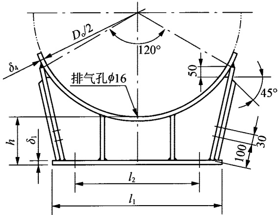

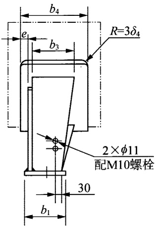

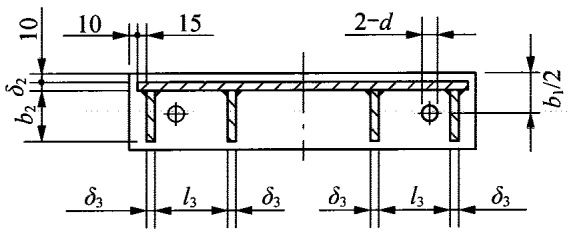

图1

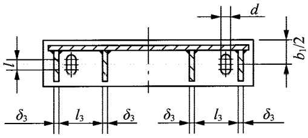

S型

<!-- page: 13 -->

单位为 mm

| 公称直径DN | 允许载荷Q/kN | 鞍式支座高度h | 底板 |  |  | 腹板 \delta_2 | 筋板 |  |  |  | 垫板 |  |  |  | 螺栓间距 |  |  |  | 鞍式支座质量/kg | 增加100mm高度增加的质量/kg |
|---|---|---|---|---|---|---|---|---|---|---|---|---|---|---|---|---|---|---|---|---|
| l_1 | b_1 | \delta_1 | l_3 | b_2 | b_3 | \delta_3 | 弧长 | b_4 | \delta_4 | e | 间距 l_2 | 螺孔d | 螺纹M | 孔长l |  |  |  |  |  |  |
| 1 000 | 158 | 200 | 760 | 170 | 10 | 6 | 170 | 140 | 200 | 6 | 1 160 | 320 | 6 | 57 | 600 | 24 | M20 | 40 | 48 | 6.1 |
| 1 100 | 160 | 200 | 820 | 170 | 10 | 6 | 185 | 140 | 200 | 6 | 1 280 | 330 | 6 | 62 | 660 | 24 | M20 | 40 | 52 | 6.4 |
| 1 200 | 162 | 200 | 880 | 170 | 10 | 6 | 200 | 140 | 200 | 6 | 1 390 | 350 | 6 | 72 | 720 | 24 | M20 | 40 | 58 | 6.7 |
| 1 300 | 174 | 200 | 940 | 170 | 10 | 8 | 215 | 140 | 220 | 6 | 1 510 | 380 | 8 | 76 | 780 | 24 | M20 | 40 | 79 | 8.4 |
| 1 400 | 175 | 200 | 1 000 | 170 | 10 | 8 | 230 | 140 | 220 | 6 | 1 620 | 400 | 8 | 86 | 840 | 24 | M20 | 40 | 87 | 8.8 |
| 1 500 | 257 | 250 | 1 060 | 200 | 12 | 8 | 242 | 170 | 240 | 8 | 1 740 | 410 | 8 | 81 | 900 | 27 | M24 | 45 | 113 | 10.8 |
| 1 600 | 259 | 250 | 1 120 | 200 | 12 | 8 | 257 | 170 | 240 | 8 | 1 860 | 420 | 8 | 86 | 960 | 27 | M24 | 45 | 121 | 11.2 |
| 1 700 | 262 | 250 | 1 200 | 200 | 12 | 8 | 277 | 170 | 240 | 8 | 1 970 | 440 | 8 | 96 | 1 040 | 27 | M24 | 45 | 130 | 11.7 |
| 1 800 | 334 | 250 | 1 280 | 220 | 12 | 10 | 296 | 190 | 260 | 8 | 2 090 | 470 | 10 | 100 | 1 120 | 27 | M24 | 45 | 171 | 14.7 |
| 1 900 | 338 | 250 | 1 360 | 220 | 12 | 10 | 316 | 190 | 260 | 8 | 2 200 | 480 | 10 | 105 | 1 200 | 27 | M24 | 45 | 182 | 15.3 |
| 2 000 | 340 | 250 | 1 420 | 220 | 12 | 10 | 331 | 190 | 260 | 8 | 2 320 | 490 | 10 | 110 | 1 260 | 27 | M24 | 45 | 194 | 15.8 |

<!-- page: 14 -->

4.1.2 DN2100mm～DN4000mm、120°包角轻型带垫板鞍式支座的结构和尺寸应符合图 2 和表 3 的规定。

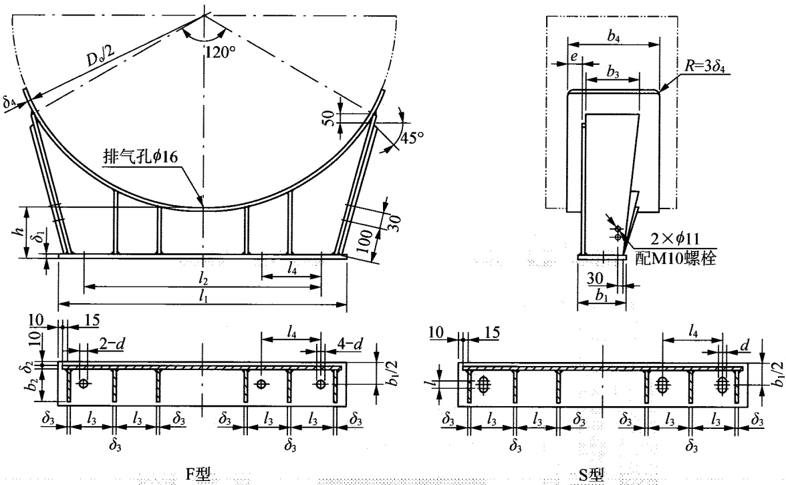

图2

<!-- page: 15 -->

单位为 mm

| 公称直径DN | 允许载荷Q/kN | 鞍式支座高度h | 底板 |  |  | 腹板δ2 | 筋板 |  |  |  | 垫板 |  |  |  | 螺栓间距 |  |  |  |  | 鞍式支座质量/kg | 增加100mm高度增加的质量/kg |
|---|---|---|---|---|---|---|---|---|---|---|---|---|---|---|---|---|---|---|---|---|---|
| l1 | b1 | δ1 | l3 | b2 | b3 | δ3 | 弧长 | b4 | δ4 | e | 间距l2 | 间距l4 | 螺孔d | 螺纹M | 孔长l |  |  |  |  |  |  |
| 2 100 | 559 | 250 | 1 500 | 240 | 14 | 10 | 230 | 208 | 290 | 8 | 2 440 | 500 | 10 | 100 | 1 300 | - | 35 | 2-M30 | 50 | 227 | 19.5 |
| 2 200 | 564 | 250 | 1 580 | 240 | 14 | 10 | 243 | 208 | 290 | 8 | 2 550 | 520 | 10 | 100 | 1 380 | - | 35 | 2-M30 | 50 | 242 | 20.1 |
| 2 300 | 569 | 250 | 1 660 | 240 | 14 | 10 | 256 | 208 | 290 | 8 | 2 670 | 530 | 10 | 100 | 1 460 | - | 35 | 2-M30 | 50 | 255 | 20.7 |
| 2 400 | 573 | 250 | 1 720 | 240 | 14 | 10 | 266 | 208 | 290 | 8 | 2 780 | 540 | 10 | 100 | 1 520 | - | 35 | 2-M30 | 50 | 267 | 21.2 |
| 2 500 | 871 | 250 | 1 800 | 300 | 14 | 10 | 280 | 268 | 360 | 8 | 2 900 | 570 | 12 | 120 | 1 580 | - | 35 | 2-M30 | 50 | 337 | 24.1 |
| 2 600 | 878 | 250 | 1 880 | 300 | 14 | 10 | 293 | 268 | 360 | 8 | 3 020 | 580 | 12 | 120 | 1 640 | - | 35 | 2-M30 | 50 | 354 | 24.7 |
| 2 700 | 886 | 250 | 1 960 | 300 | 14 | 10 | 307 | 268 | 360 | 8 | 3 130 | 590 | 12 | 120 | 1 720 | - | 35 | 2-M30 | 50 | 371 | 25.3 |
| 2 800 | 893 | 250 | 2 040 | 300 | 14 | 10 | 320 | 268 | 360 | 8 | 3 250 | 600 | 12 | 120 | 1 800 | - | 35 | 2-M30 | 50 | 388 | 26.0 |
| 2 900 | 1 388 | 250 | 2 110 | 360 | 16 | 10 | 331 | 316 | 410 | 10 | 3 360 | 650 | 16 | 120 | 1 870 | 468 | 35 | 4-M30 | 60 | 526 | 31.3 |
| 3 000 | 1 398 | 250 | 2 180 | 360 | 16 | 10 | 341 | 316 | 410 | 10 | 3 480 | 660 | 16 | 120 | 1 940 | 485 | 35 | 4-M30 | 60 | 564 | 31.8 |
| 3 100 | 1 410 | 250 | 2 260 | 360 | 16 | 10 | 355 | 316 | 410 | 10 | 3 600 | 670 | 16 | 120 | 2 020 | 505 | 35 | 4-M30 | 60 | 588 | 32.5 |
| 3 200 | 1 420 | 250 | 2 340 | 360 | 16 | 10 | 368 | 316 | 410 | 10 | 3 710 | 680 | 16 | 120 | 2 100 | 525 | 35 | 4-M30 | 60 | 613 | 33.1 |
| 3 300 | 1 430 | 250 | 2 410 | 360 | 16 | 10 | 380 | 316 | 410 | 10 | 3 830 | 700 | 16 | 120 | 2 150 | 538 | 35 | 4-M30 | 60 | 640 | 33.6 |
| 3 400 | 1 645 | 250 | 2 480 | 380 | 16 | 12 | 391 | 335 | 430 | 10 | 3 940 | 710 | 16 | 140 | 2 200 | 550 | 35 | 4-M30 | 60 | 696 | 39.0 |
| 3 500 | 1 656 | 250 | 2 560 | 380 | 16 | 12 | 405 | 335 | 430 | 10 | 4 060 | 720 | 16 | 140 | 2 280 | 570 | 35 | 4-M30 | 60 | 723 | 39.7 |
| 3 600 | 1 667 | 250 | 2 640 | 380 | 16 | 12 | 418 | 335 | 430 | 10 | 4 180 | 730 | 16 | 140 | 2 360 | 590 | 35 | 4-M30 | 60 | 751 | 40.5 |
| 3 700 | 1 677 | 250 | 2 710 | 380 | 18 | 12 | 429 | 335 | 430 | 10 | 4 290 | 760 | 18 | 140 | 2 430 | 608 | 35 | 4-M30 | 60 | 854 | 41.1 |
| 3 800 | 1 945 | 250 | 2 780 | 380 | 18 | 12 | 440 | 335 | 430 | 12 | 4 410 | 770 | 18 | 140 | 2 500 | 625 | 35 | 4-M30 | 60 | 908 | 44.9 |
| 3 900 | 1 958 | 250 | 2 860 | 380 | 18 | 12 | 454 | 335 | 430 | 12 | 4 520 | 780 | 18 | 140 | 2 580 | 645 | 35 | 4-M30 | 60 | 939 | 45.7 |
| 4 000 | 1 969 | 250 | 2 940 | 380 | 18 | 12 | 467 | 335 | 430 | 12 | 4 640 | 790 | 18 | 140 | 2 660 | 665 | 35 | 4-M30 | 60 | 971 | 46.4 |

<!-- page: 16 -->

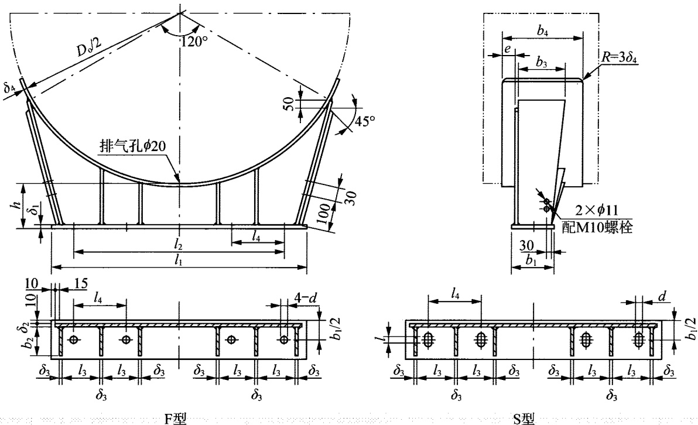

图3

4.1.3 DN4100mm～DN6000mm、120°包角轻型带垫板鞍式支座的结构和尺寸应符合图 3 和表 4 的规定。

<!-- page: 17 -->

单位为 mm

表 4

| 公称直径DN | 允许载荷Q/kN | 鞍式支座高度h | 底板 |  |  | 腹板δ2 | 筋板 |  |  |  | 垫板 |  |  |  | 螺栓间距 |  |  |  |  | 鞍式支座质量/kg | 增加100mm高度增加的质量/kg |
|---|---|---|---|---|---|---|---|---|---|---|---|---|---|---|---|---|---|---|---|---|---|
| l1 | b1 | δ1 | l3 | b2 | b3 | δ3 | 弧长 | b4 | δ4 | e | 间距l2 | 间距l4 | 螺孔d | 螺纹M | 孔长l |  |  |  |  |  |  |
| 4 100 | 2 365 | 250 | 3 040 | 400 | 18 | 18 | 567 | 352 | 460 | 12 | 4 760 | 800 | 18 | 161 | 2 740 | 685 | 41 | M36 | 80 | 1 096 | 62.6 |
| 4 200 | 2 374 | 250 | 3 100 | 400 | 18 | 18 | 579 | 352 | 460 | 12 | 4 870 | 800 | 18 | 161 | 2 800 | 700 | 41 | M36 | 80 | 1 121 | 63.4 |
| 4 300 | 2 385 | 250 | 3 170 | 400 | 18 | 18 | 593 | 352 | 480 | 12 | 4 990 | 810 | 18 | 156 | 2 870 | 718 | 41 | M36 | 80 | 1 161 | 64.4 |
| 4 400 | 2 397 | 250 | 3 250 | 400 | 18 | 18 | 608 | 352 | 480 | 12 | 5 100 | 820 | 18 | 161 | 2 950 | 738 | 41 | M36 | 80 | 1 197 | 65.5 |
| 4 500 | 3 021 | 250 | 3 330 | 420 | 20 | 20 | 622 | 370 | 500 | 14 | 5 220 | 850 | 20 | 165 | 3 030 | 758 | 41 | M36 | 80 | 1 417 | 76.4 |
| 4 600 | 3 036 | 250 | 3 410 | 420 | 20 | 20 | 637 | 370 | 500 | 14 | 5 340 | 860 | 20 | 170 | 3 110 | 778 | 41 | M36 | 80 | 1 461 | 77.6 |
| 4 700 | 3 049 | 250 | 3 480 | 420 | 20 | 20 | 651 | 370 | 500 | 14 | 5 450 | 870 | 20 | 175 | 3 180 | 795 | 41 | M36 | 80 | 1 501 | 78.7 |
| 4 800 | 3 061 | 250 | 3 550 | 420 | 20 | 20 | 665 | 370 | 500 | 14 | 5 570 | 880 | 20 | 180 | 3 250 | 813 | 41 | M36 | 80 | 1 543 | 79.8 |
| 4 900 | 3 068 | 250 | 3 590 | 420 | 20 | 20 | 673 | 370 | 500 | 14 | 5 680 | 890 | 20 | 185 | 3 290 | 823 | 41 | M36 | 80 | 1 580 | 80.4 |
| 5 000 | 3 539 | 250 | 3 690 | 450 | 22 | 22 | 692 | 398 | 530 | 14 | 5 800 | 920 | 22 | 184 | 3 390 | 848 | 54 | M48 | 100 | 1 824 | 89.6 |
| 5 100 | 3 553 | 250 | 3 760 | 450 | 22 | 22 | 706 | 398 | 530 | 14 | 5 920 | 930 | 22 | 189 | 3 460 | 865 | 54 | M48 | 100 | 1 874 | 90.8 |
| 5 200 | 3 567 | 250 | 3 830 | 450 | 22 | 22 | 719 | 398 | 530 | 14 | 6 030 | 940 | 22 | 194 | 3 530 | 883 | 54 | M48 | 100 | 1 922 | 92.0 |
| 5 300 | 3 580 | 250 | 3 900 | 450 | 22 | 22 | 733 | 398 | 530 | 14 | 6 150 | 950 | 22 | 199 | 3 600 | 900 | 54 | M48 | 100 | 1 973 | 93.3 |
| 5 400 | 4 083 | 250 | 3 980 | 480 | 24 | 24 | 749 | 426 | 570 | 14 | 6 260 | 980 | 24 | 193 | 3 680 | 920 | 54 | M48 | 100 | 2 250 | 102.7 |
| 5 500 | 4 098 | 250 | 4 050 | 480 | 24 | 24 | 762 | 426 | 570 | 14 | 6 380 | 990 | 24 | 198 | 3 750 | 938 | 54 | M48 | 100 | 2 307 | 104.0 |
| 5 600 | 4 113 | 250 | 4 120 | 480 | 24 | 24 | 776 | 426 | 570 | 14 | 6 500 | 990 | 24 | 198 | 3 820 | 955 | 54 | M48 | 100 | 2 352 | 105.3 |
| 5 700 | 4 490 | 250 | 4 190 | 500 | 26 | 26 | 790 | 444 | 580 | 14 | 6 610 | 1 000 | 24 | 197 | 3 880 | 970 | 54 | M48 | 100 | 2 505 | 114.4 |
| 5 800 | 4 505 | 250 | 4 260 | 500 | 26 | 26 | 803 | 444 | 580 | 14 | 6 730 | 1 010 | 24 | 202 | 3 950 | 988 | 54 | M48 | 100 | 2 565 | 115.8 |
| 5 900 | 4 901 | 250 | 4 340 | 520 | 28 | 28 | 819 | 462 | 600 | 14 | 6 840 | 1 060 | 28 | 216 | 4 030 | 1 008 | 54 | M48 | 100 | 3 018 | 125.4 |
| 6 000 | 4 918 | 250 | 4 410 | 520 | 28 | 28 | 833 | 462 | 600 | 14 | 6 960 | 1 070 | 28 | 221 | 4 100 | 1 025 | 54 | M48 | 100 | 3 090 | 127.0 |

<!-- page: 18 -->

### 4.2 重型（B型）鞍式支座

4.2.1 DN168mm～DN406mm、120°包角重型带垫板或不带垫板鞍式支座的结构和尺寸应符合图4和表5的规定。

4.2.2 DN300mm～DN450mm、120°包角重型带垫板或不带垫板鞍式支座的结构和尺寸应符合图4和表6的规定。

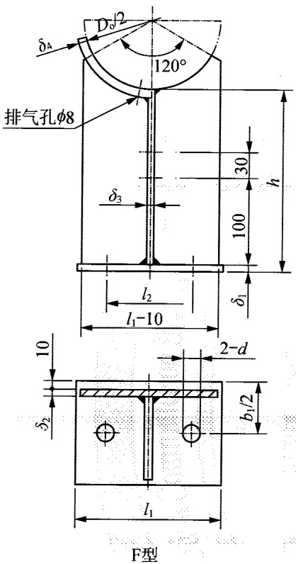

焊制

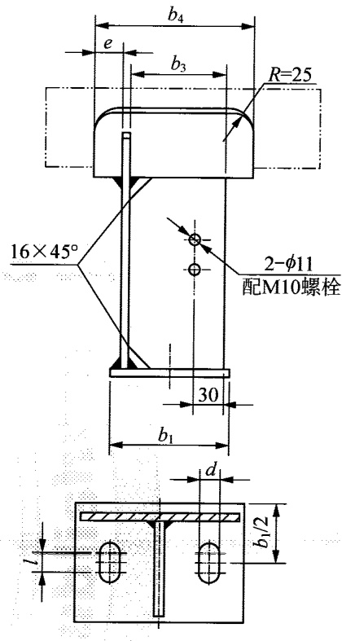

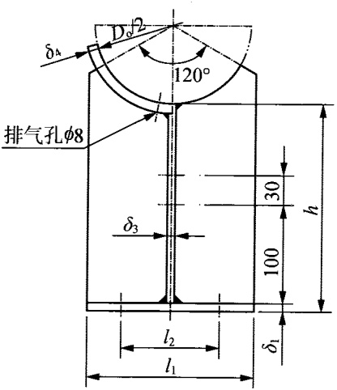

F型

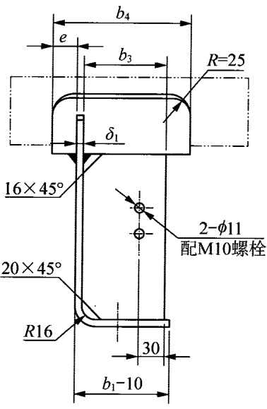

图4

<!-- page: 19 -->

单位为 mm

| 公称直径DN | 允许载荷Q/kN | 鞍式支座高度h | 底板 |  |  | 腹板 \delta_2 | 筋板 |  | 垫板 |  |  |  | 螺栓间距 |  |  |  | 鞍式支座质量/kg |  | 增加100mm高度增加的质量/kg |
|---|---|---|---|---|---|---|---|---|---|---|---|---|---|---|---|---|---|---|---|
| l_1 | b_1 | \delta_1 | b_3 | \delta_3 | 弧长 | b_4 | \delta_4 | e | 间距 l_2 | 螺孔d | 螺纹M | 孔长l | 带垫板 | 不带垫板 |  |  |  |  |  |
| 168 | 27 | 200 | 180 | 120 | 8 | 8 | 96 | 8 | 180 | 130 | 6 | 13 | 100 | 24 | M20 | 25 | 6 | 5 | 1.6 |
| 219 | 28 | 200 | 220 | 120 | 8 | 8 | 96 | 8 | 250 | 150 | 6 | 23 | 140 | 24 | M20 | 25 | 7 | 6 | 1.9 |
| 273 | 29 | 200 | 270 | 120 | 8 | 8 | 96 | 8 | 320 | 170 | 6 | 33 | 180 | 24 | M20 | 25 | 9 | 7 | 2.2 |
| 325 | 41 | 200 | 310 | 140 | 8 | 8 | 116 | 8 | 380 | 180 | 6 | 28 | 210 | 24 | M20 | 25 | 12 | 8 | 2.6 |
| 356 | 42 | 200 | 340 | 140 | 8 | 8 | 116 | 8 | 440 | 200 | 6 | 38 | 250 | 24 | M20 | 25 | 14 | 10 | 2.9 |
| 406 | 43 | 200 | 380 | 140 | 8 | 8 | 116 | 8 | 490 | 210 | 6 | 43 | 280 | 24 | M20 | 25 | 15 | 11 | 3.2 |

| 表6 单位为mm |  |  |  |  |  |  |  |  |  |  |  |  |  |  |  |  |  |  |  |
|---|---|---|---|---|---|---|---|---|---|---|---|---|---|---|---|---|---|---|---|
| 公称直径DN | 允许载荷Q/kN | 鞍式支座高度h | 底板 |  |  | 腹板 \delta_2 | 筋板 |  | 垫板 |  |  |  | 螺栓间距 |  |  |  | 鞍式支座质量/kg |  | 增加100mm高度增加的质量/kg |
| l_1 | b_1 | \delta_1 | b_3 | \delta_3 | 弧长 | b_4 | \delta_4 | e | 间距 l_2 | 螺孔d | 螺纹M | 孔长l | 带垫板 | 不带垫板 |  |  |  |  |  |
| 300 | 72 | 200 | 290 | 140 | 8 | 8 | 116 | 8 | 350 | 170 | 6 | 23 | 200 | 24 | M20 | 25 | 11 | 8 | 2.5 |
| 350 | 74 | 200 | 330 | 140 | 8 | 8 | 116 | 8 | 410 | 190 | 6 | 33 | 230 | 24 | M20 | 25 | 13 | 9 | 2.7 |
| 400 | 76 | 200 | 380 | 140 | 8 | 8 | 116 | 8 | 460 | 200 | 6 | 38 | 260 | 24 | M20 | 25 | 14 | 10 | 3.1 |
| 450 | 77 | 200 | 420 | 140 | 8 | 8 | 116 | 8 | 520 | 210 | 6 | 43 | 290 | 24 | M20 | 25 | 16 | 11 | 3.3 |

<!-- page: 20 -->

4.2.3 DN500mm～DN950mm、120°包角重型带垫板或不带垫板鞍式支座的结构和尺寸应符合图5和表7的规定。

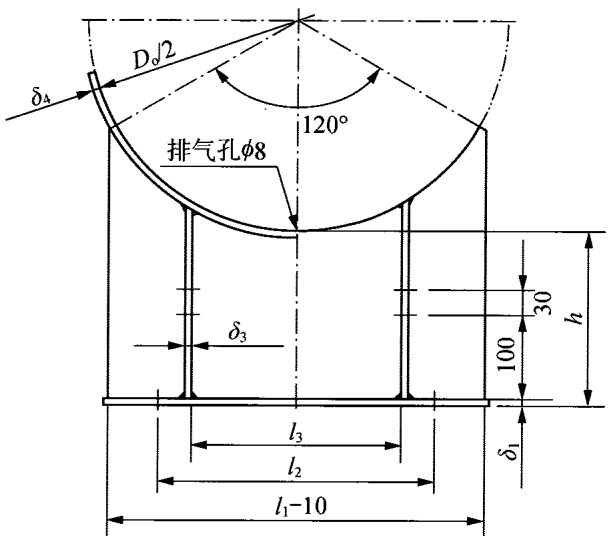

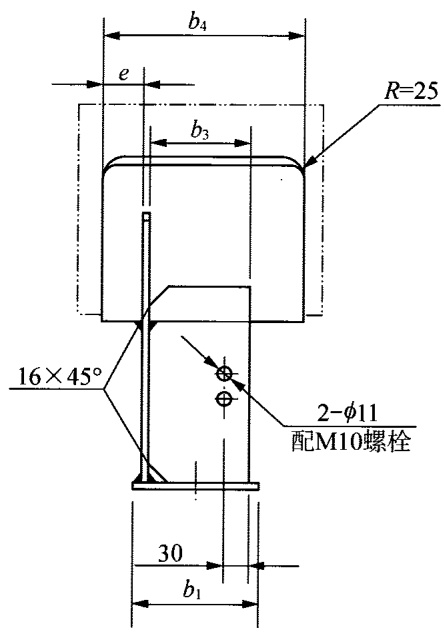

焊制

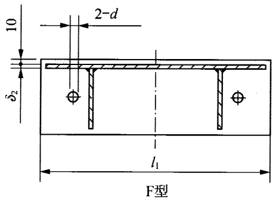

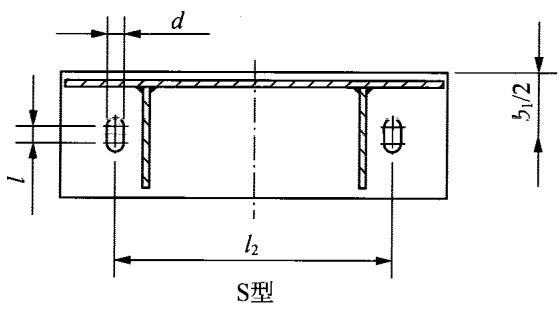

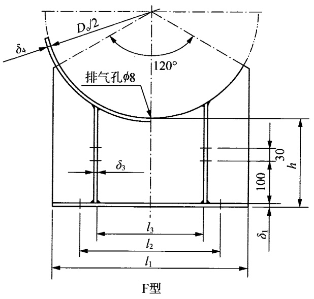

图5

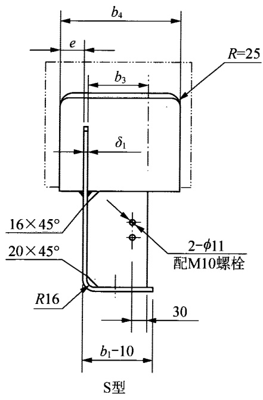

<!-- page: 21 -->

表 7

单位为 mm

| 公称直径DN | 允许载荷Q/kN | 鞍式支座高度h | 底板 |  |  | 腹板 \delta_2 | 筋板 |  |  | 垫板 |  |  |  | 螺栓间距 |  |  |  | 鞍式支座质量/kg |  | 增加100mm高度增加的质量/kg |
|---|---|---|---|---|---|---|---|---|---|---|---|---|---|---|---|---|---|---|---|---|
| l_1 | b_1 | \delta_1 | l_3 | b_3 | \delta_3 | 弧长 | b_4 | \delta_4 | e | 间距 l_2 | 螺孔d | 螺纹M | 孔长l | 带垫板 | 不带垫板 |  |  |  |  |  |
| 500 | 123 | 200 | 460 | 170 | 10 | 8 | 250 | 150 | 8 | 580 | 230 | 6 | 36 | 330 | 24 | M20 | 30 | 23 | 17 | 4.7 |
| 550 | 126 | 200 | 510 | 170 | 10 | 8 | 280 | 150 | 8 | 640 | 240 | 6 | 41 | 360 | 24 | M20 | 30 | 26 | 19 | 5.0 |
| 600 | 127 | 200 | 550 | 170 | 10 | 8 | 300 | 150 | 8 | 700 | 250 | 6 | 46 | 400 | 24 | M20 | 30 | 28 | 20 | 5.3 |
| 650 | 129 | 200 | 590 | 170 | 10 | 8 | 330 | 150 | 8 | 750 | 260 | 6 | 51 | 430 | 24 | M20 | 30 | 30 | 21 | 5.5 |
| 700 | 131 | 200 | 640 | 170 | 10 | 8 | 350 | 150 | 8 | 810 | 270 | 6 | 56 | 460 | 24 | M20 | 30 | 33 | 23 | 5.8 |
| 750 | 132 | 200 | 680 | 170 | 10 | 8 | 380 | 150 | 8 | 870 | 280 | 6 | 61 | 500 | 24 | M20 | 30 | 36 | 24 | 6.1 |
| 800 | 207 | 200 | 720 | 200 | 10 | 10 | 400 | 170 | 10 | 930 | 280 | 6 | 50 | 530 | 24 | M20 | 30 | 44 | 32 | 8.2 |
| 850 | 210 | 200 | 770 | 200 | 10 | 10 | 430 | 170 | 10 | 990 | 290 | 6 | 55 | 558 | 24 | M20 | 30 | 48 | 34 | 8.6 |
| 900 | 212 | 200 | 810 | 200 | 10 | 10 | 450 | 170 | 10 | 1 040 | 300 | 6 | 60 | 590 | 24 | M20 | 30 | 51 | 36 | 8.9 |
| 950 | 213 | 200 | 850 | 200 | 10 | 10 | 470 | 170 | 10 | 1 100 | 310 | 6 | 65 | 630 | 24 | M20 | 30 | 54 | 38 | 9.3 |

<!-- page: 22 -->

4.2.4 DN1000mm～DN2000mm、120°包角重型带垫板鞍式支座的结构和尺寸应符合图6和表8的规定。

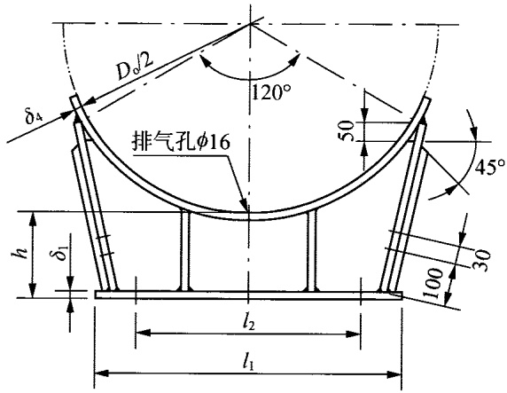

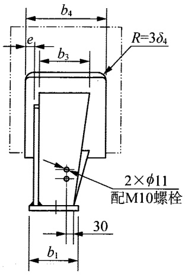

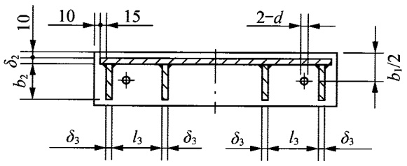

图6

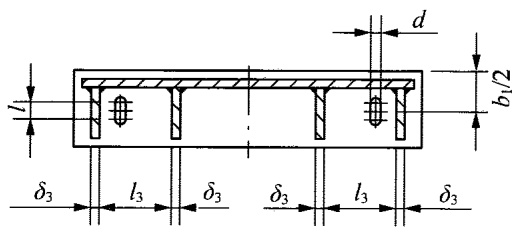

S型

<!-- page: 23 -->

表8

单位为 mm

| 公称直径DN | 允许载荷Q/kN | 鞍式支座高度h | 底板 |  |  | 腹板 \delta_2 | 筋板 |  |  |  | 垫板 |  |  |  | 螺栓间距 |  |  |  | 鞍式支座质量/kg | 增加100mm高度增加的质量/kg |
|---|---|---|---|---|---|---|---|---|---|---|---|---|---|---|---|---|---|---|---|---|
| l_1 | b_1 | \delta_1 | l_3 | b_2 | b_3 | \delta_3 | 弧长 | b_4 | \delta_4 | e | 间距 l_2 | 螺孔d | 螺纹M | 孔长l |  |  |  |  |  |  |
| 1 000 | 327 | 200 | 760 | 170 | 12 | 12 | 170 | 140 | 200 | 12 | 1 160 | 330 | 8 | 59 | 600 | 27 | M24 | 40 | 77 | 12.2 |
| 1 100 | 332 | 200 | 820 | 170 | 12 | 12 | 185 | 140 | 200 | 12 | 1 280 | 350 | 8 | 69 | 660 | 27 | M24 | 40 | 85 | 12.8 |
| 1 200 | 336 | 200 | 880 | 170 | 12 | 12 | 200 | 140 | 200 | 12 | 1 390 | 370 | 8 | 79 | 720 | 27 | M24 | 40 | 94 | 13.4 |
| 1 300 | 340 | 200 | 940 | 170 | 12 | 12 | 215 | 140 | 220 | 12 | 1 510 | 380 | 8 | 74 | 780 | 27 | M24 | 40 | 103 | 13.9 |
| 1 400 | 344 | 200 | 1 000 | 170 | 12 | 12 | 230 | 140 | 220 | 12 | 1 620 | 400 | 8 | 84 | 840 | 27 | M24 | 40 | 111 | 14.5 |
| 1 500 | 463 | 250 | 1 060 | 200 | 16 | 14 | 242 | 170 | 240 | 14 | 1 740 | 430 | 10 | 88 | 900 | 35 | M30 | 45 | 169 | 18.9 |
| 1 600 | 468 | 250 | 1 120 | 200 | 16 | 14 | 257 | 170 | 240 | 14 | 1 860 | 440 | 10 | 93 | 960 | 35 | M30 | 45 | 180 | 19.6 |
| 1 700 | 473 | 250 | 1 200 | 200 | 16 | 14 | 277 | 170 | 240 | 14 | 1 970 | 450 | 10 | 98 | 1 040 | 35 | M30 | 45 | 193 | 20.4 |
| 1 800 | 574 | 250 | 1 280 | 220 | 16 | 14 | 296 | 190 | 260 | 14 | 2 090 | 470 | 10 | 98 | 1 120 | 35 | M30 | 45 | 215 | 22.2 |
| 1 900 | 580 | 250 | 1 360 | 220 | 16 | 14 | 316 | 190 | 260 | 14 | 2 200 | 480 | 10 | 103 | 1 200 | 35 | M30 | 45 | 230 | 23.1 |
| 2 000 | 585 | 250 | 1 420 | 220 | 16 | 14 | 331 | 190 | 260 | 14 | 2 320 | 490 | 10 | 108 | 1 260 | 35 | M30 | 45 | 242 | 23.7 |

<!-- page: 24 -->

4.2.5 DN2100mm～DN4000mm、120°包角重型带垫板鞍式支座的结构和尺寸应符合图7和表9的规定。

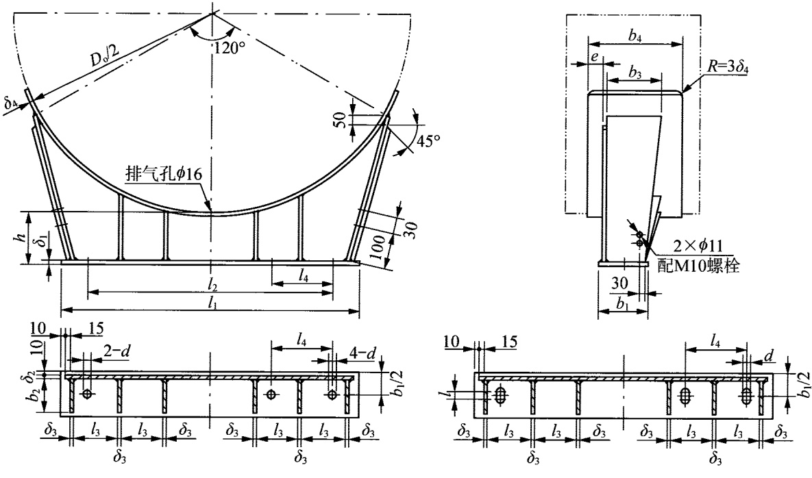

S型

<!-- page: 25 -->

单位为 mm

| 公称直径DN | 允许载荷Q/kN | 鞍式支座高度h | 底板 |  |  | 腹板δ2 | 筋板 |  |  |  | 垫板 |  |  |  | 螺栓间距 |  |  |  |  | 鞍式支座质量/kg | 增加100mm高度增加的质量/kg |
|---|---|---|---|---|---|---|---|---|---|---|---|---|---|---|---|---|---|---|---|---|---|
| l1 | b1 | δ1 | l3 | b2 | b3 | δ3 | 弧长 | b4 | δ4 | e | 间距l2 | 间距l4 | 螺孔d | 螺纹M | 孔长l |  |  |  |  |  |  |
| 2 100 | 1 090 | 250 | 1 500 | 240 | 16 | 16 | 230 | 208 | 290 | 16 | 2 440 | 550 | 16 | 122 | 1 300 | - | 41 | 2-M36 | 50 | 378 | 34.3 |
| 2 200 | 1 100 | 250 | 1 580 | 240 | 16 | 16 | 243 | 208 | 290 | 16 | 2 550 | 570 | 16 | 132 | 1 380 | - | 41 | 2-M36 | 50 | 403 | 35.3 |
| 2 300 | 1 110 | 250 | 1 660 | 240 | 16 | 16 | 256 | 208 | 290 | 16 | 2 670 | 580 | 16 | 137 | 1 460 | - | 41 | 2-M36 | 50 | 424 | 36.3 |
| 2 400 | 1 120 | 250 | 1 720 | 240 | 16 | 16 | 266 | 208 | 290 | 16 | 2 780 | 590 | 16 | 142 | 1 520 | - | 41 | 2-M36 | 50 | 445 | 37.0 |
| 2 500 | 1 910 | 250 | 1 800 | 300 | 18 | 18 | 280 | 268 | 360 | 18 | 2 900 | 620 | 18 | 121 | 1 580 | - | 41 | 2-M36 | 50 | 562 | 47.9 |
| 2 600 | 1 930 | 250 | 1 880 | 300 | 18 | 18 | 293 | 268 | 360 | 18 | 3 020 | 630 | 18 | 126 | 1 640 | - | 41 | 2-M36 | 50 | 604 | 49.0 |
| 2 700 | 1 940 | 250 | 1 960 | 300 | 18 | 18 | 307 | 268 | 360 | 18 | 3 130 | 650 | 18 | 136 | 1 720 | - | 41 | 2-M36 | 50 | 636 | 50.1 |
| 2 800 | 1 960 | 250 | 2 040 | 300 | 18 | 18 | 320 | 268 | 360 | 18 | 3 250 | 660 | 18 | 141 | 1 800 | - | 41 | 2-M36 | 50 | 665 | 51.3 |
| 2 900 | 2 830 | 250 | 2 110 | 360 | 20 | 20 | 331 | 316 | 410 | 20 | 3 360 | 700 | 22 | 135 | 1 870 | 468 | 41 | 4-M36 | 60 | 848 | 62.6 |
| 3 000 | 2 860 | 250 | 2 180 | 360 | 20 | 20 | 341 | 316 | 410 | 20 | 3 480 | 710 | 22 | 140 | 1 940 | 485 | 41 | 4-M36 | 60 | 904 | 63.7 |
| 3 100 | 2 880 | 250 | 2 260 | 360 | 20 | 20 | 355 | 316 | 410 | 20 | 3 600 | 720 | 22 | 145 | 2 020 | 505 | 41 | 4-M36 | 60 | 941 | 64.9 |
| 3 200 | 2 900 | 250 | 2 340 | 360 | 20 | 20 | 368 | 316 | 410 | 20 | 3 710 | 740 | 22 | 155 | 2 100 | 525 | 41 | 4-M36 | 60 | 984 | 66.2 |
| 3 300 | 2 920 | 250 | 2 410 | 360 | 20 | 20 | 380 | 316 | 410 | 20 | 3 830 | 750 | 22 | 160 | 2 150 | 538 | 41 | 4-M36 | 60 | 1 022 | 67.3 |
| 3 400 | 3 550 | 250 | 2 480 | 380 | 22 | 22 | 391 | 335 | 430 | 22 | 3 940 | 770 | 24 | 159 | 2 200 | 550 | 41 | 4-M36 | 60 | 1 187 | 77.2 |
| 3 500 | 3 570 | 250 | 2 560 | 380 | 22 | 22 | 405 | 335 | 430 | 22 | 4 060 | 790 | 24 | 169 | 2 280 | 570 | 41 | 4-M36 | 60 | 1 240 | 78.6 |
| 3 600 | 3 600 | 250 | 2 640 | 380 | 22 | 22 | 418 | 335 | 430 | 22 | 4 180 | 800 | 24 | 174 | 2 360 | 590 | 41 | 4-M36 | 60 | 1 285 | 80.0 |
| 3 700 | 3 620 | 250 | 2 710 | 380 | 22 | 22 | 429 | 335 | 430 | 22 | 4 290 | 810 | 24 | 179 | 2 430 | 608 | 41 | 4-M36 | 60 | 1 328 | 81.2 |
| 3 800 | 4 160 | 250 | 2 780 | 380 | 25 | 25 | 440 | 335 | 430 | 25 | 4 410 | 840 | 26 | 193 | 2 500 | 625 | 41 | 4-M36 | 60 | 1 540 | 93.6 |
| 3 900 | 4 190 | 250 | 2 860 | 380 | 25 | 25 | 454 | 335 | 430 | 25 | 4 520 | 850 | 26 | 198 | 2 580 | 645 | 41 | 4-M36 | 60 | 1 591 | 95.2 |
| 4 000 | 4 220 | 250 | 2 940 | 380 | 25 | 25 | 467 | 335 | 430 | 25 | 4 640 | 860 | 26 | 203 | 2 660 | 665 | 41 | 4-M36 | 60 | 1 646 | 96.8 |

<!-- page: 26 -->

4.2.6 DN4100mm～DN6000mm、120°包角重型带垫板鞍式支座的结构和尺寸应符合图8和表10的规定。

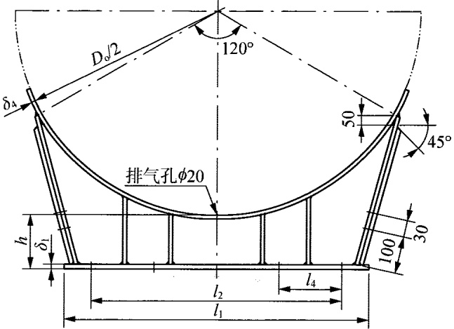

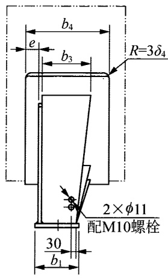

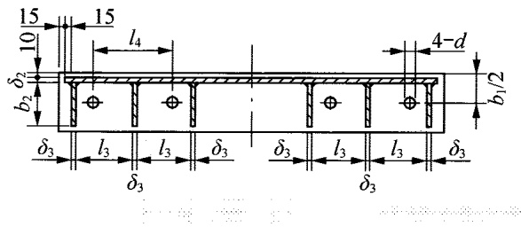

图8

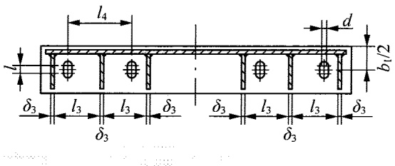

S型

<!-- page: 27 -->

单位为 mm

表 10

| 公称直径DN | 允许载荷Q/kN | 鞍式支座高度h | 底板 |  |  | 腹板δ2 | 筋板 |  |  |  | 垫板 |  |  |  | 螺栓间距 |  |  |  |  | 鞍式支座质量/kg | 增加100mm高度增加的质量/kg |
|---|---|---|---|---|---|---|---|---|---|---|---|---|---|---|---|---|---|---|---|---|---|
| l1 | b1 | δ1 | l3 | b2 | b3 | δ3 | 弧长 | b4 | δ4 | e | 间距l2 | 间距l4 | 螺孔d | 螺纹M | 孔长l |  |  |  |  |  |  |
| 4 100 | 4 330 | 250 | 3 040 | 400 | 26 | 26 | 553 | 344 | 460 | 24 | 4 760 | 870 | 26 | 192 | 690 | 2 740 | 47 | M42 | 80 | 1 731 | 100.5 |
| 4 200 | 4 350 | 250 | 3 100 | 400 | 26 | 26 | 565 | 344 | 460 | 24 | 4 870 | 880 | 26 | 197 | 700 | 2 800 | 47 | M42 | 80 | 1 753 | 101.7 |
| 4 300 | 4 370 | 250 | 3 170 | 400 | 26 | 26 | 579 | 344 | 480 | 24 | 4 990 | 890 | 26 | 192 | 720 | 2 870 | 47 | M42 | 80 | 1 814 | 103.2 |
| 4 400 | 4 400 | 250 | 3 250 | 400 | 26 | 26 | 594 | 344 | 480 | 24 | 5 100 | 900 | 26 | 197 | 740 | 2 950 | 47 | M42 | 80 | 1 869 | 104.8 |
| 4 500 | 5 030 | 250 | 3 330 | 420 | 28 | 28 | 609 | 362 | 500 | 25 | 5 220 | 930 | 28 | 201 | 760 | 3 030 | 54 | M48 | 80 | 2 102 | 115.4 |
| 4 600 | 5 060 | 250 | 3 410 | 420 | 28 | 28 | 625 | 362 | 500 | 25 | 5 340 | 940 | 28 | 206 | 780 | 3 110 | 54 | M48 | 80 | 2 166 | 117.1 |
| 4 700 | 5 080 | 250 | 3 480 | 420 | 28 | 28 | 638 | 362 | 500 | 25 | 5 450 | 950 | 28 | 211 | 800 | 3 180 | 54 | M48 | 80 | 2 224 | 118.7 |
| 4 800 | 5 100 | 250 | 3 550 | 420 | 28 | 28 | 652 | 362 | 500 | 25 | 5 570 | 960 | 28 | 216 | 810 | 3 250 | 54 | M48 | 80 | 2 285 | 120.2 |
| 4 900 | 5 120 | 250 | 3 590 | 420 | 28 | 28 | 660 | 362 | 500 | 25 | 5 680 | 970 | 28 | 221 | 820 | 3 290 | 54 | M48 | 80 | 2 338 | 121.1 |
| 5 000 | 6 050 | 250 | 3 690 | 450 | 30 | 30 | 678 | 390 | 530 | 26 | 5 800 | 1 010 | 32 | 225 | 850 | 3 390 | 62 | M56 | 100 | 2 742 | 134.2 |
| 5 100 | 6 070 | 250 | 3 760 | 450 | 30 | 30 | 692 | 390 | 530 | 26 | 5 920 | 1 020 | 32 | 230 | 870 | 3 460 | 62 | M56 | 100 | 2 815 | 135.8 |
| 5 200 | 6 100 | 250 | 3 830 | 450 | 30 | 30 | 705 | 390 | 530 | 26 | 6 030 | 1 030 | 32 | 235 | 880 | 3 530 | 62 | M56 | 100 | 2 884 | 137.5 |
| 5 300 | 6 120 | 250 | 3 900 | 450 | 30 | 30 | 719 | 390 | 530 | 26 | 6 150 | 1 040 | 32 | 240 | 900 | 3 600 | 62 | M56 | 100 | 2 958 | 139.1 |
| 5 400 | 6 870 | 250 | 3 980 | 480 | 30 | 30 | 735 | 420 | 570 | 26 | 6 260 | 1 080 | 36 | 240 | 920 | 3 680 | 62 | M56 | 100 | 3 360 | 144.7 |
| 5 500 | 6 900 | 250 | 4 050 | 480 | 30 | 30 | 748 | 420 | 570 | 26 | 6 380 | 1 090 | 36 | 245 | 940 | 3 750 | 62 | M56 | 100 | 3 443 | 146.3 |
| 5 600 | 6 920 | 250 | 4 120 | 480 | 30 | 30 | 762 | 420 | 570 | 26 | 6 500 | 1 100 | 36 | 250 | 960 | 3 820 | 71 | M64 | 100 | 3 527 | 148.0 |
| 5 700 | 7 970 | 250 | 4 190 | 500 | 32 | 32 | 773 | 438 | 580 | 28 | 6 610 | 1 150 | 40 | 269 | 970 | 3 880 | 71 | M64 | 100 | 4 074 | 162.5 |
| 5 800 | 8 000 | 250 | 4 260 | 500 | 32 | 32 | 787 | 438 | 580 | 28 | 6 730 | 1 160 | 40 | 274 | 990 | 3 950 | 71 | M64 | 100 | 4 170 | 164.3 |
| 5 900 | 8 380 | 250 | 4 340 | 520 | 32 | 32 | 803 | 458 | 600 | 28 | 6 840 | 1 170 | 40 | 269 | 1 010 | 4 030 | 71 | M64 | 100 | 4 311 | 168.9 |
| 6 000 | 8 440 | 250 | 4 410 | 520 | 32 | 32 | 816 | 458 | 600 | 28 | 6 960 | 1 180 | 40 | 274 | 1 030 | 4 100 | 71 | M64 | 100 | 4 410 | 170.7 |

<!-- page: 28 -->

4.2.7 DN1000mm～DN2000mm、150°包角重型带垫板鞍式支座的结构和尺寸应符合图9和表11的规定。

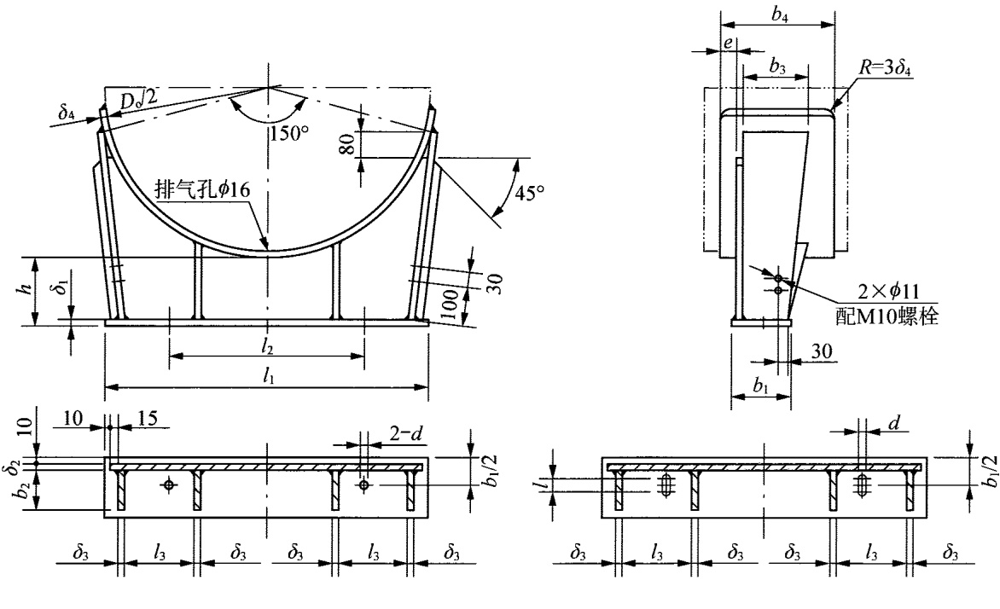

S型

<!-- page: 29 -->

单位为 mm

表 11

| 公称直径DN | 允许载荷Q/kN | 鞍式支座高度h | 底板 |  |  | 腹板 \delta_2 | 筋板 |  |  |  | 垫板 |  |  |  | 螺栓间距 |  |  |  | 鞍式支座质量/kg | 增加100mm高度增加的质量/kg |
|---|---|---|---|---|---|---|---|---|---|---|---|---|---|---|---|---|---|---|---|---|
| l_1 | b_1 | \delta_1 | l_3 | b_2 | b_3 | \delta_3 | 弧长 | b_4 | \delta_4 | e | 间距 l_2 | 螺孔d | 螺纹M | 孔长l |  |  |  |  |  |  |
| 1000 | 340 | 200 | 940 | 170 | 14 | 12 | 213 | 140 | 200 | 12 | 1410 | 330 | 8 | 59 | 600 | 27 | M24 | 40 | 89 | 13.9 |
| 1100 | 344 | 200 | 1000 | 170 | 14 | 12 | 233 | 140 | 200 | 12 | 1550 | 350 | 8 | 69 | 660 | 27 | M24 | 40 | 98 | 14.5 |
| 1200 | 348 | 200 | 1060 | 170 | 14 | 12 | 253 | 140 | 200 | 12 | 1690 | 370 | 8 | 79 | 720 | 27 | M24 | 40 | 106 | 15.1 |
| 1300 | 352 | 200 | 1140 | 170 | 14 | 12 | 273 | 140 | 220 | 12 | 1830 | 380 | 8 | 74 | 780 | 27 | M24 | 40 | 116 | 15.8 |
| 1400 | 356 | 200 | 1220 | 170 | 14 | 12 | 293 | 140 | 220 | 12 | 1970 | 400 | 8 | 84 | 840 | 27 | M24 | 40 | 127 | 16.6 |
| 1500 | 480 | 250 | 1300 | 200 | 16 | 14 | 313 | 170 | 240 | 14 | 2110 | 430 | 10 | 88 | 900 | 35 | M30 | 45 | 188 | 21.5 |
| 1600 | 484 | 250 | 1380 | 200 | 16 | 14 | 333 | 170 | 240 | 14 | 2250 | 440 | 10 | 93 | 960 | 35 | M30 | 45 | 201 | 22.4 |
| 1700 | 489 | 250 | 1460 | 200 | 16 | 14 | 353 | 170 | 240 | 14 | 2390 | 450 | 10 | 98 | 1040 | 35 | M30 | 45 | 214 | 23.3 |
| 1800 | 593 | 250 | 1540 | 220 | 16 | 14 | 373 | 190 | 260 | 14 | 2540 | 470 | 10 | 98 | 1120 | 35 | M30 | 45 | 238 | 25.1 |
| 1900 | 597 | 250 | 1600 | 220 | 16 | 14 | 388 | 190 | 260 | 14 | 2680 | 480 | 10 | 103 | 1200 | 35 | M30 | 45 | 251 | 25.7 |
| 2000 | 602 | 250 | 1680 | 220 | 16 | 14 | 408 | 190 | 260 | 14 | 2820 | 490 | 10 | 108 | 1260 | 35 | M30 | 45 | 265 | 26.6 |

<!-- page: 30 -->

4.2.8 DN2100mm～DN4000mm、150°包角重型带垫板鞍式支座的结构和尺寸应符合图10和表12的规定。

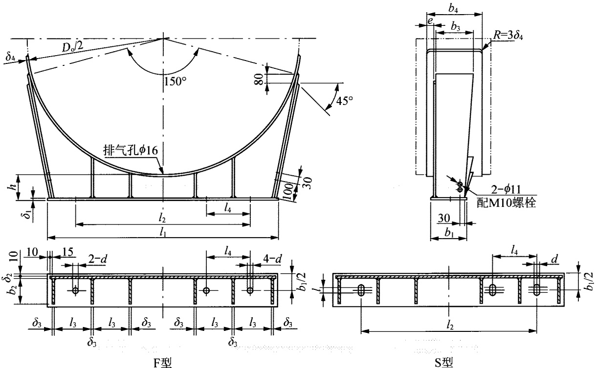

图 10

<!-- page: 31 -->

表 12

单位为 mm

| 公称直径DN | 允许载荷Q/kN | 鞍式支座高度h | 底板 |  |  | 腹板 \delta_2 | 筋板 |  |  |  | 垫板 |  |  |  | 螺栓间距 |  |  |  |  | 鞍式支座质量/kg | 增加100mm高度增加的质量/kg |
|---|---|---|---|---|---|---|---|---|---|---|---|---|---|---|---|---|---|---|---|---|---|
| l_1 | b_1 | \delta_1 | l_3 | b_2 | b_3 | \delta_3 | 弧长 | b_4 | \delta_4 | e | 间距 l_2 | 间距 l_4 | 螺孔d | 螺纹M | 孔长l |  |  |  |  |  |  |
| 2 100 | 1 131 | 250 | 1 760 | 240 | 16 | 16 | 286 | 208 | 290 | 16 | 2 960 | 550 | 16 | 122 | 1 300 | — | 41 | 2-M36 | 50 | 418 | 37.5 |
| 2 200 | 1 141 | 250 | 1 840 | 240 | 16 | 16 | 299 | 208 | 290 | 16 | 3 100 | 570 | 16 | 132 | 1 380 | — | 41 | 2-M36 | 50 | 445 | 38.5 |
| 2 300 | 1 150 | 250 | 1 920 | 240 | 16 | 16 | 312 | 208 | 290 | 16 | 3 240 | 580 | 16 | 137 | 1 460 | — | 41 | 2-M36 | 50 | 467 | 39.5 |
| 2 400 | 1 159 | 250 | 2 000 | 240 | 16 | 16 | 326 | 208 | 290 | 16 | 3 380 | 590 | 16 | 142 | 1 520 | — | 41 | 2-M36 | 50 | 489 | 40.5 |
| 2 500 | 1 971 | 250 | 2 070 | 300 | 18 | 18 | 338 | 268 | 360 | 18 | 3 520 | 620 | 18 | 121 | 1 580 | — | 41 | 2-M36 | 50 | 614 | 51.7 |
| 2 600 | 1 985 | 250 | 2 140 | 300 | 18 | 18 | 349 | 268 | 360 | 18 | 3 660 | 630 | 18 | 126 | 1 640 | — | 41 | 2-M36 | 50 | 659 | 52.7 |
| 2 700 | 2 000 | 250 | 2 220 | 300 | 18 | 18 | 363 | 268 | 360 | 18 | 3 800 | 650 | 18 | 136 | 1 720 | — | 41 | 2-M36 | 50 | 693 | 53.8 |
| 2 800 | 2 015 | 250 | 2 300 | 300 | 18 | 18 | 376 | 268 | 360 | 18 | 3 940 | 660 | 18 | 141 | 1 800 | — | 41 | 2-M36 | 50 | 723 | 54.9 |
| 2 900 | 2 918 | 250 | 2 380 | 360 | 20 | 20 | 389 | 316 | 410 | 20 | 4 090 | 700 | 22 | 135 | 1 870 | 468 | 41 | 4-M36 | 60 | 928 | 66.8 |
| 3 000 | 2 939 | 250 | 2 460 | 360 | 20 | 20 | 402 | 316 | 410 | 20 | 4 230 | 710 | 22 | 140 | 1 940 | 485 | 41 | 4-M36 | 60 | 989 | 68.1 |
| 3 100 | 2 958 | 250 | 2 530 | 360 | 20 | 20 | 414 | 316 | 410 | 20 | 4 370 | 720 | 22 | 145 | 2 020 | 505 | 41 | 4-M36 | 60 | 1 025 | 69.2 |
| 3 200 | 2 976 | 250 | 2 600 | 360 | 20 | 20 | 426 | 316 | 410 | 20 | 4 510 | 740 | 22 | 155 | 2 100 | 525 | 41 | 4-M36 | 60 | 1 071 | 70.3 |
| 3 300 | 2 996 | 250 | 2 680 | 360 | 20 | 20 | 439 | 316 | 410 | 20 | 4 650 | 750 | 22 | 160 | 2 150 | 538 | 41 | 4-M36 | 60 | 1 110 | 71.5 |
| 3 400 | 3 639 | 250 | 2 760 | 380 | 22 | 22 | 452 | 335 | 430 | 22 | 4 790 | 770 | 24 | 159 | 2 200 | 550 | 41 | 4-M36 | 60 | 1 290 | 82.0 |
| 3 500 | 3 663 | 250 | 2 840 | 380 | 22 | 22 | 466 | 335 | 430 | 22 | 4 930 | 790 | 24 | 169 | 2 280 | 570 | 41 | 4-M36 | 60 | 1 345 | 83.4 |
| 3 600 | 3 686 | 250 | 2 920 | 380 | 22 | 22 | 479 | 335 | 430 | 22 | 5 070 | 800 | 24 | 174 | 2 360 | 590 | 41 | 4-M36 | 60 | 1 391 | 84.8 |
| 3 700 | 3 705 | 250 | 2 990 | 380 | 22 | 22 | 491 | 335 | 430 | 22 | 5 210 | 810 | 24 | 179 | 2 430 | 608 | 41 | 4-M36 | 60 | 1 436 | 86.0 |
| 3 800 | 4 261 | 250 | 3 060 | 380 | 25 | 25 | 502 | 335 | 430 | 25 | 5 350 | 840 | 26 | 193 | 2 500 | 625 | 41 | 4-M36 | 60 | 1 660 | 99.1 |
| 3 900 | 4 285 | 250 | 3 140 | 380 | 25 | 25 | 516 | 335 | 430 | 25 | 5 490 | 850 | 26 | 198 | 2 580 | 645 | 41 | 4-M36 | 60 | 1 713 | 100.7 |
| 4 000 | 4 309 | 250 | 3 220 | 380 | 25 | 25 | 529 | 335 | 430 | 25 | 5 630 | 860 | 26 | 203 | 2 660 | 665 | 41 | 4-M36 | 60 | 1 767 | 102.2 |

<!-- page: 32 -->

4.2.9 DN4100mm～DN6000mm、150°包角重型带垫板鞍式支座的结构和尺寸应符合图 11 和表 13 的规定。

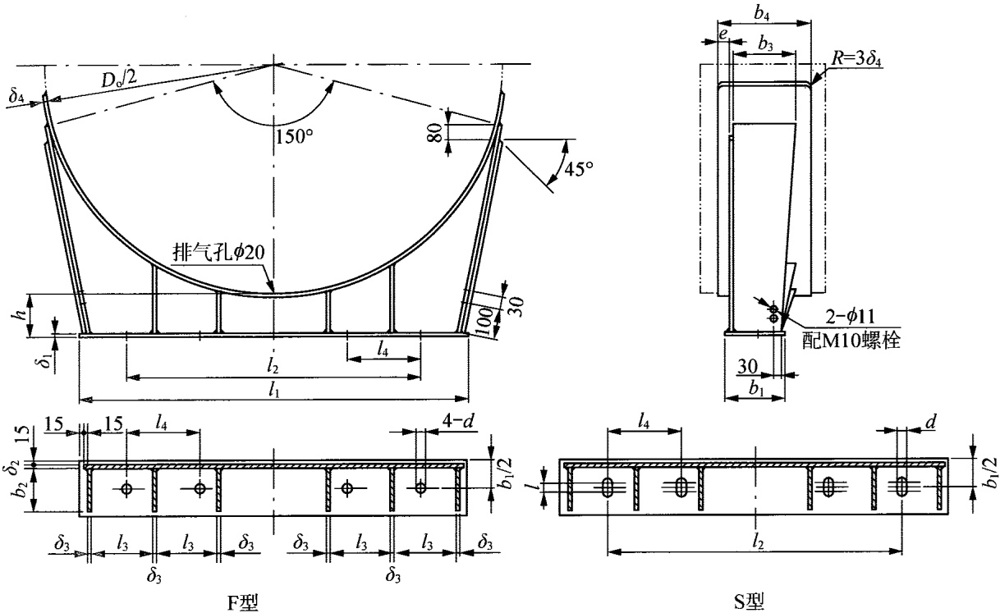

图11

<!-- page: 33 -->

表 13

单位为 mm

| 公称直径DN | 允许载荷Q/kN | 鞍式支座高度h | 底板 |  |  | 腹板δ2 | 筋板 |  |  |  | 垫板 |  |  |  | 螺栓间距 |  |  |  |  | 鞍式支座质量/kg | 增加100mm高度增加的质量/kg |
|---|---|---|---|---|---|---|---|---|---|---|---|---|---|---|---|---|---|---|---|---|---|
| l1 | b1 | δ1 | l3 | b2 | b3 | δ3 | 弧长 | b4 | δ4 | e | 间距l2 | 间距l4 | 螺孔d | 螺纹M | 孔长l |  |  |  |  |  |  |
| 4 100 | 4 440 | 250 | 3 410 | 400 | 26 | 26 | 626 | 344 | 460 | 24 | 5 780 | 870 | 26 | 192 | 2 740 | 685 | 47 | M42 | 80 | 1 873 | 108.1 |
| 4 200 | 4 470 | 250 | 3 490 | 400 | 26 | 26 | 641 | 344 | 460 | 24 | 5 920 | 880 | 26 | 197 | 2 800 | 700 | 47 | M42 | 80 | 1 909 | 109.7 |
| 4 300 | 4 470 | 250 | 3 520 | 400 | 26 | 26 | 647 | 344 | 480 | 24 | 6 060 | 890 | 26 | 192 | 2 870 | 718 | 47 | M42 | 80 | 1 962 | 110.3 |
| 4 400 | 4 500 | 250 | 3 600 | 400 | 26 | 26 | 663 | 344 | 480 | 24 | 6 200 | 900 | 26 | 197 | 2 950 | 738 | 47 | M42 | 80 | 2 019 | 112.0 |
| 4 500 | 5 130 | 250 | 3 680 | 420 | 30 | 30 | 677 | 360 | 500 | 25 | 6 340 | 930 | 28 | 200 | 3 030 | 758 | 54 | M48 | 80 | 2 295 | 128.6 |
| 4 600 | 5 170 | 250 | 3 760 | 420 | 30 | 30 | 693 | 360 | 500 | 25 | 6 480 | 940 | 28 | 205 | 3 110 | 778 | 54 | M48 | 80 | 2 359 | 130.5 |
| 4 700 | 5 210 | 250 | 3 830 | 420 | 30 | 30 | 707 | 360 | 500 | 25 | 6 620 | 950 | 28 | 210 | 3 180 | 795 | 54 | M48 | 80 | 2 420 | 132.1 |
| 4 800 | 5 260 | 250 | 3 930 | 420 | 30 | 30 | 726 | 360 | 500 | 25 | 6 760 | 960 | 28 | 215 | 3 250 | 813 | 54 | M48 | 80 | 2 491 | 134.5 |
| 4 900 | 5 300 | 250 | 4 010 | 420 | 30 | 30 | 742 | 360 | 500 | 25 | 6 900 | 970 | 28 | 220 | 3 290 | 823 | 54 | M48 | 80 | 2 557 | 136.4 |
| 5 000 | 6 240 | 250 | 4 090 | 450 | 34 | 34 | 756 | 386 | 530 | 26 | 7 040 | 1 010 | 32 | 223 | 3 390 | 848 | 62 | M56 | 100 | 3 033 | 155.9 |
| 5 100 | 6 290 | 250 | 4 170 | 450 | 34 | 34 | 772 | 386 | 530 | 26 | 7 180 | 1 020 | 32 | 228 | 3 460 | 865 | 62 | M56 | 100 | 3 110 | 158.0 |
| 5 200 | 6 340 | 250 | 4 260 | 450 | 34 | 34 | 789 | 386 | 530 | 26 | 7 320 | 1 030 | 32 | 233 | 3 530 | 883 | 62 | M56 | 100 | 3 192 | 160.4 |
| 5 300 | 6 390 | 250 | 4 330 | 450 | 34 | 34 | 803 | 386 | 530 | 26 | 7 470 | 1 040 | 32 | 238 | 3 600 | 900 | 62 | M56 | 100 | 3 270 | 162.3 |
| 5 400 | 7 190 | 250 | 4 410 | 480 | 34 | 34 | 819 | 416 | 570 | 26 | 7 610 | 1 080 | 36 | 238 | 3 680 | 920 | 62 | M56 | 100 | 3 741 | 168.1 |
| 5 500 | 7 220 | 250 | 4 500 | 480 | 34 | 34 | 836 | 416 | 570 | 26 | 7 750 | 1 090 | 36 | 243 | 3 750 | 938 | 62 | M56 | 100 | 3 834 | 170.5 |
| 5 600 | 7 250 | 250 | 4 580 | 480 | 34 | 34 | 852 | 416 | 570 | 26 | 7 890 | 1 100 | 36 | 248 | 3 820 | 955 | 71 | M64 | 100 | 3 925 | 172.6 |
| 5 700 | 8 350 | 250 | 4 670 | 500 | 36 | 36 | 867 | 434 | 580 | 28 | 8 030 | 1 150 | 40 | 267 | 3 880 | 970 | 71 | M64 | 100 | 4 549 | 188.6 |
| 5 800 | 8 380 | 250 | 4 750 | 500 | 36 | 36 | 883 | 434 | 580 | 28 | 8 170 | 1 160 | 40 | 272 | 3 950 | 988 | 71 | M64 | 100 | 4 654 | 190.9 |
| 5 900 | 8 530 | 250 | 4 830 | 520 | 36 | 36 | 898 | 454 | 600 | 28 | 8 310 | 1 170 | 40 | 267 | 4 030 | 1 008 | 71 | M64 | 100 | 4 809 | 195.8 |
| 6 000 | 8 590 | 250 | 4 910 | 520 | 36 | 36 | 914 | 454 | 600 | 28 | 8 450 | 1 180 | 40 | 272 | 4 100 | 1 025 | 71 | M64 | 100 | 4 916 | 198.1 |

<!-- page: 34 -->

### 4.3 鞍式支座的允许载荷

4.3.1 表 2～表 13 给出了鞍式支座主体材料为 Q345R 的、在标准高度下的允许载荷 Q，当鞍式支座高度增加时，鞍式支座允许载荷应按附录 A 确定。

4.3.2 鞍式支座主体材料为 Q235B 时，公称直径 $DN \leqslant 4\ 000mm$ 的容器的鞍式支座在标准高度下的允许载荷 Q 按表 14 确定。当鞍式支座高度增加时，鞍式支座允许载荷值按附录 A 确定后并应乘以 0.86 的修正系数。

单位为kN

| 公称直径DN | 120°包角轻型带垫板鞍式支座允许载荷Q | 120°包角重型鞍式支座允许载荷Q | 150°包角重型带垫板鞍式支座允许载荷Q |
|---|---|---|---|
| 168 | - | 23 | - |
| 219 | 24 |  |  |
| 273 | 25 |  |  |
| 325 | 35 |  |  |
| 356 | 36 |  |  |
| 406 | 37 |  |  |
| 300 | 62 |  |  |
| 350 | 63 |  |  |
| 400 | 65 |  |  |
| 450 | 66 |  |  |
| 500 | 106 |  |  |
| 550 | 108 |  |  |
| 600 | 109 |  |  |
| 650 | 111 |  |  |
| 700 | 113 |  |  |
| 750 | 114 |  |  |
| 800 | 178 |  |  |
| 850 | 181 |  |  |
| 900 | 183 |  |  |
| 950 | 184 |  |  |
| 1 000 | 136 | 282 | 294 |
| 1 100 | 138 | 287 | 297 |
| 1 200 | 140 | 290 | 300 |
| 1 300 | 150 | 294 | 304 |
| 1 400 | 151 | 297 | 307 |

<!-- page: 35 -->

表14（续）

| 公称直径DN | 120°包角轻型带垫板鞍式支座允许载荷Q | 120°包角重型鞍式支座允许载荷Q | 150°包角重型带垫板鞍式支座允许载荷Q |
|---|---|---|---|
| 1 500 | 222 | 400 | 415 |
| 1 600 | 223 | 404 | 418 |
| 1 700 | 226 | 409 | 422 |
| 1 800 | 288 | 496 | 512 |
| 1 900 | 292 | 501 | 516 |
| 2 000 | 294 | 505 | 520 |
| 2 100 | 483 | 977 | 977 |
| 2 200 | 487 | 986 | 986 |
| 2 300 | 492 | 994 | 994 |
| 2 400 | 495 | 1 002 | 1 002 |
| 2 500 | 753 | 1 704 | 1 704 |
| 2 600 | 759 | 1 716 | 1 716 |
| 2 700 | 766 | 1 729 | 1 729 |
| 2 800 | 772 | 1 742 | 1 742 |
| 2 900 | 1 200 | 2 523 | 2 523 |
| 3 000 | 1 208 | 2 541 | 2 541 |
| 3 100 | 1 219 | 2 557 | 2 557 |
| 3 200 | 1 227 | 2 573 | 2 573 |
| 3 300 | 1 236 | 2 590 | 2 590 |
| 3 400 | 1 422 | 3 146 | 3 146 |
| 3 500 | 1 431 | 3 167 | 3 167 |
| 3 600 | 1 441 | 3 187 | 3 187 |
| 3 700 | 1 450 | 3 203 | 3 203 |
| 3 800 | 1 681 | 3 684 | 3 684 |
| 3 900 | 1 693 | 3 705 | 3 705 |
| 4 000 | 1 702 | 3 726 | 3 726 |

## 5 材料

5.1 鞍式支座主体材料包括筋板、腹板和底板，鞍式支座主体材料常用的材料牌号、使用温度范围和许用应力见表15。

<!-- page: 36 -->

表 15

| 材料 | 设计温度/°C | 许用应力/MPa |
|---|---|---|
| Q235B | -20~200 | 147 |
| Q345B | -20~200 | 170 |
| Q345R | -40~200 | 170 |

5.2 当鞍式支座设计温度低于-40℃时，应根据实际设计工况，对鞍式支座主体材料提出附加低温检验要求或选用其他合适的材料，并根据实际使用材料的许用应力修正按表2～表13中给出的鞍式支座的允许载荷Q。

5.3 垫板材料一般应与容器筒体材料相同。

## 6 标记

### 6.1 标记方法

NB/T 47065.1—2018，支座 ××—×

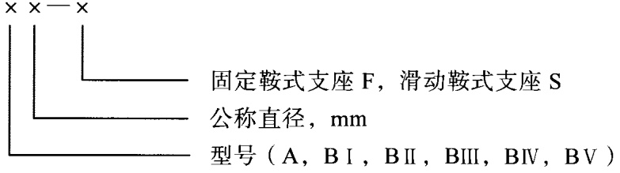

注1:若鞍式支座高度 $h$ ，垫板宽度 $b_{4}$ ，垫板厚度 $\delta_4$ ，底板滑动长孔长度 $l$ 与标准尺寸不同，则应在设备图纸零件名称栏或备注栏注明。

如: $h = 450$ ， $b_{4} = 200$ ， $\delta_4 = 12$ ， $l = 30$

### 6.2 标记示例

示例1:DN325mm， $120^{\circ}$ 包角，重型不带垫板的标准尺寸的弯制固定式鞍式支座，鞍式支座材料为Q345R。

标记:NB/T 47065.1—2018，鞍式支座 BV325-F

材料栏内注:Q345R

示例 2:DN1600mm，150°包角，重型滑动鞍式支座，鞍式支座材料 Q235B，垫板材料 S30408，鞍式支座高度为 400mm，垫板厚度为 12mm，滑动长孔长度为 60mm。

标记:NB/T 47065.1—2018，鞍式支座 BⅡ1600—S，h=400， $\delta_{4}=12$ ，l=60

材料栏内注:Q235B/S30408

## 7 制造技术要求

7.1 焊接可采用电弧焊或气体保护焊（使用药芯焊丝除外），焊材应根据支座材料参照有关标准选用。焊接接头型式和尺寸应符合GB/T985.1的规定。

7.2 鞍式支座本体的焊接，采用双面连续角焊。鞍式支座与容器圆筒焊接采用连续焊。焊缝腰高取较薄板厚度的 0.4 倍～0.6 倍，且不小于 5mm。

7.3 焊缝表面不得有裂纹、夹渣、气孔和弧坑等缺陷，并不得残留有熔渣和飞溅物。

7.4 垫板应与容器壁贴合。

7.5 鞍式支座螺栓孔间距 $l_{2}$ 允许偏差值为 $\pm 2\mathrm{mm}$。

<!-- page: 37 -->

7.6 鞍式支座的螺栓孔和其他部分的制造公差分别按GB/T1804中 $\mathrm{m}$ 级与GB/T1804中c级精度。

7.7 与腹板相接侧的筋板两端应切成 $25 \times 45^{\circ}$ 的倒角（图中注明者除外）。

7.8 鞍式支座所有组焊零件周边粗糙度为 $Ra50\mu m$。

7.9 若容器壳体有热处理要求，鞍式支座垫板应在热处理前焊于容器上。

7.10 鞍式支座组焊完毕，各部件应平整，不得翘曲。

## 8 选用方法

### 8.1 鞍式支座型式选定

a）按鞍式支座实际承载的大小确定选用轻型或重型鞍式支座；

b）按容器圆筒强度的需要确定选用 $120^{\circ}$ 包角或 $150^{\circ}$ 包角的鞍式支座；

c）换热器优先选用 $120^{\circ}$ 包角或 $150^{\circ}$ 包角的重型鞍式支座。

### 8.2 鞍式支座允许载荷

第4章中给出了标准高度下鞍式支座的允许载荷，当鞍式支座高度高于标准高度时，鞍式支座允许载荷随之降低，应予以修正。

### 8.3 垫板选用

公称直径 $DN \leqslant 900\mathrm{mm}$ 的容器，鞍式支座分为带垫板和不带垫板两种结构型式；当符合下列条件之一时，必须设置垫板:

a）容器圆筒有效厚度小于或等于3mm；

b）容器圆筒鞍式支座处的周向应力大于规定值；

c）容器圆筒有热处理要求；

d）容器圆筒与鞍式支座间温差大于 $200^{\circ}\mathrm{C}$；

e）当容器圆筒材料与鞍式支座材料不具有相同或相近化学成分和性能指标。

### 8.4 鞍式支座安装要求

8.4.1 当容器操作壁温与安装环境有较大差异时，应根据容器圆筒金属温度、两鞍式支座间距，按附录B核算螺栓孔长度 $l$ 。

8.4.2 鞍式支座螺栓孔应根据容器不同膨胀形式，按图12要求进行布置和安装。

### 8.5 基础垫板

当容器基础为钢筋混凝土时，滑动鞍式支座底板下面必须安装基础垫板，基础垫板必须保持平整光滑，垫板尺寸参照附录C确定。基础垫板由设计者在图样上规定其供货关系。

<!-- page: 38 -->

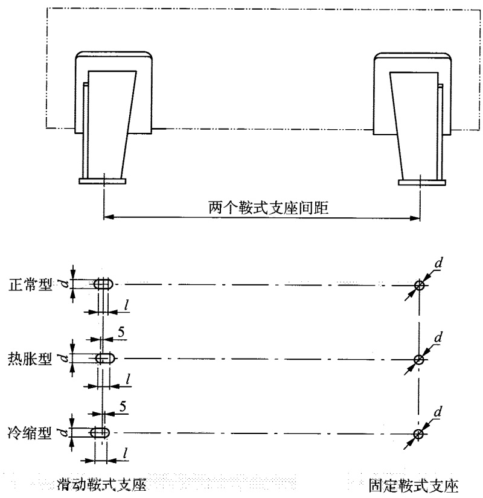

图12 鞍式支座安装间距

<!-- page: 39 -->

## 附录A

（资料性附录）

A.1 轻型鞍式支座的允许载荷按表 A.1 查取。

单位为kN

| 容器直径/mm | 支座高度/mm |  |  |  |  |  |  |  |  |  |  |  |  |  |
|---|---|---|---|---|---|---|---|---|---|---|---|---|---|---|
| 200 | 250 | 300 | 350 | 400 | 450 | 500 | 600 | 700 | 800 | 900 | 1 000 | 1 100 | 1 200 |  |
| 1 000 | 158 | — | 110 | 96 | 85 | 76 | 69 | 58 | 50 | 44 | 39 | 35 | 32 | 30 |
| 1 100 | 160 | — | 111 | 97 | 85 | 77 | 69 | 58 | 50 | 44 | 40 | 36 | 33 | 30 |
| 1 200 | 162 | — | 113 | 98 | 86 | 77 | 70 | 59 | 51 | 45 | 40 | 36 | 33 | 30 |
| 1 300 | 174 | — | 120 | 104 | 92 | 82 | 74 | 62 | 54 | 47 | 42 | 38 | 35 | 32 |
| 1 400 | 175 | — | 121 | 105 | 92 | 82 | 75 | 63 | 54 | 47 | 42 | 38 | 35 | 32 |
| 1 500 | — | 257 | 219 | 190 | 168 | 151 | 137 | 115 | 100 | 88 | 78 | 71 | 64 | 59 |
| 1 600 | — | 259 | 220 | 192 | 169 | 152 | 138 | 116 | 100 | 88 | 79 | 71 | 65 | 60 |
| 1 700 | — | 262 | 223 | 194 | 171 | 153 | 139 | 117 | 101 | 89 | 79 | 72 | 65 | 60 |
| 1 800 | — | 334 | 284 | 247 | 218 | 196 | 177 | 149 | 129 | 114 | 101 | 92 | 83 | 77 |
| 1 900 | — | 338 | 287 | 250 | 221 | 198 | 179 | 151 | 130 | 115 | 102 | 92 | 84 | 77 |
| 2 000 | — | 340 | 289 | 251 | 222 | 199 | 180 | 151 | 131 | 115 | 103 | 93 | 85 | 78 |
| 2 100 | — | 559 | 478 | 417 | 370 | 332 | 302 | 255 | 221 | 194 | 174 | 157 | 143 | 132 |
| 2 200 | — | 564 | 482 | 420 | 373 | 335 | 304 | 257 | 222 | 196 | 175 | 158 | 144 | 133 |
| 2 300 | — | 569 | 486 | 424 | 376 | 337 | 306 | 258 | 223 | 197 | 176 | 159 | 145 | 133 |
| 2 400 | — | 573 | 489 | 426 | 378 | 339 | 308 | 260 | 225 | 198 | 177 | 160 | 146 | 134 |
| 2 500 | — | 871 | 749 | 657 | 585 | 527 | 480 | 407 | 353 | 312 | 279 | 253 | 231 | 213 |
| 2 600 | — | 878 | 755 | 662 | 589 | 531 | 483 | 409 | 355 | 314 | 281 | 254 | 232 | 214 |
| 2 700 | — | 886 | 761 | 667 | 594 | 535 | 487 | 412 | 358 | 316 | 283 | 256 | 234 | 215 |
| 2 800 | — | 893 | 767 | 672 | 598 | 538 | 490 | 415 | 360 | 318 | 284 | 257 | 235 | 216 |
| 2 900 | — | 1 388 | 1 202 | 1 060 | 948 | 858 | 783 | 667 | 581 | 514 | 461 | 418 | 383 | 353 |
| 3 000 | — | 1 398 | 1 210 | 1 067 | 954 | 863 | 788 | 671 | 584 | 517 | 464 | 421 | 385 | 355 |
| 3 100 | — | 1 410 | 1 220 | 1 076 | 962 | 869 | 793 | 675 | 588 | 520 | 467 | 423 | 387 | 357 |

<!-- page: 40 -->

表 A. 1 (续)

| 容器直径/mm | 支座高度/mm |  |  |  |  |  |  |  |  |  |  |  |  |  |
|---|---|---|---|---|---|---|---|---|---|---|---|---|---|---|
| 200 | 250 | 300 | 350 | 400 | 450 | 500 | 600 | 700 | 800 | 900 | 1 000 | 1 100 | 1 200 |  |
| 3 200 | — | 1 420 | 1 228 | 1 082 | 967 | 875 | 798 | 679 | 591 | 523 | 469 | 425 | 389 | 358 |
| 3 300 | — | 1 430 | 1 237 | 1 089 | 973 | 880 | 803 | 683 | 594 | 526 | 471 | 427 | 391 | 360 |
| 3 400 | — | 1 645 | 1 422 | 1 253 | 1 119 | 1 011 | 922 | 785 | 683 | 604 | 542 | 491 | 449 | 414 |
| 3 500 | — | 1 656 | 1 431 | 1 260 | 1 125 | 1 017 | 927 | 788 | 686 | 607 | 544 | 493 | 451 | 415 |
| 3 600 | — | 1 667 | 1 440 | 1 267 | 1 132 | 1 022 | 932 | 792 | 689 | 610 | 547 | 495 | 453 | 417 |
| 3 700 | — | 1 677 | 1 448 | 1 274 | 1 137 | 1 027 | 937 | 796 | 692 | 612 | 549 | 497 | 455 | 419 |
| 3 800 | — | 1 945 | 1 683 | 1 483 | 1 326 | 1 199 | 1 094 | 931 | 810 | 717 | 644 | 583 | 534 | 492 |
| 3 900 | — | 1 958 | 1 694 | 1 492 | 1 334 | 1 206 | 1 100 | 936 | 814 | 721 | 647 | 586 | 536 | 494 |
| 4 000 | — | 1 969 | 1 703 | 1 500 | 1 340 | 1 211 | 1 105 | 940 | 818 | 724 | 649 | 588 | 538 | 496 |
| 4 100 | — | 2 365 | 2 037 | 1 788 | 1 594 | 1 438 | 1 309 | 1 111 | 965 | 853 | 764 | 692 | 632 | 582 |
| 4 200 | — | 2 374 | 2 044 | 1 794 | 1 599 | 1 442 | 1 313 | 1 114 | 967 | 855 | 766 | 693 | 634 | 583 |
| 4 300 | — | 2 385 | 2 053 | 1 801 | 1 605 | 1 447 | 1 318 | 1 118 | 970 | 857 | 768 | 695 | 635 | 585 |
| 4 400 | — | 2 397 | 2 062 | 1 809 | 1 612 | 1 453 | 1 323 | 1 122 | 974 | 860 | 770 | 697 | 637 | 587 |
| 4 500 | — | 3 021 | 2 606 | 2 291 | 2 044 | 1 845 | 1 681 | 1 428 | 1 241 | 1 097 | 983 | 891 | 814 | 750 |
| 4 600 | — | 3 036 | 2 618 | 2 300 | 2 052 | 1 852 | 1 687 | 1 433 | 1 245 | 1 101 | 986 | 893 | 817 | 752 |
| 4 700 | — | 3 049 | 2 628 | 2 309 | 2 059 | 1 858 | 1 693 | 1 437 | 1 248 | 1 104 | 989 | 896 | 819 | 754 |
| 4 800 | — | 3 061 | 2 637 | 2 317 | 2 066 | 1 864 | 1 698 | 1 441 | 1 252 | 1 106 | 991 | 898 | 820 | 755 |
| 4 900 | — | 3 068 | 2 643 | 2 321 | 2 069 | 1 867 | 1 700 | 1 443 | 1 253 | 1 108 | 993 | 899 | 822 | 756 |
| 5 000 | — | 3 539 | 3 052 | 2 683 | 2 394 | 2 161 | 1 969 | 1 672 | 1 453 | 1 285 | 1 152 | 1 043 | 954 | 878 |
| 5 100 | — | 3 553 | 3 063 | 2 692 | 2 401 | 2 167 | 1 975 | 1 677 | 1 457 | 1 288 | 1 154 | 1 046 | 956 | 880 |
| 5 200 | — | 3 567 | 3 074 | 2 701 | 2 409 | 2 174 | 1 980 | 1 681 | 1 461 | 1 291 | 1 157 | 1 048 | 958 | 882 |
| 5 300 | — | 3 580 | 3 085 | 2 710 | 2 416 | 2 180 | 1 986 | 1 685 | 1 464 | 1 294 | 1 159 | 1 050 | 960 | 884 |
| 5 400 | — | 4 083 | 3 522 | 3 097 | 2 763 | 2 495 | 2 273 | 1 931 | 1 678 | 1 484 | 1 330 | 1 205 | 1 102 | 1 014 |
| 5 500 | — | 4 098 | 3 534 | 3 107 | 2 771 | 2 501 | 2 279 | 1 936 | 1 682 | 1 487 | 1 333 | 1 208 | 1 104 | 1 016 |
| 5 600 | — | 4 113 | 3 546 | 3 116 | 2 779 | 2 508 | 2 285 | 1 941 | 1 686 | 1 491 | 1 336 | 1 210 | 1 106 | 1 018 |
| 5 700 | — | 4 490 | 3 872 | 3 403 | 3 036 | 2 740 | 2 496 | 2 120 | 1 842 | 1 629 | 1 460 | 1 322 | 1 209 | 1 113 |
| 5 800 | — | 4 505 | 3 883 | 3 412 | 3 043 | 2 746 | 2 502 | 2 124 | 1 846 | 1 632 | 1 462 | 1 325 | 1 211 | 1 115 |
| 5 900 | — | 4 901 | 4 225 | 3 713 | 3 312 | 2 989 | 2 724 | 2 313 | 2 009 | 1 776 | 1 592 | 1 442 | 1 318 | 1 214 |
| 6 000 | — | 4 918 | 4 239 | 3 724 | 3 321 | 2 997 | 2 730 | 2 318 | 2 014 | 1 780 | 1 595 | 1 445 | 1 321 | 1 216 |

<!-- page: 41 -->

A.2 重型鞍式支座的允许载荷按表A.2查取。

单位为 kN

| 容器直径/mm | 支座高度/mm |  |  |  |  |  |  |  |  |  |  |  |  |  |
|---|---|---|---|---|---|---|---|---|---|---|---|---|---|---|
| 200 | 250 | 300 | 350 | 400 | 450 | 500 | 600 | 700 | 800 | 900 | 1 000 | 1 100 | 1 200 |  |
| 168 | 27 | - | 19 | 16 | 14 | 13 | 11 | 10 | 8 | 7 | 6 | 6 | 5 | 5 |
| 219 | 28 | - | 19 | 17 | 15 | 13 | 12 | 10 | 8 | 7 | 7 | 6 | 5 | 5 |
| 273 | 29 | - | 20 | 17 | 15 | 13 | 12 | 10 | 9 | 8 | 7 | 6 | 6 | 5 |
| 325 | 41 | - | 28 | 24 | 21 | 19 | 17 | 14 | 12 | 11 | 10 | 9 | 8 | 7 |
| 356 | 42 | - | 29 | 25 | 22 | 19 | 18 | 15 | 13 | 11 | 10 | 9 | 8 | 7 |
| 406 | 43 | - | 29 | 25 | 22 | 20 | 18 | 15 | 13 | 11 | 10 | 9 | 8 | 8 |
| 300 | 72 | - | 51 | 44 | 39 | 35 | 32 | 27 | 23 | 20 | 18 | 16 | 15 | 14 |
| 350 | 74 | - | 52 | 45 | 40 | 36 | 32 | 27 | 23 | 21 | 18 | 17 | 15 | 14 |
| 400 | 76 | - | 53 | 46 | 41 | 36 | 33 | 28 | 24 | 21 | 19 | 17 | 15 | 14 |
| 450 | 77 | - | 53 | 46 | 41 | 37 | 33 | 28 | 24 | 21 | 19 | 17 | 16 | 14 |
| 500 | 123 | - | 86 | 75 | 66 | 59 | 54 | 45 | 39 | 34 | 31 | 28 | 25 | 23 |
| 550 | 126 | - | 88 | 76 | 67 | 60 | 55 | 46 | 40 | 35 | 31 | 28 | 26 | 24 |
| 600 | 127 | - | 88 | 77 | 68 | 61 | 55 | 46 | 40 | 35 | 31 | 28 | 26 | 24 |
| 650 | 129 | - | 90 | 78 | 69 | 61 | 56 | 47 | 40 | 35 | 32 | 29 | 26 | 24 |
| 700 | 131 | - | 91 | 79 | 69 | 62 | 56 | 47 | 41 | 36 | 32 | 29 | 26 | 24 |
| 750 | 132 | - | 91 | 79 | 70 | 63 | 57 | 48 | 41 | 36 | 32 | 29 | 26 | 24 |
| 800 | 207 | - | 144 | 125 | 111 | 99 | 90 | 76 | 65 | 57 | 51 | 46 | 42 | 39 |
| 850 | 210 | - | 146 | 127 | 112 | 100 | 91 | 76 | 66 | 58 | 52 | 47 | 43 | 39 |
| 900 | 212 | - | 147 | 128 | 113 | 101 | 91 | 77 | 66 | 58 | 52 | 47 | 43 | 39 |
| 950 | 213 | - | 148 | 128 | 113 | 101 | 92 | 77 | 66 | 58 | 52 | 47 | 43 | 39 |
| 1 000 | 327 | - | 228 | 199 | 176 | 157 | 143 | 120 | 104 | 91 | 81 | 73 | 67 | 62 |
| 1 100 | 332 | - | 232 | 201 | 178 | 159 | 144 | 121 | 105 | 92 | 82 | 74 | 68 | 62 |
| 1 200 | 336 | - | 234 | 203 | 180 | 161 | 146 | 123 | 106 | 93 | 83 | 75 | 68 | 63 |
| 1 300 | 340 | - | 237 | 205 | 181 | 162 | 147 | 124 | 107 | 94 | 84 | 76 | 69 | 63 |
| 1 400 | 344 | - | 239 | 207 | 183 | 164 | 148 | 125 | 108 | 95 | 84 | 76 | 69 | 64 |
| 1 500 | - | 463 | 394 | 343 | 304 | 272 | 247 | 208 | 180 | 158 | 141 | 128 | 117 | 107 |
| 1 600 | - | 468 | 398 | 346 | 307 | 275 | 249 | 210 | 181 | 160 | 143 | 129 | 118 | 108 |
| 1 700 | - | 473 | 402 | 350 | 309 | 277 | 251 | 212 | 183 | 161 | 144 | 130 | 118 | 109 |
| 1 800 | - | 574 | 489 | 426 | 378 | 339 | 307 | 259 | 224 | 197 | 176 | 159 | 145 | 134 |
| 1 900 | - | 580 | 494 | 430 | 381 | 342 | 310 | 261 | 226 | 199 | 178 | 161 | 146 | 135 |
| 2 000 | - | 585 | 498 | 434 | 384 | 344 | 312 | 263 | 227 | 200 | 179 | 162 | 147 | 135 |
| 2 100 | - | 1 090 | 934 | 817 | 726 | 653 | 594 | 502 | 435 | 384 | 344 | 311 | 284 | 261 |
| 2 200 | - | 1 100 | 942 | 824 | 732 | 658 | 598 | 506 | 438 | 387 | 346 | 313 | 286 | 263 |

<!-- page: 42 -->

表A.2（续）

| 容器直径/mm | 支座高度/mm |  |  |  |  |  |  |  |  |  |  |  |  |  |
|---|---|---|---|---|---|---|---|---|---|---|---|---|---|---|
| 200 | 250 | 300 | 350 | 400 | 450 | 500 | 600 | 700 | 800 | 900 | 1 000 | 1 100 | 1 200 |  |
| 2 300 | - | 1 110 | 950 | 830 | 738 | 663 | 603 | 510 | 441 | 389 | 348 | 315 | 287 | 264 |
| 2 400 | - | 1 120 | 958 | 837 | 744 | 669 | 607 | 513 | 445 | 392 | 351 | 317 | 289 | 266 |
| 2 500 | - | 1 910 | 1 648 | 1 449 | 1 293 | 1 167 | 1 064 | 904 | 786 | 695 | 623 | 564 | 516 | 475 |
| 2 600 | - | 1 930 | 1 664 | 1 463 | 1 305 | 1 178 | 1 074 | 912 | 792 | 700 | 628 | 569 | 520 | 479 |
| 2 700 | - | 1 940 | 1 672 | 1 469 | 1 310 | 1 183 | 1 077 | 915 | 795 | 703 | 630 | 570 | 521 | 480 |
| 2 800 | - | 1 960 | 1 689 | 1 483 | 1 323 | 1 193 | 1 087 | 923 | 801 | 708 | 635 | 575 | 525 | 484 |
| 2 900 | - | 2 830 | 2 454 | 2 165 | 1 938 | 1 754 | 1 601 | 1 364 | 1 189 | 1 053 | 945 | 857 | 784 | 723 |
| 3 000 | - | 2 860 | 2 479 | 2 187 | 1 957 | 1 770 | 1 616 | 1 377 | 1 199 | 1 062 | 953 | 864 | 791 | 729 |
| 3 100 | - | 2 880 | 2 495 | 2 200 | 1 968 | 1 780 | 1 625 | 1 384 | 1 205 | 1 067 | 958 | 868 | 794 | 732 |
| 3 200 | - | 2 900 | 2 511 | 2 214 | 1 980 | 1 790 | 1 634 | 1 391 | 1 211 | 1 072 | 962 | 872 | 798 | 735 |
| 3 300 | - | 2 920 | 2 527 | 2 228 | 1 992 | 1 801 | 1 643 | 1 399 | 1 217 | 1 078 | 967 | 877 | 802 | 739 |
| 3 400 | - | 3 550 | 3 079 | 2 719 | 2 434 | 2 203 | 2 013 | 1 715 | 1 495 | 1 324 | 1 189 | 1 078 | 987 | 910 |
| 3 500 | - | 3 570 | 3 096 | 2 732 | 2 445 | 2 213 | 2 021 | 1 722 | 1 500 | 1 329 | 1 193 | 1 082 | 990 | 913 |
| 3 600 | - | 3 600 | 3 120 | 2 753 | 2 464 | 2 229 | 2 035 | 1 734 | 1 510 | 1 338 | 1 200 | 1 089 | 996 | 918 |
| 3 700 | - | 3 620 | 3 136 | 2 767 | 2 475 | 2 239 | 2 044 | 1 741 | 1 516 | 1 343 | 1 205 | 1 093 | 1 000 | 921 |
| 3 800 | - | 4 160 | 3 604 | 3 179 | 2 844 | 2 572 | 2 348 | 2 000 | 1 742 | 1 542 | 1 384 | 1 255 | 1 148 | 1 058 |
| 3 900 | - | 4 190 | 3 628 | 3 200 | 2 862 | 2 588 | 2 362 | 2 011 | 1 751 | 1 551 | 1 391 | 1 262 | 1 154 | 1 063 |
| 4 000 | - | 4 220 | 3 653 | 3 220 | 2 879 | 2 604 | 2 376 | 2 023 | 1 761 | 1 559 | 1 398 | 1 268 | 1 160 | 1 069 |
| 4 100 | - | 4 330 | 3 747 | 3 302 | 2 951 | 2 668 | 2 434 | 2 072 | 1 803 | 1 596 | 1 432 | 1 298 | 1 187 | 1 094 |
| 4 200 | - | 4 350 | 3 763 | 3 315 | 2 963 | 2 678 | 2 443 | 2 079 | 1 809 | 1 601 | 1 436 | 1 302 | 1 191 | 1 097 |
| 4 300 | - | 4 370 | 3 779 | 3 328 | 2 974 | 2 688 | 2 452 | 2 086 | 1 815 | 1 606 | 1 440 | 1 306 | 1 194 | 1 100 |
| 4 400 | - | 4 400 | 3 803 | 3 349 | 2 992 | 2 703 | 2 466 | 2 097 | 1 824 | 1 614 | 1 447 | 1 312 | 1 200 | 1 105 |
| 4 500 | - | 5 030 | 4 354 | 3 838 | 3 432 | 3 103 | 2 832 | 2 411 | 2 098 | 1 858 | 1 667 | 1 511 | 1 382 | 1 274 |
| 4 600 | - | 5 060 | 4 378 | 3 859 | 3 449 | 3 118 | 2 845 | 2 422 | 2 108 | 1 866 | 1 674 | 1 517 | 1 388 | 1 279 |
| 4 700 | - | 5 080 | 4 394 | 3 872 | 3 460 | 3 128 | 2 854 | 2 428 | 2 113 | 1 870 | 1 677 | 1 521 | 1 391 | 1 281 |
| 4 800 | - | 5 100 | 4 410 | 3 885 | 3 471 | 3 137 | 2 862 | 2 435 | 2 118 | 1 875 | 1 681 | 1 524 | 1 394 | 1 284 |
| 4 900 | - | 5 120 | 4 427 | 3 899 | 3 483 | 3 148 | 2 871 | 2 442 | 2 125 | 1 880 | 1 686 | 1 529 | 1 398 | 1 288 |
| 5 000 | - | 6 050 | 5 244 | 4 627 | 4 141 | 3 746 | 3 421 | 2 914 | 2 538 | 2 248 | 2 018 | 1 830 | 1 674 | 1 543 |
| 5 100 | - | 6 070 | 5 260 | 4 640 | 4 151 | 3 755 | 3 429 | 2 920 | 2 543 | 2 252 | 2 021 | 1 833 | 1 677 | 1 546 |
| 5 200 | - | 6 100 | 5 284 | 4 660 | 4 169 | 3 771 | 3 442 | 2 931 | 2 552 | 2 260 | 2 028 | 1 839 | 1 683 | 1 550 |
| 5 300 | - | 6 120 | 5 300 | 4 673 | 4 179 | 3 780 | 3 450 | 2 937 | 2 557 | 2 264 | 2 032 | 1 842 | 1 685 | 1 553 |
| 5 400 | - | 6 870 | 5 967 | 5 274 | 4 726 | 4 280 | 3 912 | 3 337 | 2 909 | 2 579 | 2 316 | 2 102 | 1 924 | 1 773 |
| 5 500 | - | 6 900 | 5 992 | 5 295 | 4 743 | 4 295 | 3 925 | 3 347 | 2 918 | 2 586 | 2 322 | 2 107 | 1 929 | 1 778 |
| 5 600 | - | 6 920 | 6 007 | 5 307 | 4 753 | 4 304 | 3 932 | 3 353 | 2 923 | 2 590 | 2 326 | 2 110 | 1 931 | 1 780 |
| 5 700 | - | 7 970 | 6 933 | 6 134 | 5 501 | 4 986 | 4 559 | 3 893 | 3 396 | 3 012 | 2 706 | 2 456 | 2 249 | 2 074 |
| 5 800 | - | 8 000 | 6 957 | 6 154 | 5 517 | 5 000 | 4 572 | 3 903 | 3 404 | 3 019 | 2 712 | 2 462 | 2 254 | 2 078 |
| 5 900 | - | 8 380 | 7 300 | 6 467 | 5 805 | 5 266 | 4 818 | 4 118 | 3 595 | 3 191 | 2 868 | 2 604 | 2 385 | 2 200 |
| 6 000 | - | 8 440 | 7 351 | 6 510 | 5 842 | 5 299 | 4 848 | 4 143 | 3 616 | 3 209 | 2 884 | 2 619 | 2 398 | 2 212 |

<!-- page: 43 -->

A.3 $150^{\circ}$ 包角重型鞍式支座的允许载荷按表A.3查取。

单位为kN

| 容器直径/mm | 支座高度/mm |  |  |  |  |  |  |  |  |  |  |  |  |  |
|---|---|---|---|---|---|---|---|---|---|---|---|---|---|---|
| 200 | 250 | 300 | 350 | 400 | 450 | 500 | 600 | 700 | 800 | 900 | 1 000 | 1 100 | 1 200 |  |
| 1 000 | 340 | - | 237 | 205 | 181 | 162 | 147 | 124 | 107 | 94 | 84 | 76 | 69 | 63 |
| 1 100 | 344 | - | 239 | 207 | 183 | 164 | 148 | 125 | 108 | 95 | 84 | 76 | 69 | 64 |
| 1 200 | 348 | - | 242 | 209 | 185 | 166 | 150 | 126 | 109 | 95 | 85 | 77 | 70 | 64 |
| 1 300 | 352 | - | 244 | 211 | 187 | 167 | 151 | 127 | 110 | 96 | 86 | 77 | 71 | 65 |
| 1 400 | 356 | - | 246 | 214 | 188 | 169 | 152 | 128 | 110 | 97 | 87 | 78 | 71 | 65 |
| 1 500 | - | 480 | 408 | 354 | 313 | 281 | 255 | 214 | 185 | 163 | 145 | 131 | 120 | 110 |
| 1 600 | - | 484 | 411 | 357 | 316 | 283 | 256 | 216 | 186 | 164 | 146 | 132 | 120 | 111 |
| 1 700 | - | 489 | 415 | 360 | 318 | 285 | 258 | 217 | 188 | 165 | 147 | 133 | 121 | 111 |
| 1 800 | - | 593 | 504 | 439 | 388 | 348 | 316 | 266 | 230 | 202 | 181 | 163 | 149 | 137 |
| 1 900 | - | 597 | 508 | 441 | 391 | 350 | 317 | 267 | 231 | 203 | 181 | 164 | 149 | 137 |
| 2 000 | - | 602 | 512 | 445 | 393 | 353 | 320 | 269 | 232 | 204 | 183 | 165 | 150 | 138 |
| 2 100 | - | 1 131 | 967 | 845 | 750 | 675 | 613 | 518 | 449 | 396 | 354 | 320 | 292 | 269 |
| 2 200 | - | 1 141 | 976 | 852 | 756 | 680 | 617 | 522 | 452 | 398 | 356 | 322 | 294 | 270 |
| 2 300 | - | 1 150 | 983 | 858 | 761 | 684 | 621 | 525 | 454 | 400 | 358 | 324 | 295 | 272 |
| 2 400 | - | 1 159 | 990 | 864 | 767 | 689 | 625 | 528 | 457 | 403 | 360 | 326 | 297 | 273 |
| 2 500 | - | 1 971 | 1 698 | 1 491 | 1 329 | 1 199 | 1 092 | 927 | 805 | 712 | 638 | 577 | 528 | 486 |
| 2 600 | - | 1 985 | 1 709 | 1 501 | 1 338 | 1 206 | 1 099 | 932 | 810 | 715 | 641 | 580 | 530 | 488 |
| 2 700 | - | 2 000 | 1 721 | 1 511 | 1 346 | 1 214 | 1 105 | 938 | 814 | 719 | 644 | 583 | 533 | 491 |
| 2 800 | - | 2 015 | 1 734 | 1 521 | 1 355 | 1 222 | 1 112 | 943 | 819 | 723 | 648 | 587 | 536 | 493 |
| 2 900 | - | 2 918 | 2 526 | 2 227 | 1 991 | 1 800 | 1 643 | 1 399 | 1 218 | 1 078 | 967 | 877 | 802 | 739 |
| 3 000 | - | 2 939 | 2 543 | 2 241 | 2 003 | 1 811 | 1 653 | 1 406 | 1 224 | 1 083 | 972 | 881 | 806 | 743 |
| 3 100 | - | 2 958 | 2 559 | 2 254 | 2 015 | 1 821 | 1 661 | 1 413 | 1 230 | 1 089 | 976 | 885 | 810 | 746 |
| 3 200 | - | 2 976 | 2 573 | 2 266 | 2 025 | 1 830 | 1 669 | 1 420 | 1 235 | 1 093 | 981 | 889 | 813 | 749 |
| 3 300 | - | 2 996 | 2 589 | 2 280 | 2 037 | 1 840 | 1 678 | 1 427 | 1 242 | 1 099 | 985 | 893 | 817 | 752 |
| 3 400 | - | 3 639 | 3 152 | 2 780 | 2 487 | 2 249 | 2 053 | 1 748 | 1 522 | 1 348 | 1 210 | 1 097 | 1 004 | 925 |
| 3 500 | - | 3 663 | 3 172 | 2 796 | 2 501 | 2 261 | 2 064 | 1 757 | 1 530 | 1 355 | 1 215 | 1 102 | 1 008 | 929 |
| 3 600 | - | 3 686 | 3 190 | 2 812 | 2 514 | 2 273 | 2 074 | 1 766 | 1 537 | 1 360 | 1 220 | 1 107 | 1 012 | 933 |
| 3 700 | - | 3 705 | 3 206 | 2 825 | 2 525 | 2 283 | 2 083 | 1 772 | 1 542 | 1 365 | 1 225 | 1 110 | 1 016 | 936 |

<!-- page: 44 -->

表 A. 3 (续)

| 容器直径/mm | 支座高度/mm |  |  |  |  |  |  |  |  |  |  |  |  |  |
|---|---|---|---|---|---|---|---|---|---|---|---|---|---|---|
| 200 | 250 | 300 | 350 | 400 | 450 | 500 | 600 | 700 | 800 | 900 | 1 000 | 1 100 | 1 200 |  |
| 3 800 | — | 4 261 | 3 686 | 3 248 | 2 903 | 2 625 | 2 395 | 2 038 | 1 773 | 1 570 | 1 408 | 1 276 | 1 167 | 1 076 |
| 3 900 | — | 4 285 | 3 706 | 3 264 | 2 917 | 2 636 | 2 405 | 2 046 | 1 780 | 1 576 | 1 413 | 1 281 | 1 172 | 1 079 |
| 4 000 | — | 4 309 | 3 725 | 3 281 | 2 931 | 2 648 | 2 416 | 2 055 | 1 787 | 1 582 | 1 419 | 1 286 | 1 176 | 1 083 |
| 4 100 | — | 4 440 | 3 835 | 3 375 | 3 014 | 2 722 | 2 482 | 2 110 | 1 835 | 1 623 | 1 455 | 1 319 | 1 206 | 1 111 |
| 4 200 | — | 4 470 | 3 859 | 3 396 | 3 031 | 2 738 | 2 496 | 2 121 | 1 844 | 1 631 | 1 463 | 1 325 | 1 212 | 1 116 |
| 4 300 | — | 4 470 | 3 859 | 3 395 | 3 030 | 2 737 | 2 495 | 2 120 | 1 843 | 1 630 | 1 462 | 1 324 | 1 211 | 1 115 |
| 4 400 | — | 4 500 | 3 884 | 3 416 | 3 048 | 2 752 | 2 509 | 2 131 | 1 853 | 1 639 | 1 469 | 1 331 | 1 217 | 1 120 |
| 4 500 | — | 5 130 | 4 428 | 3 895 | 3 477 | 3 140 | 2 862 | 2 432 | 2 114 | 1 870 | 1 676 | 1 519 | 1 389 | 1 279 |
| 4 600 | — | 5 170 | 4 461 | 3 923 | 3 501 | 3 161 | 2 881 | 2 448 | 2 128 | 1 882 | 1 687 | 1 528 | 1 397 | 1 287 |
| 4 700 | — | 5 210 | 4 494 | 3 952 | 3 526 | 3 183 | 2 901 | 2 464 | 2 141 | 1 894 | 1 697 | 1 538 | 1 406 | 1 294 |
| 4 800 | — | 5 260 | 4 536 | 3 987 | 3 556 | 3 210 | 2 925 | 2 483 | 2 158 | 1 908 | 1 710 | 1 549 | 1 416 | 1 304 |
| 4 900 | — | 5 300 | 4 569 | 4 015 | 3 580 | 3 231 | 2 944 | 2 499 | 2 171 | 1 920 | 1 720 | 1 558 | 1 424 | 1 311 |
| 5 000 | — | 6 240 | 5 387 | 4 739 | 4 230 | 3 820 | 3 482 | 2 959 | 2 573 | 2 275 | 2 040 | 1 848 | 1 690 | 1 556 |
| 5 100 | — | 6 290 | 5 128 | 4 774 | 4 261 | 3 847 | 3 506 | 2 979 | 2 590 | 2 290 | 2 053 | 1 860 | 1 700 | 1 566 |
| 5 200 | — | 6 340 | 5 469 | 4 809 | 4 291 | 3 873 | 3 530 | 2 998 | 2 606 | 2 304 | 2 065 | 1 871 | 1 710 | 1 575 |
| 5 300 | — | 6 390 | 5 511 | 4 844 | 4 322 | 3 901 | 3 555 | 3 019 | 2 623 | 2 319 | 2 079 | 1 883 | 1 721 | 1 585 |
| 5 400 | — | 7 190 | 6 219 | 5 479 | 4 897 | 4 426 | 4 038 | 3 436 | 2 990 | 2 646 | 2 373 | 2 152 | 1 968 | 1 813 |
| 5 500 | — | 7 220 | 6 243 | 5 499 | 4 913 | 4 440 | 4 050 | 3 445 | 2 997 | 2 653 | 2 379 | 2 157 | 1 972 | 1 817 |
| 5 600 | — | 7 250 | 6 267 | 5 518 | 4 930 | 4 454 | 4 063 | 3 455 | 3 006 | 2 660 | 2 385 | 2 162 | 1 977 | 1 821 |
| 5 700 | — | 8 350 | 7 232 | 6 378 | 5 705 | 5 160 | 4 710 | 4 011 | 3 492 | 3 092 | 2 775 | 2 516 | 2 302 | 2 121 |
| 5 800 | — | 8 380 | 7 256 | 6 398 | 5 721 | 5 174 | 4 722 | 4 020 | 3 500 | 3 099 | 2 780 | 2 521 | 2 306 | 2 125 |
| 5 900 | — | 8 530 | 7 399 | 6 533 | 5 848 | 5 294 | 4 835 | 4 121 | 3 591 | 3 181 | 2 856 | 2 591 | 2 371 | 2 185 |
| 6 000 | — | 8 590 | 7 449 | 6 575 | 5 885 | 5 326 | 4 864 | 4 145 | 3 611 | 3 199 | 2 871 | 2 605 | 2 383 | 2 196 |

<!-- page: 45 -->

## 附录B

（资料性附录）

滑动鞍式支座螺栓孔长度

滑动鞍式支座所需螺栓孔长度根据容器圆筒金属壁温和鞍式支座间距按表B.1查取。

单位为 mm

| 两鞍式支座间距 | 圆筒金属温度/°C |  |  |  |  |  |  |
|---|---|---|---|---|---|---|---|
| 50 | 100 | 150 | 200 | 250 | 300 | 325 |  |
| 2 000 | 20 |  |  |  |  |  |  |
| 3 000 |  |  |  |  |  |  |  |
| 4 000 |  |  |  |  |  |  |  |
| 5 000 |  |  |  |  |  |  |  |
| 6 000 |  |  |  |  |  |  |  |
| 7 000 |  |  |  |  |  |  |  |
| 8 000 |  |  |  |  |  |  |  |
| 9 000 |  |  |  |  |  |  |  |
| 10 000 |  |  |  |  |  |  |  |
| 11 000 |  |  |  |  |  |  |  |
| 12 000 |  |  |  |  |  |  |  |
| 13 000 |  |  |  |  |  |  |  |
| 14 000 |  |  |  |  |  |  |  |
| 15 000 |  |  |  |  |  |  |  |
| 注:计算基准:1)材料按奥氏体不锈钢;2)环境温度为25°C。 |  |  |  |  |  |  |  |

<!-- page: 46 -->

## 附录C

（资料性附录）

C.1 鞍式支座基础垫板尺寸及结构如图C.1所示。

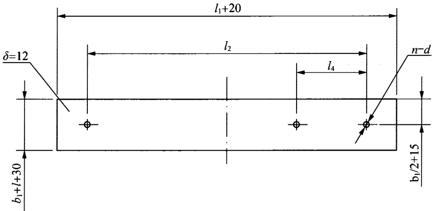

图C.1

C.2 鞍式支座基础垫板尺寸图中的伸长方向应为容器支座的移动方向。

C.3 鞍式支座基础垫板尺寸图中螺孔直径 $d$ 按式（C.1）取值:

$d = M + 2\mathrm{mm}$ (C.1)

式中:

M——螺纹公称直径。

<!-- page: 47 -->

The image provided is completely blank, with no visible text, figures, or content to extract. Therefore, there is no OCR result to output.

<!-- page: 48 -->

## NB/T 47065.1—2018《容器支座 第1部分:鞍式支座》编制说明

### 1 概述

本部分是在 JB/T 4712.1—2007《容器支座 第1部分:鞍式支座》的基础上，根据 NB/T 47042—2014《卧式容器》中的规定，结合有关设计、制造及使用单位反馈的意见，对原标准的部分内容进行了修订。

### 2 主要修订内容

2.1 按照 NBT/47042—2014《卧式容器》的规定，作为鞍式支座设计的基本依据。

2.2 按照 GB/T 9019—2015《压力容器公称直径》的规定，补充齐全直径系列中的空档，增加 DN4100～DN6000 直径系列的轻型鞍式支座、重型鞍式支座和 150°包角的鞍式支座系列。

2.3 核算了鞍式支座的轴向宽度，并调整了鞍式支座垫板及相应筋板的尺寸。

2.4 鞍式支座的材料可以采用 Q235B、Q345B 和 Q345R，鞍式支座的使用温度范围拓宽为 $-40^{\circ}C \sim 200^{\circ}C$ 的工况。

2.5 取消了鞍式支座的地震设防烈度的限制。

2.6 增加了地脚螺栓的数量。

2.7 按照NB/T47042—2014《卧式容器》中规定的载荷组合，计算鞍式支座的许用载荷。

### 3 对修订内容的说明

3.1 按照NB/T47042—2014《卧式容器》的规定，作为鞍式支座设计的基本依据。

NB/T 47042—2014《卧式容器》中对鞍式支座的尺寸设置、材料选用、载荷计算等内容进行了详尽的规定，以 NB/T 47042—2014《卧式容器》中的规定作为本标准的编制依据，更加方便于压力容器设计者在设计中的选用鞍式支座及进行载荷核算。

### 3.2 增加了鞍式支座系列中的规格。

目前，我国石油化工装置的大型化已经成为新的发展趋势，很多工程公司和设计单位在设计中需要大尺寸的鞍式支座，以满足设备大型化的设计需要。因此，在JB/T4712.1—2007《容器支座 第1部分:鞍式支座》的基础上，按照GB/T9019—2015《压力容器公称直径》的规定，补充齐全直径系列中的空档；重点是增加DN4100～DN6000直径系列的轻型鞍式支座、重型鞍式支座和 $150^{\circ}$ 包角的鞍式支座系列，扩大了鞍式支座的应用范围。

在新的鞍式支座标准中，按照 GB/T 9019—2015《压力容器公称直径》标准中规定的直径规格增加鞍式支座的规格:

轻型鞍式支座规格从 DN1000～DN4000 扩大至 DN1000～DN6000 规格范围；

120°包角的重型鞍式支座规格从DN159～DN4000扩大至DN168～DN6000规格范围；

150°包角的重型鞍式支座规格从 DN1000～4000 扩大至 DN1000～6000 规格范围。

<!-- page: 49 -->

### 3.3 核算了鞍式支座的轴向宽度，并调整了鞍式支座垫板及相应筋板的尺寸。

NB/T 47042—2014《卧式容器》标准中对鞍式支座的轴向宽度和鞍式支座垫板的宽度 $b_{4}$ 均有规定，鞍式支座的轴向宽度应满足 $b \geqslant 8\sqrt{R_{a}}$，鞍式支座垫板的宽度应满足 $b_{4} > b_{2} = b + 1.56\sqrt{R_{a}\delta_{n}}$，在标准的修订过程中，核对了鞍式支座的轴向宽度和的垫板宽度，随之调整了筋板 $b_{3}$ 的尺寸，使得鞍式支座与 NB/T 47042—2014《卧式容器》更加吻合。

### 3.4 鞍式支座的材料可以采用 Q235B、Q345A、Q345B 和 Q345R，鞍式支座的使用温度范围拓宽为  -40^{\circ}C \sim 200^{\circ}C  工况。

鞍式支座常用的材料为 Q235B、Q345A、Q345B 和 Q345R，本标准采用这些材料主要考虑以下因素:

a）Q235B、Q345A、Q345B 和 Q345R 材料是目前常用的压力容器材料，材料许用应力属于 147MPa、170MPa 两个等级；同时允许使用温度为 $-20^{\circ}C \sim 200^{\circ}C$ 、 $-40^{\circ}C \sim 200^{\circ}C$ 两个范围，基本满足了我国绝大部分地区对鞍式支座工况的要求。

b）在鞍式支座结构尺寸表中，给出以 Q345R 材料计算的鞍式支座允许载荷，Q345R 材料允许强度值 $[\sigma] = 170\mathrm{MPa}$，可以兼顾使用 Q345B 材料制作鞍式支座。

c）当鞍式支座材料采用 Q235B 时，在标准中给出了公称直径 $DN \leqslant 4\ 000mm$ 的鞍式支座系列的允许载荷值，对于公称直径 $DN > 4\ 000mm$ 的鞍式支座，推荐选用 Q345 档次的材料制作。

d）对于鞍式支座的使用温度低于-40℃的情况，本标准允许设计者使用自己选择的材料，通过材料标注加以更改。但鞍式支座的允许载荷应由设计者负责进行变更。

### 3.5 取消了鞍式支座的地震设防烈度的限制。

NB/T 47042—2014《卧式容器》中规定的地震设防烈度为9度，需要进行鞍式支座压缩应力校核的地震载荷仅为水平地震力。

在本部分的鞍式支座载荷计算中，摩擦力法包括水平地震力和温度变化引起的摩擦力两种载荷，但最危险的工况为温度变化引起的摩擦力，因此，摩擦力工况的考虑涵盖了地震设防烈度为9度的水平地震力工况。

也是由于 NB/T 47042—2014《卧式容器》中规定的鞍式支座腹板水平拉应力校核中，计入了鞍式支座垫板厚度的作用，极大地提高了鞍式支座抗水平拉应力的能力；鞍式支座腹板厚度制约鞍式支座承载的影响度予以降低了。

### 3.6 增加了地脚螺栓的数量。

在本次修订中，部分规格鞍式支座的地脚螺栓尺寸予以加大；部分规格鞍式支座的地脚螺栓数量予以增加，由原标准中2个增加为4个。主要考虑的因素为:

a）根据收集到的部分施工现场的反映，原标准中地脚螺栓尺寸在 2m 范围后偏小，极易被现场碰弯；

b）借鉴了有关国内外大型工程公司的企业标准，其地脚螺栓尺寸和个数均比本部分大；

c）本部分已经取消了鞍式支座的地震设防烈度的限制，如果发生9度地震的工况，固定端的鞍式支座地脚螺栓有可能承受较大的剪切力。

基于上述原因，本部分对地脚螺栓进行了调整:

1 500mm 以上的部分鞍式支座，特别是重型鞍式支座（包括 $150^{\circ}$ 包角）的地脚螺栓直径加大；2 800mm 以上的鞍式支座的地脚螺栓直径和数量均予以调整。

<!-- page: 50 -->

### 4 鞍式支座允许载荷 Q 的确定

GB/T 47042—2014《卧式容器》标准中对鞍式支座的允许载荷的计算有着明确的规定，本部分修订过程中依据 GB/T 47042—2014《卧式容器》进行鞍式支座的允许载荷计算，为了方便使用者正确使用本部分，现将鞍式支座允许载荷的确定方法介绍如下:

### 4.1 鞍式支座的受力分析

a）鞍式支座腹板水平拉应力:

$$ \sigma_ {9} = \frac {K _ {9} Q}{H _ {\mathrm{s}} b _ {0} + b _ {\mathrm{r}} \delta_ {\mathrm{re}}} $$

式中:

$\sigma_{9}$ ——鞍式支座腹板有效截面内水平方向平均拉应力，MPa；

$Q$ ——每个支座的反力，N；

$H_{s}$ ——计算高度，mm；

$b_{0}$ ——鞍式支座腹板厚度，mm；

$b_{r}$ ——鞍式支座垫板有效宽度（如果设置垫板），mm；

$\delta_{re}$ ——鞍式支座垫板有效厚度（如果设置垫板），mm；

$K_{9}$ ——系数，当鞍式支座包角 $\theta = 120^{\circ}$ 时， $K_{9} = 0.204$；当鞍式支座包角 $\theta = 150^{\circ}$ 时， $K_{9} = 0.259$。

b）地震载荷引起鞍式支座组合截面内的压应力:

$$ \begin{array}{r l r} {\sigma_ {\mathrm{sa}} = - \frac {Q}{A _ {\mathrm{sa}}} - \frac {\alpha_ {1} Q H}{Z _ {\mathrm{r}}} - \frac {2 \alpha_ {1} Q H _ {\mathrm{v}}}{A _ {\mathrm{sa}} (L - 2 A)}} & & {(\text {当} 2 \alpha_ {1} Q \leqslant 2 f Q \text {时})} \\ {\sigma_ {\mathrm{sa}} = - \frac {Q}{A _ {\mathrm{sa}}} - \frac {(2 \alpha_ {1} f _ {\mathrm{s}}) Q H}{Z _ {\mathrm{r}}} - \frac {2 \alpha_ {1} Q H _ {\mathrm{v}}}{A _ {\mathrm{sa}} (L - 2 A)}} & & {(\text {当} 2 \alpha_ {1} Q > 2 f Q \text {时})} \end{array} $$

式中:

$\sigma_{\mathrm{sa}}$ ——地震载荷引起鞍式支座组合截面内的压应力， $\mathrm{MPa}$；

$Q$ ——每个支座的反力，N；

$A_{\mathrm{sa}}$ ——鞍座腹板与筋板组合截面积， $\mathrm{mm}^2$

H——鞍式支座高度，mm；

$H_{\mathrm{v}}$ ——圆筒中心至基础鞍式支座表面距离， $\mathrm{mm}$；

$Z_{r}$ ——鞍式支座腹板与筋板组合截面抗弯系数， $mm^{3}$ ;

$L$ ——封头切线间距离， $\mathrm{mm}$

$A$ ——鞍式支座中心线至封头切线的距离， $\mathrm{mm}$

$\alpha_{1}$ ——水平地震影响系数，当地震设防烈度为9度，设计基本地震加速度为 $0.40g$ 时， $\alpha_{1} = 0.32$

$f_{\mathrm{s}}$ ——鞍式支座底板对基础的动摩擦系数，取危险工况为钢对特氟隆时， $f_{\mathrm{s}} = 0.05$ 。

c）由温度变化引起鞍式支座组合截面内的压应力:

$$ \sigma_ {\mathrm{sa}} ^ {\mathrm{t}} = - \frac {Q}{A _ {\mathrm{sa}}} - \frac {f Q H}{Z _ {\mathrm{r}}} $$

式中:

$\sigma_{sa}^{t}$ ——温度变化引起鞍式支座组合截面内的压应力，MPa；

$f$ ——鞍式支座底板对基础的静摩擦系数，取危险工况为钢对水泥时， $f = 0.4$ 。

<!-- page: 51 -->

### 4.2 鞍式支座的允许载荷设计工况

以上表述了鞍式支座设计的三种工况，a）工况是核算鞍式支座腹板的拉应力，b）、c）工况同属核算鞍式支座组合截面内的压应力。

在本部分的鞍式支座允许荷载的计算中，b）工况的水平地震力大于鞍式支座底板与基础静摩擦力时（即 $f_{s}=0.05$ ）为危险工况；c）工况的鞍式支座底板对基础的静摩擦系数取为钢对水泥时（即f=0.4）为危险工况；因此，需要在b）、c）工况中进行比较。

b）工况的最危险工况时:取 $\alpha_{1} = 0.32$ ， $f_{\mathrm{s}} = 0.05$ ，则: $2\alpha_{1} - f_{\mathrm{s}} = 2\times 0.32 - 0.05 = 0.59;$

c）工况的最危险工况时:取钢对水泥，则 $f = 0.4$。

经比较，b）工况最为苛刻，在本部分的鞍式支座允许载荷的计算中，取计算系数 $f' = 0.59$ 作为鞍式支座组合截面内的压应力核算依据，可以基本涵盖地震设防烈度为9度的工况和最危险的温差变化工况，拓宽了鞍式支座的使用范围。

因此本部分鞍式支座的允许载荷计算采用a）、c）工况进行，即:

$$ \left[ \sigma \right] \leqslant \max \left[ \sigma_ {\mathrm{sa}} ^ {\mathrm{t}}, \sigma_ {9} \right] $$

### 4.3 鞍式支座允许载荷 [Q]

a）按鞍式支座腹板水平拉应力确定的 $[Q]$ 水平方法:

$$ [ Q ] _ {\mathrm{水平方法}} = \frac {[ \sigma ] (H _ {\mathrm{s}} b _ {0} + b _ {\mathrm{r}} \delta_ {\mathrm{re}})}{K _ {9}} $$

b）按鞍式支座组合截面内的压应力确定的 $[Q]_{\text{组合截面法}}$ :

$$ \left[ Q \right] _ {\text {组合截面法}} = \frac {[ \sigma ]}{\frac {1}{A _ {\mathrm{sa}}} + \frac {f ^ {\prime} H}{Z _ {\mathrm{r}}}}\left. \right] $$

c）鞍式支座材料的选用及 $[\sigma]$ 的确定:

鞍式支座常用的材料为Q235B、Q345B和Q345R，本部分主要推荐Q345R为鞍式支座使用的材料，其 $[\sigma]$ 取值为 $170\mathrm{MPa}$，主要考虑以下因素:

1）Q345R 材料的设计温度范围: $-40^{\circ}C \sim 200^{\circ}C$ ，基本满足了我国绝大部分寒冷地区对鞍式支座低温工况的要求；

2）Q345R材料是目前常用的压力容器材料，材料允许强度值 $[\sigma]$ 取 $170\mathrm{MPa}$，应用范围较广；

3）对于 Q235B 材料制作鞍式支座时，本部分给出了修正后的鞍式支座允许载荷；

4）对于其他材料制作鞍式支座时，应按 Q345R 材料初步确定其允许载荷，再用实际材料的许用应力值对其进行修正，从而确定鞍式支座的允许载荷。

d）鞍式支座允许载荷 $[Q]$ 的确定:

鞍式支座的允许载荷是分别计算按鞍式支座腹板水平拉应力确定的 $[Q]_{\text{水平方法}}$ 和按鞍式支座腹板水平拉应力确定的 $[Q]_{\text{组合截面法}}$，取两者中小值，即:

$$ [ Q ] = \min \left\{ \begin{array}{l} [ Q ] _ {\text {水平力法}} \\ {[ Q ] _ {\text {组合截面法}}} \end{array} \right. $$

<!-- page: 52 -->

NB/T 47065.2—2018

代替 JB/T 4712.2—2007

容器支座 第2部分:腿式支座

Vessel support—

Part 2: Leg support

2018-04-03 发布 2018-07-01 实施

国家能源局发布

<!-- page: 53 -->

The image contains no text or content to process. It is a blank white background with a black border at the top and a thin black line at the bottom, so no OCR output can be generated.

<!-- page: 54 -->

## 目 次

- 前言....50
- 1 范围....51
- 2 规范性引用文件....51
- 3 符号说明....51
- 4 型式特征....52
- 5 系列参数及尺寸....53
- 6 设计....64
- 7 标记....66
- 8 制造....66
- 9 选用方法....66
- 附录A（资料性附录） 腿式支座计算方法....69
- 编制说明....75

<!-- page: 55 -->

## 前言

NB/T 47065—2018《容器支座》分为以下 5 个部分:

——第1部分:鞍式支座（NB/T 47065.1—2018）；

——第2部分:腿式支座（NB/T 47065.2—2018）；

——第3部分:耳式支座（NB/T 47065.3—2018）；

——第 4 部分:支承式支座（NB/T 47065.4—2018）；

- 第 5 部分:刚性环支座（NB/T 47065.5—2018）。

本部分是NB/T47065—2018的第2部分:腿式支座。

本部分按 GB/T 1.1—2009《标准化工作导则 第1部分:标准的结构和编写》给出的规则起草。

本部分代替 JB/T 4712.2—2007《容器支座 第 2 部分:腿式支座》，与 JB/T 4712.2—2007 相比，主要技术变化如下:

——对引用文件进行了更新；

——对腿式支座的适用范围及壳体最大切线距、规格、材料和制造技术要求进行了增减及修订；

——增加了“设计”章节，给出了设计温度、腐蚀裕量、材料、许用应力、工况及载荷组合的要求；

——修改了其他相关技术要求；

——将附录 A（资料性附录）腿式支座计算方法参照 GB/T 50761《石油化工钢制设备抗震设计规范》进行了修订。

本部分由全国锅炉压力容器标准化技术委员会（SAC/TC 262）提出并归口。

本标准由全国锅炉压力容器标准化技术委员会设计分会组织起草。

本部分起草单位:中国石化集团洛阳工程有限公司、洛阳卓达石化设备有限公司。

本部分主要起草人:赵建新、胡庆均、许超洋、李占国。

本部分由全国锅炉压力容器标准化技术委员会（SAC/TC 262）负责解释。

本部分所代替标准的历次版本发布情况为:

——JB/T 4712—1992;

——JB/T 4712.2—2007。

<!-- page: 56 -->

# 容器支座 第2部分:腿式支座

## 1 范围

1.1 本部分规定了钢制立式容器（以下简称“容器”）腿式支座（以下简称“支腿”）的结构型式、系列参数尺寸、允许载荷、材料、制造技术要求及选用方法。

1.2 本部分适用于直接安装在刚性地基上，公称直径为 DN300mm～DN2000mm 的容器。

1.3 本部分不适用于有脉动疲劳失效的场合。

1.4 本部分未考虑外部管线或其他设备所产生的附加弯矩。

## 2 规范性引用文件

下列文件对于本文件的应用是必不可少的。凡是注日期的引用文件，仅注日期的版本适用于本文件。凡是不注日期的引用文件，其最新版本（包括所有的修改单）适用于本文件。

GB/T700 碳素结构钢

GB/T706 热轧型钢

GB/T 985.1 气焊、焊条电弧焊、气体保护焊和高能束焊的推荐坡口

GB/T 1591 低合金高强度结构钢

GB/T 1804—2000 般公差 未注公差的线性和角度尺寸的公差

GB/T8162 结构用无缝钢管

GB/T 50761 石油化工钢制设备抗震设计规范

NB/T 47015 压力容器焊接规程

NB/T 47018 承压设备用焊接材料订货技术条件

YB/T 3301 焊接 H 型钢

## 3 符号说明

$A_{\phi}$ ——垫板宽度，mm；

$A_{X}$ ——垫板长度，mm;

B——支柱底板边长，mm；

D——地脚螺栓孔中心圆参数，mm；

$D_{b}$ ——地脚螺栓孔中心圆直径（见图1），mm；

DN——壳体公称直径，mm；

H——容器总高度（见图 1），mm；

$H_{0}$ ——支承高度（见图1），mm；

$H_{0max}$ ——最大支承高度，mm；

$H_{1}$ ——支柱底板下表面至支柱顶端距离（见图2），$\mathrm{mm}$；

$K_{\mathrm{L}}$ ——载荷组合系数，取1.25；

$L$ ——壳体切线距（见图1）， $\mathrm{mm}$

<!-- page: 57 -->

$L_{0}$ ——支柱地脚螺栓孔孔距， $\mathrm{mm}$；

$L_{\mathrm{H}}$ ——支柱长度， $\mathrm{mm}$

$L_{max}$ ——壳体最大切线距，mm；

$Q_{0}$ ——单根支腿所允许的最大载荷（在 $H_{0\mathrm{max}}$ 高度下）， $\mathrm{kN}$；

$R_{\mathrm{eL}}^{\mathrm{t}}(R_{\mathrm{p0.2}}^{\mathrm{t}}, R_{\mathrm{p1.0}}^{\mathrm{t}})$ ——材料在设计温度下的屈服强度（或 $0.2\%$ 、 $1.0\%$ 非比例延伸强度）， $\mathrm{MPa}$；

W——H型钢支柱高度或宽度，mm；

b——角钢边长，mm；

$d_{0}$ ——钢管支柱外径，mm；

$d_{\mathrm{b}}$ ——地脚螺栓孔孔径， $\mathrm{mm}$

$h_{\mathrm{f}}$ ——焊缝长度， $\mathrm{mm}$

l——盖板边长，mm；

$l_{1}$ ——盖板边长， $\mathrm{mm}$

$l_{2}$ ——盖板宽度，mm；

$n_{s}$ ——确定材料许用应力的安全系数， $n_{s} \geqslant 1.5$ ;

$q_{0}$ ——设计基本风压值， $\mathrm{Pa}$

t——支腿设计温度，℃；

$t_{1}$ ——H型钢支柱腹板厚度，mm；

$t_{2}$ ——H型钢支柱翼板厚度，mm；

$\delta_{1}$ ——角钢厚度，mm；

$\delta_{2}$ ——钢管厚度， $\mathrm{mm}$

$\delta_{a}$ ——垫板厚度，mm；

$\delta_{\mathrm{b}}$ ——底板厚度， $\mathrm{mm}$

$\delta_{\mathrm{c}}$ ——支腿连接处的圆筒有效厚度， $\mathrm{mm}$；

$\delta_{min}$ ——支腿连接处的圆筒不设置垫板所需的最小厚度，mm；

$\delta_{n}$ ——容器名义厚度，mm;

$[\sigma]_{\mathrm{e}}^{\mathrm{t}}$ ——支腿设计温度下其材料的许用应力，MPa；

$[\sigma]_{\mathrm{bt}}^{\mathrm{t}}$ ——地脚螺栓设计温度下其材料的许用拉应力， $\mathrm{MPa}$；

$[\tau]^{\mathrm{t}}$ ——支腿设计温度下其焊缝的许用剪切应力，MPa；

$[\tau]_{\mathrm{lt}}^{\mathrm{t}}$ ——地脚螺栓设计温度下其材料的许用剪切应力，MPa。

## 4 型式特征

腿式支座的型式特征见表1。

<!-- page: 58 -->

表1 型式特征

| 型 式 |  | 支座号 | 垫板 | 适用容器公称直径DN/mm | 支座尺寸 |
|---|---|---|---|---|---|
| 角钢支柱 | AN | 1~6 | 无 | 300~1 300 | 见表2、图2、图3 |
| A | 有 |  |  |  |  |
| 钢管支柱 | BN | 1~6 | 无 | 600~1 600 | 见表3、图4、图5 |
| B | 有 |  |  |  |  |
| H型钢支柱 | CN | 1~6 | 无 | 1 000~2 000 | 见表4、图6、图7 |
| C | 有 |  |  |  |  |

## 5 系列参数及尺寸

容器结构简图及支腿布置见图1。

AN型、A型腿式支座的结构尺寸按图2、图3和表2的规定。

BN型、B型腿式支座的结构尺寸按图4、图5和表3的规定。

CN型、C型腿式支座的结构尺寸按图6、图7和表4的规定。

<!-- page: 59 -->

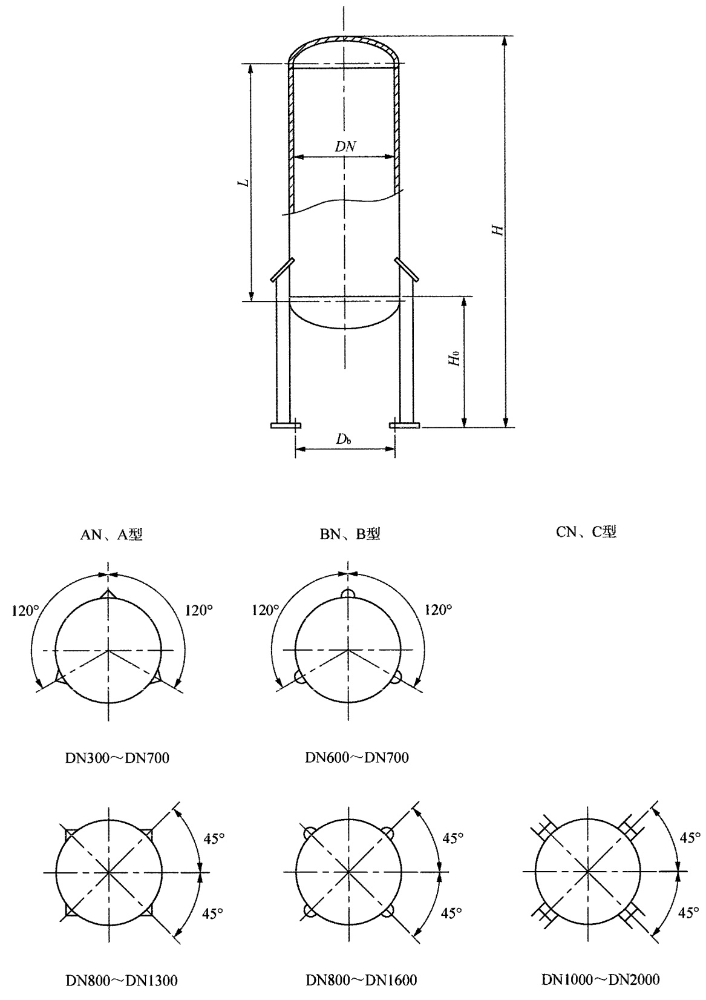

图1 支腿布置

<!-- page: 60 -->

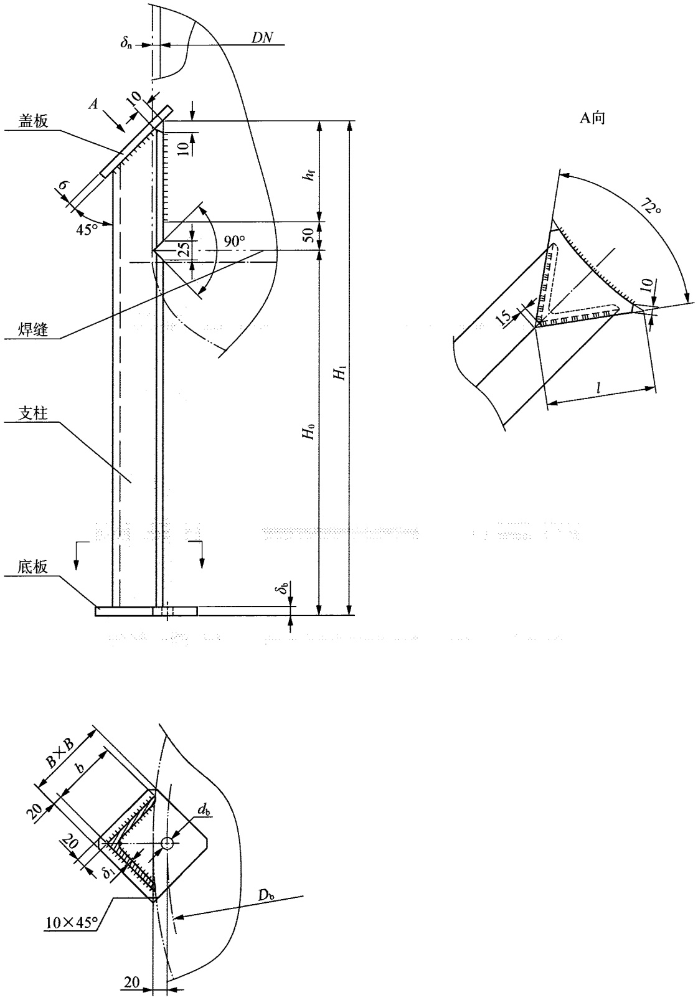

图2 AN型腿式支座

<!-- page: 61 -->

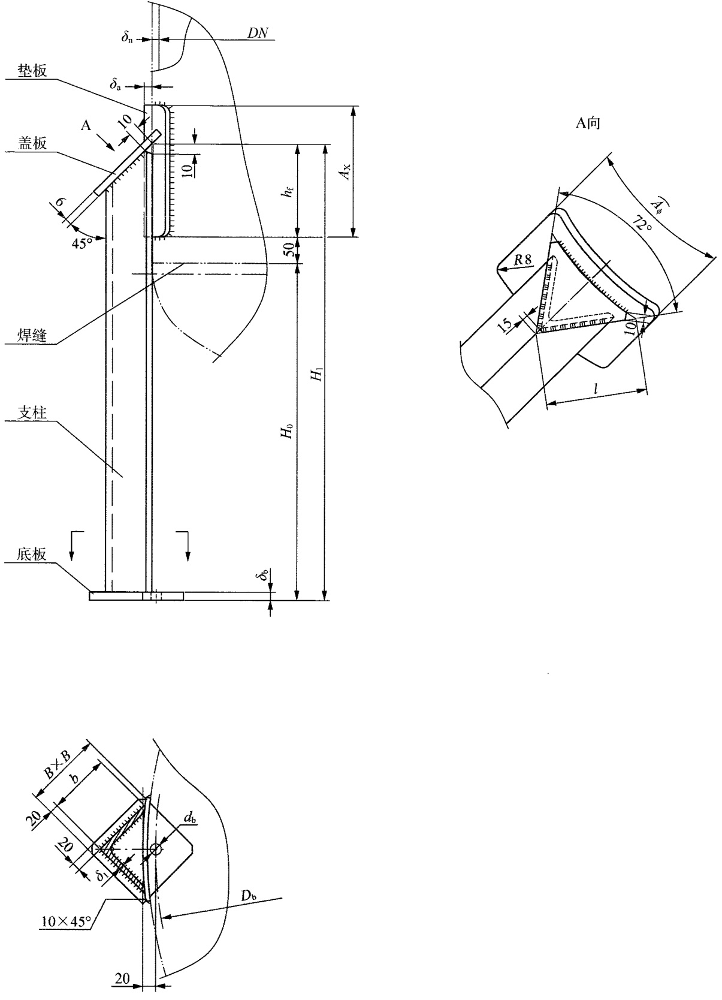

图3A型腿式支座

<!-- page: 62 -->

表 2 AN、A 型腿式支座系列参数

| 支座号 | 单根支腿所允许的最大载荷 (H_{0max}高度下)Q_0 kN | 适用公称直径DNmm | 支腿数量 | 壳体最大切线距 L_{max} mm | 最大支承高度 H_{0max} mm | 尺寸/mm |  |  |  |  |  |  |  |  |  |  |  |  |  | 单根支腿质量 ^b kg |  |  |  |
|---|---|---|---|---|---|---|---|---|---|---|---|---|---|---|---|---|---|---|---|---|---|---|---|
| 角钢支柱 |  | H_1^b | 焊缝长度 h_f | 底板 |  | 盖板 | 垫板 |  |  | 地脚螺栓 |  |  |  |  |  |  |  |  |  |  |  |  |  |
| 规格 b×b×d | 长度 ^bL_H | 边长B | 厚度 δ_b | 边长l | 宽度 A_\phi | 长度 A_X | 厚度 δ_a | 孔径 d_b | 规格 | 中心圆 |  | 支柱 | 底板 | 盖板 | 总质量(不含垫板) |  |  |  |  |  |  |  |  |
| 参数D | 直径 D_b |  |  |  |  |  |  |  |  |  |  |  |  |  |  |  |  |  |  |  |  |  |  |
| 1 | 4 | 300 | 3 | 1500 | 600 | 50×50×5 | 708 | 720 | 70 | 90 | 12 | 130 | 190 | 105 | 一般取与圆筒厚度相等 | 20 | M16 | 260 | D_b=D+2g^a | 2.7 | 0.8 | 0.4 | 3.9 |
| 2 | 5 | 400 | 800 | 63×63×8 | 924 | 940 | 90 | 103 | 16 | 160 | 220 | 140 | 24 | M20 | 362 | 6.9 | 1.3 | 0.6 | 8.8 |  |  |  |  |
| 6 | 500 | 2000 | 463 |  |  |  |  |  |  |  |  |  |  |  |  |  |  |  |  |  |  |  |  |
| 3 | 8 | 600 | 80×80×10 | 945 | 965 | 115 | 120 | 20 | 190 | 260 | 180 | 563 | 11 | 2.3 | 0.8 | 14.3 |  |  |  |  |  |  |  |
| 9 | 700 | 665 |  |  |  |  |  |  |  |  |  |  |  |  |  |  |  |  |  |  |  |  |  |
| 4 | 10 | 800 | 4 | 2500 | 1000 | 90×90×10 | 1160 | 1180 | 130 | 130 | 20 | 200 | 280 | 200 | 764 | 16 | 2.7 | 0.9 | 19.2 |  |  |  |  |
| 11 | 900 | 864 |  |  |  |  |  |  |  |  |  |  |  |  |  |  |  |  |  |  |  |  |  |
| 5 | 15 | 1000 | 3000 | 100×100×12 | 1173 | 1195 | 145 | 140 | 22 | 220 | 300 | 220 | 966 | 21.0 | 3.4 | 1.0 | 25.4 |  |  |  |  |  |  |
| 17 | 1100 | 1067 |  |  |  |  |  |  |  |  |  |  |  |  |  |  |  |  |  |  |  |  |  |
| 6 | 23 | 1200 | 3500 | 1100 | 110×110×12 | 1288 | 1310 | 160 | 150 | 22 | 230 | 320 | 240 | 1166 | 26 | 3.9 | 1.2 | 30.6 |  |  |  |  |  |
| 26 | 1300 | 1266 |  |  |  |  |  |  |  |  |  |  |  |  |  |  |  |  |  |  |  |  |  |
| a不带垫板时,δ取圆筒或封头名义厚度二者中的较大值;带垫板时,δ取圆筒与垫板名义厚度之和。b支柱长度 L_H=H_1-底板厚度δ_b ,该数值是按最大支撑高度( H_{0max} )所计算,其他支撑高度下的值应进行相应调整。 |  |  |  |  |  |  |  |  |  |  |  |  |  |  |  |  |  |  |  |  |  |  |  |

<!-- page: 63 -->

A向

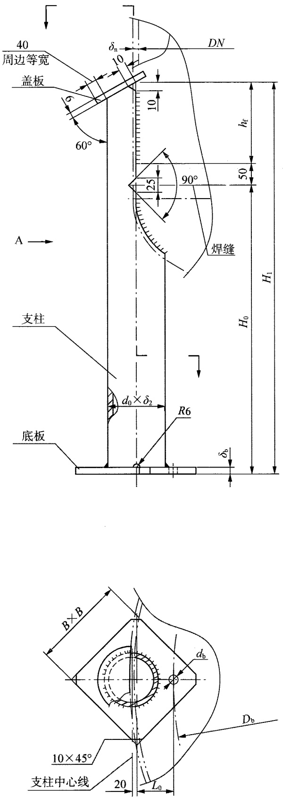

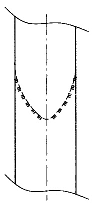

图4BN型腿式支座

<!-- page: 64 -->

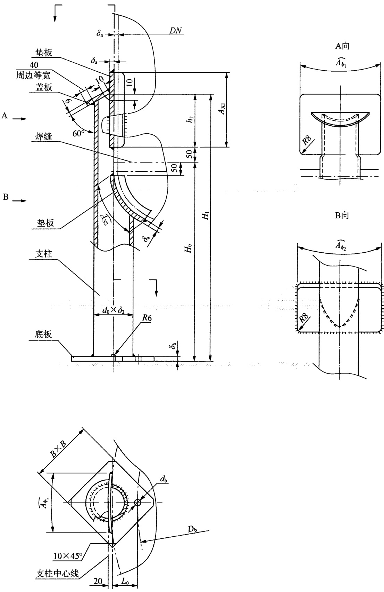

图5B型腿式支座

<!-- page: 65 -->

表3 BN、B型腿支座系列参数

| 支座号 | 单根支腿所允许的最大载荷(在H0max高度下)Q0kN | 适用公称直径DNmm | 支腿数量 | 壳体最大切线距Lmaxmm | 最大支承高度H0maxmm | 尺寸/mm |  |  |  |  |  |  |  |  |  |  |  |  |  | 单根支腿质量a kg |  |  |  |  |
|---|---|---|---|---|---|---|---|---|---|---|---|---|---|---|---|---|---|---|---|---|---|---|---|---|
| 钢管支柱 |  | H1a | 焊缝长度hf | 底板 |  |  | 垫板 |  |  |  | 地脚螺栓 |  |  |  |  |  |  |  |  |  |  |  |  |  |
| 规格d0xδ | 长度aLH | 边长B | 厚度δb | 孔距L0 | 宽度Aφ1 | 长度AX1 | 宽度Aφ2 | 长度AX2 | 厚度δa | 孔径db | 规格 | 螺栓孔中心圆直径Db | 支柱 | 底板 | 盖板 | 总质量(不含垫板) |  |  |  |  |  |  |  |  |
| 1 | 9 | 600 | 3 | 2500 | 1000 | 76x7 | 1103 | 1125 | 75 | 150 | 22 | 50 | 140 | 120 | 140 | 150 | 一般取与圆筒厚度相等 | 24 | M20 | Db=DN+2δb-2L0-40 | 13 | 3.8 | 0.5 | 17.3 |
| 11 | 700 |  |  |  |  |  |  |  |  |  |  |  |  |  |  |  |  |  |  |  |  |  |  |  |
| 2 | 11 | 800 | 4 | 3000 | 89x7 | 1114 | 1140 | 90 | 160 | 26 | 55 | 150 | 140 | 150 | 180 | 16 | 5.2 | 0.6 | 21.5 |  |  |  |  |  |
| 12 | 900 |  |  |  |  |  |  |  |  |  |  |  |  |  |  |  |  |  |  |  |  |  |  |  |
| 3 | 15 | 1000 | 108x7 | 1132 | 1160 | 110 | 170 | 28 | 65 | 170 | 160 | 170 | 200 | 20 | 6.3 | 0.7 | 26.7 |  |  |  |  |  |  |  |
| 19 | 1100 | 3500 |  |  |  |  |  |  |  |  |  |  |  |  |  |  |  |  |  |  |  |  |  |  |
| 4 | 23 | 1200 | 1100 | 114x7 | 1237 | 1265 | 115 | 190 | 70 | 180 | 170 | 180 | 220 | 26 | M22 | 23 | 7.9 | 0.8 | 31.5 |  |  |  |  |  |
| 26 | 1300 |  |  |  |  |  |  |  |  |  |  |  |  |  |  |  |  |  |  |  |  |  |  |  |
| 5 | 33 | 1400 | 4000 | 140x7 | 1260 | 1290 | 140 | 200 | 30 | 85 | 200 | 210 | 200 | 260 | 29 | 9.4 | 1.0 | 39.3 |  |  |  |  |  |  |
| 37 | 1500 | 1200 | 1360 | 1390 | 31 | 41.6 |  |  |  |  |  |  |  |  |  |  |  |  |  |  |  |  |  |  |
| 6 | 42 | 1600 | 168x7 | 1388 | 1420 | 170 | 220 | 32 | 100 | 230 | 250 | 230 | 300 | 39 | 12 | 1.3 | 51.8 |  |  |  |  |  |  |  |
| a支柱长度 LH=H1-底板厚度δb,该数值最大支撑高度(H0max)所计算,其他支撑高度下的值应进行相应调整。b不带垫板时,δ取圆筒或封头名义厚度二者中的较大值;带垫板时,δ取圆筒与垫板名义厚度之和。 |  |  |  |  |  |  |  |  |  |  |  |  |  |  |  |  |  |  |  |  |  |  |  |  |

<!-- page: 66 -->

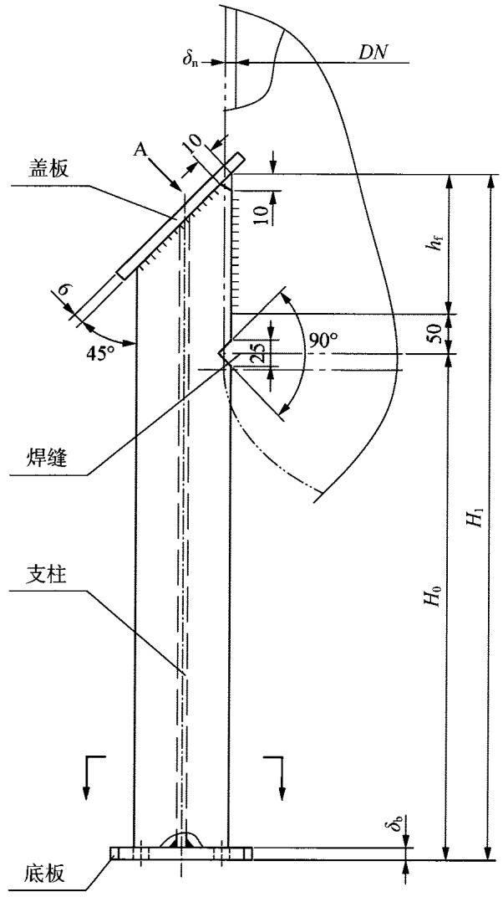

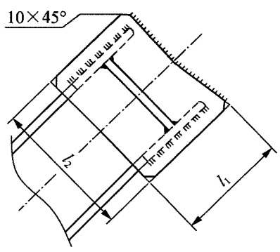

A向

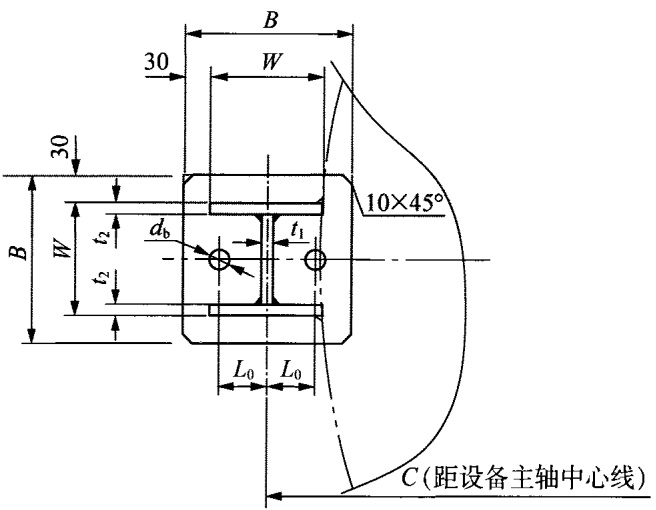

图6 CN型腿式支座

<!-- page: 67 -->

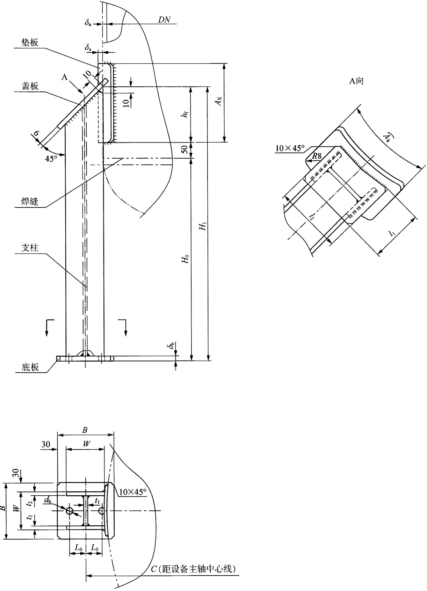

图7C型腿式支座

<!-- page: 68 -->

表4CN、C型腿式支座系列参数

| 支座号 | 单根支腿所允许的最大载荷(在 H_{0max} 高度下) Q_0 kN | 适用公称直径DNmm | 支腿数量 | 壳体最大切线距 L_{max} mm | 最大支承高度 H_{0max} mm | 尺寸/mm |  |  |  |  |  |  |  |  |  |  |  |  |  |  |  | 每根支腿质量 ^a kg |  |  |  |
|---|---|---|---|---|---|---|---|---|---|---|---|---|---|---|---|---|---|---|---|---|---|---|---|---|---|
| H型钢支柱 |  |  |  | H_1^a | 焊缝长度 h_c | 底板 |  | 盖板 |  | 垫板 |  |  | 地脚螺栓 |  |  |  |  |  |  |  |  |  |  |  |  |
| 规格 W×W×t_1/t_2 | 腹板厚度 t_1 | 翼板厚度 t_2 | 长度 ^aL_H | 边长B | 厚度 δ_b | 边长 l_1 | 板宽 l_2 | 宽度 A_\phi | 长度 A_X | 厚度 δ_a | 孔距 L_0 | 孔径 d_b | 规格 | 支柱 | 底板 | 盖板 | 总质量(不含垫板) |  |  |  |  |  |  |  |  |
| 1 | 16 | 1 000 | 4 | 3 000 | 1 200 | 150×150×8/10 | 8 | 10 | 1 528 | 1 550 | 300 | 210 | 22 | 270 | 220 | 260 | 350 | 一般取与圆筒厚度相等 | 55 | 28 | M24 | 46.1 | 7.6 | 2.8 | 56.5 |
| 2 | 20 | 1 100 | 3 500 | 150×150×8/12 | 12 | 52.6 | 63.0 |  |  |  |  |  |  |  |  |  |  |  |  |  |  |  |  |  |  |
| 24 | 1 200 | 1 400 | 1 728 | 1 750 | 59.8 | 70.2 |  |  |  |  |  |  |  |  |  |  |  |  |  |  |  |  |  |  |  |
| 3 | 27 | 1 300 | 180×180×8/12 | 1 788 | 1 810 | 360 | 240 | 310 | 250 | 290 | 410 | 60 | 74.2 | 9.9 | 3.7 | 87.8 |  |  |  |  |  |  |  |  |  |
| 33 | 1 400 | 4 000 | 1 786 | 24 | 34 | M30 | 74.1 | 10.8 | 88.6 |  |  |  |  |  |  |  |  |  |  |  |  |  |  |  |  |
| 4 | 38 | 1 500 | 1 600 | 180×180×8/14 | 14 | 1 984 | 2 010 | 26 | 93 | 11.7 | 108.4 |  |  |  |  |  |  |  |  |  |  |  |  |  |  |
| 42 | 1 600 |  |  |  |  |  |  |  |  |  |  |  |  |  |  |  |  |  |  |  |  |  |  |  |  |
| 5 | 48 | 1 700 | 1 800 | 200×200×8/14 | 2 224 | 2 250 | 400 | 260 | 340 | 270 | 310 | 450 | 65 | 116.3 | 13.7 | 4.3 | 134.3 |  |  |  |  |  |  |  |  |
| 57 | 1 800 | 4 500 |  |  |  |  |  |  |  |  |  |  |  |  |  |  |  |  |  |  |  |  |  |  |  |
| 6 | 65 | 1 900 | 2 000 | 250×250×8/14 | 2 524 | 2 550 | 500 | 310 | 410 | 320 | 360 | 550 | 80 | 165.3 | 19.6 | 6.2 | 191.1 |  |  |  |  |  |  |  |  |
| 71 | 2 000 |  |  |  |  |  |  |  |  |  |  |  |  |  |  |  |  |  |  |  |  |  |  |  |  |
| 注:H型钢支柱中心距设备主轴中心线的距离 C=\frac{W}{2}+\sqrt{\left(\frac{DN}{2}+\delta\right)^2-\left(\frac{W-2t_2}{2}\right)^2} ,式中δ取值如下:不带垫板时,δ取圆筒或封头名义厚度二者中的较大值;带垫板时,δ取圆筒与垫板名义厚度之和。 |  |  |  |  |  |  |  |  |  |  |  |  |  |  |  |  |  |  |  |  |  |  |  |  |  |
| ^a 支柱长度 L_H=H_1-底板厚度δb ,该数值是按最大支撑高度( H_{0max} )所计算,其他支撑高度下的值应进行相应调整。 |  |  |  |  |  |  |  |  |  |  |  |  |  |  |  |  |  |  |  |  |  |  |  |  |  |

<!-- page: 69 -->

## 6 设计

### 6.1 设计温度

支腿元件设计温度应根据容器的操作温度、绝热情况和环境温度综合考虑确定。

### 6.2 腐蚀裕量

支腿元件的腐蚀裕量应满足下列要求:

a）地脚螺栓的腐蚀裕量取3mm；

b）底板的腐蚀裕量取 $2\mathrm{mm}$

c）其他元件的腐蚀裕量取0。

### 6.3 材料

支柱、盖板、底板、垫板等支腿元件材料应采用列入相应材料标准且焊接性能优良的钢材。材料选用应符合下列规定:

a）与设备壳体直接相焊的支柱或垫板，应采用与壳体相同或相匹配的材料；

b）地脚螺栓宜选用符合GB/T700规定的Q235或符合GB/T1591的Q345；

c）支腿用钢板材料应符合GB/T700的规定，支腿用钢管应符合GB/T8162的规定；

d）支腿用角钢应符合GB/T706的规定，支腿用H型钢可参照YB/T3301执行；

e）焊接材料应符合NB/T47015、NB/T47018的规定；

f）支柱、盖板、底板等支腿元件材料宜根据支腿元件设计温度按表5选取，亦可根据需要选取其他材料，但其力学性能不得低于表5对应的材料；

g）当支腿元件设计温度不在表5范围时，用户可根据实际设计温度选取合适的材料。

表 5 支腿材料选择表

| 支腿元件设计温度t/°C | 支腿材料 | 地脚螺栓材料 |
|---|---|---|
| -20≤t<0 | Q235D, Q345D | Q235C, Q345C |
| 0≤t<20 | Q235C, Q345C | Q235B, Q345B |
| 20≤t<200 | Q235B, Q345B | Q235A, Q345A |

### 6.4 许用应力

6.4.1 支腿元件材料的许用应力按式（1）确定:

$$ [ \sigma ] _ {\mathrm{e}} ^ {\mathrm{t}} = \frac {R _ {\mathrm{eL}} ^ {\mathrm{t}} (R _ {\mathrm{p0.2}} ^ {\mathrm{t}} , R _ {\mathrm{p1.0}} ^ {\mathrm{t}})}{n _ {\mathrm{s}}}\tag{1} $$

其中， $n_{\mathrm{s}}$ 确定支腿元件材料许用应力的最小安全系数，一般取 $n_{\mathrm{s}} = 1.5$。

6.4.2 支腿（不包括垫板和地脚螺栓）常用材料的许用应力可按表6取值。

<!-- page: 70 -->

表 6 支腿常用材料的许用应力

| 支腿材料 | 板厚/mm | 支腿元件设计温度t/°C |  |  |  |  |
|---|---|---|---|---|---|---|
| -20≤t<0 | 0≤t<20 | 100 | 150 | 200 |  |  |
| Q235B、Q235C | ≤16 | — | 156 | 132 | 126 | 116 |
| >16~40 | — | 150 | 126 | 120 | 110 |  |
| Q235D | ≤16 | 157 | 156 | 132 | 126 | 116 |
| >16~40 | 150 | 150 | 126 | 120 | 110 |  |
| Q345B、Q345C、Q345D | ≤16 | 230 | 230 | 210 | 196 | 183 |
| >16~36 | 216 | 216 | 196 | 183 | 170 |  |

#### 6.4.3 地脚螺栓许用应力

地脚螺栓许用应力应符合下列规定:

a）室温下，Q235的许用应力 $[\sigma ]_{\mathrm{B}}^{20} = 147\mathrm{MPa}$ ，Q345的许用应力 $[\sigma ]_{\mathrm{B}}^{20} = 170\mathrm{MPa}$

b）若地脚螺栓的设计温度高于室温，或采用其他材料时，按6.4.1确定许用应力，其中 $n_{s}$ 按以下要求选取:采用碳素钢制地脚螺栓时，取 $n_{s}\geqslant1.6$ ；采用其他低合金钢制地脚螺栓时，则取 $n_{s}\geqslant2.0$ 。

#### 6.4.4 许用剪切应力

许用剪切应力应符合下列规定:

a）支腿与设备连接处焊缝的许用剪切应力，可按式（2）计算:

$$ [\tau ]_w^t = 0.8[\sigma ]_w^t\tag{2} $$

式中:

$[\tau]_{\mathrm{w}}^{\mathrm{t}}$ ——支腿与设备连接处焊缝的许用剪切应力，MPa；

$[\sigma]_{\mathrm{w}}^{\mathrm{t}}$ ——取设计温度下支柱材料的许用应力 $[\sigma]_{\mathrm{e}}^{\mathrm{t}}$ 和容器或垫板材料的许用应力较小值，MPa。

b）地脚螺栓材料许用剪应力可按式（3）计算:

$$ [\tau ]_{\mathrm{bt}}^{\mathrm{t}} = 0.8[\sigma ]_{\mathrm{bt}}^{\mathrm{t}}\tag{3} $$

### 6.5 工况及载荷组合

支腿计算时宜考虑的工况及相应载荷组合见表7。

表 7 工况及载荷组合

| 工况 |  | 重力载荷 |  |  | 压力载荷 |  | 地震载荷 | 风载荷 |  | 备注 |
|---|---|---|---|---|---|---|---|---|---|---|
| 操作重量 ^a | 试验重量 ^b | 安装重量 ^c | 试验压力 | 设计压力 | 33% | 100% |  |  |  |  |
| 压力试验 | 工况1 |  | ✓ |  | ✓ |  |  | ✓ |  | 现场 |
| 安装 | 工况2 |  |  | ✓ |  |  |  |  | ✓ |  |
| 操作 | 工况3 | ✓ |  |  |  | ✓ | ✓ |  |  |  |
| 工况4 | ✓ |  |  |  | ✓ |  |  | ✓ |  |  |
| ^a 正常操作时操作重量包括设备自重,内部、外部附件重量以及操作介质重量。 ^b 在用户现场的压力试验重量包括设备自重,内部、外部附件和试验介质重量(当气压试验时可忽略)。 ^c 安装时重量为设备自重。 |  |  |  |  |  |  |  |  |  |  |

<!-- page: 71 -->

## 7 标记

### 7.1 标记方法

NB/T 47065.2—2018，支腿 × × - × - × 垫板厚度 δₐ，mm （对于 A、B、C 型支腿，标注此项） 支承高度 H，mm 支座号 型号（A、AN、B、BN、C、CN）

### 7.2 标记示例

示例1:容器公称直径 $DN$ 为 $800\mathrm{mm}$，角钢支柱支腿，不带垫板，支承高度 $H$ 为 $900\mathrm{mm}$，其标记为:

NB/T 47065.2—2018，支腿 AN4-900

示例 2: 容器公称直径 DN 为 1200mm, 钢管支柱支腿, 带垫板, 垫板厚度 $\delta_{a}$ 为 10mm, 支承高度 H 为 1000mm, 其标记为:

NB/T 47065.2—2018，支腿 B4-1000-10

示例3:容器公称直径 $DN$ 为 $1600\mathrm{mm}$ ，H型钢支柱支腿，不带垫板，支承高度 $H$ 为 $2000\mathrm{mm}$ ，其标记为:

NB/T 47065.2—2018，支腿 CN4-2000

## 8 制造

8.1 焊接采用电弧焊，焊材型号应根据支座材料参照有关标准选用。焊接接头型式和尺寸应符合GB/T 985.1的规定。

8.2 支柱应平直，且无凹坑和损伤等明显缺陷。支柱直线度允差应不大于 $H_0 / 1000$。

8.3 盖板与圆筒（或垫板）外壁的连接弧线应按样板切割，钢管支柱与封头（或垫板）连接部分应与封头外壁相吻合。零件加工边缘的表面粗糙度不得大于 $Ra50\mu m$，地脚螺栓孔加工后表面粗糙度应为 $Ra25\mu m$。垫板与容器壳体应紧密贴合，最大组装间隙不得大于 $1mm$。

8.4 除另有规定外，尺寸的极限偏差应符合 GB/T 1804—2000 表 1、表 2 及表 3 中公差等级 C 级的规定。

8.5 焊接应采用连续焊。所有角焊缝其焊脚高度应不小于较薄件厚度。焊缝表面不得有未焊满、咬边、裂纹、气孔、弧坑和夹渣等缺陷，焊渣和飞溅物应清除干净，焊缝与母材应圆滑过渡。

8.6 支柱（或垫板）与容器壳体的组焊应符合容器设计、制造的有关规定。凡被其覆盖的壳体焊缝均应打磨至与壳体母材齐平，经检验合格后方可进行支柱（或垫板）与容器壳体组焊。有焊后热处理要求的容器，支柱（或垫板）与容器壳体的焊接应在容器焊后热处理前进行。垫板与容器壳体的焊接应在垫板最低处留 10mm 不焊。

8.7 底板地脚螺栓孔直径允差为 $_{0}^{+1}$ mm，螺栓孔中心圆直径的允差为±2mm。支腿应均匀布置，任意两底板地脚螺栓孔弦长的允差为±2mm。

8.8 各支腿底板底面应位于同一水平面上，其最高与最低相差不得超过 $3\mathrm{mm}$。

8.9 支腿与容器焊接后，应与容器中心轴线平行，其平行度应小于 $H_0 / 500$ ，且不得大于 $2\mathrm{mm}$ 。

## 9 选用方法

9.1 当设计条件满足以下条件时，可直接按本部分进行容器支腿的选取:

<!-- page: 72 -->

a）支腿设计温度高于-20℃且不高于200℃；

b）设计基本风压值不大于800Pa；

c）地面粗糙度类别为A类；

d）设计抗震设防烈度为8度，场地土类别为Ⅱ类，设计基本地震加速度为0.2g，设计地震分组为第三组；

e）单根支腿所允许的最大重力载荷在表2～表4所示范围内。

9.2 对超出9.1范围的支腿，可参考本部分附录A腿式支座计算方法进行设计。

9.3 具备下列情况之一者，宜选用带垫板的支腿:

a）合金钢制容器；

b）有焊后热处理要求的容器；

c）与支腿连接处的圆筒有效厚度 $\delta_{\mathrm{e}}$ 小于表8给出的最小厚度 $\delta_{\mathrm{min}}$。

9.4 支承高度 $H_0$ 及垫板厚度 $\delta_{\mathrm{a}}$ 可根据需要确定，$\delta_{\mathrm{a}}$ 宜与筒体厚度相同。

<!-- page: 73 -->

表 8 支腿连接处的圆筒不设置垫板所需的最小厚度 {\delta }_{\min }

| 容器公称直径DN/mm |  | 300 | 400 | 500 | 600 | 700 | 800 | 900 | 1 000 | 1 100 | 1 200 | 1 300 | 1 400 | 1 500 | 1 600 | 1 700 | 1 800 | 1 900 | 2 000 |
|---|---|---|---|---|---|---|---|---|---|---|---|---|---|---|---|---|---|---|---|
| 圆筒材料 | 设计压力/MPa | \delta_{\min }/\mathrm{mm} |  |  |  |  |  |  |  |  |  |  |  |  |  |  |  |  |  |
| Q235AQ235BQ235C | 0 | 3 | 3 | 3 | 3 | 3 | 3 | 3 | 3.5 | 3.5 | 4 | 4.5 | 4.5 | 4.5 | 5 | 5.5 | 5.5 | 5.5 | 6 |
| >0~0.2 | 3 | 3 | 3 | 3 | 3.5 | 3.5 | 3.5 | 4 | 4.5 | 5 | 5 | 5.5 | 5.5 | 6 | 6.5 | 6.5 | 7 | 7 |  |
| >0.2~0.4 | 3 | 3 | 3 | 3 | 4 | 4 | 4 | 4.5 | 5 | 5.5 | 6 | 6 | 6 | 7 | 7.5 | 7.5 | 8 | 8 |  |
| >0.4~0.6 | 3 | 3 | 3.5 | 3.5 | 4 | 4.5 | 4.5 | 5 | 5.5 | 6 | 6.5 | 7 | 7 | 7.5 | 8 | 8.5 | 9 | 9 |  |
| >0.6~0.8 | 3 | 3.5 | 3.5 | 4 | 4.5 | 5 | 5 | 5.5 | 6.5 | 7 | 7.5 | 7.5 | 8 | 8.5 | 9 | 9.5 | 10 | 10.5 |  |
| >0.8~1.0 | 3.5 | 3.5 | 4 | 4 | 5 | 5 | 5.5 | 6.5 | 7 | 7.5 | 8 | 8.5 | 8.5 | 9.5 |  |  |  |  |  |
| >1.0~1.2 | 3.5 | 3.5 | 4 | 4.5 | 5.5 | 5.5 | 6 | 6.5 | 7 | 8 | 8.5 |  |  |  |  |  |  |  |  |
| >1.2~1.4 | 3.5 | 3.5 | 4.5 | 4.5 | 5.5 | 可不设置垫板 |  |  |  |  |  |  |  |  |  |  |  |  |  |
| >1.4~1.6 | 3.5 | 3.5 | 4.5 | 可不设置垫板 |  |  |  |  |  |  |  |  |  |  |  |  |  |  |  |
| >1.6 | 3.5 |  |  |  |  |  |  |  |  |  |  |  |  |  |  |  |  |  |  |
| Q245R | 0 | 3 | 3 | 3 | 3 | 3 | 3 | 3 | 3 | 3.5 | 3.5 | 4 | 4 | 4 | 4.5 | 5 | 5 | 5 | 5.5 |
| >0~0.2 | 3 | 3 | 3 | 3 | 3 | 3 | 3.5 | 3.5 | 4 | 4.5 | 5 | 5 | 5 | 5.5 | 6 | 6 | 6 | 6.5 |  |
| >0.2~0.4 | 3 | 3 | 3 | 3 | 3.5 | 3.5 | 4 | 4 | 4.5 | 5 | 5.5 | 5.5 | 5.5 | 6 | 6.5 | 6.5 | 7 | 7.5 |  |
| >0.4~0.6 | 3 | 3 | 3 | 3 | 3.5 | 4 | 4.5 | 4.5 | 5 | 5.5 | 6.5 | 6.5 | 6.5 | 7 | 7.5 | 8 | 8 | 8.5 |  |
| >0.6~0.8 | 3 | 3 | 3 | 3.5 | 4 | 4.5 | 5 | 5 | 5.5 | 6 | 7 | 7 | 7 | 7.5 | 8 | 8.5 | 9 | 9.5 |  |
| >0.8~1.0 | 3 | 3 | 3.5 | 3.5 | 4.5 | 4.5 | 5.5 | 5.5 | 6 | 6.5 | 7.5 | 7.5 | 8 | 8.5 | 9 | 9.5 | 10 | 10.5 |  |
| >1.0~1.2 | 3 | 3 | 3.5 | 4 | 4.5 | 5 | 6 | 6 | 6.5 | 7 | 8 | 8 | 8 | 8.5 | 9 | 9.5 | 10.5 | 11 |  |
| >1.2~1.4 | 3 | 3.5 | 4 | 4 | 5 | 5 | 6 | 6 | 6.5 | 7 | 8 | 8 |  |  |  |  |  |  |  |
| >1.4~1.6 | 3.5 | 3.5 | 4 | 4 | 5 | 可不设置垫板 |  |  |  |  |  |  |  |  |  |  |  |  |  |
| >1.6~1.8 | 3.5 | 3.5 |  |  |  |  |  |  |  |  |  |  |  |  |  |  |  |  |  |
| >1.8 | 3.5 |  |  |  |  |  |  |  |  |  |  |  |  |  |  |  |  |  |  |
| Q345R | 0 | 3 | 3 | 3 | 3 | 3 | 3 | 3 | 3 | 3 | 3 | 3 | 3.5 | 3.5 | 4 | 4.5 | 4.5 | 4.5 | 5 |
| >0~0.2 | 3 | 3 | 3 | 3 | 3 | 3 | 3 | 3 | 3.5 | 3.5 | 3.5 | 4 | 4 | 4.5 | 5 | 5 | 5 | 5.5 |  |
| >0.2~0.4 | 3 | 3 | 3 | 3 | 3 | 3 | 3 | 3 | 4 | 4 | 4 | 4.5 | 4.5 | 5 | 5.5 | 5.5 | 5.5 | 6 |  |
| >0.4~0.6 | 3 | 3 | 3 | 3 | 3 | 3 | 3.5 | 3.5 | 4 | 4.5 | 4.5 | 5 | 5 | 5.5 | 6 | 6 | 6 | 6.5 |  |
| >0.6~0.8 | 3 | 3 | 3 | 3 | 3 | 3.5 | 3.5 | 4 | 4.5 | 5 | 5 | 5.5 | 5.5 | 6 | 6.5 | 7 | 7 | 7.5 |  |
| >0.8~1.0 | 3 | 3 | 3 | 3 | 3.5 | 3.5 | 4 | 4 | 5 | 5.5 | 5.5 | 6 | 6 | 7 | 7.5 | 8 | 8.5 | 8.5 |  |
| >1.0~1.2 | 3 | 3 | 3 | 3 | 3.5 | 4 | 4.5 | 4.5 | 5.5 | 5.5 | 6 | 6.5 | 6.5 | 7.5 | 8 | 8.5 | 9 | 9 |  |
| >1.2~1.4 | 3 | 3 | 3 | 3.5 | 4 | 4 | 4.5 | 4.5 | 5.5 | 6 | 6 | 6.5 | 6.5 | 7.5 | 8 | 8.5 | 9 | 9.5 |  |
| >1.4~1.6 | 3 | 3 | 3.5 | 3.5 | 4 | 4 | 4.5 | 4.5 | 5.5 | 6 |  |  |  |  |  |  |  |  |  |
| >1.6~1.8 | 3 | 3 | 3.5 | 3.5 | 4 | 可不设置垫板 |  |  |  |  |  |  |  |  |  |  |  |  |  |
| >1.8~2.0 | 3 | 3 | 3.5 |  |  |  |  |  |  |  |  |  |  |  |  |  |  |  |  |
| >2.0 | 3 |  |  |  |  |  |  |  |  |  |  |  |  |  |  |  |  |  |  |

<!-- page: 74 -->

**A.1 适用范围**

本附录适用于容器总高 $H$ 与公称直径 $DN$ 之比小于或等于5的钢制焊接立式圆筒形容器的腿式支座计算。

**A.2 支腿计算**

**A.2.1 水平风载荷**

$$ p _ {\mathrm{w}} = 1. 2 f _ {\mathrm{i}} q _ {0} D _ {\mathrm{o}} H _ {2} \times 1 0 ^ {- 6}\tag{……(A.1} $$

式中:

$p_{w}$ ——水平风载荷，N；

$f_{i}$ ——风压高度变化系数，按设备质心所处高度取值，本部分取 $f_{i}=1.0$ ；

$D_{0}$ ——容器外径，有保温层时取保温层外径（见图 A.1），mm；

$H_{2}$ ——容器壳体总长度， $\mathrm{mm}$ 。

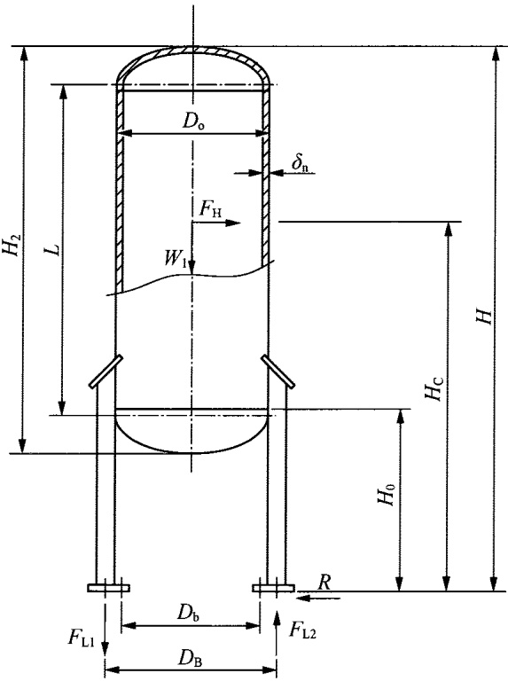

图A.1

**A.2.2 地震载荷**

地震载荷计算方法详见 GB/T 50761。

<!-- page: 75 -->

**A.2.3 支腿水平反力**

单根支腿的水平反力按式（A.2）计算:

$$ R = \frac {F _ {\mathrm{H}}}{N}\tag{……(A.2} $$

式中:

$R$ ——单根支腿的水平反力，N；

$F_{\mathrm{H}}$ ——作用于容器上的水平载荷，按6.5中不同工况下的载荷组合分别计算，N；

$N$ ——支腿的个数。

**A.2.4 支腿垂直反力**

单根支腿的垂直反力按式（A.3）计算:

$$ F _ {\mathrm{L}} = \pm \frac {4 F _ {\mathrm{H}} \cdot H _ {\mathrm{C}}}{N D _ {\mathrm{B}}} - \frac {W _ {1}}{N}\tag{……(A.3} $$

式中:

$F_{\mathrm{L}}$ ——单根支腿的垂直反力，N；

$H_{\mathrm{C}}$ ——基础顶面至设备质心的高度， $\mathrm{mm}$ 。按式（A.4）计算:

$$ H _{\mathrm{C}} = H_{0} - h + \frac{L}{2}\tag{……(A.4} $$

式中:

h——封头直边高度，mm。

$D_{B}$ ——底板中心圆直径，mm。按式（A.5）、式（A.6）、式（A.7）计算:

a） A、AN型支腿:

$$ D _ {\mathrm{B}} = D _ {\mathrm{o}} + 2 \delta_ {\mathrm{a}}\tag{……(A.5} $$

b） B、BN型支腿:

$$ D _ {\mathrm{B}} = D _ {\mathrm{o}} + 2 \delta_ {\mathrm{a}} - 4 0\tag{……(A.6} $$

c） C、CN型支腿:

$$ \left| D _ {\mathrm{B}} = W + 2 \sqrt {\left(\frac {D _ {\mathrm{o}}}{2} + \delta_ {\mathrm{a}}\right) ^ {2} - \left(\frac {W - 2 t _ {2}}{2}\right) ^ {2}} \right|\tag{......} $$

(A.7)

式中:

$D_{0}$ ——壳体外直径，mm。

$W_{1}$ ——重力载荷，按6.5中不同工况下的载荷组合分别计算，$\mathrm{N}_{\circ}$

**A.2.5 支腿强度及稳定计算**

A.2.5.1 支腿的弯曲应力

单根支腿的最大弯曲压应力按式（A.8）、式（A.9）、式（A.10）计算:

a）A、AN型支腿:

$$ \sigma_ {\mathrm{b}} = \frac {R L _ {1} + F _ {\mathrm{L}} e}{Z}\tag{……(A.8} $$

b）B、BN型支腿:

$$ \sigma_ {\mathrm{b}} = \frac {R L _ {1} + 2 0 F _ {\mathrm{L}}}{Z}\tag{……(A.9} $$

<!-- page: 76 -->

c）C、CN型支腿:

$$ \sigma_ {\mathrm{b}} = \frac {R L _ {\mathrm{l}}}{Z}\tag{......} $$

(A.10)

式中:

$\sigma_{b}$ ——单根支腿的最大弯曲压应力，MPa；

$L_{1}$ ——基础板下表面至支腿装配焊缝中心的距离长度，mm；

$$ L _ {1} = H _ {0} + \frac {h _ {\mathrm{f}}}{2} + 5 0\tag{……(A.11} $$

e——底板形心至支柱横截面形心的距离（见图 A.2），mm；

Z——单根支腿的抗弯截面模量， $mm^{3}$ 。

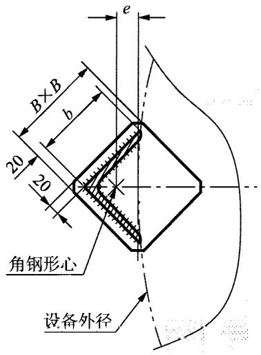

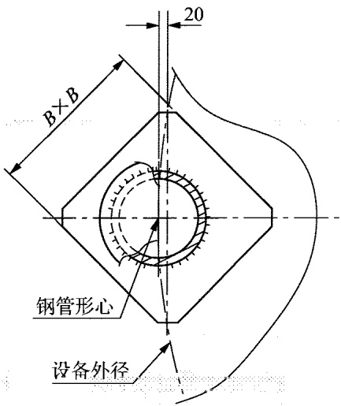

图A.2

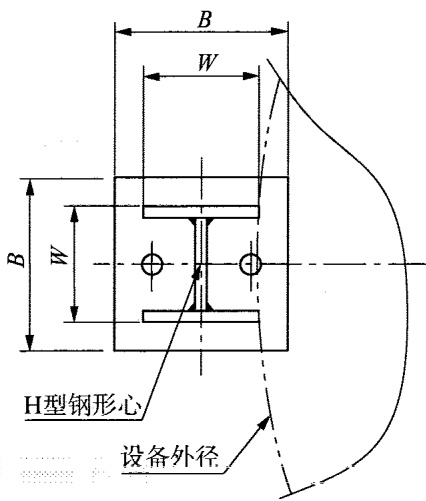

A.2.5.2 支腿的轴向应力

单根支腿的轴向压缩应力按式（A.12）计算:

$$ \sigma_ {\mathrm{c}} = \frac {F _ {\mathrm{L}}}{A}\tag{……(A.12} $$

式中:

$\sigma_{c}$ ——单根支腿的轴向应力，MPa；

A——支腿的横截面积， $mm^{2}$ 。

**A.2.5.3 支腿的许用临界压应力**

支腿的有效长细比按式（A.13）计算:

$$ \lambda = \frac {0 . 7 L _ {2}}{i}\tag{……(A.13} $$

支腿的临界长细比按式（A.14）计算:

$$ \overline {{\lambda}} = \sqrt {\frac {\pi^ {2} E ^ {\mathrm{t}}}{0 . 6 [ \sigma ] _ {\mathrm{e}} ^ {\mathrm{t}}}}\tag{……(A.14} $$

式中:

$\lambda$ ——支腿的有效长细比；

$\overline{\lambda}$ ——支腿的临界长细比；

<!-- page: 77 -->

$E^{\mathrm{t}}$ ——支腿设计温度下的支腿材料的纵向弹性模量， $\mathrm{MPa}$；

i——支腿截面的最小回转半径，mm；

$L_{2}$ ——支腿长度（ $L_{2}=H_{0}+50$ ），mm。

支腿的许用临界压应力:

a）当 $\lambda \leqslant \overline{\lambda}$ 时，可按式（A.15）、式（A.16）计算:

$$ \left[ \sigma \right] _ {\mathrm{cr}} ^ {\mathrm{t}} = \frac {\left[ 1 - 0 . 4 \left(\frac {\lambda}{\bar {\lambda}}\right) ^ {2} \right] \left[ \sigma \right] _ {\mathrm{e}} ^ {\mathrm{t}}}{v}\tag{……(A.15} $$

$$ v = \frac {3}{2} + \frac {2}{3} \left(\frac {\lambda}{\bar {\lambda}}\right) ^ {2}\tag{……(A.16} $$

b）当 $\lambda >\overline{\lambda}$ 时，可按式（A.17）计算:

$$ \left[ \sigma \right] _ {\mathrm{cr}} ^ {\mathrm{t}} = \frac {0 . 2 7 7 \left[ \sigma \right] _ {\mathrm{e}} ^ {\mathrm{t}}}{\left(\frac {\lambda}{\bar {\lambda}}\right) ^ {2}}\left. \right\}\tag{……(A.17} $$

式中:

$[\sigma]_{cr}^{t}$ ——支腿设计温度下的许用临界压应力，MPa。

A.2.5.4 支腿截面组合验算

支腿截面组合验算应满足式（A.18）的要求:

$$ \left| \frac {\sigma_ {\mathrm{c}}}{\left[ \sigma \right] _ {\mathrm{cr}} ^ {\mathrm{t}}} \right| + \left| \frac {\sigma_ {\mathrm{b}}}{\left[ \sigma \right] _ {\mathrm{e}} ^ {\mathrm{t}}} \right| \leqslant 1\tag{……(A.18} $$

A.2.6 支腿与筒体连接处焊缝的强度计算

a）焊缝处的剪切应力可按式（A.19）、式（A.20）计算:

$$ \tau = \frac {F _ {\mathrm{L}}}{A _ {\mathrm{f}}}\tag{……(A.19} $$

$$ \tau \leqslant \phi [ \tau ] _ {\mathrm{w}} ^ {\mathrm{t}}\tag{……(A.20} $$

式中:

$\tau$ ——连接焊缝处的剪切应力，MPa；

$A_{f}$ ——连接焊缝的抗剪面积， $mm^{2}$ ;

$$ A _ {\mathrm{f}} = \frac {2 h _ {\mathrm{f}} \delta_ {\mathrm{w}}}{\sqrt {2}}\tag{......} $$

(A.21)

$\delta_{w}$ ——连接焊缝的焊脚高度，mm；

$\phi$ ——焊接接头系数，取 $\phi = 0.6$

$[\tau]_{\mathrm{w}}^{\mathrm{t}}$ ——支腿与设备连接处焊缝的许用剪切应力， $\mathrm{MPa}$ 。其值按式（2）确定。

b）焊缝的弯曲应力可按式（A.22）、式（A.23）计算:

$$ \sigma = \frac{RL_1}{Z_f}\tag{……(A.22} $$

$$ \sigma \leqslant K _ {\mathrm{L}} \phi [ \sigma ] _ {\mathrm{w}} ^ {\mathrm{t}}\tag{……(A.23} $$

式中:

$\sigma$ ——连接焊缝处的弯曲应力， $\mathrm{MPa}$；

<!-- page: 78 -->

……(A.31)

$Z_{f}$ ——焊缝的抗弯截面模量， $mm^{3}$ ;

$$ Z _ {\mathrm{f}} = 2 \times \frac {h _ {\mathrm{f}} ^ {2}}{6} \times \frac {\delta_ {\mathrm{w}}}{\sqrt {2}}\tag{......} $$

(A.24)

$[\sigma]_{\mathrm{w}}^{\mathrm{t}}$ ——取设计温度下支柱材料的许用应力 $[\sigma]_{\mathrm{e}}^{\mathrm{t}}$ 和容器或垫板材料的许用应力较小值，MPa。A.2.7 地脚螺栓的强度计算

a）当 $F_{\mathrm{L}} > 0$ 时，地脚螺栓的拉应力应按式（A.25）、式（A.26）计算:

$$ \sigma_ {\mathrm{bt}} = \frac {F _ {\mathrm{L}}}{n _ {\mathrm{b}} A _ {\mathrm{bt}}}\tag{A.25} $$

$$ \sigma_ {\mathrm{bt}} \leqslant [ \sigma ] _ {\mathrm{bt}}\tag{A.26} $$

式中:

$\sigma_{\mathrm{bt}}$ ——单个地脚螺栓的拉应力， $\mathrm{MPa}$；

$n_{\mathrm{b}}$ ——单个支腿的地脚螺栓数量；

$A_{bt}$ ——单个地脚螺栓的有效截面积， $mm^{2}$ 。

b）地脚螺栓的剪切应力可按式（A.27）、式（A.28）计算:

$$ \tau_ {\mathrm{bt}} = \frac {R}{n _ {\mathrm{b}} A _ {\mathrm{bt}}}\tag{……(A.27} $$

$$ \tau_ {\mathrm{bt}} \leqslant [ \tau ] _ {\mathrm{bt}}\tag{……(A.28} $$

式中:

$\tau_{bt}$ ——单个地脚螺栓的剪应力，MPa。

**A.2.8 支腿底板的强度计算**

a）支腿底板的压应力可按式（A.29）、式（A.30）计算:

$$ \sigma_ {\mathrm{cb}} = \frac {F _ {\perp}}{B ^ {2}}\tag{……(A.29} $$

$$ \sigma_ {\mathrm{cb}} = [\sigma ] _ {\mathrm{cb}}\tag{……(A.30} $$

式中:

$\sigma_{cb}$ ——支腿底板的压应力，MPa;

$[\sigma]_{\mathrm{cb}}$ ——支腿底板的许用压应力， $\mathrm{MPa}$ 。其值取混凝土基础载荷的许用压应力。

b）支腿底板的厚度可按式（A.31）计算:

$$ \delta_ {\mathrm{b}} = B _ {1} \sqrt {\frac {3 \sigma_ {\mathrm{cb}}}{K _ {\mathrm{L}} [ \sigma ] _ {\mathrm{e}} ^ {\mathrm{t}}}} + C _ {1} + C _ {2} $$

式中:

$B_{1}$ ——支腿到底板边缘的最大距离，mm；

$C_{1}$ ——支腿底板负偏差，mm；

$C_{2}$ ——支腿底板腐蚀裕度，mm。

**A.3 支腿连接处的筒体局部应力计算**

与支腿相连接的筒体处，由于支腿反力作用，会产生力 $F_{\mathrm{x}}$ 、 $F_{\mathrm{y}}$ 、 $F_{\mathrm{z}}$ 及力矩 $M_{\mathrm{x}}$ 、 $M_{\mathrm{y}}$ 、 $M_{\mathrm{z}}$ （见图A.3），应根据具体支腿布置位置，对支腿连接处的筒体进行局部应力计算。

<!-- page: 79 -->

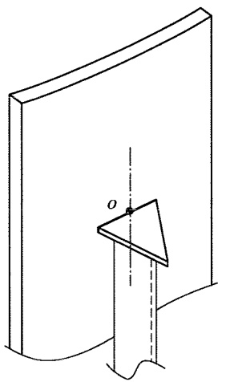

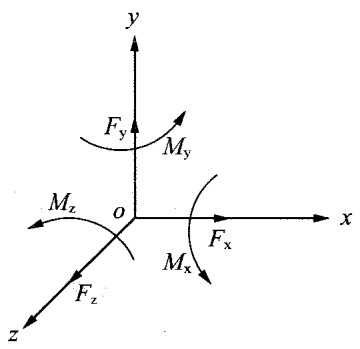

说明:

$F_{\mathrm{x}} = R$ ， $M_{\mathrm{x}} = 0$

$F_{\mathrm{y}} = F_{\mathrm{L}}, M_{\mathrm{y}} = 0;$

$$ F _ {z} = 0, M _ {z} = R L, $$

$F_{\mathrm{x}}$ 、 $F_{\mathrm{y}}$ 、 $F_{\mathrm{z}}$ ——与支腿相连接的筒体处，因支腿反力引起的力，N；

$M_{\mathrm{x}}$ 、 $M_{\mathrm{y}}$ 、 $M_{\mathrm{z}}$ ——与支腿相连接的筒体处，因支腿反力引起的力矩， $\mathrm{N} \cdot \mathrm{mm}$ 。

图A.3

注:在局部应力评价时，应考虑以上载荷与容器内压的共同作用。

<!-- page: 80 -->

## NB/T 47065.2—2018《容器支座 第2部分:腿式支座》编制说明

### 1 范围

1.3 本部分不适用于有脉动疲劳失效的场合。

原标准:本部分不适用于通过管线直接与产生脉动载荷的机器设备刚性连接的容器。

容器支腿产生脉动疲劳失效不一定是通过管线直接与产生脉动载荷的机器设备刚性连接，有可能通过其他刚性构件连接，或是与产生脉动载荷的机器设备距离较近且安装在同一刚性平台，或是内部安装有产生脉动载荷部件的搅拌容器等。

1.4 本部分未考虑外部管线或其他设备所产生的附加弯矩。

本部分编制中无法定性、定量确定外部管线或其他设备所产生的附加弯矩，在实际工程中若存在，应予以考虑。

### 3 符号说明

按照标准编制要求，增加了符号说明。

### 4 型式特征

腿式支座的型式特征见表1。

表1 型式特征

| 型 式 |  | 支座号 | 垫板 | 适用容器公称直径DN/mm | 支座尺寸 |
|---|---|---|---|---|---|
| 角钢支柱 | AN | 1~6 | 无 | 300~1 300 | 见表2、图2、图3 |
| A | 有 |  |  |  |  |
| 钢管支柱 | BN | 1~6 | 无 | 600~1 600 | 见表3、图4、图5 |
| B | 有 |  |  |  |  |
| H型钢支柱 | CN | 1~6 | 无 | 1 000~2 000 | 见表4、图6、图7 |
| C | 有 |  |  |  |  |

依据腿式支座标准实施以来的实际应用经验，本次修订将原腿式支座所适用的容器公称直径DN400～DN1600根据角钢支柱、钢管支柱、H型钢支柱的实际应用进行了修改；为了便于选取，统一将支座号划定为1～6（见表1）。

a）角钢支柱增加了DN300规格，取消了DN1400、DN1500、DN1600规格，容器总高小于或等于 $5\mathrm{m}$；

b）钢管支柱取消了DN400、DN500规格，容器总高小于或等于 $5.6\mathrm{m}$

c）H型钢支柱取消了DN400～DN900规格，增加了DN1700、DN1800、DN1900、DN2000

<!-- page: 81 -->

规格，容器总高小于或等于 7m。

高度及直径比较小的立式容器，通常采用腿式支座。具有结构简单、易于制造、价格便宜，并可使容器下部留有较大的开放空间，便于连接管线及进行防腐、绝热、防火等工程施工。经工程广泛实际应用，本支腿标准规格系列基本满足要求，对于本部分设计条件及规格系列以外的容器支腿的选用，可按照本标准附录A进行设计计算。

### 5 系列参数及尺寸

5.1 腿式支座的结构图中，对符号进行了修改，对盖板进行了倒角加工，防止划伤人员。

5.2 考虑到石油化工装置中生产或储存的介质多为易燃、易爆及有毒介质，根据 GB 50160—2008《石油化工企业设计防火规范》中 5.6，装置区内地面安装的腿式支座容器，其腿式支座的支柱、底板及地脚螺栓一般需设置耐火层。本次修订按照 30mm 厚耐火层要求，加大了盖板尺寸。对于厚度大于 30mm 耐火层或无耐火层的腿式支座，盖板尺寸应予以相应增减。

5.3 为了便于设计人员选取腿式支座，本次修订将原腿式支座系列参数表中“允许载荷 $Q_{0}$”扣除了地震、风的影响，按照支撑高度 $H_{0\mathrm{max}}$ 下的设备最大质量计算出单根支腿所允许的最大重力载荷。

### 6 设计

6.1 本次修订增加了腿式支座设计温度、腐蚀裕量、材料、许用应力、工况及载荷组合等要求。 腿式支座的温度受容器壳体壁温、绝热层、耐火层所选用的材料和厚度以及环境温度等影响，并且沿支柱高度方向发生变化。腿式支座的设计温度一般可按下述工况确定:

a）压力试验工况:腿式支座各元件的设计温度可取压力试验条件下试验介质温度。

b）停工、安装工况:腿式支座各元件的设计温度按使用地区历年来月平均最低气温的最低值加20℃（以下简称“环境温度”）考虑。

c）操作工况:

1）地脚螺栓和支腿底板的设计温度可按环境温度考虑；

2）盖板、垫板及支柱，当有可靠的绝热措施时，设计温度可取容器设计温度；当没有可靠的绝热措施且容器内部介质为气体时，设计温度可取容器介质温度与环境温度的算术平均值；当没有可靠的绝热措施且容器内部介质为液体时，设计温度可取容器内部介质温度。

6.3 为了应用方便，表5给出了常用支腿材料的选择表。当腿式支座设计温度低于-20℃时，可按设计温度的取值相应选用Q235E、Q345R、Q345DR、09MnNiDR、S30408等材料。

### 6.4 许用应力

表 6 给出了腿式支座设计温度 $-20^{\circ}C \leqslant t \leqslant 200^{\circ}C$ 支腿常用材料的许用应力。支腿计算时宜考虑压力试验、安装及操作工况，其中压力试验工况和安装工况，支腿应选取 $20^{\circ}C$ 的许用应力值；当操作工况腿式支座设计温度大于 $200^{\circ}C$ 或采用其他材料时，按 6.4.1 确定许用应力。

地脚螺栓许用应力:

a）室温下，Q235的许用应力 $[\sigma]_{\mathrm{bt}}^{20} = 147\mathrm{MPa}$，Q345的许用应力 $[\sigma]_{\mathrm{bt}}^{20} = 170\mathrm{MPa}$；

b）若地脚螺栓的设计温度高于室温，或采用其他材料时，按6.4.1确定许用应力，其中 $n_{s}$ 按以下要求选取:采用碳素钢制地脚螺栓时，取 $n_{s}\geqslant1.6$ ；采用其他低合金钢制地脚螺栓时，则取 $n_{s}\geqslant2.0$ 。

<!-- page: 82 -->

### 8 制造

8.1 焊接采用电弧焊，焊材型号应根据支座材料参照有关标准选用。焊接接头型式和尺寸应符合GB/T 985.1的规定。

考虑到 H 型钢支柱在实际制造过程中因用量少难以采购，制造商一般采用钢板焊制，其焊接可参照 YB/T 3301—2005《焊接 H 型钢》的要求进行。对于本部分以外的 H 型钢支柱，也可选用 GB/T 11263—2017《热轧 H 型钢和剖分 T 型钢》。

### 9 选用方法

9.2 对超出 9.1 范围的支腿，可参考本部分附录 A 腿式支座计算方法进行设计。

在实际工程中若存在外部管线或其他附件所产生的附加载荷，有可能造成支腿所允许的最大载荷超限，设计中应予以考虑。

## 附录A

**A.2.8 支腿底板的强度计算**

支腿底板的许用压应力 $[\sigma]_{\mathrm{cb}}$ 应根据实际所采用的混凝土基础的强度等级，按照GB50010—2010《混凝土结构设计规范》4.1.4中表4.1.4-1选取。

表 4.1.4-1 混凝土轴心抗压强度设计值

| 强度 | 在下列强度等级下的 f_c/(N/mm^2) |  |  |  |  |  |  |  |  |  |  |  |  |  |
|---|---|---|---|---|---|---|---|---|---|---|---|---|---|---|
| C15 | C20 | C25 | C30 | C35 | C40 | C45 | C50 | C55 | C60 | C65 | C70 | C75 | C80 |  |
| f_c | 7.2 | 9.6 | 11.9 | 14.3 | 16.7 | 19.1 | 21.1 | 23.1 | 25.3 | 27.5 | 29.7 | 31.8 | 33.8 | 35.9 |

本部分表2、表3及表4支腿底板的许用压应力 [\sigma ]_{\mathrm{cb}} 是按照混凝土强度等级C25选取的。

<!-- page: 83 -->

The image contains no text or content to process. It is a blank white background with a single, thin black horizontal line at the bottom edge. According to the rules, since there is no actual text or content present in the image, and since it is a stylistic or background line, the OCR result must ignore it. Therefore, the corrected OCR text is: ```text [No text detected]

<!-- page: 84 -->

NB/T 47065.3—2018

代替 JB/T 4712.3—2007

容器支座

第 3 部分:耳式支座

Vessel support—

Part 3: Lug support

2018-04-03 发布 2018-07-01 实施

国家能源局发布

<!-- page: 85 -->

The image provided is completely blank, with no visible text, figures, or content to extract. Therefore, there is no OCR result to output.

<!-- page: 86 -->

## 目次

- 前言....82
- 1 范围....83
- 2 规范性引用文件....83
- 3 型式特征....83
- 4 系列参数及尺寸....83
- 5 材料....87
- 6 标记....87
- 7 制造技术要求....88
- 8 选用说明....88
- 附录A（资料性附录） 耳式支座实际承受载荷的近似计算....89
- 附录B（资料性附录） 由容器壳体限定的支座许用弯矩....91
- 附录C（资料性附录） 耳式支座安装尺寸....188
- 编制说明....189

<!-- page: 87 -->

## 前言

NB/T47065—2018《容器支座》分为以下5个部分:

——第1部分:鞍式支座（NB/T47065.1—2018）；

——第2部分:腿式支座（NB/T47065.2—2018）；

——第3部分:耳式支座（NB/T47065.3—2018）；

——第 4 部分:支承式支座（NB/T 47065.4—2018）；

——第 5 部分:刚性环支座（NB/T 47065.5—2018）。

本部分是NB/T47065—2018的第3部分:耳式支座。

本部分按 GB/T 1.1—2009《标准化工作导则 第1部分:标准的结构和编写》给出的规则起草。

本部分代替 JB/T 4712.3—2007《容器支座 第3部分:耳式支座》，与 JB/T 4712.3—2007 相比，主要技术变化如下:

——耳式支座主体材料采用 Q235B、S30408、15CrMoR；

——给出了耳式支座的-100℃～300℃允许使用的温度范围；

——给出了设备筒体的许用应力在 $[\sigma]=120MPa$ 、140MPa、167MPa、185MPa时，支座处壳体的允许弯矩 $[M_{L}]$ ;

——增加了对管道推力、竖向地震力的载荷叠加要求。

本部分由全国锅炉压力容器标准化技术委员会（SAC/TC 262）提出并归口。

本部分由全国锅炉压力容器标准化技术委员会设计分会组织起草。

本部分起草单位:东华工程科技股份有限公司。

本部分主要起草人:刘吉祥、孟永祥、刘晓林。

本部分由全国锅炉压力容器标准化技术委员会（SAC/TC 262）负责解释。

本部分所代替的历次版本发布情况为:

——JB/T 4725—1992;

——JB/T 4712.3—2007。

<!-- page: 88 -->

# 容器支座 第3部分:耳式支座

## 1 范围

1.1 本部分规定了耳式支座的结构型式、系列参数及尺寸、材料、标记、制造技术要求及选用说明。

1.2 本部分适用于:

a）公称直径不大于4000mm的立式圆筒形容器；

b）允许使用温度-100℃～300℃。

## 2 规范性引用文件

下列文件对于本文件的应用是必不可少的。凡是注日期的引用文件，仅注日期的版本适用于本文件。凡是不注日期的引用文件，其最新版本（包括所有的修改单）适用于本文件。

GB/T 985.1 气焊、焊条电弧焊、气体保护焊和高能束焊的推荐坡口

GB/T 1804 一般公差 未注公差的线性和角度尺寸的公差

NB/T47013.1 承压设备无损检测 第1部分:通用要求

NB/T 47013.4 承压设备无损检测 第4部分:磁粉检测

NB/T 47013.5 承压设备无损检测 第5部分:渗透检测

NB/T 47015 压力容器焊接规程

## 3 型式特征

耳式支座的型式特征见表1。

表1 型式特征

| 型式 |  | 支座号 | 垫板 | 盖板 | 适用公称直径DN/mm | 支座尺寸(见图、表) |
|---|---|---|---|---|---|---|
| 短臂 | A | 1~5 | 有 | 无 | 300~2600 | 图1、表2 |
| 6~8 | 有 | 1500~4000 | 图2、表2 |  |  |  |
| 长臂 | B | 1~5 | 有 | 无 | 300~2600 | 图3、表3 |
| 6~8 | 有 | 1500~4000 | 图4、表3 |  |  |  |
| 加长臂 | C | 1~3 | 有 | 有 | 300~1400 | 图5、表4 |
| 4~8 | 1000~4000 | 图6、表4 |  |  |  |  |

## 4 系列参数及尺寸

4.1 A型耳式支座，按图1、图2及表2的规定；B型耳式支座，按图3、图4及表3的规定；C型耳式支座，按图5、图6及表4的规定。

4.2 支座的垫板厚度应满足本部分的规定，一般应与筒体厚度相等，也可根据实际需要增加厚度。

<!-- page: 89 -->

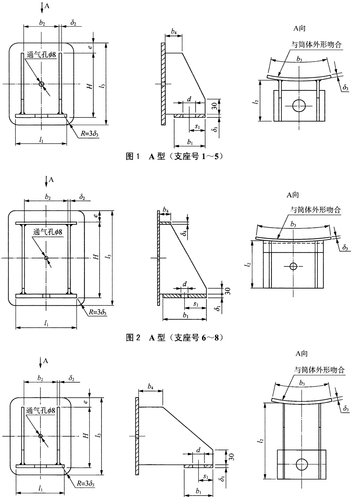

图3 B型（支座号 1\sim 5 ）

<!-- page: 90 -->

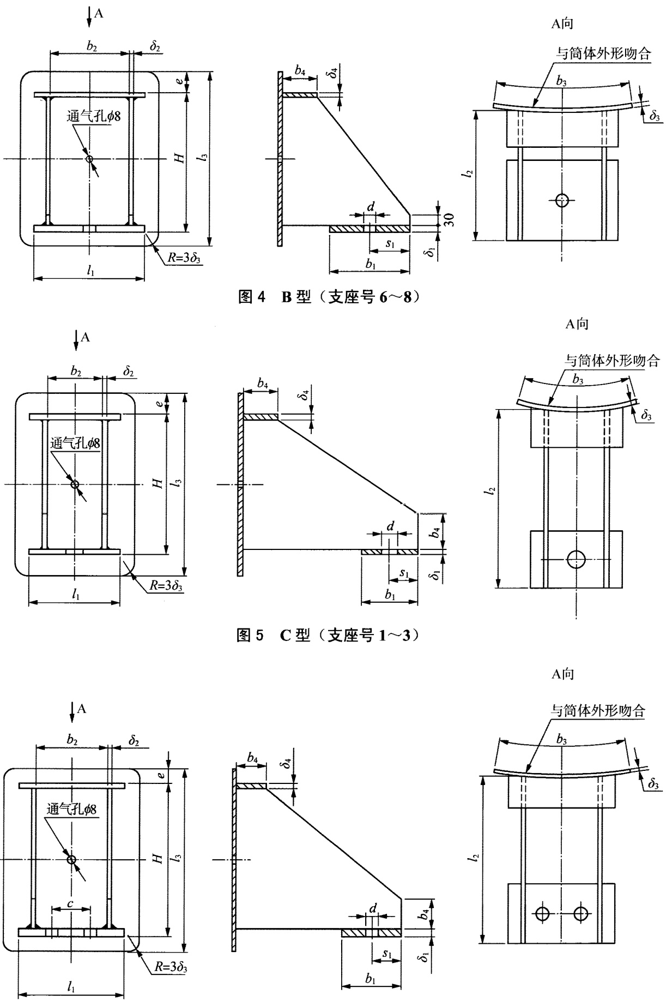

A向

图6 C型（支座号 $4\sim 8$ ）

<!-- page: 91 -->

单位为 mm

| 支座号 | 支座本体允许载荷[Q]/kN |  |  | 适用容器公称直径DN | 高度H | 底板 |  |  |  | 筋板 |  |  | 垫板 |  |  |  | 盖板 |  | 地脚螺栓 |  | 支座质量/kg |
|---|---|---|---|---|---|---|---|---|---|---|---|---|---|---|---|---|---|---|---|---|---|
| I | II | III | l_1 | b_1 | \delta_1 | s_1 | l_2 | b_2 | \delta_2 | l_3 | b_3 | \delta_3 | e | b_4 | \delta_4 | d | 规格 |  |  |  |  |
| 1 | 12 | 11 | 14 | 300~600 | 125 | 100 | 60 | 6 | 30 | 80 | 70 | 4 | 160 | 125 | 6 | 20 | 30 | — | 24 | M20 | 1.7 |
| 2 | 21 | 19 | 24 | 500~1000 | 160 | 125 | 80 | 8 | 40 | 100 | 90 | 5 | 200 | 160 | 6 | 24 | 30 | — | 24 | M20 | 3.0 |
| 3 | 37 | 33 | 43 | 700~1400 | 200 | 160 | 105 | 10 | 50 | 125 | 110 | 6 | 250 | 200 | 8 | 30 | 30 | — | 30 | M24 | 6.0 |
| 4 | 75 | 67 | 86 | 1000~2000 | 250 | 200 | 140 | 14 | 70 | 160 | 140 | 8 | 315 | 250 | 8 | 40 | 30 | — | 30 | M24 | 11.1 |
| 5 | 95 | 85 | 109 | 1300~2600 | 320 | 250 | 180 | 16 | 90 | 200 | 180 | 10 | 400 | 320 | 10 | 48 | 30 | — | 30 | M24 | 21.6 |
| 6 | 148 | 134 | 171 | 1500~3000 | 400 | 320 | 230 | 20 | 115 | 250 | 230 | 12 | 500 | 400 | 12 | 60 | 50 | 12 | 36 | M30 | 42.7 |
| 7 | 173 | 156 | 199 | 1700~3400 | 480 | 375 | 280 | 22 | 130 | 300 | 280 | 14 | 600 | 480 | 14 | 70 | 50 | 14 | 36 | M30 | 69.8 |
| 8 | 254 | 229 | 292 | 2000~4000 | 600 | 480 | 360 | 26 | 145 | 380 | 350 | 16 | 720 | 600 | 16 | 72 | 50 | 16 | 36 | M30 | 123.9 |
| 注:表中支座质量是以表中的垫板厚度为 \delta_3 计算的,如果 \delta_3 的厚度改变,则支座的质量应相应改变。 |  |  |  |  |  |  |  |  |  |  |  |  |  |  |  |  |  |  |  |  |  |

单位为 mm

| 支座号 | 支座本体允许载荷 [Q]/kN |  |  | 适用容器公称直径DN | 高度H | 底板 |  |  |  | 筋板 |  |  | 垫板 |  |  |  | 盖板 |  | 地脚螺栓 |  | 支座质量/kg |
|---|---|---|---|---|---|---|---|---|---|---|---|---|---|---|---|---|---|---|---|---|---|
| I | II | III | l_1 | b_1 | \delta_1 | s_1 | l_2 | b_2 | \delta_2 | l_3 | b_3 | \delta_3 | e | b_4 | \delta_4 | d | 规格 |  |  |  |  |
| 1 | 12 | 11 | 14 | 300~600 | 125 | 100 | 60 | 6 | 30 | 160 | 70 | 5 | 160 | 125 | 6 | 20 | 50 | — | 24 | M20 | 2.5 |
| 2 | 21 | 19 | 24 | 500~1000 | 160 | 125 | 80 | 8 | 40 | 180 | 90 | 6 | 200 | 160 | 6 | 24 | 50 | — | 24 | M20 | 4.3 |
| 3 | 37 | 33 | 43 | 700~1400 | 200 | 160 | 105 | 10 | 50 | 205 | 110 | 8 | 250 | 200 | 8 | 30 | 50 | — | 30 | M24 | 8.3 |
| 4 | 75 | 67 | 86 | 1000~2000 | 250 | 200 | 140 | 14 | 70 | 290 | 140 | 10 | 315 | 250 | 8 | 40 | 70 | — | 30 | M24 | 15.7 |
| 5 | 95 | 85 | 109 | 1300~2600 | 320 | 250 | 180 | 16 | 90 | 330 | 180 | 12 | 400 | 320 | 10 | 48 | 70 | — | 30 | M24 | 28.7 |
| 6 | 148 | 134 | 171 | 1500~3000 | 400 | 320 | 230 | 20 | 115 | 380 | 230 | 14 | 500 | 400 | 12 | 60 | 100 | 14 | 36 | M30 | 53.9 |
| 7 | 186 | 167 | 214 | 1700~3400 | 480 | 375 | 280 | 22 | 130 | 430 | 270 | 16 | 600 | 480 | 14 | 70 | 100 | 16 | 36 | M30 | 85.2 |
| 8 | 254 | 229 | 292 | 2000~4000 | 600 | 480 | 360 | 26 | 145 | 510 | 350 | 18 | 720 | 600 | 16 | 72 | 100 | 18 | 36 | M30 | 146.0 |
| 注:表中支座质量是以表中的垫板厚度为 \delta_3 计算的,如果 \delta_3 的厚度改变,则支座的质量应相应改变。 |  |  |  |  |  |  |  |  |  |  |  |  |  |  |  |  |  |  |  |  |  |

<!-- page: 92 -->

单位为 mm

| 支座号 | 支座本体允许载荷 [Q]/kN |  |  | 适用容器公称直径DN | 高度H | 底 板 |  |  |  |  | 筋 板 |  |  | 垫 板 |  |  |  | 盖 板 |  | 地脚螺栓 |  | 支座质量/kg |
|---|---|---|---|---|---|---|---|---|---|---|---|---|---|---|---|---|---|---|---|---|---|---|
| I | II | III | l_1 | b_1 | δ_1 | s_1 | c | l_2 | b_2 | δ_2 | l_3 | b_3 | δ_3 | e | b_4 | δ_4 | d | 规格 |  |  |  |  |
| 1 | 28 | 25 | 32 | 300~600 | 200 | 130 | 80 | 8 | 40 | — | 250 | 80 | 6 | 260 | 170 | 6 | 30 | 50 | 8 | 24 | M20 | 6.2 |
| 2 | 49 | 44 | 57 | 500~1 000 | 250 | 160 | 80 | 12 | 40 | — | 280 | 100 | 6 | 310 | 210 | 6 | 30 | 50 | 10 | 30 | M24 | 9.0 |
| 3 | 65 | 58 | 75 | 700~1 400 | 300 | 200 | 105 | 14 | 50 | — | 300 | 130 | 8 | 370 | 260 | 8 | 35 | 50 | 12 | 30 | M24 | 16.1 |
| 4 | 105 | 94 | 120 | 1 000~2 000 | 360 | 250 | 140 | 18 | 70 | 90 | 390 | 170 | 10 | 430 | 320 | 8 | 35 | 70 | 12 | 30 | M24 | 28.9 |
| 5 | 158 | 142 | 182 | 1 300~2 600 | 430 | 300 | 180 | 22 | 90 | 120 | 430 | 210 | 12 | 510 | 380 | 10 | 40 | 70 | 14 | 30 | M24 | 47.8 |
| 6 | 188 | 169 | 216 | 1 500~3 000 | 480 | 360 | 230 | 24 | 115 | 160 | 480 | 260 | 14 | 570 | 450 | 12 | 45 | 100 | 14 | 36 | M30 | 74.8 |
| 7 | 268 | 241 | 308 | 1 700~3 400 | 540 | 440 | 280 | 28 | 130 | 200 | 530 | 310 | 16 | 630 | 540 | 14 | 45 | 100 | 16 | 36 | M30 | 114.6 |
| 8 | 292 | 262 | 335 | 2 000~4 000 | 650 | 540 | 360 | 30 | 140 | 280 | 600 | 400 | 18 | 750 | 650 | 16 | 50 | 100 | 18 | 36 | M30 | 181.3 |
| 注:表中支座质量是以表中的垫板厚度为 δ_3 计算的,如果 δ_3 的厚度改变,则支座的质量应相应改变。 |  |  |  |  |  |  |  |  |  |  |  |  |  |  |  |  |  |  |  |  |  |  |

## 5 材料

5.1 垫板材料一般应与容器材料相同。

5.2 支座的筋板和底板材料分为3种，其代号见表5。

表 5 材料代号

| 材料代号 | I | II | III |
|---|---|---|---|
| 支座的筋板和底板材料 | Q235B | S30408 | 15CrMoR |
| 允许使用温度/°C | -20~200 | -100~200 | -20~300 |

## 6 标记

### 6.1 标记方法

NB/T 47065.3—2018，耳式支座××-× 材料（Ⅰ、Ⅱ、Ⅲ） 支座号（1~8） 型号（A, B, C）

注1:若垫板厚度 $\delta_{3}$ 与部分尺寸不同，则在设备图纸中零件名称或备注栏注明。

注 2:支座及垫板的材料应在设备图样的材料栏内标注，表示方法如下:支座材料/垫板材料。

### 6.2 标记示例

示例1:A型，3号耳式支座，支座材料为Q235B，垫板材料为Q245R；

NB/T 47065.3—2018，耳式支座 A3-I

材料:Q235B/Q245R

<!-- page: 93 -->

示例2:B型，3号耳式支座，支座材料为Q235B，垫板材料为S30408，垫板厚 $12\mathrm{mm}$

NB/T 47065.3—2018，耳式支座 B3-I， $\delta_{3}=12$

材料:Q235B/S30408

示例3:C型，3号耳式支座，支座材料为S30408，垫板材料为S30408:

NB/T 47065.3—2018，耳式支座 C3-Ⅱ

材料:S30408/S30408

## 7 制造技术要求

7.1 焊接可采用电弧焊或气体保护焊（使用药芯焊丝除外），焊材应根据支座材料参照有关标准选用。焊接接头型式和尺寸应符合 GB/T 985.1 的规定。

7.2 耳式支座本体的焊接，采用双面连续填角焊；支座与容器壳体的焊接采用连续焊。焊缝腰高约等于0.7倍的较薄板厚度，且不小于4mm。

7.3 焊后焊缝金属表面不得有裂纹、夹渣、气孔和弧坑等缺陷，并不得残留有熔渣和飞溅物。

7.4 垫板应与容器壁贴合。

7.5 支座螺栓孔的加工极限偏差与其他部分的制造公差分别按GB/T1804中的第 $\mathrm{m}$ 级与c级精度。

7.6 支座所有组焊件周边粗糙度为 $Ra50\mu \mathrm{m}$。

7.7 支座组焊完毕后，各部件应平整，不得翘曲。

7.8 支座本体材料为 15CrMoR 时，焊接工艺应符合 NB/T 47015 中的要求；若容器壳体有热处理要求时，支座垫板应在热处理前焊于容器壁上。

7.9 材料标准抗拉强度下限值 $R_{\mathrm{m}} \geqslant 540\mathrm{MPa}$ 的材料和Cr-Mo钢制的垫板和支座等的连续焊接接头表面应进行 $100\%$ 磁粉或渗透检验，按NB/T47013.4和NB/T47013.5中的I级合格。

7.10 支座组焊完毕，各部件应平整，不得翘曲。

## 8 选用说明

8.1 根据公称直径 $DN$ 及附录A规定的方法计算出耳式支座承受的实际载荷 $Q(\mathrm{kN})$ ，按此实际载荷 $Q$ 值在标准中选取一标准耳式支座，并使 $Q \leqslant [Q]$ 。

8.2 一般情况下，应校核耳式支座处圆筒所受的支座弯矩 $M_{\mathrm{L}}$ ，按式（1）和式（2）计算:

$$ M_{\mathrm{L}} \leqslant [M_{\mathrm{L}}]\tag{1} $$

对衬里容器:

$$ M _ {\mathrm{L}} \leqslant \frac {[ M _ {\mathrm{L}} ]}{1 . 5}\tag{2} $$

式中:

$M_{\mathrm{L}}$ ——耳式支座处圆筒所受的支座弯矩， $\mathrm{kN}\cdot \mathrm{m}$

$$ M _ {\mathrm{L}} = \frac {Q \cdot (l _ {2} - S _ {1})}{1 0 ^ {3}} $$

$[M_{L}]$ ——耳式支座处圆筒的许用弯矩，查附录 B，kN·m；

符号 $l_{2}$ ， $S_{1}$ 见表2、表3、表4。

8.3 耳式支座通常应设置垫板，当 $DN \leqslant 900\mathrm{mm}$ 时，可不设置垫板但必须满足下列条件:

a）容器壳体的有效厚度大于3mm；

b）容器壳体材料与支座材料具有相同或相近化学成分和机械性能。

8.4 支座的安装尺寸 $D$ 可按附录C计算。

<!-- page: 94 -->

## 附录A

A.1 立式容器承受的载荷如图A.1所示，耳式支座实际承受的载荷 $Q$ 可按式（A.1）近似计算:

$$ Q = \left[ \frac {m _ {0} g + G _ {\mathrm{e}}}{k n} + \frac {2 (p h + G _ {\mathrm{e}} S _ {\mathrm{e}})}{n D} \right] \times 1 0 ^ {- 3}\tag{……(A.1} $$

式中:

Q——支座实际承受的载荷，kN;

$D$ ——支座安装尺寸， $\mathrm{mm}$

g——重力加速度，取 $g=9.81m/s^{2}$ ;

$G_{e}$ ——偏心载荷（包括管道推力引起的当量荷载），N；

$S_{e}$ ——偏心距（包括管道推力引起的当量偏心距），mm；

h——水平力作用点至底板高度，mm；

$k$ ——不均匀系数，安装3个支座时，取 $k = 1$；安装3个以上支座时，取 $k = 0.83$；

$m_{0}$ ——设备总质量（包括壳体及其附件，内部介质及保温层的质量），kg；

$n$ ——支座数量；

$p$ ——水平力，取 $p_{\mathrm{w}}$ 和 $p_{\mathrm{e}} + 0.25 p_{\mathrm{w}}$ 的人值， $\mathrm{N}_{\circ}$

$p_{\mathrm{e}}$ ——水平地震力，N；

$p_{\mathrm{w}}$ ——水平风载荷， $\mathrm{N}_{\circ}$

<!-- page: 95 -->

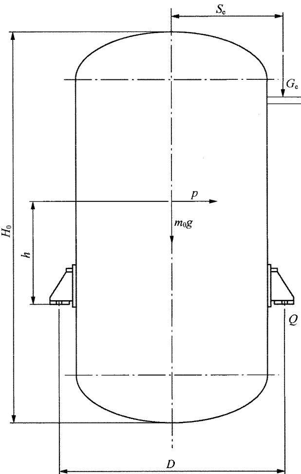

图A.1 立式容器承受的载荷

A.2 当容器管道的推力较大时，应按推力的方向、大小以及耳式支座的布置方位进行耳式支座承受管道推力的计算，确定受力最大的耳式支座的载荷值，并将该载荷值与式（A.1）的计算载荷值相加。

A.3 当需要考虑竖向地震载荷时，应计入耳式支座受力的不均匀系数，并依此确定耳式支座承受的竖向地震载荷值，并将该载荷值与式（A.1）的计算载荷值相加。

<!-- page: 96 -->

## 附录B

**B.1 适用范围**

a）适用于承受内压的钢制焊接圆筒形容器的带垫板耳式支座；

b）适用于采用Q235B、S30408、15CrMoR等相似材料制作的容器壳体。

**B.2 容器壳体材料的许用应力**

a）本附录给出了设备本体材料许用应力为 $[\sigma]=120MPa$ 、140MPa、167MPa、185MPa时的圆筒形壳体，处与计算压力为p=0.0MPa、0.6MPa、1.0MPa、1.6MPa工况时，在安装耳式支座后，由其局部应力限定的支座许用弯矩值 $[M_{L}]$ ;

b）对其他材料（按许用应力值）和其他有效厚度可采用线性内插的方法确定 $[M_{\mathrm{L}}]$

c）对其他压力等级的工况，需由设计人员按实际的计算弯矩，对壳体强度进行核算。

**B.3 附支座处壳体的允许弯矩 [M_{\mathrm{L}}] 表**

a）表B.1:A型、B型耳式支座处壳体的允许弯矩 $[M_{\mathrm{L}}]$ （ $[\sigma ] = 120\mathrm{MPa})$

b）表B.2:A型、B型耳式支座处壳体的允许弯矩 $[M_{\mathrm{L}}]$ （ $[\sigma ] - 140\mathrm{MPa})$

c）表B.3:A型、B型耳式支座处壳体的允许弯矩 $[M_{\mathrm{L}}]$ （ $[\sigma ] = 167\mathrm{MPa})$

d）表B.4:A型、B型耳式支座处壳体的允许弯矩 $[M_{\mathrm{L}}]$ （ $[\sigma ] = 185\mathrm{MPa})$

e）表B.5:C型耳式支座处壳体的允许弯矩 $[M_{\mathrm{L}}]$ （ $[\sigma ] = 120\mathrm{MPa}$ ）；

f）表B.6:C型耳式支座处壳体的允许弯矩 $[M_{\mathrm{L}}]$ （ $[\sigma ] = 140\mathrm{MPa}$ ）；

g）表 B.7:C 型耳式支座处壳体的允许弯矩 $[M_{\mathrm{L}}]$ （ $[\sigma ] = 167\mathrm{MPa}$ ）；

h）表B.8:C型耳式支座处壳体的允许弯矩 $[M_{\mathrm{L}}]$ （ $[\sigma ] = 185\mathrm{MPa})$ 。

表 B. 1 A 型、B 型耳式支座处壳体的允许弯矩 \left[M_{\mathrm{L}}\right] （ [\sigma]=120MPa ） 单位为 kN·m

| 筒体有效厚度mm | 耳式支座号 | 直径mm | p=0.0MPa | p=0.6MPa | p=1.0MPa | p=1.6MPa |
|---|---|---|---|---|---|---|
| 4 | 1 | 300 | 2.65 | 2.36 | 2.16 | 1.84 |
| 350 | 2.19 | 1.90 | 1.69 | 1.37 |  |  |
| 400 | 1.82 | 1.53 | 1.33 | 1.01 |  |  |
| 500 | 1.87 | 1.50 | 1.24 | 0.81 |  |  |
| 600 | 1.84 | 1.40 | 1.08 | — |  |  |
| 2 | 500 | 3.04 | 2.46 | 2.03 | 1.35 |  |
| 600 | 2.96 | 2.27 | 1.77 | — |  |  |
| 700 | 2.81 | 2.01 | 1.43 | — |  |  |
| 800 | 2.52 | 1.66 | 1.05 | — |  |  |
| 900 | 2.34 | 1.43 | 0.79 | — |  |  |
| 1 000 | 2.18 | 1.23 | — | — |  |  |

<!-- page: 97 -->

表B.1（续）

| 筒体有效厚度mm | 耳式支座号 | 直径mm | p=0.0MPa | p=0.6MPa | p=1.0MPa | p=1.6MPa |
|---|---|---|---|---|---|---|
| 4 | 3 | 700 | 4.45 | 3.24 | 2.34 | - |
| 800 | 4.05 | 2.70 | 1.73 | - |  |  |
| 900 | 3.75 | 2.32 | 1.28 | - |  |  |
| 1 000 | 3.49 | 1.98 | - | - |  |  |
| 1 100 | 3.27 | 1.70 | - | - |  |  |
| 1 200 | 3.07 | 1.44 | - | - |  |  |
| 1 300 | 2.91 | 1.21 | - | - |  |  |
| 1 400 | 2.76 | 1.01 | - | - |  |  |
| 4 | 1 000 | 5.67 | 3.28 | - | - |  |
| 1 100 | 5.31 | 2.79 | - | - |  |  |
| 1 200 | 5.00 | 2.36 | - | - |  |  |
| 1 300 | 4.71 | 1.98 | - | - |  |  |
| 1 400 | 4.46 | 1.64 | - | - |  |  |
| 1 500 | 4.23 | - | - | - |  |  |
| 1 600 | 4.04 | - | - | - |  |  |
| 1 700 | 3.84 | - | - | - |  |  |
| 1 800 | 3.66 | - | - | - |  |  |
| 2 000 | 3.31 | - | - | - |  |  |
| 5 | 1 300 | 7.89 | 3.40 | - | - |  |
| 1 400 | 7.45 | 2.80 | - | - |  |  |
| 1 500 | 7.06 | - | - | - |  |  |
| 1 600 | 6.70 | - | - | - |  |  |
| 1 700 | 6.39 | - | - | - |  |  |
| 1 800 | 6.09 | - | - | - |  |  |
| 2 000 | 5.54 | - | - | - |  |  |
| 2 200 | 5.02 | - | - | - |  |  |
| 6 | 1 500 | 11.43 | - | - | - |  |
| 1 600 | 10.83 | - | - | - |  |  |
| 1 700 | 10.30 | - | - | - |  |  |
| 1 800 | 9.81 | - | - | - |  |  |
| 2 000 | 8.94 | - | - | - |  |  |
| 2 200 | 8.15 | - | - | - |  |  |

<!-- page: 98 -->

表B.1（续）

| 筒体有效厚度mm | 耳式支座号 | 直径mm | p=0.0MPa | p=0.6MPa | p=1.0MPa | p=1.6MPa |
|---|---|---|---|---|---|---|
| 4 | 7 | 1 700 | 15.37 | - | - | - |
| 1 800 | 14.60 | - | - | - |  |  |
| 2 000 | 13.28 | - | - | - |  |  |
| 2 200 | 12.13 | - | - | - |  |  |
| 8 | 2 000 | 20.48 | - | - | - |  |
| 2 200 | 18.69 | - | - | - |  |  |
| 6 | 1 | 300 | 4.81 | 4.47 | 4.24 | 3.87 |
| 350 | 4.23 | 3.88 | 3.64 | 3.26 |  |  |
| 400 | 3.91 | 3.54 | 3.28 | 2.87 |  |  |
| 500 | 3.32 | 2.89 | 2.59 | 2.12 |  |  |
| 600 | 2.81 | 2.35 | 2.03 | 1.54 |  |  |
| 2 | 500 | 5.36 | 4.69 | 4.21 | 3.46 |  |
| 600 | 4.33 | 3.64 | 3.15 | 2.38 |  |  |
| 700 | 4.44 | 3.60 | 3.01 | 2.08 |  |  |
| 800 | 4.43 | 3.47 | 2.79 | 1.72 |  |  |
| 900 | 4.35 | 3.27 | 2.52 | - |  |  |
| 1 000 | 4.17 | 3.01 | 2.19 | - |  |  |
| 3 | 700 | 6.98 | 5.68 | 4.77 | 3.32 |  |
| 800 | 6.96 | 5.48 | 4.43 | 2.74 |  |  |
| 900 | 6.86 | 5.20 | 4.02 | - |  |  |
| 1 000 | 6.59 | 4.78 | 3.48 | - |  |  |
| 1 100 | 6.35 | 4.39 | 2.99 | - |  |  |
| 1 200 | 5.77 | 3.78 | 2.38 | - |  |  |
| 1 300 | 5.48 | 3.42 | 1.96 | - |  |  |
| 1 400 | 5.23 | 3.10 | - | - |  |  |
| 4 | 1 000 | 10.57 | 7.75 | 5.70 | - |  |
| 1 100 | 10.22 | 7.12 | 4.89 | - |  |  |
| 1 200 | 9.33 | 6.15 | 3.88 | - |  |  |
| 1 300 | 8.85 | 5.54 | 3.18 | - |  |  |
| 1 400 | 8.42 | 5.00 | - | - |  |  |
| 1 500 | 8.03 | 4.50 | - | - |  |  |
| 1 600 | 7.67 | 4.04 | - | - |  |  |
| 1 700 | 7.34 | 3.62 | - | - |  |  |
| 1 800 | 7.04 | 3.22 | - | - |  |  |
| 2 000 | 6.55 | 2.53 | - | - |  |  |

<!-- page: 99 -->

表 B. 1 (续)

| 筒体有效厚度mm | 耳式支座号 | 直径mm | p=0.0MPa | p=0.6MPa | p=1.0MPa | p=1.6MPa |
|---|---|---|---|---|---|---|
| 6 | 5 | 1 300 | 14.76 | 9.37 | 5.44 | - |
| 1 400 | 14.04 | 8.42 | - | - |  |  |
| 1 500 | 13.39 | 7.57 | - | - |  |  |
| 1 600 | 12.79 | 6.78 | - | - |  |  |
| 1 700 | 12.24 | 6.06 | - | - |  |  |
| 1 800 | 11.73 | 5.39 | - | - |  |  |
| 2 000 | 10.84 | 4.19 | - | - |  |  |
| 2 200 | 10.09 | - | - | - |  |  |
| 2 400 | 9.44 | - | - | - |  |  |
| 2 600 | 8.78 | - | - | - |  |  |
| 6 | 1 500 | 21.48 | 12.39 | - | - |  |
| 1 600 | 20.54 | 11.09 | - | - |  |  |
| 1 700 | 19.68 | 9.89 | - | - |  |  |
| 1 800 | 18.88 | 8.79 | - | - |  |  |
| 2 000 | 17.39 | 6.80 | - | - |  |  |
| 2 200 | 16.11 | - | - | - |  |  |
| 2 400 | 15.00 | - | - | - |  |  |
| 2 600 | 13.98 | - | - | - |  |  |
| 2 800 | 13.02 | - | - | - |  |  |
| 3 000 | 12.12 | - | - | - |  |  |
| 7 | 1 700 | 28.97 | 14.91 | - | - |  |
| 1 800 | 27.81 | 13.23 | - | - |  |  |
| 2 000 | 25.66 | 10.22 | - | - |  |  |
| 2 200 | 23.72 | - | - | - |  |  |
| 2 400 | 22.01 | - | - | - |  |  |
| 2 600 | 20.53 | - | - | - |  |  |
| 2 800 | 19.16 | - | - | - |  |  |
| 3 000 | 17.85 | - | - | - |  |  |
| 3 200 | 16.62 | - | - | - |  |  |
| 3 400 | 15.44 | - | - | - |  |  |

<!-- page: 100 -->

表B.1（续）

| 筒体有效厚度mm | 耳式支座号 | 直径mm | p=0.0MPa | p=0.6MPa | p=1.0MPa | p=1.6MPa |
|---|---|---|---|---|---|---|
| 6 | 8 | 2 000 | 39.20 | 16.12 | - | - |
| 2 200 | 36.30 | - | - | - |  |  |
| 2 400 | 33.61 | - | - | - |  |  |
| 2 600 | 31.28 | - | - | - |  |  |
| 2 800 | 29.19 | - | - | - |  |  |
| 3 000 | 27.25 | - | - | - |  |  |
| 3 200 | 25.41 | - | - | - |  |  |
| 3 400 | 23.66 | - | - | - |  |  |
| 8 | 1 | 300 | 7.30 | 6.90 | 6.62 | 6.20 |
| 350 | 6.37 | 5.97 | 5.70 | 5.27 |  |  |
| 400 | 5.82 | 5.40 | 5.12 | 4.67 |  |  |
| 500 | 5.27 | 4.80 | 4.47 | 3.94 |  |  |
| 600 | 4.84 | 4.30 | 3.91 | 3.31 |  |  |
| 2 | 500 | 8.48 | 7.73 | 7.20 | 6.38 |  |
| 600 | 7.62 | 6.77 | 6.17 | 5.23 |  |  |
| 700 | 6.74 | 5.81 | 5.16 | 4.14 |  |  |
| 800 | 6.00 | 5.03 | 4.35 | 3.29 |  |  |
| 900 | 6.08 | 4.97 | 4.19 | 2.97 |  |  |
| 1 000 | 6.05 | 4.82 | 3.95 | 2.58 |  |  |
| 3 | 700 | 10.52 | 9.08 | 8.08 | 6.50 |  |
| 800 | 9.06 | 7.60 | 6.57 | 4.97 |  |  |
| 900 | 9.24 | 7.55 | 6.37 | 4.51 |  |  |
| 1 000 | 9.27 | 7.38 | 6.05 | 3.95 |  |  |
| 1 100 | 9.19 | 7.12 | 5.66 | 3.34 |  |  |
| 1 200 | 9.01 | 6.78 | 5.20 | - |  |  |
| 1 300 | 8.74 | 6.37 | 4.68 | - |  |  |
| 1 400 | 8.48 | 5.98 | 4.20 | - |  |  |
| 4 | 1 000 | 14.63 | 11.69 | 9.61 | 6.31 |  |
| 1 100 | 14.55 | 11.32 | 9.03 | 5.36 |  |  |
| 1 200 | 14.35 | 10.85 | 8.35 | - |  |  |
| 1 300 | 13.92 | 10.17 | 7.50 | - |  |  |
| 1 400 | 13.52 | 9.53 | 6.70 | - |  |  |
| 1 500 | 13.12 | 8.92 | 5.94 | - |  |  |
| 1 600 | 12.02 | 7.84 | 4.89 | - |  |  |
| 1 700 | 11.56 | 7.27 | 4.22 | - |  |  |
| 1 800 | 11.14 | 6.74 | 3.60 | - |  |  |
| 2 000 | 10.38 | 5.77 | - | - |  |  |

<!-- page: 101 -->

表 B. 1 (续)

| 筒体有效厚度mm | 耳式支座号 | 直径mm | p=0.0MPa | p=0.6MPa | p=1.0MPa | p=1.6MPa |
|---|---|---|---|---|---|---|
| 8 | 5 | 1 300 | 22.90 | 16.91 | 12.57 | - |
| 1 400 | 22.28 | 15.84 | 11.21 | - |  |  |
| 1 500 | 21.69 | 14.83 | 9.92 | - |  |  |
| 1 600 | 19.95 | 13.06 | 8.17 | - |  |  |
| 1 700 | 19.15 | 12.06 | 7.03 | - |  |  |
| 1 800 | 18.41 | 11.14 | 5.96 | - |  |  |
| 2 000 | 17.10 | 9.48 | - | - |  |  |
| 2 200 | 15.96 | 8.02 | - | - |  |  |
| 2 400 | 14.94 | 6.69 | - | - |  |  |
| 2 600 | 14.11 | 5.54 | - | - |  |  |
| 6 | 1 500 | 34.52 | 23.97 | 16.22 | - |  |
| 1 600 | 31.99 | 21.21 | 13.39 | - |  |  |
| 1 700 | 30.70 | 19.55 | 11.48 | - |  |  |
| 1 800 | 29.51 | 18.02 | 9.71 | - |  |  |
| 2 000 | 27.39 | 15.28 | - | - |  |  |
| 2 200 | 25.54 | 12.87 | - | - |  |  |
| 2 400 | 23.88 | 10.71 | - | - |  |  |
| 2 600 | 22.44 | 8.79 | - | - |  |  |
| 2 800 | 21.18 | - | - | - |  |  |
| 3 000 | 20.06 | - | - | - |  |  |
| 7 | 1 700 | 45.17 | 29.25 | 17.40 | - |  |
| 1 800 | 43.43 | 26.93 | 14.69 | - |  |  |
| 2 000 | 40.33 | 22.78 | - | - |  |  |
| 2 200 | 37.63 | 19.14 | - | - |  |  |
| 2 400 | 35.21 | 15.91 | - | - |  |  |
| 2 600 | 33.00 | 13.00 | - | - |  |  |
| 2 800 | 31.05 | - | - | - |  |  |
| 3 000 | 29.31 | - | - | - |  |  |
| 3 200 | 27.74 | - | - | - |  |  |
| 3 400 | 26.18 | - | - | - |  |  |

<!-- page: 102 -->

表 B. 1 (续)

| 筒体有效厚度mm | 耳式支座号 | 直径mm | p=0.0MPa | p=0.6MPa | p=1.0MPa | p=1.6MPa |
|---|---|---|---|---|---|---|
| 8 | 8 | 2 000 | 61.18 | 35.35 | - | - |
| 2 200 | 57.16 | 29.66 | - | - |  |  |
| 2 400 | 53.56 | 24.59 | - | - |  |  |
| 2 600 | 50.20 | 20.05 | - | - |  |  |
| 2 800 | 47.13 | - | - | - |  |  |
| 3 000 | 44.35 | - | - | - |  |  |
| 3 200 | 41.83 | - | - | - |  |  |
| 3 400 | 39.53 | - | - | - |  |  |
| 3 600 | 37.33 | - | - | - |  |  |
| 3 800 | 35.22 | - | - | - |  |  |
| 4 000 | 33.19 | - | - | - |  |  |
| 10 | 1 | 300 | 10.09 | 9.63 | 9.32 | 8.84 |
| 350 | 8.90 | 8.44 | 8.13 | 7.65 |  |  |
| 400 | 8.15 | 7.68 | 7.36 | 6.86 |  |  |
| 500 | 7.29 | 6.77 | 6.41 | 5.84 |  |  |
| 600 | 6.86 | 6.27 | 5.85 | 5.20 |  |  |
| 2 | 500 | 11.55 | 10.73 | 10.16 | 9.27 |  |
| 600 | 10.63 | 9.71 | 9.08 | 8.07 |  |  |
| 700 | 9.97 | 8.95 | 8.23 | 7.10 |  |  |
| 800 | 9.22 | 8.09 | 7.29 | 6.04 |  |  |
| 900 | 8.52 | 7.30 | 6.45 | 5.12 |  |  |
| 1 000 | 7.97 | 6.69 | 5.79 | 4.38 |  |  |
| 3 | 700 | 15.61 | 14.04 | 12.93 | 11.18 |  |
| 800 | 14.17 | 12.44 | 11.22 | 9.32 |  |  |
| 900 | 12.82 | 10.98 | 9.70 | 7.69 |  |  |
| 1 000 | 11.71 | 9.81 | 8.48 | 6.40 |  |  |
| 1 100 | 11.84 | 9.72 | 8.23 | 5.91 |  |  |
| 1 200 | 11.84 | 9.52 | 7.90 | 5.33 |  |  |
| 1 300 | 11.74 | 9.24 | 7.48 | 4.70 |  |  |
| 1 400 | 11.56 | 8.90 | 7.02 | 4.03 |  |  |

<!-- page: 103 -->

表 B. 1 (续)

| 筒体有效厚度mm | 耳式支座号 | 直径mm | p=0.0MPa | p=0.6MPa | p=1.0MPa | p=1.6MPa |
|---|---|---|---|---|---|---|
| 10 | 4 | 1 000 | 17.86 | 14.97 | 12.94 | 9.78 |
| 1 100 | 18.16 | 14.91 | 12.63 | 9.06 |  |  |
| 1 200 | 18.26 | 14.69 | 12.17 | 8.22 |  |  |
| 1 300 | 18.21 | 14.34 | 11.60 | 7.28 |  |  |
| 1 400 | 18.04 | 13.88 | 10.94 | 6.27 |  |  |
| 1 500 | 17.74 | 13.33 | 10.20 | - |  |  |
| 1 600 | 17.30 | 12.66 | 9.37 | - |  |  |
| 1 700 | 16.87 | 12.03 | 8.59 | - |  |  |
| 1 800 | 16.46 | 11.42 | 7.83 | - |  |  |
| 2 000 | 14.82 | 9.66 | 5.99 | - |  |  |
| 5 | 1 300 | 29.55 | 23.36 | 18.97 | 11.97 |  |
| 1 400 | 29.35 | 22.70 | 17.96 | 10.37 |  |  |
| 1 500 | 29.00 | 21.90 | 16.83 | - |  |  |
| 1 600 | 28.29 | 20.78 | 15.42 | - |  |  |
| 1 700 | 27.61 | 19.70 | 14.08 | - |  |  |
| 1 800 | 26.95 | 18.68 | 12.80 | - |  |  |
| 2 000 | 24.25 | 15.75 | 9.75 | - |  |  |
| 2 200 | 22.75 | 13.89 | 7.59 | - |  |  |
| 2 400 | 21.44 | 12.23 | - | - |  |  |
| 2 600 | 20.27 | 10.72 | - | - |  |  |
| 6 | 1 500 | 45.91 | 35.09 | 27.20 | - |  |
| 1 600 | 44.81 | 33.27 | 24.89 | - |  |  |
| 1 700 | 43.80 | 31.55 | 22.70 | - |  |  |
| 1 800 | 42.84 | 29.90 | 20.61 | - |  |  |
| 2 000 | 38.71 | 25.24 | 15.67 | - |  |  |
| 2 200 | 36.23 | 22.15 | 12.12 | - |  |  |
| 2 400 | 34.05 | 19.41 | - | - |  |  |
| 2 600 | 32.10 | 16.93 | - | - |  |  |
| 2 800 | 30.34 | 14.66 | - | - |  |  |
| 3 000 | 28.72 | 12.57 | - | - |  |  |

<!-- page: 104 -->

表 B. 1 (续)

| 筒体有效厚度mm | 耳式支座号 | 直径mm | p=0.0MPa | p=0.6MPa | p=1.0MPa | p=1.6MPa |
|---|---|---|---|---|---|---|
| 10 | 7 | 1 700 | 63.85 | 46.64 | 33.91 | - |
| 1 800 | 62.54 | 44.23 | 30.78 | - |  |  |
| 2 000 | 56.94 | 37.47 | 23.44 | - |  |  |
| 2 200 | 53.27 | 32.80 | 18.05 | - |  |  |
| 2 400 | 50.04 | 28.66 | - | - |  |  |
| 2 600 | 47.14 | 24.94 | - | - |  |  |
| 2 800 | 44.52 | 21.55 | - | - |  |  |
| 3 000 | 42.11 | 18.43 | - | - |  |  |
| 3 200 | 39.98 | 15.60 | - | - |  |  |
| 3 400 | 38.07 | 12.96 | - | - |  |  |
| 8 | 2 000 | 86.37 | 57.85 | 36.68 | - |  |
| 2 200 | 80.85 | 50.54 | 28.15 | - |  |  |
| 2 400 | 75.97 | 44.06 | - | - |  |  |
| 2 600 | 71.61 | 38.26 | - | - |  |  |
| 2 800 | 67.64 | 32.99 | - | - |  |  |
| 3 000 | 64.00 | 28.17 | - | - |  |  |
| 3 200 | 60.62 | 23.74 | - | - |  |  |
| 3 400 | 57.54 | 19.63 | - | - |  |  |
| 3 600 | 54.74 | - | - | - |  |  |
| 3 800 | 52.16 | - | - | - |  |  |
| 4 000 | 49.76 | - | - | - |  |  |
| 12 | 1 | 350 | 11.70 | 11.19 | 10.84 | 10.30 |
| 400 | 10.77 | 10.25 | 9.89 | 9.34 |  |  |
| 500 | 9.69 | 9.12 | 8.72 | 8.10 |  |  |
| 600 | 9.06 | 8.41 | 7.96 | 7.25 |  |  |
| 500 | 15.20 | 14.29 | 13.67 | 12.70 |  |  |
| 2 | 600 | 13.82 | 12.83 | 12.14 | 11.07 |  |
| 700 | 13.08 | 11.98 | 11.21 | 10.01 |  |  |
| 800 | 12.48 | 11.26 | 10.41 | 9.07 |  |  |
| 900 | 11.84 | 10.51 | 9.57 | 8.09 |  |  |
| 1 000 | 11.21 | 9.78 | 8.77 | 7.18 |  |  |

<!-- page: 105 -->

表 B. 1 (续)

| 筒体有效厚度mm | 耳式支座号 | 直径mm | p=0.0MPa | p=0.6MPa | p=1.0MPa | p=1.6MPa |
|---|---|---|---|---|---|---|
| 12 | 3 | 700 | 20.16 | 18.49 | 17.32 | 15.47 |
| 800 | 19.07 | 17.23 | 15.93 | 13.90 |  |  |
| 900 | 17.90 | 15.88 | 14.47 | 12.24 |  |  |
| 1 000 | 16.71 | 14.54 | 13.02 | 10.64 |  |  |
| 1 100 | 15.60 | 13.31 | 11.72 | 9.23 |  |  |
| 1 200 | 14.73 | 12.35 | 10.68 | 8.07 |  |  |
| 1 300 | 14.79 | 12.20 | 10.38 | 7.52 |  |  |
| 1 400 | 14.74 | 11.96 | 10.00 | 6.91 |  |  |
| 4 | 1 000 | 25.95 | 22.59 | 20.24 | 16.55 |  |
| 1 100 | 23.73 | 20.25 | 17.82 | 14.01 |  |  |
| 1 200 | 21.96 | 18.38 | 15.88 | 11.99 |  |  |
| 1 300 | 22.19 | 18.27 | 15.52 | 11.22 |  |  |
| 1 400 | 22.26 | 18.01 | 15.03 | 10.35 |  |  |
| 1 500 | 22.18 | 17.64 | 14.44 | 9.38 |  |  |
| 1 600 | 21.98 | 17.16 | 13.76 | 8.36 |  |  |
| 1 700 | 21.69 | 16.61 | 13.01 | 7.30 |  |  |
| 1 800 | 21.30 | 15.99 | 12.22 | - |  |  |
| 2 000 | 20.43 | 14.72 | 10.63 | - |  |  |
| 5 | 1 300 | 35.07 | 28.89 | 24.56 | 17.77 |  |
| 1 400 | 35.31 | 28.59 | 23.87 | 16.44 |  |  |
| 1 500 | 35.34 | 28.11 | 23.02 | 14.98 |  |  |
| 1 600 | 35.19 | 27.49 | 22.04 | 13.41 |  |  |
| 1 700 | 34.89 | 26.73 | 20.95 | 11.75 |  |  |
| 1 800 | 34.42 | 25.83 | 19.74 | - |  |  |
| 2 000 | 32.97 | 23.66 | 17.04 | - |  |  |
| 2 200 | 31.60 | 21.63 | 14.54 | - |  |  |
| 2 400 | 28.65 | 18.57 | 11.42 | - |  |  |
| 2 600 | 27.22 | 16.76 | 9.28 | - |  |  |
| 6 | 1 500 | 55.49 | 44.36 | 36.45 | 23.85 |  |
| 1 600 | 55.27 | 43.41 | 34.95 | 21.40 |  |  |
| 1 700 | 54.90 | 42.31 | 33.31 | 18.84 |  |  |
| 1 800 | 54.31 | 41.02 | 31.50 | - |  |  |
| 2 000 | 52.09 | 37.49 | 27.09 | - |  |  |

<!-- page: 106 -->

表 B. 1 (续)

| 筒体有效厚度mm | 耳式支座号 | 直径mm | p=0.0MPa | p=0.6MPa | p=1.0MPa | p=1.6MPa |
|---|---|---|---|---|---|---|
| 12 | 6 | 2 200 | 50.00 | 34.22 | 23.00 | - |
| 2 400 | 45.31 | 29.30 | 18.00 | - |  |  |
| 2 600 | 42.88 | 26.29 | 14.53 | - |  |  |
| 2 800 | 40.69 | 23.56 | - | - |  |  |
| 3 000 | 38.72 | 21.04 | - | - |  |  |
| 7 | 1 700 | 80.03 | 62.27 | 49.36 | 28.26 |  |
| 1 800 | 79.06 | 60.34 | 46.69 | - |  |  |
| 2 000 | 75.93 | 55.13 | 40.08 | - |  |  |
| 2 200 | 73.08 | 50.32 | 33.98 | - |  |  |
| 2 400 | 66.44 | 43.13 | 26.57 | - |  |  |
| 2 600 | 62.79 | 38.58 | 21.35 | - |  |  |
| 2 800 | 59.49 | 34.45 | - | - |  |  |
| 3 000 | 56.50 | 30.67 | - | - |  |  |
| 3 200 | 53.76 | 27.17 | - | - |  |  |
| 3 400 | 51.21 | 23.91 | - | - |  |  |
| 8 | 2 000 | 113.63 | 83.76 | 61.59 | - |  |
| 2 200 | 109.61 | 76.48 | 52.18 | - |  |  |
| 2 400 | 100.77 | 66.07 | 41.03 | - |  |  |
| 2 600 | 95.19 | 58.95 | 32.83 | - |  |  |
| 2 800 | 90.17 | 52.53 | - | - |  |  |
| 3 000 | 85.59 | 46.65 | - | - |  |  |
| 3 200 | 81.38 | 41.23 | - | - |  |  |
| 3 400 | 77.48 | 36.20 | - | - |  |  |
| 3 600 | 73.83 | 31.49 | - | - |  |  |
| 3 800 | 70.53 | 27.13 | - | - |  |  |
| 4 000 | 67.51 | - | - | - |  |  |
| 16 | 1 | 500 | 15.27 | 14.59 | 14.12 | 13.40 |
| 600 | 14.42 | 13.67 | 13.14 | 12.33 |  |  |
| 2 | 500 | 23.60 | 22.52 | 21.78 | 20.64 |  |
| 600 | 21.61 | 20.45 | 19.65 | 18.42 |  |  |
| 700 | 20.37 | 19.10 | 18.22 | 16.86 |  |  |
| 800 | 19.46 | 18.06 | 17.09 | 15.58 |  |  |
| 900 | 18.84 | 17.32 | 16.26 | 14.59 |  |  |
| 1 000 | 18.28 | 16.64 | 15.48 | 13.66 |  |  |

<!-- page: 107 -->

表 B. 1 (续)

| 筒体有效厚度mm | 耳式支座号 | 直径mm | p=0.0MPa | p=0.6MPa | p=1.0MPa | p=1.6MPa |
|---|---|---|---|---|---|---|
| 16 | 3 | 700 | 30.78 | 28.85 | 27.52 | 25.45 |
| 800 | 28.97 | 26.89 | 25.45 | 23.19 |  |  |
| 900 | 27.86 | 25.60 | 24.02 | 21.55 |  |  |
| 1 000 | 26.90 | 24.45 | 22.74 | 20.05 |  |  |
| 1 100 | 26.01 | 23.38 | 21.53 | 18.63 |  |  |
| 1 200 | 25.02 | 22.20 | 20.22 | 17.10 |  |  |
| 1 300 | 24.07 | 21.09 | 18.99 | 15.68 |  |  |
| 1 400 | 23.20 | 20.07 | 17.86 | 14.37 |  |  |
| 4 | 1 000 | 41.26 | 37.54 | 34.93 | 30.83 |  |
| 1 100 | 39.72 | 35.73 | 32.92 | 28.50 |  |  |
| 1 200 | 37.87 | 33.58 | 30.57 | 25.84 |  |  |
| 1 300 | 36.06 | 31.52 | 28.34 | 23.35 |  |  |
| 1 400 | 34.33 | 29.58 | 26.26 | 21.06 |  |  |
| 1 500 | 32.73 | 27.81 | 24.37 | 18.99 |  |  |
| 1 600 | 31.52 | 26.43 | 22.86 | 17.27 |  |  |
| 1 700 | 31.58 | 26.17 | 22.36 | 16.36 |  |  |
| 1 800 | 31.51 | 25.79 | 21.76 | 15.38 |  |  |
| 2 000 | 31.05 | 24.79 | 20.34 | 13.23 |  |  |
| 5 | 1 300 | 57.19 | 50.01 | 44.98 | 37.09 |  |
| 1 400 | 53.68 | 46.22 | 41.02 | 32.87 |  |  |
| 1 500 | 50.32 | 42.69 | 37.37 | 29.06 |  |  |
| 1 600 | 47.76 | 39.94 | 34.50 | 25.99 |  |  |
| 1 700 | 48.12 | 39.74 | 33.89 | 24.72 |  |  |
| 1 800 | 48.26 | 39.35 | 33.11 | 23.31 |  |  |
| 2 000 | 47.99 | 38.11 | 31.14 | 20.14 |  |  |
| 2 200 | 47.13 | 36.38 | 28.77 | 16.69 |  |  |
| 2 400 | 45.83 | 34.33 | 26.15 | - |  |  |
| 2 600 | 44.38 | 32.23 | 23.52 | - |  |  |
| 6 | 1 500 | 77.20 | 65.56 | 57.42 | 44.69 |  |
| 1 600 | 72.07 | 60.31 | 52.10 | 39.27 |  |  |
| 1 700 | 72.87 | 60.20 | 51.34 | 37.45 |  |  |
| 1 800 | 73.33 | 59.79 | 50.31 | 35.41 |  |  |

<!-- page: 108 -->

表 B. 1 (续)

| 筒体有效厚度mm | 耳式支座号 | 直径mm | p=0.0MPa | p=0.6MPa | p=1.0MPa | p=1.6MPa |
|---|---|---|---|---|---|---|
| 16 | 6 | 2 000 | 73.43 | 58.28 | 47.62 | 30.80 |
| 2 200 | 72.66 | 56.04 | 44.29 | 25.67 |  |  |
| 2 400 | 71.12 | 53.17 | 40.45 | - |  |  |
| 2 600 | 68.76 | 49.69 | 36.17 | - |  |  |
| 2 800 | 66.51 | 46.40 | 32.10 | - |  |  |
| 3 000 | 64.31 | 43.25 | 28.21 | - |  |  |
| 7 | 1 700 | 104.46 | 86.48 | 73.85 | 53.99 |  |
| 1 800 | 105.22 | 85.99 | 72.45 | 51.12 |  |  |
| 2 000 | 105.51 | 83.97 | 68.73 | 44.59 |  |  |
| 2 200 | 104.73 | 81.02 | 64.18 | 37.35 |  |  |
| 2 400 | 102.99 | 77.24 | 58.91 | - |  |  |
| 2 600 | 99.59 | 72.06 | 52.50 | - |  |  |
| 2 800 | 96.35 | 67.17 | 46.45 | - |  |  |
| 3 000 | 93.21 | 62.49 | 40.69 | - |  |  |
| 3 200 | 85.17 | 54.59 | 32.99 | - |  |  |
| 3 400 | 81.63 | 50.21 | 27.90 | - |  |  |
| 8 | 2 000 | 157.99 | 126.46 | 103.93 | 67.86 |  |
| 2 200 | 156.32 | 121.81 | 96.99 | 56.94 |  |  |
| 2 400 | 153.77 | 116.27 | 89.21 | - |  |  |
| 2 600 | 148.82 | 108.37 | 79.33 | - |  |  |
| 2 800 | 144.15 | 100.92 | 70.02 | - |  |  |
| 3 000 | 139.62 | 93.80 | 61.18 | - |  |  |
| 3 200 | 128.27 | 82.27 | 49.77 | - |  |  |
| 3 400 | 122.72 | 75.44 | 41.92 | - |  |  |
| 3 600 | 117.60 | 69.07 | - | - |  |  |
| 3 800 | 112.83 | 63.10 | - | - |  |  |
| 4 000 | 108.38 | 57.48 | - | - |  |  |

<!-- page: 109 -->

表 B.2 A 型、B 型耳式支座处壳体的允许弯矩 \left[M_{\mathrm{L}}\right] （ [\sigma]=140MPa ）单位为 kN·m

| 筒体有效厚度mm | 耳式支座号 | 直径mm | p=0.0MPa | p=0.6MPa | p=1.0MPa | p=1.6MPa |
|---|---|---|---|---|---|---|
| 4 | 1 | 300 | 3.09 | 2.81 | 2.61 | 2.29 |
| 350 | 2.56 | 2.27 | 2.06 | 1.74 |  |  |
| 400 | 2.12 | 1.84 | 1.64 | 1.32 |  |  |
| 500 | 2.19 | 1.82 | 1.56 | 1.14 |  |  |
| 600 | 2.15 | 1.71 | 1.40 | 0.90 |  |  |
| 2 | 500 | 3.55 | 2.97 | 2.56 | 1.89 |  |
| 600 | 3.46 | 2.78 | 2.29 | 1.49 |  |  |
| 700 | 3.28 | 2.48 | 1.92 | - |  |  |
| 800 | 2.95 | 2.10 | 1.50 | - |  |  |
| 900 | 2.73 | 1.83 | 1.20 | - |  |  |
| 1 000 | 2.55 | 1.61 | 0.94 | - |  |  |
| 3 | 700 | 5.20 | 4.00 | 3.12 | - |  |
| 800 | 4.73 | 3.40 | 2.44 | - |  |  |
| 900 | 4.38 | 2.96 | 1.95 | - |  |  |
| 1 000 | 4.09 | 2.59 | 1.52 | - |  |  |
| 1 100 | 3.83 | 2.27 | - | - |  |  |
| 1 200 | 3.60 | 1.98 | - | - |  |  |
| 1 300 | 3.41 | 1.73 | - | - |  |  |
| 1 400 | 3.24 | 1.50 | - | - |  |  |
| 4 | 1 000 | 6.63 | 4.27 | 2.53 | - |  |
| 1 100 | 6.22 | 3.73 | - | - |  |  |
| 1 200 | 5.86 | 3.25 | - | - |  |  |
| 1 300 | 5.53 | 2.82 | - | - |  |  |
| 1 400 | 5.23 | 2.44 | - | - |  |  |
| 1 500 | 4.98 | 2.10 | - | - |  |  |
| 1 600 | 4.75 | 1.78 | - | - |  |  |
| 1 700 | 4.52 | 1.49 | - | - |  |  |
| 1 800 | 4.31 | - | - | - |  |  |
| 2 000 | 3.92 | - | - | - |  |  |
| 5 | 1 300 | 9.25 | 4.82 | - | - |  |
| 1 400 | 8.75 | 4.15 | - | - |  |  |
| 1 500 | 8.29 | 3.55 | - | - |  |  |

<!-- page: 110 -->

表 B. 2（续）

| 筒体有效厚度mm | 耳式支座号 | 直径mm | p=0.0MPa | p=0.6MPa | p=1.0MPa | p=1.6MPa |
|---|---|---|---|---|---|---|
| 4 | 5 | 1 600 | 7.88 | 3.00 | - | - |
| 1 700 | 7.52 | 2.50 | - | - |  |  |
| 1 800 | 7.18 | - | - | - |  |  |
| 2 000 | 6.54 | - | - | - |  |  |
| 2 200 | 5.96 | - | - | - |  |  |
| 6 | 1 500 | 13.42 | 5.91 | - | - |  |
| 1 600 | 12.73 | 4.98 | - | - |  |  |
| 1 700 | 12.12 | 4.14 | - | - |  |  |
| 1 800 | 11.56 | - | - | - |  |  |
| 2 000 | 10.56 | - | - | - |  |  |
| 2 200 | 9.65 | - | - | - |  |  |
| 7 | 1 700 | 18.08 | 6.40 | - | - |  |
| 1 800 | 17.20 | - | - | - |  |  |
| 2 000 | 15.68 | - | - | - |  |  |
| 2 200 | 14.36 | - | - | - |  |  |
| 8 | 2 000 | 24.17 | - | - | - |  |
| 2 200 | 22.12 | - | - | - |  |  |
| 6 | 1 | 300 | 5.61 | 5.27 | 5.04 | 4.68 |
| 350 | 4.93 | 4.59 | 4.35 | 3.98 |  |  |
| 400 | 4.56 | 4.20 | 3.94 | 3.54 |  |  |
| 500 | 3.88 | 3.45 | 3.15 | 2.69 |  |  |
| 600 | 3.28 | 2.83 | 2.51 | 2.02 |  |  |
| 2 | 500 | 6.26 | 5.59 | 5.12 | 4.38 |  |
| 600 | 5.06 | 4.37 | 3.88 | 3.13 |  |  |
| 700 | 5.18 | 4.35 | 3.77 | 2.86 |  |  |
| 800 | 5.18 | 4.22 | 3.55 | 2.50 |  |  |
| 900 | 5.08 | 4.01 | 3.27 | 2.08 |  |  |
| 1 000 | 4.88 | 3.73 | 2.91 | 1.63 |  |  |
| 3 | 700 | 8.15 | 6.86 | 5.96 | 4.54 |  |
| 800 | 8.13 | 6.66 | 5.63 | 3.98 |  |  |
| 900 | 8.01 | 6.37 | 5.20 | 3.34 |  |  |
| 1 000 | 7.71 | 5.90 | 4.63 | 2.60 |  |  |
| 1 100 | 7.43 | 5.47 | 4.10 | - |  |  |
| 1 200 | 6.76 | 4.78 | 3.39 | - |  |  |
| 1 300 | 6.42 | 4.37 | 2.93 | - |  |  |
| 1 400 | 6.12 | 4.01 | 2.51 | - |  |  |

<!-- page: 111 -->

表 B. 2（续）

| 筒体有效厚度mm | 耳式支座号 | 直径mm | p=0.0MPa | p=0.6MPa | p=1.0MPa | p=1.6MPa |
|---|---|---|---|---|---|---|
| 6 | 4 | 1 000 | 12.36 | 9.56 | 7.55 | 4.30 |
| 1 100 | 11.95 | 8.88 | 6.68 | - |  |  |
| 1 200 | 10.92 | 7.75 | 5.52 | - |  |  |
| 1 300 | 10.36 | 7.07 | 4.75 | - |  |  |
| 1 400 | 9.86 | 6.46 | 4.05 | - |  |  |
| 1 500 | 9.41 | 5.91 | 3.42 | - |  |  |
| 1 600 | 9.00 | 5.40 | - | - |  |  |
| 1 700 | 8.62 | 4.92 | - | - |  |  |
| 1 800 | 8.27 | 4.49 | - | - |  |  |
| 2 000 | 7.70 | 3.73 | - | - |  |  |
| 5 | 1 300 | 17.28 | 11.93 | 8.08 | - |  |
| 1 400 | 16.44 | 10.88 | 6.87 | - |  |  |
| 1 500 | 15.69 | 9.92 | 5.77 | - |  |  |
| 1 600 | 15.00 | 9.05 | - | - |  |  |
| 1 700 | 14.37 | 8.24 | - | - |  |  |
| 1 800 | 13.78 | 7.49 | - | - |  |  |
| 2 000 | 12.75 | 6.17 | - | - |  |  |
| 2 200 | 11.89 | 5.02 | - | - |  |  |
| 2 400 | 11.15 | 3.98 | - | - |  |  |
| 2 600 | 10.39 | - | - | - |  |  |
| 6 | 1 500 | 25.17 | 16.19 | 9.55 | - |  |
| 1 600 | 24.09 | 14.74 | - | - |  |  |
| 1 700 | 23.09 | 13.42 | - | - |  |  |
| 1 800 | 22.16 | 12.19 | - | - |  |  |
| 2 000 | 20.45 | 9.98 | - | - |  |  |
| 2 200 | 18.98 | 8.06 | - | - |  |  |
| 2 400 | 17.72 | 6.35 | - | - |  |  |
| 2 600 | 16.55 | - | - | - |  |  |
| 2 800 | 15.46 | - | - | - |  |  |
| 3 000 | 14.42 | - | - | - |  |  |
| 7 | 1 700 | 33.98 | 20.14 | - | - |  |
| 1 800 | 32.65 | 18.28 | - | - |  |  |
| 2 000 | 30.17 | 14.96 | - | - |  |  |

<!-- page: 112 -->

表 B. 2（续）

| 筒体有效厚度mm | 耳式支座号 | 直径mm | p=0.0MPa | p=0.6MPa | p=1.0MPa | p=1.6MPa |
|---|---|---|---|---|---|---|
| 6 | 7 | 2 200 | 27.95 | 12.02 | - | - |
| 2 400 | 25.99 | 9.42 | - | - |  |  |
| 2 600 | 24.30 | - | - | - |  |  |
| 2 800 | 22.73 | - | - | - |  |  |
| 3 000 | 21.25 | - | - | - |  |  |
| 3 200 | 19.85 | - | - | - |  |  |
| 3 400 | 18.51 | - | - | - |  |  |
| 8 | 2 000 | 46.07 | 23.45 | - | - |  |
| 2 200 | 42.75 | 18.83 | - | - |  |  |
| 2 400 | 39.66 | 14.70 | - | - |  |  |
| 2 600 | 37.01 | - | - | - |  |  |
| 2 800 | 34.62 | - | - | - |  |  |
| 3 000 | 32.42 | - | - | - |  |  |
| 3 200 | 30.34 | - | - | - |  |  |
| 3 400 | 28.36 | - | - | - |  |  |
| 8 | 1 | 300 | 8.52 | 8.12 | 7.85 | 7.43 |
| 350 | 7.44 | 7.04 | 6.77 | 6.35 |  |  |
| 400 | 6.79 | 6.38 | 6.09 | 5.65 |  |  |
| 500 | 6.15 | 5.68 | 5.35 | 4.84 |  |  |
| 600 | 5.65 | 5.11 | 4.73 | 4.14 |  |  |
| 2 | 500 | 9.89 | 9.15 | 8.63 | 7.82 |  |
| 600 | 8.89 | 8.05 | 7.46 | 6.54 |  |  |
| 700 | 7.87 | 6.94 | 6.30 | 5.30 |  |  |
| 800 | 7.01 | 6.04 | 5.37 | 4.32 |  |  |
| 900 | 7.10 | 5.99 | 5.22 | 4.02 |  |  |
| 1 000 | 7.07 | 5.85 | 4.99 | 3.65 |  |  |
| 3 | 700 | 12.28 | 10.85 | 9.85 | 8.30 |  |
| 800 | 10.58 | 9.12 | 8.11 | 6.53 |  |  |
| 900 | 10.79 | 9.11 | 7.94 | 6.11 |  |  |
| 1 000 | 10.83 | 8.95 | 7.64 | 5.58 |  |  |
| 1 100 | 10.74 | 8.68 | 7.24 | 4.97 |  |  |
| 1 200 | 10.54 | 8.32 | 6.76 | 4.30 |  |  |
| 1 300 | 10.22 | 7.86 | 6.21 | 3.59 |  |  |
| 1 400 | 9.92 | 7.44 | 5.69 | - |  |  |

<!-- page: 113 -->

表 B. 2 (续)

| 筒体有效厚度mm | 耳式支座号 | 直径mm | p=0.0MPa | p=0.6MPa | p=1.0MPa | p=1.6MPa |
|---|---|---|---|---|---|---|
| 8 | 4 | 1 000 | 17.09 | 14.17 | 12.12 | 8.89 |
| 1 100 | 17.00 | 13.80 | 11.54 | 7.95 |  |  |
| 1 200 | 16.78 | 13.30 | 10.84 | 6.92 |  |  |
| 1 300 | 16.28 | 12.55 | 9.92 | 5.75 |  |  |
| 1 400 | 15.81 | 11.85 | 9.06 | - |  |  |
| 1 500 | 15.36 | 11.19 | 8.25 | - |  |  |
| 1 600 | 14.08 | 9.93 | 7.01 | - |  |  |
| 1 700 | 13.55 | 9.28 | 6.28 | - |  |  |
| 1 800 | 13.06 | 8.69 | 5.60 | - |  |  |
| 2 000 | 12.19 | 7.61 | 4.36 | - |  |  |
| 5 | 1 300 | 26.78 | 20.84 | 16.58 | 9.72 |  |
| 1 400 | 26.07 | 19.68 | 15.13 | - |  |  |
| 1 500 | 25.39 | 18.58 | 13.75 | - |  |  |
| 1 600 | 23.36 | 16.52 | 11.70 | - |  |  |
| 1 700 | 22.44 | 15.40 | 10.44 | - |  |  |
| 1 800 | 21.59 | 14.37 | 9.27 | - |  |  |
| 2 000 | 20.07 | 12.51 | 7.15 | - |  |  |
| 2 200 | 18.75 | 10.88 | - | - |  |  |
| 2 400 | 17.58 | 9.42 | - | - |  |  |
| 2 600 | 16.64 | 8.15 | - | - |  |  |
| 6 | 1 500 | 40.39 | 29.95 | 22.38 | - |  |
| 1 600 | 37.46 | 26.77 | 19.11 | - |  |  |
| 1 700 | 35.97 | 24.91 | 17.00 | - |  |  |
| 1 800 | 34.60 | 23.20 | 15.05 | - |  |  |
| 2 000 | 32.15 | 20.14 | 11.55 | - |  |  |
| 2 200 | 30.01 | 17.46 | - | - |  |  |
| 2 400 | 28.11 | 15.06 | - | - |  |  |
| 2 600 | 26.46 | 12.95 | - | - |  |  |
| 2 800 | 25.03 | 11.04 | - | - |  |  |
| 3 000 | 23.74 | 9.28 | - | - |  |  |
| 7 | 1 700 | 52.91 | 37.17 | 25.63 | - |  |
| 1 800 | 50.90 | 34.58 | 22.66 | - |  |  |
| 2 000 | 47.33 | 29.96 | 17.33 | - |  |  |

<!-- page: 114 -->

表 B. 2（续）

| 筒体有效厚度mm | 耳式支座号 | 直径mm | p=0.0MPa | p=0.6MPa | p=1.0MPa | p=1.6MPa |
|---|---|---|---|---|---|---|
| 8 | 7 | 2 200 | 44.22 | 25.93 | - | - |
| 2 400 | 41.44 | 22.34 | - | - |  |  |
| 2 600 | 38.91 | 19.12 | - | - |  |  |
| 2 800 | 36.68 | 16.23 | - | - |  |  |
| 3 000 | 34.70 | 13.58 | - | - |  |  |
| 3 200 | 32.91 | 11.14 | - | - |  |  |
| 3 400 | 31.14 | - | - | - |  |  |
| 8 | 2 000 | 71.77 | 46.32 | 27.20 | - |  |
| 2 200 | 67.15 | 40.03 | - | - |  |  |
| 2 400 | 63.02 | 34.44 | - | - |  |  |
| 2 600 | 59.17 | 29.42 | - | - |  |  |
| 2 800 | 55.66 | 24.86 | - | - |  |  |
| 3 000 | 52.49 | 20.71 | - | - |  |  |
| 3 200 | 49.63 | 16.90 | - | - |  |  |
| 3 400 | 47.01 | - | - | - |  |  |
| 3 600 | 44.52 | - | - | - |  |  |
| 3 800 | 42.13 | - | - | - |  |  |
| 4 000 | 39.83 | - | - | - |  |  |
| 10 | 1 | 300 | 11.77 | 11.32 | 11.00 | 10.53 |
| 350 | 10.38 | 9.93 | 9.62 | 9.14 |  |  |
| 400 | 9.51 | 9.04 | 8.72 | 8.23 |  |  |
| 500 | 8.51 | 7.99 | 7.63 | 7.07 |  |  |
| 600 | 8.01 | 7.42 | 7.00 | 6.36 |  |  |
| 2 | 500 | 13.48 | 12.66 | 12.10 | 11.22 |  |
| 600 | 12.40 | 11.50 | 10.86 | 9.88 |  |  |
| 700 | 11.64 | 10.62 | 9.91 | 8.80 |  |  |
| 800 | 10.76 | 9.64 | 8.85 | 7.62 |  |  |
| 900 | 9.95 | 8.74 | 7.90 | 6.59 |  |  |
| 1 000 | 9.31 | 8.03 | 7.14 | 5.76 |  |  |
| 3 | 700 | 18.22 | 16.66 | 15.56 | 13.84 |  |
| 800 | 16.55 | 14.82 | 13.62 | 11.74 |  |  |
| 900 | 14.97 | 13.14 | 11.87 | 9.89 |  |  |
| 1 000 | 13.68 | 11.78 | 10.47 | 8.43 |  |  |

<!-- page: 115 -->

表 B. 2（续）

| 筒体有效厚度mm | 耳式支座号 | 直径mm | p=0.0MPa | p=0.6MPa | p=1.0MPa | p=1.6MPa |
|---|---|---|---|---|---|---|
| 10 | 3 | 1 100 | 13.83 | 11.72 | 10.25 | 7.96 |
| 1 200 | 13.83 | 11.53 | 9.92 | 7.40 |  |  |
| 1 300 | 13.72 | 11.24 | 9.50 | 6.77 |  |  |
| 1 400 | 13.51 | 10.87 | 9.02 | 6.09 |  |  |
| 4 | 1 000 | 20.86 | 17.98 | 15.98 | 12.87 |  |
| 1 100 | 21.21 | 17.98 | 15.73 | 12.22 |  |  |
| 1 200 | 21.34 | 17.78 | 15.30 | 11.42 |  |  |
| 1 300 | 21.29 | 17.43 | 14.74 | 10.50 |  |  |
| 1 400 | 21.09 | 16.96 | 14.06 | 9.49 |  |  |
| 1 500 | 20.76 | 16.37 | 13.28 | 8.42 |  |  |
| 1 600 | 20.24 | 15.64 | 12.40 | 7.28 |  |  |
| 1 700 | 19.75 | 14.94 | 11.55 | - |  |  |
| 1 800 | 19.28 | 14.27 | 10.74 | - |  |  |
| 2 000 | 17.37 | 12.25 | 8.64 | - |  |  |
| 5 | 1 300 | 34.54 | 28.39 | 24.06 | 17.22 |  |
| 1 400 | 34.32 | 27.72 | 23.05 | 15.64 |  |  |
| 1 500 | 33.92 | 26.87 | 21.88 | 13.94 |  |  |
| 1 600 | 33.10 | 25.64 | 20.37 | 12.00 |  |  |
| 1 700 | 32.32 | 24.47 | 18.93 | - |  |  |
| 1 800 | 31.56 | 23.34 | 17.56 | - |  |  |
| 2 000 | 28.43 | 19.98 | 14.06 | - |  |  |
| 2 200 | 26.70 | 17.90 | 11.70 | - |  |  |
| 2 400 | 25.19 | 16.05 | 9.57 | - |  |  |
| 2 600 | 23.84 | 14.39 | - | - |  |  |
| 6 | 1 500 | 53.69 | 42.97 | 35.24 | 22.74 |  |
| 1 600 | 52.42 | 40.98 | 32.77 | 19.54 |  |  |
| 1 700 | 51.27 | 39.12 | 30.44 | - |  |  |
| 1 800 | 50.16 | 37.33 | 28.20 | - |  |  |
| 2 000 | 45.38 | 31.99 | 22.57 | - |  |  |
| 2 200 | 42.52 | 28.54 | 18.67 | - |  |  |
| 2 400 | 40.01 | 25.47 | 15.18 | - |  |  |
| 2 600 | 37.77 | 22.72 | - | - |  |  |
| 2 800 | 35.74 | 20.21 | - | - |  |  |
| 3 000 | 33.89 | 17.90 | - | - |  |  |

<!-- page: 116 -->

表 B. 2（续）

| 筒体有效厚度mm | 耳式支座号 | 直径mm | p=0.0MPa | p=0.6MPa | p=1.0MPa | p=1.6MPa |
|---|---|---|---|---|---|---|
| 10 | 7 | 1 700 | 74.72 | 57.69 | 45.28 | - |
| 1 800 | 73.22 | 55.10 | 41.96 | - |  |  |
| 2 000 | 66.74 | 47.43 | 33.66 | - |  |  |
| 2 200 | 62.51 | 42.20 | 27.73 | - |  |  |
| 2 400 | 58.79 | 37.59 | 22.48 | - |  |  |
| 2 600 | 55.46 | 33.45 | - | - |  |  |
| 2 800 | 52.45 | 29.69 | - | - |  |  |
| 3 000 | 49.69 | 26.24 | - | - |  |  |
| 3 200 | 47.26 | 23.12 | - | - |  |  |
| 3 400 | 45.08 | 20.25 | - | - |  |  |
| 8 | 2 000 | 101.21 | 73.02 | 52.39 | - |  |
| 2 200 | 94.84 | 64.87 | 43.04 | - |  |  |
| 2 400 | 89.23 | 57.67 | 34.77 | - |  |  |
| 2 600 | 84.22 | 51.22 | - | - |  |  |
| 2 800 | 79.68 | 45.39 | - | - |  |  |
| 3 000 | 75.51 | 40.06 | - | - |  |  |
| 3 200 | 71.64 | 35.17 | - | - |  |  |
| 3 400 | 68.14 | 30.66 | - | - |  |  |
| 3 600 | 64.96 | 26.48 | - | - |  |  |
| 3 800 | 62.04 | 22.56 | - | - |  |  |
| 4 000 | 59.33 | - | - | - |  |  |
| 12 | 1 | 350 | 13.65 | 13.14 | 12.79 | 12.26 |
| 400 | 12.57 | 12.05 | 11.69 | 11.15 |  |  |
| 500 | 11.31 | 10.74 | 10.34 | 9.73 |  |  |
| 600 | 10.57 | 9.93 | 9.48 | 8.78 |  |  |
| 2 | 500 | 17.74 | 16.83 | 16.21 | 15.25 |  |
| 600 | 16.12 | 15.14 | 14.46 | 13.40 |  |  |
| 700 | 15.27 | 14.17 | 13.41 | 12.23 |  |  |
| 800 | 14.57 | 13.36 | 12.51 | 11.20 |  |  |
| 900 | 13.83 | 12.50 | 11.57 | 10.12 |  |  |
| 1 000 | 13.10 | 11.66 | 10.67 | 9.10 |  |  |
| 3 | 700 | 23.53 | 21.87 | 20.71 | 18.90 |  |

<!-- page: 117 -->

表 B. 2 (续)

| 筒体有效厚度mm | 耳式支座号 | 直径mm | p=0.0MPa | p=0.6MPa | p=1.0MPa | p=1.6MPa |
|---|---|---|---|---|---|---|
| 12 | 3 | 800 | 22.26 | 20.42 | 19.15 | 17.15 |
| 900 | 20.90 | 18.89 | 17.49 | 15.30 |  |  |
| 1 000 | 19.52 | 17.35 | 15.85 | 13.51 |  |  |
| 1 100 | 18.22 | 15.94 | 14.37 | 11.91 |  |  |
| 1 200 | 17.21 | 14.84 | 13.19 | 10.62 |  |  |
| 1 300 | 17.28 | 14.70 | 12.91 | 10.10 |  |  |
| 1 400 | 17.22 | 14.47 | 12.53 | 9.50 |  |  |
| 4 | 1 000 | 30.30 | 26.96 | 24.63 | 21.01 |  |
| 1 100 | 27.72 | 24.25 | 21.84 | 18.10 |  |  |
| 1 200 | 25.65 | 22.09 | 19.62 | 15.78 |  |  |
| 1 300 | 25.94 | 22.03 | 19.31 | 15.08 |  |  |
| 1 400 | 26.02 | 21.79 | 18.85 | 14.25 |  |  |
| 1 500 | 25.94 | 21.42 | 18.26 | 13.30 |  |  |
| 1 600 | 25.71 | 20.92 | 17.56 | 12.27 |  |  |
| 1 700 | 25.37 | 20.32 | 16.78 | 11.19 |  |  |
| 1 800 | 24.92 | 19.65 | 15.93 | 10.06 |  |  |
| 2 000 | 23.92 | 18.26 | 14.24 | 7.85 |  |  |
| 5 | 1 300 | 40.98 | 34.83 | 30.55 | 23.88 |  |
| 1 400 | 41.27 | 34.59 | 29.93 | 22.63 |  |  |
| 1 500 | 41.32 | 34.13 | 29.11 | 21.22 |  |  |
| 1 600 | 41.16 | 33.50 | 28.12 | 19.67 |  |  |
| 1 700 | 40.82 | 32.71 | 27.01 | 18.02 |  |  |
| 1 800 | 40.29 | 31.75 | 25.75 | 16.26 |  |  |
| 2 000 | 38.62 | 29.36 | 22.85 | 12.56 |  |  |
| 2 200 | 37.04 | 27.14 | 20.16 | - |  |  |
| 2 400 | 33.62 | 23.61 | 16.56 | - |  |  |
| 2 600 | 31.98 | 21.60 | 14.24 | - |  |  |
| 6 | 1 500 | 64.87 | 53.82 | 46.03 | 33.71 |  |
| 1 600 | 64.63 | 52.86 | 44.53 | 31.32 |  |  |
| 1 700 | 64.22 | 51.72 | 42.87 | 28.79 |  |  |
| 1 800 | 63.55 | 50.36 | 41.00 | 26.08 |  |  |
| 2 000 | 61.00 | 46.51 | 36.28 | 20.01 |  |  |
| 2 200 | 58.61 | 42.94 | 31.90 | - |  |  |

<!-- page: 118 -->

表 B. 2（续）

| 筒体有效厚度mm | 耳式支座号 | 直径mm | p=0.0MPa | p=0.6MPa | p=1.0MPa | p=1.6MPa |
|---|---|---|---|---|---|---|
| 12 | 6 | 2 400 | 53.17 | 37.27 | 26.12 | - |
| 2 600 | 50.37 | 33.90 | 22.31 | - |  |  |
| 2 800 | 47.86 | 30.86 | 18.83 | - |  |  |
| 3 000 | 45.59 | 28.07 | 15.61 | - |  |  |
| 7 | 1 700 | 93.61 | 76.01 | 63.36 | 42.95 |  |
| 1 800 | 92.51 | 73.96 | 60.60 | 38.96 |  |  |
| 2 000 | 88.91 | 68.30 | 53.54 | 29.81 |  |  |
| 2 200 | 85.66 | 63.08 | 47.03 | - |  |  |
| 2 400 | 77.96 | 54.81 | 38.51 | - |  |  |
| 2 600 | 73.75 | 49.72 | 32.77 | - |  |  |
| 2 800 | 69.97 | 45.12 | 27.55 | - |  |  |
| 3 000 | 66.54 | 40.92 | 22.74 | - |  |  |
| 3 200 | 63.39 | 37.04 | - | - |  |  |
| 3 400 | 60.48 | 33.44 | - | - |  |  |
| 8 | 2 000 | 133.04 | 103.51 | 81.91 | 46.36 |  |
| 2 200 | 128.45 | 95.66 | 71.93 | - |  |  |
| 2 400 | 118.23 | 83.83 | 59.27 | - |  |  |
| 2 600 | 111.80 | 75.88 | 50.27 | - |  |  |
| 2 800 | 106.03 | 68.72 | 42.12 | - |  |  |
| 3 000 | 100.78 | 62.19 | 34.67 | - |  |  |
| 3 200 | 95.96 | 56.19 | - | - |  |  |
| 3 400 | 91.50 | 50.61 | - | - |  |  |
| 3 600 | 87.33 | 45.41 | - | - |  |  |
| 3 800 | 83.59 | 40.64 | - | - |  |  |
| 4 000 | 80.16 | 36.17 | - | - |  |  |
| 16 | 1 | 500 | 17.82 | 17.14 | 16.67 | 15.96 |
| 600 | 16.83 | 16.08 | 15.56 | 14.76 |  |  |
| 2 | 500 | 27.54 | 26.46 | 25.72 | 24.59 |  |
| 600 | 25.22 | 24.06 | 23.27 | 22.05 |  |  |
| 700 | 23.77 | 22.51 | 21.64 | 20.29 |  |  |
| 800 | 22.71 | 21.32 | 20.36 | 18.87 |  |  |
| 900 | 22.00 | 20.48 | 19.43 | 17.79 |  |  |
| 1 000 | 21.34 | 19.71 | 18.56 | 16.78 |  |  |
| 3 | 700 | 35.92 | 34.00 | 32.68 | 30.64 |  |

<!-- page: 119 -->

表 B. 2（续）

| 筒体有效厚度mm | 耳式支座号 | 直径mm | p=0.0MPa | p=0.6MPa | p=1.0MPa | p=1.6MPa |
|---|---|---|---|---|---|---|
| 16 | 3 | 800 | 33.81 | 31.74 | 30.31 | 28.09 |
| 900 | 32.52 | 30.27 | 28.71 | 26.28 |  |  |
| 1 000 | 31.40 | 28.97 | 27.27 | 24.63 |  |  |
| 1 100 | 30.36 | 27.75 | 25.93 | 23.07 |  |  |
| 1 200 | 29.21 | 26.41 | 24.46 | 21.39 |  |  |
| 1 300 | 28.12 | 25.15 | 23.07 | 19.83 |  |  |
| 1 400 | 27.11 | 23.99 | 21.81 | 18.38 |  |  |
| 4 | 1 000 | 48.16 | 44.46 | 41.88 | 37.86 |  |
| 1 100 | 46.38 | 42.40 | 39.63 | 35.29 |  |  |
| 1 200 | 44.22 | 39.95 | 36.98 | 32.33 |  |  |
| 1 300 | 42.12 | 37.60 | 34.45 | 29.55 |  |  |
| 1 400 | 40.11 | 35.38 | 32.10 | 26.98 |  |  |
| 1 500 | 38.24 | 33.35 | 29.95 | 24.65 |  |  |
| 1 600 | 36.85 | 31.77 | 28.25 | 22.74 |  |  |
| 1 700 | 36.92 | 31.53 | 27.77 | 21.89 |  |  |
| 1 800 | 36.85 | 31.16 | 27.18 | 20.93 |  |  |
| 2 000 | 36.33 | 30.11 | 25.73 | 18.78 |  |  |
| 5 | 1 300 | 66.80 | 59.65 | 54.68 | 46.92 |  |
| 1 400 | 62.71 | 55.29 | 50.14 | 42.12 |  |  |
| 1 500 | 58.80 | 51.20 | 45.94 | 37.75 |  |  |
| 1 600 | 55.82 | 48.04 | 42.65 | 34.27 |  |  |
| 1 700 | 56.25 | 47.92 | 42.13 | 33.11 |  |  |
| 1 800 | 56.43 | 47.57 | 41.40 | 31.77 |  |  |
| 2 000 | 56.14 | 46.32 | 39.45 | 28.67 |  |  |
| 2 200 | 55.18 | 44.50 | 37.00 | 25.18 |  |  |
| 2 400 | 53.70 | 42.27 | 34.22 | 21.47 |  |  |
| 2 600 | 52.03 | 39.97 | 31.42 | 17.81 |  |  |
| 6 | 1 500 | 90.21 | 78.62 | 70.57 | 58.05 |  |

<!-- page: 120 -->

表 B. 2（续）

| 筒体有效厚度mm | 耳式支座号 | 直径mm | p=0.0MPa | p=0.6MPa | p=1.0MPa | p=1.6MPa |
|---|---|---|---|---|---|---|
| 16 | 6 | 1 600 | 84.24 | 72.53 | 64.41 | 51.77 |
| 1 700 | 85.19 | 72.58 | 63.82 | 50.16 |  |  |
| 1 800 | 85.75 | 72.28 | 62.91 | 48.27 |  |  |
| 2 000 | 85.92 | 70.86 | 60.33 | 43.83 |  |  |
| 2 200 | 85.07 | 68.55 | 56.96 | 38.74 |  |  |
| 2 400 | 83.32 | 65.48 | 52.95 | 33.18 |  |  |
| 2 600 | 80.62 | 61.68 | 48.36 | 27.31 |  |  |
| 2 800 | 78.04 | 58.09 | 44.01 | - |  |  |
| 3 000 | 75.53 | 54.64 | 39.85 | - |  |  |
| 7 | 1 700 | 122.12 | 104.24 | 91.76 | 72.25 |  |
| 1 800 | 123.03 | 103.91 | 90.55 | 69.61 |  |  |
| 2 000 | 123.44 | 102.03 | 87.01 | 63.38 |  |  |
| 2 200 | 122.60 | 99.05 | 82.47 | 56.27 |  |  |
| 2 400 | 120.65 | 95.08 | 77.04 | 48.45 |  |  |
| 2 600 | 116.76 | 89.43 | 70.17 | 39.69 |  |  |
| 2 800 | 113.06 | 84.09 | 63.69 | - |  |  |
| 3 000 | 109.48 | 78.99 | 57.52 | - |  |  |
| 3 200 | 100.15 | 69.78 | 48.48 | - |  |  |
| 3 400 | 96.09 | 64.90 | 42.94 | - |  |  |
| 8 | 2 000 | 184.83 | 153.53 | 131.36 | 96.19 |  |
| 2 200 | 182.97 | 148.74 | 124.38 | 85.47 |  |  |
| 2 400 | 180.11 | 142.94 | 116.40 | 73.83 |  |  |
| 2 600 | 174.45 | 134.34 | 105.84 | 60.28 |  |  |
| 2 800 | 169.14 | 126.25 | 95.88 | - |  |  |
| 3 000 | 163.99 | 118.51 | 86.43 | - |  |  |
| 3 200 | 150.82 | 105.15 | 73.11 | - |  |  |
| 3 400 | 144.46 | 97.52 | 64.52 | - |  |  |
| 3 600 | 138.59 | 90.44 | 56.50 | - |  |  |
| 3 800 | 133.15 | 83.82 | 48.96 | - |  |  |
| 4 000 | 128.06 | 77.61 | - | - |  |  |

<!-- page: 121 -->

表 B.3 A 型、B 型耳式支座处壳体的允许弯矩 [M_{L}] （ [\sigma]=167MPa ） 单位为 kN·m

| 筒体有效厚度mm | 耳式支座号 | 直径mm | p=0.0MPa | p=0.6MPa | p=1.0MPa | p=1.6MPa |
|---|---|---|---|---|---|---|
| 4 | 1 | 300 | 3.69 | 3.41 | 3.21 | 2.90 |
| 350 | 3.05 | 2.76 | 2.56 | 2.25 |  |  |
| 400 | 2.54 | 2.25 | 2.05 | 1.74 |  |  |
| 500 | 2.61 | 2.24 | 1.99 | 1.58 |  |  |
| 600 | 2.57 | 2.13 | 1.82 | 1.34 |  |  |
| 2 | 500 | 4.24 | 3.66 | 3.26 | 2.61 |  |
| 600 | 4.13 | 3.46 | 2.97 | 2.20 |  |  |
| 700 | 3.92 | 3.13 | 2.57 | 1.69 |  |  |
| 800 | 3.52 | 2.68 | 2.08 | 1.16 |  |  |
| 900 | 3.27 | 2.38 | 1.75 | - |  |  |
| 1 000 | 3.05 | 2.12 | 1.46 | - |  |  |
| 3 | 700 | 6.22 | 5.02 | 4.17 | 2.77 |  |
| 800 | 5.65 | 4.33 | 3.39 | 1.90 |  |  |
| 900 | 5.24 | 3.83 | 2.83 | - |  |  |
| 1 000 | 4.89 | 3.41 | 2.36 | - |  |  |
| 1 100 | 4.58 | 3.04 | 1.94 | - |  |  |
| 1 200 | 4.32 | 2.71 | 1.57 | - |  |  |
| 1 300 | 4.09 | 2.42 | - | - |  |  |
| 1 400 | 3.89 | 2.17 | - | - |  |  |
| 4 | 1 000 | 7.93 | 5.59 | 3.90 | - |  |
| 1 100 | 7.44 | 4.98 | 3.20 | - |  |  |
| 1 200 | 7.02 | 4.43 | 2.58 | - |  |  |
| 1 300 | 6.62 | 3.95 | - | - |  |  |
| 1 400 | 6.28 | 3.52 | - | - |  |  |
| 1 500 | 5.98 | 3.13 | - | - |  |  |
| 1 600 | 5.71 | 2.77 | - | - |  |  |
| 1 700 | 5.44 | 2.44 | - | - |  |  |
| 1 800 | 5.19 | 2.14 | - | - |  |  |
| 2 000 | 4.73 | 1.57 | - | - |  |  |
| 5 | 1 300 | 11.08 | 6.71 | - | - |  |
| 1 400 | 10.49 | 5.96 | - | - |  |  |
| 1 500 | 9.95 | 5.27 | - | - |  |  |

<!-- page: 122 -->

表 B. 3 (续)

| 筒体有效厚度mm | 耳式支座号 | 直径mm | p=0.0MPa | p=0.6MPa | p=1.0MPa | p=1.6MPa |
|---|---|---|---|---|---|---|
| 4 | 5 | 1 600 | 9.47 | 4.65 | - | - |
| 1 700 | 9.04 | 4.10 | - | - |  |  |
| 1 800 | 8.64 | 3.58 | - | - |  |  |
| 2 000 | 7.90 | 2.64 | - | - |  |  |
| 2 200 | 7.21 | - | - | - |  |  |
| 6 | 1 500 | 16.11 | 8.74 | - | - |  |
| 1 600 | 15.30 | 7.68 | - | - |  |  |
| 1 700 | 14.57 | 6.74 | - | - |  |  |
| 1 800 | 13.92 | 5.88 | - | - |  |  |
| 2 000 | 12.75 | 4.34 | - | - |  |  |
| 2 200 | 11.69 | - | - | - |  |  |
| 7 | 1 700 | 21.74 | 10.34 | - | - |  |
| 1 800 | 20.70 | 8.99 | - | - |  |  |
| 2 000 | 18.92 | 6.61 | - | - |  |  |
| 2 200 | 17.38 | - | - | - |  |  |
| 8 | 2 000 | 29.14 | 10.57 | - | - |  |
| 2 200 | 26.75 | - | - | - |  |  |
| 6 | 1 | 300 | 6.69 | 6.36 | 6.13 | 5.78 |
| 350 | 5.89 | 5.54 | 5.31 | 4.94 |  |  |
| 400 | 5.45 | 5.08 | 4.83 | 4.43 |  |  |
| 500 | 4.63 | 4.20 | 3.91 | 3.45 |  |  |
| 600 | 3.91 | 3.46 | 3.15 | 2.67 |  |  |
| 2 | 500 | 7.47 | 6.80 | 6.34 | 5.61 |  |
| 600 | 6.04 | 5.35 | 4.87 | 4.13 |  |  |
| 700 | 6.19 | 5.36 | 4.78 | 3.89 |  |  |
| 800 | 6.18 | 5.23 | 4.57 | 3.54 |  |  |
| 900 | 6.07 | 5.01 | 4.27 | 3.12 |  |  |
| 1 000 | 5.83 | 4.69 | 3.89 | 2.63 |  |  |
| 3 | 700 | 9.73 | 8.45 | 7.56 | 6.16 |  |
| 800 | 9.71 | 8.25 | 7.23 | 5.62 |  |  |
| 900 | 9.57 | 7.94 | 6.79 | 4.98 |  |  |
| 1 000 | 9.21 | 7.42 | 6.16 | 4.19 |  |  |
| 1 100 | 8.88 | 6.94 | 5.58 | 3.46 |  |  |
| 1 200 | 8.08 | 6.11 | 4.74 | 2.60 |  |  |
| 1 300 | 7.68 | 5.65 | 4.23 | - |  |  |
| 1 400 | 7.33 | 5.23 | 3.76 | - |  |  |

<!-- page: 123 -->

表 B. 3（续）

| 筒体有效厚度mm | 耳式支座号 | 直径mm | p=0.0MPa | p=0.6MPa | p=1.0MPa | p=1.6MPa |
|---|---|---|---|---|---|---|
| 6 | 4 | 1 000 | 14.77 | 12.00 | 10.02 | 6.88 |
| 1 100 | 14.29 | 11.24 | 9.08 | 5.66 |  |  |
| 1 200 | 13.06 | 9.92 | 7.72 | 4.26 |  |  |
| 1 300 | 12.40 | 9.13 | 6.85 | - |  |  |
| 1 400 | 11.81 | 8.43 | 6.06 | - |  |  |
| 1 500 | 11.27 | 7.80 | 5.35 | - |  |  |
| 1 600 | 10.79 | 7.21 | 4.69 | - |  |  |
| 1 700 | 10.34 | 6.68 | 4.08 | - |  |  |
| 1 800 | 9.93 | 6.18 | 3.52 | - |  |  |
| 2 000 | 9.26 | 5.33 | - | - |  |  |
| 5 | 1 300 | 20.67 | 15.38 | 11.61 | - |  |
| 1 400 | 19.69 | 14.17 | 10.25 | - |  |  |
| 1 500 | 18.79 | 13.08 | 9.01 | - |  |  |
| 1 600 | 17.98 | 12.08 | 7.89 | - |  |  |
| 1 700 | 17.23 | 11.16 | 6.85 | - |  |  |
| 1 800 | 16.54 | 10.31 | 5.89 | - |  |  |
| 2 000 | 15.33 | 8.81 | - | - |  |  |
| 2 200 | 14.32 | 7.52 | - | - |  |  |
| 2 400 | 13.45 | 6.37 | - | - |  |  |
| 2 600 | 12.57 | 5.29 | - | - |  |  |
| 6 | 1 500 | 30.15 | 21.27 | 14.82 | - |  |
| 1 600 | 28.87 | 19.63 | 12.94 | - |  |  |
| 1 700 | 27.69 | 18.13 | 11.21 | - |  |  |
| 1 800 | 26.60 | 16.74 | 9.62 | - |  |  |
| 2 000 | 24.58 | 14.23 | - | - |  |  |
| 2 200 | 22.86 | 12.06 | - | - |  |  |
| 2 400 | 21.38 | 10.15 | - | - |  |  |
| 2 600 | 20.02 | 8.43 | - | - |  |  |
| 2 800 | 18.74 | 6.85 | - | - |  |  |
| 3 000 | 17.54 | - | - | - |  |  |

<!-- page: 124 -->

表B.3（续）

| 筒体有效厚度mm | 耳式支座号 | 直径mm | p=0.0MPa | p=0.6MPa | p=1.0MPa | p=1.6MPa |
|---|---|---|---|---|---|---|
| 6 | 7 | 1 700 | 40.74 | 27.11 | 16.98 | - |
| 1 800 | 39.18 | 25.02 | 14.55 | - |  |  |
| 2 000 | 36.27 | 21.26 | - | - |  |  |
| 2 200 | 33.65 | 17.95 | - | - |  |  |
| 2 400 | 31.36 | 15.02 | - | - |  |  |
| 2 600 | 29.39 | 12.48 | - | - |  |  |
| 2 800 | 27.56 | 10.14 | - | - |  |  |
| 3 000 | 25.84 | - | - | - |  |  |
| 3 200 | 24.20 | - | - | - |  |  |
| 3 400 | 22.64 | - | - | - |  |  |
| 8 | 2 000 | 55.35 | 33.17 | - | - |  |
| 2 200 | 51.46 | 27.98 | - | - |  |  |
| 2 400 | 47.84 | 23.32 | - | - |  |  |
| 2 600 | 44.74 | 19.29 | - | - |  |  |
| 2 800 | 41.96 | 15.66 | - | - |  |  |
| 3 000 | 39.40 | - | - | - |  |  |
| 3 200 | 36.99 | - | - | - |  |  |
| 3 400 | 34.69 | - | - | - |  |  |
| 8 | 1 | 300 | 10.16 | 9.76 | 9.49 | 9.08 |
| 350 | 8.87 | 8.48 | 8.21 | 7.79 |  |  |
| 400 | 8.10 | 7.69 | 7.41 | 6.97 |  |  |
| 500 | 7.34 | 6.87 | 6.55 | 6.05 |  |  |
| 600 | 6.75 | 6.20 | 5.83 | 5.25 |  |  |
| 2 | 500 | 11.80 | 11.07 | 10.55 | 9.76 |  |
| 600 | 10.62 | 9.78 | 9.19 | 8.29 |  |  |
| 700 | 9.39 | 8.47 | 7.83 | 6.85 |  |  |
| 800 | 8.37 | 7.41 | 6.74 | 5.71 |  |  |
| 900 | 8.48 | 7.38 | 6.62 | 5.44 |  |  |
| 1 000 | 8.45 | 7.23 | 6.39 | 5.07 |  |  |
| 3 | 700 | 14.66 | 13.23 | 12.25 | 10.72 |  |
| 800 | 12.64 | 11.18 | 10.18 | 8.63 |  |  |
| 900 | 12.88 | 11.21 | 10.06 | 8.26 |  |  |
| 1 000 | 12.93 | 11.07 | 9.77 | 7.75 |  |  |

<!-- page: 125 -->

表 B. 3（续）

| 筒体有效厚度mm | 耳式支座号 | 直径mm | p=0.0MPa | p=0.6MPa | p=1.0MPa | p=1.6MPa |
|---|---|---|---|---|---|---|
| 8 | 3 | 1 100 | 12.83 | 10.79 | 9.36 | 7.14 |
| 1 200 | 12.60 | 10.39 | 8.85 | 6.44 |  |  |
| 1 300 | 12.22 | 9.88 | 8.25 | 5.68 |  |  |
| 1 400 | 11.86 | 9.40 | 7.67 | 4.96 |  |  |
| 4 | 1 000 | 20.41 | 17.51 | 15.49 | 12.33 |  |
| 1 100 | 20.32 | 17.13 | 14.90 | 11.40 |  |  |
| 1 200 | 20.06 | 16.60 | 14.17 | 10.36 |  |  |
| 1 300 | 19.47 | 15.76 | 13.17 | 9.10 |  |  |
| 1 400 | 18.92 | 14.98 | 12.23 | 7.92 |  |  |
| 1 500 | 18.38 | 14.24 | 11.34 | 6.80 |  |  |
| 1 600 | 16.86 | 12.73 | 9.86 | 5.37 |  |  |
| 1 700 | 16.23 | 11.99 | 9.03 | - |  |  |
| 1 800 | 15.65 | 11.31 | 8.27 | - |  |  |
| 2 000 | 14.62 | 10.09 | 6.89 | - |  |  |
| 5 | 1 300 | 32.01 | 26.12 | 21.95 | 15.30 |  |
| 1 400 | 31.18 | 24.84 | 20.37 | 13.28 |  |  |
| 1 500 | 30.38 | 23.62 | 18.87 | 11.37 |  |  |
| 1 600 | 27.97 | 21.17 | 16.42 | 8.98 |  |  |
| 1 700 | 26.88 | 19.89 | 15.00 | - |  |  |
| 1 800 | 25.87 | 18.70 | 13.68 | - |  |  |
| 2 000 | 24.09 | 16.58 | 11.31 | - |  |  |
| 2 200 | 22.53 | 14.72 | 9.21 | - |  |  |
| 2 400 | 21.15 | 13.06 | 7.33 | - |  |  |
| 2 600 | 20.05 | 11.65 | - | - |  |  |
| 6 | 1 500 | 48.33 | 37.99 | 30.59 | 18.68 |  |
| 1 600 | 44.84 | 34.24 | 26.73 | 14.77 |  |  |
| 1 700 | 43.08 | 32.11 | 24.35 | - |  |  |
| 1 800 | 41.46 | 30.16 | 22.16 | - |  |  |
| 2 000 | 38.57 | 26.66 | 18.24 | - |  |  |
| 2 200 | 36.06 | 23.61 | 14.79 | - |  |  |
| 2 400 | 33.82 | 20.89 | 11.72 | - |  |  |
| 2 600 | 31.89 | 18.51 | - | - |  |  |
| 2 800 | 30.21 | 16.37 | - | - |  |  |
| 3 000 | 28.72 | 14.42 | - | - |  |  |

<!-- page: 126 -->

表 B. 3（续）

| 筒体有效厚度mm | 耳式支座号 | 直径mm | p=0.0MPa | p=0.6MPa | p=1.0MPa | p=1.6MPa |
|---|---|---|---|---|---|---|
| 8 | 7 | 1 700 | 63.36 | 47.79 | 36.55 | - |
| 1 800 | 60.99 | 44.85 | 33.22 | - |  |  |
| 2 000 | 56.78 | 39.59 | 27.26 | - |  |  |
| 2 200 | 53.11 | 35.01 | 22.05 | - |  |  |
| 2 400 | 49.85 | 30.95 | 17.43 | - |  |  |
| 2 600 | 46.89 | 27.31 | - | - |  |  |
| 2 800 | 44.28 | 24.05 | - | - |  |  |
| 3 000 | 41.97 | 21.09 | - | - |  |  |
| 3 200 | 39.89 | 18.38 | - | - |  |  |
| 3 400 | 37.83 | 15.83 | - | - |  |  |
| 8 | 2 000 | 86.07 | 60.98 | 42.49 | - |  |
| 2 200 | 80.64 | 53.88 | 34.30 | - |  |  |
| 2 400 | 75.80 | 47.58 | 27.04 | - |  |  |
| 2 600 | 71.28 | 41.91 | - | - |  |  |
| 2 800 | 67.17 | 36.77 | - | - |  |  |
| 3 000 | 63.47 | 32.10 | - | - |  |  |
| 3 200 | 60.14 | 27.85 | - | - |  |  |
| 3 400 | 57.11 | 23.98 | - | - |  |  |
| 3 600 | 54.22 | 20.33 | - | - |  |  |
| 3 800 | 51.45 | - | - | - |  |  |
| 4 000 | 48.80 | - | - | - |  |  |
| 10 | 1 | 300 | 14.05 | 13.59 | 13.28 | 12.81 |
| 350 | 12.39 | 11.94 | 11.63 | 11.16 |  |  |
| 400 | 11.35 | 10.88 | 10.56 | 10.08 |  |  |
| 500 | 10.15 | 9.64 | 9.28 | 8.73 |  |  |
| 600 | 9.56 | 8.97 | 8.56 | 7.93 |  |  |
| 2 | 500 | 16.08 | 15.27 | 14.71 | 13.85 |  |
| 600 | 14.80 | 13.90 | 13.27 | 12.30 |  |  |
| 700 | 13.89 | 12.88 | 12.18 | 11.08 |  |  |
| 800 | 12.85 | 11.73 | 10.95 | 9.74 |  |  |
| 900 | 11.88 | 10.67 | 9.84 | 8.55 |  |  |
| 1 000 | 11.11 | 9.84 | 8.97 | 7.61 |  |  |

<!-- page: 127 -->

表 B. 3（续）

| 筒体有效厚度mm | 耳式支座号 | 直径mm | p=0.0MPa | p=0.6MPa | p=1.0MPa | p=1.6MPa |
|---|---|---|---|---|---|---|
| 10 | 3 | 700 | 21.74 | 20.19 | 19.11 | 17.42 |
| 800 | 19.75 | 18.03 | 16.85 | 15.00 |  |  |
| 900 | 17.87 | 16.05 | 14.79 | 12.85 |  |  |
| 1 000 | 16.34 | 14.45 | 13.15 | 11.13 |  |  |
| 1 100 | 16.52 | 14.42 | 12.97 | 10.72 |  |  |
| 1 200 | 16.53 | 14.24 | 12.65 | 10.18 |  |  |
| 1 300 | 16.40 | 13.93 | 12.22 | 9.54 |  |  |
| 1 400 | 16.15 | 13.53 | 11.70 | 8.84 |  |  |
| 4 | 1 000 | 24.91 | 22.04 | 20.06 | 17.00 |  |
| 1 100 | 25.34 | 22.12 | 19.90 | 16.44 |  |  |
| 1 200 | 25.49 | 21.96 | 19.51 | 15.69 |  |  |
| 1 300 | 25.44 | 21.61 | 18.94 | 14.79 |  |  |
| 1 400 | 25.22 | 21.11 | 18.25 | 13.77 |  |  |
| 1 500 | 24.82 | 20.46 | 17.42 | 12.66 |  |  |
| 1 600 | 24.22 | 19.64 | 16.44 | 11.44 |  |  |
| 1 700 | 23.64 | 18.86 | 15.52 | 10.28 |  |  |
| 1 800 | 23.08 | 18.11 | 14.63 | 9.16 |  |  |
| 2 000 | 20.82 | 15.73 | 12.17 | 6.59 |  |  |
| 5 | 1 300 | 41.27 | 35.17 | 30.90 | 24.21 |  |
| 1 400 | 41.03 | 34.47 | 29.87 | 22.64 |  |  |
| 1 500 | 40.56 | 33.56 | 28.65 | 20.91 |  |  |
| 1 600 | 39.59 | 32.18 | 26.99 | 18.83 |  |  |
| 1 700 | 38.67 | 30.88 | 25.42 | 16.86 |  |  |
| 1 800 | 37.78 | 29.62 | 23.92 | 14.97 |  |  |
| 2 000 | 34.07 | 25.67 | 19.83 | 10.71 |  |  |
| 2 200 | 32.03 | 23.29 | 17.18 | - |  |  |
| 2 400 | 30.25 | 21.19 | 14.81 | - |  |  |
| 2 600 | 28.67 | 19.30 | 12.66 | - |  |  |
| 6 | 1 500 | 64.19 | 53.57 | 46.00 | 33.91 |  |
| 1 600 | 62.70 | 51.36 | 43.31 | 30.49 |  |  |
| 1 700 | 61.34 | 49.29 | 40.77 | 27.25 |  |  |
| 1 800 | 60.05 | 47.32 | 38.35 | 24.16 |  |  |
| 2 000 | 54.38 | 41.08 | 31.80 | 17.24 |  |  |

<!-- page: 128 -->

表 B. 3（续）

| 筒体有效厚度mm | 耳式支座号 | 直径mm | p=0.0MPa | p=0.6MPa | p=1.0MPa | p=1.6MPa |
|---|---|---|---|---|---|---|
| 10 | 6 | 2 200 | 51.01 | 37.12 | 27.41 | - |
| 2 400 | 48.05 | 33.62 | 23.50 | - |  |  |
| 2 600 | 45.41 | 30.49 | 19.98 | - |  |  |
| 2 800 | 43.04 | 27.64 | 16.76 | - |  |  |
| 3 000 | 40.87 | 25.03 | 13.79 | - |  |  |
| 7 | 1 700 | 89.39 | 72.55 | 60.43 | 40.86 |  |
| 1 800 | 87.65 | 69.70 | 56.86 | 36.21 |  |  |
| 2 000 | 79.96 | 60.82 | 47.30 | 25.85 |  |  |
| 2 200 | 74.98 | 54.84 | 40.63 | - |  |  |
| 2 400 | 70.59 | 49.57 | 34.74 | - |  |  |
| 2 600 | 66.68 | 44.86 | 29.45 | - |  |  |
| 2 800 | 63.15 | 40.59 | 24.64 | - |  |  |
| 3 000 | 59.92 | 36.69 | 20.22 | - |  |  |
| 3 200 | 57.09 | 33.19 | - | - |  |  |
| 3 400 | 54.55 | 29.98 | - | - |  |  |
| 8 | 2 000 | 121.24 | 93.36 | 73.26 | 40.67 |  |
| 2 200 | 113.73 | 84.08 | 62.79 | - |  |  |
| 2 400 | 107.13 | 75.90 | 53.53 | - |  |  |
| 2 600 | 101.25 | 68.59 | 45.26 | - |  |  |
| 2 800 | 95.93 | 61.99 | 37.78 | - |  |  |
| 3 000 | 91.05 | 55.96 | 30.94 | - |  |  |
| 3 200 | 86.53 | 50.44 | - | - |  |  |
| 3 400 | 82.45 | 45.38 | - | - |  |  |
| 3 600 | 78.75 | 40.71 | - | - |  |  |
| 3 800 | 75.37 | 36.36 | - | - |  |  |
| 4 000 | 72.25 | 32.28 | - | - |  |  |
| 12 | 1 | 350 | 16.29 | 15.78 | 15.43 | 14.91 |
| 400 | 15.00 | 14.48 | 14.12 | 13.58 |  |  |
| 500 | 13.50 | 12.92 | 12.53 | 11.93 |  |  |
| 600 | 12.62 | 11.97 | 11.53 | 10.84 |  |  |
| 2 | 500 | 21.16 | 20.26 | 19.65 | 18.70 |  |

<!-- page: 129 -->

表B.3（续）

| 筒体有效厚度mm | 耳式支座号 | 直径mm | p=0.0MPa | p=0.6MPa | p=1.0MPa | p=1.6MPa |
|---|---|---|---|---|---|---|
| 12 | 2 | 600 | 19.24 | 18.26 | 17.58 | 16.54 |
| 700 | 18.22 | 17.13 | 16.38 | 15.21 |  |  |
| 800 | 17.39 | 16.18 | 15.35 | 14.05 |  |  |
| 900 | 16.51 | 15.18 | 14.27 | 12.84 |  |  |
| 1 000 | 15.64 | 14.21 | 13.22 | 11.69 |  |  |
| 3 | 700 | 28.09 | 26.43 | 25.28 | 23.50 |  |
| 800 | 26.56 | 24.74 | 23.48 | 21.52 |  |  |
| 900 | 24.95 | 22.95 | 21.57 | 19.41 |  |  |
| 1 000 | 23.30 | 21.15 | 19.66 | 17.36 |  |  |
| 1 100 | 21.75 | 19.49 | 17.93 | 15.52 |  |  |
| 1 200 | 20.55 | 18.19 | 16.56 | 14.04 |  |  |
| 1 300 | 20.64 | 18.08 | 16.31 | 13.55 |  |  |
| 1 400 | 20.58 | 17.84 | 15.93 | 12.96 |  |  |
| 4 | 1 000 | 36.17 | 32.85 | 30.55 | 26.99 |  |
| 1 100 | 33.10 | 29.65 | 27.27 | 23.58 |  |  |
| 1 200 | 30.64 | 27.09 | 24.65 | 20.87 |  |  |
| 1 300 | 30.99 | 27.10 | 24.41 | 20.25 |  |  |
| 1 400 | 31.09 | 26.89 | 23.98 | 19.46 |  |  |
| 1 500 | 31.00 | 26.51 | 23.39 | 18.52 |  |  |
| 1 600 | 30.74 | 25.98 | 22.66 | 17.48 |  |  |
| 1 700 | 30.34 | 25.33 | 21.83 | 16.36 |  |  |
| 1 800 | 29.82 | 24.58 | 20.92 | 15.18 |  |  |
| 2 000 | 28.64 | 23.02 | 19.07 | 12.84 |  |  |
| 5 | 1 300 | 48.96 | 42.84 | 38.61 | 32.04 |  |
| 1 400 | 49.32 | 42.67 | 38.07 | 30.90 |  |  |
| 1 500 | 49.39 | 42.24 | 37.28 | 29.55 |  |  |
| 1 600 | 49.21 | 41.60 | 36.29 | 28.02 |  |  |
| 1 700 | 48.83 | 40.76 | 35.14 | 26.34 |  |  |
| 1 800 | 48.20 | 39.72 | 33.80 | 24.53 |  |  |
| 2 000 | 46.24 | 37.04 | 30.63 | 20.57 |  |  |
| 2 200 | 44.39 | 34.56 | 27.68 | 16.89 |  |  |
| 2 400 | 40.33 | 30.38 | 23.44 | - |  |  |
| 2 600 | 38.40 | 28.10 | 20.87 | - |  |  |
| 6 | 1 500 | 77.54 | 66.56 | 58.88 | 46.84 |  |

<!-- page: 130 -->

表 B. 3（续）

| 筒体有效厚度mm | 耳式支座号 | 直径mm | p=0.0MPa | p=0.6MPa | p=1.0MPa | p=1.6MPa |
|---|---|---|---|---|---|---|
| 12 | 6 | 1 600 | 77.28 | 65.58 | 57.38 | 44.48 |
| 1 700 | 76.80 | 64.40 | 55.69 | 41.96 |  |  |
| 1 800 | 76.03 | 62.94 | 53.73 | 39.21 |  |  |
| 2 000 | 73.03 | 58.65 | 48.57 | 32.72 |  |  |
| 2 200 | 70.23 | 54.67 | 43.80 | 26.73 |  |  |
| 2 400 | 63.78 | 47.98 | 36.98 | - |  |  |
| 2 600 | 60.48 | 44.13 | 32.71 | - |  |  |
| 2 800 | 57.53 | 40.66 | 28.83 | - |  |  |
| 3 000 | 54.87 | 37.50 | 25.26 | - |  |  |
| 7 | 1 700 | 111.94 | 94.50 | 82.10 | 62.33 |  |
| 1 800 | 110.66 | 92.28 | 79.19 | 58.27 |  |  |
| 2 000 | 106.44 | 86.00 | 71.53 | 48.53 |  |  |
| 2 200 | 102.64 | 80.23 | 64.47 | 39.54 |  |  |
| 2 400 | 93.52 | 70.52 | 54.46 | - |  |  |
| 2 600 | 88.56 | 64.70 | 48.01 | - |  |  |
| 2 800 | 84.11 | 59.45 | 42.16 | - |  |  |
| 3 000 | 80.08 | 54.67 | 36.81 | - |  |  |
| 3 200 | 76.39 | 50.28 | 31.87 | - |  |  |
| 3 400 | 72.99 | 46.20 | 27.26 | - |  |  |
| 8 | 2 000 | 159.23 | 130.03 | 108.97 | 74.87 |  |
| 2 200 | 153.89 | 121.42 | 98.22 | 60.94 |  |  |
| 2 400 | 141.79 | 107.68 | 83.59 | - |  |  |
| 2 600 | 134.23 | 98.61 | 73.47 | - |  |  |
| 2 800 | 127.44 | 90.45 | 64.35 | - |  |  |
| 3 000 | 121.29 | 83.04 | 56.04 | - |  |  |
| 3 200 | 115.64 | 76.23 | 48.38 | - |  |  |
| 3 400 | 110.42 | 69.92 | 41.28 | - |  |  |
| 3 600 | 105.57 | 64.05 | 34.66 | - |  |  |
| 3 800 | 101.21 | 58.70 | - | - |  |  |
| 4 000 | 97.23 | 53.71 | - | - |  |  |
| 16 | 1 | 500 | 21.26 | 20.58 | 20.12 | 19.41 |
| 600 | 20.08 | 19.33 | 18.82 | 18.02 |  |  |
| 2 | 500 | 32.86 | 31.78 | 31.05 | 29.93 |  |

<!-- page: 131 -->

表B.3（续）

| 筒体有效厚度mm | 耳式支座号 | 直径mm | p=0.0MPa | p=0.6MPa | p=1.0MPa | p=1.6MPa |
|---|---|---|---|---|---|---|
| 16 | 2 | 600 | 30.09 | 28.94 | 28.15 | 26.94 |
| 700 | 28.36 | 27.11 | 26.24 | 24.91 |  |  |
| 800 | 27.10 | 25.72 | 24.77 | 23.30 |  |  |
| 900 | 26.25 | 24.74 | 23.70 | 22.09 |  |  |
| 1 000 | 25.47 | 23.84 | 22.72 | 20.96 |  |  |
| 3 | 700 | 42.86 | 40.95 | 39.64 | 37.63 |  |
| 800 | 40.35 | 38.29 | 36.87 | 34.68 |  |  |
| 900 | 38.81 | 36.57 | 35.02 | 32.63 |  |  |
| 1 000 | 37.48 | 35.06 | 33.38 | 30.79 |  |  |
| 1 100 | 36.25 | 33.65 | 31.85 | 29.04 |  |  |
| 1 200 | 34.88 | 32.09 | 30.16 | 27.15 |  |  |
| 1 300 | 33.58 | 30.62 | 28.58 | 25.39 |  |  |
| 1 400 | 32.37 | 29.27 | 27.12 | 23.76 |  |  |
| 1 000 | 57.49 | 53.80 | 51.26 | 47.30 |  |  |
| 4 | 1 100 | 55.37 | 51.41 | 48.67 | 44.41 |  |
| 1 200 | 52.80 | 48.55 | 45.61 | 41.04 |  |  |
| 1 300 | 50.30 | 45.80 | 42.69 | 37.86 |  |  |
| 1 400 | 47.90 | 43.20 | 39.96 | 34.92 |  |  |
| 1 500 | 45.69 | 40.82 | 37.46 | 32.24 |  |  |
| 1 600 | 44.03 | 38.98 | 35.49 | 30.08 |  |  |
| 1 700 | 44.13 | 38.77 | 35.06 | 29.28 |  |  |
| 1 800 | 44.05 | 38.40 | 34.47 | 28.34 |  |  |
| 2 000 | 43.45 | 37.28 | 32.96 | 26.18 |  |  |
| 5 | 1 300 | 79.77 | 72.66 | 67.74 | 60.11 |  |
| 1 400 | 74.91 | 67.52 | 62.42 | 54.53 |  |  |
| 1 500 | 70.25 | 62.68 | 57.47 | 49.41 |  |  |
| 1 600 | 66.70 | 58.96 | 53.63 | 45.37 |  |  |
| 1 700 | 67.24 | 58.94 | 53.21 | 44.34 |  |  |
| 1 800 | 67.46 | 58.65 | 52.55 | 43.08 |  |  |
| 2 000 | 67.16 | 57.39 | 50.61 | 40.03 |  |  |
| 2 200 | 66.04 | 55.43 | 48.04 | 36.47 |  |  |
| 2 400 | 64.31 | 52.96 | 45.03 | 32.58 |  |  |
| 2 600 | 62.36 | 50.39 | 41.99 | 28.73 |  |  |
| 6 | 1 500 | 107.77 | 96.23 | 88.28 | 75.95 |  |

<!-- page: 132 -->

表 B. 3（续）

| 筒体有效厚度mm | 耳式支座号 | 直径mm | p=0.0MPa | p=0.6MPa | p=1.0MPa | p=1.6MPa |
|---|---|---|---|---|---|---|
| 16 | 6 | 1 600 | 100.66 | 89.01 | 80.98 | 68.53 |
| 1 700 | 101.83 | 89.28 | 80.61 | 67.17 |  |  |
| 1 800 | 102.52 | 89.12 | 79.85 | 65.46 |  |  |
| 2 000 | 102.77 | 87.79 | 77.40 | 61.21 |  |  |
| 2 200 | 101.82 | 85.40 | 73.97 | 56.12 |  |  |
| 2 400 | 99.79 | 82.07 | 69.72 | 50.38 |  |  |
| 2 600 | 96.62 | 77.82 | 64.70 | 44.12 |  |  |
| 2 800 | 93.61 | 73.80 | 59.95 | 38.19 |  |  |
| 3 000 | 90.68 | 69.95 | 55.41 | 32.52 |  |  |
| 7 | 1 700 | 145.96 | 128.17 | 115.84 | 96.67 |  |
| 1 800 | 147.08 | 128.07 | 114.87 | 94.32 |  |  |
| 2 000 | 147.64 | 126.37 | 111.56 | 88.41 |  |  |
| 2 200 | 146.73 | 123.34 | 107.00 | 81.39 |  |  |
| 2 400 | 144.49 | 119.10 | 101.34 | 73.44 |  |  |
| 2 600 | 139.94 | 112.80 | 93.84 | 64.08 |  |  |
| 2 800 | 135.63 | 106.85 | 86.76 | 55.25 |  |  |
| 3 000 | 131.45 | 101.17 | 80.03 | 46.88 |  |  |
| 3 200 | 120.38 | 90.20 | 69.21 | - |  |  |
| 3 400 | 115.61 | 84.65 | 63.03 | - |  |  |
| 8 | 2 000 | 221.05 | 189.98 | 168.18 | 133.85 |  |
| 2 200 | 218.96 | 185.01 | 161.07 | 123.22 |  |  |
| 2 400 | 215.67 | 178.82 | 152.78 | 111.46 |  |  |
| 2 600 | 209.06 | 169.28 | 141.27 | 96.99 |  |  |
| 2 800 | 202.88 | 160.31 | 130.46 | 83.39 |  |  |
| 3 000 | 196.89 | 151.74 | 120.17 | 70.53 |  |  |
| 3 200 | 181.28 | 135.91 | 104.33 | - |  |  |
| 3 400 | 173.81 | 127.20 | 94.70 | - |  |  |
| 3 600 | 166.93 | 119.15 | 85.74 | - |  |  |
| 3 800 | 160.56 | 111.64 | 77.36 | - |  |  |
| 4 000 | 154.63 | 104.61 | 69.48 | - |  |  |

<!-- page: 133 -->

表 B. 4 A 型、B 型耳式支座处壳体的允许弯矩 \left[M_{\mathrm{L}}\right] （ [\sigma]=185MPa ） 单位为 kN·m

| 筒体有效厚度mm | 耳式支座号 | 直径mm | p=0.0MPa | p=0.6MPa | p=1.0MPa | p=1.6MPa |
|---|---|---|---|---|---|---|
| 4 | 1 | 300 | 4.08 | 3.80 | 3.61 | 3.31 |
| 350 | 3.38 | 3.09 | 2.89 | 2.58 |  |  |
| 400 | 2.81 | 2.52 | 2.33 | 2.02 |  |  |
| 500 | 2.90 | 2.53 | 2.27 | 1.87 |  |  |
| 600 | 2.85 | 2.41 | 2.11 | 1.62 |  |  |
| 2 | 500 | 4.70 | 4.13 | 3.72 | 3.08 |  |
| 600 | 4.58 | 3.91 | 3.43 | 2.67 |  |  |
| 700 | 4.35 | 3.56 | 3.01 | 2.13 |  |  |
| 800 | 3.91 | 3.06 | 2.48 | 1.56 |  |  |
| 900 | 3.63 | 2.74 | 2.11 | 1.14 |  |  |
| 1 000 | 3.39 | 2.45 | 1.80 | - |  |  |
| 3 | 700 | 6.89 | 5.71 | 4.86 | 3.49 |  |
| 800 | 6.27 | 4.95 | 4.02 | 2.56 |  |  |
| 900 | 5.81 | 4.41 | 3.42 | 1.86 |  |  |
| 1 000 | 5.42 | 3.95 | 2.91 | - |  |  |
| 1 100 | 5.09 | 3.55 | 2.46 | - |  |  |
| 1 200 | 4.79 | 3.19 | 2.06 | - |  |  |
| 1 300 | 4.54 | 2.88 | 1.71 | - |  |  |
| 1 400 | 4.32 | 2.61 | 1.39 | - |  |  |
| 4 | 1 000 | 8.80 | 6.47 | 4.80 | - |  |
| 1 100 | 8.26 | 5.81 | 4.05 | - |  |  |
| 1 200 | 7.79 | 5.22 | 3.39 | - |  |  |
| 1 300 | 7.36 | 4.69 | 2.80 | - |  |  |
| 1 400 | 6.98 | 4.23 | 2.26 | - |  |  |
| 1 500 | 6.64 | 3.81 | - | - |  |  |
| 1 600 | 6.35 | 3.43 | - | - |  |  |
| 1 700 | 6.06 | 3.07 | - | - |  |  |
| 1 800 | 5.78 | 2.74 | - | - |  |  |
| 2 000 | 5.27 | 2.14 | - | - |  |  |
| 5 | 1 300 | 12.31 | 7.97 | 4.80 | - |  |
| 1 400 | 11.66 | 7.15 | 3.87 | - |  |  |
| 1 500 | 11.06 | 6.41 | - | - |  |  |
| 1 600 | 10.53 | 5.74 | - | - |  |  |

<!-- page: 134 -->

表 B. 4（续）

| 筒体有效厚度mm | 耳式支座号 | 直径mm | p=0.0MPa | p=0.6MPa | p=1.0MPa | p=1.6MPa |
|---|---|---|---|---|---|---|
| 4 | 5 | 1 700 | 10.06 | 5.15 | - | - |
| 1 800 | 9.62 | 4.60 | - | - |  |  |
| 2 000 | 8.80 | 3.59 | - | - |  |  |
| 2 200 | 8.05 | 2.68 | - | - |  |  |
| 6 | 1 500 | 17.90 | 10.60 | - | - |  |
| 1 600 | 17.01 | 9.46 | - | - |  |  |
| 1 700 | 16.21 | 8.45 | - | - |  |  |
| 1 800 | 15.49 | 7.53 | - | - |  |  |
| 2 000 | 14.20 | 5.88 | - | - |  |  |
| 2 200 | 13.04 | 4.42 | - | - |  |  |
| 7 | 1 700 | 24.17 | 12.91 | - | - |  |
| 1 800 | 23.03 | 11.46 | - | - |  |  |
| 2 000 | 21.07 | 8.92 | - | - |  |  |
| 2 200 | 19.39 | 6.71 | - | - |  |  |
| 8 | 2 000 | 32.46 | 14.19 | - | - |  |
| 2 200 | 29.83 | 10.67 | - | - |  |  |
| 6 | 1 | 300 | 7.41 | 7.08 | 6.85 | 6.50 |
| 350 | 6.52 | 6.18 | 5.95 | 5.58 |  |  |
| 400 | 6.03 | 5.67 | 5.42 | 5.03 |  |  |
| 500 | 5.13 | 4.70 | 4.41 | 3.96 |  |  |
| 600 | 4.34 | 3.89 | 3.58 | 3.10 |  |  |
| 2 | 500 | 8.28 | 7.61 | 7.15 | 6.43 |  |
| 600 | 6.69 | 6.00 | 5.53 | 4.79 |  |  |
| 700 | 6.86 | 6.03 | 5.46 | 4.57 |  |  |
| 800 | 6.86 | 5.91 | 5.25 | 4.23 |  |  |
| 900 | 6.73 | 5.67 | 4.94 | 3.80 |  |  |
| 1 000 | 6.47 | 5.32 | 4.53 | 3.29 |  |  |
| 3 | 700 | 10.78 | 9.51 | 8.62 | 7.24 |  |
| 800 | 10.77 | 9.31 | 8.30 | 6.71 |  |  |
| 900 | 10.61 | 8.98 | 7.85 | 6.06 |  |  |
| 1 000 | 10.21 | 8.43 | 7.18 | 5.23 |  |  |
| 1 100 | 9.85 | 7.91 | 6.57 | 4.47 |  |  |
| 1 200 | 8.97 | 7.00 | 5.64 | 3.53 |  |  |
| 1 300 | 8.53 | 6.50 | 5.09 | 2.88 |  |  |
| 1 400 | 8.14 | 6.04 | 4.58 | - |  |  |

<!-- page: 135 -->

表 B. 4（续）

| 筒体有效厚度mm | 耳式支座号 | 直径mm | p=0.0MPa | p=0.6MPa | p=1.0MPa | p=1.6MPa |
|---|---|---|---|---|---|---|
| 6 | 4 | 1 000 | 16.38 | 13.61 | 11.66 | 8.57 |
| 1 100 | 15.85 | 12.81 | 10.67 | 7.30 |  |  |
| 1 200 | 14.49 | 11.36 | 9.17 | 5.75 |  |  |
| 1 300 | 13.76 | 10.50 | 8.23 | 4.68 |  |  |
| 1 400 | 13.10 | 9.74 | 7.39 | - |  |  |
| 1 500 | 12.51 | 9.05 | 6.63 | - |  |  |
| 1 600 | 11.98 | 8.42 | 5.92 | - |  |  |
| 1 700 | 11.49 | 7.84 | 5.27 | - |  |  |
| 1 800 | 11.03 | 7.30 | 4.67 | - |  |  |
| 2 000 | 10.30 | 6.39 | 3.61 | - |  |  |
| 5 | 1 300 | 22.94 | 17.66 | 13.93 | 8.00 |  |
| 1 400 | 21.85 | 16.35 | 12.47 | - |  |  |
| 1 500 | 20.86 | 15.17 | 11.15 | - |  |  |
| 1 600 | 19.97 | 14.09 | 9.94 | - |  |  |
| 1 700 | 19.15 | 13.10 | 8.83 | - |  |  |
| 1 800 | 18.38 | 12.18 | 7.80 | - |  |  |
| 2 000 | 17.05 | 10.57 | 5.97 | - |  |  |
| 2 200 | 15.94 | 9.18 | - | - |  |  |
| 2 400 | 14.99 | 7.95 | - | - |  |  |
| 2 600 | 14.02 | 6.79 | - | - |  |  |
| 6 | 1 500 | 33.46 | 24.64 | 18.28 | - |  |
| 1 600 | 32.05 | 22.87 | 16.27 | - |  |  |
| 1 700 | 30.76 | 21.25 | 14.43 | - |  |  |
| 1 800 | 29.56 | 19.75 | 12.73 | - |  |  |
| 2 000 | 27.34 | 17.05 | 9.68 | - |  |  |
| 2 200 | 25.45 | 14.71 | - | - |  |  |
| 2 400 | 23.83 | 12.66 | - | - |  |  |
| 2 600 | 22.33 | 10.82 | - | - |  |  |
| 2 800 | 20.93 | 9.12 | - | - |  |  |
| 3 000 | 19.61 | 7.56 | - | - |  |  |

<!-- page: 136 -->

表B.4（续）

| 筒体有效厚度mm | 耳式支座号 | 直径mm | p=0.0MPa | p=0.6MPa | p=1.0MPa | p=1.6MPa |
|---|---|---|---|---|---|---|
| 6 | 7 | 1 700 | 45.25 | 31.72 | 21.77 | - |
| 1 800 | 43.53 | 29.47 | 19.18 | - |  |  |
| 2 000 | 40.33 | 25.43 | 14.57 | - |  |  |
| 2 200 | 37.46 | 21.86 | - | - |  |  |
| 2 400 | 34.94 | 18.72 | - | - |  |  |
| 2 600 | 32.78 | 15.99 | - | - |  |  |
| 2 800 | 30.78 | 13.49 | - | - |  |  |
| 3 000 | 28.89 | 11.18 | - | - |  |  |
| 3 200 | 27.10 | - | - | - |  |  |
| 3 400 | 25.40 | - | - | - |  |  |
| 8 | 2 000 | 61.54 | 39.57 | 23.02 | - |  |
| 2 200 | 57.26 | 34.00 | - | - |  |  |
| 2 400 | 53.29 | 28.99 | - | - |  |  |
| 2 600 | 49.89 | 24.68 | - | - |  |  |
| 2 800 | 46.85 | 20.80 | - | - |  |  |
| 3 000 | 44.05 | 17.24 | - | - |  |  |
| 3 200 | 41.41 | - | - | - |  |  |
| 3 400 | 38.90 | - | - | - |  |  |
| 8 | 1 | 300 | 11.26 | 10.86 | 10.59 | 10.18 |
| 350 | 9.83 | 9.44 | 9.17 | 8.75 |  |  |
| 400 | 8.97 | 8.57 | 8.29 | 7.85 |  |  |
| 500 | 8.14 | 7.67 | 7.35 | 6.85 |  |  |
| 600 | 7.48 | 6.94 | 6.56 | 5.99 |  |  |
| 2 | 500 | 13.08 | 12.34 | 11.83 | 11.04 |  |
| 600 | 11.76 | 10.92 | 10.35 | 9.45 |  |  |
| 700 | 10.41 | 9.49 | 8.85 | 7.88 |  |  |
| 800 | 9.28 | 8.31 | 7.65 | 6.63 |  |  |
| 900 | 9.40 | 8.30 | 7.54 | 6.37 |  |  |
| 1 000 | 9.37 | 8.15 | 7.31 | 6.01 |  |  |
| 3 | 700 | 16.24 | 14.82 | 13.85 | 12.33 |  |
| 800 | 14.00 | 12.55 | 11.56 | 10.01 |  |  |
| 900 | 14.28 | 12.61 | 11.46 | 9.68 |  |  |
| 1 000 | 14.34 | 12.48 | 11.19 | 9.19 |  |  |

<!-- page: 137 -->

表 B. 4（续）

| 筒体有效厚度mm | 耳式支座号 | 直径mm | p=0.0MPa | p=0.6MPa | p=1.0MPa | p=1.6MPa |
|---|---|---|---|---|---|---|
| 8 | 3 | 1 100 | 14.23 | 12.19 | 10.77 | 8.57 |
| 1 200 | 13.97 | 11.77 | 10.24 | 7.86 |  |  |
| 1 300 | 13.56 | 11.22 | 9.60 | 7.06 |  |  |
| 1 400 | 13.16 | 10.70 | 8.99 | 6.32 |  |  |
| 4 | 1 000 | 22.63 | 19.74 | 17.73 | 14.60 |  |
| 1 100 | 22.53 | 19.35 | 17.14 | 13.68 |  |  |
| 1 200 | 22.24 | 18.79 | 16.39 | 12.62 |  |  |
| 1 300 | 21.59 | 17.90 | 15.33 | 11.30 |  |  |
| 1 400 | 20.98 | 17.06 | 14.33 | 10.07 |  |  |
| 1 500 | 20.40 | 16.26 | 13.39 | 8.90 |  |  |
| 1 600 | 18.72 | 14.60 | 11.74 | 7.30 |  |  |
| 1 700 | 18.01 | 13.79 | 10.86 | 6.27 |  |  |
| 1 800 | 17.37 | 13.05 | 10.04 | - |  |  |
| 2 000 | 16.24 | 11.73 | 8.56 | - |  |  |
| 5 | 1 300 | 35.51 | 29.64 | 25.50 | 18.96 |  |
| 1 400 | 34.59 | 28.27 | 23.84 | 16.85 |  |  |
| 1 500 | 33.71 | 26.97 | 22.26 | 14.86 |  |  |
| 1 600 | 31.04 | 24.27 | 19.55 | 12.19 |  |  |
| 1 700 | 29.84 | 22.87 | 18.02 | 10.44 |  |  |
| 1 800 | 28.73 | 21.59 | 16.60 | - |  |  |
| 2 000 | 26.76 | 19.29 | 14.06 | - |  |  |
| 2 200 | 25.05 | 17.28 | 11.81 | - |  |  |
| 2 400 | 23.54 | 15.48 | 9.80 | - |  |  |
| 2 600 | 22.32 | 13.97 | 8.04 | - |  |  |
| 6 | 1 500 | 53.62 | 43.33 | 36.01 | 24.32 |  |
| 1 600 | 49.76 | 39.21 | 31.77 | 20.00 |  |  |
| 1 700 | 47.82 | 36.90 | 29.21 | 17.06 |  |  |
| 1 800 | 46.03 | 34.78 | 26.86 | - |  |  |
| 2 000 | 42.85 | 31.00 | 22.65 | - |  |  |
| 2 200 | 40.09 | 27.70 | 18.97 | - |  |  |
| 2 400 | 37.63 | 24.76 | 15.68 | - |  |  |
| 2 600 | 35.51 | 22.19 | 12.77 | - |  |  |
| 2 800 | 33.67 | 19.90 | - | - |  |  |
| 3 000 | 32.04 | 17.82 | - | - |  |  |

<!-- page: 138 -->

表 B. 4（续）

| 筒体有效厚度mm | 耳式支座号 | 直径mm | p=0.0MPa | p=0.6MPa | p=1.0MPa | p=1.6MPa |
|---|---|---|---|---|---|---|
| 8 | 7 | 1 700 | 70.32 | 54.85 | 43.75 | 25.88 |
| 1 800 | 67.71 | 51.66 | 40.17 | - |  |  |
| 2 000 | 63.07 | 45.98 | 33.79 | - |  |  |
| 2 200 | 59.04 | 41.04 | 28.23 | - |  |  |
| 2 400 | 55.46 | 36.65 | 23.29 | - |  |  |
| 2 600 | 52.20 | 32.73 | 18.88 | - |  |  |
| 2 800 | 49.34 | 29.22 | - | - |  |  |
| 3 000 | 46.81 | 26.06 | - | - |  |  |
| 3 200 | 44.55 | 23.17 | - | - |  |  |
| 3 400 | 42.30 | 20.43 | - | - |  |  |
| 8 | 2 000 | 95.60 | 70.70 | 52.51 | - |  |
| 2 200 | 89.63 | 63.06 | 43.78 | - |  |  |
| 2 400 | 84.31 | 56.28 | 36.04 | - |  |  |
| 2 600 | 79.36 | 50.18 | 29.14 | - |  |  |
| 2 800 | 74.85 | 44.64 | - | - |  |  |
| 3 000 | 70.79 | 39.63 | - | - |  |  |
| 3 200 | 67.16 | 35.07 | - | - |  |  |
| 3 400 | 63.84 | 30.93 | - | - |  |  |
| 3 600 | 60.68 | 27.05 | - | - |  |  |
| 3 800 | 57.67 | 23.38 | - | - |  |  |
| 4 000 | 54.77 | 19.91 | - | - |  |  |
| 10 | 1 | 300 | 15.56 | 15.11 | 14.80 | 14.33 |
| 350 | 13.73 | 13.27 | 12.97 | 12.50 |  |  |
| 400 | 12.57 | 12.11 | 11.79 | 11.31 |  |  |
| 500 | 11.25 | 10.73 | 10.38 | 9.83 |  |  |
| 600 | 10.59 | 10.00 | 9.59 | 8.97 |  |  |
| 2 | 500 | 17.82 | 17.01 | 16.45 | 15.59 |  |
| 600 | 16.40 | 15.50 | 14.88 | 13.91 |  |  |
| 700 | 15.39 | 14.38 | 13.68 | 12.60 |  |  |
| 800 | 14.24 | 13.12 | 12.35 | 11.15 |  |  |
| 900 | 13.16 | 11.96 | 11.14 | 9.86 |  |  |
| 1 000 | 12.32 | 11.05 | 10.18 | 8.83 |  |  |

<!-- page: 139 -->

表 B. 4（续）

| 筒体有效厚度mm | 耳式支座号 | 直径mm | p=0.0MPa | p=0.6MPa | p=1.0MPa | p=1.6MPa |
|---|---|---|---|---|---|---|
| 10 | 3 | 700 | 24.09 | 22.54 | 21.47 | 19.80 |
| 800 | 21.89 | 20.18 | 18.99 | 17.17 |  |  |
| 900 | 19.80 | 17.99 | 16.74 | 14.81 |  |  |
| 1 000 | 18.11 | 16.22 | 14.93 | 12.93 |  |  |
| 1 100 | 18.31 | 16.22 | 14.78 | 12.54 |  |  |
| 1 200 | 18.33 | 16.04 | 14.46 | 12.01 |  |  |
| 1 300 | 18.18 | 15.72 | 14.02 | 11.37 |  |  |
| 1 400 | 17.91 | 15.30 | 13.48 | 10.65 |  |  |
| 4 | 1 000 | 27.61 | 24.75 | 22.78 | 19.74 |  |
| 1 100 | 28.09 | 24.88 | 22.67 | 19.24 |  |  |
| 1 200 | 28.26 | 24.74 | 22.30 | 18.52 |  |  |
| 1 300 | 28.21 | 24.39 | 21.74 | 17.63 |  |  |
| 1 400 | 27.97 | 23.87 | 21.03 | 16.60 |  |  |
| 1 500 | 27.53 | 23.18 | 20.16 | 15.45 |  |  |
| 1 600 | 26.86 | 22.30 | 19.13 | 14.18 |  |  |
| 1 700 | 26.23 | 21.47 | 18.15 | 12.97 |  |  |
| 1 800 | 25.61 | 20.66 | 17.21 | 11.81 |  |  |
| 2 000 | 23.12 | 18.05 | 14.51 | 9.00 |  |  |
| 5 | 1 300 | 45.76 | 39.68 | 35.44 | 28.83 |  |
| 1 400 | 45.50 | 38.96 | 34.40 | 27.26 |  |  |
| 1 500 | 44.99 | 38.01 | 33.14 | 25.50 |  |  |
| 1 600 | 43.92 | 36.54 | 31.39 | 23.33 |  |  |
| 1 700 | 42.91 | 35.14 | 29.73 | 21.27 |  |  |
| 1 800 | 41.93 | 33.80 | 28.14 | 19.30 |  |  |
| 2 000 | 37.83 | 29.46 | 23.66 | 14.64 |  |  |
| 2 200 | 35.58 | 26.88 | 20.81 | 11.34 |  |  |
| 2 400 | 33.62 | 24.60 | 18.28 | - |  |  |
| 2 600 | 31.89 | 22.56 | 15.99 | - |  |  |
| 6 | 1 500 | 71.19 | 60.62 | 53.13 | 41.24 |  |
| 1 600 | 69.55 | 58.26 | 50.29 | 37.67 |  |  |
| 1 700 | 68.06 | 56.06 | 47.62 | 34.30 |  |  |
| 1 800 | 66.64 | 53.96 | 45.07 | 31.08 |  |  |

<!-- page: 140 -->

表B.4（续）

| 筒体有效厚度mm | 耳式支座号 | 直径mm | p=0.0MPa | p=0.6MPa | p=1.0MPa | p=1.6MPa |
|---|---|---|---|---|---|---|
| 10 | 6 | 2 000 | 60.38 | 47.13 | 37.91 | 23.53 |
| 2 200 | 56.67 | 42.83 | 33.19 | 18.11 |  |  |
| 2 400 | 53.41 | 39.04 | 29.00 | - |  |  |
| 2 600 | 50.51 | 35.65 | 25.23 | - |  |  |
| 2 800 | 47.90 | 32.57 | 21.80 | - |  |  |
| 3 000 | 45.52 | 29.76 | 18.64 | - |  |  |
| 7 | 1 700 | 99.17 | 82.42 | 70.45 | 51.26 |  |
| 1 800 | 97.26 | 79.40 | 66.71 | 46.44 |  |  |
| 2 000 | 88.78 | 69.71 | 56.32 | 35.20 |  |  |
| 2 200 | 83.29 | 63.23 | 49.16 | 26.97 |  |  |
| 2 400 | 78.46 | 57.53 | 42.84 | - |  |  |
| 2 600 | 74.17 | 52.44 | 37.17 | - |  |  |
| 2 800 | 70.28 | 47.83 | 32.03 | - |  |  |
| 3 000 | 66.74 | 43.62 | 27.32 | - |  |  |
| 3 200 | 63.64 | 39.86 | 23.06 | - |  |  |
| 3 400 | 60.86 | 36.43 | - | - |  |  |
| 8 | 2 000 | 134.60 | 106.88 | 87.03 | 55.12 |  |
| 2 200 | 126.33 | 96.84 | 75.80 | 42.08 |  |  |
| 2 400 | 119.07 | 88.00 | 65.90 | - |  |  |
| 2 600 | 112.60 | 80.11 | 57.06 | - |  |  |
| 2 800 | 106.75 | 73.00 | 49.06 | - |  |  |
| 3 000 | 101.41 | 66.50 | 41.77 | - |  |  |
| 3 200 | 96.45 | 60.56 | 35.10 | - |  |  |
| 3 400 | 91.98 | 55.12 | - | - |  |  |
| 3 600 | 87.94 | 50.12 | - | - |  |  |
| 3 800 | 84.26 | 45.48 | - | - |  |  |
| 4 000 | 80.86 | 41.13 | - | - |  |  |
| 12 | 1 | 350 | 18.05 | 17.54 | 17.19 | 16.67 |
| 400 | 16.62 | 16.10 | 15.74 | 15.21 |  |  |
| 500 | 14.95 | 14.38 | 13.99 | 13.39 |  |  |
| 600 | 13.98 | 13.34 | 12.89 | 12.22 |  |  |
| 2 | 500 | 23.45 | 22.55 | 21.93 | 20.99 |  |

<!-- page: 141 -->

表 B. 4 (续)

| 筒体有效厚度mm | 耳式支座号 | 直径mm | p=0.0MPa | p=0.6MPa | p=1.0MPa | p=1.6MPa |
|---|---|---|---|---|---|---|
| 12 | 2 | 600 | 21.32 | 20.34 | 19.67 | 18.63 |
| 700 | 20.19 | 19.10 | 18.35 | 17.20 |  |  |
| 800 | 19.27 | 18.07 | 17.24 | 15.95 |  |  |
| 900 | 18.29 | 16.97 | 16.06 | 14.65 |  |  |
| 1 000 | 17.33 | 15.91 | 14.93 | 13.41 |  |  |
| 3 | 700 | 31.12 | 29.46 | 28.32 | 26.56 |  |
| 800 | 29.43 | 27.62 | 26.36 | 24.42 |  |  |
| 900 | 27.65 | 25.66 | 24.28 | 22.15 |  |  |
| 1 000 | 25.83 | 23.68 | 22.20 | 19.92 |  |  |
| 1 100 | 24.11 | 21.86 | 20.30 | 17.91 |  |  |
| 1 200 | 22.78 | 20.43 | 18.81 | 16.30 |  |  |
| 1 300 | 22.89 | 20.33 | 18.57 | 15.84 |  |  |
| 1 400 | 22.82 | 20.09 | 18.19 | 15.25 |  |  |
| 4 | 1 000 | 40.09 | 36.77 | 34.49 | 30.95 |  |
| 1 100 | 36.69 | 33.24 | 30.87 | 27.22 |  |  |
| 1 200 | 33.97 | 30.43 | 28.00 | 24.24 |  |  |
| 1 300 | 34.35 | 30.48 | 27.80 | 23.68 |  |  |
| 1 400 | 34.48 | 30.28 | 27.39 | 22.91 |  |  |
| 1 500 | 34.38 | 29.90 | 26.80 | 21.98 |  |  |
| 1 600 | 34.10 | 29.35 | 26.05 | 20.93 |  |  |
| 1 700 | 33.66 | 28.66 | 25.19 | 19.78 |  |  |
| 1 800 | 33.08 | 27.86 | 24.23 | 18.56 |  |  |
| 2 000 | 31.79 | 26.19 | 22.27 | 16.12 |  |  |
| 5 | 1 300 | 54.28 | 48.18 | 43.97 | 37.46 |  |
| 1 400 | 54.68 | 48.06 | 43.48 | 36.38 |  |  |
| 1 500 | 54.76 | 47.64 | 42.71 | 35.05 |  |  |
| 1 600 | 54.58 | 46.99 | 41.72 | 33.53 |  |  |
| 1 700 | 54.16 | 46.12 | 40.54 | 31.84 |  |  |
| 1 800 | 53.48 | 45.02 | 39.15 | 29.98 |  |  |
| 2 000 | 51.32 | 42.15 | 35.79 | 25.84 |  |  |
| 2 200 | 49.29 | 39.49 | 32.67 | 22.00 |  |  |
| 2 400 | 44.81 | 34.89 | 28.00 | 17.25 |  |  |
| 2 600 | 42.67 | 32.42 | 25.25 | 14.00 |  |  |
| 6 | 1 500 | 85.98 | 75.04 | 67.42 | 55.51 |  |

<!-- page: 142 -->

表 B. 4（续）

| 筒体有效厚度mm | 耳式支座号 | 直径mm | p=0.0MPa | p=0.6MPa | p=1.0MPa | p=1.6MPa |
|---|---|---|---|---|---|---|
| 12 | 6 | 1 600 | 85.70 | 74.05 | 65.91 | 53.17 |
| 1 700 | 85.19 | 72.83 | 64.19 | 50.64 |  |  |
| 1 800 | 84.35 | 71.31 | 62.18 | 47.85 |  |  |
| 2 000 | 81.06 | 66.72 | 56.73 | 41.07 |  |  |
| 2 200 | 77.98 | 62.47 | 51.68 | 34.82 |  |  |
| 2 400 | 70.86 | 55.10 | 44.18 | 27.20 |  |  |
| 2 600 | 67.22 | 50.93 | 39.60 | 21.91 |  |  |
| 2 800 | 63.98 | 47.17 | 35.44 | - |  |  |
| 3 000 | 61.05 | 43.76 | 31.63 | - |  |  |
| 7 | 1 700 | 124.16 | 106.80 | 94.53 | 75.07 |  |
| 1 800 | 122.75 | 104.47 | 91.52 | 70.95 |  |  |
| 2 000 | 118.13 | 97.77 | 83.44 | 60.80 |  |  |
| 2 200 | 113.96 | 91.64 | 76.02 | 51.44 |  |  |
| 2 400 | 103.89 | 80.97 | 65.03 | 40.15 |  |  |
| 2 600 | 98.43 | 74.66 | 58.10 | 32.20 |  |  |
| 2 800 | 93.54 | 68.98 | 51.83 | - |  |  |
| 3 000 | 89.11 | 63.81 | 46.11 | - |  |  |
| 3 200 | 85.06 | 59.06 | 40.83 | - |  |  |
| 3 400 | 81.33 | 54.67 | 35.92 | - |  |  |
| 8 | 2 000 | 176.69 | 147.66 | 126.87 | 93.46 |  |
| 2 200 | 170.84 | 138.55 | 115.61 | 79.02 |  |  |
| 2 400 | 157.50 | 123.54 | 99.68 | 62.00 |  |  |
| 2 600 | 149.18 | 113.71 | 88.81 | 49.54 |  |  |
| 2 800 | 141.72 | 104.89 | 79.04 | - |  |  |
| 3 000 | 134.95 | 96.88 | 70.14 | - |  |  |
| 3 200 | 128.76 | 89.53 | 61.96 | - |  |  |
| 3 400 | 123.04 | 82.73 | 54.38 | - |  |  |
| 3 600 | 117.72 | 76.41 | 47.32 | - |  |  |
| 3 800 | 112.96 | 70.66 | 40.82 | - |  |  |
| 4 000 | 108.61 | 65.33 | - | - |  |  |
| 16 | 1 | 500 | 23.56 | 22.88 | 22.41 | 21.71 |
| 600 | 22.25 | 21.50 | 20.99 | 20.20 |  |  |
| 2 | 500 | 36.41 | 35.33 | 34.60 | 33.48 |  |

<!-- page: 143 -->

表B.4（续）

| 筒体有效厚度mm | 耳式支座号 | 直径mm | p=0.0MPa | p=0.6MPa | p=1.0MPa | p=1.6MPa |
|---|---|---|---|---|---|---|
| 16 | 2 | 600 | 33.34 | 32.19 | 31.40 | 30.20 |
| 700 | 31.43 | 30.17 | 29.31 | 27.99 |  |  |
| 800 | 30.03 | 28.65 | 27.70 | 26.24 |  |  |
| 900 | 29.09 | 27.59 | 26.55 | 24.95 |  |  |
| 1 000 | 28.23 | 26.60 | 25.48 | 23.75 |  |  |
| 3 | 700 | 47.49 | 45.58 | 44.28 | 42.27 |  |
| 800 | 44.71 | 42.65 | 41.24 | 39.06 |  |  |
| 900 | 43.00 | 40.77 | 39.23 | 36.86 |  |  |
| 1 000 | 41.53 | 39.12 | 37.45 | 34.88 |  |  |
| 1 100 | 40.17 | 37.58 | 35.79 | 33.01 |  |  |
| 1 200 | 38.66 | 35.88 | 33.96 | 30.98 |  |  |
| 1 300 | 37.22 | 34.27 | 32.24 | 29.08 |  |  |
| 1 400 | 35.89 | 32.79 | 30.65 | 27.33 |  |  |
| 4 | 1 000 | 63.71 | 60.03 | 57.50 | 53.57 |  |
| 1 100 | 61.36 | 57.41 | 54.69 | 50.46 |  |  |
| 1 200 | 58.52 | 54.28 | 51.36 | 46.83 |  |  |
| 1 300 | 55.75 | 51.26 | 48.17 | 43.39 |  |  |
| 1 400 | 53.10 | 48.41 | 45.18 | 40.19 |  |  |
| 1 500 | 50.65 | 45.80 | 42.45 | 37.28 |  |  |
| 1 600 | 48.82 | 43.78 | 40.32 | 34.95 |  |  |
| 1 700 | 48.93 | 43.59 | 39.90 | 34.17 |  |  |
| 1 800 | 48.85 | 43.22 | 39.32 | 33.25 |  |  |
| 2 000 | 48.20 | 42.05 | 37.76 | 31.06 |  |  |
| 5 | 1 300 | 88.42 | 81.32 | 76.43 | 68.87 |  |
| 1 400 | 83.04 | 75.66 | 70.60 | 62.77 |  |  |
| 1 500 | 77.88 | 70.33 | 65.15 | 57.15 |  |  |
| 1 600 | 73.96 | 66.23 | 60.93 | 52.74 |  |  |
| 1 700 | 74.56 | 66.28 | 60.59 | 51.79 |  |  |
| 1 800 | 74.82 | 66.03 | 59.97 | 50.58 |  |  |
| 2 000 | 74.50 | 64.76 | 58.02 | 47.55 |  |  |
| 2 200 | 73.28 | 62.71 | 55.37 | 43.92 |  |  |
| 2 400 | 71.38 | 60.08 | 52.21 | 39.91 |  |  |
| 2 600 | 69.24 | 57.33 | 48.99 | 35.91 |  |  |
| 6 | 1 500 | 119.47 | 107.97 | 100.05 | 87.83 |  |

<!-- page: 144 -->

表 B. 4（续）

| 筒体有效厚度mm | 耳式支座号 | 直径mm | p=0.0MPa | p=0.6MPa | p=1.0MPa | p=1.6MPa |
|---|---|---|---|---|---|---|
| 16 | 6 | 1 600 | 111.61 | 99.99 | 92.00 | 79.65 |
| 1 700 | 112.91 | 100.40 | 91.78 | 78.45 |  |  |
| 1 800 | 113.69 | 100.33 | 91.12 | 76.85 |  |  |
| 2 000 | 114.00 | 99.07 | 88.75 | 72.72 |  |  |
| 2 200 | 112.98 | 96.61 | 85.27 | 67.61 |  |  |
| 2 400 | 110.77 | 93.11 | 80.85 | 61.73 |  |  |
| 2 600 | 107.29 | 88.56 | 75.53 | 55.20 |  |  |
| 2 800 | 103.99 | 84.26 | 70.51 | 49.02 |  |  |
| 3 000 | 100.78 | 80.13 | 65.71 | 43.12 |  |  |
| 7 | 1 700 | 161.85 | 144.11 | 131.86 | 112.87 |  |
| 1 800 | 163.11 | 144.16 | 131.05 | 110.69 |  |  |
| 2 000 | 163.78 | 142.58 | 127.87 | 104.96 |  |  |
| 2 200 | 162.82 | 139.51 | 123.29 | 97.98 |  |  |
| 2 400 | 160.39 | 135.09 | 117.47 | 89.91 |  |  |
| 2 600 | 155.39 | 128.35 | 109.53 | 80.13 |  |  |
| 2 800 | 150.67 | 121.99 | 102.06 | 70.93 |  |  |
| 3 000 | 146.10 | 115.93 | 94.95 | 62.19 |  |  |
| 3 200 | 133.86 | 103.79 | 82.94 | 50.51 |  |  |
| 3 400 | 128.63 | 97.78 | 76.33 | 42.84 |  |  |
| 8 | 2 000 | 245.20 | 214.25 | 192.62 | 158.73 |  |
| 2 200 | 242.95 | 209.13 | 185.42 | 148.09 |  |  |
| 2 400 | 239.38 | 202.68 | 176.89 | 136.19 |  |  |
| 2 600 | 232.14 | 192.51 | 164.76 | 121.11 |  |  |
| 2 800 | 225.37 | 182.97 | 153.37 | 106.93 |  |  |
| 3 000 | 218.82 | 173.84 | 142.52 | 93.51 |  |  |
| 3 200 | 201.58 | 156.36 | 125.01 | 76.20 |  |  |
| 3 400 | 193.38 | 146.94 | 114.68 | 64.37 |  |  |
| 3 600 | 185.83 | 138.23 | 105.09 | - |  |  |
| 3 800 | 178.84 | 130.12 | 96.14 | - |  |  |
| 4 000 | 172.34 | 122.55 | 87.73 | - |  |  |

<!-- page: 145 -->

单位为 \mathrm{kN}\cdot \mathrm{m}

| 筒体有效厚度mm | 耳式支座号 | 直径mm | p=0.0MPa | p=0.6MPa | p=1.0MPa | p=1.6MPa |
|---|---|---|---|---|---|---|
| 4 | 1 | 300 | 6.96 | 6.13 | 5.56 | 4.67 |
| 350 | 5.39 | 4.64 | 4.11 | 3.29 |  |  |
| 400 | 4.23 | 3.57 | 3.10 | 2.36 |  |  |
| 500 | 4.70 | 3.82 | 3.18 | 2.14 |  |  |
| 600 | 4.47 | 3.50 | 2.76 | - |  |  |
| 2 | 500 | 7.12 | 5.80 | 4.83 | 3.24 |  |
| 600 | 6.65 | 5.28 | 4.21 | - |  |  |
| 700 | 6.22 | 4.61 | 3.38 | - |  |  |
| 800 | 5.63 | 3.82 | 2.48 | - |  |  |
| 900 | 5.20 | 3.27 | 1.83 | - |  |  |
| 1 000 | 4.85 | 2.79 | - | - |  |  |
| 3 | 700 | 9.13 | 6.92 | 5.15 | - |  |
| 800 | 8.39 | 5.84 | 3.85 | - |  |  |
| 900 | 7.78 | 5.00 | 2.85 | - |  |  |
| 1 000 | 7.26 | 4.27 | - | - |  |  |
| 1 100 | 6.81 | 3.63 | - | - |  |  |
| 1 200 | 6.41 | 3.07 | - | - |  |  |
| 1 300 | 6.04 | 2.58 | - | - |  |  |
| 1 400 | 5.71 | 2.13 | - | - |  |  |
| 4 | 1 000 | 10.41 | 6.28 | - | - |  |
| 1 100 | 9.78 | 5.35 | - | - |  |  |
| 1 200 | 9.22 | 4.52 | - | - |  |  |
| 1 300 | 8.71 | 3.78 | - | - |  |  |
| 1 400 | 8.23 | 3.12 | - | - |  |  |
| 1 500 | 7.80 | - | - | - |  |  |
| 1 600 | 7.40 | - | - | - |  |  |
| 1 700 | 7.05 | - | - | - |  |  |
| 1 800 | 6.72 | - | - | - |  |  |
| 2 000 | 6.12 | - | - | - |  |  |

<!-- page: 146 -->

表B.5（续）

| 筒体有效厚度mm | 耳式支座号 | 直径mm | p=0.0MPa | p=0.6MPa | p=1.0MPa | p=1.6MPa |
|---|---|---|---|---|---|---|
| 4 | 5 | 1 300 | 12.57 | 5.63 | - | - |
| 1 400 | 11.92 | 4.64 | - | - |  |  |
| 1 500 | 11.29 | - | - | - |  |  |
| 1 600 | 10.70 | - | - | - |  |  |
| 1 700 | 10.17 | - | - | - |  |  |
| 1 800 | 9.69 | - | - | - |  |  |
| 2 000 | 8.83 | - | - | - |  |  |
| 2 200 | 8.05 | - | - | - |  |  |
| 6 | 1 500 | 15.10 | - | - | - |  |
| 1 600 | 14.33 | - | - | - |  |  |
| 1 700 | 13.58 | - | - | - |  |  |
| 1 800 | 12.91 | - | - | - |  |  |
| 2 000 | 11.75 | - | - | - |  |  |
| 2 200 | 10.73 | - | - | - |  |  |
| 7 | 1 700 | 18.12 | - | - | - |  |
| 1 800 | 17.19 | - | - | - |  |  |
| 2 000 | 15.60 | - | - | - |  |  |
| 2 200 | 14.25 | - | - | - |  |  |
| 8 | 2 000 | 23.15 | - | - | - |  |
| 2 200 | 21.11 | - | - | - |  |  |
| 6 | 1 | 300 | 16.14 | 15.02 | 14.25 | 13.03 |
| 350 | 12.79 | 11.76 | 11.04 | 9.90 |  |  |
| 400 | 10.73 | 9.74 | 9.04 | 7.93 |  |  |
| 500 | 8.29 | 7.26 | 6.53 | 5.38 |  |  |
| 600 | 6.44 | 5.42 | 4.70 | 3.57 |  |  |
| 2 | 500 | 12.69 | 11.10 | 9.97 | 8.19 |  |
| 600 | 9.44 | 7.97 | 6.93 | 5.27 |  |  |
| 700 | 9.84 | 8.06 | 6.79 | 4.75 |  |  |
| 800 | 9.77 | 7.76 | 6.30 | 3.94 |  |  |
| 900 | 9.59 | 7.35 | 5.72 | - |  |  |
| 1 000 | 9.26 | 6.77 | 4.96 | - |  |  |

<!-- page: 147 -->

表 B. 5（续）

| 筒体有效厚度mm | 耳式支座号 | 直径mm | p=0.0MPa | p=0.6MPa | p=1.0MPa | p=1.6MPa |
|---|---|---|---|---|---|---|
| 6 | 3 | 700 | 14.86 | 12.22 | 10.32 | 7.24 |
| 800 | 14.62 | 11.73 | 9.59 | 6.07 |  |  |
| 900 | 14.16 | 11.01 | 8.65 | - |  |  |
| 1 000 | 13.63 | 10.11 | 7.49 | - |  |  |
| 1 100 | 13.22 | 9.30 | 6.43 | - |  |  |
| 1 200 | 11.96 | 7.94 | 5.04 | - |  |  |
| 1 300 | 11.34 | 7.15 | 4.12 | - |  |  |
| 1 400 | 10.78 | 6.43 | - | - |  |  |
| 4 | 1 000 | 19.26 | 14.52 | 10.89 | - |  |
| 1 100 | 18.66 | 13.35 | 9.35 | - |  |  |
| 1 200 | 17.19 | 11.57 | 7.42 | - |  |  |
| 1 300 | 16.29 | 10.39 | 6.05 | - |  |  |
| 1 400 | 15.49 | 9.34 | - | - |  |  |
| 1 500 | 14.77 | 8.39 | - | - |  |  |
| 1 600 | 14.12 | 7.52 | - | - |  |  |
| 1 700 | 13.51 | 6.71 | - | - |  |  |
| 1 800 | 12.95 | 5.97 | - | - |  |  |
| 2 000 | 11.95 | 4.64 | - | - |  |  |
| 5 | 1 300 | 23.39 | 15.21 | 9.00 | - |  |
| 1 400 | 22.26 | 13.66 | - | - |  |  |
| 1 500 | 21.23 | 12.25 | - | - |  |  |
| 1 600 | 20.30 | 10.97 | - | - |  |  |
| 1 700 | 19.44 | 9.78 | - | - |  |  |
| 1 800 | 18.65 | 8.69 | - | - |  |  |
| 2 000 | 17.18 | 6.73 | - | - |  |  |
| 2 200 | 15.92 | - | - | - |  |  |
| 2 400 | 14.83 | - | - | - |  |  |
| 2 600 | 13.82 | - | - | - |  |  |
| 6 | 1 500 | 28.05 | 16.47 | - | - |  |
| 1 600 | 26.84 | 14.73 | - | - |  |  |
| 1 700 | 25.73 | 13.14 | - | - |  |  |
| 1 800 | 24.69 | 11.66 | - | - |  |  |
| 2 000 | 22.76 | 9.01 | - | - |  |  |

<!-- page: 148 -->

表B.5（续）

| 筒体有效厚度mm | 耳式支座号 | 直径mm | p=0.0MPa | p=0.6MPa | p=1.0MPa | p=1.6MPa |
|---|---|---|---|---|---|---|
| 6 | 6 | 2 200 | 21.05 | - | - | - |
| 2 400 | 19.56 | - | - | - |  |  |
| 2 600 | 18.24 | - | - | - |  |  |
| 2 800 | 17.01 | - | - | - |  |  |
| 3 000 | 15.84 | - | - | - |  |  |
| 7 | 1 700 | 33.81 | 17.60 | - | - |  |
| 1 800 | 32.49 | 15.62 | - | - |  |  |
| 2 000 | 30.03 | 12.06 | - | - |  |  |
| 2 200 | 27.75 | - | - | - |  |  |
| 2 400 | 25.71 | - | - | - |  |  |
| 2 600 | 23.98 | - | - | - |  |  |
| 2 800 | 22.37 | - | - | - |  |  |
| 3 000 | 20.86 | - | - | - |  |  |
| 3 200 | 19.43 | - | - | - |  |  |
| 3 400 | 18.06 | - | - | - |  |  |
| 8 | 2 000 | 44.12 | 18.34 | - | - |  |
| 2 200 | 40.93 | - | - | - |  |  |
| 2 400 | 37.89 | - | - | - |  |  |
| 2 600 | 35.21 | - | - | - |  |  |
| 2 800 | 32.84 | - | - | - |  |  |
| 3 000 | 30.66 | - | - | - |  |  |
| 3 200 | 28.61 | - | - | - |  |  |
| 3 400 | 26.65 | - | - | - |  |  |
| 8 | 1 | 300 | 25.73 | 24.34 | 23.39 | 21.92 |
| 350 | 20.17 | 18.93 | 18.07 | 16.73 |  |  |
| 400 | 16.67 | 15.53 | 14.72 | 13.46 |  |  |
| 500 | 13.23 | 12.09 | 11.28 | 10.00 |  |  |
| 600 | 11.55 | 10.29 | 9.41 | 8.00 |  |  |
| 2 | 500 | 21.08 | 19.27 | 17.99 | 15.95 |  |
| 600 | 17.62 | 15.73 | 14.39 | 12.26 |  |  |
| 700 | 14.79 | 12.81 | 11.41 | 9.20 |  |  |
| 800 | 12.44 | 10.45 | 9.06 | 6.86 |  |  |
| 900 | 12.73 | 10.43 | 8.81 | 6.26 |  |  |
| 1 000 | 12.80 | 10.23 | 8.40 | 5.51 |  |  |

<!-- page: 149 -->

表 B. 5（续）

| 筒体有效厚度mm | 耳式支座号 | 直径mm | p=0.0MPa | p=0.6MPa | p=1.0MPa | p=1.6MPa |
|---|---|---|---|---|---|---|
| 8 | 3 | 700 | 22.38 | 19.40 | 17.30 | 13.97 |
| 800 | 18.26 | 15.39 | 13.36 | 10.15 |  |  |
| 900 | 18.80 | 15.46 | 13.09 | 9.33 |  |  |
| 1 000 | 18.85 | 15.13 | 12.48 | 8.23 |  |  |
| 1 100 | 18.72 | 14.65 | 11.72 | 7.00 |  |  |
| 1 200 | 18.48 | 14.06 | 10.87 | - |  |  |
| 1 300 | 17.96 | 13.19 | 9.76 | - |  |  |
| 1 400 | 17.47 | 12.37 | 8.72 | - |  |  |
| 4 | 1 000 | 26.99 | 21.81 | 18.06 | 12.00 |  |
| 1 100 | 26.60 | 21.00 | 16.91 | 10.21 |  |  |
| 1 200 | 26.12 | 20.08 | 15.64 | - |  |  |
| 1 300 | 25.38 | 18.82 | 14.03 | - |  |  |
| 1 400 | 24.73 | 17.65 | 12.52 | - |  |  |
| 1 500 | 24.10 | 16.53 | 11.08 | - |  |  |
| 1 600 | 22.01 | 14.45 | 9.05 | - |  |  |
| 1 700 | 21.12 | 13.34 | 7.78 | - |  |  |
| 1 800 | 20.31 | 12.31 | 6.59 | - |  |  |
| 2 000 | 18.85 | 10.47 | - | - |  |  |
| 5 | 1 300 | 36.11 | 27.16 | 20.47 | - |  |
| 1 400 | 35.19 | 25.47 | 18.26 | - |  |  |
| 1 500 | 34.38 | 23.89 | 16.17 | - |  |  |
| 1 600 | 31.62 | 20.97 | 13.25 | - |  |  |
| 1 700 | 30.34 | 19.33 | 11.35 | - |  |  |
| 1 800 | 29.17 | 17.82 | 9.60 | - |  |  |
| 2 000 | 27.07 | 15.11 | - | - |  |  |
| 2 200 | 25.23 | 12.73 | - | - |  |  |
| 2 400 | 23.59 | 10.60 | - | - |  |  |
| 2 600 | 22.18 | 8.70 | - | - |  |  |
| 6 | 1 500 | 44.83 | 31.57 | 21.59 | - |  |
| 1 600 | 41.81 | 28.05 | 17.87 | - |  |  |
| 1 700 | 40.12 | 25.83 | 15.30 | - |  |  |
| 1 800 | 38.58 | 23.79 | 12.92 | - |  |  |
| 2 000 | 35.81 | 20.13 | - | - |  |  |

<!-- page: 150 -->

表B.5（续）

| 筒体有效厚度mm | 耳式支座号 | 直径mm | p=0.0MPa | p=0.6MPa | p=1.0MPa | p=1.6MPa |
|---|---|---|---|---|---|---|
| 8 | 6 | 2 200 | 33.40 | 16.93 | - | - |
| 2 400 | 31.24 | 14.08 | - | - |  |  |
| 2 600 | 29.31 | 11.52 | - | - |  |  |
| 2 800 | 27.60 | - | - | - |  |  |
| 3 000 | 26.07 | - | - | - |  |  |
| 7 | 1 700 | 52.68 | 34.40 | 20.60 | - |  |
| 1 800 | 50.68 | 31.67 | 17.38 | - |  |  |
| 2 000 | 47.10 | 26.77 | - | - |  |  |
| 2 200 | 43.97 | 22.48 | - | - |  |  |
| 2 400 | 41.16 | 18.66 | - | - |  |  |
| 2 600 | 38.56 | 15.23 | - | - |  |  |
| 2 800 | 36.24 | - | - | - |  |  |
| 3 000 | 34.16 | - | - | - |  |  |
| 3 200 | 32.29 | - | - | - |  |  |
| 3 400 | 30.49 | - | - | - |  |  |
| 8 | 2 000 | 68.64 | 39.98 | - | - |  |
| 2 200 | 64.17 | 33.54 | - | - |  |  |
| 2 400 | 60.17 | 27.80 | - | - |  |  |
| 2 600 | 56.43 | 22.65 | - | - |  |  |
| 2 800 | 52.96 | - | - | - |  |  |
| 3 000 | 49.79 | - | - | - |  |  |
| 3 200 | 46.92 | - | - | - |  |  |
| 3 400 | 44.34 | - | - | - |  |  |
| 3 600 | 41.88 | - | - | - |  |  |
| 3 800 | 39.53 | - | - | - |  |  |
| 4 000 | 37.26 | - | - | - |  |  |
| 10 | 1 | 300 | 35.78 | 34.16 | 33.06 | 31.38 |
| 350 | 27.59 | 26.16 | 25.18 | 23.67 |  |  |
| 400 | 22.94 | 21.62 | 20.71 | 19.30 |  |  |
| 500 | 18.03 | 16.77 | 15.89 | 14.52 |  |  |
| 600 | 15.97 | 14.62 | 13.68 | 12.19 |  |  |

<!-- page: 151 -->

表 B. 5（续）

| 筒体有效厚度mm | 耳式支座号 | 直径mm | p=0.0MPa | p=0.6MPa | p=1.0MPa | p=1.6MPa |
|---|---|---|---|---|---|---|
| 10 | 2 | 500 | 29.44 | 27.40 | 25.98 | 23.75 |
| 600 | 24.47 | 22.44 | 21.00 | 18.74 |  |  |
| 700 | 22.07 | 19.90 | 18.36 | 15.91 |  |  |
| 800 | 19.73 | 17.36 | 15.69 | 13.05 |  |  |
| 900 | 17.57 | 15.07 | 13.32 | 10.58 |  |  |
| 1 000 | 15.76 | 13.20 | 11.42 | 8.63 |  |  |
| 3 | 700 | 34.05 | 30.75 | 28.39 | 24.64 |  |
| 800 | 29.70 | 26.19 | 23.71 | 19.77 |  |  |
| 900 | 25.87 | 22.24 | 19.69 | 15.67 |  |  |
| 1 000 | 22.66 | 19.02 | 16.47 | 12.46 |  |  |
| 1 100 | 23.09 | 18.99 | 16.11 | 11.58 |  |  |
| 1 200 | 23.26 | 18.74 | 15.56 | 10.52 |  |  |
| 1 300 | 23.24 | 18.34 | 14.86 | 9.35 |  |  |
| 1 400 | 23.09 | 17.81 | 14.07 | 8.09 |  |  |
| 4 | 1 000 | 31.85 | 26.80 | 23.24 | 17.63 |  |
| 1 100 | 32.58 | 26.88 | 22.84 | 16.46 |  |  |
| 1 200 | 32.78 | 26.51 | 22.06 | 14.98 |  |  |
| 1 300 | 32.71 | 25.92 | 21.07 | 13.32 |  |  |
| 1 400 | 32.50 | 25.20 | 19.97 | 11.56 |  |  |
| 1 500 | 32.13 | 24.33 | 18.73 | - |  |  |
| 1 600 | 31.36 | 23.08 | 17.16 | - |  |  |
| 1 700 | 30.63 | 21.90 | 15.67 | - |  |  |
| 1 800 | 29.92 | 20.77 | 14.25 | - |  |  |
| 2 000 | 26.72 | 17.36 | 10.75 | - |  |  |
| 5 | 1 300 | 46.80 | 37.35 | 30.52 | 19.46 |  |
| 1 400 | 46.29 | 36.20 | 28.87 | 16.89 |  |  |
| 1 500 | 45.67 | 34.92 | 27.08 | - |  |  |
| 1 600 | 44.60 | 33.13 | 24.79 | - |  |  |
| 1 700 | 43.62 | 31.43 | 22.63 | - |  |  |
| 1 800 | 42.68 | 29.81 | 20.55 | - |  |  |
| 2 000 | 38.26 | 24.96 | 15.50 | - |  |  |
| 2 200 | 35.81 | 21.90 | 11.99 | - |  |  |
| 2 400 | 33.65 | 19.19 | - | - |  |  |
| 2 600 | 31.72 | 16.74 | - | - |  |  |

<!-- page: 152 -->

表 B. 5（续）

| 筒体有效厚度mm | 耳式支座号 | 直径mm | p=0.0MPa | p=0.6MPa | p=1.0MPa | p=1.6MPa |
|---|---|---|---|---|---|---|
| 10 | 6 | 1 500 | 59.71 | 46.08 | 35.97 | - |
| 1 600 | 58.23 | 43.65 | 32.89 | - |  |  |
| 1 700 | 56.95 | 41.40 | 30.00 | - |  |  |
| 1 800 | 55.77 | 39.26 | 27.23 | - |  |  |
| 2 000 | 50.57 | 33.16 | 20.69 | - |  |  |
| 2 200 | 47.31 | 29.05 | 15.95 | - |  |  |
| 2 400 | 44.44 | 25.40 | - | - |  |  |
| 2 600 | 41.88 | 22.12 | - | - |  |  |
| 2 800 | 39.55 | 19.13 | - | - |  |  |
| 3 000 | 37.41 | 16.37 | - | - |  |  |
| 7 | 1 700 | 73.83 | 54.27 | 39.64 | - |  |
| 1 800 | 72.30 | 51.45 | 35.97 | - |  |  |
| 2 000 | 66.47 | 43.97 | 27.61 | - |  |  |
| 2 200 | 62.20 | 38.45 | 21.23 | - |  |  |
| 2 400 | 58.44 | 33.57 | - | - |  |  |
| 2 600 | 55.06 | 29.18 | - | - |  |  |
| 2 800 | 52.00 | 25.19 | - | - |  |  |
| 3 000 | 49.18 | 21.53 | - | - |  |  |
| 3 200 | 46.64 | 18.18 | - | - |  |  |
| 3 400 | 44.36 | 15.08 | - | - |  |  |
| 8 | 2 000 | 96.88 | 65.29 | 41.59 | - |  |
| 2 200 | 90.74 | 57.04 | 31.92 | - |  |  |
| 2 400 | 85.30 | 49.72 | - | - |  |  |
| 2 600 | 80.42 | 43.15 | - | - |  |  |
| 2 800 | 75.99 | 37.19 | - | - |  |  |
| 3 000 | 71.91 | 31.73 | - | - |  |  |
| 3 200 | 68.08 | 26.71 | - | - |  |  |
| 3 400 | 64.58 | 22.06 | - | - |  |  |
| 3 600 | 61.38 | - | - | - |  |  |
| 3 800 | 58.45 | - | - | - |  |  |
| 4 000 | 55.72 | - | - | - |  |  |
| 12 | 1 | 350 | 35.38 | 33.78 | 32.70 | 31.05 |
| 400 | 29.67 | 28.19 | 27.18 | 25.63 |  |  |
| 500 | 23.55 | 22.15 | 21.18 | 19.68 |  |  |
| 600 | 20.56 | 19.11 | 18.10 | 16.52 |  |  |

<!-- page: 153 -->

表 B. 5（续）

| 筒体有效厚度mm | 耳式支座号 | 直径mm | p=0.0MPa | p=0.6MPa | p=1.0MPa | p=1.6MPa |
|---|---|---|---|---|---|---|
| 12 | 2 | 500 | 38.24 | 35.96 | 34.39 | 31.95 |
| 600 | 31.55 | 29.34 | 27.80 | 25.39 |  |  |
| 700 | 28.33 | 26.01 | 24.39 | 21.83 |  |  |
| 800 | 26.46 | 23.95 | 22.18 | 19.39 |  |  |
| 900 | 24.62 | 21.87 | 19.94 | 16.90 |  |  |
| 1 000 | 22.74 | 19.80 | 17.74 | 14.51 |  |  |
| 3 | 700 | 43.93 | 40.39 | 37.89 | 33.95 |  |
| 800 | 39.93 | 36.22 | 33.60 | 29.42 |  |  |
| 900 | 36.53 | 32.53 | 29.71 | 25.24 |  |  |
| 1 000 | 33.24 | 28.99 | 26.00 | 21.30 |  |  |
| 1 100 | 30.08 | 25.69 | 22.62 | 17.81 |  |  |
| 1 200 | 27.51 | 23.04 | 19.92 | 15.04 |  |  |
| 1 300 | 27.89 | 22.97 | 19.52 | 14.12 |  |  |
| 1 400 | 28.05 | 22.71 | 18.96 | 13.05 |  |  |
| 4 | 1 000 | 47.60 | 41.60 | 37.36 | 30.67 |  |
| 1 100 | 42.36 | 36.24 | 31.94 | 25.19 |  |  |
| 1 200 | 38.05 | 31.91 | 27.61 | 20.87 |  |  |
| 1 300 | 38.66 | 31.88 | 27.12 | 19.63 |  |  |
| 1 400 | 38.95 | 31.57 | 26.37 | 18.18 |  |  |
| 1 500 | 39.00 | 31.06 | 25.45 | 16.58 |  |  |
| 1 600 | 38.87 | 30.39 | 24.39 | 14.86 |  |  |
| 1 700 | 38.58 | 29.59 | 23.21 | 13.05 |  |  |
| 1 800 | 38.11 | 28.63 | 21.90 | - |  |  |
| 2 000 | 36.53 | 26.22 | 18.90 | - |  |  |
| 5 | 1 300 | 54.77 | 45.30 | 38.60 | 28.03 |  |
| 1 400 | 55.17 | 44.87 | 37.57 | 26.00 |  |  |
| 1 500 | 55.19 | 44.13 | 36.27 | 23.73 |  |  |
| 1 600 | 54.99 | 43.20 | 34.78 | 21.31 |  |  |
| 1 700 | 54.63 | 42.12 | 33.16 | 18.77 |  |  |
| 1 800 | 54.06 | 40.85 | 31.37 | - |  |  |
| 2 000 | 51.89 | 37.37 | 27.00 | - |  |  |
| 2 200 | 49.84 | 34.13 | 22.95 | - |  |  |
| 2 400 | 44.80 | 28.98 | 17.81 | - |  |  |
| 2 600 | 42.38 | 26.01 | 14.37 | - |  |  |

<!-- page: 154 -->

表 B. 5（续）

| 筒体有效厚度mm | 耳式支座号 | 直径mm | p=0.0MPa | p=0.6MPa | p=1.0MPa | p=1.6MPa |
|---|---|---|---|---|---|---|
| 12 | 6 | 1 500 | 72.41 | 58.15 | 47.93 | 31.52 |
| 1 600 | 71.93 | 56.80 | 45.90 | 28.30 |  |  |
| 1 700 | 71.31 | 55.31 | 43.74 | 24.94 |  |  |
| 1 800 | 70.52 | 53.63 | 41.38 | - |  |  |
| 2 000 | 67.71 | 49.01 | 35.55 | - |  |  |
| 2 200 | 65.12 | 44.73 | 30.16 | - |  |  |
| 2 400 | 59.05 | 38.27 | 23.55 | - |  |  |
| 2 600 | 55.81 | 34.26 | 18.94 | - |  |  |
| 2 800 | 52.90 | 30.62 | - | - |  |  |
| 3 000 | 50.26 | 27.28 | - | - |  |  |
| 7 | 1 700 | 92.82 | 72.52 | 57.65 | 33.17 |  |
| 1 800 | 91.50 | 70.16 | 54.46 | - |  |  |
| 2 000 | 87.80 | 64.02 | 46.70 | - |  |  |
| 2 200 | 84.53 | 58.40 | 39.54 | - |  |  |
| 2 400 | 77.53 | 50.45 | 31.15 | - |  |  |
| 2 600 | 73.26 | 45.08 | 24.99 | - |  |  |
| 2 800 | 69.40 | 40.23 | - | - |  |  |
| 3 000 | 65.89 | 35.77 | - | - |  |  |
| 3 200 | 62.67 | 31.66 | - | - |  |  |
| 3 400 | 59.68 | 27.83 | - | - |  |  |
| 8 | 2 000 | 126.84 | 93.95 | 69.33 | - |  |
| 2 200 | 122.32 | 85.76 | 58.72 | - |  |  |
| 2 400 | 113.13 | 74.47 | 46.39 | - |  |  |
| 2 600 | 106.88 | 66.41 | 37.09 | - |  |  |
| 2 800 | 101.24 | 59.14 | - | - |  |  |
| 3 000 | 96.11 | 52.49 | - | - |  |  |
| 3 200 | 91.38 | 46.37 | - | - |  |  |
| 3 400 | 87.00 | 40.69 | - | - |  |  |
| 3 600 | 82.90 | 35.37 | - | - |  |  |
| 3 800 | 79.14 | 30.44 | - | - |  |  |
| 4 000 | 75.69 | - | - | - |  |  |
| 16 | 1 | 500 | 36.04 | 34.36 | 33.21 | 31.46 |
| 600 | 31.74 | 30.03 | 28.85 | 27.02 |  |  |

<!-- page: 155 -->

表B.5（续）

| 筒体有效厚度mm | 耳式支座号 | 直径mm | p=0.0MPa | p=0.6MPa | p=1.0MPa | p=1.6MPa |
|---|---|---|---|---|---|---|
| 16 | 2 | 500 | 57.52 | 54.80 | 52.94 | 50.11 |
| 600 | 48.13 | 45.51 | 43.71 | 40.93 |  |  |
| 700 | 42.80 | 40.13 | 38.29 | 35.42 |  |  |
| 800 | 39.56 | 36.74 | 34.78 | 31.73 |  |  |
| 900 | 37.69 | 34.66 | 32.54 | 29.22 |  |  |
| 1 000 | 36.24 | 32.96 | 30.67 | 27.07 |  |  |
| 3 | 700 | 66.28 | 62.16 | 59.30 | 54.87 |  |
| 800 | 59.23 | 55.06 | 52.15 | 47.61 |  |  |
| 900 | 55.27 | 50.88 | 47.81 | 42.98 |  |  |
| 1 000 | 52.57 | 47.89 | 44.60 | 39.41 |  |  |
| 1 100 | 50.45 | 45.43 | 41.90 | 36.32 |  |  |
| 1 200 | 47.84 | 42.46 | 38.67 | 32.72 |  |  |
| 1 300 | 45.31 | 39.61 | 35.62 | 29.36 |  |  |
| 1 400 | 42.86 | 36.91 | 32.76 | 26.26 |  |  |
| 4 | 1 000 | 75.30 | 68.69 | 64.03 | 56.67 |  |
| 1 100 | 71.59 | 64.59 | 59.65 | 51.81 |  |  |
| 1 200 | 67.23 | 59.75 | 54.49 | 46.18 |  |  |
| 1 300 | 63.09 | 55.20 | 49.67 | 40.98 |  |  |
| 1 400 | 59.05 | 50.87 | 45.15 | 36.20 |  |  |
| 1 500 | 55.17 | 46.81 | 40.98 | 31.87 |  |  |
| 1 600 | 52.19 | 43.66 | 37.70 | 28.40 |  |  |
| 1 700 | 52.64 | 43.48 | 37.07 | 27.04 |  |  |
| 1 800 | 52.85 | 43.10 | 36.26 | 25.52 |  |  |
| 2 000 | 52.67 | 41.82 | 34.17 | 22.10 |  |  |
| 5 | 1 300 | 89.93 | 78.84 | 71.05 | 58.74 |  |
| 1 400 | 83.25 | 71.82 | 63.82 | 51.24 |  |  |
| 1 500 | 76.75 | 65.18 | 57.10 | 44.45 |  |  |
| 1 600 | 71.69 | 60.00 | 51.84 | 39.07 |  |  |
| 1 700 | 72.50 | 59.90 | 51.09 | 37.28 |  |  |
| 1 800 | 72.96 | 59.51 | 50.07 | 35.25 |  |  |
| 2 000 | 73.09 | 58.03 | 47.42 | 30.67 |  |  |
| 2 200 | 72.35 | 55.81 | 44.12 | 25.58 |  |  |
| 2 400 | 70.83 | 52.97 | 40.31 | - |  |  |
| 2 600 | 68.51 | 49.54 | 36.07 | - |  |  |

<!-- page: 156 -->

表 B. 5（续）

| 筒体有效厚度mm | 耳式支座号 | 直径mm | p=0.0MPa | p=0.6MPa | p=1.0MPa | p=1.6MPa |
|---|---|---|---|---|---|---|
| 16 | 6 | 1 500 | 99.78 | 84.86 | 74.41 | 57.99 |
| 1 600 | 92.26 | 77.31 | 66.85 | 50.44 |  |  |
| 1 700 | 93.42 | 77.28 | 65.96 | 48.18 |  |  |
| 1 800 | 94.08 | 76.82 | 64.69 | 45.60 |  |  |
| 2 000 | 94.36 | 75.02 | 61.36 | 39.76 |  |  |
| 2 200 | 93.63 | 72.34 | 57.26 | 33.26 |  |  |
| 2 400 | 91.98 | 68.88 | 52.48 | - |  |  |
| 2 600 | 88.93 | 64.30 | 46.81 | - |  |  |
| 2 800 | 86.03 | 59.96 | 41.46 | - |  |  |
| 3 000 | 83.21 | 55.82 | 36.35 | - |  |  |
| 7 | 1 700 | 120.78 | 100.10 | 85.53 | 62.59 |  |
| 1 800 | 121.66 | 99.54 | 83.94 | 59.29 |  |  |
| 2 000 | 121.86 | 97.13 | 79.59 | 51.72 |  |  |
| 2 200 | 120.89 | 93.69 | 74.32 | 43.35 |  |  |
| 2 400 | 118.94 | 89.38 | 68.27 | - |  |  |
| 2 600 | 115.00 | 83.32 | 60.76 | - |  |  |
| 2 800 | 111.25 | 77.59 | 53.68 | - |  |  |
| 3 000 | 107.62 | 72.13 | 46.95 | - |  |  |
| 3 200 | 99.05 | 63.45 | 38.34 | - |  |  |
| 3 400 | 94.87 | 58.28 | 32.37 | - |  |  |
| 8 | 2 000 | 176.95 | 141.90 | 116.77 | 76.40 |  |
| 2 200 | 174.68 | 136.45 | 108.85 | 64.10 |  |  |
| 2 400 | 171.60 | 130.14 | 100.07 | - |  |  |
| 2 600 | 166.05 | 121.24 | 88.93 | - |  |  |
| 2 800 | 160.89 | 112.87 | 78.44 | - |  |  |
| 3 000 | 155.88 | 104.87 | 68.47 | - |  |  |
| 3 200 | 143.86 | 92.37 | 55.93 | - |  |  |
| 3 400 | 137.62 | 84.64 | 47.07 | - |  |  |
| 3 600 | 131.84 | 77.45 | - | - |  |  |
| 3 800 | 126.46 | 70.71 | - | - |  |  |
| 4 000 | 121.42 | 64.36 | - | - |  |  |

<!-- page: 157 -->

表 B. 6 C 型耳式支座处壳体的允许弯矩 [M_L]（[\sigma] = 140\mathrm{MPa}） 单位为 \mathrm{kN} \cdot \mathrm{m}

| 筒体有效厚度mm | 耳式支座号 | 直径mm | p=0.0MPa | p=0.6MPa | p=1.0MPa | p=1.6MPa |
|---|---|---|---|---|---|---|
| 4 | 1 | 300 | 8.12 | 7.30 | 6.73 | 5.85 |
| 350 | 6.29 | 5.54 | 5.02 | 4.21 |  |  |
| 400 | 4.94 | 4.28 | 3.82 | 3.10 |  |  |
| 500 | 5.48 | 4.62 | 3.99 | 2.98 |  |  |
| 600 | 5.23 | 4.26 | 3.54 | 2.35 |  |  |
| 2 | 500 | 8.32 | 7.01 | 6.06 | 4.52 |  |
| 600 | 7.77 | 6.41 | 5.38 | 3.63 |  |  |
| 700 | 7.27 | 5.68 | 4.49 | - |  |  |
| 800 | 6.58 | 4.79 | 3.48 | - |  |  |
| 900 | 6.09 | 4.17 | 2.77 | - |  |  |
| 1 000 | 5.67 | 3.64 | 2.16 | - |  |  |
| 3 | 700 | 10.67 | 8.49 | 6.79 | - |  |
| 800 | 9.81 | 7.29 | 5.37 | - |  |  |
| 900 | 9.10 | 6.35 | 4.28 | - |  |  |
| 1 000 | 8.49 | 5.54 | 3.33 | - |  |  |
| 1 100 | 7.97 | 4.84 | - | - |  |  |
| 1 200 | 7.51 | 4.21 | - | - |  |  |
| 1 300 | 7.08 | 3.66 | - | - |  |  |
| 1 400 | 6.70 | 3.16 | - | - |  |  |
| 4 | 1 000 | 12.17 | 8.12 | 4.96 | - |  |
| 1 100 | 11.44 | 7.09 | - | - |  |  |
| 1 200 | 10.80 | 6.17 | - | - |  |  |
| 1 300 | 10.21 | 5.36 | - | - |  |  |
| 1 400 | 9.66 | 4.62 | - | - |  |  |
| 1 500 | 9.16 | 3.95 | - | - |  |  |
| 1 600 | 8.70 | 3.33 | - | - |  |  |
| 1 700 | 8.30 | 2.78 | - | - |  |  |
| 1 800 | 7.92 | - | - | - |  |  |
| 2 000 | 7.23 | - | - | - |  |  |
| 5 | 1 300 | 14.73 | 7.94 | - | - |  |
| 1 400 | 13.98 | 6.85 | - | - |  |  |
| 1 500 | 13.25 | 5.85 | - | - |  |  |

<!-- page: 158 -->

表 B. 6（续）

| 筒体有效厚度mm | 耳式支座号 | 直径mm | p=0.0MPa | p=0.6MPa | p=1.0MPa | p=1.6MPa |
|---|---|---|---|---|---|---|
| 4 | 5 | 1 600 | 12.58 | 4.93 | - | - |
| 1 700 | 11.97 | 4.10 | - | - |  |  |
| 1 800 | 11.42 | - | - | - |  |  |
| 2 000 | 10.43 | - | - | - |  |  |
| 2 200 | 9.54 | - | - | - |  |  |
| 6 | 1 500 | 17.73 | 7.99 | - | - |  |
| 1 600 | 16.83 | 6.73 | - | - |  |  |
| 1 700 | 15.97 | 5.59 | - | - |  |  |
| 1 800 | 15.21 | - | - | - |  |  |
| 2 000 | 13.88 | - | - | - |  |  |
| 2 200 | 12.71 | - | - | - |  |  |
| 7 | 1 700 | 21.31 | 7.63 | - | - |  |
| 1 800 | 20.24 | - | - | - |  |  |
| 2 000 | 18.42 | - | - | - |  |  |
| 2 200 | 16.87 | - | - | - |  |  |
| 8 | 2 000 | 27.30 | - | - | - |  |
| 2 200 | 24.98 | - | - | - |  |  |
| 6 | 1 | 300 | 18.83 | 17.72 | 16.95 | 15.76 |
| 350 | 14.92 | 13.90 | 13.19 | 12.07 |  |  |
| 400 | 12.52 | 11.54 | 10.85 | 9.76 |  |  |
| 500 | 0 9.68 | 0 8.65 | 0 7.94 | 6.80 |  |  |
| 600 | 0 7.52 | 0 6.50 | 0 5.80 | 4.68 |  |  |
| 2 | 500 | 14.81 | 13.23 | 12.12 | 10.37 |  |
| 600 | 11.03 | 0 9.56 | 0 8.53 | 6.91 |  |  |
| 700 | 11.49 | 0 9.72 | 0 8.47 | 6.48 |  |  |
| 800 | 11.41 | 0 9.41 | 0 7.98 | 5.69 |  |  |
| 900 | 11.21 | 0 8.99 | 0 7.39 | 4.80 |  |  |
| 1 000 | 10.82 | 0 8.35 | 0 6.58 | 3.74 |  |  |
| 3 | 700 | 17.36 | 14.74 | 12.86 | 9.87 |  |
| 800 | 17.08 | 14.21 | 12.13 | 8.73 |  |  |
| 900 | 16.54 | 13.43 | 11.13 | 7.34 |  |  |
| 1 000 | 15.93 | 12.44 | 0 9.89 | 5.70 |  |  |
| 1 100 | 15.46 | 11.58 | 8.77 | - |  |  |

<!-- page: 159 -->

表B.6（续）

| 筒体有效厚度mm | 耳式支座号 | 直径mm | p=0.0MPa | p=0.6MPa | p=1.0MPa | p=1.6MPa |
|---|---|---|---|---|---|---|
| 6 | 3 | 1 200 | 14.00 | 10.01 | 7.16 | - |
| 1 300 | 13.27 | 0 9.11 | 6.15 | - |  |  |
| 1 400 | 12.63 | 0 8.31 | 5.23 | - |  |  |
| 4 | 1 000 | 22.51 | 17.83 | 14.32 | 8.40 |  |
| 1 100 | 21.81 | 16.57 | 12.69 | - |  |  |
| 1 200 | 20.11 | 14.54 | 10.49 | - |  |  |
| 1 300 | 19.07 | 13.23 | 8.99 | - |  |  |
| 1 400 | 18.14 | 12.05 | 7.64 | - |  |  |
| 1 500 | 17.31 | 10.99 | 6.41 | - |  |  |
| 1 600 | 16.55 | 10.02 | - | - |  |  |
| 1 700 | 15.85 | 9.12 | - | - |  |  |
| 1 800 | 15.21 | 8.30 | - | - |  |  |
| 2 000 | 14.06 | 6.82 | - | - |  |  |
| 5 | 1 300 | 27.37 | 19.30 | 13.28 | - |  |
| 1 400 | 26.06 | 17.57 | 11.27 | - |  |  |
| 1 500 | 24.87 | 16.00 | 9.44 | - |  |  |
| 1 600 | 23.80 | 14.58 | - | - |  |  |
| 1 700 | 22.81 | 13.27 | - | - |  |  |
| 1 800 | 21.89 | 12.05 | - | - |  |  |
| 2 000 | 20.20 | 9.88 | - | - |  |  |
| 2 200 | 18.76 | 7.98 | - | - |  |  |
| 2 400 | 17.51 | 6.29 | - | - |  |  |
| 2 600 | 16.36 | - | - | - |  |  |
| 6 | 1 500 | 32.86 | 21.45 | 12.81 | - |  |
| 1 600 | 31.46 | 19.53 | - | - |  |  |
| 1 700 | 30.18 | 17.76 | - | - |  |  |
| 1 800 | 28.99 | 16.13 | - | - |  |  |
| 2 000 | 26.77 | 13.20 | - | - |  |  |
| 2 200 | 24.80 | 10.62 | - | - |  |  |
| 2 400 | 23.09 | 8.34 | - | - |  |  |
| 2 600 | 21.59 | - | - | - |  |  |
| 2 800 | 20.19 | - | - | - |  |  |
| 3 000 | 18.86 | - | - | - |  |  |

<!-- page: 160 -->

表 B. 6（续）

| 筒体有效厚度mm | 耳式支座号 | 直径mm | p=0.0MPa | p=0.6MPa | p=1.0MPa | p=1.6MPa |
|---|---|---|---|---|---|---|
| 6 | 7 | 1 700 | 39.66 | 23.73 | - | - |
| 1 800 | 38.13 | 21.54 | - | - |  |  |
| 2 000 | 35.31 | 17.63 | - | - |  |  |
| 2 200 | 32.69 | 14.14 | - | - |  |  |
| 2 400 | 30.36 | 11.06 | - | - |  |  |
| 2 600 | 28.38 | - | - | - |  |  |
| 2 800 | 26.55 | - | - | - |  |  |
| 3 000 | 24.83 | - | - | - |  |  |
| 3 200 | 23.20 | - | - | - |  |  |
| 3 400 | 21.65 | - | - | - |  |  |
| 8 | 2 000 | 51.85 | 26.63 | - | - |  |
| 2 200 | 48.19 | 21.40 | - | - |  |  |
| 2 400 | 44.71 | 16.69 | - | - |  |  |
| 2 600 | 41.66 | - | - | - |  |  |
| 2 800 | 38.95 | - | - | - |  |  |
| 3 000 | 36.47 | - | - | - |  |  |
| 3 200 | 34.15 | - | - | - |  |  |
| 3 400 | 31.93 | - | - | - |  |  |
| 8 | 1 | 300 | 30.02 | 28.64 | 27.69 | 26.23 |
| 350 | 23.54 | 22.30 | 21.45 | 20.13 |  |  |
| 400 | 19.46 | 18.31 | 17.52 | 16.28 |  |  |
| 500 | 15.44 | 14.30 | 13.51 | 12.26 |  |  |
| 600 | 13.48 | 12.23 | 11.36 | 9.98 |  |  |
| 2 | 500 | 24.60 | 22.80 | 21.53 | 19.54 |  |
| 600 | 20.56 | 18.69 | 17.37 | 15.28 |  |  |
| 700 | 17.27 | 15.30 | 13.91 | 11.75 |  |  |
| 800 | 14.53 | 12.55 | 11.17 | 9.01 |  |  |
| 900 | 14.87 | 12.58 | 10.98 | 8.48 |  |  |
| 1 000 | 14.96 | 12.40 | 10.60 | 7.77 |  |  |
| 3 | 700 | 26.12 | 23.16 | 21.09 | 17.82 |  |
| 800 | 21.32 | 18.47 | 16.46 | 13.31 |  |  |
| 900 | 21.95 | 18.64 | 16.31 | 12.62 |  |  |
| 1 000 | 22.02 | 18.33 | 15.72 | 11.57 |  |  |

<!-- page: 161 -->

表 B. 6 (续)

| 筒体有效厚度mm | 耳式支座号 | 直径mm | p=0.0MPa | p=0.6MPa | p=1.0MPa | p=1.6MPa |
|---|---|---|---|---|---|---|
| 8 | 3 | 1 100 | 21.88 | 17.84 | 14.96 | 10.37 |
| 1 200 | 21.61 | 17.22 | 14.08 | 9.06 |  |  |
| 1 300 | 21.01 | 16.27 | 12.90 | 7.52 |  |  |
| 1 400 | 20.44 | 15.38 | 11.79 | - |  |  |
| 4 | 1 000 | 31.53 | 26.39 | 22.72 | 16.82 |  |
| 1 100 | 31.08 | 25.53 | 21.53 | 15.05 |  |  |
| 1 200 | 30.54 | 24.55 | 20.21 | 13.14 |  |  |
| 1 300 | 29.68 | 23.18 | 18.49 | 10.88 |  |  |
| 1 400 | 28.93 | 21.91 | 16.88 | - |  |  |
| 1 500 | 28.21 | 20.70 | 15.35 | - |  |  |
| 1 600 | 25.78 | 18.27 | 12.96 | - |  |  |
| 1 700 | 24.75 | 17.02 | 11.55 | - |  |  |
| 1 800 | 23.81 | 15.87 | 10.25 | - |  |  |
| 2 000 | 22.13 | 13.81 | 7.90 | - |  |  |
| 5 | 1 300 | 42.21 | 33.38 | 26.86 | 16.07 |  |
| 1 400 | 41.16 | 31.55 | 24.52 | - |  |  |
| 1 500 | 40.23 | 29.85 | 22.31 | - |  |  |
| 1 600 | 37.03 | 26.47 | 18.90 | - |  |  |
| 1 700 | 35.55 | 24.63 | 16.81 | - |  |  |
| 1 800 | 34.19 | 22.94 | 14.88 | - |  |  |
| 2 000 | 31.77 | 19.91 | 11.43 | - |  |  |
| 2 200 | 29.65 | 17.27 | - | - |  |  |
| 2 400 | 27.77 | 14.90 | - | - |  |  |
| 2 600 | 26.15 | 12.81 | - | - |  |  |
| 6 | 1 500 | 52.46 | 39.36 | 29.67 | - |  |
| 1 600 | 48.95 | 35.33 | 25.41 | - |  |  |
| 1 700 | 47.00 | 32.86 | 22.58 | - |  |  |
| 1 800 | 45.21 | 30.58 | 19.96 | - |  |  |
| 2 000 | 42.03 | 26.51 | 15.28 | - |  |  |
| 2 200 | 39.25 | 22.95 | - | - |  |  |
| 2 400 | 36.78 | 19.78 | - | - |  |  |
| 2 600 | 34.55 | 16.95 | - | - |  |  |
| 2 800 | 32.60 | 14.40 | - | - |  |  |
| 3 000 | 30.87 | 12.07 | - | - |  |  |

<!-- page: 162 -->

表 B. 6（续）

| 筒体有效厚度mm | 耳式支座号 | 直径mm | p=0.0MPa | p=0.6MPa | p=1.0MPa | p=1.6MPa |
|---|---|---|---|---|---|---|
| 8 | 7 | 1 700 | 61.70 | 43.65 | 30.27 | - |
| 1 800 | 59.40 | 40.62 | 26.75 | - |  |  |
| 2 000 | 55.27 | 35.18 | 20.43 | - |  |  |
| 2 200 | 51.66 | 30.42 | - | - |  |  |
| 2 400 | 48.44 | 26.19 | - | - |  |  |
| 2 600 | 45.46 | 22.39 | - | - |  |  |
| 2 800 | 42.80 | 18.96 | - | - |  |  |
| 3 000 | 40.44 | 15.83 | - | - |  |  |
| 3 200 | 38.31 | 12.96 | - | - |  |  |
| 3 400 | 36.27 | - | - | - |  |  |
| 8 | 2 000 | 80.51 | 52.31 | 30.89 | - |  |
| 2 200 | 75.38 | 45.21 | - | - |  |  |
| 2 400 | 70.79 | 38.88 | - | - |  |  |
| 2 600 | 66.50 | 33.21 | - | - |  |  |
| 2 800 | 62.54 | 28.04 | - | - |  |  |
| 3 000 | 58.93 | 23.32 | - | - |  |  |
| 3 200 | 55.66 | 18.94 | - | - |  |  |
| 3 400 | 52.73 | - | - | - |  |  |
| 3 600 | 49.95 | - | - | - |  |  |
| 3 800 | 47.28 | - | - | - |  |  |
| 4 000 | 44.72 | - | - | - |  |  |
| 10 | 1 | 300 | 41.74 | 40.13 | 39.03 | 37.36 |
| 350 | 32.20 | 30.76 | 29.79 | 28.30 |  |  |
| 400 | 26.77 | 25.45 | 24.55 | 23.16 |  |  |
| 500 | 21.04 | 19.79 | 18.92 | 17.56 |  |  |
| 600 | 18.64 | 17.30 | 16.37 | 14.90 |  |  |
| 2 | 500 | 34.35 | 32.32 | 30.92 | 28.72 |  |
| 600 | 28.56 | 26.53 | 25.12 | 22.90 |  |  |
| 700 | 25.76 | 23.60 | 22.08 | 19.69 |  |  |
| 800 | 23.04 | 20.67 | 19.02 | 16.43 |  |  |
| 900 | 20.51 | 18.03 | 16.30 | 13.60 |  |  |
| 1 000 | 18.41 | 15.86 | 14.10 | 11.35 |  |  |

<!-- page: 163 -->

表 B. 6（续）

| 筒体有效厚度mm | 耳式支座号 | 直径mm | p=0.0MPa | p=0.6MPa | p=1.0MPa | p=1.6MPa |
|---|---|---|---|---|---|---|
| 10 | 3 | 700 | 39.75 | 36.46 | 34.14 | 30.48 |
| 800 | 34.68 | 31.18 | 28.73 | 24.87 |  |  |
| 900 | 30.21 | 26.60 | 24.07 | 20.13 |  |  |
| 1 000 | 26.47 | 22.84 | 20.32 | 16.38 |  |  |
| 1 100 | 26.98 | 22.90 | 20.05 | 15.60 |  |  |
| 1 200 | 27.18 | 22.69 | 19.54 | 14.61 |  |  |
| 1 300 | 27.17 | 22.29 | 18.87 | 13.47 |  |  |
| 1 400 | 27.00 | 21.76 | 18.06 | 12.23 |  |  |
| 4 | 1 000 | 37.20 | 32.18 | 28.66 | 23.15 |  |
| 1 100 | 38.07 | 32.39 | 28.41 | 22.16 |  |  |
| 1 200 | 38.30 | 32.07 | 27.69 | 20.76 |  |  |
| 1 300 | 38.24 | 31.49 | 26.72 | 19.16 |  |  |
| 1 400 | 38.00 | 30.75 | 25.61 | 17.42 |  |  |
| 1 500 | 37.58 | 29.84 | 24.33 | 15.55 |  |  |
| 1 600 | 36.69 | 28.48 | 22.65 | 13.38 |  |  |
| 1 700 | 35.85 | 27.19 | 21.06 | - |  |  |
| 1 800 | 35.04 | 25.95 | 19.54 | - |  |  |
| 2 000 | 31.32 | 22.03 | 15.51 | - |  |  |
| 5 | 1 300 | 54.70 | 45.33 | 38.62 | 27.88 |  |
| 1 400 | 54.12 | 44.12 | 36.93 | 25.34 |  |  |
| 1 500 | 53.41 | 42.76 | 35.08 | 22.65 |  |  |
| 1 600 | 52.18 | 40.81 | 32.64 | 19.47 |  |  |
| 1 700 | 51.05 | 38.97 | 30.33 | - |  |  |
| 1 800 | 49.98 | 37.21 | 28.12 | - |  |  |
| 2 000 | 44.85 | 31.64 | 22.32 | - |  |  |
| 2 200 | 42.02 | 28.22 | 18.46 | - |  |  |
| 2 400 | 39.54 | 25.19 | 15.02 | - |  |  |
| 2 600 | 37.32 | 22.47 | - | - |  |  |
| 6 | 1 500 | 69.82 | 56.34 | 46.49 | 30.30 |  |
| 1 600 | 68.11 | 53.69 | 43.19 | 26.01 |  |  |
| 1 700 | 66.65 | 51.25 | 40.11 | - |  |  |
| 1 800 | 65.30 | 48.94 | 37.17 | - |  |  |
| 2 000 | 59.27 | 42.00 | 29.74 | - |  |  |

<!-- page: 164 -->

表 B. 6（续）

| 筒体有效厚度mm | 耳式支座号 | 直径mm | p=0.0MPa | p=0.6MPa | p=1.0MPa | p=1.6MPa |
|---|---|---|---|---|---|---|
| 10 | 6 | 2 200 | 55.52 | 37.40 | 24.53 | - |
| 2 400 | 52.21 | 33.33 | 19.90 | - |  |  |
| 2 600 | 49.26 | 29.68 | - | - |  |  |
| 2 800 | 46.59 | 26.35 | - | - |  |  |
| 3 000 | 44.14 | 23.30 | - | - |  |  |
| 7 | 1 700 | 86.39 | 67.06 | 52.84 | - |  |
| 1 800 | 84.64 | 64.02 | 48.95 | - |  |  |
| 2 000 | 77.90 | 55.61 | 39.59 | - |  |  |
| 2 200 | 72.98 | 49.44 | 32.58 | - |  |  |
| 2 400 | 68.65 | 44.00 | 26.36 | - |  |  |
| 2 600 | 64.77 | 39.13 | - | - |  |  |
| 2 800 | 61.26 | 34.70 | - | - |  |  |
| 3 000 | 58.03 | 30.64 | - | - |  |  |
| 3 200 | 55.14 | 26.96 | - | - |  |  |
| 3 400 | 52.53 | 23.56 | - | - |  |  |
| 8 | 2 000 | 113.51 | 82.32 | 59.30 | - |  |
| 2 200 | 106.44 | 73.15 | 48.72 | - |  |  |
| 2 400 | 100.18 | 65.01 | 39.32 | - |  |  |
| 2 600 | 94.58 | 57.72 | - | - |  |  |
| 2 800 | 89.51 | 51.13 | - | - |  |  |
| 3 000 | 84.84 | 45.10 | - | - |  |  |
| 3 200 | 80.47 | 39.56 | - | - |  |  |
| 3 400 | 76.48 | 34.45 | - | - |  |  |
| 3 600 | 72.84 | 29.71 | - | - |  |  |
| 3 800 | 69.52 | 25.29 | - | - |  |  |
| 4 000 | 66.44 | - | - | - |  |  |
| 12 | 1 | 350 | 41.28 | 39.69 | 38.61 | 36.97 |
| 400 | 34.62 | 33.14 | 32.13 | 30.60 |  |  |
| 500 | 27.48 | 26.08 | 25.12 | 23.64 |  |  |
| 600 | 24.00 | 22.55 | 21.55 | 19.99 |  |  |
| 2 | 500 | 44.62 | 42.35 | 40.79 | 38.38 |  |
| 600 | 36.82 | 34.62 | 33.10 | 30.73 |  |  |
| 700 | 33.07 | 30.76 | 29.15 | 26.64 |  |  |

<!-- page: 165 -->

表 B. 6（续）

| 筒体有效厚度mm | 耳式支座号 | 直径mm | p=0.0MPa | p=0.6MPa | p=1.0MPa | p=1.6MPa |
|---|---|---|---|---|---|---|
| 12 | 2 | 800 | 30.88 | 28.39 | 26.65 | 23.91 |
| 900 | 28.74 | 26.01 | 24.10 | 21.12 |  |  |
| 1 000 | 26.56 | 23.63 | 21.59 | 18.41 |  |  |
| 3 | 700 | 51.28 | 47.75 | 45.28 | 41.41 |  |
| 800 | 46.61 | 42.93 | 40.33 | 36.25 |  |  |
| 900 | 42.65 | 38.67 | 35.89 | 31.51 |  |  |
| 1 000 | 38.82 | 34.58 | 31.63 | 27.01 |  |  |
| 1 100 | 35.14 | 30.76 | 27.73 | 22.99 |  |  |
| 1 200 | 32.14 | 27.69 | 24.60 | 19.79 |  |  |
| 1 300 | 32.59 | 27.69 | 24.28 | 18.97 |  |  |
| 1 400 | 32.79 | 27.47 | 23.77 | 17.97 |  |  |
| 4 | 1 000 | 55.59 | 49.61 | 45.43 | 38.87 |  |
| 1 100 | 49.48 | 43.38 | 39.14 | 32.50 |  |  |
| 1 200 | 44.45 | 38.34 | 34.09 | 27.46 |  |  |
| 1 300 | 45.18 | 38.43 | 33.72 | 26.37 |  |  |
| 1 400 | 45.52 | 38.18 | 33.05 | 25.02 |  |  |
| 1 500 | 45.60 | 37.70 | 32.17 | 23.48 |  |  |
| 1 600 | 45.46 | 37.03 | 31.12 | 21.79 |  |  |
| 1 700 | 45.14 | 36.20 | 29.92 | 19.99 |  |  |
| 1 800 | 44.60 | 35.19 | 28.56 | 18.06 |  |  |
| 2 000 | 42.78 | 32.55 | 25.34 | 13.93 |  |  |
| 5 | 1 300 | 64.00 | 54.58 | 47.97 | 37.60 |  |
| 1 400 | 64.48 | 54.25 | 47.05 | 35.72 |  |  |
| 1 500 | 64.52 | 53.54 | 45.79 | 33.54 |  |  |
| 1 600 | 64.30 | 52.59 | 44.31 | 31.18 |  |  |
| 1 700 | 63.90 | 51.49 | 42.68 | 28.67 |  |  |
| 1 800 | 63.26 | 50.15 | 40.84 | 25.98 |  |  |
| 2 000 | 60.77 | 46.35 | 36.16 | 19.96 |  |  |
| 2 200 | 58.42 | 42.82 | 31.82 | - |  |  |
| 2 400 | 52.57 | 36.86 | 25.84 | - |  |  |
| 2 600 | 49.79 | 33.53 | 22.07 | - |  |  |
| 6 | 1 500 | 84.65 | 70.49 | 60.45 | 44.46 |  |
| 1 600 | 84.11 | 69.10 | 58.40 | 41.29 |  |  |

<!-- page: 166 -->

表 B. 6（续）

| 筒体有效厚度mm | 耳式支座号 | 直径mm | p=0.0MPa | p=0.6MPa | p=1.0MPa | p=1.6MPa |
|---|---|---|---|---|---|---|
| 12 | 6 | 1 700 | 83.41 | 67.55 | 56.20 | 37.97 |
| 1 800 | 82.51 | 65.77 | 53.77 | 34.45 |  |  |
| 2 000 | 79.30 | 60.75 | 47.54 | 26.38 |  |  |
| 2 200 | 76.33 | 56.10 | 41.77 | - |  |  |
| 2 400 | 69.29 | 48.65 | 34.14 | - |  |  |
| 2 600 | 65.56 | 44.16 | 29.08 | - |  |  |
| 2 800 | 62.22 | 40.11 | 24.47 | - |  |  |
| 3 000 | 59.18 | 36.40 | 20.23 | - |  |  |
| 7 | 1 700 | 108.56 | 88.46 | 73.92 | 50.32 |  |
| 1 800 | 107.05 | 85.93 | 70.60 | 45.62 |  |  |
| 2 000 | 102.80 | 79.25 | 62.30 | 34.85 |  |  |
| 2 200 | 99.07 | 73.17 | 54.67 | - |  |  |
| 2 400 | 90.97 | 64.09 | 45.10 | - |  |  |
| 2 600 | 86.05 | 58.09 | 38.33 | - |  |  |
| 2 800 | 81.62 | 52.67 | 32.18 | - |  |  |
| 3 000 | 77.60 | 47.73 | 26.53 | - |  |  |
| 3 200 | 73.90 | 43.16 | - | - |  |  |
| 3 400 | 70.48 | 38.92 | - | - |  |  |
| 8 | 2 000 | 148.49 | 116.00 | 92.07 | 52.40 |  |
| 2 200 | 143.34 | 107.18 | 80.83 | - |  |  |
| 2 400 | 132.72 | 94.42 | 66.93 | - |  |  |
| 2 600 | 125.52 | 85.43 | 56.71 | - |  |  |
| 2 800 | 119.05 | 77.33 | 47.48 | - |  |  |
| 3 000 | 113.16 | 69.95 | 39.05 | - |  |  |
| 3 200 | 107.75 | 63.17 | - | - |  |  |
| 3 400 | 102.74 | 56.88 | - | - |  |  |
| 3 600 | 98.06 | 51.01 | - | - |  |  |
| 3 800 | 93.79 | 45.60 | - | - |  |  |
| 4 000 | 89.87 | 40.53 | - | - |  |  |
| 16 | 1 | 500 | 42.06 | 40.38 | 39.24 | 37.49 |
| 600 | 37.04 | 35.33 | 34.16 | 32.36 |  |  |

<!-- page: 167 -->

表B.6（续）

| 筒体有效厚度mm | 耳式支座号 | 直径mm | p=0.0MPa | p=0.6MPa | p=1.0MPa | p=1.6MPa |
|---|---|---|---|---|---|---|
| 16 | 2 | 500 | 67.12 | 64.40 | 62.56 | 59.74 |
| 600 | 56.16 | 53.55 | 51.76 | 49.01 |  |  |
| 700 | 49.95 | 47.29 | 45.46 | 42.63 |  |  |
| 800 | 46.17 | 43.36 | 41.43 | 38.41 |  |  |
| 900 | 44.00 | 40.98 | 38.88 | 35.62 |  |  |
| 1 000 | 42.30 | 39.05 | 36.78 | 33.24 |  |  |
| 3 | 700 | 77.35 | 73.24 | 70.41 | 66.04 |  |
| 800 | 69.13 | 64.98 | 62.10 | 57.62 |  |  |
| 900 | 64.52 | 60.15 | 57.11 | 52.36 |  |  |
| 1 000 | 61.37 | 56.71 | 53.46 | 48.37 |  |  |
| 1 100 | 58.90 | 53.91 | 50.42 | 44.95 |  |  |
| 1 200 | 55.87 | 50.51 | 46.77 | 40.93 |  |  |
| 1 300 | 52.92 | 47.25 | 43.30 | 37.15 |  |  |
| 1 400 | 50.07 | 44.15 | 40.05 | 33.65 |  |  |
| 4 | 1 000 | 87.91 | 81.33 | 76.73 | 69.51 |  |
| 1 100 | 83.59 | 76.63 | 71.75 | 64.07 |  |  |
| 1 200 | 78.51 | 71.07 | 65.87 | 57.73 |  |  |
| 1 300 | 73.68 | 65.83 | 60.37 | 51.83 |  |  |
| 1 400 | 68.99 | 60.84 | 55.19 | 46.38 |  |  |
| 1 500 | 64.46 | 56.14 | 50.37 | 41.41 |  |  |
| 1 600 | 61.00 | 52.51 | 46.61 | 37.46 |  |  |
| 1 700 | 61.54 | 52.43 | 46.09 | 36.22 |  |  |
| 1 800 | 61.80 | 52.10 | 45.34 | 34.79 |  |  |
| 2 000 | 61.63 | 50.84 | 43.29 | 31.45 |  |  |
| 5 | 1 300 | 105.03 | 94.01 | 86.31 | 74.24 |  |
| 1 400 | 97.25 | 85.89 | 77.97 | 65.61 |  |  |
| 1 500 | 89.68 | 78.17 | 70.18 | 57.73 |  |  |
| 1 600 | 83.79 | 72.16 | 64.08 | 51.51 |  |  |
| 1 700 | 84.75 | 72.22 | 63.51 | 49.92 |  |  |
| 1 800 | 85.32 | 71.93 | 62.61 | 48.05 |  |  |
| 2 000 | 85.51 | 70.54 | 60.07 | 43.65 |  |  |
| 2 200 | 84.70 | 68.27 | 56.74 | 38.60 |  |  |
| 2 400 | 82.98 | 65.24 | 52.77 | 33.08 |  |  |
| 2 600 | 80.32 | 61.49 | 48.22 | 27.24 |  |  |

<!-- page: 168 -->

表B.6（续）

| 筒体有效厚度mm | 耳式支座号 | 直径mm | p=0.0MPa | p=0.6MPa | p=1.0MPa | p=1.6MPa |
|---|---|---|---|---|---|---|
| 16 | 6 | 1 500 | 116.59 | 101.75 | 91.42 | 75.28 |
| 1 600 | 107.83 | 92.96 | 82.61 | 66.47 |  |  |
| 1 700 | 109.22 | 93.16 | 81.97 | 64.50 |  |  |
| 1 800 | 110.02 | 92.85 | 80.87 | 62.12 |  |  |
| 2 000 | 110.40 | 91.17 | 77.70 | 56.54 |  |  |
| 2 200 | 109.61 | 88.46 | 73.60 | 50.15 |  |  |
| 2 400 | 107.75 | 84.82 | 68.67 | 43.12 |  |  |
| 2 600 | 104.26 | 79.80 | 62.59 | 35.37 |  |  |
| 2 800 | 100.95 | 75.07 | 56.85 | - |  |  |
| 3 000 | 97.74 | 70.55 | 51.39 | - |  |  |
| 7 | 1 700 | 141.19 | 120.63 | 106.25 | 83.73 |  |
| 1 800 | 142.25 | 120.27 | 104.87 | 80.70 |  |  |
| 2 000 | 142.56 | 118.00 | 100.72 | 73.46 |  |  |
| 2 200 | 141.51 | 114.51 | 95.45 | 65.24 |  |  |
| 2 400 | 139.33 | 110.00 | 89.24 | 56.24 |  |  |
| 2 600 | 134.83 | 103.38 | 81.18 | 45.98 |  |  |
| 2 800 | 130.55 | 97.13 | 73.59 | - |  |  |
| 3 000 | 126.41 | 91.17 | 66.38 | - |  |  |
| 3 200 | 116.48 | 81.11 | 56.35 | - |  |  |
| 3 400 | 111.68 | 75.36 | 49.84 | - |  |  |
| 8 | 2 000 | 207.00 | 172.22 | 147.52 | 108.20 |  |
| 2 200 | 204.46 | 166.57 | 139.49 | 96.09 |  |  |
| 2 400 | 200.98 | 159.91 | 130.46 | 83.00 |  |  |
| 2 600 | 194.65 | 150.23 | 118.54 | 67.70 |  |  |
| 2 800 | 188.78 | 141.15 | 107.34 | - |  |  |
| 3 000 | 183.08 | 132.47 | 96.69 | - |  |  |
| 3 200 | 169.16 | 118.03 | 82.13 | - |  |  |
| 3 400 | 162.00 | 109.41 | 72.42 | - |  |  |
| 3 600 | 155.37 | 101.41 | 63.37 | - |  |  |
| 3 800 | 149.22 | 93.93 | 54.86 | - |  |  |
| 4 000 | 143.47 | 86.91 | - | - |  |  |

<!-- page: 169 -->

表 B. 7 C 型耳式支座处壳体的允许弯矩 [M_{\mathrm{L}}] （[\sigma] = 167\mathrm{MPa}） 单位为 \mathrm{kN} \cdot \mathrm{m}

| 筒体有效厚度mm | 耳式支座号 | 直径mm | p=0.0MPa | p=0.6MPa | p=1.0MPa | p=1.6MPa |
|---|---|---|---|---|---|---|
| 4 | 1 | 300 | 9.69 | 8.87 | 8.30 | 7.44 |
| 350 | 7.51 | 6.76 | 6.24 | 5.45 |  |  |
| 400 | 5.90 | 5.24 | 4.79 | 4.08 |  |  |
| 500 | 6.54 | 5.69 | 5.07 | 4.09 |  |  |
| 600 | 6.24 | 5.28 | 4.58 | 3.44 |  |  |
| 2 | 500 | 9.93 | 8.63 | 7.70 | 6.21 |  |
| 600 | 9.27 | 7.94 | 6.94 | 5.28 |  |  |
| 700 | 8.68 | 7.12 | 5.96 | 4.04 |  |  |
| 800 | 7.86 | 6.09 | 4.82 | 2.74 |  |  |
| 900 | 7.28 | 5.38 | 4.01 | - |  |  |
| 1 000 | 6.79 | 4.77 | 3.32 | - |  |  |
| 3 | 700 | 12.74 | 10.60 | 8.97 | 6.19 |  |
| 800 | 11.72 | 9.24 | 7.39 | 4.29 |  |  |
| 900 | 10.88 | 8.17 | 6.16 | - |  |  |
| 1 000 | 10.16 | 7.24 | 5.10 | - |  |  |
| 1 100 | 9.54 | 6.44 | 4.18 | - |  |  |
| 1 200 | 8.99 | 5.74 | 3.36 | - |  |  |
| 1 300 | 8.49 | 5.11 | - | - |  |  |
| 1 400 | 8.04 | 4.54 | - | - |  |  |
| 4 | 1 000 | 14.56 | 10.57 | 7.54 | - |  |
| 1 100 | 13.69 | 9.41 | 6.18 | - |  |  |
| 1 200 | 12.93 | 8.37 | 4.97 | - |  |  |
| 1 300 | 12.24 | 7.46 | - | - |  |  |
| 1 400 | 11.59 | 6.62 | - | - |  |  |
| 1 500 | 10.99 | 5.86 | - | - |  |  |
| 1 600 | 10.45 | 5.17 | - | - |  |  |
| 1 700 | 9.98 | 4.55 | - | - |  |  |
| 1 800 | 9.54 | 3.98 | - | - |  |  |
| 2 000 | 8.72 | 2.94 | - | - |  |  |
| 5 | 1 300 | 17.65 | 10.99 | - | - |  |
| 1 400 | 16.76 | 9.77 | - | - |  |  |
| 1 500 | 15.91 | 8.64 | - | - |  |  |

<!-- page: 170 -->

表 B. 7 (续)

| 筒体有效厚度mm | 耳式支座号 | 直径mm | p=0.0MPa | p=0.6MPa | p=1.0MPa | p=1.6MPa |
|---|---|---|---|---|---|---|
| 4 | 5 | 1 600 | 15.11 | 7.60 | - | - |
| 1 700 | 14.39 | 6.68 | - | - |  |  |
| 1 800 | 13.75 | 5.83 | - | - |  |  |
| 2 000 | 12.59 | 4.30 | - | - |  |  |
| 2 200 | 11.55 | - | - | - |  |  |
| 6 | 1 500 | 21.27 | 11.76 | - | - |  |
| 1 600 | 20.22 | 10.34 | - | - |  |  |
| 1 700 | 19.20 | 9.05 | - | - |  |  |
| 1 800 | 18.30 | 7.88 | - | - |  |  |
| 2 000 | 16.75 | 5.80 | - | - |  |  |
| 2 200 | 15.38 | - | - | - |  |  |
| 7 | 1 700 | 25.61 | 12.30 | - | - |  |
| 1 800 | 24.35 | 10.68 | - | - |  |  |
| 2 000 | 22.22 | 7.83 | - | - |  |  |
| 2 200 | 20.41 | - | - | - |  |  |
| 8 | 2 000 | 32.92 | 12.06 | - | - |  |
| 2 200 | 30.20 | - | - | - |  |  |
| 6 | 1 | 300 | 22.47 | 21.36 | 20.60 | 19.42 |
| 350 | 17.81 | 16.79 | 16.09 | 14.99 |  |  |
| 400 | 14.94 | 13.97 | 13.29 | 12.22 |  |  |
| 500 | 11.55 | 10.53 | 9.82 | 8.71 |  |  |
| 600 | 8.97 | 7.97 | 7.27 | 6.18 |  |  |
| 2 | 500 | 17.67 | 16.10 | 15.00 | 13.29 |  |
| 600 | 13.16 | 11.71 | 10.69 | 9.10 |  |  |
| 700 | 13.72 | 11.96 | 10.73 | 8.78 |  |  |
| 800 | 13.62 | 11.64 | 10.24 | 8.01 |  |  |
| 900 | 13.39 | 11.19 | 9.62 | 7.12 |  |  |
| 1 000 | 12.93 | 10.48 | 8.74 | 5.98 |  |  |
| 3 | 700 | 20.72 | 18.12 | 16.28 | 13.37 |  |
| 800 | 20.39 | 17.56 | 15.52 | 12.23 |  |  |
| 900 | 19.75 | 16.68 | 14.44 | 10.80 |  |  |
| 1 000 | 19.04 | 15.58 | 13.09 | 9.07 |  |  |
| 1 100 | 18.48 | 14.63 | 11.89 | 7.48 |  |  |
| 1 200 | 16.74 | 12.78 | 9.98 | 5.54 |  |  |
| 1 300 | 15.88 | 11.76 | 8.84 | - |  |  |
| 1 400 | 15.12 | 10.84 | 7.82 | - |  |  |

<!-- page: 171 -->

表 B. 7 (续)

| 筒体有效厚度mm | 耳式支座号 | 直径mm | p=0.0MPa | p=0.6MPa | p=1.0MPa | p=1.6MPa |
|---|---|---|---|---|---|---|
| 6 | 4 | 1 000 | 26.90 | 22.27 | 18.87 | 13.25 |
| 1 100 | 26.07 | 20.90 | 17.12 | 10.93 |  |  |
| 1 200 | 24.04 | 18.54 | 14.58 | 8.19 |  |  |
| 1 300 | 22.81 | 17.03 | 12.89 | - |  |  |
| 1 400 | 21.72 | 15.69 | 11.37 | - |  |  |
| 1 500 | 20.74 | 14.47 | 10.00 | - |  |  |
| 1 600 | 19.84 | 13.37 | 8.74 | - |  |  |
| 1 700 | 19.02 | 12.35 | 7.59 | - |  |  |
| 1 800 | 18.26 | 11.41 | 6.52 | - |  |  |
| 2 000 | 16.90 | 9.74 | - | - |  |  |
| 5 | 1 300 | 32.74 | 24.78 | 18.93 | - |  |
| 1 400 | 31.19 | 22.81 | 16.69 | - |  |  |
| 1 500 | 29.79 | 21.03 | 14.65 | - |  |  |
| 1 600 | 28.52 | 19.41 | 12.79 | - |  |  |
| 1 700 | 27.35 | 17.92 | 11.09 | - |  |  |
| 1 800 | 26.28 | 16.55 | 9.52 | - |  |  |
| 2 000 | 24.29 | 14.08 | - | - |  |  |
| 2 200 | 22.59 | 11.94 | - | - |  |  |
| 2 400 | 21.13 | 10.05 | - | - |  |  |
| 2 600 | 19.78 | 8.36 | - | - |  |  |
| 6 | 1 500 | 39.35 | 28.11 | 19.76 | - |  |
| 1 600 | 37.70 | 25.94 | 17.25 | - |  |  |
| 1 700 | 36.19 | 23.94 | 14.93 | - |  |  |
| 1 800 | 34.79 | 22.10 | 12.80 | - |  |  |
| 2 000 | 32.17 | 18.78 | - | - |  |  |
| 2 200 | 29.87 | 15.87 | - | - |  |  |
| 2 400 | 27.87 | 13.31 | - | - |  |  |
| 2 600 | 26.11 | 11.05 | - | - |  |  |
| 2 800 | 24.47 | 8.99 | - | - |  |  |
| 3 000 | 22.93 | - | - | - |  |  |

<!-- page: 172 -->

表 B. 7 (续)

| 筒体有效厚度mm | 耳式支座号 | 直径mm | p=0.0MPa | p=0.6MPa | p=1.0MPa | p=1.6MPa |
|---|---|---|---|---|---|---|
| 6 | 7 | 1 700 | 47.54 | 31.88 | 20.10 | - |
| 1 800 | 45.75 | 29.42 | 17.21 | - |  |  |
| 2 000 | 42.43 | 25.02 | - | - |  |  |
| 2 200 | 39.36 | 21.09 | - | - |  |  |
| 2 400 | 36.63 | 17.61 | - | - |  |  |
| 2 600 | 34.31 | 14.61 | - | - |  |  |
| 2 800 | 32.19 | 11.86 | - | - |  |  |
| 3 000 | 30.19 | - | - | - |  |  |
| 3 200 | 28.29 | - | - | - |  |  |
| 3 400 | 26.49 | - | - | - |  |  |
| 8 | 2 000 | 62.28 | 37.59 | - | - |  |
| 2 200 | 58.00 | 31.74 | - | - |  |  |
| 2 400 | 53.92 | 26.44 | - | - |  |  |
| 2 600 | 50.35 | 21.83 | - | - |  |  |
| 2 800 | 47.20 | 17.70 | - | - |  |  |
| 3 000 | 44.32 | - | - | - |  |  |
| 3 200 | 41.62 | - | - | - |  |  |
| 3 400 | 39.06 | - | - | - |  |  |
| 8 | 1 | 300 | 35.82 | 34.43 | 33.49 | 32.05 |
| 350 | 28.09 | 26.85 | 26.01 | 24.70 |  |  |
| 400 | 23.22 | 22.08 | 21.29 | 20.07 |  |  |
| 500 | 18.42 | 17.29 | 16.51 | 15.28 |  |  |
| 600 | 16.09 | 14.85 | 13.98 | 12.63 |  |  |
| 2 | 500 | 29.36 | 27.56 | 26.32 | 24.36 |  |
| 600 | 24.54 | 22.68 | 21.37 | 19.34 |  |  |
| 700 | 20.62 | 18.65 | 17.29 | 15.16 |  |  |
| 800 | 17.35 | 15.38 | 14.02 | 11.90 |  |  |
| 900 | 17.76 | 15.48 | 13.90 | 11.44 |  |  |
| 1 000 | 17.87 | 15.32 | 13.55 | 10.77 |  |  |
| 3 | 700 | 31.18 | 28.24 | 26.19 | 22.99 |  |
| 800 | 25.46 | 22.62 | 20.64 | 17.55 |  |  |
| 900 | 26.22 | 22.92 | 20.62 | 17.02 |  |  |
| 1 000 | 26.30 | 22.64 | 20.07 | 16.02 |  |  |

<!-- page: 173 -->

表 B. 7 (续)

| 筒体有效厚度mm | 耳式支座号 | 直径mm | p=0.0MPa | p=0.6MPa | p=1.0MPa | p=1.6MPa |
|---|---|---|---|---|---|---|
| 8 | 3 | 1 100 | 26.14 | 22.13 | 19.30 | 14.83 |
| 1 200 | 25.82 | 21.47 | 18.39 | 13.51 |  |  |
| 1 300 | 25.11 | 20.41 | 17.10 | 11.87 |  |  |
| 1 400 | 24.45 | 19.42 | 15.89 | 10.32 |  |  |
| 4 | 1 000 | 37.66 | 32.56 | 28.95 | 23.22 |  |
| 1 100 | 37.13 | 31.63 | 27.71 | 21.44 |  |  |
| 1 200 | 36.49 | 30.57 | 26.32 | 19.50 |  |  |
| 1 300 | 35.48 | 29.04 | 24.44 | 17.09 |  |  |
| 1 400 | 34.60 | 27.64 | 22.70 | 14.84 |  |  |
| 1 500 | 33.75 | 26.30 | 21.05 | 12.72 |  |  |
| 1 600 | 30.86 | 23.40 | 18.18 | 9.95 |  |  |
| 1 700 | 29.65 | 21.97 | 16.59 | - |  |  |
| 1 800 | 28.53 | 20.66 | 15.12 | - |  |  |
| 2 000 | 26.55 | 18.30 | 12.49 | - |  |  |
| 5 | 1 300 | 50.46 | 41.73 | 35.38 | 25.05 |  |
| 1 400 | 49.22 | 39.71 | 32.86 | 21.74 |  |  |
| 1 500 | 48.14 | 37.85 | 30.49 | 18.63 |  |  |
| 1 600 | 44.33 | 33.86 | 26.43 | 14.61 |  |  |
| 1 700 | 42.58 | 31.75 | 24.08 | - |  |  |
| 1 800 | 40.97 | 29.82 | 21.91 | - |  |  |
| 2 000 | 38.11 | 26.36 | 18.04 | - |  |  |
| 2 200 | 35.62 | 23.35 | 14.64 | - |  |  |
| 2 400 | 33.41 | 20.66 | 11.60 | - |  |  |
| 2 600 | 31.51 | 18.31 | - | - |  |  |
| 6 | 1 500 | 62.75 | 49.82 | 40.39 | 24.97 |  |
| 1 600 | 58.59 | 45.12 | 35.43 | 19.78 |  |  |
| 1 700 | 56.29 | 42.29 | 32.24 | - |  |  |
| 1 800 | 54.18 | 39.68 | 29.31 | - |  |  |
| 2 000 | 50.42 | 35.05 | 24.07 | - |  |  |
| 2 200 | 47.15 | 31.01 | 19.49 | - |  |  |
| 2 400 | 44.24 | 27.42 | 15.42 | - |  |  |
| 2 600 | 41.64 | 24.22 | - | - |  |  |
| 2 800 | 39.35 | 21.35 | - | - |  |  |
| 3 000 | 37.33 | 18.75 | - | - |  |  |

<!-- page: 174 -->

表B.7（续）

| 筒体有效厚度mm | 耳式支座号 | 直径mm | p=0.0MPa | p=0.6MPa | p=1.0MPa | p=1.6MPa |
|---|---|---|---|---|---|---|
| 8 | 7 | 1 700 | 73.88 | 56.05 | 43.05 | - |
| 1 800 | 71.16 | 52.61 | 39.12 | - |  |  |
| 2 000 | 66.30 | 46.43 | 32.08 | - |  |  |
| 2 200 | 62.05 | 41.04 | 25.92 | - |  |  |
| 2 400 | 58.27 | 36.26 | 20.46 | - |  |  |
| 2 600 | 54.77 | 31.96 | - | - |  |  |
| 2 800 | 51.67 | 28.09 | - | - |  |  |
| 3 000 | 48.91 | 24.59 | - | - |  |  |
| 3 200 | 46.44 | 21.39 | - | - |  |  |
| 3 400 | 44.07 | 18.41 | - | - |  |  |
| 8 | 2 000 | 96.54 | 68.78 | 48.13 | - |  |
| 2 200 | 90.51 | 60.78 | 38.84 | - |  |  |
| 2 400 | 85.13 | 53.67 | 30.60 | - |  |  |
| 2 600 | 80.11 | 47.27 | - | - |  |  |
| 2 800 | 75.47 | 41.44 | - | - |  |  |
| 3 000 | 71.26 | 36.13 | - | - |  |  |
| 3 200 | 67.45 | 31.29 | - | - |  |  |
| 3 400 | 64.05 | 26.93 | - | - |  |  |
| 3 600 | 60.83 | 22.83 | - | - |  |  |
| 3 800 | 57.74 | - | - | - |  |  |
| 4 000 | 54.78 | - | - | - |  |  |
| 10 | 1 | 300 | 49.80 | 48.19 | 47.10 | 45.44 |
| 350 | 38.41 | 36.98 | 36.01 | 34.53 |  |  |
| 400 | 31.94 | 30.63 | 29.73 | 28.35 |  |  |
| 500 | 25.11 | 23.86 | 23.00 | 21.66 |  |  |
| 600 | 22.24 | 20.91 | 19.99 | 18.55 |  |  |
| 2 | 500 | 40.99 | 38.97 | 37.57 | 35.42 |  |
| 600 | 34.07 | 32.06 | 30.67 | 28.49 |  |  |
| 700 | 30.75 | 28.60 | 27.10 | 24.75 |  |  |
| 800 | 27.50 | 25.15 | 23.52 | 20.98 |  |  |
| 900 | 24.49 | 22.02 | 20.31 | 17.65 |  |  |
| 1 000 | 21.98 | 19.45 | 17.70 | 15.00 |  |  |

<!-- page: 175 -->

表 B. 7 (续)

| 筒体有效厚度mm | 耳式支座号 | 直径mm | p=0.0MPa | p=0.6MPa | p=1.0MPa | p=1.6MPa |
|---|---|---|---|---|---|---|
| 10 | 3 | 700 | 47.44 | 44.17 | 41.88 | 38.30 |
| 800 | 41.39 | 37.92 | 35.50 | 31.72 |  |  |
| 900 | 36.07 | 32.47 | 29.98 | 26.10 |  |  |
| 1 000 | 31.61 | 28.00 | 25.50 | 21.63 |  |  |
| 1 100 | 32.22 | 28.17 | 25.35 | 20.98 |  |  |
| 1 200 | 32.47 | 28.01 | 24.90 | 20.06 |  |  |
| 1 300 | 32.47 | 27.62 | 24.24 | 18.96 |  |  |
| 1 400 | 32.28 | 27.07 | 23.43 | 17.72 |  |  |
| 4 | 1 000 | 44.42 | 39.43 | 35.95 | 30.54 |  |
| 1 100 | 45.47 | 39.83 | 35.90 | 29.76 |  |  |
| 1 200 | 45.76 | 39.57 | 35.25 | 28.47 |  |  |
| 1 300 | 45.69 | 38.99 | 34.29 | 26.91 |  |  |
| 1 400 | 45.42 | 38.22 | 33.16 | 25.19 |  |  |
| 1 500 | 44.94 | 37.25 | 31.84 | 23.29 |  |  |
| 1 600 | 43.89 | 35.74 | 30.01 | 20.97 |  |  |
| 1 700 | 42.91 | 34.30 | 28.27 | 18.78 |  |  |
| 1 800 | 41.95 | 32.92 | 26.61 | 16.68 |  |  |
| 2 000 | 37.54 | 28.30 | 21.87 | 11.82 |  |  |
| 5 | 1 300 | 65.36 | 56.06 | 49.48 | 39.04 |  |
| 1 400 | 64.68 | 54.77 | 47.73 | 36.50 |  |  |
| 1 500 | 63.86 | 53.31 | 45.79 | 33.76 |  |  |
| 1 600 | 62.41 | 51.14 | 43.13 | 30.37 |  |  |
| 1 700 | 61.09 | 49.11 | 40.63 | 27.16 |  |  |
| 1 800 | 59.83 | 47.16 | 38.23 | 24.09 |  |  |
| 2 000 | 53.75 | 40.62 | 31.45 | 17.05 |  |  |
| 2 200 | 50.41 | 36.71 | 27.10 | - |  |  |
| 2 400 | 47.48 | 33.25 | 23.24 | - |  |  |
| 2 600 | 44.88 | 30.15 | 19.76 | - |  |  |
| 6 | 1 500 | 83.47 | 70.14 | 60.52 | 44.97 |  |
| 1 600 | 81.46 | 67.19 | 56.93 | 40.40 |  |  |
| 1 700 | 79.74 | 64.50 | 53.60 | 36.10 |  |  |
| 1 800 | 78.16 | 61.96 | 50.43 | 31.99 |  |  |
| 2 000 | 71.02 | 53.89 | 41.83 | 22.80 |  |  |

<!-- page: 176 -->

表 B. 7 (续)

| 筒体有效厚度mm | 耳式支座号 | 直径mm | p=0.0MPa | p=0.6MPa | p=1.0MPa | p=1.6MPa |
|---|---|---|---|---|---|---|
| 10 | 6 | 2 200 | 66.60 | 48.62 | 35.97 | - |
| 2 400 | 62.70 | 43.97 | 30.78 | - |  |  |
| 2 600 | 59.23 | 39.81 | 26.11 | - |  |  |
| 2 800 | 56.10 | 36.04 | 21.86 | - |  |  |
| 3 000 | 53.23 | 32.59 | 17.96 | - |  |  |
| 7 | 1 700 | 103.35 | 84.25 | 70.40 | 47.85 |  |
| 1 800 | 101.30 | 80.91 | 66.21 | 42.39 |  |  |
| 2 000 | 93.34 | 71.24 | 55.55 | 30.50 |  |  |
| 2 200 | 87.53 | 64.20 | 47.67 | - |  |  |
| 2 400 | 82.43 | 58.00 | 40.71 | - |  |  |
| 2 600 | 77.88 | 52.46 | 34.47 | - |  |  |
| 2 800 | 73.75 | 47.44 | 28.81 | - |  |  |
| 3 000 | 69.98 | 42.85 | 23.62 | - |  |  |
| 3 200 | 66.60 | 38.70 | - | - |  |  |
| 3 400 | 63.57 | 34.90 | - | - |  |  |
| 8 | 2 000 | 135.97 | 105.16 | 82.77 | 46.21 |  |
| 2 200 | 127.63 | 94.73 | 70.94 | - |  |  |
| 2 400 | 120.27 | 85.49 | 60.46 | - |  |  |
| 2 600 | 113.70 | 77.24 | 51.08 | - |  |  |
| 2 800 | 107.75 | 69.79 | 42.61 | - |  |  |
| 3 000 | 102.30 | 62.98 | 34.87 | - |  |  |
| 3 200 | 97.18 | 56.72 | - | - |  |  |
| 3 400 | 92.53 | 50.97 | - | - |  |  |
| 3 600 | 88.31 | 45.67 | - | - |  |  |
| 3 800 | 84.46 | 40.74 | - | - |  |  |
| 4 000 | 80.91 | 36.13 | - | - |  |  |
| 12 | 1 | 350 | 49.25 | 47.66 | 46.58 | 44.95 |
| 400 | 41.30 | 39.83 | 38.82 | 37.30 |  |  |
| 500 | 32.79 | 31.39 | 30.44 | 28.98 |  |  |
| 600 | 28.63 | 27.19 | 26.20 | 24.67 |  |  |
| 2 | 500 | 53.24 | 50.97 | 49.42 | 47.05 |  |
| 600 | 43.93 | 41.74 | 40.24 | 37.90 |  |  |
| 700 | 39.46 | 37.17 | 35.58 | 33.11 |  |  |

<!-- page: 177 -->

表 B. 7 (续)

| 筒体有效厚度mm | 耳式支座号 | 直径mm | p=0.0MPa | p=0.6MPa | p=1.0MPa | p=1.6MPa |
|---|---|---|---|---|---|---|
| 12 | 2 | 800 | 36.86 | 34.38 | 32.66 | 29.97 |
| 900 | 34.31 | 31.59 | 29.71 | 26.78 |  |  |
| 1 000 | 31.71 | 28.79 | 26.78 | 23.65 |  |  |
| 3 | 700 | 61.19 | 57.68 | 55.24 | 51.44 |  |
| 800 | 55.63 | 51.96 | 49.41 | 45.41 |  |  |
| 900 | 50.90 | 46.95 | 44.20 | 39.91 |  |  |
| 1 000 | 46.34 | 42.13 | 39.21 | 34.68 |  |  |
| 1 100 | 41.96 | 37.61 | 34.60 | 29.94 |  |  |
| 1 200 | 38.39 | 33.96 | 30.90 | 26.17 |  |  |
| 1 300 | 38.94 | 34.06 | 30.69 | 25.46 |  |  |
| 1 400 | 39.18 | 33.90 | 30.23 | 24.53 |  |  |
| 4 | 1 000 | 66.36 | 60.42 | 56.29 | 49.86 |  |
| 1 100 | 59.08 | 53.02 | 48.82 | 42.30 |  |  |
| 1 200 | 53.09 | 47.01 | 42.81 | 36.29 |  |  |
| 1 300 | 53.97 | 47.26 | 42.61 | 35.38 |  |  |
| 1 400 | 54.40 | 47.10 | 42.03 | 34.14 |  |  |
| 1 500 | 54.50 | 46.65 | 41.19 | 32.67 |  |  |
| 1 600 | 54.35 | 45.98 | 40.14 | 31.01 |  |  |
| 1 700 | 53.98 | 45.11 | 38.91 | 29.20 |  |  |
| 1 800 | 53.36 | 44.01 | 37.47 | 27.23 |  |  |
| 2 000 | 51.22 | 41.06 | 33.96 | 22.82 |  |  |
| 5 | 1 300 | 76.46 | 67.09 | 60.57 | 50.40 |  |
| 1 400 | 77.05 | 66.88 | 59.78 | 48.69 |  |  |
| 1 500 | 77.12 | 66.20 | 58.57 | 46.60 |  |  |
| 1 600 | 76.88 | 65.25 | 57.10 | 44.28 |  |  |
| 1 700 | 76.42 | 64.10 | 55.44 | 41.78 |  |  |
| 1 800 | 75.68 | 62.67 | 53.51 | 39.05 |  |  |
| 2 000 | 72.75 | 58.44 | 48.41 | 32.62 |  |  |
| 2 200 | 70.01 | 54.52 | 43.69 | 26.67 |  |  |
| 2 400 | 63.06 | 47.45 | 36.58 | - |  |  |
| 2 600 | 59.78 | 43.64 | 32.35 | - |  |  |

<!-- page: 178 -->

表 B. 7 (续)

| 筒体有效厚度mm | 耳式支座号 | 直径mm | p=0.0MPa | p=0.6MPa | p=1.0MPa | p=1.6MPa |
|---|---|---|---|---|---|---|
| 12 | 6 | 1 500 | 101.17 | 87.12 | 77.24 | 61.65 |
| 1 600 | 100.55 | 85.67 | 75.15 | 58.51 |  |  |
| 1 700 | 99.75 | 84.02 | 72.88 | 55.19 |  |  |
| 1 800 | 98.70 | 82.11 | 70.34 | 51.61 |  |  |
| 2 000 | 94.93 | 76.53 | 63.56 | 43.01 |  |  |
| 2 200 | 91.47 | 71.38 | 57.29 | 35.07 |  |  |
| 2 400 | 83.11 | 62.61 | 48.31 | - |  |  |
| 2 600 | 78.73 | 57.48 | 42.63 | - |  |  |
| 2 800 | 74.79 | 52.85 | 37.47 | - |  |  |
| 3 000 | 71.23 | 48.63 | 32.74 | - |  |  |
| 7 | 1 700 | 129.81 | 109.91 | 95.68 | 72.87 |  |
| 1 800 | 128.04 | 107.14 | 92.15 | 68.07 |  |  |
| 2 000 | 123.06 | 99.73 | 83.13 | 56.60 |  |  |
| 2 200 | 118.71 | 93.01 | 74.87 | 46.06 |  |  |
| 2 400 | 109.12 | 82.42 | 63.74 | - |  |  |
| 2 600 | 103.32 | 75.57 | 56.13 | - |  |  |
| 2 800 | 98.12 | 69.39 | 49.24 | - |  |  |
| 3 000 | 93.39 | 63.76 | 42.94 | - |  |  |
| 3 200 | 89.06 | 58.59 | 37.13 | - |  |  |
| 3 400 | 85.07 | 53.79 | 31.72 | - |  |  |
| 8 | 2 000 | 177.71 | 145.62 | 122.33 | 84.39 |  |
| 2 200 | 171.71 | 135.94 | 110.23 | 68.67 |  |  |
| 2 400 | 159.17 | 121.21 | 94.28 | - |  |  |
| 2 600 | 150.69 | 110.96 | 82.82 | - |  |  |
| 2 800 | 143.08 | 101.74 | 72.49 | - |  |  |
| 3 000 | 136.18 | 93.36 | 63.08 | - |  |  |
| 3 200 | 129.85 | 85.68 | 54.43 | - |  |  |
| 3 400 | 124.00 | 78.56 | 46.41 | - |  |  |
| 3 600 | 118.54 | 71.93 | 38.93 | - |  |  |
| 3 800 | 113.56 | 65.86 | - | - |  |  |
| 4 000 | 109.02 | 60.20 | - | - |  |  |
| 16 | 1 | 500 | 50.18 | 48.50 | 47.37 | 45.64 |
| 600 | 44.20 | 42.49 | 41.33 | 39.54 |  |  |

<!-- page: 179 -->

表 B. 7 (续)

| 筒体有效厚度mm | 耳式支座号 | 直径mm | p=0.0MPa | p=0.6MPa | p=1.0MPa | p=1.6MPa |
|---|---|---|---|---|---|---|
| 16 | 2 | 500 | 80.08 | 77.37 | 75.53 | 72.73 |
| 600 | 67.01 | 64.40 | 62.63 | 59.91 |  |  |
| 700 | 59.60 | 56.95 | 55.14 | 52.35 |  |  |
| 800 | 55.09 | 52.30 | 50.38 | 47.41 |  |  |
| 900 | 52.51 | 49.51 | 47.43 | 44.22 |  |  |
| 1 000 | 50.49 | 47.25 | 45.01 | 41.53 |  |  |
| 3 | 700 | 92.30 | 88.20 | 85.39 | 81.08 |  |
| 800 | 82.50 | 78.36 | 75.51 | 71.10 |  |  |
| 900 | 77.00 | 72.65 | 69.64 | 64.98 |  |  |
| 1 000 | 73.26 | 68.62 | 65.40 | 60.40 |  |  |
| 1 100 | 70.31 | 65.35 | 61.90 | 56.53 |  |  |
| 1 200 | 66.71 | 61.37 | 57.68 | 51.94 |  |  |
| 1 300 | 63.20 | 57.55 | 53.65 | 47.60 |  |  |
| 1 400 | 59.80 | 53.91 | 49.85 | 43.56 |  |  |
| 4 | 1 000 | 104.92 | 98.38 | 93.84 | 86.76 |  |
| 1 100 | 99.78 | 92.86 | 88.04 | 80.52 |  |  |
| 1 200 | 93.73 | 86.33 | 81.20 | 73.21 |  |  |
| 1 300 | 87.99 | 80.18 | 74.78 | 66.39 |  |  |
| 1 400 | 82.40 | 74.29 | 68.70 | 60.03 |  |  |
| 1 500 | 77.01 | 68.73 | 63.02 | 54.19 |  |  |
| 1 600 | 72.89 | 64.44 | 58.61 | 49.59 |  |  |
| 1 700 | 73.56 | 64.48 | 58.22 | 48.51 |  |  |
| 1 800 | 73.89 | 64.23 | 57.55 | 47.18 |  |  |
| 2 000 | 73.71 | 62.99 | 55.54 | 43.93 |  |  |
| 5 | 1 300 | 125.42 | 114.46 | 106.85 | 95.00 |  |
| 1 400 | 116.16 | 104.85 | 97.02 | 84.87 |  |  |
| 1 500 | 107.14 | 95.69 | 87.78 | 75.53 |  |  |
| 1 600 | 100.13 | 88.55 | 80.56 | 68.19 |  |  |
| 1 700 | 101.30 | 88.83 | 80.21 | 66.85 |  |  |
| 1 800 | 102.00 | 88.69 | 79.47 | 65.16 |  |  |
| 2 000 | 102.29 | 87.40 | 77.06 | 60.96 |  |  |
| 2 200 | 101.37 | 85.04 | 73.68 | 55.91 |  |  |
| 2 400 | 99.38 | 81.76 | 69.47 | 50.22 |  |  |
| 2 600 | 96.27 | 77.57 | 64.50 | 44.01 |  |  |

<!-- page: 180 -->

表 B. 7 (续)

| 筒体有效厚度mm | 耳式支座号 | 直径mm | p=0.0MPa | p=0.6MPa | p=1.0MPa | p=1.6MPa |
|---|---|---|---|---|---|---|
| 16 | 6 | 1 500 | 139.29 | 124.52 | 114.30 | 98.44 |
| 1 600 | 128.85 | 114.05 | 103.82 | 87.95 |  |  |
| 1 700 | 130.54 | 114.56 | 103.50 | 86.33 |  |  |
| 1 800 | 131.52 | 114.45 | 102.62 | 84.21 |  |  |
| 2 000 | 132.05 | 112.94 | 99.65 | 78.91 |  |  |
| 2 200 | 131.19 | 110.17 | 95.52 | 72.58 |  |  |
| 2400 | 129.04 | 106.27 | 90.36 | 65.41 |  |  |
| 2 600 | 124.96 | 100.67 | 83.71 | 57.13 |  |  |
| 2 800 | 121.09 | 95.40 | 77.45 | 49.31 |  |  |
| 3 000 | 117.35 | 90.35 | 71.49 | 41.88 |  |  |
| 7 | 1 700 | 168.75 | 148.30 | 134.10 | 111.99 |  |
| 1 800 | 170.06 | 148.20 | 133.01 | 109.30 |  |  |
| 2 000 | 170.52 | 146.11 | 129.08 | 102.41 |  |  |
| 2 200 | 169.36 | 142.55 | 123.78 | 94.29 |  |  |
| 2 400 | 166.86 | 137.74 | 117.32 | 85.16 |  |  |
| 2 600 | 161.59 | 130.36 | 108.52 | 74.19 |  |  |
| 2 800 | 156.60 | 123.41 | 100.24 | 63.86 |  |  |
| 3 000 | 151.78 | 116.78 | 92.36 | 54.09 |  |  |
| 3 200 | 140.00 | 104.86 | 80.44 | - |  |  |
| 3 400 | 134.37 | 98.30 | 73.16 | - |  |  |
| 8 | 2 000 | 247.57 | 213.06 | 188.77 | 150.46 |  |
| 2 200 | 244.66 | 207.09 | 180.52 | 138.37 |  |  |
| 2 400 | 240.65 | 199.95 | 171.08 | 125.12 |  |  |
| 2 600 | 233.26 | 189.22 | 158.12 | 108.80 |  |  |
| 2 800 | 226.42 | 179.17 | 145.96 | 93.47 |  |  |
| 3 000 | 219.80 | 169.57 | 134.38 | 78.97 |  |  |
| 3 200 | 203.31 | 152.53 | 117.16 | - |  |  |
| 3 400 | 194.90 | 142.70 | 106.27 | - |  |  |
| 3 600 | 187.15 | 133.59 | 96.15 | - |  |  |
| 3 800 | 179.95 | 125.10 | 86.69 | - |  |  |
| 4 000 | 173.24 | 117.16 | 77.79 | - |  |  |

<!-- page: 181 -->

单位为 $\mathrm{kN}\cdot \mathrm{m}$

表 B. 8 C 型耳式支座处壳体的允许弯矩 \left[M_{L}\right] （ [\sigma]=185MPa ）

| 筒体有效厚度mm | 耳式支座号 | 直径mm | p=0.0MPa | p=0.6MPa | p=1.0MPa | p=1.6MPa |
|---|---|---|---|---|---|---|
| 4 | 1 | 300 | 10.74 | 9.92 | 9.35 | 8.49 |
| 350 | 8.32 | 7.57 | 7.06 | 6.27 |  |  |
| 400 | 6.53 | 5.88 | 5.43 | 4.73 |  |  |
| 500 | 7.25 | 6.40 | 5.79 | 4.83 |  |  |
| 600 | 6.92 | 5.96 | 5.28 | 4.16 |  |  |
| 2 | 500 | 11.00 | 9.71 | 8.79 | 7.33 |  |
| 600 | 10.28 | 8.95 | 7.97 | 6.35 |  |  |
| 700 | 9.62 | 8.07 | 6.93 | 5.06 |  |  |
| 800 | 8.71 | 6.96 | 5.70 | 3.66 |  |  |
| 900 | 8.07 | 6.18 | 4.83 | 2.66 |  |  |
| 1 000 | 7.53 | 5.53 | 4.09 | - |  |  |
| 3 | 700 | 14.12 | 12.00 | 10.40 | 7.71 |  |
| 800 | 12.99 | 10.53 | 8.71 | 5.70 |  |  |
| 900 | 12.06 | 9.37 | 7.40 | 4.15 |  |  |
| 1 000 | 11.27 | 8.37 | 6.26 | - |  |  |
| 1 100 | 10.58 | 7.51 | 5.28 | - |  |  |
| 1 200 | 9.98 | 6.75 | 4.41 | - |  |  |
| 1 300 | 9.43 | 6.07 | 3.64 | - |  |  |
| 1 400 | 8.93 | 5.46 | 2.94 | - |  |  |
| 4 | 1 000 | 16.14 | 12.20 | 9.23 | - |  |
| 1 100 | 15.19 | 10.94 | 7.77 | - |  |  |
| 1 200 | 14.35 | 9.83 | 6.49 | - |  |  |
| 1 300 | 13.59 | 8.84 | 5.35 | - |  |  |
| 1 400 | 12.87 | 7.94 | 4.32 | - |  |  |
| 1 500 | 12.22 | 7.12 | - | - |  |  |
| 1 600 | 11.62 | 6.37 | - | - |  |  |
| 1 700 | 11.10 | 5.71 | - | - |  |  |
| 1 800 | 10.62 | 5.10 | - | - |  |  |
| 2 000 | 9.72 | 3.99 | - | - |  |  |
| 5 | 1 300 | 19.59 | 13.00 | 7.98 | - |  |
| 1 400 | 18.61 | 11.69 | 6.45 | - |  |  |
| 1 500 | 17.68 | 10.48 | - | - |  |  |

<!-- page: 182 -->

表 B. 8（续）

| 筒体有效厚度mm | 耳式支座号 | 直径mm | p=0.0MPa | p=0.6MPa | p=1.0MPa | p=1.6MPa |
|---|---|---|---|---|---|---|
| 4 | 5 | 1 600 | 16.80 | 9.36 | - | - |
| 1 700 | 16.01 | 8.36 | - | - |  |  |
| 1 800 | 15.30 | 7.45 | - | - |  |  |
| 2 000 | 14.03 | 5.83 | - | - |  |  |
| 2 200 | 12.89 | 4.39 | - | - |  |  |
| 6 | 1 500 | 23.63 | 14.23 | - | - |  |
| 1 600 | 22.48 | 12.71 | - | - |  |  |
| 1 700 | 21.36 | 11.32 | - | - |  |  |
| 1 800 | 20.37 | 10.06 | - | - |  |  |
| 2 000 | 18.66 | 7.84 | - | - |  |  |
| 2 200 | 17.16 | 5.90 | - | - |  |  |
| 7 | 1 700 | 28.48 | 15.35 | - | - |  |
| 1 800 | 27.09 | 13.61 | - | - |  |  |
| 2 000 | 24.75 | 10.56 | - | - |  |  |
| 2 200 | 22.77 | 7.94 | - | - |  |  |
| 8 | 2 000 | 36.66 | 16.18 | - | - |  |
| 2 200 | 33.67 | 12.15 | - | - |  |  |
| 6 | 1 | 300 | 24.89 | 23.78 | 23.03 | 21.86 |
| 350 | 19.73 | 18.72 | 18.01 | 16.93 |  |  |
| 400 | 16.55 | 15.58 | 14.91 | 13.85 |  |  |
| 500 | 12.80 | 11.78 | 11.08 | 9.98 |  |  |
| 600 | 9.94 | 8.94 | 8.24 | 7.16 |  |  |
| 2 | 500 | 19.58 | 18.01 | 16.92 | 15.23 |  |
| 600 | 14.59 | 13.14 | 12.13 | 10.55 |  |  |
| 700 | 15.21 | 13.46 | 12.23 | 10.31 |  |  |
| 800 | 15.10 | 13.13 | 11.74 | 9.54 |  |  |
| 900 | 14.84 | 12.65 | 11.10 | 8.64 |  |  |
| 1 000 | 14.34 | 11.90 | 10.18 | 7.46 |  |  |
| 3 | 700 | 22.97 | 20.38 | 18.55 | 15.68 |  |
| 800 | 22.60 | 19.78 | 17.76 | 14.54 |  |  |
| 900 | 21.90 | 18.84 | 16.63 | 13.07 |  |  |
| 1 000 | 21.11 | 17.67 | 15.21 | 11.26 |  |  |
| 1 100 | 20.49 | 16.67 | 13.95 | 9.62 |  |  |

<!-- page: 183 -->

表B.8（续）

| 筒体有效厚度mm | 耳式支座号 | 直径mm | p=0.0MPa | p=0.6MPa | p=1.0MPa | p=1.6MPa |
|---|---|---|---|---|---|---|
| 6 | 3 | 1 200 | 18.57 | 14.63 | 11.85 | 7.48 |
| 1 300 | 17.62 | 13.51 | 10.63 | 6.07 |  |  |
| 1 400 | 16.78 | 12.52 | 9.52 | - |  |  |
| 4 | 1 000 | 29.82 | 25.23 | 21.88 | 16.39 |  |
| 1 100 | 28.91 | 23.77 | 20.04 | 14.00 |  |  |
| 1 200 | 26.67 | 21.19 | 17.28 | 11.02 |  |  |
| 1 300 | 25.31 | 19.56 | 15.46 | 8.91 |  |  |
| 1 400 | 24.11 | 18.10 | 13.83 | - |  |  |
| 1 500 | 23.02 | 16.79 | 12.36 | - |  |  |
| 1 600 | 22.03 | 15.59 | 11.02 | - |  |  |
| 1 700 | 21.13 | 14.49 | 9.79 | - |  |  |
| 1 800 | 20.29 | 13.48 | 8.64 | - |  |  |
| 2 000 | 18.80 | 11.68 | 6.61 | - |  |  |
| 5 | 1 300 | 36.33 | 28.41 | 22.66 | 13.26 |  |
| 1 400 | 34.61 | 26.29 | 20.25 | - |  |  |
| 1 500 | 33.07 | 24.36 | 18.07 | - |  |  |
| 1 600 | 31.67 | 22.61 | 16.09 | - |  |  |
| 1 700 | 30.39 | 21.01 | 14.27 | - |  |  |
| 1 800 | 29.20 | 19.53 | 12.59 | - |  |  |
| 2 000 | 27.01 | 16.86 | 9.58 | - |  |  |
| 2 200 | 25.14 | 14.56 | - | - |  |  |
| 2 400 | 23.55 | 12.54 | - | - |  |  |
| 2 600 | 22.07 | 10.72 | - | - |  |  |
| 6 | 1 500 | 43.68 | 32.52 | 24.32 | - |  |
| 1 600 | 41.86 | 30.19 | 21.64 | - |  |  |
| 1 700 | 40.20 | 28.04 | 19.17 | - |  |  |
| 1 800 | 38.65 | 26.05 | 16.90 | - |  |  |
| 2 000 | 35.78 | 22.48 | 12.83 | - |  |  |
| 2 200 | 33.24 | 19.34 | - | - |  |  |
| 2 400 | 31.05 | 16.58 | - | - |  |  |
| 2 600 | 29.13 | 14.17 | - | - |  |  |
| 2 800 | 27.33 | 11.96 | - | - |  |  |
| 3 000 | 25.64 | 9.91 | - | - |  |  |

<!-- page: 184 -->

表 B. 8（续）

| 筒体有效厚度mm | 耳式支座号 | 直径mm | p=0.0MPa | p=0.6MPa | p=1.0MPa | p=1.6MPa |
|---|---|---|---|---|---|---|
| 6 | 7 | 1 700 | 52.80 | 37.27 | 25.72 | - |
| 1 800 | 50.83 | 34.63 | 22.66 | - |  |  |
| 2 000 | 47.18 | 29.91 | 17.20 | - |  |  |
| 2 200 | 43.81 | 25.68 | - | - |  |  |
| 2 400 | 40.81 | 21.93 | - | - |  |  |
| 2 600 | 38.27 | 18.71 | - | - |  |  |
| 2 800 | 35.94 | 15.78 | - | - |  |  |
| 3 000 | 33.76 | 13.08 | - | - |  |  |
| 3 200 | 31.69 | - | - | - |  |  |
| 3 400 | 29.71 | - | - | - |  |  |
| 8 | 2 000 | 69.24 | 44.80 | 26.20 | - |  |
| 2 200 | 64.53 | 38.54 | - | - |  |  |
| 2 400 | 60.06 | 32.84 | - | - |  |  |
| 2 600 | 56.15 | 27.90 | - | - |  |  |
| 2 800 | 52.70 | 23.49 | - | - |  |  |
| 3 000 | 49.55 | 19.46 | - | - |  |  |
| 3 200 | 46.61 | - | - | - |  |  |
| 3 400 | 43.81 | - | - | - |  |  |
| 8 | 1 | 300 | 39.68 | 38.30 | 37.36 | 35.93 |
| 350 | 31.12 | 29.88 | 29.04 | 27.75 |  |  |
| 400 | 25.72 | 24.58 | 23.80 | 22.59 |  |  |
| 500 | 20.41 | 19.29 | 18.51 | 17.29 |  |  |
| 600 | 17.83 | 16.59 | 15.73 | 14.39 |  |  |
| 2 | 500 | 32.52 | 30.74 | 29.50 | 27.57 |  |
| 600 | 27.19 | 25.33 | 24.04 | 22.02 |  |  |
| 700 | 22.85 | 20.89 | 19.53 | 17.42 |  |  |
| 800 | 19.23 | 17.26 | 15.91 | 13.81 |  |  |
| 900 | 19.68 | 17.41 | 15.84 | 13.41 |  |  |
| 1 000 | 19.81 | 17.27 | 15.51 | 12.76 |  |  |
| 3 | 700 | 34.55 | 31.62 | 29.58 | 26.42 |  |
| 800 | 28.21 | 25.38 | 23.42 | 20.36 |  |  |
| 900 | 29.06 | 25.77 | 23.49 | 19.92 |  |  |
| 1 000 | 29.15 | 25.50 | 22.95 | 18.96 |  |  |

<!-- page: 185 -->

表 B. 8 (续)

| 筒体有效厚度mm | 耳式支座号 | 直径mm | p=0.0MPa | p=0.6MPa | p=1.0MPa | p=1.6MPa |
|---|---|---|---|---|---|---|
| 8 | 3 | 1 100 | 28.98 | 24.98 | 22.18 | 17.77 |
| 1 200 | 28.63 | 24.30 | 21.25 | 16.44 |  |  |
| 1 300 | 27.85 | 23.17 | 19.89 | 14.72 |  |  |
| 1 400 | 27.13 | 22.11 | 18.61 | 13.11 |  |  |
| 4 | 1 000 | 41.75 | 36.67 | 33.09 | 27.44 |  |
| 1 100 | 41.16 | 35.69 | 31.81 | 25.64 |  |  |
| 1 200 | 40.46 | 34.56 | 30.37 | 23.67 |  |  |
| 1 300 | 39.35 | 32.93 | 28.39 | 21.16 |  |  |
| 1 400 | 38.38 | 31.44 | 26.56 | 18.82 |  |  |
| 1 500 | 37.45 | 30.03 | 24.82 | 16.61 |  |  |
| 1 600 | 34.25 | 26.82 | 21.63 | 13.51 |  |  |
| 1 700 | 32.91 | 25.26 | 19.92 | 11.56 |  |  |
| 1 800 | 31.68 | 23.83 | 18.35 | - |  |  |
| 2 000 | 29.50 | 21.28 | 15.52 | - |  |  |
| 5 | 1 300 | 55.96 | 47.27 | 41.01 | 30.90 |  |
| 1 400 | 54.59 | 45.14 | 38.37 | 27.48 |  |  |
| 1 500 | 53.40 | 43.17 | 35.89 | 24.25 |  |  |
| 1 600 | 49.19 | 38.77 | 31.42 | 19.78 |  |  |
| 1 700 | 47.26 | 36.48 | 28.89 | 16.87 |  |  |
| 1 800 | 45.49 | 34.38 | 26.56 | - |  |  |
| 2 000 | 42.34 | 30.64 | 22.40 | - |  |  |
| 2 200 | 39.60 | 27.38 | 18.76 | - |  |  |
| 2 400 | 37.17 | 24.49 | 15.52 | - |  |  |
| 2 600 | 35.08 | 21.95 | 12.64 | - |  |  |
| 6 | 1 500 | 69.61 | 56.76 | 47.47 | 32.40 |  |
| 1 600 | 65.02 | 51.61 | 42.04 | 26.70 |  |  |
| 1 700 | 62.48 | 48.55 | 38.62 | 22.74 |  |  |
| 1 800 | 60.15 | 45.73 | 35.48 | - |  |  |
| 2 000 | 56.01 | 40.72 | 29.86 | - |  |  |
| 2 200 | 52.42 | 36.35 | 24.97 | - |  |  |
| 2 400 | 49.22 | 32.48 | 20.61 | - |  |  |
| 2 600 | 46.36 | 29.03 | 16.73 | - |  |  |
| 2 800 | 43.85 | 25.95 | - | - |  |  |
| 3 000 | 41.64 | 23.17 | - | - |  |  |

<!-- page: 186 -->

表 B. 8（续）

| 筒体有效厚度mm | 耳式支座号 | 直径mm | p=0.0MPa | p=0.6MPa | p=1.0MPa | p=1.6MPa |
|---|---|---|---|---|---|---|
| 8 | 7 | 1 700 | 81.99 | 64.28 | 51.47 | 30.64 |
| 1 800 | 79.00 | 60.56 | 47.27 | - |  |  |
| 2 000 | 73.64 | 53.90 | 39.73 | - |  |  |
| 2 200 | 68.98 | 48.09 | 33.16 | - |  |  |
| 2 400 | 64.82 | 42.93 | 27.33 | - |  |  |
| 2 600 | 60.98 | 38.29 | 22.12 | - |  |  |
| 2 800 | 57.58 | 34.13 | - | - |  |  |
| 3 000 | 54.56 | 30.37 | - | - |  |  |
| 3 200 | 51.86 | 26.95 | - | - |  |  |
| 3 400 | 49.26 | 23.77 | - | - |  |  |
| 8 | 2 000 | 107.22 | 79.69 | 59.41 | - |  |
| 2 200 | 100.60 | 71.09 | 49.52 | - |  |  |
| 2 400 | 94.69 | 63.45 | 40.75 | - |  |  |
| 2 600 | 89.18 | 56.56 | 32.93 | - |  |  |
| 2 800 | 84.09 | 50.29 | - | - |  |  |
| 3 000 | 79.48 | 44.59 | - | - |  |  |
| 3 200 | 75.31 | 39.40 | - | - |  |  |
| 3 400 | 71.60 | 34.74 | - | - |  |  |
| 3 600 | 68.08 | 30.37 | - | - |  |  |
| 3 800 | 64.72 | 26.24 | - | - |  |  |
| 4 000 | 61.49 | 22.35 | - | - |  |  |
| 10 | 1 | 300 | 55.17 | 53.56 | 52.47 | 50.82 |
| 350 | 42.56 | 41.13 | 40.16 | 38.69 |  |  |
| 400 | 35.39 | 34.07 | 33.18 | 31.81 |  |  |
| 500 | 27.82 | 26.57 | 25.72 | 24.39 |  |  |
| 600 | 24.64 | 23.31 | 22.40 | 20.97 |  |  |
| 2 | 500 | 45.41 | 43.39 | 42.01 | 39.87 |  |
| 600 | 37.75 | 35.75 | 34.36 | 32.21 |  |  |
| 700 | 34.07 | 31.93 | 30.44 | 28.12 |  |  |
| 800 | 30.47 | 28.13 | 26.51 | 23.99 |  |  |
| 900 | 27.14 | 24.67 | 22.97 | 20.34 |  |  |
| 1 000 | 24.37 | 21.84 | 20.10 | 17.42 |  |  |

<!-- page: 187 -->

表 B. 8（续）

| 筒体有效厚度mm | 耳式支座号 | 直径mm | p=0.0MPa | p=0.6MPa | p=1.0MPa | p=1.6MPa |
|---|---|---|---|---|---|---|
| 10 | 3 | 700 | 52.56 | 49.30 | 47.04 | 43.49 |
| 800 | 45.87 | 42.41 | 40.00 | 36.26 |  |  |
| 900 | 39.97 | 36.39 | 33.91 | 30.07 |  |  |
| 1 000 | 35.03 | 31.44 | 28.95 | 25.11 |  |  |
| 1 100 | 35.72 | 31.67 | 28.88 | 24.54 |  |  |
| 1 200 | 36.00 | 31.55 | 28.46 | 23.67 |  |  |
| 1 300 | 36.00 | 31.17 | 27.82 | 22.59 |  |  |
| 1 400 | 35.80 | 30.60 | 26.99 | 21.34 |  |  |
| 4 | 1 000 | 49.24 | 44.25 | 40.80 | 35.45 |  |
| 1 100 | 50.40 | 44.78 | 40.88 | 34.80 |  |  |
| 1 200 | 50.73 | 44.56 | 40.27 | 33.57 |  |  |
| 1 300 | 50.66 | 43.99 | 39.33 | 32.03 |  |  |
| 1 400 | 50.37 | 43.20 | 38.18 | 30.31 |  |  |
| 1 500 | 49.84 | 42.18 | 36.82 | 28.38 |  |  |
| 1 600 | 48.69 | 40.57 | 34.88 | 25.97 |  |  |
| 1 700 | 47.61 | 39.03 | 33.05 | 23.68 |  |  |
| 1 800 | 46.56 | 37.56 | 31.29 | 21.49 |  |  |
| 2 000 | 41.68 | 32.47 | 26.08 | 16.14 |  |  |
| 5 | 1 300 | 72.47 | 63.21 | 56.69 | 46.40 |  |
| 1 400 | 71.73 | 61.86 | 54.89 | 43.83 |  |  |
| 1 500 | 70.83 | 60.32 | 52.88 | 41.06 |  |  |
| 1 600 | 69.23 | 58.01 | 50.09 | 37.53 |  |  |
| 1 700 | 67.78 | 55.85 | 47.45 | 34.19 |  |  |
| 1 800 | 66.40 | 53.78 | 44.93 | 30.99 |  |  |
| 2 000 | 59.68 | 46.60 | 37.50 | 23.27 |  |  |
| 2 200 | 56.00 | 42.35 | 32.82 | 17.91 |  |  |
| 2 400 | 52.78 | 38.60 | 28.68 | - |  |  |
| 2 600 | 49.91 | 35.25 | 24.96 | - |  |  |
| 6 | 1 500 | 92.56 | 79.31 | 69.82 | 54.56 |  |
| 1 600 | 90.36 | 76.16 | 66.03 | 49.81 |  |  |
| 1 700 | 88.47 | 73.30 | 62.52 | 45.34 |  |  |
| 1 800 | 86.74 | 70.61 | 59.20 | 41.08 |  |  |
| 2 000 | 78.86 | 61.79 | 49.84 | 31.06 |  |  |

<!-- page: 188 -->

表 B. 8 (续)

| 筒体有效厚度mm | 耳式支座号 | 直径mm | p=0.0MPa | p=0.6MPa | p=1.0MPa | p=1.6MPa |
|---|---|---|---|---|---|---|
| 10 | 6 | 2 200 | 73.98 | 56.07 | 43.54 | 23.83 |
| 2 400 | 69.70 | 51.04 | 37.97 | - |  |  |
| 2 600 | 65.88 | 46.54 | 32.97 | - |  |  |
| 2 800 | 62.44 | 42.47 | 28.43 | - |  |  |
| 3 000 | 59.29 | 38.75 | 24.27 | - |  |  |
| 7 | 1 700 | 114.65 | 95.67 | 82.00 | 59.94 |  |
| 1 800 | 112.41 | 92.13 | 77.62 | 54.29 |  |  |
| 2 000 | 103.63 | 81.63 | 66.10 | 41.47 |  |  |
| 2 200 | 97.23 | 74.01 | 57.64 | 31.73 |  |  |
| 2 400 | 91.62 | 67.30 | 50.18 | - |  |  |
| 2 600 | 86.61 | 61.31 | 43.51 | - |  |  |
| 2 800 | 82.09 | 55.89 | 37.45 | - |  |  |
| 3 000 | 77.94 | 50.94 | 31.91 | - |  |  |
| 3 200 | 74.24 | 46.48 | 26.88 | - |  |  |
| 3 400 | 70.92 | 42.41 | - | - |  |  |
| 8 | 2 000 | 150.94 | 120.32 | 98.25 | 62.52 |  |
| 2 200 | 141.76 | 109.05 | 85.58 | 47.73 |  |  |
| 2 400 | 133.66 | 99.08 | 74.37 | - |  |  |
| 2 600 | 126.44 | 90.19 | 64.35 | - |  |  |
| 2 800 | 119.91 | 82.16 | 55.31 | - |  |  |
| 3 000 | 113.93 | 74.82 | 47.05 | - |  |  |
| 3 200 | 108.32 | 68.08 | 39.50 | - |  |  |
| 3 400 | 103.24 | 61.91 | - | - |  |  |
| 3 600 | 98.62 | 56.23 | - | - |  |  |
| 3 800 | 94.42 | 50.96 | - | - |  |  |
| 4 000 | 90.55 | 46.05 | - | - |  |  |
| 12 | 1 | 350 | 54.56 | 52.97 | 51.90 | 50.27 |
| 400 | 45.76 | 44.28 | 43.28 | 41.77 |  |  |
| 500 | 36.32 | 34.93 | 33.98 | 32.53 |  |  |
| 600 | 31.72 | 30.29 | 29.30 | 27.78 |  |  |
| 2 | 500 | 58.98 | 56.72 | 55.18 | 52.81 |  |
| 600 | 48.67 | 46.49 | 44.99 | 42.67 |  |  |
| 700 | 43.72 | 41.43 | 39.85 | 37.41 |  |  |

<!-- page: 189 -->

表B.8（续）

| 筒体有效厚度mm | 耳式支座号 | 直径mm | p=0.0MPa | p=0.6MPa | p=1.0MPa | p=1.6MPa |
|---|---|---|---|---|---|---|
| 12 | 2 | 800 | 40.84 | 38.37 | 36.66 | 34.00 |
| 900 | 38.02 | 35.31 | 33.44 | 30.53 |  |  |
| 1 000 | 35.14 | 32.23 | 30.23 | 27.13 |  |  |
| 3 | 700 | 67.80 | 64.30 | 61.87 | 58.11 |  |
| 800 | 61.64 | 57.99 | 55.45 | 51.49 |  |  |
| 900 | 56.41 | 52.47 | 49.74 | 45.49 |  |  |
| 1 000 | 51.36 | 47.16 | 44.26 | 39.76 |  |  |
| 1 100 | 46.51 | 42.16 | 39.18 | 34.56 |  |  |
| 1 200 | 42.55 | 38.13 | 35.09 | 30.40 |  |  |
| 1 300 | 43.17 | 38.30 | 34.95 | 29.77 |  |  |
| 1 400 | 43.45 | 38.17 | 34.53 | 28.89 |  |  |
| 4 | 1 000 | 73.55 | 67.62 | 63.52 | 57.15 |  |
| 1 100 | 65.49 | 59.44 | 55.27 | 48.80 |  |  |
| 1 200 | 58.85 | 52.79 | 48.61 | 42.14 |  |  |
| 1 300 | 59.84 | 53.14 | 48.52 | 41.36 |  |  |
| 1 400 | 60.32 | 53.04 | 48.00 | 40.19 |  |  |
| 1 500 | 60.44 | 52.61 | 47.19 | 38.75 |  |  |
| 1 600 | 60.28 | 51.93 | 46.14 | 37.11 |  |  |
| 1 700 | 59.88 | 51.03 | 44.88 | 35.28 |  |  |
| 1 800 | 59.20 | 49.88 | 43.40 | 33.27 |  |  |
| 2 000 | 56.85 | 46.72 | 39.67 | 28.66 |  |  |
| 5 | 1 300 | 84.77 | 75.42 | 68.95 | 58.88 |  |
| 1 400 | 85.43 | 75.29 | 68.25 | 57.27 |  |  |
| 1 500 | 85.51 | 74.64 | 67.06 | 55.23 |  |  |
| 1 600 | 85.26 | 73.68 | 65.59 | 52.92 |  |  |
| 1 700 | 84.77 | 72.49 | 63.90 | 50.42 |  |  |
| 1 800 | 83.96 | 71.00 | 61.92 | 47.66 |  |  |
| 2 000 | 80.74 | 66.49 | 56.54 | 40.95 |  |  |
| 2 200 | 77.73 | 62.30 | 51.55 | 34.74 |  |  |
| 2 400 | 70.05 | 54.49 | 43.70 | 26.90 |  |  |
| 2 600 | 66.45 | 50.36 | 39.16 | 21.67 |  |  |

<!-- page: 190 -->

表B.8（续）

| 筒体有效厚度mm | 耳式支座号 | 直径mm | p=0.0MPa | p=0.6MPa | p=1.0MPa | p=1.6MPa |
|---|---|---|---|---|---|---|
| 12 | 6 | 1 500 | 112.18 | 98.19 | 88.39 | 73.00 |
| 1 600 | 111.52 | 96.69 | 86.27 | 69.86 |  |  |
| 1 700 | 110.64 | 94.97 | 83.94 | 66.51 |  |  |
| 1 800 | 109.50 | 92.97 | 81.32 | 62.88 |  |  |
| 2 000 | 105.36 | 87.03 | 74.17 | 53.92 |  |  |
| 2 200 | 101.56 | 81.55 | 67.57 | 45.65 |  |  |
| 2 400 | 92.33 | 71.89 | 57.70 | 35.58 |  |  |
| 2 600 | 87.50 | 66.33 | 51.59 | 28.57 |  |  |
| 2 800 | 83.17 | 61.32 | 46.06 | - |  |  |
| 3 000 | 79.26 | 56.76 | 41.01 | - |  |  |
| 7 | 1 700 | 143.97 | 124.17 | 110.10 | 87.69 |  |
| 1 800 | 142.04 | 121.24 | 106.43 | 82.78 |  |  |
| 2 000 | 136.57 | 113.34 | 96.92 | 70.84 |  |  |
| 2 200 | 131.80 | 106.21 | 88.24 | 59.87 |  |  |
| 2 400 | 121.22 | 94.62 | 76.08 | 47.06 |  |  |
| 2 600 | 114.84 | 87.19 | 67.90 | 37.69 |  |  |
| 2 800 | 109.11 | 80.50 | 60.52 | - |  |  |
| 3 000 | 103.92 | 74.42 | 53.78 | - |  |  |
| 3 200 | 99.17 | 68.83 | 47.57 | - |  |  |
| 3 400 | 94.79 | 63.66 | 41.80 | - |  |  |
| 8 | 2 000 | 197.19 | 165.30 | 142.33 | 105.22 |  |
| 2 200 | 190.62 | 155.05 | 129.66 | 88.93 |  |  |
| 2 400 | 176.79 | 139.02 | 112.37 | 70.11 |  |  |
| 2 600 | 167.47 | 127.92 | 100.06 | 55.96 |  |  |
| 2 800 | 159.11 | 117.95 | 88.99 | - |  |  |
| 3 000 | 151.52 | 108.91 | 78.92 | - |  |  |
| 3 200 | 144.58 | 100.61 | 69.68 | - |  |  |
| 3 400 | 138.16 | 92.95 | 61.12 | - |  |  |
| 3 600 | 132.18 | 85.81 | 53.16 | - |  |  |
| 3 800 | 126.74 | 79.28 | 45.80 | - |  |  |
| 4 000 | 121.78 | 73.22 | - | - |  |  |
| 16 | 1 | 500 | 55.59 | 53.92 | 52.79 | 51.06 |
| 600 | 48.96 | 47.26 | 46.10 | 44.33 |  |  |

<!-- page: 191 -->

表 B. 8 (续)

| 筒体有效厚度mm | 耳式支座号 | 直径mm | p=0.0MPa | p=0.6MPa | p=1.0MPa | p=1.6MPa |
|---|---|---|---|---|---|---|
| 16 | 2 | 500 | 88.72 | 86.01 | 84.18 | 81.39 |
| 600 | 74.24 | 71.64 | 69.87 | 67.16 |  |  |
| 700 | 66.04 | 63.39 | 61.59 | 58.81 |  |  |
| 800 | 61.04 | 58.26 | 56.35 | 53.40 |  |  |
| 900 | 58.19 | 55.19 | 53.12 | 49.94 |  |  |
| 1 000 | 55.95 | 52.72 | 50.49 | 47.04 |  |  |
| 3 | 700 | 102.26 | 98.17 | 95.38 | 91.09 |  |
| 800 | 91.41 | 87.28 | 84.44 | 80.07 |  |  |
| 900 | 85.32 | 80.98 | 77.99 | 73.36 |  |  |
| 1 000 | 81.18 | 76.55 | 73.36 | 68.40 |  |  |
| 1 100 | 77.92 | 72.97 | 69.54 | 64.23 |  |  |
| 1 200 | 73.93 | 68.61 | 64.94 | 59.25 |  |  |
| 1 300 | 70.05 | 64.42 | 60.54 | 54.54 |  |  |
| 1 400 | 66.29 | 60.42 | 56.38 | 50.14 |  |  |
| 4 | 1 000 | 116.26 | 109.74 | 105.23 | 98.22 |  |
| 1 100 | 110.57 | 103.67 | 98.89 | 91.44 |  |  |
| 1 200 | 103.88 | 96.50 | 91.40 | 83.48 |  |  |
| 1 300 | 97.53 | 89.74 | 84.37 | 76.05 |  |  |
| 1 400 | 91.34 | 83.26 | 77.69 | 69.09 |  |  |
| 1 500 | 85.38 | 77.12 | 71.44 | 62.68 |  |  |
| 1 600 | 80.82 | 72.39 | 66.59 | 57.64 |  |  |
| 1 700 | 81.57 | 72.52 | 66.29 | 56.66 |  |  |
| 1 800 | 81.94 | 72.31 | 65.67 | 55.39 |  |  |
| 2 000 | 81.77 | 71.08 | 63.68 | 52.18 |  |  |
| 5 | 1 300 | 139.02 | 128.08 | 120.52 | 108.79 |  |
| 1 400 | 128.77 | 117.48 | 109.70 | 97.66 |  |  |
| 1 500 | 118.78 | 107.35 | 99.49 | 87.34 |  |  |
| 1 600 | 111.02 | 99.47 | 91.52 | 79.25 |  |  |
| 1 700 | 112.33 | 99.89 | 91.32 | 78.07 |  |  |
| 1 800 | 113.12 | 99.84 | 90.68 | 76.50 |  |  |
| 2 000 | 113.47 | 98.62 | 88.36 | 72.41 |  |  |
| 2 200 | 112.48 | 96.21 | 84.92 | 67.35 |  |  |
| 2 400 | 110.32 | 92.75 | 80.56 | 61.52 |  |  |
| 2 600 | 106.90 | 88.26 | 75.30 | 55.05 |  |  |

<!-- page: 192 -->

表 B. 8 (续)

| 筒体有效厚度mm | 耳式支座号 | 直径mm | p=0.0MPa | p=0.6MPa | p=1.0MPa | p=1.6MPa |
|---|---|---|---|---|---|---|
| 16 | 6 | 1 500 | 154.41 | 139.69 | 129.53 | 113.81 |
| 1 600 | 142.86 | 128.10 | 117.93 | 102.19 |  |  |
| 1 700 | 144.75 | 128.82 | 117.83 | 100.80 |  |  |
| 1 800 | 145.86 | 128.84 | 117.08 | 98.84 |  |  |
| 2 000 | 146.48 | 127.43 | 114.23 | 93.70 |  |  |
| 2 200 | 145.57 | 124.63 | 110.08 | 87.40 |  |  |
| 2 400 | 143.24 | 120.54 | 104.75 | 80.10 |  |  |
| 2 600 | 138.76 | 114.56 | 97.73 | 71.45 |  |  |
| 2 800 | 134.52 | 108.92 | 91.11 | 63.31 |  |  |
| 3 000 | 130.42 | 103.52 | 84.81 | 55.56 |  |  |
| 7 | 1 700 | 187.12 | 166.73 | 152.63 | 130.73 |  |
| 1 800 | 188.59 | 166.81 | 151.71 | 128.25 |  |  |
| 2 000 | 189.15 | 164.83 | 147.92 | 121.55 |  |  |
| 2 200 | 187.92 | 161.21 | 142.59 | 113.46 |  |  |
| 2 400 | 185.21 | 156.20 | 135.95 | 104.20 |  |  |
| 2 600 | 179.43 | 148.32 | 126.65 | 92.74 |  |  |
| 2 800 | 173.97 | 140.90 | 117.90 | 81.97 |  |  |
| 3 000 | 168.68 | 133.81 | 109.58 | 71.77 |  |  |
| 3 200 | 155.68 | 120.66 | 96.41 | 58.70 |  |  |
| 3 400 | 149.49 | 113.56 | 88.61 | 49.71 |  |  |
| 8 | 2 000 | 274.61 | 240.24 | 216.16 | 178.35 |  |
| 2 200 | 271.46 | 234.05 | 207.74 | 166.20 |  |  |
| 2 400 | 267.10 | 226.58 | 198.01 | 152.78 |  |  |
| 2 600 | 259.00 | 215.15 | 184.35 | 135.76 |  |  |
| 2 800 | 251.51 | 204.46 | 171.54 | 119.79 |  |  |
| 3 000 | 244.28 | 194.24 | 159.35 | 104.67 |  |  |
| 3 200 | 226.08 | 175.48 | 140.36 | 85.64 |  |  |
| 3 400 | 216.84 | 164.83 | 128.68 | 72.27 |  |  |
| 3 600 | 208.32 | 154.98 | 117.84 | - |  |  |
| 3 800 | 200.43 | 145.81 | 107.73 | - |  |  |
| 4 000 | 193.08 | 137.24 | 98.23 | - |  |  |

<!-- page: 193 -->

## 附录C

（资料性附录）

耳式支座安装尺寸可根据图C.1，按式（C.1）计算:

$$ D = \sqrt {(D _ {\mathrm{i}} + 2 \delta_ {\mathrm{n}} + 2 \delta_ {3}) ^ {2} - b _ {2} ^ {2} + 2 (l _ {2} - s _ {1})}\tag{C.1} $$

式中:

D——尺寸，mm；

$D_{1}$ ——容器内径， $\mathrm{mm}$

$\delta_{n}$ ——壳体名义厚度，mm；

$b_{2}$ 、 $l_{2}$ 、 $s_{1}$ 、 $\delta_{3}$ ——耳式支座尺寸，见表2～表4。


图C.1 耳式支座安装尺寸

<!-- page: 194 -->

## NB/T 47065.3—2018《容器支座 第3部分:耳式支座》编制说明

### 1 概述

本标准是在 JB/T 4712.3—2007《容器支座 第3部分:耳式支座》的基础上，根据有关设计、制造及使用单位反馈的意见，并吸收了国外设备类似支座的优点，结合国内有关标准修订情况，对原标准部分内容进行了修订。

### 2 主要修订内容说明

此次修订，在原标准中增加了下列内容:

a）耳式支座主体材料采用Q235B、S30408、15CrMoR；

b）给出了耳式支座的-100℃～300℃允许使用温度范围；

c）给出了设备筒体的许用应力在 $[\sigma]=120MPa$ 、140MPa、167MPa、185MPa时，支座处壳体的允许弯矩 $[M_{L}]$ ;

d）增加了对管道推力、竖向地震力的载荷叠加要求。

### 3 标准的主要内容说明

3.1 本次修订中仍维持耳式支座的7种结构形式，主要是因耳式支座是常用的容器部件，需要保持耳式支座在应用中结构的连续性和统一性。因此，本次修订基本没有变动耳式支座的结构尺寸。

3.2 本次修订耳式支座的主体采用Q235B、S30408、15CrMoR三种材料的主要考虑是:

a）耳式支座被广泛地使用在压力容器上，耳式支座采用Q235B、S30408、15CrMoR三种压力容器常用的材料，压力容器制造商在制作类似材料的容器时，准备耳式支座的材料也容易；

b）耳式支座受力状况为弯矩形成的拉力，耳式支座主体常常需要在寒冷的环境下工作，采用抗低温性能较好的压力容器材料，可以允许耳式支座在-20℃～200℃、-100℃～200℃、-20℃～300℃范围正常地工作，对于保证容器的安全可靠运行有着较好的综合性能；

c）对于希望采用 Q245R、Q345B、Q345R 等材料时，设计人员可通过对该材料与 Q235B 材料强度性能的差异评判，对耳式支座的允许荷载[ $Q$ ]进行修订；但耳式支座的允许工作温度范围应按材料的性能确定。

3.3 本次修订给出了设备筒体材料的许用应力在 $[\sigma] = 120\mathrm{MPa}$ 、 $140\mathrm{MPa}$ 、 $167\mathrm{MPa}$ 、 $185\mathrm{MPa}$ 时的耳式支座允许弯矩 $[M_{\mathrm{L}}]$，主要考虑因素是:

a）该许用应力规格考虑为:基本覆盖容器常用的结构钢、不锈钢、耐热钢范围，使得耳式支座允许弯矩 $[M_{\mathrm{L}}]$ 能够有较大的适用范围；

b）如果容器的设计温度或壳体壁厚超出范围，应按容器材料的实际许用应力值对耳式支座允许弯矩 $M_{L}$ 进行修订。

3.4 对于容器设计中管道推力较大或者设计中需要考虑竖向地震力的支座，在本次修订中增加了专项规定，明确规定:管道推力、竖向地震力的载荷叠加要求和叠加方法。

<!-- page: 195 -->

3.5 本次修订仍将圆筒最大公称直径维持为 4000mm。原因是:如果扩大直径系列上限，采用耳式支座的支撑型式未必是较好的方案。

### 4 耳式支座的设计

### 4.1 耳式支座本体的材料

a）耳式支座本体的材料采用制造容器常用牌号的材料:Q235B、S30408、15CrMoR，涵盖压力容器的低合金钢、不锈钢和耐高温钢；

b）耳式支座本体的材料许用应力分别为 $[\sigma]=200MPa$ 、140MPa、200MPa，主要考虑耳式支座是按钢结构件的属性选取的。

### 4.2 耳式支座的允许荷载计算

耳式支座本体的强度主要体现在筋板和底板两部件上。

**（1）对于筋板的强度计算**

由于筋板的受力为压力，其失效状况大多表现为压缩失稳，因此筋板的受力结构模型可简化为两端铰支的轴向受压的压板，如图1所示。


图1 筋板的受力

筋板的强度可按式（1）计算:

$$ \sigma = \frac {Q / n \sin \alpha}{b \delta_ {2}} \leqslant k [ \sigma ] _ {\mathrm{c}}\tag{1} $$

经整理，其按筋板强度确定的耳式支座的允许载荷 $[Q_{1}]$ 可按式（2）计算:

$$ [ Q _ {1} ] = b \delta_ {2} n \sin \alpha \cdot k [ \sigma ] _ {\mathrm{c}}\tag{2} $$

式中:

$b$ ——筋板计算宽度；

$\delta_{2}$ ——筋板厚度；

<!-- page: 196 -->

$n$ ——筋板数量；

$\alpha$ ——计算倾角角度；

k——折减系数，根据 GB 50017《钢结构设计规范》中规定，按筋板计算长度 l、筋板截面当量回转半径 r 和约束允许系数 $\mu$ ，计算筋板的柔度 $\lambda$ ，并依此确定 k 值；

$[\sigma]_{\mathrm{c}}$ ——筋板材料许用应力。

（2）对于底板的强度计算

底板结构如图2所示，二边自由、二边简支的承受均布载荷的矩形板受弯模型可按式（3）和式（4）进行计算。


图2 底板结构


底板的强度可按式（3）计算:

$$ \sigma = \frac {6 M}{\delta_ {1} ^ {2}} \leqslant [ \sigma ]\tag{3} $$

其中弯矩 $M$ 值为:

$$ M = \frac {Q b _ {2} ^ {2}}{8 b _ {1} l _ {1}}\tag{4} $$

经整理，其按底板强度确定的耳式支座的允许载荷 $[Q_{2}]$ 可按式（5）计算:

$$ [ Q _ {2} ] = \frac {4 \delta_ {1} ^ {2} b _ {1} l _ {1}}{3 b _ {2} ^ {2}} [ \sigma ]\tag{5} $$

式中:

$\delta_{1}$ 、 $b_{1}$ 、 $l_{1}$ 、 $b_{2}$ ——耳式支座结构尺寸；

$[\sigma]$ ——底板材料许用应力，MPa。

（3）耳式支座的允许载荷计算

耳式支座的允许载荷 $[Q]$ 取筋板和底板两者承受的允许载荷的较小值, 则支座的允许载荷按式 (6) 计算:

$$ [ Q ] = \min ([ Q _ {1} ], [ Q _ {2} ])\tag{6} $$

<!-- page: 197 -->

### 4.3 耳式支座制造主要技术要求

支座与圆筒（或垫板）之间连接焊缝内剪应力和弯曲应力的组合应力需要校核，通常只要焊接接头的腰高满足制造要求，该组合应力就能满足要求，所以本标准中没有列出焊接接头的有关尺寸。

### 5 由容器圆筒限定的支座许用外弯矩的计算

### 5.1 支座处容器圆筒局部应力的计算方法

由支座弯矩引起的局部应力参照AD规范S3/4中的方法进行计算，该方法认为最大应力出现在A、B两点的内壁或外壁，如图3所示。


图3 支座许用外弯矩

### 5.2 耳式支座处容器圆筒部位的应力计算

a）由压力引起的应力按式（7）～式（10）计算:

周向应力:

$$ \sigma_ {\mathrm{mp} \varphi} = \frac {p R _ {\mathrm{m}}}{\delta_ {\mathrm{e}}} $$

(7)

轴向应力:

$$ \sigma_ {\mathrm{mpx}} = \frac {p R _ {\mathrm{m}}}{2 \delta_ {\mathrm{e}}} $$

(8)

周向应力:

$$ \overline {{\sigma}} _ {\mathrm{m} \varphi} = f _ {\mathrm{m} \varphi} \frac {M _ {\mathrm{L}} C _ {\mathrm{L} \varphi}}{R _ {\mathrm{m}} ^ {2} \beta \delta_ {\mathrm{e}}}\tag{9} $$

轴向应力:

$$ \overline {{\sigma}} _ {\mathrm{mx}} = f _ {\mathrm{mx}} \frac {M _ {\mathrm{L}} C _ {\mathrm{L} \varphi}}{R _ {\mathrm{m}} ^ {2} \beta \delta_ {\mathrm{e}}} $$

……（10）

b）支座弯矩引起的一次局部弯曲应力按式（11）和式（12）计算:周向应力:

<!-- page: 198 -->

$$ \sigma_ {\mathrm{b} \varphi} = f _ {\mathrm{b} \varphi} \frac {6 M _ {\mathrm{L}}}{R _ {\mathrm{m}} ^ {2} \beta_ {\mathrm{m} \varphi} \delta_ {\mathrm{e}} ^ {2}}\tag{11} $$

轴向应力:

$$ \sigma_ {\mathrm{bx}} = f _ {\mathrm{bx}} \frac {6 M _ {\mathrm{L}}}{R _ {\mathrm{m}} \beta_ {\mathrm{mx}} \delta_ {\mathrm{e}} ^ {2}}\tag{12} $$

### 5.3 应力限制条件

根据应力分类的方法，对下列应力及其组合应按照下列原则进行限制:

a) $p_{\mathrm{m}} \leqslant [\sigma]$;

b) $p_{\mathrm{L}} \leqslant 1.5[\sigma]$;

c) $p_{\mathrm{L}} + p_{\mathrm{b}} \leqslant 1.5[\sigma]$。

### 5.4 耳式支座许用外弯矩的计算

a）根据应力的组合和评判方法，可以确定出 $\sigma = f(M_{\mathrm{L}})$ 的函数关系，通过计算程序的迭代计算出满足5.3中要求的 $M_{\mathrm{L}}$ 最大值；

b）该 $M_{\mathrm{L}}$ 值与其相对应的耳式支座号、筒体直径、筒体壁厚、材料许用应力组合成为附录B所示的耳式支座许用外弯矩 $[M_{\mathrm{L}}]$ 表；

c）为了防止过大的局部应力造成衬里层的破坏，故对带衬里的容器的允许支座弯矩 $[M_{\mathrm{L}}]$ 取附录B表中值的1/1.5。

<!-- page: 199 -->

The image provided is completely blank, with no visible text, figures, or content to extract. Therefore, there is no OCR result to output.

<!-- page: 200 -->

NB/T 47065.4—2018

代替 JB/T 4712.4—2007

容器支座

第 4 部分:支承式支座

Vessel support—

Part 4: Bracket support

2018-04-03 发布 2018-07-01 实施

国家能源局发布

<!-- page: 201 -->

The image provided is completely blank, with no visible text, figures, or content to extract. Therefore, there is no OCR result to output.

<!-- page: 202 -->

## 目次

- 前言 …… 198
- 1 范围 …… 199
- 2 规范性引用文件 …… 199
- 3 型式特征 …… 199
- 4 系列参数及尺寸 …… 199
- 5 材料 …… 202
- 6 标记 …… 203
- 7 制造技术要求 …… 203
- 8 选用说明 …… 203
- 附录 A（资料性附录） 支承式支座实际承受载荷的近似计算 …… 204
- 附录 B（资料性附录） 由容器封头限定的 B 型支座的允许垂直载荷[F] …… 206
- 附录 C（资料性附录） 支承式支座安装高度 …… 210
- 编制说明 …… 213

<!-- page: 203 -->

## 前言

NB/T 47065—2018《容器支座》分为以下 5 个部分:

——第1部分:鞍式支座（NB/T 47065.1—2018）；

——第 2 部分:腿式支座（NB/T 47065.2—2018）；

——第3部分:耳式支座（NB/T47065.3—2018）；

——第 4 部分:支承式支座（NB/T 47065.4—2018）；

——第 5 部分:刚性环支座（NB/T 47065.5—2018）。

本部分是NB/T47065—2018的第4部分:支承式支座。

本部分按 GB/T 1.1—2009《标准化工作导则 第1部分:标准的结构和编写》给出的规则起草。

本部分代替 JB/T 4712.4—2007《容器支座 第 4 部分:支承式支座》，与 JB/T 4712.4—2007 相比，主要技术变化如下:

——支承式支座主体材料:板材采用Q235B、管材采用10#钢；支承式支座本体的材料许用应力分别为 $[\sigma] = 200\mathrm{MPa}$ 、 $180\mathrm{MPa}$ ；

——给出了 B 型支座当设备封头材料的许用应力在 $[\sigma]=120MPa$ 、140MPa、167MPa、185MPa 时，由封头限定的 B 型支座的允许载荷 [F] 值；

——增加了对管道推力、竖向地震力的载荷叠加要求；

——封头的厚度适用范围为 $6mm \sim 24mm$ 。

本部分由全国锅炉压力容器标准化技术委员会（SAC/TC 262）提出并归口。

本部分由全国锅炉压力容器标准化技术委员会设计分会组织起草。

本部分起草单位:东华工程科技股份有限公司。

本部分主要起草人:刘吉祥、殷道纯、刘晓林。

本部分由全国锅炉压力容器标准化技术委员会（SAC/TC 262）负责解释。

本部分所代替标准的历次版本发布情况为:

——JB/T 4724—1992;

——JB/T 4712.4—2007。

<!-- page: 204 -->

# 容器支座 第 4 部分:支承式支座

## 1 范围

1.1 本部分规定了支承式支座的型式特征、系列参数及尺寸、材料、标记、制造技术要求及选用说明。

1.2 本部分适用于下列条件的钢制立式圆筒形容器:

a）公称直径 DN800mm～DN4000mm；

b）圆筒长度 $L$ 与公称直径 $DN$ 之比 $L / DN$ 不大于5；

c）容器总高度 $H_0$ 不大于 $10\mathrm{m}$；

d）允许使用温度-20℃～200℃。

## 2 规范性引用文件

下列文件对于本文件的应用是必不可少的。凡是注日期的引用文件，仅注日期的版本适用于本文件。凡是不注日期的引用文件，其最新版本（包括所有的修改单）适用于本文件。

GB/T 985.1 气焊、焊条电弧焊、气体保护焊和高能束焊的推荐坡口

GB/T 1804 一般公差 未注公差的线性和角度尺寸的公差

## 3 型式特征

支承式支座的型式特征见表1。

表1 型式特征

| 型 式 |  | 支座号 | 垫板 | 适用公称直径DN/mm | 支座尺寸(见图、表) |
|---|---|---|---|---|---|
| 钢板焊制 | A | 1~4 | 有 | 800~2200 | 图1、表2 |
| 5~6 | 2400~3000 | 图2、表2 |  |  |  |
| 钢管制作 | B | 1~8 | 有 | 800~4000 | 图3、表3 |

## 4 系列参数及尺寸

4.1 A型支承式支座的结构及尺寸按图1、图2及表2的规定，B型支承式支座的结构及尺寸按图3及表3的规定。

4.2 支座的垫板厚度可根据实际需要进行调整。B型支座的高度可以改变，但应不大于支座高度上限值。

<!-- page: 205 -->


图1 1号～4号A型支承式支座


图25号～6号A型支承式支座

<!-- page: 206 -->


图3 1号~8号B型支承式支座

单位为 mm

| 支座号 | 支座本体允许载荷[Q]/kN | 使用容器公称直径DN | 高度h | 底板 |  |  |  | 筋板 |  |  | 垫板 |  |  | 地脚螺栓 |  |  | 支座质量/kg |
|---|---|---|---|---|---|---|---|---|---|---|---|---|---|---|---|---|---|
| l_1 | b_1 | \delta_1 | S_1 | l_2 | b_2 | \delta_2 | b_3 | \delta_3 | e | d | 规格 | S_2 |  |  |  |  |  |
| 1 | 16 | 800 | 350 | 130 | 90 | 8 | 45 | 150 | 110 | 8 | 190 | 8 | 40 | 24 | M20 | 280 | 8.2 |
| 900 | 315 |  |  |  |  |  |  |  |  |  |  |  |  |  |  |  |  |
| 1 000 | 350 |  |  |  |  |  |  |  |  |  |  |  |  |  |  |  |  |
| 2 | 27 | 1 100 | 420 | 170 | 120 | 10 | 60 | 180 | 140 | 10 | 240 | 10 | 50 | 24 | M20 | 370 | 15.8 |
| 1 200 | 420 |  |  |  |  |  |  |  |  |  |  |  |  |  |  |  |  |
| 1 300 | 475 |  |  |  |  |  |  |  |  |  |  |  |  |  |  |  |  |
| 1 400 | 525 |  |  |  |  |  |  |  |  |  |  |  |  |  |  |  |  |
| 3 | 54 | 1 500 | 460 | 210 | 160 | 14 | 80 | 240 | 180 | 12 | 300 | 12 | 60 | 30 | M24 | 550 | 28.9 |
| 1 600 | 600 |  |  |  |  |  |  |  |  |  |  |  |  |  |  |  |  |
| 1 700 | 625 |  |  |  |  |  |  |  |  |  |  |  |  |  |  |  |  |
| 1 800 | 675 |  |  |  |  |  |  |  |  |  |  |  |  |  |  |  |  |
| 4 | 70 | 1 900 | 500 | 230 | 180 | 16 | 90 | 270 | 200 | 14 | 320 | 14 | 60 | 30 | M24 | 700 | 40.3 |
| 2 000 | 750 |  |  |  |  |  |  |  |  |  |  |  |  |  |  |  |  |
| 2 100 | 775 |  |  |  |  |  |  |  |  |  |  |  |  |  |  |  |  |
| 2 200 | 825 |  |  |  |  |  |  |  |  |  |  |  |  |  |  |  |  |
| 5 | 180 | 2 400 | 540 | 260 | 210 | 20 | 95 | 330 | 230 | 14 | 370 | 16 | 70 | 36 | M30 | 900 | 67.2 |
| 2 600 | 975 |  |  |  |  |  |  |  |  |  |  |  |  |  |  |  |  |
| 6 | 250 | 2 800 | 580 | 290 | 240 | 24 | 110 | 360 | 250 | 16 | 390 | 18 | 70 | 36 | M30 | 1 050 | 90.1 |
| 3 000 | 1 125 |  |  |  |  |  |  |  |  |  |  |  |  |  |  |  |  |

<!-- page: 207 -->

单位为 mm

| 支座号 | 支座本体允许载荷[Q]/kN | 使用容器公称直径DN | 高度h | 底板 |  | 钢管 |  | 垫板 |  | 地脚螺栓 |  |  | D_{\mathrm{r}} | 支座质量/kg | 每增加100mm高度的质量/kg | 支座高度上限值 h_{\max} |
|---|---|---|---|---|---|---|---|---|---|---|---|---|---|---|---|---|
| b | δ_1 | d_2 | δ_2 | d_3 | δ_3 | d_4 | d_5 | 规格 |  |  |  |  |  |  |  |  |
| 1 | 32 | 800 | 310 | 150 | 10 | 89 | 4 | 120 | 6 | 160 | 20 | M16 | 500 | 4.8 | 0.8 | 500 |
| 900 | 580 |  |  |  |  |  |  |  |  |  |  |  |  |  |  |  |
| 2 | 49 | 1 000 | 330 | 160 | 12 | 108 | 4 | 150 | 8 | 180 | 20 | M16 | 630 | 6.8 | 1 | 550 |
| 1 100 | 710 |  |  |  |  |  |  |  |  |  |  |  |  |  |  |  |
| 1 200 | 790 |  |  |  |  |  |  |  |  |  |  |  |  |  |  |  |
| 3 | 95 | 1 300 | 350 | 210 | 16 | 159 | 4.5 | 220 | 8 | 235 | 24 | M20 | 810 | 13.8 | 1.7 | 750 |
| 1 400 | 900 |  |  |  |  |  |  |  |  |  |  |  |  |  |  |  |
| 1 500 | 980 |  |  |  |  |  |  |  |  |  |  |  |  |  |  |  |
| 1 600 | 1 050 |  |  |  |  |  |  |  |  |  |  |  |  |  |  |  |
| 4 | 173 | 1 700 | 400 | 250 | 20 | 219 | 6 | 290 | 10 | 295 | 24 | M20 | 1 060 | 26.6 | 2.9 | 800 |
| 1 800 | 1 150 |  |  |  |  |  |  |  |  |  |  |  |  |  |  |  |
| 1 900 | 1 230 |  |  |  |  |  |  |  |  |  |  |  |  |  |  |  |
| 2 000 | 1 310 |  |  |  |  |  |  |  |  |  |  |  |  |  |  |  |
| 2 100 | 1 390 |  |  |  |  |  |  |  |  |  |  |  |  |  |  |  |
| 2 200 | 1 470 |  |  |  |  |  |  |  |  |  |  |  |  |  |  |  |
| 5 | 220 | 2 400 | 420 | 300 | 22 | 273 | 8 | 360 | 12 | 350 | 24 | M20 | 1 560 | 47 | 5.2 | 850 |
| 2 600 | 1 720 |  |  |  |  |  |  |  |  |  |  |  |  |  |  |  |
| 6 | 270 | 2 800 | 460 | 350 | 24 | 325 | 8 | 420 | 14 | 405 | 24 | M20 | 1 820 | 67.3 | 6.3 | 950 |
| 3 000 | 1 980 |  |  |  |  |  |  |  |  |  |  |  |  |  |  |  |
| 3 200 | 2 140 |  |  |  |  |  |  |  |  |  |  |  |  |  |  |  |
| 7 | 312 | 3 400 | 490 | 410 | 26 | 377 | 9 | 490 | 16 | 470 | 24 | M20 | 2 250 | 95.5 | 8.2 | 1 000 |
| 3 600 | 2 420 |  |  |  |  |  |  |  |  |  |  |  |  |  |  |  |
| 8 | 366 | 3 800 | 510 | 460 | 28 | 426 | 9 | 550 | 18 | 530 | 30 | M24 | 2 520 | 124.2 | 9.3 | 1 050 |
| 4 000 | 2 680 |  |  |  |  |  |  |  |  |  |  |  |  |  |  |  |

## 5 材料

5.1 支座垫板材料一般应与容器封头材料相同。

5.2 支座底板的材料为Q235B。

5.3 A型支座筋板的材料为Q235B，B型支座钢管材料为10#钢，使用性能见表4。

<!-- page: 208 -->

表4 支座使用性能

| 支座类型 | A型支座 | B型支座 |
|---|---|---|
| 材料牌号 | Q235B | 10 |
| 允许使用温度/°C | -20~200 |  |

5.4 根据需要也可选用其他支座材料，但应根据选用材料的性能修正支座的允许载荷。

## 6 标记

### 6.1 标记方法

NB/T 47065.4—2018，支座 × ×


支座号（1～8）

支座型号（A、B）

注1:若支座高度 $h$ ，垫板厚度 $\delta_3$ 与标准尺寸不同，则应在设备图纸零件名称或备注栏中注明。

注2:支座及垫板材料应在设备图样的材料栏内标注，表示方法如下:支座材料/垫板材料。

### 6.2 标记示例

示例 1:钢板焊制的 3 号支承式支座，支座材料和垫板材料为 Q235B 和 Q245R:

NB/T 47065.4—2018，支座 A3

材料:Q235B和Q245R

示例 2: 钢管制做的 4 号支承式支座, 支座高度为 600mm。垫板厚度为 12mm。钢管材料为 10#钢, 底板为 Q235B, 垫板为 S30408:

NB/T 47065.4—2018，支座 B4，h=600， $\delta_{3}=12$

材料:10，Q235B/S30408

## 7 制造技术要求

7.1 焊接可采用电弧焊或气体保护焊（使用药芯焊丝除外），焊材应根据支座各部件的材料按有关标准选用。焊接接头型式和尺寸应符合 GB/T 985.1 的规定。

7.2 支承式支座本体的焊接，A型支座采用双面连续焊；B型支座采用单面连续焊。支座与容器壳体的焊接采用连续焊。焊缝腰高约等于0.7倍的较薄板厚度，且不小于4mm。

7.3 焊缝表面不得有裂纹、夹渣、气孔和弧坑等缺陷，并不得残留有熔渣和飞溅物。

7.4 垫板应与容器壁贴合。

7.5 螺栓孔的加工极限偏差与其他部分的制造公差分别按GB/T1804中 $\mathrm{m}$ 级与c级精度。

7.6 支座所有组焊件周边粗糙度为 $Ra50\mu \mathrm{m}$。

7.7 支座组焊完毕，各部件应平整，不得翘曲。

7.8 若容器壳体有热处理要求时，支座垫板应在热处理前焊于容器壁上。

## 8 选用说明

8.1 根据公称直径 $DN$ 选取相应的支座，按附录A的方法计算支座承受的实际载荷 $Q$ ，满足 $Q < [Q]$ 的要求。

8.2 对于B型支座，应校核由容器封头限定的允许垂直载荷，即要求 $Q < [F]$；但对于衬里容器，则要求 $Q < [F] / 1.5$。由附录B可以查得 $[F]$ 值。

8.3 支座的安装高度可参见附录 C。

<!-- page: 209 -->

## 附录A

（资料性附录） 支承式支座实际承受载荷的近似计算

**A.1 适用范围**

本附录适用于高、径比不大于5，且总高度 $H_0$ （见图A.1）不大于 $10\mathrm{m}$ 的钢制立式圆筒形焊接容器的支承式支座实际承受载荷计算。


图A.1 支座承受载荷示意图

A.2 支承式支座实际承受载荷按式（A.1）近似计算:

$$ Q = \left[ \frac {m _ {0} g + G _ {\mathrm{e}}}{k n} + \frac {2 (p H + G _ {\mathrm{e}} S _ {\mathrm{e}})}{n D} \right] \times 1 0 ^ {- 3}\tag{……(A.1} $$

<!-- page: 210 -->

式中:

$Q$ ——支座承受的载荷， $\mathrm{kN}$

D——支座安装尺寸，对 A 型支座， $D=2S_{2}$ ；对 B 型支座， $D=D_{r}$ ，mm；

$S_{2}, D_{\mathrm{r}}$ ——见表2，表3。

g——重力加速度，取 $g=9.81\ m/s^{2}$ ;

$G_{\mathrm{e}}$ ——偏心载荷（包括管道推力引起的当量荷载），N；

$S_{\mathrm{e}}$ ——偏心距（包括管道推力引起的当量偏心距）， $\mathrm{mm}$ ；

H——水平力作用点至底板高度，mm；

$k$ ——不均匀系数，安装3个支座时取 $k = 1$ ，安装3个以上时，取 $k = 0.83$

$m_{0}$ ——设备总质量（包括壳体及其附件，内部介质及保温层的质量），kg；

$n$ ——支座数量；

$p$ ——水平力，取 $p_{\mathrm{e}} + 0.25p_{\mathrm{w}}$ 和 $p_{\mathrm{w}}$ 的大值， $\mathrm{N}_{\circ}$

$p_{e}$ ——水平地震力 N;

$p_{\mathrm{w}}$ ——水平风载荷 $\mathrm{N}_{\circ}$

A. 3 当容器管道的推力较大时，应按推力的方向、大小以及支承式支座的布置方位进行支承式支座承受管道推力的计算，确定受力最大的支承式支座的载荷值，并将该荷载值与式（A.1）的计算荷载值相加。

A.4 当需要考虑竖向地震载荷时，应计入支承式支座受力的不均匀系数，并依此确定支承式支座承受的竖向地震载荷值，并将该载荷值与式（A.1）的计算载荷值相加。

<!-- page: 211 -->

## 附录B

（资料性附录）

由容器封头限定的B型支座的允许垂直载荷 $[F]$

B.1 本附录适用于承受内压的标准椭圆封头上安装带垫板的B型支座。

B.2 本附录给出了容器标准椭圆形封头材料许用应力 $[\sigma]$ 为 $120\mathrm{MPa}$ 、 $140\mathrm{MPa}$ 、 $167\mathrm{MPa}$ 、 $185\mathrm{MPa}$ 时B型支座的许用垂直载荷 $[F]$ 见表B.1～表B.4。

B.3 对其他许用应力值的材料和其他有效厚度可采用线性内插的方法确定 $[F]$。

单位为kN

| 支座号 | DN/mm | 封头有效厚度/mm |  |  |  |  |  |  |  |
|---|---|---|---|---|---|---|---|---|---|
| 6 | 8 | 10 | 12 | 16 | 20 | 22 | 24 |  |  |
| 1 | 800 | 174 | 195 | 215 | 234 | 270 | 303 | 318 | 333 |
| 900 | 163 | 183 | 203 | 222 | 257 | 289 | 304 | 319 |  |
| 2 | 1 000 | 194 | 215 | 236 | 255 | 293 | 328 | 345 | 361 |
| 1 100 | 183 | 204 | 224 | 244 | 281 | 315 | 331 | 347 |  |
| 1 200 | 173 | 194 | 214 | 234 | 270 | 304 | 320 | 336 |  |
| 3 | 1 300 | 274 | 299 | 322 | 343 | 384 | 423 | 442 | 460 |
| 1 400 | 261 | 285 | 307 | 328 | 369 | 408 | 427 | 445 |  |
| 1 500 | 249 | 273 | 294 | 316 | 356 | 395 | 413 | 431 |  |
| 1 600 | 238 | 262 | 283 | 304 | 345 | 383 | 401 | 419 |  |
| 4 | 1 700 | 354 | 387 | 413 | 437 | 481 | 523 | 543 | 563 |
| 1 800 | 341 | 372 | 398 | 421 | 465 | 506 | 526 | 546 |  |
| 1 900 | 329 | 359 | 384 | 407 | 450 | 491 | 511 | 531 |  |
| 2 000 | 317 | 346 | 371 | 394 | 437 | 478 | 498 | 518 |  |
| 2 100 | 307 | 335 | 360 | 382 | 425 | 466 | 486 | 505 |  |
| 2 200 | 297 | 325 | 349 | 371 | 414 | 455 | 474 | 494 |  |
| 5 | 2 400 | 379 | 414 | 443 | 469 | 515 | 557 | 578 | 599 |
| 2 600 | 359 | 392 | 420 | 445 | 490 | 532 | 553 | 573 |  |
| 6 | 2 800 | 435 | 474 | 507 | 536 | 586 | 631 | 652 | 673 |
| 3 000 | 414 | 452 | 484 | 512 | 560 | 604 | 626 | 647 |  |
| 3 200 | 396 | 433 | 463 | 490 | 537 | 581 | 602 | 623 |  |
| 7 | 3 400 | 469 | 509 | 545 | 576 | 629 | 676 | 698 | 720 |
| 3 600 | 450 | 489 | 524 | 554 | 606 | 652 | 674 | 695 |  |
| 8 | 3 800 | 519 | 558 | 597 | 632 | 690 | 739 | 762 | 785 |
| 4 000 | 499 | 539 | 577 | 610 | 666 | 715 | 738 | 760 |  |

<!-- page: 212 -->

单位为 \mathrm{kN}

| 支座号 | DN/mm | 封头有效厚度/mm |  |  |  |  |  |  |  |
|---|---|---|---|---|---|---|---|---|---|
| 6 | 8 | 10 | 12 | 16 | 20 | 22 | 24 |  |  |
| 1 | 800 | 203 | 228 | 251 | 273 | 315 | 353 | 371 | 389 |
| 900 | 190 | 214 | 237 | 258 | 299 | 337 | 355 | 372 |  |
| 2 | 1 000 | 226 | 251 | 275 | 298 | 342 | 382 | 402 | 421 |
| 1 100 | 213 | 238 | 262 | 284 | 327 | 368 | 387 | 405 |  |
| 1 200 | 202 | 227 | 250 | 273 | 315 | 355 | 373 | 392 |  |
| 3 | 1 300 | 319 | 349 | 375 | 400 | 448 | 493 | 515 | 537 |
| 1 400 | 304 | 332 | 358 | 383 | 430 | 476 | 498 | 519 |  |
| 1 500 | 290 | 318 | 344 | 368 | 415 | 460 | 482 | 503 |  |
| 1 600 | 278 | 305 | 330 | 355 | 402 | 447 | 468 | 489 |  |
| 4 | 1 700 | 413 | 451 | 482 | 510 | 561 | 610 | 633 | 656 |
| 1 800 | 397 | 434 | 464 | 492 | 542 | 591 | 614 | 637 |  |
| 1 900 | 383 | 418 | 448 | 475 | 525 | 573 | 597 | 620 |  |
| 2 000 | 370 | 404 | 433 | 460 | 510 | 558 | 581 | 604 |  |
| 2 100 | 358 | 391 | 419 | 446 | 496 | 543 | 567 | 589 |  |
| 2 200 | 347 | 379 | 407 | 433 | 483 | 530 | 553 | 576 |  |
| 5 | 2 400 | 442 | 483 | 517 | 547 | 600 | 650 | 675 | 698 |
| 2 600 | 419 | 458 | 490 | 519 | 571 | 621 | 645 | 669 |  |
| 6 | 2 800 | 507 | 553 | 592 | 625 | 683 | 736 | 761 | 785 |
| 3 000 | 483 | 527 | 565 | 597 | 653 | 705 | 730 | 755 |  |
| 3 200 | 462 | 505 | 541 | 572 | 627 | 678 | 703 | 727 |  |
| 7 | 3 400 | 547 | 594 | 636 | 672 | 734 | 788 | 814 | 840 |
| 3 600 | 524 | 571 | 612 | 647 | 707 | 760 | 786 | 811 |  |
| 8 | 3 800 | 605 | 651 | 697 | 737 | 805 | 862 | 889 | 915 |
| 4 000 | 582 | 629 | 673 | 712 | 777 | 834 | 860 | 886 |  |

<!-- page: 213 -->

单位为kN

| 支座号 | DN/mm | 封头有效厚度/mm |  |  |  |  |  |  |  |
|---|---|---|---|---|---|---|---|---|---|
| 6 | 8 | 10 | 12 | 16 | 20 | 22 | 24 |  |  |
| 1 | 800 | 232 | 260 | 287 | 312 | 359 | 403 | 424 | 444 |
| 900 | 217 | 244 | 270 | 295 | 342 | 385 | 406 | 425 |  |
| 2 | 1 000 | 258 | 287 | 314 | 341 | 390 | 437 | 459 | 481 |
| 1 100 | 244 | 272 | 299 | 325 | 374 | 420 | 442 | 463 |  |
| 1 200 | 231 | 259 | 286 | 312 | 360 | 405 | 427 | 447 |  |
| 3 | 1 300 | 365 | 399 | 429 | 457 | 512 | 564 | 589 | 613 |
| 1 400 | 347 | 380 | 409 | 438 | 492 | 544 | 569 | 593 |  |
| 1 500 | 332 | 363 | 393 | 421 | 475 | 526 | 551 | 575 |  |
| 1 600 | 318 | 349 | 378 | 406 | 459 | 510 | 535 | 559 |  |
| 4 | 1 700 | 472 | 515 | 551 | 583 | 641 | 697 | 723 | 750 |
| 1 800 | 454 | 496 | 531 | 562 | 620 | 675 | 702 | 728 |  |
| 1 900 | 438 | 478 | 512 | 543 | 600 | 655 | 682 | 708 |  |
| 2 000 | 423 | 462 | 495 | 525 | 583 | 637 | 664 | 690 |  |
| 2 100 | 409 | 447 | 479 | 509 | 566 | 621 | 647 | 674 |  |
| 2 200 | 397 | 433 | 465 | 495 | 552 | 606 | 632 | 658 |  |
| 5 | 2 400 | 505 | 552 | 591 | 625 | 686 | 743 | 771 | 798 |
| 2 600 | 479 | 523 | 560 | 593 | 653 | 709 | 737 | 764 |  |
| 6 | 2 800 | 579 | 631 | 676 | 715 | 781 | 841 | 869 | 898 |
| 3 000 | 552 | 603 | 645 | 682 | 747 | 806 | 834 | 862 |  |
| 3 200 | 528 | 577 | 618 | 653 | 716 | 775 | 803 | 831 |  |
| 7 | 3 400 | 625 | 678 | 727 | 768 | 839 | 901 | 931 | 959 |
| 3 600 | 599 | 652 | 699 | 739 | 808 | 869 | 898 | 927 |  |
| 8 | 3 800 | 692 | 744 | 796 | 842 | 920 | 985 | 1 016 | 1 046 |
| 4 000 | 665 | 718 | 769 | 814 | 888 | 953 | 983 | 1 013 |  |

<!-- page: 214 -->

单位为 \mathrm{kN}

| 支座号 | DN/mm | 封头有效厚度/mm |  |  |  |  |  |  |  |
|---|---|---|---|---|---|---|---|---|---|
| 6 | 8 | 10 | 12 | 16 | 20 | 22 | 24 |  |  |
| 1 | 800 | 262 | 293 | 322 | 351 | 404 | 454 | 477 | 500 |
| 900 | 244 | 275 | 304 | 332 | 385 | 433 | 456 | 478 |  |
| 2 | 1 000 | 291 | 323 | 354 | 383 | 439 | 492 | 517 | 541 |
| 1 100 | 274 | 306 | 336 | 366 | 421 | 473 | 497 | 521 |  |
| 1 200 | 260 | 291 | 322 | 351 | 405 | 456 | 480 | 503 |  |
| 3 | 1 300 | 411 | 448 | 482 | 514 | 575 | 634 | 662 | 690 |
| 1 400 | 391 | 427 | 461 | 492 | 553 | 612 | 640 | 667 |  |
| 1 500 | 373 | 409 | 442 | 473 | 534 | 592 | 620 | 647 |  |
| 1 600 | 357 | 392 | 425 | 456 | 517 | 574 | 602 | 629 |  |
| 4 | 1 700 | 531 | 580 | 620 | 656 | 722 | 784 | 814 | 844 |
| 1 800 | 511 | 558 | 597 | 632 | 697 | 759 | 789 | 819 |  |
| 1 900 | 493 | 538 | 576 | 610 | 675 | 737 | 767 | 797 |  |
| 2 000 | 476 | 519 | 557 | 591 | 655 | 717 | 747 | 776 |  |
| 2 100 | 460 | 503 | 539 | 573 | 637 | 699 | 728 | 758 |  |
| 2 200 | 446 | 487 | 523 | 557 | 621 | 682 | 711 | 741 |  |
| 5 | 2 400 | 569 | 621 | 665 | 703 | 772 | 836 | 867 | 898 |
| 2 600 | 538 | 588 | 630 | 667 | 734 | 798 | 829 | 860 |  |
| 6 | 2 800 | 652 | 710 | 761 | 804 | 879 | 946 | 978 | 1 010 |
| 3 000 | 621 | 678 | 726 | 767 | 840 | 906 | 939 | 970 |  |
| 3 200 | 594 | 649 | 695 | 735 | 806 | 872 | 904 | 935 |  |
| 7 | 3 400 | 703 | 763 | 817 | 864 | 944 | 1 014 | 1 047 | 1 079 |
| 3 600 | 674 | 734 | 786 | 831 | 909 | 978 | 1 010 | 1 043 |  |
| 8 | 3 800 | 778 | 838 | 896 | 948 | 1035 | 1 109 | 1 143 | 1 177 |
| 4 000 | 748 | 808 | 865 | 915 | 999 | 1 072 | 1 106 | 1 139 |  |

<!-- page: 215 -->

## 附录C

（资料性附录）

**支承式支座安装高度**

C.1 支承式支座安装高度是指支座底板至封头切线的距离，见图 C.1。


图C.1 支座底板至封头切线的距离

C.2 标准椭圆形封头上的支承式支座安装高度见表C.1和表C.2。

C. 3 本附录安装高度系基于表 2、表 3 的支座尺寸计算所得；若垫板厚度和支座高度变化，则安装高度须另行计算。

<!-- page: 216 -->

单位为 mm

| 支座号 | 使用容器公称直径DN | 高度h | 容器封头名义厚度 |  |  |  |  |  |  |  |  |  |
|---|---|---|---|---|---|---|---|---|---|---|---|---|
| 6 | 8 | 10 | 12 | 14 | 16 | 18 | 20 | 22 | 24 |  |  |  |
| 1 | 800 | 350 | 485 | 488 | 490 | 492 | 494 | 497 | 499 | 501 | 503 | 506 |
| 900 | 504 | 506 | 508 | 511 | 513 | 515 | 517 | 519 | 522 | 524 |  |  |
| 1 000 | 522 | 524 | 527 | 529 | 531 | 533 | 535 | 538 | 540 | 542 |  |  |
| 2 | 1 100 | 420 | 611 | 613 | 616 | 618 | 620 | 622 | 624 | 627 | 629 | 631 |
| 1 200 | 621 | 623 | 625 | 627 | 630 | 632 | 634 | 636 | 638 | 641 |  |  |
| 1 300 | 626 | 629 | 631 | 633 | 635 | 638 | 640 | 642 | 644 | 647 |  |  |
| 1 400 | 635 | 637 | 639 | 642 | 644 | 646 | 649 | 651 | 653 | 655 |  |  |
| 3 | 1 500 | 460 | 687 | 689 | 691 | 694 | 696 | 698 | 701 | 703 | 705 | 708 |
| 1 600 | 695 | 697 | 699 | 702 | 704 | 707 | 709 | 711 | 714 | 716 |  |  |
| 1 700 | 721 | 723 | 725 | 728 | 730 | 732 | 735 | 737 | 739 | 742 |  |  |
| 1 800 | 729 | 731 | 734 | 736 | 738 | 741 | 743 | 745 | 748 | 750 |  |  |
| 4 | 1 900 | 500 | 789 | 791 | 794 | 796 | 798 | 801 | 803 | 805 | 808 | 810 |
| 2 000 | 797 | 800 | 802 | 804 | 807 | 809 | 811 | 814 | 816 | 818 |  |  |
| 2 100 | 823 | 825 | 828 | 830 | 832 | 835 | 837 | 839 | 841 | 844 |  |  |
| 2 200 | 831 | 834 | 836 | 838 | 841 | 843 | 845 | 848 | 850 | 852 |  |  |
| 5 | 2 400 | 540 | 903 | 905 | 907 | 910 | 912 | 914 | 917 | 919 | 921 | 924 |
| 2 600 | 937 | 939 | 941 | 944 | 946 | 948 | 951 | 953 | 955 | 957 |  |  |
| 6 | 2 800 | 580 | 1 002 | 1 004 | 1 006 | 1 009 | 1 011 | 1 013 | 1 015 | 1 018 | 1 020 | 1 022 |
| 3 000 | 1 035 | 1 038 | 1 040 | 1 042 | 1 045 | 1 047 | 1 049 | 1 052 | 1 054 | 1 056 |  |  |

<!-- page: 217 -->

单位为 mm

| 支座号 | 使用容器公称直径DN | 高度h | 容器封头名义厚度 |  |  |  |  |  |  |  |  |  |
|---|---|---|---|---|---|---|---|---|---|---|---|---|
| 6 | 8 | 10 | 12 | 14 | 16 | 18 | 20 | 22 | 24 |  |  |  |
| 1 | 800 | 310 | 479 | 481 | 483 | 485 | 487 | 489 | 491 | 493 | 495 | 497 |
| 900 | 494 | 497 | 499 | 501 | 503 | 505 | 507 | 509 | 511 | 513 |  |  |
| 2 | 1 000 | 330 | 539 | 541 | 543 | 545 | 547 | 549 | 551 | 553 | 555 | 557 |
| 1 100 | 555 | 557 | 559 | 561 | 563 | 565 | 567 | 569 | 571 | 573 |  |  |
| 1 200 | 570 | 572 | 575 | 577 | 579 | 581 | 583 | 585 | 587 | 589 |  |  |
| 3 | 1 300 | 350 | 619 | 621 | 623 | 625 | 627 | 629 | 631 | 633 | 635 | 637 |
| 1 400 | 633 | 635 | 637 | 639 | 641 | 643 | 645 | 647 | 649 | 651 |  |  |
| 1 500 | 648 | 651 | 653 | 655 | 657 | 659 | 661 | 663 | 665 | 667 |  |  |
| 1 600 | 666 | 668 | 671 | 673 | 675 | 677 | 679 | 681 | 683 | 685 |  |  |
| 4 | 1 700 | 400 | 749 | 751 | 753 | 755 | 757 | 759 | 761 | 763 | 765 | 767 |
| 1 800 | 763 | 765 | 767 | 769 | 771 | 773 | 775 | 777 | 779 | 781 |  |  |
| 1 900 | 779 | 781 | 783 | 785 | 787 | 789 | 791 | 793 | 795 | 797 |  |  |
| 2 000 | 794 | 797 | 799 | 801 | 803 | 805 | 807 | 809 | 811 | 813 |  |  |
| 2 100 | 810 | 812 | 814 | 816 | 819 | 821 | 823 | 825 | 827 | 829 |  |  |
| 2 200 | 826 | 828 | 830 | 832 | 834 | 836 | 838 | 841 | 843 | 845 |  |  |
| 5 | 2 400 | 420 | 895 | 897 | 899 | 901 | 903 | 905 | 907 | 909 | 911 | 913 |
| 2 600 | 926 | 928 | 930 | 932 | 935 | 937 | 939 | 941 | 943 | 945 |  |  |
| 6 | 2 800 | 460 | 1 013 | 1 015 | 1 017 | 1 019 | 1 021 | 1 023 | 1 025 | 1 027 | 1 029 | 1 031 |
| 3 000 | 1 044 | 1 046 | 1 048 | 1 051 | 1 053 | 1 055 | 1 057 | 1 059 | 1 061 | 1 063 |  |  |
| 3 200 | 1 076 | 1 078 | 1 080 | 1 082 | 1 084 | 1 086 | 1 088 | 1 090 | 1 092 | 1 094 |  |  |
| 7 | 3 400 | 490 | 1 150 | 1 152 | 1 154 | 1 156 | 1 159 | 1 161 | 1 163 | 1 165 | 1 167 | 1 169 |
| 3 600 | 1 179 | 1 181 | 1 184 | 1 186 | 1 188 | 1 190 | 1 192 | 1 194 | 1 196 | 1 198 |  |  |
| 8 | 3 800 | 510 | 1 246 | 1 248 | 1 250 | 1 252 | 1 254 | 1 257 | 1 259 | 1 261 | 1 263 | 1 265 |
| 4 000 | 1 277 | 1 280 | 1 282 | 1 284 | 1 286 | 1 288 | 1 290 | 1 292 | 1 294 | 1 296 |  |  |

<!-- page: 218 -->

## NB/T 47065.4—2018《容器支座 第4部分:支承式支座》 编制说明

### 1 概述

本部分是在 JB/T 4712.4—2007《容器支座 第 4 部分:支承式支座》的基础上，根据有关设计、制造及使用单位反馈的意见，并吸收了国外设备类似支座的优点，结合国内有关标准修订情况，对原标准部分内容进行了修订。

### 2 主要修订内容说明

此次修订，在原标准中增加了下列内容:

a）支承式支座主体主要考虑板材采用Q235B材料、管材采用10#钢材料；支承式支座本体的材料许用应力分别为 $[\sigma] = 200\mathrm{MPa}$ 、 $180\mathrm{MPa}$ 。

b）给出了B型支座当设备封头材料的许用应力在 $[\sigma] = 120\mathrm{MPa}$ 、 $140\mathrm{MPa}$ 、 $167\mathrm{MPa}$ 、$185\mathrm{MPa}$ 时，由封头限定的B型支座的允许载荷 $[F]$ 值。

c）增加了对管道推力、竖向地震力的载荷叠加要求。

d）封头的厚度（mm）范围为6、8、10、12、14、16、18、20、22、24。

### 3 主要内容说明

3.1 本次修订中仍维持 A 型和 B 型两种型式、共计 14 种规格的支承式支座，主要是因支承式支座是常用的容器部件，需要保持支承式支座在应用中结构的连续性和统一性。因此，本次修订没有变动支承式支座的结构尺寸。

3.2 本次修订支承式支座主体材料的考虑:板材采用Q235B、管材采用10#钢，但材料的许用应力分别为 $[\sigma] = 200\mathrm{MPa}$ 、 $180\mathrm{MPa}$ 。其提高的原因:将支承式支座按钢结构件的材料属性确定许用应力。

3.3 本次修订给出了B型支承式支座当设备封头材料的许用应力在 $[\sigma] = 120\mathrm{MPa}$ 、 $140\mathrm{MPa}$ 、 $167\mathrm{MPa}$ 、 $185\mathrm{MPa}$ 时，由封头限定的B型支承式支座的允许载荷 $[F]$ 值，主要考虑因素是:

a）该许用应力规格确定考虑因素:常温、壁厚不大于 $30\mathrm{mm}$ 、涵盖S30408、Q245R、15CrMoR、Q345R材料范围的许用应力，该许用应力规格将使得支承式支座的允许载荷 $[F]$ 值能够有较大的应用范围；

b）如果容器的设计温度或壳体壁厚超出范围，应按容器材料的实际许用应力值对支承式支座的允许载荷 $[F]$ 值进行修订。

3.4 对于容器设计中管道推力较大或者设计中需要考虑竖向地震力时，在本次修订中增加了专项规定，明确规定:管道推力、竖向地震力的载荷叠加要求和叠加方法。

<!-- page: 219 -->

3.5 封头的厚度（mm）范围调整为 6、8、10、12、14、16、18、20、22、24，主要考虑该范围能够覆盖更多的立式容器，便于设计者的选用。

### 4 A型支座的本体允许载荷

### 4.1 受力模型

A型支座本体的允许载荷主要是由筋板和底板决定的，取筋板和底板两者承受的允许载荷的较小值。

对于筋板其失效方式大多表现为压缩失稳，筋板可简化为两端铰支的轴向受压的杆件。

### 4.2 A1～A4型号的A型支座本体的允许载荷

a）A1～A4型号的A型支座的筋板失效模型简化为两端铰支的轴向受压的压板，其允许载荷 $[Q_{1}]$ 按式（1）计算:

$$ [ Q _ {1} ] = 2 \delta_ {2} (b _ {1} - 1 0) k [ \sigma ]\tag{1} $$

b）A1～A4型号的A型支座的底板失效模型简化为二边自由、二边简支的承受均布载荷的受弯矩形板，其允许载荷 $[Q_{2}]$ 按式（2）计算:

$$ [ Q _ {2} ] = \frac {4 b _ {1} l _ {1} \delta_ {1} ^ {2}}{3 b _ {2} ^ {2}} [ \sigma ]\tag{2} $$

c）A1～A4型号的A型支座本体的允许载荷按式（3）计算:

$$ [ Q ] = \{[ Q _ {1} ], [ Q _ {2} ] \} _ {\min}\tag{3} $$

### 4.3 A5～A6型号的A型支座本体的允许载荷

a）A5～A6型号的A型支座，由于增加了侧向板，筋板失效模型简化为两端铰支的轴向受压的槽型杆件，其允许载荷 $[Q_{1}]$ 按式（4）计算:

$$ [ Q _ {1} ] = \delta_ {2} (2 b _ {1} - 2 0 + l _ {1}) k [ \sigma ]\tag{4} $$

b）A5～A6型号的A型支座的底板失效模型简化为二边简支、一边固支、一边自由的承受均布载荷的受弯矩形板，其允许载荷 $[Q_{2}]$ 按式（5）计算:

$$ [ Q _ {2} ] = 2. 1 7 \frac {b _ {1} l _ {1} \delta_ {1} ^ {2}}{\left(b _ {2} - \delta_ {2}\right) ^ {2}} [ \sigma ]\tag{5} $$

c）A5～A6型号的A型支座本体的允许载荷按式（6）计算:

$$ [ Q ] = \left\{\left[ Q _ {1} \right], \left[ Q _ {2} \right] \right\} _ {\min}\tag{6} $$

在上述式（1）～式（6）中:

$K$ ——折减系数；

$[\sigma]$ ——分别为筋板、底板材料许用应力，MPa。

其他符号见表2。

### 5 B型支座的本体允许载荷 [Q]

### 5.1 受力模型

B型支座本体的允许载荷主要是由钢管和底板决定的，取钢管和底板两者承受的允许载荷的较小值。

对于钢管,其失效方式大多表现为压缩失稳,钢管可简化为两端铰支的轴向受压的杆件。

<!-- page: 220 -->

### 5.2 B型支座本体的允许载荷

a）B型支座的钢管失效模型简化为两端铰支的轴向受压的杆件，其允许载荷 $[Q_{1}]$ 按式（7）计算:

$$ [ Q _ {\mathrm{i}} ] = \pi / 4 (d _ {\mathrm{o}} ^ {2} - d _ {\mathrm{i}} ^ {2}) k [ \sigma ]\tag{7} $$

b）B型支座的底板失效模型简化为四边自由、中部支承的承受均布载荷的受弯矩形板，其允许载荷 $[Q_{2}]$ 按式（8）计算:

$$ [ Q _ {2} ] = \frac {4 \delta_ {1} ^ {2} b _ {2}}{3 (b ^ {2} - 0 . 5 d _ {2} ^ {2})} [ \delta ]\tag{8} $$

c）B型支座本体的允许载荷按式（9）计算:

$$ \left[ Q \right] = \left\{\left[ Q _ {1} \right], \left[ Q _ {2} \right] \right\} _ {\min}\tag{9} $$

在上述式（1）～式（3）中:

$K$ ——折减系数；

$[\sigma]$ ——分别为筋板、底板材料许用应力，MPa；

其他符号见表3。

### 6 由容器封头限定的B型支座许用垂直载荷的计算

### 6.1 支座处容器圆筒局部应力的计算方法

由支座载荷 $F$ 在封头引起的局部应力参照AD规范S3/3中的方法进行计算。通常设计中使用的凸形封头型式多数是标准椭圆形封头，因此本标准在计算支座荷载引起的局部应力时，亦采用了标准椭圆封头。

### 6.2 支座处容器封头部位的应力计算

a）由压力引起的应力:

$$ \sigma_ {\mathrm{mp}} = \frac {p R _ {\mathrm{m}}}{2 \delta_ {\mathrm{e}}} $$

b）由支座反力引起的应力:

$$ \overline {{\sigma}} _ {\mathrm{mx}} = f _ {\mathrm{mx}} \frac {F}{\delta_ {\mathrm{e}} ^ {2}} $$

$$ \overline {{\sigma}} _ {\mathrm{my}} = f _ {\mathrm{my}} \frac {F}{\delta_ {\mathrm{e}} ^ {2}} $$

c）由支座弯矩引起的应力:

$$ \sigma_ {\mathrm{bx}} = f _ {\mathrm{bx}} \frac {6 F}{\delta_ {\mathrm{e}} ^ {2}} $$

$$ \sigma_ {\mathrm{by}} = f _ {\mathrm{by}} \frac {6 F}{\delta_ {\mathrm{e}} ^ {2}} $$

### 6.3 应力限制条件

根据应力分类的方法，对下列应力及其组合应按照下列原则进行限制:

a） $p_{\mathrm{L}} \leqslant 1.0[\sigma]$

b) $p_{L} + p_{b} \leqslant 1.5[\sigma]$ .

<!-- page: 221 -->

### 6.4 支座处容器封头部位的许用载荷的计算

a）根据应力的组合和评判方法，可以确定出 $\sigma = f(F)$ 的函数关系，通过计算程序的迭代计算出满足6.3要求的 $F$ 最大值；

b）该F值与其相对应的支座号、筒体直径、筒体壁厚、材料许用应力组合成为附录B所示的耳式支座许用外弯矩 $[F]$ 表；

c）为了防止过大的局部应力造成衬里层的破坏，故对带衬里的容器的允许支座弯矩 $[F]$ 取附录B表中值的1/1.5。

<!-- page: 222 -->

NB/T 47065.5—2018

容器支座 第 5 部分:刚性环支座

**Vessel support—**

**Part 5: Support lugs with rigid rings**

2018-04-03 发布 2018-07-01 实施

国家能源局发布

<!-- page: 223 -->

The image provided is completely blank, with no visible text, figures, or content to extract. Therefore, there is no OCR result to output.

<!-- page: 224 -->

## 目 次

- 前言 …… 220
- 1 范围 …… 221
- 2 规范性引用文件 …… 221
- 3 术语和符号 …… 221
- 4 结构型式 …… 223
- 5 型号及选用 …… 223
- 6 设计 …… 230
- 7 标记 …… 231
- 8 制造技术要求 …… 232
- 附录 A（资料性附录） 刚性环支座承受的载荷计算 …… 233
- 附录 B（资料性附录） 容器地震作用的计算 …… 235
- 编制说明 …… 237

<!-- page: 225 -->

## 前言

NB/T 47065—2018《容器支座》分为以下 5 个部分:

——第1部分:鞍式支座（NB/T 47065.1—2018）；

——第2部分:腿式支座（NB/T47065.2—2018）；

——第3部分:耳式支座（NB/T 47065.3—2018）；

——第4部分:支承式支座（NB/T 47065.4—2018）；

——第 5 部分:刚性环支座（NB/T 47065.5—2018）。

本部分是NB/T47065—2018的第5部分:刚性环支座。

本部分按 GB/T 1.1—2009《标准化工作导则 第 1 部分:标准的结构和编写》给出的规则起草。

本部分由全国锅炉压力容器标准化技术委员会（SAC/TC 262）提出并归口。

本标准由全国锅炉压力容器标准化技术委员会设计分会组织起草。

本标部分起草单位:中国石化工程建设有限公司、中国特种设备检测研究院、合肥通用机械研究院、洛阳卓达石化设备有限公司。

本部分主要起草人:元少昀、朱国栋、冯清晓、崔军、杨旭。

本部分由全国锅炉压力容器标准化技术委员会（SAC/TC 262）负责解释。

本部分为首次发布。

<!-- page: 226 -->

# 容器支座 第5部分:刚性环支座

## 1 范围

1.1 本部分规定了刚性环支座的结构型式、型号及选用、设计、标记、制造技术要求。

1.2 本部分适用于满足下列条件的立式圆筒形容器:

a）筒体公称直径不小于600且不大于 $8000\mathrm{mm}$ 的容器；

b）筒体设计温度不超过 $200^{\circ}\mathrm{C}$ 且不低于 $-20^{\circ}\mathrm{C}$ 的容器；

c）容器计算高度 $h_{\mathrm{c}}$ 与直径 $D_{\mathrm{i}}$ 之比不大于10的容器。

1.3 本部分不适用于要求作疲劳分析的容器。

## 2 规范性引用文件

下列文件对于本文件的应用是必不可少的。凡是注日期的引用文件，仅注日期的版本适用于本文件。凡是不注日期的引用文件，其最新版本（包括所有的修改单）适用于本文件。

GB/T700 碳素结构钢

GB/T 985.1 气焊、焊条电弧焊、气体保护焊和高能束焊的推荐坡口

GB/T1591 低合金高强度结构钢

GB/T 1804 一般公差 未注公差的线性和角度尺寸的公差

GB/T 50761 石油化工钢制设备抗震设计规范

NB/T 47041 塔式容器

## 3 术语和符号

### 3.1 术语

下列术语适用于本文件。

#### 3.1.1

**刚性环支座 support lugs with stiffening rings**

由顶环、底环、底板和筋板组成的结构。

注:刚性环支座在必要时可设置垫板。

#### 3.1.2

**顶环 top ring**

刚性环支座的顶部环形板，焊接于容器筒体或垫板外壁。

#### 3.1.3

**底环 bottom ring**

刚性环支座的底部环形板，焊接于容器筒体或垫板外壁。

#### 3.1.4

**底板 base plate**

与底环焊接、设置有螺栓孔的平板。

<!-- page: 227 -->

#### 3.1.5

支耳 support lug

由1块底板和2块～3块筋板组成的结构，底板与筋板间连续焊接。

#### 3.1.6

**垫板 backing plate**

紧贴筒体外壁并与筒体连续焊接的圆筒短节。

### 3.2 符号

下列符号适用于本文件。

a——顶环宽度（不含垫板厚度）（见图2），mm；

b——底环宽度（不含垫板厚度）（见图2），mm；

$B_{0}$ ——底板外缘到筒体或垫板（如有）外壁的距离（见图2），mm；

C——底板的宽度（见图2），mm；

$D_{\mathrm{b}}$ ——支座与基础接触面中心圆直径， $\mathrm{mm}$ 。可按地脚螺栓中心圆直径计算:

$$ D _ {\mathrm{b}} = D _ {\mathrm{i}} + 2 \left(\delta_ {\mathrm{s}} + \delta_ {\mathrm{b}}\right) + 2 d $$

$D_{i}$ ——筒体内直径（见图2），mm；

$D_{0}$ ——筒体外直径，有保温层时取保温层外径， $\mathrm{mm}$；

d——地脚螺栓孔中心到筒体或垫板（如有）外壁距离（见图2），mm；

$$ d = L + b - S _ {1} $$

$d_{1}$ ——地脚螺栓孔直径（见图1），mm；

$F_{b}$ ——作用在支耳处的支承反力（见图2），N；

G——两筋板内侧间距（见图2），mm；

$G_{e}$ ——偏心载荷的大小（见图1），N；

$H$ ——支座高度，包括顶环和底环的厚度（见图2）， $\mathrm{mm}$

$H_{x}$ ——容器底部到刚性环支座底板下表面（基础上表面）的距离，mm；

$H_{0}$ ——容器总高度（见图1），mm；

$h_{c}$ ——容器计算高度，取 $H_{x}$ 和 $H_{0}-H_{x}$ 的较大值，mm；

L——底板外缘到底环外缘的距离（见图2），mm；

$L_{s}$ ——加强垫板的高度（见图2），mm；

M——地脚螺栓的公称直径，mm；

$M_{0}$ ——由水平地震作用、水平风力和偏心载荷、管道载荷等附加载荷作用在容器支座处的总外力矩，N·mm；

$[M_{0}]$ ——支座允许承受的最大外力矩，N·mm；

n——支耳数量；

$n_1$ ——每个支耳的螺栓数量；

$n_{s}$ ——确定材料许用应力的安全系数， $n_{s}\geqslant1.5$ ;

$p$ ——容器所受的设计水平力，N；

$R_{eL}^{t}$ ——材料在设计温度下的屈服强度下限值，MPa；

$S_{1}$ ——螺栓孔中心至底板外缘距离（见图2），mm；

$S_{e}$ ——偏心载荷的偏心距（见图1），mm；

<!-- page: 228 -->

$T_{d}$ ——容器的设计温度，℃；

$t_{s}$ ——支座的设计温度，℃；

W——支座承受的设计竖向载荷，包括壳体、管口、内件、支座、介质、附件（如梯子平台等）和保温层的质量，以及垂直地震作用和管道载荷（使支座受压时计入）等引起的附加载荷，N；

$[W]$ ——支座允许承受的最大竖向载荷，N；

$\alpha$ ——筋板斜边倾角（见图2），（°）；

$\delta_{b}$ ——支座垫板名义厚度（见图1），mm；当无垫板时，取 $\delta_{b}=0$ ；

$\delta_{\mathrm{s}}$ ——支座处筒体名义厚度（见图1）， $\mathrm{mm}$ ；

$\delta_{c}$ ——顶（底）环的厚度（见图2），mm；

$\delta_{g}$ ——筋板的厚度（见图2），mm；

$[\sigma]_{e}$ ——支座的许用应力，取筋板和顶（底）环许用应力的小值，MPa；

$[\sigma]_{\mathrm{b}}$ ——地脚螺栓室温下的许用拉应力， $\mathrm{MPa}$ 。

## 4 结构型式

刚性环支座的型式见图1、图2。支座结构形式宜满足以下规定:

a）顶环和底环的宽度相等，根据需要，也可取底环的宽度大于顶环宽度。本部分取顶环和底环宽度相等。

b）当容器公称直径 $DN \leqslant 800\mathrm{mm}$ 时，支座可设置2个～3个支耳；当 $DN > 800\mathrm{mm}$ 时，支耳数量不少于4个，且宜为偶数。

c）底板与底环之间连接的结构见图3、图4。底板与底环间的焊接采用开坡口的对接接头焊接（见图5）。根据需要，底板上设置1个～2个螺栓孔。

d）当符合下列条件之一时，应设置垫板。垫板的材料与容器筒体相同:

1）圆筒有效厚度小于或等于 $8\mathrm{mm}$

2）当圆筒与刚性环支座的材料不具有相同或相近的化学成分和力学性能时；

3）容器圆筒需热处理时。

e）垫板厚度 $\delta_{\mathrm{b}}$ 应符合下列要求:

1）当 $\delta_{s} \leqslant 20mm$ 时， $\delta_{b} = \delta_{s}$ ;

2）当 $\delta_{\mathrm{s}} > 20\mathrm{mm}$ 时， $\delta_{\mathrm{b}}\geqslant 0.6\delta_{\mathrm{s}}$ ，且 $\delta_{\mathrm{b}}\geqslant 20\mathrm{mm}$ 。

f）筋板应与顶环、底环、筒体或垫板和底板连续焊接。本部分取筋板垂直于底板的短边长等于50mm，见图2。当底板设1个螺栓孔时，每个支耳设置2块筋板，当底板设2个螺栓孔时，支耳可设置3块筋板，见图6。当两相邻支耳沿筒体圆周方向间距（以弧长计算）大于2000mm时，可在两支耳间至少设置1块中间筋板（见图2）。

## 5 型号及选用

### 5.1 支座型号系列

按容器公称直径分 A 型（轻型）、B 型（重型）两个系列，其允许载荷范围及结构尺寸分别见表 1～表 4。

### 5.2 支座选用

5.2.1 当满足下列要求时，可根据容器的公称直径 $DN$ 、承受的设计竖向载荷 $W$ 和外力矩 $M_0$ ，从

<!-- page: 229 -->

表 1、表 2 中选择相应编号的支座:

a）设计竖向载荷 $W$ 小于表1或表2中许用竖向载荷 $[W]$

b）外力矩 $M_0$ 小于表1或表2中许用力矩 $[M_0]$。

5.2.2 各支座的结构尺寸及重量见表3、表4，其中支座质量未包括垫板质量。


图2 带刚性环支座的结构


图3底板与底环、容器筒体或垫板连接结构

<!-- page: 230 -->


图4 底板与底环连接结构


图5 底板与底环焊接形式


图6 底板螺栓孔布置


图7 底环或底板和筒体或垫板焊接结构

<!-- page: 231 -->

表1 A型支座许用载荷

| 编号 | 公称直径DNmm | 支座材料许用应力 [\sigma]_{\mathrm{e}}=147\mathrm{MPa} 螺栓材料许用应力 [\sigma]_{\mathrm{b}}=147\mathrm{MPa} |  | 支座材料许用应力 [\sigma]_{\mathrm{e}}=170\mathrm{MPa} 螺栓材料许用应力 [\sigma]_{\mathrm{b}}=147\mathrm{MPa} |  |
|---|---|---|---|---|---|
| 许用竖向载荷[W]kN | 许用力矩 [M_0] kN·m | 许用竖向载荷[W]kN | 许用力矩 [M_0] kN·m |  |  |
| 1 | 600 | 38 | 6.15 | 46 | 7.42 |
| 2 | 800 | 73 | 16.06 | 88 | 19.27 |
| 3 | 1 000 | 127 | 39.86 | 150 | 46.56 |
| 4 | 1 200 | 137 | 58.80 | 167 | 70.89 |
| 5 | 1 400 | 186 | 64.92 | 216 | 74.38 |
| 6 | 1 600 | 245 | 98.61 | 284 | 114.39 |
| 7 | 1 800 | 310 | 121.08 | 353 | 137.94 |
| 8 | 2 000 | 402 | 138.62 | 461 | 158.91 |
| 9 | 2 200 | 470 | 151.47 | 539 | 173.56 |
| 10 | 2 400 | 558 | 176.66 | 647 | 204.55 |
| 11 | 2 600 | 656 | 203.87 | 755 | 234.30 |
| 12 | 2 800 | 754 | 234.30 | 872 | 270.82 |
| 13 | 3 000 | 882 | 278.93 | 1 009 | 319.22 |
| 14 | 3 200 | 980 | 309.93 | 1 127 | 356.41 |
| 15 | 3 400 | 1 107 | 350.22 | 1 274 | 402.90 |
| 16 | 3 600 | 1 274 | 402.90 | 1 470 | 464.89 |
| 17 | 3 800 | 1 430 | 460.72 | 1 617 | 520.67 |
| 18 | 4 000 | 1 666 | 536.45 | 1 910 | 615.34 |
| 19 | 4 200 | 1 764 | 568 | 2 058 | 662.68 |
| 20 | 4 400 | 1 862 | 599.56 | 2 205 | 710.01 |
| 21 | 4 600 | 2 038 | 656.36 | 2 352 | 757.34 |
| 22 | 4 800 | 2 254 | 725.79 | 2 597 | 836.23 |
| 23 | 5 000 | 2 548 | 879.06 | 2 989 | 1 031.20 |
| 24 | 5 200 | 2 646 | 973.73 | 3 087 | 1 136.02 |
| 25 | 5 400 | 2 822 | 1 038.64 | 3 234 | 1 190.11 |
| 26 | 5 600 | 3 038 | 1 117.98 | 3 528 | 1 298.30 |
| 27 | 5 800 | 3 234 | 1 227.30 | 3 822 | 1 450.45 |
| 28 | 6 000 | 3 430 | 1 341.13 | 3 920 | 1 532.72 |
| 29 | 6 200 | 3 724 | 1 456.08 | 4 263 | 1 666.83 |
| 30 | 6 400 | 4 018 | 1 571.04 | 4 606 | 1 800.95 |
| 31 | 6 600 | 4 214 | 1 865.75 | 4 900 | 2 169.48 |
| 32 | 6 800 | 4 508 | 1 995.92 | 5 243 | 2 321.34 |
| 33 | 7 000 | 4 802 | 2 126.09 | 5 635 | 2 494.90 |
| 34 | 7 200 | 5 096 | 2 414.48 | 5 978 | 2 832.38 |
| 35 | 7 400 | 5 390 | 2 553.78 | 6 174 | 2 925.24 |
| 36 | 7 600 | 5 684 | 2 745.37 | 6 566 | 3 171.38 |
| 37 | 7 800 | 5 978 | 2 887.37 | 6 860 | 3 313.38 |
| 38 | 8 000 | 6 272 | 3 029.38 | 7 448 | 3 597.38 |

<!-- page: 232 -->

表2 B型支座许用载荷

| 编号 | 公称直径DNmm | 支座材料许用应力[σ]e=147MPa螺栓材料许用应力[σ]b=147MPa |  | 支座材料许用应力[σ]e=170MPa螺栓材料许用应力[σ]b=147MPa |  |
|---|---|---|---|---|---|
| 许用竖向载荷[W]kN | 许用力矩[M0]kN·m | 许用竖向载荷[W]kN | 许用力矩[M0]kN·m |  |  |
| 1 | 600 | 68 | 14.66 | 79.8 | 16.97 |
| 2 | 800 | 147 | 36.38 | 170 | 42.45 |
| 3 | 1000 | 215 | 60.86 | 259 | 70.12 |
| 4 | 1200 | 284 | 70.34 | 328 | 82.47 |
| 5 | 1400 | 352 | 79.38 | 420 | 94.82 |
| 6 | 1600 | 430 | 116.42 | 519 | 140.24 |
| 7 | 1800 | 529 | 136.93 | 612 | 158.48 |
| 8 | 2000 | 646 | 167.36 | 749 | 193.98 |
| 9 | 2200 | 764 | 197.79 | 882 | 228.22 |
| 10 | 2400 | 910 | 235.82 | 1058 | 273.86 |
| 11 | 2600 | 1058 | 273.86 | 1225 | 316.97 |
| 12 | 2800 | 1205 | 298.34 | 1425 | 352.91 |
| 13 | 3000 | 1400 | 346.85 | 1597 | 395.36 |
| 14 | 3200 | 1519 | 375.95 | 1764 | 436.59 |
| 15 | 3400 | 1715 | 424.46 | 1989 | 492.38 |
| 16 | 3600 | 1910 | 475.40 | 2234 | 553.01 |
| 17 | 3800 | 2107 | 521.48 | 2469 | 611.23 |
| 18 | 4000 | 2352 | 582.12 | 2695 | 667.01 |
| 19 | 4200 | 2528 | 625.78 | 2989 | 739.78 |
| 20 | 4400 | 2842 | 703.40 | 3332 | 824.67 |
| 21 | 4600 | 3087 | 764.03 | 3626 | 897.44 |
| 22 | 4800 | 3380 | 836.80 | 3988 | 987.18 |
| 23 | 5000 | 3577 | 925.55 | 4165 | 1091.75 |
| 24 | 5200 | 3773 | 1018.71 | 4459 | 1203.93 |
| 25 | 5400 | 4116 | 1111.32 | 4802 | 1296.54 |
| 26 | 5600 | 4410 | 1190.70 | 5243 | 1415.61 |
| 27 | 5800 | 4900 | 1323.00 | 5635 | 1521.45 |
| 28 | 6000 | 5390 | 1455.30 | 6223 | 1680.21 |
| 29 | 6200 | 5880 | 1587.60 | 6664 | 1799.28 |
| 30 | 6400 | 6370 | 1719.90 | 7056 | 1905.12 |
| 31 | 6600 | 6664 | 1949.22 | 7546 | 2207.21 |
| 32 | 6800 | 7154 | 2173.03 | 7840 | 2381.40 |
| 33 | 7000 | 7742 | 2351.63 | 8722 | 2649.31 |
| 34 | 7200 | 8428 | 2560.01 | 9604 | 2917.21 |
| 35 | 7400 | 9016 | 2738.61 | 10290 | 3125.59 |
| 36 | 7600 | 9408 | 2857.68 | 10780 | 3274.43 |
| 37 | 7800 | 9996 | 3036.28 | 11466 | 3482.80 |
| 38 | 8000 | 10780 | 3274.43 | 12250 | 3720.94 |

<!-- page: 233 -->

表3A型支座（轻型）参数表

| 编号 | D_{\mathrm{N}} mm | H_0 mm | a,bmm | Cmm | Gmm | Hmm | \delta_{\mathrm{c}} mm | \delta_{\mathrm{g}} mm | S_{1} mm | Lmm | Mmm | d_{1} mm | n_{1} 个 | dmm | a(°) | n个 | L_{\mathrm{s}} mm | 螺栓材料 | 支座质量kg |
|---|---|---|---|---|---|---|---|---|---|---|---|---|---|---|---|---|---|---|---|
| 1 | 600 | 3800 | 90 | 250 | 70 | 330 | 16 | 16 | 40 | 130 | 24 | 28 | 1 | 180 | 62.3 | 2 | 480 | Q235A | 95 |
| 2 | 800 | 5600 | 90 | 280 | 90 | 350 | 16 | 16 | 50 | 140 | 24 | 28 | 1 | 180 | 62.4 | 3 | 520 | Q235A | 138 |
| 3 | 1000 | 8000 | 100 | 280 | 90 | 370 | 18 | 18 | 50 | 140 | 24 | 28 | 1 | 190 | 63.8 | 4 | 560 | Q235A | 217 |
| 4 | 1200 | 9600 | 110 | 290 | 90 | 400 | 20 | 20 | 50 | 140 | 24 | 28 | 1 | 200 | 65.7 | 4 | 600 | Q235A | 289 |
| 5 | 1400 | 11200 | 120 | 290 | 90 | 420 | 22 | 22 | 50 | 140 | 24 | 28 | 1 | 210 | 66.8 | 4 | 640 | Q235A | 370 |
| 6 | 1600 | 12800 | 140 | 320 | 120 | 440 | 24 | 24 | 60 | 140 | 30 | 34 | 1 | 220 | 67.7 | 4 | 670 | Q235A | 500 |
| 7 | 1800 | 14400 | 150 | 330 | 120 | 480 | 26 | 26 | 60 | 140 | 30 | 34 | 1 | 230 | 69.7 | 4 | 720 | Q235A | 630 |
| 8 | 2000 | 18000 | 170 | 340 | 130 | 510 | 28 | 28 | 60 | 140 | 30 | 34 | 1 | 250 | 70.9 | 4 | 770 | Q235A | 821 |
| 9 | 2200 | 19800 | 180 | 340 | 130 | 530 | 30 | 30 | 60 | 140 | 30 | 34 | 1 | 260 | 71.6 | 4 | 800 | Q235A | 987 |
| 10 | 2400 | 21600 | 200 | 360 | 140 | 560 | 32 | 32 | 60 | 140 | 30 | 34 | 1 | 280 | 72.6 | 4 | 840 | Q235A | 1240 |
| 11 | 2600 | 23400 | 215 | 360 | 140 | 580 | 34 | 34 | 60 | 130 | 30 | 34 | 1 | 285 | 74.3 | 4 | 870 | Q235A | 1475 |
| 12 | 2800 | 25200 | 230 | 360 | 140 | 600 | 36 | 36 | 60 | 120 | 30 | 34 | 1 | 290 | 75.9 | 4 | 900 | Q235A | 1741 |
| 13 | 3000 | 27000 | 255 | 360 | 140 | 620 | 38 | 38 | 60 | 120 | 30 | 34 | 1 | 315 | 76.3 | 4 | 920 | Q235A | 2137 |
| 14 | 3200 | 28800 | 265 | 390 | 160 | 640 | 40 | 40 | 70 | 130 | 36 | 40 | 1 | 325 | 75.7 | 4 | 950 | Q235A | 2479 |
| 15 | 3400 | 30600 | 280 | 390 | 160 | 670 | 42 | 42 | 70 | 130 | 36 | 40 | 1 | 340 | 76.4 | 4 | 990 | Q235A | 2888 |
| 16 | 3600 | 32400 | 300 | 410 | 160 | 720 | 44 | 44 | 70 | 130 | 36 | 40 | 1 | 360 | 77.4 | 4 | 1050 | Q235A | 3423 |
| 17 | 3800 | 34200 | 320 | 410 | 160 | 740 | 46 | 46 | 70 | 130 | 36 | 40 | 1 | 380 | 77.7 | 4 | 1080 | Q235A | 3976 |
| 18 | 4000 | 40000 | 335 | 420 | 170 | 820 | 48 | 48 | 80 | 140 | 42 | 46 | 1 | 395 | 78.3 | 4 | 1160 | Q235A | 4636 |
| 19 | 4200 | 42000 | 275 | 390 | 160 | 570 | 34 | 34 | 70 | 130 | 36 | 40 | 1 | 335 | 74.0 | 8 | 940 | Q235A | 3093 |
| 20 | 4400 | 44000 | 280 | 390 | 160 | 580 | 34 | 34 | 70 | 130 | 36 | 40 | 1 | 340 | 74.3 | 8 | 960 | Q235A | 3255 |
| 21 | 4600 | 46000 | 285 | 390 | 160 | 590 | 36 | 36 | 70 | 130 | 36 | 40 | 1 | 345 | 74.5 | 8 | 970 | Q235A | 3616 |
| 22 | 4800 | 48000 | 290 | 390 | 160 | 600 | 38 | 38 | 70 | 130 | 36 | 40 | 1 | 350 | 74.7 | 8 | 990 | Q235A | 3999 |
| 23 | 5000 | 50000 | 300 | 400 | 170 | 620 | 40 | 40 | 80 | 140 | 42 | 46 | 1 | 360 | 74.1 | 8 | 1020 | Q235A | 4539 |
| 24 | 5200 | 52000 | 310 | 400 | 170 | 630 | 42 | 42 | 80 | 140 | 42 | 46 | 1 | 370 | 74.2 | 8 | 1030 | Q235A | 5055 |
| 25 | 5400 | 54000 | 320 | 400 | 170 | 640 | 44 | 44 | 80 | 140 | 42 | 46 | 1 | 380 | 74.4 | 8 | 1050 | Q235A | 5609 |
| 26 | 5600 | 56000 | 330 | 410 | 170 | 660 | 46 | 46 | 80 | 140 | 42 | 46 | 1 | 390 | 74.9 | 8 | 1080 | Q235A | 6233 |
| 27 | 5800 | 58000 | 340 | 410 | 170 | 680 | 48 | 48 | 80 | 140 | 42 | 46 | 1 | 400 | 75.3 | 8 | 1100 | Q235A | 6896 |
| 28 | 6000 | 60000 | 350 | 410 | 170 | 700 | 48 | 48 | 80 | 140 | 42 | 46 | 1 | 410 | 75.8 | 8 | 1130 | Q235A | 7313 |
| 29 | 6200 | 62000 | 360 | 410 | 170 | 720 | 50 | 50 | 80 | 140 | 42 | 46 | 1 | 420 | 76.2 | 8 | 1160 | Q235A | 8069 |
| 30 | 6400 | 64000 | 370 | 420 | 170 | 740 | 52 | 52 | 80 | 140 | 42 | 46 | 1 | 430 | 76.6 | 8 | 1180 | Q235A | 8861 |
| 31 | 6600 | 66000 | 380 | 440 | 170 | 760 | 54 | 54 | 80 | 140 | 42 | 46 | 1 | 440 | 76.9 | 8 | 1210 | Q235A | 9707 |
| 32 | 6800 | 68000 | 390 | 440 | 170 | 780 | 56 | 56 | 80 | 140 | 42 | 46 | 1 | 450 | 77.2 | 8 | 1230 | Q235A | 10595 |
| 33 | 7000 | 70000 | 400 | 520 | 230 | 800 | 58 | 58 | 80 | 140 | 42 | 46 | 2 | 460 | 77.5 | 8 | 1260 | Q235A | 11582 |
| 34 | 7200 | 72000 | 410 | 530 | 230 | 820 | 60 | 60 | 80 | 140 | 42 | 46 | 2 | 470 | 77.8 | 8 | 1280 | Q235A | 12582 |
| 35 | 7400 | 74000 | 420 | 530 | 230 | 840 | 62 | 62 | 80 | 140 | 42 | 46 | 2 | 480 | 78.1 | 8 | 1310 | Q235A | 13632 |
| 36 | 7600 | 76000 | 430 | 540 | 230 | 860 | 64 | 64 | 80 | 140 | 42 | 46 | 2 | 490 | 78.4 | 8 | 1330 | Q235A | 14745 |
| 37 | 7800 | 78000 | 440 | 550 | 230 | 880 | 66 | 66 | 80 | 140 | 42 | 46 | 2 | 500 | 78.7 | 8 | 1360 | Q235A | 15916 |
| 38 | 8000 | 80000 | 450 | 550 | 230 | 900 | 68 | 68 | 80 | 140 | 42 | 46 | 2 | 510 | 78.9 | 8 | 1380 | Q235A | 17140 |

<!-- page: 234 -->

表4 B型支座（重型）参数表

| 编号 | DNmm | H0mm | a, bmm | Cmm | Gmm | Hmm | δcmm | δgmm | S1mm | Lmm | Mmm | d1mm | n1个 | dmm | a(°) | n个 | Lsmm | 螺栓材料 | 支座质量kg |
|---|---|---|---|---|---|---|---|---|---|---|---|---|---|---|---|---|---|---|---|
| 1 | 600 | 9 000 | 130 | 280 | 90 | 340 | 18 | 18 | 50 | 140 | 24 | 28 | 1 | 220 | 61.1 | 2 | 490 | Q235A | 150 |
| 2 | 800 | 12 000 | 135 | 280 | 90 | 370 | 18 | 18 | 50 | 140 | 24 | 28 | 1 | 225 | 63.8 | 3 | 540 | Q235A | 215 |
| 3 | 1 000 | 15 000 | 140 | 280 | 90 | 400 | 18 | 18 | 50 | 140 | 24 | 28 | 1 | 230 | 66.0 | 4 | 590 | Q235A | 288 |
| 4 | 1 200 | 18 000 | 150 | 290 | 90 | 435 | 20 | 20 | 50 | 140 | 24 | 28 | 1 | 240 | 67.9 | 4 | 640 | Q235A | 380 |
| 5 | 1 400 | 21 000 | 160 | 310 | 110 | 470 | 24 | 24 | 60 | 140 | 30 | 34 | 1 | 240 | 69.4 | 4 | 690 | Q235A | 533 |
| 6 | 1 600 | 24 000 | 170 | 320 | 110 | 530 | 26 | 26 | 60 | 140 | 30 | 34 | 1 | 250 | 71.9 | 4 | 760 | Q235A | 681 |
| 7 | 1 800 | 27 000 | 180 | 320 | 110 | 570 | 28 | 28 | 60 | 140 | 30 | 34 | 1 | 260 | 73.2 | 4 | 810 | Q235A | 839 |
| 8 | 2 000 | 30 000 | 200 | 390 | 170 | 600 | 30 | 30 | 60 | 140 | 30 | 34 | 2 | 280 | 74.1 | 4 | 850 | Q235A | 1 079 |
| 9 | 2 200 | 33 000 | 220 | 390 | 170 | 630 | 32 | 32 | 60 | 140 | 30 | 34 | 2 | 300 | 74.8 | 4 | 890 | Q235A | 1 339 |
| 10 | 2 400 | 36 000 | 240 | 390 | 170 | 670 | 34 | 34 | 60 | 140 | 30 | 34 | 2 | 320 | 75.8 | 4 | 940 | Q235A | 1 649 |
| 11 | 2 600 | 39 000 | 260 | 400 | 170 | 700 | 36 | 36 | 60 | 140 | 30 | 34 | 2 | 340 | 76.4 | 4 | 980 | Q235A | 1 996 |
| 12 | 2 800 | 42 000 | 280 | 430 | 200 | 730 | 38 | 38 | 70 | 150 | 36 | 40 | 2 | 360 | 76.1 | 4 | 1 020 | Q235A | 2 417 |
| 13 | 3 000 | 45 000 | 300 | 430 | 200 | 770 | 40 | 40 | 70 | 150 | 36 | 40 | 2 | 380 | 76.8 | 4 | 1 070 | Q235A | 2 873 |
| 14 | 3 200 | 44 800 | 310 | 440 | 200 | 800 | 42 | 42 | 70 | 150 | 36 | 40 | 2 | 390 | 77.3 | 4 | 1 110 | Q235A | 3 273 |
| 15 | 3 400 | 47 600 | 330 | 440 | 200 | 840 | 44 | 44 | 70 | 150 | 36 | 40 | 2 | 410 | 77.9 | 4 | 1 160 | Q235A | 3 830 |
| 16 | 3 600 | 50 400 | 350 | 470 | 230 | 870 | 46 | 46 | 80 | 160 | 42 | 46 | 2 | 430 | 78.4 | 4 | 1 200 | Q235A | 4 435 |
| 17 | 3 800 | 53 200 | 370 | 470 | 230 | 900 | 48 | 48 | 80 | 160 | 42 | 46 | 2 | 450 | 78.0 | 4 | 1 240 | Q235A | 5 137 |
| 18 | 4 000 | 52 000 | 390 | 480 | 230 | 950 | 50 | 50 | 80 | 160 | 42 | 46 | 2 | 470 | 78.7 | 4 | 1 290 | Q235A | 5 906 |
| 19 | 4 200 | 54 600 | 370 | 470 | 230 | 620 | 36 | 36 | 80 | 160 | 42 | 46 | 2 | 450 | 72.2 | 8 | 990 | Q235A | 4 565 |
| 20 | 4 400 | 57 200 | 380 | 470 | 230 | 630 | 36 | 36 | 80 | 160 | 42 | 46 | 2 | 460 | 72.5 | 8 | 1 010 | Q235A | 4 838 |
| 21 | 4 600 | 59 800 | 390 | 470 | 230 | 640 | 38 | 38 | 80 | 160 | 42 | 46 | 2 | 470 | 72.7 | 8 | 1 020 | Q235A | 5 394 |
| 22 | 4 800 | 60 000 | 400 | 470 | 230 | 650 | 40 | 40 | 80 | 160 | 42 | 46 | 2 | 480 | 72.9 | 8 | 1 040 | Q235A | 5 989 |
| 23 | 5 000 | 61 000 | 410 | 470 | 230 | 660 | 42 | 42 | 80 | 160 | 42 | 46 | 2 | 490 | 73.1 | 8 | 1 060 | Q235A | 6 625 |
| 24 | 5 200 | 62 400 | 415 | 480 | 230 | 680 | 42 | 42 | 80 | 160 | 42 | 46 | 2 | 495 | 73.7 | 8 | 1 080 | Q235A | 6 938 |
| 25 | 5 400 | 64 800 | 425 | 480 | 230 | 700 | 46 | 46 | 80 | 160 | 42 | 46 | 2 | 505 | 74.0 | 8 | 1 110 | Q235A | 8 007 |
| 26 | 5 600 | 67 200 | 430 | 500 | 230 | 730 | 48 | 48 | 80 | 160 | 42 | 46 | 2 | 510 | 74.7 | 8 | 1 140 | Q235A | 8 755 |
| 27 | 5 800 | 69 600 | 440 | 500 | 230 | 760 | 50 | 50 | 80 | 160 | 42 | 46 | 2 | 520 | 75.3 | 8 | 1 180 | Q235A | 9 637 |
| 28 | 6 000 | 72 000 | 450 | 520 | 250 | 790 | 52 | 52 | 90 | 170 | 48 | 52 | 2 | 530 | 75.0 | 8 | 1 220 | Q235A | 10 649 |
| 29 | 6 200 | 74 400 | 460 | 520 | 250 | 820 | 54 | 54 | 90 | 170 | 48 | 52 | 2 | 540 | 75.6 | 8 | 1 250 | Q235A | 11 673 |
| 30 | 6 400 | 76 800 | 470 | 530 | 250 | 840 | 56 | 56 | 90 | 170 | 48 | 52 | 2 | 550 | 75.9 | 8 | 1 280 | Q235A | 12 694 |
| 31 | 6 600 | 79 200 | 480 | 540 | 250 | 870 | 58 | 58 | 90 | 170 | 48 | 52 | 2 | 560 | 76.4 | 8 | 1 310 | Q235A | 13 819 |
| 32 | 6 800 | 81 600 | 490 | 560 | 250 | 900 | 60 | 60 | 90 | 170 | 48 | 52 | 2 | 570 | 76.9 | 8 | 1 350 | Q235A | 15 013 |
| 33 | 7 000 | 84 000 | 500 | 590 | 260 | 930 | 64 | 64 | 95 | 190 | 56 | 60 | 2 | 595 | 75.8 | 8 | 1 380 | Q235A | 16 960 |
| 34 | 7 200 | 86 400 | 510 | 590 | 260 | 970 | 68 | 68 | 95 | 190 | 56 | 60 | 2 | 605 | 76.4 | 8 | 1 420 | Q235A | 18 896 |
| 35 | 7 400 | 88 800 | 520 | 600 | 260 | 1 010 | 70 | 70 | 95 | 190 | 56 | 60 | 2 | 615 | 77.0 | 8 | 1 470 | Q235A | 20 407 |
| 36 | 7 600 | 91 200 | 530 | 630 | 280 | 1 040 | 72 | 72 | 100 | 200 | 64 | 68 | 2 | 630 | 76.7 | 8 | 1 500 | Q235A | 22 060 |
| 37 | 7 800 | 93 600 | 540 | 650 | 280 | 1 070 | 74 | 74 | 100 | 200 | 64 | 68 | 2 | 640 | 77.1 | 8 | 1 540 | Q235A | 23 669 |
| 38 | 8 000 | 96 000 | 550 | 650 | 280 | 1 150 | 76 | 76 | 100 | 200 | 64 | 68 | 2 | 650 | 78.1 | 8 | 1 620 | Q235A | 25 695 |

<!-- page: 235 -->

## 6 设计

### 6.1 设计温度

支座设计温度 $t_{\mathrm{s}}$ 应根据容器的设计温度、容器的保温情况和环境温度综合考虑确定。

### 6.2 腐蚀裕量

支座的腐蚀裕量按下列原则选取:

a）地脚螺栓的腐蚀裕量取3mm；

b）碳钢或低合金钢的腐蚀裕量取 $2\mathrm{mm}$。

### 6.3 材料

6.3.1 支座材料应是已列入相应材料标准且焊接性能优良的钢材。其选用应符合下列原则:

a）与容器筒体直接焊接的支座元件，如垫板或筋板、环板（不带垫板时），应与筒体材料具有相同或相近的化学成分和力学性能；

b）地脚螺栓宜选用符合 GB/T 700 规定的 Q235 或符合 GB/T 1591 规定的 Q345；

c）根据支座的设计温度，支座的常用材料可参照表5选取。

表5 支座材料选用表

| 支座材料 | 适用的支座设计温度 t_s/^\circ C | 地脚螺栓材料 | 适用的支座设计温度 t_s/^\circ C |
|---|---|---|---|
| Q235BQ345A、Q345B | 20 < t_s \leqslant 200 | Q235A、Q235BQ345A、Q345B | 20 < t_s \leqslant 200 |
| Q235C、Q345C | 0 < t_s \leqslant 200 | Q235C、Q345C | -20 < t_s \leqslant 200 |
| Q345R | -20 < t_s \leqslant 200 | — | — |

#### 6.3.2 材料代号

支座（不包括垫板和地脚螺栓）常用材料共分6种，其代号见表6。

表 6 材料代号

| 材料代号 | I | II | III | IV | V | VI |
|---|---|---|---|---|---|---|
| 刚性环支座材料 | Q235B | Q235C | Q345A | Q345B | Q345C | Q345R |

### 6.4 许用应力

6.4.1 通常情况下，支座材料的许用应力按式（1）确定:

$$ \left[ \sigma \right] _ {\mathrm{e}} = \frac {R _ {\mathrm{eL}} ^ {\mathrm{t}}}{n _ {\mathrm{s}}}\tag{1} $$

其中，取安全系数为 $n_{\mathrm{s}} \geqslant 1.5$。

6.4.2 常用材料的许用应力参照表7取值。

<!-- page: 236 -->

表 7 支座常用材料的许用应力

| 支座材料 | 板厚/mm | 刚性环支座设计温度 t_s/^\circ C |  |  |  |  |
|---|---|---|---|---|---|---|
| \geqslant-20 | \geqslant0\sim20 | 100 | 150 | 200 |  |  |
| Q235B、Q235C | \leqslant 16 | — | 156 | 132 | 126 | 116 |
| >16~40 | — | 150 | 126 | 120 | 110 |  |
| Q345A、Q345B、Q345C | \leqslant 16 | 230 | 230 | 210 | 196 | 183 |
| >16~36 | 216 | 216 | 196 | 183 | 170 |  |
| >36~60 | 210 | 210 | 190 | 173 | 160 |  |
| >60~100 | 203 | 203 | 183 | 166 | 150 |  |

6.4.3 地脚螺栓许用拉应力:

a）室温下，Q235的许用应力 $[\sigma ]_{\mathrm{b}}^{20} = 147\mathrm{MPa}$ ，Q345的许用应力 $[\sigma ]_{\mathrm{b}}^{20} = 170\mathrm{MPa}$

b）若地脚螺栓的设计温度高于室温，或采用其他材料时，按6.4.1确定许用应力，若采用碳素钢，则取 $n_{s}\geqslant1.6$ ；如采用其他低合金钢，则取 $n_{s}\geqslant2.0$ 。

### 6.5 元件尺寸

a）地脚螺栓的公称直径不宜小于M24；

b）筋板厚度与环板、底板厚度之比宜满足 $0.5 \leqslant \frac{\delta_{\mathrm{g}}}{\delta_{\mathrm{c}}} \leqslant 2$。

### 6.6 支座载荷计算

支座承受的载荷计算方法可参见附录A，对容器计算高度 $h_\mathrm{c}$ 与直径 $D_{\mathrm{i}}$ 之比不大于10的容器，其地震作用的计算可方法参见附录B。

## 7 标记

### 7.1 标记方法

NB/T 47065.5—2018，刚性环支座


注1:支座及垫板的材料应在容器设计图纸的材料栏内标注，表示方法为:支座材料/垫板材料，无垫板时只注支座材料。

注2:若支座高度 $H$ 、刚性环宽度 $a(b)$ 、刚性环厚度 $\delta_{\mathrm{c}}$ 、筋板厚度 $\delta_{\mathrm{g}}$ 、支耳数量 $n$ 、垫板高度等参数与标准系列的参数不同，则应在容器设计图纸中注明，如 $H = 450$ ， $a = 200$ ， $\delta_{\mathrm{c}} = 18$ ， $n = 8$ ， $L_{\mathrm{s}} = 1500$ 。

### 7.2 标记示例

示例 1:设备公称直径为 2000mm，A 型，支座材料为 Q235B，垫板材料为 Q345R，支耳数量为 4，垫板厚度为 16mm:

标记为:NB/T 47065.5—2018，刚性环支座 A2000-4-I-16

<!-- page: 237 -->

材料:Q235B/Q345R

示例 2:设备公称直径为 5200mm，B 型，支耳数量为 8 个，支座材料为 Q345C，垫板材料为 S30408，垫板厚度为 24mm:

标记为:NB/T47065.5—2018，刚性环支座 B5200-8-V-24

材料:Q345C/S30408

## 8 制造技术要求

8.1 支座本体及支座与容器之间的焊接可采用电弧焊或气体保护焊（使用药芯焊丝除外），焊材应根据支座和筒体的材料，参照有关标准选用。焊接接头型式和尺寸应符合 GB/T 985.1 的规定。

8.2 顶环、底环的拼接，顶环、底环及底板与筒体（垫板）之间的连接，应开坡口、全焊透；底板和底环之间的连接，应采用开坡口的全焊透结构，且连续焊，见图5和图7所示。筋板与其他元件之间的连接，应采用双面连续焊，焊脚尺寸不小于较薄板厚度，且不小于8mm。

8.3 凡被垫板覆盖的壳体焊缝均应打磨至与壳体母材齐平，经检验合格后方可进行支座（垫板）与壳体的组焊。垫板与筒体的焊接应在最低处留 10mm 不焊。有焊后热处理要求的容器，支座（或垫板）与容器壳体的焊接应在容器焊后热处理前进行。

8.4 筋板应切角避开焊缝。

8.5 焊缝表面不得有未焊满、咬边、裂纹、气孔、弧坑和夹渣等缺陷，焊渣和飞溅物应清除干净。

8.6 所有焊缝应圆滑过渡。

8.7 垫板应与壳体紧密贴合，各部件应平整，不得翘曲。

8.8 设计文件上应对上述焊缝提出无损检测要求。

8.9 支座任意两螺栓孔间距允许偏差:当地脚螺栓孔中心圆直径不大于 1.2m 时，取±1.5mm；当地脚螺栓孔中心圆直径大于 1.2m 且不大于 4m 时，取±2mm，当地脚螺栓孔中心圆直径大于 4m 时，取±3mm。

8.10 支座螺栓孔的加工极限偏差与其他部分的制造公差分别按 GB/T 1804 的 m 级与 c 级精度。

8.11 刚性环支座所有组焊零件周边的粗糙度为 $Ra50\mu \mathrm{m}$。

8.12 若容器在操作工况下热膨胀量较大时，刚性环支座底板上的地脚螺栓孔应为长轴沿径向的长圆孔，长轴的长度应根据热膨胀量计算确定。

<!-- page: 238 -->

## 附录A

A.1 本附录给出了刚性环支座承受的载荷的计算方法。

**A.2 符号说明:**

$F_{e}$ ——容器所受水平地震作用，N；

$F_{\mathrm{TV}}$ ——容器承受的管道竖向载荷（当该载荷的方向向上时不计入），N；

$F_{v}$ ——容器所受竖向地震作用，N；

$F_{w}$ ——容器所受水平风力，见式（A.1），N；

$f_{i}$ ——风压高度变化系数，根据设备质心距离地面的高度 $(h_{1}+H_{b})$ ，按NB/T 47041《塔式容器》标准确定；

g——重力加速度， $g=9.81\ m/s^{2}$ ;

$H_{b}$ ——支座底板底面距离地面高度，mm；

$h_{1}$ ——容器的重心至支座底板底部的距离（见图1），mm；

$M_{T}$ ——容器承受的由管道载荷引起的附加弯矩，N/mm；

$q_{0}$ ——距离地面 $10\mathrm{m}$ 高处基本风压值， $\mathrm{N / m^2}$ 。

未注明的其他符号见3.2。

**A.3 刚性环支座承受的载荷计算**

A. 3.1 容器所受的外力

A. 3.1.1 水平风力

容器承受的设计水平风力，按式（A.1）计算:

$$ F _ {\mathrm{w}} = 1. 2 f _ {\mathrm{j}} q _ {0} D _ {\mathrm{o}} H _ {0} \times 1 0 ^ {- 6}\tag{A.1} $$

**A.3.1.2 水平地震作用**

对容器支座以上或以下部分的高度与直径之比均不大于 10 的设备，在操作工况下，容器承受的水平地震作用 $F_{e}$ 可参照附录 B 计算。

**A.3.1.3 竖向地震作用**

对安装在设计基本地震加速度为 $0.20\mathrm{g}\sim 0.40\mathrm{g}$ （或抗震设防烈度为8度或9度）的地区且高度$H_0$ 大于 $20\mathrm{m}$ 的容器，操作工况下，应考虑竖向地震作用 $F_{\mathrm{v}}$ 。竖向地震作用 $F_{\mathrm{v}}$ 可参见附录B计算。

**A.3.1.4 设计水平力**

容器操作工况下，设计水平力 $p$ 取 $F_{\mathrm{w}}$ 和 $F_{\mathrm{e}} + 0.25F_{\mathrm{w}}$ 之间的较大值。

**A.3.1.5 管道载荷**

当容器所受的管道载荷较大时，应按载荷的方向、大小和位置，计算容器承受的附加弯矩 $M_{\mathrm{T}}$ 和竖向压缩载荷 $F_{\mathrm{TV}}$ 。

<!-- page: 239 -->

**A.3.1.6 设计竖向力**

容器操作工况下，设计竖向载荷 $W$ 按式（A.2）计算:

$$ W = m _ {0} g + G _ {\mathrm{e}} + F _ {\mathrm{v}} + F _ {\mathrm{TV}}\tag{...... (A.2} $$

**A. 3.2 支耳反力**

容器操作工况下，支耳反力按式（A.3）计算:

$$ F _ {\mathrm{b}} = \frac {W}{k n} + \frac {4 M _ {0}}{n D _ {\mathrm{b}}}\tag{...... (A.3} $$

式中:

$k$ ——不均匀系数，当 $n \leqslant 3$ 时，取 $k = 1$；当 $n > 3$ 时，取 $k = 0.83$；

$M_0$ ——由水平地震作用、风载荷、附加外力引起外力矩， $M_0$ 按式（A.4）计算；

$$ M _ {0} = p h _ {\mathrm{l}} + G _ {\mathrm{c}} S _ {\mathrm{e}} + M _ {\mathrm{T}}\tag{A.4} $$

<!-- page: 240 -->

## 附录B

**B.1 范围**

本附录适用于计算高度 $h_{\mathrm{c}}$ 与直径 $D_{\mathrm{i}}$ 之比不大于10的容器。

**B.2 符号说明**

$E$ ——容器材料的弹性模量，Pa；

$f_{n}$ ——容器基本自振频率，Hz；

J——容器截面惯性矩， $mm^{4}$ ;

m——容器单位长度质量，kg/m；

$R_{\mathrm{e}}$ ——地震作用调整系数，取 $R_{\mathrm{e}} = 0.45$。

$T_{g}$ ——场地特征周期，s；

$T_{1}$ ——容器自振周期，s；

$Z_{\mathrm{e}}$ ——抗震设防烈度；

$\alpha_{1}$ ——对应容器自振周期 $T_{1}$ 的水平地震影响系数；

$\alpha_{\mathrm{max}}$ ——地震影响系数最大值，按表B.1确定。

B.3 水平地震作用 $F_{\mathrm{e}}$

B.3.1 自振周期 $T_{1}$

容器的自振周期按式（B.1）和式（B.2）计算:

$$ T _ {1} = \frac {1}{f _ {\mathrm{n}}}\tag{B.1} $$

$$ f _ {\mathrm{n}} = 0. 5 6 K _ {1} K _ {2} K _ {3} \sqrt {\frac {E J}{m H _ {0} ^ {4}}}\tag{B.2} $$

式中:

$K_{1}$ ——振型系数，对第一振型，取 $K_{1}=1$ ;

$K_{2}$ ——形状系数；

$$ K _ {2} = 0. 3 0 8 7 5 + 0. 1 2 3 5 1 \frac {h _ {\mathrm{c}}}{D _ {\mathrm{i}}} - 0. 0 0 6 5 4 \left(\frac {h _ {\mathrm{c}}}{D _ {\mathrm{i}}}\right) ^ {2} $$

$K_{3}$ ——支座位置系数。

$$ K _ {3} = \frac {1 . 0 6 4 8 2 - 0 . 2 8 2 1 8 \frac {H _ {\mathrm{x}}}{H _ {0}} + 0 . 2 5 5 6 1 \left(\frac {H _ {\mathrm{x}}}{H _ {0}}\right) ^ {2}}{\left(\frac {h _ {\mathrm{c}}}{H _ {0}}\right) ^ {2}} $$

<!-- page: 241 -->

**B.3.2 场地特征周期 T_{\mathrm{g}}**

根据设计地震分组和场地土类别按GB/T50761确定。

**B.3.3 水平地震作用 F_{\mathrm{e}}**

水平地震作用值按式（B.3）计算:

$$ F _ {\mathrm{e}} = R _ {\mathrm{c}} \alpha_ {1} m _ {0} g\tag{...... (B.3} $$

式中:

$\alpha_{1}$ ——根据 $T_{1}$ 、 $T_{g}$ 和 $\alpha_{max}$ ，按 GB/T 50761 确定。

**B.4 竖向地震作用 F_{\mathrm{v}}**

对安装在设计基本地震加速度为 $0.20g \sim 0.40g$ （或抗震设防烈度为8度或9度）的地区且高度大于 $20\mathrm{m}$ 的容器，$F_{\mathrm{v}}$ 按式（B.4）计算:

$$ F _ {\mathrm{v}} = 0. 4 9 R _ {\mathrm{e}} \alpha_ {\max} m _ {0} g\tag{...... (B.4} $$

$\alpha_{\mathrm{max}}$ 按照设计基本地震加速度或设防烈度按表B.1选取。

表 B.1 地震影响系数最大值 a_{\max}

| 设计基本地震加速度 | 0.10g | 0.15g | 0.20g | 0.30g | 0.40g |
|---|---|---|---|---|---|
| 抗震设防烈度 Z_e | 7 |  | 8 |  | 9 |
| 对应设防地震的 \alpha_{\max} | 0.23 | 0.34 | 0.45 | 0.68 | 0.90 |

<!-- page: 242 -->

## NB/T 47065.5—2018《容器支座 第5部分:刚性环支座》 编制说明

### 1 概述

在石油化工、煤化工装置中，刚性环支座的使用越来越广泛。对安装在框架上的立式大直径薄壁容器，若承受的外载荷比较大，选用耳式支座时壳体的局部应力超标导致设计不合理或不经济，或设备操作时承受负压作用，一般需考虑选用刚性环支座。

本部分为首次编制，参考了国外有关设计手册、引进装置中刚性环支座的设计案例以及国内有关行业标准，结合编制单位多年来对刚性环支座的设计方法和经验编制而成。

### 2 标准的主要内容

本标准正文的主要内容包括范围、规范性引用文件、术语和符号、结构型式、型号及选用、设计、标记、制造技术要求，为规范工程设计中对刚性环支座的计算，附录中给出了刚性环支座承受的载荷计算方法以及容器所承受的地震作用计算方法。

### 3 标准的有关条文说明

### 3.1 适用范围

确定标准的适用范围时，主要基于如下因素:

a）设备的直径范围。据不完全统计，工程中采用刚性环支座的设备，直径范围已覆盖400mm～7760mm，考虑到直径小于600mm的设备所承受的外力矩不至于很大，且设置刚性环支座在结构上不方便，因此，确定本部分适用的设备直径范围为600mm～8000mm。

b) 适用的温度范围。刚性环支座由于刚性环的存在，当设备筒体和加强环存在较大的温差时，将在筒体中引起较大的轴向弯曲拉应力，同时环中产生较大的周向拉伸应力（计算表明，当筒体和环的温差达到 $50^{\circ}\mathrm{C}$ 时，环中周向拉伸应力可接近许用应力的1/3，筒体中可产生超过 $100\mathrm{MPa}$ 的弯曲拉应力），考虑到设备的设计温度与环境温度相差越大，设备筒体和刚性环之间瞬时温差可能越大，上述温差应力对设备筒体和刚性环的影响也越大，甚至可能超过其他外载对强度的影响，为此限制本部分允许的筒体设计温度上限为 $200^{\circ}\mathrm{C}$，对筒体设计温度的下限，按照有关专家的审查意见，取为 $-20^{\circ}\mathrm{C}$，最终确定本部分适用的筒体设计温度范围为 $-20^{\circ}\mathrm{C} \sim 200^{\circ}\mathrm{C}$，对超出上述温度范围的设备，可参照本标准设计，但应特别考虑刚性环与筒体间温差的影响以及刚性环对筒体约束的影响。

c）适用的设备高径比。本部分附录 B 所提供的地震计算方法中，设备自振周期计算公式的精度受高径比的影响比较大，经过采用有限元所做的大量模态计算，当高径比（刚性环支座以上和以下两段筒体的较大值与设备直径之比）等于 4.5 时，第 9 阶模态出现 2 个波的振型，体现弯曲振动的特点；当高径比为 8.3 时，第 7 阶振型出现明显的弯曲振动，当高径比为 11.6 时，第 5 阶振型具有明显的弯曲振动特点；当高径比为 15 时，第 3 阶振型出现

<!-- page: 243 -->

弯曲振动。由于工程中一般只考虑1阶～3阶振型，因此可认为当高径比不超过11.6时，设备在地震作用下主要表现为剪切震动。另外，当高径比不大于10时，附录B的自振周期计算公式的结果与有限元结果比较吻合，在大多数情况下误差小于5%，个别算例为6%～8%，故确定本部分适用的设备高径比范围为不大于10。

d）设备筒体的材料。标准中未对设备筒体的材料提出限制，但由于刚性环对设备产生较大的约束，限制了筒体的变形，且刚性环与筒体连接处可能存在较大的焊接应力，甚至产生焊接缺陷，因此，采用刚性环支座的设备，原则上宜选用列入了GB/T150或JB4732标准的优质钢材。此外，对由有延迟裂纹倾向或有再热裂纹倾向的材料，如12Cr2Mo1R、07NMnNiVDR等制成的容器，不宜选用刚性环支座。

### 3.2 刚性环支座的结构型式

为便于设计选型以及制造，本部分规定了刚性环支座的“标准型”结构，对组成刚性环支座的各零件之间的连接结构及要求做了规定，标准中选用表1～表4也是适用于此“标准型”。

刚性环的顶环和底环采用相同的规格，有利于简化设计，便于制造。对特殊情况，也允许底环规格与顶环不同，对此情况，应分别校核顶环和底环的强度。

垫板的厚度，是基于工程中的实际做法和NB/T47042—2014《卧式容器》中垫板对筒体起加强作用的有关要求规定的。

### 3.3 型号及选用

将设备按公称直径分A型（轻型）、B型（重型）两个系列，主要是考虑同一直径的设备，由于高度、内件、物料的不同，刚性环承受的重量，即设备本体和刚性环的总重量可能相差很大，进而刚性环承受的外力矩可能也相差很大，造成所要求的刚性环支座规格也相差较大，若对这些设备不加区分地采用同一规格的刚性环支座，势必造成材料浪费。为兼顾安全性和经济性，表1和表2分别确定了A型（轻型）、B型（重型）两个系列的设备直径与刚性环支座允许承受的最大竖向载荷、最大力矩。其中，竖向载荷包括设备重量、竖向向下的管道力、偏心载荷以及竖向地震作用等。对每一系列，又根据刚性环支座材料许用应力的不同，将刚性环支座允许承受的载荷按大小分为2档。其中，许用应力 $[\sigma]_{\mathrm{e}}$ 为 $170\mathrm{MPa}$ 、 $147\mathrm{MPa}$ 的刚性环支座材料，分别对应常温下Q345和Q235，许用应力 $[\sigma]_{\mathrm{b}}$ 为 $147\mathrm{MPa}$ 的螺栓材料，对应常温下的Q235。

表 3 和表 4 分别规定了 A 型（轻型）、B 型（重型）两个系列的刚性环支座的具体结构尺寸，表 3 中各型号支座的尺寸是以表 1 中的最大载荷为许用载荷进行强度计算得到的，同样，表 4 中各型号支座的尺寸是以表 2 中的最大载荷为许用载荷进行强度计算得到的，计算时控制支座中最大应力不超过许用应力的 85%，所以选用表 3、表 4 中的标准型支座，只要其承受的重量和外力矩不超过表 1、表 2 的限制，可无需对支座进行强度计算。对地脚螺栓，其所需的直径系根据设备操作和安装两种工况计算而得，准确来说，计算结果取决于这两种工况下设备的重量及所受的弯矩，但为简便起见，表 3 和表 4 在计算地脚螺栓时没计入安装工况下设备重量对设备倾覆的抵抗作用，这是偏保守的。

### 3.4 设计

#### 3.4.1 设计温度

支座的设计温度与设备的设计温度、设备是否保温以及保温的具体情况、环境温度等因素密切相关，很难简单定义，因此本部分未就支座设计温度如何取值作明确规定，而是交给设计人根据设

<!-- page: 244 -->

备和支座的具体情况来确定。但支座的设计温度是一个比较重要的设计条件，其决定了支座各元件材料和地脚螺栓材料的许用应力。

#### 3.4.2 腐蚀裕量

本部分对刚性环支座材料纳入了常用的碳素钢和低合金钢，由于石油化工设备、煤化工设备的支座通常暴露在有腐蚀性的大气环境中，因此，对上述支座材料，本部分规定了腐蚀裕量。

#### 3.4.3 材料

与适用的设计温度相对应，本部分的表5纳入了常用的碳素钢和低合金钢作为支座材料，包括Q235B、Q235C、Q345A、Q345B、Q345C和Q345R。除此之外，Q345D、Q345E也可在选用之列，考虑到工程中现阶段因其可获得性原因，暂未列入，对可采用Q345D、Q345E支座，可依据标准选用Q345R。

除上述材料外，允许采用其他材料制造刚性环支座，只要该材料是已列入相应材料标准的、焊接性能优良的钢材，且满足6.3.1的规定。

表 5 的选材原则是归纳了工程中大量刚性环支座的选材实例，并参考了 GB/T 1591—2008 “低合金高强度结构钢” 和 CECA 300:2011 “钢结构钢材选用与检验技术规程” 的有关规定，考虑到刚性环支座是重要的支撑结构后作出的，本部分确定的刚性环支座选材准则要高于普通结构件。

#### 3.4.4 许用应力

表7所列材料的许用应力值，主要依据本部分6.4.1中式（1），参考了GB/T150.2—2011中表D.1和表B.1以及GB/T1591—2008确定的，Q235B和Q235C的许用应力未考虑质量系数。

地脚螺栓的许用拉应力采用了工程中的常规取值，并与NB/T47041—2014《塔式容器》、NB/T47042—2014《卧式容器》等保持一致。

### 3.5 制造技术要求

刚性环与设备筒体（或垫板）间的焊缝、筋板与设备筒体（或垫板）之间的角焊缝是重要的承载焊缝，应连续焊并保证焊接质量，底板与底环之间的对接焊缝，或底板与设备筒体（或垫板）之间的角焊缝，需承受较大的剪力和弯矩，也不应存在超标焊接缺陷，设计文件件中应对这些焊缝提出无损检测，如角焊缝进行磁粉检测，对接焊接接头进行射线或超声检测。

若设备在操作时热膨胀量较大，刚性环支座的顶环和底环也会产生热膨胀，底板相应地会沿径向向外位移，使得地脚螺栓与底板之间产生剪应力，为保护地脚螺栓，底板上的地脚螺栓孔应改为长轴沿径向的长圆孔，长轴的长度应根据热膨胀量计算确定，此要求应在设计文件中明确提出。

### 3.6 刚性环支座承受的载荷计算

刚性环支座承受的载荷包括外力和外力矩。

外力主要包括设备重量、设备所受的水平风力、水平地震作用、竖向地震作用、偏心载荷、管道力等，由于向上的管道力起到缓解支座受力的作用，故本部分规定向上的管道力不计，这是偏保守的。

外力矩主要包括水平风力和水平地震作用引起的弯矩，偏心弯矩和管道力引起的弯矩等。

设备所受的水平风力的计算参照了 NB/T 47041 计算水平风力的公式，认为风力作用在设备的质心。

考虑到风载荷是一种常态载荷，而地震作用是一种短期瞬态载荷，且这两种载荷的最大值同时发生的概率极低，因此设备的设计水平力可取 $F_{\mathrm{w}}$ 和 $F_{\mathrm{e}} + 0.25F_{\mathrm{w}}$ 之间的较大值，该原则与NB/T47041中风载荷和地震作用的组合方式一致。

<!-- page: 245 -->

设计竖向力只计入竖向向下的力，其作用效果与设备重力相似，使刚性环支座受压，构成支座反力的一部分。设计竖向力包括设备总操作重量、安装在设备上的附件等产生的(偏心)载荷、向下的管道力等，对安装在设计基本地震加速度为 $0.20\mathrm{g}\sim 0.40\mathrm{g}$ （或抗震设防烈度为8度或9度）地区的高耸设备，如高度 $H_0$ 大于 $20\mathrm{m}$ 的容器，还应考虑竖向地震作用。

### 3.7 容器地震作用的计算

安装在框架上的立式设备的地震作用计算，是工程中的一个难题，求其理论解非常复杂。计算刚性环支座支撑的设备的地震作用，关键是计算设备的自振周期，从而进一步确定地震影响系数 $\alpha_{1}$ 。为确定自振周期的计算式，本部分针对不同直径、不同高径比以及刚性环支座不同安装位置的立式设备，采用有限元软件进行了大量的模态计算，分别得出其自振频率，再以固定在地面的高耸立式设备为对象，根据结构动力学多质点体系的微分方程，按固支边界条件得出其一阶解，结合安装在框架上的设备的特点，对一阶解作出相应调整后得到理论解，然后以该理论解为基础，依据有限元模拟结果采用形状系数和位置系数对其进行修正，最终得到了刚性环支座设备的自振频率和自振周期的修正计算公式。对比研究发现，对安装在框架上且计算高度 $h_c$ 与直径 $D_i$ 之比大于12的立式设备，前述理论解与有限元解吻合得较好，但当高径比小于12后，误差逐步增加直至工程上不可接受，因此需要对理论解进行适当修正，经过修正后，对高径比小于12的大多数情况其误差小于 $5\%$ ，个别算例为 $6\% \sim 8\%$ 。因此，式（B.2）的适用范围可确定为计算高度 $h_c$ 与直径 $D_i$ 之比不大于12的立式容器，标准中取不超过10。式（B.2）中，$K_2$ 为形状系数，代表设备高径比对设备频率的影响，$K_3$ 为支座位置系数，对应刚性环支座安装位置对频率的影响。

根据采用有限元软件所做的模态计算，当高径比不超过11.6时，设备在地震作用下主要表现为剪切震动，因此本标准计算水平地震作用采用底部剪力法。将设备视为单质点体系，参照GB/T50761，其中地震动影响系数最大值 $\alpha_{\mathrm{max}}$ 的取值原则与GB/T50761一致，即按设防地震（地震动区划图中所述的基本地震动）而不是按多遇地震取值，并取地震调整系数 $R_{\mathrm{E}} = 0.45$ 。

对竖向地震作用，参照GB/T50761，取竖向地震影响系数最大值等于0.65倍水平地震影响系数最大值，设备的竖向等效质量等于设备总质量的 $75\%$ ，则有:

$$ \begin{array}{r l} F _ {\mathrm{v}} & = R _ {\mathrm{E}} \alpha_ {\mathrm{vmax}} m _ {\mathrm{eqv}} g \\ & = R _ {\mathrm{E}} (0. 6 5 \alpha_ {\mathrm{max}}) (0. 7 5 m _ {\mathrm{eq}}) g \\ & = 0. 4 9 R _ {\mathrm{E}} \alpha_ {\mathrm{max}} m _ {\mathrm{eq}} g \end{array} $$
