<!-- page: 1 -->

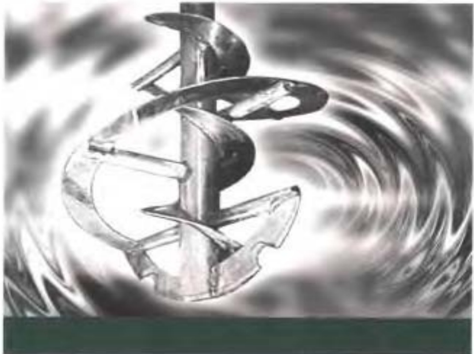

Chemical Industry Press

化学工业出版社 工业装备与信息工程出版中心

<!-- page: 2 -->

**设备选用系列图书**

工业泵选用手册

工业离心机选用手册

搅拌与混合设备设计选用手册

联轴器选用手册

减速器选用手册

机械无级变速器设计与选用指南

离合器、制动器选用手册

运输机械设计选用手册（上、下册）

破碎与筛分机械设计选用手册

电动滚筒设计与选用手册

包装机械选用手册（上、下册）

环境保护设备选用手册——水处理设备

环境保护设备选用手册——大气污染控制设备

环境保护设备选用手册——固体废物处理、噪声控制及节能设备

环境保护设备选用手册——监测仪器设备

除尘装置系统及设备设计选用手册

ISBN 7-5025-537-7-01

ISBN 7-5025-5377-0/TH·196 定价:76.00元

<!-- page: 3 -->

陈志平 章序文 林兴华 等编著

<!-- page: 4 -->

**图书在版编目（CIP）数据**

搅拌与混合设备设计选用手册/陈志平，章序文，林兴华等编著.—北京:化学工业出版社，2004.4 ISBN 7-5025-5377-0

I. 搅… II. ①陈…②章…③林… III. ①搅拌-化工设备-技术手册②混合-化工设备-技术手册 IV. TQ051.7-62

中国版本图书馆 CIP 数据核字（2004）第 029343 号

搅拌与混合设备设计选用手册 陈志平 章序文 林兴华 等编著 责任编辑:周国庆 文字编辑:梁工兰 责任校对:郑捷 封面设计:于兵

化学工业出版社 出版发行 工业装备与信息工程出版中心 (北京市朝阳区惠新里3号 邮政编码100029) 发行电话:(010) 64982530 http://www.cip.com.cn * 新华书店北京发行所经销 北京管庄永胜印刷厂印刷 三河市前程装订厂装订 开本787毫米×1092毫米1/16 印张33¼ 字数824千字 2004年5月第1版 2004年5月北京第1次印刷 ISBN 7-5025-5377-0/TH·196 定价:76.00元

版权所有 违者必究 该书如有缺页、倒页、脱页者，本社发行部负责退换京朝工商广临字（2004）第007号

<!-- page: 5 -->

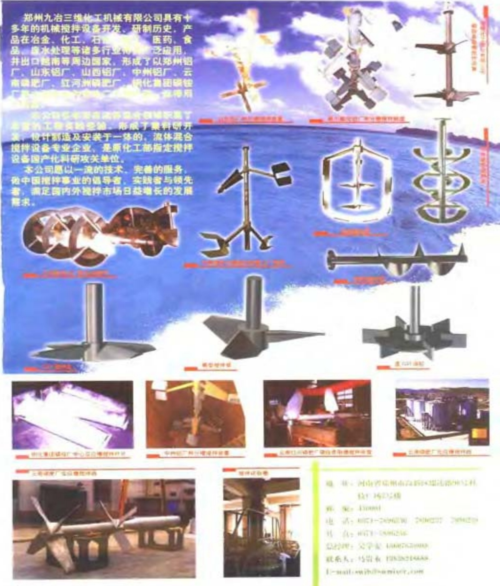

地址:河南省郑州市郑东区瑞达路9号科技园1栋2楼 电话:430801 电话:0571-2696230 2696237 2696238 传真:0571-2696256 经办律师:吴学安 4306762000 联系人:马昭永 138326216688 E-mail: swib@swixcsc.com

<!-- page: 6 -->

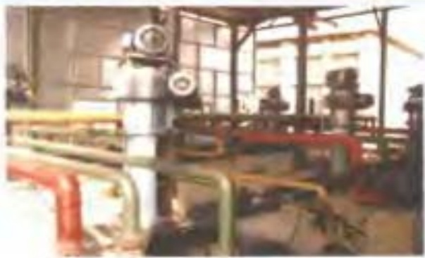

温州市宏机搅拌设备有限公司的前身是温州市减速机厂，是化工部定点专业生产减速机及搅拌装置的专业工厂。近三十年来在生产实践中积累了丰富的设计制造和安装经验，具有成熟的制造工艺、专用的工装设备和完备的检测手段，取得ISO9001的质量体系认证，产品已遍布全国各地并远销东南亚。

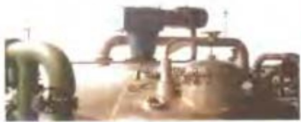

多年来为了满足用户要求，顺应市场需求，我们注重吸收国外先进的技术，拥有长期从事搅拌技术工作的经验工程技术人员，致力于各类流体混合搅拌设备的技术开发和设计制造；产品在国内专业生产行业中占据重要地位，已具备为大型化工设备配套设计，制造、安装的能力，本公司积累了大量第一手的现场实际运转原始资料，并继续不断创新搅拌技术，将先进的混合技术应用于石化、精细化工、高分子聚合、生物、制药、农药、油脂、食品、化妆品、涂料、染料、造纸、水处理、以及冶金、化纤等行业。

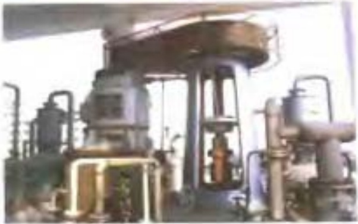

面对入世后的全球市场，本公司定当再接再励。不断完善和严格规范内部质量管理体系，遵循“科技兴业、质量第一”的宗旨，本着一切为了用户、一切为了发展，把我们的产品、质量、服务进一步提高，成为您值得信赖的合作伙伴。

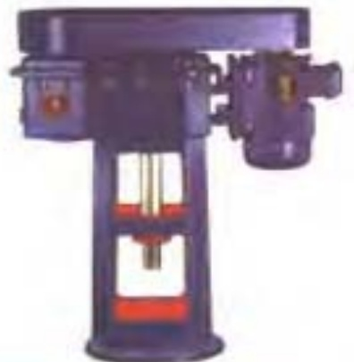

PS/在系列X管内存轴齿轮减速机

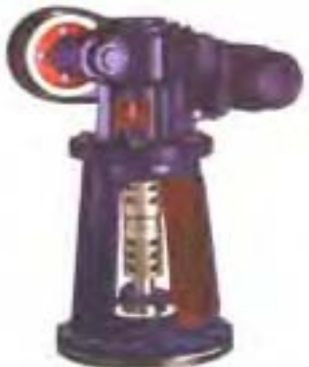

W 索的圆弧椭圆滤流机

地址:浙江省温州市新宫横巷27号 销售电话:0577-88714234 88716741 88711454 网址(Http://www.wzhj.net)

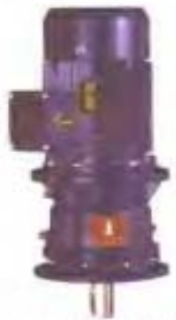

LNGW系列行星齿轮减速机

邮编:325005

传真:0577-88710341

E-mail: hongji58@wz.zj.cn

<!-- page: 7 -->

上海双龙公司是一家起步较早的化工机械厂家，说与供图。日本、马来西亚有着卓著成效的技术合作以及贸易往来。本着把产品周精、做细，健全的经营理念，先后开发生产出具有行业针对性的大型特种混合设备，依托市场局受到了用户的一致好评，欢迎国内各新车用户继续支持和关注京龙公司的发展！

详细说明:

<!-- page: 8 -->

**长江搅拌 Yangtse River Mixers 浙江省科技型企业 ISO9001:2000质量体系认证企业**

温州市长江搅拌设备有限公司是浙江省级科技型企业，公司专业从事于搅拌设备、套用搅拌传动装置的设计、制造和开发。多项产品取得国家专利和科技创新项目、精湛的搅拌技术、高品质的产品、全面的服务和以客户为中心的工作理念，使我们随时雕刻都有能力为您解决最棘手的搅拌问题。产品曾使用于巴斯夫(BASF)、贝尔、杜邦、旭化成、联合利华、埃尔夫、宝洁、雀巢、上海京瓷、长安铃木、日本大仓、DLC、YKK、东洋油墨、美国雪佛龙、法国罗地亚、天津石化、格子石化、南化集团、金川集团、山东万杰集团、龙盛集团、奇华锦等国内外知名企业的工程，深受国内外用户信意。

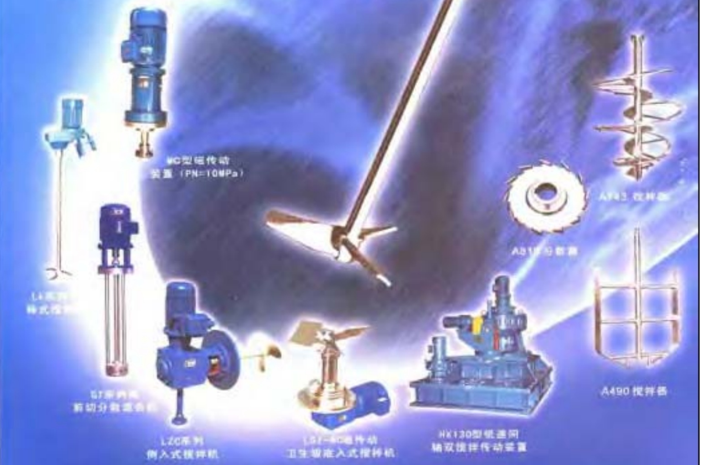

MC型磁传动装置（PN=10MPa）

前切分数题会

A490搅拌器

LZC系列 插入式接线机

LST-和通传动 卫生级准入式搅拌机

温州市长江搅拌设备有限公司

WENZHOU YANGTSE RIVER MIXERS CO., LTD

地址:中国浙江省温州市南白象会竹工业区

Add Jinzhu Industry Area Nanbaixiang Muzhou P.R.C

HY130型低通网 格双拨排传动装置

电话(Tel):0577-86712711 88717071 89717072

总机(Tel) 0577-86716339 86716400

传真(Fax) 0577-86712712 赫编(P.C) 325015

电子信箱(E-mail) wj@mail wqttt.wj.cn 网站http://www.wzcj.com 网络实名:长江媒体

<!-- page: 9 -->

## 前言

理论上把任何状态（固态、液态、气态和半液态）下物料均匀地掺和在一起的操作称为混合，但习惯上常把固态物料之间掺和或者固态物料加湿的操作称为混合；而把固态、液态或气态物料与液态物料混合的操作称为搅拌。

搅拌与混合操作是应用最广的过程单元操作之一，大量应用于化工、石化、轻工、医药、食品、采矿、造纸、农药、涂料、冶金、废水处理等行业中。近年来，搅拌与混合技术发展很快，搅拌与混合设备正向着大型化、标准化、高效节能化、机电一体化、智能化和特殊化方向发展。在这种形势下，技术人员如何借鉴已有经验，掌握新的变化情况，正确设计与选用不同工艺条件下操作的搅拌与混合设备，使其满足安全、可靠、高效和节能的要求，就变得十分重要了。

本书在广泛收集大量文献资料、标准规范及产品数据的基础上，较为全面地介绍搅拌设备与混合设备的分类、工作原理与过程特征、结构特点与参数、设计与选用原则、放大方法，以及运行维护注意事项等。全书注重设计选型和使用维护，突出实用性。

本书由陈志平任主编，章序文任副主编。全书共分三篇十七章，其中第一章、第二章、第三章、第四章、第六章、第九章和第十章由陈志平执笔，第五章、第七章和第八章由林兴华执笔，第十一章由何柄林和陈珏执笔，第十二章和附录由何柄林执笔，第十三章、第十四章由章序文和何柄林执笔，第十五章由何柄林和蔡杨执笔，第十六章由何柄林和费利江执笔，第十七章由虞培清执笔。全书由陈志平统稿，林兴华审核了部分章节内容。

本书的编著得到了浙江大学化工机械研究所蒋家羚教授、郑津洋教授、孙国有副教授，浙江科技学院王露芳副教授，杭州浙大原正混合工程有限公司赵建明高级工程师等的大力支持和帮助；（加拿大）Waterloo University 的 Pan Qinmin 教授参与了第二章至第四章的大纲制订与编写工作；沈建民、胡锡文参与了本书的制图与校对工作；还得到了上海双龙混合设备制造有限公司的大力支持。在此一并表示衷心的感谢。

由于编者的水平和经验有限，书中欠缺和错误之处在所难免，敬请读者不吝赐教。

编著者

2004年1月

<!-- page: 10 -->

Hangzhou Yuanzheng Chemical Engineering Technology and Equipment Co., Ltd

杭州原正公司是杭州国家高新技术产业开发区内的一家高新技术企业，专业从事流体混合、粉体混合技术和装备的开发、设计和制造，具备为大型化工装置配套设计，制造各类流体混合、粉体搅拌型干研和粉体混合设备的丰富经验。A.小型有机碳棒机、多晶广泛应用于聚合、化工、医药等行业。

原正公司的特点是根据用户的工艺条件和新胜日设计并制造各类大型搅拌机，您只要采用可填与本公司的技术要求有，我们就会向量提供全面的技术支持和成分适的产品。

**d1:年比较去年增加降机**

②二十年起定年是汉江行首。如十卷七、八等重要手段，区域规划与环境关系、结构结合得到综合性、客观复杂性和研究发展情况，有的目标不细化社会过程现场于史者的提出方案。客观实例包括孔洞面、闭门墙、层砌或乙骨、黑脸、有机块、岩地公园、砖前土产未特殊。

MVA型并放式搅拌机由上下游装置连接至液体，下层由外加压向内衬前并分散进气，由于相互作用的效应，向上表面受风力抑制器各层结构后与气体重新吸收并分离于液相的特殊措施。从而大幅度提高了气液和盐酸的初始反应速率，控制混合催化补流、溶剂氧化等气液维持反应，也适合注入气体、补充电解等过程，使产品的检测位置和技术鉴定，因而具备快速效率。

规格:80×10^4 Pa（电子和氢反应）

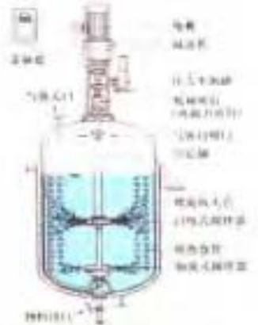

**\therefore 以重新的轴理图**

**聚合反应装置**

19. 朱均夫和郑应祥在南Ⅱ型（丙基芳汤陆星）和国型（丙基芳乳花树）的特征是:不同项的青华珍具西片还系统上适合；可涂除相树物中的黑型、暗型、细曲、无式等问题。结合青英独材的灰树、分机、反农、公社，对黄茅党有5亿民币。

12.2.3. 90 h (1-1) min 96.00 7.10m

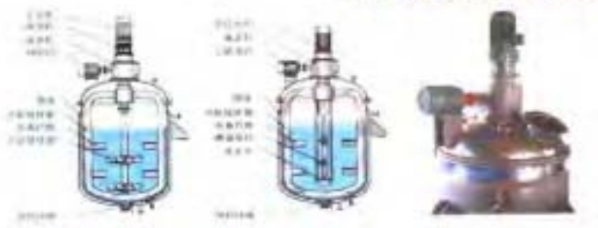

多功能混合分散

**(1) 指定必要时关于修改**

以型空心苏州大丰股份是一种高纯苯酚的正极设备，没有失重补。特设备的较好相，拟把英叶贝为富心结构，因而可通蒸汽、热车、导热泵等多介质，在植物里拉平。英叶面与物种直接接触，接触向他人，性质有限；物种还进行以下两步或多项:适用于细度、细粒径、细质筛目和金属微弱物的均匀性。该化学特性良好，也介绍了和软性指标的能力。还原的系统一般是科学、同波谱的原理相同。光谱还原辐射、中和盐酸的密度相似，物质的密度不低。

陈惠和 43 52 17:59, 20

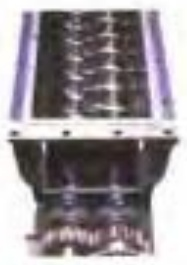

高效搅拌型干燥

版权所有、违者必究！

**自残式加氢反应**

**4. 用模型增强实验随机**

综合补贴在10万重吨以内的超高轻度选择的准仓。但热与暖后，公司适用于高分子聚合行业。

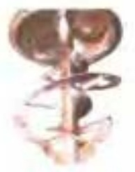

**超高粘流体混合**

**(1) (2) 型型力学分析**

1. 30型车用混合机是一种燃料，高程的粉料体混合设备。特种混合于添加曲质的混合、用途和干燥等过程。

**高粘度粉液混合**

地址:杭州市文三路569号康新综合楼11楼

(机械厂地址:杭州市萧山区闻堰工业园区)

电话:0571-85028356 0571-85028357

传真:0571-85028320 邮编:310013

联系人:赵建明（13957135060）

黄宣东（13003624004）

网址:www.mix.com.cn

www.mixchem.com

E-mail:sales@mix.com.cn

tech@mix.com.cn

<!-- page: 11 -->

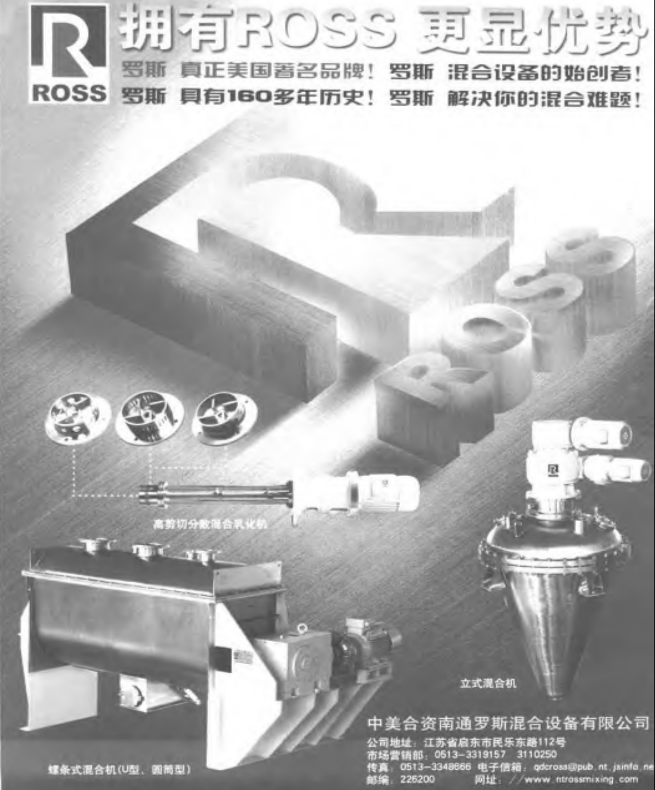

**立式混合机**

中美合资南通罗斯混合设备有限公司

公司地址:江苏省启东市民乐东路112号 市场营销部:0513-3319157 3110250

传真:0513-3348666 电子信箱:qdcross@pub.nt.jsinfo.net

邮编:226200 网址://www.ntrossmixing.com

<!-- page: 12 -->

**CIDONG MIXER PLANT CO.,LTD**

启东混合器厂有限公司是国内最早从事混合、分离、过滤设备开发生产的专业企业，技术力量雄厚，加工设备先进，检测手段齐全，已形成年产30000台（套）混合设备的生产规模。主要开发生产SK、SV、SH、SL、SX、JH、SQS七大系列静态混合器、DL型系列单螺旋浸渍式混合机、WZ系列无重力粒子混合机等10多个大类、50多个系列、3000多种规格的高新技术产品。

启东混合器厂有限公司生产的混合设备广泛适用于石油、化工、医药、农药、染料、食品、塑料、造纸、环保、矿冶等工业部门的液-液、液-固、固-固、液-气、气-气混合、吸收、萃取、反应、强化传热等工艺过程，产品畅销全国29个省市，并出口国际市场，产销量名列国内前茅。成为国内混合、分离、过滤设备生产的主要骨干企业。

* 国家中型企业

★江苏省高新技术企业

★江苏省重合同守信用企业

*国家自营进出口企业

★中国专利江苏百强企业

★江苏星火技术密集区重点企业

★中国石油化工集团公司定点企业

★中国石油天然气集团公司定点企业

*同行业率先通过ISO9001国际质量体系认证

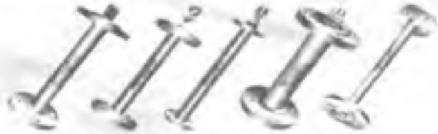

**◆SV、SK、SL、SX、SH、JH系列混合器**

SV SK, SL, SX, SH, BH系列混合器静态混合器系列产品，能在雷诺数据很宽的范围内使用。是解决液-液-液-气-气-气混合、乳化、吸液、萃取、反应、强化传热等工艺过程的理想设备，尤其适用于难于混合的连续工艺。技术性能:最高分散程度为1~2.17 m，液-液相不均匀性系数 $r_{\mathrm{a}} = 1 - 3\%$ 。

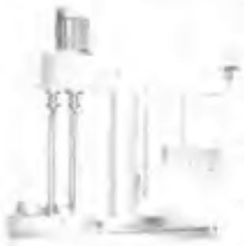

**- SPF型双浆匹配复动搅拌机**

该机具有快速慢速两桨叶，慢速大桨叶形成全茎宏观循环流动，使物料上下翻动，快速小桨叶形成湍流涡流和高剪切。使物料迅速分散均匀混合，两桨叶在茎中转动同时又进行上下往复移动，这不强化了茎中流动的轴向运动。更重要的是增加了全茎混合流体的湍流扩散作用。尤其对高精度体系的混合，具有节能、高效的优点。广泛应用于化工、医药、食品、三大合成、建材等行业。

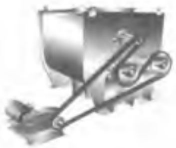

**◆ WZ塑无重力粒力混合机**

该机具有能耗低、混合速度快、混合精度高、性能可靠的优点。尤其适用于比重、粒径相差较大的物料间的混合，广泛应用于化工、食品、农药、饲料等领域的粉体混合及干燥。性能:该机通过两根等速反向旋转轴上特殊布置的桨叶，使物料作径向、环向、轴向三向运动，形成复合循环。

**+ SBM型三维摆动混合机**

该机利用筒体同时作平移、转动、摇准一种运动，在径向、环向、轴向三维空间形成涡流。在极短的时间使混合物混合均匀，具有结构紧凑、操作方便、混合速度快。混合精度高的特点，广泛应用于冶金、食品、染料、烟熏、炸药制造等箱体混合。

*** XSJ高效行星双轴搅拌机**

该机釜内的两根搅拌轴在绕茎体轴线公转的同时又绕自身轴线快速自转，使物料受到强烈的剪切和捏合，得以充分的分散和混合。设备内设有刮空刀，绕茎体轴线转动。将粘在茎壁上的物料刮下参与混合，以防止物料黏度。茎体可加热，真空操作，尤其适用于精度达80000泊的高精构物料分散、混合。

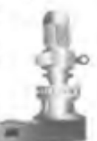

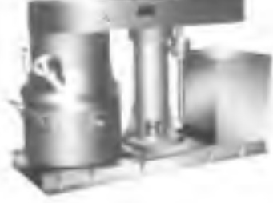

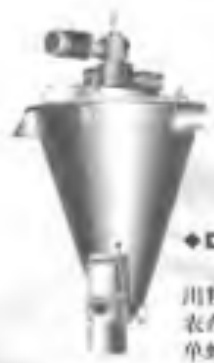

**◆DL〔H〕橙形混合核**

该机具有混合速度快密封性能好，用料迅速方便等特点，广泛应用于化工、农药、染料、食品等领域的粉体混合，有单螺旋、双螺旋、非对称等多种形式。

地址:江苏省启东市河南中路258号

总 税:0513-3313678 3313695

总经理室:0513-3311666

销售部:0513-3319566 3313694 3356783

图文传真:0513-3311634

邮编:226200

网址:www.xc-group.com

电子信箱:qdmixer@pub.nf.jsinfo.net

董事长、总经理:高祖昌

副董事长、副总经理:徐斌

<!-- page: 13 -->

## 内容提要

搅拌与混合设备正向着大型化、标准化、高效节能化、机电一体化、智能化和特殊化方向发展。正确设计与选用不同工艺条件下操作的搅拌与混合设备，才能使其满足安全、可靠、高效和节能的要求。

本书包括工艺设计和机械结构选型两方面内容，收集并归纳整理了大量国内外最新资料，全面介绍了搅拌与混合设备的工作原理与过程特征、结构特点与技术参数、设计与选用原则、放大方法，以及运行维护注意事项等。内容翔实完整，资料准确可靠，注重设计选型，突出实用性。

本书可供化工、石化、轻工、医药、食品、采矿、造纸、农药、涂料、冶金、废水处理等行业的设计部门和企业的工程技术人员查阅，也可供大专院校相关专业师生参考。

<!-- page: 14 -->

## 目录

- 第一章 搅拌概论 …… 3
- 第一节 搅拌设备的操作目的与搅拌效果 …… 3
- 一、搅拌目的 …… 3
- 二、搅拌效果的度量尺度 …… 3
- 三、影响搅拌效果的因素 …… 4
- 第二节 搅拌设备的基本结构 …… 5
- 一、搅拌容器 …… 5
- 二、搅拌器与搅拌轴 …… 5
- 三、挡板 …… 6
- 四、导流筒 …… 6
- 五、轴封（或磁力传动装置） …… 6
- 六、传动装置 …… 6
- 第三节 搅拌传动装置的典型组合形式 …… 7
- 第四节 搅拌设备的主要特征和工程技术特点 …… 9
- 一、影响流动场和输入能量的主要因素 …… 9
- 二、流动场 …… 10
- 三、输入能量 …… 10
- 四、搅拌设备在工程技术上的特点 …… 11
- 第五节 搅拌设备设计与选用的基本方法 …… 12
- 一、搅拌设备的设计步骤 …… 12
- 二、搅拌设备设计与选用的基本原则 …… 13
- 三、搅拌设备的智能设计专家系统 …… 14
- 参考文献 …… 15
- 第二章 特殊物料的搅拌 …… 16
- 第一节 搅拌物料的种类和特性 …… 16
- 一、牛顿流体 …… 16
- 二、非牛顿流体 …… 16
- 第二节 单相物料体系的搅拌 …… 22
- 一、低黏度互溶液体的搅拌 …… 22
- 二、高黏流体的搅拌 …… 26
- 三、黏弹性流体的搅拌 …… 37
- 第三节 多相物料体系的搅拌 …… 39

<!-- page: 15 -->

- 一、气-液两相体系的搅拌 …… 40
- 二、液-液两相体系的搅拌 …… 45
- 三、固-液两相体系的搅拌 …… 52
- 四、气-液-固三相体系搅拌技术研究进展 …… 57
- 参考文献 …… 62
- 第三章 特殊过程的搅拌 …… 63
- 第一节 混合搅拌 …… 63
- 一、宏观混合与微观混合 …… 63
- 二、混合过程的混合参数 …… 64
- 三、混合特性 …… 65
- 四、混合过程设计要点 …… 67
- 五、混合过程常见的强化方法 …… 67
- 第二节 悬浮与分散搅拌 …… 68
- 一、液滴与气泡的分散 …… 68
- 二、固体颗粒的分散与悬浮 …… 68
- 第三节 传热搅拌 …… 69
- 一、概述 …… 69
- 二、表面传热系数的特征 …… 70
- 三、热传递系数关联式 …… 70
- 四、高黏流体的刮壁式传热 …… 70
- 第四节 传质搅拌 …… 73
- 一、固-液传质 …… 73
- 二、液-液传质 …… 74
- 三、气-液传质 …… 75
- 第五节 搅拌实验技术简介 …… 76
- 一、搅拌功率的测量 …… 76
- 二、停留时间分布的测量 …… 77
- 三、混合时间的测量 …… 78
- 四、相分率测量 …… 80
- 第六节 搅拌与混合研究新动向 …… 81
- 一、LDV/PIV测量技术 …… 81
- 二、CFD模拟技术 …… 81
- 三、电子过程断层成像技术 …… 82
- 四、混沌混合技术 …… 83
- 五、搅拌与混合设备选型和设计的智能化系统 …… 84
- 参考文献 …… 84
- 第四章 搅拌设备的放大 …… 86
- 第一节 搅拌过程的放大基础 …… 87
- 一、搅拌器的流体力学原理 …… 87
- 二、搅拌釜中流体的切应变速率 …… 87

<!-- page: 16 -->

- 三、经验原则 …… 88
- 第二节 基本方法 …… 88
- 一、相似放大 …… 88
- 二、非几何相似放大 …… 93
- 三、数模放大 …… 94
- 第三节 多相搅拌过程的放大 …… 95
- 一、气-液分散过程的放大 …… 95
- 二、液-液分散过程的放大 …… 96
- 三、固-液悬浮过程的放大 …… 96
- 第四节 放大实例 …… 98
- 一、反应釜的放大 …… 98
- 二、聚合釜的放大 …… 100
- 三、非均相介质搅拌反应釜的放大 …… 101
- 四、间歇釜的放大 …… 106
- 参考文献 …… 106
- 第五章 搅拌器的选用 …… 108
- 第一节 搅拌器的分类 …… 108
- 第二节 搅拌器的结构型式 …… 109
- 第三节 搅拌器的特性参数 …… 115
- 一、流型 …… 115
- 二、流动特征 …… 116
- 三、搅拌器的特性参数 …… 116
- 第四节 几种常用搅拌器的特性及一般应用 …… 117
- 一、常用搅拌器特性 …… 117
- 二、搅拌器在单元操作上的一般应用 …… 120
- 第五节 搅拌器的选型 …… 122
- 一、按搅拌目的选型 …… 122
- 二、按介质的黏度选型 …… 123
- 三、按搅拌器型式和适用条件选型 …… 124
- 四、生物发酵设备搅拌器选型 …… 124
- 第六节 搅拌器的技术要求 …… 126
- 一、搅拌器的一般技术要求 …… 126
- 二、常用搅拌器的技术要求 …… 126
- 第七节 搅拌器的应用实例 …… 129
- 第八节 新型搅拌器的研究开发简介 …… 131
- 第九节 常用搅拌器的规格与型号 …… 133
- 一、平桨式搅拌器 …… 133
- 二、推进式搅拌器 …… 134
- 三、涡轮式搅拌器 …… 135
- 四、框式与锚式搅拌器 …… 138

<!-- page: 17 -->

- 五、螺带式及螺带螺杆式搅拌器……140
- 六、三窄叶旋桨式搅拌器……140
- 七、四叶旋桨式搅拌器……141
- 八、布尔马金式搅拌器……142
- 参考文献……143
- 第六章 搅拌容器的设计与选用……144
- 第一节 容器几何尺寸的确定……144
- 一、容器容积的确定……144
- 二、容器装液高径比 H_{1}/D 的确定……145
- 三、筒体内径和高度的确定……145
- 四、搅拌容器强度计算……146
- 五、搅拌容器的材料……146
- 第二节 立式钢制搅拌设备……146
- 一、技术参数……146
- 二、型式及主要参数……147
- 第三节 搪玻璃搅拌设备……151
- 一、搪玻璃设备的性能……151
- 二、搪玻璃开式搅拌设备（HG/T 2371）……151
- 三、搪玻璃闭式搅拌设备（HG/T 2372）……160
- 第七章 搅拌设备传热元件的设计……168
- 第一节 传热夹套及强度计算……168
- 一、整体夹套……168
- 二、型钢夹套……170
- 三、半管夹套……171
- 四、蜂窝夹套……174
- 五、激光焊接式蜂窝夹套……178
- 六、螺旋板缠绕式蜂窝夹套……178
- 第二节 内盘管及其他换热元件……179
- 一、内盘管……179
- 二、其他换热元件……182
- 第三节 传热计算……182
- 一、传热方程……182
- 二、搅拌容器内壁面传热膜系数 \alpha_{1} 计算……183
- 三、盘管、夹套的传热膜系数 \alpha_{2} 计算……187
- 参考文献……189
- 第八章 搅拌附件的选择……190
- 第一节 挡板……190
- 一、竖式挡板……191
- 二、底挡板……192
- 三、指形挡板及其他型式的挡板……192

<!-- page: 18 -->

- 第二节 导流筒.... 192
- 第三节 稳定器.... 194
- 参考文献.... 195
- 第九章 传动装置的选用.... 196
- 第一节 传动装置系统组合与选用原则.... 196
- 一、搅拌传动装置的系统组合.... 196
- 二、传动装置各组成部分的选用原则.... 197
- 第二节 电动机选用.... 200
- 一、电动机选用的基本原则.... 201
- 二、电动机额定功率的确定.... 201
- 三、环境温度和海拔高度的影响.... 203
- 四、电动机防护型式的选择.... 203
- 五、爆炸性和火灾危险性环境的电动机选择.... 205
- 六、搅拌设备常用电动机特性.... 209
- 第三节 变速器的类型与选用.... 210
- 一、减速机的主要类型及其特点.... 210
- 二、减速机的选用原则.... 212
- 三、釜用立式减速机.... 213
- 四、机械无级变速器选用.... 246
- 第四节 凸缘法兰与安装底盖的选用.... 261
- 一、凸缘法兰（HG 21564）.... 261
- 二、安装底盖（HG 21565）.... 263
- 第五节 机架选用.... 267
- 一、WJ、LWJ、DJ、LDJ、DXJ、SJ、LSJ型机架.... 267
- 二、XD型、XS型机架（同HG21699和HG21567）.... 274
- 三、FZ型双支点方底板机架.... 280
- 第六节 联轴器选用.... 281
- 一、JQ型夹壳联轴器.... 281
- 二、SF型三分式联轴器.... 283
- 三、TK型弹性块式联轴器.... 286
- 四、GT、DF、DT型刚性凸缘联轴器.... 287
- 第七节 搅拌轴设计.... 289
- 一、搅拌轴计算的力学模型.... 291
- 二、按扭转变形计算搅拌轴的轴径.... 291
- 三、按临界转速校核搅拌轴的直径.... 292
- 四、按强度计算搅拌轴的直径.... 296
- 五、按轴封处允许径向位移验算轴径.... 301
- 六、搅拌轴支点类型的确定.... 304
- 七、减小轴端挠度、提高搅拌轴临界转速的措施.... 304
- 八、搅拌轴常用金属材料.... 305

<!-- page: 19 -->

- 第八节 搅拌轴中间轴承和底轴承选用.... 306
- 一、中间轴承.... 306
- 二、底轴承.... 306
- 参考文献.... 309
- 第十章 轴封的选用.... 310
- 第一节 轴封的类型.... 310
- 一、轴封的类型和特点.... 310
- 二、轴封功率损耗的近似计算.... 312
- 第二节 填料密封选用.... 313
- 一、密封用填料.... 313
- 二、填料腔的结构设计.... 316
- 三、搅拌设备填料密封的选用原则.... 318
- 四、标准填料密封的选用.... 319
- 第三节 机械密封选用.... 333
- 一、机械密封的分类.... 333
- 二、机械密封结构选型原则.... 336
- 三、标准机械密封的选用.... 337
- 四、中压机械密封.... 343
- 五、机械密封辅助系统的选用.... 345
- 第十一章 磁力传动搅拌设备.... 353
- 第一节 概述.... 353
- 一、磁力传动搅拌设备简介.... 353
- 二、国内外磁力传动搅拌设备技术进展.... 354
- 第二节 结构与材料.... 355
- 一、磁力传动搅拌设备的工作原理和结构.... 355
- 二、磁力传动搅拌设备主要零部件的材料.... 357
- 三、最大传递扭矩计算.... 370
- 四、影响驱动力矩的因素.... 373
- 第三节 磁力传动搅拌设备的特点.... 375
- 一、与磁钢有关的一些特性.... 375
- 二、磁力传动搅拌设备的优点.... 376
- 三、磁力传动搅拌设备的缺点.... 376
- 四、磁力传动搅拌设备的操作要求.... 377
- 第四节 磁力传动搅拌设备的选用.... 377
- 参考文献.... 379

## 第二篇 混合设备的选用

- 第十二章 混合设备的分类与选型基本原则 …… 383
- 第一节 概述…… 383

<!-- page: 20 -->

- 一、固体粒子……383
- 二、固体混合……384
- 三、固体混合的影响因素……384
- 四、混合过程机理……385
- 五、混合度……386
- 第二节 混合设备的分类……387
- 第三节 混合设备选型的基本原则……389
- 一、根据过程的要求进行选型……389
- 二、根据混合物的质量要求选型……391
- 三、根据混合费用选型……391
- 第四节 固体混合设备的功率消耗与放大……393
- 一、功率计算……393
- 二、混合设备的放大……395
- 参考文献……396
- 第十三章 容器回转型混合设备……397
- 第一节 基本性能参数……397
- 一、最佳速度的确定……397
- 二、装料系数……398
- 三、混合设备消耗功率的近似计算式……398
- 第二节 V型混合设备……399
- 一、V型混合设备的工作原理及结构……399
- 二、V型混合设备的应用范围……399
- 三、V型混合设备的主要参数……399
- 第三节 双重圆锥式混合设备……400
- 一、双重圆锥式混合设备的工作原理及结构……400
- 二、双重圆锥式混合设备的应用范围……402
- 第四节 滚筒式混合设备……403
- 一、滚筒式混合设备的工作原理及结构……403
- 二、滚筒式混合设备的应用范围……404
- 三、主要参数……405
- 第五节 正立方体混合设备……405
- 一、正立方体混合设备的工作原理及结构……405
- 二、正立方体混合设备的应用范围……406
- 第六节 其他型式的混合设备……406
- 一、摇滚式混合设备……406
- 二、三维运动式混合设备……408
- 参考文献……411
- 第十四章 容器固定型混合设备……412
- 第一节 螺带式混合设备……412
- 一、螺带式混合设备的结构……413

<!-- page: 21 -->

- 二、螺带式混合设备的应用范围……415
- 三、规格和主要参数……416
- 第二节 型刀式混合设备……417
- 一、犁刀式混合设备的工作原理与结构……418
- 二、犁刀式混合设备的应用范围……419
- 三、规格及主要参数……419
- 第三节 瞬间失重粒子混合设备……420
- 一、瞬间失重粒子混合设备的工作原理与结构……420
- 二、瞬间失重粒子混合设备的应用范围……421
- 三、规格与主要参数……422
- 第四节 行星锥形混合设备……422
- 一、行星锥形混合设备的工作原理与结构……423
- 二、行星锥形混合设备的特点……427
- 三、行星锥形混合设备的应用……428
- 四、行星锥形混合设备的型号及规格……428
- 第五节 研磨设备……430
- 一、滚轮混合设备……430
- 二、新型卧式珠磨机……431
- 第六节 转子混合设备……432
- 一、双转子混合设备……432
- 二、单转子混合设备……433
- 参考文献……433
- 第十五章 非回转式混合设备……434
- 第一节 静态混合器……434
- 一、静态混合器的混合机理与分类……436
- 二、静态混合器的结构……436
- 三、静态混合器的技术参数……437
- 四、静态混合器的性能与特点……439
- 五、静态混合器主要技术参数的确定……441
- 六、静态混合器初选数据……444
- 七、静态混合器安装型式与应用注意事项……444
- 八、应用……445
- 九、静态混合器应用实例试算……447
- 十、静态混合技术进展概述……448
- 第二节 气流搅拌装置……449
- 一、鼓泡槽……450
- 二、锥形料浆槽……452
- 第三节 射流混合器……454
- 一、射流混合……454
- 二、喷射式混合器……456

<!-- page: 22 -->

- 第四节 管道混合装置.... 459
- 一、动态管道混合装置.... 460
- 二、三通混合元件.... 465
- 三、挡板式混合器.... 465
- 四、孔板式混合器.... 466
- 第五节 气力式混合器.... 469
- 一、外管重力式气力混合器.... 469
- 二、内管重力式气力混合器.... 470
- 三、旋管重力式气力混合器.... 470
- 四、脉冲旋流式气力混合器.... 470
- 参考文献.... 471
- 第十六章 捏合设备.... 472
- 第一节 间歇式捏合设备.... 472
- 一、小型混合器.... 472
- 二、双臂捏合机.... 473
- 三、开炼机.... 475
- 四、密炼机.... 477
- 第二节 连续式捏合设备.... 480
- 一、单螺杆挤出机.... 480
- 二、双螺杆挤出机.... 481
- 三、Buss-Kneader捏合机 .... 483
- 四、M-P型捏合机 .... 485
- 五、ZSK双螺旋捏合机 .... 486
- 六、FCM混炼机 .... 486
- 七、CONTERNA连续捏合机 .... 488
- 八、新型卧式双轴搅拌设备.... 488
- 九、MD系列连续混炼机.... 489
- 参考文献.... 490

## 第三篇 搅拌设备的采购、制造、检验及运行

- 第十七章 搅拌设备的采购、制造、检验及运行.... 493
- 第一节 搅拌设备的采购.... 493
- 第二节 搅拌设备的制造与检验.... 496
- 一、搅拌容器制造和检验.... 496
- 二、搅拌机制造和检验.... 497
- 三、搅拌设备试运转和检验.... 498
- 第三节 搅拌设备的运行特性.... 499

<!-- page: 23 -->

- 第四节 故障分析与处理.... 499
- 参考文献.... 501
- 附录A 常用单位换算表 .... 502
- 附录B 化工常用数学公式 .... 506
- 一、常用图形的面积及体积.... 506
- 二、化工常用数学公式.... 509
- 附录C 常见流体的黏度 .... 513
- 一、液体的黏度.... 513
- 二、气体的黏度.... 514

<!-- page: 24 -->

## 第一篇

<!-- page: 25 -->

•

<!-- page: 26 -->

## 第一章 搅拌概论

搅拌设备使用历史悠久，大量应用于化工、医药、食品、采矿、造纸、涂料、冶金、废水处理等行业中。搅拌设备在许多场合是作为反应器来用的。例如，在三大合成材料（合成橡胶、合成纤维、合成塑料）的生产中，采用搅拌设备作反应器的，约占反应器总数的85%以上。但更大量的搅拌设备并不用于化学反应，而仅用于物料的混合、传热、传质以及制备乳液、悬浮液等。

搅拌操作按作用方式可分为机械搅拌和气流搅拌两种。气流搅拌是利用气体鼓泡通过液体层，对液体产生搅拌，或使气泡群以密集状态上升借所谓气升作用促进液体产生对流循环。这种搅拌没有运动部件，主要用于处理腐蚀性介质，以及高温高压条件下的反应物料。但由于其搅拌能力比较弱，因而一般仅用于低黏度物料的搅拌。气流搅拌装置的结构特点和选用原则将在本书的第二篇第十五章作详细的介绍。本篇主要介绍在工业生产中广泛使用的机械搅拌设备的选用。

### 第一节 搅拌设备的操作目的与搅拌效果

**一、搅拌目的**

以液体为主体的搅拌操作，常常将被搅物料分为液-液、气-液、固-液、气-液-固等四种情况。搅拌既可以是一种独立的流体力学范畴的单元操作，以促进混合为主要目的，如进行液-液混合、固-液悬浮、气-液分散、液-液分散和液-液乳化等；又往往是完成其他单元操作的必要手段，以促进传热、传质、化学反应为主要目的，如在搅拌设备内进行流体的加热与冷却、萃取、吸收、溶解、结晶、聚合等操作。

概括起来，搅拌设备的操作目的主要表现为以下四个方面:

① 使不互溶液体混合均匀，制备均匀混合液、乳化液，强化传质过程；

② 使气体在液体中充分分散，强化传质或化学反应；

③制备均匀悬浮液，促使固体加速溶解、浸取或发生液-固化学反应；

④ 强化传热，防止局部过热或过冷。

**二、搅拌效果的度量尺度**

依据不同的操作目的，搅拌效果有不同的表示方法，常用的表示法列于表1-1。实际应用时，往往通过实验研究、中试或生产数据分析，整理出搅拌效果与搅拌参数间的关系式。但针对搅拌效果的不同表示方法或不同的操作条件，可以得到很多且彼此结果差异很大的关系式。因此，对于给定混合过程，搅拌效果的表示法和主要操作因素的确定，应该特别审慎。所选出的关系式的实验条件要尽可能符合给定条件，才能使设计与选用的搅拌设备满足操作目的和经济性。否则，所得结果不一定满足过程要求，或者至少会使过程的经济性变差。

<!-- page: 27 -->

表 1-1 操作目的和搅拌效果表示法

| 操作目的 | 搅拌物系 | 搅拌效果表示法 |
|---|---|---|
| 均匀混合 | 调和均相互溶液系 |混合时间 $\theta_{M}$ 或 $N_{\theta M} = N \cdot \theta_{M}$ |
| 非均相分散 | 液-液相系 |均匀分散(乳化)时间 $\theta_{M}$ ;分散相液滴的比界面积 a ,或滴径分布,或平均滴径 $d_{y}$ |
| 气-液相系 |均匀分散时间 $\theta_{M}$ ;气泡的比界面积 a ,或气泡的平均直径 $d_{B}$ 和气泡直径分布|  |
| 固-液相系 |悬浮状态,悬浮临界转速 $N_{c}$ ;悬浮固液浓度或比表面积 a|  |
| 非均相传质 | 溶解(固-液相系) |溶解速度或平均溶解速度以固粒表面积为基准的液膜传质系数 $k_{c}$ ,总传质系数 K|
| 萃取(液液相系) |萃取速度,萃取效率,液滴比表面积 a ;总容积传质系数 $K_{V}$ 或液滴内(外)表面为基准的液膜传质系数 $k_{Cd}$ |  |
| 吸收(气-液相系) |吸收速度,气泡比表面积 a ;总容积吸收系数 $K_{V}$ ,膜传质系数 $k_{g}$ , $k_{l}$ |  |
| 传热 | 固-液相系 |传热速度 Q(kJ/h) ,单位容积传热速率 $Q_{v}(kJ/m^{3} \cdot h)$ 液膜传热系数 $a_{L}$ ,总传热系数 K|

**三、影响搅拌效果的因素**

搅拌过程涉及流体的流动、传热和传质，影响因素复杂繁多。表 1-2 列出了影响搅拌效果的各种因素，其中流动状态及物性对各搅拌操作的影响程度见表 1-3。利用此表，可以初步找出影响给定操作的主要因素，为选择搅拌器型式和操作参数提供了方向。

表 1-2 影响搅拌效果的因素

| 类别 | 主要影响因素 |
|---|---|
| 流动状态 | 流型,对流循环速率,湍流扩散,剪切流 |
| 物性 | 黏度或黏度差,密度或密度差、分子扩散系数、粒径;表面张力、比热容、热导体、非牛顿流体之流变性 |
| 操作条件 | 搅拌器型式、转速;溶质加入量、加入速度、分散状况和加入位置 |
| 几何因素 | 连续式或间歇式;溶质加入方法:釜、搅拌器及釜内构件(挡板、导流筒等)的几何形状、相对尺寸和安装方式等 |

表 1-3 流态及物性对各搅拌操作的影响程度

| 搅拌操作目的 |  | 流动状态 |  |  |  | 物性 |  |  |  |  |  |  |  |
|---|---|---|---|---|---|---|---|---|---|---|---|---|---|
| 连续相 |  |  | 相对速度 | 黏度 | 黏度差 | 密度 | 密度差 | 扩散系数 | 表面张力 | 热导体 | 粒径分布及浓度 |  |  |
| 循环速率 | 湍流扩散 | 剪切流 |  |  |  |  |  |  |  |  |  |  |  |
| 均相系混合 | 低黏度液 | ◎ | ◎ |  |  | ○ | ◎ |  |  |  |  |  |  |
| 高黏度液 | ◎ |  | ◎ |  |  |  |  |  |  |  |  |  |  |
| 分散 | 液-液相系 | ◎ | ◎ | ◎ |  | ◎ | ○ | ○ |  |  | ○ | ○ |  |
| 气-液相系 | ◎ | ◎ | ◎ |  | ○ |  |  |  |  |  |  |  |  |
| 固体悬浮(固-液相系) |  | ◎ | ◎ |  | ◎ |  |  |  | ◎ |  |  |  | ◎ |

<!-- page: 28 -->

续表

| 搅拌操作目的 | 流动状态 |  |  |  | 物性 |  |  |  |  |  |  |  |
|---|---|---|---|---|---|---|---|---|---|---|---|---|
| 连续相 |  |  | 相对速度 | 黏度 | 黏度差 | 密度 | 密度差 | 扩散系数 | 表面张力 | 热导体 | 粒径分布及浓度 |  |
| 循环速率 | 湍流扩散 | 剪切流 |  |  |  |  |  |  |  |  |  |  |
| 溶解(固-液相系) | ◎ |  | ○ | ◎ | ○ |  | ○ | ◎ |  |  |  | ◎ |
| 结晶(固-液相系) | ◎ | * | ◎ |  |  |  |  |  |  |  |  |  |
| 萃取(液-液相系) | ◎ | * | ◎ | ○ |  |  | ○ |  |  |  |  |  |
| 吸收(气-液相系) | ◎ | ○ |  |  |  |  |  | ○ |  |  |  |  |
| 传热(固-液相系) | ◎ | ○ | ○ |  | ◎ | ◎ | ○ |  | ◎ | ◎ | ◎ |  |

2. *表示对于萃取、晶析等操作，液流湍动程度的影响还不清楚。

### 第二节 搅拌设备的基本结构

机械搅拌设备由搅拌容器和搅拌机两大部分组成。搅拌容器包括釜体、外夹套、内构件以及各种用途开孔接管等；搅拌机则包括搅拌器、搅拌轴、轴封、机架及传动装置等部件。其结构构成如图 1-1 所示。

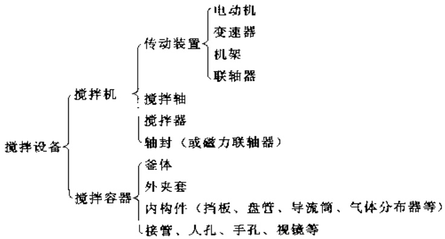

图1-1 机械搅拌设备的结构构成

**一、搅拌容器**

搅拌容器常被称作搅拌釜（或搅拌槽），当搅拌设备用作反应器时，又被称为搅拌釜式反应器，有时简称反应釜。

釜体的结构型式通常为立式圆筒形，其高径比值主要依据操作时容器装液高径比以及装料系数大小而定。而容器装液高径比又视容器内物料性质、搅拌特征和搅拌器层数而异，一般取1~1.3，最大时可达6，详见第六章第一节介绍。釜底形状有平底、椭圆底、锥形底等，有时亦可用方形釜。同时，根据工艺的传热要求，釜体外可加夹套，并通以蒸汽、冷却水等载热介质；当传热面积不足时，还可在釜体内部设置盘管等。

**二、搅拌器与搅拌轴**

搅拌器又被称作叶轮或桨叶，它是搅拌设备的核心部件。根据搅拌器在搅拌釜内产生的流型，搅拌器基本上可以分为轴向流和径向流两种。例如，推进式叶轮、新型翼型叶轮等属

<!-- page: 29 -->

于轴向流搅拌器，而各种直叶、弯叶涡轮叶轮则属于径向流搅拌器。

搅拌轴通常自搅拌釜顶部中心垂直插入釜内，有时也采用侧面插入、底部伸入或侧面伸入方式，应依据不同的搅拌要求选择不同的安装方式。

搅拌设备中电动机输出的动力是通过搅拌轴传递给搅拌器的，因此搅拌轴必须有足够的强度。同时，搅拌轴既要与搅拌器连接，又要穿过轴封装置以及轴承、联轴器等零件，所以搅拌轴还应有合理的结构、较高的加工精度和配合公差。

**三、挡板**

为了消除搅拌容器内液体的打旋现象，使被搅物料能够上下轴向流动，形成全釜的均匀混合，通常需要在搅拌容器内加入若干块挡板。挡板数一般在2～6块之间，视具体情况而定。加入挡板后，搅拌功耗将明显增加，且随着挡板数的增加而增加；但在满足全挡板条件后，再增加挡板数，搅拌功耗将不再增加。通常，挡板宽度约为容器内直径的1/12～1/10。在固体悬浮操作时，还可在釜底上安装底挡板，以促进固体的悬浮。搅拌容器中的传热盘管也可部分以至全部代替挡板；当装有垂直换热管后，一般也可不再设置挡板。

**四、导流筒**

导流筒为上下开口的圆筒，置于搅拌容器中心，在搅拌混合中起导流作用。通常导流筒的上端都低于静液面，且在筒身上开有槽或孔。当生产中液面降落时物料仍可从槽或孔进入。

通常，推进式搅拌器可位于导流筒内或略低于导流筒的下端；涡轮式或桨式搅拌器常置于导流筒的下端。当搅拌器置于导流筒之下，且筒体直径又较大时，筒的下端直径应缩小，使下部开口小于搅拌器直径。

**五、轴封（或磁力传动装置）**

轴封是搅拌设备的一个重要组成部分。轴封属于动密封，其作用是保证搅拌设备内处于一定的正压或真空状态，防止被搅物料逸出和杂质的渗入，因而不是所有的转轴密封型式都能用于搅拌设备。在搅拌设备中，最常用的轴封有液封、填料密封和机械密封等。

当搅拌介质为剧毒、易燃、易爆，或较为昂贵的高纯度物料，或者需要在高真空状态下操作，对密封要求很高，且填料密封和机械密封均无法满足时，可选用全封闭的磁力传动装置。

磁力传动装置又称为磁力联轴器，是全封闭密封中的一种。它是利用永久磁体异极相吸、同极相斥的原理，通过气隙和隔离膜（套）将机械运动传递到密闭的空间内。与传统的填料密封和机械密封相比，磁力传动装置最主要的优点是能实现零泄漏，但制造成本较高，目前在中、小型搅拌设备中应用较多。

**六、传动装置**

搅拌设备的传动装置包括电动机、变速器、联轴器、轴承及机架等。其中搅拌驱动机构通常采用电动机与变速器的组合或选用带变频器的电动机，使搅拌器达到需要的转速。

传动装置的作用是使搅拌轴以所需的转速转动，并保证搅拌轴获得所需的扭矩。在绝大多数搅拌设备中，搅拌轴只有一根，且搅拌器以恒定的速度向一个方向旋转。然而也有一些特殊的搅拌设备，为获得更佳的混合效果，可以在一个搅拌设备内使用两根搅拌轴，并让搅拌器进行复杂的运动，如复动式、往复式、行星式等。

搅拌设备的典型结构如图1-2所示。

<!-- page: 30 -->

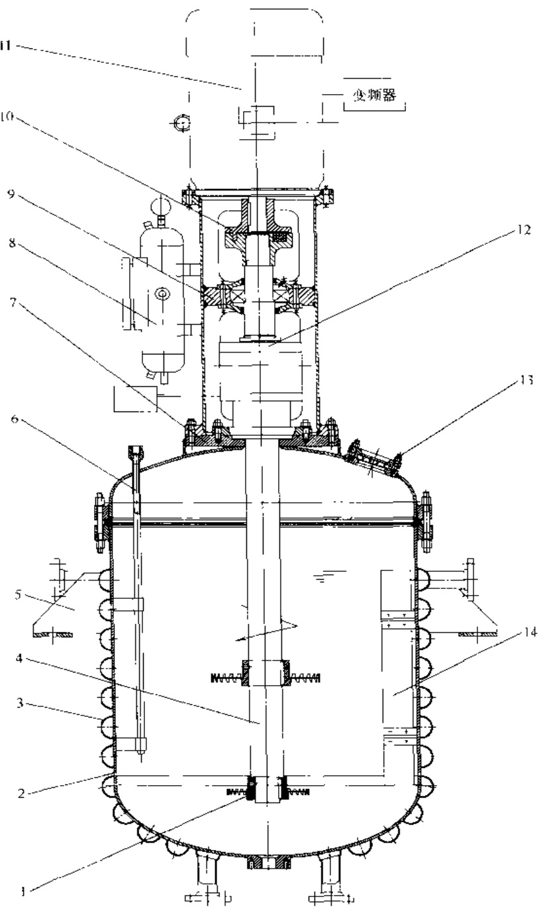

图1-2 搅拌设备的典型结构

1—搅拌器；2—釜体；3—半圆管夹套；4—搅拌轴；5—支座；6—温度计接管；7—马缘法兰；8—循环冷却系统；9—机架；10—联轴器；11—带变频器的电动机；12—轴封；13—视镜；14—挡板

### 第三节 搅拌传动装置的典型组合形式

搅拌机和搅拌容器的典型组合型式列于表1-4，

<!-- page: 31 -->

表 1-4 搅拌机和搅拌容器的典型组合型式

| 序号 | 搅拌机 | 搅拌容器 | 典型图例 | 特点 |
|---|---|---|---|---|
| 1 | 中心顶插式 | 立式圆筒形 |  | 这种型式应用最为广泛;安装、操作和检修方便;可用于压力容器及常压容器;但这种型式的搅拌轴较长 |
| 2 | 偏心顶插式 | 立式圆筒形 |  | 这种型式应用较少,釜内无挡板时漩涡小 |
| 3 | 顶插式 | 卧式圆筒形 |  | 可插入多个搅拌机 |
| 4 | 顶插式 | 矩形或方釜 |  | 在无压力的混凝土槽中有应用,如水处理槽、磷酸储槽、地槽等;这种型式可插入多个搅拌机 |
| 5 | 底插式(底伸式) | 立式圆筒形 |  | 搅拌轴比较短;若与顶插式配合,可实现双速搅拌;但这种型式密封困难,更换密封时必须有应急密封;目前这种型式应用较少 |
| 6 | 斜插式 | 立式圆筒形或矩形 |  | 常用于3kW以下的快装式的可拆搅拌操作 |

<!-- page: 32 -->

续表

| 序号 | 搅拌机 | 搅拌容器 | 典型图例 | 特点 |
|---|---|---|---|---|
| 7 | 侧插式 | 立式圆筒形或矩形 |  | 在大型储油罐中有广泛应用;可插入多个搅拌机;其单位体积消耗的功率很小;有的侧插式搅拌机在水平方向可摆动;但侧插式搅拌机密封困难,更换密封时必须有应急密封 |
| 8 | 侧插式 | 卧式圆筒形 |  | 这种型式比较少见 |
| 9 | 带导流筒的中心顶插式 | 立式圆筒形或矩形 | 1-搅拌器:2-导流筒3-挡板;4-喇叭口 | 在磷酸和氧化铝等行业中有应用;较适合固-液悬浮操作,全釜浓度均匀;但这种型式当液位低于导流筒上口时无法操作,而且固体颗粒容易沉积在釜底堵住导流筒,使设备难以启动 |
| 10 | 侧插式 | 卧式圆筒形 |  | 在钢材的淬火(或油淬)处理时有应用,其他行业极少用 |

### 第四节 搅拌设备的主要特征和工程技术特点

搅拌过程是通过搅拌器的旋转向釜内流体输入机械能，使流体获得适宜的流动场，在流动场内进行动量、热量、质量的传递或者同时进行化学反应的过程。因此，流动场和输入能量总是设计与选用搅拌设备时最关心的问题，具体表现为:不同操作目的的搅拌过程需要什么样的流动场，需要供给多大的能量；而各种搅拌器在不同的操作条件下能产生什么样的流动场，供给多大的能量。搅拌器的选型和设计其实就是这种需要和可能的匹配。

**一、影响流动场和输入能量的主要因素**

影响流动场和输入能量的主要因素有以下三种。

（1）搅拌设备的结构型式 主要与釜型、搅拌器和内构件的形状及数量等有关。其中搅拌器和内构件的搭配方式产生的影响非常大。例如，对于低黏度流体，用一个八平叶桨式搅

<!-- page: 33 -->

拌器进行搅拌，在相同转速下，有挡板时的输入功率和排量分别是无挡板时的10倍和4倍。此外，无挡板时流体的流动以水平环向流为主，而有挡板时则以轴向循环流为主。

(2) 搅拌器的转速 搅拌器的工作原理与泵的叶轮相同，所产生的压头与转速 N 的平方成正比。提高搅拌器的转速，即可提供较大的压头。

(3) 被搅物料的特性 主要包括密度、流变行为、表面张力、相分率以及分散相尺寸等。搅拌过程的特性特别强烈地取决于物料的流变特性，如黏度等。

**二、流动场**

流动场有定性的和定量的两种描述方式。定性的描述仅反映流动场中流线的形状，称为流型；定量描述常用釜体纵剖面上的径向和轴向速度分布以及釜体横截面上径向和周向速度分布来定量地描述流场。

**1. 流型**

搅拌设备内的流型取决于搅拌方式，搅拌器、釜、挡板等的几何特征，流体性质以及转速等因素。在一般情况下，搅拌轴安装在釜中心时，搅拌将产生三种基本流型:①切向流；②轴向流；③径向流。上述三种基本流型，通常可能同时存在。其中，轴向流与径向流对混合起主要作用，而切向流应加以抑制，可通过加入挡板削弱切向流，以增强轴向流与径向流。

在无挡板的搅拌容器中，搅拌器偏心安装可以获得较好的搅拌效果。而在大型油釜中，若采用搅拌器侧面插入安装方式，通常可获得较好的釜内整体循环。该场合若采用侧面射流混合方式，也可得到相似的混合效果。上述三种搅拌器安装方式所产生的流型示意图均列于表1-4中。

**2. 流场的定量描述**

搅拌设备内进行的是三维流动，且流动具有随机性，因而其流动状况非常复杂。对这种流动的研究方法有两种，即试验测量方法与数值模拟法。

（1）流场的测量 通常采用毕托管法、热线流速计法、照相法、激光多普测速仪法和图像分析法等先进测速技术，可测出搅拌设备内任意点的时均速度与脉动速度。然后以描述湍流的雷诺方程为基础，加上不同的方程封闭假定与过程的简化假定，求解雷诺方程，可从理论上计算搅拌釜内各点的速度。对釜内各点的时均速度与脉动速度数据加以处理，可获得搅拌釜内的流型、速度分布、剪切速率分布、能耗速率分布等重要的流体力学特征量。

(2) 流场数值模拟 测量搅拌设备内的流场的试验装置一般都很昂贵，且流场的测量是相当费时的，故对于搅拌设备往往只能实验地获得局部流场信息。近年来，随着计算机技术的进步，用计算流体力学的方法对搅拌设备内流场进行数值模拟的研究越来越多，从高黏层流到低黏湍流，从两维流场到三维流场都开展了大量研究计算。目前，已能对简单的搅拌器和流变行为简单的流体所形成的流动场，用计算机进行模拟。

**三、输入能量**

搅拌设备消耗的能量主要提供给釜内物料进行剪切与循环。搅拌功率是指搅拌时，单位时间输入釜内物料的能量，它不包括在轴封和传动装置中损耗的能量。计算搅拌功率的目的，一是用于设计或校核搅拌器和搅拌轴的强度和刚度；二是用于选择电动机和变速器等传动装置。

影响搅拌功率的因素很多，主要有几何因素和物理因素两大类，包括以下四个方面。

（1）搅拌器的几何尺寸与转速 搅拌器直径、桨叶宽度、桨叶倾斜角、转速、单个搅拌器叶片数、搅拌器距离容器底部的距离等。

<!-- page: 34 -->

(2) 搅拌容器的结构 容器内径、液面高度、挡板数、挡板宽度、导流筒的尺寸等。

(3) 搅拌介质的特性 液体的密度、黏度。

（4）重力加速度。

上述影响因素可用下式关联

$$ N _ {\mathrm{p}} = \frac {P}{\rho N ^ {3} d ^ {5}} = K (R e) ^ {\mathrm{r}} (F r) ^ {\mathrm{q}} f \left(\frac {d}{D}, \frac {B}{D}, \frac {H}{D}, \dots\right)\tag{1-1} $$

式中 B…桨叶宽度，m；

d… 搅拌器直径，m；

D——搅拌容器内直径，m；

Fr——弗鲁德准数， $Fr=\frac{N^{2}d}{g}$ ;

H ——液面高度，m；

$K$ ——系数；

N——搅拌转速，1/s；

$N_{\mathrm{p}}$ ——功率准数；

P——搅拌功率，W:

$r,q$ ——指数；

Re——雷诺数， $Re=\frac{d^{2}N\rho}{\mu}$ ;

ρ —密度，kg/m³；

$\mu$ ——黏度，Pa·s。

一般情况下弗鲁德准数 $F_{r}$ 的影响较小，而容器内径 $D$ 、挡板宽度 $b$ 等几何参数可归结到系数 $K$ 。由式（1-1）得搅拌功率 $P$ 为

$$ P = N _ {\mathrm{p}} \rho N ^ {3} d ^ {5}\tag{1-2} $$

式中， $\rho$ 、N、d为已知数，故计算搅拌功率的关键是求得功率准数 $N_{p}$ 。在特定的搅拌设备上，可以测得功率准数 $N_{p}$ 与雷诺数Re的关系。将此关系绘于双对数坐标图上即得功率曲线。搅拌功率的详细计算见第二章。

**四、搅拌设备在工程技术上的特点**

（1）依赖经验和实验，放大较难 两个规模不同但几何相似的搅拌设备，假使两釜内流体相同，大设备中很难获得与小设备中同样的流速分布。而且对许多搅拌操作，达到同样的搅拌效果，大设备中单位质量流体所输入的能量与小设备相比可能会有很大的差别。这就使大搅拌设备中要重现小设备中的过程结果，即搅拌釜的放大，变得困难。至今，对于复杂过程的放大，仍无法用理论预测，必须进行大量的实验研究。有时，为了使搅拌设备大型化，不得不在大型的实验设备中进行试验，大型试验釜的容积甚至达到 $2000\mathrm{m}^3$ 以上。因而可以说，搅拌技术至今还是对经验和实验依赖性很大的工程技术。

另一方面，同一搅拌操作可用多种不同结构的搅拌设备来完成，但不同的实施方案所需的能耗和设备投资是不同的，有时会有成倍的差别。

（2）是机械与过程工艺专业知识的集成 从表面上看，搅拌设备是机械产品，是通过机械设计、材料选用和机械加工而制得；但其中关于搅拌器的选型、搅拌功率计算、流动场、

<!-- page: 35 -->

过程放大等流体工程问题均属于工艺范畴。因而搅拌设备的设计需综合运用机械、材料、工艺、控制等几方面知识。

(3) 属非标设备 各搅拌设备的用途、介质特性、操作条件、生产能力和安装方式千差万别，往往要根据不同的功能、结构、材料和使用要求单独设计，因而搅拌设备的品种、规格多种多样，是典型的非标设备。

（4）机电一体化和智能化 许多搅拌设备被用作分批式反应器，所生产的产品的种类和牌号经常改变，因而各原料组分的加量、反应温控曲线和搅拌强度也必须经常改变。若采用人工操作，不仅提高了工人劳动强度，还增加了操作周期中的辅助时间，降低了设备的生产强度，而且还可能因人为的误差使产品质量发生波动。若在这些反应器上安置一个可编程的自控系统，必将大幅度地提高劳动生产率和产品质量的稳定性。

### 第五节 搅拌设备设计与选用的基本方法

**一、搅拌设备的设计步骤**

搅拌设备设计包括工艺设计和机械设计两部分内容。工艺设计提出机械设计的原始条

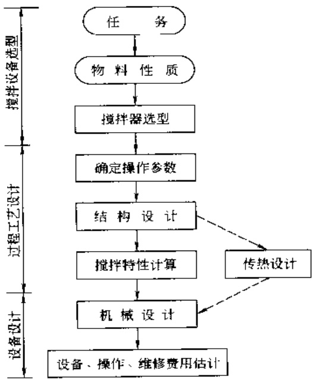

图1-3 搅拌设备设计步骤框图

件，即给出处理量、操作方式、最大工作压力（或真空度）、最高工作温度（或最低工作温度）、被搅物料的物性和腐蚀情况等，同时还需提出传热面的型式和传热面积、搅拌器型式、搅拌转速与功率等。而机械设计则应对搅拌容器、传动装置、轴封以及内构件等进行合理的选型、强度（或刚度）计算和结构设计。具体的设计步骤框图参见图1-3。

**1. 明确任务、目的**

设计的全部依据来源于搅拌的任务和目的，其基本内容应包括:

① 明确被搅物料体系；

② 搅拌操作所达到的目的；

③ 被搅物料的处理量（间歇操作按一个周期的批量，连续操作按时班或年处理量）；

④ 明确有无化学反应、有无热量传递等，考虑反应体系对搅拌效果的要求。

**2. 了解物料性质**

物料体系的性质是搅拌设备设计计算的基础。物系性质包括物料处理量，物料的停留时间、物料的黏度、体系在搅拌或反应过程中达到的最大黏度、物料的表面张力、粒状物料在悬浮介质中的沉降速度、固体粒子的含量和通气量等。

**3. 搅拌器选型**

搅拌器的结构型式和混合特性很大程度上决定了体系的混合效果。因此，搅拌器的选型好坏直接影响着整个搅拌设备的搅拌效果和操作费用。目前，对于给定的搅拌过程，搅拌器的选型还没有成熟、完善的方法。往往在同一搅拌目的下，几种搅拌器均可适用。此时多数

<!-- page: 36 -->

依靠过去的经验，或相似工业实例分析以及对放大技术的掌握程度。有时对一些特殊的搅拌过程，还需进行中试甚至需要模型演示过程才能确定合适的搅拌器结构型式。

在搅拌器结构型式选定之后，还应考虑搅拌器直径的大小与转速的高低。

**4. 确定操作参数**

操作参数包括搅拌设备的操作压力与温度、物料处理量与时间、连续或间歇操作方式、搅拌器直径与转速、物料的有关物性与运动状态等。而最基本的目的是要通过这些参数，计算出搅拌雷诺数，确定流动类型，进而计算搅拌功率。

**5. 搅拌设备结构设计**

在确定搅拌器结构型式和操作参数的基础上进行结构设计，主要内容是确定搅拌器构型的几何尺寸、搅拌容器的几何形状和尺寸。

**6. 搅拌特性计算**

搅拌特性包括搅拌功率、循环能力、切应变速率及分布等，根据搅拌任务及目的确定关键搅拌特性。搅拌功率计算又分两个步骤:第一步确定搅拌功率；第二步考虑轴封和传动装置中的功率损耗，确定适当的电动机额定功率，进而选用相应的电动机。

**7. 传热设计**

当搅拌操作过程中存在热量传递时，应进行传热计算。其主要目的是核算搅拌设备提供的换热面积是否满足传热的要求。

**8. 机械设计**

根据操作环境和工艺要求，确定传动机构的类型；同时根据搅拌器转速和所选用的电动机转速，选择合适的变速器型号；并进行必要的强度计算，提供所有机械零部件的加工尺寸，绘制相应的零部件图和总体装配图。

**9. 费用估算**

在满足工艺要求的前提下，花费最低的总费用是评价搅拌设备性能、校验设计是否合理的重要指标之一。完整的费用估算应包括以下几个方面:

① 设备加工与安装费用 包括设备材料、加工制造与安装、通用设备购置等所需费用。

② 操作费用 包括动力消耗、载热剂消耗、操作管理人员配备等所需的费用。

③ 维修费用 包括按生产周期进行维修时对耗用材料、更新零部件、人工、器材等所需的费用。

④ 整体设备折旧费用的估算。

**二、搅拌设备设计与选用的基本原则**

**1. 搅拌器**

一般情况下，搅拌器结构型式的选用应满足下列基本要求:保证物料的有效混合，消耗最少的功率，所需费用最低，操作方便，易于制造和维修。

同时，搅拌器的桨叶应该具有足够的强度。桨叶根部所受弯矩最大，该截面应有足够的抗弯截面模量。当桨叶很长时，在叶根部非工作面处可设置加强板，使截面成空心形状。这不仅能有效地增加截面抗弯模量，还不致过分地增加桨叶的质量。对于轴流式搅拌器的加强板，其形状不应破坏流形，不宜在叶根部处加焊立筋。径向流搅拌器可以焊水平的筋板。桨叶的防腐包衬层厚度不宜过大，以防止叶型偏离最佳形状，使流量及输入的搅拌功率减小，影响操作的效果。

<!-- page: 37 -->

**2. 搅拌容器**

应根据生产规模（即物料处理量）、搅拌操作目的和物料特性确定搅拌容器的形状和尺寸。在确定搅拌容器的容积时应合理选择装料系数，尽量提高设备的利用率。如果没有特殊需要，釜体一般宜选用最常用的立式圆筒形容器，并选择适宜的筒体高径比（或容器装液高径比）。若有传热要求，则釜体外须设置夹套结构。夹套种类有整体夹套、螺旋挡板夹套、半管夹套、蜂窝夹套，传热效果依次提高但制造成本也相应增加。

**3. 搅拌轴**

搅拌轴应有足够的扭转强度和弯曲强度。通常，搅拌轴均应设计成刚性轴，要求具有足够的刚性。为防止轴发生共振，操作转速应控制在第一阶临界转速的75%以下。当操作转速较高（800～1200r/min）时，搅拌轴也可设计成柔性的，但尽可能不用。搅拌轴的结构应保证其质量较小，如轴径较大时尽量采用空心轴结构。

**4. 轴封**

在允许液体泄漏量较多、釜内压力较低的场合，可选用填料密封；在允许液体泄漏量少、釜内正压力或真空度较高，并且要求轴与轴套间摩擦动力消耗少的场合，则建议采用机械密封结构；而当搅拌介质为剧毒、易燃、易爆，或较为昂贵的高纯度物料，或者需要在高真空状态下操作，对密封要求很高，且填料密封和机械密封均无法满足时，可选用全封闭的磁力传动装置，但磁力传动装置可传递的功率一般较小。

**5. 变速器**

应根据工艺要求和操作环境，选配合适的变速器。所选用的变速器除应满足功率和输出转速的要求外，还应运转可靠，维修方便，并具有较高的机械效率和较低的噪声。

**6. 机架**

搅拌设备的机架应该使搅拌轴有足够的支承间距，以保证操作时搅拌轴下端的偏摆量不大。机架应保证变速器的输出轴与搅拌轴对中，同时还应与轴封装置对中。机架轴承除承受径向载荷外，还应承受搅拌器所产生的轴向力。

**7. 搅拌设备内构件**

应根据搅拌器结构型式和物料操作特性确定容器内是否设置挡板和内冷管。安装有挡板的搅拌设备，大多在全挡板条件下操作。对于低黏度液体的搅拌，常在釜内安装四块挡板，宽度为 $D / 12 \sim D / 10$ 即可满足全挡板条件。随着液体黏度的增加，挡板宽度可变窄。当液体黏度为 $20\mathrm{Pa} \cdot \mathrm{s}$ 时挡板宽度可取常用值的 $75\%$；当液体黏度超过 $50\mathrm{Pa} \cdot \mathrm{s}$ 后，就没有必要设置挡板。

**三、搅拌设备的智能设计专家系统**

目前，国际上先进的搅拌设备生产企业都有根据经验归纳而成的选型与设计专用软件，即专家系统。如美国 Chemineer Inc. 的 A. Bakker 等在 1994 年研究了通用搅拌系统设计自动化问题，并开发了涡轮式搅拌器的设计专家系统（AgDesign），以计算流体力学仿真作为支持工具；芬兰的 T. Koiranen 和 A. Kraslawski 在 1995 年开发了混合设备预设计专家系统，此系统比 AgDesign 系统更为全面，但未考虑非牛顿高黏流体的设计问题和搅拌的传热问题。

一个高效的搅拌设备专家与计算机辅助设计系统，能根据用户要求输入的基本参数，在普通设计者的干预下完成釜式搅拌设备的决策选型、专家水平的工艺设计、计算机辅助设计，以及设计结果的经济分析与评价。虽然已有的专家系统还只是实现了上面所提的部分要

<!-- page: 38 -->

求，但搅拌设备的智能设计专家系统必将更加完善和全面。

## 参考文献

1 时钧、汪家鼎，余国琮等主编.化学工程手册（上卷）.北京:化学工业出版社，1996

2 余国琮主编.化工机械工程手册（中卷）.北京:化学工业出版社，2003

3 机械工程·电动机工程编委会.机械工程手册（第二版）、通用设备.北京:机械工业出版社，1997

4 王凯，冯连芳著.混合设备设计.北京:化学工业出版社，2000

<!-- page: 39 -->

## 第二章 特殊物料的搅拌

搅拌物料通常是可以流动的体系，可以是单相体系，也可以是多相体系。与搅拌有关的物料特性包括密度、流变行为、表面张力、相分率以及分散相尺寸等。搅拌过程的特性特别强烈地取决于物料的流变特性。本章集中叙述各类物料介质的流变行为及其对搅拌的影响，各相物料体系下搅拌的过程特征和性能指标以及搅拌功率计算等。

### 第一节 搅拌物料的种类和特性

物料在应力作用下会流动，其流变行为有牛顿型和非牛顿型两种，取决于物料本身的结构及其受力状况。不同的分子结构或不同的组成是导致不同流变行为的主要原因。但是相同的分子结构、相同的组成，因受力状况不同也可以呈现出不同的流变行为。一个典型的例子是关于水的流变行为的变化:在通常条件下水是典型的牛顿流体，但是在高速运动时水可以呈现出明显的弹性行为。理论上非牛顿型流体均具有黏弹性行为，但是在实际处理时，为了简化，通常又将弹性行为不很明显的体系处理成纯黏性流体，因此又有纯黏性非牛顿流体和黏弹性流体之分。表 2-1 为流体分类表。

表 2-1 流体的分类

| 黏性流体 |  |  |  |  |  |
|---|---|---|---|---|---|
| 牛顿流体 | 非牛顿流体 |  |  |  |  |
| 纯黏性非牛顿流体 |  |  |  | 黏弹性流体 |  |
| 宾汉塑性流体;假塑性流体 | 胀塑性流体 | 触变性流体 | 震凝性流体 |  |  |
| 非依时性非牛顿流体 |  | 依时性非牛顿流体 |  | 多种类型 |  |

**一、牛顿流体**

当某种流体上承受的切应力正比于所产生的切应变速率（或当施加于其上的切应变速率正比于相应的切应力）时，该流体称之为牛顿流体，可表示为

$$ \tau = \mu \dot {\gamma}\tag{2-1} $$

式中 $\tau$ ——切应力， $N/m^{2}$ 或 Pa；

$\dot{\gamma}$ ——切应变速率，1/s；

$\mu$ ——黏度， $\mathrm{N} \cdot \mathrm{s} / \mathrm{m}^2$ 或 $\mathrm{Pa} \cdot \mathrm{s}$。

牛顿流体的黏度不随搅拌设备中的搅拌转速变化，也不随位置而变。在通常的切应变速率范围内，水、各种盐的水溶液、甘油、饴糖等均属于牛顿流体。

**二、非牛顿流体**

凡流变行为不符合牛顿流体行为的流体都称之为非牛顿流体。许多工程和自然科学领域中涉及的高分子熔体与溶液、发酵液、原油、各种浓悬浮体、乳浊液以及泡沫等均属于非牛

<!-- page: 40 -->

顿流体。非牛顿流体的流变行为对管道输送、搅拌设备的设计与选用，以及控制过程终点和产品质量等均有密切关系。

在一定温度、压力下，非牛顿流体的黏度是切应变速率 $\dot{\gamma}$ 的函数，不同 $\dot{\gamma}$ 下黏度的差异可达三个数量级以上。表 2-2 列出常见生产过程中切应变速率的大致范围。

表 2-2 常见生产过程中切应变速率的大致范围

| 过程 | $\dot{\gamma}/s^{-1}$ | 应用行业 |
|---|---|---|
| 悬浮液体中细粉沉浆 | $10^{-6} \sim 10^{-4}$ | 医药、涂料 |
| 表面张力作用下的流平 | $10^{-2} \sim 10^{-1}$ | 涂料、油墨 |
| 重力作用下的流淌 | $10^{-1} \sim 10^{1}$ | 涂料、涂层的流挂 |
| 挤出 | $10^{0} \sim 10^{2}$ | 聚合物 |
| 咀嚼和吞咽 | $10^{1} \sim 10^{2}$ | 食物 |
| 浸涂 | $10^{1} \sim 10^{2}$ | 涂料和甜食 |
| 混合和搅拌 | $10^{1} \sim 10^{4}$ | 液体加工 |
| 管流 | $10^{0} \sim 10^{3}$ | 泵送、血液流动 |
| 喷雾和涂刷 | $10^{3} \sim 10^{4}$ | 喷雾干燥、燃油雾化 |
| 抹涂 | $10^{4} \sim 10^{5}$ | 护肤膏 |
| 液体基料中颜料的研磨 | $10^{3} \sim 10^{5}$ | 油漆、油墨生产 |
| 高速涂层 | $10^{5} \sim 10^{6}$ | 造纸 |
| 润滑 | $10^{3} \sim 10^{7}$ | 汽油发动机 |

非牛顿流体还可以分为三大类型，即非依时性非牛顿流体、依时性非牛顿流体和黏弹性流体。

**1. 非依时性非牛顿流体**

通常将流变行为符合下列关系

$$ \frac {\mathrm{d} u}{\mathrm{d} y} = \dot {\gamma} = f (\tau)\tag{2-2} $$

的流体称之为纯黏性非牛顿流体，或广义牛顿流体，即流体在任何处的切应变速率都是切应力的函数。根据函数 $f(\tau)$ 形式的不同，这种流体习惯上又可细分成三种类型:宾汉塑性流体、假塑性流体和胀塑性流体。其典型的曲线见图 2-1。

（1）宾汉塑性流体 从图2-1中可见，在宾汉塑性流体的流动曲线上存在一个屈服应力 $\tau_{0}$ ，在屈服之前，它呈现固体行为。一般认为宾汉塑性行为的现象产生于材料的一种三维刚性，这种刚性结构具有内在应力 $\tau_{0}$ 。当材料承受的应力小于 $\tau_{0}$ 时，这种三维结构不足以被

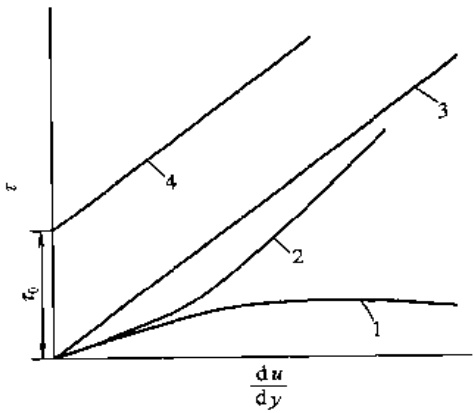

图2-1 牛顿流体与非牛顿流体

3—牛顿流体；4—宾汉塑性流体

破坏，故不产生流动。但是当外部施加的应力大于 $\tau_{0}$ 时，这种三维刚性就被破坏，呈现牛顿流动行为。宾汉塑性流体的流变方程可以表示为

<!-- page: 41 -->

$$ \begin{array}{l l} \tau = \tau_ {0} + \mu_ {\mathrm{p}} \dot {\gamma} & \quad \tau > \tau_ {0} \\ \dot {\gamma} = 0 & \quad | \tau | \leqslant \tau_ {0} \end{array}\tag{2-3} $$

式中 $\mu_{\mathrm{p}}$ ——塑性黏度，图2-1中曲线4的斜率，$\mathrm{N} \cdot \mathrm{S} / \mathrm{m}^{2}$ 或 $\mathrm{Pa} \cdot \mathrm{s}$。

呈现宾汉塑性行为的常见流体有污水泥浆、油脂、油漆、牙膏、淤泥、蛋黄酱、含有固体颗粒的白垩等；许多浓悬浮液也有屈服值，如将大量二氧化钛、碳酸钙、氧化铁等微粉混合入水中也可得宾汉塑性流体。

(2) 假塑性流体 假塑性流体没有屈服应力，其流变行为的主要特征是黏度随切应力的增加而下降。这类流体通常可以用密律方程描述（此时，又可称为密律流体）。这种方程最早由 Power Law 和 Ostwald 提出，可以表示为

$$ \tau = K _ {\mathrm{pau}} \mid \dot {\gamma} ^ {| n - 1} \dot {\gamma}\tag{2-4} $$

式中 $K_{psu}$ —— 流体稠度系数， $Pa \cdot s^{n}$ ;

n ---流体流变参数，无因次。

式（2-4）的密律方程还可同时描述胀塑性流体:当 $n < 1$ 时，为假塑性流体；$n = 1$ 时为牛顿流体；$n > 1$ 时，为胀塑性流体。$K_{\mathrm{ps0}}$ 越大意味着流体越黏，密律流体的表观黏度可以表示为

$$ \mu_ {\mathrm{a}} = K _ {\mathrm{psn}} \mid \dot {\gamma} ^ {n - 1}\tag{2-5} $$

即黏度随切应变速率的增加而下降。通常认为这种现象产生于分于受剪切后发生重排，使分子趋向与流动方向一致，使流动阻力下降，从而使所呈现的表观黏度 $\mu_{s}$ 下降。

密律模型适用于中等切应变速率的情况。为在较宽切应变速率范围内表达 $\tau\sim\dot{\gamma}$ 或 $\mu\sim\dot{\gamma}$ 关系，各研究者已提出了许多模型和相应的流变方程，列于表 2-3。

表 2-3 广义牛顿流体的流变方程

| 研究者 | 密律方程 | 模型参数 | 公式号 |
|---|---|---|---|
| Power law 等 | $\mu_{n}=K_{psu}\dot{\gamma}\|^{n-1}$ | $K_{psu}$ ——流体稠度系数 n ——流体流变参数| (25) |
| Eyring | $\tau=Asinh^{-1}\left(\frac{\dot{\gamma}}{B}\right)$ | A、B——常数 | (2-6) |
| Sisko | $\tau=A\dot{\gamma}+B\dot{\gamma}^{n}$ | A、B、n——常数 | (2-7) |
| Ellis | $\tau=\frac{\mu_{0}\dot{\gamma}}{1+\left(\frac{\tau}{\tau_{1.9}}\right)^{n-1}}$ |a——常数,表示 $\mu$ 对 $\tau$ 的依赖性; $\mu_{0}$ ——零剪切黏度; $\tau_{1.2}$ ——为 $\mu=\mu_{0}/2$ 时的切应力| (2-8) |
| Cross | $\frac{\mu-\mu_{n}}{\mu_{0}-\mu_{n}}-\frac{1}{1+(\lambda\dot{\gamma})^{n}}$ | $\mu_{n}=\lim_{\gamma\to\infty}\mu_{0}=\lim_{\gamma\to0}\mu_{0}$ ; $\lambda$ ——时间常数; n ——常数| (2-9) |
| Carreau | $\mu-\mu_{\infty}=(\mu_{0}-\mu_{\infty})/[1+(\lambda\dot{\gamma})^{2}]^{n}$ | $\mu_{\infty}$ , $\mu_{0}$ , $\lambda$ ,n ——常数| (2-10) |
| Bingham | $\tau=\tau_{0}-\mu_{B}\dot{\gamma}$ | $\tau_{0}$ ——屈服应力; $\mu_{B}$ ——Bingham 黏度| (2-11) |
| Casson | $\sqrt{\tau}=\sqrt{\tau_{0}}+\sqrt{\mu_{C}\dot{\gamma}}\quad(\tau>\tau_{0})$ | $\tau_{0}$ ——屈服应力; $\mu_{C}$ ——Casson 黏度| (2-12) |
| Herschel Bulkley | $\tau=\tau_{0}+K_{psu}\|\dot{\gamma}\|^{n-1}\dot{\gamma}$ | $\tau_{0}$ ——屈服应力;其余同上| (2-13) |

<!-- page: 42 -->

在搅拌与混合技术中，研究得最多的非牛顿流体是假塑性流体，具有这种流变行为的流体有聚合物、聚合物溶液、悬浮液、高分子溶液以及羧甲基纤维素的水溶液等。

(3) 胀塑性流体 胀塑性流体的行为类似于假塑性流体, 也没有屈服应力, 也可用式 (2-4) 来描述。但是胀塑性流体的黏度随切应变速率的增加而增加。许多高浓度的固体悬浮液具有这种流动行为。Oshorne Reynolds 这样解释这种行为: 当这种悬浮液处于静止时, 固体间的孔隙最小, 液体的量由这些小孔隙的空间决定; 在低切应变速率下, 这些液体起着润滑剂的作用, 因此呈现的应力也小; 随着切应变速率的增加, 液体不足以润滑结构之间的相互作用, 应力急剧增加, 所以呈现的黏度随切应变速率的增加而增加。

实际生产与生活中，胀塑性流体很少遇到，远不及假塑性流体常见。

**2. 依时性非牛顿流体**

许多实际流体不能简单地用方程式（2-2）来描述。这是因为这些复杂流体的黏度不仅与切应变速率有关，还与剪切施加的时间有关，即 $\tau = f(\dot{\gamma}, t)$ 。这些流体可以分成两类:触变性流体和震凝性流体。

（1）触变性流体 触变性行为是指在恒定的切应变速率下切应力随时间下降的流体行为，如摇动变稀，静止变稠等行为。通常认为这种现象产生于结构或节点随时间的破坏或解节。这种结构破坏的速率与可破坏的节点的数量有关，随着节点的破坏，节点重构的速率开始增加，最后会达到动态平衡。达到平衡后流体可能呈现纯黏性行为或黏弹性行为。有时，也可能不存在平衡点，或结构重构需要很长时间。此时，如果先以恒定的速度增加切应变速率，然后再以恒定的速度降低切应变速率，其切应力和切应变速率之间的关系会出现一个滞后环，如图2-2所示。图中的环面积越大，其依时性越强。

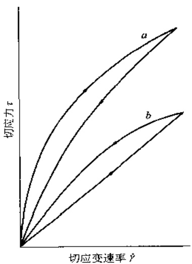

图2-2 依时性流体的滞后环 $a$ —触变性流体； $b$ —震凝性流体

非自流性涂料、印刷油墨、番茄酱、奶油色拉、酸乳酪和石油钻探泥浆等流体都显示触变性。

(2) 震凝性流体 震凝性行为是指在恒定的切应变速率下切应力随时间增加的流体行为，如猛烈搅拌即行凝结

就属于震凝性行为。通常认为这种现象产生于结构或节点随时间的形成。而且当切应变速率达到一定程度时，这种结构的形成不再继续进行，而结构的解节将发生。但是有时人们也发现，有些流体受剪切时只发生结构形成，而停止剪切时结构开始缓慢瓦解。震凝性行为通常只发生在中等切应变速率下；在高切应变速率下，结构通常不会形成。

膨润黏土液是具有震凝性行为的流体。

**3. 黏弹性流体**

黏弹性流体兼有黏性液体与弹性固体的特性，能在变形后呈现弹性恢复，具有与非依时性和依时性这两类非牛顿流体的黏性效应。聚合物熔体和溶液是典型的黏弹性流体，在定态剪切下表现出前述纯黏性非牛顿流体的特性，而当剪切发生变化（包括扩大、收缩流和非定态流动）时则表现出弹性。黏弹性流体具有以下特异流动行为。

(1) 爬杆效应（Weissenberg 效应）用搅拌轴搅拌黏弹性流体时，转轴处的液面沿轴上升，离轴较远处的液面下降。这一行为与牛顿流体正好相反。为此在设计流体黏弹性较强

<!-- page: 43 -->

的搅拌设备时，应选择合适的搅拌器。否则，会因爬杆效应使流体全部包裹在搅拌器上，与搅拌轴同步旋转，从而使混合和传热等过程均不能正常进行。

(2) 膨胀效应（Barus 效应）黏弹性流体从圆管或小孔中流出时有射流膨胀现象，此时流出液的最大直径 $d_{max}$ 可达圆管内径 d 的 2~3 倍。黏弹性流体的膨胀程度与所流经的圆管长度有关，圆管越长，膨胀程度越小；而当圆管充分长时，膨胀比 $B(B=d_{\mathrm{max}}/d)$ 会达到一定值。

膨胀比在聚合物加工中是一重要现象，通过测量膨胀比可获得第一法向应力差的信息。

（3）记忆现象（又称弹性滞后）施加压力梯度使黏弹性流体在管内流动；当突然移去压力梯度，黏弹性流体将反向移动一段距离后才停止。

（4）反向次流 在液体中插入一旋转圆盘，形成的主流是切向流，同时在转盘下方形成轴向次流。在牛顿流体中，次流的方向是轴中心处流体向上而四周流体向下；黏弹性流体则相反，轴心处流体向下而容器四周的流体向上运动。反向次流对搅拌、传质等操作是一个重要的影响因素。

(5) 湍流减阻效应（Toms 效应）含高分子量聚合物的水或有机溶液在湍流流动时的阻力明显低于纯溶剂的阻力，而在层流时溶液的黏度却略高于纯溶剂，即使溶液中高分子物的含量甚微也均有减阻现象。有效利用湍流减阻效应可节约流体输送过程中的能耗。

（6）应力松弛现象 在恒定剪切的作用下，黏弹性流体的应力先是迅速地下降，然后缓慢地下降，当时间为无限大时，向零逼近。如果是理想的黏性流体，其应力将在瞬间达到无穷大，然后回复到零。

此外，黏弹性流体还有无管虹吸、熔体破裂等许多区别于牛顿流体的特异流动行为。

与牛顿流体不同，黏弹性流体在描述剪切流动行为时，需要三个物质函数才能描述，即

黏度

$$ \mu (\dot {\gamma}) = \frac {\tau_ {1 2}}{\dot {\gamma}}\tag{2-14} $$

第一法向应力系数

$$ \psi_ {1} (\dot {\gamma}) = \frac {\tau_ {1 1} - \tau_ {2 2}}{\dot {\gamma} ^ {2}} = \frac {N _ {1}}{\dot {\gamma} ^ {2}}\tag{2-15} $$

第二法向应力系数

$$ \psi_ {2} (\dot {\gamma}) = \frac {\tau_ {2 2} - \tau_ {3 3}}{\dot {\gamma} ^ {2}} = \frac {N _ {2}}{\dot {\gamma} ^ {2}}\tag{2-16} $$

式中 $N_{1}, N_{2}$ ——分别为第一、第二法向应力差，也称第一、第二正应力差，Pa；

$\tau_{11}$ 、 $\tau_{22}$ 、 $\tau_{33}$ ——是直角坐标中相互垂直的三个方向上的法向应力，Pa；

$\tau_{12}$ ——切应力，Pa；

$\psi_{1}$ 、 $\psi_{2}$ ——分别是第一、第二法向应力系数， $Pa \cdot s^{2}$ 。

通常，第一法向应力差 $N_{1}$ 为正；第二法向应力差 $N_{2}$ 为负，其值比 $N_{1}$ 小得多，约是$N_{1}$ 的 $10^{-1}$ 数量级。 $\psi_{1},\psi_{2}$ 是切应变速率 $\dot{\gamma}$ 的函数，在大多数情况下，第二法向应力系数很小，可以忽略。图2-3和图2-4为几种流体的法向应力系数与 $\dot{\gamma}$ 的关系图。

目前描述黏弹性流变行为的力学模型主要有三种:经验模型、线性黏弹性模型和分子模型。

(1) 经验模型 主要来自对流变实验结果的直接关联。常用的方法是根据实验测量得到:①切应力和切应变速率的对应数据，②第一法向应力差和切应变速率的对应数据确定物质函数。剪切黏度模型仍然可以出现纯黏性流体模型中述及的各种形式；法向应力系数则通常表示成各种形式的 $\dot{\gamma}^{2}$ 函数或与 Weissenberg 数进行关联。

<!-- page: 44 -->

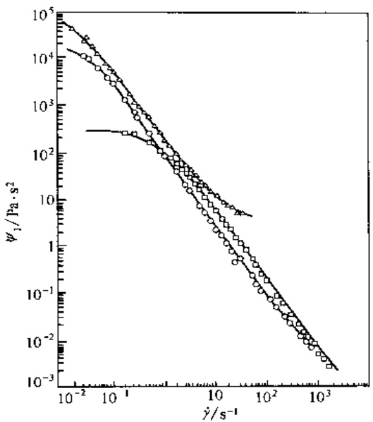

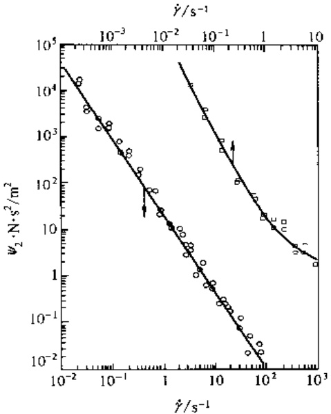

应力系数与切应变速率的关系

(2) 线性黏弹性模型 假设流体的黏弹性可以通过理想的黏性和弹性“元件”各种线性叠加进行描述。

基本的理想“元件”是黏壶（$\mu$）和弹簧（$G$）。

$$ \sigma = E \gamma\tag{2-17} $$

$$ \tau = G \gamma\tag{2-18} $$

式中 $\sigma$ ——张应力，$\mathrm{MPa}$；

E——弹簧的弹性模量，MPa；

G—剪切模量，MPa。

将黏壶和弹簧经各种组合可合成各种行为的黏弹性流体，例如 Maxwell（串联）模型和 Kelvin-Voigt（并联）模型。

表2-4列出几种常见的线性黏弹性力学模型及本构方程。

表 2-4 几种常见的线性黏弹性力学模型及本构方程

| 模型名称 | 简图 | 本构方程 | 公式号 |
|---|---|---|---|
| Maxwell黏弹性液体 |  | $\tau + \lambda \frac{\partial \tau}{\partial t} = \mu \dot{\gamma}$ | (2-19) |
| Kelvin-Voigt黏弹固体 |  | $\tau = \mu \dot{\gamma} + G\gamma$ | (2-20) |

<!-- page: 45 -->

续表

| 模型名称 | 简图 | 本构方程 | 公式号 |
|---|---|---|---|
| Jeffreys黏弹液体 |  | $\tau - \frac{\mu_1 - \mu_2}{G} \dot{\tau} = \mu_1 \dot{\gamma} + \frac{\mu_1 \mu_2}{G} \dot{\gamma}$ | (2-21) |
| Jeffreys黏弹固体 |  | $\tau + \frac{\mu}{G_1 + G_2} \dot{\tau} - \frac{G_1 G_2}{G_1 + G_2} \gamma - \frac{G_2 \mu}{G_1 - G_2} \dot{\gamma}$ | (2-22) |
| Burgers黏弹液体 |  | $\tau + \left( \frac{\mu_1}{G_1} - \frac{\mu_1 - \mu_2}{G_2} \right) \dot{\tau} - \frac{\mu_1 \mu_2 \dot{\tau}}{G_1 G_2} = \mu_1 \gamma - \frac{\mu_1 \mu_2}{G_2} \dot{\gamma}$ | (2-23) |

注:\lambda 是 Maxwell 松弛时间，即 \lambda - \frac{\mu}{G}；\mu 是黏壶的黏度，Pa·s；\dot{\gamma} = \frac{\partial \gamma}{\partial t}，\tau = \frac{\partial \tau}{\partial t}，\ddot{\gamma} = \frac{\partial \dot{\gamma}}{\partial t}，\ddot{\tau} = \frac{\partial \dot{\tau}}{\partial t}。

（3）分子模型 这种方法主要出现在对聚合物溶液体系流变行为的描述，如珠簧链模型或哑铃模型，详见文献[1].

### 第二节 单相物料体系的搅拌

搅拌过程中，最常见的操作是将互溶的液体混合在一起，形成单相流体。单相流体按黏度大小或流体性质又可分为低黏度互溶液体、高黏流体、黏弹性流体和异黏流体等。

**一、低黏度互溶液体的搅拌**

**1. 过程特征及对搅拌要求**

黏度是流体的一种属性。流体在管路中流动时，有层流、过渡流、湍流三种状态，搅拌设备中同样也存在这三种流动状态，而决定这些状态的主要参数之一就是流体的黏度。在搅拌过程中，一般认为黏度大于50Pa·s的为高黏度流体，在此以下则统称为低黏度，有时将黏度在5~50Pa·s范围内的液体称为中黏度流体。

低黏度互溶液体的搅拌是两种及两种以上互溶液体在搅拌作用下，任意一点的浓度、密度、温度以及其他物理状态达到均匀的过程，通常又称为混匀过程，它是搅拌过程中最基本的一种过程。有时为了强调其属于均相搅拌的特点，也称其为调和或调匀。

低黏度互溶液体搅拌过程的主要特征是不存在传递过程的相界面。对于一个纯物理混合过程，低黏度互溶液体的混合属于最容易完成的过程。但如果混合过程伴有化学反应时，则往往会使过程复杂化，主要表现在两个方面:一是对混合时间有比较严格的要求，以避免发生一些不希望的副反应；二是大多有反应热的导出或热量的导入，从而增加了混合过程的控制难度。

低黏度互溶液体的搅拌操作一般都是在湍流状态下进行的。因而这一过程就具有较强的主体扩散、湍流扩散和分子扩散，在宏观混合的过程同时伴有很强的微观混合过程。

<!-- page: 46 -->

为达到搅拌液体的混合均匀状态，低黏度互溶液体的搅拌首先要求提供足够的循环量，避免在设备内出现死区，使所有搅拌液体都能产生快速对流循环运动。其次，还要求搅拌器造成的液体湍流强度或剪切速度要大，尤其是当两种液体黏度相差比较大时，剪切的存在将有利于高黏度液体在设备中的分散，有利于湍流扩散的强化。此外，当需要混匀的两种液体数量相差较大时，少量液体的加料位置是很重要的，理想的位置是叶轮区，或是在叶轮吸入口附近，以保证进料能很快通过叶轮，促使搅拌液体很快达到浓度均化。

**2. 搅拌性能指标**

评价搅拌器混合效果的主要性能指标有混合时间、能耗及剪切性能等。

（1）混合时间 是判断混合效果的最重要性能指标。混合时间（$\theta_{\mathrm{M}}$）是指将两种完全互溶、但其物理或化学性质（如电导率、颜色、温度、折光率等）有差异的流体通过搅拌使之达到规定混匀标准时所需的时间。无因次混合时间（又称混合准数）$N_{\theta_{\mathrm{M}}}$是混合时间 $\theta_{\mathrm{M}}$ 与转速 $N$ 的乘积，即

$$ N _ {\theta_ {\mathrm{M}}} = \theta_ {\mathrm{M}} \cdot N\tag{2-24} $$

其物理意义是达到规定的混匀标准时所需的搅拌转数，它是搅拌器几何形状的函数。对于特定的搅拌器，混合准数 $N_{\theta_{\mathrm{M}}}$ 是常数；但对于不同的搅拌器，其 $N_{\theta_{\mathrm{M}}}$ 是不同的；且对于不同的混合区，如层流或湍流，$N_{\theta_{\mathrm{M}}}$ 也是不同的。然而一个性能优良的搅拌器，其 $N_{\theta_{\mathrm{M}}}$ 的数量级在层流区和湍流区是大致相同的。

由于测量混合时间的种种条件限制以及所要求的最终均匀程度是人为确定的，故混合时间 $\theta_{M}$ 的数值仅在相同的测试条件下才有比较价值。混合时间测量方法有很多种，如对于湍流混合，可采用电导法和温差法等，详见第三章第五节介绍。

(2) 混合能 衡量低黏度互溶液体搅拌效果的第二个性能指标是混合能 $E$，其与黏度 $\mu$、搅拌器叶轮直径 $d$、转速 $N$ 间存在如下关系

$$ E \propto (\mu N ^ {2} d ^ {3}) \left(\frac {1}{N}\right) = \mu N d ^ {3}\tag{2-25} $$

**3. 功率计算**

目前，对均相系统搅拌功率的研究比较多，功率计算可通过算图和数学关联式进行。由于这些研究结论都是通过实验得出的，而实验又是在一定限定条件下开展的，所以应用这些算图或公式时，其搅拌器必须相同，且满足几何相似条件。

(1) Rushton 算图——推进式、涡轮和桨式搅拌器功率计算图 Rushton 等人对多种型式的搅拌器在液体黏度 $1 \times 10^{-3} \sim 40\mathrm{Pa} \cdot \mathrm{s}$ 以内、$Re$ 在 106 以内进行了实验，并测定了搅拌功率，得到了功率准数 $N_{\mathrm{p}}$ 和雷诺数 $Re$ 关系的算图，如图 2-5 所示。

由图 2-5 可见，在低雷诺数 $(Re \leqslant 10)$ 的层流区内，流体不会打漩，重力影响可忽略，功率曲线为斜率 -1 的直线；当 $10 \leqslant Re \leqslant 10000$ 时为过渡流区，功率曲线为一下凹曲线；当 Re > 10000 时，流动进入充分湍流区，功率曲线呈一水平直线，即 $N_{p}$ 与 Re 无关，为一恒定值。用式（1-2）计算搅拌功率时，功率准数 $N_{p}$ 可直接从图 2-5 查得。

需要指出图2-5所示的功率曲线只适用于图示十二种搅拌器的几何比例关系。如果比例关系不同，功率准数 $N_{\mathrm{p}}$ 也不相同。

【例 2-1】 搅拌反应器的筒体内直径为 $\phi1800mm$ ，采用六直叶圆盘涡轮式搅拌器，搅拌器直径 $\phi600mm$ ，搅拌轴转速 160r/min。容器内液体的密度为 $1300kg/m^{3}$ ，黏度为 0.12

<!-- page: 47 -->

$\mathrm{Pa} \cdot \mathrm{s}$，带有挡板。

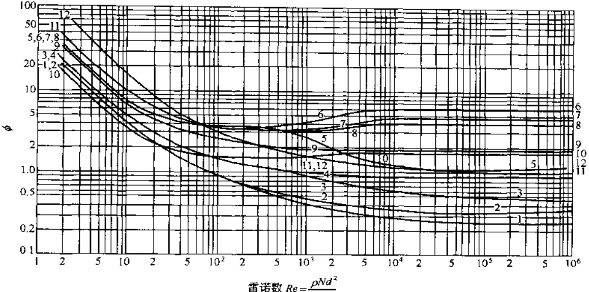

图2-5 各种搅拌器的功率曲线 $(N_{\mathrm{p}} - Re$ 曲线）

$$ \text {雷诺数} R e = \frac {\rho N d ^ {2}}{\mu} $$

曲线 1—推进式 S=d NBC 曲线 7—六弯叶涡轮 BC 曲线 2—推进式 S=d BC 曲线 8—六矢叶涡轮 BC 曲线 3—推进式 S=2d NBC 曲线 9—八折叶涡轮 ( $\theta=-45^{\circ}$ ) BC 曲线 4—推进式 S=2d BC 曲线 10—双叶平桨 BC 曲线 5—六直叶圆盘涡轮 NBC 曲线 11—六叶闭式涡轮 BC 曲线 6—六直叶圆盘涡轮 BC 曲线 12—六叶闭式涡轮（带有 20 叶的静止导向器）

S—叶片螺距:BC—有挡板（挡板数 $n_{b}=4$ ，挡板宽 $W_{b}=0.1D$ ）；NBC—无挡板曲线5，6，7，8 d:l:B=20:5:4（l为桨叶长度，B为桨叶宽度） 曲线 10 B/d=1/6 各曲线 $d/D\approx1/3$ , C/D=1/3, H/D=1 (其中 C 为搅拌器离容器底高度，H 为容器内液体高度)

试求:1）搅拌功率；2）改用推进式搅拌器（S=2d）后的搅拌功率。

解:已知 $\rho = 1300\mathrm{kg / m^3}$ ， $\mu = 0.12\mathrm{Pa}\cdot \mathrm{s}$ ， $d = 600\mathrm{mm}$ ， $N = 160\mathrm{r / min} = 2.6671 / \mathrm{s}$

1）计算雷诺数 $Re$

$$ R e = \frac {\rho N d ^ {2}}{\mu} = \frac {1 3 0 0 \times 2 . 6 6 7 \times 0 . 6 ^ {2}}{0 . 1 2} = 1 0 4 0 1. 3 $$

由图2-5功率曲线6（假设为全挡板条件，下同）查得， $N_{\rho} = 6.1$ 。

按式（1-2）计算搅拌功率

$$ P = N _ {\mathrm{p}} \rho N ^ {3} d ^ {5} = 6. 1 \times 1 3 0 0 \times 2. 6 6 7 ^ {3} \times 0. 6 ^ {5} = 1 1. 7 0 (\mathrm{kW}) $$

2）改用 S=2d 的推进式搅拌器，雷诺数不变，由图 2-5 功率曲线 4 查得， $N_{p}=0.92$ 。搅拌功率为

$$ P = N _ {\mathrm{p}} \rho N ^ {3} d ^ {5} = 0. 9 2 \times 1 3 0 0 \times 2. 6 6 7 ^ {3} \times 0. 6 ^ {5} = 1. 7 5 (\mathrm{kW}) $$

搅拌器偏心安装或侧面插入时的搅拌功率计算与同类搅拌器中心安装全挡板条件时的轴功率计算相同。

<!-- page: 48 -->

(2) 二叶平桨和二叶斜桨 可由图 2-5 查得 $N_{\mathrm{p}}$ 值后直接按式（1-2）进行计算。也可按永田进治提出的搅拌功率计算式进行计算

① 无挡板时的搅拌功率 按式（2-26）计算。

$$ \begin{array}{r l} & N _ {\mathrm{p}} = \frac {A}{R e} + B \left(\frac {1 0 ^ {3} + 1 . 2 R e ^ {0 . 6 6}}{1 0 ^ {3} + 3 . 2 R e ^ {0 . 6 6}}\right) ^ {p} \left(\frac {H}{D}\right) ^ {(0. 3 5 + \frac {b}{D})} (\sin \theta) ^ {1. 2} \\ & N _ {\mathrm{p}} = \frac {P}{\rho N ^ {3} d ^ {5}} \\ & A = 1 4 + \left(\frac {b}{D}\right) \left[ 6 7 0 \left(\frac {d}{D} - 0. 6\right) ^ {2} + 1 8 5 \right] \\ & B = 1 0 ^ {\left[ 1. 3 - 4 \left(\frac {b}{D} - 0. 5\right) ^ {2} - 1. 1 4 \frac {d}{D} \right]} \\ & p = 1. 1 + 4 \left(\frac {b}{D}\right) - 2. 5 \left(\frac {d}{D} - 0. 5\right) ^ {2} - 7 \left(\frac {b}{D}\right) ^ {4} \end{array}\tag{2-26} $$

当 $b / D \leqslant 0.3$ 时，$p$ 的算式中包含四次方的项可忽略。

在无挡板搅拌设备内进行湍流操作时，式（2-26）也能用于近似计算多层叶轮或一叶轮上有多于二个叶片的情况，其条件是叶片不是曲面，各层叶轮的叶片倾角 $\theta$ 和叶轮直径 d 必须一致，且叶片宽度 b 和叶片总数 Z（当有 $N_{s}$ 层叶轮时， $Z = N_{s} \times B_{n}$ ）的乘积相等。如六平直叶开启式涡轮，其叶宽为 b，则可把它看作叶宽为 3b 的二叶桨式叶轮；又如两层叶宽为 b 的四叶开启式涡轮，可看作是叶宽为 4b 的二叶桨式叶轮。

② 有挡板时的搅拌功率 在湍流状态下插入挡板会使搅拌功率大幅提高，当挡板宽度 $W_{b}$ 和挡板数 $n_{b}$ 满足下列关系时，搅拌功率达到最大值。

$$ (W _ {b} / D) ^ {1. 2} n _ {b} \equiv K _ {b} = 0. 3 5\tag{2-27} $$

式中 $K_{b}$ ——挡板系数。

当 $K_{\mathrm{b}} = 0.35$ 称全挡板条件；当 $0 < K_{\mathrm{b}} < 0.35$ 称为部分挡板条件；$K_{\mathrm{b}}$ 取 $0.06 \sim 0.12$ 时可使混合能耗最小。

a. 二叶平桨在全挡板时的搅拌功率。全挡板和无挡板时的 $N_{\mathrm{p}} - Re$ 曲线如图2-6。在湍流域，全挡板的 $N_{\mathrm{p}} - Re$ 关系为一水平线，此线的延长线与低 $Re$ 时的 $N_{\mathrm{p}} - Re$ 曲线的交点所对应的 $Re$ ，即表示由层流转变成过渡流时的临界 $Re$ ，记作 $Re_{\mathrm{c}}$ 。 $Re_{\mathrm{c}}$ 可用下式计算

$$ R e _ {c} = \frac {2 5}{(b / D)} \left(\frac {d}{D} - 0. 4\right) ^ {2} + \left[ \frac {b / D}{0 . 1 1 (b / D) - 0 . 0 0 4 8} \right]\tag{2-28} $$

将 $Re_{c}$ 代入式（2-26），求得的 $N_{p}$ 值就是全挡板时的 $N_{p}$ 数，记作 $N_{pmax}$ 。搅拌器在低黏度流体中的启动功率也可用 $N_{pmax}$ 计算。

b. 二叶折叶桨在全挡板时的搅拌功率。记倾角为 $\theta$ 的折叶桨的临界雷诺数为 $Re_{\theta}$，$Re_{\theta}$ 可由 $Re_{c}$ 来计算，$Re_{\theta} = 10^{4(1 - \sin \theta)} Re_{c}$。将 $Re_{\theta}$ 代入式（2-26），可求得二叶折叶桨在全挡板时的 $N_{\mathrm{pmax}}$。

c. 部分挡板时的搅拌功率。部分挡板时的

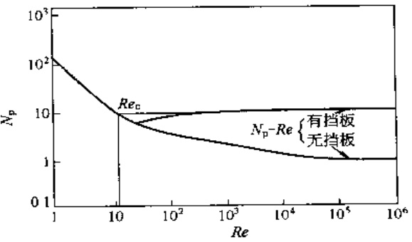

图2-6 平直叶涡轮的 N_{\mathrm{p}} - Re 曲线

<!-- page: 49 -->

$N_{p}$ 与全挡板时的 $N_{pmax}$ 和无挡板时的 $N_{p\infty}$ 有如下关系

$$ \frac {N _ {\mathrm{pmax}} - N _ {\mathrm{p}}}{N _ {\mathrm{pmax}} - N _ {\mathrm{pc}}} = \left[ 1 - 2. 9 \left(\frac {W _ {\mathrm{b}}}{D}\right) ^ {1 / 2} N _ {\mathrm{b}} \right] ^ {2}\tag{2-29} $$

若在搅拌釜内安装有挡板，则多层搅拌器的搅拌功率不能用永田进治式计算。这是因为双层搅拌器的搅拌功率与层间距有关，而永田进治式中未考虑层间距的影响。

③ 圆管的挡板系数 釜式反应器中常使用直立内冷管，这些管兼有挡板的作用。可将圆管外径乘上校正系数 $K_{\mathrm{r}}$ 作为有效挡板宽度来计算 $K_{\mathrm{b}}$ 。$K_{\mathrm{r}}$ 与挡板和釜壁的间隙 $\Delta C$ 的关系如表2-5所示。

表 2-5 圆管作挡板时的校正系数 K_r

| $\Delta C/D$ | 0 | 0.025 | 0.050 | 0.075 | 0.10 | 0.131 |
|---|---|---|---|---|---|---|
| $K_{r}$ | 0.78 | 0.70 | 0.57 | 0.48 | 0.50 | 0.63 |

据实验测算，对于设备内径小于1200mm，d/D<0.5的无挡板条件，式（2-26）的计算值与实际相符；而当设备内径大于1200mm时，其最大偏差值可达100%。但在全挡板条件下， $d/D=0.35\sim0.5,\ b/D=0.1\sim0.25,\ \theta=45^{\circ}$ 时折叶桨的偏差小于20%。

(3) 三叶后弯搅拌器 三叶后弯搅拌器必须配指形挡板，才能得到良好的搅拌效果。当 $Re > 5 \times 10^{3}$ 时，$N_{\mu}$ 只与结构参数有关，可按式（230）计算。

$$ N _ {\mathrm{p}} = 2. 5 5 \left(\frac {d}{D}\right) ^ {- 1. 2 4} \left(\frac {d}{D}\right) ^ {0. 7 2}\tag{2-30} $$

适用条件: $\alpha=15^{\circ},\beta=50^{\circ},\varphi=9^{\circ}$ ，菱形断面；C/D=0.14， $e_{1}/D=0.37,\quad e_{2}/D=0.73,\quad e_{2}=0$ （结构见图2-7所示）。

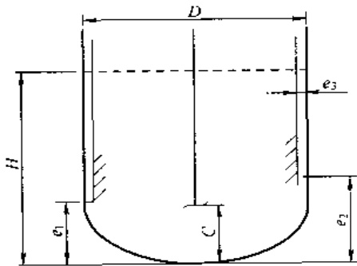

图2-7 指形挡板的安装

目前，国内外许多制造和研究搅拌器的生产厂家，针对本厂开发的通用或特殊搅拌器都进行了一系列实验研究，绘制了相应搅拌器的功率准数曲线。在搅拌器选用时，可直接委托生产厂家计算搅拌功率。

**二、高黏流体的搅拌**

**1. 过程特征及对搅拌要求**

工业生产中高黏度流体的使用日渐增多，许多高分子聚合物都是高黏度流体，它们很多又是非牛顿流体，在搅拌过程中黏度还会发生变化，因而对搅拌器的要求就更高，要求搅拌器能够适应黏度的变化完成搅拌操作。

高黏流体的搅拌常泛指互溶的高黏度液体间的混合。但高黏流体搅拌在工业中也有分散、固体溶解、化学反应等多种非均相操作。

搅拌操作时，用搅拌器对低黏度互溶液造成湍流并不困难，但黏度达到较高水平后，由于黏滞力的影响，就只能出现层流状态。尤其困难的是，这种层流也只能出现在搅拌器的附近，离桨叶稍远些地方的高黏度液体仍是静止的。这样就很难造成液体在搅拌设备内的循环流动，即在设备内会有死区存在，对混合、分散、传热、反应等各种搅拌过程十分不利。所以，高黏度液体搅拌的首要问题就是要解决流体流动与循环的问题。在这种情况下，不能靠增大搅拌转速来提高搅拌器的循环流量，因为流体黏度较高时，搅拌器

<!-- page: 50 -->

排出的流量很少，转速过高还会在高黏度溶液中形成沟流，而周围液体仍为死区。较为有效的解决办法是设法使搅拌器推动更大范围的流体。因此，高黏度液体的搅拌器直径与设备内径之比、桨叶的宽度与设备内径之比都要求比较大，有时还要求增加搅拌器的层数，以增大搅拌范围。

从搅拌机理来看，在层流区混合高黏度液体时，液体单元经受剪切细分作用被拉长、拉细或分割，随着剪切时间的增加，逐渐达到混合。同时，由于搅拌设备内剪切场不是均匀的，例如锚式搅拌器在锚与釜壁间的间隙区是强剪切区，液体的混合速率较快，而釜中部区域则是低剪切区，混合速率较慢，因此，高剪切区与低剪切区间的液体交换速率或液体在釜内的循环能力也是影响混合的重要因素。此外，设备内流体的速度波动也能促进混合。换言之，高黏度液体的混合速率主要取决于搅拌器与釜壁表面间的相对运动速率及相互之间的距离，为此也要求用于高黏流体的搅拌器，搅拌器直径与设备内径的比值都相当大。实际生产过程中，常用的黏性流体搅拌器有锚式搅拌器、螺带式搅拌器、框式搅拌器等。

**2. 搅拌性能指标**

高黏度搅拌器的搅拌性能，可用下列指标进行综合评价。

（1）无因次混合时间（即混合准数） $N_{\theta M}$ 由前述， $N_{\theta M}=\theta_{M}N$ 。在高黏度流体的层流操作时，对于那些适合于高黏度流体混合的搅拌器，如螺带式或螺杆式搅拌器等，其 $N_{\theta M}$ 也为一常数；但对于一些不适合高黏度流体混合的搅拌器来说，例如用d/D=0.5左右的盘式涡轮在层流下混合高黏度流体时，由于釜内有混合死角，不能求得确切的混合时间 $\theta_{M}$ ，故也不能算得 $N_{\theta M}$ 。

(2) 单位体积混合能 $W_{\mathrm{v}}$ 常用单位体积混合能 $W_{\mathrm{v}}$ 来表示混合效率，$W_{\mathrm{v}}$ 是搅拌设备内单位体积物料的搅拌功率 $P_{\mathrm{v}}$ 和混合时间的乘积，即 $W_{\mathrm{v}} = P_{\mathrm{v}} \theta_{\mathrm{m}}$。

(3) 无量纲数 $C_{3}$ 该常数主要反映搅拌器剪切性能，其计算式如式（2-31）所示，其意义为搅拌器转一圈时，流体所受的剪切量。

$$ C _ {3} = \frac {1}{N} \sqrt {\frac {\vec {P} _ {\mathrm{v}}}{\mu}}\tag{2-31} $$

式中 N——搅拌器转速，1/s；

$P_{v}$ ——单位体积物料的搅拌功率， $W/m^{3}$ 。

(4) 无量纲数 $C_{4}$ 比较搅拌器的混合效率还常用比黏度单位体积混合能 $C_{4}$ 表示。

$$ C _ {4} = P _ {\mathrm{v}} \theta_ {\mathrm{M}} (\theta_ {\mathrm{M}} / \mu) = W _ {\mathrm{v}} (\theta_ {\mathrm{M}} / \mu)\tag{2-32} $$

由式（2-32）可见， $C_{4}$ 表示在一定的流体黏度和混合时间下，搅拌器所需要的单位体积混合能。由于往往在流体相同和混合时间也相同的前提下来评价搅拌器，所以又将 $C_{4}$ 称为混合效率数。因 $C_{4}$ 常在 $10^{5}$ 左右，数值太大，使用不便。为此常将 $C_{4}$ 除以 $10^{5}$ ，用符号 $C_{4}^{*}$ 表示。 $C_{4}^{*}$ 称比混合能（或相对混合效率数）。显然， $C_{4}^{*}$ 越小，混合效率越高。

$$ C _ {4} ^ {*} = C _ {4} / 1 0 ^ {5}\tag{2-33} $$

表 2-6 列出了一些常用于操作高黏流体的搅拌器的混合时间准数、 $C_{2}$ 和比混合能 $C_{4}^{*}$ 值。

**3. 牛顿流体的搅拌功率**

（1）锚式搅拌器 可将锚式搅拌器看作直径相同、叶宽等于锚式搅拌器高度的平桨式搅拌器，故可采用计算平桨式搅拌器搅拌功率的关联式估算锚式搅拌器的搅拌功率。

<!-- page: 51 -->

表 2-6 混合高黏度流体用搅拌器的混合时间准数 N_{\mathrm{IM}}、C_3 和比混合能 C_4^* 值

| 搅拌器形式 | d/D | 牛顿流体 |  |  |假塑性流体 $( n=0.53\sim0.63 )$ |  |  |
|---|---|---|---|---|---|---|---|
| $N_{\theta M}$ | C_3 | C_4^* | $N_{\theta M}$ | C_3 | C_4^* |  |  |
| 双螺带-锚 | 0.95 | 34 | 19.4 | 4.36 | 37 | 19.4 | 5.16 |
| 内外单螺带-锚 | 0.95 |  |  |  | 41 | 16 | 4.30 |
| 四螺带-锚 | 0.95 |  |  |  | 30 | 20.1 | 3.70 |
| MIG-锚 | 0.95 |  |  |  | 56 | 14 | 6.15 |
| 复动式 | 0.947 | 22.7 | 11.2 | 0.645 | 31 | 11.2 | 1.20 |
| 螺杆-导流筒 | 0.574 |  |  |  | 40 | 7.9 | 0.80 |
| 框 | 0.790 |  |  |  | 142 | 7.1 | 10.1 |

在大量实验的基础上，北京化工大学提出了计算锚式搅拌器轴功率的关联计算式（2-34），其不仅可适用于层流区，也可适用于过渡流区，且与众多研究者的实验数据基本一致。

$$ N _ {\mathrm{p}} ^ {*} = \frac {2 7 \left(\frac {D}{c}\right) ^ {0 . 4 0 5}}{R e} + 0. 2 1 7 \times \alpha \left(\frac {D}{d}\right) ^ {2. 2 1} \left(\frac {R e ^ {0 . 1 7 1}}{R e ^ {0 . 1 7 1} + 0 . 2 7 5}\right) ^ {1 1. 2 7 (D / d) - 1 2. 9 3}\tag{2-34} $$

式中 $N_{\mathrm{p}}^{*}$ ——修正功率准数，$N_{\mathrm{p}}^{*} = \frac{N_{\mathrm{p}}}{(L / d)}$；

$\alpha$ ——系数， $\alpha = \frac{1.15(d / D)}{1 + 0.00025Re^{0.87}};$

L——锚式搅拌器有效边缘总长度（即两垂直边长与底部边长之和）；

c——锚式搅拌器与釜壁间隙。

式（2-34）适用于 $\frac{d}{D}=0.78\sim0.94$ 的场合。锚式搅拌器的叶片断面形状为化工行业HG标准规定的等边角钢。

当 $Re < 30$ 时，式（2-34）中的第二项数值很小，可以略去。当 $Re$ 为 $30 \sim 500$ 时，$\alpha$ 可近似取为1；当 $Re > 1000$ 时，$c$ 对功率准数几乎没有影响。叶片断面形状为圆形及板形桨叶的 $N_{\mathrm{p}}^{*}$ 值均较小，当 $Re < 200$ 时，较式（2-34）计算值低 $5\% \sim 10\%$ 。此外，锚式搅拌器上水平的或垂直的拉杆都不影响总搅拌功率。

此外，王凯、王嘉骏等人还提出了式（2-35）的锚式搅拌器功率关联式，该式预测平均标准偏差为 $5.47\%$；适用范围为 $d / D = 0.683 \sim 0.99$，$w / d = 0.062 \sim 0.16$，$L / d = 0.5 \sim 1.33$。

$$ R e ^ {*} \cdot N _ {\mathrm{p}} = 1 0 9 (d / c) ^ {0. 3 1 7} (w / d) ^ {0. 1} (L / d) ^ {0. 7 0 5}\tag{2-35} $$

式中 $Re^{*}$ —— 表观雷诺数，计算方法见式（2-44）。

(2) 双螺带式和单螺带式搅拌器 在层流域，螺带式搅拌器的混合效率较高，应用广泛。

有关双螺带式搅拌器的搅拌功率关联计算式较多，精度较高的有以下两种计算式。

① 朱秀林、王凯等人提出的式（2-36）关联式。

$$ N _ {\mathrm{p}} \cdot R e ^ {*} = 3 2 9. 4 \times \left(\frac {d / D}{1 - d / D}\right) ^ {0. 3 4 1} \times \left(\frac {w}{d}\right) ^ {0. 4 3} \times \left(\frac {p}{d}\right) ^ {0. 4 1} \times \left(\frac {L}{d}\right) ^ {0. 7 8}\tag{2-36} $$

<!-- page: 52 -->

式中 $w$ ——螺带宽， $\mathrm{m}$

p——螺距，m；

d——叶端与釜壁的间隙，m；

L——螺带高度，m。

该式的平均相对误差为 $8.33\%$ ，标准均方差为 $7\%$ ；适用范围为 $d / D = 0.8 \sim 0.95$；$w / d = 0.09 \sim 0.15$，$p / d = 0.5 \sim 1.0$，$L / d = 0.94 \sim 2.32$。

② Shamlou 式，即式（2-37）。

$$ N _ {p} \cdot R e ^ {*} = 1 5 0 (L / d) \sqrt {2 (p / d) ^ {- 0 . 6 7} (w / c) ^ {0 . 6 7}}\tag{2-37} $$

该式的平均相对误差为 8.73%，标准均方差为 6.1%；适用范围为 $d/D=0.8\sim0.98$ ; $w/d=0.08\sim0.223$ , $p/d=0.5\sim1.4349$ , $L/d=0.94\sim2.32$ 。

对于单螺带式搅拌器，王凯、王嘉骏等人收集了53个单螺带式搅拌器的搅拌功率数据，回归得到式（2-38）的单螺带式搅拌器的功率计算关联式。

$$ N _ {p} \cdot R e ^ {*} = 1 7 4. 9 3 (d / c) ^ {0. 2 6 9} (w / d) ^ {0. 4 0 1} (p / d) ^ {- 0. 4 6} (L / d) ^ {0. 8 0 4}\tag{2-38} $$

该式的平均相对误差为 13.1%；适用范围为 $d/D=0.753\sim0.98$ ; $w/d=0.071\sim0.2$ , $p/d=0.386\sim2.157$ , $L/d=0.85\sim1.206$ 。

（3）框式和偏框式搅拌器 结构示意图如图 2-8 所示。王嘉骏等人对两种框式和五种偏框式搅拌器进行了实验，求得其统一的功率计算关联式如式（2-39）所示。

$$ N _ {\mathrm{p}} \cdot R e ^ {*} = 2 5 5. 3 6 (d / D) ^ {3. 6 3} (d _ {\mathrm{f}} / d) ^ {0. 7 2} (w / d) ^ {- 0. 1 3 9} (L / d)\tag{2-39} $$

该式的平均标准偏差为 2.59%。也可用于锚式搅拌器的功率估算。

(4) 内外单螺带式与螺带-螺杆式搅拌器 结构示意图如图 2-9 所示。

① 螺带-螺杆式搅拌器 Masiuk 和 Lacki 提出的螺带-螺杆式搅拌器 $N_{p}$ 关联式为

$$ N _ {p} R e = 4 7 3 (w / d) ^ {0. 3 8} (p / d) ^ {- 0. 2}\tag{2-40} $$

② 内外单螺带式搅拌器 王嘉骏、王凯等人将实验得到的搅拌功率数据和文献查得的实验数据结合在一起进行线性回归，得到式（2-41）关联式。

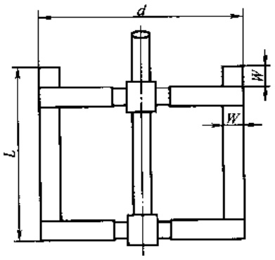

(a)

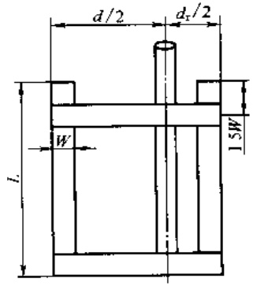

图2-8 框式和偏框式搅拌器结构示意图

(a) 框式搅拌器；(b) 偏框式搅拌器

<!-- page: 53 -->

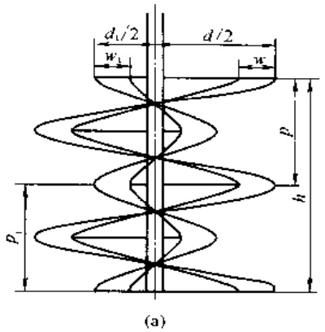

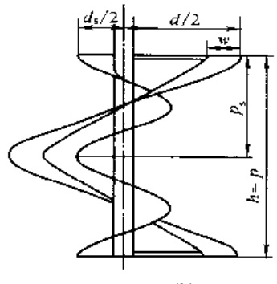

图2-9 内外单螺带式和螺带-螺杆式搅拌器结构示意图

（a）内外单螺带式搅拌器；（b）螺带-螺杆式搅拌器

$$ N _ {\mathrm{p}} \cdot R e = 4 1 8. 5 \left(\frac {d}{D}\right) ^ {3. 2 8 6} \left(\frac {w}{d}\right) ^ {0. 4 5 2} \left(\frac {p}{d}\right) ^ {0. 7 3 1} \left(\frac {d _ {\mathrm{i}}}{d}\right) ^ {0. 3 2 2} \left(\frac {w _ {\mathrm{i}}}{d}\right) ^ {- 0. 2 6 8} \left(\frac {p _ {\mathrm{j}}}{d}\right) ^ {0. 1 1 9} \left(\frac {h}{d}\right) ^ {0. 9 6 4} \tag {2-41} $$

该式的标准平均偏差为 $9.66\%$；适用范围为 $d / D = 0.88 \sim 0.97$，$w / d = 0.069 \sim 0.162$，$p / d = 0.41 \sim 1.5$，$h / d = 0.81 \sim 2.38$，$d_{1} / d = 0.30 \sim 0.55$，$w_{1} / d = 0.056 \sim 0.20$，$p_{1} / d = 0.32 \sim 2.11$。从式（2-41）可以看出，外螺带的尺寸影响比内螺带对功耗的影响大，尤其是外螺带的 $d / D$；搅拌器的功耗也随外螺带叶宽的增大和螺距的减小而增大，且几乎随搅拌器高度 $h / d$ 成正比。

（5）多种型式高黏度搅拌器的功率数 $K_{\mathrm{p}}$ 值 在搅拌层流区，$N_{\mathrm{p}} \cdot Re = K_{\mathrm{p}}$ 为一常数。表2-7列出常用于高黏流体搅拌器的功率常数 $K_{\mathrm{p}}$ 值和Metzner常数 $K_{s}$ [ $K_{s}$ 的含义见式（4-42)]。

表 2-7 常用搅拌器的 {\mathrm{K}}_{\mathrm{p}} 值和 {\mathrm{K}}_{\mathrm{i}} 值

| 搅拌器型式 | 几何参数 | K_p | K、 |
|---|---|---|---|
| 双螺带-锚 | d/D=0.95 | 424 | 32 |
| 四螺带锚 | $d^{\prime}D=0.95$ | 478 | 39 |
| 内外单螺带锚 | $d^{\prime}D=0.95$ | 307 | 28.1 |
| 螺杆-导流筒 | d_s/D=0.574 d_s/D_d=0.893 | 269 | 8.2 |
| 螺杆 | d_s/D=0.4 | 210 |  |
| 螺杆-导流筒 | d_s/D=0.4 | 330 |  |
| 双螺带-螺杆 | $d^{\prime}D=0.85 p^{\prime}D=1 d_s/D=0.4$ | 400 |  |
| 单螺带-螺杆 | $p_s:d=2 w^{\prime}d=0.1 h^{\prime}d-1$ | 250 |  |
| 锚 | $d^{\prime}D=0.87 h^{\prime}D=0.6 w^{\prime}D=0.1$ | 245 |  |
| 锚 | $d^{\prime}D=0.89$ |  | 21.5 |

注:d—搅拌器直径；D 设备内径；w—锚的直边宽或螺带宽； d_{s}  螺杆直径； D_{e} —导流筒内径；p—螺带的螺距； p_{s} —螺杆的螺距。

<!-- page: 54 -->

**4. 非牛顿流体性质对搅拌的影响**

研究表明，除流体的弹性性质外，流体的假塑性及黏度对混合时间准数 $N_{\theta_{M}}$ 均无影响。

由于假塑性流体的黏度随着切应变速率的增大而减小，因而当采用小直径搅拌器时，在远离搅拌器的低剪切区内，如靠近釜壁处，流体的流动将受到抑制，有可能形成停滞区。因此，应使搅拌器转速大于某一临界转速值，或采用大直径的搅拌器。

**5. 非牛顿流体的搅拌功率**

（1）假塑性流体的搅拌功率 在搅拌功率计算中，应用较普遍的是采用两参数的幂律方程来描述假塑性流体的流变特性。虽然幂律方程只在一定的切应变速率范围内成立，但一般而言，只要测得的黏度所对应的切应变速率是在搅拌设备的切应变速率范围以内，则幂律方程都是适合的。

计算假塑性流体搅拌功率的方法主要有两种，即表观黏度法与直接计算法。

① 表观黏度法 由于假塑性流体的表观黏度随切应变速率变化，而搅拌设备内的切应变速率不仅与搅拌器、搅拌设备的几何形状以及搅拌转速等有关，而且还与设备内各点位置有关，因此，搅拌设备内各点处的表观黏度是不同的。针对这一情况，Metzner（梅茨纳）等人设想若用同一台搅拌器-搅拌设备体系搅拌牛顿流体，其所耗功率与搅拌假塑性流体时所耗功率相同时，可将牛顿流体此时的黏度规定为设备内假塑性流体的表观黏度 $\mu_{n}$ 。利用表观黏度 $\mu_{n}$ 计算雷诺数，那么，便可利用牛顿流体搅拌功率准数与雷诺数的功率曲线或计算关联式来计算假塑性流体的搅拌功率。

Metzner 与其他研究者通过实验表明，与假塑性流体的上述表观黏度 $\mu_{\mathrm{a}}$ 相对应的搅拌设备内的平均切应变速率 $\dot{\gamma}_{\mathrm{av}}$ 和搅拌转速 $N$ 成正比，即

$$ \dot {\gamma} _ {\mathrm{av}} = k _ {\mathrm{s}} N\tag{2-42} $$

在特定的搅拌器-搅拌设备体系中， $k_{s}$ 是一常数，通称 Metzner 常数（常用搅拌器的 $k_{s}$ 值见表 2-7），虽然非牛顿流体的流变参数 n 对 $k_{s}$ 也有一些影响，但主要还是随搅拌器及搅拌设备的几何尺寸而变。

于是，对幂律流体，表观黏度 $\mu_{\mathrm{h}}$ 和表观雷诺数 $Re^{*}$ 的计算式为

$$ \mu_ {s} = K _ {\mathrm{ps0}} (k, N) ^ {n - 1}\tag{2-43} $$

$$ \mathrm{Re} ^ {*} = d ^ {2} N ^ {2 - n} \rho k _ {\mathrm{s}} ^ {1 n} / K _ {\mathrm{psu}}\tag{2-44} $$

则可得幂律流体的搅拌功率计算式，即

$$ P = K _ {\mathrm{p}} N ^ {n + 1} d ^ {3} K _ {\mathrm{psu}} k _ {\mathrm{s}} ^ {n - 1}\tag{2-45} $$

同时，对涡轮式、桨式和推进式等搅拌器在假塑性流体中的搅拌功率测量结果表明，用式（2-43）计算表观黏度时，假塑性流体的 $N_{\mathrm{p}} - Re$ 曲线在层流区与牛顿流体的 $N_{\mathrm{p}} - Re$ 曲线重合。这样，若对一定的搅拌器-搅拌设备体系，已知相应的 $k_{s}$ 及假塑性流体的流变曲线，则可应用牛顿流体的 $N_{\mathrm{p}} - Re$ 曲线来计算假塑性流体的搅拌功率。其计算步骤如下。

a. 按式（2-42）求出 $\dot{\gamma}_{\mathrm{av}}$，式中 $k$，由试验测定或参照文献确定。表 2-8 列出了多种搅拌器的 $k$ 值。

b. 在流变曲线上，由 $\dot{\gamma}_{\mathrm{av}}$ 找出相应的表观黏度 $\mu_{\mathrm{a}}$ ，如图2-10，或由流变方程（2-43）计算出 $\mu_{\mathrm{a}}$ ，依据 $\mu_{\mathrm{a}}$ 计算出非牛顿流体的 $Re_{\mathrm{n}}$ （对非牛顿流体，$Re_{\mathrm{n}} = k_{\mathrm{s}}^{n - 1}Re^{*}$）。

c. 根据牛顿流体的 $N_{\mathrm{p}} - Re$ 曲线或关联式，依据 $Re_{\mathrm{n}}$ 得到对应的功率准数 $N_{\mathrm{p}}$ 值，如

<!-- page: 55 -->

图2-11。

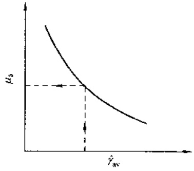

图2-10 由 \dot{\gamma}_{\mathrm{v}} 查表观黏度 \mu_{\mathrm{s}}

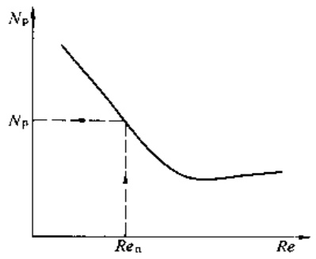

图2-11 由 Re_{\mathrm{u}} 查功率准数 N_{\mathrm{p}}

d. 按功率计算式，由 $N_{p}$ 计算出搅拌功率。

表 2-8 Metzner 常数 k。

| 搅拌器型式 | d/D | k3 | 研究者 |
|---|---|---|---|
| 六叶盘式涡轮式(单层或双层,有挡板或无挡板) | 0.285~0.98 | 11.5±1.5 | Metzner |
| 45°倾斜六叶扇形涡轮式(有挡板或无挡板) | 0.333~0.75 | 13±2 |  |
| 三叶推进器式(有挡板或无挡板) | 0.21~0.71 | 10±0.9 |  |
| 平桨式(2、3、6枚叶片) |  | 10.5 | Nagata |
| 弯曲叶桨式 |  | 7.1 | Taniyama |
| 布鲁马金式 |  | 10.5 |  |
| MIG式(单层或双层) | 0.4~0.7 | 11 | Höcker |
| 锚式 | 0.95 | 25 | Nagata |
| 锚式 | 0.68~0.95 | k3=a(1-n)当d/D=0.68~0.96时,a-37-60(1-d/D) | Bcckner |
| 斜锚式 | 0.73~0.96 | k3=a(1-n)当d/D=0.9~0.96时,a=106-727(d/D) |  |
| 锚式 | 0.42~0.95 | k3=[9.5+(9(D/d)^2/(D/d)^2-1](4n/3n+1)n/(1-n) | Calder-bank |
| 锚式 | 0.9~0.833 | k3=9.5+(9(D/d)^2/(D/d)^2-1 | Rieger |
| 锚式 | 0.833 | 28.4(n=0.5)22.4(n=0.95) |  |
| 错式 | 0.833 | 16.162.21/(n-1)k3=n |  |
| 斜错式 | 0.833 | 19.872.34/(n-1)k3=n |  |

<!-- page: 56 -->

续表

| 搅拌器型式 | d/D | ka | 研究者 |
|---|---|---|---|
| 锚式 | 0.5~0.98 | k1=j^(n-1)eB当n=0.3~0.8时,j=1.4,B=7.6(d/D)-3.3;当n=0.8~1.0时,j=1.0,B=7.6(d/D)-5 | Sawinsky |
| 锚式 | 0.89 | 21.5 | Edwards |
| 双螺带式 | 0.950.84~0.9 | 30.011 | Nagata |
| 螺杆式 | 0.68~0.60 | 11 | Rieger |
| 双螺带式 | 0.95 | 36.73±1.4 |  |
| 螺杆-导流筒式 | 0.61 | 16.82±0.87 |  |
| 偏心螺杆式 | 0.61 | 15.54±1.27 |  |
| 双螺带式 | 0.61 | 28±12.3 |  |
| 螺杆-导流筒式 | 0.66 | 76.87 |  |
| 螺带式 | 0.898~0.912 | 27 | Hall |
| 双螺带式 | 0.84~0.96(w/d=0.084~0.12p/d=0.36~1.28L/d=0.8~1.1) | k3=e4.2(d/D)-0.5 | Sawinsky |
| 双螺带式 | 0.955~0.806(w/d=0.081~0.252p/d=0.47~2.34) | k2=11.4(c/d)-0 411(p/d)-0.361(w/d)^0.164 | Takahashi |
| 螺带-螺杆-锚式 | 0.93 | 37 | 王英琛等 |
| 螺带式 | 0.943 | 30.0 | Edwards |
| 螺杆式 | 0.68 | 12.1 |  |
| 螺杆式 | 0.67 | 11.7 |  |
| 双螺带-锚式 | 0.95 | 32.0 | 王凯、朱秀林等 |
| 四螺带-锚式 | 0.95 | 39.0 |  |
| 内外单螺带-锚式 | 0.95 | 28.1 |  |
| MIG-锚式 | 0.95 | 11.6 |  |
| 半椭圆片-导流筒式 | 0.574 | 11.5 |  |
| 螺杆-导流筒式 | 0.574 | 8.2 |  |
| 锚式 | 0.813 | 11.1 |  |
| 框式 | 0.787 | 9.6 |  |
| 四层MIG-D挡板式 | 0.617 | 8.8 |  |
| 三层三叶后弯叶-D挡板式 | 0.663 | 7.6 |  |
| 框-螺带-锚式 | 0.95 | 18.6 |  |
| 复动式(二层交叉叶) | 0.943 | 1.0 |  |

<!-- page: 57 -->

**② 直接计算法**

a. Beckner 和 Smith 等计算式。对锚式搅拌器搅拌黏性牛顿流体和假塑性流体时，可用下述通用关联式

$$ N _ {\mathrm{p}} \left(\frac {\iota}{D}\right) ^ {1 / 4} = 8 2 \left\{\frac {N ^ {2 - n} d ^ {2} \rho}{K _ {\mathrm{puu}} [ a (1 - n) ] ^ {n - 1}} \right\} ^ {- 0. 9 3}\tag{2-46} $$

式中 $a$ ——系统的几何参数，对于平叶片锚式搅拌器，$a = 37 - 120\left(\frac{c}{D}\right)$，对于 $45^{\circ}$ 斜叶片

锚式搅拌器且在 $c / D < 0.06$ 时，$a = 106 - 1454\left(\frac{c}{D}\right)$

n ——假塑性流体的流变参数；

$K_{psu}$ ——流体稠度系数， $Pa \cdot s^{n}$ 。

其余符号意义同式（2-34）。

对于牛顿流体，即当 $n = 1$ 时，式（2-46）等号右侧括弧中的量即变为普通的搅拌雷诺数 $Re = \frac{Nd^2\rho}{\mu}$。

式（2-46）的适用范围为:

$0.2 \leqslant Re \leqslant 90; 0.0177 \leqslant \frac{c}{D} \leqslant 0.1584$

$$ 0. 2 7 \leqslant n \leqslant 0. 7 7; 1 0. 0 \leqslant K _ {\mathrm{psu}} \leqslant 2 4 7. 5 (\mathrm{Pa} \cdot \mathrm{s} ^ {n}) $$

b. Chavan 和 Ulbrech 计算式。Chavan 等人改进了 Bourne 采用的二重圆筒模型，提出了计算精度较高的有关螺带、螺杆、螺带-螺杆和螺杆导流筒等四种形式搅拌器的搅拌功率关联式，可适用于牛顿流体及非牛顿流体。

$$ N _ {\mathrm{p}} = E n, \pi a \frac {d _ {v}}{d} \lambda_ {\mathrm{d}} ^ {2} \left[ \frac {4 \pi}{n (\lambda_ {\mathrm{d}} ^ {2 / n} - 1)} \right] ^ {\pi} R e _ {n} ^ {- 1}\tag{2-47} $$

式中 $E$ ——实验确定的常数，$E = 2.5$；

$n_{i}$ ——螺带数；

a——无量纲表面积， $a=\frac{A}{d^{2}}$ ，A为螺带表面积，

$$ a = \frac {(h / d) (p / d)}{3 \pi} \times \left\{\frac {\pi \sqrt {(p / d) ^ {2} + \pi^ {2}}}{(p / d) ^ {2}} + \ln \left[ \frac {\pi}{p / d} + \frac {\sqrt {(p / d) ^ {2} + \pi^ {2}}}{p / d} \right] \right\} \times \left\{1 - [ 1 - 2 (w / d) ] ^ {2} \right\}\tag{2-48} $$

$d_{e}$ ——搅拌器当量直径，按式（2-49）计算

$$ \frac {d _ {e}}{d} = \frac {D}{d} - \frac {2 (w / D)}{\ln \left\{\frac {(D / d) - [ 1 - 2 (w / d) ]}{(D / d) - 1} \right\}}\tag{2-49} $$

式中 $w$ ——螺带叶片宽度；

$\lambda_{\mathrm{d}}$ 系数， $\lambda_{\mathrm{d}} = \frac{D}{d_e}$

<!-- page: 58 -->

n 一非牛顿流体流变参数；

$Re_{n}$ —— 临界雷诺数， $Re_{n}=\frac{d^{2}N^{2-\pi}\rho}{K_{psu}}$ 。

c. Chavan 的螺杆-导流筒式搅拌器功率计算式。结构示意图如图 2-12 所示，搅拌功率关联式为

$$ N _ {\mathrm{p}} \cdot R e _ {n} = \frac {\pi}{2} a \left(\frac {d _ {\mathrm{e}}}{\bar {d}}\right) \left[ \frac {4 \pi}{n \left(\lambda_ {\mathrm{d}} ^ {2 / n} - 1\right)} \right] ^ {n} \lambda_ {\mathrm{d}} ^ {2} $$

$$ \left(1 + \frac {d}{C}\right) ^ {1. 3 7} \left(\frac {D - d _ {r}}{h _ {r}}\right) ^ {0. 0 4 6} \left(\frac {C _ {r}}{d}\right) ^ {- 0. 0 3 6}\tag{2-50} $$

其中， $\lambda_{\mathrm{d}} = \frac{d_{\mathrm{c}}}{d_{\mathrm{e}}}$

$$ \frac {d _ {e}}{d} = \frac {d _ {\mathrm{r}}}{d} - \frac {2 (w / d)}{\ln \left\{\frac {(d _ {\mathrm{r}} / d) - [ 1 - 2 (w / d) ]}{d _ {\mathrm{r}} / d - 1} \right\}}; $$

$$ a = \frac {(h / d) (p / d) \sqrt {(p / d) ^ {2} + \pi}}{p / d} + \pi (1 - 2 w / d) (h / d)\tag{2-51} $$

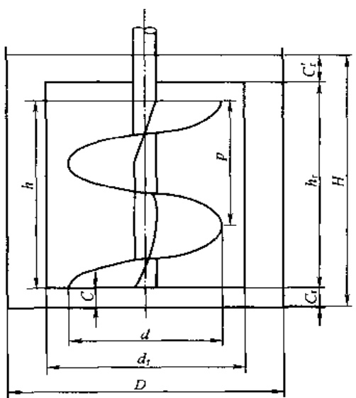

图2-12 螺杆-导流筒结构示意

式（2-50）可直接计算假塑性流体的 $N_{p}$ ，当 n 等于 1 时，则变成牛顿流体的 $N_{p}$ 计算式。式中符号见图 2-12，图中螺杆下端离釜底的距离 C 与导流筒下端离釜底的距离 $C_{r}$ 刚好相等。

③ 假塑性流体搅拌功率的其他计算式列于表 2-9。

表 2-9 假塑性流体搅拌功率关联式

| 搅拌器型式 | 关联式 | 研究者 |
|---|---|---|
| 锚式或框式 | $P = 17 \frac{L}{d} \left( \frac{D}{c} \right)^{0.45} J \cdot e^{(n-1)B} d^3 N^{1+n} K_{\text{psu}}$ 式中 L ——搅拌器边长,对锚 $L \approx 2h + d h$ ——锚的垂直边长当 $n = 0.3 \sim 0.8$ , j = 1.4, $B - 7.6 (d/D) \quad 3.3$ ;当 $n = 0.8 \sim 1.0$ , j = 1.0, B = 7.6 (d/D) - 5| Sawinsky |
| 双螺带式或螺带-螺杆式 | $P = 19 \frac{L}{d} \left( \frac{D}{c} \right)^{0.45} e^{(n-1)} \left( 4.2 \frac{d}{D} \quad 0.5 \right) d^3 N^{1+n} K_{\text{psu}}$ 式中 $L \quad m \cdot h \sqrt{1 + (\pi d/p)^2}$ ; h ——搅拌器高度| Sawinsky |
| 螺带式 | $N_p \cdot Re^* - 66 n_1 (p/d)^{-0.73} (h, d) (w/d)^{0.5} (c/d)^{0.6} k_s = 27; Re^* = \frac{d^2 N^{(2-n)} \rho}{K_{\text{psu}} k_s^{(n-1)}}$ | Hall |
| 锚式 |平直叶锚: $N_p \cdot Re_n = 179.82 n^2 ^{21}$ 斜叶锚: $N_p \cdot Re_n = 206.36 n^2 ^{34}$ | Rieger |
| 双螺带式 锚 | $N_p \cdot Re^* = 74.3 [(D-d)/d]^{-0.5} (d/p)^{0.5}$ 双螺带: $k_s = 30$ ;锚: $k_s = 25 Re^* = \frac{d^2 N^{(2-n)} \rho}{K_{\text{psu}} k_s^{(n-1)}}$ | Nagata |

<!-- page: 59 -->

④ 假塑性流体在过渡流域的搅拌功率 在过渡流域， $N_{p}-Re$ 关系是一段曲线。当使用 d/D 为 0.3~0.6 的低黏流体用搅拌器时，对于假塑性流体得到的 $N_{p}-Re^{*}$ 曲线与牛顿流体的 $N_{p}-Re$ 曲线并不重合，前者低于后者。然而用适合于高黏流体用的搅拌器（如表 2-6 中的搅拌器）时，这两条曲线也能重合，即对于这些搅拌器在过渡流域也能用表观黏度法计算搅拌功率。计算时，可用式（2-52）的二次曲线来近似过渡流域的 $N_{p}-Re^{*}$ 曲线，数种搅拌器的 $A_{1}$ 、 $A_{2}$ 、 $A_{3}$ 值列于表 2-10。

$$ \ln N _ {\mathrm{p}} = A _ {1} + A _ {2} \ln R e ^ {*} + A _ {3} (\ln R e ^ {*}) ^ {2}\tag{2-52} $$

表 2-10 计算过渡流域搅拌功率的参数

| 搅拌器型式 | 几何参数 | $Re^{*}$ | $A_{1}$ | $A_{2}$ | $A_{3}$ | $k_{a}$ |
|---|---|---|---|---|---|---|
| 双螺带 锚 | d/D=0.95 | 100~3000 | 8.56 | -2.10 | 0.123 | 32 |
| 四螺带-锚 | d/D=0.95 | 100~4000 | 7.43 | 1.63 | 0.0774 | 39 |
| 内外单螺带-锚 | d/D=0.95 | 70~3000 | 7.80 | -1.93 | 0.108 | 28.1 |
| MIG-锚 | d/D=0.95 | 60~3000 | 5.96 | -1.48 | 0.0834 | 11.6 |
| 螺杆-导流筒 | $d_{s}/D=0.547$ | 20~1600 | 5.46 | -1.23 | 0.0704 | 8.2 |
| 四层 MIG-D 挡板 | d/D=0.617 | 20~3400 | 4.78 | -1.28 | 0.0765 | 8.8 |
| 三层三叶后掠-D 挡板 | d/D=0.663 | 20~3100 | 3.91 | -0.787 | 0.0456 | 7.6 |

(2) 宾汉塑性流体的搅拌功率 宾汉塑性流体搅拌功率计算式应用较多的是永田进治和伊藤的两种关联式，下面主要介绍永田进治关联式。

对用 $\tau -\tau_0 = \mu_p\dot{\gamma}$ 表示的宾汉塑性流体，在层流区

$$ N _ {p} = \beta (R e _ {\mathrm{b}}) ^ {1} + a H e (R e _ {\mathrm{b}}) ^ {2}\tag{2-53} $$

式中 $Re_{b}$ ——用塑性黏度计算的搅拌雷诺数， $Re_{b}=\frac{d^{2}N\rho}{\mu_{p}}$ ;

He——Hedström 准数，是度量流体非牛顿行为的无因次数群，

$$ H e = \tau_ {0} \rho d ^ {2} / \mu_ {\nu} ^ {2}\tag{2-54} $$

永田进治把 $CaCO_{3}$ 、 $MgCO_{3}$ 、高岭土和 $TiO_{2}$ 分散于自来水、甘油水溶液和色拉油中并改变分散物所占分数，使 Hedstrom 准数从零（牛顿流体）变到 $10^{9}$ ，实验结果表明对一定型式的搅拌器，a 是常数， $\beta$ 随 He 变化。

$$ \beta - K _ {\mathrm{p}} = A H e ^ {h}\tag{2-55} $$

表 2-11 列出采用不同搅拌器测得的 $a$、$K_{\mathrm{p}}$、$A$、$h$ 值。

表 2-11 计算宾汉塑性流体搅拌功率的参数

| 搅拌器型式 | a | $K_{p}$ | A | I | h | 备注 |
|---|---|---|---|---|---|---|
| 螺带 | 6.13 | 320 | 15 | 0.2 | 1/3 | 螺带与釜壁之间的间隙对功率影响很小 |
| 锚 | 4.80 | 200 | 30 | 0.29 | 1/3 |  |
| 六叶涡轮 | 3.44 | 70 | 10 | — | 1/3 |  |
| 六叶涡轮(有挡板) | 3.44 | 70 | 10 | 5.5 | 1/3 |  |

<!-- page: 60 -->

式（2-55）仅适用于层流情况，在全部雷诺数范围内，宾汉流体的搅拌功率可用式(2-56)表示，即宾汉流体中搅拌器的功率消耗由三部分组成:

① 破坏内部结构所需的功，相应于 $\alpha N_{b}$ 项；

② 克服黏性阻力所需的功，相应于 $\beta Re_{\mathrm{b}}^{-1}$ 项；

③ 克服惯性力所需的功，相应于 $I$ 项，$I$ 项的值列于表2-11中。

$$ N _ {\mathrm{p}} = \alpha N _ {0} + (K _ {\mathrm{p}} + A H e ^ {h}) R e _ {\mathrm{b}} ^ {- 1} + I\tag{2-56} $$

式中 $N_{0}$ ——屈服应力功率准数，$N_{0} = \frac{\tau_{0}}{d^{2}N^{2}\rho}$。

(3) 触变性流体的搅拌功率 Edwards 等人通过对番茄沙司、奶油色拉、酸乳酪、非自流性涂料等多种触变性流体进行实验研究，提出了计算触变性流体搅拌功率的方法。由于触变性流体的搅拌功率随时间变化，所以必须确定计算时刻 $t_{0}$ ，即搅拌启动后所经过的时间。计算触变性流体搅拌功率的方法类似于计算假塑性流体搅拌功率的方法，其计算步骤如下。

① 用牛顿流体的 $N_{\mathrm{p}} - Re$ 曲线作为计算触变性流体搅拌功率的依据；

② 用对假塑性流体实验求得的 Metzner 常数 $k_{s}$ 来计算平均切应变速率，即 $\dot{\gamma}_{\mathrm{av}} = k_{s}N$；

③ 在流变计中测定触变性流体的表观黏度随切应变速率和时间的变化关系；

④ 由 $t_0$ 和 $\dot{\gamma}_{av}$ 的数据，按流变计测量的结果求出在搅拌设备内该触变性流体的表观黏度 $\mu_{s}$ 值；

⑤ 求出 $t_0$ 时刻的表观雷诺数 $Re^{\cdot} = \frac{d^{2}N\rho}{\mu_{\mathrm{a}}}$;

⑥ 在牛顿流体 $N_{\mathrm{p}} - Re$ 曲线上求出与 $Re^{*}$ 相对应的 $N_{\mathrm{p}};$

⑦ 在 $t_0$ 时刻的搅拌功率为

$$ P = N _ {\mathrm{p}} \rho N ^ {3} d ^ {5}\tag{2-57} $$

Edwards 等人认为对于触变性流体必须选择能使全釜液体被搅动的搅拌器，如锚式或螺带式等 d/D 较大的搅拌器。在全部液体运动的前提下，上述触变性流体搅拌功率计算方法的误差在工程计算的精度范围内。

**三、黏弹性流体的搅拌**

**1. 过程特征及对搅拌要求**

黏弹性流体行为可以对体系的混合作用产生巨大的负效应。黏弹性流体的典型特征是具有法向应力差、弹性回缩、应力突增（Overshoot）现象。这些特征可以显著地影响混合行为。黏弹性流体流场中力学特征明显地不同于其他流体。

对于牛顿流体，由于搅拌的离心作用，流体在搅拌设备内呈漩涡状；与此相反，黏弹性流体在搅拌过程中最明显的特性是具有弹性。

弹性是材料在受力形变时试图维持原来的形状或形变试图恢复原来的形状的一个特性。因此在搅拌操作中，弹性使材料试图维持原来的形状而不产生混合。黏弹性流体在运动时，总是产生垂直于剪切面的法向应力差，该法向应力差会引发二次流，促使搅拌设备中的流体产生爬杆现象——Weissenberg效应，即由搅拌器叶片端部吸人流体，沿搅拌轴方向排出。

1974 年，Ulblecht 曾对有关圆球、圆盘和搅拌器在黏弹性流体中旋转时产生的二次流

<!-- page: 61 -->

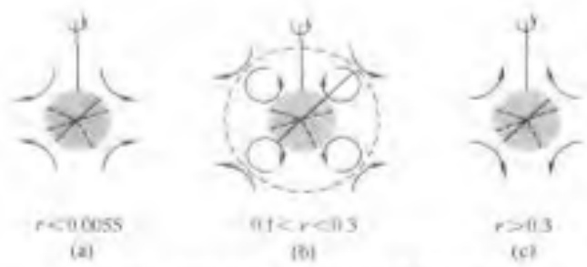

图2-13 圆球在黏弹性流体中旋转时的流型

流型进行了实验研究，实验表明:球在无弹性流体中旋转时，由于惯性力使流体沿搅拌轴吸入，再在球表面由惯性抛出，形成轴向循环，如图2-13（a）。然而在弹性强的黏弹性流体中，由于法向应力的存在会产生相反方向的流动，如图2-13（c）所示。当两种力刚好平衡时，会在球表面形成一个孤立的漩涡，如图2-13（b）中虚线圆所示。在此漩涡内的流体与釜内其

余流体不混合。

若采用 $r$ 表征法向应力与惯性力的相对大小，即

$$ r = \frac {W _ {i}}{R e}\tag{2-58} $$

式中 $W_{i}$ ——韦森伯格（Weissenberg）数，表示法向应力对黏性力之比。

上述结果表明，当 $r < 0.055$ 时，流型由惯性力控制；当 $r$ 在 $0.1 \sim 0.3$ 的范围内会出现孤立的漩涡；当 $r > 0.3$ 时，则流型完全由法向应力控制。

另一个类似于 $r$ 的判据 $r'$ 由White等提出，即

$$ r ^ {2} = 0, 4 \frac {\sigma_ {0}}{\rho R ^ {2}}\tag{2-59} $$

式中 $\sigma_{10}$ ——零切应变下的法向应力系数， $Pa \cdot s^{2}$ ;

R——搅拌器的半径，m。

White 等发现，用式（2-59）可以判别流型从惯性控制型向孤立控制型和法向控制型的过渡；当 $r^{*}<0.083$ 时，流型受惯性力控制；当 $0.083<r^{*}<0.25$ 时，形成孤立漩涡；当 $r^{*}>0.25$ 时，流型受法向应力控制。但该结果对螺旋推进器是个例外，实验证明，不管 $r^{*}$ 值大小如何，均产生轴向流。事实上法向应力的存在有加强轴向流的作用，所以，对于黏弹性流体使用具有强制推进作用的螺杆-导流筒式搅拌器或螺带式搅拌器是合适的。

研究还表明，黏弹性流体的混合时间大于非弹性流体。Carreau等人用螺带搅拌器分别混合牛顿流体和黏弹性流体，发现黏弹性流体的混合时间是牛顿流体的4.3倍。王凯等人亦用内外单螺带-锚式搅拌器进行了比较，发现黏弹性流体的混合时间准数 $N_{\mathrm{BM}}$ 较牛顿流体增加了近一倍。Ulbrecht等人研究了螺杆-导流筒式搅拌器对黏弹性流体的混合性能，发现当 $Re^{+}\leqslant10^{5}$ 时， $N_{\mathrm{BM}}$ 与 $(1+0.45W_{i})^{0.8}$ 成正比。

**2. 黏弹性流体的搅拌功率**

Ulbrech 认为在层流区（ $Re^{*}<10$ ）弹性流体的搅拌功率可以用下式关联

$$ N _ {F} \cdot R e ^ {+} = \text {常数}\tag{2-60} $$

Nienow曾用盘式涡轮研究黏弹性流体的搅拌功率，发现在层流区（ $Re^{*} < 10$），它们的$N_{\mathrm{p}} - Re^{*}$曲线是斜率为-1的直线，但其 $N_{\mathrm{p}}$ 值比相同 $Re^{*}$ 下的牛顿流体高 $60\%$。

Yap等人对螺带式搅拌器研究得到的黏弹性流体的搅拌功率关联式为

$$ N _ {o} = 2 4 n _ {i} \left[ (R e ^ {*}) ^ {0. 5 5} (D / d) ^ {0. 9 1} (d / L) ^ {(2)} \right] ^ {- 1}\tag{2-61} $$

<!-- page: 62 -->

式中 $n_1$ --螺带数；

$Re^{*}$ ——表观雷诺数， $Re^{*} = \frac{d^{2}N\rho}{\mu_{\mathrm{n}}} = \frac{d^{2}N\rho(t_{1}\dot{\gamma})^{2}}{\mu_{0}};$

$\mu_{0}$ ——零剪切黏度；

$t_{1}$ ——为 Carreau 等提出的黏弹性流体流变模型参数，Carreau 等对黏弹性流体提出的流变模型为 $\mu_{a}=\frac{\mu_{0}}{(1+t_{1}^{2}\dot{\gamma}^{2})^{s}}$ 。

王凯、朱秀林等用一种锚式搅拌器和两种螺带式搅拌器研究了黏弹性流体的流变行为对搅拌功率的影响，并得到 $Re^{*} < 100$ 时计算黏弹性流体的搅拌功率如下关联式

$$ N _ {\rho} R e ^ {*} f _ {s} ^ {(1 - n)} = K _ {p} \left[ 1 + \left(\frac {F _ {1 a v}}{k _ {s}}\right) f _ {s} ^ {(m - n \cdot 3)} W _ {t} \right]\tag{2-62} $$

式中 $f_{s} = \exp \left[C_{0}W_{1} / n(m - n)\right]$

$m$ 、 $n$ ——流变参数；

$C_{0}$ ——方程参数，见表 2-12；

$F_{1av}$ ——方程式参数，见表 2-12；

$K_{p}$ ——牛顿流体的功率准数， $K_{p}=N_{\nu}\cdot Re;$

$k_{s}$ ——有关假塑性流体功率的 Metzner 常数。

表 2-12 计算黏弹性流体搅拌功率参数 ( Re^{*}<100 )

| 搅拌器型式 | d/D | $K_{p}$ | $k_{s}$ | $C_{0}$ | $F_{1av}$ |
|---|---|---|---|---|---|
| 锚式 | 0.95 | 205 | 25 | 0.27 | $6725\exp(1.6f_{s}-5.25n)$ |
| 内外单螺带-锚 | 0.95 | 307 | 28.1 | 0.325 | $2.58\times10^{-3}\exp(6.6f_{s}+18.8n-9.94n^{2})$ |
| 四螺带-锚 | 0.95 | 478 | 39 | 0.282 | $8.05\times10^{-2}\exp(6.2f_{s}+13.1n-7.8n^{2})$ |

由式（2-62）可见，当流体无弹性时，$W_{\mathrm{t}} = 0$，$f_{\mathrm{s}} = 1$，于是 $N_{\mathrm{p}} Re^{*} = K_{\mathrm{p}}$，这是计算牛顿流体和假塑性流体的搅拌功率关联式。故式（2-62）是适用于牛顿流体、假塑性流体和黏弹性流体（包括Boger流体）的统一的搅拌功率关联式。用该式预测搅拌功率，平均误差小于 $15\%$。

至于过渡区黏弹性流体的搅拌功率，各研究者的结论比较一致，认为流体的弹性导致搅拌功率降低。Olbrecht 报道，当 $Re^{*}=100\sim2000$ ，且其他条件相同时，在黏弹性流体中搅拌器所受的扭矩比牛顿流体小得多。

Höcker 等人研究弹性较强的黏弹性流体的搅拌功率时，认为没有出现相当确定的层流区域，但搅拌功率显著地高于牛顿流体，用 Metzner 常数方法计算搅拌功率是不适用的。在过渡流区，只有圆盘式涡轮搅拌器出现了减阻现象，其他型式的搅拌器所消耗的功率，显著高于牛顿流体的搅拌功率。

### 第三节 多相物料体系的搅拌

多相物料体系包括气-液两相、液-液两相、固-液两相和气-液-固三相等体系。

<!-- page: 63 -->

**一、气-液两相体系的搅拌**

**1. 过程特征及分散机理**

根据气-液接触过程的供气方式，有通气式、自吸式和表面更新式三种类型的气-液体系，而在工业应用中80%以上是采用带通气装置的径向流涡轮搅拌器。

气-液搅拌的目的是通过搅拌造成良好的气-液接触，以形成气泡在液相中均匀分散，然后通过所形成的气-液界面进行传质，或者是气-液相发生化学反应等。

早期研究认为，气-液分散是气体直接被搅拌器剪切成细小气泡而形成的。但近年的研究成果——气穴理论认为:气体并不是直接被搅拌器剪碎而得到的。气泡的分散首先是在桨叶背面形成较稳定的气穴，气穴在尾部破裂，形成富含小气泡的分散区，这些气泡在离心力的作用下被甩出，并随液体的流动分散至搅拌釜的其他区域。当气速过大或搅拌转速过低时，大气穴合并，整个搅拌器被气穴包裹，从而达到过载状态，即气体穿过搅拌器直接上升到液面，发生气泛现象。

在气-液搅拌系统中，主要影响因素有搅拌设备的流体力学行为，气泡的尺寸，相分率，气-液界面积，质量传递系数等。而这些因素又取决于搅拌转速，充气速率，搅拌设备和搅拌器的几何形状，流体的性质和流变行为。

**2. 气-液分散状态和临界分散转速**

(1) 表观气速 $V_{G}$ 和通气数 $N_{A}$ $V_{G}$ 和 $N_{A}$ 的计算式如下

$$ V _ {\mathrm{G}} = \frac {Q _ {\mathrm{G}}}{A _ {t}}\tag{2-63} $$

$$ N _ {\mathrm{A}} = \frac {Q _ {\mathrm{G}}}{N d ^ {3}}\tag{2-64} $$

式中 $V_{G}$ —— 表观气速，m/s；

$Q_{G}$ ——通气速率， $m^{3}/s$ ;

$A_{1}$ ——搅拌设备横截面积， $m^{2}$ ;

$N_{\mathrm{A}}$ ——通气数。

涡轮式搅拌器的 $V_{G}$ 一般为 0.025～0.04m/s，最大时可达 0.1～0.12m/s。

(2) 搅拌设备中气-液分散状态 在气-液搅拌设备中，气体以小气泡的形式分散在液体中，随搅拌转速和通气速率的变化，分散状态发生转变。图 2-14 描述了在一定的通气速率下，搅拌转速逐渐增大时出现的气-液分散状态的变化情况，可分为三个状态:

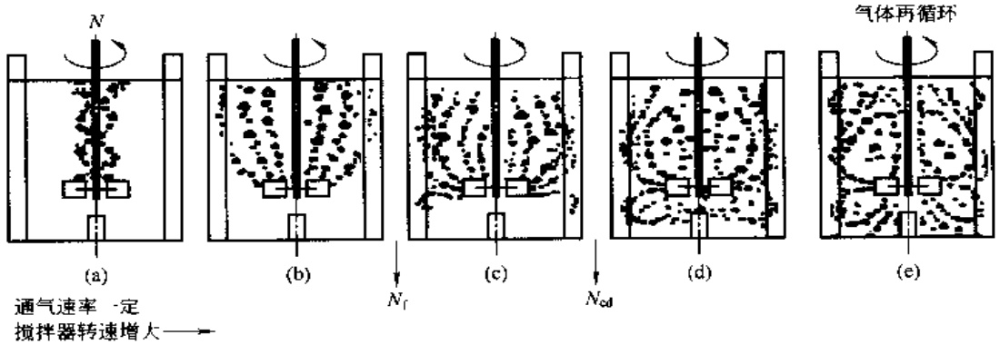

图2-14 气-液分散状态

<!-- page: 64 -->

① 气泛状态（Flooding）此时大部分气体未得到分散，气泡很大，沿搅拌轴直接上升到液面，相当于鼓泡釜，如图2-14（a）、（b）。

② 载气状态（Loading）气体基本上得到分散，气泡可到达釜壁，但分布器以下分散不良，气泡仅能随液流作有限的再循环，如图2-14（c）。该状态与气泛状态的相互转变存在一个临界转速，称为泛点转速 $N_{f}$ ，通常它随通气速率的增大而增大。

③ 完全分散状态（Complete Dispersion）气体在设备内得到良好的分散，气泡较小，往往随着液体再循环，如图2-14(d)、(e)。该状态与载气状态的转变也有一个临界转速，称完全分散转速 $N_{cd}$ 。由于载气状态的操作条件比较窄，故 $N_{f}$ 与 $N_{cd}$ 差别不大，工程中一般不严格区分这两个临界转速。

当搅拌转速一定，通气速率增加时，气-液分散状态的变化仍可用图2-14表示，只是顺序与上述相反，即随通气速率增加，分散状态由（e）→（a）。

气泛现象是气-液混合设备的一个特征属性，往往发生在通气速率较大，搅拌器转速不高的情况下。气泛发生时，含气率和相界面都很小，严重限制了相际传质和反应速率的提高。为此，实际生产中应把搅拌转速控制在泛点转速之上。表2-13中列出了泛点转速 $N_{f}$ 的关联式。

表 2-13 泛点转速关联式

| 研究者 | d/D | 关联式 | 公式号 |
|---|---|---|---|
| Westerterp | 0.2~0.7 | $N_{\mathrm{f}}d = (A + BD/d)(g\sigma/\rho)^{0.25} A = 1.22$ , B = 1.25 (六直叶盘式涡轮) A = 2.25, B = 0.68 (四直叶桨式)| (2-65) |
| Dierendinck | 0.33 | $N_{\mathrm{f}} = 0.219D^{1.5}d^{-2} ($ 水 $) N_{\mathrm{f}} = Dd^{-2}(g\sigma/\rho)^{0.25} ($ 电解质溶液)| (2-66) |
| Smith | 0.33~0.5 | $N_{\mathrm{f}} = 0.99d^{0.5}$ | (2-67) |
| Nienow | 0.33~0.67 | $N_{\mathrm{f}} = 4.0Q_{\mathrm{G}}^{0.5}D^{0.5}d^{-2}$ | (2-68) |
| 0.22~0.58 | $N_{\mathrm{f}} = 0.322(gQ_{\mathrm{G}}/d^{4})^{0.33}(D/d)^{1.17}$ | (2-69) |  |
| 高峰 | 0.25~0.5 | $N_{\mathrm{f}}d = 12(g\sigma/\rho)^{0.25} + (D/d)^{1.5}(\rho/\sigma)^{0.193}v_{\mathrm{G}}$ | (2-70) |
| Greavas | 0.375~0.67 | $N_{\mathrm{f}} = CQ_{\mathrm{G}}^{0.29}D^{0.2}d^{-1.72} C = 1.52 ($ 水) C = 1.66 (电解质溶液)| (2-71) |
| Wiedmann | 0.33 | $N_{\mathrm{f}} = 2.694Q_{\mathrm{G}}^{0.263}d^{-1.627}$ | (2-72) |
| Waemoeskerken | 0.4 | $N_{\mathrm{f}} = 0.941(gQ_{\mathrm{G}}/d^{4})^{0.33}$ | (2-73) |
| Lu | 0.33 | $N_{\mathrm{f}} = C(D/d)^{1.17}(gQ_{\mathrm{G}}/d^{4})^{0.34}f(n_{\mathrm{p}}) C = 0.064 ($ 下限); C = 0.072 (上限 $) f(n_{\mathrm{p}}) = 4.07 + 1.21n_{\mathrm{p}} - 0.147n_{\mathrm{p}}^{2}$ | (2-74) |

注:表中 N_{\mathrm{f}} 一泛点转速（r/s）；D—釜径（m）；d—搅拌器直径（m）；g—重力加速度（\mathrm{m/s^2}）；n_{\mathrm{p}} —一个叶轮上的叶片数；Q_{\mathrm{G}} —通气速率（\mathrm{m^3/s}）；\rho —液体密度（\mathrm{kg/m^3}）；\sigma —表面张力（N/m）；v_{\mathrm{G}} —表观气速（m/s）。

对空气-水系统，使用圆盘涡轮式搅拌器时的气-液两相流动如图2-15所示。由图可知，气-液两相的流动状态是由 $F_{r}$ 和 $N_{A}$ 所决定的；同时，图中V和VI具有很好的气-液分散状态。如图2-14（d）和（e）那样，气体在叶轮上、下部都能较均匀地分散，且叶轮强劲的排出流带动气泡在设备内进行充分地再循环。但实际生产中，经常遇到的是Ⅲ和Ⅳ那样的情况。

<!-- page: 65 -->

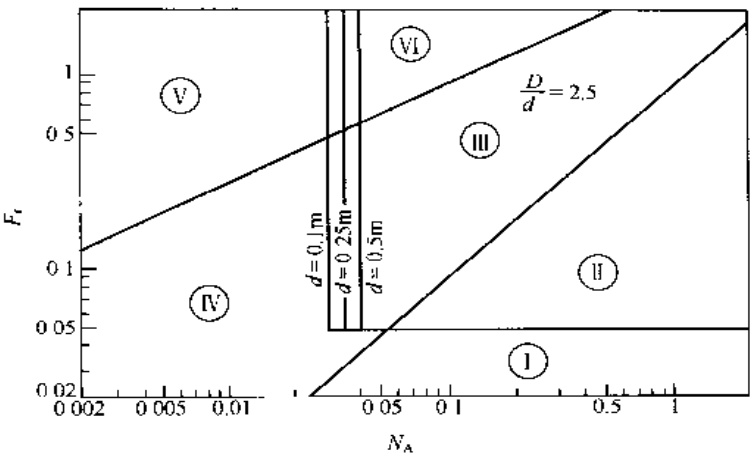

图2-15 六叶圆盘涡轮的气-液两相流动图

**3. 通气时的搅拌功率**

图2-16所示为通气后的搅拌功率 $P_{G}$ 与通气前的搅拌功率 $P_{0}$ 之比在不同搅拌转速和通

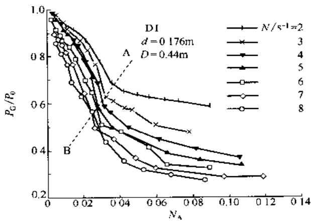

图2-16 不同叶轮转速下的 (P_{G} / P_{0}) - N_{A} 曲线

气速率下的变化曲线。通入气体后， $P_{G}$ 明显低于 $P_{0}$ ，并随气速增大而逐渐减小，但在高气速下变化趋向平缓。研究表明，搅拌功率的变化与气穴行为有着密切联系。功率降低的直接原因是桨叶背面形成的气穴使搅拌器的旋转阻力减小，而且功率曲线的不同区段对应着不同的气穴状态。

表 2-14 列出了有代表性的气-液搅拌功率关联式。其中式（2-75）是最早提出的功率计算式，简练实用，能在很宽的操作参数范围内得到良好的关联，尤其适用于湍流状态的低黏体系，目前应用较多。另一适用范围较宽的关联式为 Hughmark 提出的式（2-81），该式是研

究者使用七篇文献中的数据，统计分析各特征数影响 $P_{\mathrm{G}}$ 的显著性后回归而得。

表 2-14 通气式搅拌设备的功率消耗关联式

| 研究者 | 体系 | 关联式 | 公式号 |
|---|---|---|---|
| Michel |空气/水、 $CCl_{4}$ 等10种液体| $P_{G}=C(P_{0}^{2}Nd^{4}/Q_{G}^{0.56})^{0.45}$ 当 d/D=1/3 时, C=0.705 ;当 d/D=2/5 时, C=0.543 ;当 d/D=1/2 时, C=0.166| (2-75) |
| Pharamond | 空气/水 |当 $(Q_{G}/V)d^{0.63}\leqslant3$ 时, $1-P_{G}/P_{0}=1.6(Q_{G}/V)d^{0.63}$ 当 $(Q_{G}/V)d^{0.63}>3$ 时, $P_{G}/P_{0}=0.5\sim0.55$ | (2-76) |

<!-- page: 66 -->

续表

| 研究者 | 体系 | 关联式 | 公式号 |
|---|---|---|---|
| Hassan | 空气/水溶液 | $P_{G}/P_{0}=C(N^{2}d^{3}\rho/\sigma)^{-0.25}N_{A}^{0.25}(\rho/\rho_{G})$ 式中, C 与搅拌器类型、尺寸有关| (277) |
| Loiseau | 空气/水、乙醇等10种液体 | $P_{C}=C(P_{0}^{2}Nd^{3}/Q_{G}^{0.56})^{\alpha}$ 非发泡系: C=0.83, $\alpha=0.45$ ;发泡系: C=0.69, $\alpha-0.45(M\leqslant2000)$ ; C=1.88, $\alpha=0.31(M>2000)$ | (278) |
| Luong | 空气/水、甘油、CMC溶液 | $P_{G}/P_{C}=0.497(N^{2}d^{3}\rho/\sigma)^{-0.18}N_{A}^{-0.38}$ | (279) |
| Yung | 空气/水、甘油、丙酮等 | $P_{G}=0.812(P_{0}^{2}Nd^{3}/Q_{G}^{0.56})^{0.45}$ | (2-80) |
| Hughmark | (综合文献数据) | $P_{G}/P_{0}=0.1(Q_{G}/NV)^{-0.25}(N^{2}d^{4}/gbV^{23})^{-0.2}$ | (2-81) |
| Greaves | 空气/水 | $P_{G}=1007N^{3.33}d^{0.33}/(\eta Q_{G})^{0.4}$ 式中, $\eta$ 为分散因子| (2-82) |
| Abrardi | 空气/水 | $P_{G}=0.783(P_{0}^{2}Nd^{3}/Q_{G}^{0.56})^{0.46}$ | (2-83) |
| 佐藤 | 空气/水 | $P_{GV}/P_{AV}=A[P_{AV}/(P_{AV})_{C}]^{-\alpha}(P_{AV})_{C}=BE_{F}^{1.2}(d/D)^{3.2}(H/D)^{0.8}(D/D_{0})^{0.5}(\rho/\rho_{W})$ 式中, A、B、 $\alpha$ 与搅拌器类型有关; $D_{0}=0.29$ | (2-84) |

注: M 为Michel关联因子， M = P_0^2 Nd^3 /Q_G^{0.56} ； b 为叶片宽； V 为设备内装液体体积。

**4. 持气率和气泡平均直径**

持气率和气泡大小是表征搅拌设备内气-液分散特性的两个重要参数，它们决定了体系的相界面积。

气-液分散体系中的气泡大小不一，如空气-水体系中气泡属正态分布，在计算时常以体表面平均直径 $d_{B}$ 表示气泡大小。通常，空气水系统的 $d_{B}$ 为2~5mm。设气-液分散体系中有n种气泡尺寸，则 $d_{B}$ 的表示式为

$$ d _ {\mathrm{B}} = \frac {\sum_ {i} ^ {n} n _ {\mathrm{Ri}} d _ {\mathrm{i}} ^ {3}}{\sum_ {i} ^ {n} n _ {\mathrm{Ri}} d _ {\mathrm{i}} ^ {2}}\tag{2-85} $$

式中 $d_{1}$ ——第 $i$ 种尺寸的气泡直径， $\mathrm{m}$

$n_{和}$ ——具有第 i 种尺寸的气泡数。

气-液分散体系中的比界面积 $a$ 与 $d_{\mathrm{B}}$ 和持气率 $\Phi$ 之间有如下关系

$$ a = 6 \Phi / d _ {\mathrm{B}}\tag{2-86} $$

(1) 气泡直径 $d_{B}$ 对于气体-纯液体系统， $d_{B}$ 可用式（2-87）计算。

$$ d _ {\mathrm{B}} = 4. 1 5 \left[ \frac {\sigma^ {0 . 6}}{\left(\frac {P _ {\mathrm{G}}}{V _ {\mathrm{L}}}\right) ^ {0 . 4} \rho_ {\mathrm{c}} ^ {0 . 2}} \right] \Phi^ {0. 5} + 9 \times 1 0 ^ {- 4}\tag{2-87} $$

对于气体-电解质溶液系统， $d_{B}$ 可用式（2-88）计算。

<!-- page: 67 -->

$$ d _ {\mathrm{H}} = 2. 2 5 \left[ \frac {\sigma^ {0 . 6}}{\left(\frac {P _ {\mathrm{G}}}{V _ {\mathrm{L}}}\right) ^ {0 . 4} \rho_ {\mathrm{c}} ^ {0 . 2}} \right] \Phi^ {0. 4} \left(\frac {\mu_ {\mathrm{d}}}{\mu_ {\mathrm{c}}}\right) ^ {0. 2 5}\tag{2 88} $$

对于气体-醇溶液系统， $d_{B}$ 可用式（2-89）计算。

$$ d _ {\mathrm{B}} = 1. 9 0 \left[ \frac {\sigma^ {0 . 6}}{\left(\frac {P _ {\mathrm{G}}}{V _ {\mathrm{L}}}\right) ^ {0 . 4} \rho_ {\mathrm{c}} ^ {0 . 2}} \right] \Phi^ {0. 6 5} \left(\frac {\mu_ {\mathrm{d}}}{\mu_ {\mathrm{c}}}\right) ^ {0. 2 5}\tag{2-89} $$

式中 $\sigma\cdots-$ 表面张力，N/m；

$V_{1}$ ——液体体积， $m^{3}$ ;

$\rho_{c}$ ——连续相密度， $kg/m^{3}$ ;

$\mu_{c}$ ——连续相黏度，Pa·s；

$\mu_{d}$ ——分散相黏度，Pa·s。

(2) 持气率 $\Phi$ 持气率 $\Phi$ 为搅拌设备内气-液分散系统中气体的持有量，以通气后分散体系中气体容积与气-液分散系统容积之比来表示。

对于不生成泡沫的体系，平均持气率 $\Phi$ 的计算可采用表 2-15 所列关联式进行；而对于生成泡沫的体系，持气率 $\Phi$ 可用式（2-90）估算。

$$ \Phi = 0. 0 0 5 1 \left(\frac {P}{V _ {\mathrm{L}}}\right) ^ {0. 5 7} V _ {\mathrm{G}} ^ {0. 2 4}\tag{2-90} $$

表 2-15 平均持气率关联式

| 研究者 | 关联式 | 公式号 |
|---|---|---|
| Loiseau | $\Phi = 0.011 (V_{C}/\sigma)^{0.36} (P/V_{L})^{0.27} \mu^{-0.056}$ | (2-91) |
| Yung | $\Phi = 0.52 \left( \frac{Q_{C}}{Nd^{3}} \right)^{0.5} \left( \frac{\rho N^{2} d^{3}}{\sigma} \right)^{0.65} \left( \frac{d}{D} \right)^{1.4}$ | (2-92) |
| 高正明 | $\Phi = 0.195 (P/V_{L})^{0.28} V_{G}^{0.56} D^{0.45}$ | (2-93) |
| 张志斌 | $\Phi = C(P_{G}/V_{L})^{0.35} V_{G}^{0.55} C = 0.053 \sim 0.059 ($ 与搅拌器型式有关)| (2-94) |

**5. 工业规模气-液分散设备的设计要点**

对于气-液过程，功率输入、流动区、界面积、质量传递系数是重要的设计参数。其中，界面积是传递能够发生的基础，而质量传递则是决定过程能否达到目标的关键，通常界面积的产生要求足够的功率输入，气-液分散设备有多种，表2-16列出了常见的几种。

表 2-16 常见的气-液接触器和反应器

| 体系 | 接触机理 | 体系 | 接触机理 |
|---|---|---|---|
| 喷射 | 气体通过喷射夹带混合 | 鼓泡釜 | 机械搅拌、气体鼓泡、表面夹带 |
| 气泡塔 | 气体分布器 | 静态混合器 | 压力降 |
| 导流筒搅拌釜 | 表面气体夹带 | 离心泵 | 机械 |

<!-- page: 68 -->

表 2-16 所列的各操作体系中，喷射操作和气泡塔所需要的功率最小；鼓泡釜的功率略高；导流筒搅拌釜则需要比较高的功率；而静态混合器和离心泵由于可以被用作气-液接触器和反应器，也需要较高的功率。同时，鼓泡釜中的气-液接触通常提供较高的气-液界面积和质量传递系数。

对于气-液操作，搅拌器设计的一些基本原则是:为了防止气体短路，搅拌器通常采用中间有水平圆盘的。需要注意的是，虽然搅拌作用产生的低压漩涡会吸入气体，但是当气体量达到一定程度时，也会发生气蚀现象，从而使搅拌的作用大大下降。

搅拌器的气体处理能力与搅拌器的叶片数有关，叶片数越多，处理气体的能力越大。典型的气体分散搅拌器是带有六叶片“Rushton”盘形涡轮[图2-17(a)]，为最传统的结构，是积累了多年经验而形成的。而在“Rushton”基础上，经流体力学研究和改进，得到了一系列其他类似结构，如图2-17(b)～(d)所示。与“Rushton”相比，12或18个叶片，或采用凹面叶片而不是平叶片的涡轮，具有许多优越性，可以使气-液体系产生更大的湍动作用，从而提高混合效率。

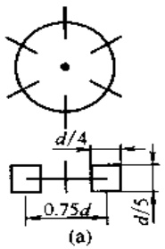

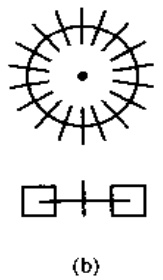

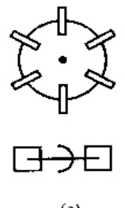

(c)

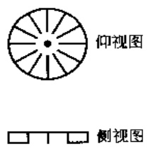

(a) 6 叶片盘形涡轮；(b) 18 叶片盘形涡轮；(c) 凹面叶片盘形涡轮；(d) 12 叶片带翼片圆盘

除了搅拌器本身对气-液接触效率有影响外，搅拌器的安装方式对气-液接触能力的改善也有重要作用，Pan Q. M. 在对四氟乙烯聚合釜的研究中发现，卧式搅拌方式可使传质系数提高一个数量级。

当气-液体系涉及固相悬浮时，多个搅拌器的使用有时是有帮助的，一个用于气体的吸入，另一个则用于固体的悬浮。

另外由图 2-16 可以明显看出，在通气条件下操作的搅拌器，当停止通气时将会突然消耗很大的功率。为此在选择电动机时有两种方案:一是根据不通气时的搅拌功率来确定电动机功率；二是根据通气时的搅拌功率来确定电动机功率。第一种方案虽然比较保险，但能量利用率较低；第二种方案操作要复杂一些，但能量利用率高，设计时选用多级或无级调速电动机就可以保证各种工况下的操作，即在不通气或通气量少时采用低转速，在通气量正常时再调到设定的转速。

一般情况下，推荐使用的气-液搅拌容器结构大多为圆柱形筒体，配以宽度为 D/10 的全长挡板。通常，直径小于 $\phi3000mm$ 的容器多用 4 块挡板，更大的容器则用 6 块或 8 块挡板。即使容器内有蛇管等其他构件，上述挡板数量也应保证。而气体分布环放在搅拌器下方与之相距近于 D/2 处。分散物系高度应为 D、2D 或 3D，如果 H=D，只需用一个搅拌器；如果 H=2D 或 3D，则应在轴上加装搅拌器，搅拌器之间的距离约为 D。

**二、液-液两相体系的搅拌**

液-液两相体系搅拌的目的:

<!-- page: 69 -->

① 通过液-液分散使相界面增加；

② 使分散相液滴外部的扩散阻力减小；

③ 产生湍流促进浓度和温度均一化；

④ 使分散相液滴反复进行破碎凝并从而促进分散相液滴间的传质。

**1. 分散操作及对搅拌的要求**

通过搅拌使互不相溶的两种液体进行分散是一个重要的单元操作，常用于萃取、乳液聚合和悬浮聚合等。

液-液分散时，液相密度较大的称为重相，另一相则为轻相。绝大多数场合是将轻相分散在重相中，例如油分散在水中，然而在一定条件下也能使重相分散在轻相中。

在液-液分散操作中，通常应把搅拌器置于被分散相内，并应选择适宜的搅拌器形式和尺寸。如果搅拌器的直径太小，则大量的轻相液仍然停留在液面的边缘上；但反之，轻相液将停留在搅拌轴的周围难以分散。一般情况下，对于无挡板搅拌设备，用于液-液分散的最佳搅拌器尺寸为: $d=D/3,\ b=(0.05\sim0.1)D$ 。这里，d为搅拌器直径，b为叶片宽度，D为搅拌设备内径。而且为增强液-液分散效果可使搅拌器偏置，对于平底或碟形底容器，最佳偏心距 $E_{A}$ 为d/4；使液滴尺寸最小的偏心距 $E_{B}$ 为d/2。

也可在搅拌设备中设置挡板来增强液-液分散效果。永田进治建议可采用图2-18所示的两种方法之一来设置挡板，这两种挡板的最佳技术条件为: $S_{B}=d/2$ ; $e_{B}=d/2$ ; $w_{b}=(0.07\sim0.10)D$ 。在有挡板的搅拌设备中，用于液-液分散的最佳叶轮直径为d=0.4D。

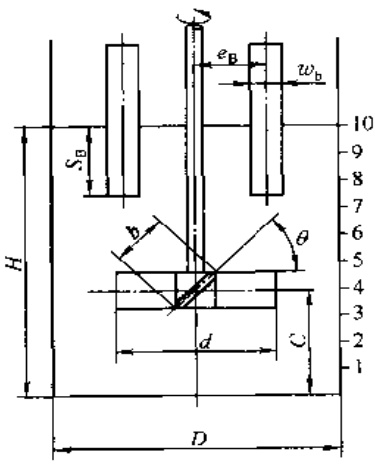

(b)

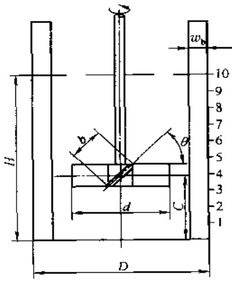

(a) 分散轻相液的挡板；(b) 装于设备壁上的挡板

**2. 分散机理、破碎与凝并**

搅拌互不相溶的液-液两相时，在连续相内液滴不断地被破碎和凝并，经过一段时间以后，液滴的破碎速率和凝并速率相等，达到动态平衡，于是在设备内形成稳定的分散体系。分散体系中液滴的大小不是均一的，液滴平均直径 $d_{\mathrm{D}}$ 与转速 $N$ 有密切关系，如图2-19所示。图中，BC线的右侧是破碎区，AB线的下方是凝并区，AC线的左侧是悬浮区，落在此三区内的液滴都是不稳定的，将相应地发生破碎、凝并和相分离。只有与某个转速相对应，液滴的直径落在三角形ABC（阴影部分）以内才是稳定的，所以称此三角形为稳定三角区。而在 $b_{1}Bb_{2}$ 所包围的三角形区域内，液滴的破碎和凝并将频频发生，故对于希望通过液滴之

<!-- page: 70 -->

间反复破碎和凝并来提高传质速率的场合，应使操作点落在这个三角区内。

在湍流场内，当液滴直径大于漩涡的最小尺度时，若湍流动压头作用于液滴的力大于液体的表面张力，则液滴就被分散成更小的液滴。图 2-19 中 BC 线表示稳定分散体中能存在的最大滴径。

当两液滴相碰撞时，并不一定会凝并成较大的液滴，只有在液滴的附着能大于液滴的动能时，才产生凝并。图 2-19 中 AB 线表示稳定分散体中能存在的最小滴径。

**3. 逆分散操作**

在液-液分散操作时，大多数情况是体积分数大的相为连续相，体积分数小的相为分散相。然而，有时会采取逆分散操作，即将体积分数大的相作为分散相，以改善传质、传热等效果。

图 2 20 表示搅拌设备内水-甲苯相系的逆分散操作状态。区域Ⅱ为不定分散区，在此区内任何一相都可能成为分散相，主要取决于生成分散体的方法，也与搅拌操作条件（如转速），两相的体积分数和物性有关。如水-有机液体系在搅拌强度低时，轻相分散于重相（简称 L/D 分散）；而在搅拌强度大时则发生逆分散，即重相在轻相中分散（D/L 分散）。两相密度差大时也易产生逆分散，另外搅拌器位置也可影响逆分散。

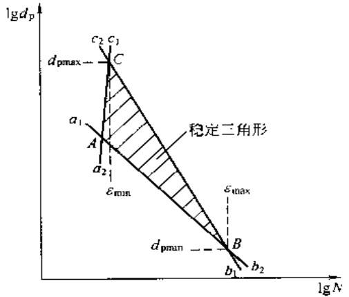

图2-19 液滴破碎、凝并和悬浮的理论关系

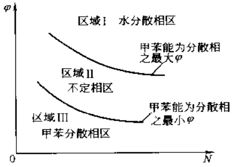

图2-20 水-甲苯液系逆分散操作状态

(\varphi 一甲苯体积分数； N 一转速）

对轻相和重相体积分数各为 $50\%$ 的液-液体系，Skelland研究了搅拌器安装方式对逆分散的影响，结果列于表2-17。由表可见，当单层搅拌器安装在 $H / 4$ 时，仅能生成 $L / D$ 分散液；若单层搅拌器安装在 $3H / 4$ 处，最有可能生成 $D / L$ 分散液。而双层搅拌器的情况较为复杂，在生成稳定的分散液之前能见到局部的从 $L / D$ 分散转变到 $D / L$ 分散，或者局部的从$D / L$ 分散转变到 $L / D$ 分散现象。但未能发现在最低分散转速下，全釜生成一种分散液后，进一步增加搅拌转速发生逆分散的现象。

表 2-17 重相为连续相的概率/%

| 搅拌器型式 | 单层搅拌器安装位置 |  |  | 双层搅拌器安装位置 |
|---|---|---|---|---|
| H/4 | H/2 | 3H/4 | H/4和3H/4 |  |
| 推进式 | 100 | 100 | 60 | 73.33 |
| 45°折叶涡轮 | 100 | 66.67 | 33.33 | 66.67 |
| 平直叶涡轮 | 100 | 80 | 40 | 60 |
| 曲叶涡轮 | 100 | 100 | 60 | 60 |

<!-- page: 71 -->

**4. 分散尺度**

通常用完全分散和均匀分散两个概念来描述液-液两相的分散程度。

（1）完全分散 直观地看，无论在设备顶部或底部都看不到清液块时，即认为达到完全分散状态。但此时，在靠近设备内壁处，仍有可能残留一些清液块，要清除这些清液块，则需要进一步增加搅拌转速。所以，完全分散状态只能粗略地反映分散程度。

(2) 均匀分散 当搅拌设备各部位的液滴浓度都相等时，即认为达到了均匀分散状态。均匀分散一般通过取样分析，测定分散相的平均体积百分率，并由式（2-95）计算取样点的分散指标值。

$$ i _ {\mathrm{D}} = \frac {R}{S}\tag{2-95} $$

式中 $R$ ——样品中含量少的相的实测体积百分数；

S——样品含量少的相在全釜中的平均体积百分数，即相比。

整个搅拌设备的分散指标为

$$ I _ {\mathrm{D}} = \frac {1}{n} \sum i _ {\mathrm{D}}\tag{2-96} $$

式中 $n$ ——取样点数。

$n$ 越大， $I_{\mathrm{D}}$ 越能反映设备内分散情况。当 $I_{\mathrm{D}} = 0.98$ 时即认为达到均匀分散状态。

**5. 平均滴径和比界面积**

对于液-液分散体系，最令人关心的往往是分散相的平均滴径、滴径分布和两相的比界面积 $a$ 。分散体内液滴平均直径与气-液两相系统中的气泡平均直径表示法相同，也取体表面积平均直径 $d_{32}$，且存在如下关系

$$ d _ {3 2} = 6 \varphi_ {\mathrm{d}} / a\tag{2-97} $$

式中 $\varphi_{\mathrm{d}}$ ——分散相体积分数，通称相比。

搅拌设备内所形成的平均滴径与搅拌器的型式、操作条件（如搅拌器转速、循环速率和相比 $\varphi_{d}$ ）和物性密切相关。各种计算 $d_{32}$ 的关联式列于表 2-18 中。

表 2-18 平均滴径 {d}_{32} 的关联式

| 研究者 | 实验条件 |相比 $\varphi_{d}$ | 关联式 | 公式号 |
|---|---|---|---|---|
| Sprow |六叶涡轮 $d/D=0.14\sim0.46 D=222mm$ 电子计数法| 0.005 | $\frac{d_{32}}{d}=0.052We^{-0.6}$ | (2-98) |
| Chen等 |六叶涡轮多种物系 $D=102\sim305mm d/D=0.21\sim0.73$ 光散射法| 0.001~0.005 | $\frac{d_{32}}{d}=0.053We^{-0.6}$ | (2-99) |
| Calderbank |四叶桨 $D=130\sim380mm$ 光散射法| 0~0.2 | $\frac{d_{32}}{d}=0.06We^{-0.6}(1+9\varphi_{d})$ | (2-100) |

<!-- page: 72 -->

续表

| 研究者 | 实验条件 |相比 $\varphi_d$ | 关联式 | 公式号 |
|---|---|---|---|---|
| Brown | 六叶盘式涡轮 d/D=1/3 D=380mm 瓮内照相法 | 0.05~0.30 | $\frac{d_{32}}{d}=0.051We^{-0.6}(1+3.14\varphi_d)$ | (2-101) |
| Van Heuven | 六叶涡轮 d/D=1/3 D=125~120mm 多种物系取样显微照相法 | 0.04~0.33 | $\frac{d_{32}}{d}=0.047We^{-0.6}(1+2.5\varphi_d)\frac{1}{2}$ | (2-102) |
| Mlyneck | 六叶盘式涡轮 D=290mm d/D=1/3 取样照相法(包囊) | 0.025~0.34 | $\frac{d_{32}}{d}=0.058We^{-0.6}(1+5.4\varphi_d)$ | (2-103) |
| Gnanasundaram | 六叶涡轮 d/D=1/3 D=150mm 多种物系 | 0.01~0.5 | $\frac{d_{32}}{d}=0.052We^{-0.6}e^{4\varphi_d},We<10^4 \frac{d_{32}}{d}=0.039We^{-0.6},We>10^4$ | (2-104) |
| 韩杰 | 六直叶涡轮 d/D=0.25~0.67 D=150~630mm 取样显微照相法 | 0.1~0.5 | $d_{32}=0.132e^{1.79\varphi_d}(n^3d^2)^{0.33}\left(\frac{d}{D}\right)^{-0.35}$ | (2-105) |
| 张燕敏 | 框板式搅拌器 d/D=0.35~0.50 D=184~494mm b/D=0.13 L/D=0.51 | 0.2~0.4 | $d_{32}=0.156e^{0.66\varphi_d}(n^3d^2)^{0.38}\left(\frac{d}{D}\right)^{-0.21}$ | (2-106) |

由 d_{22} 计算结果即可用式（2-97）计算出分散相体积分数 \varphi_{\mathrm{a}}。

**6. 最小临界转速**

通过搅拌使一个液相完全分散于另一个与它不相溶的液相中时所需的最低搅拌转速称临界转速 $N_{\mathrm{c}}$ 。表2-19列出一些研究者提出的计算最小临界转速的关联式。

表 2-19 最小临界转速关联式

| 研究者 | 实验条件 | 关联式 | 公式号 |
|---|---|---|---|
| 永田进治 | 无挡板平底搅拌设备四直叶涡轮 d/D=1/3, b/D=0.06 | $N_{c}=Kd^{-2.3}\left(\frac{\mu_{c}}{\rho_{c}}\right)^{1.9}\left(\frac{\rho_{c}-\rho_{d}}{\rho_{c}}\right)^{0.26}$ 当叶轮安装在设备中心时, K=6.01 当叶轮偏心安装时, K=4.88| (2-107) |

<!-- page: 73 -->

续表

| 研究者 | 实验条件 | 关联式 | 公式号 |
|---|---|---|---|
| Skelland |带挡板平底搅拌设备液深 H 等于设备内径 D 多种桨型(船舶推进式、六叶 45°折叶式、六直叶涡轮式和六叶曲叶涡轮式),相比 $\varphi_{\mathrm{d}} = 0.5$ 变桨径| $N_{\mathrm{c}} = C_{0} d^{\sigma_{0}} \left( \frac{\mu_{\mathrm{c}}}{\mu_{\mathrm{d}}} \right)^{1.9} \sigma^{0.3} \Delta\rho^{0.25}$ 上式采用量纲为“1”的方式可表示为 $\frac{d^{1.2} N_{\mathrm{c}}}{g^{1.2}} = C_{1} \left( \frac{D}{d} \right)^{\sigma_{1}} \left( \frac{\mu_{\mathrm{c}}}{\mu_{\mathrm{d}}} \right)^{1.9} \left( \frac{\Delta\rho}{\rho_{\mathrm{c}}} \right)^{0.25} \left( \frac{\sigma}{d^{2}\rho_{\mathrm{c}} g} \right)^{0.3}$ | (2-108) |
| Van Heuven |挡板平底搅拌设备六叶标准涡轮桨径未变相比 $\varphi_{\mathrm{d}} = 0.04 \sim 0.5$ | $N_{\mathrm{c}} = 8d^{-0.3} \gamma^{0.3} \sigma^{0.06} \rho^{-0.18} \Delta\rho^{0.38}(1 + 2.5 \varphi_{\mathrm{d}})^{0.9}$ | (2-109) |

注:表中 N_{c} 一临界转速，\mathrm{r / s}；d 一搅拌器直径，\mathrm{m}；D 一搅拌设备内径，\mathrm{m}；\mu_{\mathrm{e}} 一连续相黏度，\mathrm{Pa} \cdot \mathrm{s}；\mu_{\mathrm{d}} 一分散相黏度，\mathrm{Pa} \cdot \mathrm{s}；\rho_{\mathrm{c}} 一连续相密度，\mathrm{kg / m^3}；\rho_{\mathrm{d}} 一分散相密度，\mathrm{kg / m^3}；\Delta\rho 一密度差，\mathrm{kg / m^3}。

用式（2-108）预测临界转速的平均偏差小于 $10.62\%$ ，式中常数 $C_0$ 、 $C_1$ 、 $\alpha_0$ 、 $\alpha_{1}$ 的取值与桨径和桨的位置有关，具体取值方法列于表2-20，表中的安装方式号的意义为:

① 1、5、9、13 表示单层桨安装在重相的中部，即 H/4 处；

② 2、6、10、14 表示单层桨安装在轻相中部，即 $3H / 4$ 处；

③ 3、7、11、15 表示单层桨安装在两相的界面上，即 H/2 处；

④ 4、8、12、16 表示双层桨，其中一个桨装在轻相中部，另一个桨装在重相中部，即分别装在 $H / 4$ 和 $3H / 4$ 处。

表 2-20 式（2-108）中的常数

| 安装方式号 | C_0 | $\alpha_0$ | C_1 | $\alpha_1$ |
|---|---|---|---|---|
| 推进式 |  |  |  |  |
| 1 | 0.3481 | -1.383 | 15.32 | 0.2827 |
| 2 | 0.1519 | -1.654 | 9.968 | 0.5536 |
| 3 | 0.2934 | -1.493 | 15.31 | 0.3933 |
| 4 | 0.0447 | -2.023 | 5.241 | 0.9232 |
| 45°折叶涡轮 |  |  |  |  |
| 5 | 0.04738 | -2.151 | 6.823 | 1.0512 |
| 6 | 0.06325 | -1.919 | 6.204 | 0.8188 |
| 7 | 0.00915 | -2.690 | 2.987 | 1.5901 |
| 8 | 0.03119 | -1.974 | 3.355 | 0.8737 |
| 直叶涡轮 |  |  |  |  |
| 9 | 0.00910 | -2.725 | 3.178 | 1.6247 |
| 10 | * | * | * | * |
| 11 | 0.03665 | -1.981 | 3.996 | 0.8810 |
| 12 | * | * | * | * |
| 曲叶涡轮 |  |  |  |  |
| 13 | 0.01329 | -2.562 | 3.611 | 1.4624 |
| 14 | * | * | * | * |
| 15 | 0.04823 | -1.901 | 4.715 | 0.8006 |
| 16 | 0.06675 | -1.640 | 4.293 | 0.5401 |

2. 其中的 * 号表示尚未达到临界转速液体就大量飞溅，故无法求得 N。

<!-- page: 74 -->

**7. 搅拌器轴功率计算**

液-液两相分散操作，可利用在单相液体中测得的各种搅拌器的功率准数 $N_{p}$ 值进行计算。在计算功率时应合理计算物系的平均物性。

在敞口搅拌设备中，通常用下式来计算混合物的黏度 $\mu_{av}$ 和密度 $\rho_{av}$

$$ \mu_ {\mathrm{av}} = \mu_ {\mathrm{d}} ^ {X} \mu_ {\mathrm{c}} ^ {Y}\tag{2-110} $$

$$ \rho_ {\mathrm{av}} = \varphi_ {\mathrm{d}} \rho_ {\mathrm{d}} + \varphi_ {\mathrm{c}} \rho_ {\mathrm{c}}\tag{2-111} $$

对于设有液体-空气自由界面的封闭搅拌设备，如果设备内无挡板，可采用 Laity-Treybal 提出的关系式计算平均黏度，即

当水相体积比超过 $40\%$ 时

$$ \mu_ {\mathrm{av}} = \frac {\mu_ {\mathrm{w}}}{\varphi_ {0}} \left(1 + \frac {6 . 0 \varphi_ {0} \mu_ {0}}{\mu_ {\mathrm{w}} + \mu_ {0}}\right)\tag{2-112} $$

当水相体积比小于 40% 时

$$ \mu_ {\mathrm{av}} = \frac {\mu_ {\mathrm{o}}}{\varphi_ {\mathrm{o}}} \left(1 - \frac {1 . 5 \varphi_ {\mathrm{w}} \mu_ {\mathrm{w}}}{\mu_ {\mathrm{w}} + \mu_ {\mathrm{o}}}\right)\tag{2-113} $$

式中 下标 av——表示混合物平均物性；

w——表示水相物性；

o——表示有机物物性。

在有挡板的情况下，可用Vermenlen等人推荐的公式计算平均黏度

$$ \mu_ {\mathrm{av}} = \frac {\mu_ {\mathrm{c}}}{1 - \varphi_ {\mathrm{d}}} \left(1 + \varphi_ {\mathrm{d}} \frac {1 . 5 \mu_ {\mathrm{d}}}{\mu_ {\mathrm{c}} + \mu_ {\mathrm{d}}}\right)\tag{2-114} $$

**8. 液-液搅拌过程的设计要点**

液-液体系对搅拌的要求类似于气-液体系，二者都需要高的界面积。所不同的是气泡与液滴所承受的浮力的差别。因为液-液体系的浮力不像气-液体系那样明显，液-液体系通常比气-液体系容易模拟。同样，流动区、液滴破裂-凝并、界面积、液滴直径、质量传递系数等都是重要的设计参数。

液-液体系的功率输入并不像气-液体系那样显得重要。由于两相密度差通常相差不大，不会有一相大量地集中在搅拌器周围。

液滴的破裂和液滴尺寸由搅拌器的结构和输入功率决定。液滴的破裂通常出现在搅拌器桨叶或桨叶的尾涡中。破裂通常不会出现在釜体静止区，而液滴的凝并会出现在釜的本体区。如果在桨叶前后形成非常高的压降，会出现爆破现象，从而有非常小的液滴形成。

液滴的尺寸可以由搅拌器的几何结构、功率输入、已进搅拌区和静止区的体积比控制。类似于气-液分散，随着搅拌器叶片数的增加，搅拌区的比例提高，叶片的几何形状和叶片的角度影响搅拌的强度和性质，从而影响液滴尺寸。高速剪切搅拌器促使液滴破裂而阻碍液滴凝并，从而使液滴尺寸降低。在液-液体系中，密度差并不像气-液体系那样明显，搅拌器中间的圆盘并不需要，进料也并不要求一定从底部进料。但搅拌釜中液-液体系的界面积和液滴尺寸的放大预测不是一件容易的事，搅拌器叶片厚度或宽度的微小改变都有可能导致剪切速率及液滴尺寸的改变。

另外，杂质含量对液滴的形成有重要的影响，通常用于实验的流体与工业规模的实际流

<!-- page: 75 -->

体是有区别的，这也引起液滴尺寸的不可预测性。所以中试研究尽量采用用工业规模相同的流体、相同的加料方式和操作步骤，包括相同的杂质等，以减少放大因素的不确定性。中试研究的目的就是获得可放大的基础数据。放大过程，由于加料口离搅拌器位置的略为改变有时会导致过程行为和液滴尺寸显著的不同。

搅拌器直径与釜径之比 $d / D$ 会影响液滴分散和凝并的平衡，所以中试过程一定要研究 $d / D$ 对液滴分散的影响。液-液放大过程的关键是对各异相区的比例变化的认识。

斜桨圆盘涡轮由于具有高的泵送能力，通常用于液-液分散体系，有利于克服可能存在的相密度差。平桨圆盘涡轮比较适合于产生稳定乳液和适当的气体夹带。

杂质和表面活性剂很容易在相界面吸附，严重地影响界面特性和界面积。如果过程严重地依赖界面特性，放大过程必须考虑杂质和表面活性剂变化的影响。表面电荷是另一个需要关注的因素。

生成均匀的液滴通常是体系的一个目标，搅拌釜通常操作在湍流条件下，液滴尺寸的分散程度非常大。当对液滴的分布均匀度要求比较高时，通常需要考虑采用非搅拌设备。

**三、固-液两相体系的搅拌**

**固-液两相体系搅拌的目的:**

① 使固体粒子完全离釜底悬浮起来，简称完全离底悬浮。其主要作用是降低固体周围的扩散阻力，以便于固体物料的溶解或结晶，以及加强反应物料与催化剂之间的接触和传质。

② 使固体粒子在全釜均匀悬浮，简称均匀悬浮。其主要作用是制备均匀悬浮液。

**1. 固-液悬浮机理**

（1）完全离底悬浮 一般认为，固体悬浮是由湍动漩涡控制的。导致釜底沉积颗粒悬浮的原因是具有一定尺度小涡漩的扰动。假定与颗粒尺寸同一数量级的小涡漩作用于固体颗粒，并将能量传递给固体颗粒，当涡漩的作用力克服了固体颗粒所受重力与浮力之差时，则颗粒将被举起，此时颗粒即被悬浮起来。

另一种观点则认为，釜底附近的主体流动导致颗粒悬浮。釜底附近颗粒悬浮的条件是流体向上运动的速度与颗粒的沉降速度相平衡。

(2) 均匀悬浮 主要是由循环流动引起的。只要釜内循环流速达到一定值，使粒子沉降速度等于流体上升速度，就能形成固-液均匀悬浮状态。这一方面要求搅拌器能提供较高的循环流量；另一方面还要求釜内有足够数量的湍动漩涡进入粒子沉积区，使沉积的粒子完全悬浮起来，即要求釜内流体漩涡湍动强度较高。

**2.固-液悬浮判据**

(1) 以釜底未悬浮固体量作判据 固体粒子在釜底的停留时间不超过 $1 \sim 2\mathrm{s}$, 则认为达到了完全离底悬浮, 能满足此条件的最低的搅拌转速称完全离底悬浮临界转速, 用 $N_{\mathrm{c}}$ 表示。在达到完全离底悬浮时, 釜内各处的固体含量是不均一的。

(2) 以釜内悬浮液的均匀程度作判据 对于大多数悬浮体系，粒子在釜内是不可能达到真正均一分布的。为此，采取测量釜内不同位置的固体含量，再用式（2-115）所示的浓度方差 $\sigma^2$ 来定义悬浮均匀度。

$$ \sigma^ {2} = \frac {1}{n} \sum_ {1} ^ {n} \left(\frac {\varphi_ {\mathrm{V}}}{\varphi_ {\mathrm{av}}} - 1\right) ^ {2}\tag{2-115} $$

<!-- page: 76 -->

式中 $n$ ——样品个数；

$\varphi_{V}$ ——样品的固相分体积；

$\varphi_{av}$ ——全釜的平均固相分体积。

在对样品进行数据处理时，还常把固体含量表示成悬浮百分数，其定义为

$$ 1 0 0 \times \frac {\text {取样点固体质量分数}}{\text {全釜平均固体质量分数}} = \text {悬浮百分数}\tag{2-116} $$

悬浮百分数可大于 100%。完全均匀悬浮意味着每个取样点的悬浮百分数为 100%，但最上层的液体是很难达到均一的。

另外，从设计角度出发，可将固-液悬浮程度分成十个强度等级，如表2-21。这种区分法虽不严密，但在进行设备设计时很实用。

表 2-21 不同搅拌级别的固-液悬浮效果

| 搅拌级别 | 固-液悬浮效果 |
|---|---|
| 1~2 | 1至2级只适用于颗粒最低程度悬浮情况,其搅拌效果是:使具有一定沉降速度的颗粒在容器中运动,使沉积在釜底边缘的颗粒做周期性的悬浮 |
| 3~5 | 3至5级搅拌适用于多数化工过程对颗粒悬浮的要求,固体的溶解是一个典型的例子。3级搅拌的效果:使具有一定沉降速度的粒子全部离开釜底,使浆液容易从釜底放出 |
| 6~8 | 6至8级搅拌使悬浮程度接近均匀悬浮。6级的搅拌效果是:使95%料层高度的浆料保持均匀悬浮,使料液可从80%料层高度排出 |
| 9~10 | 9至10级搅拌可以使颗粒达到最均匀的悬浮。9级搅拌的效果是:使98%料层高度的浆液保持均匀悬浮,用溢出方式可将料液放出 |

**3. 悬浮临界转速**

所谓悬浮临界转速，是指釜内悬浮操作达到某一指定的悬浮状态时，搅拌器所需要的最小转速。只有确定了临界转速，才能计算出过程所需要的最小功率。

(1) 完全离底悬浮的临界转速 完全离底悬浮临界转速常用直接观察法和电导法测定。

直接观察法是用肉眼观察釜底颗粒运动状态，当颗粒全部处于运动时，且颗粒在釜底停留（静止）时间不超过1~2s，即认为达到了完全离底悬浮。此法用于实验室研究能够得到满意的结果。

电导法是在釜底安装多个电导元件，根据电信号的变化，确定完全离底悬浮临界转速。此法可用于不透明釜体的测量上。

在固-液悬浮操作中，对完全离底悬浮的研究较多，也发表了不少有关临界转速的关联式。Zwietering通过大量实验研究后发现，搅拌釜结构尺寸、固相浓度、液体黏度、固体颗粒粒径、固-液两相密度差等是影响悬浮操作的主要因素，并最早提出了完全离底悬浮临界转速关联式，且得到了许多研究者的证实。

$$ N _ {\mathrm{c}} = K d ^ {- 0. 8 5} d _ {\rho} ^ {0. 2} X ^ {0. 1 3} v ^ {0. 1} \left| g \frac {\rho_ {\mathrm{p}} - \rho}{\rho} \right| ^ {0. 4 5}\tag{2-117} $$

式中 $N_{e}$ ——完全悬浮临界转速，1/s；

K——与釜结构、搅拌器型式、所用单位有关的常数；

$d_{p}$ ——固相颗粒直径，m；

X——100乘上固-液的质量比；

<!-- page: 77 -->

v——液体运动黏度， $m^{2}/s$ ;

$\rho_{p}$ ——固体粒子的密度，kg/m $^{3}$ ;

ρ——液体的密度， $kg/m^{3}$ ;

d——搅拌器直径，m；

g——重力加速度， $m/s^{2}$ 。

其他一些作者提出的 $N_{\mathrm{c}}$ 经验关联式，列于表2-22。

表 2-22 固-液完全离底悬浮临界转速关联式

| 研究者 | 关联式 | 公式号 |
|---|---|---|
| Gates | $N_{c} = (\phi u$ ' $_{ts} d$ ' $^{-2.81})^{\frac{1}{3.75}}$ , $\phi = 6.5 \times 10^{10} ($ 搅拌等级为3级), d'(in), u' $_{ts} (ft/min)$ | (2-118) |
| Hobler,Zablocki | $N_{c} = 10.325 \left( \frac{\rho_p - \rho}{\rho} \right)^{0.6} \left( \frac{\rho_p}{\rho} \right)^{0.17} g^{0.45} v^{0.1} d_{p}^{0.25} \left( \frac{C}{d} \right)^{0.19} \left( \frac{D}{d} \right) d^{-0.9} \left( \frac{\varphi_v}{1 - \varphi_v} \right)^{0.17}$ | (2-119) |
| Kneule,Weins-pach | $N_{c} = 1.75 \left( \frac{g}{d} \frac{\rho_p - \rho}{\rho} \right)^{0.5} \left( \frac{1}{1 + \frac{\rho}{\rho_p} \times \frac{1 - \varphi_v}{\varphi_v}} \right)^{0.25} \left( \frac{D/d}{3.25} \right)^{\frac{5}{3}}$ | (2-120) |
| Kotzek | $N_{c} = \left( \frac{c_{ps}}{c_p} \right)^{1.3} \left( \frac{\pi H}{4D} \right)^{0.319} \left( \frac{D}{d} \right)^{0.957} \left( \frac{g}{d} \times \frac{\rho_p - \rho}{\rho} \right)^{0.5} \left( \frac{1}{1 + \frac{\rho}{\rho_p} \times \frac{1 - \varphi_v}{\varphi_v}} \right)^{0.175} \left( \frac{d_p}{d} \right)^{0.21} C_{ps} = 0.69, C_p = 0.4$ | (2-121) |
| Lamade | $N_{c} = 5.57 \left( \frac{g}{d} \times \frac{\rho_p - \rho}{\rho} \right)^{0.5} \left( \frac{d_p}{d} \right)^{0.21} \left( \frac{1}{1 + \frac{\rho}{\rho_p} \times \frac{1 - \varphi_v}{\varphi_v}} \right)^{0.15} \left( \frac{C}{d} \right)^{0.115} (D/d)^{-1.5}$ | (2-122) |
| Staudinger | $N_{c} = 4.2^A \left( \frac{d_p^{0.5}(1 + 8\varphi_v^{0.3})}{D^2 \left( \frac{d_p^2}{v} \right)^{0.5(1 - 1.85\varphi_v^{1/3})}} \right)^{\frac{A}{3}} \left( g \times \frac{\rho_p - \rho}{\rho} \right)^{\frac{A}{2}} \left( \frac{D/d}{3} \right)^{\frac{5}{3}} A = \frac{6}{7 - 1.85\varphi_{c}^{1.3}}$ | (2-123) |
| Zlokamik,Judat | $N_{c} = 7.08 \left( \frac{\rho_p}{d} \times \frac{\rho_p - \rho}{\rho} \right)^{0.5} \left( \frac{d_p}{d} \right)^{\frac{1}{6}} \left( \frac{1}{1 + \frac{\rho}{\rho_p} \times \frac{1 - \varphi_v}{\varphi_v}} \right)^{\frac{1}{6}} e^{(0.58\frac{D}{d})^{-2.27}}$ | (2-124) |
| Zwieter-ing | $N_{c} = 6.0d^{-0.85} v^{0.1} d_{p}^{0.2} \left( g \frac{\rho_p - \rho}{\rho} \right)^{0.45} \left( 100 \frac{\rho_p \varphi_v}{\rho(1 - \varphi_v)} \right)^{0.13}$ | (2-125) |
| Einenkel,Mersmann | $N_{c} = 24.93 \frac{v^{0.0826}}{d^{0.7768}} \left( gu_{ss}\varphi_v \frac{\rho_p - \rho}{\rho} \right)^{0.3058} \left( \frac{D/d}{3.175} \right)^{\frac{5}{3}}$ | (2-126) |

(2) 均匀悬浮临界转速 均匀悬浮临界转速的确定，常用的方法是通过测釜内各点的固相浓度，根据釜内固相浓度分布的均匀度来判断。

一般情况下，釜内很难达到均匀悬浮，典型的固体颗粒沿釜深浓度分布如图 2-21 所示。在低转速下，浓度分布不均匀，釜上部浓度低子平均浓度，釜下部浓度高子平均浓度。随着转速的增加，浓度分布趋于均匀。当转速增加到一定程度，浓度均匀性不再增加，沿液面深

<!-- page: 78 -->

度始终存在有一定的浓度差，而且从釜中可明显地看出沿液深总有一高浓度区。

衡量搅拌釜内固体颗粒浓度分布均匀性的判据很多。目前，广泛采用的是浓度分布的标准偏差 $\bar{\sigma}$

$$ \bar {\sigma} = \sqrt {\frac {1}{n} \sum_ {i = 1} ^ {n} \left(\frac {c _ {i}}{c _ {0}} - 1\right) ^ {2}}\tag{2-127} $$

式中 $n$ ——测点数目；

$$ \frac {c _ {1}}{c _ {0}} \text {——测点固相浓度与全釜平均固相浓度之比。} $$

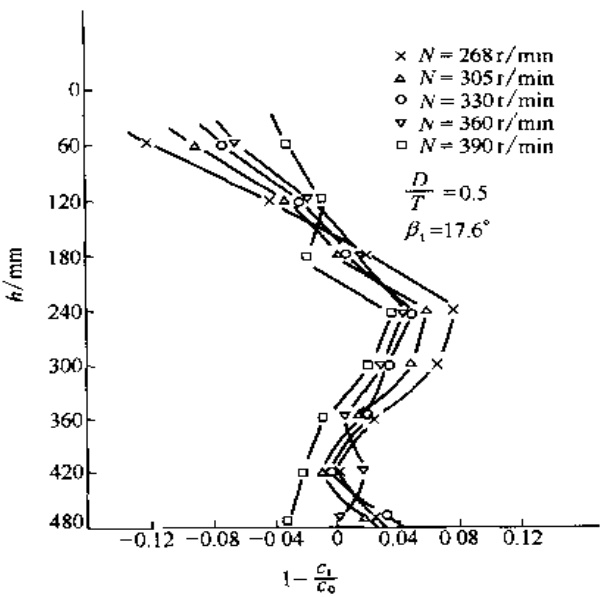

图2-21 固相浓度沿釜深分布

$\bar{\sigma}$ 越小，固体颗粒在釜内分布的均匀程度就越高。图 2-22 说明固体离子浓度分布的 $\bar{\sigma}$ 值随功率（转速）的变化关系。随着功率（转速）增加， $\bar{\sigma}$ 减小并趋于定值，即达到均匀悬浮。此时所需要最小转速（功率）即为均匀悬浮临界转速。达到均匀悬浮时的均匀度

均匀悬浮临界转速。达到均匀悬浮时的均匀度（$\bar{\sigma}$值）与叶轮型式及转速有关。

影响均匀悬浮的因素与影响完全悬浮的因素是一致的。由子均匀悬浮测量技术的限制，

图2-22 \sigma 与功率的关系

目前有关均匀悬浮临界转速的关联式发表的很少。

**4. 搅拌器轴功率计算**

在确定悬浮临界转速后，固-液悬浮搅拌轴功率的计算，可用均相液体搅拌的功率计算式，式中物理量用平均值代替。平均值求法如下:

悬浮液平均密度 $\rho_{\mathrm{sv}}$ 为

$$ \rho_ {x v} = \varphi_ {x} \rho_ {x} + \varphi_ {y} \rho_ {y}\tag{2-128} $$

悬浮液的平均黏度 $\mu_{\mathrm{av}}$ 为

式中 $\rho_{x}$ 、 $\rho_{y}$ ——两项纯组分密度， $kg \cdot s^{2}/m^{4}$ ; $\varphi_{x}$ 、 $\varphi_{y}$ ——两项的体积百分率。

$$ \mu_ {\mathrm{m}} = \frac {\mu_ {1 .}}{\left(\frac {1 - X _ {\mathrm{v}}}{X _ {\mathrm{vb}}}\right) ^ {1 . 8}}\tag{2-129} $$

式中 $\mu_{L}$ ——液体黏度，Pa·s；

$X_{v}$ ——固-液相体积比；

$X_{vb}$ ——沉降后沉积层中固-液相体积比。

由功率准数关联式计算搅拌器的轴功率时，通常都要用到悬浮液的平均密度 $\rho_{av}$ 。然而，在低转速启动搅拌器时，这时的转速还不足以使颗粒被提升至叶轮区，叶轮实际上只是处于纯液体的密度下，因此功率消耗将小于计算功率。搅拌器转速进一步增大，固体颗粒部分地悬浮，桨叶区的料液密度提高。因此搅拌功率要高于在该转速下的计算值。当达到均匀悬浮

<!-- page: 79 -->

时，实际功率将下降至稍低于用悬浮液平均密度计算出的计算值。这是因为搅拌器不可能总是处于悬浮液平均密度下操作。

**5. 固-液搅拌设备的设计**

（1）设计要点 固-液体系的表现形式一般要比气-液体系复杂得多，通常可以分为简单固体和复杂固体来讨论。

所谓简单固体，就是可以用 Zwietering 关联式描述其行为的固体。这种体系的行为通常只受固体粒子的尺寸、密度、体积分率、尺寸分布的影响。

复杂固体行为是指固体的表面化学和粒子本身的表面物理问题控制了粒子行为的过程。这些表面化学因素包括偶极作用、离子效应、极化效应、pH值和其他化学效应；表面物理问题包括团聚、絮凝、表面电荷、多层吸附、黏结等。这些因素的共同作用，控制着固-液体系的结构和流变行为。

简单固体悬浮体系的混合流型类似子单相混合，所需混合功率也接近子单相混合。在固体含量比较低时，通常不影响功耗；当固体含量比较高时，黏度会显著增加，从而改变体系的流动区进入层流区，这样功耗就会增加。有时候，当固体含量比较高时，如达到50%~80%，体系会转换成剪切增稠体系，这样功耗就会大幅度增加。

简单固体悬浮的设计目标通常是完全离底悬浮，以提供完全的接触表面和稳定操作。但有时候希望消除粒子分布的效应，就会以完全均匀分布为设计目标。离底悬浮转速与釜底的结构及釜底附近的流况关系很大，釜太大或搅拌器太小，粒子就容易沉积在釜底。如果把搅拌器接近于釜底安装则有利于降低悬浮转速，但如使用多个搅拌器通常并没有帮助，有时反而起到相反的效果。

粒子的形成可以是化学反应通过沉析或成核的结果。形成的粒子可以继续增长或溶解消失。因此粒子的尺寸分布会直接影响化学反应和溶解速率。由于小粒子具有较高的比表面积，因而小粒子通常比大粒子的活性高得多。

此外，完全均匀悬浮需要的功耗比离底悬浮高得多，可以达到离底悬浮功耗的 4～10 倍。

(2) 搅拌器直径与釜径之比 $d / D$ 永田进治研究了 $d / D$ 对悬浮效率的影响，若液体黏度不大，并采用涡轮式或桨式叶轮时，推荐的最佳桨径如下:

$$ \begin{array}{l l} \text {平底圆筒形容器} & d = 0. 4 5 \sim 0. 5 D \\ \text {碟形底或椭圆底容器} & d = 0. 4 D \\ \text {半球形底容器} & d = 0. 3 5 D \end{array} $$

（3）容器底部形状 在固-液悬浮操作中，容器底部通常采用平底、碟形或锥形的，后者特别适用于结晶器。研究发现，碟形底和平底的容器具有几乎相同的 $N_{c}$ ；但当碟形接近半球面形时，底部靠近搅拌器会导致功耗明显增加。而平底容器由于在釜底中央和釜底与釜壁的交接处易产生固体粒子的沉积，致使其效率较低；当采用锥底容器时，也总会有一些固体残留在锥顶部位。

进一步的研究表明，采用如图 2-23 所示的复曲面釜底容器，可使釜内所有各点处的循环速度都一样，消除所有死角。但这种复曲面釜底制作困难，于是有人提出用形状与它相近的锥底盘，如图 2-24 所示。也有人建议采用中间不设锥的盘形釜底。这比锥盘底制造更简单，但仅能消除釜底与釜壁交接处的死角。

(4) 搅拌器的离底高度 实验表明，使用完全离底悬浮判据时，搅拌器与釜底之间的距

<!-- page: 80 -->

图2-23 复曲面釜底

图2-24 锥盘釜底

$$ \begin{array}{c} d = 0. 3 3 D; d _ {1} = 0. 3 D; d _ {2} = 0. 7 D; \\ h _ {1} = 0. 2 D; h _ {2} = 0. 1 5 D; \\ C = 0. 2 5 \sim 0. 5 D \end{array} $$

离越小越省能。由于釜底几何形状的限制，对复曲面底和锥盘底来说，最小桨高分别为0.167D和0.250D。推进式搅拌器的最低安装高度为0.166D，若间隙小于此值，则由于釜底的节流作用，悬浮效率降低。然而对于四叶或六叶斜桨，间隙降至0.083D仍未发现有悬浮效率降低的现象，可能是这种叶轮的排液范围宽，釜底无明显的阻碍作用。另外，当固体含量高时，叶轮不能装得太低，除非有再启动措施。

（5）挡板和导流筒 为避免形成固体回转并使周向流变成有利于固-液悬浮的轴向流，容器中一般要设置挡板。大多采用四块宽度为 $D / 12 \sim D / 10$ 的标准挡板。为避免在挡板后形成死角，通常使挡板离釜壁安装，其间隙为容器内径的 $1 / 50 \sim 1 / 20$ 。当固相分率高时，流体会呈假塑性，且黏度增大，此时要考虑使用窄的挡板，并用更大的间隙。

对固体悬浮来说，安装导流筒可最大可能地降低搅拌功率；同时，使用导流筒后， $N_{c}$ 将减小。然而必须注意导流筒的大小和安装位置。例如，若导流筒装得太低，则搅拌器的排出流受到限制，将使临界悬浮能耗增大。理想的安装位置是使导流筒中心的截面积、导流筒和釜壁间的环隙截面积、导流筒底端与釜底之间的流通面积和导流筒顶端与液而之间的流通面积都相等。

**四、气-液-固三相体系搅拌技术研究进展**

**1. 过程特征**

气-液-固三相的行为有时可以通过合成气-液、液-固的行为来理解。在气-液体系中，人们关心的是质量传递参数、流型转换、气体循环、达到完全分散的搅拌器转速等。质量传递界面积和质量传递系数是搅拌功率和表观气速的函数。在液-固体系中，人们关心的是离底悬浮搅拌、固相的完全分散。将这些条件加在一起可以组成气-液-固体系的改造条件，实现气-液分散和固体悬浮。三相体系常常涉及多个搅拌器的使用，分别实现气-液分散和固-液悬浮机理。

目前，三相分散问题的主要研究内容是结构、操作和物性因素等对临界悬浮转速、功耗、气含率及传质等的影响。

**2. 临界悬浮转速**

如前所述，悬浮状态的描述方法有完全离底悬浮和均匀悬浮两种。下面分别介绍结构与

<!-- page: 81 -->

操作因素对临界悬浮转速的影响。

（1）结构因素的影响 包括釜型、桨型、分布器和挡板等均可影响临界悬浮转速。釜型多为平底或碟底的直立圆筒容器；常用的桨型有直叶圆盘涡轮（DT），上推式斜叶圆盘涡轮（PDTU），下压式斜叶圆盘涡轮（PDTD），上推式斜叶形式涡轮（PTU），下压式斜叶开式涡轮（PTD），推进桨，K4型桨，INTER-MIG桨，三叶后掠桨（SB），如图2-25所示；挡板有平挡板和指形挡板；气体分布器有单孔垂直管、水平管、水平交叉管、分布环、同心分布环簇和锥型分布器，如图2-26所示，此外采用指形挡板时多用指形挡板兼作分布器。

(a) K4

(b) INTER-MIG

图2-25 几种新型搅拌器结构示意图

(a) 单孔管

(b) 水平交叉管

(c) 分布环

(d) 同心环

图2-26 常用的气体分布器

① 釜型的影响 Wiedmann 等观察发现，碟底釜中最后悬起的粒子位于釜底中心；Chapman 等发现，无论两相或三相体系，平底釜中最后悬起的粒子位于釜底中心和挡板后；Frijlink 等发现碟底釜的悬浮性能好子平底釜。徐世艾等认为，釜底形状对颗粒的悬浮影响很大，这是因为搅拌器产生的流型是流线型，平底釜的非流线形状对搅拌器产生的流型是不

<!-- page: 82 -->

利的，可使液流速度降低。而颗粒悬浮的前提是颗粒在釜底的滑移，滑移的动力是流液速度，因此平底釜对颗粒的悬起是不利的，会在釜底中央或釜底边壁形成沉积的颗粒带，这些颗粒最难悬浮，故平底釜的悬浮性能比球底釜、碟底釜的差。

Satio 等的研究发现，小釜中 PTU 的 $N_{JSG}$ 低于 PTD 的 $N_{JSG}$ ；但大釜中的 $N_{JSG}$ 规律相反。Rewakar 等发现，釜径 D 越大， $N_{JSG}$ 受气体流量 Q 的影响越小，原因是同样气量时，釜径越大、气速越低、气体对颗粒悬浮的影响越小。

② 搅拌器结构型式等的影响 Chapman 等发现采用 PTD 和推进式叶轮均会产生粒子的“突发沉降”现象，而 DT 和 PTU 桨不会产生粒子的“突变沉降”现象。Bujalsk 等的研究则发现了另一种不同的突变现象，即当气体完全分散时，DT 的流型从径向流转变成向上的轴向流，功耗突然降低，大量粒子突然开始离底悬浮。

Rewakar 等发现，PTU 的 $\Delta N_{JSG} = N_{JSG} - N_{c}$ 低于 DT 和 PTD 的值；Raghavrao 的研究结果则不同，PTD 的 $N_{JSC}$ 小于 DT 的 $N_{JSG}$ ，也小于 PTU 的 $N_{JSG}$ ，这可能是由于前者采用的是气体分布环、而后者采用的是水平管气体分布器的缘故。

Bujalski 等发现，采用 DT 和 PTU 时，最后悬起的粒子位于釜底中心附近的环形带上，而采用 PTD 时，位于釜底壁角上。这说明采用不同搅拌器时，颗粒的悬浮难点和分散途径是不同的，从流型角度来研究颗粒的悬浮分散是比较合适的。随叶宽和叶厚的增大，搅拌器的排液能力和湍流脉动强度在增大，因此 $N_{JSG}$ 会减小，但叶宽越大，$N_{JSG}$ 减小的程度越小。

Brebm 等对 DT 的研究发现，平底釜中搅拌器离釜底的距离 $C_{0}$ 对 $N_{JSG}$ 的影响较大，低通气准数 $N_{A}$ 时 $N_{JSG}$ 随 $C_{0}$ 的增加而减小，高 $N_{A}$ 时 $C_{0}$ 对 $N_{JSG}$ 的影响不大。

③ 气体分布器的影响 Frijlink 等对 DT 的研究发现，每分钟通过釜内单位体积的气量 $Q_{v}$ 小于 0.5 时， $N_{JSG}$ 小于 $N_{c}$ （有分布器、但不通气时的临界转速），这是因为有分布器但不通气时，位于釜底的分布器对颗粒的悬浮造成了很大的阻碍作用，需要更高的转速才能使颗粒悬起。Satio 等人和 Rewakar 等人均发现，分布环离釜底的距离 S 过小时不利子粒子的完全悬浮。Rewakar 等还发现，气体分布环的直径 $D_{s}$ 越大、环上开孔越多， $N_{JSG}$ 越低，这是因为采用大分布环时从环孔喷出的气泡相对来说速度较低，孔数越多，从环孔喷出的气泡速度也越低，对釜底的颗粒悬起影响较小。

(2) 操作因素的影响 包括转速、气量和固相分率 $\phi$ 等都可影响临界悬浮转速，通常 $\phi$ 取 0~0.5。

① 气量的影响 Chapman 等发现，对下压式桨，$Q_{\mathrm{V}} > 0.25 \mathrm{~min}^{-1}$ 时 $\Delta N_{\mathrm{JSG}}$ 随 $Q_{\mathrm{V}}$ 而急剧增加，这是由于气升作用与搅拌作用反向的缘故；对 DT，$\Delta N_{\mathrm{JSG}}$ 随 $Q_{\mathrm{V}}$ 线性增加，原因是圆盘以上区域的搅拌作用与气升作用反向；对上推式桨，$\Delta N_{\mathrm{JSG}}$ 受 $Q_{\mathrm{V}}$ 的影响很小，这是由于气升作用与搅拌作用同向，气穴尺寸较小，通气后功耗降至较低的缘故。此外对 $\Delta N_{\mathrm{JSG}}$ 来说，当低 $Q$ 时，PDTD > DT > PTD > 推进桨 > PTU，高 $Q$ 时，PTD > 推进桨 > PDTD > DT > PTU，原因是由于开式涡轮没有中间圆盘，因此高气量时气体分散较差，气升阻碍了颗粒的悬浮，使开式涡轮的 $\Delta N_{\mathrm{JSG}}$ 高于圆盘涡轮。Frijlink 等的研究发现，通气后，由于桨下循环圈中气体再循环干扰了釜底粒子的沉降，有助于粒子悬浮，因此低气量时，$N_{\mathrm{JSG}}$ 随 $Q$ 的增加略有降低。Bujalski 等对 PTD 的研究发现，低气量时因气体再循环而进入桨下的气流增强了湍流脉动，使 $N_{\mathrm{JSG}}$ 低于 $N_{\mathrm{c}}$。

② 颗粒分率的影响 Beucker 等研究发现， $\phi$ 很低（不大于 0.05）时，颗粒对 $N_{JSG}$ 的影响不大，与气-液两相的规律相近。用小分布环时 $N_{JSG}$ 随 Q 的增大而增大，用大分布环时仅

<!-- page: 83 -->

在很高 $Q$ 时 $N_{\mathrm{JSG}}$ 才随 $Q$ 的增大而增大；用同心分布环簇时 $N_{\mathrm{JSG}}$ 与 $Q$ 无关。 $\phi = 0.3$ 且表观气速 $V_{\mathrm{G}} < 0.01\mathrm{m / s}$ 时几种分布器的 $N_{\mathrm{JSG}}$ 随 $Q$ 的变化不大；当 $V_{\mathrm{G}} > 0.02\mathrm{m / s}$ 时小分布环和大分布环的 $N_{\mathrm{JSG}}$ 均随 $Q$ 的增大而增大，但同心分布环簇的 $N_{\mathrm{JSG}}$ 随 $Q$ 的增加而减小。其原因是:①气量较大时，从单环分布器的环孔喷出的气泡速度较高，气量增加，泡速增大，对釜底的颗粒悬起影响很大，使单环分布器时的 $N_{\mathrm{JSG}}$ 均随 $Q$ 增大而增大。②从同心分布环簇的众多环孔喷出的气泡速度则较低，使气泡对釜底颗粒的悬起影响较小，加上此时气泡尺寸小而稳定，气含率可随气量增加而持续增加，使体系的表观密度持续减小，因此同心分布环簇的$N_{\mathrm{JSG}}$ 随 $Q$ 的增大而减小。

综上所述，从临界分散转速角度看，不同工艺条件时最佳的结构变量是不同的，低气量时下压式涡轮不错，高气量时上推式涡轮最好，这是由于气量很高时气升作用很强，只有把气升作用与搅拌作用协调起来才能取得最佳的效果。此外，各种气体分布环中以大分布环为优。

表2-23列出常见三相体系临界转速 $N_{\mathrm{JSC}}$ 的关联式。

表 2-23 常见三相体系临界转速 N_{\mathrm{jsc}} 的关联式

| 研究者 | 关联式 |
|---|---|
| Chapman | $\Delta N_{JSG} = N_{JSG} - N_c = bQ_v$ , b 只与桨型有关,对DT和PTD: $b = -2.45 \sim -2.3$ 和 $-1.45 N_c = k\Delta\rho^{0.21-0.24}\phi^{0.08-0.15}d_p^{0.12}d^{2.3-2.45}$ ,对 d/D = 2 和3,常数k分别为0.1和0.14|
| Frijlink |对DT, $\Delta N_{JSG} = N_{JSG} - N_c = 0.65Q_v$ |
| Wiedmann |对DU,有 $N_{JSG} = 5.58(Re_G)^{0.063}\phi^{0.12}Ga^{0.462}(d_p/d)^{0.26}(\Delta\rho/\rho_L)^{0.51}(v_L/d_p^2)$ |
| Wong | $\Delta N_{JSG} = N_{JSG} - N_c$ ' $= kQ_v$ ,对DT和PTD分别有:k=2.03和4.95|
| Bujalski |对PTD有, $N_{JSG} = N_c (0.83 + 0.31Q_v)$ ,对PTU有, $N_{JSG} = N_c (1+Q_v)^{0.11}$ |
| Rewatkar | $N_{JSG} = 5.56\frac{V_{\infty}^{0.5}-R}{d}\left\|\frac{d}{D}\right\|\phi^{0.1}V_s^{0.14}, R = 1.296v_\theta^{0.26}v_{s\infty}^{2.05}\left\|\frac{\phi_L}{\phi_L+\phi}\right\|^{3.5}$ |
|单层桨, $N_c$ ' $= N_c + 0.67$ , $s^{-1}$ ,与桨型及尺寸无关|  |
| Dutta |三层桨, $N_c$ ' $= N_c + 0.5$ , $s^{-1}$ ,与桨型及尺寸无关|
| Kawase | $\Delta N_{JSG} = aQ_v$ , $N_{JSG} \propto Q_v d^{-b}d_p^c\phi^d\Delta\rho$ ,对 d/D = 3 的PTD、DT和PTU有 $\alpha = 4.47$ , 3.75 和3.16; b = 1.25, 1.29 和1.32; c = 0.18, 0.18 和0.16,各种桨型的d和e相同,其值为d=0.146,e=0.42|
| 徐魁 |K4冀型桨: $N_{JSG} = N_c e^{kQ}$ , $k = 0.580 \sim 0.124$ , k 随 $Q_v$ 和 $\phi$ 的增大而减小|
|注: $d_p$ —颗粒直径,m; d —搅拌器直径,m; D —釜径,m; Ga —葛拉晓夫准数, $Ga = gd_p^3/v_L$ ; $v_L$ —液相运动黏度, $m^2/s$ ; $\phi$ —颗粒质量分率; $\rho_L$ —液相密度, $kg/m^3$ ; $\Delta\rho$ —液固密度差, $kg/m^3$ ; $v_{\infty}$ ——颗粒的自由沉降速度,m/s。|  |

由表2-23可见，对 $N_{\mathrm{JSG}}$ 的关联主要有两种形式:（1）以 $N_{\mathrm{JSG}}$ 和 $N_{\mathrm{c}}$ 的差值或比值作为关联因变量，即 $N_{\mathrm{JSG}} - N_{\mathrm{c}} = kQ_{\mathrm{V}}$ ，或 $N_{\mathrm{JSG}} / N_{\mathrm{c}} = f(Q_{\mathrm{V}})$ ，一般 $f(Q_{\mathrm{V}})$ 为 $Q_{\mathrm{V}}$ 的线性函数或幂函数；（2）直接以 $N_{\mathrm{JSG}}$ 作为关联因变量，即 $N_{\mathrm{JSG}} = f(Q_{\mathrm{V}})d^{-b}d_{p}^{c}\phi^{d}\Delta p^{r}$ ，$f(Q_{\mathrm{V}})$ 为 $Q_{\mathrm{V}}$ 的线性函数或常数。从第一种形式可方便地看出气量对颗粒悬浮的影响，第二种形式适合于数据处理和过程放大。

**3. 搅拌功率**

(1) 结构因素的影响 与对临界悬浮转速影响一样，结构对搅拌功率的影响因素主要是釜型、桨型和分布器等。

<!-- page: 84 -->

① 釜型的影响 Wiedmann 等发现，大釜中达到临界悬浮时单位质量物料的功耗 $(P_{\mathrm{m}})_{\mathrm{JSG}}$ 小于小釜中 $(P_{\mathrm{m}})_{\mathrm{JSG}}$ ， $(P_{\mathrm{m}})_{\mathrm{JSG}}$ 的关联式为

$$ \frac {\left(P _ {\mathrm{m}}\right) _ {\mathrm{ISG}} d _ {\mathrm{p}} ^ {4 0 . 3 3}}{v _ {\mathrm{L}} ^ {3}} = 1. 9 9 \left(R e _ {\mathrm{G}} + 1\right) ^ {0. 0 3 5} \phi^ {0. 1 2} G a ^ {0. 6 7 7} \left(d _ {\mathrm{p}} / d\right) ^ {1. 5 7} \left(\Delta \rho / \rho_ {\mathrm{L}}\right) ^ {0. 5 3}\tag{2-130} $$

式中 $Re_{G}$ ——颗粒雷诺数， $Re_{G}=V_{S}d_{\rho}/v_{L}$ 。

Raghav Rao 发现，随釜径 D 的增大， $(P_{\mathrm{m}})_{\mathrm{JSG}}$ 在减小；随搅拌器直径 d 的增大， $(P_{\mathrm{m}})_{\mathrm{JSG}}$ 在增大，即 $(P_{\mathrm{m}})_{\mathrm{JSG}}$ 随 d/D 的增大而减小，这说明从颗粒悬浮角度来看，对于三相体系应采用小的桨径釜径比。对 PTD、PTU 和 DT 分别得到以式（2-131）、式（2-132）、式（2-133）表示的功率准数式，即

$$ N _ {p} ^ {*} \propto \phi^ {0. 0 5} d _ {p} ^ {0. 0 4}\tag{2-131} $$

$$ N _ {p} ^ {*} \propto \phi^ {0. 0 7} d _ {p} ^ {1 1. 0 4}\tag{2-132} $$

$$ N _ {\mathrm{p}} ^ {*} \propto \phi^ {0. 0 5} d _ {\mathrm{p}} ^ {0. 0 6}\tag{2-133} $$

式中，功率准数 $N_{\mathrm{p}}^{*}$ 是基于液相密度 $\rho_{\mathrm{L}}$ 计算得到的。这表明，对于不同桨型，颗粒分率和粒径对 $N_{\mathrm{p}}^{*}$ 的影响基本上是相同的。

② 桨型的影响 Nienow 等发现:对于三相体系，由于通气而引起通气时搅拌功率 $P_{G}$ 的降低程度与桨型有关，PTD 比 DT 小，6DT 比 4DT 小，以 PTU 为最小。Raghav Rao 发现，PTD 的 $(P_{\mathrm{m}})_{\mathrm{JSG}}$ 大于 DT、DT 的 $(P_{\mathrm{m}})_{\mathrm{JSG}}$ ，也大于 PTU 的 $(P_{\mathrm{m}})_{\mathrm{JSG}}$ 。Satio 等发现，采用上推式桨时，并流的气升作用和搅拌作用使气穴尺寸减小，因此 $P_{G}$ 下降较小，且以 $60^{\circ}$ 六叶 PTU 为最佳桨型，其 $P_{G}$ 不随 Q 增大而变化或缓缓增加。

Brebm 等发现，碟底釜中，$C_0$ 对 $(N_{\mathrm{p}}^{*})_{\mathrm{JSG}}$ 的影响较大，$C_0$ 越大，$(N_{\mathrm{p}}^{*})_{\mathrm{JSG}}$ 越高。Chapman 等发现，采用多层桨可改进颗粒悬浮分散状况。

③ 气体分布器的影响 Frijlink 等发现分布环离釜底的距离 S 对气体分散状态有较大的影响。采用位于釜底的单孔分布器时，易气泛且大气泡气体更容易迅速上升，导致 $P_{G}$ 更快地降低；采用多孔分布环时不易气泛、功耗下降慢。S 与 $C_{0}$ 越小，越易形成大气穴， $P_{G}/P_{0}$ （不通气功耗）下降越快，从而使 $N_{JSG}$ 增加；S 与 $C_{0}$ 大时， $P_{G}/P_{0}$ 下降得较慢。

（2）操作因素的影响 Chapman 等发现，高气量时 PTU 的功耗低于 6DT，且前者的气体分散稳定，这是由于 PTU 能将搅拌作用和气升作用有机的协调起来，使悬浮分散均匀且稳定的缘故；但低气量时 PTU 的功耗最高，这是由于低气量时气升作用较弱，此时搅拌混合过程规律与液-固两相体系相近。大量研究还表明 PTD 对颗粒的悬浮最为有效，功耗与临界转速皆低。Satoh 等也发现，低气量时，PTD 的 $(P_{\mathrm{m}})_{\mathrm{JSC}}$ 最低；中等气量时，下压式双折叶圆盘涡轮的 $(P_{\mathrm{m}})_{\mathrm{JSC}}$ 最低；大气量时，DT 的 $(P_{\mathrm{m}})_{\mathrm{JSC}}$ 最低。

Nienow 等发现，对下压式涡轮和上推式涡轮，当 $Q_{v}<0.5\min^{-1}$ 时 $(P_{\mathrm{m}})_{\mathrm{JSG}}$ 降低； $Q_{v}>0.5\min^{-1}$ 时，由于气升作用很强，并干扰了釜底流型，阻碍了颗粒的悬起，使 $(P_{\mathrm{m}})_{\mathrm{JSG}}$ 增加；对上推式涡轮而言， $Q_{v}>1.0\min^{-1}$ 时与搅拌作用同向的气升作用很强，控制了釜内流型，使 $(P_{\mathrm{m}})_{\mathrm{JSG}}$ 降低，气量越高，气升诱导流量越大， $(P_{\mathrm{m}})_{\mathrm{JSG}}$ 下降得越大。

综上所述，从功耗的角度看，各种搅拌器中以上推式桨为好（尤其在高气量时），分布器以多孔分布环为佳。

**4. 放大准则**

Chapman 等给出了单位质量流体的搅拌功耗的关联式，即

<!-- page: 85 -->

$$ (P _ {\mathrm{m}}) _ {\mathrm{JSG}} \propto d ^ {0. 2 8}\tag{2-134} $$

Frijlink 等发现，利用 $Q_{v}$ 为常数的规则，对 DT、PTD 和 PTU 分别给出 $(P_{\mathrm{m}})_{\mathrm{JSG}}$ 关联式

$$ (P _ {\mathrm{m}}) _ {J \mathrm{SG}} \propto d ^ {- 0. 3 3}\tag{2-135} $$

$$ (P_{\mathrm{m}})_{\mathrm{JSG}}\propto d^{0,3}\tag{2-136} $$

$$ (P _ {\mathrm{m}}) _ {\mathrm{jSG}} \propto d ^ {0, 4}\tag{2-137} $$

从式（2-134）～式（2-137）以及其他已发表的文献不难发现，不同的研究者得到的放大准则有很大的差别，这可能与他们的试验条件、过程目的等不同有关，因此引用这些的放大准则时要注意试验条件及过程目的等。

鉴于三相体系的复杂性和对三相混合的研究起步较迟，现有的研究结果还不系统和成熟，有待于进一步完善。

## 参考文献

1 R. B. Bird, R. C. Armstrong & O. Hassage. Dynamics of polymeric liquids. New York: Wiley, 1987

2 J. Ulbrecht. Mixing of Viscoelastic Fluids by Mechanical Agitation. The Chemical Engineering, 1974 (6): 347~353

3 J. L. White, S. Chankraiphon, Y. Ide. Trans of the Society of Rheology, 1977, 21 (1): 1

4 王凯，冯连芳著.混合设备设计.北京:机械工业出版社，2000

5（日本）永田进治编著.混合原理与应用.马继舜等译.北京:化学工业出版社，1984

6 A. H. P. Skelland and R. Seksalia. Ind Eng Chem Process Des Dev, 1978, 17 (1): 56

7 Van Heuven J. W., Beek W. J.. Proceedings ISEC, 1971 (70)

8 Zwietering T. N., Chem. Eng. Sci., 1958 (8): 244

9 Bohnet and Niesmak. Ger. Chem. Eng., 1980, 3: 57~65

10 徐世艾，韩晓丽，冯连芳等.气液固三相体系搅拌混合研究进展.化学工业与工程，2000，17（5）:278～285

11 时钩，汪家鼎，余国琮等主编.化学工程手册（上卷）.北京:化学工业出版社，1996

12 Chavan V. V. and Ulbrecht J.. Ind. Eng. Chem. Proc. Des. Dev., 1973, 12 (4): 472~476

13 Carreau P. J., Patterson I. and Yap C. Y.. The Canadian Journal of Chem. Eng., 1976, 54 (6): 135

14 Yap. C. Y., Patterson W. I. and Carreau P. J.. AIChE Journal, 1992, 15 (1): 55

15 王凯，朱秀林，潘祖仁.锚式搅拌槽中高黏性流体的流速分布及其功率消耗.化工学报，1989，40(6):710~719

16 朱秀林，王凯，潘祖仁.螺带桨叶在黏弹性液体中的搅拌功率.化工学报，1989，40（5）:626～634

17 Skelland A. H. and Seksalia R.. Ind. Eng. Chem. Process Des. Dev., 1978, 17 (1): 56

<!-- page: 86 -->

## 第三章 特殊过程的搅拌

搅拌作为一种应用广泛的单元操作，其最直接的功能是物料的不同部分经搅拌而相互掺和，形成具有某种均匀程度的混合物。不仅如此，搅拌还可以使固体颗粒在液体中悬浮，或使气体以小气泡形式均匀地在液体中分散，从而大大强化传热和传质。因而根据不同的搅拌目的，可将其分为混合搅拌、悬浮分散搅拌、传热搅拌、传质搅拌等过程。

### 第一节 混合搅拌

混合搅拌是指使两种或数种互溶物料在旋转的搅拌器作用下，将浓度、密度、温度以及其他物性达到均匀状态的搅拌。由于搅拌目的从根本上说就是使设备内的流体达到均匀状态，所以说混合是其他各种搅拌过程的共同要求，是搅拌过程中最基本的一种过程。

**一、宏观混合与微观混合**

将两种性质不同、但互相溶解的物料加入搅拌设备后，首先是两种物料被破碎成块团（或称溶质团、浓度斑），并彼此掺合起来，这些块团是不规则的，块团的尺寸随搅拌过程的进行而逐渐减小；同时这两种物料间的扩散将通过块团的边界进行，边界处的组成先发生变化，逐渐扩展至块团内部，最终达到两种物料的分子级混合。若液体先不被打碎成小块团、形成大量接触面，扩散过程就会进行得很慢；然而若没有扩散过程，即使长时间连续不断地搅拌也不能获得分子级均一的混合物。由此可见，破碎和扩散是整个均匀混合进程中两种不同性质的过程。前者是减小块团的尺寸，后者是消除混合物相邻区域之间浓度上的差异，所以这两者需要用不同的物理量来描述。通常用 Dsnckwertz 定义的分离尺寸 L（Scale of Segregation）和分离强度 I（Intensity of Segregation）来描述。

在上述混合过程中，其初始阶段是在搅拌的剪切和对流作用下，物料被打碎和分散。从微观上看，两种物料仍没有混合，仍是两种物料分子各自聚集在一起（除块团边缘外）。该阶段称为宏观混合阶段。这之后，混合进入分子扩散阶段，并随扩散过程的进行，块团尺寸不断减小，直到两种物料达到分子级混合。这一阶段，称为微观混合阶段。

分离尺寸 L 是与浓度斑的大小相对应的一个量，随宏观混合进行而不断减小，又随微观混合的进行逐渐增大。当达到分子级混合时，整个混合物成为一个浓度斑，此时 L 达到最大值。

分离强度 I 是反映某时刻的浓度斑浓度与最终能达到分子级混合时的浓度之差的一个量。在宏观混合阶段，分离强度保持不变；在微观混合阶段它逐渐减小，当达到分子级混合时，I 为零。对于低黏流体（如水溶液）的湍流混合，分子扩散速度很快，因此混合速率主要由宏观混合所控制；对于高黏流体的层流混合，宏观混合速率与微观混合在同一数量级，如表 3-1 所示。表中 $P_{v}$ 为单位体积搅拌功率。

<!-- page: 87 -->

表 3-1 宏观混合和微观混合所需的时间

| 搅拌条件 | 混合所需时间 |
|---|---|
|湍流操作,使用涡轮式叶轮,水溶液, D = H = 2m , D = 1m , N = 1r/s , $P_{V} = 1kW/m^{3}$ | 宏观约25s,微观约0.1s |
|层流搅拌,螺带式叶轮,高黏液, $D \approx d = 0.3m$ , N = 1.6r/s , $P_{V} = 1kW/m^{3}$ | 宏观约20s,微观约20s |

**二、混合过程的混合参数**

评价搅拌器的混合性能时，常用流量准数 $N_{q}$ 和无量纲数 $C_{1}$ （即无因次混合时间）、 $C_{2}$ 、 $C_{3}$ 、 $C_{4}$ 等综合评价其混合速率、能耗及剪切性能。

**1. 流量准数 N_{\mathrm{q}}**

从搅拌器排出的高速液流，卷吸周围的液体，形成循环流，因此流量准数 $N_{q}$ 可进一步分为排出流量准数 $N_{qd}$ 与循环流量准数 $N_{qc}$ ，分别由式（3-1）、式（3-2）定义，它们之间的关系见式（3-3）。

$$ N _ {\mathrm{qd}} = \frac {Q _ {\mathrm{d}}}{N d ^ {3}}\tag{3-1} $$

式中 $Q_{d}$ —— 搅拌器排液量， $m^{3}/s$ 。

$$ N _ {\mathrm{qc}} = \frac {Q _ {\mathrm{c}}}{N d ^ {3}}\tag{3-2} $$

式中 $Q_{c}$ —— 循环流量， $m^{3}/s$ 。

$$ N _ {\mathrm{qc}} = N _ {\mathrm{qd}} \left\{1 + 0. 1 6 \left[ (D / d) ^ {2} - 1 \right] \right\}\tag{3-3} $$

式中 $D$ ——搅拌设备内径， $\mathrm{m}$ 。

**2. 无量纲数 C_1**

$C_{1}$ 就是第二章第二节所讲的无因次混合时间（或称混合准数 $N_{\theta M}$ ），其物理意义是达到规定的混匀标准时所需的搅拌器转数，计算公式见式（2-24）。一般来说， $C_{1}$ 越小，说明混合速率越大。

在湍流域，涡轮式、桨式、推进式搅拌器的 $C_{1}$ 为常数；在层流域，d/D 接近 1 的轴向循环能力较强的螺带式、MIG（多段逆流）式搅拌器以及螺杆-导流筒式搅拌器的 $C_{1}$ 亦为常数，而对 d/D=0.3~0.5 的涡轮式、桨式等搅拌器，由于在层流时釜内有很大的停滞区，故不能测得确切的 $\theta_{M}$ ，因而 $C_{1}$ 值也不能确定；在过渡流域，所有搅拌器的 $C_{1}$ 值随雷诺数的增大而降低。

**3. 无量纲数 C_2**

$C_2$ 的物理意义是达到规定的混合程度时，流体所受的剪切量。其计算式为

$$ C _ {2} = \theta_ {\mathrm{M}} \sqrt {P _ {\mathrm{v}} / \mu}\tag{3-4} $$

**4. 无量纲数 C_3**

$C_{3}$ 的物理意义是搅拌器转一圈流体所受剪切量。其计算式为

$$ C _ {s} = (1 / N) \sqrt {P _ {\mathrm{v}} / \mu}\tag{3-5} $$

<!-- page: 88 -->

**5. 无量纲数 C_{4}**

$C_{4}$ 的物理意义是在一定的流体黏度和混合时间下，搅拌器所需的单位体积混合能。其计算式和评价方法见第二章第二节“高黏流体的搅拌”中有关内容。

上面各无量纲数计算式中的黏度 $\mu$ 均指牛顿流体的黏度。对于假塑性流体，也可以用 $C_{1}$ 、 $C_{2}$ 、 $C_{3}$ 、 $C_{4}$ 值评价搅拌器的混合性能。但在计算 $C_{2}$ 、 $C_{3}$ 和 $C_{4}$ 值时要用假塑性流体的表观黏度 $\mu_{a}$ 来代替各计算式中的牛顿流体的黏度 $\mu$ 。

**三、混合特性**

**1. 搅拌器在湍流域的混合性能**

低黏度液体的混合操作一般都是在湍流域进行，其无量纲数 $C_1$ （或混合准数 $N_{\theta_{\mathrm{M}}}$ ）为常数，并有以下关系

$$ C _ {1} = N _ {\theta_ {\mathrm{M}}} = N \cdot \theta_ {\mathrm{M}} = K \left(\frac {D}{d}\right) ^ {\circ}\tag{3-6} $$

式中 $\alpha$ ——常数，通常在 1.5～2.5 之间变化；

$K$ ——衰减常数。

从式（3-6）可以看出，在同一搅拌设备中，搅拌器直径 $d$ 愈大，$C_1$ 就小，搅拌性能就愈好。换言之，大搅拌器的混合作用比小桨明显有效。

一个普通的混合过程，无论是湍流还是层流，如果搅拌器设计得当， $C_{1}=20\sim80$ 即可获得良好的混合效果。

**2. 搅拌器在层流域的混合性能**

文献 [2] 对 12 种搅拌器在层流域的混合性能进行了比较。这 12 种搅拌器是双螺带-锚式、内外单螺带-锚式、四螺带-锚式、MIG(d/D=0.95)-锚式、框-螺带-锚式、复动式（交叉叶）、半椭圆板-导流筒式、螺杆-导流筒式、锚式、框式、后掠叶-D挡板式、MIG(d/D=0.616)-D挡板式。采用十二种搅拌器测得的 $C_1$、$C_2$、$C_3$ 和 $C_4^*$ 值列于表 3-2。

表 3-2 搅拌器在层流域的混合性能

| 序号 | 搅拌器 | d/D | 牛顿流体 |  |  |  | 假塑性流体,n=0.53~0.63 |  |  |  |
|---|---|---|---|---|---|---|---|---|---|---|
| C_1 | C_2 | C_4 | C_4^* | C_1 | C_2 | C_3 | C_4^* |  |  |  |
| 1 | 双螺带-锚式 | 0.950 | 34 | 660 | 19.4 | 4.36 | 37 | 718 | 19.4 | 5.16 |
| 2 | 内外单螺带-锚式 | 0.950 |  |  |  |  | 41 | 656 | 16 | 4.30 |
| 3 | 四螺带-锚式 | 0.950 |  |  |  |  | 30 | 608 | 20.1 | 3.70 |
| 4 | MIG-锚式 | 0.950 |  |  |  |  | 56 | 784 | 14 | 6.15 |
| 5 | 框-螺带-锚式 | 0.950 |  |  |  |  | 57 | 1054 | 18.5 | 11.1 |
| 6 | 复动式(交叉叶) | 0.947 | 22.7 | 254 | 11.2 | 0.645 | 31 | 346 | 11.2 | 1.20 |
| 7 | 半椭圆板导流筒式 | 0.574 | 54 | 362 | 6.7 | 1.31 | 99 | 663 | 6.7 | 4.40 |
| 8 | 螺杆-导流筒式 | 0.574 |  |  |  |  | 40 | 314 | 7.9 | 0.80 |
| 9^1 | 锚式 | 0.810 |  |  |  |  | 230 | 1686 | 7.3 | 28.4 |
| 10^1 | 框式 | 0.790 |  |  |  |  | 142 | 1003 | 7.1 | 10.1 |
| 11^1 | 后掠叶-D挡板式 | 0.633 |  |  |  |  | 160 | 1026 | 6.4 | 10.5 |
| 12^1 | MIG-D挡板式 | 0.616 |  |  |  |  | 250 | 1306 | 5.2 | 17.05 |

① 该种搅拌器在层流域有相当大的混合不良区， C_{1} 值是按大部分碘已褪色估测的 (Re^{*}=20) 。

<!-- page: 89 -->

由表3-2可见:

① 在层流域，复动式搅拌器和螺杆-导流筒式搅拌器的混合效率最高；锚式、框式、后掠叶-D挡板式和MIG-D挡板式搅拌器的混合效率最低，不宜采用。对于牛顿流体和假塑性流体，达到同样的混合效果，复动搅拌器的能耗分别为双螺带搅拌器的14.8%(0.645/4.36)和23.3%(1.20/5.16)。框式搅拌器的混合效率比锚式高一倍。

图3-1 C_4^* -Re·曲线

② 搅拌器转一圈，使流体受到剪切最多的是四螺带-锚式搅拌器。

③ 达到规定混合时，流体受到的总剪切量以锚式搅拌器最大。

**3. 搅拌器在过渡流域的混合特性**

文献 [1] 对多种搅拌器在过渡流域的混合特性做了实验研究，结果归纳成图 3-1 和图 3-2 所示。

由图3-1和图3-2可见:

① 在过渡流域（ $Re^{*}=50\sim1000$ ），螺带式搅拌器的 $C_{1}$ 值变化很小，特别是四螺带-锚式搅拌

器，其 $C_{1}$ 值与 $Re^{*}$ 无关；其余搅拌器的 $C_{1}$ 值随 $Re^{*}$ 的增大均有大幅度地降低。螺带式搅拌器在层流域有较高的混合效率，但当 $Re^{*}$ 大于 100 以后，与其他搅拌器相比，混合效率明显下降。

图3-2 C_1 - Re^* 曲线

② 螺杆-导流筒式搅拌器在层流域和过渡流域都有很高的混合效率，所以它十分适合于随反应进行，物料的黏度逐渐增大，体系的流况由过渡流变至层流的溶液聚合或本体聚合反应。

③ 在 $100 < Re^{*} < 1000$ 范围内，$\mathrm{MIG}(d / D = 0.95)$-锚式和半椭圆板-导流筒式搅拌器也

<!-- page: 90 -->

有较高的混合效率。

④ 在 $Re^{*}$ 大于 200 的情况下，多段三叶后掠式搅拌器和 D 型挡板的组合具有较高的混合效率，特别在 $Re^{*}=1000$ 附近区域，它的混合效率最高，所以它十分适合于跨越湍流和过渡流域的操作；框式搅拌器在全部雷诺数范围内均是低效的，从节能观点看，应予以淘汰，它的优点是低廉，易于制造。

**四、混合过程设计要点**

混合时间和循环时间是混合设计中的重要参数。循环时间是指流体质点在搅拌作用下，循环回到原出发点所需要的时间。对一个具有挡板的湍流搅拌操作，混合时间通常是循环时间的3~4倍；对湍流喷射混合过程，混合时间通常近似地等于循环时间；而在无挡板的层流混合过程中，混合时间一般为循环时间的8~10倍。

合适的过程几何是消除无效混合的关键。如果搅拌设备的体积太大，混合就可能难以有效地完成。这是由于混合时间通常是混合设备的定性长度和设备体积为指数的函数，即

$$ \theta_ {\mathrm{M}} = k _ {1} L ^ {a} \mathrm{e} ^ {k _ {2} V}\tag{3-7} $$

式中 $I_{\mathrm{c}}$ ——定性长度；

$V$ ——体积。

对于一个给定的设备， $k_{1}$ 和 $k_{2}$ 是常数。对于有些体系， $k_{2}$ 非常小，体积的效应可以忽略，混合时间就成为湍流域的表达式，即式（3-6）。

当 $k_{2}$ 或 V 比较大时，因为 $\theta_{M} \propto e^{k_{2} V}(k_{2} > 0)$ ，随着 V 的增大，混合时间急剧增加。当体积大到一定程度，混合设备的设计就比较困难。通常混合过程的设计有这样一些特点，如果混合设备设计得当，混合行为不会因为加料方式、示踪剂加入量以及流体性质的改变而明显改变。但如果混合设备设计不当，所有这些因素，如加料方式、示踪剂加入量、加入位置以及流体性质的改变都将影响混合行为。

实验室规模的设备总是具有良好的混合效果，且与加料位置无关。但这种混合效果和功率消耗通常很难在工业过程中重现。一般情况下，在工业规模的设备中，混合速率大大下降，且与加料位置有关。

**五、混合过程常见的强化方法**

**1. 优化搅拌器结构几何尺寸**

如前所述，不同的流体，或同一流体在不同的雷诺数范围内，各种搅拌器的混合性能各不相同。进一步的研究还发现，搅拌器的几何尺寸对混合效率有很大影响，并且这种影响是随流体的性质而异的。如对螺带式搅拌器的研究表明:① 叶宽对混合效率影响较大。当叶宽增加一倍，甘油和 2%CMC 水溶液的混合速率增加将近一倍，而 1%PPA 水溶液仅增加 20%；② 螺距的改变对混合速率影响不大；③ 叶端和釜壁的间隙增加一倍，甘油的混合时间仅增加 10%，2%CMC 水溶液则增加 50%~100%，但是 1%PPA 水溶液的混合时间几乎不变。④ 当螺带的叶片由圆管制作时，混合时间要增加 30%~70%。

**2.合理设计物料加入位置**

在任何一种混合体系中，把混合物的组分注入湍流区中将有助于降低黏度和密度差，并使混匀加速。

**3. 避免产生打漩**

在任何混匀体系中，避免产生打漩的流型是很重要的。对顶部插入式的搅拌器设备，为

<!-- page: 91 -->

产生适宜的流型，一般要在釜壁上安装挡板；对侧面插入式的搅拌设备，搅拌器通常以一定角度插入釜中，可产生良好的顶部至底部的循环流动。

### 第二节 悬浮与分散搅拌

悬浮和分散搅拌主要用于非均相物系的混合操作，如不互溶的液-液体系、气-液体系，以及固-液体系等。

**一、液滴与气泡的分散**

两种不互溶液体搅拌时，其中必有一种被破碎成液滴，称为分散相，而另一种液体称为连续相。气体在液体中分散时，气泡为分散相。为达到小尺度的宏观混合，必须尽可能减小液滴或气泡的尺寸。液滴或气泡的破碎主要依靠搅拌器的高度湍动。

**1. 液-液分散体系**

液滴是一个具有明显界面的液团。界面张力力图使液滴的表面积最小，抵抗液滴变形和破碎，即界面张力是分散操作的主要抗力。为此，要使液滴破碎，首先必须克服界面张力使液滴变形。

在搅拌器作用下，设备内流体处于高度湍动状态时，存在着方向迅速变换的湍流脉动，液滴不能追随这种脉动而产生相对速度很大的绕流运动。这种绕流运动，沿液滴表面会产生不均匀的压强分布和表面切应力将液滴压扁并扯碎。总体流动的湍动程度越高，湍流脉动对液滴绕流的相对速度越大，则可能产生的液滴尺寸越小。但在大液滴发生破碎的同时，还存在着小液滴相互碰撞面凝并的过程。即破碎与凝并同时发生，必然导致液滴尺寸的不均匀分布。其中大液滴是由小液滴凝并而成，小液滴则是大液滴破碎的结果。实际的液滴尺寸分布决定于破碎和凝并过程之间的抗衡。

此外，搅拌设备内各处流体湍动程度不均也会使液滴尺寸不均匀分布。一般情况下，搅拌器附近的区域，流体湍动程度最高，液滴破碎速率大于凝并速率，液滴尺寸较小；面在远离叶片的区域内湍动程度较弱，液滴凝并速率大于破碎速率，液滴尺寸较大。

为了获得液滴尺寸分布均匀的混合物，通常可采用下列措施进行强化。

① 尽量使流体在设备内的湍动程度分布均匀，具体可通过选择适宜的搅拌器型式和尺寸，合理设计搅拌器的位置，以及在设备内设置挡板等方法来保证湍动程度均匀分布。

② 在混合液中加入少量的保护胶或表面活性物质，使液滴在碰撞时难以凝并。在许多高分于单体的悬浮聚合过程中，就是采用这种方法获得了大小均匀的聚合物颗粒。

**2. 气-液分散体系**

气泡在液体中的分散机理原则上与液滴分散相同，只是气-液表面张力比液-液界面张力大，分散更为困难。此外，气液密度差较大，大气泡更易浮升溢出液体表面。因而，气泡分散往往更需重视。

**二、固体颗粒的分散与悬浮**

在固-液体系中，细颗粒投入液体中搅拌时，首先发生固体颗粒的表面润湿过程，即液体取代颗粒表面层的气体，并进入颗粒之间的间隙；接着是颗粒团聚体被流体动力所打散，即分散过程。通常的搅拌不会改变颗粒的大小，因此与气泡和液滴分散一样，只能达到小尺度的宏观混合。

<!-- page: 92 -->

对粗颗粒，如果搅拌转速较慢，颗粒会全部或部分沉于釜底，这大大降低了固液接触界面。只有足够强的扫底总体流动和高度湍动才能使颗粒悬浮起来。当搅拌器转速由小增大到某一临界值时，全部颗粒离开釜底悬浮起来，这一临界转速称为悬浮临界转速。实际操作必须大于此临界转速，才能使固-液两相有充分的接触界面。过高的转速虽然可以在总体上提高釜内搅拌的均匀性，但对提高固-液两相界面的作用不大。

有关气-液体系、液-液体系的分散搅拌和固-液悬浮搅拌的机理、判据、最小临界转速计算关联式，以及搅拌功率计算方法等参见第二章第三节中有关内容。

### 第三节 传热搅拌

**一、概述**

搅拌的目的之一是减小搅拌设备内的物料温度梯度。这是因为多数伴有热效应的搅拌过程，往往需要将全（或部分）过程维持在一定的温度下，这样就存在着对设备内物料的加热或冷却过程。

搅拌设备传热方式中，最常用的是整体夹套传热。在整体夹套传热的基础上，发展了型钢夹套、半管夹套、蜂窝夹套、激光焊接式蜂窝夹套等外夹套传热方式。一般情况下，几何相似的搅拌设备随容积增大，单位体积所对应的传热面与设备内径成比例地减少。当夹套提供的传热面积不能满足需要时，还可在设备内设置盘管。盘管有横向的，也有纵向的，它还可以用来替代挡板。各传热元件的具体结构与性能参见第七章第一节有关内容。

但不管采用何种传热元件，其传热机理是基本相同的，即固体的传热面把被搅液和热载体分隔开，中间是金属的釜壁，两侧通常分别有来自被搅液的黏釜物和来自热载体的污垢。热量从被搅液侧传递到热载体侧必须通过被搅液对传热面的对流传热、多层固体的热传导、传热面对热载体的对流传热、被搅物料侧的污垢热阻和热载体侧的污垢热阻等五个环节。这个传热过程可用式（3-8）描述

$$ Q = K A \Delta T\tag{3-8} $$

式中 $Q$ ——热流量，W；

K——总传热系数， $\mathrm{W}/(\mathrm{m}^{2} \cdot \mathrm{K})$ ;

A——传热面积， $\mathrm{m}^2$

$\Delta T$ ——被搅液与热载体之温差，K。

$1 / K$ 是传热总阻力，它是多个串联的热阻之和，即

$$ \frac {1}{K} = \frac {1}{\alpha_ {1}} + \sum_ {i = 1} ^ {n} \frac {\delta_ {i}}{\lambda_ {i}} + \frac {1}{\alpha_ {2}} \frac {A}{A _ {2}} + R _ {\mathrm{S1}} + R _ {\mathrm{S2}}\tag{3-9} $$

式中 $\alpha_{1}$ ——被搅液体对传热面的表面传热系数， $\mathrm{W}/(\mathrm{m}^{2}\cdot\mathrm{K})$ ;

$\alpha_{2}$ ——热载体对传热面的表面传热系数， $W/(m^{2}\cdot K)$ ;

$\lambda_{i}$ ——第 i 层固体壁面的热导率， $\mathrm{W}/(\mathrm{m}\cdot\mathrm{K})$ ;

$\delta_{i}$ ——第 i 层固体壁面的厚度，m；

$R_{s1}$ ——被搅物料侧的污垢热阻， $(\mathrm{m}\cdot\mathrm{K})/\mathrm{W}$ ;

$R_{S2}$ ——热载体侧的污垢热阻， $(\mathrm{m}\cdot\mathrm{K})/\mathrm{W}$ ;

<!-- page: 93 -->

$A_{2}$ ——热载体侧的传热面积， $m^{2}$ 。

对于传热面为釜壁的场合，因釜壁厚度相对于釜径很小，釜壁两侧的传热面积相差不大，则式（3-9）中 $A / A_{2} \approx 1$。

通常表面传热系数是传热阻力的控制项，而混合搅拌对釜内侧的表面传热系数影响较大，所以选择一个合适的搅拌器是非常重要的。

**二、表面传热系数的特征**

根据普兰德边界层假设，任何黏性流体的流动可以分解成两个流场，一个是流体本体，靠近固定表面的边界层流场被认为是滞止层，黏性效应占主导地位；另一个是流体本体流场，那里的黏性效应可以被忽略。对于传热，边界层是最重要的部分。

在边界层，热传递主要通过分子热传导，边界层的厚度是一个重要的参数。在传热研究领域中，常常由于温度梯度的存在，在边界层同时存在黏度梯度，使得边界层问题变得更加复杂。固体壁面的形状以及相对于流体本体流动的方向也是需要考虑的，它们影响本体的循环、湍流分布、搅拌器排液量、功率消耗等。

**三、热传递系数关联式**

由上分析，热传递系数通常可以用如下无因次表达式表示

$$ N _ {\mathrm{Nu}} = \frac {\alpha D}{\lambda} = f \left(\frac {d ^ {2} N \rho}{\mu}, \frac {c _ {\mathrm{p}} \mu}{\lambda}, \frac {\mu}{\mu_ {3}}, \frac {d}{D}, \frac {w}{D}\right)\tag{3-10} $$

式（3-10）中变量可分为三大类，即几何性质、搅拌器特征和物料性质。以圆筒形搅拌设备为例，热传递系数的主要影响因素有:

① 几何性质 搅拌设备直径 D，液深 H，釜底几何、挡板情况，搅拌器直径与釜径之比 d/D，夹套、内构件表面积，内冷管排列方式，内冷管直径与釜径之比，冷却管的数量等。

② 搅拌器特征 搅拌器类型，搅拌器直径，桨叶数目，桨叶几何，桨叶角度，搅拌转速，安装方式等。

图3-3 C&R刮壁式反应器

③ 物料性质 牛顿或非牛顿，黏度，热导系数，热容等。

各种传热元件热载体侧或被搅液侧的表面传热系数计算参见第七章第二节中有关内容。

**四、高黏流体的刮壁式传热**

在处理高黏流体时，目前广泛采用的推进式、桨式和涡轮式等搅拌器工作效率不高，若选用锚式搅拌器则会出现近壁面温度不均匀等现象。因此，通常使用螺带式和螺杆式加导流筒处理高黏流体，但有时传热效果并不明显，尤其是生产高分子聚合物时，往往会在釜壁产生黏釜物，面这些黏釜物可大大降低传热效果。如悬浮法生产PVC时，仅0.1mm厚的黏釜物，就能使传热总系数减少35%。而在用连续溶液法或本体法生产聚合物时，产生的黏釜物远大于0.1mm，甚至达到十多毫米厚，并使传热系数低于 $50\mathrm{W}/(\mathrm{m}^{2}\cdot\mathrm{K})$ ，近似于绝热操作。

发生这种情况的最主要原因是:处理高黏流体时，其搅拌转速通常很低，普通叶轮造成流体的移动仅能扩展至很短的距离，因而不足以克服流体的黏性力，于是传热面就黏有一层相

<!-- page: 94 -->

图3-4 刮板结构形状

A—（前固定）标准刮板；B—带水平尾板的刮板；C—带上翘尾板的刮板；D—带垂直弧形尾板的刮板；E—带水平上凸弧形尾板的刮板；F—带水平下凹弧形尾板的刮板；G—（后固定）标准刮板

当厚的高黏流体。要提高传热系数必须将这层黏釜物刮除，即采用刮壁式搅拌器来减薄其热边界层黏釜物厚度，以强化传热，并由此倡导了刮壁式传热学理论。

**1. 刮壁式搅拌釜结构**

图 3-3 所示结构为日本生产顺丁橡胶的 C&R 式反应器，采用螺带-导流筒式搅拌器，设有三重刮壁机构，即在导流筒内壁面、导流筒外壁面和搅拌设备的内壁面都装有刮壁机构，使流体在导流筒内部产生很强的循环。也可将图中的螺带式搅拌器换成螺杆式搅拌器，以强制流体在导流筒内、外进行循环。

对于刮壁式搅拌釜来说，刮板的形状与搅拌功率和传热效率之间有直接关系。当搅拌釜需要通过夹套撤除聚合热时，理想的刮壁作用是刮板将其刀口前面贴近传热壁面的冷流体刮起，并与搅拌釜中部的热流体均匀混合。曾设计并研究了多种形状刮板的传热效果，如图3-4所示。研究结果表明，B结构的传热效率最好。

在图 3-4 中，A、G 为最常用的刮板形状，刮板前端削尖成 $45^{\circ}$ 角，通常称其为标准刮板。两者的差别在支撑杆与刮板的相对位置不同，G 的刮板在后，支撑杆在前，称后固定刮板。

刮板材料大多数情况下可选用四氟乙烯，也可采用不锈钢作衬板，并以四氟乙烯作刀口，或者全部使用橡胶制作。试验表明刮板材料对搅拌功率影响不大。

图3-5 刮板固定方式

(a) 弹簧支撑式（1—弹簧片；2—衬板；3—四氟乙烯刀口）；(b) 弹簧加载式；(c) 铰链式（其中 $\alpha$ 为刮壁角）；(d) 浮动式（1—釜壁；2—销钉；3—刮板；4—搅拌轴）

<!-- page: 95 -->

在刮壁式搅拌釜设计过程中，另一个非常重要的环节是刮板固定方式的选择。常见的刮板固定方式如图 3-5 所示，图中各固定方式的特点和优缺点列于表 3-3 中。

表 3-3 常见刮板固定方式的结构特点及其优缺点

| 序号 | 固定方式名称 | 固定方式示意图 | 结构特点及要求 | 缺点 |
|---|---|---|---|---|
| 1 | 弹簧支撑式 | 图3-5(a) | 将刮板固定在弹簧片上,要求弹簧片材料的强度、耐疲劳性能很高 | 在连续操作的聚合反应釜中,若弹簧片在操作中断裂,则会带来很大的经济损失 |
| 2 | 弹簧加载式 | 图3-5(b) | 将弹簧放在钢管内,由弹簧使刮板贴紧搅拌釜壁面 | 不适合于聚合反应釜,因为可能在钢管内发生聚合,生成的聚合物会使弹簧失去作用 |
| 3 | 铰链式 | 图3-5(c) | 采用铰链固定刮板,刮板向前运动时,流体对它产生的阻力使刮板贴紧反应釜壁面,也称为流体自压式刮板。特别适合分批式生产化妆品的搅拌设备 | 对于连续进行的聚合反应釜,也担心聚合物粘住铰链而失去“自压”作用 |
| 4 | 浮动式 | 图3-5(d) | 也属于流体自压式刮板。且其销钉与刮板上的腰子形孔之间有较大的间隙,该间隙被聚合物堵塞的可能性小于铰链式 |  |

**2. 刮壁式搅拌釜的表面传热系数**

表 3-4 列出刮壁式搅拌釜的表面传热系数关联式。

表 3-4 刮壁式搅拌釜的表面传热系数关联式

| 搅拌器型式 | 关联式 | 公式号 |
|---|---|---|
| 螺带+橡胶刮板 | $N_{u}=5.4Re^{1/3}Pr^{1/3}V_{is}^{0.2}$ | (3-11) |
| 螺带+刮板 | $\alpha_{s}=0.8(c_{p}\rho\lambda Nn_{B})^{0.5}$ | (3-12) |
| 交叉桨+刮板(复动式) | $N_{u}=0.67Re^{0.5}Pr^{1/4}V_{is}^{0.14}$ 或 $N_{u}=0.28(\varepsilon D^{4}/v^{3})^{0.25}Pr^{1/3}$ | (3-13)(3-14) |
| 框+刮板 | $N_{u}=15.31Re^{0.653}Pr^{0.294}(w/d)^{0.945}\sin^{0.384}\theta Re=10\sim80$ | (3-15) |
| 内外单螺带-刮板 | $N_{u}=34.8Re^{0.434}Pr^{0.294}(w/d)^{0.945}\sin^{0.764}\theta Re=10\sim80$ | (3-16) |

注: N_{u} —努塞尔数；Re—雷诺数；Pr—普朗特数； V_{\mathrm{m}}=\mu/\mu_{\mathrm{w}} ； \mu —流体在本体温度下的黏度， Pa\cdot s ； \mu_{w} —流体在壁温下的黏度， Pa\cdot s ； c_{p} —比定压热容， J/(kg\cdot K) ； \lambda —流体的热导率， W/(m\cdot K) ； \rho —流体密度， kg/m^{3} ；N—转速，1/s； n_{B} —单层叶轮上的刮板数；w—刮板宽度，m；v—流体在环隙中的轴向流速，m/s； \theta —刮壁角； \varepsilon —单位质量被搅液消耗的搅拌功率，W/kg；D—搅拌设备内径，m；d—搅拌器直径，m。

表中，螺带+橡胶刮板的表面传热系数关联式（3-11），其系数为5.4，而同一研究者所得的不带刮板的螺带式搅拌器的表面传热系数关联式的系数为4.2，可见使用橡胶刮板后表面传热系数可提高28.5%。然面对于像顺丁橡胶聚合反应釜的场合来说，使用刮壁式搅拌器的效果绝不是使表面传热系数提高28.5%的问题。若不使用刮壁式搅拌器，则经过一段时间运转后，釜壁上便粘上一层胶，使总传热系数降低至 $30\mathrm{W}/(\mathrm{m}^{2}\cdot\mathrm{K})$ ；使用刮壁式搅拌器后，可以使胶层刮薄至最低限度，使总传热系数提高到 $150\mathrm{W}/(\mathrm{m}^{2}\cdot\mathrm{K})$ ，传热能力提高了5倍。

<!-- page: 96 -->

**3. 刮壁式搅拌釜的搅拌功率**

表 3-5 列出刮壁式搅拌釜的功率消耗计算关联式。

表 3-5 刮壁式搅拌釜的功率消耗关联式

| 搅拌器型式 | 关联式 | 公式号 |
|---|---|---|
| 锚+刮板(无挡板) | $N_p = 203Re^{-1}, 2 \leqslant Re \leqslant 60 N_p = 45Re^{-0.52}, 200 \leqslant Re \leqslant 2000$ | (3-17)(3-18) |
| 锚+刮板(有挡板) | $N_p = 245Re^{-0.638}, 1.2 \leqslant Re \leqslant 200$ | (3-19) |
| 交叉桨+刮板(复动式) | $N_p = 140Re^{*-1.0}, k_s = 18.0$ | (3-20) |
| 框+刮板 | $N_p = 1565.3Re^{-1.118}\mu^{-0.515}(w/d)^{-0.345}\sin^{-0.468}\theta Re = 10 \sim 80$ | (3-21) |
| 内外单螺带+刮板 | $N_p = 1722.5Re^{-1.196}\mu^{-0.569}(w/d)^{-0.335}\sin^{-0.468}\theta Re = 10 \sim 100$ | (3-22) |

### 第四节 传质搅拌

**一、固-液传质**

固-液传质研究的是搅拌对固体表面积和搅拌对固体颗粒周围液体膜的影响。

图 3-6 为搅拌功率对固-液传质系数的影响曲线。由图可见，在离底悬浮之前，功率对增加传质系数具有较大的影响，但是此时在这个区域，大量的固体尚未悬浮，有效传质面很低，故绝对传质系数太低。在离底悬浮之后，搅拌功率对传质系数的影响明显减弱，因为此时传质面已不再是贡献因子，传质系数的增加主要来自界面湍动情况的改善。

图 3-6 搅拌功率对固-液传质系数的影响曲线

在固体颗粒溶解过程中，其固-液传质速率方程为

$$ K _ {\mathrm{L}} = Q C / \overline {{A}} (C ^ {*} - C)\tag{3-23} $$

式中 $K_{1}$ ——液膜传质系数， $\mathrm{m / s}$

Q——液体体积流量， $m^{3}/s$ ;

C——溶质的主体浓度，kmol/m³；

$C^{*}$ ——溶质的饱和浓度， $kmol/m^{3}$ ;

A——固-液相接触面积， $m^{2}$ 。

液膜传质系数 $K_{1}$ 与搅拌装置结构型式、粒子和液体性质、釜内流体流动状况等因素有关。用无因次分析法可将其关联成如下的形式

$$ S h = r (R e) ^ {p} S c ^ {o}\tag{3-24} $$

式中 $Sh$ ——舍伍德（Sherwood）准数；

<!-- page: 97 -->

Re——雷诺数；

Sc——施密特（Schmidt）数， $S_{c}=\mu/\rho D$ 。

常数 $r$ 和指数 $p, q$ 与桨型及系统的几何特性有关。

表3-6收集了各种固-液体系的无因次关联式。

表 3-6 各种体系的无因次关联式

| 体系 | 挡板 | 颗粒形式 | 施密特数 | 雷诺数 | 关联式 |
|---|---|---|---|---|---|
| 水-氯化钡水-萘 | 无 | 片状 | $486 \sim 2.56 \times 10^{6}$ | $<6.7 \times 10^{4}$ | $Sh_{\mathrm{T}} = 2.7 \times 10^{-5} Re_{\mathrm{T}}^{1.45} Sc^{0.69}$ |
| $>6.7 \times 10^{4}$ | $Sh_{\mathrm{T}} = 0.16 Re_{\mathrm{T}}^{0.62} Sc^{0.50}$ |  |  |  |  |
| 水-苯甲酸甲醇-苯甲酸 | 无 | 球状 |  |  | $Sh_{\mathrm{T}} = \alpha (Re_{\mathrm{T}})^{P} Sc^{0.50} (d_{P}/D)^{x} 0.20 < p < 0.67 -0.80 < x < -0.32$ |
|HCl-锌粉水 $- AgNO_{3}$ 水-尿素水-氯化铵| 无 | 球状和颗粒状 |  | $10^{3} \sim 10^{6}$ | $Sh_{\mathrm{T}} = 3.6 \times 10^{12} (Re_{\mathrm{T}})^{P} Sc^{q} X X = \left(\frac{Dr}{D^{3}g}\right)^{0.627} \left(\frac{d_{P}}{D}\right)^{3.08} \left(\frac{\Delta\rho}{\rho}\right)^{-2.82}$ |
| 水-苯甲酸水-硼酸糖浆-苯甲酸糖浆-硼酸 | 有 | 颗粒状 | $735 \sim 55 \times 10^{4}$ | $10^{4} \sim 10^{6}$ | $Sh_{\mathrm{T}} = 0.052 Re_{\mathrm{g}}^{0.833} Sc^{0.50}$ |
| 水-苯甲酸 | 有 | 片状 |  | $24 \times 10^{4} \sim 12 \times 10^{4}$ | $Sh_{\mathrm{T}} = 3.30 Re_{\mathrm{g}}^{0.56} Sc^{0.30}$ |
| 碘酊铜 | 有 | 球状 | 700~11300 | $0.5 \times 10^{4} \sim 3 \times 10^{5}$ | $Sh = 2 + 0.109 \left[ \left( \frac{Nd^{2} dP}{\mu} \right) \left( \frac{n_{\mathrm{p}}}{n_{\mathrm{P$ 标准 $}}} \right)^{1.3} \right]^{0.36} Sc^{0.5}$ |
| 乙醇-硝酸铵乙醇-硬脂酸乙醇-萘 | 有 | 球状 | 267~35000 | $0.07 \sim 10^{3}$ | $Sh = 2 + 0.47 \left( \frac{d_{\mathrm{P}}^{3/3} \varepsilon^{1/3} \rho}{\mu} \right)^{0.62} Sc^{0.36} Sh_{\mathrm{a}} = 2 + 0.44 Re_{\mathrm{g}}^{0.504} Sc^{0.385}$ |
| 水-苯甲酸 | 有 | 小球状 |  | 50000 | $Sh_{\mathrm{a}} = 8.48 Re_{\mathrm{g}}^{0.397} Sc^{1/3} Sh = 0.0267 (2 + 1.10 Re^{1/2} S_{\mathrm{L}}^{1/3}) N^{0.626}$ |
| 水-苯甲酸 | 有 | 颗粒状 | 628~1280 | $1 \sim 10^{7}$ | $Sh = [2 + 0.4 (\varepsilon d_{\mathrm{P}}^{4}/v^{3})^{1/4} Sc^{1/3}] \varphi_{\mathrm{c}} ( \varphi_{\mathrm{c}}$ 为形状因子)|

注:1. 搅拌器为四叶或六叶涡轮。

2. Sh—颗粒的舍伍德数 $(kd_{p}/Dv)$ ; $Sh_{n}$ —搅拌器的舍伍德数 $(kd/Dv)$ ;

$Sh_{T}$ — 搅拌釜的舍伍德数 $(kD/D_{V})$ ;

D—搅拌釜直径；

d—搅拌器直径；

$d_{p}$ …固相颗粒直径；

$n_{\mathrm{P}}$ 一搅拌器叶片数；

$Re_{z}$ —搅拌器雷诺数 $(Nd^{2}\rho/\mu)$ ;

$Re_{T}$ 搅拌釜雷诺数 $(ND^{2}\rho_{f}\mu)$ ;

$S_{C}$ —施密特数 $(\mu /\rho D_{\mathrm{V}})$;

$D_{\mathrm{V}}$ -扩散系数；

ε—孔隙率。

**二、液-液传质**

互不相溶的两种液体之间的传质速率可由下列方程给出

$$ r = K _ {\mathrm{L}} \alpha \Delta C\tag{3-25} $$

式中 $r$ ——传质速率， $\mathrm{kmol / (s\cdot m^3)}$ ；

$K_{L}a$ —— 总的质量传质系数， $s^{-1}$ ;

$\Delta C$ ——浓度推动力，kmol/m $^{3}$ 。

实验研究表明，在间隙式液-液操作中， $K_{L}a$ 为搅拌器转速的函数，如图3-7所示。图

<!-- page: 98 -->

中的具体数据是煤油-铜-水体系的，但这些数据是相当有代表性的，而且也不存在可适用于各种情况的通用传质系数关联式。其主要原因是具体操作时，少量的杂质就能够改变传质系数以及起泡性质和沉降性质。

工程应用时，一般将传质系数 $K_{\mathrm{L}}$ 和比界面积 $a$ 分开考虑。首先通过实验测得传质速率，

同时测出比界面积，然后计算出传质系数 $K_{\mathrm{L}}$ 。

Schindler 与 Treybal 采用一种物料连续流过搅拌釜的化学方法进行实验，并利用光透射技术测量比界面积，得到了如下质量传递关系通用式

$$ K _ {\mathrm{LC}} = K _ {\mathrm{S}} + B \left(\frac {D _ {\Lambda}}{\partial_ {\mathrm{C}}}\right) ^ {0, 5}\tag{3-26} $$

式中 $K_{1c}$ ——连续相传质系数，m/s;

$K_{s}$ ——稳态连续相传质系数，m/s；

B——常数，取3.94；

$D_{\Lambda}$ ——扩散系数， $m^{2}/s$ ;

$\theta_{C}$ ——凝并时间，s。

图3-7 $K_{\mathrm{L}}a$ 与搅拌器转速间的函数关系

通常，间隙操作和使物料连续流过搅拌釜的操作之间是有差别的。间隙操作时，开始分散和

保持分散所需要的功率与物料连续加入釜中所需要的功率有相当大的差别，特别是当较轻的一相从釜底部加入而较重的一相从釜上部加入时更是如此。

**三、气-液传质**

气-液质量传递通常可表示成式（3-27）

$$ r = K_{\mathrm{L}}a\Delta C\tag{3-27} $$

或者

$$ r = K_{\mathrm{G}}a\Delta p\tag{3-28} $$

式中 $K_{1}a$ ——液相容积传质系数， $s^{1}$ ;

$K_{G}a$ ——气相容积传质系数， $\mathrm{kmol}/(\mathrm{s}\cdot\mathrm{m}^{3}\cdot\mathrm{MPa})$ ;

$\Delta p$ —— 浓度推动力，MPa。

一般气-液质量传递的浓度推动力有两种表示方法:（1）如果气相和液相处于全混状态，则出口处的推动力就代表整个过程的推动力；（2）如果气体不发生混合，并且以平推流的形式流过，则在釜底部有一浓度推动力，在釜顶部有另一浓度推动力，通常取釜底部和顶部的对数平均值表示全釜的浓度推动力。使用经验表明，对工业规模的搅拌设备，对数平均浓度推动力是最符合实际的，并且也是最实用的。

在气-液搅拌设备设计中，传质速率是所需考虑的最重要的参数之一，特别是对于那些带反应而传质又是控制步骤的过程。而传质快慢的主要标志之一是容积传质系数，由于搅拌设备内流场及气液两相流动的复杂性，使得釜内传质过程也变得复杂了，至今还不能完全从理论分析来预测容积传质系数，主要依靠实验来研究容积传质系数。目前，容积传质系数的测定方法主要有化学方法和动态响应法，而较多的是采用动态响应法。

<!-- page: 99 -->

实验证明，$K_{\mathrm{L}}a$ 的变化主要是操作条件影响比界面积 $a$ 的结果，$K_{\mathrm{L}}$ 几乎不随操作条件而变，只与体系的性质有关。在聚并体系中，$K_{\mathrm{L}} = 1 \sim 6 \times 10^{-4} \mathrm{~m/s}$；对非聚并体系，$K_{\mathrm{L}} = 1 \sim 4 \times 10^{-4} \mathrm{~m/s}$。一般认为，$K_{\mathrm{L}}$ 可取 $4 \times 10^{-4} \mathrm{~m/s}$。因此，比界面积直接决定了传质速率，它与 $d_{\mathrm{B}}$ 和 $\Phi$ 有式（2-86）的关系。

现已报道的 $a$ 和 $K_{1}a$ 的关联式很多，表3-7列出了一些主要的研究结果。

表3-7 比界面积 a 和液相容积传质系数 \mathbf{K}_{\mathrm{L}}a 的关联式

| 研究者 | 关联式 | 公式号 |
|---|---|---|
| Calderbank | $a = 1.44 \frac{(P_G/V_L)^{0.4} \rho^{0.2}}{\sigma^{0.6}} \left( \frac{V_G}{V_t} \right)^{0.5}$ | (3-29) |
| Miller | $a = 1.44 \frac{(P_G/V_L)^{0.4} \rho^{0.2}}{\sigma^{0.6}}$ | (3-30) |
| Figueiredo | $a = 593 (P_G/V_L)^{0.25} V_G^{0.75} K_L a = 0.001 P_G^{0.58} V_G D/V_L$ | (3-31) |
| Sridhar | $a = 1.44 \frac{(P_G/V_L)^{0.4} \rho^{0.2}}{\sigma^{0.6}} \left( \frac{P}{P_G} \right) \left( \frac{V_G}{V_t} \right)^{0.5} \left( \frac{\rho_G}{\rho_a} \right)^{0.16}$ | (3-32) |
| Yoshida | $K_L a = 11.8 (N^3 d^2)^{2.3} V_G^{2/3}$ | (3-33) |
| Vantriet | $K_L a = 0.026 (P/V_L)^{0.4} V_G^{0.5} ($ 水 $) K_L a = 0.002 (P/V_L)^{0.7} V_G^{0.2} ($ 电解质溶液)| (3-34) |
| Gibilaro | $K_L a = 93.37 (P/V_L)^{0.78} V_G^{0.45}$ | (3-35) |
| Linek | $K_L a = 4.95 \times 10^{-3} (P/V_L)^{0.593} V_G^{0.4} ($ 聚并体系 $) K_L a = 1.35 \times 10^{-3} (P/V_L)^{0.946} V_G^{0.4} ($ 非聚并体系)| (3-36) |
| Hickman | $K_L a = 0.046 (P/V_L)^{0.47} V_G^{0.87}$ | (3-37) |
| 张志斌 | $K_L a = 15.3 (P/V_L)^{0.79} V_G^{0.37}$ | (3-38) |
| Panja | $K_L a = 0.042 (P/V_L)^{0.495} V_G^{0.75}$ | (3-39) |

将表3-7中的 K_{\mathrm{L}}a 数据进行再回归，可得到下面两个关联式

对低黏体系

$$ K _ {\mathrm{L}} a = 0. 0 2 3 (P / V _ {\mathrm{L}}) ^ {0. 4 9} V _ {\mathrm{G}} ^ {0. 5 8}\tag{3-40} $$

对高黏流体和电解质溶液

$$ K _ {\mathrm{L}} \alpha = 0. 0 0 1 6 (P / V _ {\mathrm{L}}) ^ {0. 8 2} V _ {\mathrm{G}} ^ {0. 3}\tag{3-41} $$

### 第五节 搅拌实验技术简介

**一、搅拌功率的测量**

测量搅拌功率的方法很多，但使用范围取决于装置的规模大小。下面介绍两种误差较小的测量方法。

**1. 电动机反扭矩测量法**

本法适用于规模较小的搅拌体系。其工作原理如下:当电动机工作时，作用于电动机转

<!-- page: 100 -->

子上的电磁矩和作用于电动机定子上的电磁矩总是大小相等，方向相反的。因此，只要测出作用于定子上的扭矩就等于测得了作用于转子上的扭矩，再扣除转子轴承上的摩擦扭矩后，即可测得搅拌的实耗扭矩。由扭矩和搅拌转速便可以计算出搅拌功率。

图 3-8 为电动机反扭矩测量法简图。转盘固定于电动机的外壳上，电动机和转盘由推力轴承支撑在支架上，电动机外壳（定子）受到的扭矩由转盘切向引线的拉力构成的力矩所平衡。而拉力的大小，通过滑轮，由天平上的砝码测出。砝码读数与转盘半径之乘积，即为作用于转子上的扭矩。其计算式为

$$ P = 2 \pi N m g R\tag{3-42} $$

式中 N — 搅拌转速，1/s；

$m\cdots$ —平衡扭矩的砝码质量，kg；

图3-8 电动机反扭矩测量法简图

g 一重力加速度， $m/s^{2}$ ;

R——测距盘半径，m。

**2. 应变测量法**

该方法采用动态应变仪测量搅拌轴的扭矩，并以此来计算搅拌功率。其基本原理是搅拌轴的

1—搅拌器；2—搅拌轴；3—筒体；4—支架； 5—推力轴承；6—转盘；7—电动机； 8—引线；9—异向滑轮；10—大平

扭矩大小与切应变成正比，只要测出搅拌轴外表面上切应变大小，即可计算出扭矩。该方法适用于测量功率较大的搅拌体系。

图3-9 应变测量法

图 3-9 为测量装置原理图。将 4 片电阻丝应变片按与轴线成 $45^{\circ}$ 的方向，对称地粘贴在搅拌轴上，并使之组成电桥。当搅拌轴在扭矩的作用下发生剪切变形时，应变片上电阻丝的长度与截面也发生了相应的改变，从而引起电阻丝阻值的变化，破坏了电桥的平衡，产生出与切应变成线性关系的电压信号，并通过动态电阻应变仪将此电压信号放大后输入到记录仪中，读出切应变变化数据。

根据扭矩与切应变之间的换算关系，经数据处理后可方便地得出搅拌轴的扭矩值，再扣除用空载实验测出的密封、轴承等处的摩擦扭矩，即

得搅拌时实耗的扭矩大小。

**二、停留时间分布的测量**

**1. 固体粒子停留时间分布测量**

固体粒子停留时间测量方法有间接法和直接法两种。间接的测量是基子总的固体相速度和相分率；而直接法大多借助示踪剂进行测量。

采用示踪剂测量时，除要求示踪剂具有与被测体系有相同的流动行为外，还要求具有可辨别的其他物理或化学性质，诸如荧光性、导电性、红外或介电性等。最常用的示踪剂是颜

<!-- page: 101 -->

色示踪剂、化学示踪剂、磁性示踪剂、放射性示踪剂等。

（1）颜色示踪剂方法 对于具有透明壁的设备，颜色示踪剂无疑是简单易行的方法。对于多孔粒子，只需将颜料包埋到粒子中即可。对于非多孔粒子，最简单的方法是将颜料涂在表面。但由于表面的颜料容易脱落，影响测量精度。为此，最好能将颜料均匀地混到粒子中。当然无论是多孔或非多孔体系，颜料须与液相不相溶。

颜色示踪剂方法对于形象地观察和定性地理解体系的流动行为是很有效的，结合象分析方法有时也可以获得定量的结果。这种方法的优点是形象、直接。其缺点或局限性是要求设备具有透明壁和良好的观察设备，如遥控可移动的摄像机及其良好的光学系统；如果示踪剂被非示踪剂粒子包围，则无法检测到，从面影响精度；同时能够观察到的主要是壁附近的信息，有时难以代表整体的行为；实验后的粒子重新分拣通常是困难的，所以物料难以重复使用，废料的处理是个问题。

(2) 化学示踪剂方法 这种示踪剂的化学组成是不同的，所有其他的物理性质与非示踪剂粒子相同。示踪剂必须不与体系中的其他组分发生反应。取样必须有代表性。

**2. 液相停留时间分布测量**

液相停留时间分布常用的测量方法有染料示踪剂测量法、电导示踪法、折射指数法、放射性法和热示踪剂法等。

在采用示踪剂测量方法时，一般要求示踪剂的流动性质，特别是密度、黏度、界面张力和互溶性等必须尽可能接近于被测试介质。同时为了保证相似性，对于水溶性体系建议用水溶性电解质作为示踪剂，对于有机体系则采用可溶于有机物的物质作示踪剂。

如果混合体系中含有多孔固体，或者容器内壁、或内部构件易于吸收示踪剂，那么一些示踪剂就会被吸附到这些材料上，从而增大测量难度。此时就要设法选择一种不易被吸附的材料作示踪剂。

（1）染料示踪剂测量法 这种测量方法的原理很简单:首先将示踪剂在进口区注入，如果釜壁是透明的，可以目测示踪剂的运动轨迹。通常是将相应的检测器置于进口和出口处，根据两处浓度的变化曲线计算停留时间分布。

这种方法的优点是测量直接、迅速、成本低；缺点是对子非常深色的体系或重油的体系，难以找到合适的染料。

(2) 电导示踪法 这种方法通常用于被测体系是非电导的，面引入电导介质作示踪剂，电导率随浓度的不同而变化。常用的电解质有 NaCl、KCl、LiClO₄ 等。该方法具有简单、迅速、易于使用等优点；但一般只用于水溶性体系。

（3）折射指数法 这种方法引入了折射指数，明显不同于被测体系的介质作为示踪剂的方法，测量原理类似于前面的方法。该方法使用简单、响应迅速；但也只适用于透明体系。

**3. 气相停留时间分布测量**

气体停留时间的测量非常类似于前面用于固体粒子和液相体系的测量方法，其中化学示踪剂法是使用最广泛的一种测量方法，常用的示踪气体是氦。

**三、混合时间的测量**

混合时间的检测通常是通过局部注入具有相同流动性质但不同检测性质的物质，诸如不同的温度、颜色、电导率、pH等，然后通过测量装置检测这些性质均匀遍及整个体系所需的时间，即为混合时间。

<!-- page: 102 -->

**1. 电导法**

采用电导法测量混合时间的装置原理如图3-10所示。使用两个电导电极，一个装在釜底，

挡板的反面；另一个电极装在釜中部靠近液体表面处；然后将两个电极接在惠斯顿电桥的两臂中。若上、下两极处的电导相等，则电桥无输出；反之，若上、下两电极处的电导差越大，则电桥的输出就越大。

实验时，在一定容积（如80L）的搅拌釜内先放入具有适当电导率（电阻值为 $12k\Omega\pm0.5k\Omega$ ）的液体，保持一定的搅拌速度，快速投入20mL体积分数为20%的NaCl溶液，由电导仪跟踪两个电极处NaCl浓度差随时间的变化，并由快速电子电位差计记录输出电位随时间的变化，绘出相应的浓度差-时间曲线。自NaCl投入时起到两个电极上没有浓度差，亦即电桥平衡为止，所需时间即为混合时间。

图3-10 电导法测量混合时间装置原理

采用该法测量混合时间简单方便，有较好的重现性，但对水质要求较高。若用无离子水或电渗析所得纯水，则测量一至二次后，由于水中已含有了NaCl，电阻值便大大降低，再投入盐水，电导率变化很小，检出灵敏度降低，不能再用于测量。而每得一个混合时间数据，需6~8次实验后取平均值，纯水的消耗量很大，实验成本很高。另外，由于湍流混合速率很快，当釜容积为80L时，混合时间仅5~10s。若为了节约用水量使搅拌釜容积减小，则混合时间更短。如仍采用电子电位差计记录，则其响应速度和走纸速度明显跟不上，势必增加实验误差；此时，可考虑改用PC机采样和记录电位的变化。

**2. 温差法**

图 3-11 为温差法测量混合时间装置原理图。图中的搅拌釜为内径 $D=\phi186mm$ 的有机玻璃平底圆筒，高 600mm，内装 4 块标准挡板，实验时装液高度为釜径的 2 倍。搅拌器为双层圆盘涡轮、折叶涡轮，或者折叶涡轮与圆盘涡轮的组合。

图3-11 温差法测量混合时间装置原理

同时，在搅拌釜内安装6对E型热电偶，其中5对测量搅拌釜内5个不同位置的温度变化，剩下的一对测量E型热电偶的冷端温度。利用PCLD-789和PCL-812两块集成电路板进行数据的自动采集和处理。其中PCLD-789是一块有效的前馈调节和多路信号通道的子板，主要用作放大器和多路信号传输；PCL-812是一块高性能、快速、多功能的数据采集

<!-- page: 103 -->

卡，主要用作A/D转换。

转速为 3\mathrm{r / s} 时的混合实验过程

图 3-12 为层间距等于 D 时双层圆盘涡轮的混合实验过程（混合时间 $\theta_{m}=23s$ ）。上面的一条曲线代表搅拌釜液面附近靠近挡板处热电偶电位随时间的变化情况，下面的一条曲线代表釜底附近靠近挡板处的电位变化情况。在达到混匀前，上面的一条曲线中有一些小峰，这是由流体循环所引起，并且从峰的个数可以判断循环的次数。

**3. 脱色法**

对于高黏流体的混合，可用碘和硫代硫酸钠的脱色反应来测定混合时间。使用该法时，要求搅拌

釜和流体必须透明。先在釜内流体中加入一定量的碘溶液，通过搅拌使流体均匀着色，在稳定的搅拌转速下将适当过量的硫代硫酸钠溶液（例如，碘与硫代硫酸钠的当量比为1:1.4）快速加入釜内，用眼睛观察或用光电池监视其褪色情况。从投入硫代硫酸钠溶液起到颜色褪至某个规定程度所需的时间就是混合时间。

**四、相分率测量**

每个相所占有的体积分率称之为相分率，通常用符号 $\varepsilon$ 加上适当的下标表示。很显然

$$ \varepsilon_ {p} + \varepsilon_ {L} + \varepsilon_ {G} = 1\tag{3-43} $$

式中 $\varepsilon_{\mathrm{p}}$ ——固相分率；

$\varepsilon_{L}$ ——液相分率；

$\varepsilon_{G}$ ——气相分率。

值得注意的是，不同相的进料速度之比通常是不同于混合器中实际的相分率。常用测量相分率的方法有压力法、电容法、体积法、光学法等。

**1. 固体粒子相分率测量方法**

固体粒于相分率的测量方法有体积法、电容法、压力法、光学法和伽马射线法等。

① 体积法 如果固体的体积已知，或者其质量和密度已知，则根据混合体系体积的测量，可以方便地计算固体的相分率。

② 局部分离方法 这种方法是局部取样，再分析相分率。方法非常简单，但是必须保证取样时不干扰体系内流动、所有相能够按照原来的比例被取出。

③ 压力法 这种方法是基于测量体系中两点压差较无固含率时的变化。如果体系的动压头相对于静压的变化可以忽略，这种方法是很有价值的。

$$ \Delta P = H \rho_ {\mathrm{m}} g\tag{3-44} $$

$$ \rho_ {\mathrm{m}} = \rho_ {\mathrm{p}} \varepsilon_ {\mathrm{p}} + \rho_ {\mathrm{F}} (1 - \varepsilon_ {\mathrm{p}})\tag{3-45} $$

式中 $\rho_{m}$ —— 混合相的密度；

$\rho_{p}$ ——固体密度；

$\rho_{F}$ ——流体相密度；

$\rho_{\mathrm{p}}$ ——固体相分率。

这种方法的优点是非常简单，可以用于高温、高压操作，尤其是适合于工业反应器操

<!-- page: 104 -->

作，且如果高度足够，可以达到很高的精度；其缺点是通常只适用于两相体系。

**2. 气相或液相相分率的测量方法**

气相或液相相分率的测量方法有液位法、压差法、流动法、光电法等数种。其中液位法通常只适用于间歇操作体系；光电法适用于局部测量，其优点是可获得分布信息，但要获得全部信息量的总和则需要进行大量的测量；压差法比较简单方便，但是随着体系操作压力的增高，精度迅速下降；传统的流动法通常只适合于低压系统。最近 Pan, Kehl, Rempel (Ind. Eng. Chem. Res, 2002) 报道了一种操作简单、精度高的测量液相或气相相分率的方法。该方法在传统流动法上外加了一个小的压力平衡室，使体系适合于高低压力范围、且测量精度很高。

### 第六节 搅拌与混合研究新动向

经过近一个世纪的实验研究和理论探索，当今的流体混合技术已进入快速发展时期，并积累了大量可用于分析和预测混合体系的设计经验和关联式。但由于流体混合体系的多样性和物料流变特性的复杂性，目前对于搅拌设备的选型和设计还主要依赖经验和实验，对其优劣很难用理论预测，对于能耗和生产成本，只能在一定规模的生产装置上进行对比后才能分出高低。另外对搅拌设备的放大规律至今仍无足够的认识，缺少理论指导。因此从更微观更本质的角度，采用先进的测试手段和计算流体力学方法，获取搅拌设备中的速度场、温度场和浓度场，不仅对搅拌与混合设备的优化设计具有重要的经济意义，而且对放大和混合的基础研究具有现实的理论意义。

**一、LDV/PIV测量技术**

搅拌设备内流速的精确测量是一件复杂的工作。这是由于搅拌设备内的流动是三维和高度不稳定的湍流，脉动和随机湍流给流速测量带来了很大困难。早期的流速测量方法如毕托管、电磁流速计、压电探头和热线或热膜风速仪等，都由于插入流场中的探头而使流动受到干扰。20世纪80年代以来，国内外开始运用激光多普勒测速仪LDV（Laser Doppler Velocimetry）来测量搅拌釜内流场。LDV测量是在某一测点处一段时间内进行的，因此所测速度是时均定量值，通过对搅拌釜中每一点的测量可以得到整个流场。但由于这些测量不能同时进行，因此LDV不能用于研究非稳态流动。

为了研究时变流动，必须采用更先进的粒子成像测速仪PIV（Particle Image Velocimetry），可在瞬时得到整个流场分布。其原理是搅拌设备由一狭缝激光束照射，用两个脉冲激发光源，得到粒于场的两次曝光图像，接着从曝光时间内粒子的位移计算出速度场。但PIV的技术开发仍未完善，尚处于应用初期，目前还不能很好地测量高速湍流下的湍流参数。

利用 LDV 测量技术，可以准确获取搅拌釜中丰富的信息如时均速度场、湍流强度场、雷诺应力场、剪切速率场，并可进一步计算得到宏观特征参数如排量和功耗等。因此目前 LDV 测量数据的一个主要用途就是验证 CFD（Computational Fluid Dynamics）模型的仿真结果和提供模型边界条件。近几年 LDV 还被用于测量多层桨的搅拌特性，如排量和循环流量等。因为在单层搅拌器条件下所采用的测量排量的粒子跟踪法，在多层桨条件下是不适用的。

**二、CFD模拟技术**

LDV 仅仅提供了一些重要参数如排量准数、时均速度和脉动速度的分布等，而不能从

<!-- page: 105 -->

本质上认识混合与流动，无法改变目前这种依靠经验来放大的现状。因此采用计算流体力学的方法，来模拟和预测不同几何尺寸和操作条件的搅拌设备中详细的流动和混合特性，是流体混合技术的发展趋势。

搅拌设备内流动数值模拟目前应用最广泛的是对搅拌器采用黑箱模型进行稳态分析，即由实验测得搅拌器周围虚构表面的速度场作为边界条件或将桨叶对流体的作用看作流体动量的产生源。从数值计算来看，黑箱模型具有简捷、方便等特点，能较准确地预报搅拌器在不同条件下的运动特性，但该方法需要实验数据作为桨叶边界条件，因此不能用于多相流体系的模拟。

CFD最重要的应用（也是CFD技术的最主要优点）是对流场的分析，可以明确在不同搅拌器的型式、尺寸、离底距离等条件下，流场对混合、悬浮和分散等过程的影响，即CFD流动、能量耗散等的计算可视化。从而使用户可以直观地了解釜内的混合情况，帮助用户确定已存在系统中的问题，指导用户进行搅拌器的优化设计，消除死区，确定加料口位置等。目前国外的专业混合设备公司已经利用CFD技术优化搅拌器的几何尺寸，开发了第二代高效轴向流搅拌器。

CFD 的另一个主要优点就是模型的设备大小无关性，一旦它们被验证可以合理准确地描述搅拌反应器过程，就被用于放大，以预计放大后的混合和反应性能。

随着 CFD 技术的发展，可压缩性流体和一些简单的非弹性黏性流体在商业软件中已经可以模拟。目前多相流（尤其是气-液体系）混合的 CFD 模拟也得到了长足发展，但与实际应用仍有相当距离。

国内早期对搅拌釜的流动、混合和传热的研究主要集中在功率准数、混合时间和传热系数的关联上，而对流动本身的研究则较少。近几年，随着 CFD 模拟技术的不断发展，浙江大学、北京化工大学和华东理工大学等对搅拌设备 LDV 流场测量和 CFD 模拟领域进行了大量相关的研究。

**三、电子过程断层成像技术**

电子过程断层成像技术 EPT（Electrical Process Tomography）由英国 U MIST 大学于 20 世纪 80 年代后期开发成功，它包括电阻断层成像系统 ERT（Electrical Resistance Tomography）、电容断层成像系统 ECT（Electrical Capacitance Tomography）和电磁断层成像系统 EMT（Electromagnetic Tomography）三类。EPT 是一种多相流体系的非接触式的实时检测和可视化技术，可以测量不透明介质的流场。

EPT 的工作原理与医学测试仪器中的 CT（Computed Tomography）相差不多。在被测搅拌釜或管道外壁等距离贴附一组 8 到 16 只传感器一周，此传感器为长方形不锈钢电极片，既是发射器又是接收器。釜或管道内要有两种具有不同电性能（电导率、电容率等）的物料（不同电导率的液体、气体和固体、液体和固体），然后在有规律的电脉冲作用下，所有可能的相邻传感器组合的电压通过数据采集单元传送回计算机。计算机将记录所有电极的信号和先后次序，并采用图像重建技术还原出釜或管道横截面的图像，每秒可获得高达 100 帧图像。如果采用多组传感器对不同高度进行断层成像，则可在图像重建技术的辅助下，建立釜或管道的三维图像和实体造型。

EPT 系统无辐射危险、价格便宜、易于制造，响应速度比 CT 快且可以满足工业实时过程要求，但图像解析度比 CT 要低。

ERT 已经被用于研究半连续互溶液体的混合体系，得到了体系内三维浓度场。对于

<!-- page: 106 -->

复杂的气-液两相搅拌混合问题，通过 ERT 可以获取釜体系的载气分布的三维图像，可以直观了解混合流型如何影响传质和反应性能，对桨型、挡板和气体分布板的设计优化提供了验证条件。ERT 还被用于固-液悬浮体系的研究，获得了固体在搅拌釜中的浓度分布。

ECT 可用于研究气-固流化床中基本的气体流动特性，它不仅可以观察气泡形状和合并现象，直接测量气泡直径等关键过程参数，而且可以得到详细的瞬时和平均的固体浓度分布，为流化床开发提供了研究利器。ECT 还被用于气-固管道输送、油井的油气输送和燃烧工程的研究。

由于 EPT 可以准确地测量出搅拌反应器中的流动区域、速度场、气体和固体组分浓度分布，而这些数据可用于从空间和时间两方面验证多相体系的混合模型和 CFD 模型，因而 EPT 技术可直接用于优化搅拌器的设计和操作，随着电子技术、图像重建算法和计算机硬件的发展，EPT 还将被用于过程的在线监测和控制。

**四、混沌混合技术**

混沌（Chaos）是近几十年发展起来的一门新兴学科，然而就在这短短数十年时间内，它已跨越学科界限，从原来数理学科的狭窄背景，走进化学、生物、天文、地学乃至社会科学的广阔天地，成为自相对论和量子力学问世以来，对人类知识体系的又一次巨大冲击。

混沌作为崭新的交叉学科，其理论与应用正受到广泛的注意。混沌是存在于非线性动力学系统中的一种普遍现象。混沌系统具有一些独特的、动力学的性质，如混沌系统具有初值的敏感性，即初始条件的微小变化会引起输出结果无法估计的巨大差异；混沌是确定性系统自发产生的不稳定现象，混沌系统在特定性动力学性态上表现出类似随机的复杂行为，即具有内在随机性，某些混沌系统可以在特定范围内按自身规律不重复地遍历所有状态，所以混沌系统又具有遍历性。

工程混沌（Engineering Chaos）研究只是近十年的事情，它可以分为两个方面:一是在工程系统中寻找混沌迹象；二是制造产生混沌现象的工程系统。

混沌在流体混合研究领域已有较长的研究历史，具体表现为混沌混合方法研究。混沌混合的基本观点是:要获得更好的混合必须消除常规运动。在时间周期性流中，规则区是由于运动的时间周期性产生的；周期性流动包含周期点，椭圆周期点产生了规则岛。所以，一种有效提高混合效率的方法就是破坏系统的周期性。非周期性流动没有椭圆周期点，可以大大提高效率。如 Franjione 等人通过对方腔流进行分析提出了岛产生的原因，并提出了破坏对称性的方法以增强混合；Liu 等人通过数值计算拉伸场定量分析非周期流的混合效果，和时间周期流相比，非周期流的拉伸更均匀。有研究表明，偏心环流混合器是一种有应用前景的混沌混合器，其中的周期性混沌混合被广泛研究。

文献 [17] 提出，混沌混合很可能成为制备优良性能聚合物共混物的一种新途径。Zumbrunnen 等最先将三维混沌混合应用于制备聚合物共混物中，在对低密度聚乙烯 (LDPE) 与聚苯乙烯（PS）进行三维混沌混合的研究中，发现少相经过不断的拉伸、折叠，形成细长的相互缠绕的微纤结构，使 PS 的韧性得到明显改善。

文献 [21] 在实验室，通过混沌混合技术制得了具有微纤维相互缠绕结构的均匀的复合材料。与以往工艺相比，采用混沌混合方法具有以下独特优点:

① 工序简化 采用混沌混合获得原位复合材料的技术，只需将两相聚合物混合，进而

<!-- page: 107 -->

在加工过程中分别形成增强纤维结构和基体；

② 产品质量高 可获得具有微纤维相互缠绕结构的均匀的复合材料；

③ 适用范围广 不仅可用于生产纤维增强复合材料，而且可用于生产分散相呈薄片状、具有防渗透性能的复合材料以及导电复合材料。

然而迄今为止，通过混沌混合获得各种混合物的工作尚处于实验室阶段，将其投入应用还需做大量工作，包括进一步改进其原料和工艺，对用该工艺制造的材料性能进行测试，进而寻求控制其结构和性能的可能性以及途径等。

**五、搅拌与混合设备选型和设计的智能化系统**

由于搅拌与混合设备设计大多依靠混合专家的经验和常识，将人工智能技术（AI）和基于知识的系统（KBS）应用于混合设备选型和设计，是通常的处理手段。智能化设计技术通过在整个工厂范围内，对大量过程应用体系进行快速的设备设计和配置，最终可以更加有效和充分地利用空闲混合设备资源。

20 世纪 90 年代以来，有关搅拌设备选型和设计的专家系统在国外已有少量报道。如 1994 年美国 Chemineer 公司报道了该公司有一个用于涡轮式搅拌设备设计的知识库软件 Ag Design，据称该公司 90% 项伸入搅拌器的设备均已采用该软件进行设计。在国内，浙江大学也正与大型石化企业合作开发搅拌釜式反应器的智能化辅助选型和设计软件。

## 参考文献

1 王凯，冯连芳著.混合设备设计.北京:机械工业出版社，2000

2 王凯编著. 非牛顿流体的流动、混合和传热. 杭州:浙江大学出版社，1988

3 化工设备设计全书编辑委员会、化工设备设计全书·搅拌设备、北京；化学工业出版社，2003

4 R. B. Bird, R. C. Armstrong & O. Hassage, Dynamics of polymeric liquids. New York: Wiley, 1987

5 J. Ulbrecht. Mixing of Viscoelastic Fluids by Mechanical Agitation. The Chemical Engineering, 1974 June: 347~353

6 J. L. White, S. Chankraiphon, Y. Ide. Trans of the Society of Rheology, 1977, 21 (1): 1

7（日本）永田进治编著.混合原理与应用.马继舜等译.北京:化学工业出版社，1984

8 时钧，汪家鼎，余国琮等主编.化学工程手册（上卷）.北京:化学工业出版社，1996

9 H. D. Schindler and R. E. Treybal. Continuous-Phase Mass-Transfer Coefficients for Liquid Extraction in Agieated Vessels. A. I. Ch. E. J., 1968, (14): 790

10 王嘉骏，冯连芳，王凯等. LDV 和 CFD 在流体混合中的应用进展. 化学工程，2001，29（4）:62~65

11 冯连芳，王嘉骏，王凯等.流体混合技术新进展.化学工程，2002，30（2）:73～74

12 范毓润，卢著敏.偏心圆环中周期性和非周期性混沌混合.化工学报，2002，53（6）:660～663

13 Franjione J G, Leong C W, Ottino J M. Fluids, 1989, Al; 1772~1783

14 Liu M, Muzzio F J, Peskin R L. Chaos, Solutions & Fractals, 1994, 4 (6): 869~893

15 Swanson P D, Ottino J M. Fluid Mech., 1990, 213: 227~249

16 Fan Y R, Tanner R I, Phan-Thien J. Fluid Mech., 2000, 412; 197~225

17 井新利，王杨勇，王恩清等.聚苯乙烯和聚乙烯的三维混沌混合.西安交通大学学报，2001，35（9）:982～986

18 Liu Y H, Zumbrunnen D A. Toughness enhancement in polymer blends due to the in-situ formation by chaotic mixing of fine-scale extended structures. Journal of Materials Science, 1999, 34: 1921~1931

19 Miles K C, Nagarajan B, Zumbrunnen D A. Three-dimensional chaotic mixing of fluids in a cylindrical cavity. Journal of Fluids Engineering, 1995, 117: 582~588

<!-- page: 108 -->

20 Zumbrunnen D A, Miles K C, Liu Y H. Auto-process in very fine-scale composite materials by chaotic mixing of melts. Composites Part A, 1996, 27 (1): 37~45

21 钟闻，丁辛.通过混沌混合获得原位复合材料.玻璃钢/复合材料，1998，(4):10～13

22 Bakker A, Morton J R, Berg G M. Computerizing the steps of mixing type selection. Chem. Eng., 1994, (3): 120~129

<!-- page: 109 -->

## 第四章 搅拌设备的放大

放大是工业过程开发的一个重要环节。一般认为过程开发所需的资金与过程的规模成0.7次方的关系，因此在市场有足够需求的情况下，总是尽可能进行较大规模生产。

过程开发的起点通常是实验室以克或千克为单位的小规模研究，而实际的工业过程则是以吨或万吨级乃至于百万吨级为单位的操作。放大比的定义为

$$ \text {放大比} = \frac {\text {工业过程的生产速率}}{\text {试验规模的生产速率}} $$

从实验室到中试的放大比通常在 500～1000 之间，从中试到工业规模的放大比通常不超过 200～500。放大比的确定一般取决于人们对过程本身的理解深度，对于复杂过程，通常选取比较保守的放大比。而当对过程已经有深入的认识、基础数据比较完整时，放大比可以取较大值，甚至实现一步放大。

将实验室的研究结果在工业规模的装置上重复出来，或甚至是将实验室的研究结果得到进一步改进就是放大的目的。通常很少将实验室极小规模的操作直接放大到大规模的工业过程。往往需要经过一次以上的中间辅助放大实验，在获得可靠的放大规律的基础上，进行预定工业规模的放大，才可能将工业过程的放大成本降到最低。通常有很多名词描述这些中间的放大规模，如小试、模试、中试、演示过程等，它们的规模随体系和过程本身的特征而变化，很难确切地定义它们的实际规模大小。通常在小试阶段尽可能使用少量的原材料进行操作，着重于理解过程的基本特性和关键因素以及过程的可行性。中试则需要考虑工业操作过程的一些限制因素，如原材料中杂质的影响、操作周期、设备的可靠性以及规模效应等。但是中试并不能产生所有工业放大需要的答案，所以有时仍然需要辅助放大实验——模型演示过程。模型演示过程通常约为真实过程的1/10规模，由于它已经非常接近于真实的工业规模，费用非常昂贵，而且由于多了一个环节，常常会推迟工业化的进程。但是在一些特殊的情况下，仍然需要这样一个中间环节以确保放大的可靠性。

放大和缩小是同一问题的两个方面，只是在混合研究的主题下通常前者比后者来得普遍和重要。模型研究是放大研究的重要一环，模型可以帮助回答不同规模设备之间的差别，如何产生这种差别？为什么会有这种差别？

成功地实现放大的关键是理解化学和物理特性随过程规模的变化。中试研究是放大研究中非常重要的一环。在有些情况下，虽然不涉及规模上的放大或缩小，但是研究过程涉及的设备的材料或物料不同于实际过程涉及的设备的材料和物料。诸如冷模研究过程，所涉及的研究设备规模有时实际上非常接近于实际规模，但常常用有机玻璃作为设备材质，使得过程可以直接观察；用水、糖浆、或CMC等水溶性体系作为模拟研究物料，使得实验室研究容易进行。将这些研究结果移植到实际过程时需要进行热模考核研究。目前总的发展趋势是加深对基础特征的理解，借助于计算机的大容量计算来减少中间放大环节。

<!-- page: 110 -->

### 第一节 搅拌过程的放大基础

**一、搅拌器的流体力学原理**

输入搅拌设备的功率可以表示成搅拌器的排液量和剪切量的乘积，即

$$ P = \rho g Q _ {\mathrm{d}} H _ {\mathrm{e}}\tag{4-1} $$

式中 $Q_{\mathrm{d}}$ ——搅拌器的排液量（或流量），$Q_{\mathrm{d}} \propto Nd^{3}$；

$H_{e}$ ——搅拌器的剪切量，相当于泵的压头， $H_{e}=N^{2}d^{2}$ ;

ρ——流体密度；

$g-$ 一重力加速度；

$P$ ——搅拌功率。

对于中低黏度的流体，排液量随搅拌转速的一次方、随搅拌器直径的三次方变化，即

$$ Q _ {\mathrm{d}} = N _ {\mathrm{qd}} N d ^ {3}\tag{4-2} $$

式中 $N_{qd}$ ——排出流量准数，取决于搅拌器本身的结构。

前面以述及，在湍流区，功率准数是常数，搅拌器的功耗可以表示为

$$ P = \rho N _ {\mathrm{p}} N ^ {3} d ^ {5}\tag{4-3} $$

而在其他流动区域，N 的指数可以在 2 和 3.2 之间变化，d 的指数在 3 和 5.2 之间变化。从以上三式可以得出结论，在恒定的搅拌功率下，排液量和压头的比例与搅拌器直径成正比，即

$$ \left(\frac {Q _ {\mathrm{d}}}{H _ {\mathrm{e}}}\right) _ {\mathrm{p}} \propto (d) ^ {a}\tag{4-4} $$

在湍流区， $\alpha=8/3$ ；在过渡流和黏性流动区， $\alpha$ 可以在7/3和9/3之间变化。

因此，当需要较大的排液量和低的速度时，用大奖比较合适。压头与流体所承受的切应变速率有关，而切应变速率随泵送压头的增加而增加。

**二、搅拌釜中流体的切应变速率**

切应变速率是速度随位置的变化率，由速度分布图很容易转化成切应变速率分布图。对于切应变速率，最重要的是其最大值和平均值。

大量的研究表明，搅拌设备中的最大切应变速率与转速和搅拌器直径均成正比，而平均切应变速率仅与转速成正比，但几乎不受搅拌器直径变化的影响。因此，转速增大，平均切应变速率和最大切应变速率均增大；当转速一定，搅拌器直径增大时，最大切应变速率将增大，而平均切应变速率保持不变。

因而几何相似放大后（保持单位体积功率不变，转速下降，直径增加），最大切应变速率增加，而平均切应变速率下降，见图4-1。这也是放大后，造成大釜行为显著变化的主要原因。

图4-1 搅拌器最大切应变速率和平均切应变速率在放大时的变化

<!-- page: 111 -->

**三、经验原则**

对于气-液过程，表观气体速率和单位体积搅拌功率是关联气-液质量传递系数 $K_{L,a}$ 的有效参数，这些关系式相对来说独立于搅拌器规模。

当一种外加流体与正在容器内流动的流体混合时，混合时间与容器内的循环时间直接相关，对于这种混合过程，如果维持单位体积流体的搅拌器排液量恒定，单位体积搅拌功率将随釜径的平方关系增加，这样随着设备的放大，功率增加的幅度是不现实的，所以随着设备的放大，循环时间常常必须增加。

对于固体悬浮过程，描述方法可以有离底悬浮和完全均匀，单位体积功相等可以近似作为放大过程的标准。

高固体含量的淤浆体系通常呈现很强的假塑性，随着过程的放大，单位体积功有所下降。

### 第二节 基本方法

通常体系中某一点的状态可以通过一系列状态变量来表示，如温度、压力、流速、浓度等。作为一种基本方法，一个复杂的体系常常可以分解成几个简单的子体系进行实验和分析，从而使所获得的基本数据更有表征的价值，如在小试和模试中通常将反应和传递因素进行单独研究。但是被分离的变量之间常常存在互动和耦合效应，所以中试时经常将它们重新合并研究。如果两个子体系之间的连接是单方向的（比如 $i$ 到 $j$ ，$j$ 体系的输入 $= i$ 体系的输出），则两个体系通常是独立的。对于两个变量是明显互相耦合在一起的，要避免将它们分离研究，或必须研究它们之间的耦合效应。举例来说，可以将一个复杂的化工过程分成进料段、反应段和后处理段进行分离研究，其中的反应器往往是最复杂的单元设备，但难以再继续细分。

当体系确定，输入变量、输出变量、作用参数等随之可以确定。比如，输入变量可以包括进料中的化学组成和纯度等。输出变量可以包括流出物的化学组成，流出速率等。作用参数包括进料速率、催化剂类型、反应器进口温度、反应器进口压力、再循环流率等。当完成对于体系的定义后，需要对单个子体系进行研究，即小试研究。当小试完成后，需要考虑放大到模试。在模试阶段，除了考虑与小试过程同样关心的变量——转化率外，还要考虑副反应问题、热力学平衡、物理性质、化学平衡、热传递、相间和相内的质量传递、流体或固体的流动等。

**一、相似放大**

相似放大基于这样一种认识，即如果能够在放大釜中实现小釜中的流体力学条件和传递行为，比如速度场、浓度场和温度场以及停留时间和停留时间分布等，小釜的过程就能在大釜中实现。

搅拌设备中的相似条件很多，如几何相似、运动相似、动力相似和热相似等。所谓几何相似是指放大过程保持所有主要尺寸的比例相同；运动相似是指所有的速度保持相同的比例；动力相似是指所有的力保持相同的比例；热相似是指所有位置的温差保持相同的比例。根据相似理论，要推广试验参数，就必须使两个系统具有相似性。

通常，几何相似是搅拌设备放大技术中首先要满足的条件，并分析在几何相似条件下，各搅拌参数间的变化关系；然后，根据具体搅拌过程的特性，确定放大因子；最后，再对过

<!-- page: 112 -->

程效果及经济性进行综合评价，修正某些几何条件，完成搅拌设备的放大设计。

**1. 几何相似及转速的变化关系**

几何相似要求大、小搅拌釜间各对应的线性尺寸成比例。因此，当大釜体积确定后，按几何相似条件，大釜直径、高度、搅拌器直径、叶片宽度、搅拌器安装位置、挡板等尺寸便可以确定了。这样，放大的主要问题便归结到确定大釜的转速上。

在几何相似的条件下，大釜转速通常可表示为

$$ N _ {\mathrm{L}} = N _ {\mathrm{s}} \left(\frac {D _ {\mathrm{s}}}{D _ {\mathrm{L}}}\right) ^ {X}\tag{4-5} $$

式中 $X$ ——放大指数，一般在 $2 / 3 \sim 1$ 之间，依据过程类别而定；

下标S——表示小釜；

下标L 一表示大釜。

当 $X = 1$ 时，表明在几何相似的大、小釜中，搅拌器的叶端线速度或单位体积的扭矩是相同的。

当 $X = 2 / 3$ 时，表明在几何相似的大、小釜中，被搅液体的单位体积功率是相同的。

此外， $X = 0$ 时表明在湍流条件下，几何相似的大、小釜中，混合时间相同。

在几何相似条件下，大釜被搅物料单位体积搅拌功率也可表示为

$$ (P _ {\mathrm{V}}) _ {\mathrm{L}} = (P _ {\mathrm{V}}) _ {\mathrm{S}} \left(\frac {D _ {\mathrm{S}}}{D _ {\mathrm{L}}}\right) ^ {Y}\tag{4-6} $$

式中 $Y$ ——以单位体积功率表示的放大指数。

**2. 动力相似**

对搅拌设备中各种重要的力的研究表明，其中有四种力是较为关键的，即惯性力（或称搅拌动力） $F_{1}$ 、黏性力 $F_{V}$ 、重力 $F_{g}$ 、表面张力 $F_{\sigma}$ 。当所有四个力的比例在放大过程中保持相同时，动力相似便可以实现。

也就是说，要获得动力相似，需要考虑惯性力、黏性力、重力和表面张力的相似性。惯性力来自搅拌器，可以帮助混合，而其余三个力则阻碍混合。为此，习惯用惯性力与后三个力的比值来度量搅拌

$$ R e = \frac {\text {惯性力}}{\text {黏性力}} = \frac {F _ {\mathrm{I}}}{F _ {\mathrm{V}}} = \frac {N d ^ {2} \rho}{\mu}\tag{4-7} $$

$$ F r = \frac {\mathrm{惯性力}}{\mathrm{重力}} = \frac {F _ {1}}{F _ {\mathrm{s}}} = \frac {N ^ {2} d}{g}\tag{4-8} $$

$$ W e = \frac {\text {惯性力}}{\text {表面张力}} = \frac {F _ {\mathrm{r}}}{F _ {\circ}} = \frac {N d ^ {3} \rho}{\sigma}\tag{4-9} $$

要达到动力相似，必须使大釜和小釜中的力的比例关系保持一致，即

$$ \frac {(F _ {\mathrm{I}}) _ {\mathrm{S}}}{(F _ {\mathrm{I}}) _ {\mathrm{L}}} = \frac {(F _ {\mathrm{V}}) _ {\mathrm{S}}}{(F _ {\mathrm{V}}) _ {\mathrm{L}}} = \frac {(F _ {\mathrm{g}}) _ {\mathrm{S}}}{(F _ {\mathrm{g}}) _ {\mathrm{L}}} = \frac {(F _ {\mathrm{o}}) _ {\mathrm{S}}}{(F _ {\mathrm{o}}) _ {\mathrm{L}}}\tag{4-10} $$

但由于大釜和小釜中所用的流体总是相同的，因而这些关系式事实上是相互矛盾的，也说明要使一个过程中的所有条件都相似是不可能的。此时，就要根据具体的搅拌过程，以达到规定的生产效果为前提条件，寻找对该过程最有影响的相似条件而舍弃次要因素，采用某些无因次数组的关联常常可以获得较好的效果。如搅拌功率影响因素的关联式为

<!-- page: 113 -->

$$ \frac {P}{\rho N ^ {4} d ^ {5}} \propto \left[ \frac {N d ^ {2} \rho}{\mu} \right] ^ {\alpha} \left[ \frac {N ^ {2} d}{g} \right] ^ {\beta} \left[ \frac {d}{T} \right] ^ {\gamma}\tag{4-11} $$

或传热系数影响因素的关联式

$$ \frac {\alpha D}{k} \propto \left[ \frac {N d ^ {2} \rho}{\mu} \right] ^ {\alpha} \left[ \frac {c _ {\mathrm{p}} \mu}{k} \right] ^ {\beta} \left[ \frac {\mu}{\mu_ {\mathrm{s}}} \right] ^ {\gamma}\tag{4-12} $$

对于混合搅拌，也可以建立一个类似的关系，即

$$ \theta_ {M} N \propto \left[ \frac {N d ^ {2}}{\mu} \rho \right] ^ {\alpha} \left[ \begin{array}{c} d \\ D \end{array} \right] ^ {\beta}\tag{4-13} $$

**3. 不同搅拌目的时的放大因子**

搅拌操作面对多种物料体系和多种操作目的。在放大中需要选定某一个基本参数作为放大因子，假如该参数恰恰是决定该过程的基本参数，那么这样的放大就可能是比较成功的。

表 4-1 给出了一个从 19L（5gal）小釜放大到 2370L（625gal）的工业釜时有关放大因于变化的示例。其长度方向放大了 5 倍。该表的计算基于小釜和大釜具有几何相似，且操作同一种流体。表中第一列显示的是混合过程涉及的操作参数，如搅拌功率 P、单位体积功率 $P_{v}$ 、搅拌转速 N 、搅拌器直径 d 、搅拌器排液量 $Q_{d}$ 、单位体积排液量 $Q_{d}/V$ 、叶端线速度 $N_{d}$ 、雷诺数 Re 等。假设第二列的数值均为 1，则其他各列的数值随放大而改变。

表 4-1 流体混合器的放大性质（小釜 19L，大釜 2370L）

| 参数 | 小釜 | 放大因子 |  |  |  |
|---|---|---|---|---|---|
| P_V 恒定 | Q_d/V 恒定 | N_d 恒定 | $d^2N\rho/\mu$ 恒定|  |  |
| P | 1.0 | 125 | 3125 | 25 | 0.2 |
| P_V | 1.0 | 1.0 | 25 | 0.2 | 0.0016 |
| N | 1.0 | 0.34 | 1.0 | 0.2 | 0.04 |
| d | 1.0 | 5.0 | 5.0 | 5.0 | 5.0 |
| Q_d | 1.0 | 42.5 | 125 | 25 | 5.0 |
| Q_d/V | 1.0 | 0.34 | 1.0 | 0.2 | 0.04 |
| Nd | 1.0 | 1.7 | 5.0 | 1.0 | 0.2 |
| $Nd^2\rho/\mu$ | 1.0 | 8.5 | 25.0 | 5.0 | 1.0 |

表 4-1 中的数值表明，不管采用什么放大参数，都不可能将所有的因子维持常数。所以一个自然的问题是，有没有可能找到一个可用子设计的恒定的放大因子。为此，人们将单位体积功率 $P_V$、搅拌器单位体积排液量 $Q_d/V$、叶端线速度 $N_d$、雷诺数 $Re$ 等作为关联参数，研究这些参数如何随放大而变化。

研究表明，保持 $Q_{d}/V$ 恒定（即翻转次数 $N_{T}$ 恒定）的放大法是最耗能的放大法，工程中一般不予采用（以釜内传热为基准的搅拌操作除外）；保持雷诺数 Re 恒定是不实际的，因为 Re 与 $d^{2}$ 成正比，通常大釜的 Re 大于原型的 Re；而采用 $P_{v}$ 恒定放大时，大釜的叶端线速度大于小釜，其结果往往偏于保守；若采用 $N_{d}$ 相等放大时，大釜的单位体积功耗将小于小釜，则其结果偏于不安全。

实际放大处理时，针对不同的物料体系和操作目的，经常被用来作为放大准则的方法主要有:

<!-- page: 114 -->

① 保持单位体积功耗 $P_{v}$ 相等的放大法 当流体物性不变，放大比不太大时，过程主要依赖于流体的湍动强度，该方法是可行的。

② 保持叶端线速度 Nd 不变的放大法 对于需要较高的 $H_{e}/Q_{d}$ 的操作，该准则较为适用。

③ 保持翻转次数 $N_{1}$ 相等的放大法 仅适用于过程结果主要依赖流体循环速度的搅拌操作（如釜内传热等）。

表 4-2 列出了一些常见的搅拌与混合体系的放大因子。

表 4-2 常见的搅拌与混合体系的放大因子（湍流域）

| 目标 | 放大因子 | 目标 | 放大因子 |
|---|---|---|---|
| 均一混合体系 | $(Q_{d}/V)^{0.43}P_{V}^{0.16} ($ 与 $N^{0.51}d^{0.32}$ 等效)| 使液滴分散的最小转速 | $(Nd)^{1.1}$ |
| 分散混合速度 | $P_{V}^{0.5\cdots 1.1}$ | 相间传质速度 | $N^{3}d^{2}$ 或 $(P_{V})$ |
| 对应的流速一定 | Nd | 固液悬浮 |Nd 或 $N^{4}d^{3}$ |
| 同一液滴直径 | $N^{3}d^{2}$ 或 $(P_{V})$ | 溶解速度 | $(Q_{d}/V)^{0.24}P_{V}^{0.11}$ , $N^{3}d^{7}$ 或 $P_{V}$ |

当然，放大过程是一复杂的过程。实际放大时，应依据具体的过程要求，选定合适的放大准则，才能得到较理想的放大效果。

**4. 采用不同放大因子时，传热系数的变化规律**

带夹套的搅拌反应釜，其釜壁对流体的表面传热系数 $\alpha_{1}$ 可关联为

$$ \frac {a _ {1} D}{k} = C R e ^ {e} P r ^ {0. 3 3} V _ {1 5} ^ {0. 1 4}\tag{4-14} $$

式中 $\varepsilon$ ——放大指数。

若忽略 $V_{3s}$ 项，并设在放大过程中体系物性不变，则有

$$ \alpha_ {1} = C d ^ {2 \epsilon - 1} N ^ {\epsilon}\tag{4-15} $$

若要使放大过程中 $\alpha_{i}$ 保持不变，则

$$ d ^ {2 i - 1} N ^ {n} = \text {const}\tag{4-16} $$

在几何相似放大基础上，分别采用 $N^3 d^2$ 恒定、$N_d$ 恒定和 $N^{0.81}d^{0.32}$ 恒定作为放大因子，则 $N$ 与 $d$ 的关系分别为

$$ N ^ {3} d ^ {2} \quad N \propto d ^ {0. 6 6 7}\tag{4-17} $$

$$ N d \quad N \propto d ^ {1 0}\tag{4-18} $$

$$ N ^ {0. 8 1} d ^ {0. 3 2} \quad N \propto d ^ {- 0. 4 9 5}\tag{4-19} $$

面由式（4-15），可得

$$ \alpha \propto d ^ {2 \epsilon - 1} N ^ {\epsilon}\tag{4-20} $$

$$ \alpha A / V \propto d ^ {2 \kappa - 2} N ^ {\kappa}\tag{4-21} $$

为了保证大釜与小釜有同样的控温效果，须使大釜的单位体积传热量 $Q / V$ 与小釜相同，由于 $Q = KA\Delta T$ ，若大釜与小釜中的 $\Delta T$ 相等，则

$$ Q / V = K A / V\tag{4-22} $$

为简化计算，假设传热热阻主要为釜壁对釜内物料的传热，于是上式可简化为

<!-- page: 115 -->

$$ Q / V \approx \alpha A / V\tag{4-23} $$

将式（4-17）～式（4-19）代入式（4-20）和式（4-21），对于湍流域， $\epsilon$ 应为0.667。表4-3列出使用不同放大因子时，搅拌反应釜传热能力的变化规律。

表 4-3 使用不同放大因子时搅拌反应釜传热能力的变化规律（湍流域）

| 设备内径放大倍数 | N^3d^2 恒定 |  | Nd恒定 |  | $N^{0.31}d^{0.42}$ 恒定|  |
|---|---|---|---|---|---|---|
| α | Q/V | α | Q/V | α | Q/V |  |
| 3 | 0.885 | 0.295 | 0.693 | 0.231 | 1.086 | 0.361 |
| 5 | 0.836 | 0.167 | 0.585 | 0.117 | 1.128 | 0.226 |
| 10 | 0.774 | 0.077 | 0.464 | 0.046 | 1.189 | 0.119 |
| β | $\beta^{-1.9}$ | $\beta^{-10.9}$ | $\beta^{-1.3}$ | $\beta^{-4.5}$ | $\beta^{-0.075}$ | $\beta^{-0.925}$ |

从表中可以看出，随着釜径放大倍数的增加，Q/V值均以较大幅度下降。而以 $N^{3}d^{2}$ 恒定或Nd恒定放大时，两者的Q/V下降幅度几乎相等。所以，搅拌反应釜仅考虑传热性能时，可采用较省能的Nd恒等放大法。

在采用几何相似放大时，带夹套搅拌反应釜的热负荷与设备内径的三次方成正比，而设备传热面仅与设备内径的二次方成正比。因而放大后，搅拌反应釜的传热矛盾就显得非常突出，这也是采用相似放大方法无法解决的问题，这是因为增加大釜传热能力的最有效手段是增加传热面积，但增加传热面积往往要破坏大釜与小釜之间的几何相似。解决该问题方法就是采用非几何相似放大法。

**5. 放大效应**

搅拌设备的生产能力与其体积成正比，并与混合时间密切相关。以间歇式平底平盖搅拌设备为例，搅拌设备生产能力的放大倍数为

$$ \epsilon = \frac {G _ {\mathrm{L}}}{G _ {\mathrm{S}}} = \frac {V _ {\mathrm{L}}}{V _ {\mathrm{S}}} = \frac {D _ {\mathrm{L}} ^ {2} H _ {\mathrm{L}}}{D _ {\mathrm{S}} ^ {2} H _ {\mathrm{S}}} = \gamma^ {3}\tag{4-24} $$

式中 $G$ ——生产能力；

$\gamma$ ——设备尺寸放大倍数， $\gamma = D_{\mathrm{L}} / D_{\mathrm{S}} = H_{\mathrm{L}} / H_{\mathrm{S}}$ 。

当大釜与小釜物料的理化性质、内部结构完全相同时，由式（4-24）可知，设备生产能力放大1倍，其内径增加26%；生产能力放大2倍，设备内径增加44%；生产能力放大6倍，设备内径约翻1倍。但这是理想状态，实际上，大釜与小釜一般受结构尺寸、混合或传热效果、反应速率等影响，大釜与小釜会产生不同程度的差异。为此，引人放大效应（ $\varphi$ ），其值为

$$ \varphi = 1 \pm \chi \%\tag{4-25} $$

式中 $\chi$ ——表示放大效率比，即大釜放大后的效率与小釜效率之比。放大后效率增加取负号；放大后效率下降取正号；放大后效率与小釜相等取零。

因此，放大后的实际生产能力为

$$ G_{\mathrm{L}} = G_{\mathrm{S}}\left(\frac{\gamma}{\varphi}\right)^{3}\tag{4-26} $$

**6. 寻找相似放大因子的试验方法**

当某搅拌过程没有现成的、可遵循的相似放大准则时，可以通过试验来比较可能的参

<!-- page: 116 -->

数，寻找较为合适的放大因子。

可能作为放大因子的参数除了 $Re$、$P_{\mathrm{v}}$、$Q_{\mathrm{d}} / V$ 以及 $Nd$ 以外，还有弗劳德准数 $Fr$、韦伯准数 $We$ 等。一般情况下都要经过冷模试验，选择能反映过程要求和特点的参数作为放大因子。

试验时，至少要用 3 台大小不同而几何相似的试验设备，尽可能模拟生产条件，以达到规定的生产效果作为前提条件，采用调整搅拌转速的方法使各个试验设备都达到相同的生产效果。根据其搅拌转速来分别计算可作为相似放大因子的参数，然后以液体体积作横坐标，各参数值为纵坐标，作双对数坐标图。其中参数值稳定不变的就是相似放大因子；有时可能得不到稳定不变的参数，只好选取变化幅度较小的参数作为相似放大因子。

**二、非几何相似放大**

通过上面的几何相似放大设计，已经知道要同时满足几何相似、运动相似和动力相似几乎是不可能的。为此，在进行放大设计时，应力求使大小釜的关键混合参数相似，以达到过程结果的相似，这就是非几何相似放大法的基本思路。

进行非几何相似放大时，首先必须通过实验尽力找出影响过程结果的关键混合参数以及这些参数允许的波动范围。同时，还须通过冷模试验弄清 $N_{\mathrm{p}}$ 、 $N_{\mathrm{qd}}$ 、 $\alpha_{j}$ 等混合参数与几何参数（如 $d / D$ 、 $b / D$ 、 $n_{\mathrm{p}}$ 、 $W_{\mathrm{b}}$ 、 $\theta$ 等）之间的关系，以便用调节几何参数的办法使大釜中的混合参数按所需方向变化。

非几何相似放大的主要技术要点归纳如下:

**1. 周密地设计一个或两个（甚至多个）不同尺寸的模试（冷模或热试）容器**

（1）模试容器的大小 一般用于工程研究的试验容器，至少应具有数十升的规模。其中对于均相操作，用较小的模试容器仍能获得满意的结果；而对于绝大多数非均相过程，模试容器有一个最小尺寸。Oldshue 指出，搅拌器的桨叶宽度至少应为料液中最大粒子（或液滴、气泡）的 2~3 倍。

(2) 模试容器的结构 应针对大型搅拌设备的基本结构和关键混合参数，按非几何相似放大理论设计出合理的模试容器。具体应注意以下几个方面的问题:

① 在设计模试容器时要充分掌握大釜和小釜混合参数的变化规律。如按单位体积搅拌功率恒等或按搅拌器叶端线速度恒等放大时，随设备容积增大，翻转次数下降。换言之，小釜的翻转次数一般很大，因此在小规模模试容器中混合往往是比较充分的，混合对过程结果的影响不易察觉。另一方面，小釜中叶端线速度通常不可能很大，这样，有些对剪切敏感的过程现象，在试验时往往被忽略。如某些乳液聚合体系，当叶端线速度大于6m/s时便要破乳，但在几十升的模试容器中反应时，由于设备内径大多小于500mm，其叶端线速度一般不会超过6m/s，因此就不易观察到破乳现象。然而，若将这类乳液聚合反应器按单位体积搅拌功率恒等的准则几何相似地放大至30m³时，其叶端线速度就会很轻易地超过6m/s，实际生产时发生破乳，放大便失败。为此，在模试容器中应采用循环能力相对较弱、剪切能力相对较强的单层平直叶涡轮，且搅拌叶片宜窄一点。相反，对于大型搅拌设备来说，为了使其单位体积搅拌功率与试验容器相同，面又不使叶端线速度过高，可选用叶片宽度大的多层搅拌器。

② 前面已经提到，小釜的单位体积传热面积大，几何相似放大后传热矛盾比较突出。为此，可在大釜内安置内盘管以增加传热面积。但搅拌设备内有无内盘管其流型是有很大区别的。为了保持大小釜流型的相似性，在试验容器中也必须安置一定数量的内盘管，由子这

<!-- page: 117 -->

些盘管并不起传热的作用，所以可用实心圆棒制作。

③ 为便于研究转速对过程结果的影响，试验容器应尽可能安装变速电动机或可调速减速器，以得到较广的转速范围。

**2. 充分研究各混合参数对过程结果的影响**

首先应研究过程结果与搅拌功率之间的关系。若注重的过程结果为聚合物的粒径、转化率等指标，则应尽可能作出这些过程结果与搅拌功率之间的定量关系曲线；若着眼的过程结果是黏釜情况、产品手感等，则可作出过程结果与搅拌功率之间的定性关系图。

其次，还应着重研究剪切对混合效果的影响。通常切应变速率是混合的关键。最大切应变速率和平均切应变速率是常用的两个评价指标。Oldshue曾设计了一套试验方案以区分最大切应变速率、平均切应变速率和微观混合对过程结果的影响，如表4-4所示。由表可见，按表中搅拌器的不同d、N、b/d值的组合进行5次试验，便可使三个混合参数获得不同的组合，与所获过程结果对应起来，便可评价过程结果对这三个混合参数的敏感程度。

表 4-4 区分混合参数对过程结果影响的试验方案

| 试验序号 | 搅拌器 |  |  | 混合参数(表征量) |  |  |
|---|---|---|---|---|---|---|
| d | N | b/d | 最大切应变速率(Nd) | 平均切应变速率(N) | 微观混合强度(P/V) |  |
| 1 | 1.0 | 1.0 | 标准 | 1.0 | 1.0 | 1.0 |
| 2 | 0.7 | 1.8 | 标准 | 1.3 | 1.8 | 1.0 |
| 3 | 1.0 | 1.3 | 窄 | 1.3 | 1.3 | 1.0 |
| 4 | 1.0 | 1.0 | 窄 | 1.0 | 1.0 | 0.5 |
| 5 | 0.8 | 1.3 | 标准 | 1.0 | 1.3 | 0.7 |

其他还应研究流型变化对过程结果的影响等。

**3. 根据过程结果对混合参数的要求设计工业化大型搅拌设备**

通过模试弄清了各混合参数与过程结果的关系，并通过冷模试验掌握了有关 $N_{\mathrm{P}}$ 、 $N_{\mathrm{P}} / N_{\mathrm{qd}}$ 、 $k_{s}$ 、 $N_{u}$ 等混合参数的关联式，设计工业化大型搅拌设备的问题也就迎刃而解了。

一般情况下主张采用单位体积搅拌功率恒等或叶端线速度恒等等放大因于进行放大设计，但对于一些复杂的化学过程，只考虑一个混合参数是不够的，必须考虑多个混合参数。有时，还要考虑随反应的进行，反应器中物料性质发生变化，从而要求混合参数如 $P_{v}$ 、Nd 等随之变化（即过程进行中搅拌转速要变化）。因此，较好的方法是通过模试，弄清各混合参数对操作过程中的每一个混合步骤以及对反应速度、收率、相对分子质量、粒径等过程结果的影响，根据具体情况，决定放大方案，并且要在实验室模试容器中创造与工业化大型搅拌设备同样的混合条件。否则可能在实验室的模试反应器中会发现不了某些变量的影响，以致在工业化时会发生种种所谓“放大效应”的奇怪现象。

**三、数模放大**

几何相似放大和非几何相似放大主要依赖于经验和实验，缺乏理论指导，且对其优劣很难用理论预测；同时，对于能耗和生产成本，只能在一定规模的生产装置上进行对比后才能分出高低。而在工业实际中，特别是快速反应体系或高黏度非牛顿物系，工业规模的反应器存在不同程度的非均匀性，随着规模的增大，这种不均匀性更加严重，因而经验成分多于理论计算的上述放大设计方法的可靠性受到前所未有的挑战。对这类反应器设备的优化、合理放大设计，往往成了新技术应用以及工业规模大型化的瓶颈问题。搅拌流场的数值模拟和放

<!-- page: 118 -->

大技术就是在这种背景下应运而生的。

数模放大的关键是模型的建立。放大模型是该被放大过程、机理或现象的一种近似反映。这种模型的种类可以有很多种，如数学模型、物理模型、化学模型等。

数学模型通常是过程的一种抽象，有多种形式，可分为基础模型和经验模型，简单模型和复杂模型，稳态模型和动态模型，确定性模型和统计模型等。基础模型通常由一系列基础方程组成，包括质量平衡、能量平衡、动量平衡等方程。经验模型通常由实验得到，只研究输出和输入的关系，有时也称之为“黑箱”模型。

物理模型通常基于过程本身的物理特征，化学模型则通常是指描述化学反应机理的模型。

目前国际上都致力于数模放大技术的研究，并已有成功的实例。但文献报道中的方法往往只适用于一些典型的例子，实际面临的放大问题千变万化，通常很难找到一个关联式完全适用于一个实际的具体过程，所以必须对已有的方法进行仔细的调查，弄清楚自己的目标与文献适用的范围相差多少，尤其是当研究对象处于公式适用范围以外时。

对于搅拌设备而言，无论如何设计，大釜和小釜的流动特征总是有所不同的，因此需要抽象出一些共同的变量，如功率、搅拌器速度、搅拌器类型、搅拌器直径等，来研究放大问题。对于同一过程往往可以找到多于一种的可以胜任的搅拌器，但是需要考虑成本问题。

从一些具体的成功放大案例中，可以归纳出数模放大过程具有以下特点:

① 数模放大是以大量、细致的有关动力学和传递过程的研究为基础的，并需借助于先进的测试手段。

② 数模放大并不是只要计算便能解决放大问题，放大过程仍须进行小试、中试和工业试验。

③ 数模放大一旦成功，则对整个生产过程有了非常明确和定量的理解，就有了进一步扩大规模、改进生产的巨大潜力。

虽然数模放大方法目前还面临许多尚待解决的问题，但不可否认它是最先进的放大方法，是今后混合设备设计和放大的方向。

### 第三节 多相搅拌过程的放大

在多相搅拌过程中，影响搅拌效率的因素非常多，且相互间具有矛盾的影响关系。这就要求针对具体的搅拌过程，以达到规定的生产效果为前提条件，寻找对该过程最有影响的场变量，即所谓放大因子，使复杂的范畴变成相当单纯的范畴，然后尽可能照顾其他变量。

**一、气-液分散过程的放大**

对气-液分散的研究表明，气体分散时，往往都要求一定的分散度，即要求在几何相似条件下，大、小釜中单位体积的接触表面积（即比界面积 $a$）保持不变，这就是放大基准。

由于气-液分散时，比界面积 $a$ 是韦伯数（We）与雷诺数（Re）的函数，即

$$ a d \propto \left(\frac {d ^ {3} N ^ {2} \rho}{\sigma}\right) \left(\frac {d ^ {2} N \rho}{\mu}\right) ^ {- 0. 6}\tag{4-27} $$

显然有

<!-- page: 119 -->

$$ a \propto (N ^ {3} d ^ {2}) ^ {0. 5}\tag{4-28} $$

在相似放大时，搅拌设备几何相似，并把比界面积作为放大基准，可得

$$ (N _ {1} ^ {3} d _ {1} ^ {2}) ^ {0. 5} = (N _ {2} ^ {3} d _ {2} ^ {2}) ^ {4. 5} = \text {const}\tag{4-29} $$

或者

$$ N _ {2} / N _ {1} = (d _ {1} / d _ {2}) ^ {2 \cdot 4}\tag{4-30} $$

据此可求得

$$ P_{\mathrm{v2}} / P_{\mathrm{v1}} = 1\tag{4-31} $$

即对于依赖分散度的气-液传质过程，最有影响的放大因于是保持大、小釜中单位体积的搅拌功率 $P_{v}$ 恒等。而由式（4-29）可知，对于几何相似放大，在湍流域， $P_{v}$ 恒等的放大法与 $N^{3}d^{2}$ 等于常数的放大法是等效的。

研究还表明，在 $P_{v}$ 恒等情况下，若能使大、小釜中表观气速相同，那么可以达到大、小釜内的传质速率近似相等。

此外，对于气-液搅拌过程来说，混合时间及循环时间的标准方差也对液滴的大小及分布有影响，都是放大中要考虑的因素。

**二、液-液分散过程的放大**

液-液体系对混合的要求类似于气-液体系，二者都需要高的比界面积。为此，放大时也要求大、小釜中的比界面积 $a$ 保持不变。在第二章的分析中已经知道，比界面积 $a$ 是韦伯数（We）的函数，即

$$ a d \propto \left(\frac {N ^ {2} d ^ {2} \rho}{\sigma}\right) ^ {0. 6}\tag{4-32} $$

同上面的分析，也可推得液-液分散过程最有影响的放大因子是保持大、小釜中 $P_{\mathrm{v}}$ 恒等。此时，由第二章式（2-97）可知大、小釜中液滴的体表面积平均直径 $d_{32}$ 也应相等。

若在要求大、小釜中液滴的体表面积平均直径 $d_{32}$ 相等的同时，还要求液滴大小分布的方差相同，由于在几何相似的条件下，液滴直径方差依釜径的增大而增大，则必须采用改变搅拌器直径与釜径之比非几何相似的方法进行放大。

例如，将容积为 $15 ~m^{3}$ 的淤浆聚合釜放大到 $50 ~m^{3}$ ，若保持几何相似及单位体积功相等进行放大时，则放大后大型搅拌釜内淤浆的粒径分布与小型釜内不一致，为解决此问题，可采用增大大釜的搅拌器直径，以增大大釜的搅拌器排出流量，使釜内粒径分布与小釜内一致。

除此之外，凡对非均相搅拌操作产生很大影响的因素，在放大时都应加以考虑，例如对于气-液或液-液体系，当有少量杂质或表面活性物质存在时对气泡或液滴的分散程度影响极大。

**三、固-液悬浮过程的放大**

在研究固体颗粒悬浮过程时，已经证实必须使搅拌器的转速大于一个临界悬浮的搅拌转速 $N_{\mathrm{c}}$ 。在无挡板条件下，容器内的固相悬浮临界搅拌转速关联式为

$$ N _ {C} = K D ^ {- 2 / 3} d _ {\rho} ^ {1 / 3} \left(\frac {\Delta \rho}{\rho}\right) ^ {2 / 3} \left(\frac {\mu}{\rho}\right) ^ {1 / 9} \left(\frac {V _ {\mathrm{p}} ^ {\prime}}{V _ {\mathrm{p}}}\right) ^ {0. 7}\tag{4-33} $$

<!-- page: 120 -->

式中 $N_{c}$ — 完全悬浮临界转速，1/s；

K——与槽结构、搅拌器型式与尺寸有关的常数，约为200~250；

$D$ ——搅拌容器内径， $\mathrm{m}$

$d_{p}$ ——固相颗粒直径，m；

$\mu$ ——液体的黏度， $N \cdot s/m^{2}$ ;

$\Delta\rho$ ——固体粒子与液体的密度差， $kg/m^{3}$ ;

ρ——液体的密度， $kg/m^{3}$ ;

$V_{p}$ ——固体颗粒的真实体积， $m^{4}$ ;

$V_{p}^{\prime}$ ——固体颗粒的视体积， $m^{3}$ 。

从式（4-33）可以得到如下关系式

$$ N_{\mathrm{c}}\propto D^{-9 / 3}\tag{4-34} $$

即随着设备直径 $D$ 的变化，临界悬浮搅拌转速也随之变化。所以按几何相似放大后，要求有新的临界搅拌转速。

大釜的新临界转速可通过式（4-5）求得。针对满足式（4-33）的固-液悬浮体系，式（4-5）中的放大指数 $X = 2 / 3$ ，表明在几何相似的大、小釜中，单位体积功率 $P_{\mathrm{V}}$ 是相同

的。可见，满足式（4-33）关联式的搅拌釜，其最有影响的放大因子是保持大、小釜的 $P_{v}$ 恒等。

然而，由于固-液悬浮问题的复杂性，以及各研究工作者所用的容器尺寸范围不同，所得到的悬浮临界转速关联式不尽相同，详见第二章第三节有关内容。因而对固-液体系颗粒离底悬浮的放大指数也有不同的报道，倘以式（4-6）表示大釜单位体积搅拌功率，不同的研究者所测定的以单位体积功率表示的放大指数Y值相差很大。Einenkel曾作过归纳，发现竟有十个之多，如图4-2所示。放大指数相差较大的原因除了各研究工作者所用的容器尺寸范围不同外，还与悬浮液中颗粒的粒径及固相浓度有关。

图4-2 关于固-液悬浮搅拌设备方法的十个不同准则

由图4-2可见，若用单位体积搅拌功率 $P_{\mathrm{v}}$ 与釜径 $D^{Y}$ 的正比关系表示，则 $Y$ 有 $+0.5$、$+0.2$、$0$、$-0.1$、$-0.13$、$-0.3$、$-0.55$、$-0.7$、$-0.75$ 和 $-1$。若临界转速 $N_{\mathrm{c}}$ 比例于 $D^{Z}$，则 $Y = 2 + 3Z$。对于满足Zwietering关联式的式（2-117）来说，$Z = -0.85$，则 $Y = 2 - 2.55 = -0.55$。王凯等推荐，对于均匀悬浮，$Z$ 用 $-0.775 (Y = -0.325)$；对于完全离底悬浮，$Z$ 用 $-0.85 (Y = -0.55)$。

须注意的是，对子大型搅拌设备，$Y$ 或 $Z$ 值稍有差别，计算所需的搅拌功率会相差很大。

而固体溶解过程，情况比固体悬浮过程更复杂。因为它不仅有固体悬浮问题，还有传质问题，但首要的还是达到固体悬浮的要求。因而也可以以临界悬浮搅拌转速考虑，取保持大、小釜中 $P_{v}$ 恒等作为放大因于。

<!-- page: 121 -->

### 第四节 放大实例

**一、反应釜的放大**

**1. 影响化学反应的主要因素**

化学反应釜的行为强烈地取决于反应釜的混合和接触程度。因为发生化学反应的前提是各反应组分有机会相遇；没有混合，就没有反应。所以混合和接触是反应釜设计与放大时要考虑的首要因素。

因而，反应釜设计的主要目标是消除传递界限，提供良好的混合和接触，使过程尽可能在动力学或平衡控制的条件下进行，以实现最大化产物、最小化操作与循环成本、最小化杂质与分离成本的设计目标，并充分考虑生产过程中的安全与环境问题。

其次，反应釜一般应具备以下特征:反应釜的行为与加料方式无关，与加料位置无关、与流体性质的改变无关；同时反应釜应保持良好循环特性，防止过热、过冷点和死区的形成。然而，要完全做到上述各点是非常困难的，尤其是当反应快于混合时。

换言之，反应釜的设计往往可以归结为一个良好的分离器、或良好的热交换器或混合器的设计。当反应可逆并伴随有副产物产生时，副产物必须及时移去，此时反应釜的设计往往类同于一个良好的分离器的设计；而当反应热的移去成为过程的主要因素时，此时反应釜的设计类似于一个优良的热交换器的设计。

事实上，各生产企业使用的大量反应釜中，有相当数量的设备反应效果不佳。造成这种现象的原因是缺乏对过程的理解以及一些简单设计上的错误，例如经常见到工业上将进料管设置在釜壁和冷却管之间等。

此外，微观混合效应对反应釜的设计也有影响。如果化学反应是快反应，微观混合效应总是伴随着。

**2. 放大实例**

-- 只 $14m^{3}$ 的反应釜已投入工业应用多年，效果良好。搅拌反应釜的釜径为 2440mm，采用三叶后弯式搅拌器，其直径为 1270mm，叶片宽度为 165mm，搅拌转速为 130r/min，釜内物料循环性能较好，能满足过程要求。现因扩大生产规模，需将反应釜放大至 $45m^{3}$ ，求放大后的反应釜尺寸参数及搅拌转速。

另外，已知三叶后弯式搅拌器的功率准数 $N_{\mathrm{p}} = 0.45$ ，排出流量准数 $N_{\mathrm{qd}} = 0.225$ ，液体密度按水计。

解:1） $14\mathrm{m}^3$ 釜内的循环流量及单位体积功率计算

依据经验式，循环流量准数

$$ N _ {\mathrm{qc}} = N _ {\mathrm{qd}} \left\{1 + 0. 1 6 \left[ (D / d) ^ {2} - 1 \right] \right\} = 0. 2 2 5 \left\{1 + 0. 1 6 \left[ \left(\frac {2 4 4 0}{1 2 7 0}\right) ^ {2} - 1 \right] \right\} = 0. 3 2 $$

循环流量

$$ Q _ {\mathrm{c}} = N _ {\mathrm{qc}} N d ^ {3} = 0. 3 2 \times 1 3 0 \times 1. 2 7 ^ {3} = 8 5. 2 (\mathrm{m} ^ {3} / \mathrm{min}) $$

釜内循环次数=85/14=6.07（次/min）

功率为

<!-- page: 122 -->

$$ P = N _ {\mathrm{p}} \cdot \rho N ^ {3} d ^ {5} = 0. 4 5 \times \frac {1 0 0 0}{9 . 8 \times 1 0 2} \times (1 3 0 / 6 0) ^ {3} \times 1. 2 7 ^ {5} = 1 5 (\mathrm{kW}) $$

单位体积功率为

$$ P _ {\mathrm{v}} = P / V = 1 5 / 1 4 = 1. 0 7 (\mathrm {kW/ m^3}) $$

**2）放大**

首先，按几何相似放大计算大釜的尺寸参数。

放大比

$$ \alpha = (4 5 / 1 4) ^ {1 / 3} \approx 1. 4 8 $$

则大釜直径

$$ D _ {\mathrm{L}} = \alpha D _ {\mathrm{S}} - 1. 4 8 \times 2 4 4 0 = 3 6 1 1 (\mathrm{mm}) \quad \text {实取} D _ {\mathrm{L}} = 3 6 0 0 (\mathrm{mm}) $$

搅拌器直径

$$ d _ {\mathrm{L}} = a d _ {\mathrm{s}} = 1. 4 8 \times 1 2 7 0 = 1 8 8 0 (\mathrm{mm}) $$

搅拌器叶片宽度

$$ B _ {\mathrm{L}} = \alpha B _ {\mathrm{s}} = 1. 4 8 \times 1 6 5 = 2 4 4 (\mathrm{mm}) $$

若取单位体积功相等为放大因了，求出转速为

$$ N _ {\mathrm{L}} = \sqrt [ 3 ]{\frac {P}{N _ {\mathrm{P}} \rho d _ {\mathrm{L}} ^ {5}}} = \sqrt [ 3 ]{\frac {1 . 0 7 \times 4 5 \times 9 . 8 \times 1 0 2}{1 0 0 0 \times 0 . 4 5 \times 1 . 8 8 ^ {5}}} = 1 0 0 (\mathrm{r/m}) $$

此时的循环流量应为

$$ Q _ {\mathrm{c}} = N _ {\mathrm{ac}} N _ {L} d _ {L} ^ {s} = 0. 3 2 \times 1 0 0 \times 1. 8 8 ^ {3} = 2 1 3 (\mathrm{m} ^ {3} / \mathrm{min}) $$

则釜内物料循环次数 $= 213 / 45 = 4.73$ （次/min）

上述计算表明，若完全按几何相似放大，保持单位体积功率相等时，循环次数将明显降低。但根据已有生产经验及对反应过程的了解，若要保证反应效果，就必须混合充分，即应保持大、小反应釜的循环次数接近。为此，可调整几何参数，不一定保持几何相似，以得到满意的过程效果，并降低设备费用。

提高大釜内的物料循环次数，有多种方案可供选择:①增加搅拌转速；②增加叶片宽度；③增加叶片数目等等。但问题在于搅拌功率与叶片宽度的一次方（或小于一次方）成正比、与搅拌转速的三次方成正比、与搅拌器直径的五次方成正比。所以，在功率值增加不太大的情况下，增加叶片宽度是比较有利的，至于将叶片数由三片改成四片，可能会对叶片与轴的连接带来一些困难。

若将叶片宽度由 244mm 增至 300mm，将搅拌器直径由 1880mm 降低至 1850mm 时，功率准数改变为

$$ N _ {\mathrm{P}} = 0. 4 5 \times \frac {3 0 0 / 3 6 0 0}{1 6 5 / 2 4 4 0} = 0. 5 5 $$

对三叶后弯搅拌器，叶片增宽后，功率准数 $N_{\mathrm{p}}$ 与排出流量准数 $N_{\mathrm{qd}}$ 之比将减少为

$$ \frac {N _ {\mathrm{P}}}{N _ {\mathrm{qd}}} = \frac {0 . 4 5}{0 . 2 2 5} \times \frac {2 4 4}{3 0 0} = 1. 6 3 $$

则排出流量准数为 $N_{\mathrm{qd}} = \frac{N_{\mathrm{P}}}{1.53} = \frac{0.55}{1.63} = 0.34$

循环流量准数 $N_{qc}=0.34\times\left\{1+0.16\left[\left(\frac{3600}{1850}\right)^{2}-1\right]\right\}=0.49$

$$ Q _ {\mathrm{c}} = N _ {\mathrm{qc}} \cdot N d ^ {3} = 0. 4 9 \times 1 0 0 \times 1. 8 5 ^ {3} = 3 1 0 (\mathrm{m} ^ {3} / \mathrm{min}) $$

循环次数为 $310 / 45 = 6.88$ （次/min）

<!-- page: 123 -->

$$ \begin{array}{l} \text {功率} \quad P = 0. 5 5 \times (1 0 0 / 6 0) ^ {3} \times 1. 8 5 ^ {5} = 5 5 (\mathrm{kW}) \\ \text {单位体积功率} \quad P _ {\mathrm{V}} = P / V = 5 5 / 4 5 = 1. 2 2 (\mathrm{kW/m} ^ {3}) \end{array} $$

可以看出，叶片宽度增至 300mm 时，釜内物料循环次数则增到 6.88 次/min，稍大于原 $14m^{4}$ 釜内的循环次数，而单位体积搅拌功率由 $1.07 kW/m^{3}$ 提高到 $1.22 kW/m^{3}$ 。因此，可通过对叶宽的调整或单位体积功的调整，得到相同的循环次数。

事实上，为保证迅速将全釜流体混合均匀，在放大时并不需要大釜的循环次数与小釜一样，只需大釜的循环次数超过某一低限值就可以了。

**二、聚合釜的放大**

**1. 基本思路**

对于乳液和悬浮聚合，搅拌设备的切应变速率和由此导致的切应力对粒子尺寸及其分布有重要的影响。一般的原则是随着 d/D 增大，粒子尺寸分布变窄，随着搅拌设备尺寸的放大，粒子尺寸分布变宽。同时，聚合过程粒子的尺寸分布还强烈地取决于过程所涉及的化学技术。经验表明，当搅拌容器容积小于 $40 ~m^{3}$ 时，因放大造成的尺寸分布的变化可以通过调节化学条件得到补偿；但是当搅拌容器的容积非常大时，比如放大到 $80 ~m^{3}$ 或更大，化学补偿常常也无法满足要求。这时就需要考虑非几何相似放大方法，通过调整搅拌设备的结构型式以满足过程要求。

在工厂现有的生产设备中，搅拌功率、搅拌转速以及搅拌器的直径一般都是针对现有工艺单独设计，较难改变的。在恒定的转速和功率下，要提高搅拌器的排液量、搅拌区的最大的切应变速率，使其达到甚至超子5%~10%通常是不太现实的。而低于这样一个幅度的变化通常也不会对聚合过程有明显的影响。因此，实际放大时，为了确定d/D是否对过程有明显的影响，大多需要进行中试实验甚至需要模型演示实验。

**2. 氯乙烯悬浮聚合反应釜的放大**

放大氯乙烯悬浮聚合釜时，要求重现的两个主要的过程结果是PVC的相对分子质量及其分布以及聚合物粒子的颗粒形态。PVC的相对分子质量由聚合温度决定，全釜的温度差不可超过0.2℃。这一方面要求反应器有足够的传热能力，同时要求搅拌提供足够大的循环混合能力。另一方面，聚合初期的油水分散对PVC的颗粒形态有决定性的影响。在前面分析中已经知道，要使油滴平均直径保持不变，必须使 $P_{v}$ 保持恒等。为此，氯乙烯悬浮聚合反应釜的放大因子可归结为:

① 保持单位体积搅拌功率 $P_{\mathrm{v}} = 1.0 \sim 1.5 \, \mathrm{kW/m^3}$;

② 保证循环次数 $N_{c}>7\min^{-1}$ ;

③ 应有足够的传热能力，以移去聚合热。

早期的 $13.5 \, m^{3}$ 的 PVC 悬浮聚合反应釜的传热面为夹套壁面，当放大到 $30 \, m^{3}$ 时，若仅依靠夹套的传热面，则不能及时移去聚合反应热。为此，在 $30 \, m^{3}$ 的大釜中新增内冷管作传热元件，以增大传热面积。此时，循环次数 $N_{c}$ 仍能满足要求，因为对子 $30 \, m^{3}$ 的釜体，当单位体积搅拌功耗大于 $1.0 \, kW/m^{3}$ 时， $N_{c}$ 必能大于 $7 \, min^{-1}$ 。但由于增设了内冷管，大釜与小釜的几何相似便破坏了。

进一步把 $30 ~m^{3}$ 的 PVC 悬浮聚合反应器放大到 $80 ~m^{3}$ 时，传热和循环两方面的问题都突出起来。传热问题的解决办法是除了继续使用夹套壁和内冷管换热外，还在釜顶增设了传热面积相当大的回流冷凝器。

根据几何相似放大理论，要使工业釜和模试釜同时保持 $P_{\mathrm{V}}$ 和 $N_{\mathrm{c}}$ 两者均相同是不可能

<!-- page: 124 -->

的。尤其在 $80 ~m^{3}$ 的大型反应器中，当 $P_{v}=1.0 \sim 1.5 ~kW/m^{3}$ 时，要使 $N_{c}>7 min^{-1}$ 并非易事。为此采取了以下措施。

① 采用能兼顾剪切和循环的三叶后掠式搅拌器。

② $80\mathrm{m}^3$ 的反应器，当直径取 $4000\mathrm{mm}$ 时，筒体长度达 $5000\mathrm{mm}$ 。若搅拌轴从釜顶伸入，则必须使用长度大于 $6000\mathrm{mm}$ 的长轴，加工难度很大。为此，决定改用单层搅拌器釜底伸入结构，这样轴长仅 $1200\mathrm{mm}$ 。同时，通过冷模试验确认了在釜底安装单层三叶后掠式叶轮时，它的混合作用高度可达到釜径的1.5倍。

③ 在冷模试验釜中系统地研究了搅拌器的 $N_{P}$ 和 $N_{qd}$ 与 d/D、b/D、叶片截面形状、挡板形状及数量等因素之间的关系，在找出了最佳挡板形状和数量的基础上，得到了表 4-5 的数据和式（4-35）、式（4-36）的关联式。

表 4-5 三叶后掠式搅拌器的特性参数

| 叶片形状 | d/D | b/D | H/D=1.65 |  | H/D=1.0 |  |  |
|---|---|---|---|---|---|---|---|
| N_P | N_P 相对比 | N_P | $N_{qd}$ | $N_P/N_{qd}$ |  |  |  |
| 板截面 | 0.5 | 0.1 | 1.74 | 1.0 | 1.39 | 0.49 | 2.64 |
| 圆角矩形 | 0.5 | 0.1 | 1.39 | 0.8 | 1.11 | 0.54 | 2.1 |
| 椭圆形 | 0.5 | 0.1 | 1.25 | 0.72 | — | — | — |
| 扁圆形 | 0.5 | 0.1 | 1.25 | 0.72 | 0.97 | 0.46 | 2.1 |

注:叶片上翘角 \alpha = 15^{\circ} ，后掠角 \beta = 50^{\circ} ，采用4组 D 形挡板，挡板底端离釜底0.5D，挡板离釜壁0.05D。

$$ N _ {\mathrm{P}} \propto (d / D) ^ {- 1. 1} (b / D) ^ {0. 9}\tag{4-35} $$

$$ N _ {\mathrm{qd}} \propto (d / D) ^ {1. 1} (b / D) ^ {0. 4}\tag{4-36} $$

由表 4-5 可见，用普通板材制造的板截面式叶片，其 $N_{P}/N_{qd}$ 大于其余三种截面形状的叶片。为在同样单位体积功耗下获得较高的 $N_{C}$ 值，宜采用 $N_{P}/N_{qd}$ 值小的搅拌器。圆角矩形截面叶片的 $N_{P}/N_{qd}$ 值与扁圆截面叶片相同，但前者制造简单。

④ 设定多种叶轮尺寸和形状的方案进行试算，对同时符合 $P_{\mathrm{V}} = 1.0 \sim 1.5 \mathrm{kW} / \mathrm{m}^{3}$，$N_{\mathrm{C}} > 7 \mathrm{~min}^{-1}$ 的予以保留。计算 $N_{\mathrm{C}}$ 时，使用了公式 $N_{\mathrm{oc}} = N_{\mathrm{qd}} \left\{1 + 0.16 [(D / d)^2 - 1]\right\}$。

计算结果表明，达到上述要求的搅拌器有三种，列于表4-6中。

表 4-6 符合放大准则的 {80}{\mathrm{\;m}}^{3} 反应釜设计方案

| 序号 | 挡板数 | 桨叶截面形状 | 桨径/m | 叶宽/m |转速 $/ r \cdot s^{-1}$ | $P_{V}/kW \cdot m^{-3}$ | $N_{C}/min^{-1}$ |
|---|---|---|---|---|---|---|---|
| 1 | 4 | 圆角矩形 | 2 | 0.350 | 1.40 | 1.33 | 7.3 |
| 2 | 4 | 圆角矩形 | 2 | 0.430 | 1.27 | 1.15 | 7.3 |
| 3 | 4 | 扁圆形 | 2 | 0.35 | 1.40 | 1.27 | 7.1 |

实际放大时采用了叶片制作简单、且最省能的方案 2。经生产考核，该非几何相似放大法是成功的。

**三、非均相介质搅拌反应釜的放大**

**1. 概述**

许多化学反应常在非均相介质中进行，液-固相反应就是其中之一，固体物质常作为催化剂、脱水剂、缩合剂等存在反应液中，固体在液体中的分散好坏，将直接影响反应效果。

对非均相介质搅拌反应釜放大时，一般按几何相似条件，建立2~3级带搅拌的釜式

<!-- page: 125 -->

冷模设备，以研究固体粒子在液体中的流动与分散情况，以及搅拌转速、挡板的设置和叶轮在釜中的插入深度对固体分散的影响。然后对实验数据进行关联，从中得到有效的放大因子。

**2. 有机磷农药杀螺松生产过程的放大**

农药杀螟松产品的合成是在甲苯溶液中，用4-硝基间甲酚和0,0-二甲基硫代磷酰氯为原料，在催化剂氯化亚酮（固体）和碳酸钠（固体）存在下进行缩合反应而制成的，是典型的非均相液-固催化反应。

(1) 冷模试验 首先根据几何相似条件设计制造三只容积分别为 20L、200L 和 2000L 冷模釜式搅拌设备。其中，20L 和 200L 瓈为有机玻璃制作，内径 D 分别为 $\phi 350\mathrm{mm}$ 和 $\phi 700\mathrm{mm}$，具有碟形底，在底的最下部有放料口，在碟形底上部不同高度处设有取样口。20L 瓈内装有 2 块挡板，搅拌器采用六叶圆盘平直叶轮，直径为 $\phi 120\mathrm{mm}$。200L 瓈内装有 4 块挡板，搅拌器直径为 $\phi 240\mathrm{mm}$。搅拌轴分别用 $0.6\mathrm{kW}$ 和 $2.2\mathrm{kW}$ 直流电动机带动，用可控硅调速器调速。而 2000L 冷模釜由碳素钢制成，内径 $\phi 1400\mathrm{mm}$；为便于观察，釜上开有机玻璃窗；在设备的不同高度上有 2 组对称取样口；釜内装有 6 块挡板（$1125\mathrm{mm} \times 12\mathrm{mm} \times 6\mathrm{mm}$），搅拌器直径为 $\phi 500\mathrm{mm}$。搅拌轴由 $7.2\mathrm{kW}$ 交流电动机带动，搅拌转速可以调节。表 4-7 列出三只冷模釜的主要结构尺寸与参数。

表 4-7 三只冷模釜的主要结构尺寸与参数

| 结构尺寸 | 釜1 | 釜2 | 釜3 | 结构尺寸 | 釜1 | 釜2 | 釜3 |
|---|---|---|---|---|---|---|---|
| 加料的实际容积/L | 20 | 200 | 2000 |叶片宽度 $W_{\mathrm {t}}/\mathrm {mm}$ | 30 | 80 | 100 |
| 设备内径D/mm | 350 | 700 | 1400 | 液位深度H/mm | 245 | 585 | 1390 |
| 搅拌器直径d/mm | 120 | 240 | 500 |  |  |  |  |

为增强试验的可比性，冷模试验采用的模拟物料性质尽可能和实际物料相同（如固体的粒度、密度、含量，液体的黏度等）。杀螟松反应以合成液的物料性质作为选择模拟物料的依据，在该反应体系中，液体主要为甲苯及杀螟松，固体物主要由碳酸钠、碳酸氢钠、氯化钠和氯化亚铜等物质组成，其中固体占13%。根据物料性质，在冷模试验上采用水为液相，以活性氧化铝作为固体的模拟物料。表48列出杀螟松反应体系和水-氧化铝模拟物料的物性数据。

表 4-8 杀螺松反应液和 {\mathrm{H}}_{2}\mathrm{O} - {\mathrm{{Al}}}_{2}{\mathrm{O}}_{3} 模拟物料的物性数据表

| 组分性质 | 物性 | 杀螟松反应液 | $H_{2}O-Al_{2}O_{3}$ 模拟物料|
|---|---|---|---|
| 液体 | 主要成分 | 甲苯70%,杀螟松30% | 水 |
|密度/ g· $cm^{-3}$ | 0.98 | 1 |  |
| 动力黏度(20°C)/cP | 1 | 1 |  |
|表面张力/dyn· $cm^{-1}$ | 29.93 | 72.8 |  |
| 固体 | 主要成分 |NaCl、 $Na_{2}CO_{3}$ 、 $CuCl_{2}$ 等| 活性氧化铝 |
| 粒度/mm | 0.147~0.177 | 0.147~0.216 |  |
|密度/ g· $cm^{-1}$ | 2.56 | 2.97 |  |
| 混合物 | 固体含量/% | 12~14 | 13.3 |
|密度/ g· $cm^{-3}$ | 1.04 | 1.12 |  |

<!-- page: 126 -->

试验时，将配制好的含活性氧化铝 13.3%（重量）水悬浮液，分别装入 20L、200L 和 2000L 三只冷模釜中，测定各釜在不同搅拌转速下固体粒子在水中的分散度和功率消耗，并比较搅拌器插入釜中深度对固体物料分散的影响。

为衡量釜中固体粒子在液体中分散程度——称为分散度，在液层的不同深度和径向不同位置进行了采样分析。分散度按下式定义

$$ \text{分散度} i_{\mathrm{d}}(\%) = \frac{\text{采样单位重量溶液中}\mathrm{Al}_{2}\mathrm{O}_{3}\text{含量}}{\text{理论单位重量溶液中}\mathrm{Al}_{2}\mathrm{O}_{3}\text{含量}}\times 100\% $$

将一釜中所有采样点得到的分散度取平均值称为总体分散度 $I_{D}$ 。

轴功率的测定及计算:对于 20L 及 200L 鉴，采用直流电动机带动，直接以输入电压及电流计算输入功率；对于 2000L 鉴，采用瓦特表测量电动机的三相输入功率，然后依下式再计算轴功率。

$$ P = \eta_ {\text {皮带}} \times \eta_ {\text {耦合}} \times \eta_ {\text {轮承}} (P _ {\lambda} \eta_ {\text {电}} - P _ {\lambda} ^ {\prime} \eta_ {\text {电}} ^ {\prime}) $$

式中

$P$ ——轴功率， $\mathrm{kW}$

$\eta_{皮带}$ 、 $\eta_{啮合}$ 、 $\eta_{轴承}$ ——分别为驱动机械中的皮带效率、齿轮啮合效率和轴承效率，分别取 $\eta_{皮带}=90\%$ , $\eta_{啮合}=95\%$ , $\eta_{轴承}=98\%$ ;

$P_{1}P_{2}^{\prime}$ ——分别为满载和空载时测定的电动机输入功率，kW；

$\eta_{电}$ 、 $\eta_{电}^{\prime}$ ——相应 $P_{\lambda}P_{\lambda}^{\prime}$ 时的电动机效率（从出厂家电机效率曲线查出）。

(2) 试验结果

① 搅拌器叶端线速度与搅拌器在釜中位置 $z_{1}$ 对固体分散的影响 表4-9～表4-12分别列出20L、200L及2000L冷模釜试验结果。

表 4-9 20L 艴冷模试验结果

| 转速N/r·min-1 | 搅拌器叶端线速度vt/m·s-1 | 功率P/W | 采样点坐标 |  | 分散度/% |  |  |  |
|---|---|---|---|---|---|---|---|---|
| z/mm | r | zi=120mm |  |  | zi=60mm |  |  |  |
| id | ID | id | ID |  |  |  |  |  |
| 323 | 2.03 | 5.7 | 195 | 0 | 66.98 | 76.68 | 84.39 | 91.04 |
| 195 | R/2 | 84.68 | 90.50 |  |  |  |  |  |
| 195 | R | 78.37 | 98.23 |  |  |  |  |  |
| 477 | 2.99 | 22.5 | 195 | 0 | 82.41 | 81.45 | 92.26 | 96.51 |
| 195 | R/2 | 82.88 | 97.74 |  |  |  |  |  |
| 195 | R | 79.05 | 99.53 |  |  |  |  |  |
| 640 | 4.0 | 36.8 | 195 | 0 | 87.89 | 88.84 | 94.56 | 96.69 |
| 195 | R/2 | 93.18 | 98.24 |  |  |  |  |  |
| 195 | R | 85.44 | 97.28 |  |  |  |  |  |
| 795 | 5.0 | 70.7 | 195 | 0 | 90.57 | 92.52 | 94.94 | 95.76 |
| 195 | R/2 | 98.11 | 97.84 |  |  |  |  |  |
| 195 | R | 88.87 | 94.51 |  |  |  |  |  |

注: z_{1} 为搅拌器距釜底尺寸，下同。

<!-- page: 127 -->

表 4-10 200L釜冷模试验结果 ( z_{z}=d=240mm )

| 转速N/r·min-1 | 搅拌器叶端线速度vi/m·s-1 | 功率P/W | r | 分散度id/% |  |  |  | 总分散度ID/% |
|---|---|---|---|---|---|---|---|---|
| 采样点深度z/mm |  |  |  |  |  |  |  |  |
| 475 | 375 | 275 | 平均 |  |  |  |  |  |
| 160 | 2.0 | 40.6 | 0 | 49.83 | 58.01 | 63.48 | 57.10 | 70.63 |
| R/4 | 55.73 | 74.90 | 75.12 | 68.58 |  |  |  |  |
| 3R/4 | 71.70 | 79.16 | 80.81 | 77.22 |  |  |  |  |
| R | 78.98 | 81.95 | 77.92 | 79.62 |  |  |  |  |
| 平均值 | 64.06 | 73.51 | 74.33 |  |  |  |  |  |
| 240 | 3.01 | 139.4 | 0 | 66.97 | 85.34 | 82.84 | 78.38 | 88.04 |
| R/4 | 91.61 | 90.41 | 91.56 | 91.19 |  |  |  |  |
| 3R/4 | 95.82 | 88.62 | 90.05 | 91.50 |  |  |  |  |
| R | 85.64 | 96.84 | 90.76 | 91.08 |  |  |  |  |
| 平均值 | 85.01 | 90.30 | 88.80 |  |  |  |  |  |
| 320 | 4.02 | 410 | 0 | 83.12 | 81.80 | 79.89 | 81.60 | 91.68 |
| R/4 | 95.30 | 98.56 | 94.10 | 95.99 |  |  |  |  |
| 3R/4 | 95.34 | 91.61 | 91.36 | 92.77 |  |  |  |  |
| R | 103.06 | 94.60 | 91.36 | 96.34 |  |  |  |  |
| 平均值 | 94.20 | 91.64 | 89.18 |  |  |  |  |  |
| 400 | 5.02 | 866 | 0 | 86.68 | 94.33 | 84.31 | 88.44 | 93.04 |
| R/4 | 97.20 | 99.99 | 95.84 | 97.68 |  |  |  |  |
| 3R/4 | 96.34 | 92.61 | 91.11 | 93.35 |  |  |  |  |
| R | 99.33 | 90.86 | 87.88 | 92.69 |  |  |  |  |
| 平均值 | 94.89 | 94.45 | 89.79 |  |  |  |  |  |

表 4-11 200L 鉴冷模试验结果 ( z_{i}=d/2=120mm )

| 转速N/r·min-1 | 搅拌器叶端线速度v,/m·s-1 | 功率P/W | r | 分散度id/% |  |  |  | 总分散度ID/% |
|---|---|---|---|---|---|---|---|---|
| 采样点深度z/mm |  |  |  |  |  |  |  |  |
| 475 | 375 | 275 | 平均 |  |  |  |  |  |
| 160 | 2.0 | 40.6 | 0 | 35.6 | 97.3 | 77.4 | 70.1 | 90.65 |
| R/4 | 88.3 | 70.3 | 103.6 | 87.4 |  |  |  |  |
| 3R/4 | 83.15 | 100.25 | 111.7 | 98.37 |  |  |  |  |
| R | 81.4 | 121.3 | 117.5 | 106.3 |  |  |  |  |
| 平均值 | 72.11 | 97.29 | 102.55 |  |  |  |  |  |
| 240 | 3.01 | 139.4 | 0 | 71.9 | 93.9 | 85.6 | 83.8 | 92.51 |
| R/4 | 96.4 | 87.1 | 92.4 | 91.97 |  |  |  |  |
| 3R/4 | 79.41 | 98.83 | 101.82 | 93.35 |  |  |  |  |
| R | 92.1 | 111.78 | 98.83 | 100.90 |  |  |  |  |
| 平均值 | 84.95 | 97.90 | 94.66 |  |  |  |  |  |
| 320 | 4.02 | 410 | 0 | 59.0 | 94.6 | 85.1 | 79.57 | 92.37 |
| R/4 | 101.1 | 87.1 | 91.6 | 93.27 |  |  |  |  |
| 3R/4 | 93.35 | 98.08 | 102.81 | 98.08 |  |  |  |  |
| R | 93.1 | 104.81 | 97.81 | 98.57 |  |  |  |  |
| 平均值 | 86.64 | 96.14 | 94.33 |  |  |  |  |  |
| 400 | 5.02 | 866 | 0 | 88.64 | 96.15 | 94.33 | 93.01 | 95.51 |
| R/4 | 100.5 | 87.1 | 90.9 | 92.83 |  |  |  |  |
| 3R/4 | 94.85 | 97.58 | 104.81 | 99.08 |  |  |  |  |
| R | 95.59 | 103.31 | 92.36 | 97.09 |  |  |  |  |
| 平均值 | 94.90 | 96.04 | 95.6 |  |  |  |  |  |

<!-- page: 128 -->

表 4-12 2000L 鉴冷模试验结果

| 转速N/r·min-1 | 搅拌器叶端线速度v1/m·s-1 | 功率P/W | z/mm | r/mm | 分散度id/% |  |  |  | 总分散度ID/% |
|---|---|---|---|---|---|---|---|---|---|
| 采样点深度z/mm |  |  |  |  |  |  |  |  |  |
| 773 | 573 | 373 | 平均 |  |  |  |  |  |  |
| 119 | 2.11 | 3.0 | 500(=d) | 50 | 78.55 | 88.74 | 101.73 | 89.67 | 90.74 |
| 250 | 80.25 | 89.57 | 101.0 | 90.27 |  |  |  |  |  |
| 450 | 84.31 | 92.91 | 98.85 | 92.02 |  |  |  |  |  |
| 650 | 83.62 | 92.16 | 97.23 | 91.0 |  |  |  |  |  |
| 平均值 | 81.68 | 90.85 | 99.7 |  |  |  |  |  |  |
| 164 | 4.29 | 6.9 | 500(=d) | 50 | 96.68 | 97.92 | 99.12 | 98.01 | 97.64 |
| 250 | 97.8 | 97.14 | 102.2 | 99.05 |  |  |  |  |  |
| 450 | 98.58 | 97.87 | 97.27 | 97.91 |  |  |  |  |  |
| 650 | 94.46 | 94.43 | 97.83 | 95.57 |  |  |  |  |  |
| 平均值 | 96.96 | 96.84 | 99.11 |  |  |  |  |  |  |
| 119 | 3.11 | 3.0 | 250(=d/2) | 50 | 95.99 | 97.95 | 96.90 | 96.95 | 97.22 |
| 250 | 100.7 | 99.17 | 94.27 | 98.05 |  |  |  |  |  |
| 450 | 98.13 | 98.27 | 97.53 | 97.98 |  |  |  |  |  |
| 650 | 98.69 | 96.66 | 92.36 | 95.90 |  |  |  |  |  |
| 平均值 | 98.38 | 98.01 | 95.27 |  |  |  |  |  |  |
| 164 | 4.29 | 6.9 | 250(=d/2) | 50 | 99.28 | 97.93 | 97.23 | 98.14 | 98.34 |
| 250 | 96.82 | 98.34 | 96.53 | 97.23 |  |  |  |  |  |
| 450 | 101.5 | 98.82 | 98.66 | 99.66 |  |  |  |  |  |
| 650 | 100.15 | 98.25 | 96.63 | 98.34 |  |  |  |  |  |
| 平均值 | 99.44 | 98.34 | 97.26 |  |  |  |  |  |  |

从表 4-9～表 4-12 试验的结果可以看出:

a. 搅拌器在釜中的插入深度，离釜底距离等于叶轮直径时，固体物料在液相中分散效果不如距釜底等于 1/2 叶轮直径。随着叶轮叶端线速度的提高，分散度逐渐加大，轴功率消耗亦大增。

b. 搅拌器在釜中插入深度，离釜底距离等于 1/2 叶轮直径时，叶轮叶端线速度在 3m/s 以上，固体在液相中的分散度接近达到衡定值；而 2m/s 的叶端线速度分散效果不佳。因此，可认为 3m/s 叶端线速度已达到具有较好分散效果的条件，此时功率消耗较低。

2000L 釜中的试验是根据 20L 及 200L 釜试验结果确定的。鉴于 2m/s 叶端线速度分散度差，故没有进行试验，仅做 3m/s 及 4m/s 叶端线速度的比较。

c. 挡板的设置根据冷模釜大小而定。小釜采用两块，中釜为四块，大釜为六块。挡板宽度在小、中釜中采用设备直径 D 的 1/9，大釜采用 D/12。挡板与器壁间隙度取 D/100，间隙可防止死角及固体堆积。

② 影响搅拌的主要参数比较 根据前面分析，影响搅拌效果的主要参数可归纳为4种:搅拌雷诺数 $Re$ 、被搅液体单位体积所消耗功率 $P_{\mathrm{v}}$ 、搅拌器排液量与剪切量（或压头）之比 $Q_{\mathrm{d}} / H_{\mathrm{e}}$ ，以及搅拌器叶端线速度参数 $\pi dN$ 。

由于在 3m/s 的叶端线速度下搅拌效果最优越，为此分别计算出该速度下各釜的 Re、 $P_{v}$ 、 $Q_{d}/H_{e}$ 和 $\pi dN$ 等参数变化情况，计算结果列于表 4-13。

由表 4-13 知，四种参数中仅参数 $\pi dN$ 随设备的放大基本保持不变。因此设备可按几何相似比例放大，并以 $\pi dN$ 为放大因于来求取搅拌转速。

<!-- page: 129 -->

表 4-13 各参数相对值计算结果

| 参数 | 釜1 | 釜2 | 釜3 |
|---|---|---|---|
| $Re = \frac{d^{2} N\rho}{\mu} \propto Nd^{2} \propto ND^{2}$ | 58.43 | 117.60 | 233.60 |
| $P_{V} = \frac{K_{1}\rho gN^{3}d^{5}}{V}$ | $13.3 \times 10^{6}$ | $6.8 \times 10^{6}$ | $3.3 \times 10^{6}$ |
| $\frac{Q_{d}}{H_{e}} \propto \frac{ND^{3}}{N^{2}D^{2}} \propto \frac{D}{N}$ | $0.73 \times 10^{-3}$ | $2.92 \times 10^{-3}$ | $11.74 \times 10^{-4}$ |
| $\pi dN \propto ND$ | 167 | 168 | 167 |

③ 利用冷模参数进行缩合反应试验及结果 将冷模试验数据用于 20L 热模试验装置上，并设计放大到 $10m^{3}$ 釜进行试生产，得到了与小试相同的搅拌效果，见表 4-14。由此表明试验得到的冷模数据可适用于这一类液-固非均相介质釜式搅拌反应器的放大。

表 4-14 小试、热模型及放大后的反应釜试验结果

| 编号 | 釜容积/L | 搅拌转速/r·min-1 | 搅拌器距釜底/mm | 反应时间/h | 杀螟松收率/% | 备注 |
|---|---|---|---|---|---|---|
| 1 | 0.5 | 未测 | — | 1 | 95.9 | 小试 |
| 2 | 0.5 | 未测 | — | 1 | 96.3 | 小试 |
| 3 | 0.5 | 未测 | — | 1 | 94.6 | 小试 |
| 4 | 20 | 477 | 60 | 3/4 | 97.0 | 模试 |
| 5 | 20 | 477 | 60 | 3/4 | 96.9 | 模试 |
| 6 | 20 | 477 | 60 | 1 | 96.5 | 模试 |
| 7 | 20 | 477 | 60 | 1 | 94.3 | 模试 |
| 8 | $10 \times 10^5$ | 72 | 400 | 1 | 96.0 | 生产装置 |
| 9 | $10 \times 10^3$ | 72 | 400 | 1 | 96.5 | 生产装置 |

**(3) 结论**

本放大实例对非均相介质的釜式搅拌反应器进行了冷态试验研究，找到了液-固非均相反应体系固体在液相中分散良好的条件。即将搅拌器置于离釜底距离等于1/2搅拌器直径，叶端线速度保持在3m/s以上时，固体在液相中的分散接近达到定值。为此叶端线速度3m/s可作为具有较好分散效果的放大因子，此时功率消耗也较低。

**四、间歇釜的放大**

在进行间歇釜放大时，一般要考虑以下基本因素:大釜比小釜具有更深的中心漩涡，适当的漩涡可以促进过程混合，所以小釜的漩涡通常是可以接受的，但是放大后，由于漩涡的加深，常常需要加入小挡板，而且这种小挡板有别于标准挡板。

与小釜相比，大釜所需要的加料时间、混合时间、热传递时间通常会有所增加。

通过中间试验来研究大釜和小釜的循环时间和切应变速率的差别是很重要的，可以为大釜的设计提供可靠的依据。需要牢记的是，随着设备的放大，循环和混合时间将增加，搅拌器附近的最大和平均切应变速率的差别会更大。

## 参考文献

1 吕盘根. 搅拌罐（釜）的工程放大方法和经济分析. 现代化工, 16, 1996 (4): 39~41

2 王凯，冯连芳著.混合设备设计.北京:机械工业出版社，2000

3 王凯编著. 非牛顿流体的流动、混合和传热. 杭州:浙江大学出版社，1988

<!-- page: 130 -->

4 Oldshue J. Y.. Fluid Mixing Technology. New York; McGraw Hill Pub. Co., 1983

5 化工设备设计全书编辑委员会. 化工设备设计全书——搅拌设备. 北京:化学工业出版社，2003

6 R. B. Bird, R. C. Armstrong & O. Hassage, Dynamics of polymeric liquids. New York: Wiley, , 1987

7 J. Ulbrecht. Mixing of Viscoelastic Fluids by Mechanical Agitation. The Chemical Engineering, 1974 June: 347~353

8 J. L. White, S. Chankraiphon, Y. Ide. Trans of the Society of Rheology, 1977, 21 (1): 1

9 （日本）永田进治编著，混合原理与应用.马继舜等译.北京:化学工业出版社，1984

10 时钧，汪家鼎，余国琮等主编.化学工程手册（上卷）.北京:化学工业出版社，1996

11 纪风翰，龚绍英. 液-固相釜式搅拌反应器的放大研究. 化学反应工程与工艺，1997，13（3）:290~297

<!-- page: 131 -->

## 第五章 搅拌器的选用

搅拌器又称搅拌桨或搅拌叶轮等，它是机械搅拌设备的关键部件。在搅拌设备的机械工程设计以及新型搅拌设备的开发中，搅拌器的选型是十分重要的。搅拌操作涉及流体的流动、传质和传热，所进行的物理和化学过程对搅拌效果的要求也不同，至今对搅拌器的研究还不够，因而搅拌器的选用带有一定的经验性。一般，搅拌器的选型应从以下几方面考虑:①有类似应用，且搅拌效果较满意的可选择相同搅拌器；②生产过程对搅拌有严格要求又无类似搅拌器型式可参考时，则应对工艺、设备、搅拌要求、经济性等作全面评价，找出操作的主要控制因素，选择合适的搅拌器型式；③生产规模较大或新开发的搅拌设备，需进行一定的试验研究，寻求最佳的搅拌器型式、尺寸及操作条件，并经中试后才能应用于工业装置中。

### 第一节 搅拌器的分类

搅拌器的分类方法很多，主要有以下几种。

（1）按搅拌桨叶结构 分为平叶、斜（折）叶、弯叶、螺旋面叶式搅拌器。桨式、涡轮式搅拌器都有平叶和斜叶结构；推进式、螺杆式和螺带式的桨叶为螺旋面叶结构（详见表5-1）。根据安装要求又可分为整体式和剖分式结构，对于大型搅拌器，往往做成剖分式，便于把搅拌器直接固定在搅拌轴上而不用拆除联轴器等其他部件。

表 5-1 搅拌桨叶结构分类

| 叶型 | 平叶 | 斜(折)叶 | 弯叶 | 螺旋面叶 |
|---|---|---|---|---|
| 搅拌器 | 平桨、直叶开式涡轮、直叶圆盘涡轮、锚式、框式 | 斜叶桨式、斜叶开式涡轮、斜叶圆盘涡轮 | 弯叶开式涡轮、弯叶圆盘涡轮、三叶后掠式 | 推进式、螺杆式、螺带式 |

(2) 按搅拌器的用途 分为低黏流体用搅拌器、高黏流体用搅拌器。用于低黏流体的搅拌器有:推进式、桨式、开启涡轮式、圆盘涡轮式、布鲁马金式、板框桨式、三叶后弯式等。用于高黏流体的搅拌器有:锚式、框式、锯齿圆盘式、螺旋桨式、螺带式等（详见表 5-2）。

表 5-2 搅拌器的用途分类

| 黏度 | 低黏度流体 | 高黏度流体 |
|---|---|---|
| 搅拌器 | 推进式、桨式、长薄叶螺旋桨式、开启涡轮式(平叶、斜叶、弯叶)、圆盘涡轮式(平叶、斜叶、弯叶)、布鲁马金式、板框桨式、三叶后弯式、MIG和改进 MIG 等 | 锚式、框式、锯齿圆盘式、螺旋桨式、螺带式(单螺带、双螺带)、螺杆式 螺带式 |

（3）按流体流动形态 分为轴向流搅拌器和径向流搅拌器。有些搅拌器在运转时，流体既产生轴向流又产生径向流的称为混合流型搅拌器。推进式搅拌器是轴流型的代表，平直叶圆盘涡轮搅拌器是径流型的代表，而斜叶涡轮搅拌器是混合流型的代表。按流动形态三种型式，常用搅拌器的图谱如图5-1所示。

<!-- page: 132 -->

图5-1 搅拌器的图谱

### 第二节 搅拌器的结构型式

各种搅拌器的主要尺寸与搅拌容器的内径有关，且有一定的比例关系。要得到良好的搅拌效果，必须按一定的比例确定搅拌器的尺寸，同时还要考虑搅拌器在容器内的位置及液面高度。常用搅拌器的结构型式、主要尺寸及特性参数见表5-3。搅拌器在容器内的位置尺寸见表5-4。

表 5-3 搅拌器的尺寸及主要参数

| 桨型 |  | 简图 | 常用尺寸 | 常用运转条件 | 常用介质黏度范围 | 流动状态 | 备注 |
|---|---|---|---|---|---|---|---|
| 桨式 | 直叶 |  | $d/D=0.35\sim0.80 b/d=0.10\sim0.25 Z=2$ 斜叶 $\theta=45^{\circ}$ , $30^{\circ} D -$ 容器内径(以下同)| $n=1\sim100r/min v=1\sim5m/s v$ —叶端线速度 m/s (以下同)| $<2000 mPa\cdot s$ | 低速时水平环向流为主;速度高时为径流型;有挡板时为上下循环流 |当 d/D=0.9 以上时,并设置多层桨叶,可用于高黏度液的低速搅拌。在层流区操作,其适用介质黏度可达 $10^{5}mPa\cdot s$ ,而叶端线速度 $v=1.0\sim3.0m/s$ |
| 斜叶 |  | 有轴向分流、径向分流和环向分流,多在层流、过渡流状态时操作 |  |  |  |  |  |

<!-- page: 133 -->

续表

| 桨型 |  | 简图 | 常用尺寸 | 常用运转条件 | 常用介质黏度范围 | 流动状态 | 备注 |
|---|---|---|---|---|---|---|---|
| 开启涡轮式 | 直叶 |  | $d/D=0.2\sim0.5 ($ 以0.33居多 $) b/d=0.15\sim0.3 ($ 以0.2居多 $) Z=3\sim16 ($ 以3、4、6、8居多)斜叶 $\theta = 66^{\circ}$ 、 $45^{\circ}$ 、 $30^{\circ}$ 后弯角 $\beta = 30^{\circ}$ 、 $50^{\circ}$ 、 $60^{\circ}$ 、 $80^{\circ}$ | $n=10\sim300r/min v=4\sim10m/s$ 斜叶式 $v=2\sim6m/s$ | $<5\times10^{4} mPa$ ·s 斜叶、弯叶的 $<10^{4}mPa$ ·s| 直叶、弯叶为径向流。在有挡板时可自桨叶为界形成上下两个循环流斜叶的还有轴向分流,近于轴流型 |最高转速可达600r/min,斜叶角度 $66^{\circ}$ 的,用于3叶开启涡轮,搅拌效果类似3叶推进式高黏度时 $\beta$ 宜取大值,以降低功耗|
| 斜叶 |  |  |  |  |  |  |  |
| 弯叶 |  |  |  |  |  |  |  |
| 圆盘涡轮式 | 直叶 |  |D: l:b=20:5:4 Z=4、6、 $8 d/D=0.2\sim0.5 ($ 以0.33居多)斜叶 $\theta = 45^{\circ}$ 、 $30^{\circ}$ 后弯角 $\beta = 45^{\circ}$ | $n=10\sim300r/min v=4\sim10m/s$ 斜叶式 $v=2\sim6m/s$ | $<5\times10^{4} mPa$ ·s 斜叶、弯叶的 $<10^{4}mPa$ ·s| 直叶、弯叶为径向流。在有挡板时,自桨叶为界形成上下两个循环流,斜叶的有轴向分流 | 最高转速可达600r/min叶型还有一种箭叶型。圆盘上下的液体混合不如开启涡轮 |
| 斜叶 |  |  |  |  |  |  |  |

<!-- page: 134 -->

续表

| 桨型 |  | 简图 | 常用尺寸 | 常用运转条件 | 常用介质黏度范围 | 流动状态 | 备注 |
|---|---|---|---|---|---|---|---|
| 圆盘涡轮式 | 弯叶 |  | D:l:b=20:5:4Z=4、6、8d/D=0.2~0.5(以0.33居多)斜叶θ=45°、30°后弯角β=45° | n=10~300r/minv=4~10m/s斜叶式v=2~6m/s | <5×10^4mPa·s斜叶、弯叶的<10^4mPa·s | 直叶、弯叶为径向流。在有挡板时,自桨叶为界形成上下两个循环流,斜叶的有轴向分流 | 最高转速可达600r/min叶型还有一种箭叶型。圆盘上下的液体混合不如开启涡轮 |
| 推进式 |  |  | d/D=0.2~0.5(以0.33居多)p/d=1、2Z=2、3、4(以3叶居多) | n=100~500r/minv=3~15m/s | <2000mPa·s | 轴流型,循环速率高,剪切力小。采用挡板或导流简则轴向循环更强 | 最高转速可达1750r/min。最高叶端线速度可达25m/s。转速在500r/min以下,适用介质黏度可达5×10^4mPa·s |
| 锚式 |  |  | d/D=0.9~0.98b/d=0.1h/d=0.48~1.0 | n=1~100r/minv=1~5m/s | <10^5mPa·s | 不同高度上的水平环向流。如为斜叶或角钢型叶可增加桨叶附近的涡流。层流状态操作 | 为了增大搅拌范围,可根据需要在桨上增加立叶和横梁 |
| 框式 |  |  |  |  |  |  |  |

<!-- page: 135 -->

续表

| 桨型 |  | 简图 | 常用尺寸 | 常用运转条件 | 常用介质黏度范围 | 流动状态 | 备注 |
|---|---|---|---|---|---|---|---|
| 螺带式 |  | - | d/D=0.9~0.98p/d=0.5、1、1.5b/d=0.1h/d=1.0~3.0(可根据液层高度增大)螺带系数1、2 | n=0.5~50r/minv<2m/s | <10^5mPa·s | 轴流型。一般是液体沿槽壁螺旋上升再沿桨轴而下。层流状态操作 |  |
| 螺杆式 |  |  | d/D=0.4~0.5p/d=1、1.5h/d=1.0~3.0(视液层高度还可增大) | n=0.5~50r/minv<2m/s | <10^5mPa·s | 轴向流。当带有导流筒时,一般液体在导流筒内向下,在导流筒外部的环形空间向上。层流状态操作 | 可偏心放入搅拌槽内,这是桨叶离槽壁的距离<0.05d,槽壁可起到挡板的作用 |
| 布尔马金式 |  | - | d/D=0.2~0.5b/d=0.1Z=6、8β=70° | n=10~300r/min | <5×10^4mPa·s | 径流型 | 桨叶前端加宽,有后弯角。排出性能好,动力消耗少,剪切力小 |
| 三叶后掠式 |  |  | d/D=0.5b/h=2/5b/d=0.05β=30°、50°上翘角15°~20°z=3 | n=80~150r/minv<10m/s | <10^4mPa·s | 径流型,配合指形挡板可得上下循环流。循环量大,在挡板配合下,剪切作用也好 | 最高叶端线速可达15m/s |

<!-- page: 136 -->

续表

| 桨型 | 简图 | 常用尺寸 | 常用运转条件 | 常用介质黏度范围 | 流动状态 | 备注 |
|---|---|---|---|---|---|---|
| MIG式 |  | d/D=0.9~0.98 | v=1~12m/s | <104mPa·s | 低速时为水平环向流和轴向流,转速高时为径向流和轴向流。桨叶前端有较强的涡流。可在层流区及湍流区操作 | 属于斜叶桨的改型,桨叶前端增加一个与主桨倾斜90°的小桨。常用于多层式 |
| INTE-RMIG式 |  | d/D=0.5~0.98 | v=1~12m/s | <104mPa·s | 同上,桨叶前端的涡流更强,混合效果更好 | 属于MIG型的改型,桨叶前端改成[形双斜叶小桨。常用于多层式 |
| 锯齿圆盘式 |  | d/D=0.2~0.5 | v=5~20m/s | <2000mPa·s | 径流型湍流状态操作 |  |
| 三角叶往复回转式 |  |  |  |  | 轴流型 | 往复回转,回转角度90° |

<!-- page: 137 -->

**114 概释与混合设备设计选用手册**

表 5-4 搅拌器在容器中的尺寸关系

| 搅拌器类型 | 搅拌容器和搅拌器简图 | 位置尺寸比例 |
|---|---|---|
| 桨式 |  | $C=(0.15\sim0.25)D_{i} S_{p}=(0.3\sim0.4)D_{i} W_{b}=\left(\frac{1}{12}\sim\frac{1}{10}\right)D_{i}\left(\text{标准值}$ : $\frac{1}{12}D_{i}\right) S_{b}=(0.2\sim0.5)W_{b} ($ 标准值: $0.2W_{b} ) H_{1}=D_{i} ($ 标准值)当 $H_{1}$ 远大于 $D_{i}$ 时,应采用多层搅拌器|
| 锚式框式 |  | $C=(0.03\sim0.06)D_{i} S_{b}=0.0275D_{i} ($ 用于平底桨叶的锚式、框式搅拌器 $) S_{b}=0.06D_{i} ($ 用于圆弧形底桨叶的锚式、框式搅拌器 $) H_{1}=D_{i} ($ 标准值)|
| 开启涡轮式圆盘涡轮式 |  | $C-(0.5\sim1)D_{j} ($ 用于开启涡轮式搅拌器 $) C\approx D_{j} ($ 用于圆盘涡轮式搅拌器 $) S_{p}-(1\sim1.5)D_{i} W_{b}=\left(\frac{1}{12}\sim\frac{1}{10}\right)D_{i}\left(\text{标准值}$ : $\frac{1}{12}D_{i}\right) S_{h}= (0.2\sim0.5)W_{b} ($ 标准值: $0.2W_{b} ) H_{1}=D_{i} ($ 标准值)当 $H_{1}$ 远大于 $D_{i}$ 时,应采用多层搅拌器|
| 推进式 |  | $C=(1\sim1.5)D_{j} ($ 标准值: $C=D_{j} ) W_{h}=0.1D_{i} S_{b}=0 ($ 无间隙 $) H_{1}=D_{i} ($ 标准值)|
| 三叶后掠式 |  | $C=(0.1\sim0.3)D_{j} H_{1}-D_{j} ($ 标准值)|

<!-- page: 138 -->

续表

| 搅拌器类型 | 搅拌容器和搅拌器简图 | 位置尺寸比例 |
|---|---|---|
| 螺带式 |  | $C = (0.01 \sim 0.05) D_{y}$ |

### 第三节 搅拌器的特性参数

**一、流型**

搅拌器的流型与搅拌效果、搅拌功率的关系十分密切，搅拌器的改进和新型搅拌器的开发往往从流型着手。搅拌釜内的流型主要取决于搅拌方式、搅拌器、容器形状、挡板等几何特征，以及流体性质、转速等因素。对于工业上应用最多的立式圆筒搅拌机顶插式中心安装，搅拌将产生三种基本流型。

(1) 径向流 流体的流动方向垂直于搅拌轴, 沿径向流动, 碰到容器壁面分成两股流体分别向上、向下流动, 再回到叶端, 不穿过叶片形成上、下两个循环流动, 见图 5-2 (a)。搅拌器的圆盘是产生径向流的主要原因。

(2) 轴向流 流体的流动方向平行于搅拌轴, 流体由桨叶推动, 使流体向下流动, 碰到器底再翻上, 形成上下循环流, 见图 5-2 (b)。轴向流的产生是由于流体对旋转叶片产生的升力的反作用力引起的。

（3）切向流 无挡板的容器内，流体绕轴作旋转运动，流速高时，液体表面会形成漩涡，如图5-2（c）所示。此时流体从桨叶周围周向卷吸至桨叶区的流量很小，混合效果很差。

上述三种流型通常可能同时存在，其中轴向流与径向流对混合起主要作用，而切向流应加以抑制。采用挡板可削弱切向流，增强轴向流和径向流作用。

(a)

(b)

图5-2 搅拌器的流型

(a) 径向流；(b) 轴向流；(c) 切向流

<!-- page: 139 -->

**二、流动特征**

搅拌器从电动机获得的机械能推动物料（流体）运动。搅拌器对流体产生两种作用，即剪切作用和循环作用。剪切作用与液-液搅拌体系中液滴的细化、固-液搅拌体系中固体粒子的破碎以及气-液搅拌体系中气泡的细微化相关；循环作用则与混合时间、传热、固体的悬浮等相关。当搅拌器输入流体的能量主要用于流体的循环流动时，则称此搅拌器为循环型搅拌器。当输入液体的能量主要用于对流体的剪切时，则称此为剪切型搅拌器。

图5-3典型搅拌器的剪切与循环特性

搅拌功率（P）和剪切量（ $H_{e}$ ）、循环量（ $Q_{d}$ ）的关系为: $P\propto H_{e}\times Q_{d}$ 。当搅拌功率一定时，剪切作用和循环作用是两个相反的因子。剪切型和循环型搅拌器一般可用功率准数 $N_{p}$ 和排量准数 $N_{qd}$ 之比来区分。 $N_{p}/N_{qd}$ 表示搅拌器搅拌功率中消耗于剪切的比率， $N_{p}/N_{qd}$ 越大，表示搅拌器的功率消耗于剪切的比率越大；反之， $N_{p}/N_{qd}$ 越小，表示搅拌器的功率消耗于剪切的比率越小，而消耗于循环的比率越大。一般轴流式搅拌器的 $N_{p}/N_{qd}<1$ ，径流式搅拌器的 $N_{p}/N_{qd}>4$ ，而 $N_{p}/N_{qd}$ 介子1和4之间的为混合流型搅拌器。对一定的搅拌目的，研究哪一种作用是主要的，是提高搅拌效率的关键所在。图5-3为几种典型搅拌器的剪切与循环

特性。图中横坐标为功率一定时的剪切与循环因子，纵坐标为各种搅拌器相对应的循环与剪切因子之间的关系。由图可见框式搅拌器的循环作用最大，齿盘式搅拌器的剪切作用最强。

**三、搅拌器的特性参数**

为描述搅拌器的搅拌特性，常采用无因次准数加以关联。主要有代表搅拌容器内流体黏性力的搅拌雷诺数 $(N_{\mathrm{Re}})$ 、流体动力特性的功率准数 $(N_{\mathrm{P}})$ 、流体循环特性的排出流量数 $(N_{\mathrm{qd}})$ ，以及流体混合特性的混合准数 $(N_{\theta\mathrm{M}})$ 。其中以搅拌雷诺数最重要，其他准数往往与之定量关联。

在搅拌容器内，常以搅拌器的叶端速度 Nd 作为定性速度，所以搅拌雷诺数定义为

$$ N _ {R e} = \frac {d N d \rho}{\mu} = \frac {\rho N d ^ {2}}{\mu}\tag{5-1} $$

式中 $d$ ——搅拌器直径；

N——搅拌器转速；

$\rho$ ——流体密度；

$\mu$ ——流体黏度。

搅拌雷诺数不仅决定搅拌釜内流体流动的流态（层流、过渡流、湍流），而且对搅拌器的特性起决定性的作用。根据搅拌雷诺数的不同，容器内流体流动的流态可按搅拌雷诺数来划分。当 $N_{\mathrm{Re}} < 10$ 时，流体为层流， $N_{\mathrm{Re}} > 10^{4}$ 时为湍流， $N_{\mathrm{Re}}$ 在 $10 \sim 10^{4}$ 之间时为过渡流。

由于搅拌器的特性与釜内流体的流态有密切关系，在设计搅拌器及附件时，首先应保证

<!-- page: 140 -->

釜内没有死角，在釜内的任何地方都有流体流动。其次应使釜内流体形成有效的流动状况和适当的流态。在湍流区 $(N_{\mathrm{Re}}>20000)$ ， $N_{P}$ 、 $N_{qd}$ 、 $N_{\theta M}$ 基本上保持常数。因此，它们可以作为搅拌过程的特征量。通常 $N_{P}$ 越小、 $N_{qd}$ 越大、 $N_{\theta M}$ 越小，则搅拌性能越好。

### 第四节 几种常用搅拌器的特性及一般应用

**一、常用搅拌器特性**

桨式、推进式和涡轮式搅拌器在搅拌与混合设备中应用最为广泛，据统计约占搅拌器总数的75%~80%。下面介绍几种常用的搅拌器。

（1）桨式搅拌器 桨式搅拌器是搅拌器中结构最简单的一种，通常仅两个叶片，如图5-4所示。它采用扁钢制成，叶片焊接或用螺栓固定在轮毂上，叶片型式可分为平直叶式和斜（折）叶式两种。主要应用场合:液-液体系中用于混合、温度均一；固-液体系中多用于防止固体沉降。但桨式搅拌器不能用于以保持气体和以细微化为目的的气-液分散操作中。

桨式搅拌器主要用于流体的循环，由于在同样的排量下，斜叶式比平直叶的功耗少，操作费用低，因而斜叶式搅拌器使用较多。桨式也可用于高黏流体的搅拌，以促进流体的上下交换，代替价格高昂的螺带式叶轮，尚能获得良好的效果。桨式叶轮的桨叶直径 $d$ 对容器内直径 $D$ 之比一般为 $0.35 \sim 0.5$，对于高黏度液体为 $0.65 \sim 0.9$；转速一般在 $20 \sim 100\mathrm{r / min}$ 之间，介质黏度最高可达 $20\mathrm{Pa} \cdot \mathrm{s}$。

(2) 推进式搅拌器 推进式搅拌器（又称船用推进器）常用于低黏流体中，如图 5-5 所示。标准推进式搅拌器为三瓣叶片，其螺距与桨直径相等。搅拌时，流体由桨叶上方吸入，下方以圆筒状螺旋形排出，流体至容器底再沿壁面返至桨叶上方，形成轴向流动。推进式搅拌器搅拌时流体的湍流程度不高，但循环量大。容器内装挡板、搅拌轴偏心安装或搅拌器倾斜时，可防止漩涡形成。推进式搅拌器的直径较小，桨叶直径 d 对容器内直径 D 之比一般为 0.1~0.3；叶端速度为 7~10m/s，最高达 15m/s。

推进式搅拌器结构简单，制造方便，适用于黏度低、流量大的场合，利用较小的搅拌功率通过高速转动的桨叶能获得较好的搅拌效果。主要用于液-液体系混合、温度均一，在低浓度固-液体系中防止淤泥沉降等。推进式搅拌器的循环性能好，剪切作用不大，属于循环型搅拌器。

图5-4 桨式搅拌器

图5-5 推进式搅拌器

图5-6 涡轮式搅拌器

<!-- page: 141 -->

(3) 涡轮式搅拌器（又称透平式叶轮）涡轮式搅拌器是应用较广的一种桨叶，能有效地完成几乎所有的搅拌操作，并能处理黏度范围很广的流体。图5-6给出一种典型的结构。涡轮式搅拌器可分为开式和盘式两类。开式有平直叶、斜叶、弯叶等，盘式有圆盘平直叶、圆盘斜叶、圆盘弯叶等。开式涡轮常用的叶片数有2叶和4叶，盘式涡轮以6叶最常见。为改善流动状况，盘式涡轮有时把叶片制成凹形和箭形，称为弧叶盘式涡轮和箭叶盘式涡轮。涡轮式搅拌器有较大的剪切力，可使流体微团分散得很细，适用于低黏度到中等黏度流体的混合、气-液分散、固-液悬浮，以及促进良好的传热、传质和化学反应。平直叶剪切作用较大，属剪切型搅拌器。弯叶是指叶片朝着流动方向弯曲，可降低功率消耗，适用于含有易碎固体颗粒的流体搅拌。表5-5列出桨式、推进式、涡轮式搅拌器最适宜的圆周速度。

表 5-5 桨式、推进式、涡轮式搅拌器最适宜的圆周速度

| 搅拌器型式 | 被搅拌介质的黏度/mPa·s |适宜的搅拌器圆周速度/m· $s ^{-1}$ |最高转速/r· $min ^{-1}$ |
|---|---|---|---|
| 框式 | 4000~8000 | 2.5~1.5 |  |
| 8000~15000 | 1.5~1.0 |  |  |
| 推进式 | 1~2000 | 4.8~16 | <800 |
| 涡轮式 | 1~5000 | 7~4.2 | <540 |
| 5000~15000 | 4.2~3.4 |  |  |
| 15000~25000 | 3.4~2.3 |  |  |

（4）锚式搅拌器 锚式搅拌器结构简单，如图5-7所示。它适用于黏度在 $1\mathrm{Pa}\cdot \mathrm{s}$ 以下的流体搅拌，当流体黏度在 $1\sim 10\mathrm{Pa}\cdot \mathrm{s}$ 时，可在锚式搅拌器中间加一横桨叶，即为框式搅拌器，以增加容器中部的混合。锚式搅拌器的一般参数为:桨叶直径 $d$ 与容器内直径 $D$ 之比为 $0.9\sim 0.98$ ，叶端速度为 $1\sim 5\mathrm{m / s}$ 。锚式或框式搅拌器的混合效果并不理想，只适用于对混合要求不太高的场合。由于锚式搅拌器在容器壁附近流速比其他搅拌器大，能得到较大的表面传热系数，故常用于传热、晶析操作。也常用于搅拌高浓度淤浆和沉降性淤浆。当搅拌黏度大于 $10\mathrm{Pa}\cdot \mathrm{s}$ 的流体时，应采用螺带式或螺杆式搅拌器。

图5-7锚式搅拌器

图5-8 双螺带式搅拌器

(5) 螺带式搅拌器 螺带式搅拌器的叶片是用带钢卷成螺旋状焊接在轴上制成。它适用于中、高黏度（可达数千泊）的搅拌，有较好的上下循环性能。螺带式搅拌器有单螺带、双螺带（图 5-8 所示）、内-外螺带、螺带-螺杆等多种型式。螺带式搅拌器与搅拌容器壁的间隙、螺距、头数以及带宽等都对混合效率有影响。应用在高黏度流体时，由于锚式搅拌器几乎不产生上下流动，在容器中心处混合效果较差，且流体黏度越高，这种缺点越明显。而螺

<!-- page: 142 -->

带式搅拌器产生的是以上下循环流为主的流动，所以整个容器内的混合效果比较好。对于锥型搅拌设备，还可作成锥型的螺带-螺杆式搅拌器，搅拌效果很好（图 5-9）。

（6）螺杆式搅拌器 螺杆式搅拌器适合于高黏度介质的搅拌，具有一个或多个叶片，叶片螺距与搅拌器直径相等。与螺带式不同，它保证了中心部分流体的流动，但近壁处流体的流动状况较差。搅拌器直径 $d$ 与容器内直径 $D$ 之比为0.3。螺杆常与螺带组合在一个轴上，称为螺带-螺杆式搅拌器（图5-10），这时螺杆直径可适当增加，其比值可到 $d / D = 0.5$ 。螺

图5-9 锥型螺带-螺杆式

图5-10 螺带-螺杆式搅拌器

杆与螺带的螺旋方向相反，螺杆推动液体向下，螺带推动液体向上，造成液体的全罐混合均

匀。螺杆式搅拌器还可以和导流筒组成搅拌系统（图 5-11），该组合式搅拌器在层流区和过渡流区都有很高的混合效率，适用于随反应进行，物料黏度逐渐增大，由过渡流至层流的溶液聚合等反应。当热负荷较大时，导流筒筒壁可通入换热介质，增加换热面积。

(7) MIG 和 INTERMIG 式搅拌器 MIG 型搅拌器是斜叶桨式搅拌器的改型，如图 5-12 所示，在主桨叶的前端增加一个与主桨倾斜 $90^{\circ}$ 的副桨，因此有较好的循环流。而 INTERMIG 式搅拌器是在 MIG 桨的基础上进一步改进，它的副桨是双层的（图 5-13），混合效果有所提高。其特点是当搅拌器旋转时，桨叶的根部和端部分别把流体向相反方向推进，促进流体形成轴向循环。一般 MIG 和 INTERMIG 式搅拌器是多层使用，因此从整体上

图 5-11 螺杆-导流筒式

看，类似一个非连续的内外单螺带或非连续的螺带-螺杆式搅拌器。MIG 和 INTERMIG 式搅拌器适用于低、中黏度液体，特别适合于在过渡流下操作，但不宜在搅拌雷诺数 $N_{Re}$ 低于 100 的情况下操作。MIG 和 INTERMIG 式搅拌器也很适合于低、中黏度液体的固-液悬浮、液-液分散、气-液分散和传热操作，且以多层为常见。

图 5-12 MIG 式搅拌器

图5-13 INTERMIG式搅拌器

<!-- page: 143 -->

**二、搅拌器在单元操作上的一般应用**

**1. 混合**

（1）低黏度互溶液体混合 低黏度互溶液体的混合是一个均相纯物理混合过程，主要控制因素是循环速率，而桨叶的剪切作用是次要的。当两种液体黏度相差较大时，剪切的存在有利于较高黏度液体在整个容器内的分散，有利于湍流扩散的强化。常用的搅拌器有推进式、斜叶涡轮、长薄叶螺旋式、三叶后弯式等。当黏度低于 $0.4\mathrm{Pa}\cdot \mathrm{s}$，特别是 $0.1\mathrm{Pa}\cdot \mathrm{s}$ 以下时，常在湍流区操作，此时用推进式搅拌器最为合适。这是由于推进式搅拌器直径小，转速高，循环能力强且动力消耗少（在全挡板条件下操作），能形成强烈的循环流。如中央插入，$d / D = 0.25 \sim 0.33$，$C / d = 1$，$H / D = 1 \sim 1.2$（$D$ 指容器内直径，$d$ 指搅拌器直径，$H$ 指液面高度，$C$ 指搅拌器距离容器底部的高度，以下同）。对大型容器中低黏度物料的混合，采用斜入式时，$d / D = 0.25 \sim 0.33$，$H / D = 1 \sim 1.2$；采用旁入式时 $d / D = 0.083 \sim 0.125$ 或更小，$H / D \leqslant 0.8$。对黏度稍高或搅拌要求较高时，可采用宽叶的开启四斜叶涡轮式搅拌器，与推进式相比，剪切作用略有加强。四斜叶涡轮主要尺寸为:$d / D = 0.25 \sim 0.5$，$C / d = 1$，$H / D = 1 \sim 1.2$，$b / d = 0.25$（$b$ 为桨叶宽度）。也可采用长薄叶螺旋式搅拌器，它与斜叶涡轮式相比，在同样能耗下能提供较大的循环流量，因此对循环流量要求较高的场合，选用此类搅拌器较合适。当黏度稍高，或两种液体的黏度有相当差别时，可选用三叶后弯式搅拌器。该种搅拌器具有良好的循环流性能，又兼有一定的剪切作用，只是使用时要注意与之匹配的挡板型式和安装位置。桨式搅拌器因其结构简单，在小容量液体混合中仍广泛应用，但在大容量液体混合时，其循环能力就显得不足。

对于混合过程的强烈程度可按相互混合的液体的黏度差别和密度差别来区分，习惯上把搅拌强烈程度分为10级。表5-6列出10个搅拌级的划分标准。

表 5-6 不同搅拌级别的搅拌效果

| 搅拌级别 |总体流速 $(m \cdot min^{-1})$ | 搅拌效果 |
|---|---|---|
| 1 | 1.8 | 1~2级搅拌适合于混合密度和黏度差别很小的液体 |
| 2 | 3.7 | 2级搅拌可以把密度差小于0.1,黏度差小于100倍的液体混合均匀,液面平坦 |
| 3 | 5.5 | 3~6级搅拌是多数间隙反应需要的搅拌程度 |
| 4 | 7.3 | 6级搅拌可以把密度差小于0.6,黏度差小于10000倍的液体混合均匀。可使沉降速度小于1.2m/min的微量固体(<1%)保持悬浮。液体黏度小时,液面呈波浪形。 |
| 5 | 9.2 |  |
| 6 | 11 |  |
| 7 | 12.8 | 7~9级搅拌为要求较高的聚合釜等反应器所需要的搅拌级别 |
| 8 | 14.6 |10级搅拌可将密度差小于1.0,黏度差小于 $10 \times 10^{4}$ 倍的液体混合均匀,可使沉降速度小于1.8m/min,含量小于2%的固体保持悬浮。液体黏度较小时,液面产生大浪涛|
| 9 | 16.5 |  |
| 10 | 18.3 |  |

(2) 高黏度液体的混合 高黏度液体混合操作通常都处于层流状态, 其对应的黏度范围为 $1 \sim 1000 \mathrm{~Pa} \cdot \mathrm{s}$ 。高黏度液体在层流下操作, 没有明显湍动, 流体离开搅拌器后, 其能量很快耗散, 因此不能通过流体的翻腾来造成容积循环, 往往采用直接大面积推动流体使之达到混合, 最常用的搅拌器有锚式、框式、螺带式、螺杆式等。锚式搅拌器结构简单, 应用广泛, 由于缺乏轴向循环流动, 混合效率较低。当搅拌雷诺数 $N_{\mathrm{Re}}$ 大于 50 时, 产生的两次循环流可改善混合特性。由于锚式搅拌器的形状与搅拌釜匹配, 因此它的叶片扫过釜壁时, 可促进物料与釜壁的热交换, 并可减薄粘壁物, 改善混合性能。

**2. 液-液分散**

低黏度不互溶两相体系液-液分散时，主要控制因素是液滴大小及一定的循环流动，因

<!-- page: 144 -->

此对剪切和循环作用的要求均较高，由于涡轮式搅拌器具有较高切应力和较大循环能力，所以最为合适。特别是平直叶涡轮搅拌器的剪力作用比斜叶和后弯叶的剪力作用大，就更适用。常用的平直叶开式涡轮搅拌器，叶片宽度宜窄，转速较高。在湍流区全挡板条件下，平直叶开式涡轮搅拌器的参数一般取:$d / D = 0.33$，$C / d = 1$，$b / D = 0.125 \sim 0.2$。当 $N_{\mathrm{Re}} > 10^4$ 时搅拌器上下搅拌范围最大可达 $2d$。如液体黏度较大时，可用弯叶涡轮，以减少动力消耗。

**3. 固-液悬浮**

固-液悬浮是借助搅拌器的作用，使固体颗粒悬浮在液体中，形成固液混合物或悬浮液。均匀悬浮的主要控制因素是循环速率及湍流强度，其中容积循环速率又往往是最主要的因素。固液悬浮操作以涡轮式搅拌器使用范围最广，其中以开式涡轮最好，它没有中间圆盘，不致阻碍桨叶上下的液相混合。弯叶、斜叶开式涡轮的优点更突出，它的排出性能好，桨叶不易磨损，用于固液悬浮操作更合适。通常采用宽叶的开式四斜叶涡轮式搅拌器，容器底为锥形时，其尺寸为: $d/D=0.4\sim0.5,\quad C/d=0.5,\quad H/D=1$ ；碟形时d/D=0.4。如固液密度差较小时，也可采用标准的开式四斜叶涡轮式搅拌器；若含固量很高，且固液密度差较小时，可采用平桨；若混合液黏度低于0.4Pa·s，特别是0.1Pa·s以下，固液密度差小，含固量低，可用推进式，并在湍流区全挡板条件下操作，其参数可取d/D=0.33，C/d=1，H/D=1。对悬浮体系，当密度差小，且只要求悬浮物离开罐底而不必均匀悬浮时，搅拌转速也不必太大，可用底挡板；当密度差大，并要求均匀悬浮时，搅拌转速较高，应采用底挡板和壁挡板；如悬浮物易黏附在挡板上，可采用导流筒。对带纤维的固体悬浮可选用后弯式涡轮搅拌器。固-液悬浮采用长薄叶螺旋桨等也是不错的选择。

对于固体悬浮，其搅拌难度取决于悬浮粒子的沉降速度。悬浮程度与颗粒的沉降速度成反比，即搅拌转速愈高，直径愈大，颗粒的沉降速度愈小，获得的搅拌程度愈高。

**4. 气体分散**

对气-液分散体系，要求气体分散造成足够的相际接触面，以利于对气体的吸收。主要控制因素是剪切强度，同时也要求有较高的循环量。气体吸收过程以圆盘式涡轮最合适，它的剪切作用强，而且在圆盘的下面可以保存一些气体，使气体的分散更平稳，开式涡轮就没有这个优点。通常优先采用标准六平直叶圆盘涡轮式搅拌器，并在全挡板下操作。其常用尺寸为: $d/D=0.33,\quad C/d=1,\quad H/D=1.25\sim2,\quad N_{Rc}>10^{4}$ 时，搅拌器上下搅拌范围为2d。当 $H/D\geqslant2$ 时，常采用多层搅拌器，相邻两层中心线距离为 $1.5d\sim3d$ 。对生物反应器的机械搅拌式通风发酵设备，为提高氧的利用率，常采用高径比为2~4，此时需采用多层搅拌器。

根据以上所述的操作过程，搅拌器的一般应用列于表5-7。

表 5-7 搅拌器的一般应用

| 操作类别 | 控制因素 | 适用搅拌器型式 | D/d | H/d | 搅拌层数及离底距离 |
|---|---|---|---|---|---|
| 低黏度混合 | 循环流量 | 推进式、涡轮式要求不高时用桨式 |推进式: 4: $1 \sim 3$ :1 涡轮式: 6: $1 \sim 3$ :1 桨式: 2: $1 \sim 1.25$ :1| 不限 |单层 C/d=1 多层中央插入桨式 $C/d=0.5 \sim 0.75$ |
| 高黏度混合 | 1循环流量2低速度 | 锚式、框式、螺杆式、螺带式 | 大直径、近壁式 | $1:2 \sim 2:1$ |  |
| 液体分散 | 1液滴大小2循环流量 | 涡轮式 | $3.5:1 \sim 3:1$ | 单层搅拌 1:1 多层搅拌 1:2 | C/d=1 |
| 固体悬浮 | 1循环流量2沉降速度 | 推进式、涡轮式 |推进式: 2.5: $1 \sim 3.5$ :1 涡轮式: 2.0: $1 \sim 3.5$ :1| $1:2 \sim 1:1$ | 根据固体粒度、含量及密度决定 C/d 1.C/d=1 2.靠近容器底 |

<!-- page: 145 -->

续表

| 操作类别 | 控制因素 | 适用搅拌器型式 | D/d | H/d | 搅拌层数及离底距离 |
|---|---|---|---|---|---|
| 固体溶解 | 1切应变速率2循环流量 | 推进式,涡轮式 | 1.6:1~3.2:1 | 1:2~2:1 |  |
| 气体吸收 | 1切应变速率2循环流量3高转速 | 涡轮式 | 2.5:1~4.0:1 | 4:1~1:1 | 单层或多层 C/d=1 自吸式操作,搅拌器紧贴液面 |
| 搅拌传热 | 1循环流量2传热表面更新 | 桨式、推进式、涡轮式 | 桨式:1.25:1~2:1推进式:3:1~4:1涡轮式:3:1~4:1 | 1:2~2:1 |  |
| 搅拌结晶 | 1循环流量2低速度3切应变速率 | 涡轮式、桨式或改型桨式 | 涡轮式2.0:1~3.2:1 | 2:1~1:1 | 单层或多层 |

注:C—搅拌器离底距离；D—容器内直径；d—搅拌器直径；H—液面高度。

### 第五节 搅拌器的选型

搅拌器选型，目前尚无完善的客观尺度。一般可以从以下几方面考虑:搅拌目的、物料黏度、搅拌容器容积的大小和经济性。选用时除满足工艺要求外，还应考虑功耗低、操作费用省以及制造、维护和检修方便等因素。以下简单介绍几种搅拌器的选型方法。

**一、按搅拌目的选型**

考虑搅拌目的时，搅拌器的选型见表5-8。

表 5-8 搅拌目的与推荐的搅拌器形式 ^{[2]}

| 搅拌目的 | 挡板条件 | 推荐形式 | 流动状态 |
|---|---|---|---|
| 互溶液体的混合及在其中进行化学反应 | 无挡板 | 三叶折叶涡轮(θ=24°)、六叶折叶开启涡轮(θ=45°)、桨式、圆盘涡轮 | 湍流(低黏流体) |
| 有导流筒 | 三叶折叶涡轮(θ=24°)、六叶折叶开启涡轮(θ=45°)、推进式 |  |  |
| 有或无导流筒 | 桨式、螺杆式、框式、螺带式、锚式 | 层流(高黏流体) |  |
| 固-液相分散及在其中溶解和进行化学反应 | 有或无挡板 | 桨式、六叶折叶开启式涡轮(θ=45°) | 湍流(低黏流体) |
| 有导流筒 | 三叶折叶涡轮(θ=24°)、六叶折叶开启涡轮(θ=45°)、推进式 |  |  |
| 有或无导流筒 | 螺带式、螺杆式、锚式 | 层流(高黏流体) |  |
| 液-液相分散(互溶的液体)及在其中强化传质和进行化学反应 | 有挡板 | 二叶折叶涡轮(θ=24°)、六叶折叶开启涡轮(θ=45°)、桨式、圆盘涡轮式、推进式 | 湍流(低黏流体) |
| 液-液相分散(不互溶的液体)及在其中强化传质和进行化学反应 | 有挡板 | 圆盘涡轮、六叶折叶开启涡轮(θ=45°) | 湍流(低黏流体) |
| 有反射物 | 三叶折叶涡轮(θ=24°) |  |  |
| 有导流筒 | 三叶折叶涡轮(θ=24°)、六叶折叶开启涡轮(θ=45°),推进式 |  |  |
| 有或无导流筒 | 螺带式、螺杆式、锚式 | 层流(高黏流体) |  |

<!-- page: 146 -->

续表

| 搅拌目的 | 挡板条件 | 推荐形式 | 流动状态 |
|---|---|---|---|
| 气-液相分散及在其中强化传质和进行化学反应 | 有挡板 | 圆盘涡轮、闭式涡轮 | 湍流(低黏流体) |
| 有反射物 |三叶折叶涡轮 $( \theta = 24^{\circ}$ , $D/d \geqslant 1.5 )$ |  |  |
| 有导流筒 |三叶折叶涡轮 $( \theta = 24^{\circ} )$ 、六叶折叶开启涡轮 $( \theta = 45^{\circ} )$ 、推进式|  |  |
| 有导流筒 | 螺杆式 | 层流(高黏流体) |  |
| 无导流筒 | 锚式、螺带式 |  |  |

**二、按介质的黏度选型**

对于低黏度介质，用小直径高转速的搅拌器就能带动周围的流体循环，并至远处。而高黏度介质的流体则不然，需直接用搅拌器来推动。表 5-9 给出各种搅拌器适用的黏度范围。

表 5-9 各种搅拌器适用的黏度范围

| 黏度 |  | 低黏度 |  |  |  | 高黏度 |  |  |  |
|---|---|---|---|---|---|---|---|---|---|
| 传统搅拌器 | 推进式 |  |  |  |  |  |  |  |  |
| 齿片式 |  |  |  |  |  |  |  |  |  |
| 桨式、涡轮式、三叶后掠式 |  |  |  |  |  |  |  |  |  |
| 螺带和螺杆式 |  |  |  |  |  |  |  |  |  |
| INTERMIG、MIG、锚式、框式 |  |  |  |  |  |  |  |  |  |
|  |  |  |  |  |  |  |  |  |  |
| 新型搅拌器 | 新轴向流叶轮 |  |  |  |  |  |  |  |  |
| 泛能式、最大叶片式、叶片组合式 |  |  |  |  |  |  |  |  |  |
| 超级叶片式、EKA-TO同轴 |  |  |  |  |  |  |  |  |  |
| 前进式(AR) |  |  |  |  |  |  |  |  |  |
| 锥螺带(VCR) |  |  |  |  |  |  |  |  |  |
| 扭格子式 |  |  |  |  |  |  |  |  |  |
| 复动式 |  |  |  |  |  |  |  |  |  |
| 多臂行星式 |  |  |  |  |  |  |  |  |  |
| 均质器 |  |  |  |  |  |  |  |  |  |
| 黏度/Pa·s |  | $10^{-3}$ | $10^{-2}$ | $10^{-1}$ | 1 | 10 | 10^2 | 10^3 | 10^4 |

<!-- page: 147 -->

由表可见，对于低黏液体，用传统的推进式、桨式、涡轮式等搅拌器基本能解决问题。表中，锚式和框式搅拌器覆盖了很宽的黏度范围，但在较高黏度时锚式叶轮的混合效果比螺带式差得多，而在低黏度域，它的切应力不够，轴向循环也很差，且由于其桨径对釜径的比值较大，致使回转部分体积也大，因此只有在搅拌效果的要求不高的场合才使用。然而，对于传热是搅拌主要目的的场合，锚式搅拌器还是很适用的。在表5-9的下方给出了一些常见物料的粗略黏度范围供参考，其中塑料熔体的黏度是加工温度时的表观黏度。

**三、按搅拌器型式和适用条件选型**

表 5-10 列出以操作目的和搅拌器流动状态选用搅拌器的选用表。由表可见，对低黏度流体的混合，推进式搅拌器由于循环能力强，动力消耗小，可应用到很大容积的釜中。涡轮式搅拌器应用的范围较广，各种搅拌操作都适用，但流体黏度不超过 $50 \, Pa \cdot s$ 。桨式搅拌器结构简单，在小容积的流体混合中应用较广，对大容积的流体混合，则循环能力不足。对于高黏流体的混合则以锚式、螺杆式、螺带式更为合适。

表 5-10 搅拌器型式和适用条件

| 搅拌器型式 | 流动状态 |  |  | 搅拌目的 |  |  |  |  |  |  |  |  | 釜容积范围/ m^3 |转速范围/ r· $min^{-1}$ | 最高黏度/ Pa·s |
|---|---|---|---|---|---|---|---|---|---|---|---|---|---|---|---|
| 对流循环 | 湍流扩散 | 剪切流 | 低黏度混合 | 高黏度液混合传热反应 | 分散 | 溶解 | 固体悬浮 | 气体吸收 | 结晶 | 传热 | 液相反应 |  |  |  |  |
| 涡轮式 | ◆ | ◆ | ◆ | ◆ | ◆ | ◆ | ◆ | ◆ | ◆ | ◆ | ◆ | ◆ | 1~100 | 10~300 | 50 |
| 桨式 | ◆ | ◆ | ◆ | ◆ | ◆ |  | ◆ | ◆ |  | ◆ | ◆ | ◆ | 1~200 | 10~300 | 50 |
| 推进式 | ◆ | ◆ |  | ◆ |  | ◆ | ◆ | ◆ |  | ◆ | ◆ | ◆ | 1~1000 | 100~500 | 2 |
| 折叶开启涡轮式 | ◆ | ◆ |  | ◆ |  | ◆ | ◆ | ◆ |  |  | ◆ | ◆ | 1~1000 | 10~300 | 50 |
| 布鲁马金式 | ◆ | ◆ | ◆ | ◆ | ◆ |  | ◆ |  |  |  | ◆ | ◆ | 1~100 | 10~300 | 50 |
| 锚式 | ◆ |  |  |  | ◆ |  | ◆ |  |  |  |  |  | 1~100 | 1~100 | 100 |
| 螺杆式 | ◆ |  |  |  | ◆ |  | ◆ |  |  |  |  |  | 1~50 | 0.5~50 | 100 |
| 螺带式 | ◆ |  |  |  | ◆ |  | ◆ |  |  |  |  |  | 1~50 | 0.5~50 | 100 |

**四、生物发酵设备搅拌器选型**

生物反应器中常常采用机械搅拌式反应器，例如头孢菌素生产过程中用到的种子罐和主发酵罐常采用机械搅拌。生物反应与化学反应的不同点在于它们所处理的对象不同，以细胞生物反应器（俗称发酵罐）为例，发酵罐所处理的对象是微生物，它的繁殖、生长，与化学反应过程有很大的区别。

(1) 生物反应器都在多相体系中进行 绝大多数生物反应体系包括气-液-固三相，即空气或 $\mathrm{CO}_{2}$ 等气体产物、液态培养基和生物细胞及其载体颗粒，如青霉素、链霉素、头孢菌素等医药产品。发酵液的特点如下。

① 黏度是变化的。发酵开始时，发酵液的黏度一般不大，流体属牛顿型流体，随着发酵的进行，菌体不断繁殖和代谢物的不断产生，发酵液的黏度不断增加，流体从牛顿型流体变成非牛顿型流体。

<!-- page: 148 -->

② 生物颗粒具有生命活力。它从环境中提取营养、获得能量、自我繁殖。其形态可能随着加工过程的进行而变化，如从丝状变为圆球状，从单细胞到絮凝细胞团等。

(2) 大多数生物颗粒对剪切力非常敏感 剪切作用可能影响细胞的生成速率和组成比例，因此对搅拌产生的剪切力要进行控制。

(3) 大多数微生物发酵需要氧气 氧气对需氧菌的培养至关重要，只要短暂缺氧，就会导致菌体的失活或死亡。而氧在水中溶解度极低，因此氧气的供应就成为十分突出的问题。

鉴于上述生物发酵的特点，机械搅拌发酵罐常采用通气式搅拌。对搅拌过程要求:①打碎空气气泡，使气泡细化以增加气液接触界面，提高气液而的传质速率；②发酵液要有较大的流动循环量，使液体中的固形物保持悬浮状态。为有效利用空气中的氧，增加气体在设备内的停留时间，发酵罐的高径比往往大于2。因此传统的发酵罐常采用多层搅拌器，如多层六直叶圆盘涡轮搅拌器、六弯叶圆盘涡轮搅拌器、六箭叶圆盘涡轮搅拌器等都能取得较好的效果。然而随着发酵规模不断扩大，采用多层相同径流型搅拌器的不足就明显暴露出来。径

流型搅拌器的剪切效果好、打碎气泡增加气液接触界面的作用强，但整个发酵罐的流动循环差，影响了发酵设备的大型化发展。

最新研究表明，对通气式机械搅拌发酵罐，其搅拌器的要求既要有较强剪切力，又要有较大的流体循环特性，采用单一的径流型搅拌器是达不到要求的。往往采用径向流和轴向流相结合的多层搅拌桨组合式搅拌系统。如下层采用剪切力强的圆盘涡轮式径流型搅拌器，上层采用循环量大的轴向流搅拌器，既有利于气泡的分散，增加接触界而；又能促进全罐的混合，延长气体的停留时间，有利于溶氧的传质速率，提高发酵单位，增加产量。图5-14为常用的具有多层搅拌器制药发酵罐的简图。

应用于生化发酵设备的搅拌器除传统的直叶圆盘涡轮、弯叶圆盘涡轮、箭叶圆盘涡轮外，还有斜叶圆盘涡轮也是很好的选择。斜叶圆盘涡轮既有一定的剪切作用，又

图5-14 多层搅拌器制药发酵罐

能产生较强的轴向循环流，可获得较好的气液分散，气含率和传质系数大，且搅拌功率较小。由于桨叶的倾斜，增大了叶片对气体的覆盖作用，泛点转速也较低。因此斜叶圆盘涡轮是一种性能优良的搅拌器，近年来得到广泛的应用。

另外莱宁（LIGHTNIN）公司开发的 A315 叶轮以及国内开发的轴向流叶轮是用于气液分散系的新型叶轮，其特点是在叶轮区的水平投影上叶片的投影所占的比例（称面积率）

图5-15 弧形叶圆盘涡轮搅拌器

达 $87\%$ （4叶 $45^{\circ}$ 斜叶圆盘涡轮为 $42\%$）。功率准数 $N_{\mathrm{p}}$ 值比直叶圆盘涡轮小得多。但这种叶轮的分散能力不如圆盘涡轮，实际上这种叶轮常常与圆盘涡轮组合使用。如在多层搅拌器的发酵罐中，底层仍用分散性能好的圆盘涡轮，上层采用A315叶轮，增加整罐的混合。应用结果表明，该组合具有能耗低，混合好，可提高发酵指数，取得明显的经济效益。

新近开发的新型径流型弧形叶圆盘涡轮（图 5-15），特别适用于各种发酵罐。一般在气-液分散的操作中，为分散气

<!-- page: 149 -->

体，传统的搅拌器多采用直叶圆盘涡轮，由于在直叶片的背面附着大量气穴，使其泵送能力降低。在高气速下，有时整个搅拌器被气穴所包裹，搅拌器近于空转，效率很低。根据气穴理论揭示的气-液分散机理，开发的新型弧形叶圆盘涡轮搅拌器，克服了上述缺点，其弧形的叶片使其背面的漩涡减少，抑制了气穴的形成，具有良好的气-液分散混合性能。弧形叶圆盘涡轮搅拌器具有下列优点。

① 载气能力提高，泛点转速低。

② 改善了分散和传质性能， $K_{1a}$ 可增大 20%~30%。

③ 由于通气使搅拌功率下降的程度比其他的叶轮小，搅拌器的泵送能力提高。

目前设计的发酵罐，当采用多层搅拌器时，其底层搅拌器常常采用弧形叶圆盘涡轮，已取得了很好的效果。

生物技术产品的应用范围不断扩展，已广泛应用于医药工业、食品工业、农业、环境保护等领域。作为生物反应过程的核心设备生物反应器，对高效节能搅拌器的研究，是开发新型反应器的中心内容。近年来提出了生物反应器工程，研究的内容包括生物反应特性、生物反应器结构、操作条件与混合、传质、传热的关系、生物反应器的设计与放大、生物反应器的优化操作与控制等，生物反应器将得到更快的发展。

### 第六节 搅拌器的技术要求

**一、搅拌器的一般技术要求**

① 一般情况下加工面的未注尺寸公差按 GB 1804《未注公差尺寸的极限偏差》中第 12 级精度，非加工面的未注尺寸公差按 GB 1804 第 14 级精度。

对于铸件的非加工面的未注尺寸公差按 GB 6414《铸件尺寸公差》中 CT14 要求。

② 当搅拌容器有抛光要求时，搅拌器接触物料的表面也应进行抛光，其表面粗糙度应与所在容器相同。

③ 锚式、框式及桨式搅拌器的轴线应与桨叶垂直，其垂直度允差为桨叶总长度的0.4%，且不超过5mm。

④ 当搅拌器转速 $\leqslant 60\mathrm{r / min}$ 时，可以不作静平衡试验；当转速 $\geqslant 60\mathrm{r / min}$ 时，应作静平衡试验。

⑤ 用焊接结构的搅拌器，设计时还应提出焊接方面（焊接材料、焊接方法等）的要求。

**二、常用搅拌器的技术要求**

1. 浆式搅拌器技术条件（HG/T 2124）

① 桨叶、加强筋板的材料，选用碳素钢应符合 GB 699、GB 700、GB 3274 的规定；选用不锈钢应符合 GB 3280、GB 1220 的规定；紧固件的材料应符合图样及相应的标准要求。

② 桨叶的焊接采用连续焊，加强筋板部分可采用间断焊，焊接接头形式和尺寸按 GB 985 的规定；焊条应符合 GB 5117、GB 5118 及 GB 983 的规定。

③ 桨叶端线速度 $v < 5 \, m/s$ ，可不进行静平衡试验，焊接的桨叶和加强筋板应对称，减少不平衡因素。

④ 桨叶和轴孔轴线应垂直，垂直度公差为桨叶总长度的 0.4%，且不超过 5mm，桨面的平面度公差按 GB/T 1184 的 12 级。

⑤ 搅拌器的直径和桨叶长度极限偏差按 GB/T 1804 的 C 级精度；加工面的未注公差尺

<!-- page: 150 -->

寸的极限偏差按 m 级精度；非加工面的未注公差尺寸的极限偏差按 C 级精度。

⑥ 斜桨叶的倾斜角偏差不大于 $3^{\circ}$ 。

⑦ 搅拌器表面应无尖棱、毛刺，桨叶应平整。

⑧ 检测搅拌器桨叶形状、尺寸所用的样板及量具的误差，不超过被测尺寸公差的 1/5。

2. 涡轮式搅拌器技术条件（HG/T 2125）

① 桨叶、圆盘、轴套的材料，选用碳素钢应符合 GB 700、GB 3274、GB 699 的规定；选用不锈钢应符合 GB 3280、GB 1220 的规定；紧固件的材料按图样及相应的标准要求。

② 桨叶、圆盘和轴套之间的焊接采用连续焊，焊接接头形式和尺寸按 GB 985 的规定；焊条应符合 GB 5117、GB 5118 及 GB 983 的规定。

③ 开启涡轮式搅拌器的桨叶与轴孔轴线应垂直；圆盘涡轮式搅拌器的圆盘面与轴孔轴线应垂直；垂直度公差均为搅拌器直径的 0.2%，且不超过 3mm，轴孔极限偏差按 GB 1801 的 H8 级，轴孔表面粗糙度 $R_{a} \leqslant 3.2 \mu m$ 。

④ 搅拌器直径和桨叶长度的极限偏差按 GB 1804 的 C 级精度；加工面的未注公差尺寸极限偏差按 m 级精度；非加工面未注公差尺寸极限偏差按 C 级精度。

⑤ 搅拌器轴套的键槽尺寸及偏差应符合GB1095的规定，其中键槽宽度按D10或JS9。

⑥ 涡轮式搅拌器的平衡按下列规定:当桨叶端线速度 $v < 5 \mathrm{~m/s}$ 时，可不做静平衡试验，但桨叶和圆盘等零件应焊制对称、减少不平衡重量。当桨叶端线速度 $v \geqslant 5 \mathrm{~m/s}$ 时，需做静平衡或动平衡试验；搅拌轴为柔性轴时，必须做动平衡试验。

a. 平衡精度等级 $G$ 按表5-11规定。

b. 不平衡重量的增减宜在叶片背面进行，去重后的桨叶厚度应不小于原设计厚度的2/3。

⑦ 检测搅拌器桨叶形状、尺寸所用的样板及量具的误差，不应超过被测尺寸公差的1/5。

表 5-11 涡轮搅拌器平衡精度等级 G

| p(设备压力)/MPaN(搅拌器转速)/r·min-1 | 介质 | 平衡精度等级G/mm·s-1 |
|---|---|---|
| 非压力容器或压力p<0.1 | 一般物料 | 16 |
| 危险物料 | 6.3 |  |
| 一般真空设备p=0.1~0.6N≤60 | 一般物料 |  |
| 危险物料 |  |  |
| p=0.1~0.6N>60 | 一般物料 |  |
| 6危险物料2.5 | 危险物料 | 2.5 |
| 6一般物料 | 一般物料 |  |
| N>60 | 危险物料 |  |
| 6危险物料 | 危险物料 |  |
| N为任意速度 |  |  |

<!-- page: 151 -->

3. 推进式搅拌器技术条件（HG/T 2126）

① 铸件除符合图样要求外，还应符合下列标准:

a. 灰铸铁件符合GB9439的要求；

b. 球墨铸铁件符合 GB 1348 的要求；

c. 碳钢铸件符合 GB 11352 的要求；

d. 不锈耐酸钢铸件符合 GB 2100 的要求；

e. 铜合金铸件符合 GB 1176 的要求；

f. 合金铸件符合 GB/T 1173 的要求。

② 推进式搅拌器的尺寸和几何参数的极限偏差按表 5-12 的规定，其他非加工面的铸造尺寸公差按 GB 6414 的 CT10。

表 5-12 推进式搅拌器的尺寸和几何参数的极限偏差/mm

| 项目 | 极限偏差 | 说明 | 项目 | 极限偏差 | 说明 |
|---|---|---|---|---|---|
| 搅拌器直径 d | CT8 | GB 6414 | 桨叶长度 l | CT9 | GB 6414 |
|搅拌器轴孔直径 $d_{1}$ | H8 | GB 1801 | 桨叶截面宽度 B | CT9 | GB 6414 |
| 搅拌器轴壳键槽 b | D10、JS9 | GB 1095 |桨叶截面倾斜角 $\theta$ | $\pm 1^{\circ}$ |  |

③ 搅拌器轴孔表面粗糙度  R_{s}<3.2\mu m 。

④ 铸造圆角半径除图纸注明外，均不小于3mm。桨叶表面应圆滑、无尖棱和毛刺。

⑤ 推进式搅拌器的平衡

a. 桨叶端线速度 $v < 5 \, m/s$ 时，可不做静平衡试验；当桨叶端线速度 $v \geqslant 5 \, m/s$ 时，需做静平衡或动平衡试验；搅拌轴为柔性轴时，必须做动平衡试验。

b. 平衡精度等级 G 按表 5-13 规定。

表 5-13 推进式搅拌器平衡精度等级 G

| $p(\text{设备压力})/\mathrm{MPa} N(\text{搅拌轴转速}) /\mathrm{r}\cdot\mathrm{min}^{-1}$ | 介质 |平衡精度等级 G/mm· $s^{-1}$ | $p(\text{设备压力})/\mathrm{MPa} N(\text{搅拌轴转速}) /\mathrm{r}\cdot\mathrm{min}^{-1}$ | 介质 |平衡精度等级 G/mm· $s^{-1}$ |
|---|---|---|---|---|---|
| 非压力容器或 p<0.1 | 一般物料 | 16 | $p=0.1\sim0.6 N>60 0.6\( <p\leqslant1.6 N\leqslant60$ | 一般物料 | 6.3 |
| 危险物料 | 6.3 | 危险物料 | 2.5 |  |  |
|一般真空设备 $p=0.1\sim0.6 N\leqslant60$ | 一般物料 | $0.6\( <p\leqslant1.6 N>60 1.6\( <p\leqslant6.4 N$ 为任意转速| 一般物料 | 2.5 |  |
| 危险物料 | 危险物料 |  |  |  |  |

⑥ 不平衡去重应在桨叶背面靠近外缘处均匀铲除，去重后的桨叶厚度应不小于原设计厚度的 2/3。

4. 框式搅拌器技术条件（HG/T 2127）

① 桨叶、上下横梁、加强筋板的材料选用碳钢应符合 GB 3274、GB 700 及 GB 699 的

<!-- page: 152 -->

规定:选用不锈钢应符合 GB 3280、GB 1220 的规定；紧固件的材料按图样及相应的标准要求。

② 桨叶、上下横梁的焊接采用连续焊:加强筋板部分可采用间断焊，焊接接头的形式和尺寸按GB 985的规定，焊条应符合GB 5117、GB 5118及GB 983的规定。

③ 框式搅拌器外边缘线速度 $v < 5 \, m/s$ ，可不做静平衡试验，拼焊的桨叶、横梁、加强筋板等构件应轴对称，减少不平衡因素。

④ 框形外周边应与搅拌器回转轴线对称且平行，其对称度公差小于桨叶直径的0.4%，平行度公差小于桨叶高度的0.4%。

⑤ 加工面未注公差尺寸的极限偏差按 GB 1804 的 m 级精度；非加工面未注公差尺寸极限偏差按 C 级精度。

⑥ 搅拌器表面应无尖棱，毛刺，桨叶应平整。

⑦ 检测桨叶框形下部形状，需按图样要求制作样板，样板和量具的误差，均不超过被测尺寸公差的1/5。

### 第七节 搅拌器的应用实例

搅拌器是搅拌设备的核心部件，搅拌器的选型涉及多方面的知识和实际的使用经验。表5-14列出9种典型搅拌器的应用例子，都已成功应用在工业生产上，供参考。

表 5-14 典型搅拌器应用实例

|  |三叶推进式搅拌器典型轴流浆,适合低黏度流体的混合、传热、循环、粒子悬浮、溶解等优点:低剪切、强循环、低能耗缺点:高速运行、细长轴时需带中间轴承或底轴承,整体浇铸叶轮,不宜在大型装置中使用应用实例:一个直径为2900mm,容积为 $33m^{3}$ 的氢化液贮槽,内含1%雷尼镍催化剂。搅拌的目的是防止催化剂沉淀以便氢化液的输送。实践证明,一个直径为500mm的三叶推进式搅拌器在250r/min下运转,在全挡板条件下完全可以满足工艺要求,而所需的电动机功率仅为3kW,但搅拌轴需要中间轴承,易磨损|
|---|---|
|  | 三曲面轴流搅拌器高效轴流浆,适合中低黏度流体的混合、传热、循环、粒子悬浮、溶解等优点:低剪切、强循环、低能耗,叶片可拆卸,可在大型搅拌槽中使用,中低运行转速缺点:叶片为曲面,创造成本高应用实例:在三叶推进式搅拌器的应用实例中,采用三叶推进式搅拌器需要中间轴承,而使用一个直径为1500mm的三曲面轴流型搅拌器,达到同样的循环量,其运行转速仅为50r/min,所需的电动机功率也为3kW,而搅拌轴为悬臂轴,无磨损问题 |
|  | 六直叶圆盘涡轮搅拌器典型径流浆,适合中低黏度流体的混合、萃取、乳化、固体悬浮、溶解、气泡分散、吸收等优点:剪切强、适用范围广,圆盘的存在利于小规格搅拌器的加工缺点:能耗高、通气时搅拌功率下降幅度大应用实例:被大量应用于气液搅拌装置中,如发酵罐、碳化塔、加氢釜等 |

<!-- page: 153 -->

|  |四折叶开启涡轮搅拌器轴流浆,适合中低黏度流体的混合、传热、循环、溶解、反应等优点:适用范围广,制造方便,易大型化缺点:功率消耗高于由面抽流浆,低料位叶搅拌效果不佳应用实例:在一个 $15m^{3}$ 的釜内,需要将碳酸钠粉料溶于苯噻醇溶液中,采用双层四折叶开启涡轮搅拌器,在 100r/min 转速下运行,可加速碳酸钠的悬浮与溶解(反应),并有效阻止了碳酸钠的结块|
|---|---|
|  |三叶后掠式搅拌器径流浆,适合中低黏度流体的混合、反应、传热、循环、结晶、固体溶解等优点:合适的循环剪切比,可贴底安装,以适合液位的高低变化缺点:制造难度较大应用实例:在容积为 $30m^{3}$ 的环氧树脂反应器中采用该搅拌器与四折叶开启涡轮搅拌器组合使用,可满足聚合过程中的液碱分散、强化传热、料位变化等工艺要求,并可有效降低搅拌功率,减少老化树脂含量|
|  | 六弧叶圆盘涡轮搅拌器径流浆,适合气体分散、吸收等优点:持气量大,能耗低,可避免气穴产生,是否通气对其功率的影响较小缺点:制作比较困难应用实例:应用于发酵罐、氧化釜、加氢釜等气液搅拌装置中,可取代六直叶圆盘涡轮搅拌器以降低能耗 |
|  | 螺带-螺杆搅拌器轴流浆,适合高黏度和高级含量物料的混合、传热、反应优点:循环能力强,利于传热、剪切温和缺点:整体螺带不宜用于大型设备中应用实例:将该搅拌器用于分子量为60万的硅橡胶聚合反应中,可得到分子量分布均匀的产品,该搅拌器也非常有利于反应后期单体的脱除 |
|  |自吸式搅拌器适合气体的自吸与再分散,可用于催化加氢、氧化、深层摩气等气液传质反应优点:自吸能力强、低剪切、可成倍提高气液反应速率缺点:不适合中高黏度体系应用实例:在对硝基甲苯的加氢还原装置中,采用该搅拌器就可使单台 $3m^{3}$ 的反应釜年产量可达到2000吨,并有效降低了粗品中低沸点的含量|
|  |MIG搅拌器适合中高黏度流体的混合与反应,特别适合中高黏流体中其他组分的分散,剪切力较强优点:适用黏度范围宽,能耗较低、可拆卸,易大型化缺点:在高黏度体系中,循环能力不如螺旋式搅拌器应用实例:该搅拌器应用于一个容积为 $12m^{3}$ 的环氧树脂添加釜中,物料最大黏度为 $85Pa\cdot s$ ,在功耗较低的情况下达到较高的转速,可以同时满足商黏物料的混合和低黏物料在高黏体系中分散的双重要求|

注:本表内容摘自杭州浙大原正混合工程有限公司产品介绍。

<!-- page: 154 -->

### 第八节 新型搅拌器的研究开发简介

机械式搅拌操作看似简单，实际上极为复杂，所涉及的影响因素很多。搅拌混合的研究涉及到流体力学、化学工程、生物工程等领域有关理论，而且搅拌混合的性能又直接关系到产品的质量、能耗和生产成本。因此工业界和理论界对搅拌混合都非常重视，进行了大量的研究工作，取得了不少新的研究成果。

由于每一种搅拌器都不是万能的，都只在一特定的应用范围内才是高效的。因而各国研究人员一直致力于开发研究适应于不同工业体系的高效搅拌器。近年来，许多国际混合设备公司竞相开发高效节能、造价低廉且易于大型化的轴向流搅拌器，典型的有A310、A315叶轮等（图5-16）、以美国莱宁（LIGHTNIN）公司开发的A310搅拌器为例，其叶片由钢板按一定规律弯曲制成，不必使用铣或精密浇铸等成型工艺，三叶片可用螺栓固定或焊接在轮毂上，这样有利于大型搅拌器的制造和安装。尺寸较小时也可以铸造成型。这些搅拌器非常适合于均相混合、固液悬浮等操作。当用于固-液悬浮时，达到同样悬浮效果，A310叶轮比传统上使用的45°斜叶涡轮要节能50%。其他还有A315，适合于气液搅拌的发酵体系。

(a)

(d)

图5-16 莱宁公司五种新型轴向流搅拌器

(a) A310 搅拌器；(b) A345 搅拌器；(c) A6020 搅拌器；(d) A320 搅拌器；(e) A340 搅拌器

莱宁公司开发的高效轴向流叶轮，如A310叶轮、A6000叶轮等，都有一个共同的特点，即叶片的倾角和叶片的宽度是随其径向位置变化的，这与传统的船舶推进式叶轮是一样的。其轴向流叶轮注重在水平投影面上叶片面积所占叶端圆面积的百分数，把此百分数称为叶片投影面积覆盖率，并作为区分和选用叶轮的一个指标。常用的45°四斜叶涡轮的叶片投影面积覆盖率为43%，A310为22%，A320为67%，而A315为87%。通常叶片投影面积覆盖率越大，在轮毂处的叶片倾角也越大，越适合较高黏度液体的搅拌。故A310只适合于低黏流体的搅拌。A315叶轮的叶片倾角不是很大，但叶片面积很大，大面积的叶片也能与盘式涡轮中的圆盘一样，阻止气体从叶轮穿过，延长气液接触时间，故适用于气-液体系的搅拌。大型A315搅拌器已应用在几百立方米的大型发酵反应设备上。A6000叶轮的叶片像飞机的机翼，曲线形的，采用耐腐蚀性极强的、强度重量比较高的玻璃纤维复合材料制造。在同样的功耗下，A6000的排量比A310大30%。

<!-- page: 155 -->

图 5-17 搅拌器是德国 EKATO 公司新开发的高效轴向流叶轮，它在主叶片上再增加了一个辅助叶片。该辅助叶片可消除主叶片后方发生的流动剥离现象，降低搅拌功率。可应用在数千立方米的大型固液悬浮搅拌操作上。

图 5-18 是法国豪斑（ROBIN）公司的 HPM 叶轮，叶片在轮毂处的倾角为 $45^{\circ}$ ，在叶片端部处的倾角仅有 $17^{\circ}$ 左右。HPM 叶轮可用于槽容积数百立方米的大型搅拌槽。

图5-17 EKATO公司的INTERPRO叶轮

图 5-18 ROBIN 公司的 HPM 叶轮

另外 LIGHTNIN 公司开发的两种径向流叶轮 R500、R320（见图 5-19），也很有特色。R500 适用于高剪切的固-液和液-液过程，它具有极高的剪切力，对于需要特殊的分散作用时，可与 A310 组合在一起使用，使流动和分散达到最大程度，将产生很好的混合分散效果。R320 是表面曝气式叶轮，适用于大型污水处理中。它是液位敏感型，具有极高的传氧系数，适用于各种 BOD 的环境。

一般认为，小于 $5\mathrm{Pa}\cdot \mathrm{s}$ 的流体为低黏流体，$5 - 50\mathrm{Pa}\cdot \mathrm{s}$ 的流体为中黏流体，$50-$ $500\mathrm{Pa}\cdot \mathrm{s}$ 的流体为高黏流体，大于 $500\mathrm{Pa}\cdot \mathrm{s}$ 的液体为超高黏流体。新近开发的最大叶片式、叶片组合式、泛能式搅拌器（见图5-20），适用的黏度范围宽，而且对于混合、传热、

(a)

图5-19 径向型叶轮

(a) R500 叶轮 (b) R330 叶轮

(a)

(b)

图5-20 日本公司三种新型搅拌器

(a) 最大叶片式；(b) 叶井组合式；(c) 泛能式

<!-- page: 156 -->

固液悬浮以及液液分散等操作都比常用的搅拌器效率高。其适用的黏度范围为1～100000mPa·s。其中，最大叶片式和泛能式叶轮必须和挡板配合使用，叶片组合式叶轮可与挡板配合使用，也单独使用。这三种搅拌器有一个共同的特点，搅拌器在容器纵剖面上的投影面积占容器的纵剖面的面积比例很大，这些大叶片不仅具有较高的混合效率，而且还能对被搅拌流体提供较大的剪切作用，故既适合于固-液悬浮及晶析等操作，也适合于液-液分散以及使气体从液体表面吸入的气-液传质过程，同时大叶片的使用不仅提高了容器壁表面传热系数，也使得容器表面传热系数较为均匀。

### 第九节 常用搅拌器的规格与型号

常用的搅拌器有平桨式、推进式、涡轮式、框式与锚式、螺带式及螺带螺杆式搅拌器等。它们的结构如图 5-21～图 5-29 所示，主要尺寸见表 5-15～表 5-23。

**一、平桨式搅拌器**

(a) 平直叶整体桨式

(b) 平直叶可拆桨式

表 5-15 平桨式搅拌器主要尺寸/mm

| $D_{1}$ | d | $d_{0}$ | $d_{1}$ | $d_{2}$ | δ | h | $h_{1}$ | b | t | c | m | f | e | N/n≤ | 质量/kg |
|---|---|---|---|---|---|---|---|---|---|---|---|---|---|---|---|
| 350 | 30 | 2-M12 | M12 | — | 10 | 40 | — | 8 | 33.3 | 120 | 85 | — | 3 | 0.01 | 1.77 |
| 400 | 30 | 2-M12 | M12 | — | 10 | 40 | — | 8 | 33.3 | 120 | 85 | — | 3 | 0.01 | 1.93 |
| 500 | 40 | 2-M12 | M12 | — | 12 | 50 | — | 12 | 43.3 | 140 | 100 | — | 3 | 0.02 | 3.38 |
| 550 | 40 | 2-M12 | M12 | — | 12 | 50 | — | 12 | 43.3 | 140 | 100 | — | 3 | 0.02 | 3.62 |
| 600 | 40 | 2-M12 | M12 | — | 12 | 60 | — | 12 | 43.3 | 140 | 100 | — | 3 | 0.025 | 4.59 |
| 700 | 50 | 4-M12 | M12 | — | 16 | 90 | — | 14 | 53.8 | 140 | 110 | 45 | 5 | 0.06 | 10.42 |
| 850 | 50 | 4-M12 | M12 | — | 16 | 90 | — | 14 | 53.8 | 140 | 110 | 45 | 5 | 0.075 | 12.11 |
| 950 | 50 | 4-M16 | M16 | — | 16 | 90 | — | 14 | 53.8 | 150 | 110 | 45 | 5 | 0.075 | 13.57 |
| 1100 | 50 | 4-M16 | M16 | — | 16 | 120 | — | 14 | 53.8 | 150 | 110 | 70 | 5 | 0.075 | 20.95 |
| 1100 | 65 | 4-M16 | M16 | 16 | 14 | 120 | 50 | 18 | 69.4 | 170 | 130 | 70 | 7 | 0.2 | 24.25 |
| 1250 | 65 | 4-M16 | M16 | 16 | 14 | 120 | 50 | 18 | 69.4 | 170 | 130 | 70 | 7 | 0.2 | 27.07 |
| 1250 | 80 | 4-M16 | M16 | 16 | 14 | 150 | 60 | 22 | 85.4 | 190 | 150 | 90 | 7 | 0.35 | 34.04 |
| 1400 | 65 | 4-M16 | M16 | 16 | 14 | 150 | 50 | 18 | 69.4 | 170 | 130 | 90 | 7 | 0.25 | 35.29 |
| 1400 | 80 | 4-M16 | M16 | 16 | 16 | 150 | 60 | 22 | 85.4 | 200 | 160 | 90 | 7 | 0.35 | 43.10 |
| 1500 | 65 | 4-M16 | M16 | 16 | 14 | 150 | 50 | 18 | 69.4 | 170 | 130 | 90 | 7 | 0.25 | 37.63 |
| 1500 | 80 | 4-M16 | M16 | 16 | 16 | 150 | 60 | 22 | 85.4 | 200 | 160 | 90 | 7 | 0.35 | 45.52 |
| 1700 | 80 | 4-M16 | M16 | 16 | 16 | 180 | 65 | 22 | 85.4 | 200 | 160 | 110 | 7 | 0.4 | 59.20 |
| 1700 | 95 | 4-M22 | M22 | 22 | 18 | 180 | 80 | 25 | 100.4 | 220 | 170 | 110 | 7 | 0.75 | 72.20 |

<!-- page: 157 -->

续表

| D_1 | d | d_0 | d_1 | d_2 | δ | h | h_1 | b | t | c | m | f | e | N/n≤ | 质量/kg |
|---|---|---|---|---|---|---|---|---|---|---|---|---|---|---|---|
| 1800 | 95 | 4-M22 | M22 | 22 | 16 | 180 | 80 | 25 | 100.4 | 220 | 170 | 110 | 7 | 0.54 | 67.30 |
| 1800 | 110 | 4-M22 | M22 | 22 | 20 | 180 | 80 | 28 | 116.4 | 250 | 200 | 110 | 9 | 1.0 | 85.37 |
| 2000 | 95 | 4 M22 | M22 | 22 | 14 | 200 | 80 | 25 | 100.4 | 220 | 170 | 130 | 7 | 0.64 | 70.66 |
| 2000 | 110 | 4-M22 | M22 | 22 | 16 | 200 | 80 | 28 | 116.4 | 250 | 200 | 130 | 9 | 0.8 | 80.49 |
| 2100 | 95 | 4-M22 | M22 | 22 | 14 | 200 | 80 | 25 | 100.4 | 220 | 170 | 130 | 7 | 0.6 | 72.70 |
| 2100 | 110 | 4-M22 | M22 | 22 | 18 | 200 | 80 | 28 | 116.4 | 250 | 200 | 130 | 9 | 1.0 | 86.90 |
| 2240 | 110 | 4-M22 | M24 | 22 | 16 | 220 | 80 | 28 | 116.4 | 250 | 200 | 140 | 7 | 1.0 | 98.53 |
| 2240 | 130 | 4-M22 | M24 | 22 | 18 | 220 | 80 | 32 | 137.4 | 270 | 220 | 140 | 9 | 1.6 | 112.1 |
| 2500 | 120 | 6-M22 | M24 | 24 | 16 | 250 | 90 | 32 | 127.4 | 280 | 230 | 150 | 8 | 1.3 | 124.7 |
| 2500 | 140 | 6-M22 | M24 | 24 | 18 | 250 | 90 | 36 | 148.4 | 290 | 250 | 150 | 10 | 2.0 | 141.0 |
| 2800 | 130 | 6-M22 | M24 | 24 | 18 | 280 | 100 | 32 | 137.4 | 270 | 220 | 160 | 8 | 1.6 | 172.1 |
| 2800 | 150 | 6-M22 | M30 | 24 | 20 | 280 | 100 | 36 | 158.4 | 300 | 260 | 160 | 10 | 2.5 | 193.9 |
| 3150 | 140 | 6-M22 | M30 | 24 | 18 | 315 | 110 | 36 | 148.4 | 290 | 250 | 170 | 8 | 2.0 | 215.3 |
| 3150 | 160 | 6-M22 | M30 | 28 | 20 | 315 | 110 | 40 | 169.4 | 310 | 270 | 170 | 10 | 3.0 | 241.2 |
| 3550 | 150 | 6-M22 | M30 | 28 | 20 | 355 | 120 | 36 | 150.4 | 300 | 260 | 180 | 8 | 2.5 | 298.3 |
| 3550 | 170 | 6 M22 | M30 | 28 | 22 | 355 | 120 | 40 | 179.4 | 320 | 280 | 180 | 10 | 3.6 | 330.6 |

注:在本节的图和表格中， D_{j}  — 搅拌器的直径；d — 搅拌器中心孔的直径。

**二、推进式搅拌器**

表 5-16 推进式搅拌器主要尺寸/mm

| $D_{1}$ | d | $d_{1}$ | $d_{2}$ | $\alpha$ | h | 键槽 |  | $N/n \leqslant$ | $\delta_{1}$ | $\delta_{2}$ | 重量/kg |
|---|---|---|---|---|---|---|---|---|---|---|---|
| b | t | 碳钢/不锈钢 |  |  |  |  |  |  |  |  |  |
| 150 | 2530 | 60 | M12 | $49^{\circ}2'$ | 45 | 88 | 28.333.3 | 0.005 | 12/10 | 6/5 | 1.32/1.251.23/1.16 |
| 200 | 3035 | 60 | M12 | $43^{\circ}18'$ | 55 | 810 | 33.338.3 | 0.008 | 12/10 | 6/5 | 2.12/1.932.01/1.81 |
| 250 | 3540 | 80 | M12 | $41^{\circ}20'$ | 60 | 1012 | 38.343.3 | 0.01 | 12/10 | 6/5 | 3.23/2.933.09/2.79 |
| 300 | 354045 | 80 | M12 | $39^{\circ}57'$ | 65 | 101214 | 38.343.348.8 | 0.015 | 12/12 | 7/6 | 5.38/5.234.9/4.754.75/4.6 |

<!-- page: 158 -->

图 5-23 六平直叶、六弯叶涡轮式结构

续表

| $D_{\text{J}}$ | d | $d_{1}$ | $d_{2}$ | a | h | 键槽 |  | N/n≤ | $\delta_{1}$ | $\delta_{2}$ | 重量/kg |
|---|---|---|---|---|---|---|---|---|---|---|---|
| b | t | 碳钢/不锈钢 |  |  |  |  |  |  |  |  |  |
| 400 | 455055 | 90 | M16 | $38^{\circ}9'$ | 85 | 141416 | 48.853.859.3 | 0.031 | 14/14 | 8/8 | 10/109.77/9.779.49/9.49 |
| 500 | 556065 | 110 | M16 | $37^{\circ}1'$ | 105 | 161818 | 59.361.469.4 | 0.062 | 18/18 | 10/10 | 20.43/20.4320.05/20.0519.65/19.65 |
| 600 | 606570 | 110 | M20 | $34^{\circ}15'$ | 125 | 181820 | 64.469.474.9 | 0.1 | 20/22 | 10/12 | 27.95/30.327.47/29.8126.94/29.28 |
| 700 | 707580 | 140 | M20 | $32^{\circ}9'$ | 150 | 202022 | 74.979.985.4 | 0.15 | 22/22 | 12/12 | 40.78/40.7840.11/40.1139.38/39.38 |
| 850 | 8090100 | 160 | M20 | $30^{\circ}36'$ | 160 | 222528 | 85.495.4106.4 | 0.176 | 24/25 | 14/14 | 64/72 |
| 950 | 8090100 | 160 | M20 | $27^{\circ}53'$ | 160 | 222528 | 85.495.4106.4 | 0.22 | 25/28 | 15/15 | 91/102 |
| 1200 | 100110 | 160 | M20 | $22^{\circ}43'$ | 160 | 2828 | 106.4116.4 | 0.35 | — | — | 121/135 |
| 1500 | 110120 | 180 | M24 | $20^{\circ}39'$ | 180 | 2832 | 116.4127.4 | 0.41 | — | — | 190/211 |
| 1800 | 120130 | 200 | M24 | $19^{\circ}14'$ | 200 | 3232 | 127.4137.4 | 0.58 | — | — | 245/271 |
| 2000 | 130140150 | 220 | M30 | $19^{\circ}4'$ | 220 | 323636 | 137.4148.4158.4 | 0.8 | — | — | 316/345 |

**三、涡轮式搅拌器**

**1. 六叶开启涡轮式搅拌器**

<!-- page: 159 -->

表 5-17 六叶开启涡轮式搅拌器主要尺寸/mm

| D1 | d | d1 | h2 | L | dm1/dm2 | 宽形 |  |  | 窄形 |  |  | δ | 宽形重量/kg | 窄形重量/kg |
|---|---|---|---|---|---|---|---|---|---|---|---|---|---|---|
| h | h1 | N/n≤ | h | h1 | N/n≤ | 碳钢/不锈钢 |  |  |  |  |  |  |  |  |
| 150 | 30 | 55 | 8 | - | M6/- | 30 | 55 | 0.008 | 20 | 45 | 0.0035 | 6/4 | 1.13/1.0 | 0.87/0.78 |
| 35 | 60 | 1.2/1.07 | 0.92/0.83 |  |  |  |  |  |  |  |  |  |  |  |
| 200 | 30 | 55 | 8 | - | M6/- | 40 | 55 | 0.008 | 25 | 50 | 0.0045 | 6/4 | 1.7/1.4 | 1.18/1.01 |
| 40 | 60 | 1.74/1.5 | 1.23/1.07 |  |  |  |  |  |  |  |  |  |  |  |
| 250 | 35 | 55 | 10 | - | M8/- | 50 | 80 | 0.011 | 30 | 60 | 0.008 | 8/5 | 3.24/2.64 | 2.17/1.91 |
| 40 | 70 | 3.33/2.73 | 2.26/2.0 |  |  |  |  |  |  |  |  |  |  |  |
| 300 | 40 | 70 | 10 | - | M8/- | 60 | 90 | 0.018 | 40 | 70 | 0.015 | 8/6 | 4.43/3.8 | 3.18/2.76 |
| 45 | 75 | 4.54/3.94 | 3.25/2.83 |  |  |  |  |  |  |  |  |  |  |  |
| 50 | 80 | 4.64/4.04 | 2.26/2.94 |  |  |  |  |  |  |  |  |  |  |  |
| 400 | 45 | 80 | 12 | - | M10/- | 80 | 110 | 0.031 | 50 | 80 | 0.025 | 10/8 | 9.0/7.8 | 5.94/5.19 |
| 50 | 85 | 9.17/7.97 | 6.08/5.3 |  |  |  |  |  |  |  |  |  |  |  |
| 55 | 90 | 9.29/8.25 | 6.10/5.47 |  |  |  |  |  |  |  |  |  |  |  |
| 500 | 60 | 95 | 12 | - | M10/- | 100 | 130 | 0.089 | 65 | 95 | 0.06 | 12/10 | 15.84/13.92 | 10.56/9.3 |
| 65 | 100 | 15.94/14.14 | 10.65/9.45 |  |  |  |  |  |  |  |  |  |  |  |
| 70 | 105 | 16.1/14.24 | 10.73/9.6 |  |  |  |  |  |  |  |  |  |  |  |
| 600 | 65 | 105 | 12 | 130 | M10/12 | 120 | 150 | 0.11 | 75 | 105 | 0.08 | 12/10 | 24.31/21.33 | 15.78/13.94 |
| 70 | 110 | 24.5/21.58 | 15.92/14.08 |  |  |  |  |  |  |  |  |  |  |  |
| 80 | 120 | 24.9/22 | 16.22/14.42 |  |  |  |  |  |  |  |  |  |  |  |
| 700 | 70 | 115 | 14 | 180 | M12/12 | 140 | 175 | 0.15 | 90 | 125 | 0.1 | 12/10 | 33.5/29.5 | 22.07/19.47 |
| 80 | 125 | 34.1/30.1 | 22.3/19.74 |  |  |  |  |  |  |  |  |  |  |  |
| 90 | 135 | 34.7/30.8 | 22.75/20.19 |  |  |  |  |  |  |  |  |  |  |  |
| 800 | 75 | 120 | 15 | 200 | M12/12 | 160 | 190 | 0.23 | 100 | 140 | 0.14 | 14/12 | 44.59/41.63 | 28.99/27.2 |
| 85 | 140 | 48.81/46.06 | 32.10/30.47 |  |  |  |  |  |  |  |  |  |  |  |
| 95 | 160 | 52.60/50.03 | 34.89/33.40 |  |  |  |  |  |  |  |  |  |  |  |
| 900 | 80 | 130 | 15 | 250 | M12/12 | 180 | 200 | 0.26 | 115 | 150 | 0.16 | 14/12 | 56.99/53.20 | 37.25/34.93 |
| 90 | 150 | 61.80/58.24 | 40.86/38.77 |  |  |  |  |  |  |  |  |  |  |  |
| 100 | 160 | 63.28/59.80 | 41.97/39.93 |  |  |  |  |  |  |  |  |  |  |  |
| 1000 | 90 | 150 | 15 | 300 | M16/12 | 200 | 225 | 0.29 | 125 | 160 | 0.18 | 14/12 | 73.96/70.30 | 48.41/45.76 |
| 100 | 160 | 76.36/72.04 | 49.6/47.00 |  |  |  |  |  |  |  |  |  |  |  |
| 110 | 180 | 82.88/76.89 | 54.23/51.87 |  |  |  |  |  |  |  |  |  |  |  |
| 1120 | 100 | 160 | 15 | 360 | M16/12 | 225 | 250 | 0.43 | 140 | 180 | 0.27 | 16/14 | 103.2/98.00 | 66.39/63.24 |
| 110 | 180 | 109.8/105.0 | 71.61/67.59 |  |  |  |  |  |  |  |  |  |  |  |
| 120 | 190 | 111.9/107.2 | 73.16/70.35 |  |  |  |  |  |  |  |  |  |  |  |
| 1250 | 110 | 180 | 15 | 430 | M16/16 | 250 | 275 | 0.48 | 160 | 190 | 0.30 | 16/14 | 133.3/127.1 | 85.58/81.58 |
| 120 | 190 | 135.67/129.6 | 87.22/83.57 |  |  |  |  |  |  |  |  |  |  |  |
| 130 | 200 | 138.1/132.1 | 88.86/85.29 |  |  |  |  |  |  |  |  |  |  |  |

<!-- page: 160 -->

续表

| $D_{1}$ | d | $d_{1}$ | $h_{2}$ | L | $d_{m1}/d_{m2}$ | 宽形 |  |  | 窄形 |  |  | δ | 宽形重量/kg | 窄形重量/kg |
|---|---|---|---|---|---|---|---|---|---|---|---|---|---|---|
| h | $h_{1}$ | N/n≤ | h | $h_{1}$ | N/n≤ | 碳钢/不锈钢 |  |  |  |  |  |  |  |  |
| 1400 | 120 | 190 | 18 | 500 | M16/16 | 280 | 300 | 0.53 | 175 | 200 | 0.33 | 16/14 | 165.7/157.6 | 105.2/100.3 |
| 130 | 200 | 168.3/160.3 | 107.0/102.1 |  |  |  |  |  |  |  |  |  |  |  |
| 140 | 210 | 170.8/163.0 | 108.7/103.9 |  |  |  |  |  |  |  |  |  |  |  |
| 1600 | 130 | 200 | 18 | 600 | M16/16 | 320 | 340 | 0.72 | 200 | 250 | 0.45 | 18/16 | 235.6/225.6 | 152.6/146.6 |
| 140 | 210 | 238.6/228.7 | 154.8/148.9 |  |  |  |  |  |  |  |  |  |  |  |
| 150 | 220 | 241.5/231.7 | 156.9/151.1 |  |  |  |  |  |  |  |  |  |  |  |
| 1800 | 140 | 210 | 18 | 720 | M18/16 | 360 | 380 | 0.81 | 225 | 265 | 0.51 | 18/16 | 297.1/284.0 | 189.8/181.8 |
| 150 | 220 | 300.3/287.4 | 192.1/184.2 |  |  |  |  |  |  |  |  |  |  |  |
| 60 | 240 | 314.6/302.4 | 202/194.7 |  |  |  |  |  |  |  |  |  |  |  |
| 2000 | 150 | 220 | 18 | 820 | M18/18 | 400 | 430 | 0.90 | 250 | 290 | 0.56 | 18/16 | 368.5/349.4 | 232.9/222.8 |
| 160 | 240 | 384.7/366.4 | 243.8/234.3 |  |  |  |  |  |  |  |  |  |  |  |
| 170 | 250 | 389.0/370.9 | 246.6/237.3 |  |  |  |  |  |  |  |  |  |  |  |
| 2240 | 160 | 240 | 18 | 940 | M18/18 | 450 | 480 | 1.4 | 280 | 310 | 0.87 | 20/18 | 514.6/496.2 | 323.6/312.2 |
| 170 | 250 | 519.3/501.1 | 324.7/315.4 |  |  |  |  |  |  |  |  |  |  |  |
| 180 | 260 | 524.1/506.1 | 329.7/318.6 |  |  |  |  |  |  |  |  |  |  |  |
| 2500 | 170 | 250 | 18 | 1070 | M20/18 | 500 | 530 | 1.6 | 315 | 325 | 1.0 | 20/18 | 637.3/613.8 | 397/382.3 |
| 180 | 260 | 642.5/619.3 | 400.2/385.6 |  |  |  |  |  |  |  |  |  |  |  |
| 190 | 270 | 647.8/624.7 | 403.4/389 |  |  |  |  |  |  |  |  |  |  |  |

**2.六叶圆盘涡轮式搅拌器**

图5-24 六叶圆盘涡轮式搅拌器结构

<!-- page: 161 -->

表 5-18 圆盘涡轮式搅拌器主要尺寸/mm

| Dj | d | d1 | d2 | dcm | d3 | δ | δ1 | h | h1 | h2 | h3 | L | Lf | 键槽 |  | N,w≤ | 重量/kg |
|---|---|---|---|---|---|---|---|---|---|---|---|---|---|---|---|---|---|
| 不锈钢/不锈钢 |  | h | t | 碳钢/不锈钢 |  |  |  |  |  |  |  |  |  |  |  |  |  |
| 150 | 30 | 50 | 100 | M6 | - | 4/3 | 4/3 | 30 | 30 | 8 | 10 | 38 | - | 8 | 33.3 | 0.008 | 0.75/0.65 |
| 200 | 30 | 50 | 130 | M6 | - | 4/3 | 4/3 | 50 | 30 | 8 | 10 | 50 | - | 8 | 33.3 | 0.008 | 1.04/0.89 |
| 250 | 40 | 65 | 170 | M8 | - | 4/3 | 4/3 | 60 | 35 | 8 | 10 | 62 | - | 12 | 43.3 | 0.011 | 1.83/1.49 |
| 300 | 40 | 65 | 200 | M8 | - | 5/4 | 5/4 | 60 | 50 | 10 | 10 | 75 | - | 12 | 43.3 | 0.018 | 3.34/2.82 |
| 400 | 50 | 80 | 270 | M10 | - | 6/4 | 6/4 | 80 | 60 | 14 | 10 | 100 | - | 14 | 53.8 | 0.031 | 6.26/4.67 |
| 500 | 65 | 95 | 330 | M10 | M12 | 8/5 | 8/5 | 100 | 70 | 14 | 40 | 125 | 145 | 18 | 69.4 | 0.089 | 12.8/8.9 |
| 600 | 65 | 95 | 400 | M10 | M12 | 8/6 | 8/6 | 120 | 90 | 24 | 40 | 150 | 190 | 18 | 69.4 | 0.11 | 18.7/14.9 |
| 700 | 80 | 120 | 470 | M12 | M12 | 10/6 | 8/6 | 140 | 100 | 30 | 40 | 175 | 205 | 22 | 85.4 | 0.40 | 28.2/20.3 |
| 800 | 90 | 135 | 530 | M12 | M12 | 10/8 | 10/8 | 160 | 110 | 30 | 40 | 200 | 225 | 25 | 95.4 | 0.42 | 38.48/30.78 |
| 900 | 100 | 150 | 600 | M16 | M12 | 12/10 | 12/10 | 180 | 120 | 35 | 40 | 225 | 240 | 28 | 106.4 | 0.58 | 51.5/42.93 |
| 1000 | 110 | 170 | 660 | M16 | M12 | 12/10 | 12/10 | 200 | 130 | 35 | 40 | 250 | 260 | 28 | 116.4 | 0.77 | 68.8/57.33 |
| 1120 | 110 | 180 | 750 | M16 | M12 | 14/12 | 12/10 | 225 | 150 | 40 | 50 | 280 |  | 32 | 127.4 | 1.18 | 104.2/91.86 |
| 1250 | 120 | 190 | 830 | M16 | M12 | 14/12 | 12/10 | 250 | 160 | 40 | 50 | 310 |  | 32 | 137.4 | 1.31 | 126.4/110.9 |
| 1400 | 130 | 200 | 930 | M18 | M16 | 16/14 | 14/12 | 280 | 170 | 45 | 50 | 350 |  | 36 | 148.4 | 2 | 175.6/156.7 |
| 1600 | 140 | 210 | 1070 | M18 | M16 | 16/14 | 14/12 | 320 | 180 | 45 | 60 | 400 |  | 36 | 158.4 | 2.28 | 226.1/201.2 |
| 1800 | 150 | 220 | 1200 | M20 | M16 | 18/16 | 16/14 | 360 | 200 | 50 | 60 | 450 |  | 40 | 169.4 | 3.25 | 321.4/290.2 |
| 2000 | 160 | 240 | 1330 | M20 | M16 | 18/16 | 16/14 | 400 | 210 | 50 | 70 | 500 |  | 40 | 179.4 | 3.61 | 390.5/352.1 |
| 2240 | 170 | 250 | 1490 | M22 | M16 | 20/18 | 18/16 | 450 | 220 | 60 | 70 | 500 |  | 45 | 150.4 | 5.01 | 535.2/487.1 |
| 2500 | 180 | 260 | 1670 | M22 | M16 | 20/18 | 18/16 | 500 | 230 | 60 | 80 | 550 |  | 45 | 200.4 | 5.57 | 633.1/602.8 |

注:该系列搅拌器选型时，一般先决定叶片形状，然后考虑安装维护方便，确定结构型式，通常 D_{1} \leqslant 500 采用整体式，500 \leqslant D_{1} \leqslant 700 采用桨叶可拆式；D_{1} \geqslant 800 采用轮壳对开式。

四、框式与锚式搅拌器

(a) 奇圆底框式搅拌器(角钢)

(b) 商弧底框式搅拌器(钢板)

(c) 梯式搅拌器

(d) 摩玻璃专用膜式搅拌器

<!-- page: 162 -->

表 5-19 框式、锚式搅拌器主要尺寸/mm

| 碳钢、不锈钢 |  |  |  |  |  |  |  |  |  |  | 碳钢 |  |  |  | 不锈钢 |  |  |  |  |  | 重量/kg |
|---|---|---|---|---|---|---|---|---|---|---|---|---|---|---|---|---|---|---|---|---|---|
| D_1 | d | H | d_1 | h_1 | h_2 | l | e | m | f | N/n≤ | a | δ | c | d_2 | a | δ | b | c | f_1 | d_2 | 碳钢/不锈钢 |
| 470 | 30 | 370 | M8 | 117 | 165 | - | 3 | 90 | 25 | 0.012 | 36 | 3 | 170 | M8 | 36 | 3 | 36 | 130 | - | M18 | 3.5/3.5 |
| 470 | 40 | 370 | M12 | 117 | 165 | - | 3 | 100 | 35 | 0.020 | 36 | 4 | 210 | M12 | 36 | 4 | 36 | 140 | -- | M12 | 4.5/4.5 |
| 570 | 30 | 450 | M8 | 142 | 200 | - | 3 | 90 | 25 | 0.012 | 40 | 3 | 170 | M8 | 40 | 3 | 40 | 130 | - | M8 | 5/5 |
| 570 | 40 | 450 | M12 | 142 | 200 | - | 3 | 100 | 35 | 0.038 | 40 | 4 | 210 | M12 | 40 | 4 | 40 | 140 | - | M12 | 7.5/7.5 |
| 660 | 40 | 520 | M12 | 165 | 240 | - | 3 | 100 | 35 | 0.038 | 50 | 3 | 210 | M12 | 50 | 3 | 50 | 140 | - | M12 | 7/7 |
| 660 | 50 | 520 | M16 | 165 | 240 | - | 5 | 120 | 35 | 0.069 | 50 | 4 | 240 | M16 | 50 | 4 | 50 | 170 | - | M16 | 10/10 |
| 760 | 40 | 600 | M12 | 190 | 275 | - | 3 | 100 | 35 | 0.047 | 50 | 4 | 210 | M12 | 50 | 4 | 50 | 140 | - | M12 | 10/12 |
| 760 | 50 | 600 | M16 | 190 | 275 | - | 5 | 120 | 35 | 0.088 | 50 | 5 | 240 | M16 | 50 | 5 | 50 | 170 | - | M16 | 13/14 |
| 850 | 50 | 680 | M16 | 212 | 310 | - | 5 | 120 | 35 | 0.088 | 63 | 4 | 240 | M16 | 63 | 4 | 63 | 170 | - | M16 | 14/14 |
| 850 | 65 | 680 | M16 | 212 | 310 | - | 7 | 140 | 40 | 0.160 | 63 | 5 | 270 | M16 | 63 | 5 | 63 | 190 | - | M16 | 18/18 |
| 950 | 50 | 760 | M16 | 237 | 350 | - | 5 | 120 | 35 | 0.088 | 63 | 4 | 240 | M16 | 63 | 4 | 63 | 170 | - | M12 | 16/16 |
| 950 | 65 | 760 | M16 | 237 | 350 | - | 7 | 140 | 40 | 0.160 | 63 | 5 | 270 | M16 | 63 | 5 | 63 | 190 | - | M16 | 18/20 |
| 1140 | 50 | 910 | M16 | 285 | 420 | - | 5 | 120 | 35 | 0.088 | 70 | 4 | 240 | M16 | 70 | 4 | 70 | 170 | - | M12 | 26/26 |
| 1140 | 65 | 910 | M16 | 285 | 420 | - | 7 | 140 | 40 | 0.160 | 70 | 5 | 270 | M16 | 70 | 5 | 70 | 190 | - | M16 | 32/32 |
| 1340 | 50 | 1070 | M16 | 335 | 460 | 670 | 5 | 120 | 50 | 0.088 | 80 | 5 | 270 | M16 | 90 | 8 | 25 | 190 | 60 | M12 | 50/52 |
| 1340 | 65 | 1070 | M16 | 335 | 450 | 670 | 7 | 140 | 50 | 0.250 | 80 | 5 | 290 | M16 | 90 | 8 | 35 | 280 | 60 | M12 | 50/55 |
| 1340 | 80 | 1070 | M18 | 335 | 450 | 670 | 7 | 170 | 50 | 0.470 | 80 | 6 | 330 | M18 | 90 | 10 | 35 | 310 | 60 | M12 | 62/69 |
| 1530 | 50 | 1220 | M16 | 382 | 510 | 770 | 5 | 120 | 50 | 0.088 | 90 | 6 | 270 | M16 | 100 | 8 | 25 | 270 | 60 | M12 | 71/71 |
| 1530 | 65 | 1220 | M16 | 382 | 510 | 770 | 7 | 140 | 50 | 0.250 | 90 | 6 | 290 | M16 | 100 | 10 | 35 | 290 | 60 | M12 | 73/85 |
| 1530 | 80 | 1220 | M18 | 382 | 510 | 770 | 7 | 170 | 50 | 0.470 | 90 | 6 | 330 | M16 | 100 | 10 | 45 | 320 | 60 | M12 | 77/89 |
| 1730 | 65 | 1380 | M16 | 432 | 580 | 870 | 7 | 140 | 70 | 0.250 | 100 | 6 | 330 | M16 | 120 | 10 | 35 | 330 | 80 | M16 | 88/105 |
| 1730 | 80 | 1380 | M18 | 432 | 580 | 870 | 7 | 170 | 70 | 0.470 | 100 | 6 | 370 | M18 | 120 | 12 | 45 | 360 | 80 | M16 | 96/125 |
| 1730 | 95 | 1380 | M22 | 432 | 580 | 870 | 7 | 200 | 70 | 0.815 | 100 | 7 | 400 | M22 | 120 | 12 | 50 | 390 | 80 | M16 | 113/135 |
| 1920 | 65 | 1530 | M16 | 480 | 640 | 960 | 7 | 140 | 70 | 0.250 | 110 | 7 | 330 | M16 | 130 | 10 | 35 | 330 | 80 | M16 | 125/150 |
| 1920 | 80 | 1530 | M18 | 480 | 640 | 960 | 7 | 170 | 70 | 0.170 | 110 | 7 | 370 | M18 | 130 | 12 | 45 | 360 | 80 | M16 | 132/182 |
| 1920 | 95 | 1530 | M22 | 480 | 640 | 960 | 7 | 200 | 70 | 0.800 | 110 | 7 | 400 | M22 | 130 | 12 | 50 | 390 | 80 | M16 | 138/195 |
| 2120 | 80 | 1690 | M18 | 530 | 710 | 1060 | 7 | 170 | 70 | 0.470 | 125 | 8 | 370 | M18 | 150 | 12 | 45 | 360 | 100 | M16 | 184/220 |
| 2120 | 95 | 1690 | M22 | 530 | 710 | 1060 | 7 | 200 | 70 | 0.800 | 125 | 8 | 400 | M22 | 150 | 12 | 50 | 390 | 100 | M16 | 191/228 |
| 2120 | 110 | 1690 | M22 | 530 | 710 | 1060 | 9 | 230 | 70 | 1.060 | 125 | 8 | 440 | M22 | 150 | 14 | 60 | 420 | 100 | M16 | 194/266 |
| 2320 | 80 | 1850 | M18 | 580 | 780 | 1160 | 7 | 170 | 70 | 0.470 | 140 | 10 | 370 | M18 | 160 | 10 | 45 | 360 | 110 | M16 | 270/324 |
| 2320 | 95 | 1850 | M22 | 580 | 780 | 1160 | 7 | 200 | 70 | 0.815 | 140 | 10 | 400 | M22 | 160 | 12 | 50 | 390 | 110 | M16 | 277/385 |
| 2320 | 110 | 1850 | M22 | 580 | 780 | 1160 | 9 | 230 | 70 | 1.040 | 140 | 10 | 440 | M22 | 160 | 14 | 60 | 420 | 110 | M16 | 281/435 |
| 2520 | 80 | 2010 | M18 | 630 | 840 | 1260 | 7 | 170 | 70 | 0.470 | 160 | 10 | 370 | M18 | 180 | 10 | 45 | 360 | 130 | M16 | 336/403 |
| 2520 | 95 | 2010 | M22 | 630 | 840 | 1260 | 7 | 200 | 70 | 0.850 | 160 | 10 | 400 | M22 | 180 | 12 | 50 | 390 | 130 | M16 | 341/484 |
| 2520 | 110 | 2010 | M22 | 630 | 840 | 1260 | 9 | 230 | 70 | 1.100 | 160 | 10 | 440 | M22 | 180 | 14 | 60 | 420 | 130 | M16 | 350/564 |

<!-- page: 163 -->

**五、螺带式及螺带螺杆式搅拌器**

(a)螺带式

(b) 螺带螺杆式

表 5-20 螺带式、螺带螺杆式搅拌器主要参数/mm

| $D_{\mathrm {J}}$ | d | $d_{1}$ | b | S | $S_{1}$ | δ | $\delta_{1}$ | h | φ | 重量/kg |  |  |  |
|---|---|---|---|---|---|---|---|---|---|---|---|---|---|
| LD | LDG | ZLD | ZLG |  |  |  |  |  |  |  |  |  |  |
| 285 | 40 | 80 | 25 | 285 | 80 | 4 | 2 | 285 | 14 | 5.725 | 5.839 | 4.32 | 5.14 |
| 380 | 50 | 100 | 30 | 380 | 100 | 4 | 2 | 380 | 18 | 11.06 | 11.25 | 8.56 | 10.01 |
| 470 | 60 | 125 | 35 | 470 | 125 | 6 | 3 | 470 | 18 | 19.76 | 20.23 | 15.33 | 17.53 |
| 570 | 70 | 150 | 45 | 570 | 150 | 6 | 3 | 570 | 25 | 32.18 | 32.88 | 20.05 | 27.21 |
| 660 | 80 | 180 | 50 | 660 | 180 | 8 | 4 | 660 | 32 | 50.15 | 51.53 | 38.78 | 45.67 |
| 760 | 85 | 200 | 60 | 760 | 200 | 8 | 4 | 760 | 38 | 65.63 | 67.48 | 50.67 | 58.93 |
| 850 | 90 | 230 | 70 | 850 | 230 | 10 | 6 | 850 | 45 | 88.54 | 92.42 | 67.45 | 79.45 |
| 950 | 100 | 250 | 80 | 950 | 250 | 10 | 6 | 950 | 45 | 116.8 | 121.4 | 90.00 | 98.89 |
| 1140 | 110 | 300 | 95 | 1140 | 300 | 12 | 8 | 1140 | 57 | 175.9 | 185.1 | 135.02 | 148.3 |
| 1340 | 120 | 350 | 110 | 1340 | 350 | 12 | 8 | 1340 | 57 | 238.7 | 252.6 | 185.79 | 212 |
| 1530 | 130 | 400 | 125 | 1530 | 400 | 14 | 10 | 1530 | 76 | 343.0 | 366.6 | 263 | 306.4 |
| 1730 | 140 | 450 | 140 | 1230 | 450 | 14 | 10 | 1730 | 76 | 437.8 | 468.8 | 338.92 | 405.2 |
| 1920 | 150 | 500 | 160 | 1920 | 500 | 16 | 12 | 1920 | 89 | 586.0 | 633.1 | 449.72 | 541.9 |
| 2120 | 160 | 550 | 175 | 2120 | 550 | 16 | 12 | 2120 | 89 | 713.9 | 772.2 | 553.4 | 640.9 |
| 2320 | 170 | 600 | 190 | 2320 | 600 | 18 | 14 | 2320 | 108 | 916.8 | 999.5 | 706.44 | 827.5 |
| 2520 | 180 | 650 | 200 | 2520 | 650 | 20 | 14 | 2520 | 108 | 1127 | 1226 | 864.7 | 995.9 |

(a) 三窄叶整体旋桨式

(b) 三窄叶可拆旋桨式

<!-- page: 164 -->

表 5-21 三窄叶旋桨式搅拌器主要尺寸/mm

| D_J | d | d_1 | h | B | h_1 | d_2 | h_7 | D_2 | δ | 重量/kg(不锈钢/碳钢) |  |
|---|---|---|---|---|---|---|---|---|---|---|---|
| 不锈钢/碳钢 | 整体式 | 可拆式 |  |  |  |  |  |  |  |  |  |
| 200 | 25 | 50 | 50 | 40 | 20 | M6 | 30 | 135 | 3/4 | 0.97/0.98 | 1.57/1.58 |
| 220 | 30 | 60 | 60 | 44 | 20 | M6 | 35 | 150 | 3/4 | 1.5/1.47 | 2.4/2.37 |
| 250 | 35 | 70 | 70 | 50 | 20 | M8 | 38 | 170 | 4/6 | 2.25/230 | 3.48/3.53 |
| 280 | 35 | 70 | 70 | 56 | 20 | M8 | 12 | 190 | 4/6 | 2.38/2.48 | 3.61/3.71 |
| 320 | 40 | 75 | 75 | 64 | 25 | M8 | 50 | 215 | 6/8 | 3.38/3.5 | 5.06/5.18 |
| 360 | 40 | 75 | 75 | 72 | 25 | M8 | 55 | 240 | 6/8 | 3.71/3.92 | 5.39/5.6 |
| 400 | 45 | 80 | 80 | 80 | 25 | M10 | 60 | 270 | 8/10 | 5.09/5.36 | 6.8/7.07 |
| 450 | 50 | 85 | 85 | 90 | 25 | M10 | 70 | 300 | 8/10 | 6.03/6.41 | 7.92/8.3 |
| 500 | 55 | 90 | 90 | 100 | 25 | M12 | 75 | 335 | 8/10 | 7.2/7.63 | 10.62/11.05 |
| 560 | 60 | 100 | 100 | 112 | 25 | M12 | 85 | 375 | 10/12 | 10.83/11.35 | 14.55/15.07 |
| 630 | 65 | 105 | 105 | 126 | 30 | M12 | 95 | 420 | 10/12 | 13.19/13.91 | 17.06/17.78 |
| 710 | 70 | 110 | 110 | 142 | 30 | M12 | 105 | 475 | 10/12 | 15.44/16.46 | 20.33/21.35 |
| 800 | 75 | 120 | 120 | 160 | 30 | M12 | 120 | 535 | 12/14 | 22.5/23.68 | 27.75/28.93 |
| 900 | 80 | 130 | 130 | 180 | 30 | M12 | 135 | 600 | 12/14 | 29.24/30.77 | 34.82/36.35 |
| 1000 | 85 | 140 | 140 | 200 | 30 | M12 | 150 | 670 | 12/14 | 37.03/38.4 | 44.2/45.57 |
| 1120 | 90 | 150 | 150 | 224 | 30 | M12 | 165 | 750 | 14/16 | 50.77/52.89 | 58.48/60.6 |
| 1250 | 100 | 160 | 160 | 250 | 30 | M16 | 190 | 840 | 14/16 | 62.37/72.67 | 70.77/73.56 |
| 1400 | 110 | 180 | 180 | 280 | 30 | M16 | 210 | 940 | 14/16 | 82.09/85.5 | 92.65/96.06 |
| 1600 | 120 | 190 | 190 | 320 | 30 | M16 | 240 | 1070 | 16/18 | 114.77/119.23 | 125.84/130.3 |
| 1800 | 130 | 200 | 200 | 360 | 35 | M16 | 270 | 1200 | 16/18 | 142.5/148.5 | 154.2/160.2 |
| 2000 | 140 | 210 | 210 | 400 | 35 | M16 | 300 | 1340 | 16/18 | 173.59/182.60 | 185.8/194.9 |
| 2240 | 150 | 220 | 220 | 448 | 35 | M18 | 335 | 1500 | 18/20 | 238.53/247.63 | 252.6/261.7 |
| 2500 | 160 | 240 | 240 | 500 | 40 | M18 | 375 | 1670 | 18/20 | 287.68/305.16 | 302.8/320.3 |

**七、四叶旋桨式搅拌器**

(a) 四宽叶可拆旋桨式

图5-28 四叶旋桨式搅拌器结构

<!-- page: 165 -->

表 5-22 四叶旋桨式搅拌器主要参数/mm

| D1 | d | d1 | h | B1 | B2 | h1 | d2 | δ |  | 重量/kg(不锈钢/碳钢) |  |
|---|---|---|---|---|---|---|---|---|---|---|---|
| 不锈钢 | 碳钢 | 可拆式 | 整体式 |  |  |  |  |  |  |  |  |
| 200 | 25 | 50 | 50 | 80 | 40 | 20 | M6 | 3 | 4 | 2.404/2.698 | 1.842/1.872 |
| 220 | 30 | 60 | 60 | 80 | 44 | 20 | M6 | 3 | 4 | 3.776/3.858 | 2.784/2.778 |
| 250 | 35 | 70 | 70 | 100 | 50 | 20 | M8 | 4 | 6 | 5.064/5.176 | 4.035/4.148 |
| 280 | 40 | 75 | 75 | 112 | 56 | 20 | M8 | 4 | 6 | 6.32/6.452 | 4.206/4.386 |
| 320 | 45 | 80 | 80 | 128 | 64 | 25 | M8 | 6 | 8 | 7.41/7.643 | 5.994/6.214 |
| 360 | 50 | 85 | 85 | 144 | 72 | 25 | M8 | 6 | 8 | 8.558/8.906 | 6.434/6.774 |
| 400 | 55 | 90 | 90 | 160 | 80 | 25 | M10 | 8 | 10 | 12.494/13.646 | 8.176/8.6 |
| 450 | 60 | 100 | 100 | 180 | 90 | 25 | M10 | 8 | 10 | 15.32/16.81 | 9.576/10.15 |
| 500 | 65 | 105 | 105 | 200 | 100 | 25 | M12 | 8 | 10 | 17.83/19.75 | 13.05/13.73 |
| 560 | 70 | 110 | 110 | 224 | 112 | 25 | M12 | 10 | 12 | 24.44/27 | 17.89/18.71 |
| 630 | 75 | 120 | 120 | 252 | 126 | 30 | M12 | 10 | 12 | 30.07/32.83 | 20.99/22.09 |
| 710 | 80 | 130 | 130 | 284 | 142 | 30 | M12 | 10 | 12 | 41.94/46.03 | 25.26/26.78 |
| 800 | 85 | 140 | 140 | 320 | 160 | 30 | M12 | 12 | 14 | 53.43/58.63 | 34.64/36.4 |
| 900 | 90 | 150 | 150 | 360 | 180 | 30 | M12 | 12 | 14 | 75.24/82.17 | 43.28/45.55 |
| 1000 | 100 | 160 | 160 | 400 | 200 | 30 | M12 | 12 | 14 | 89.01/97.56 | 54.81/57.08 |
| 1120 | 110 | 180 | 180 | 448 | 224 | 30 | M12 | 14 | 16 | 127.6/137.9 | 73.07/76.25 |
| 1250 | 120 | 190 | 190 | 500 | 250 | 30 | M16 | 14 | 16 | 154/167.3 | 88.73/92.84 |
| 1400 | 130 | 200 | 200 | 560 | 280 | 30 | M16 | 14 | 16 | 207.9/224.8 | 115.41/120.5 |
| 1600 | 140 | 210 | 210 | 640 | 320 | 30 | M16 | 16 | 18 | 263.5/286.3 | 158.7/165.2 |
| 1800 | 150 | 220 | 220 | 720 | 360 | 35 | M16 | 16 | 18 | 363/392.2 | 195.4/204 |
| 2000 | 160 | 240 | 240 | 800 | 400 | 35 | M16 | 16 | 18 | 451.1/487.4 | 236.1/249 |
| 2240 | 170 | 250 | 250 | 896 | 448 | 35 | M18 | 18 | 20 | 607.4/653.5 | 318.8/336.37 |
| 2500 | 180 | 260 | 260 | 1000 | 500 | 40 | M18 | 18 | 20 | 746.9/805.2 | 390.9/413.3 |

八、布尔马金式搅拌器

图5-29 布尔马金式搅拌器结构

<!-- page: 166 -->

表 5-23 布尔马金式搅拌器主要尺寸/mm

| $D_{1}$ | d | $d_{1}$ | $h_{1}$ | B | h | $d_{0}$ | 键槽 |  | δ | 质量/kg |
|---|---|---|---|---|---|---|---|---|---|---|
| b | t |  |  |  |  |  |  |  |  |  |
| 200 | 25 | 50 | 50 | 30 | 60 | M6 | 8 | 28.3 | 4 | 2.615 |
| 220 | 30 | 60 | 60 | 33 | 66 | M6 | 8 | 33.3 | 4 | 3.421 |
| 250 | 35 | 70 | 70 | 38 | 75 | M8 | 10 | 38.3 | 6 | 6.253 |
| 280 | 40 | 75 | 75 | 42 | 84 | M8 | 12 | 43.3 | 6 | 7.763 |
| 320 | 45 | 80 | 80 | 48 | 96 | M8 | 14 | 48.8 | 8 | 12.59 |
| 360 | 50 | 85 | 85 | 54 | 108 | M8 | 14 | 53.8 | 8 | 15.80 |
| 400 | 55 | 90 | 90 | 60 | 120 | M10 | 16 | 59.4 | 10 | 23.54 |
| 450 | 60 | 100 | 100 | 68 | 135 | M10 | 18 | 64.4 | 10 | 30.23 |
| 500 | 65 | 105 | 105 | 75 | 150 | M12 | 18 | 69.4 | 10 | 37.35 |
| 560 | 70 | 110 | 110 | 84 | 168 | M12 | 20 | 74.9 | 12 | 54.64 |
| 630 | 75 | 120 | 120 | 95 | 190 | M12 | 20 | 79.9 | 12 | 69.73 |
| 710 | 80 | 130 | 130 | 106 | 212 | M12 | 22 | 85.4 | 12 | 89.16 |
| 800 | 85 | 140 | 140 | 120 | 240 | M12 | 22 | 90.4 | 14 | 131.1 |
| 900 | 90 | 150 | 150 | 135 | 270 | M12 | 25 | 95.4 | 14 | 166.6 |
| 1000 | 100 | 160 | 160 | 150 | 300 | M12 | 28 | 106.4 | 14 | 205.5 |

## 参考文献

1 化工部第一设计院.机械搅拌设备（HG/T 20569-94）.北京:化工部工程建设标准编辑中心，1995

2 史子瑾主编.聚合反应工程基础.北京:化学工业出版社，1995

3 王凯，冯连芳著.混合设备设计.北京:机械工业出版社，2000

4 陈乙崇主编.搅拌设备设计.上海:上海科学技术出版社，1985

5 J. Y. 欧舒 [美] 编著. 流体混合技术. 北京:化学工业出版社，1991

<!-- page: 167 -->

## 第六章 搅拌容器的设计与选用

搅拌容器又称搅拌釜，包括筒体、换热元件及内构件等，其作用是为物料搅拌提供合适的空间。搅拌容器的筒体大多是圆筒形的，两端端盖一般采用椭圆形封头、锥形封头或平盖，并以椭圆形封头应用最广。根据工艺需要，容器上装有各种接管，以满足进料、出料、排气以及测温、测压等要求；上封头上一般焊有凸缘法兰，用于搅拌容器与机架的连接；同时，为方便物料加热或取走反应热，搅拌容器常设置外夹套或内盘管。

搅拌容器通常是立式安置的，但也有一些是卧式的。立式釜在常压下操作时，为降低釜体的制造成本，一般可采用平底釜结构；当物料对环境没有污染，且被搅物料对空气中尘埃的落入并不敏感时，釜体上部又可设计成敞口型式；当搅拌物料中含有较大颗粒的淤浆时，为便于固体粒子的出料，下封头常采用锥壳。

当搅拌釜卧式放置时，大多进行半釜操作。因此卧式釜与立式釜相比有更多的气-液接触面积，因而卧式釜常用于气-液传质过程，如气-液吸收或从高黏度液体中脱除少量易挥发物质；另一方面，卧式釜的料层较浅，有利于搅拌器将粉末搅动，并可借搅拌器的高速回转使粉体抛扬起来，使粉体在瞬间失重状态下进行混合。

### 第一节 容器几何尺寸的确定

搅拌容器的几何尺寸主要指容器的容积 $V$ ，筒体的高度 $H$ 、内径 $D$ ，以及壁厚 $\delta$ 等。

**一、容器容积的确定**

工艺设计给定的容积，对直立式搅拌容器通常是指内筒体和下封头两部分容积之和；对卧式搅拌容器则指筒体和左右两封头容积之和。

容器容积的大小与生产能力有关。习惯上生产能力常以产品重量表示，如单位时间处理物料的重量或产品的重量。因而欲求搅拌容器的容积，首先必须将产量化成单位时间的体积量，然后视间歇式或连续式操作工况，按式（6-1）或式（6-2）进行计算。

间歇式操作时，每台搅拌容器的容积 $V$ 应等于

$$ V = \frac {V _ {\mathrm{s}} t (1 + \eta)}{2 4 \phi m}\tag{6-1} $$

式中 $V$ ——搅拌容器的容积， $\mathrm{m}^3$ ；

$V_{a}$ ——每昼夜需处理的物料体积， $m^{3}/24h$ ;

t ——每批物料的处理时间，h；

$\eta$ ——搅拌容器的备用系数，一般取0.1～0.15；

$\phi$ ——装料系数，根据实际生产条件或试验结果而确定；通常取0.6～0.85；若搅拌时产生泡沫或呈沸腾状态， $\phi$ 应取低值，约为0.6～0.7；若搅拌状态平稳或物料的黏度较高， $\phi$ 可取0.8～0.85；

<!-- page: 168 -->

$m$ 同样容积的搅拌容器台数，台。

连续式操作时，每台搅拌容器的容积 $V$ 应等于

$$ V = \frac {V _ {\mathrm{a}} ^ {\prime} t (1 + \eta)}{\phi m}\tag{6-2} $$

式中 $V_{s}^{\prime}$ ——要求每小时处理的物料的体积， $m^{3}/h$ 。

显然，在一定的产量下，搅拌容器的容积 V 大小与台数 m 有关，即 m 和 V 之间可能有多种选择。设计选用时，一般应首先从设备投资和日常生产费用等综合经济性出发，确定搅拌容器的容积 V，然后再来确定所需的台数 m。

**二、容器装液高径比 H_{1} / D 的确定**

在确定了搅拌容器的容积 V 后，必须选择适宜的容器装液高度与内直径之比值 $H_{L}/D$ （以下简称装液高径比），以确定筒体的内径 D 和高度 H。

选择装液高径比时应综合考虑三方面因素，即装液高径比对搅拌功率的影响和对传热的影响，以及物料搅拌反应特征对装液高径比的要求。

（1）装液高径比对搅拌功率的影响 不同结构型式搅拌器的桨叶直径与搅拌容器内径通常有一定的比例关系。随着装液高径比的减小，即装液高度减小而直径放大，搅拌器桨叶直径相应放大。在搅拌轴转速一定的条件下，搅拌器功率与搅拌器桨叶直径的5次方成正比。因此，除了需要较大搅拌作业功率的搅拌过程以外，装液高径比则可考虑适当选得大一些，以避免随搅拌容器筒体直径的放大，搅拌器功率无谓地损耗。

（2）装液高径比对传热的影响 装液高径比对夹套传热有显著影响。当搅拌容器容积一定时，装液高径比愈大，则筒体盛料部分表面积越大，夹套的传热面积也就越大；同时随装液高径比增大，传热表面距筒体中心越近，则物料的温度剃度就愈小，愈有利于提高传热效果。因此从传热角度考虑，一般希望装液高径比取得大一些。

(3) 物料特性对装液高径比的要求 某些物料的搅拌过程要求通入筒体内的空气与物料有充分的接触时间，需要有足够的液位高度，例如发酵罐就希望装液高径比取得大一些。

根据实践经验，搅拌容器常用装液高径比可参考表 6-1 选用。

表 6-1 常用搅拌容器的装液高径比

| 种类 | 筒体内物料类型 | $H_{L}/D$ |
|---|---|---|
| 反应釜、混合罐、溶解槽 | 液-液或液-固体系 | 1~1.3 |
| 反应釜、分散槽 | 气-液体系 | 1~2 |
| 聚合釜 | 悬浮液、乳化液 | 2.08~3.85 |
| 发酵搅拌罐 | 气-液体系 | 1.7~2.5 |

**三、筒体内径和高度的确定**

**1. 平底直力容器**

对于平底直立容器，确定了装液高径比后，由式（6-3）即能直接算出筒体的内径 $D$

$$ V \phi = \frac {\pi}{4} D ^ {3} \left(\frac {H _ {\mathrm{L}}}{D}\right)\tag{6-3} $$

即

$$ D = \sqrt {\frac {4 V \phi}{\pi (H _ {\mathrm{L}})}}\tag{6-4} $$

<!-- page: 169 -->

将式（6-4）计算结果圆整成标准直径，代入式（6-5），可算出筒体高度 $H$。

$$ V = \frac {\pi}{4} D ^ {2} H \quad \text {或} \quad H = \frac {4 V}{\pi D ^ {2}}\tag{6-5} $$

**2. 带封头容器**

对于带凸形封头或锥形封头的容器，则不能直接通过式（6-3）～式（6-5）算出筒体的内径和高度，这是因为当筒体内径未确定时封头的容积也不知道。为便于计算，可先忽略封头的容积，由式（6-4）先算出标准直径 D，再通过式（6-6）计算筒体高度

$$ H = \frac {V - V _ {\mathrm{d}}}{\frac {\pi}{4} \times D _ {\mathrm{i}} ^ {2}}\tag{6-6} $$

式中 $V_{d}$ ——容器封头的容积，对立式容器仅计算下封头的容积，对卧式容器计算左右封头的容积之和， $m^{3}$ 。

再将式（6-6）算出的筒体高度进行圆整，然后核算装液高径比 $H_{L}/D$ 和容积V，只要容积V满足要求，装液高径比大致符合表6-1推荐范围即可。

图6-1 带夹套容器的结构简图

**四、搅拌容器强度计算**

根据传热方式不同，搅拌容器可分成带夹套容器和不带夹套容器，如图 6-1 所示为带夹套容器的结构简图。设计时，应分别计算内筒体及上下封头、夹套筒体及封头的强度，确定合适的壁厚。

容器强度按 GB 150《钢制压力容器》中有关规定进行设计计算。不带夹套时，承受内压的筒体和封头，只需按内压容器设计筒体及封头的壁厚。带有夹套时，则应考虑可能出现的最危险工况来设计内筒体和封头的壁厚，即分别按承受内压和外压进行设计，并取二者中较大值；只有在确保任何时候内、外压都同时存在时，才允许用压差来计算内筒体和下封头的壁厚。

**五、搅拌容器的材料**

搅拌容器的材料要满足生产工艺的要求，例如耐压、耐温、耐介质腐蚀，以及保证产品清洁等。由于材料的不同，搅拌容器的制造工艺、结构也有所不同，

因此可分为钢制搅拌设备、搪玻璃搅拌设备和带衬里的搅拌设备等。装衬里的目的是为了耐蚀或保护产品的清洁，衬里的种类很多，主要有不锈钢、铝、钛、铅、镍、锆、耐酸瓷砖、辉绿岩板、橡胶等。

### 第二节 立式钢制搅拌设备

**一、技术参数**

立式钢制机械搅拌设备的容器可按 GB 9845《钢制机械搅拌容器型式及主要参数》进行选用。适用于容积为 $0.040 \sim 100 ~m^{3}$ ，设计压力 $-0.1 \sim 12 ~MPa$ ，液体介质温度 $-40 \sim 350^{\circ}C$ 。

<!-- page: 170 -->

动力黏度小于 $500 \, Pa \cdot s$ 、密度小于 $2000 \, kg/m^{3}$ 的搅拌设备。但不适用于无盖及直接火焰加热的搅拌设备。

**二、型式及主要参数**

搅拌设备的结构型式按表 6-2 选用，主要参数按表 6-3 选用。其中上封头和筒体的连接型式分为不可拆和可拆两种，当筒体内径小于等于 1200mm 宜采用可拆连接。表中容积指筒体与下封头的容积之和。由于不同结构型式封头受力情况各不相同，因而表 6-2 中各搅拌设备的承压能力也不尽相同，表 6-4 列出不同封头型式和直径的容器设计压力的推荐范围。

表 6-2 立式钢制搅拌容器的结构型式

表 6-3 立式钢制搅拌容器的主要参数

| 封头型式 |  | 椭圆形底、盖 |  | 90°折边锥形底、椭圆形盖 |  | 椭圆形底(或球形底)、平盖 |  | 120°无折边锥形底、平盖 |  | 平底、平盖 |  |
|---|---|---|---|---|---|---|---|---|---|---|---|
| 可拆盖 | 不可拆 | 可拆盖 | 不可拆 | 可拆盖 | 不可拆 | 可拆盖 | 不可拆 | 可拆盖 | 不可拆 |  |  |
|公称容积 $/{\mathrm{m}}^{3}$ | 筒体内径/mm | 高度H/mm |  |  |  |  |  |  |  |  |  |
| 0.040 | 400 |  | - | - | - | 230 | - | - | - | - | - |
| 0.063 | 410 |  |  |  |  |  |  |  |  |  |  |
| 0.10 | 500 | 410 |  |  |  |  |  |  |  |  |  |
| 0.16 | 600 | 450 | 450 | 450 | 520 | 600 |  |  |  |  |  |
| 0.25 | 700 | 520 | 500 | 520 | 600 | 700 |  |  |  |  |  |
| 0.40 | 800 | 650 | 600 | 650 | 750 | 800 |  |  |  |  |  |
| 0.63 | 1100 | 1050 | 1100 | 1200 | 1300 |  |  |  |  |  |  |
| 900 | 820 | 800 | 820 | 950 | 1000 |  |  |  |  |  |  |
| 1.00 | 1400 | 1350 | 1400 | 1500 | 1600 |  |  |  |  |  |  |
| 1000 | 1100 | 1050 | 1100 | 1200 | 1300 |  |  |  |  |  |  |
| 1.25 | 1400 | 1350 | 1400 | 1500 | 1600 |  |  |  |  |  |  |
| 1200 | 880 | 850 | 880 | 1000 | 1150 |  |  |  |  |  |  |
| 1.60 | 1000 | 1850 | 1800 | 1850 | - | - |  |  |  |  |  |
| 2000 | 1200 | 1150 | 1200 | 1400 | 1450 |  |  |  |  |  |  |
| 2.0 | 1550 | 1500 | 1550 | 1700 | 1800 |  |  |  |  |  |  |
| 1400 | 1040 |  | 1000 |  | 1040 |  | 1200 |  | 1300 |  |  |

<!-- page: 171 -->

续表

| 封头型式 |  | 椭圆形底、盖 |  | 90°折边锥形底、椭圆形盖 |  | 椭圆形底(或球形底)、平盖 |  | 120°无折边锥形底、平盖 |  | 平底、平盖 |  |
|---|---|---|---|---|---|---|---|---|---|---|---|
| 可拆盖 | 不可拆 | 可拆盖 | 不可拆 | 可拆盖 | 不可拆 | 可拆盖 | 不可拆 | 可拆盖 | 不可拆 |  |  |
| 公称容积/m³ | 筒体内径/mm | 高度H/mm |  |  |  |  |  |  |  |  |  |
| 2.5 | 1200 | 2000 | - | 1950 | - | 2000 | - | 2100 | - | 2250 | - |
| 1400 | 1400 |  | 1300 |  | 1400 |  | 1500 |  | 1650 |  |  |
| 3.2 | 1400 | 1850 |  | 1750 |  | 1850 |  | 2000 |  | 2100 |  |
| 1600 | 1300 |  | 1250 |  | 1300 |  | 1500 |  | 1600 |  |  |
| 4.0 | 1400 | 2350 |  | 2300 |  | 2350 |  | 2500 |  | 2600 |  |
| 1600 | 1700 |  | 1650 |  | 1700 |  | 1850 |  | 2000 |  |  |
| 5.0 | 2200 |  | 2100 |  | 2200 |  | 2400 |  | 2500 |  |  |
| 1800 | 1650 |  | 1550 |  | 1650 |  | 1800 |  | 2000 |  |  |
| 6.3 | 1600 | 2850 |  | 2750 |  | 2850 |  | 3000 |  | 3150 |  |
| 1800 | 2200 |  | 2050 |  | 2200 |  | 2350 |  | 2500 |  |  |
| 8.0 | 2850 |  | 2750 |  | 2850 |  | 3000 |  | 3200 |  |  |
| 2000 | 2200 |  | 2100 |  | 2200 |  | 2400 |  | 2600 |  |  |
| 10 | 1800 | 3650 |  | - |  | - |  | - |  | - |  |
| 2000 | 2850 |  | 2750 |  | 2850 |  | 3000 |  | 3250 |  |  |
| 2200 | 2300 |  | 2150 |  | 2300 |  | 2450 |  | 2650 |  |  |
| 12.5 | 2000 | 3650 |  | - |  | - |  | - |  | - |  |
| 2200 | 2950 |  | 2800 |  | 2950 |  | 3100 |  | 3300 |  |  |
| 2400 | 2350 |  | 2200 |  | 2350 |  | 2550 |  | 2800 |  |  |
| 16 | 2000 | 4750 |  | - |  | - |  | - |  | - |  |
| 2400 | 3150 |  | 3000 |  | 3150 |  | 3350 |  | 3600 |  |  |
| 2800 | - |  | - |  | - |  | 2350 |  | 2600 |  |  |
| 20 | 2200 | 4950 |  | - |  | - |  | - |  | - |  |
| 2600 | 3350 |  | 3200 |  | 3350 |  | 3550 |  | 3800 |  |  |
| 3000 | - |  | - |  | - |  | 2600 |  | 2900 |  |  |
| 25 | 2400 | 5150 |  | - |  | - |  | - |  | - |  |
| 2800 | 3600 |  | 3450 |  | 3600 |  | 3800 |  | 4100 |  |  |
| 3200 | - |  | - |  | - |  | 2850 |  | 3200 |  |  |
| 32 | 2600 | 5600 |  | - |  | - |  | - |  | - |  |
| 3000 | 4000 |  | 3850 |  | 4000 |  | 4250 |  | 4550 |  |  |
| 3400 | - |  | - |  | - |  | 3200 |  | 3600 |  |  |
| 40 | 2800 | 6000 |  | - |  | - |  | - |  | - |  |
| 3200 | 4450 |  | 4700 |  | 5000 |  |  |  |  |  |  |
| 3600 | - |  | 3600 |  | 4000 |  |  |  |  |  |  |

<!-- page: 172 -->

续表

| 封头型式 |  | 椭圆形底、盖 |  | 90°折边锥形底、椭圆形盖 |  | 椭圆形底(或球形底)、平盖 |  | 120°无折边锥形底、平盖 |  | 平底、平盖 |  |
|---|---|---|---|---|---|---|---|---|---|---|---|
| 可拆盖 | 不可拆 | 可拆盖 | 不可拆 | 可拆盖 | 不可拆 | 可拆盖 | 不可拆 | 可拆盖 | 不可拆 |  |  |
|公称容积 $/{\mathrm{m}}^{3}$ | 筒体内径/mm | 高度H/mm |  |  |  |  |  |  |  |  |  |
| 50 | 3000 | 6550 |  | - |  | - |  | - |  | - |  |
| 3200 | 5650 |  | 6250 |  |  |  |  |  |  |  |  |
| 3400 | 4900 |  | 5550 |  |  |  |  |  |  |  |  |
| 4000 | - |  | 4000 |  |  |  |  |  |  |  |  |
| 63 | 3200 | 7300 |  | - |  |  |  |  |  |  |  |
| 3600 | 5550 |  | 6200 |  |  |  |  |  |  |  |  |
| 4000 | - |  | 5100 |  |  |  |  |  |  |  |  |
| 4500 | 4000 |  |  |  |  |  |  |  |  |  |  |
| 80 | 3200 | 9400 |  | - |  |  |  |  |  |  |  |
| 3600 | 7250 |  | 8000 |  |  |  |  |  |  |  |  |
| 4000 | - |  | 6500 |  |  |  |  |  |  |  |  |
| 4500 | 5100 |  |  |  |  |  |  |  |  |  |  |
| 5000 | 4100 |  |  |  |  |  |  |  |  |  |  |
| 100 | 3600 | 9200 |  | - |  |  |  |  |  |  |  |
| 4000 | - |  | 8000 |  |  |  |  |  |  |  |  |
| 4500 | 6300 |  |  |  |  |  |  |  |  |  |  |
| 5000 | 5100 |  |  |  |  |  |  |  |  |  |  |

注:球形底、平盖搅拌容器宜用于筒体内径1600mm以下，设计压力2.5MPa以上的场合。

表 6-4 不同封头型式和直径的容器设计压力的推荐范围

| 封头型式 |  | 筒体内径不大于/mm | 设计压力/MPa |  |  |  |  |  |  |  |  |  |
|---|---|---|---|---|---|---|---|---|---|---|---|---|
| -0.1 | $0 \sim 2 \times 10^{-3}$ | 0.25 | 0.4 | 0.6 | 1.0 | 1.6 | 2.0 | 2.5 | 3.2 |  |  |  |
| 椭圆形底、盖 | 可拆盖 | 1600 | ✓ | ✓ | ✓ | ✓ | ✓ | ✓ | ✓ | ✓ | ✓ | ✓ |
| 2000 | ✓ | ✓ | ✓ | ✓ | ✓ | ✓ | ✓ | ✓ | ✓ |  |  |  |
| 3200 | ✓ | ✓ | ✓ | ✓ | ✓ | ✓ | ✓ |  |  |  |  |  |
| 3600 | ✓ | ✓ | ✓ | ✓ | ✓ | ✓ |  |  |  |  |  |  |
| 不可拆 | 1600 | ✓ | ✓ | ✓ | ✓ | ✓ | ✓ | ✓ | ✓ | ✓ | ✓ |  |
| 2200 | ✓ | ✓ | ✓ | ✓ | ✓ | ✓ | ✓ | ✓ | ✓ | ✓ |  |  |
| 2600 | ✓ | ✓ | ✓ | ✓ | ✓ | ✓ | ✓ |  | ✓ | ✓ |  |  |
| 3200 | ✓ | ✓ | ✓ | ✓ | ✓ | ✓ | ✓ | ✓ | ✓ |  |  |  |
| 3600 | ✓ | ✓ | ✓ | ✓ | ✓ | ✓ | ✓ |  |  |  |  |  |
| 90°拆边锥形底、椭圆形盖 | 可拆盖 | 3000 | ✓ | ✓ | ✓ | ✓ | ✓ |  |  |  |  |  |
| 不可拆 |  |  |  |  |  |  |  |  |  |  |  |  |

<!-- page: 173 -->

| 封头型式 |  | 筒体内径不大于/mm | 设计压力/MPa |  |  |  |  |  |  |  |  |  |
|---|---|---|---|---|---|---|---|---|---|---|---|---|
| -0.1 | 0~2x10-3 | 0.25 | 0.4 | 0.6 | 1.0 | 1.6 | 2.0 | 2.5 | 3.2 |  |  |  |
| 椭圆形底或球形底、平盖 | 可拆盖 | 1600 | ✓ | ✓ | ✓ | ✓ | ✓ | ✓ | ✓ | ✓ | ✓ | ✓ |
| 3000 |  | ✓ |  |  |  |  |  |  |  |  |  |  |
| 不可拆 | 3000 |  |  |  |  |  |  |  |  |  |  |  |
| 120°无折边锥形底、平盖 | 可拆盖 | 3600 |  | ✓ |  |  |  |  |  |  |  |  |
| 不可拆 |  |  |  |  |  |  |  |  |  |  |  |  |
| 平底、平盖 | 可拆盖 | 5000 |  | ✓ |  |  |  |  |  |  |  |  |
| 不可拆 |  |  |  |  |  |  |  |  |  |  |  |  |
| 封头型式 |  | 筒体内径不大于/mm | 设计压力/MPa |  |  |  |  |  |  |  |  |  |
| 1.0 | 5.0 | 6.0 | 7.0 | 8.0 | 9.0 | 10 | 11 | 12 |  |  |  |  |
| 椭圆形底、盖 | 可拆盖 | 1600 | ✓ | ✓ | ✓ |  |  |  |  |  |  |  |
| 不可拆 | 1600 | ✓ | ✓ | ✓ |  |  |  |  |  |  |  |  |
| 2200 | ✓ |  |  |  |  |  |  |  |  |  |  |  |
| 椭圆形底或球形底、平盖 | 可拆盖 | 1600 | ✓ | ✓ | ✓ | ✓ | ✓ | ✓ | ✓ | ✓ | ✓ |  |
| 3000 |  |  |  |  |  |  |  |  |  |  |  |  |
| 不可拆 | 3000 |  |  |  |  |  |  |  |  |  |  |  |

表 6-5 传动装置输出轴转速与额定功率范围

| 公称容积/ m^4 | 额定功率范围/kW |转速范围/ r· $min^{-1}$ | 公称容积/ m^3 | 额定功率范围/kW |转速范围/ r· $min^{-1}$ |
|---|---|---|---|---|---|
| 0.040 | 0.55~1.5 | 20~3000 | 5.0 | 1.5~37 | 8~750 |
| 0.063 | 6.3 | 1.5~45 |  |  |  |
| 0.10 | 0.75~3.0 | 8.0 |  |  |  |
| 0.16 | 0.75~5.5 | 10 | 1.5~55 |  |  |
| 0.25 | 0.75~7.5 | 16~3000 | 12.5 |  |  |
| 0.40 | 0.75~11 | 16~1000 | 16 | 3~55 |  |
| 0.63 | 20 | 3~75 | 6.3~500 |  |  |
| 1.00 | 1.5~15 | 12.5~1000 | 25 | 3~90 | 4~400 |
| 1.25 | 32 | 3.5~90 |  |  |  |
| 1.6 | 1.5~18.5 | 12.5~1000 | 40 |  |  |
| 2.0 | 1.5~22 | 10~750 | 50 | 7.5~110 | 4~320 |
| 2.5 | 63 | 7.5~132 | 4~250 |  |  |
| 3.2 | 1.5~30 | 80 | 11~132 |  |  |
| 4.0 | 100 | 4~200 |  |  |  |

搅拌容器的换热型式分为外部换热和内部换热两大类；外部换热一般采用整体夹套，根据需要也可采用型钢夹套、蜂窝夹套、半圆管夹套、外蛇管夹套等。

搅拌轴可从容器顶部或底部的中心插入，也可偏离容器中心插入；同时允许在一根轴上

<!-- page: 174 -->

设置两个或两个以上的搅拌器。

传动装置的输出轴转速与额定功率范围应符合表 6-5 规定；电动机选用应符合 GBJ 49 的规定。

设备轴封可采用机械密封或填料密封。当转轴线速度大于1m/s或容器内介质温度大于100℃时，若选用填料密封宜采取冷却措施；当采用机械密封且密封腔温度大于80℃时，应采取冷却措施；对易燃、易爆、有毒介质或高真空场合宜采用双端面密封；对渗透性较强的易燃、易爆、剧毒介质或高真空场合，可采用无轴封的其他驱动型式。

搅拌容器的出料型式，可根据需要采用上、下接管出料或放料阀出料。

### 第三节 搪玻璃搅拌设备

**一、搪玻璃设备的性能**

搪玻璃设备是将以二氧化硅为主体加上其他多种元素制成的玻璃质瓷釉，经920~960℃多次高温烧结，使瓷釉牢固地密着于金属铁胎表面而制成。因此它既具有类似玻璃的化学稳定性，又具有金属强度的双重优点，是一种优良的耐腐蚀设备。广泛地应用于化工、石油、冶金、医药、农药、染料、合成橡胶、合成纤维、塑料、食品饮料和国防工业等工业生产和科学研究中的反应、蒸发、浓缩、合成聚合、皂化、磺化、氯化、硝化、换热、分离、计量、贮存等，以代替不锈钢和有色金属设备。综合性能优良，具有以下优越的性能。

① 耐腐蚀性能耐无机酸、有机酸、有机溶剂及 pH 值小于或等于 12 的碱溶液，但对强碱、氢氟酸及温度大于 $180^{\circ}$ C、浓度大于 30% 的磷酸不适用。

② 不粘性 光滑的玻璃面对介质不粘且容易清洗。

③ 绝缘性 适用于介质在过程中易产生静电的场合。

④ 隔离性 玻璃层将介质与容器钢胎隔离、铁离子不溶入介质。

⑤ 保鲜性 玻璃层对介质具有优良的保鲜性能。

**二、搪玻璃开式搅拌设备（HG/T 2371）**

**1. 技术参数**

适用于筒体内公称压力 $\leqslant1.0MPa$ 、公称容积50～5000L，夹套内公称压力 $\leqslant0.6MPa$ ，筒体及夹套内介质温度 $-20\sim200^{\circ}C$ 范围内，详见表6-6。

**2. 结构型式及基本参数**

搪玻璃搅拌设备的结构型式见图 6-2，管口尺寸及方位布置见图 6-3 及表 6-7，主要尺寸见表 6-8。

开式搅拌设备相同公称容积分 L 系列和 S 系列两种公称直径，其中 L 系列为瘦长型，S 系列为矮胖型，由用户根据使用条件选用。而设备传动装置有 I 型、II 型和 III 型三种，按 HG/T 2052《搪玻璃设备-传动装置》选用；机型 I 适用于 VN50～5000L，机型 II 和 III 适用于 VN50～4000L。搅拌器型式有锚式、框式、叶轮式及桨式等 4 种，可根据需要按 HG/T 2051《搪玻璃搅拌器》选用；同时按不同搅拌器型式选用不带测温头及带测温头的温度计套（HG/T 2058.1《搪玻璃温度计套》），或选用不带测温头及带测温头的翅片式温度计套（HG/T 2058.2《搪玻璃温度计套》），但简体公称直径小于等于 500mm 时，不宜选用翅片式温度计套。搅拌设备与温度计套的配置形式见图 6-4。

<!-- page: 175 -->

**152 爱科·罗多夫设备及设计技术**

表 6-6 技术特性表

| 序号 |  |  | 1 | 2 | 3 | 4 | 5 | 6 | 7 | 8 | 9 | 10 | 11 | 12 |
|---|---|---|---|---|---|---|---|---|---|---|---|---|---|---|
| 公称容积 VN/L |  |  | 50 |  | 100 |  | 200 |  | 300 |  | 400 | 500 |  | 800 |
| 公称直径 DN/mm |  | L系列 | 400 |  | 500 |  | 600 |  | 700 |  | 800 | 900 |  | 1000 |
| S系列 |  | 500 |  | 600 |  | 700 |  | 800 |  |  | 1000 |  |  |  |
| 计算容积VJ/L |  |  | 59 | 70 | 110 | 127 | 218 | 247 | 324 | 369 | 469 | 588 | 562 | 878 |
| 容积系数 VN/VJ |  |  | 0.85 | 0.71 | 0.91 | 0.79 | 0.79 | 0.81 | 0.93 | 0.81 | 0.85 | 0.85 | 0.89 | 0.91 |
| 夹套换热面积/m2 |  |  | 0.55 | 0.54 | 0.84 | 0.84 | 1.40 | 1.50 | 1.90 | 1.90 | 2.40 | 2.60 | 2.40 | 3.70 |
| 公称压力PN/MPa |  |  | 筒体内:0.25、0.60、1.0;夹套内:0.6 |  |  |  |  |  |  |  |  |  |  |  |
| 介质温度及壳体材料 |  |  | 0~200℃(材料为Q235-A,Q235-B)或高于-20~200℃(材料为20R) |  |  |  |  |  |  |  |  |  |  |  |
| 搅拌轴公称直径dN/mm |  |  | 40 |  | 50 |  |  |  | 65 |  |  |  |  |  |
| 电动机功率/kW | 锚式搅拌器 |  | 0.55 |  | 0.75 |  | 1.10 |  | 1.50 |  |  | 2.20 |  | 2.2 |
| 框式搅拌器 |  |  |  |  |  |  |  |  |  |  |  |  |  |  |
| 桨式搅拌器 |  |  |  |  |  |  |  |  |  |  |  |  |  |  |
| 叶轮式搅拌器 |  | 3.0 |  |  |  |  |  |  |  |  |  |  |  |  |
| 电动机型式 |  |  | Y型或YB型系列(同步转速1500r/min) |  |  |  |  |  |  |  |  |  |  |  |
| 搅拌轴公称转速/r·min-1 |  |  | 锚式、框式搅拌器63,80;桨式搅拌器80,125;叶轮式搅拌器125 |  |  |  |  |  |  |  |  |  |  |  |
| 传动装置型号 | 机型I |  | CWS100-200 |  |  |  |  |  | CWS100-250 |  |  |  |  |  |
| 机型II |  | BLD 1 |  |  |  |  |  | BLD-2 |  |  |  |  |  |  |
| 悬挂式支座 |  |  | A 0.5×4 |  |  |  |  |  | A 1×4 |  |  |  |  |  |
| 支承式支座 |  |  | - |  |  |  |  |  |  |  |  |  |  |  |
| 搅拌器与温度计组合型式 |  |  | 见图6-4 |  |  |  |  |  |  |  |  |  |  |  |
| 轴密封 |  |  | 搪玻璃填料箱或带冷却水夹套搪玻璃填料箱适用于PN≤0.25MPa;机械密封:单端面适用于PN≤0.6MPa,或双端面适用于PN≤1.0MPa |  |  |  |  |  |  |  |  |  |  |  |
| 放料阀 |  |  | 搪玻璃上展式放料阀或下展式放料阀 |  |  |  |  |  |  |  |  |  |  |  |
| 参考质量/kg |  |  | 337 | 376 | 414 | 442 | 507 | 584 | 685 | 745 | 810 | 904 | 902 | 1115 |

<!-- page: 176 -->

续表

| 序号 |  |  | 13 | 14 | 15 | 16 | 17 | 18 | 19 | 20 | 21 | 22 | 23 | 24 | 25 |
|---|---|---|---|---|---|---|---|---|---|---|---|---|---|---|---|
| 公称容积VN/L |  |  | 1000 |  | 1500 |  | 2000 |  | 2500 |  | 3000 |  | 4000 |  | 5000 |
| 公称直径DN/mm |  | I.系列 | 1100 |  | 1200 |  | 1300 |  | 1450 |  | 1450 |  | 1600 |  | 1750 |
| S系列 |  | 1200 |  | 1300 |  | 1450 |  | 1600 |  | 1600 |  | 1750 |  |  |  |
| 计算容积VJ/L |  |  | 1176 | 1245 | 1641 | 1714 | 2179 | 2597 | 2775 | 2957 | 3155 | 3380 | 4348 | 4340 | 5435 |
| 容积系数VN/VJ |  |  | 0.85 | 0.80 | 0.91 | 0.88 | 0.92 | 0.91 | 0.90 | 0.85 | 0.95 | 0.89 | 0.92 | 0.92 | 0.92 |
| 夹套换热面积/m2 |  |  | 4.6 | 4.5 | 5.8 | 5.2 | 7.2 | 6.7 | 8.3 | 8.2 | 9.3 | 9.3 | 11.7 | 10.9 | 13.4 |
| 公称压力PN/MPa |  |  | 筒体内:0.25、0.60、1.0;夹套内:0.6 |  |  |  |  |  |  |  |  |  |  |  |  |
| 介质温度及壳体材料 |  |  | 0~200℃(材料为Q235-A,Q235-B)或高于-20~200℃(材料为20R) |  |  |  |  |  |  |  |  |  |  |  |  |
| 搅拌轴公称直径dN/mm |  |  | 80 |  |  |  |  |  |  |  | 95 |  |  |  |  |
| 电动机功率/kW | 锚式搅拌器 |  | 3.0 |  |  |  | 4.0 |  |  |  | 5.5 |  |  |  | 5.5 |
| 框式搅拌器 |  |  |  |  |  |  |  |  |  |  |  |  |  |  |  |
| 桨式搅拌器 |  |  |  |  |  |  |  |  |  |  |  |  |  |  |  |
| 叶轮式搅拌器 |  | 4.0 |  |  |  | 7.5 |  |  |  |  |  |  |  |  |  |
| 电动机型式 |  |  | Y型或YB型系列(同步转速1500r/min) |  |  |  |  |  |  |  |  |  |  |  |  |
| 搅拌轴公称转速/r·min-1 |  |  | 锚式、框式搅拌器63,80;桨式搅拌器80,125;叶轮式搅拌器125 |  |  |  |  |  |  |  |  |  |  |  |  |
| 传动装置型号 | 机型I |  | CWS125-300 |  |  |  |  |  |  |  |  |  |  |  | CWS160-400 |
| 机型II、III |  | BLD-3 |  |  |  |  |  |  |  |  |  |  |  | - |  |
| 悬挂式支座 |  |  | A 2×4 |  | A 3×4 |  |  |  |  |  | A 5×4 |  |  |  |  |
| 支承式支座 |  |  | 1 t×4 |  |  | 2.5t×4 |  |  |  |  | 4 t×4 |  |  |  |  |
| 搅拌器与温度计组合型式 |  |  | 见图6-4 |  |  |  |  |  |  |  |  |  |  |  |  |
| 轴密封 |  |  | 搪玻璃填料箱或带冷却水夹套搪玻璃填料箱适用于PN≤0.25MPa;机械密封:单端面适用于PN≤0.6MPa,双端面适用于PN≤1.0MPa |  |  |  |  |  |  |  |  |  |  |  |  |
| 放料阀 |  |  | 搪玻璃上展式放料阀或下展式放料阀 |  |  |  |  |  |  |  |  |  |  |  |  |
| 参考质量/kg |  |  | 1610 | 1785 | 1910 | 2250 | 2482 | 2688 | 2726 | 3396 | 3350 | 3668 | 4210 | 4580 | 5274 |

3. 参考质量按筒体内公称压力 1.0MPa 系列计算。

<!-- page: 177 -->

表 6-7 管口表/mm

| 序号 | 公称容积VN/L | 筒体公称直径DN |  | 筒体盖管口公称直径 |  |  |  |  |  |  |  |
|---|---|---|---|---|---|---|---|---|---|---|---|
| 人孔 | 手孔 | 搅拌孔 | 温度计套管口 | 视镜 | 灯孔 | 放料口 | 备用口 |  |  |  |  |
| L系列 | S系列 | m | h | e | t | s1 | s2 | f | a |  |  |
| 1 | 50 | 400 |  | - | 带视镜80 | 65 | 65 | - | 65 | 65 | 65 |
| 2 |  | 500 |  |  |  |  |  |  |  |  |  |
| 3 | 100 | 500 |  | 80 |  |  |  |  |  |  |  |
| 4 |  | 600 | 80 |  |  |  |  |  |  |  |  |
| 5 | 200 | 600 |  |  |  |  |  |  |  |  |  |
| 6 |  | 700 | 125 | 65 | 80 | 80 |  |  |  |  |  |
| 7 | 300 | 700 |  | 100 |  |  |  |  |  |  |  |
| 8 |  | 800 |  |  |  |  |  |  |  |  |  |
| 9 | 400 | 800 |  |  |  |  |  |  |  |  |  |
| 10 | 500 | 900 |  | 150 | 125 | 100 |  |  |  |  |  |
| 11 |  | 1000 | 200 | 80 | 80 |  |  |  |  |  |  |
| 12 | 800 | 1100 |  |  |  |  |  |  |  |  |  |
| 13 | 1000 | 1100 |  |  |  |  |  |  |  |  |  |
| 14 |  | 1200 | 带视镜250x350 | - | 125 | 150 | - | 100 | 100 |  |  |
| 15 | 1500 | 1200 |  |  |  |  |  |  |  |  |  |
| 16 |  | 1300 | 带视镜300x400 | 125 |  |  |  |  |  |  |  |
| 17 | 2000 | 1300 |  |  |  |  |  |  |  |  |  |
| 18 |  | 1450 |  |  |  |  |  |  |  |  |  |
| 19 | 2500 | 1450 |  |  |  |  |  |  |  |  |  |
| 20 |  | 1600 | 125 |  |  |  |  |  |  |  |  |
| 21 | 3000 | 1450 |  | 150 | 100 |  |  |  |  |  |  |
| 22 |  | 1600 | 125 |  |  |  |  |  |  |  |  |
| 23 | 4000 | 1600 |  |  |  |  |  |  |  |  |  |
| 24 |  | 1750 | 200 | 125 |  |  |  |  |  |  |  |
| 25 | 500 | 1750 |  |  |  |  |  |  |  |  |  |

<!-- page: 178 -->

续表

| 序号 | 公称容积VN/L | 筒体公称直径DN |  | 筒体盖管口公称直径 夹套管口公称直径 |  |  |  |  |  |  |  |  |
|---|---|---|---|---|---|---|---|---|---|---|---|---|
| 备用口 备用口 备用口 蒸汽 凝水 进口 出口 放气口 |  |  |  |  |  | 管口及喷嘴 |  | 放净口 |  |  |  |  |
| L系列 | S系列 | b | c | d | l1、l2 | l3 | g | n1、n2 | n3 | k |  |  |
| 1 | 50 | 400 |  | - | - | - | 20 | 20 | G3/4" | - | - | G1/2" |
| 2 |  | 500 |  |  |  |  |  |  |  |  |  |  |
| 3 | 100 | 500 |  |  |  |  |  |  |  |  |  |  |
| 4 |  | 600 |  |  |  |  |  |  |  |  |  |  |
| 5 | 200 | 600 |  |  |  |  |  |  |  |  |  |  |
| 6 |  | 700 | 65 | 25 | 25 |  |  |  |  |  |  |  |
| 7 | 300 | 700 |  |  |  |  |  |  |  |  |  |  |
| 8 |  | 800 |  |  |  |  |  |  |  |  |  |  |
| 9 | 400 | 800 |  |  |  |  |  |  |  |  |  |  |
| 10 | 500 | 900 |  | 125 | 32 | 32 |  |  |  |  |  |  |
| 11 |  | 1000 |  |  |  |  |  |  |  |  |  |  |
| 12 | 800 | 1100 |  |  |  |  |  |  |  |  |  |  |
| 13 | 1000 | 1100 |  |  |  |  |  |  |  |  |  |  |
| 14 |  | 1200 | 100 |  |  |  |  |  |  |  |  |  |
| 15 | 1500 | 1200 |  |  |  |  |  |  |  |  |  |  |
| 16 |  | 1300 | 100 | 40 | 40 | 50(32A) |  |  |  |  |  |  |
| 17 | 2000 | 1300 |  |  |  |  |  |  |  |  |  |  |
| 18 |  | 1450 |  |  |  |  |  |  |  |  |  |  |
| 19 | 2500 | 1450 |  |  |  |  |  |  |  |  |  |  |
| 20 |  | 1600 |  |  |  |  |  |  |  |  |  |  |
| 21 | 3000 | 1450 |  | 50 | 50 | 65(40A) |  |  |  |  |  |  |
| 22 |  | 1600 | 65(40A) |  |  |  |  |  |  |  |  |  |
| 23 | 4000 | 1600 |  |  |  |  |  |  |  |  |  |  |
| 24 |  | 1750 | 150 | 125 |  |  |  |  |  |  |  |  |
| 25 | 500 | 1750 |  | 65 |  |  |  |  |  |  |  |  |

<!-- page: 179 -->

| 序号 | 公称容积VN/L | 公称直径DN |  | D1 | D2 | D3 | D0 | dN | H | ~H0 |  |  | ~H1 |  |  | H2 | H3 | H4 | H5 |
|---|---|---|---|---|---|---|---|---|---|---|---|---|---|---|---|---|---|---|---|
| L系列 | S系列 | 机型 |  |  | 机型 |  |  |  |  |  |  |  |  |  |  |  |  |  |  |
| I | II | III | I | II | III |  |  |  |  |  |  |  |  |  |  |  |  |  |  |
| 1 | 50 | 400 |  | 500 | 627 | - | 280 | 40 | 500 | 1850 | 1787 | 1872 | 985 | 922 | 1007 | 320 | - | 210 | - |
| 2 |  | 500 | 600 | 728 | - | 350 | 400 | 1775 | 1712 | 1797 | 985 | 922 | 1007 | 300 | - | 210 | - |  |  |
| 3 | 100 | 500 |  | 600 | 728 | - | 350 | 50 | 600 | 1975 | 1932 | 1997 | 985 | 942 | 1007 | 350 | - | 210 | - |
| 4 |  | 600 | 700 | 829 | - | 420 | 500 | 1885 | 1842 | 1907 | 985 | 942 | 1007 | 350 | - | 240 |  |  |  |
| 5 | 200 | 600 |  | 700 | 829 | - | 420 | 820 | 2225 | 2177 | 2242 | 1005 | 957 | 1022 | 350 | - | 240 | - |  |
| 6 |  | 700 | 800 | 929 | - | 490 | 700 | 2145 | 2097 | 2162 | 1005 | 957 | 1022 | 380 | - | 250 | - |  |  |
| 7 | 300 | 700 |  | 800 | 947 | - | 490 | 65 | 900 | 2435 | 2425 | 2460 | 1095 | 1085 | 1120 | 380 | - | 250 | - |
| 8 |  | 800 | 900 | 1048 | - | 560 | 800 | 2370 | 2360 | 2395 | 1095 | 1085 | 1120 | 380 | - | 250 | - |  |  |
| 9 | 400 | 800 |  | 900 | 1048 | - | 560 | 1000 | 2570 | 2560 | 2595 | 1095 | 1085 | 1120 | 380 | - | 250 | - |  |
| 10 | 500 | 900 |  | 1000 | 1148 | - | 630 | 1000 | 2650 | 2620 | 2655 | 1150 | 1120 | 1155 | 400 | - | 270 | - |  |
| 11 |  | 1000 | 1100 | 1253 | - | 700 | 800 | 2475 | 2445 | 2480 | 1150 | 1120 | 1155 | 450 | - | 270 | - |  |  |
| 12 | 800 | 1000 |  | 1100 | 1253 | - | 700 | 1200 | 2875 | 2845 | 2880 | 1150 | 1120 | 1155 | 450 | - | 270 | - |  |
| 13 | 1000 | 1100 |  | 1200 | 1386 | 840 | 770 | 80 | 1330 | 3415 | 3349 | 3424 | 1300 | 1234 | 1309 | 460 | 1630 | 270 | - |
| 14 |  | 1200 | 1300 | 1488 | 950 | 840 | 1200 | 3310 | 3244 | 3319 | 500 | 1500 | 270 | - |  |  |  |  |  |
| 15 | 1500 | 1200 |  | 1300 | 1544 | 950 | 840 | 1550 | 3660 | 3594 | 3669 | 500 | 1850 | 270 | - |  |  |  |  |
| 16 |  | 1300 | 1450 | 1695 | 1100 | 910 | 1400 | 3535 | 3469 | 3544 | 650 | 1700 | 310 | - |  |  |  |  |  |
| 17 | 2000 | 1300 |  | 1450 | 1695 | 1100 | 910 | 1750 | 3885 | 3819 | 3894 | 650 | 2050 | 310 | - |  |  |  |  |
| 18 |  | 1450 | 1600 | 1850 | 1200 | 1015 | 1450 | 3623 | 3557 | 3632 | 650 | 1750 | 310 | - |  |  |  |  |  |
| 19 | 2500 | 1450 |  | 1600 | 1850 | 1200 | 1015 | 1800 | 3973 | 3904 | 3982 | 650 | 2100 | 310 | - |  |  |  |  |
| 20 |  | 1600 | 1750 | 2001 | 1300 | 1120 | 1600 | 3810 | 3744 | 3819 | 650 | 1900 | 310 | - |  |  |  |  |  |
| 21 | 3000 | 1450 |  | 1600 | 1894 | 1200 | 1015 | 95 | 2030 | 4253 | 4247 | 4261 | 1350 | 1344 | 1358 | 700 | 2330 | 310 | - |
| 22 |  | 1600 | 1750 | 2045 | 1300 | 1120 | 1810 | 4080 | 4074 | 4088 | 700 | 2110 | 310 | - |  |  |  |  |  |
| 23 | 4000 | 1600 |  | 1750 | 2045 | 1300 | 1120 | 2290 | 4560 | 4554 | 4568 | 700 | 2590 | 310 | 1000 |  |  |  |  |
| 24 |  | 1750 | 1900 | 2196 | 1400 | 1220 | 1950 | 4250 | 4244 | 4258 | 700 | 2250 | 310 | 900 |  |  |  |  |  |
| 25 | 5000 | 1750 |  | 1900 | 2196 | 1400 | 1220 | 2410 | 4855 | - | - | 1475 | - | - | 700 | 2710 | 310 | 1000 |  |

注:1. VN50~VN800 的设备，因不设支承式支座， H_{0}  系指由传动装置至放料口管口平面的尺寸。
2.  \delta 、 \delta_{1} 、 \delta_{2}  为参考名义厚度。

<!-- page: 180 -->

/mm

| H_5 |  | H_7 | H_8 | B |  |  |  | δ | $\delta_1/\delta_2$ | d_1 | B_1 | B_2 | zφ | $z_1\phi_1$ |
|---|---|---|---|---|---|---|---|---|---|---|---|---|---|---|
| 锚式及框式 | 桨式及叶轮式 | 锚式 | 框式 | 桨式 | 叶轮式 |  |  |  |  |  |  |  |  |  |
| 50 | 80 | - | 280 | 320 | 320 | 250 | 250 | 8 | 6/6 | 32 | - | 220 | 4-25 | - |
| 50 | 90 | - | 305 | 420 | 420 | 300 | 300 | 8 | 6/6 | - | 250 | 4-25 | - |  |
| 50 | 90 | - | 305 | 420 | 420 | 300 | 300 | 8 | 6/6 | - | 250 | 4-25 | - |  |
| 60 | 110 | - | 315 | 520 | 520 | 300 | 300 | 8 | 6/6 | - | 250 | 4-25 | - |  |
| 60 | 110 | - | 315 | 520 | 520 | 300 | 360 | 8 | 6/6 | - | 270 | 4-25 | - |  |
| 60 | 130 | - | 355 | 620 | 620 | 400 | 420 | 10 | 6/8 | - | 270 | 4-25 | - |  |
| 60 | 130 | - | 355 | 620 | 620 | 400 | 420 | 10 | 6/8 | - | 270 | 4-25 | - |  |
| 80 | 150 | - | 390 | 720 | 720 | 500 | 480 | 10 | 6/8 | - | 270 | 4 25 | - |  |
| 80 | 150 | -- | 390 | 720 | 720 | 500 | 480 | 10 | 6/8 | - | 270 | 4-25 | - |  |
| 80 | 160 | - | 415 | 810 | 810 | 500 | 540 | 10 | 6/8 | 50 | - | 270 | 4-25 | - |
| 80 | 180 | - | 440 | 880 | 880 | 500 | 600 | 12 | 8/8 | - | 270 | 4-25 | - |  |
| 80 | 180 | -- | 440 | 880 | 880 | 500 | 600 | 12 | 8/8 | - | 270 | 4-25 | - |  |
| 80 | 210 | - | 475 | 980 | 980 | 600 | 720 | 12 | 8/10 | - | 270 | 4-30 | 4-25 |  |
| 100 | 210 | - | 500 | 1080 | 1080 | 680 | 720 | 12 | 8/10 | 65 | - | 350 | 4-30 | 4-25 |
| 100 | 210 | 1000 | 500 | 1080 | 1080 | 680 | 720 | 12 | 8/10 | - | 350 | 4-30 | 4-30 |  |
| 100 | 210 | 950 | 525 | 1180 | 1180 | 680 | 720 | 14 | 8/10 | 510 | 350 | 4-30 | 4-30 |  |
| 100 | 210 | 1100 | 525 | 1180 | 1180 | 680 | 720 | 14 | 8/10 | 510 | 350 | 4-30 | 4-30 |  |
| 100 | 240 | 950 | 563 | 1320 | 1320 | 720 | 800 | 14 | 10/10 | 510 | 350 | 4-30 | 4-30 |  |
| 120 | 240 | 1200 | 563 | 1320 | 1320 | 720 | 800 | 14 | 10/10 | 510 | 350 | 4-30 | 4-30 |  |
| 120 | 240 | 1000 | 600 | 1440 | 1440 | 720 | 800 | 16 | 10/12 | 510 | 400 | 4-30 | 4-30 |  |
| 120 | 240 | 1200 | 563 | 1320 | 1320 | 720 | 800 | 14 | 10/10 | 510 | 350 | 4-36 | 4-30 |  |
| 130 | 240 | 1100 | 610 | 1440 | 1440 | 720 | 800 | 16 | 10/12 | 510 | 400 | 4-36 | 4-30 |  |
| 130 | 240 | 1700 | 610 | 1440 | 1440 | 720 | 800 | 16 | 10/12 | 510 | 400 | 4-36 | 4-30 |  |
| 130 | 270 | 1400 | 640 | 1580 | 1580 | 720 | 900 | 18 | 10/12 | 80 | 510 | 400 | 4-36 | 4-30 |
| 130 | 270 | 1700 | 640 | 1580 | 1580 | 720 | 900 | 18 | 10/12 | 510 | 400 | 4-36 | 4-30 |  |

<!-- page: 181 -->

图6-2 搘玻璃开式搅拌设备结构图

7- 垫片:8—卡子；9—搪玻璃搅拌器；10—放料阀

根据设备规格及使用要求，可选用平盖手孔、快开手孔、带视镜手孔、带视镜快开手孔，均按 HG/T 2145《搪玻璃设备手孔》选用；人孔有带视镜人孔、带视镜和平衡器人孔，均按 HG/T 2055《搪玻璃人孔》选用。

设备轴封有机械密封、填料箱密封，按 HG/T 2057《搪玻璃搅拌容器用机械密封》及 HG/T 2048《搪玻璃填料箱》选用；但填料箱密封只适用于筒体内公称压力 0.25MPa 以下，而且当介质温度大于 100℃时必须选用 HG/T 2048.2 带水夹套搪玻璃填料箱。

设备出料口可配置 HG 5-15《搪玻璃上展式放料阀》或 HG 5-16《搪玻璃下展式放料阀》；但筒体内工作压力不得大于 0.6MPa，介质温度在 0～150℃ 范围内；当筒体内公称压力大于 0.6MPa 时，放料阀应选用耐腐蚀阀门。

<!-- page: 182 -->

图6-4 开式搅拌设备与温度计套的配置型式

<!-- page: 183 -->

**3. 型号标记**

**标记示例**

搪玻璃开式搅拌设备，筒体内公称压力 0.25MPa，公称容积 1000L，筒体直径 1200mm，采用机型Ⅱ传动装置，佩戴视镜和平衡器人孔，轴密封选用带冷却水夹套填料箱，温度计套管带测温头，搅拌器为锚式，设备安装支座形式为支承式支座，配下展式放料阀。

标记:KⅡ0.25-14-G 1 DMBC HG/T 2371—92

**三、搪玻璃闭式搅拌设备（HG/T 2372）**

**1. 技术参数**

适用于筒体内公称压力 $\leqslant1.0MPa$ 、公称容积2500～20000L，夹套内公称压力 $\leqslant0.6MPa$ ，筒体及夹套内介质温度 $-20\sim200^{\circ}C$ 范围内。详见表6-9。

**2. 结构型式及基本参数**

搪玻璃闭式搅拌设备的结构型式见图 6-5，管口尺寸及方位布置见图 6-6 及表 6-10，主要尺寸见表 6-11。

<!-- page: 184 -->

图6-5 搪玻璃闭式搅拌设备结构型式

1—放料阀；2—支座；3—本体；4—搅拌器；5—夹套；6—传动装置；7—轴封；8—温度计套

图6-6 闭式搅拌设备管口方位布置

<!-- page: 185 -->

表 6-9 技术特性

| 设备序号 |  |  | 1 | 2 | 3 | 4 | 5 | 6 | 7 | 8 |
|---|---|---|---|---|---|---|---|---|---|---|
| 公称容积VN/L |  |  | 2500 | 3000 | 4000 |  | 5000 |  | 6300 |  |
| 公称直径DN/mm |  | L系列 |  |  | 1600 |  | 1750 |  | 1750 |  |
| S系列 | 1600 | 1600 |  | 1750 |  | 1900 |  | 1900 |  |  |
| 计算容积VJ/L |  |  | 3385 | 3811 | 4780 | 4907 | 6011 | 5734 | 6866 | 6868 |
| 容积系数VN/VJ |  |  | 0.74 | 0.79 | 0.84 | 0.82 | 0.83 | 0.87 | 0.92 | 0.92 |
| 夹套传热面积/m2 |  |  | 8.68 | 9.74 | 12.16 | 11.76 | 14.89 | 12.41 | 19.89 | 14.79 |
| 公称压力/MPa |  | 筒体内 | 0.25、0.6或1.0 |  |  |  |  |  |  |  |
| 夹套内 | 0.6 |  |  |  |  |  |  |  |  |  |
| 介质温度(筒体内及夹套内)/℃ |  |  | 当壳体材料为Q235-A、Q235-B时,允许介质温度为0~200℃;当壳体材料为20R时,允许介质温度为高于-20℃低于200℃。 |  |  |  |  |  |  |  |
| 搅拌轴公称直径dN/mm |  |  | 80 | 95 |  |  |  |  |  |  |
| 电动机功率/kW |  | 叶轮式 | 4.0 | 5.5 |  |  | 7.5 |  | 7.5 |  |
| 桨式 | 5.5 |  |  |  |  |  |  |  |  |  |
| 搅拌轴公称转速/r·min 1 |  |  | 叶轮式搅拌器为125,桨式搅拌器为80或125 |  |  |  |  |  |  |  |
| 电动机型式 |  |  | Y型或YB型系列(同步转速1500r/min) |  |  |  |  |  |  |  |
| 传动装置 | 机型I | 减速器型号 | CWS125-300 |  |  |  | CWS160-400 |  |  |  |
| 机型II | BLD-3 |  |  |  |  |  |  |  |  |  |
| 机型III |  |  |  |  |  |  |  |  |  |  |
| 支座型式、规格及数量 |  | 悬挂式 | A3×4 | A5×4 |  |  |  |  |  |  |
| 支承式 | 2.5t×4 |  | 4t×4 |  |  |  |  |  |  |  |
| 搅拌器、温度计套组合型式 |  |  | 见图6-5 |  |  |  |  |  |  |  |
| 搅拌轴密封 |  | 填料密封 | 搪玻璃填料箱(适用于PN≤0.25MPa,介质温度0~100℃);带冷却水夹套搪玻璃填料箱(适用于PN≤0.25MPa,介质温度0~200℃) |  |  |  |  |  |  |  |
| 机械密封 | 单端面机械密封(适用于PN≤0.6MPa);双端面机械密封(适用于PN≤1.0MPa) |  |  |  |  |  |  |  |  |  |
| 放料阀 |  | 适用范围 | 搪玻璃上展式放料阀或下展式放料阀适用于PN≤0.6MPa,介质温度0~150℃ |  |  |  |  |  |  |  |
| 公称直径/mm | 125/60 |  |  |  |  |  |  |  |  |  |
| 参考质量/kg |  |  | 2900 | 3260 | 3830 | 3980 | 4640 | 4390 | 5150 | 4990 |

<!-- page: 186 -->

续表

| 设备序号 |  |  |  | 9 | 10 | 11 | 12 | 13 | 14 | 15 | 16 | 17 |
|---|---|---|---|---|---|---|---|---|---|---|---|---|
| 公称容积VN/L |  |  |  | 8000 |  | 10000 |  | 12500 |  | 16000 |  | 20000 |
| 公称直径DN/mm |  | L系列 |  | 2000 |  | 2200 |  | 2200 |  | 2400 |  | 2600 |
| S系列 |  |  | 2200 |  | 2400 |  | 2400 |  | 2600 |  |  |  |
| 计算容积VJ/L |  |  |  | 9060 | 8976 | 11674 | 11655 | 13651 | 13600 | 17446 | 17490 | 21790 |
| 容积系数VN/VJ |  |  |  | 0.88 | 0.89 | 0.86 | 0.86 | 0.92 | 0.92 | 0.92 | 0.92 | 0.92 |
| 夹套传热面积/m2 |  |  |  | 18.38 | 16.52 | 21.35 | 19.82 | 24.89 | 23.06 | 29.48 | 27.42 | 34.04 |
| 公称压力 /MPa |  |  | 筒体内 | 0.25、0.6或1.0 |  |  |  |  |  |  |  |  |
| 夹套内 | 0.6 |  |  |  |  |  |  |  |  |  |  |  |
| 介质温度(筒体内及夹套内)/℃ |  |  |  | 当壳体材料为Q235A、Q235-B时,允许介质温度为0~200℃;当壳体材料为20R时,允许介质温度为高于-20℃低于200℃。 |  |  |  |  |  |  |  |  |
| 搅拌轴公称直径dN/mm |  |  |  | 95 |  | 110 |  |  |  | 125 |  | 140 |
| 电动机功率/kW |  |  | 叶轮式 | 11 |  | 11 |  | 15 |  | 18.5 |  |  |
| 桨式 | 7.5 |  |  |  |  |  |  |  |  |  |  |  |
| 搅拌轴公称转速/r·min-1 |  |  |  | 叶轮式搅拌器为125,桨式搅拌器为80或125 |  |  |  |  |  |  |  |  |
| 电动机型式 |  |  |  | Y型或YB型系列(同步转速1500r/min) |  |  |  |  |  |  |  |  |
| 传动装置 | 机型I |  | 减速机型号 | CWS160-400 |  | CWS200-500 |  |  |  | CWS200-550 |  |  |
| 机型II机型III |  | - |  |  |  |  |  |  |  |  |  |  |
| 支座型式、规格及数量 |  | 悬挂式 |  | A5×4 | A10×4 |  | - |  |  |  |  |  |
| 支承式 |  | 6t×4 |  | 8t×4 |  |  |  | 10t×4 |  | 12t×4 |  |  |
| 搅拌器、温度计套组合型式 |  |  |  | 见图6-5 |  |  |  |  |  |  |  |  |
| 搅拌轴密封 |  | 填料密封 |  | 搪玻璃填料箱(适用于PN≤0.25MPa,介质温度0~100℃);带冷却水夹套搪玻璃填料箱(适用于PN≤0.25MPa,介质温度0~200℃) |  |  |  |  |  |  |  |  |
| 机械密封 |  | 单端面机械密封(适用于PN≤0.6MPa);双端面机械密封(适用于PN≤1.0MPa) |  |  |  |  |  |  |  |  |  |  |
| 放料阀 |  | 适用范围 |  | 搪玻璃上展式放料阀或下展式放料阀适用于PN≤0.6MPa,介质温度0~150℃ |  |  |  |  |  |  |  |  |
| 公称直径/mm |  | 125.00 |  | 150/100 |  |  |  |  |  |  |  |  |
| 参考质量 /kg |  |  |  | 6280 | 6510 | 8100 | 8130 | 9610 | 9100 | 11230 | 11280 | 13220 |

注:参考质量中不包括传动装置质量及搪玻璃层质量。

<!-- page: 187 -->

表 6-10 管口尺寸/mm

| 设备序号 | 公称容积VN/L | 公称直径DN |  | 封 头 |  |  |  |  |  |  |  |  |  |  |  |
|---|---|---|---|---|---|---|---|---|---|---|---|---|---|---|---|
| L系列 | S系列 | 带视镜(或带视镜和平衡器)人孔 |  | 灯孔 | 压力表口 | 温度计套管口 |  | 备用口加料口 |  |  |  | 搅拌孔 | 罐盖 |  |  |
|  |  |  |  |  |  |  |  |  |  |  |  |  |  |  |  |
| m |  | s | p | t1 | t2 | a | b | c | d | e | h |  |  |  |  |
| 1 | 2000 |  | 1600 | 400×300 |  | 125 | 100 | 150 |  | 125 | 125 | 100 |  | 125 | 600 |
| 2 | 3000 |  | 1600 | 400×300 |  | 125 | 100 | 150 |  | 125 | 125 | 100 |  | 150 | 600 |
| 3 | 4000 | 1600 |  | 400×300 |  | 125 | 125 | 150 |  | 125 | 125 | 100 |  | 150 | 600 |
| 4 |  | 1750 | 400×300 |  | 125 | 125 | 200 |  | 125 | 150 | 150 |  | 150 | 600 |  |
| 5 | 5000 | 1750 |  | 400×300 |  | 125 | 125 | 200 |  | 125 | 150 | 150 |  | 150 | 600 |
| 6 |  | 1900 | 400×300 |  | 125 | 125 | 200 |  | 125 | 150 | 150 | 150 | 150 | 700 |  |
| 7 | 6300 | 1750 |  | 400×300 |  | 125 | 125 | 200 |  | 125 | 150 | 150 |  | 150 | 600 |
| 8 |  | 1900 | 400×300 |  | 125 | 125 | 200 |  | 125 | 150 | 150 | 150 | 150 | 700 |  |
| 9 | 8000 | 2000 |  | 400×300 |  | 125 | 125 | 200 |  | 150 | 150 | 150 | 150 | 150 | 800 |
| 10 |  | 2200 | 400×300 |  | 125 | 125 | 200 | 200 | 150 | 150 | 150 | 150 | 150 | 800 |  |
| 11 | 10000 | 2200 |  | 400×300 |  | 125 | 125 | 200 | 200 | 150 | 150 | 150 | 150 | 200 | 800 |
| 12 |  | 2400 | 450 |  | 125 | 125 | 200 | 200 | 150 | 150 | 150 | 150 | 200 | 800 |  |
| 13 | 12500 | 2200 |  | 400×300 |  | 125 | 125 | 200 | 200 | 150 | 150 | 150 | 150 | 200 | 800 |
| 14 |  | 2400 | 450 |  | 125 | 125 | 200 | 200 | 150 | 150 | 150 | 150 | 200 | 800 |  |
| 15 | 16000 | 2400 |  | 450 |  | 125 | 125 | 200 | 200 | 150 | 150 | 150 | 150 | 200 | 800 |
| 16 |  | 2600 | 450 |  | 125 | 125 | 200 | 200 | 150 | 150 | 150 | 150 | 200 | 900 |  |
| 17 | 20000 | 2600 |  | 450 |  | 125 | 125 | 200 | 200 | 150 | 150 | 150 | 150 | 250 | 900 |
| 设备序号 | 公称容积VN/L | 公称直径DN |  | 封 头 |  |  |  |  |  |  |  |  |  |  | 筒体 |
| L系列 | S系列 | 蒸汽进口或液体出口 |  | 凝水出口 | 液体喷嘴管口及喷嘴规格 |  |  |  | 液体出口 | 不凝性气体排放口 |  | 残液放净口 | 放料口 |  |  |
| t1 | t2 | t3 | n1 | n2 | n3 |  | n4 | g | b | f |  |  |  |  |  |
| 1 | 2000 |  | 1600 | 50 | 50 | 50 | 65(40A) | 65(40A) | 65(40A) |  |  | 3/4" | 1/2" | 125 |  |
| 2 | 3000 |  | 1600 | 65 | 65 | 65 | 65(40A) | 65(40A) | 65(40A) |  |  | 3/4" | 1/2" | 125 |  |
| 3 | 4000 | 1600 |  | 65 | 65 | 65 | 65(40A) | 65(40A) | 65(40A) |  |  | 3/4" | 1/2" | 125 |  |
| 4 |  | 1750 | 65 | 65 | 65 | 65(40A) | 65(40A) | 65(40A) |  |  | 3/4" | 1/2" | 125 |  |  |
| 5 | 5000 | 1750 |  | 65 | 65 | 65 | 65(40A) | 65(40A) | 65(40A) |  |  | 3/4" | 1/2" | 125 |  |
| 6 |  | 1900 | 65 | 65 | 65 | 65(40A) | 65(40A) | 65(40A) |  |  | 3/4" | 1/2" | 125 |  |  |
| 7 | 6300 | 1750 |  | 65 | 65 | 65 | 65(40A) | 65(40A) | 65(40A) |  |  | 3/4" | 1/2" | 125 |  |
| 8 |  | 1900 | 65 | 65 | 65 | 65(40A) | 65(40A) | 65(40A) |  |  | 3/4" | 1/2" | 125 |  |  |
| 9 | 8000 | 2000 |  | 65 | 65 | 65 | 65(40A) | 65(40A) | 65(40A) |  |  | 3/4" | 1/2" | 125 |  |
| 10 |  | 2200 | 80 | 80 | 80 | 65(40A) | 65(40A) | 65(40A) |  |  | 3/4" | 1/2" | 125 |  |  |
| 11 | 10000 | 2200 |  | 80 | 80 | 80 | 80(60A) | 80(60A) | 80(60A) |  | 80 | 3/4" | 1/2" | 150 |  |
| 12 |  | 2400 | 80 | 80 | 80 | 80(60A) | 80(60A) | 80(60A) |  | 80 | 3/4" | 1/2" | 150 |  |  |

<!-- page: 188 -->

续表

| 设备序号 | 公称容积VN/L | 公称直径DN |  | 封头 |  |  |  |  |  |  |  |  | 筒体 |
|---|---|---|---|---|---|---|---|---|---|---|---|---|---|
| L系列 | S系列 | 蒸汽进口或液体出口 |  | 凝水出口 | 液体喷嘴管口及喷嘴规格 |  |  | 液体出口 | 不凝性气体排放口 | 残液放净口 | 放料口 |  |  |
| l_1 | l_2 | l_3 | n_1 | n_2 | n_3 | n_4 | g | k | f |  |  |  |  |
| 13 | 12500 | 2200 |  | 80 | 80 | 80 | 80(60A) | 80(60A) | 80(60A) | 80 | 3/4" | 1/2" | 150 |
| 14 |  | 2400 | 80 | 80 | 80 | 80(60A) | 80(60A) | 80(60A) | 80 | 3/4" | 1/2" | 150 |  |
| 15 | 16000 | 2400 |  | 100 | 100 | 100 | 100(70A) | 100(70A) | 100(70A) | 100 | 3/4" | 1/2" | 150 |
| 16 |  | 2600 | 100 | 100 | 100 | 100(70A) | 100(70A) | 100(70A) | 100 | 3/4" | 1/2" | 150 |  |
| 17 | 20000 | 2600 |  | 100 | 100 | 100 | 100(70A) | 100(70A) | 100(70A) | 100 | 3/4" | 1/2" | 150 |

注:备用口可用于安装安全阀或爆破片装置，也可用于安装压料管。

表 6-11 主要尺寸/mm

| 设备序号 | 公称容积VN/L | 公称直径 |  | D_0 | D_1 | D_2 | D_3 | D_4 | dN | d_1 | ~ H_0 |  |  | ~ H_1 |  |  |
|---|---|---|---|---|---|---|---|---|---|---|---|---|---|---|---|---|
| L系列 | S系列 | 机型I | 机型II | 机型III | 机型I | 机型II | 机型III |  |  |  |  |  |  |  |  |  |
| 1 | 2500 |  | 1600 | 1120 | 1750 | 2001 | 1300 | 600 | 80 | 65 | 3810 | 3744 | 3819 | 1300 | 1234 | 1309 |
| 2 | 3000 |  | 1600 | 1120 | 1750 | 2045 | 1300 | 600 | 95 | 65 | 4080 | 4074 | 4089 | 1350 | 1344 | 1359 |
| 3 | 4000 | 1600 |  | 1120 | 1750 | 2045 | 1300 | 600 | 95 | 65 | 4560 | 4554 | 4569 | 1350 | 1344 | 1359 |
| 4 |  | 1750 | 1220 | 1900 | 2196 | 1400 | 600 | 95 | 80 | 4258 | 4252 | 4267 | 1350 | 1344 | 1359 |  |
| 5 | 5000 | 1750 |  | 1220 | 1900 | 2196 | 1400 | 600 | 95 | 80 | 4843 |  |  | 1475 |  |  |
| 6 |  | 1900 | 1330 | 2050 | 2355 | 1500 | 700 | 95 | 80 | 4396 |  |  | 1475 |  |  |  |
| 7 | 6300 | 1750 |  | 1220 | 1900 | 2196 | 1400 | 600 | 95 | 80 | 5199 |  |  | 1475 |  |  |
| 8 |  | 1900 | 1330 | 2050 | 2355 | 1500 | 700 | 95 | 80 | 4796 |  |  | 1475 |  |  |  |
| 9 | 8000 | 2000 |  | 1400 | 2200 | 2502 | 1600 | 800 | 95 | 80 | 5362 |  |  | 1545 |  |  |
| 10 |  | 2200 | 1540 | 2400 | 2734 | 1700 | 800 | 95 | 95 | 4875 |  |  | 1545 |  |  |  |
| 11 | 10000 | 2200 |  | 1540 | 2400 | 2734 | 1700 | 800 | 110 | 95 | 5810 |  |  | 1770 |  |  |
| 12 |  | 2400 | 1680 | 2600 | 2944 | 1800 | 800 | 110 | 95 | 5343 |  |  | 1770 |  |  |  |
| 13 | 12500 | 2200 |  | 1540 | 2400 |  | 1700 | 800 | 110 | 95 | 6330 |  |  | 1770 |  |  |
| 14 |  | 2400 | 1680 | 2600 |  | 1800 | 800 | 110 | 95 | 5773 |  |  | 1770 |  |  |  |
| 15 | 16000 | 2400 |  | 1680 | 2600 |  | 1800 | 800 | 125 | 95 | 6718 |  |  | 1865 |  |  |
| 16 |  | 2600 | 1820 | 2800 |  | 2000 | 900 | 125 | 95 | 6216 |  |  | 1865 |  |  |  |
| 17 | 20000 | 2600 |  | 1820 | 2800 |  | 2000 | 900 | 140 | 95 | 7026 |  |  | 1865 |  |  |
| 设备序号 | 公称容积VN/L | 公称直径 |  | H | H_2 | H_3 | H_4 | H_5 | H_6 | H_7 | H_8 | H_9 | B_1 | B_2 | B_3 |  |
| L系列 | S系列 |  |  |  |  |  |  |  |  |  |  |  |  |  |  |  |
| 1 | 2500 |  | 1600 | 2030 | 1060 | 170 | 700 |  | 240 | 1450 | 380 | 92 | 510 | 400 | 580 |  |
| 2 | 3000 |  | 1600 | 2250 | 1060 | 170 | 700 |  | 240 | 1550 | 380 | 92 | 510 | 400 | 580 |  |

<!-- page: 189 -->

续表

| 设备序号 | 公称容积VN/L | 公称直径 |  | II | H2 | H3 | H4 | H5 | H6 | H7 | H8 | H9 | B1 | B2 | B3 |
|---|---|---|---|---|---|---|---|---|---|---|---|---|---|---|---|
| L系列 | S系列 |  |  |  |  |  |  |  |  |  |  |  |  |  |  |
| 3 | 4000 | 1600 |  | 2730 | 1060 | 170 | 700 | 1450 | 240 | 2200 | 380 | 92 | 510 | 400 | 580 |
| 4 |  | 1750 | 2428 | 1200 | 170 | 750 | 1320 | 270 | 1880 | 415 | 94 | 510 | 400 | 610 |  |
| 5 | 5000 | 1750 |  | 2888 | 1200 | 170 | 750 | 1500 | 270 | 2300 | 415 | 94 | 510 | 400 | 610 |
| 6 |  | 1900 | 2428 | 1200 | 183 | 770 | 1300 | 300 | 1800 | 455 | 88 | 510 | 400 | 665 |  |
| 7 | 6300 | 1750 |  | 3244 | 1200 | 170 | 750 | 1700 | 270 | 2600 | 415 | 94 | 510 | 400 | 610 |
| 8 |  | 1900 | 2828 | 1200 | 183 | 770 | 1500 | 300 | 2200 | 455 | 88 | 510 | 400 | 665 |  |
| 9 | 8000 | 2000 |  | 3310 | 1200 | 197 | 800 | 1700 | 330 | 2600 | 480 | 90 | 510 | 400 | 700 |
| 10 |  | 2200 | 2823 | 1300 | 197 | 85 | 1500 | 360 | 2150 | 530 | 93 | 550 | 400 | 770 |  |
| 11 | 10000 | 2200 |  | 3533 | 1300 | 197 | 850 | 1850 | 360 | 2800 | 530 | 93 | 550 | 470 | 770 |
| 12 |  | 2400 | 3066 | 1400 | 197 | 900 | 1650 | 360 | 2350 | 580 | 96 | 550 | 470 | 840 |  |
| 13 | 12500 | 2200 |  | 4053 | 1300 | 197 | 850 | 2100 | 360 | 3300 | 530 | 93 | 550 | 470 | 770 |
| 14 |  | 2400 | 3496 | 1400 | 197 | 900 | 1850 | 360 | 2750 | 580 | 96 | 550 | 470 | 840 |  |
| 15 | 16000 | 2400 |  | 4346 | 1400 | 197 | 900 | 2200 | 360 | 3400 | 580 | 96 | 550 | 470 | 840 |
| 16 |  | 2600 | 3831 | 1400 | 210 | 1000 | 2000 | 400 | 3000 | 630 | 101 | 550 | 470 | 910 |  |
| 17 | 20000 | 2600 |  | 4641 |  | 210 | 1000 | 2160 | 400 | 3440 | 630 | 101 | 550 | 470 | 910 |
| 设备序号 |  | 公称容积VN/L |  | 公称直径DN |  |  | 搅拌叶直径B |  |  | δ | δ1 | δ2 |  | x-φ | z1-φ1 |
| L系列 | S系列 |  | 桨式 | 叶轮式 |  |  |  |  |  |  |  |  |  |  |  |
| 1 |  | 2500 |  |  | 1600 |  | 720 | 800 |  | 16 | 10 | 12 |  | 4-30 | 4-30 |
| 2 |  | 3000 |  |  | 1600 |  | 720 | 800 |  | 16 | 10 | 12 |  | 4-30 | 4-30 |
| 3 |  | 4000 |  | 1600 |  |  | 720 | 800 |  | 16 | 10 | 12 |  | 4-30 | 4-30 |
| 4 |  |  | 1750 |  | 720 | 900 |  | 18 | 10 | 12 |  | 4-36 | 4-30 |  |  |
| 5 |  | 5000 |  | 1750 |  |  | 720 | 900 |  | 18 | 10 | 12 |  | 4 36 | 4-30 |
| 6 |  |  | 1900 |  | 820 | 1000 |  | 18 | 12 | 12 |  | 4-36 | 4-30 |  |  |
| 7 |  | 6300 |  | 1750 |  |  | 720 | 900 |  | 18 | 10 | 12 |  | 4-36 | 4-30 |
| 8 |  |  | 1900 |  | 820 | 1000 |  | 18 | 12 | 12 |  | 4-36 | 4-30 |  |  |
| 9 |  | 8000 |  | 2000 |  |  | 920 | 1100 |  | 20 | 12 | 12 |  | 4-36 | 4-36 |
| 10 |  |  | 2200 |  | 980 | 1200 |  | 20 | 12 | 14 |  | 4-36 | 4-36 |  |  |
| 11 |  | 10000 |  | 2200 |  |  | 980 | 1200 |  | 20 | 12 | 14 |  | 4-36 | 4-36 |
| 12 |  |  | 2400 |  | 980 | 1200 |  | 20 | 14 | 14 |  | 4-36 | 4-36 |  |  |
| 13 |  | 12500 |  | 2200 |  |  | 980 | 1200 |  | 22 | 12 | 14 |  |  | 4-36 |
| 14 |  |  | 2400 |  | 980 | 1200 |  | 22 | 14 | 14 |  |  | 4-36 |  |  |
| 15 |  | 16000 |  | 2400 |  |  | 980 | 1200 |  | 22 | 14 | 14 |  |  | 4-36 |
| 16 |  |  | 2600 |  | 1080 | 1300 |  | 24 | 14 | 14 |  |  | 4-36 |  |  |
| 17 |  | 20000 |  | 2600 |  |  | 1080 | 1300 |  | 24 | 14 | 14 |  |  | 4-36 |

注:表中  \delta_{1} 、 \delta_{2}  为参考名义厚度。

<!-- page: 190 -->

同开式搅拌设备，闭式搅拌设备相同公称容积也分L系列和S系列两种公称直径。该搅拌设备传动装置有I、II、III型，机型I适用于VN2500～20000L，机型Ⅱ和Ⅲ适用于VN2500～4000L，按HG/T2052《搪玻璃设备—传动装置》选用；搅拌器型式有叶轮式、桨式等两种，按HG/T2051《搪玻璃搅拌器》选用；可配置带测温头或不带测温头的翅片式温度计套，按HG/T2058《搪玻璃温度计套》选用；轴封有机械密封和填料密封（填料密封只适用于筒体内公称压力0.25MPa以下，而且当介质温度大于100℃时，必须选用带水夹套搪玻璃填料箱），可分别按HG/T2057《搪玻璃搅拌容器用机械密封》和HG/T2048《搪玻璃填料箱》选用；设备的出料口，当筒体内公称压力≤0.6MPa、介质最高温度在0～150℃范围内时，可根据使用需要配置上展式放料阀或下展式放料阀，按HG5-15《搪玻璃上展式放料阀》或HIG5-16《搪玻璃下展式放料阀》选用；而当筒体内公称压力大于0.6MPa时，应选用其他耐腐蚀阀门。

**3.型号标记**

标记示例:

搪玻璃闭式搅拌设备配机型Ⅰ传动装置，筒体内公称压力0.6MPa，公称容积2500L，筒体直径1600mm，佩戴视镜和平衡器的人孔，轴密封选用单端面机械密封，带测温头的翅片式温度计套管，搅拌器为叶轮式，支承式支座，配上展式放料阀。

标记:F I 0.6-1-G P TYBS HG/T 2372—92

<!-- page: 191 -->

## 第七章 搅拌设备传热元件的设计

搅拌过程常伴有放热或吸热现象，有时还需要将搅拌容器里的物料维持在一定的温度下，以利于反应的进行。这样就需对搅拌容器内的物料进行加热或冷却，因此多数搅拌设备要设置传热元件。搅拌过程的传热性能主要取决于传热元件、搅拌物料的物性、容器的几何形状、搅拌器的结构尺寸与转速、容器的材料与壁厚以及操作参数等，并根据相应传热元件的传热膜系数关联式计算所需设置的换热面积。

搅拌设备常用的传热元件有夹套、内构件（横向盘管和竖式盘管）、内附件（导流筒和挡板）以及搅拌器本身。根据所需换热面积的大小，选择传热元件的一般顺序为:当夹套的换热面积能满足传热要求时，首先选用夹套，这样可减少容器内构件，便于清洗，且不占用容器的有效容积；当夹套的换热面积不足时，可在容器内设置增加内盘管（横向盘管和竖式盘管，当横向盘管的螺距设计较小时可起导流筒的作用，而竖式盘管可起挡板作用）；当换热面积仍不足时，可选用挡板或搅拌器本身做成空心结构，内通人载热介质进行换热。

### 第一节 传热夹套及强度计算

所谓夹套就是在容器的外侧，用焊接或法兰的连接方式装设各种形状的钢结构，使其与容器外壁形成密闭的空间。在此空间内通入载热介质，加热或冷却容器内的物料。夹套的主要结构型式有整体夹套、型钢夹套、半管夹套、蜂窝夹套和螺旋板蜂窝式夹套等，其适用的温度和压力范围列于表7-1。

表 7-1 各种碳钢夹套的适用温度和压力范围

| 夹套型式 |  | 最高温度/°C | 最高压力/MPa |
|---|---|---|---|
| 整体夹套(U形和圆筒形) |  | 350 | 0.6 |
| 300 | 1.6 |  |  |
| 型钢夹套 |  | 200 | 2.5 |
| 半管夹套 |  | 350 | 6.4 |
| 蜂窝夹套 | 短管支撑式 | 200 | 2.5 |
| 折边锥体式 | 250 | 4.0 |  |
| 激光焊接式 | 250 | 4.0 |  |
| 螺旋板蜂窝式 |  | 250 | 4.0 |

**一、整体夹套**

常用的整体夹套型式有圆筒形和 U 形两种，如图 7-1 所示。图 7-1（a）所示的圆筒形夹套仅在圆筒部分有夹套，传热面积较小，适用于换热量要求不大的场合。U 形夹套是圆筒部分和下封头都包有夹套，传热面积大，是最常用的结构，如图 7-1（b）所示。为有利于传热，当夹套用作冷却时，冷却水从夹套的底部进入，夹套的上部排出；当夹套用蒸汽加

<!-- page: 192 -->

热时，蒸汽从夹套上部进入，底部出口排出冷凝水。

根据夹套与筒体的连接方式不同，夹套又分为可拆卸式和不可拆卸式两种结构。工程中使用较多的是不可拆卸式夹套。当夹套内载热介质易结垢、需经常清洗，或者搅拌容器内操作条件较恶劣，要求定期检查筒体外表面时，必须采用可拆卸式夹套结构。此外，当筒体与夹套采用不同材料制造，两者又不能焊接时，也应采用可拆卸式夹套结构。夹套肩与筒体的连接处，做成锥形的称为封口锥，做成环形的称为封口环，如图7-2所示。当下封头底部有接管时，夹套底与容器封头的连接方式的也有封口锥和封口环两种，其结构见图7-3。

(a)

(b)

(a) 封口锥；(b) 封口坏

(a)

(b)

图7-4夹套内设置导流板

(a) 封口锥；(b) 封口环

载热介质流过夹套时，其流动横截面积为夹套与筒体的环形面积，流道面积大、流速低、传热性能差。为提高传热效率，常采取以下措施:①在筒体上焊接螺旋导流板，以减小流道截面积，增加冷却水流速，如图7-4所示；②进口处安装扰流喷嘴，使冷却水呈湍流状态，提高传热效果，搪玻璃搅拌釜常采用此法；③夹套的不同高度处安装切向进口，提高冷却水的流速，增加传热系数。

整体夹套的直径与筒体内直径的关系见表72，夹套封头常选用标准封头。

表 7-2 整体夹套直径的确定

| D/mm | 500~600 | 700~1800 | 2000~3000 |
|---|---|---|---|
| D_j /mm | D+50 | D+100 | D+200 |

整体夹套与筒体的强度计算:

<!-- page: 193 -->

① 夹套覆盖范围内的容器筒体按同时受内压与外压作用下的受压元件，计算其强度和稳定性，整体夹套按受内压作用的容器计算。

② 容器筒体外壁上焊有螺旋导流板，且经计算导流板截面有足够的惯性矩，可将螺旋导流板视为加强圈时，取螺距作为外压计算长度，进行筒体的外压计算。

**二、型钢夹套**

**1. 结构**

型钢夹套一般由角钢与筒体焊接组成，如图 7-5 所示。角钢主要有两种布置方式:沿筒

(a)

图7-5 型钢夹套结构

体外壁轴向布置和沿筒体外壁螺旋布置。由于型钢的刚度大，因而与整体夹套相比，型钢夹套能承受更高的压力，但其制造难度也相应增加了。

**2. 型钢夹套和筒体的强度计算**

① 型钢夹套覆盖的容器筒体壁厚 S 按下列式子计算，并取式（7-1）与式（7-2）中的较大值。

$$ S = t \sqrt {\frac {p}{2 [ \sigma ] ^ {t} \phi}} + \frac {D p _ {1}}{8 [ \sigma ] ^ {t} \phi} + C\tag{7-1} $$

(a) 螺旋形角钢互搭式；(b) 单根角钢螺旋形缠绕

$$ S = \frac {p _ {1} D}{2 [ \sigma ] ^ {\prime} \phi - p _ {1}} + C\tag{7-2} $$

式中 $C$ ——筒体厚度附加量（厚度负偏差加腐蚀裕量），$\mathrm{mm}$；

D——容器的内直径，mm；

p——容器内和夹套内设计压力二者中之大值，MPa；

$p_{1}$ ——容器内设计压力，MPa；

$[\sigma]$ ——简体材料在设计温度下的许用应力，MPa；

t ——焊在筒体上的型钢宽度，mm；

$\phi$ ——接头系数，按 GB 150 规定。

② 型钢壁厚 $S_{\mathrm{t}}$ ，对于图7-5（a），取下列三式中的最大值。

$$ S _ {t} = j \sqrt {\frac {p _ {2}}{2 [ \sigma ] ^ {t \phi}}} + C,\tag{7-3} $$

$$ S _ {\mathrm{t}} = t \sqrt {\frac {p _ {2}}{2 [ \sigma ] ^ {r} \phi}} + C _ {\mathrm{t}}\tag{7-4} $$

$$ S _ {\mathrm{t}} = \frac {p _ {2} D _ {2}}{2 [ \sigma ] ^ {r} \phi} + C _ {\mathrm{t}}\tag{7-5} $$

对于图7-5（b）

$$ S _ {i} = j \sqrt {\frac {p _ {2}}{2 [ \sigma ] ^ {4} \phi}} + C,\tag{7-6} $$

式中 C——型钢厚度附加量（厚度负偏差加腐蚀裕量），mm；

$D_{2}$ ——夹套内直径，mm；

<!-- page: 194 -->

j —型钢宽度，mm；

$p_{2}$ ——夹套内设计压力，MPa。

**三、半管夹套**

半管夹套通常由半圆管或弓形管制成，其结构放大图如图7-6所示。半圆管或弓形管一般布置在筒体外壁，既可螺旋缠绕在筒体上[图7-7（a)]，也可沿筒体轴向平行焊在筒体上或沿筒体圆周方向平行焊接在筒体上[图7-7（b)]。半圆管或弓形管一般由带材压制而成，加工方便。当载热介质流量小时宜采用弓形管。半管夹套的缺点是焊缝多，焊接工作量大，且筒体较薄时易造成焊接变形。

图7-6 半管夹套两种结构型式

(a) 半圆管 V 形焊缝；(b) 半圆管角焊缝；(c) 弓形管

(a)

图7-7 半管夹套容器结构示意

(a) 螺旋形缠绕；(b) 平行排管

半管夹套容器的强度可按下述方法计算。

**（一）计算公式的适用条件**

① 计算公式适用的尺寸:

通道宽度: $b_{2}\leqslant0.1D$

通道高度: $h_{2}\geqslant S_{2}$

通道半圆心角: $20^{\circ}\leqslant \gamma \leqslant 90^{\circ}$

② 对于通道，其计算公式适用于通道与容器壳体全焊透的 V 形焊缝，也适用于如图7-6(b)所示的通道与容器壳体间的填角焊缝。

<!-- page: 195 -->

**（二）半管夹套容器的结构**

① 半圆管和弓形管的结构，见图 7-6。

②螺旋形和排管形半管夹套结构，见图7-7所示。半管焊接于容器壳体外壁之上，其焊缝间应留有足够的距离，以避免焊接产生的相互不利影响并便于焊接施工。

**（三）半管夹套容器的设计**

**1. 筒体**

① 半管夹套计算长度 l 覆盖范围内的容器筒体，根据设计压力 $p_{1}$ 按 GB 150 进行强度或稳定计算。

螺旋形半管夹套容器见图 7-7，当 $p_{1}<0$ 或 $p_{2}-p_{1}>0$ 时，半管夹套容器上的螺旋通道可视作加强圈进行外压计算，但此时必须符合以下要求。

a. 螺旋通道的节距: $t_{s} \leqslant 0.3D$

螺旋通道的圈数: $n_{2}>n_{3}+1$

b. 按 GB 150 计算时，圆筒计算长度 $L$ 应取下述 $l_{1}$ 和 $l_{2}$ 两者之大值:

$$ l _ {1} = \frac {l}{n _ {2} - n _ {3} - 1} $$

$l_{2}$ ——夹套计算长度 l 的端点（或终点）至边缘螺旋通道缠绕一整周终点处的轴向距离（见图 7-7）。

c. 按 GB 150 计算时，GB 150 中采用的 $L_{\mathrm{s}}$、$I_{\mathrm{s}}$ 和 $A_{\mathrm{s}}$ 值按以下各式确定:

$$ \begin{array}{l} L _ {\mathrm{S}} = l _ {e} = \min \{t _ {\mathrm{S}}; 2 (S _ {2} - C) + b _ {2} + 1. 1 \sqrt {D _ {1} (S _ {1} - C)} \\ t _ {\mathrm{S}} - b _ {2} + 1. 1 \sqrt {D _ {1} (S _ {1} - C)}; 2 (S _ {2} - C) + 1. 1 \sqrt {D _ {1} (S _ {1} - C)} \} \end{array}\tag{7-7} $$

$$ I _ {\mathrm{S}} = I _ {\mathrm{K}} = r _ {3} h _ {2} ^ {2} (S _ {2} - C) \times 0. 3 \times \frac {\gamma}{9 0 ^ {\circ}}\tag{7-8} $$

$$ A _ {\mathrm{S}} = A _ {\mathrm{K}} = \left\{ \begin{array}{l} r _ {3} \left(S _ {2} - C\right) \pi \frac {\gamma}{9 0 ^ {\circ}}, \text {对于} p _ {1} \leqslant 0 \\ r _ {3} \left(S _ {2} - C\right) \pi \frac {\gamma}{9 0 ^ {\circ}} - \frac {\pi}{4} \frac {p _ {2}}{\left[ \sigma \right] _ {2}} h _ {2} b _ {2}, \text {对于} p _ {1} > 0 \end{array} \right.\tag{7-9} $$

② 容器筒体承受通道中的压力 $p_{2}$ 时，通道下壳体作为宽度 $b_{2}$ 的受压壳节按式(7-10)～式(7-12)计算。

**2. 封头**

① 带半管夹套的封头，根据设计压力 $p_{1}$ 按 GB 150 进行强度或稳定计算。

② 封头承受通道中压力 $p_{2}$ 时，通道下壳体作为宽度 $b_{2}$ 的受压壳节按式（7-13）计算。

3. 通道下受压壳节

① 对于沿筒体外圆周布置螺旋形和排管形通道下的受压筒体:

$$ p _ {2} \leqslant [ p _ {2} ] = \frac {4 [ \sigma ] _ {1} (S _ {1} - C) ^ {2}}{b _ {2} ^ {2} + 4 r _ {3} (S _ {1} - C) \cos \gamma} \left[ 1 + \frac {b _ {2} ^ {2}}{2 D (S _ {1} - C)} \right]\tag{7-10} $$

若 $p_1 < 0$ ，则应满足下列附加条件

$$ \frac {p _ {2}}{[ p _ {2} ]} \leqslant 1 - \left[ \frac {| p _ {1} | D}{4 [ \sigma ] _ {1} (S _ {1} - C)} \right] \left[ \frac {D (S _ {1} - C) + b _ {2} ^ {2}}{D (S _ {1} - C) + 0 . 5 b _ {2} ^ {2}} \right]\tag{7-11} $$

<!-- page: 196 -->

若 $p_2 > p_1 > 0$ ，则应满足下列附加条件

$$ \frac {p _ {2} - p _ {1}}{[ p _ {2} ]} \leqslant 1 - \left[ \frac {p _ {1} D}{4 [ \sigma ] _ {1} (S _ {1} - C)} \right]\tag{7-12} $$

② 对于沿筒体轴线布置的通道下的受压筒体及封头上通道下的受压封头。

$$ p _ {2} \leqslant [ p _ {2} ] = \frac {4 [ \sigma ] _ {1} (S _ {1} - C) ^ {2}}{b _ {2} ^ {2}} \left\{1 - \left[ \frac {p _ {1} D _ {\mathrm{R}} - 2 p _ {2} r _ {3} \cos \gamma}{2 [ \sigma ] _ {1} (S _ {1} - C)} \right] ^ {2} \right\}\tag{7-13} $$

式中 $D_{\mathrm{R}}$ ——计算直径，对于筒体和封头 $D_{\mathrm{R}} = D_{1}$，mm。

4. 半管通道（见图7-6，图7-7）

(1) 辅助参数 $(V, \varphi_{\mathrm{R5}}, \varphi_{\mathrm{R6}}, \varphi_{\mathrm{R3}}, \varphi_{4})$

① 接管与通道连接处的开孔强度降低系数 $V$ 若通道与通道上的进出口接管采用同一规格、相同材料的管子制成，则系数 $V$ 按下式计算

$$ V = \frac {1}{0 . 9 + \sqrt {\frac {r _ {d}}{8 (S _ {2} - C)}}}\tag{7-14} $$

② 计算的焊缝系数 $\varphi_{R5}$ ， $\varphi_{R6}$

对于 $V$ 形焊缝

$$ \varphi_ {\mathrm{R5}} = \varphi_ {\mathrm{R6}} = \varphi_ {1 2}\tag{7-15} $$

式中 $\varphi_{T2}$ ——夹套筒体的环焊缝系数，按 GB 150 选取。

对于填角焊缝

$$ \varphi_ {\mathrm{RS}} = \min \left\{0. 4; 0. 7 \frac {a}{S _ {2} - C} \right\}\tag{7-16} $$

$$ \varphi_ {\mathrm{R6}} = 0. 4\tag{7-17} $$

③ 通道强度降低系数 $\varphi_{3}$ 、 $\varphi_{4}$

$$ \varphi_ {3} = \min \left\{V; \varphi_ {\mathrm{Rs}} \right\} $$

$$ \varphi_ {4} = \min \{V; \varphi_ {\mathrm{RS}} \}\tag{7-18} $$

(7-19)

(2) 通道中的许用内压力

$$ \left[ p _ {2} \right] = \frac {\left[ \sigma \right] _ {2} (S _ {2} - C)}{r _ {3}} \varphi_ {3}\tag{7-20} $$

(3) 通道壁厚

$$ S _ {2 \mathrm{R}} = \frac {2 r _ {2} p _ {2}}{2 [ \sigma ] _ {2} \varphi_ {4} + p _ {2}}\tag{7-21} $$

$$ S _ {2} \geqslant S _ {2 R} + C\tag{7-22} $$

这时焊缝尺寸应为

$$ a \geqslant 0. 6 S _ {2 \mathrm{R}}\tag{7-23} $$

5. 容器上有分配总管的排管形半管通道 [见图 7-7 (b)]

计算方法同上面第4条，其中分配总管与排管连接处的开孔强度降低系数 $V$ 及 $\varphi_{3}$ 、 $\varphi_{4}$

<!-- page: 197 -->

按以下各式计算

$$ V = 1 - \frac {b _ {2}}{t _ {\mathrm{S}}}\tag{7-24} $$

$$ \varphi_ {3} = V \varphi_ {\mathrm{R5}}\tag{7-25} $$

$$ \varphi_ {4} = V \varphi_ {R 6}\tag{7-26} $$

式中 $\varphi_{R5}$ 、 $\varphi_{R6}$ ——按式（7-15）～式（7-17）确定。

**四、蜂窝夹套**

蜂窝夹套是以整体夹套为基础，采取折边或短管等加强措施，提高筒体的刚度和夹套的承压能力，减少流道面积，从而减薄筒体壁厚，强化传热效果。常用的蜂窝夹套有折边式和拉撑式两种型式。夹套向内折边与筒体贴合好再进行焊接的结构称为折边式蜂窝夹套，如图7-8所示。拉撑式蜂窝夹套是用冲压的小锥体或钢管做拉撑体。图7-9为短管支撑式蜂窝夹套，蜂窝孔在筒体上呈正方形或三角形布置。

(a)

(c)

图 7-8 折边锥体式或短管支撑式蜂窝夹套容器

(a) 蜂窝锥体；(b) 蜂窝短管；(c) 蜂窝锥体；(d) 蜂窝短管

<!-- page: 198 -->

蜂窝夹套（折边锥体式或短管支撑式）及容器的强度按以下方法计算。

**1. 计算公式的适用条件**

① 焊于筒体上的蜂窝锥体或蜂窝短管周向节距所对圆心角，应满足下列条件

图7-9 蜂窝锥体与容器壳体的连接

$$ \delta_ {\mathrm{T}} \leqslant 3 0 ^ {\circ} \times \min \left\{1; 4 \sqrt {\frac {l}{D}} \times 4 \sqrt {\frac {S _ {1} - C}{D}} \right\} \tag {7-27} $$

② 计算公式适用于下列节距比:

$$ 0. 8 \leqslant \frac {\delta_ {p}}{\delta_ {T}} \leqslant 1. 2 5\tag{7-28} $$

③ 对于蜂窝锥体，其计算公式适用于蜂窝锥体半顶角为 $30^{\circ} \sim 45^{\circ}$ 以及与容器壳体全焊透的条件，见图 7-8。

④ 对于蜂窝短管，其计算公式适用于连接蜂窝短管与壳体的角焊缝尺寸为

$$ a \geqslant 0. 7 \times \min \{S _ {0}; S _ {2} \}\tag{7-29} $$

**2.蜂窝夹套容器的结构**

①蜂窝夹套结构，见图7-8。

②蜂窝锥体结构，见图7-9。

**3.蜂窝夹套容器的计算**

（1）筒体 蜂窝夹套计算长度 l 覆盖范围内的容器筒体，根据设计压力 $p_{1}$ 按 GB 150 进行强度或稳定计算。

承受压力 $p_{2}$ 时，夹套覆盖范围内容器筒体和夹套筒体各自的加撑区域均作为平板，按下述第（3）项计算。若 $p_{1}<0$ ，为了防止容器筒体出现失稳，尚须满足蜂窝夹套式（7-27）的要求及式（7-30）的条件。

$$ \frac {S _ {1} - C}{D} \geqslant \sqrt [ 3 ]{4 . 5 \times \frac {p _ {1}}{E _ {1}} \left(\frac {\delta_ {T}}{3 6 0 ^ {\circ}}\right) ^ {2}}\tag{7-30} $$

式中 $p_1$ ——设计压力，取 $p_1 = |p_1|$。

(2) 封头 带蜂窝夹套的封头，根据设计压力 $p_{1}$ 按 GB 150 进行强度或稳定计算。

承受压力 $p_{2}$ 时，夹套覆盖范围内容器封头和夹套封头各自的加撑区域均作为平板按下述第（3）项计算。但在公式中应用封头壁厚 $S_{3}$ 、 $S_{4}$ 分别代替筒体壁厚 $S_{1}$ 、 $S_{2}$ 。

**(3) 按平板计算的加撑的区域**

① 夹套中的许用内压力 $[p_2]$ 对于容器壁

$$ [ p _ {2} ] = [ \sigma ] _ {1} \frac {(S _ {1} - C) ^ {2}}{t _ {\mathrm{p}} t _ {\mathrm{T}}} \times f _ {5} \left\{1 - \left[ \frac {p _ {1} - D _ {\mathrm{R}}}{2 [ \sigma ] _ {1} (S _ {1} - C)} \right] ^ {2} \right\}\tag{7-31} $$

对于夹套壁

$$ [ p _ {2} ] = [ \sigma ] _ {2} \frac {(S _ {2} - C) ^ {2}}{t _ {\mathrm{p}} t _ {\mathrm{T}}} \times f _ {6}\tag{7-32} $$

<!-- page: 199 -->

强度系数 $f_{5}$ 和 $f_{6}$ 根据 $d_{0}/t_{0}$ 及相对反力矩系数 m，按本标准的图 7-10 确定，其中 $t_{0}$ 、m 分别按下述选取

$$ t _ {0} = \sqrt {t _ {\mathrm{p}} t _ {\mathrm{T}}}\tag{7-33} $$

求 $f_{5}$ 时，取

$$ m = 1. 0\tag{7-31a} $$

求 $f_{6}$ 时，取

$$ m = \left\{ \begin{array}{l} 1. 0, \text {对于蜂窝锥体连接} \\ \min \left\{1; \left(\frac {a}{S _ {2}}\right) ^ {2}; \left(\frac {S _ {0}}{S _ {2}}\right) ^ {2} \right\}, \text {对于蜂窝短管连接} \end{array} \right.\tag{7-34b} $$

$f_{5},f_{6}$

图7-10 强度系数 f_{5} 、 f_{6}

$$ \left| \begin{array}{l} f _ {5} = \frac {\pi}{2} \left(1 + 1. 3 \frac {1 . 8 + 2 . 3 \frac {d _ {0}}{t _ {0}}}{\ln \frac {t _ {0}}{d _ {0}}}\right) \\ f _ {6} = \frac {\pi}{2} \left(1 + 1. 3 \frac {1 . 3 + \frac {m}{2} + (1 + 1 . 3 m) \frac {d _ {0}}{t _ {0}}}{\ln \frac {t _ {0}}{d _ {0}}}\right) \end{array} \right| $$

② 按平板计算的加撑区域尺寸

a. 蜂窝锥体或蜂窝短管的计算节距按下式确定:

$$ t _ {1} = (S _ {1} - C) \sqrt {\frac {[ \sigma ] _ {1}}{p _ {2}} \times f _ {5} \left\{1 - \left[ \frac {p _ {1} D _ {\mathrm{R}}}{2 [ \sigma ] _ {1} (S _ {1} - C)} \right] ^ {2} \right\}}\tag{7-35} $$

$$ t _ {2} = (S _ {2} - C) \sqrt {\frac {[ \sigma ] _ {2}}{p _ {2}} \times f _ {6}}\tag{7-36} $$

有效节距为

$$ t _ {6} \leqslant \min \left\{t _ {1}; t _ {2} \right\}\tag{7-37} $$

给定 $d_{0}/t_{0}$ 和 m，则强度系数 $f_{5}$ 、 $f_{6}$ 按图 7-10 查得。此时 $t_{1}$ 、 $t_{2}$ 可按公式直接求得。若仅已知 $d_{0}$ 和 m，则 $t_{1}$ 、 $t_{2}$ 可用迭代法求得。在按式（7-37）和式（7-33）确定 $t_{P}$ 、 $t_{1}$ 时，则 $t_{P}$ 和 $t_{T}$ 比值必须满足式（7-28）对节距比的要求。

<!-- page: 200 -->

b. 加撑域的壁厚按以下各式计算:

容器筒体

$$ S _ {1 \mathrm{R}} = t _ {0} \sqrt {\frac {p _ {2}}{\left[ \sigma \right] _ {1} f _ {5}} + \left(\frac {p _ {1} D _ {\mathrm{R}}}{2 \left[ \sigma \right] _ {1} t _ {0}}\right) ^ {2}}\tag{7-38} $$

$$ S _ {1} \geqslant S _ {1 R} - C\tag{7-39} $$

夹套筒体

$$ S _ {2 \mathrm{R}} = t _ {0} \sqrt {\frac {p _ {2}}{[ \sigma ] _ {2} f _ {6}}}\tag{7-40} $$

$$ S _ {2} \geqslant S _ {2 R} + C\tag{7-41} $$

式中 $t_{0}$ ——节距，按式（7-33）确定，强度系数 $f_{5}$ 、 $f_{6}$ 按图 7-10 查得。

对于短管支撑式蜂窝夹套容器，考虑到公式（7-34b）中要确定 $m$ 必须先假定 $S_{2}$，因此 $S_{2}$ 需采用逐次逼近法计算。

③ 夹套的边缘区域 封口锥和封口环的尺寸按 U 形夹套的相关规定确定。

夹套边缘至第一排蜂窝锥体或蜂窝短管的距离，应满足下列条件

$$ t _ {1} \leqslant t _ {\mathrm{p}} \times \min \left\{1; 0. 5 + \sqrt {\frac {t _ {\mathrm{T}}}{t _ {\mathrm{p}} f _ {6}}} \right\}\tag{7-42} $$

$$ t _ {k} \leqslant t _ {\mathrm{T}} \times \min \left\{1; 0. 5 + \sqrt {\frac {t _ {\mathrm{p}}}{t _ {\mathrm{T}} f _ {6}}} \right\}\tag{7-43} $$

上两式中 $f_{6}$ 按图7-11查得。

图7-8（a）中 $t_{\mathrm{K}}^{\prime}$ 亦应满足式（7-43）的条件。

(4) 蜂窝锥体壁厚 见图 7-9。

$$ S _ {2 \mathrm{R}} = \frac {p _ {2} t _ {\mathrm{p}} t _ {\mathrm{T}} \eta}{0 . 7 \pi \left(d _ {0} - S _ {2}\right) \times \min \left\{\left[ \sigma \right] _ {1} ; \left[ \sigma \right] _ {2} \right\}}\tag{7-44a} $$

式中 $\eta$ ——系数，$\eta = 1 - \frac{\pi}{4}\left(\frac{d_0}{t_0}\right)^2$；

$t_{0}$ ——节距，按式（7-33）计算。

$$ S _ {2} \geqslant S _ {2 R} + C\tag{7-44b} $$

$$ a = S _ {2}\tag{7-44c} $$

(5) 蜂窝短管壁厚 见图 7-11。

$$ S _ {0 \mathrm{R}} = \frac {p _ {2} t _ {\mathrm{p}} t _ {\mathrm{T}} \eta}{\pi \left(d _ {0} - 2 S _ {0}\right) \times \min \left\{\left[ \sigma \right] _ {0} ; \left[ \sigma \right] _ {1} ; \left[ \sigma \right] _ {2} \right\}}\tag{7-45a} $$

式中 $\eta$ ——系数，按式（7-44a）中 $\eta$ 式计算。

$$ S _ {0} \geqslant S _ {0 \mathrm{R}} + C\tag{7-45b} $$

图7-11 蜂窝短管与容器、夹套的连接

<!-- page: 201 -->

图 7-12 激光焊接式蜂窝夹套示意

上式确定的角焊缝尺寸 $\alpha$ ，还应满足式（7-29）对角焊缝尺寸的要求。

**五、激光焊接式蜂窝夹套**

激光焊接式蜂窝夹套是将薄平板和筒体厚平板紧密贴合在一起，用激光沿设计好的点（正三角形布置或正方形布置）进行焊接，然后将焊接好的两块平板卷成筒体，在薄板和厚板之间用干净水打压，使薄板鼓胀成蜂窝状的结构。该结构称为激光焊接式蜂窝夹套，如图7-12所示。其制造工艺过程如图7-13所示。

激光具有高亮度、高方向性、高单色性和高相干性，广泛应用于材料加工中。激光焊接

是将高强度的激光束辐射至金属表面，通过激光与金属的相互作用，使金属熔化形成焊接。

激光焊接式蜂窝夹套的特点之一是蜂窝点不用开孔（折边式和短管支撑式蜂窝夹套都要开孔）。由于在平板上开孔往往会产生应力集中，对整个结构的承载能力有很明显的削弱作用，因此激光焊接式蜂窝夹套的结构强度比其他结构的蜂窝夹套要好。所以在同样的设计压力下，激光焊接蜂式蜂窝夹套的壁厚可比其他结构的蜂窝夹套的壁厚薄得多。

激光焊接式蜂窝夹套的另一个特点是传热性能好。该类夹套的通道高度小，如液氨冷却的蜂窝夹套，在1.6MPa设计压力下激光焊接式通道高度仅为2.5~3mm。通道高度小，流体的流动速度快，而且蜂窝点对流体还有扰动作用，因而激光焊接式蜂窝夹套的传热系数大、换热效果好。

图 7-13 激光焊接式蜂窝夹套制造工艺过程（右边为放大图）

激光焊接式蜂窝夹套是激光焊接后再用压力鼓胀成型的。这种新颖的制造工艺将蜂窝夹套的结构特点和激光焊接先进制造技术结合起来，与其他蜂窝夹套的制造工艺相比，具有节省金属材料、生产效率高、加工质量好、易于实现生产过程的自动化等优点。因此在食品、饮料等行业，越广泛。

实现生产过程的自动化等优点。因此在食品、饮料等行业，激光焊接式蜂窝夹套的应用越来越广泛。

**六、螺旋板缠绕式蜂窝夹套**

螺旋板缠绕式蜂窝夹套是将一定宽度的板螺旋缠绕并焊接在筒体外壁、同时在夹套的中间焊接有蜂窝点的结构。该结构综合了螺旋缠绕式半圆管夹套和蜂窝夹套的优点，对筒体刚度的加强效果好，使筒体和夹套的壁厚得以减薄，且焊缝较少，传热系数高。螺旋板缠绕式蜂窝结构夹套已大量应用在大型的发酵设备上，具有明显的经济效益。六种夹套结构如图7-14所示，性能比较见表7-3。

<!-- page: 202 -->

(a)

(b)

(c)

(d)

(e)

图7-14 六种夹套结构简图

(a) 整体夹套（带螺旋导流板）；(b) 型钢夹套（螺旋式）；(c) 半圆管式（螺旋式）；(d) 蜂窝夹套（整体式）；(e) 激光焊接式（整体式）；(f) 蜂窝+螺旋式

表 7-3 六种夹套结构的性能比较

| 项目 | 整体夹套 | 型钢夹套 | 半圆管夹套 | 蜂窝夹套 | 激光焊接蜂窝夹套 | 螺旋蜂窝夹套 |
|---|---|---|---|---|---|---|
| 对筒体加强作用 | 好(用螺旋导流板加强) | 好 | 好 | 好 | 好 | 好 |
| 夹套壁厚 | 厚 | 薄 | 薄 | 薄 | 薄 | 薄 |
| 焊缝长度 | 少 | 多 | 多 | 中 | 少 | 少 |
| 传热系数 | 小 | 中 | 中 | 中 | 大 | 大 |
| 材料 | 碳钢、不锈钢 | 碳钢、不锈钢 | 碳钢、不锈钢 | 碳钢、不锈钢 | 不锈钢 | 碳钢、不锈钢 |
| 制造成本 | 低 | 低 | 低 | 低 | 高 | 低 |

### 第二节 内盘管及其他换热元件

**一、内盘管**

当搅拌设备内的热量仅靠外夹套传热，且换热面积不足时可在设备内同时设置内盘管。内盘管通常浸没在物料中，热量损失小，传热效果好。内盘管可分为螺旋形盘管和竖式蛇管，其结构分别如图7-15和图7-16所示。对称布置的几组竖式蛇管除传热外，还起到挡板作用。螺旋盘管常用的结构有无集液总管的单组单列盘管[图7-17（a)]、无集液总管的单组双列盘管[图7-17（b)]和有集液总管的多组盘管[图7-17（c)]。内盘管其尺寸可参照表7-4选取。内盘管的高度和管子直径根据工艺要求选定。内盘管一般不宜太长，盘管内蒸汽加热时，管子的长径比按表7-5的规定。

**1. 内盘管的固定**

内盘管的固定结构可按图7-18选用。采用螺栓固定，必要时还应采取防松措施。图中（a）型可用子盘管振动不大及公称直径 $dN\leqslant40mm$ 以下的固定；（c）型用于热膨胀较大的场合；（d）型适用于扁钢支撑；（e）型用于盘管密排在搅拌容器中，兼作导流筒的场合。

<!-- page: 203 -->

图7-16 坚式蛇管结构示意

图7-15 螺旋形盘管结构示意

图7-17 无集液和有集液总管的单组与多组盘管

(c) 有集液总管的多组盘管

表 7-4 螺旋盘管直径选用

| $V /{\mathrm{m}}^{3}$ | DN /mm | ${D}_{1} /mm$ | ${D}_{2}\text{、}{D}_{3} /mm$ | 适用范围图7-17 | $V /{\mathrm{m}}^{3}$ | DN /mm | ${D}_{1} /mm$ | ${D}_{2}\text{、}{D}_{3} /mm$ | 适用范围图7-17 |
|---|---|---|---|---|---|---|---|---|---|
| 1 | 1000 | 800 |  | (a) | 10 | 2200 | 1670 | 1400 | (a)、(b) |
| 2 | 1400 | 1000 |  | (a) | 16 | 2400 | 1800 | 1500 | (a)、(c) |
| 3.2 | 1600 | 1220 | 1020 | (a)、(b) | 25 | 2800 | 2000 | 1900 | (a)、(c) |
| 5 | 1800 | 1380 | 1180 | (a)、(b) | 32 | 3000 | 2000 | 2100 | (a)、(c) |
| 6.3 | 1800 | 1350 | 1080 | (a)、(b) | 50 | 3000 | 2000 | 2100 | (a)、(c) |

注:DN—容器公称直径。

表 7-5 盘管长度选用

| 盘管内蒸汽压力/MPa | 0.045 | 0.125 | 0.2 | 0.3 | 0.5 |
|---|---|---|---|---|---|
| 盘管管长与管径比/(L/dN) | 100 | 150 | 200 | 225 | 275 |

注: dN —管子公称直径。

<!-- page: 204 -->

(a)

(b)

(c)

(d)

图7-18 内盘管的固定结构示意

搅拌容器内设置盘管，还需用支柱加以固定和支撑。如图7-18的（a）、（b）型的支柱一般用角钢，（c）、（d）、（e）型的支柱常用扁钢。当盘管的外径为 $\phi32\sim\phi57$ 时，其支柱的规格和尺寸常常可按表7-6选取。

表 7-6 盘管支柱规格与尺寸

| 盘管中心直径 | 支柱数/根 | 碳钢角钢规格 | 不锈钢板弯制角钢 | 扁钢规格 |
|---|---|---|---|---|
| $\phi 2000 \sim 1800$ | 3 | $\angle 75 \times 8$ | $\angle 75 \times 6$ | $70 \times 6$ |
| $\phi 1700 \sim 1200$ | 3 | $\angle 65 \times 6$ | $\angle 60 \times 4$ | $60 \times 6$ |
| $\phi 1100 \sim 800$ | 3 | $\angle 50 \times 5$ | $\angle 50 \times 4$ | $50 \times 5$ |
| $\phi 700 \sim 500$ | 3 | $\angle 40 \times 5$ | $\angle 40 \times 3$ | $40 \times 4$ |
| $\leqslant \phi 250$ | 不必设立支柱 |  |  |  |

**2. 盘管和物料的进出口结构**

盘管的进出口可设置在容器的顶盖上或设置在容器的筒体上，其结构如图7-19所示。

(a)

(h)

(c)

(d)

图7-19 盘管进出口结构示意

图中（a）型用于封头可拆，盘管与封头一起拉出的情况。（b）型用于盘管需要经常拆卸，且容器内空间允许装拆管法兰的情况，但所用法兰及螺栓材质应满足介质要求。（c）型结构简单，使用可靠。需要拆卸此接头时，可在容器外面从短节的焊缝处割断，重新组装时再焊上。（d）型用于有衬里的容器。（e）型进出口与容器封头采用填料函式密封，其盘管与法兰连接常用可拆式连接。

<!-- page: 205 -->

**二、其他换热元件**

搅拌容器设置的传热元件除夹套和盘管外，还有竖式U形管、D形管、发夹形管和板式管组，分别如图7-20（a）、（b）、（c）、（d）所示。有时导流筒也可用作传热元件，有些大型聚合釜还在搅拌器内通入热载体，换热效果更好，但结构相对复杂。

(a)

(b)

(c)

图7-20 其他型式的传热元件

(a) 竖式 U 形管；(b) D 形管；(c) 发夹形管；(d) 板式管组

### 第三节 传热计算

**一、传热方程**

搅拌设备的传热与普通换热器的传热机理是相同的，搅拌容器内物料的热量传递到夹套或盘管中的热载体上，必须通过被搅物料对传热面的对流传热、被搅物料侧壁面污垢热阻、筒体或盘管的热传导、热载体侧污垢热阻、传热面对热载体的对流传热等五个环节。这个传热过程可用传热速率方程表示如下。

$$ Q = K A \Delta T\tag{7-46} $$

式中 $Q$ ——搅拌釜内物料传递的热量，W；

K——总传热系数， $\mathrm{W}/(\mathrm{m}^{2} \cdot \mathrm{K})$ ;

$A$ ——传热面积， $\mathrm{m}^2$；

$\Delta T$ ——物料和热载体之温差，K。

总传热系数可由下式进行计算

$$ \frac {1}{K} = \frac {1}{\alpha_ {1}} + \sum_ {i = 1} ^ {n} \frac {\delta_ {i}}{\lambda_ {i}} + \frac {1}{\alpha_ {2}} + R _ {s 1} + R _ {s 2}\tag{7-47} $$

式中 $1 / K$ ——传热总阻力，它是多个串联热阻之和:

$\alpha_{1}$ ——被搅物料对传热面的传热膜系数， $\mathrm{W}/(\mathrm{m}^{2}\cdot\mathrm{K})$ ;

$\alpha_{2}$ ——热载体对传热面的传热膜系数， $\mathrm{W}/(\mathrm{m}^{2}\cdot\mathrm{K})$ ;

$\delta_{i}$ ——第 i 层固体壁面的厚度，m；

$\lambda_{i}$ ——第 i 层固体壁面的热导率， $\mathrm{W}/(\mathrm{m}\cdot\mathrm{K})$ ;

$R_{s1}$ ——被搅物料侧的污垢热阻， $(\mathrm{m}^{2}\cdot\mathrm{K})/\mathrm{W}$ ;

$R_{s2}$ ——热载体侧的污垢热阻， $(\mathrm{m}^{2}\cdot\mathrm{K})/\mathrm{W}$ 。

总传热系数 $K$ 的计算，根据式（7-46），要计算 $\alpha_{1}$ 、 $\alpha_{2}$ 、 $R_{\mathrm{s1}}$ 、 $R_{\mathrm{s2}}$ 、 $\sum b_{i} / \lambda_{i}$ 等项。

① 计算污垢热阻 $R_{s}$ 。传热表面污垢热阻的存在，将会严重影响传热效果。对长期使用

<!-- page: 206 -->

的搅拌设备，一般不可忽略污垢热阻。常见流体的污垢热阻 $R_{s1}$ 、 $R_{s2}$ 可由表7-7查取。对被搅物料一侧的污垢热阻 $R_{s1}$ ，如果是间隙操作，且每次清洗干净，允许不考虑；但对连续操作且不带刮壁结构，则应计及污垢热阻 $R_{s1}$ ，夹套或盘管侧的污垢热阻 $R_{s2}$ 也应计入。

表 7-7 常见流体的污垢热阻

| 流体 |  |污垢热阻 $/\left( {{\mathrm{m}}^{2} \cdot \mathrm{K}}\right) /\mathrm{{kW}}$ | 流体 |  |污垢热阻 $/\left( {{\mathrm{m}}^{2} \cdot \mathrm{K}}\right) /\mathrm{{kW}}$ |
|---|---|---|---|---|---|
|水 $1m/s t >{50}^{ \circ }\mathrm{C}$ | 蒸馏水 | 0.09 | 水蒸气 | 优质(不含油) | 0.052 |
| 海水 | 0.09 | 劣质(不含油) | 0.09 |  |  |
| 清净的河水 | 0.21 | 往复机排出 | 0.176 |  |  |
| 未处理的凉水塔用水 | 0.58 | 液体 | 处理过的盐水 | 0.264 |  |
| 已处理的凉水塔用水 | 0.26 | 有机物 | 0.176 |  |  |
| 已处理的锅炉用水 | 0.26 | 燃料油 | 1.056 |  |  |
| 硬水、井水 | 0.58 | 焦油 | 1.76 |  |  |
| 气体 | 空气 | 0.26~0.53 |  |  |  |
| 溶剂蒸气 | 0.14 |  |  |  |  |

② 计算总热阻 $\sum\delta_{i}/\lambda_{i}$ 。及各层固体的热阻。对于复合钢板包括不锈钢层和碳钢层，对搪玻璃容器包括搪玻璃层和碳钢层等。

③ 计算搅拌容器内被搅物料对传热面传热膜系数 $\alpha_{1}$ 。

④ 计算夹套或盘管内热载体传热膜系数 $\alpha_{2}$ 。

下面分别介绍容器、夹套和盘管内的传热膜系数计算。

**二、搅拌容器内壁面传热膜系数 \alpha_{1} 计算**

搅拌容器内物料对传热面传热膜系数的影响因素很多，如物料的物性（尤其是黏度）、搅拌器的结构、尺寸、转速、操作条件、挡板等都与 $a_{1}$ 有关。一般情况下，物料黏度小，热阻就小，传热效果好，传热膜系数就大。

**1. 低黏度均相液体传热膜系数的一般计算式**

$$ a _ {1} = a \frac {\lambda}{L} \left(\frac {\rho N d ^ {2}}{\mu}\right) ^ {b} \left(\frac {C _ {\mathrm{p}} \mu}{\lambda}\right) ^ {c} \left(\frac {\mu}{\mu_ {w}}\right) ^ {m}\tag{7-48} $$

式中 $\alpha_{1}$ ——物料对壁面的传热膜系数， $\mathrm{W}/(\mathrm{m}^{2}\cdot\mathrm{K})$ ;

$\lambda$ ——流体在主体平均温度下的热导体， $W/(m\cdot K)$ ;

$L$ ——定性长度， $m$

$\rho$ ——流体密度， $\mathrm{kg / m^3}$

d - —管径，m；

N ——转速，r/min:

$C_{p}$ ——流体的定压比热容， $kJ/(kg\cdot K)$ ;

$\mu$ ——流体在主体平均温度下黏度，Pa·s；

$\mu_{w}$ ——壁温下流体的黏度，Pa·s；

a、b、c、m——常数。

由于常数 $a$ 包含了几何因素的影响，所以各搅拌容器的传热方程只能在几何相似的条件下应用。无特殊说明时，上述传热膜系数计算式均由标准釜所得，标准釜的几何尺寸为:

<!-- page: 207 -->

① 搅拌容器内径 $D$ 与搅拌器直径 $d$ 之比为3；

② 液面高度 $H$ 与釜径之比为1；

③ 搅拌器离底高度 C 与搅拌器直径 d 之比为 1。

推荐的各搅拌器型式在被搅物料一侧的传热膜系数关联式汇集于表7-8中。

表 7-8 推荐的搅拌一侧传热膜系数关联式

$$ \text {道式}: a _ {1} = a \frac {\lambda}{L} \left(\frac {\rho N d ^ {2}}{\mu}\right) ^ {b} \left(\frac {C _ {\nu} \mu}{\lambda}\right) ^ {c} \left(\frac {\mu}{\mu_ {w}}\right) ^ {m} $$

| 搅拌器形式 | 传热面 | 雷诺数 | L | a | b | c | m | 其他项 |
|---|---|---|---|---|---|---|---|---|
| 平桨(二叶,四叶) | 夹套 | $300 \sim 3 \times 10^{5}$ | D | 0.36 | 0.67 | 0.33 | 0.21 |  |
| 平直叶涡轮(挡板) | 夹套 | $10 \sim 10^{5}$ | D | 0.73 | 0.65 | 0.33 | 0.24 |  |
| 斜叶涡轮 | 夹套 | 80~200 | D | 0.53 | 0.67 | 0.33 | 0.24 |  |
| 平直圆盘涡轮 | 夹套 | $40 \sim 3 \times 10^{5}$ | D | 0.54 | 0.67 | 0.25 | 0.14 |  |
| 推进式 | 夹套 | $2 \times 10^{5}$ | D | 0.54 | 0.67 | 0.25 | 0.14 |  |
| 三叶后掠式 | 夹套 | $2 \times 10^{5} \sim 2 \times 10^{5}$ | D | 0.37 | 0.67 | 0.33 | 0.14 |  |
| 锚式 | 夹套 | 10~300 | D | 1.0 | 0.5 | 0.33 | 0.18 |  |
| 锚式 | 夹套 | 300~4000 | D | 0.36 | 0.67 | 0.33 | 0.18 |  |
| 螺带式 | 夹套 | $8 \sim 10^{5}$ | D | 0.633 | 0.5 | 0.33 | 0.18 |  |
| 圆盘涡轮 | 蛇管 | $400 \sim 1.5 \times 10^{5}$ | $d_{0}$ | 0.17 | 0.67 | 0.37 | $m^{*}$ | $(d/D)^{0.1}(d_{0}/D)^{0.5}$ |
| 平桨 | 蛇管 | $300 \sim 2.6 \times 10^{5}$ | D | 0.87 | 0.62 | 0.33 | 0.14 |  |
| 圆盘涡轮 | 直立管 | $103 \sim 2 \times 10^{5}$ | $d_{0}$ | 0.09 | 0.65 | 0.33 | 0.4 | $(d/D)^{0.34}(2/n_{b})^{0.2}$ |

2. m^{*} 值: \mu = 0.3\times 10^{-3}\mathrm{Pa}\cdot \mathrm{s} 时， m = 0.97 ； \mu = 1\mathrm{Pa}\cdot \mathrm{s} 时， m = 0.18 。

对于非标准釜，几何尺寸的改变对传热关联式的影响需加以修正，如进行 b/D、H/D、d/D、C/D 及桨叶倾角等项的修正。如对推进式搅拌器，永田进治提出下列关联式

$$ \alpha_ {1} = 0. 3 3 \frac {\lambda}{D} \left(\frac {\rho N d ^ {2}}{\mu}\right) ^ {\frac {2}{3}} \left(\frac {C _ {\mathrm{p}} \mu}{\lambda}\right) ^ {\frac {1}{3}} \left(\frac {d}{D}\right) ^ {- 0. 2 5} \left(\frac {C}{D}\right) ^ {0. 1 5} \left(\frac {\mu}{\mu_ {\mathrm{w}}}\right) ^ {0. 1 4}\tag{7-49} $$

式中 $D$ ——搅拌容器内径， $\mathrm{m}$

C ——搅拌器离底高度，m。

而对于有挡板的搅拌釜，釜内不设置内盘管时，永田进治等人提出了包含多种桨型和多个几何参数的统一关联式。当 $Re > 100$ 时，桨式和涡轮式桨叶的关联式为

$$ \alpha_ {1} = 1. 4 0 \frac {\lambda}{D} \left(\frac {\rho N d ^ {2}}{\mu}\right) ^ {\frac {2}{3}} \left(\frac {C _ {\mathrm{p}} \mu}{\lambda}\right) ^ {\frac {1}{3}} \left(\frac {\mu}{\mu_ {w}}\right) ^ {0. 1 4} \left(\frac {d}{D}\right) ^ {- 0. 3} \left(\frac {\sum b _ {\mathrm{i}}}{D}\right) ^ {0. 4 5} (n _ {\mathrm{p}}) ^ {0. 2} \left(\frac {\sum C _ {\mathrm{i}}}{i H}\right) ^ {0. 2} (\sin \theta) ^ {0. 5} \left(\frac {H}{D}\right) ^ {- 0. 6}\tag{7-50} $$

式中 $b_{i}$ ——第 $i$ 个搅拌桨叶的宽度，m；

$n_{p}$ ——桨叶的叶片数；

$C_{i}$ ——第 i 个搅拌器离底高度，m；

i ——桨叶数；

H——液面高度，m；

θ——桨叶倾角。

2. 几种常用搅拌器的传热膜系数

(1) 桨式和涡轮式搅拌器的传热膜系数 在湍流域物料对容器内壁面的传热膜系数为

<!-- page: 208 -->

(容器外壁为夹套)

$$ \alpha = 0. 5 1 2 \frac {\lambda}{D} \Big (\frac {P _ {\mathrm{m}} D ^ {4}}{\gamma^ {3}} \Big) ^ {0. 2 2 7} \Big (\frac {C _ {\mathrm{p}} \mu}{\lambda} \Big) ^ {0. 3 3} \Big (\frac {d}{D} \Big) ^ {0. 5 2} \Big (\frac {b}{D} \Big) ^ {0. 0 8}\tag{7-51} $$

式中 b —— 搅拌器叶片宽度，m；

$P_{m}$ ——单位质量搅拌功率，W/kg;

γ——搅拌物料的运动黏度， $\gamma=\mu/g,\ m^{2}/s$ 。

式（7-51）的特点是传热膜系数与搅拌器的型式、安装高度、搅拌器的叶片数、叶片的倾角以及容器内盘管的设置与否无关，可用于平桨式、锚式、涡轮式、推进式、三叶后弯式及螺带式等搅拌器。该式既能用于有挡板也能用于无挡板搅拌容器，因此适用范围很广。但该式计算时必须知道搅拌功率，而 $(P_{\mathrm{m}}D^{4}/\gamma^{3})$ 的幂值小于0.25，即使 $P_{m}$ 有90%的误差，传热膜系数的误差也只有20%，故对 $P_{m}$ 的要求不高。

(2) 推进式搅拌器的传热膜系数 三叶推进式搅拌器，当 $d / D = 0.4 \sim 0.53$，$C / H = 0.125 \sim 0.5$，$Re > 100$ 时，按下式计算

$$ \alpha = 0. 3 3 \frac {\lambda}{D} \left(\frac {\rho N d ^ {2}}{\mu}\right) ^ {\frac {2}{3}} \left(\frac {C _ {\mathrm{p}} \mu}{\lambda}\right) ^ {\frac {1}{3}} \left(\frac {\mu}{\mu_ {\mathrm{w}}}\right) ^ {0. 1 4} \left(\frac {d}{D}\right) ^ {- 0. 2 5} \left(\frac {C}{H}\right) ^ {0. 1 5}\tag{7-52} $$

式中 $d$ ——搅拌器直径， $\mathrm{m}$；

$\lambda$ ——物料在主体温度下热导体， $\mathrm{W}/(\mathrm{m}\cdot\mathrm{K})$ ;

α——物料对容器内壁面的夹套的传热膜系数， $\mathrm{W}/(\mathrm{m}^{2} \cdot \mathrm{K})$ ;

$\mu$ ——流体在主体平均温度下黏度，Pa·s；

$\mu_{w}$ ——壁温下流体的黏度，Pa·s。

（3）六叶后弯式搅拌器的传热膜系数 六叶后弯式 $d / D = 0.3\sim 0.5$ ， $b / D = 0.03\sim$ 0.05， $C / H = 0.125\sim 0.5$ ， $Re > 100$ 时，按下式计算

$$ \alpha = 0. 4 8 \frac {\lambda}{D} \left(\frac {\rho N d ^ {2}}{\mu}\right) ^ {\frac {2}{3}} \left(\frac {C _ {\mathrm{p}} \mu}{\lambda}\right) ^ {\frac {1}{3}} \left(\frac {\mu}{\mu_ {\mathrm{w}}}\right) ^ {0. 1 4} \left(\frac {d}{D}\right) ^ {- 0. 2 5} \left(\frac {b}{D}\right) ^ {0. 1 5} \left(\frac {C}{H}\right) ^ {0. 1 2}\tag{7-53} $$

(4) 锚式搅拌器的传热膜系数 锚式搅拌器常用于搅拌黏度较高的物料，特别在搪玻璃搅拌釜中应用较广。但其混合效果不理想，釜内上下温度分布不均匀，其传热膜系数的近似关联式为

当 $30 < Re < 300$ ，且锚式搅拌器叶端与器壁的间隙 $e$ 小于 $25\mathrm{mm}$ 时，按下式计算

$$ \alpha = 1. 0 \frac {\lambda}{D} \left(\frac {\rho N d ^ {2}}{\mu}\right) ^ {0. 6 7} \left(\frac {C _ {\mathrm{p}} \mu}{\lambda}\right) ^ {0. 3 3} \left(\frac {\mu}{\mu_ {\mathrm{w}}}\right) ^ {0. 1 8}\tag{7-54} $$

当 $300 < Re < 4000$ ，且叶端与器壁的间隙 $e$ 小于 $25\mathrm{mm}$ 时，按下式计算

$$ \alpha = 0. 3 8 \frac {\lambda}{D} \left(\frac {\rho N d ^ {2}}{\mu}\right) ^ {0. 6 7} \left(\frac {C _ {\mathrm{p}} \mu}{\lambda}\right) ^ {0. 3 3} \left(\frac {\mu}{\mu_ {*}}\right) ^ {0. 1 8}\tag{7-55} $$

当 $4000 < Re < 37000$，且叶端与器壁的间隙 $e$ 为 $25 \sim 127\mathrm{mm}$ 时，按下式计算

$$ \alpha = 0. 5 5 \frac {\lambda}{D} \left(\frac {\rho N d ^ {2}}{\mu}\right) ^ {0. 6 7} \left(\frac {C _ {\mathrm{p}} \mu}{\lambda}\right) ^ {0. 2 5} \left(\frac {\mu}{\mu_ {\mathrm{w}}}\right) ^ {0. 1 4}\tag{7-56} $$

可见传热膜系数随间隙 $e$ 的减少而增加。

<!-- page: 209 -->

(5) 螺带式搅拌器的传热膜系数 螺带式搅拌器在搅拌高黏度物料时应用广泛。物料在釜内有轴向循环流，混合较好。用于传热时流体上下温度分布比较均匀。通常螺带式搅拌器的 $d / D$ 取0.95左右，物料的边界层较薄，有利于槽壁的传热。

当 $Re < 130$ 时，按下式计算

$$ \alpha = 0. 2 4 8 \frac {\lambda}{L} \left(\frac {\rho N d ^ {2}}{\mu}\right) ^ {0. 5} \left(\frac {C _ {\mathrm{p}} \mu}{\lambda}\right) ^ {0. 3 3} \left(\frac {\mu}{\mu_ {\mathrm{w}}}\right) ^ {0. 1 4} \left(\frac {e}{D}\right) ^ {- 0. 2 2} \left(\frac {p}{d}\right) ^ {- 0. 2 6}\tag{7-57} $$

式中 $e$ ——螺带叶端与器壁的间隙， $\mathrm{m}$ 。

当 $Re > 130$ 时，按下式计算

$$ \alpha = 0. 2 3 8 \frac {\lambda}{D} \left(\frac {\rho N d ^ {2}}{\mu}\right) ^ {0. 6 7} \left(\frac {C _ {\mathrm{p}} \mu}{\lambda}\right) ^ {0. 3 4} \left(\frac {\mu}{\mu_ {w}}\right) ^ {0. 1 4} \left(\frac {p}{d}\right) ^ {- 0. 2 5}\tag{7-58} $$

式中 $p$ ——螺带的螺距， $\mathrm{m}$ 。

螺带式搅拌器常常与锚式搅拌器组合，用于高黏度物料的搅拌，其效果往往比单独采用螺带式搅拌器好。螺带与锚的组合方式有多种，这里介绍两种组合方式。

① 双螺带-锚式组合搅拌器的传热膜系数 组合搅拌器 $d / D = 0.95, p / D = 1.0, w / D = 0.1$，锚在下端，宽度为 $w$，形状与椭圆底相适应。当 $Re < 100$，即层流区传热时，按下式计算

$$ \alpha = 0. 7 5 2 \frac {\lambda}{D} \left(\frac {\rho N d ^ {2}}{\mu}\right) ^ {0. 5 0} \left(\frac {C _ {\mathrm{p}} \mu}{\lambda}\right) ^ {0. 3 3} \left(\frac {\mu}{\mu_ {\mathrm{w}}}\right) ^ {0. 2}\tag{7-59} $$

当 $Re < 290$ ，属过渡流区传热时，按下式计算

$$ \alpha = 0.483 \frac{\lambda}{D}\left(\frac{\rho Nd^2}{\mu}\right)^{0.60}\left(\frac{C_\nu\mu}{\lambda}\right)^{0.33}\left(\frac{\mu}{\mu_\mathrm{w}}\right)^{0.2}\tag{7-60} $$

② 内外螺带-锚式组合搅拌器的传热膜系数 组合搅拌器 $d / D = 0.95, D_1 / D = 0.55, p / D = 1.0$ （内螺带的螺距也为 $p$，但旋向与外螺带相反）；$w / D = 0.1, w_1 / D = 0.183$；锚在下端，宽度为 $w$，形状与椭圆底相适应。

当 $Re < 100$ ，即层流区传热时，按下式计算

$$ \alpha = 0. 6 8 2 \frac {\lambda}{D} \left(\frac {\rho N d ^ {2}}{\mu}\right) ^ {0. 5 0} \left(\frac {C _ {\mathrm{p}} \mu}{\lambda}\right) ^ {1. 3 3} \left(\frac {\mu}{\mu_ {\mathrm{w}}}\right) ^ {0. 2}\tag{7-61} $$

当 $100 < Re < 317$ ，过渡流区传热时，按下式计算

$$ \alpha = 0. 3 5 8 \frac {\lambda}{D} \left(\frac {\rho N d ^ {2}}{\mu}\right) ^ {0. 6 4} \left(\frac {C _ {\mathrm{p}} \mu}{\lambda}\right) ^ {0. 3 4} \left(\frac {\mu}{\mu_ {\mathrm{w}}}\right) ^ {0. 2}\tag{7-62} $$

(6) MIG 搅拌器的传热膜系数 大桨径的多层 MIG 搅拌器也是一种用于高黏度物料搅拌的理想的桨型。推荐的四层桨和七层桨的传热膜系数关联式如下。

① 四层 MIG 搅拌器传热膜系数 $(2, 4 \leqslant Re \leqslant 100)$

$$ \alpha = 0. 6 5 \frac {\lambda}{D} \left(\frac {\rho N d ^ {2}}{\mu}\right) ^ {0. 5 3 5} \left(\frac {C _ {\mathrm{p}} \mu}{\lambda}\right) ^ {0. 3 3} \left(\frac {\mu}{\mu_ {w}}\right) ^ {0. 2}\tag{7-63} $$

② 七层 MIG 搅拌器传热膜系数 (3.8≤Re≤100)

<!-- page: 210 -->

$$ \alpha = 0. 6 8 1 \frac {\lambda}{D} \left(\frac {\rho N d ^ {2}}{\mu}\right) ^ {0. 5 9 3} \left(\frac {C _ {\mathrm{p}} \mu}{\lambda}\right) ^ {0. 3 3} \left(\frac {\mu}{\mu_ {\mathrm{w}}}\right) ^ {0. 2}\tag{7-64} $$

**三、盘管、夹套的传热膜系数 \alpha_{2} 计算**

**1. 盘管的传热膜系数 \alpha_{2} 计算**

对于低黏度流体，Re>10000 即流动是充分湍流时，流体在光滑圆管内流动，其传热膜系数按下式计算

$$ \alpha_ {2} = 0. 0 2 3 \frac {\lambda}{d} \left(\frac {\rho d u}{\mu}\right) ^ {0. 8} \left(\frac {C _ {\mathrm{p}} \mu}{\lambda}\right) ^ {b}\tag{7-65} $$

式中 $d$ ——管子内径， $\mathrm{m}$；

$\mu$ ——流体在主体平均温度下黏度，Pa·s；

$\rho$ ——流体密度， $\mathrm{kg / m^3}$

u——流速，m/s；

$C_{p}$ ——流体的定压比热容，kJ/(kg·K);

$\lambda$ ——液体的热导率， $W/(m \cdot K)$ ;

b——当流体被加热时 b=0.4，当流体被冷却时 b=0.3。

根据大量实验，该式适用条件为:0.7<Pr<160，L/d>30~40，即进口段只占总长很小一部分，管内的流动是充分发展的。

如上述条件不能满足时，对式（7-65）计算结果按下列情况加以修正。

① 对于弯管，流体在弯曲的盘管内流动，由于离心力的作用，扰动加剧，使传热膜系数增加，其传热膜系数按下式计算

$$ \alpha_ {2} ^ {\prime} = \alpha_ {2} \left(1 + 1. 7 7 \frac {d _ {1}}{R}\right)\tag{7-66} $$

式中 $d_{i}$ ——管子内径，m；

R——管子的弯曲半径，m；

$\alpha_{2}$ ——直管的传热膜系数，按式（7-65）计算， $W/(m^{2}\cdot K)$ 。

② $Re = 2000 \sim 10000$ 之间的过渡流，因湍流不充分，层流内层较厚，热阻大，传热膜系数减少，按式（7-65）的计算结果需乘以小于1的修正系数 $f$ ，即

$$ f = 1 - \frac {6 \times 1 0 ^ {5}}{R e ^ {1 . 8}}\tag{7-67} $$

③ 当 $Re < 2100$ 时，即流体在层流域时，螺旋管内流体对管壁的传热膜系数按下式计算

$$ a _ {2} = 1. 8 6 \frac {\lambda}{d} \left[ \left(\frac {\rho d u}{\mu}\right) \left(\frac {C _ {\mathrm{p}} \mu}{\lambda}\right) \left(\frac {D _ {\mathrm{e}}}{L}\right) \right] ^ {0. 3 4} \left(\frac {\mu}{\mu_ {\mathrm{w}}}\right) ^ {0. 1 4}\tag{7-68} $$

④ 对于 $L/d < 30 \sim 40$ 的短管，因管内流动未充分发展，层流内层较薄，热阻小。因此按式（7-65）计算的传热膜系数偏低，需乘以 $1.02 \sim 1.07$ 的系数加以修正。

⑤ 对于高黏度液体，因黏度 $\mu$ 的绝对值较大，黏度的影响必须考虑，可按下式计算

$$ \alpha_ {2} = 0. 0 2 7 \frac {\lambda}{d} \left(\frac {\rho d u}{\mu}\right) ^ {0. 8} \left(\frac {C _ {\mathrm{p}} \mu}{\lambda}\right) ^ {0. 3 3} \left(\frac {\mu}{\mu_ {\mathrm{w}}}\right) ^ {0. 1 4}\tag{7-69} $$

式中 $\mu$ ——液体在主体平均温度下的黏度，$\mathrm{Pa} \cdot \mathrm{s}$;

<!-- page: 211 -->

$\mu_{w}$ ——液体在壁温下的黏度，Pa·s。

引入壁温下的黏度 $\mu_{w}$ ，需先计算壁温，使计算过程复杂化。一般工程应用时取下列数值可满足要求。 液体被加热时

$$ \left(\frac {\mu}{\mu_ {\mathrm{w}}}\right) ^ {0. 1 4} = 1. 0 5\tag{7-70} $$

液体被冷却时

$$ \left(\frac {\mu}{\mu_ {\mathrm{w}}}\right) ^ {0. 1 4} = 0. 9 5\tag{7-71} $$

式（7-69）适用于 $Re > 10000$ ， $Pr = 0.5\sim 100$ 的各种液体。

⑥ 对于流体在非圆形管中强制湍流的传热膜系数的计算有两种方法。一是用圆形直管的计算公式，将定性尺寸用当量直径 $d_{\mathrm{e}}$ 代替。这种方法比较简便，但计算结果的准确性欠佳。二是根据实验得到的经验公式进行计算。例如对套管的环隙，用空气和水做实验，在 $Re = 1.2 \times 10^{4} \sim 2.2 \times 10^{4}$，$d_{2} / d_{1} = 1.65 \sim 17.0$ 范围内，得到的经验关联式为

$$ \alpha_ {2} = 0. 0 2 \frac {\lambda}{d _ {e}} \left(\frac {\rho d u}{\mu}\right) ^ {0. 8} \left(\frac {C _ {\mathrm{p}} \mu}{\lambda}\right) ^ {0. 3 3} \left(\frac {d _ {2}}{d _ {1}}\right) ^ {0. 5 3}\tag{7-72} $$

式中 $d_{\mathrm{e}}$ ——套管当量直径 $d_{\mathrm{c}} = \frac{4A_{\mathrm{h}}}{L_{\mathrm{h}}}$，即为 $(d_{2} - d_{1})$；

$A_{h}$ ——热流截面积， $m^{2}$ ;

$L_{h}$ ——被热流润湿的边界，m；

$d_{1}$ ——内管外径，m；

$d_{2}$ ——外管内径，m。

式（7-72）也可用于其他流体。

为弄清楚每一物理量对传热膜系数单独影响，可把式（7-65）的括号脱去。当流体被加热时 $b = 0.4$ ，可得

$$ \alpha_ {2} = 0. 0 2 3 \frac {\rho^ {0 . 8} C _ {\mathrm{p}} ^ {0 . 4} \lambda^ {0 . 6}}{\mu^ {0 . 4}} \times \frac {u ^ {0 . 8}}{d ^ {0 . 2}}\tag{7-73} $$

由此式可知，当流体的种类（即物性）和管径一定时，传热膜系数 $\alpha$ 与 $u^{0.8}$ 成正比。当其他因素不变时，传热膜系数 $\alpha$ 与 $d^{0.2}$ 成反比，说明管径对 $\alpha$ 的影响不大。其余物理量对传热膜系数的影响，比较各自的指数便可一目了然。

**2. 夹套的传热膜系数 a_{2} 计算**

螺旋导流板夹套和半管螺旋夹套的传热计算基本相同，根据雷诺数的不同分别按表7-9的计算式计算。要注意各夹套的当量直径 $D_{e}$ 、流通面积 $A_{x}$ 和换热面积A的取值是不同的。

表 7-9 三种夹套的传热膜系数计算式

| 夹套型式 |  | 螺旋导流板夹套 | 半管螺旋夹套 | 整体夹套 |
|---|---|---|---|---|
| 传热膜系数算式 | Re>10000 | 式(7-62)、式(7-63) |  | 式(7-62) |
| Re<2100 | 式(7-65) |  |  |  |
| $Re=2100\sim10000$ | 式(7-62)、式(7-63)、式(7-64) |  | 式(7-62)、式(7-64) |  |

<!-- page: 212 -->

续表

| 夹套型式 | 螺旋导流板夹套 | 半管螺旋夹套 | 整体夹套 |
|---|---|---|---|
| $d_{r} = \frac{4A_{h}}{L_{h}}$ | 4W |中心角180°时, $d_{c} = (\pi/2)d_{i}$ 中心角120°时, $d_{e} = 0.708d_{i}$ | $(D_{jo}^{2} - D_{ji}^{2}) / D_{ji}$ |
| $A_{x}$ | PW |中心角180°时, $A_{x} = (\pi/8)d_{i}^{2}$ 中心角120°时, $A_{x} = 0.154d_{i}^{2}$ | $\pi (D_{jo}^{2} - D_{ji}^{2}) / 4$ |
| A | 与夹套中热载体接触的容器壁面积 | $\Lambda = \text{半管下面积} + 0.6 \times \text{半管间面积}$ | 与夹套中热载体接触的容器壁面积 |
| 其他 | u取夹套与外无泄漏时流速的60% |  |进行蒸汽冷凝时,取 $h = 5670W/(m^{2} \cdot K)$ |

注:W—夹套环隙宽度；p—螺距； d_{i} —管内径； D_{jo} —夹套外径； D_{jt} —夹套内径； A_{h} —热流截面积； L_{b} —被热流润湿的边界。

对于环形夹套，当 $Re$ 很低时（层流域），自然对流在一定程度上对传热起作用，夹套中通水时可用下式近似计算

$$ \alpha_ {2} = 1. 0 2 \frac {\lambda}{D _ {e}} \left(\frac {\rho d u}{\mu}\right) ^ {0. 4 5} \left(\frac {C _ {\mathrm{p}} \mu}{\lambda}\right) ^ {0. 3 3} \left(\frac {D _ {e}}{L}\right) ^ {0. 4} \left(\frac {D _ {\mathrm{jo}}}{D _ {\mathrm{j}}} \right. ^ {0. 8} \left(\frac {\mu}{\mu_ {\mathrm{w}}}\right) ^ {0. 1 4} G r ^ {0. 0 5}\tag{7-74} $$

$$ D _ {\mathrm{e}} = D _ {\mathrm{jo}} - D _ {\mathrm{ji}} $$

式中 $D_{jo}$ ——夹套外径，m；

$D_{u}$ ——夹套内径，m；

Gr——格拉夫准数；

$\beta$ ——体积膨胀系数，1/K；

$\Delta t_{B}$ ——热载体的温度与壁温之差的绝对值，K。

在整体夹套中，环形截面流道的流速较低，传热膜系数小。搪玻璃搅拌釜常采用在进口处安装扰流喷嘴，使冷却水呈湍流状态，提高传热效果。为达到湍流，一般水的流速约0.8~1.2m/s，所需功率为41~82W/m²，其传热膜系数约为2500~3000 W/(m²·K)。

## 参考文献

1 化工部第一设计院.机械搅拌设备（HG/T 20569-94）.北京:化工部工程建设标准编辑中心，1995

2 朱维波. 激光焊蜂窝夹套的结构强度研究. 杭州:浙江大学硕士学位论文，2002

3 林兴华. 专利

4 陈敏恒等编. 化工原理（上册）. 北京:化学工业出版社，1999

5 史子瑾主编.聚合反应工程基础.北京:化学工业出版社，1995

6 永田进治 [日] 编著.混合原理及应用.马继舜等译.北京:化学工业出版社，1984

7 王凯，冯连芳著.混合设备设计.北京:机械工业出版社，2000

8 时钧等编.化学工程手册（上册）.北京:化学工业出版社，1996

<!-- page: 213 -->

## 第八章 搅拌附件的选择

搅拌附件是指为了改善搅拌容器内液体的流动状态而增设的构件。搅拌容器的附件很多，有挡板、导流筒、稳定器以及插入容器内的进出料管、温度计、气体分布器等。本章主要介绍对搅拌效果影响较大的前三种附件。

### 第一节 挡板

当搅拌器沿容器中心线安装，搅拌物料的黏度不大，且搅拌转速较高时，液体将随着桨叶旋转方向一起运动，容器中间部分的液体在离心力作用下涌向内壁面并上升，中心部分液面下降，形成漩涡，通常称为“打漩区”。随着搅拌转速的增加，漩涡中心下凹到与桨叶接触，此时外面的空气进入桨叶被吸到液体中，液体混入气体后密度减小，从而降低了混合效果。为消除这种现象，通常可加入一定数量的挡板。安装在筒体内壁的挡板可把回转的切向流动改变为径向和轴向流，较大地增加了流体的剪切强度，从面改善搅拌效果。因而，设置挡板主要是为了消除漩涡，改善主体循环；增大湍动程度，改善搅拌效果；同时还能降低搅拌载荷的波动，使功率消耗保持稳定。

挡板的结构和数量对混合效果的影响很大。过多的挡板将减少容器内流体的流动，把混合限制在局部区域，导致不良的混合性能。一般情况下，在容器内壁面均匀安装4块、宽度为容器直径的1/12~1/10的挡板，就可满足全挡板条件（若再增加挡板数和挡板宽度，功率消耗不再增加）。

图8-1 挡板宽度随黏度变化的关系

通常，低黏度流体混合时都需要安装挡板。当物料的黏度增加时，挡板的宽度可相应减少。当黏度达到 $10Pa \cdot s$ 时就不需设置挡板，挡板宽度随黏度变化如图8-1所示。

对于便携式搅拌器和侧壁插入式搅拌器，其插入的搅拌轴与釜体中心线在 $15^{\circ}\sim20^{\circ}$ ，混合效果较好，一般不需安装挡板。

当搅拌容器安装有换热用的盘形蛇管时，为防止打漩，往往要设置挡板。挡板一般安装在蛇管内侧，挡板的宽度视蛇管的情况改变:单层蛇管时，挡板的宽度为

标准挡板的 50%；双层蛇管时，为标准挡板的 25%；三层蛇管或三层以上时不需安装挡板。 当搅拌容器安装有换热用的竖式蛇管时，也能起挡板的作用，但不及挡板有效。此时也可不安装挡板。

挡板的结构型式有竖式挡板、底挡板和指形挡板等3种。

<!-- page: 214 -->

**一、竖式挡板**

竖式挡板的结构及安装位置示意图如图 8-2 所示，其关键尺寸有挡板的通用尺寸、挡板与搅拌容器内壁的间隙 $S_{b}$ 、挡板在搅拌容器内的设置高度等。

(a)

(b)

(c)

图8-2 竖式挡板的结构及安装位置示意图

(a) 挡板与筒体无间隙；(b) 挡板与筒体有间隙；(c) 挡板与筒体倾斜固定；(d) 盘管内设置挡板

**1. 挡板的通用尺寸**

挡板宽度 $W_{b}$ 一般取 $(1/12 \sim 1/10)D$ ；当搅拌容器直径 $D \leqslant 1000mm$ 时，挡板数量 $Z_{b} = 2 \sim 4$ 块；当搅拌容器直径 D > 1000mm 时， $Z_{b} = 4 \sim 6$ 块，即可满足全挡板条件。

**2. 挡板与搅拌容器内壁的间隙 S_{\mathrm{b}}**

当被搅拌液体的黏度 $\mu<100mPa\cdot s$ （低黏度）时， $S_{b}=0$ ；当被搅拌液体的黏度 $\mu=100\sim2500mPa\cdot s$ （中黏度）或介质为固-液两相时， $S_{b}>0$ ，间隙 $S_{b}$ 的大小根据不同的搅拌器而定，如表 8-1 所示。

表 8-1 挡板与搅拌容器内壁的间隙 {S}_{\mathrm{b}}

| 搅拌器型式 |挡板与容器内壁的间隙 $S_{b}$ |
|---|---|
| 桨式 | $S_{b} = (0.2 \sim 0.5) W_{h} ($ 标准值: $0.2 W_{b} )$ |
| 锚式、框式 | $S_{b} = 0.0275 D ($ 用于平底桨叶的锚式、框式搅拌器 $) S_{b} = 0.06 D ($ 用于圆弧形底桨叶的锚式、框式搅拌器)|
| 开式、圆盘涡轮式 | $S_{b} = (0.2 \sim 0.5) W_{b} ($ 标准值: $0.2 W_{h} )$ |
| 推进式 | $S_{b} = 0 ($ 无间隙)|

当被搅拌液体的黏度 $\mu>2500mPa\cdot s$ （高黏度），为避免固体粒子堆积或黏滞液体在挡板处形成死角，挡板在搅拌容器内壁应倾斜固定 [如图 8-2（c）所示]；挡板的倾斜方向与液体流动方向相同。

当被搅拌液体的黏度 $\mu\geqslant5000mPa\cdot s$ 时，一般不设挡板（因为在高黏度的液体搅拌时，有挡板反而会干扰液体的搅拌流动，降低搅拌效果）。

**3. 挡板在搅拌容器内的设置高度**

挡板上缘一般与搅拌容器内的液面齐平，当液面上有轻质易浮而不易润湿的固体物料时，挡板上缘可低子液而100~150mm，这样可形成漩涡，润湿固体物料。

<!-- page: 215 -->

挡板下缘一般与搅拌容器底封头的切线齐平。如希望将搅拌容器底部介质中的较重物料沉降分离出来，则可将挡板下缘设置得高于搅拌器，从而使容器底部维持水平回转流，以有利于较重物料的沉降。

**二、底挡板**

顾名思义，底挡板安装在搅拌釜的底部，如图8-3所示。它对促进固体悬浮很有效，可避免在搅拌器的底部形成固体颗粒堆积，因而一般用于搅拌固体粒子形成的悬浮液。

(a)

(a) 底部小挡板；(b) 轻液挡板

对于湍流操作，推荐如图8-3（a）所示的底部小挡板，挡板的参数为: $d = 0.5D$；$b = 0.1D$；$h_1 = 0.05D$；$w = 0.1D$；$C = 0.25D$；$\varepsilon = 0.5d$。对于液-液分散，当分散相的密度小于连续相时（如把油分散于水），若使用的搅拌器直径太小，则在釜壁易产生浮油；若使用

图8-4 指形挡板结构及安装尺寸示意

的搅拌器直径太大，则在釜的中部易产生浮油。建议采用如图8-3（b）所示的轻液挡板，可获得好的分散效果。挡板的参数为: $d=0.4D;\ b=0.05\sim0.1\ D;$ $B_{w}=0.07\sim0.1D;\ S_{B}=0.5d;\ e_{B}=0.5d$ 。

**三、指形挡板及其他型式的挡板**

指形挡板（如图8-4所示）类似手指形状，多用于安装在三叶后掠式搅拌器的搪玻璃搅拌釜中。指形挡板比板式挡板节省搅拌功率，亦能起到增加液体上下循环流的作用，有时指形挡板内可通入冷却水，起到换热作用。一般情况下，指形挡板的设计参数为:管外径 $d_{0}=D/20$ ；指形挡板宽度 $W_{f}=0.1D$ ；厚度 $X_{f}=$

0.04D；间距 $S_{\mathrm{f}} = 0.2D$ ；长度 $L_{\mathrm{f}} = 0.17D$ ；指形挡板与容器内壁间距 $S_{\mathrm{b}} = 0.1D$ ；指形挡板与容器底距离 $C = 0.44D$ ；管下端突出的指形挡板长度 $L = 0.06D$

### 第二节 导流筒

在搅拌容器内，流体可沿各个方向流向搅拌器，流体的行程长短不一，在需要控制回流的速度和方向，用于确定某一流况时可使用导流筒。导流筒是上下开口的圆筒，安装在容器

<!-- page: 216 -->

内，在搅拌混合中起导流作用，既可提高容器内流体的搅拌程度，加强搅拌器对流体的直接剪切作用，又造成一定的循环流，使容器内流体均可通过导流筒内强烈混合区，提高混合效率。安装导流筒后，限定了循环路径，减少了流体短路的机会。导流筒主要用于推进式、螺杆式以及涡轮式搅拌器的导流。图8-5为导流筒的结构及安装示意图，搅拌器排出的液体在导流筒内部和外部形成上下循环流动，获得高速涡流，增加了循环流量并能控制流型。被搅拌液体的流向一般是在导流筒内向下，在导流筒外向上。对涡轮式搅拌器或桨式搅拌器，导流筒刚好置于桨叶的上方。对推进式搅拌器，导流筒套在桨叶外面，或略高于桨叶[如图8-5（a）、（b）所示]。通常导流筒的上端都低于静液面，且筒身上升孔或槽，当液面降落后流体仍可从孔或槽进入导流筒。导流筒将搅拌容器截面分成面积相等的两部分，即导流筒的直径约为容器直径的 $70\%$ 。当搅拌器置于导流筒之下，且容器直径又较大时，导流筒的下端直径应缩小，使下部开口小于搅拌器的直径[图8-5（c)]。

(a)

(b)

图8-5 导流筒的结构及安装示意

推进式搅拌器与导流筒间的安装示意图如图8-6所示，其几何参数分别为:

$d=(0.3\sim0.33)D;H=0.75H_{1};C=1.2d;C_{1}=0.8d;d_{1}=1.1d;h_{1}=d_{1};h_{2}=0.5H_{2};h_{3}$ （导流筒直段高度）=搅拌器轮毂高度。

图8-7 螺杆式搅拌器与导流筒

螺杆式搅拌器与导流筒间的安装示意图如图8-7所示，较优组合的几何尺寸范围为:

$D / d_{\mathrm{r}} = 1.6\sim 1.99$ $d / d_{\mathrm{r}} = 0.93\sim 0.95$

$$ p / d _ {\mathrm{r}} = 0. 9 4 4 \sim 0. 9 8 4 $$

$$ C _ {\mathrm{r}} / d _ {\mathrm{r}} = 0. 1 7 7 \sim 0. 2 9 $$

$$ L / d _ {r} = 0. 9 8 4 \sim 1. 5 1 $$

$$ L _ {\mathrm{r}} / d _ {\mathrm{r}} = 1. 3 $$

<!-- page: 217 -->

其中，d 为螺杆直径；D 为搅拌釜直径； $d_{to}$ 为导流筒外径； $d_{t}$ 为导流筒内径； $L_{t}$ 为导流筒高；L 为螺旋面高； $H_{1}$ 为液深； $C_{t}$ 为导流筒底离釜底的高度；p 为螺距。

### 第三节 稳定器

随着搅拌设备的大型化，搅拌轴的长度越来越长。对于长搅拌轴，可以设计为悬臂轴，或者单跨轴，有时还设计成多跨轴。传统的搅拌设备设计，往往采用设置中间轴承和底轴承的措施。这样虽然可以减少轴端的挠度，但却增加了多点对中的难度。且底轴承和中间轴承浸没在物料中，润滑不好，如物料中含有固体颗粒，更易磨损，需经常维修，影响生产。实际应用表明，对中不良的搅拌轴，中间轴承和底轴承的磨损严重，更换费用高，还增加能耗。国内外设计的趋向是尽量避免采用底轴承和中间轴承。

若设计成悬臂轴，其运转时由于搅拌流体形成的水平推力以及轴本身及搅拌器等附件质量不均匀性产生的离心力的联合作用，使搅拌轴端挠度过大，引起轴的摆动，会影响搅拌轴的密封性能，造成泄漏，还会影响轴承的寿命；时间长了，则因变形积累使搅拌轴弯曲，甚至破坏。减小轴端挠度的方法一般有以下几种。

① 缩短搅拌轴悬臂段的长度 这是减小挠度最经济、最简单的方法，但这要涉及工艺条件的变更。悬臂段的减小将改变设备的长径比，这是否满足工艺要求，以及由此引起搅拌容器的材料消耗增减，是否经济等还须分析比较后才能确定。

② 增加轴径 轴径增加，轴端挠度减小。但轴径增加，与轴连接的零部件均需加大规格，如轴承、轴封、联轴器等，这样将增加造价，经济性差。

③ 设置稳定器 在搅拌轴上安装稳定器的工作原理是:利用搅拌容器中被搅拌液体对稳定器产生的阻尼作用，阻止或减少搅拌器的摆动，使搅拌轴端的挠度控制在允许的范围内。稳定器摆动时，其阻尼力与承受阻尼作用的面积有关，迎液面积越大，阻尼作用就越大，稳定效果越好。当搅拌轴在介质中摆动时，由于稳定器的存在增加了介质的阻尼作用以及稳定器的惯性作用，减小了轴的摆动量。稳定器的应用，使搅拌设备的运行得到了改善，轴承的寿命得以延长。

稳定器的结构型式有两种:圆筒型（又称稳定筒，如图8-8所示）和叶片型（又称稳定

图8-8 稳定筒结构示意

叶片，如图8-9所示）。圆筒型的形状为空心圆筒，安装在搅拌叶片下。由于稳定筒的迎液面积 $(d_{t}+2\delta)\cdot h$ 较大，所产生的阻尼力也大，且位于轴端下，因而稳定效果较好。稳定筒的尺寸一般为 $d_{t}/d=0.65\sim0.7$ （ $d_{t}$ 为稳定筒的内径，d为搅拌器直径）， $h/H=1\sim1.1$ （h为稳定筒的高度，H为搅拌器的叶片高度）。图8-9（a）为安装在搅拌叶片下的稳定叶片，切向布置，可避免产生搅拌作用；图8-8（b）、（c）、（d）为安装在搅拌轴上的稳定叶片，由于距离

上部轴承较近，阻尼产生的反力矩较小，稳定效果也小。稳定叶片的尺寸一般取: $w/d=0.25,\ h/d=0.25$ 。

稳定器的搅拌设备应用举例见表8-2。

<!-- page: 218 -->

(c)

(a)

(b)

表 8-2 搅拌器和稳定器的有关尺寸

| 序号 |搅拌器尺寸 $D \times H/\text{mm}$ | 搅拌器型式 | 搅拌功率/kW |搅拌转速 $/ \text{r} \cdot \text{min}^{-1}$ | 轴端挠度/mm |稳定器尺寸 $D_0 \times h/\text{mm}$ | 搅拌轴尺寸/mm |  |  |
|---|---|---|---|---|---|---|---|---|---|
| a | l | d |  |  |  |  |  |  |  |
| 1 | $\phi 1035 \times 165$ |4叶 $45^\circ$ | 5.5 | 80.1 | 19.6 | $\phi 670 \times 160$ | 360 | 3339 | $\phi 80$ |
| 2 | $\phi 2040 \times 320$ |4叶 $45^\circ$ | 55 | 52.2 | 97.9 | $\phi 1320 \times 300$ | 600 | 7683 | $\phi 219$ |
| 3 | $\phi 1310 \times 165$ |4叶 $45^\circ$ | 11 | 65.4 | 63.2 | $\phi 850 \times 200$ | 450 | 7387 | $\phi 120$ |
| 4 | $\phi 1310 \times 220$ |4叶 $45^\circ$ | 11 | 65.4 | 36.9 | $\phi 850 \times 200$ | 360 | 4553 | $\phi 100$ |
| 5 | $\phi 2220 \times 320$ |4叶 $45^\circ$ | 15 | 30.7 | 51.7 | $\phi 1450 \times 320$ | 660 | 8290 | $\phi 160$ |
| 6 | $\phi 2165 \times 325$ |4叶 $45^\circ$ | 11 | 31.3 | 58.9 | $\phi 1450 \times 320$ | 450 | 7567 | $\phi 140$ |
| 7 | $\phi 2165 \times 325$ |4叶 $45^\circ$ | 11 | 31.3 | 60.5 | $\phi 1450 \times 320$ | 450 | 7567 | $\phi 140$ |
| 8 | $\phi 2165 \times 325$ |4叶 $45^\circ$ | 11 | 31.3 | 59.4 | $\phi 1450 \times 320$ | 450 | 7569 | $\phi 140$ |
| 9 | $\phi 2140 \times 325$ |4叶 $45^\circ$ | 11 | 31.3 | 59.2 | $\phi 1450 \times 320$ | 450 | 7569 | $\phi 140$ |
| 10 | $\phi 1420 \times 190$ |3叶 $30^\circ$ | 30 | 81.5 | 46.2 | $\phi 920 \times 220$ | 450 | 5159 | $\phi 118$ |
| 11 | $\phi 500 \times 105$ |6叶 $90^\circ$ | 3 | 227 | 6.1 | $\phi 300 \times 180$ | 220 | 2950 | $\phi 70$ |

## 参考文献

1 化工设备设计全书编委会.搅拌设备.北京:化学工业出版社，2003

2 竺基梅. 搅拌轴的稳定器. 化工设备设计, 1985

3 栾德玉.发酵罐搅拌轴德稳定器初步分析.化工设备设计，1998，6

4 卓震等. 搅拌反应釜稳定器的理论分析与设计应用. 化工装备技术, 2002, 3

<!-- page: 219 -->

## 第九章 传动装置的选用

### 第一节 传动装置系统组合与选用原则

**一、搅拌传动装置的系统组合**

搅拌设备传动装置系统一般包括电动机、变速器、联轴器、搅拌轴（传动轴）、机架及凸缘法兰等。图 9-1 和图 9-2 为最常用的传动装置系统组合，其中图 9-1 为采用机械密封（或填料密封）、单支点机架的搅拌传动装置系统组合，图 9-2 为采用机械密封（或填料密封）、

图 9-1 采用机械密封（或填料密封）、

单支点机架的搅拌传动装置系统组合 1—电动机；2—变速器；3—单支点机架；4—（釜外）带短节联轴器；5—轴封；6—传动轴；7—安装底盖；

8—凸缘法兰；9—（釜内）联轴器；10—搅拌轴

图 9-2 采用机械密封（或填料密封）、双支点机架的搅拌传动装置系统组合

1—电动机；2—变速器；3—单支点机架；4—块性弹性联轴器；5—（釜外）带短节联轴器；6—轴封；7—传动轴；8—安装底盖；9—凸缘法兰；

10—（釜内）联轴器；11—搅拌轴

<!-- page: 220 -->

双支点机架的搅拌传动装置系统组合。

当搅拌轴挠度过大，而又不可能增大轴径的情况下，可增设底轴承来解决；在搅拌轴较长时，还必须设置中间轴承来增加轴的稳定性。

**二、传动装置各组成部分的选用原则**

**1. 凸缘法兰**

凸缘法兰一般焊于搅拌容器封头上，用于连接搅拌传动装置，也可兼作安装、维修、检查用孔。根据介质的耐腐蚀性，凸缘法兰可选用整体结构或衬里结构，其公称直径为DN200~900mm，密封面型式有突面（R或LR）和凹面（M或LM）两种，其中LR和LM为衬里结构的密封面型式。

凸缘法兰可按 HG 21564 选用，详见本章第四节。

**2. 安装底盖**

安装底盖采用螺柱等紧固件与凸缘法兰连接，是整个搅拌传动装置与容器连接的主要连接件。根据结构（整体或衬里）、密封而型式（突面或凸面）以及搅拌轴的安装型式（上装式或下装式），可按表9-1选取安装底盖的型式。

表 9-1 安装底盖的型式

| 搅拌轴的安装型式 | 密封面型式 |  |  |  |
|---|---|---|---|---|
| 突面(R) |  | 凸面(M) |  |  |
| 整体 | 衬里(L) | 整体 | 衬里(L) |  |
| 上装式(S) | RS | LRS | MS | LMS |
| 下装式(X) | RX | LRX | MX | LMX |

安装底盖的公称直径与凸缘法兰相同；型式选取时应注意与凸缘法兰的密封面配合（突面配突面，凸面配凹面）。型式确定后，安装底盖的结构尺寸由安装底盖公称直径、机架公称直径和搅拌轴轴径 d 三者确定。

安装底盖可按 HG 21565 选用，详见本章第四节。

**3. 机架**

立式搅拌设备传动装置是通过机架安装在搅拌设备封头上的，机架内应留有足够的位置，以容纳联轴器、轴封装置等部件，并保证安装操作所需要的空间。大多数情况下，机架中间还要安装中间轴承装置，以改善搅拌轴的支承条件。

图9-3 安装底盖、机架、凸缘法兰、轴封的组配图

(a) 机架公称直径与安装底盖相同（上装式传动轴）；(b) 机架公称直径小于安装底盖（下装式传动轴）

<!-- page: 221 -->

机架下端采用螺柱与安装底盖连接，机架的公称直径一般等于或小于安装底盖的公称直径。安装底盖与凸缘法兰、机架和轴封的关系按图9-3规定，凸缘法兰、安装底盖、机架、传动轴轴径 $d$ 以及搅拌设备直径之间常用的搭配关系按表9-2的规定。

表 9-2 搅拌机架与安装底盖、轴径的组合表/mm

| 安装底盖公称直径 DN | 机架公称直径 |  |  |  |  |  |  |  |  |  |  |  |  |
|---|---|---|---|---|---|---|---|---|---|---|---|---|---|
| 搅拌轴轴径 d |  |  |  |  |  |  |  |  |  |  |  |  |  |
| 30 | 40 | 50 | 60 | 70 | 80 | 90 | 100 | 110 | 120 | 130 | 140 | 160 |  |
| 200 | 200 | 200 | + | + | + | + | + | - | + | + | + | + | + |
| 250 | - | + | 250 | 250 | 250 | + | + | + | + | + | + | + | + |
| 300 | (200) | (200) | + | 300 | 300 | 300 | + | + | + | + | + | + | + |
| 400 | (200) | (200) | (250) | 250(300) | 300 | 300 | 400 | 400 | - | + | + | + | + |
| 500 | (200) | (200) | (250) | (300) | (300) | 300 | 400 | 500 | 500 | 500 | 500 | + | + |
| 700 | (200) | (200) | (250) | (300) | (300) | 300 | 400 | 400500 | 500 | 700 | 700 | 700 | 700 |
| 900 | (200) | (200) | (250) | (300) | (300) | (300) | (400) | 400500 | 500 | 700 | 700 | 700 | 700 |

注:“+”表示此种结构几何学上不可能；带括号者表示此种结构不常用。

机架的型式可分为无支点机架、单支点机架（图 9-1）和双支点机架（图 9-2）。当具备下列条件之一时，可选用单支点机架:

① 电动机或变速器有一个支点，经核算可承受搅拌轴的载荷；

② 设置底轴承作为一个支点；

③ 轴封本体设有可以作为支点的轴承；

④ 在搅拌设备内，搅拌轴中部设有导向轴承，可以作为一个支点。

在一些小功率和较小的轴向载荷等场合，可选用无支点机架，但同时必须满足下列条件之一:

① 电动机与变速器具备两个支点，并经核算确认轴承能够承受由搅拌轴传递而来的径向和轴向载荷者；

② 同时具备选用单支点机架条件中的①和②～④项中之一者，上、下可以组成一对轴支承。

当不具备选用单支点或无支点机架的条件时，应选用双支点机架。

机架型式确定后，其结构尺寸由机架公称直径和搅拌轴轴径 $d$ 确定。

目前，国内的机架标准有三部，均为化工行业标准，分别是 HG 21566《搅拌传动装置——单支点机架》、HG 21567《搅拌传动装置 —双支点机架》和 HG/T 3139.1《釜用立式减速机型式和基本参数》附录 A。HG/T 3139.1 中所列机架型式较全面，包括了 WJ、LWJ、DJ、LDJ、DXJ、SJ、LSJ、XD、DS、FZ 等结构型式，其中 XD 和 XS 机架分别为符合 HG 21566 和 HG 21567 的单支点和双支点机架，且其系列比原标准增加了机型号 7（即 φ900 公称直径）的规格。所以，在选用时尽可能按 HG/T 3139.1 附录 A 进行，详见本章第五节。

**4. 搅拌（传动）轴**

搅拌设备中的旋转轴按安装位置可细分为传动轴和搅拌轴。变速器出口侧为传动轴，与

<!-- page: 222 -->

搅拌器相连的称搅拌轴，两者通过联轴器成为一个整体搅拌轴（通常情况下，选用单支点机架时，一般采用釜外带短节联轴器将搅拌轴与变速器出口侧传动轴相连；采用双支点机架时，搅拌轴常与机架中间短轴相连），习惯上则统称为搅拌轴。搅拌轴的轴径大多通过计算确定，其大小不仅要满足强度要求，还应满足刚度要求。

搅拌轴刚度除与轴径大小有关外，还取决于轴的支承情况，即与所采用的机架型式、联轴器型式、变速器结构，以及是否采用底轴承或中间轴承等密切相关。

按支承情况，搅拌轴可分为悬臂式和单跨式。悬臂式搅拌轴在搅拌设备内部不设置中间轴承或底轴承，因而维护检修方便，特别对洁净度要求较高的生物、食品或药品搅拌设备，减少了设备内的构件，故应优先选用。

若满足下列支承条件之一者，即可按悬臂式搅拌轴计算其刚度。

① 当变速器中的轴承完全能够承受液体搅拌所产生的轴向力，并在轴封下面设置了一个滑动轴承来控制轴的横向摆动，并选用无支点机架者，如图 9-4（a）所示。计算时这种支承方式可看作是一个支点在变速器出轴上的滚动轴承，另一个支点为滑动轴承的双支点支承悬臂式结构，变速器与搅拌轴的连接用刚性联轴器。该支承条件仅适合功率小于 4kW 的小型搅拌设备。

② 当变速器中的轴承能够承受部分轴向力，并选用单支点机架者，如图 9-4（b）所示。此时，机架上的滚动轴承承担大部分轴向力，搅拌轴与变速器出轴的连接采用刚性联轴器。计算时，这种支承方式看作是一个支点在变速器上的滚动轴承，另一个支点在机架上的滚动轴承组成的双支点支承悬臂式结构。该支承条件适用于中、小型搅拌设备。

③ 当变速器中的轴承不能承受液体搅拌所产生的轴向力，但选用了双支点机架者，如图 9-4（c）所示。这时，由机架上两个支点的滚动轴承承受全部轴向力，搅拌轴与变速器出轴的连接应采用弹性联轴器，有利于搅拌轴的安装对中，确保变速器只承受扭矩作用。对于大型设备，或搅拌密封要求较高的场合以及搅拌轴载荷较大时，应尽可能采用该支承方式。

图 9-4 悬臂式搅拌轴支承情况

搅拌轴的安装型式可分为上装式和下装式:从安装底盖上方，由上而下进行安装与检修称为上装式；反之，从安装底盖下方，由下而上进行安装与检修称为下装式。一般情况下，应选用上装式。

搅拌轴的型式由机架型式、搅拌轴安装型式（上装式或下装式）和釜内联轴器型式三部

<!-- page: 223 -->

分确定，详见表9-3所示。

表 9-3 搅拌轴型式

| 釜内联轴器型式 | 机架型式(单支点、双支点) |  |  |  |
|---|---|---|---|---|
| A 型 |  | B 型 |  |  |
| 上装式(S) | 下装式(X) | 上装式(S) | 下装式(X) |  |
| C(凸缘式) | ASC | AXC | BSC | BXC |
| D(夹壳式) | ASD | AXD | BSD | BXD |
| E(焊接式) | — | AXE | — | BXE |
| F(整体式) | — | AXF | — | BXF |

搅拌轴的规格由轴径和机架公称直径组成，轴径 $d$ 与机架公称直径的选配按表9-2规定，轴径 $d$ 与变速器输出轴轴径的选配按表9-4规定。

表 9-4 搅拌轴轴径与变速器输出轴轴径的选配/mm

| 搅拌轴轴径d | 变速器输出轴轴径 | 搅拌轴轴径d | 变速器输出轴轴径 |
|---|---|---|---|
| 30 | 10~20 | 100 | 60~85 |
| 40 | 22~30 | 110 | 70~90 |
| 50 | 24~40 | 120 | 80~100 |
| 60 | 32~45 | 130 | 80~110 |
| 70 | 45~55 | 140 | 90~120 |
| 80 | 50~65 | 160 | 100~140 |
| 90 | 50~75 |  |  |

**5. 联轴器**

联轴器是用来连接轴与轴或轴与其他回转件，并传递运动和扭矩的。联轴器随连接的不同要求有各种不同的结构，可分为刚性联轴器和弹性联轴器两大类。表 9-3 中所列的凸缘式联轴器、夹壳式联轴器、焊接式联轴器和整体式联轴器均为刚性联轴器。

搅拌轴分段时，其自身连接必须采用刚性联轴器；搅拌轴与变速器或电动机出轴间的联轴器一般应按以下原则选取:

① 采用无支点机架，并且除电动机或变速器支点外无其他支点时，必须采用刚性联轴器；

② 在传递较小功率和较小轴承载荷的情况下，可采用刚性联轴器用于无中间轴承、底轴承和轴封上也不设轴承的单支点机架上；

③ 具备下列条件之一时，应选用弹性联轴器:a. 采用双支点机架者；b. 采用单支点机架，但设置了底轴承或设有中间导向轴承或轴封本体设置了可以作为支承的轴承者。

### 第二节 电动机选用

搅拌设备的搅拌轴通常由电动机驱动。由于搅拌设备的转速一般都比较低，因而电动机绝大多数情况下都是与变速器组合在一起使用的，有时也采用变频器直接调速。为此，选用

<!-- page: 224 -->

电动机时，应特别考虑与变速器匹配问题。在很多场合，电动机与变速器一并配套供应，设计时可根据选定的变速器选用配套的电动机。

**一、电动机选用的基本原则**

通常应根据搅拌轴功率和搅拌设备周围的工作环境等因素选择电动机的型号，并遵循以下基本原则:

① 根据搅拌设备的负载性质和工艺条件对电动机的启动、制动、运转、调速等要求，选择电动机类型。

② 根据负载转矩、转速变化范围和启动频繁程度等要求，考虑电动机的温升限制、过载能力和启动转矩，合理选择电动机容量，并确定冷却通风方式。同时选定的电动机型号和额定功率应满足搅拌设备开车时启动功率增大的要求。

③ 根据使用场所的环境条件，如温度、湿度、灰尘、雨水、瓦斯和腐蚀及易燃易爆气体等，考虑必要的防护方式和电动机的结构型式，确定电动机的防爆等级和防护等级。处在爆炸和火灾危险环境时，应按照 GB 50058《爆炸和火灾危险环境电力装置设计规范》的规定:对于气体或蒸汽爆炸危险环境，则根据爆炸危险环境的分区等级和爆炸危险区域内气体或蒸汽的级别、组别和电动机的使用条件，选择防爆电动机的结构型式和相应的级别、组别；对于粉尘爆炸危险环境，则根据爆炸危险环境的分区等级和电动机的使用条件，选择防爆、防护电动机的结构型式和相应的防爆、防护等级；对于火灾危险环境，则根据火灾危险环境的分区等级和电动机的使用条件，选择防护电动机的结构型式和相应的防护等级。处在化学腐蚀环境时，应按照 CD 90A6《化工企业腐蚀环境电力设计技术规定》，根据腐蚀环境的分类选择相适应的电动机。

④ 根据企业电网电压标准和对功率因数的要求，确定电动机的电压等级。

⑤ 根据搅拌设备的最高转速和对电力传动调速系统的过渡过程的性能要求，以及机械减速的复杂程度，选择电动机的额定转速。

除此之外，选择电动机还必须符合节能要求，并综合考虑运行可靠性、供货情况、备品备件通用性、安装检修难易程度、产品价格、运行和维修费用等因素。

**二、电动机额定功率的确定**

电动机额定功率是根据它的发热情况来选择的，在允许温度以内，电动机绝缘材料的寿命为15～25年。如果超过了容许温度，电动机使用寿命就要缩短。一般来说，每超过8℃，使用年限会缩短一半。而电动机的发热情况，又与负载大小及运行时间长短（运行工况）有关。

搅拌设备的电动机功率必须同时满足搅拌器运转及传动装置和密封系统功率损耗的要求，此外还要考虑在操作过程中出现的不利条件造成功率过大等因素。

电动机额定功率可按下式确定:

$$ P _ {\mathrm{N}} = \frac {P ^ {\prime} + P _ {\mathrm{s}}}{\eta}\tag{9-1} $$

式中 $P_{N}$ ——电动机功率，kW；

$P'$ ——搅拌器功率，kW；

$P_{s}$ ——轴封装置的摩擦损失功率，kW；

$\eta$ ——传动装置的机械效率。

轴封装置摩擦造成的功率损失因密封系统的机构而异。一般来说，填料密封的功率损失

<!-- page: 225 -->

较大，机械密封的功率损失相对较小。作为粗略的估算，填料密封功率损失约为搅拌器功率的10%或至少为0.368kW，而机械密封的功率损失仅为填料密封的10%~50%，其具体的近似计算式可参见第十章第一节介绍。

传动装置各零部件（如变速器、轴承等）的机械效率与其结构有关，具体数值按表 9-5 规定选取。

表 9-5 传动装置的机械效率

| 类别 | 传动型式 | 效率η |
|---|---|---|
| 摆线针轮传动 | 摆线针轮行星减速机 | >0.9 |
| 谐波齿轮传动 | 谐波减速机 | >0.83 |
| 圆柱齿轮传动 | 开式传动、铸齿(考虑轴承损失) | 0.9~0.93 |
| 开式传动、铣齿(考虑轴承损失) | 0.95 |  |
| 单级圆柱齿轮减速机 | 0.97~0.98 |  |
| 双级圆柱齿轮减速机 | 0.95~0.96 |  |
| 行星齿轮减速机 | 0.95~0.98 |  |
| 圆锥齿轮传动 | 开式传动、铸齿(考虑轴承损失) | 0.88~0.92 |
| 开式传动、铣齿(考虑轴承损失) | 0.94 |  |
| 单级圆锥齿轮减速机 | 0.95~0.96 |  |
| 双级圆锥——圆柱齿轮减速机 | 0.94~0.95 |  |
| 蜗轮蜗杆传动 | 自锁的 | 0.4~0.45 |
| 单头蜗杆 | 0.7~0.75 |  |
| 双头蜗杆 | 0.75~0.82 |  |
| 三头和四头蜗杆 | 0.80~0.92 |  |
| 圆弧蜗杆传动 |  | 0.82~0.95 |
| 带传动(平带和V带) |  | 0.95~0.96 |
| 链传动 | 开式传动 | 0.92~0.94 |
| 在油池中工作 | 0.95~0.97 |  |
| 无级变速器 |  | 0.80 |
| 轴承 | 滚动轴承 | 0.99~0.995 |
| 滑动轴承 | 0.98~0.995 |  |

当搅拌器由静止启动时，桨叶除要克服自身的惯性，还要克服桨叶所推动的液体的惯性以及液体的摩擦力。这时桨叶与液体的相对速度最大，桨叶受液体阻力的作用面积最大，因而所需的功率值必然较大，该最大功率值即为搅拌器的启动功率。但实验测定表明，搅拌器在启动时，电动机启动电流的最高点持续时间一般仅2～3s，随后立即大幅度下降至接近正常运转电流，说明出现最大功率的时间很短。由于一般电动机都允许有启动过载量，即允许较大范围的启动电流。如380V三相交流异步电动机，在5～10s的持续时间内，其启动电流一般允许达到额定电流的6.5～7倍；且电动机功率愈小，则启动电流相对于额定电流的允许倍数愈大。所以，只要合理选择电动机（一般选择电动机的额定功率总是较搅拌桨运转功率值略高），在启动时，电动机依靠转矩余量来加速液体及搅拌器直达稳定工作转速，不会引起电动机过热或出现不能启动等情况。

但是，在固相悬浮操作中，必须注意不能使桨叶沉埋在固相沉淀层内启动。如果这时启

<!-- page: 226 -->

动，其启动功率将会很大，电动机和桨叶容易出现事故。同时按这时的启动功率来选择电动机和设计桨叶也是不经济的。遇到这种情况可以将桨叶位置设置得高于固相沉淀层（但还要考虑使桨叶下面的沉淀层颗粒也能逐渐被悬浮起来），有时还可在固相沉淀层内设置气体吹入管线，使固相层在搅拌前被悬浮起来，然后再启动搅拌器。

**三、环境温度和海拔高度的影响**

电动机用于海拔高度超过 1000m（如新疆、甘肃、宁夏、云南、贵州的部分地区）或环境温度超过 $40^{\circ}$ C、相对湿度超过 95% 时，应在订货时注明，并计算功率的降低程度，以满足使用的要求。

**1. 环境温度的影响**

电动机额定功率 $P_{\mathrm{N}}$ 按式（9-2）修正

$$ P _ {\mathrm{N}} ^ {\prime} = K _ {\mathrm{r}} P _ {\mathrm{N}}\tag{9-2} $$

式中 $P_{N}^{\prime}$ ——校正温度影响后的电动机功率，kW；

$P_{\mathrm{v}}$ ——电动机额定功率， $\mathrm{kW}$

$K_{c}$ ——温度校正系数，见表9-6。

表 9-6 温度修正系数 {\mathrm{K}}_{\mathrm{i}} 值

| 环境温度或冷却空气进口温度/°C | 25 | 30 | 35 | 40 | 45 | 50 |
|---|---|---|---|---|---|---|
| $K_{t}$ | 1.1 | 1.08 | 1.05 | 1.0 | 0.95 | 0.875 |

**2. 海拔高度的影响**

海拔高度在 1000m 以上时，每升高 100m 所需的环境温度降低补偿值规定按温升极限的 1% 折算。若最高环境温度的降低值不足以补偿由于海拔高度所造成的冷却效果的降低，应对电动机的额定输出功率进行修正。

电动机额定输出功率不变时，需满足

$$ (h - 1 0 0 0) \Delta i \leqslant 4 0 - t _ {\mathrm{at}}\tag{9-3} $$

电动机冷却效果欠补偿，额定输出功率降低时，其关系式如下

$$ (h - 1 0 0 0) \Delta i > 4 0 - t _ {\mathrm{at}}\tag{9-4} $$

式中 $h$ ——海拔高度， $\mathrm{m}$；

$\Delta i$ ——海拔高度在1000～4000m之间时，每提高100m所需要的最高环境温度补偿值，取 $\Delta i=0.01\times$ 电动机温升极限÷100，℃/m；

$t_{at}$ ——使用地点的最高环境温度，℃。

额定输出功率降低的百分数可按每欠补偿 $1^{\circ}$ C，功率降低 1% 计算（或与电动机厂协商确定）。功率降低值的关系式如下（已包括环境温度的影响）:

$$ \Delta P _ {\mathrm{N}} = \left[ (h - 1 0 0 0) \Delta i - (4 0 - t _ {\mathrm{st}}) \right] \frac {P _ {\mathrm{N}}}{1 0 0}\left. \right\}\tag{9-5} $$

式中 $\Delta P_{N}$ ——电动机功率降低值，kW。

**四、电动机防护型式的选择**

按 GB 4208 标准规定，电动机外壳防护等级代号由特征字母 IP 与防护特征数字 A、B 组成。其中数字 A 代表防止固体进入内部的防护等级，见表 9-7；数字 B 代表防止水进入内部的防护等级，见表 9-8。

<!-- page: 227 -->

表 9-7 防止固体进入内部的防护等级

| 防护等级 | 简称 | 定义 |
|---|---|---|
| 0 | 无防护 | 没有专门的防护 |
| 1 | 防护大于50mm的固体 | 能防止直径大于50mm的固体异物进入壳内,能防止人体的某一大面积部分(如手)偶然或意外地触及壳内带电或运行部分,但不能防止有意识地接近这部分 |
| 2 | 防护大于12mm的固体 | 能防止直径大于12mm的固体异物进入壳内,能防止手指触及壳内带电或运动部分 |
| 3 | 防护大于2.5mm的固体 | 能防止直径大于2.5mm的固体异物进入壳内,能防止厚度(或直径)大于2.5mm的工具、金属线等触及壳内带电或运动部分 |
| 4 | 防护大于1mm的固体 | 能防止直径大于1mm的固体异物进入壳内,能防止厚度(或直径)大于1mm的工具、金属线等触及壳内带电或运动部分 |
| 5 | 防尘 | 能防止灰尘进入达到影响产品正常运行的程度,完全防止触及壳内带电或运动部分;完全防止灰尘进入壳内 |
| 6 | 尘密 | 完全防止触及壳内带电或运动部分 |

表 9-8 防止水进入内部的防护等级

| 防护等级 | 简称 | 定义 |
|---|---|---|
| 0 | 无防护 | 没有专门的防护 |
| 1 | 防滴 | 垂直的滴水应不能直接进入产品内部 |
| 2 | 15°防滴 | 与铅垂线成15°角范围内的滴水应不能直接进入产品内部 |
| 3 | 防淋水 | 与铅垂线成50°角范围内的淋水应不能直接进入产品内部 |
| 4 | 防溅 | 任何方向的溅水对产品应无有害的影响 |
| 5 | 防喷水 | 任何方向的喷水对产品应无有害的影响 |
| 6 | 防海浪或强力喷泉 | 猛烈的海浪或强力喷水对产品应无有害的影响 |
| 7 | 浸水 | 产品在规定的压力和时间下浸在水中,浸水量应无有害的影响 |
| 8 | 潜水 | 产品在规定的压力下长时间浸在水中,浸水量应无有害的影响 |

电动机外壳常用的防护型式见表9-9。搅拌设备传动轴的驱动电动机一般均与变速器相连，考虑到运行操作和维护的安全性，较少采用无防护的开启式电动机（IP11），而较多采用IP22或IP23防护电动机。当装置内的化学介质油气浓度较高时（尚未达到须专门防腐或防爆的危险程度），应采用全封闭式防护电动机（IP44或IP54）。而防爆电器设备的防护等级应不低于IP54级。

表 9-9 电动机外壳常用防护型式

| 防护型式 | 含义 |
|---|---|
| 开启式(IP11) | 不防水、汽、油、尘、杂物,用于干燥而清洁的场所______ |
| 防护式(IP22、IP23) | 防滴、防雨、防溅、防异物进入,但不防湿气和尘土的浸入,用于干燥、少尘土、无腐蚀性、无爆炸性气体的环境 |
| 封闭式(IP44、IP54) | 防尘、防风雨、防潮湿及有爆炸性、腐蚀性气体或粉尘的环境中使用 |

在高温、高湿度和腐蚀性等特殊环境下，电动机的防护能力应根据特殊环境要求，在基本系列的结构设计、材料及涂层选择上做一些改动，使产品具有某种特殊的防护能力。在上述特

<!-- page: 228 -->

殊环境中，电动机基本系列的防护等级属于IP55、IP54或IP44。选用时需综合考虑，必要时应与制造厂协商，决定最经济、适用的特殊防护型式。电动机的特殊环境代号见表9-10。

表 9-10 特殊环境代号

| 代号 | G | H | W | F | T | TH | TA |
|---|---|---|---|---|---|---|---|
| 含义 | 高原用 | 海上用 | 户外用 | 防腐用 | 热带用 | 湿热带用 | 干热带用 |

特殊环境代号加在电动机系列规格的后面，如 YB 132S2-2W。

**五、爆炸性和火灾危险性环境的电动机选择**

**1. 爆炸性危险环境的分区**

在生产、使用、储存易燃、易爆危险物品的场所，由于有危险源的存在，通常有产生爆炸或火灾的危险。为预防事故发生，应对此类场所进行分区，并以此作为选择电气设备防爆、防燃结构型式和采取其他安全措施的依据。爆炸与火灾危险环境分区应参照 GB 50058《爆炸和火灾危险环境电力装置设计规范》进行，具体分区方法见表 9-11。

表 9-11 爆炸与火灾危险环境分区

| 类别 | 分区 | 区域情况 | 举例 |
|---|---|---|---|
| 爆炸性气体环境 | 0区 | 连续出现或长期出现爆炸性气体混合物的环境 | 装易燃液体的密闭容器,其未充惰性气体的内部气体空间等极个别情况 |
| 1区 |在正常运行 $^{\text{1}}$ 时可能出现爆炸性气体混合物的环境| 自然通风条件下的第一级释放源情况,如设备轴封或阀门处轻微泄漏易燃物质 |  |
| 2区 | 在正常运行时不可能出现爆炸性气体混合物的环境,或即使出现也仅是短时存在的爆炸性气体混合物的环境 | 自然通风条件下的第二级释放源,如设备轴封处正常情况下不会或偶尔短暂释放易燃物质 |  |
| 爆炸性粉尘环境 | 10区 | 连续出现或长期出现爆炸性粉尘环境 | 石墨、炭黑、赤磷、硫等导电性好的和易悬浮于空气中的可燃粉尘 |
| 11区 | 有时会将积留下的粉尘扬起而偶然出现爆炸性粉尘混合物的环境 |  |  |
| 火灾危险性环境 | 21区 | 具有闪点高于环境温度的可燃液体,在数量和配置上能引起火灾危险的环境 |  |
| 22区 | 具有悬浮状、堆积状的可燃粉尘或可燃纤维,虽不可能形成爆炸混合物,但在数量和配置上能引起火灾危险的环境 |  |  |
| 23区 | 具有固体状可燃物质,在数量和配置上能引起火灾危险的环境 |  |  |

① 正常运行是指正常的开车、运转、停车、易燃物质产品的装卸，密闭容器盖的开闭，安全阀、排放阀以及所有工厂设备都在其设计参数范围内工作的状态。

爆炸性气体混合物应按其最大试验安全间隙（MESG）或最小点燃电流（MIC）分级，并应符合表9-12的规定。同时，爆炸性气体混合物应按引燃温度分组，并应符合表9-13的规定。表9-14列出了一些常见气体或蒸气爆炸性混合物分级分组举例。

表 9-12 最大试验安全间隙（MESC）或最小点燃电流（MIC）分级

| 级别 | 最大试验安全间隙/mm | 最小点燃电流比 |
|---|---|---|
| II A | $\geqslant 0.9$ | >0.8 |
| II B | $0.5 < \text{MESC} < 0.9$ | $0.45 \leqslant \text{MICR} \leqslant 0.8$ |
| II C | $\leqslant 0.5$ | < 0.45 |

注:最小点燃电流比（MICR）为各种易燃物质按照它们最小点燃电流值与实验室的甲烷的最小电流值之比。

<!-- page: 229 -->

表 9-13 爆炸性气体混合物按引燃温度分组

| 组别 |引燃温度 $t/^\circ C$ | 组别 |引燃温度 $t/^\circ C$ |
|---|---|---|---|
| T1 | t >450 | T4 | $135 < t \leqslant 200$ |
| T2 | $300 < t \leqslant 450$ | T5 | $100 < t \leqslant 135$ |
| T3 | $200 < t \leqslant 300$ | T6 | $85 < t \leqslant 100$ |

表 9-14 爆炸性气体分级分组举例

| 级别 | 引燃温度组别 |  |  |  |  |  |
|---|---|---|---|---|---|---|
| T1 | T2 | T3 | T4 | T5 | T6 |  |
| IIA | 乙烷、丙烷、丙酮苯乙烯、甲苯、甲酚、一氧化碳、苯、醋酸、醋酸甲酯、氯苯、工业甲烷 | 丙烯、乙苯、甲醇、乙醇、甲酸甲酯、醋酸乙酯、丁烷 | 戊烷、己烷、庚烷、辛烷、煤油、汽油石油、戊醇、氯丁烷 | 三甲胺、乙醛、乙醚 |  | 亚硝酸乙酯 |
| IIB | 丙炔、环丙烷氰化氢、丙烯腈 | 乙烯、环氧乙烷、丙烯酸甲酯 | 二甲醚、硫化氢、丙烯醛 | 二乙醚、四氟乙烯 |  |  |
| IIC | 氢、水煤气 | 乙炔 |  |  | 二硫化碳 | 硝酸乙酯 |

相应地，在爆炸性粉尘环境中出现的粉尘应按引燃温度分组，并应符合表9-15的规定。

表 9-15 爆炸性粉尘引燃温度分组

| 温度组别 | 引燃温度t/°C |
|---|---|
| T11 | t>270 |
| T12 | 200<t≤270 |
| T13 | 150<t≤200 |

注:确定粉尘温度组别时，应取粉尘云的引燃温度和粉尘层的引燃温度两者中的低值。

一些常见的化学药品如萘、蒽、己二酸、苯二甲酸、苯二甲酸腈、二硝基甲酚、阿司匹林、肥皂粉，以及聚乙烯、聚丙烯、聚苯乙烯、聚丙烯腈、聚氯乙烯、酚醛树脂等合成树脂均为属于T11组的爆炸性粉尘。

**2. 火灾危险性物质**

火灾危险物质包括闪点高于环境温度的可燃

液体；在物料操作温度高于可燃液体闪点的情况下，有可能泄漏但不能形成爆炸性气体混合物的可燃液体；不可能形成爆炸性粉尘混合物的悬浮状、堆积状可燃粉尘或可燃纤维以及其他固体可燃物质。

火灾危险物质不分级、分组，仅按分区（见表9-11）选择电气设备。

**3. 防爆、防燃电动机的选择**

（1）电气设备的分类 考虑防爆设备制造的经济性，包括电动机在内的电气设备分为两类。Ⅰ类为煤矿井下用电气设备；Ⅱ类为工厂用电气设备。由于其使用场所不同，对电气设备的技术要求也不同。如Ⅰ类场所中的爆炸性介质是甲烷，场所是在煤矿井下，工作空间狭窄、经常移动、易发生碰撞和重物冲击，且有煤粉漂浮或积于设备表面易引起点燃；而Ⅱ类场所则几乎涉及所有可燃性气体和蒸气，因此除分类外，又按最大试验安全间隙或最小点燃电流比分为ⅡA、ⅡB、ⅡC三级和按引燃温度分为T1～T6等六组。Ⅰ、Ⅱ类电气设备不能简单代用。

最大试验安全间隙是对各种可燃性气体或蒸气传爆特性的表征，其值越小，则表明隔爆性越强，设备的制造要求越高。

引燃温度则是对各种可燃性气体或蒸气引燃特征的表征，其值越小，则表明对电气设备

<!-- page: 230 -->

最高表面温度的允许值越小。

防爆、防燃电气设备是能在上述各种危险环境中安全使用而不会引起危险物质爆炸或燃烧的特种电气设备。普通的电气设备由于可能产生电火花、电弧以及危险的高表面温度而成为一种潜在的危险引燃源，因此不能在危险场所中使用。

一种防爆、防燃电气设备可以采用一种防护型式，也可以采用几种防护型式组合而成。不同型式的电气设备，其安全程度是有差别的，因此应根据使用条件来选用。

(2) 防爆电动机的基本结构型式 按 GB 3836.1《爆炸性环境用防爆电气设备通用要求》，防爆型式有以下几种:隔爆型“d”；增安型“e”；本质安全型“i”（ia、ib）；正压型“p”；充油型“o”；充砂型“q”；无火花型“n”。

电动机的防爆结构通常用隔爆型、增安型、正压型和无火花型，其特点和基本要求见表9-16。电动机的防爆标志举例见表9-17。

表 9-16 电动机的防爆结构类型、标志及基本要求

| 结构类型及英文名称 | 标志 | 特点及基本要求 |
|---|---|---|
| 隔爆型 | d | 将能够点燃爆炸性气体混合物的部件安装在一种外壳中,该外壳能承受内部爆炸性气体混合物爆炸产生的,而且能够阻止爆炸向外壳外部的爆炸性气体混合物传播 |
| 增安型 | e | 采取措施以便运用较高的防护等级防止电气设备内部和外部的部件产生过高温度及电弧、电火花出现的可能性,而在正常运行条件下该设备不会出现这些现象 |
| 正压型 | p | 在电气设备的外壳内,通过供给比环境空气压力高的保护性气体,以阻止周围的爆炸性气体混合物进入外壳内,即保护性气体使外壳内保持正压。保护性气体可连续或不连续供给 |
| 无火花型 | n | 无火花型电气设备可以用在正常条件下没有危险或只短时间存在爆炸性气体混合物,爆炸性气体混合物和点燃源同时出现的可能性低到可接受程度应保证在以预定方法的操作中有足够的可靠性。这种防爆型主要用于那些正常运行中不产生电弧、电火花或表面不过热的电气设备 |

表 9-17 防爆标志举例

| 防爆要求 | 防爆标志 |
|---|---|
| II类隔爆型B级T3组 | dII BT3 |
| II类隔爆型,氨气环境专用 | dII (NH4)或dII(氨) |
| II类增安型,最高表面温度125°C | eII T3或eII (125°C)/eII (125°C)T |
| 2区丁烷气环境,用隔爆型电动机 | dII AT2 |
| II类主体增安 | epII T4 |

2. 防爆类别、型式、级别、组别构成全部防爆标志。

(3) 爆炸性气体环境的电动机选择 爆炸性气体环境电气设备的选择应符合下列规定。

① 根据爆炸危险区域的分区、电气设备的种类和防爆结构的要求，应选择相应的电气设备（见表9-16）。

② 选用的防爆电气设备的级别和组别，不应低于该爆炸性气体环境内爆炸性气体混合物的级别和组别。当存在有两种以上易燃性物质形成的爆炸性气体物质时，应按危险程度较

<!-- page: 231 -->

高的级别和组别选用防爆电气设备（见表9-17）。

③ 爆炸危险区域内的电气设备，应符合周围环境内的化学的、机械的、热的、霉菌以及风沙等不同环境条件对电气设备的要求。电气设备结构应满足电气设备在规定的运行条件下不降低防爆性能的要求（见表9-16、表9-17）。

④ 根据搅拌设备的安装型式（卧式、立式），选择电动机的安装型式（见表 9-18、表 9-19）。

表 9-18 电动机防爆结构的选型

| 电气设备\防爆结构\爆炸性危险区域 | 1区 |  |  | 2区 |  |  |  |
|---|---|---|---|---|---|---|---|
| 隔爆型d | 正压型p | 增安型o | 隔爆型d | 正压型p | 增安型o | 无火花型n |  |
| 笼型感应电动机 | ○ | ○ | △ | ○ | ○ | ○ | ○ |
| 绕线型感应电动机 | △ | △ |  | ○ | ○ | ○ | × |
| 同步电动机 | ○ | ○ | × | ○ | ○ | ○ |  |
| 直流电动机 | △ | △ |  | ○ | ○ |  |  |
| 电磁滑差离合器(无电刷) | ○ | △ | × | ○ | ○ | ○ | △ |

注:1. 符号含义○——适用；△——慎用；×——不适用。

2. 绕线型感应电动机及同步电动机采用增安型时，其主体是增安型防爆结构，会发生电火花的部分是隔爆或正压型防爆结构。

3. 无火花型电动机在通风不良及户内具有比空气重的易燃物质区域内慎用。

表 9-19 电动机的安装型式及机座号

| 基本结构型式 | B3 |  |  |  |  |  |
|---|---|---|---|---|---|---|
| 安装结构型式 | B3 | B6 | B7 | B8 | V5 | V6 |
| 示意图 |  |  |  |  |  |  |
| 机座号(中心高) | 80-315 | 80-160 |  |  |  |  |
| 基本结构型式 | B5 |  |  | B35 |  |  |
| 安装结构型式 | B5 | V1 | V3 | B35 | V15 | V36 |
| 示意图 |  |  |  |  |  |  |
| 机座号(中心高) | 80-225 | 80 315 | 80-160 | 80 315 | 80 160 |  |

(4) 爆炸性粉尘环境的电动机选择

① 爆炸性粉尘环境内的电气设备和线路，应符合周围环境内的化学、机械、热源、霉菌以及风沙等不同环境条件对电气设备的要求。

② 在爆炸性粉尘环境内，电气设备最高允许表面温度应符合表9-20的规定。有可能超负荷的电气设备，应装设可靠的超负荷保护。

③ 爆炸性粉尘环境内的事故排风用电动机，应在生产发生事故情况下便于操作的地方设置事故启动按钮等控制设备。

<!-- page: 232 -->

④ 防爆电气设备选型除可燃性非导电粉尘和可燃纤维的11区环境采用防尘（标志为DP）的粉尘防爆电气设备外，爆炸性粉尘环境10区及其他爆炸性粉尘环境11区均采用尘密结构（标志为DT）的粉尘防爆电气设备，并按照粉尘的不同引燃温度选择不同引燃温度组别的电气设备。

表 9-20 电气设备最高允许表面温度/℃

| 引燃温度组别 | 无超负荷的设备 | 超负荷的设备 |
|---|---|---|
| T11 | 215 | 196 |
| T12 | 100 | 145 |
| T13 | 120 | 110 |

(5) 火灾危险环境的电动机选择 火灾危险环境的电动机应符合周围环境内的化学、机械、热源、霉菌及风沙等环境条件对电气设备的要求。应根据区域等级和使用条件，按表9-21选择相应类型的电动机。

表 9-21 火灾危险环境电动机防护结构类型的选择

| 电动机 | 火灾危险区域 |  |  |
|---|---|---|---|
| 21区 | 22区 | 23区 |  |
| 固定安装 | IP44 | IP44 | IP21 |
| 移动式、携带式 | IP54 | IP54 | IP54 |

注:1. 在火灾危险环境 21 区内固定安装的正常运行时有滑环等火花部件的电动机，不宜采用 IP44 型结构，而应采用 IP54 型。

2. 在火灾危险环境 23 区内固定安装的正常运行时有滑环等火花部件的电动机，不宜采用 IP21 型结构，而应采用 IP44 型。

**六、搅拌设备常用电动机特性**

搅拌设备常用的几种电动机性能和结构特点、使用范围列于表9-22。

表 9-22 常用电动机性能和结构特点、使用范围

| 序号 | 产品名称 | 型号 | 性能和结构特点 | 适用范围 |
|---|---|---|---|---|
| 1 | 异步电动机 | Y | 铸铁外壳、小机座上有散机筋,大机座采用管道通风,铸铝笼型转子,大机座采用双笼型转子 | 适用于启动性能、调速性能及转差率均无特殊要求的一般机械设备 |
| 2 | 防爆安全型异步电动机 | YA | 在正常运行时不产生火花、电弧,或者处于危险温度时,通过采取适当措施如降低各部分的温升限度、增强绝缘、提高导体连接可靠性,以及提高对固体异物与水的防护等级等,以提高电动机防爆安全性 | 适用范围见表9-16 |
| 3 | 隔爆型异步电动机 | YB | 封闭自扇冷式。增强外壳的机械强度,并保证组成外壳的各零部件之间的各结合面上具有一定的间隙参数。一旦电动机内部爆炸,也不致引起周围环境的爆炸性混合物爆炸 | 适用于石油、化工、煤矿井下有爆炸危险的场所 |
| 4 | 制动异步电动机(附加制动器式) | YEJ | 结构同Y型,转子非出轴端带有制动器 | 适用于要求快速制动的机械设备 |
| 5 | 电磁调速异步电动机 | YCT | 由异步电动机和电磁转差离合器组合而成,通过控制器控制离合器的励磁电流来调节转速 | 适用于恒转矩和风机类型机械设备的无级调速 |

<!-- page: 233 -->

| 序号 | 产品名称 | 型号 | 性能和结构特点 | 适用范围 |
|---|---|---|---|---|
| 6 | 变极多速异步电动机 | YI) | 改变定子绕组的接线方法以改变极对数,得到多种转速(有双速、三速、四速一种);可代替传动中的齿轮箱,而较齿轮箱维护简单,使用方便,降低噪音,增加寿命 | 适用于要求有2~1种转速的机械设备中 |
| 7 | 齿轮减速异步电动机 | YCJ | 由封闭式异步电动机与变速器组成,电动机可用联轴器或正齿轮与传动机构相连 | 适用于化工、轻工、医药、食品等行业中低速、大转矩的各种机械设备中 |
| 8 | 摆线针轮减速异步电动机 | YXJ | 由封闭式异步电动机与摆线针轮减速机组成,电动机可用联轴器或正齿轮与传动机构相连 | 适用于化工、轻工、医药、食品等行业中低速、大转矩的各种机械设备中 |
| 9 | 化工防腐用异步电动机 | YF | 结构同Y形,采用密封及防腐措施 | 用于化肥、氯碱系统等化工厂的腐蚀环境中 |

### 第三节 变速器的类型与选用

变速器是用于原动机和工作机之间独立的闭式传动装置，其主要功能是降低转速，并相应增大扭矩。由于搅拌轴运转速度大多在30～600r/min范围内，小于电动机额定转速，故在电动机出口端大多需设置变速器。按变速能力，变速器可分为减速机和无级变速器两大类。

**一、减速机的主要类型及其特点**

**1. 减速机分类**

减速机的种类很多，若按传动和结构特点来划分，可分为四大类。

**2. 各类减速机的主要特点**

（1）齿轮减速机 圆柱齿轮减速机和圆锥齿轮减速机均属齿轮减速机，其中圆柱齿轮减速机在所有减速机中应用最广，它传递功率的范围可从很小至4000kW，圆周速度也可从很低（ $v\leqslant8m/s$ ）至60~70m/s；而圆锥齿轮减速机的输入轴和输出轴位置成90°配置，因而适用于输入、输出轴相互垂直的场合。

齿轮减速机的主要特点是效率高，工作耐久，维护简便。按其减速齿轮的级数可分为单级、两级、三级甚至多级；按其轴在空间的相互配置可分为立式和卧式；按其运动简图的特点可分为展开式、同轴式和分流式等。

<!-- page: 234 -->

为了避免减速机外廓尺寸过大，一般当传动比在8以下时，可采用单级齿轮减速机，大于8时，最好选用两级（ $i=8\sim40$ ）和两级以上（i>40）的齿轮减速机。

(2) 蜗杆减速机 主要用于传动比较大（i>10）的场合，具有传动结构紧凑，轮廓尺寸小，工作平稳等优点，但效率较低，因而单级蜗杆减速机应用较多，两级蜗杆减速机则较少应用。单级蜗杆减速机传动比的范围一般为 $i=10\sim70$ 。

（3）行星齿轮减速机 其最大特点是传动效率高，传动比范围广，传动功率可从 10W 到 50000kW，体积和重量比普通齿轮减速机、蜗杆减速机小得多。但其结构较复杂，制造精度要求较高。

各类减速机的主要性能和适用范围列于表9-23。

表 9-23 各类减速机的主要性能和适用范围

| 减速机类别 | 齿型 |  | 单级传动比, | 功率/kW | 效率/% | 体积和重量相对比值(以断开线圆柱齿轮减速机为100%) |  | 工艺性对比 | 适用范围 |
|---|---|---|---|---|---|---|---|---|---|
| 体积/% | 重量/% |  |  |  |  |  |  |  |  |
| 圆柱齿轮减速机 | 直齿渐开线 |  | 通常:≤8,也可:≤10 | 1kW~数万kW | 98~99.5 | 100 | 100 | 工艺简单,精度易于保证,一般厂可制造 | 速度较低(v≤8m/s),或载荷较轻 |
| 斜齿 | 渐开线 | 速度较高(v=25~50m/s),或载荷较重 |  |  |  |  |  |  |  |
| 圆弧 | ≈80 | ≈85 | 与渐开线的工作同 |  |  |  |  |  |  |
| 人字齿 | 渐开线 | 100 | 100 | 大型重载减速机 |  |  |  |  |  |
| 圆弧 | ≈80 | ≈85 |  |  |  |  |  |  |  |
| 圆锥齿轮减速机 | 直齿 |  | 通常:≤6,也可:≤8 | ≈400 | ≈98 | 110~120 | 110~120 | 工艺较简单,但比圆柱的困难 | v≤5m/s,输人、输出轴垂直的场合 |
| 斜齿和螺旋齿 |  | ≈4000 | ≈98 | 需成对加工,较复杂 | v>5m/s,大载荷,平稳运转 |  |  |  |  |
| 曲面齿 |  | 通常:≤10,也可:≤50~100 | ≈700 | ≈90 | 100~110 | 100~110 | 高速平稳运转 |  |  |
| 蜗杆减速机 | 普通圆柱 |  | 8~80 | ≈200 | 45~80 | ≈80 | ≈80 | 简单 | 载荷较小,或主要为了传递运动 |
| 圆弧齿圆柱 |  | 60~90 | ≈50 | 50~60 | 工艺与普通圆柱的同,仅刀具齿形不同,工艺较复杂 | 多用于中、小载荷间歇工作的条件,如:用于扎机压下装置、小型转炉倾倒机构等 |  |  |  |
| 直线齿圆弧面 |  | 5~100 | ≈4500 | 70~90 | 25~35 | 40~50 | 需用双包络展开法,工艺较复杂 |  |  |
| 平面齿齿轮包络 |  | ≈240 | 60~90 | ≈50 | ≈60 | 齿轮加工较简单 | 多用于中、小载荷间歇工作的条件,如:用于扎机压下装置、小型转炉倾倒机构等,承载能力较直线齿圆弧面低 |  |  |
| 渐开线齿轮包络 |  |  |  |  |  |  |  |  |  |

<!-- page: 235 -->

**212 搅拌与混合设备设计选用手册**

续表

| 减速机类别 |  | 齿型 | 单级传动比i | 功率/kW | 效率/% | 体积和重量相对比值(以渐开线圆柱齿轮减速机为100%) |  | 工艺性对比 | 适用范围 |
|---|---|---|---|---|---|---|---|---|---|
| 体积/% | 重量/% |  |  |  |  |  |  |  |  |
| 行星齿轮减速机 | 渐开线(或圆弧)圆柱行星齿轮减速机 | 多数为直齿,有时用人字齿 | 2.7~12.5也可:1.13~13.7 | ≈54000 | 97~99 | 25~55 | 40~65 | 要求有载荷均衡机构,精度要求高 | 适用范围较广 |
| 20~100 | <100 | <93 | 制造和装配工艺性差 | 短期间断,小功率工作条件 |  |  |  |  |  |
| 10~100 | <44 | 70~90 | 必须用修正啮合,但无特殊困难 |  |  |  |  |  |  |
| 摆线针轮减速机 | 短幅外摆线 | 11~87 | ≈245 | ≈90 | 30~50 | 30~50 | 有专用设备时,生产效率高 | 通用于中、小功率,适用性广,运转平稳 |  |
| 谐波齿轮减速机 | 渐开线 | 80~250 | 0.083~10 | 60~90 | ≤25 | 25~40 | 柔轮工艺较复杂 | 用于小功率、大传动比或仪表及控制系统中 |  |

**二、减速机的选用原则**

① 首先根据实际使用情况，按表 9-24 确定减速机的工作制度。

表 9-24 减速机工作制度

| 项目 |  | 轻型(15%) | 中型(25%) | 重型(40%) | 连续型(100%) |
|---|---|---|---|---|---|
| 工作制度 | $K_{r}$ | $\leqslant 0.33$ | $0.33 < K_{r} \leqslant 0.67$ | $0.67 < K_{r} \leqslant 1$ | < 1 |
| $K_{h}$ | $\leqslant 0.25$ | $0.25 < K_{n} \leqslant 0.5$ | $0.5 < K_{n} \leqslant 0.75$ | $\leqslant 1$ |  |
| $t_{g}/t_{x}$ | $\leqslant 0.15$ | $0.15 < t_{g}/t_{x} \leqslant 0.25$ | $0.25 < t_{g}/t_{x} \leqslant 0.4$ | $\leqslant 1$ |  |
| $T_{g}(h)$ | $\leqslant 1250$ | $1250 < T_{g} \leqslant 7300$ | $7300 < T_{g} \leqslant 17600$ | $17600 < T_{g} \leqslant 50000$ |  |

注: $K_{x}$ —每日工作小时数； $K_{n}$ —每年工作日数； $t_{g}$ —每一工作循环的工作时间； $t_{x}$ —每一工作循环的总时间（工作时间与间歇时间之和），推荐 $t_{x}=20min$ ； $T_{g}$ —总工作时数，用公式 $T_{g}=10\times365\times24\times K_{r}\times K_{n}\times t_{g}/t_{x}$ 来计算，减速机的工作制度应用 $K_{r}$ 、 $K_{n}$ 、 $t_{g}/t_{x}$ 和 $T_{g}$ 计算值的最大值，由表中确定；T—低速轴输出扭矩。

② 根据工作制度、总传动比、输入转速和功率，在各产品“减速机承载能力表”中选出接近或偏大中心距的减速机。

③ 校验输出轴最大短暂扭矩。输出轴最大短暂扭矩，在每一工作循环内，连续作用时间不应超过工作时间 $t_{g}$ 的 3%。同时小齿轮进入啮合次数不应超过 500 次。

④ 对于轴端需承受径向载荷者，应校验轴端径向载荷。

⑤ 若③、④两条中的任一条超出“减速机承载能力表”中的允许值，则必须重选较大

<!-- page: 236 -->

中心距的减速机。

⑥ 按型号标记方法写出所选用的减速机型号。

⑦ 在选用中，若输入转速 $n<600r/min$ ，则按 $n=600r/min$ 计算的输出扭矩选取，输入转速没有列入者，可用插值法求得。

当减速机为两端出轴时，应按两端的输入功率或输出扭矩之和选取减速机。

如果已知条件为输出轴扭矩，应采用式（9-6）将扭矩 $T$ 转化为功率 $P$

$$ P = \frac {T n}{9 5 5 0 i \eta}\tag{9-6} $$

式中 $P$ ——功率， $\mathrm{kW}$

T——输出扭矩，N·m；

n···输入转速，r/min;

$i$ ——总传动比；

$\eta$ ——总传动效率。

**三、釜用立式减速机**

在众多减速机品种中，搅拌设备应用最多的是立式结构，其结构和技术性能也与普通减速机有所区别。这是因为搅拌设备用减速机必须能够适用于各种化学工业环境的工艺要求，同时能够承担各种不同搅拌操作过程产生的工作负载和稳定支承问题，而且在体积上要求尽可能小地占用高度空间。鉴于此，我国于1978年专门制定并颁布了釜用立式减速机的行业标准，即HG/T3139~3142—1978。2001年在原标准基础上进行全面修订，标准内容给予大范围扩充，形成了HG/T3139.1~12《釜用立式减速机》标准族。新标准总共包括了三大类减速机，68种机型，共3800多个规格的产品。

**1. 釜用立式减速机的选用原则**

① 应优先选用标准减速机以及专业厂生产的产品。

② 应考虑减速机在振动和载荷变化情况下工作的平稳性，并连续工作。一般选择传动效率较高的齿轮或行星摆线针轮减速机。

③ 出轴旋转方向要求正反双向传动的，不宜选用蜗轮蜗杆减速机。

④ 对于易燃、易爆的工作环境，一般不采用带传动减速，否则必须有防静电措施。

⑤ 搅拌轴向力原则上不应由减速机轴承承受，若必须由减速机承受时，须经验算核定。

⑥ 减速机额定功率应大于或等于正常运行中减速机输出轴的传动效率（输出轴传动功率包括搅拌轴功率、轴封处摩擦损耗功率以及机架上传动轴承损耗等功率之总和），同时还必须满足搅拌设备开车时启动轴功率增大的要求。

⑦ 输入轴转速应与电动机转速相匹配，输出轴转速应与工作要求的搅拌转速相一致。当不一致时，可在满足工艺过程要求的前提下相应改变搅拌转速。

⑦ 输入和输出轴相对位置的选择应适合釜顶或釜底传动布置的要求。

⑨ 外形尺寸要满足安装及检修的要求。釜顶传动装置，一般应采用单台立式传动机构。

⑩ 选用减速机时应对使用环境、工厂制造水平、检修能力、造价高低以及其他特殊要求（如噪声）等因素进行综合考虑。

**2. 釜用立式标准减速机种类、名称、类型代号及特性参数**

HG/T 3139.1~12《釜用立式减速机》中各减速机种类、名称、类型代号与特性参数

<!-- page: 237 -->

内容见表9-25中规定。

表 9-25 釜用立式标准减速机种类、名称、类型代号与特征参数

| 种类 | 减速机名称 | 类型代号 | 标准代号 | 特征参数 |
|---|---|---|---|---|
| 摆线针轮减速机 | XL系列摆线针轮减速机 | XL | HG/T 3139.2 | 机型号 |
| 齿轮减速机 | DC系列圆柱齿轮减速机 | DC | HG/T 3139.3 | 机型号(以内齿圈分度圆直径表示) |
| LC系列圆柱齿轮减速机 | LC | HG/T 3139.4 | 机型号(以中心距表示) |  |
| DJC系列圆柱齿轮减速机 | DJC | HG/T 3139.5 | 机型号(以中心距表示) |  |
| FJ系列圆柱圆锥齿轮减速机 | FJ | HG/T 3139.6 | 机型号、结构型式代号 |  |
| LPJ系列圆柱齿轮减速机 | LPJ | HG/T 3139.7 | 机型号(以中心距之和表示) |  |
| CW系列圆柱齿轮、圆弧圆柱蜗杆减速机 | CW | IIG/T 3139.8 | 机型号(以蜗杆副中心距及支承跨距表示) |  |
| KJ系列可移式圆柱齿轮减速机 | KJ | HG/T 3139.9 | 机型号 |  |
| 带传动减速机 | P系列带传动减速机 | P | HG/T 3139.10 | 机型号 |
| FP系列带传动减速机 | FP | HG/T 3139.11 | 机型号 |  |
| YP系列带传动减速机 | YP | HG/T 3139.12 | 机型号 |  |

各种类型的减速机系列均以表 9-25 规定的类型代号命名，在表示系列名称时，应先引用类型代号以示该系列减速机的类型，如 “LC 系列圆柱齿轮减速机” 等。

**3. 釜用立式标准减速机基本参数**

各机型系列的减速机输入功率、传动比、输出轴转速及输出许用转矩可参见表9-26的规定。

表 9-26 各机型系列基本参数

| 减速机名称 | 级数 | 输入功率/kW | 传动比t | 输出轴转速/r·min-1 | 输出轴许用转矩/N·m | 出轴传动方向 |
|---|---|---|---|---|---|---|
| XL系列摆线针轮减速机 | 单级 | 0.04~90 | 9~87 | 11~160 | 25~30000 | 双向 |
| 两级 | 0.04~15 | 121~5133 | 0.29~12.4 | 120~30000 |  |  |
| 三级 | 0.09~3 | 5841~658503 |  | 500~30000 |  |  |
| DC系列圆柱齿轮减速机 | 单级 | 0.55~45 | 2.53~5.38 | 170~580 | 60~1000 | 双向 |
| LC系列圆柱齿轮减速机 | 两级 | 0.55~315 | 4~12 | 65~370 | 89.5~15000 | 双向 |
| DJC系列圆柱齿轮减速机 | 单级 | 0.55~22 | 2.96~4.823 | 200~500 | 42~448 | 双向 |
| FJ系列圆柱圆锥齿轮减速机 | 两级 | 0.55~355 | 10~20 | 50~150 | 120~35000 | 双向 |
| 三级 | 0.75~160 | 23~80 | 12~43 | 350~35000 |  |  |
| LPJ系列圆柱齿轮减速机 | 两级 | 0.55~200 | 4.5~22 | 34~330 | 90~20000 | 双向 |
| 三级 | 0.55~90 | 14~45 | 22~105 | 150~8200 |  |  |
| CW系列圆柱齿轮、圆弧圆柱蜗杆减速机 | 两级 | 0.55~45 | 16~80 | 12~90 | 310~6200 | 双向 |
| KJ系列可移式圆柱齿轮减速机 | 单级 | 0.18~7.5 | 2.74~4.73 | 200~520 | 16~245 | 双向 |
| P系列带传动减速机 | 单级 | 0.55~22 | 2.96~4.53 | 200~500 | 58~720 | 双向 |
| FP系列带传动减速机 | 单级 | 4~90 | 2.45~4.53 | 160~400 | 720~7000 | 双向 |
| YP系列带传动减速机 | 单级 | 65~380 | 4~5.92.36~3.9 | 82~145125~250 | 6250~370004800~25000 | 双向 |

<!-- page: 238 -->

**4. 釜用立式标准减速机基本特性**

摆线针轮减速机、齿轮减速机和带传动减速机的主要特点、应用条件等基本特性列于表9-27。

表 9-27 釜用立式标准减速机的基本特性

| 特性 | 减速机类型 |  |  |
|---|---|---|---|
| 摆线针轮减速机 | 齿轮减速机 | 带传动减速机 |  |
| 主要特点 | 该机具有体积小、质量轻、传动比大、传动效率高、故障少、使用寿命长、运转平稳可靠、拆卸方便、容易维修,以及承载能力强、耐冲击、惯性力矩小、适用于启动频繁和正反转的场合等特点 | 该机传动比准确,使用寿命长;在相同速比范围内,较之于其他传动装置,具有体积小、效率高、制造成本低、结构简单、装配检修方便等特点 | 该机结构简单,过载时会产生打滑现象,因此能起到安全保护作用;但皮带滑动也使其不能保证精确的传动比 |
| 应用条件 | 对过载和冲击有较强承受能力,可短期过载75%,启动转矩为额定转矩的2倍,允许正反旋转,可用于有防爆要求的场合,与电动机直连供应,可依轴承寿命来计算容许的轴向力 | 允许正反旋转,可采用夹壳联轴器或弹性块式联轴器与搅拌轴连接;不允许承受外加轴向载荷或只允许使用在搅拌轴向力较小的场合,可用于有防爆要求的场合,与电动机直连供应 | 允许正反旋转,适用于环境温度为-20~60°C,适宜的环境相对湿度为50%~80%;但不能用于有防爆要求的场合,也不允许在使传动胶带受油、酸、碱、有机溶剂接触或污染的环境下使用 |

**5. XL系列摆线针轮减速机**

XL 系列釜用立式摆线针轮减速机有单级、双级和三级三种级数。常用的产品规格主要有分立式双轴型（不带电动机）和立式直联型（带电动机）两种结构型式。

① 型号标记:

电动机型式(双轴型省略)

| 标定符号 | 电动机代号 | 电动机名称 | 标定符号 | 电动机代号 | 电动机名称 |
|---|---|---|---|---|---|
| Y | Y | 异步电动机 | BD | YBD | 隔爆型多速异步电动机 |
| A | YA | 防爆安全型异步电动机 | CT | YCT | 电磁调速异步电动机 |
| B | YB | 隔爆型异步电动机 | BT | YBCT | 隔爆型电磁调速异步电动机 |
| EJ | YEJ | 制动异步电动机(附加制动器) | BJ | YBEJ | 隔爆型制动异步电动机(附加制动器) |
| YD | YD | 多速异步电动机 | BP |  | 变频调速专用电动机 |

<!-- page: 239 -->

② 单级减速机的传动比、输出转速、输入功率和输出轴许用转矩应符合表9-28的规定。

表 9-28 传动比、输出转速、输入功率及输出许用转矩

| 机型号 | 电动机 |  | 传动比i |  |  |  |  |  |  |  |  |  |  |  |  |  |  | 输出轴许用转矩/N·m |
|---|---|---|---|---|---|---|---|---|---|---|---|---|---|---|---|---|---|---|
| 功率/kW | 转速/r·min-1 | 9 | 11 | 13 | 15 | 17 | 21 | 23 | 25 | 29 | 35 | 43 | 51 | 59 | 71 | 87 |  |  |
| XL0A | 0.04 | 1390 |  | ○ |  |  | ○ |  | ○ |  | ○ | ○ | ○ |  |  |  |  | 25 |
| XL0A | 0.06 | 1390 |  | ○ |  |  | ○ |  | ○ |  | ○ | ○ | ○ |  |  |  |  | 25 |
| XL0AXL0 | 0.09 | 1390 |  | ○ |  |  | ○ |  | ○ |  | ○ | ○ | △ |  |  |  |  | 2560 |
| XL0AXL0 | 0.12 | 1390 |  | ○ |  |  | ○ |  | ○ |  | ○ | △ | △ |  |  |  |  | 2560 |
| XL0XL1 | 0.18 | 1390 | ○ | ○ |  |  | ○ |  | ○ |  | ○ | ○ | ○ |  |  |  |  | 60120 |
| XL0XL1 | 0.25 | 1390 | ○ | ○ |  |  | ○ |  | ○ |  | ○ | ○ | △ |  |  |  |  | 60120 |
| XL0XL1 | 0.37 | 1390 |  | ○ |  |  | ○ |  | ○ |  | △ | △ | △ |  |  |  |  | 60120150 |
| XL1XL2 | ○ | ○ |  |  | ○ |  | ○ |  | ○ | ○ | ○ |  |  |  |  |  |  |  |
| XL1XL2XL3XL4 | 0.55 | 1390 | ○ | ○ |  |  | ○ |  | ○ |  | ○ | ○ | △ |  |  |  |  | 120150250500 |
| XL1XL2XL3XL4 | 0.75 | 1390 | ○ | ○ |  |  | ○ |  | ○ |  | △ | △ | △ |  |  |  |  | 120150250500 |
| XL2XL3XL4XL5 | 1.1 | 1400 | ○ | ○ | ○ | ○ | ○ |  | ○ |  | ○ | ○ |  |  |  |  |  | 1502505001000 |
| XL3XL4XL5 | 1.5 | 1400 | ○ | ○ | ○ | ○ | ○ | ○ | ○ |  | ○ | ○ | ○ |  |  |  |  | 2505001000 |
| XL4XL5XL6 | 2.2 | 1425 | ○ | ○ | ○ | ○ | ○ | ○ | ○ |  | ○ | ○ | ○ |  |  |  |  | 50010002000 |
| XL4XL5XL6 | 3 | 1430 | ○ | ○ | ○ | ○ | ○ | ○ | ○ |  | ○ | ○ | ○ |  |  |  |  | 50010002000 |
| XL4XL5XL6XL7XL8XL9 | 4 | 1440 | ○ | ○ | ○ | ○ | ○ |  | ○ |  | ○ | ○ |  |  |  |  |  | 50010002000270043008300 |
|  |  |  |  | ○ | ○ | ○ |  | ○ | ○ | ○ |  |  |  |  |  |  |  |  |
| XL5XL6XL7XL8XL9 | 5.5 | 1445 | ○ | ○ | ○ | ○ | ○ | ○ | ○ |  | ○ | ○ |  |  |  |  |  | 10002000270043008300 |
|  |  |  |  |  | ○ | ○ |  | ○ | ○ | ○ |  |  |  |  |  |  |  |  |

<!-- page: 240 -->

续表

| 机型号 | 电动机 |  | 传动比i |  |  |  |  |  |  |  |  |  |  |  |  |  |  | 输出轴许用转矩/N·m |
|---|---|---|---|---|---|---|---|---|---|---|---|---|---|---|---|---|---|---|
| 功率/kW | 转速/r·min-1 | 9 | 11 | 13 | 15 | 17 | 21 | 23 | 25 | 29 | 35 | 43 | 51 | 59 | 71 | 87 |  |  |
| XL5 | 7.5 | 1450 | ○ | ○ | ○ | ○ | ○ |  |  |  |  |  |  |  |  |  |  | 1000 |
| XL6 | ○ | ○ | ○ | ○ | ○ | ○ |  |  |  |  |  | 2000 |  |  |  |  |  |  |
| XL7 | ○ | ○ | ○ | ○ | ○ | ○ | ○ | ○ |  |  | 2700 |  |  |  |  |  |  |  |
| XL8 | ○ | ○ | ○ | ○ | ○ | ○ |  | 4300 |  |  |  |  |  |  |  |  |  |  |
| XL9 | 965 | ○ | ○ | ○ | ○ | ○ |  | 8300 |  |  |  |  |  |  |  |  |  |  |
| XL6 | 11 | 1460 |  | ○ | ○ | ○ | ○ |  |  |  |  |  |  |  |  |  |  | 2000 |
| XL7 | ○ | ○ | ○ | ○ | ○ | ○ |  |  |  |  |  | 2700 |  |  |  |  |  |  |
| XL8 | ○ | ○ | ○ | ○ | ○ | ○ | ○ |  |  |  |  | 4800 |  |  |  |  |  |  |
| XL9 | ○ | ○ | ○ | ○ | ○ | ○ |  |  |  | 8300 |  |  |  |  |  |  |  |  |
| XL10 | 965 | ○ | ○ | ○ | ○ | ○ | 11000 |  |  |  |  |  |  |  |  |  |  |  |
| XL8 | 15 | 1460 |  | ○ | ○ | ○ | ○ | ○ | ○ | ○ | ○ |  |  |  |  |  |  | 4300 |
| XL9 | 970 | ○ | ○ | ○ | ○ |  |  |  |  |  | 8300 |  |  |  |  |  |  |  |
| XL10 | ○ | ○ | ○ |  |  | 11000 |  |  |  |  |  |  |  |  |  |  |  |  |
| XL8 | 18.5 | 1470 |  | ○ | ○ | ○ | ○ | ○ | ○ | ○ |  |  |  |  |  |  |  | 4300 |
| XL9 | 975 | ○ | ○ | ○ | ○ |  |  |  |  |  |  |  | 8300 |  |  |  |  |  |
| XL10 | ○ | ○ | ○ | ○ |  |  |  |  |  | 11000 |  |  |  |  |  |  |  |  |
| XL11 | 22 | 975 |  |  |  |  | ○ | ○ | ○ |  | ○ | ○ | ○ |  |  |  |  | 8300 |
| XL10 | 30 | 980 |  |  |  |  | ○ |  | ○ |  | ○ | ○ |  |  |  |  |  | 11000 |
| XL11 | ○ | ○ | ○ | ○ | ○ | ○ |  | 20000 |  |  |  |  |  |  |  |  |  |  |
| XL12 | ○ | ○ | ○ | 30000 |  |  |  |  |  |  |  |  |  |  |  |  |  |  |
| XL10 | 37 | 980 |  |  |  |  | ○ |  | ○ |  | ○ | △ |  |  |  |  |  | 11000 |
| XL11 | ○ |  | ○ |  | ○ | ○ | ○ | ○ | ○ |  |  | 20000 |  |  |  |  |  |  |
| XL12 | ○ | ○ | ○ |  | 30000 |  |  |  |  |  |  |  |  |  |  |  |  |  |
| XL10 | 45 | 980 |  |  |  |  | ○ |  | ○ |  | △ |  |  |  |  |  |  | 11000 |
| XL11 | ○ | ○ | ○ | △ |  |  |  | 20000 |  |  |  |  |  |  |  |  |  |  |
| XL12 | ○ | ○ | ○ | ○ |  | 30000 |  |  |  |  |  |  |  |  |  |  |  |  |
| XL11 | 55 | 980 |  |  |  |  | ○ |  | ○ |  | ○ | ○ | △ |  |  |  |  | 20000 |
| XL12 | ○ | ○ | ○ | ○ | △ |  | 30000 |  |  |  |  |  |  |  |  |  |  |  |
| XL11 | 75 | 980 |  |  |  |  | ○ |  | ○ |  | ○ |  |  |  |  |  |  | 20000 |
| XL12 | ○ |  | ○ | ○ | ○ | △ |  |  |  | 30000 |  |  |  |  |  |  |  |  |
| XL11 | 90 | 980 |  |  |  |  | ○ |  | ○ |  |  |  |  |  |  |  |  | 20000 |
| XL12 | ○ |  | ○ |  | ○ | ○ |  |  |  |  |  | 30000 |  |  |  |  |  |  |
| 输出转速/r·min-1 |  | 配4极电动机 | 160 | 130 | 110 | 100 | 85 | 69 | 63 | 60 | 50 | 41 | 34 | 28 | 25 | 20 | 17 |  |
| 配6极电动机 |  | 87 | 74 | 67 | 56 | 46 | 43 | 40 | 33 | 27 | 22 | 19 | 16 | 14 | 11 |  |  |  |

注:“○”表示可使用电动机的全容量；“△”表示应在输出轴许用转矩范围内使用。X9、X10、X11、X12均选配6极电动机。

③ 两级减速机的传动比、输出转速、输入功率及输出轴许用转矩应符合表9-29的规定。

<!-- page: 241 -->

表 9-29 传动比、输出转速、输入功率及输出轴许用转矩

| 机型号 | 电动机 |  | 传动比: |  |  |  |  |  |  |  |  |  |  |  |  |  |  |  |  |  |  |  |  |  |  |  |  |  |  |  |  |  |  |  | 许用转矩N·m |
|---|---|---|---|---|---|---|---|---|---|---|---|---|---|---|---|---|---|---|---|---|---|---|---|---|---|---|---|---|---|---|---|---|---|---|---|
| 功率/kW | 转速/r·min-1 | 12111×11 | 14313×11 | 16515×11 | 18717×11 | 19515×13 | 22117×13 | 27525×11 | 28917×17 | 31929×11 | 37729×13 | 38535×11 | 43×11 | 49329×17 | 55943×13 | 59535×17 | 64959×11 | 73143×17 | 84129×29 | 100359×17 | 122535×35 | 117951×29 | 150543×35 | 184943×43 | 206559×35 | 253759×43 | 301587×35 | 348159×59 | 443787×51 | 513387×59 |  |  |  |  |  |
| XL10AXL20 | 0.04 | 1390 | ○○ |  |  | ○○ |  |  |  |  | ○○ | ○○ |  | ○○ | ○○ |  | △○ |  | △△ | △ |  | △△ |  | △△ | △ |  |  |  |  |  |  | 120150 |  |  |  |
| XL10AXL20 | 0.06 | 1390 | ○○ |  |  | ○○ |  |  |  |  |  | ○○ | ○ |  | △○ | △ | △ |  | △△ | △ |  | △△ |  | △△ | △ |  |  |  |  |  |  | 120150 |  |  |  |
| XL10AXL20 | 0.09 | 1390 | ○○ |  |  | ○○ |  |  |  |  |  | △○ | △ |  | △△ | △ | △ |  | △△ | △ |  | △△ |  | △△ | △ |  |  |  |  |  |  | 120150 |  |  |  |
| XL10AXL20 | 0.12 | 1390 | ○○ |  |  | △○ |  |  |  |  |  | △△ | △ |  | △△ | △ | △ |  | △△ | △ |  | △△ |  | △△ | △ |  |  |  |  |  |  | 120150 |  |  |  |
| XL20XL31 | 0.18 | 1390 | ○○ | ○ | ○ | △ | ○ | ○ | △ | △ | △ | △ | △ | △ | △ | △ | △ | △ | △ | △ | △ | △ | △ | △ | △ |  |  |  |  |  |  | 150250 |  |  |  |
| XL20XL31XL42XL53 | 0.25 | 1390 | △○○ | ○○ | ○○ | △○○ | △○○ | △○○ | △○○ | △○○ | △△○ | △△○ | △△○ | △△○ | △△○ | △△○ | △△○ | △△○ | △△○ | △△○ | △△○ | △△○ | △△○ | △△○ | △△○ | △△ | △ | △ | △ | △ |  |  | 1502505001000 |  |  |
| XL31XL42XL53XL63 | 0.37 | 1390 | ○○○ | △○○ | △○○ | △○○ | △○○ | △○○ | △○○ | △○○ | △△○ | △△○ | △△○ | △△○ | △△○ | △△○ | △△○ | △△○ | △△○ | △△○ | △△○ | △△○ | △△○ | △△○ | △△○ | △△ | △ | △ | △ | △ |  |  | 25050010002000 |  |  |
| XL31XL42XL53XL63XL74XL84XL95 |  | 1390 | △○○ | △○○ | △○○ | △○○ | △○○ | △○○ | △○○ | △○○ | △△○ | △△○ | △△○ | △△○ | △△○ | △△○ | △△○ | △△○ | △△○ | △△○ | △△○ | △△○ | △△○ | △△○ | △△○ | △△ | △ | △ | △ | △ |  |  | 25050010002000 |  |  |

<!-- page: 242 -->

| 机型号 | 电动机 |  | 传动比i |  |  |  |  |  |  |  |  |  |  |  |  |  |  |  |  |  |  |  |  |  |  |  |  |  |  |  |  | 许用转矩/N·m |
|---|---|---|---|---|---|---|---|---|---|---|---|---|---|---|---|---|---|---|---|---|---|---|---|---|---|---|---|---|---|---|---|---|
| 功率/kW | 转速/t·min-1 | 12111×11 | 14313×11 | 16515×11 | 18717×11 | 19515×13 | 22117×13 | 27525×11 | 28917×17 | 31929×11 | 37729×13 | 38535×11 | 47343×11 | 49329×17 | 55943×13 | 59535×17 | 64959×11 | 73143×17 | 84129×29 | 100359×17 | 122535×35 | 147951×29 | 150543×35 | 184943×43 | 206559×35 | 253759×43 | 304587×35 | 348159×59 | 443787×51 | 513387×59 |  |  |
| XL53 | 0.75 | 1390 | ○ | ○ | ○ | ○ | ○ | ○ | △ | △ | △ | △ | △ | △ | △ | △ | △ | △ | △ | △ | △ | △ | △ | △ | △ | △ | △ | △ | △ | △ | 1000 |  |
| XL63 | ○ | ○ | ○ | ○ | ○ | ○ | ○ | ○ | ○ | ○ | ○ | ○ | △ | △ | △ | △ | △ | △ | △ | △ | △ | △ | △ | △ | △ | △ | △ | △ | 2000 |  |  |  |
| XL74 | ○ | ○ | ○ | ○ | ○ | ○ | ○ | ○ | ○ | ○ | ○ | ○ | ○ | ○ | ○ | △ | △ | △ | △ | △ | △ | △ | △ | △ | △ | △ | △ | △ | 2700 |  |  |  |
| XL84 | ○ | ○ | ○ | ○ | ○ | ○ | ○ | ○ | ○ | ○ | ○ | ○ | ○ | ○ | ○ | ○ | ○ | ○ | △ | △ | △ | △ | △ | △ | △ | △ | △ | △ | 1300 |  |  |  |
| XL85 | ○ | ○ | ○ | ○ | ○ | ○ | ○ | ○ | ○ | ○ | ○ | ○ | ○ | ○ | ○ | ○ | ○ | ○ | △ | △ | △ | △ | △ | △ | △ | △ | △ | △ | 4300 |  |  |  |
| XL95 | ○ | ○ | ○ | ○ | ○ | ○ | ○ | ○ | ○ | ○ | ○ | ○ | ○ | ○ | ○ | ○ | ○ | ○ | ○ | ○ | ○ | ○ | △ | △ | △ | △ | △ | △ | 8300 |  |  |  |
| XL53 | 1.1 | 1400 | ○ | ○ | ○ | △ | △ | △ | △ | △ | △ | △ | △ | △ | △ | △ | △ | △ | △ | △ | △ | △ | △ | △ | △ | △ | △ | △ | △ | △ | 1000 |  |
| XL63 | ○ | ○ | ○ | ○ | ○ | ○ | ○ | ○ | ○ | △ | △ | △ | △ | △ | △ | △ | △ | △ | △ | △ | △ | △ | △ | △ | △ | △ | △ | △ | 2000 |  |  |  |
| XL74 | ○ | ○ | ○ | ○ | ○ | ○ | ○ | ○ | ○ | ○ | ○ | △ | △ | △ | △ | △ | △ | △ | △ | △ | △ | △ | △ | △ | △ | △ | △ | △ | 2700 |  |  |  |
| XL84 | ○ | ○ | ○ | ○ | ○ | ○ | ○ | ○ | ○ | ○ | ○ | ○ | ○ | ○ | ○ | ○ | △ | △ | △ | △ | △ | △ | △ | △ | △ | △ | △ | △ | 4300 |  |  |  |
| XL85 | ○ | ○ | ○ | ○ | ○ | ○ | ○ | ○ | ○ | ○ | ○ | ○ | ○ | ○ | ○ | ○ | ○ | △ | △ | △ | △ | △ | △ | △ | △ | △ | △ | △ | 4300 |  |  |  |
| XL95 | ○ | ○ | ○ | ○ | ○ | ○ | ○ | ○ | ○ | ○ | ○ | ○ | ○ | ○ | ○ | ○ | ○ | ○ | ○ | ○ | ○ | ○ | △ | △ | △ | △ | △ | △ | 8300 |  |  |  |
| XL106 | ○ | ○ | ○ | ○ | ○ | ○ | ○ | ○ | ○ | ○ | ○ | ○ | ○ | ○ | ○ | ○ | ○ | ○ | ○ | ○ | ○ | ○ | ○ | ○ | △ | △ | △ | △ | 11000 |  |  |  |
| XL74 | 1.5 | 1400 |  | ○ | ○ | ○ | ○ | ○ | ○ | ○ | △ | △ | △ | △ | △ | △ | △ | △ | △ | △ | △ | △ | △ | △ | △ | △ | △ | △ | △ | △ | 2700 |  |
| XL84 | ○ | ○ | ○ | ○ | ○ | ○ | ○ | ○ | ○ | ○ | ○ | ○ | △ | △ | △ | △ | △ | △ | △ | △ | △ | △ | △ | △ | △ | △ | △ | △ | 4300 |  |  |  |
| XL85 | ○ | ○ | ○ | ○ | ○ | ○ | ○ | ○ | ○ | ○ | ○ | ○ | △ | △ | △ | △ | △ | △ | △ | △ | △ | △ | △ | △ | △ | △ | △ | △ | 4300 |  |  |  |
| XL95 | ○ | ○ | ○ | ○ | ○ | ○ | ○ | ○ | ○ | ○ | ○ | ○ | ○ | ○ | ○ | ○ | ○ | ○ | ○ | ○ | ○ | ○ | △ | △ | △ | △ | △ | △ | 8300 |  |  |  |
| XL106 | ○ | ○ | ○ | ○ | ○ | ○ | ○ | ○ | ○ | ○ | ○ | ○ | ○ | ○ | ○ | ○ | ○ | ○ | ○ | ○ | ○ | ○ | ○ | △ | △ | △ | △ | △ | 11000 |  |  |  |
| XL74 | 2.2 | 1425 |  | ○ | ○ | ○ | ○ | ○ | △ | △ | △ | △ | △ | △ | △ | △ | △ | △ | △ | △ | △ | △ | △ | △ | △ | △ | △ | △ | △ | △ | 2700 |  |
| XL84 | ○ | ○ | ○ | ○ | ○ | ○ | △ | △ | △ | △ | △ | △ | △ | △ | △ | △ | △ | △ | △ | △ | △ | △ | △ | △ | △ | △ | △ | △ | 4300 |  |  |  |
| XL85 | ○ | ○ | ○ | ○ | ○ | ○ | △ | △ | △ | △ | △ | △ | △ | △ | △ | △ | △ | △ | △ | △ | △ | △ | △ | △ | △ | △ | △ | △ | 4300 |  |  |  |
| XL95 | ○ | ○ | ○ | ○ | ○ | ○ | ○ | ○ | ○ | ○ | ○ | ○ | ○ | ○ | ○ | ○ | ○ | ○ | ○ | ○ | ○ | ○ | △ | △ | △ | △ | △ | △ | 8300 |  |  |  |
| XL106 | ○ | ○ | ○ | ○ | ○ | ○ | ○ | ○ | ○ | ○ | ○ | ○ | ○ | ○ | ○ | ○ | ○ | ○ | ○ | ○ | ○ | ○ | △ | △ | △ | △ | △ | △ | 11000 |  |  |  |
| XL117 | ○ | ○ | ○ | ○ | ○ | ○ | ○ | ○ | ○ | ○ | ○ | ○ | ○ | ○ | ○ | ○ | ○ | ○ | ○ | ○ | ○ | ○ | ○ | △ | △ | △ | △ | △ | 20000 |  |  |  |

<!-- page: 243 -->

续表

| 机型号 | 电动机 |  | 传动比z |  |  |  |  |  |  |  |  |  |  |  |  |  |  |  |  |  |  |  |  |  |  |  |  |  |  |  |  | 许用转矩/N·m |
|---|---|---|---|---|---|---|---|---|---|---|---|---|---|---|---|---|---|---|---|---|---|---|---|---|---|---|---|---|---|---|---|---|
| 功率/kW | 转速/r·min-1 | 12111×11 | 14313×11 | 16515×11 | 18717×11 | 19515×13 | 22117×13 | 27525×11 | 28917×17 | 31929×11 | 37729×13 | 38535×11 | 47343×11 | 49329×17 | 55943×13 | 59535×17 | 64959×11 | 73143×17 | 84129×29 | 100359×17 | 122535×35 | 147951×29 | 150543×35 | 184943×43 | 206559×35 | 253759×43 | 304587×35 | 348159×59 | 443787×51 | 513387×59 |  |  |
| XL84 | 3 | 1430 |  |  |  | ○ | ○ | ○ | △ | △ | △ | △ | △ | △ | △ | △ | △ | △ | △ | △ | △ | △ | △ | △ | △ | △ | △ | △ | △ | △ | 4300 |  |
| XL85 |  |  |  | ○ | ○ | ○ | △ | △ | △ | △ | △ | △ | △ | △ | △ | △ | △ | △ | △ | △ | △ | △ | △ | △ | △ | △ | △ | △ | 4300 |  |  |  |
| XL95 |  |  |  | ○ | ○ | ○ | ○ | ○ | ○ | ○ | ○ | △ | △ | △ | △ | △ | △ | △ | △ | △ | △ | △ | △ | △ | △ | △ | △ | △ | 8300 |  |  |  |
| XL106 |  |  |  | ○ | ○ | ○ | ○ | ○ | ○ | ○ | ○ | ○ | ○ | ○ | ○ | ○ | △ | △ | △ | △ | △ | △ | △ | △ | △ | △ |  |  | 11000 |  |  |  |
| XL117 |  |  |  | ○ | ○ | ○ | ○ | ○ | ○ | ○ | ○ | ○ | ○ | ○ | ○ | ○ | ○ | ○ | ○ | △ | △ | △ | △ | △ | △ | △ |  |  | 20000 |  |  |  |
| XL95 | 4 | 1440 |  |  |  | ○ | ○ | ○ | ○ | △ | △ | △ | △ | △ | △ | △ | △ | △ | △ | △ | △ | △ | △ | △ | △ | △ | △ | △ | △ | △ | 8300 |  |
| XL106 |  |  |  | ○ | ○ | ○ | ○ | ○ | ○ | ○ | △ | △ | △ | △ | △ | △ | △ | △ | △ | △ | △ | △ | △ | △ | △ | △ |  |  | 11000 |  |  |  |
| XL117 |  |  |  | ○ | ○ | ○ | ○ | ○ | ○ | ○ | ○ | ○ | ○ | ○ | ○ | ○ | ○ | ○ | ○ | ○ | △ | △ | △ | △ | △ | △ |  |  | 20000 |  |  |  |
| XL128 |  |  |  |  |  |  |  |  |  |  |  |  |  |  |  |  |  |  |  |  |  |  |  |  |  |  |  |  | 30000 |  |  |  |
| XL106 | 5.5 | 1445 |  |  |  | ○ | ○ | ○ | ○ | ○ | △ | △ | △ | △ | △ | △ | △ | △ | △ | △ | △ | △ | △ | △ | △ | △ | △ | △ |  |  | 11000 |  |
| XL117 |  |  |  |  |  | ○ | ○ | ○ | ○ | ○ | ○ | ○ | ○ | ○ | ○ | ○ | ○ | ○ | ○ | △ | △ | △ | △ | △ | △ | △ |  |  | 20000 |  |  |  |
| XL128 |  |  |  |  |  |  |  |  |  |  |  |  |  |  |  |  |  |  |  |  |  |  |  |  |  |  |  |  | 30000 |  |  |  |
| XL106 | 7.5 | 1450 |  |  |  | ○ | ○ | ○ | △ | △ | △ | △ | △ | △ | △ | △ | △ | △ | △ | △ | △ | △ | △ | △ | △ | △ | △ | △ |  |  | 11000 |  |
| XL117 |  |  |  | ○ | ○ | ○ | ○ | ○ | ○ | ○ | ○ | ○ | ○ | ○ | ○ | ○ | ○ | ○ | ○ | △ | △ | △ | △ | △ | △ | △ |  |  | 20000 |  |  |  |
| XL128 |  |  |  |  |  |  |  |  |  |  |  |  |  |  |  |  |  |  |  |  |  |  |  |  |  |  |  |  | 30000 |  |  |  |
| XL106 | 11 | 1460 |  |  |  | △ | △ | △ | △ | △ | △ | △ | △ | △ | △ | △ | △ | △ |  |  |  |  |  |  |  |  |  |  |  |  | 11000 |  |
| XL117 |  |  |  | ○ | ○ | ○ | ○ | ○ | △ | △ | △ | △ | △ | △ | △ | △ | △ |  |  |  |  |  |  |  |  |  |  |  | 20000 |  |  |  |
| XL128 |  |  |  |  |  | ○ | ○ | ○ | ○ | ○ | ○ | △ | △ | △ | △ | △ | △ | △ | △ | △ | △ | △ | △ | △ | △ |  |  |  | 30000 |  |  |  |
| XL117 | 15 | 1460 |  |  |  | ○ | ○ | ○ | △ | △ | △ | △ | △ | △ | △ | △ | △ | △ | △ | △ | △ |  |  |  |  |  |  |  |  |  | 20000 |  |
| XL128 |  |  |  | ○ | ○ | ○ | ○ | ○ | ○ | ○ | △ | △ | △ | △ | △ | △ | △ | △ | △ |  |  |  |  |  |  |  |  |  | 30000 |  |  |  |
| 输出转速/r·min-1 |  |  | 12.40 | 10.49 | 9.09 | 8.02 | 7.69 | 6.79 | 5.45 | 5.19 | 4.70 | 3.98 | 3.90 | 3.17 | 3.04 | 2.68 | 2.52 | 2.31 | 2.05 | 1.78 | 1.50 | 1.22 | 1.01 | 1.00 | 0.81 | 0.73 | 0.59 | 0.49 | 0.43 | 0.31 | 0.29 |  |
| 注:“○”表示可使用电动机的全容量;“△”表示应在输出轴许用转矩范围内使用,必要时应增加安全装置以防止减速机承受过大的转矩。 |  |  |  |  |  |  |  |  |  |  |  |  |  |  |  |  |  |  |  |  |  |  |  |  |  |  |  |  |  |  |  |  |

<!-- page: 244 -->

④ 减速机的安装、连接及外形尺寸。

a. 单级减速机的安装、连接及外形尺寸见图 9-5 和表 9-30 及表 9-31。

图9-5 单级减速机外形

表 9-30 单级减速机的安装、连接及外形尺寸/mm

| 机型号 | 输出轴连接尺寸 |  |  |  |  |  |  | 轴承间距 |  | 输入轴连接尺寸 |  |  |  | 外形及安装尺寸 |  |  |  |  |  |  |  |  |
|---|---|---|---|---|---|---|---|---|---|---|---|---|---|---|---|---|---|---|---|---|---|---|
| d(h6) | b | h | 夹壳型 |  | 通用型 |  | d_1 (h6) | h_1 | h_1 | e_1 | D_1 | D_2 | D_3 (h9) | H_2 | H | E | R | M_0 | $n \cdot d_0$ |  |  |  |
| e | H_1 | e | H_1 | G | F |  |  |  |  |  |  |  |  |  |  |  |  |  |  |  |  |  |
| XL0A | 12 | 4 | 13.5 | — | — | 20 | 24 | 16 | 20 | 10 | 3 | 11 | 16 | 120 | 100 | 65 | 71 | 135 | 8 | 2.5 | M4 | 4-φ7 |
| XL0 | 14 | 5 | 16 | — |  | 23 | 27 | 16 | 21 | 12 | 4 | 13.5 | 16 | 140 | 120 | 85 | 83 | 148 | 9 | 2.5 | M5 | 4-φ9 |
| XL1 | 18 | 6 | 20.5 | — |  | 25 | 30 | 18 | 23 | 14 | 5 | 16 | 20 | 160 | 134 | 100 | 100 | 174 | 10 | 3 | M6 | 4-φ9 |
| XL2 | 25 | 8 | 28 | 78 | 85 | 34 | 42 | 20 | 25 | 15 | 5 | 17 | 25 | 180 | 160 | 130 | 117 | 214 | 12 | 3 | M8 | 6-φ9 |
| XL3 | 35 | 10 | 38 | 90 | 95 | 45 | 52 | 40 | 37 | 18 | 6 | 20.5 | 36 | 230 | 200 | 170 | 142 | 266 | 15 | 4 | M8 | 6-φ11 |
| XL4 | 45 | 14 | 48.5 | 100 | 128 | 63 | 81 | 51 | 38 | 22 | 6 | 24.5 | 40 | 260 | 230 | 200 | 162 | 320 | 15 | 4 | M8 | 6-φ11 |
| XL5 | 55 | 16 | 59 | 100 | 112 | 79 | 90 | 74 | 41 | 30 | 8 | 33 | 45 | 340 | 310 | 270 | 219 | 398 | 20 | 4 | M10 | 6-φ11 |
| XL6 | 65 | 18 | 69 | 130 | 142 | 80 | 91 | 101 | 45 | 35 | 10 | 38 | 54 | 400 | 360 | 316 | 260 | 457 | 22 | 5 | M12 | 8-φ15 |
| XL7 | 80 | 22 | 85 | 150 | 163 | 100 | 112 | 107 | 51 | 40 | 12 | 43 | 65 | 430 | 390 | 345 | 279 | 513 | 22 | 5 | M12 | 8-φ18 |
| XL8 | 90 | 25 | 95 | 180 | 182 | 110 | 111 | 135 | 54 | 45 | 14 | 48.5 | 70 | 490 | 150 | 100 | 337 | 579 | 30 | 6 | M16 | 12-φ18 |
| XL9 | 100 | 28 | 106 | 180 | 219 | 130 | 169 | 151 | 67 | 50 | 14 | 53.5 | 80 | 580 | 520 | 455 | 381 | 700 | 35 | 8 | M20 | 12-φ22 |
| XL10 | 110 | 28 | 116 | 200 | 233 | 140 | 173 | 185 | 73 | 55 | 16 | 59 | 100 | 650 | 590 | 520 | 439 | 778 | 40 | 10 | M24 | 12-φ22 |
| XL11 | 130 | 32 | 137 | 230 | 280 | 184 | 210 | 210 | 78 | 70 | 20 | 74.5 | 120 | 880 | 800 | 680 | 598 | 1025 | 45 | 10 | M30 | 12-φ35 |
| XL12 | 180 | 45 | 190 | 290 | 340 | 260 | 310 | 273 | 68 | 90 | 25 | 95 | 150 | 1160 | 1020 | 900 | 796 | 1435 | 60 | 10 | M42 | 8-φ39 |

注:H 为通用型轴伸的双轴型减速机总高度，文壳型总高度 = 夹壳型  H_{1} ，通用型  H_{1} \cdot H 。

<!-- page: 245 -->

表 9-31 单级减速机 {\mathrm{H}}_{3} 、 {\mathrm{H}}_{4} 尺寸/mm

| 机型号 | 电动机 | XLY型外形尺寸 | 输入功率/kW |  |  |  |  |  |  |  |  |  |  |  |  |  |  |  |  |  |  |  |
|---|---|---|---|---|---|---|---|---|---|---|---|---|---|---|---|---|---|---|---|---|---|---|
| 0.040.06 | 0.090.12 | 0.180.250.37 | 0.550.75 | 1.1 | 1.5 | 2.23 | 4 | 5.5 | 7.5 | 11 | 15 | 18.5 | 22 | 30 | 37 | 45 | 55 | 75 | 90 |  |  |  |
| XL0A | 4级 | H_4 | 130 | 170 |  |  |  |  |  |  |  |  |  |  |  |  |  |  |  |  |  |  |
| XL0 | H_4 |  | 170 | 190 |  |  |  |  |  |  |  |  |  |  |  |  |  |  |  |  |  |  |
| XL1 | H_4 |  |  | 190 | 225 |  |  |  |  |  |  |  |  |  |  |  |  |  |  |  |  |  |
| XL2 | H_4 |  |  | 190 | 225 | 260 |  |  |  |  |  |  |  |  |  |  |  |  |  |  |  |  |
| XL3 | H_3 |  |  |  | 75 | 75 | 75 |  |  |  |  |  |  |  |  |  |  |  |  |  |  |  |
| H_4 |  |  |  | 245 | 260 | 285 |  |  |  |  |  |  |  |  |  |  |  |  |  |  |  |  |
| XL4 | H_3 |  |  |  | 77 | 77 | 77 | 87 | 87 |  |  |  |  |  |  |  |  |  |  |  |  |  |
| H_4 |  |  |  | 215 | 260 | 285 | 320 | 340 |  |  |  |  |  |  |  |  |  |  |  |  |  |  |
| XL5 | H_3 |  |  |  |  | 70 | 70 | 87 | 87 | 100 | 100 |  |  |  |  |  |  |  |  |  |  |  |
| H_4 |  |  |  |  | 260 | 285 | 320 | 340 | 395 | 435 |  |  |  |  |  |  |  |  |  |  |  |  |
| XL6 | H_3 |  |  |  |  |  |  | 87 | 87 | 107 | 107 | 137 |  |  |  |  |  |  |  |  |  |  |
| H_4 |  |  |  |  |  |  | 320 | 340 | 395 | 435 | 190 |  |  |  |  |  |  |  |  |  |  |  |
| XL7 | H_3 |  |  |  |  |  |  |  | 87 | 107 | 107 | 137 |  |  |  |  |  |  |  |  |  |  |
| H_4 |  |  |  |  |  |  |  | 340 | 395 | 435 | 490 |  |  |  |  |  |  |  |  |  |  |  |
| XL8 | H_3 |  |  |  |  |  |  |  | 160 | 160 | 160 | 26 | 26 | 26 |  |  |  |  |  |  |  |  |
| H_4 |  |  |  |  |  |  |  | 340 | 395 | 435 | 490 | 535 | 620 |  |  |  |  |  |  |  |  |  |
| XL9 | 6级 | H_3 |  |  |  |  |  |  |  | 31 | 31 | 22 | 22 | 22 | 22 | 22 |  |  |  |  |  |  |
| H_4 |  |  |  |  |  |  |  | 435 | 435 | 490 | 535 | 660 | 740 | 740 |  |  |  |  |  |  |  |  |
| XL10 | H_3 |  |  |  |  |  |  |  |  |  |  | 32 | 32 | 32 | 32 | 32 | 32 | 32 |  |  |  |  |
| H_4 |  |  |  |  |  |  |  |  |  |  | 535 | 660 | 740 | 740 | 795 | 895 | 1030 |  |  |  |  |  |
| XL11 | H_3 |  |  |  |  |  |  |  |  |  |  |  |  |  | 45 | 45 | 45 | 45 | 45 | 45 | 45 |  |
| H_4 |  |  |  |  |  |  |  |  |  |  |  |  |  | 740 | 825 | 895 | 1030 | 1030 | 1170 | 1220 |  |  |
| XL12 | H_3 |  |  |  |  |  |  |  |  |  |  |  |  |  |  | 60 | 60 | 60 | 60 | 60 | 60 |  |
| H_4 |  |  |  |  |  |  |  |  |  |  |  |  |  |  | 825 | 895 | 1030 | 1030 | 1170 | 1220 |  |  |

b. 两级减速机的安装、连接及外形尺寸见图9-6和表9-32及表9-33。

图9-6 两级减速机外形

<!-- page: 246 -->

表 9-32 两级减速机  H_{3} 、 H_{4}  尺寸/mm

| 机型号 | 电动机 | XLEY型外形尺寸 | 输入功率/kW |  |  |  |  |  |  |  |  |  |  |  |
|---|---|---|---|---|---|---|---|---|---|---|---|---|---|---|
| 0.040.06 | 0.090.12 | 0.180.250.37 | 0.550.75 | 1.1 | 1.5 | 2.23 | 4 | 5.5 | 7.5 | 11 | 15 |  |  |  |
| XL10A | 4极 | H_4 | 130 | 170 |  |  |  |  |  |  |  |  |  |  |
| XL20 | H_4 |  | 170 | 190 |  |  |  |  |  |  |  |  |  |  |
| XL31 | H_4 |  |  | 190 | 225 |  |  |  |  |  |  |  |  |  |
| XL42 | H_4 |  |  | 190 | 225 |  |  |  |  |  |  |  |  |  |
| XL53 | H_1 |  |  | 82 | 75 | 75 |  |  |  |  |  |  |  |  |
| H_1 |  |  | 216 | 245 | 260 |  |  |  |  |  |  |  |  |  |
| XL63 | H_3 |  |  | 82 | 75 | 75 |  |  |  |  |  |  |  |  |
| H_1 |  |  | 216 | 245 | 260 |  |  |  |  |  |  |  |  |  |
| XL74 | H_1 |  |  |  | 77 | 77 | 77 | 87 |  |  |  |  |  |  |
| H_4 |  |  |  | 245 | 260 | 285 | 320 |  |  |  |  |  |  |  |
| XL84 | H_3 |  |  |  | 77 | 77 | 77 | 87 |  |  |  |  |  |  |
| H_4 |  |  |  | 245 | 260 | 285 | 320 |  |  |  |  |  |  |  |
| XL85 | H_3 |  |  |  | 70 | 70 | 70 | 80 |  |  |  |  |  |  |
| H_4 |  |  |  | 245 | 260 | 285 | 320 |  |  |  |  |  |  |  |
| XL95 | H_3 |  |  |  | 70 | 70 | 70 | 80 | 86 |  |  |  |  |  |
| H_4 |  |  |  | 245 | 260 | 285 | 320 | 340 |  |  |  |  |  |  |
| XL106 | H_3 |  |  |  |  | 116 | 116 | 87 | 87 | 107 | 107 |  |  |  |
| H_4 |  |  |  |  | 260 | 285 | 320 | 340 | 395 | 435 |  |  |  |  |
| XL117 | H_1 |  |  |  |  |  |  | 87 | 87 | 107 | 107 | 137 | 137 |  |
| H_4 |  |  |  |  |  |  | 320 | 340 | 395 | 435 | 490 | 660 |  |  |
| XL128 | H_3 |  |  |  |  |  |  |  | 160 | 160 | 160 | 26 | 26 |  |
| H_4 |  |  |  |  |  |  |  | 340 | 395 | 435 | 535 | 680 |  |  |

注:输入功率为 0.04～0.75kW 的 XLY10A～XLY42 型配专用电动机，其他配 Y 系列 B5 型电动机。若选用其他型系列电动机， H_{4}  值相应变动。

表 9-33 两级减速机的安装、连接及外形尺寸/mm

| 机型号 | 输出轴连接尺寸 |  |  |  |  |  |  | 轴承间距 |  | 输入轴连接尺寸 |  |  |  | 外形及安装尺寸 |  |  |  |  |  |  |  |  |
|---|---|---|---|---|---|---|---|---|---|---|---|---|---|---|---|---|---|---|---|---|---|---|
| d (h6) | b | h | 夹壳型 |  | 通用型 |  | d_1 (h6) | b_1 | h_1 | e_1 | D_1 | D_2 | D_3 (h9) | H_2 | H | F | R | M_0 | n-d_0 |  |  |  |
| e | H_1 | e | H_1 | G | F |  |  |  |  |  |  |  |  |  |  |  |  |  |  |  |  |  |
| XL10A | 18 | 6 | 20.5 | — | - | 25 | 30 | 18 | 23 | 10 | 3 | 11 | 16 | 160 | 134 | 100 | 155 | 220 | 10 | 3 | M6 | $4- \phi 9$ |
| XL20 | 25 | 8 | 28 | 78 | 85 | 34 | 42 | 20 | 25 | 12 | 4 | 13.5 | 16 | 180 | 160 | 130 | 188 | 268 | 12 | 3 | M8 | $6- \phi 9$ |
| XL31 | 35 | 10 | 38 | 90 | 95 | 45 | 50 | 40 | 27 | 14 | 5 | 16 | 20 | 230 | 200 | 170 | 230 | 325 | 15 | 4 | M8 | $6- \phi 11$ |
| XL42 | 45 | 14 | 48.5 | 100 | 128 | 63 | 79 | 51 | 26 | 15 | 5 | 17 | 25 | 260 | 230 | 200 | 239 | 374 | 15 | 4 | M8 | $6- \phi 11$ |
| XL53 | 55 | 16 | 59 | 100 | 112 | 79 | 91 | 74 | 31 | 18 | 6 | 20.5 | 35 | 340 | 310 | 270 | 309 | 473 | 20 | 4 | M10 | $6- \phi 11$ |
| XL63 | 65 | 18 | 69 | 130 | 152 | 80 | 92 | 101 | 34 | 18 | 6 | 20.5 | 35 | 400 | 360 | 316 | 350 | 513 | 22 | 5 | M12 | $8- \phi 15$ |
| XL74 | 80 | 22 | 85 | 150 | 163 | 98 | 111 | 107 | 41 | 22 | 6 | 24.5 | 40 | 430 | 390 | 345 | 391 | 578 | 22 | 5 | M12 | $8 \phi 18$ |
| XL84 | 90 | 25 | 95 | 180 | 182 | 110 | 111 | 135 | 44 | 22 | 6 | 24.5 | 40 | 490 | 450 | 400 | 448 | 638 | 30 | 6 | M16 | $12- \phi 18$ |
| XL85 | 90 | 25 | 95 | 180 | 182 | 110 | 111 | 135 | 44 | 30 | 8 | 33 | 45 | 490 | 450 | 400 | 476 | 750 | 30 | 6 | M16 | $12- \phi 18$ |
| XL95 | 100 | 28 | 106 | 180 | 219 | 129 | 171 | 151 | 78 | 30 | 8 | 33 | 45 | 580 | 520 | 455 | 517 | 775 | 35 | 8 | M20 | $12- \phi 22$ |
| XL106 | 110 | 28 | 116 | 200 | 233 | 140 | 173 | 185 | 63 | 35 | 10 | 38 | 54 | 650 | 590 | 520 | 587 | 865 | 40 | 10 | M24 | $12- \phi 22$ |
| XL117 | 130 | 32 | 137 | 230 | 256 | 184 | 210 | 210 | 78 | 40 | 12 | 43 | 65 | 880 | 800 | 680 | 758 | 1090 | 45 | 10 | M30 | $12- \phi 35$ |
| XL128 | 180 | 45 | 190 | 290 | 340 | 320 | 370 | 373 | 91 | 45 | 14 | 48.5 | 70 | 1160 | 1020 | 900 | 796 | 1482 | 60 | 10 | M42 | $8- \phi 39$ |

注:表中 H 为通用型轴伸的双轴型减速机总高度，夹壳型总高度 = \text{夹壳型 } H_1 - \text{通用型 } H_1 + H。

<!-- page: 247 -->

**搅拌与搅拌反应态， |\text{温度} \neq 0**

**6. L,C 系列圆柱齿轮减速机**

常用 LC 系列圆柱齿轮减速机的产品规格主要有:LC 减速机——立式直联型、FLC 减速机——立式非直联型、SLC 减速机——立式双轴型等三种结构型式。

① 型号标记:

电动机型式(双轴型省略)

| 标定符号 | 电动机代号 | 电动机名称 | 标定符号 | 电动机代号 | 电动机名称 |
|---|---|---|---|---|---|
| 不注 | Y | 异步电动机 | BD | YBD | 隔爆型多速异步电动机 |
| A | YA | 防爆安全型异步电动机 | CT | YCT | 电磁调速异步电动机 |
| B | YB | 隔爆型异步电动机 | BT | YBCT | 隔爆型电磁调速异步电动机 |
| EJ | YEJ | 制动异步电动机(附加制动器) | BJ | YBEJ | 隔爆型制动异步电动机(附加制动器) |
| YD | YD | 多速异步电动机 | BP |  | 变频调速专用电动机 |

② 减速机的传动比、输出转速、输入功率和输出轴许用转矩应符合表9-34的规定。

表 9-34 传动比、输出转速、输入功率及输出许用转矩

| 传动比r | 12 | 12 | 10 | 12 | 10 | 7.8 | 6 | 4.5 | 4 | 减速机型号 | 输出轴许用转矩/N·m |
|---|---|---|---|---|---|---|---|---|---|---|---|
| 输出转速n/r·min-1 | 65 | 85 | 100 | 125 | 150 | 200 | 250 | 320 | 370 |  |  |
| 电动机功率P/kW | 电动机 |  |  |  |  |  |  |  |  |  |  |
| 8极 | 9极 | 4极电动机 |  |  |  |  |  |  |  |  |  |
| 750r/min | 1000r/min | 1500r/min |  |  |  |  |  |  |  |  |  |
| P/n代号 |  |  |  |  |  |  |  |  |  |  |  |
| 0.55 | × | × | × | 1 | 3 | 7 | 11 | 15 | 19 | LC75 | 89.5 |
| 0.75 | × | 1/6 | 2/6 | 2 | 4 | 8 | 12 | 16 | 20 |  |  |
| 1.1 | × | 1/6 | 3/6 | 1 | 5 | 9 | 13 | 17 | 21 |  |  |
| 1.5 | × | 2/6 | 4/6 | 2 | 6 | 10 | 14 | 18 | 22 |  |  |
| 2.2 | 1/8 | 1/6 | 5/6 | 3 | 5 | 9 | 13 | 17 | 21 | LC100LC100A | 325 |
| 3.0 | 2/8 | 2/6 | 5/6 | 5 | 6 | 10 | 14 | 16 | 22 |  |  |
| 4.0 | 3/8 | 3/6 | 6/6 | 1 | 7 | 11 | 15 | 19 | 28 |  |  |
| 5.5 | 4/8 | 4/6 | 7/6 | 2 | 8 | 12 | 16 | 20 | 24 |  |  |
| 7.5 | 1/8 | 1/6 | 8/6 | 3 | 5 | 8 | 12 | 16 | 20 | LC125LC125A | 810 |
| 11.0 | 2/8 | 2/6 | 5/6 | 4 | 6 | 9 | 13 | 17 | 21 |  |  |
| 15.0 | 3/8 | 3/6 | 6/6 | 1 | 7 | 10 | 14 | 18 | 22 |  |  |
| 18.5 | 1/8 | 1/6 | 7/6 | 2 | 5 | 11 | 15 | 19 | 23 |  |  |
| 22 | 2/8 | 1/6 | 3/6 | 4 | 6 | 8 | 10 | 13 | 16 | LC150LC150A | 2289 |
| 30 | 1/8 | 2/6 | 4/6 | 6 | 7 | 9 | 11 | 14 | 17 |  |  |
| 37 | 2/8 | 3/6 | 5/6 | 1 | 3 | 6 | 12 | 15 | 18 |  |  |

<!-- page: 248 -->

续表

| 传动比c | 12 | 12 | 10 | 12 | 10 | 7.5 | 6 | 4.5 | 4 | 减速机型号 | 输出轴许用转矩/N·m |
|---|---|---|---|---|---|---|---|---|---|---|---|
|输出转速 $\alpha /\mathrm{r} \cdot {\mathrm{{min}}}^{-1}$ | 65 | 85 | 100 | 125 | 150 | 200 | 250 | 320 | 370 |  |  |
| 电动机功率P/kW | 电动机 |  |  |  |  |  |  |  |  |  |  |
| 8极 | 6极 | 4极电动机 |  |  |  |  |  |  |  |  |  |
| 750r/min | 1000r/min | 1500r/min |  |  |  |  |  |  |  |  |  |
| P/u代号 |  |  |  |  |  |  |  |  |  |  |  |
| 45 | $5/8^{\circ}$ | $2/6^{\circ}$ | $4/6^{\circ}$ | $2^{\circ}$ | 4 | 7 | 10 |  |  | LC200A | 3283 |
| 55 | $1/8^{\circ}$ | $3/6^{\circ}$ | $5/6^{\circ}$ | 1 | 5 | 6 | 11 |  |  |  |  |
| 75 | $2/8^{\circ}$ | $1/6^{\circ}$ | $5/6^{\circ}$ | $2^{\circ}$ | 4 | 9 | 12 |  |  |  |  |
| 90 | $3/8^{\circ}$ | $2/6^{\circ}$ | $1/6^{\circ}$ | $3^{\circ}$ | 5 | 7 | 13 |  |  |  |  |
| 110 | × | $3/6^{\circ}$ | $5/6^{\circ}$ | $1^{\circ}$ | 8 | 9 | 10 |  |  | LC250A | 2880 |
| 182 | × | × | $5/6^{\circ}$ | $2^{\circ}$ | $5^{\circ}$ | 9 | 11 |  |  |  |  |
| 160 | × | × | × | $3^{\circ}$ | $5^{\circ}$ | $10^{\circ}$ | 12 |  |  |  |  |
| 185 | × | × | × | $4^{\circ}$ | $7^{\circ}$ | $11^{\circ}$ | $16^{\circ}$ |  |  | LC325A | 15000 |
| 200 | × | × | × | × | $8^{\circ}$ | $12^{\circ}$ | $17^{\circ}$ |  |  |  |  |
| 220 | × | × | × | × | $9^{\circ}$ | $13^{\circ}$ | $18^{\circ}$ |  |  |  |  |
| 250 | × | × | × | × | × | $14^{\circ}$ | $19^{\circ}$ |  |  |  |  |
| 280 | × | × | × | × | × | $15^{\circ}$ | $20^{\circ}$ |  |  |  |  |
| 315 | × | × | × | × | × | × | $21^{\circ}$ |  |  |  |  |

3. LCA型采用强制润滑，增设密封装置。

③ 减速机的安装及外形尺寸应符合图9-7和表9-35的规定。

图9-7 LC型两级齿轮减速机外形

**7. LPJ系列平行轴圆柱齿轮减速**

LPJ 系列圆柱齿轮减速机有双级和三级两种级数，常用的产品规格有 LPJ 型——立式两级、三级减速机、LPB 型——立式两级、三级超长轴型减速机等三种结构型式。

<!-- page: 249 -->

表 9-35 减速机的安装及外形尺寸/mm

| 机型号 | 中心距a | 轴径d | 轴承间距 |  | 外形尺寸 |  |  |  |  |  |  |
|---|---|---|---|---|---|---|---|---|---|---|---|
| G | F | D | B | H_1 | H_2 | H | H' | H'' |  |  |  |
| LC75 | 75 | 30j6 | 130 | 58 | 252 | 314 | 262 | 138 | 582~622 | 720~760 | 379399 |
| LC100 | 100 | 40k6 | 160 | 66 | 316 | 398 | 326 | 137165 | 681~816 | 818~981 | 495515 |
| LC125 | 125 | 50(55)k6 | 200 | 71 | 390 | 495 | 403 | 158198 | 868~1148 | 1026~1346 | 595625 |
| LC150 | 150 | 65(70)m6 | 225 | 76 | 470 | 575 | 455 | 200 | 1090~1370 | 1290~1570 | 663693 |
| LC200 | 200 | 80m6 | 252 | 95 | 600 | 775 | 559 | 220250 | 1459~1749 | 1679~1999 | 744754 |
| LC250 | 250 | 100m6 | 304 | 80 | 725 | 920 | 598 | 290 | 1683~2108 | 1973~2398 | 863883 |
| LC325 | 325 | 130m6 | 406 | 134 | 950 | 1255 | 850 | 390 | 2300~2500 | 2690~2890 | 12301250 |

外形尺寸

| 机型号 | $D_{1} (H9)$ | $D_{2}$ | $D_{3}$ | $\pi-d_{0}$ | h | c | $l_{1}$ | $l_{0}$ | $M_{0}$ | b | t | d' (h6) | t' | b' | t' |
|---|---|---|---|---|---|---|---|---|---|---|---|---|---|---|---|
| LC75 | 200 | 230 | 260 | $6 \phi 14$ | 16 | 5 | 75 | 55 | 2-M6 | 8 | 26 | 20 | 35 | 6 | 16.5 |
| LC100 | 230 | 260 | 290 | $6- \phi 14$ | 16 | 5 | 95 | 75 | 2-M6 | 12 | 35 | 25 | 55 | 8 | 21 |
| LC125 | 270 | 305 | 340 | $8- \phi 18$ | 18 | 6 | 125 | 95 | 2-M8 | 1416 | 44.549 | 35 | 60 | 10 | 30 |
| LC150 | 320 | 360 | 400 | $8- \phi 18$ | 20 | 6 | 145 | 115 | 2-M10 | 1820 | 5862.5 | 40 | 65 | 12 | 35 |
| LC200 | 360 | 410 | 460 | $8 \phi 22$ | 24 | 8 | 160 | 150 | 2-M12 | 22 | 71 | 55 | 90 | 16 | 49.5 |
| LC250 | 470 | 520 | 580 | $12- \phi 22$ | 28 | 8 | 190 | 170 | 2-M12 | 28 | 90 | 70 | 125 | 20 | 62.5 |
| LC325 | 680 | 800 | 880 | $12- \phi 35$ | 32 | 10 | 230 | 210 | 2-M12 | 32 | 119 | 90 | 170 | 25 | 81 |

注:H 和  H'  值是按 4 极电动机  \geqslant 18.5kW 、6 极电动机  \geqslant 15kW  的 Y 系列 V1 型式电动机高度计入，其他为 Y 系列 B5 型式电动机高计入。若配用其他系列电动机，H 和  H'  值应相应变动。表中 LC 型尺寸同样适用于对应的 LC(A) 型。

① 型号标记:

| 标定符号 | 电动机代号 | 电动机名称 | 标定符号 | 电动机代号 | 电动机名称 |
|---|---|---|---|---|---|
| 不注 | Y | 异步电动机 | BD | YBD | 隔爆型多速异步电动机 |
| A | YA | 防爆安全型异步电动机 | CT | YCT | 电磁调速异步电动机 |
| B | YB | 隔爆型异步电动机 | BT | YBCT | 隔爆型电磁调速异步电动机 |
| EJ | YEJ | 制动异步电动机(附加制动器) | BJ | YBEJ | 隔爆型制动异步电动机(附加制动器) |
| YD | YD | 多速异步电动机 | BP |  | 变频调速专用电动机 |

② LPJ、LPB型两级减速机的传动比、输出转速、输入功率和输出轴许用转矩应符合表9-36的规定。

<!-- page: 250 -->

表 9-36 传动比、输出转速、输入功率及输出转许用转矩

| 传动比r | 22 | 20 | 18 | 16 | 22 | 20 | 18 | 16 | 14 | 12 | 22 | 20 | 18 | 16 | 14 | 12 | 11 | 10 | 9 | 8 | 7 | 6 | 5 | 4.5 | 减速机型号 | 输出轴许用转矩/N·m |
|---|---|---|---|---|---|---|---|---|---|---|---|---|---|---|---|---|---|---|---|---|---|---|---|---|---|---|
| 输出转速r/min-1 | 34 | 37 | 42 | 46 | 45 | 50 | 56 | 62 | 71 | 83 | 68 | 75 | 83 | 91 | 105 | 125 | 135 | 150 | 165 | 188 | 215 | 250 | 300 | 330 |  |  |
| 电动机功率P/kW | 电动机 |  |  |  |  |  |  |  |  |  |  |  |  |  |  |  |  |  |  |  |  |  |  |  |  |  |
| 8极750r/min |  |  |  | 6极1000r/min |  |  |  |  |  | 1极1500r/min |  |  |  |  |  |  |  |  |  |  |  |  |  |  |  |  |
| P/n代号 |  |  |  |  |  |  |  |  |  |  |  |  |  |  |  |  |  |  |  |  |  |  |  |  |  |  |
| 0.65 | - | - | - |  | - | - | - | - | - | - | 1 | 3 | 5 | 7 | 1 | 3 | 5 | 8 | 12 | 16 | 20 | 21 | 28 | 32 | LPJ171LPB171 | 90 |
| 0.75 | - | - | - |  | 1/6 | 4/6 | 7/6 | 1/6 | 2/6 | 3/6 | 2 | 4 | 5 | 8 | 2 | 4 | 6 | 9 | 13 | 17 | 21 | 25 | 29 | 33 |  |  |
| 1.1 | - | - | - |  | 2/6 | 5/6 | 8/6 | 10/6 | 12/6 | 11/6 | 1 | 3 | 5 | 9 | 10 | 12 | 7 | 10 | 10 | 18 | 22 | 26 | 30 | 34 |  |  |
| 1.5 | - | - | - | - | 3/6 | 6/6 | 9/6 | 11/6 | 13/6 | 15/6 | 2 | 4 | 6 | 7 | 11 | 18 | 14 | 11 | 15 | 19 | 23 | 27 | 31 | 35 |  |  |
| 2.2 | 1/8 | 3/8 | 6/8 | 9/8 | 1/6 | 5/6 | 9/6 | 13/6 | 17/6 | 21/6 | 1 | 5 | 9 | 8 | 9 | 10 | 16 | 18 | 18 | 20 | 22 | 24 | 26 | 29 | LPJ192LPB192 | 160 |
| 3.0 | 2/8 | 4/8 | 7/8 | 10/8 | 2/6 | 6/6 | 10/6 | 14/6 | 18/6 | 22/6 | 2 | 6 | 10 | 13 | 17 | 11 | 12 | 17 | 19 | 21 | 23 | 25 | 27 | 31 |  |  |
| 4.0 | 1/8 | 5/8 | 6/8 | 11/8 | 3/6 | 7/6 | 11/6 | 15/6 | 19/6 | 23/6 | 3 | 7 | 11 | 14 | 18 | 21 | 13 | 14 | 16 | 18 | 20 | 22 | 28 | 31 |  |  |
| 5.0 | 2/8 | 1/8 | 4/8 | 12/8 | 4/6 | 8/6 | 12/6 | 16/6 | 20/6 | 24/6 | 4 | 8 | 12 | 15 | 19 | 22 | 25 | 15 | 17 | 19 | 21 | 23 | 24 | 25 | LPJ215LPB215 | 350 |
| 7.5 | 1/8 | 2/8 | 5/8 | 6/8 | 1/6 | 2/6 | 4/6 | 6/6 | 8/6 | 10/6 | 1 | 3 | 5 | 10 | 20 | 22 | 26 | 28 | 31 | 34 | 38 | 42 | 25 | 27 |  |  |
| 11 | 1/8 | 3/8 | 4/8 | 5/8 | 1/4 | 3/6 | 5/6 | 7/6 | 9/6 | 11/6 | 2 | 4 | 6 | 7 | 9 | 21 | 27 | 29 | 32 | 35 | 39 | 43 | 46 | 50 | LPJ240LPB240 | 1100 |
| 15 | 2/8 | 3/8 | 5/8 | 6/8 | 2/6 | 3/6 | 4/6 | 5/6 | 6/6 | 7/6 | 1 | 3 | 3 | 8 | 10 | 11 | 13 | 20 | 32 | 36 | 40 | 44 | 47 | 51 |  |  |
| 18.5 | 1/8 | 4/8 | 6/8 | 7/8 | 1/6 | 3/6 | 5/6 | 7/6 | 9/6 | 8/6 | 2 | 4 | 5 | 7 | 9 | 12 | 14 | 15 | 16 | 37 | 41 | 45 | 48 | 52 |  |  |
| 22 | 2/8 | 4/8 | 7/8 | 8/8 | 2/6 | 3/6 | 6/6 | 8/6 | 10/6 | 11/6 | 1 | 3 | 5 | 8 | 10 | 11 | 13 | 15 | 17 | 18 | 19 | 20 | 49 | 53 |  |  |
| 30 | 2/8 | 5/8 | 8/8 | 10/8 | 1/6 | 4/6 | 7/6 | 10/6 | 13/6 | 12/6 | 2 | 4 | 6 | 7 | 9 | 13 | 11 | 16 | 17 | 18 | 20 | 21 | 22 | 23 | LPJ272LPB272 | 1700 |
| 37 | 1/8 | 6/8 | 9/8 | 11/8 | 3/5 | 5/6 | 8/6 | 11/6 | 14/6 | 16/6 | 1 | 4 | 7 | 8 | 10 | 11 | 13 | 15 | 18 | 19 | 21 | 23 | 23 | 25 | LPJ805LPB805 | 3600 |
| 45 | 2/8 | 5/8 | 8/8 | 12/8 | 3/6 | 6/6 | 9/6 | 12/6 | 15/6 | 17/6 | 2 | 5 | 8 | 10 | 12 | 12 | 14 | 16 | 19 | 21 | 24 | 27 | 24 | 26 |  |  |
| 53 | 3/8 | 6/8 | 9/8 | 11/8 | 1/6 | 4/6 | 7/6 | 10/6 | 13/6 | 18/6 | 3 | 6 | 9 | 11 | 13 | 15 | 18 | 17 | 20 | 22 | 25 | 28 | 31 | 34 | LPJ375LPB375 | 1600 |
| 75 | 4/8 | 7/8 | 10/8 | 12/8 | 2/6 | 5/6 | 8/6 | 11/6 | 14/6 | 16/6 | 1 | 4 | 7 | 10 | 14 | 16 | 19 | 21 | 24 | 23 | 26 | 29 | 32 | 35 |  |  |
| 90 |  |  |  | 13/8 | 3/6 | 6/6 | 9/6 | 12/6 | 15/6 | 17/6 | 2 | 5 | 8 | 11 | 13 | 17 | 20 | 22 | 35 | 27 | 30 | 30 | 33 | 36 |  |  |
| 110 |  |  |  |  |  |  |  |  |  | 18/6 | 3 | 6 | 9 | 12 | 14 | 16 | 19 | 23 | 36 | 28 | 31 | 33 | 36 | 39 | LPJ300LPB300 | 9000 |
| 132 |  |  |  |  |  |  |  |  |  |  |  |  |  |  | 15 | 17 | 20 | 22 | 25 | 28 | 32 | 34 | 37 | 40 |  |  |
| 160 |  |  |  |  |  |  |  |  |  |  |  |  |  |  |  | 18 | 21 | 23 | 26 | 28 | 31 | 35 | 38 | 41 |  |  |
| 185 |  |  |  |  |  |  |  |  |  |  |  |  |  |  |  |  |  | 24 | 27 | 29 | 32 | 34 | 36 | 38 | LPJ600LPB600 | 20000 |
| 200 |  |  |  |  |  |  |  |  |  |  |  |  |  |  |  |  |  |  |  | 30 | 33 | 35 | 37 | 39 |  |  |

<!-- page: 251 -->

③ LPJ、LPB 两级减速机的安装及外形尺寸应符合图 9-8 和表 9-37 的规定。

图9-8 LPJ、LPB型两级平行轴齿轮减速机外形

表 9-37 两级减速机的安装及外形尺寸/mm

| 机型号 | 轴径d | 外形尺寸 |  |  |  |  |  |  | 安装尺寸 |  |  |  |  |  |  |  |  |  |
|---|---|---|---|---|---|---|---|---|---|---|---|---|---|---|---|---|---|---|
| B | L | H_1 | H | F | G | G_1 | D_1 (H9) | D_2 | D_3 | C | h | n-d_o | l_I | l_0 | b | t |  |  |
| 171 | 40k6 | 270 | 392 | 330 | 580~610 | 53 | 145 | 280 | 200 | 230 | 260 | 5 | 16 | 6-M12 | 95 | 80 | 12 | 35 |
| 192 | 50k6 | 350 | 530 | 407 | 657~747 | 65 | 175 | 340 | 230 | 260 | 290 | 5 | 16 | 6-M12 | 125 | 80 | 16 | 44 |
| 215 | 60m6 | 350 | 530 | 407 | 672~842 | 65 | 175 | 340 | 230 | 260 | 290 | 5 | 16 | 6-M12 | 145 | 100 | 18 | 53 |
| 240 | 70m6 | 400 | 600 | 480 | 780~1080 | 74 | 195 | 384 | 270 | 305 | 340 | 6 | 16 | 8-M16 | 145 | 100 | 20 | 62.5 |
| 272 | 80m6 | 490 | 735 | 601 | 1036~1266 | 85 | 250 | 500 | 320 | 360 | 400 | 6 | 22 | 8-M16 | 145 | 130 | 22 | 71 |
| 305 | 90m6 | 490 | 735 | 601 | 1141~1306 | 85 | 250 | 500 | 320 | 360 | 400 | 6 | 22 | 8-M16 | 190 | 130 | 25 | 81 |
| 375 | 90m6 | 580 | 889 | 670 | 1260~1570 | 95 | 309 | 590 | 455 | 500(520) | 580 | 8 | 30 | 8-M20 | 190 | 130 | 25 | 81 |
| 500 | 100m6 | 720 | 1050 | 955 | 1755~1935 | 110 | 400 | 820 | 640 | 720 | 780 | 10 | 35 | 12-M20 | 190 | 100 | 28 | 90 |
| 600 | 130m6 | 850 | 1240 | 1065 | 1950~2355 | 125 | 500 | 930 | 700 | 760 | 820 | 10 | 40 | 12-M20 | 230 | 180 | 32 | 119 |

④ LPJ、LPB型三级减速机的传动比、输出转速、输入功率及输出轴许用转矩应符合表9-38的规定。

⑤ LPJ、LPB 三级减速机的安装、连接及外形尺寸应符合图 9-9 和表 9-39 的规定。

<!-- page: 252 -->

表 9-38 传动比、输出转速、输入功率及输出轴许用转矩

| 传动比r | 40 | 15 | 35.5 | 31.5 | 45 | 40 | 35.5 | 31.5 | 28 | 25 | 22.4 | 20 | 18 | 16 | 14 | 减速机型号 | 输出轴许用转矩/N·m |
|---|---|---|---|---|---|---|---|---|---|---|---|---|---|---|---|---|---|
| 输出转速n/r·min-1 | 22 | 25 | 28 | 31 | 33 | 37 | 42 | 47 | 53 | 60 | 67 | 75 | 83 | 93 | 105 |  |  |
| 电动机动率P/kW | 6极电动机 1000r/min |  |  |  | 4级电动机1500r/min |  |  |  |  |  |  |  |  |  |  |  |  |
| P/n代号 |  |  |  |  |  |  |  |  |  |  |  |  |  |  |  |  |  |
| 0.55 |  | - | - | - | 1 | 1 | 2 | 3 | 4 | 6 | 8 | 10 | 13 | 18 | 19 | LPB311LPJ311 | 150 |
| 0.75 | 1/6 | 2/6 | 4/6 | 6/6 | 2 | 5 | 8 | 11 | 5 | 7 | 9 | 11 | 14 | 17 | 20 |  |  |
| 1.1 | 1/6 | 3/6 | 5/6 | 7/6 | 3 | 6 | 9 | 12 | 14 | 17 | 20 | 12 | 15 | 18 | 21 |  |  |
| 1.5 | 2/6 | 4/6 | 7/6 | 10/5 | 1 | 7 | 10 | 12 | 15 | 18 | 21 | 24 | 27 | 10 | 22 |  |  |
| 2.2 | 3/6 | 5/6 | 8/6 | 11/6 | 1 | 4 | 7 | 11 | 15 | 19 | 22 | 23 | 28 | 31 | 34 | LPB352LPJ452 | 440 |
| 3.0 | 1/6 | 6/6 | 9/8 | 12/6 | 2 | 5 | 8 | 12 | 15 | 18 | 23 | 26 | 29 | 33 | 35 |  |  |
| 4.0 | 2/6 | 4/6 | 6/6 | 13/6 | 3 | 6 | 9 | 13 | 16 | 19 | 22 | 25 | 28 | 32 | 36 |  |  |
| 5.5 | 3/6 | 5/6 | 7/6 | 8/6 | 1 | 3 | 10 | 14 | 17 | 20 | 23 | 26 | 29 | 32 | 35 | LPB395LPJ395 | 1295 |
| 7.5 | 1/6 | 2/6 | 4/6 | 9/6 | 2 | 4 | 5 | 8 | 8 | 21 | 24 | 27 | 30 | 33 | 36 |  |  |
| 11 | 1/6 | 3/6 | 5/6 | 6/6 | 1 | 3 | 3 | 7 | 9 | 10 | 12 | 14 | 31 | 34 | 37 |  |  |
| 15 | 2/6 | 4/6 | 6/6 | 9/6 | 2 | 4 | 6 | 8 | 11 | 11 | 13 | 15 | 17 | 19 | 22 | LPB440LPJ440 | 2380 |
| 18.5 | 3/6 | 5/6 | 7/6 | 10/6 | 1 | 3 | 7 | 9 | 12 | 14 | 16 | 18 | 18 | 20 | 28 |  |  |
| 22 |  |  | 8/6 | 11/6 | 2 | 4 | 6 | 10 | 13 | 15 | 17 | 19 | 21 | 21 | 24 |  |  |
| 30 |  |  |  |  |  | 5 | 2 | 8 | 10 | 13 | 18 | 20 | 22 | 24 | 26 | LPB496LPJ496 | 4450 |
| 37 |  |  |  |  |  |  |  | 8 | 11 | 14 | 16 | 19 | 23 | 25 | 27 |  |  |
| 43 |  |  |  |  |  |  |  |  | 12 | 15 | 17 | 20 | 22 | 24 | 28 |  |  |
| 50 |  |  |  |  |  |  |  |  |  |  | 18 | 21 | 23 | 25 | 27 | LPB550LPJ555 | P200 |
| 75 |  |  |  |  |  |  |  |  |  |  |  |  |  | 26 | 28 |  |  |
| 90 |  |  |  |  |  |  |  |  |  |  |  |  |  |  | 29 |  |  |

表 9-39 三级减速机的安装、连接及外形尺寸/mm

| 机型号 | d | B | L | H1 | H | F | G | G1 | D1(H3) | D2 | D3 | πd0 | C | h | l1 | l2 | h | t |
|---|---|---|---|---|---|---|---|---|---|---|---|---|---|---|---|---|---|---|
| 311 | 35kg | 330 | 580 | 480 | 730~770 | 56 | 175 | 350 | 280 | 260 | 290 | 6-Φ14 | 5 | 16 | 90 | 55 | 10 | 30 |
| 352 | 50kg | 390 | 620 | 500 | 750~840 | 58 | 195 | 400 | 270 | 805 | 340 | 8-Φ18 | 6 | 16 | 125 | 80 | 14 | 44.5 |
| 395 | 65m6 | 420 | 737 | 554 | 870~990 | 75 | 265 | 515 | 320 | 860 | 400 | 8-Φ18 | 6 | 22 | 145 | 100 | 18 | 58 |
| 440 | 80m6 | 450 | 807 | 600 | 960~1200 | 75 | 290 | 500 | 380 | 430 | 480 | 12-Φ23 | 8 | 22 | 145 | 130 | 22 | 71 |
| 496 | 95m6 | 500 | 931 | 660 | 1260~1365 | 85 | 300 | 580 | 155 | 520 | 580 | 8-Φ23 | 8 | 28 | 190 | 130 | 25 | 86 |
| 555 | 110m6 | 580 | 1040 | 800 | 1400~1710 | 108 | 400 | 650 | 550 | 590 | 640 | 12-Φ23 | 10 | 30 | 200 | 170 | 28 | 100 |

<!-- page: 253 -->

图9-9 LPJ、LPB型三级平行轴齿轮减速机外形

**8.FJ系列圆柱圆锥齿轮减速机**

FJ 系列圆柱圆锥齿轮减速机有双级和三级两种级数，常用的产品规格主要有 FJ 型——立式基本型减速机，FJA 型——立式输出轴中空、搅拌轴大跨距独立支承型减速机，FJB 型——立式大跨距型减速机，FJC 型——立式双轴型减速机，以及 FJD 型——立式底搅拌型减速机等五种结构型式。本文仅介绍 FJ 立式基本型减速机的有关参数及尺寸。

① 型号标记:

电动机型式(双轴型省略)

| 标定符号 | 电动机代号 | 电动机名称 | 标定符号 | 电动机代号 | 电动机名称 |
|---|---|---|---|---|---|
| 不注 | Y | 异步电动机 | BD | YBD | 隔爆型多速异步电动机 |
| A | YA | 防爆安全型异步电动机 | CT | YCT | 电磁调速异步电动机 |
| B | YB | 隔爆型异步电动机 | BT | YBCT | 隔爆型电磁调速异步电动机 |
| EJ | YEJ | 制动异步电动机(附加制动器) | BJ | YBEJ | 隔爆型制动异步电动机(附加制动器) |
| YD | YD | 多速异步电动机 | BP |  | 变频调速专用电动机 |

③ 减速机的安装、连接及外形尺寸应符合图 9-10 和表 9-41 的规定。

<!-- page: 254 -->

表 9-40 传动比、输出转速、输入功率及输出输许用转矩

<!-- page: 255 -->

图9-10 FJ系列齿轮减速机外形

表 9-41 减速机的安装、连接及外形尺寸/mm

| 机型号 | d | D_1(H9) | D_2 | D_3 | n-d_0 | h | h_1 | c | c_1 | l_I | $l_{\text{II}}$ | d_1 | a_1 | F | G | F_1/F_0 | G_1 |
|---|---|---|---|---|---|---|---|---|---|---|---|---|---|---|---|---|---|
| FJ1 | 30j6 | 245 | 295 | 340 | 8-φ18 | 25 | 30 | 6 | 5 | 70 | 55 | 22 | 45 | 40 | 200 | 250/450 | 500 |
| FJ2 | 40k6 | 290 | 350 | 395 | 12-φ18 | 25 | 30 | 6 | 5 | 85 | 75 | 22 | 45 | 40 | 200 | 250/450 | 500 |
| FJ3 | 50k6 | 320 | 400 | 445 | 12-φ22 | 28 | 32 | 6 | 5 | 100 | 80 | 30 | 55 | 50 | 280 | 300/500 | 620 |
| FJ4 | 65m6 | 415 | 515 | 565 | 16-φ22 | 28 | 32 | 8 | 6 | 130 | 110 | 45 | 80 | 80 | 368 | 300/520 | 778 |
| FJ5 | 80m6 | 520 | 620 | 670 | 16-φ27 | 30 | 35 | 8 | 6 | 130 | 145 | 50 | 100 | 84 | 372 | 330/550 | 942 |
| FJ6 | 95m6 | 670 | 780 | 830 | 16-φ30 | 30 | 35 | 8 | 6 | 170 | 150 | 50 | 100 | 90 | 465 | 350/600 | 895 |
| FJ7 | 110m6 | 730 | 830 | 900 | 16-φ30 | 42 | 45 | 12 | 10 | 200 | 200 | 75 | 130 | 110 | 664 | 350/650 | 1204 |
| FJ8 | 120m6 | 840 | 940 | 1010 | 16-φ30 | 45 | 50 | 12 | 10 | 225 | 220 | 75 | 130 | 110 | 664 | 350/650 | 1204 |
| FJ9 | 140m6 | 970 | 1080 | 1150 | 16-φ33 | 50 | 55 | 12 | 10 | 255 | 230 | 80 | 130 | 111 | 733 | 350/650 | 1398 |
| FJ10 | 160m6 | 1100 | 1220 | 1300 | 16-φ33 | 55 | 55 | 12 | 10 | 255 | 240 | 95 | 170 | 120 | 750 | 350/650 | 1550 |
| FJ11 | 200m6 | 1200 | 1350 | 1450 | 16-φ39 | 60 | 65 | 12 | 10 | 280 | 260 | 95 | 170 | 150 | 850 | 400/700 | 1700 |
| 机型号 | F_2 | G_2 | H/H_6 |  | H_1/H_6 | H_2 | H_4/H_0 |  | H_4/H_7 |  | H_5 | E | $B_{\text{max}}$ | b | t | b_1 | t_1 |
| FJ1 | 60 | 500 | 683/783 |  | 400/500 | 150 | 793/993 |  | 980/1080 |  | 350 | 385 | 800 | 8 | 26 | 6 | 18.5 |
| FJ2 | 65 | 500 | 683/783 |  | 400/500 | 200 | 793/993 |  | 980/1080 |  | 350 | 385 | 830 | 12 | 35 | 6 | 18.5 |
| FJ3 | 80 | 620 | 819/919 |  | 450/550 | 300 | 959/1159 |  | 1159/1259 |  | 399 | 475 | 1033 | 14 | 44.5 | 8 | 26 |
| FJ4 | 80 | 778 | 1001/1101 |  | 500/600 | 400 | 1131/1351 |  | 1411/1511 |  | 501 | 555 | 1280 | 18 | 58 | 14 | 39.5 |
| FJ5 | 100 | 942 | 1023/1173 |  | 500/650 | 500 | 1339/1559 |  | 1593/1743 |  | 539 | 580 | 1382 | 22 | 71 | 14 | 44.5 |
| FJ6 | 100 | 895 | 1221/1371 |  | 600/750 | 600 | 1311/1561 |  | 1651/1801 |  | 631 | 650 | 1594 | 25 | 86 | 14 | 44.5 |
| FJ7 | 120 | 1204 | 1605/1755 |  | 750/900 | 700 | 1635/1935 |  | 2145/2295 |  | 865 | 970 | 2105 | 28 | 100 | 20 | 67.5 |
| FJ8 | 150 | 1204 | 1605/1755 |  | 750/900 | 800 | 1635/1935 |  | 2145/2295 |  | 895 | 970 | 2225 | 32 | 109 | 20 | 67.5 |
| FJ9 | 180 | 1393 | 1735/1935 |  | 800/1000 | 850 | 1839/2139 |  | 2400/2600 |  | 1004 | 1210 | 2714 | 36 | 128 | 22 | 71 |

<!-- page: 256 -->

续表

| 机型号 | F_1 | G_2 | H/H_0 | H_1/H_0 | H_1 | H_1/H_0 | H_1/H_0 | H_1 | E | $B_{max}$ | b | z | b_1 | t_1 |
|---|---|---|---|---|---|---|---|---|---|---|---|---|---|---|
| FJ10 | 210 | 1550 | 1850/2050 | 850/1050 | 950 | 2050/2350 | 2550/2750 | 1200 | 1400 | 2750 | 16 | 168 | 25 | 86 |
| FJ11 | 250 | 1700 | 2050/2250 | 900/1100 | 1000 | 2250/2550 | 2990/3100 | 1250 | 1550 | 2000 | 15 | 185 | 25 | 88 |

注:1. 选取高度尺寸 $F_{1}$ 及对应的 $H_{1}$ 或选取高度尺寸 $H_{2}$ 及对应的 $H_{3}$ 或选取高度尺寸 $H_{4}$ 及对应的 $H_{5}$，机架可容纳318、1414型填料箱或202、204型单端面机械密封及SF型三分式联勒器。

2. 选取高度尺寸 $F_{0}$ 及对应的 $H_{1}$ 或选取高度尺寸 $H_{2}$ 及对应的 $H_{7}$ 或选取高度尺寸 $H_{3}$ 及对应的 $H_{5}$，机架可容纳205、206、207型双端面内置轴承式机械密封。212型波纹管机械密封，1410、1411、1412、1413型填料箱及夹壳联轴器。

**9.DC系列圆柱齿轮减速机**

DC系列同轴线式圆柱齿轮减速机为单级减速机，常用的产品规格主要有DC型立式减速机，LDC型立式大跨距减速机等两种结构型式。

① 型号标记:

| 标定符号 | 电动机代号 | 电动机名称 | 标定符号 | 电动机代号 | 电动机名称 |
|---|---|---|---|---|---|
| 不注 | Y | 异步电动机 | BD | YBD | 隔爆型多速异步电动机 |
| A | YA | 防爆安全型异步电动机 | CT | YCT | 电磁调速异步电动机 |
| B | YB | 隔爆型异步电动机 | BT | YBCT | 隔爆型电磁调速异步电动机 |
| EJ | YEJ | 制动异步电动机(附加制动器) | BJ | YBEJ | 隔爆型制动异步电动机(附加制动器) |
| YD | YD | 多速异步电动机 | BP |  | 变频调速专用电动机 |

② 减速机的传动比、输出转速、输入功率和输出轴许用转矩应符合表9-42的规定。

表 9-42 传动比、输出转速、输入功率及输出轴许用转矩

| 传动比i | 5.38 | 4.53 | 5.38 | 4.53 | 3.91 | 3.07 | 2.58 | 减速机型号 | 输出轴许用转矩/(N·m) |
|---|---|---|---|---|---|---|---|---|---|
| 输出转速n/r·min-1 | 170 | 206 | 260 | 310 | 370 | 470 | 580 |  |  |
| 电动机功率P/kW | 6极电动机 |  | 1极电动机 |  |  |  |  |  |  |
| 1000r/min |  | 1500r/min |  |  |  |  |  |  |  |
| P/n代号 |  |  |  |  |  |  |  |  |  |
| 0.55 | - | - | 1 | 3 | 7 | 12 | 18 | DC215LDC215 | 60 |
| 0.75 | 1/6 | 2/6 | 2 | 4 | 8 | 13 | 19 |  |  |
| 1.1 | 1/6 | 3/6 | 1 | 5 | 9 | 14 | 20 |  |  |
| 1.5 | 2/6 | 4/6 | 2 | 6 | 10 | 15 | 21 |  |  |
| 2.2 | 1/6 | 5/6 | 3 | 5 | 11 | 16 | 22 |  |  |
| 3.0 | 2/6 | 6/6 | 4 | 6 | 10 | 17 | 23 |  |  |
| 4.0 | 3/6 | 7/6 | 1 | 7 | 11 | 15 | 19 | DC258LDC258 | 240 |
| 5.5 | 4/6 | 8/6 | 2 | 6 | 12 | 16 | 20 |  |  |
| 7.5 | 5/6 | 9/6 | 3 | 9 | 13 | 17 | 21 |  |  |
| 11.0 | 1/6 | 10/6 | 4 | 6 | 14 | 18 | 22 |  |  |
| 15.0 | 2/6 | 3/6 | 5 | 7 | 9 | 11 | 14 | DC344LDC344 | 600 |
| 18.5 |  | 4/6 | 1 | 8 | 10 | 12 | 15 |  |  |
| 22.0 |  |  | 2 | 3 | 5 | 13 | 16 |  |  |
| 30.0 |  |  |  | 4 | 6 | 8 | 11 | DC430LDC430 | 1000 |
| 37.0 |  |  |  |  | 7 | 9 | 12 |  |  |
| 45.0 |  |  |  |  |  | 10 | 17 |  |  |

<!-- page: 257 -->

③ 减速机的安装及外形尺寸应符合图9-11、表9-43和表9-44的规定。

LDC型

表 9-43 DC 型减速机的安装及外形尺寸/min

| 机型号 | 轴径 d | 轴承间距 |  | 外形尺寸 |  |  | 安装尺寸 |  |  |  |  |  |  |  |  |  |  |  |
|---|---|---|---|---|---|---|---|---|---|---|---|---|---|---|---|---|---|---|
| G | F | D | $H_{1}$ | H | $D_{1}(H9)$ | $D_{2}$ | $D_{3}$ | $l_{1}$ | $l_{\parallel}$ | $M_{0}$ | b | t | $d_{1}$ | $a_{1}$ | $b_{1}$ | $n-d_{0}$ |  |  |
| DC215 | 30j6 | 77 | 53.5 | 275 | 229 | 474~549 | 200 | 230 | 260 | 75 | 55 | 2-M6 | 8 | 26 | 25 | 4 | 5 | $6- \phi 14$ |
| DC258 | 40k6 | 91.5 | 63.5 | 335 | 261 | 521~751 | 230 | 260 | 290 | 95 | 75 | 2-M6 | 12 | 35 | 35 | 4 | 5 | $6- \phi 14$ |
| DC344 | 55m6 | 117 | 74 | 425 | 331 | 671~991 | 270 | 305 | 340 | 125 | 95 | 2-M8 | 16 | 49 | 47 | 5 | 6 | $8- \phi 18$ |
| DC430 | 70m6 | 143 | 78 | 530 | 379 | 932~1174 | 320(316) | 360 | 100 | 145 | 115 | 2-M10 | 20 | 62.5 | 60 | 6 | 8 | $8- \phi 18$ |

表 9-44 LDC 型减速机的安装及外形尺寸/mm

| 机型号 | 轴径 d | 轴承间距 |  | 外形尺寸 |  |  | 安装尺寸 |  |  |  |  |  |  |  |  |  |  |  |
|---|---|---|---|---|---|---|---|---|---|---|---|---|---|---|---|---|---|---|
| G | F | D | $H_{1}$ | H | $D_{1}(H9)$ | $D_{2}$ | $D_{3}$ | $l_{1}$ | $l_{0}$ | $M_{0}$ | b | t | $d_{1}$ | $a_{1}$ | $b_{1}$ | $n-d_{0}$ |  |  |
| LDC215 | 30j6 | 201 | 43 | 275 | 350 | 595~670 | 200 | 230 | 260 | 75 | 55 | 2-M6 | 8 | 26 | 25 | 4 | 5 | $6 \phi 14$ |
| LDC258 | 40k6 | 251 | 45 | 335 | 420 | 680~910 | 230 | 260 | 290 | 95 | 75 | 2-M6 | 12 | 35 | 35 | 4 | 5 | $6- \phi 14$ |
| LDC344 | 55m6 | 307 | 52 | 425 | 512 | 852~1172 | 270 | 305 | 340 | 125 | 95 | 2-M8 | 16 | 49 | 47 | 5 | 6 | $8- \phi 18$ |
| LDC430 | 70m6 | 393 | 60 | 530 | 630 | 1165~1425 | 320(316) | 360 | 400 | 145 | 115 | 2-M10 | 20 | 62.5 | 60 | 6 | 8 | $8- \phi 18$ |

注:当4极电动机≥18.5kW或6极电动机≥15kW时，H值按V1型式电动机高度计入，其他按Y系列B5型式电动机高度计入。若配用其他系列电动机，H值应相应变动。

<!-- page: 258 -->

**10. DJC系列圆柱齿轮减速机**

DJC系列圆柱齿轮减速机为单级减速机产品。

① 型号标记:

| 标定符号 | 电动机代号 | 电动机名称 | 标定符号 | 电动机代号 | 电动机名称 |
|---|---|---|---|---|---|
| 不注 | Y | 异步电动机 | BD | YBD | 隔爆型多速异步电动机 |
| A | YA | 防爆安全型异步电动机 | CT | YCT | 电磁调速异步电动机 |
| B | YE | 隔爆型异步电动机 | BT | YBCT | 隔爆型电磁调速异步电动机 |
| EJ | YEJ | 制动异步电动机(附加制动器) | BJ | YBEJ | 隔爆型制动异步电动机(附加制动器) |
| YD | YD | 多速异步电动机 | BP |  | 变频调速专用电动机 |

② 减速机的传动比，输出转速、输入功率及输出轴许用转矩应符合表9-45的规定。

表 9-45 传动比、输出转速、输入功率及输出轴许用转矩

|传动比 $\tau$ | 4.823 | 3.714 | 4.823 | 3.714 | 2.960 | 减速机型号 | 输出轴作用转矩/N·m |
|---|---|---|---|---|---|---|---|
|输出转速 $n /\mathrm{r} \cdot \mathrm{{min}}^{-1}$ | 200 | 250 | 320 | 400 | 500 |  |  |
| 电动机功率 P /kW | 5极电动机 P/n 代号 |  | 4极电动机 P/x 代号 |  |  |  |  |
| 0.55 | — | — | 1 | 4 | 8 | DJC100 | 42 |
| 0.75 | 1/6 | 2/6 | 2 | 5 | 9 |  |  |
| 1.1 | 1/6 | 4/6 | 3 | 6 | 10 |  |  |
| 1.5 | 2/6 | 5/6 | 1 | 7 | 11 |  |  |
| 2.2 | 3/6 | 6/6 | 2 | 6 | 12 |  |  |
| 3.0 | 1/6 | 7/6 | 3 | 6 | 9 | DJC150 | 143 |
| 4.0 | 2/6 | 3/6 | 4 | 7 | 10 |  |  |
| 5.5 | 1/6 | 4/6 | 1 | 8 | 11 |  |  |
| 7.5 | 2/6 | 5/6 | 2 | 3 | 12 |  |  |
| 11.0 |  | 4/6 | 1 | 4 | 5 | DJC200 | 286 |
| 15.0 |  |  | 2 | 3 | 6 |  |  |
| 18.5 |  |  |  | 4 | 6 | DJC250 | 348 |
| 22.0 |  |  |  | 5 | 7 |  |  |

③ 减速机的安装及外形尺寸应符合图 9-12 和表 9-46 的规定。

表 9-46 减速机的安装及外形尺寸/mm

| 机型号 | 中心距A | 轴径d | 轴承间距 |  | 外形尺寸 |  |  |  |  |  |  |  |  | 安装尺寸 |  |  |  |  |  |
|---|---|---|---|---|---|---|---|---|---|---|---|---|---|---|---|---|---|---|---|
| G | F | L | B_1 | H | H_1 | H_2 | R_3 | U_0 | A_1 | D_4 | D(H9) | D_5 | D_6 | n- J_0 | δ | C |  |  |  |
| DJCI00 | 100 | 2506 | 151 | 28 | 250 | 340 | 556 | 460 | 204 | 118 | 801-876 | 75 | 280 | 205 | 250 | 280 | 6-φ14 | 16 | 6 |
| DJCI50 | 150 | 3006 | 213 | 47.5 | 362 | 475 | 670 | 540 | 210 | 166 | 955-1105 | 120 | 410 | 205 | 250 | 280 | 6-φ14 | 16 | 8 |

<!-- page: 259 -->

续表

| 机型号 | 中心距A | 轴径d | 轴承间距 |  | 外形尺寸 |  |  |  |  |  |  |  |  | 安装尺寸 |  |  |  |  |  |
|---|---|---|---|---|---|---|---|---|---|---|---|---|---|---|---|---|---|---|---|
| G | F | L | B_1 | H | H_1 | H_2 | H_3 | H_0 | A_1 | D_4 | D(119) | D_1 | D_2 | n-d0 | δ | C |  |  |  |
| DJC200 | 200 | 35k6 | 278 | 43 | 470 | 598 | 795 | 645 | 240 | 230 | 1190-1330 | 158 | 530 | 275 | 330 | 370 | 6-φ18 | 20 | 10 |
| DJC250 | 250 | 45k6 | 298 | 36 | 541 | 740 | 888 | 700 | 250 | 234 | 1323-1548 | 215 | 600 | 350 | 415 | 455 | 6-φ23 | 24 | 10 |

注:当4极电动机≥18.5kW或6极电动机≥15kW时， H_{0} 值是按Y系列V1型式电动机高度计入，其他按Y系列B5型式高度计入。若配用其他系列电动机， H_{0} 值应相应变动。

图9-12DJC型单级齿轮减速机外形

图9-13 刚性联轴器

④ DJC型减速机联轴器的主要尺寸按图9-13和表9-47的要求。

表 9-47 DJC 型减速机联轴器的主要尺寸/mm

| 机型号 | D | D_1 | 孔径d(H7) | b | t | d_1 | d_2 | L | l | l_1 | l_2 | C |
|---|---|---|---|---|---|---|---|---|---|---|---|---|
| DJC100 | 105 | 80 | 25 | 8 | 21 | M20×1.5 | M6×0.75 | 100 | 39 | 49 | 12 | 9.5 |
| DJC150 | 115 | 90 | 30 | 8 | 26 | M30×1.5 | M6×0.75 | 110 | 43 | 54 | 12 | 11.5 |
| DJC200 | 130 | 105 | 35 | 10 | 30 | M33×1.5 | M6×0.75 | 130 | 53 | 64 | 12 | 14.5 |
| DJC250 | 175 | 120 | 45 | 14 | 39.5 | M42×1.5 | M6×0.75 | 170 | 73 | 84 | 12 | 17.5 |

<!-- page: 260 -->

11. CW型——两级圆柱齿轮、圆弧圆柱蜗杆减速机

CW系列圆柱齿轮、圆弧圆柱蜗杆减速机为双级减速机产品。

① 型号标记:

电动机型号

| 标定符号 | 电动机代号 | 电动机名称 | 标定符号 | 电动机代号 | 电动机名称 |
|---|---|---|---|---|---|
| 不注 | Y | 异步电动机 | BD | YBD | 隔爆型多速异步电动机 |
| A | YA | 防爆安全型异步电动机 | CT | YCT | 电磁调速异步电动机 |
| B | YB | 隔爆型异步电动机 | BT | YBCT | 隔爆型电磁调速异步电动机 |
| EJ | YEJ | 制动异步电动机(附加制动器) | BJ | YBEJ | 隔爆型制动异步电动机(附加制动器) |
| YD | YD | 多速异步电动机 | BP |  | 变频调速专用电动机 |

③ 减速机的传动比，输出转速、输入功率和输出轴许用转矩应符合表9-48的规定。

表 9-48 传动比、输出转速、输入功率及输出轴许用转矩

|传动比 $/\mathrm{r} \cdot {\mathrm{{min}}}^{-1}$ | 80 | 63 | 56 | 50 | 40 | 31.5 | 80 | 63 | 56 | 50 | 40 | 31.5 | 25 | 22.4 | 20 | 18.13 | 16 | 减速机型号 | 输出轴许用转矩N·m |
|---|---|---|---|---|---|---|---|---|---|---|---|---|---|---|---|---|---|---|---|
|输出转速 $/\mathrm{r} \cdot {\mathrm{{min}}}^{-1}$ | 12 | 16 | 18 | 22 | 24 | 30 | 18 | 24 | 27 | 30 | 35 | 45 | 60 | 65 | 75 | 80 | 90 |  |  |
| 电动机功率P/kW | 6极电动机1000r/min |  |  |  |  |  | 4极电动机1500r/min |  |  |  |  |  |  |  |  |  |  |  |  |
| P/n代号 |  |  |  |  |  |  |  |  |  |  |  |  |  |  |  |  |  |  |  |
| 0.55 | — | — | — | — | — | — | 1 | 2 | 4 | 6 | 8 | 11 | 14 | 18 | 22 | 26 | 30 | CW100 | 310 |
| 0.75 | 1/6 | 2/6 | 4/6 | 1/6 | 2/6 | 3/6 | 1 | 3 | 5 | 7 | 9 | 12 | 15 | 19 | 23 | 27 | 31 |  |  |
| 1.1 | 1/6 | 3/6 | 5/6 | 6/6 | 8/6 | 10/6 | 2 | 3 | 5 | 7 | 10 | 13 | 16 | 20 | 24 | 28 | 32 |  |  |
| 1.5 | 2/6 | 3/6 | 4/6 | 7/6 | 9/6 | 11/6 | 1 | 4 | 6 | 8 | 9 | 11 | 17 | 21 | 25 | 29 | 33 |  |  |
| 2.2 | 1/6 | 2/6 | 5/6 | 6/6 | 8/6 | 10/6 | 2 | 3 | 5 | 7 | 10 | 12 | 14 | 17 | 20 | 23 | 26 | CW125 | 200 |
| 3.0 | 1/6 | 3/6 | 4/6 | 7/6 | 9/6 | 11/6 | 1 | 4 | 6 | 8 | 9 | 13 | 15 | 18 | 21 | 24 | 27 |  |  |
| 4.0 | 2/6 | 3/6 | 5/6 | 6/6 | 7/6 | 8/6 | 2 | 3 | 4 | 6 | 10 | 11 | 16 | 19 | 22 | 25 | 28 |  |  |
| 5.5 | 1/6 | 4/6 | 5/6 | 6/6 | 8/6 | 9/6 | 1 | 3 | 5 | 7 | 8 | 12 | 13 | 14 | 16 | 18 | 20 | CW160 | 1400 |
| 7.5 | 2/6 | 3/6 | 5/6 | 7/6 | 9/6 | 10/6 | 2 | 4 | 5 | 7 | 9 | 10 | 11 | 15 | 17 | 19 | 21 |  |  |
| 11.0 |  | 4/6 | 6/6 | 8/6 | 10/ | 11/6 | 1 | 3 | 6 | 8 | 9 | 10 | 12 | 13 | 14 | 16 | 18 | CW200 | 2100 |
| 15.0 |  |  | 7/6 | 9/6 | 11/6 | 12/6 | 2 | 4 | 5 | 7 | 9 | 11 | 12 | 14 | 15 | 17 | 19 |  |  |
| 18.5 |  |  |  |  |  |  |  |  | 6 | 8 | 10 | 12 | 13 | 15 | 17 | 19 | 21 | CW250 | 3530 |
| 22 |  |  |  |  |  |  |  |  |  |  | 11 | 12 | 14 | 16 | 18 | 20 | 22 |  |  |
| 30 |  |  |  |  |  |  |  |  |  |  |  |  | 15 | 17 | 19 | 21 | 25 | CW320 | 6200 |
| 37 |  |  |  |  |  |  |  |  |  |  |  |  | 18 | 18 | 20 | 25 | 26 |  |  |
| 45 |  |  |  |  |  |  |  |  |  |  |  |  |  |  | 21 | 24 | 27 |  |  |

③ 减速机的安装及外形尺寸应符合图 9-14 和表 9-49 的规定。

<!-- page: 261 -->

图9-14 CW型圆柱齿轮、圆弧圆柱蜗杆减速机外形

表 9-49 减速机的安装及外形尺寸/mm

| 机型号 | 中心距 A | 输出轴端直径 |  | b | t | $L_{A}$ | $L_{B}$ | $A_{0}$ | F | G | 外型尺寸 |  |  |  |  |  |  |  |
|---|---|---|---|---|---|---|---|---|---|---|---|---|---|---|---|---|---|---|
| $d_{A},d_{B}$ | $d_{C}$ | $A_{1}$ | $B_{\max}$ | $B_{1}$ | $B_{2}$ | D | H | $H_{1}$ | $H_{2}$ |  |  |  |  |  |  |  |  |  |
| CW100-250 | 100 | 40k6 | 55 | 14 | 44.5 | 70 | 95 | 25 | 20 | 250 | 195 | 670 | 197 | 133 | 215 | 335 | 200 | 35 |
| CW125-300 | 125 | 60m6 | 70 | 18 | 53 | 90 | 125 | 25 | 20 | 300 | 250 | 790 | 250 | 165 | 280 | 380 | 240 | 40 |
| CW160-400 | 160 | 70m6 | 85 | 20 | 62.5 | 90 | 125 | 60 | 25 | 400 | 280 | 940 | 280 | 195 | 320 | 495 | 340 | 40 |
| CW200-550 | 200 | 90m6 | 95 | 25 | 81 | 150 | 165 | 75 | 25 | 550 | 370 | 1150 | 350 | 250 | 420 | 700 | 450 | 45 |
| CW250-550 | 250 | 100m6 | 95 | 28 | 90 | 170 | 170 | 100 | 30 | 550 | 440 | 1375 | 405 | 300 | 520 | 705 | 450 | 45 |
| CW320-600 | 320 | 110m6 | 125 | 28 | 100 | 170 | 200 | 120 | 30 | 600 | 545 | 1565 | 490 | 370 | 580 | 800 | 475 | 60 |

搅拌轴

| 机型号 | 安装尺寸 |  |  |  | 搅拌轴 |  |  |  |  |  |  |  |  |  |
|---|---|---|---|---|---|---|---|---|---|---|---|---|---|---|
| $D_{1} (H9)$ | $D_{2}$ | $D_{3}$ | $n-d_{0}$ | $d_{2}$ | $d_{3}$ | $L_{1}$ | $L_{2}$ | $L_{3}$ | $L_{4}$ | $L_{5}$ | L | b' | t' |  |
| CW100-250 | 270 | 305 | 340 | $8- \phi 18$ | 45 | M36×1.5 | 140 | 90 | 105 | 70 | 60 | 255 | 6 | 41.5 |
| CW125-300 | 316 | 360 | 400 | $8- \phi 18$ | 60 | M52×1.5 | 230 | 100 | 190 | 80 | 70 | 370 | 8 | 56 |
| CW160-400 | 360 | 410 | 460 | $8- \phi 18$ | 70 | M60×2 | 330 | 100 | 270 | 100 | 70 | 470 | 8 | 66 |
| CW200-550 | 420 | 470 | 520 | $12- \phi 23$ | 80 | M72×2 | 465 | 120 | 390 | 120 | 80 | 625 | 10 | 75 |
| CW250-550 | 470 | 520 | 580 | $12- \phi 23$ | 80 | M72×2 | 485 | 140 | 390 | 140 | 80 | 655 | 10 | 75 |
| CW320-600 | 470 | 520 | 580 | $12- \phi 23$ | 110 | M100×2 | 500 | 140 | 420 | 140 | 100 | 700 | 12 | 105 |

**12.P系列带传动减速机**

常用 P 系列带传动减速机的主要规格有 P 型普通 V 带、窄 V 带、同步带传动减速机等三种结构型式。

**① 型号标记**

<!-- page: 262 -->

② 减速机的传动比，输出转速、输入功率及输出轴许用转矩应符合表9-50的规定。

表 9-50 传动比、输出转速、输入功率及输出许用转矩

| 传动比t | 4.53 | 3.62 | 4.53 | 3.63 | 2.96 | 减速机型号 | 许用出轴转矩/N·m |
|---|---|---|---|---|---|---|---|
| 输出转速v/r·min-1 | 200 | 250 | 320 | 400 | 500 |  |  |
| 电动机功率P/kW | 6极电动机 1000r/min |  | +极电动机 1500r/min |  |  |  |  |
| P/n代号 |  |  |  |  |  |  |  |
| 0.35 | × | × | 1 | 3 | 7 | PA2 | 58 |
| 0.75 | × | 1/6 | 2 | 4 | 8 |  |  |
| 1.1 | 1/6 | 2/6 | 1 | 5 | 9 |  |  |
| 1.5 | 1/6 | 3/6 | 2 | 6 | 10 |  |  |
| 2.2 | 2/6 | 3/6 | 1 | 5 | 4 | PA4,PV2PT2 | 58 |
| 3.0 | 1/6 | 4/6 | 2 | 4 | 5 |  |  |
| 4.0 | 2/6 | 3/6 | 3 | 5 | 7 | PBA,PVSPT3 | 135 |
| 5.5 | 1/6 | 4/6 | 1 | 6 | 8 |  |  |
| 7.5 | 2/6 | 4/6 | 2 | 4 | 7 | PC3PV4PT4 | 360 |
| 11 | 3/6 | 5/6 | 3 | 5 | 8 |  |  |
| 15 | × | 5/6 | 1 | 6 | 9 |  |  |
| 18.5 | × | × | 2 | 8 | 5 | PC5,PV5PT5 | 730 |
| 22 | × | × | × | 4 | 6 |  |  |

③减速机的安装及外形尺寸应符合图9-15和表9-51的规定。

表 9-51 减速机的安装及外形尺寸/min

| 机型号 | 输出轴直径d | 中心距A |  | 传动比i | 外形及安装尺寸 |  |  |  |  |  |  |  |  |  |  |  |
|---|---|---|---|---|---|---|---|---|---|---|---|---|---|---|---|---|
| PA,PBPC,PV | PT | B |  | H1 | H | H1 | e | D1(H2) | Dr | D3 | C | k | n-dn |  |  |  |
| PA,PBPC,PV | PT |  |  |  |  |  |  |  |  |  |  |  |  |  |  |  |
| PA2,PV1PT1,PA4FV2,PT2 | 90j6 | 285 | 260 | 4.53 | 790 | 470 | 770 | 645 | 843 | 75 | 240 | 285 | 315 | 5 | 16 | 6-φ14 |
| 325 | 2.63 |  |  |  |  |  |  |  |  |  |  |  |  |  |  |  |
| 308 | 2.96 |  |  |  |  |  |  |  |  |  |  |  |  |  |  |  |
| PB1FV3PT3 | 40k6 | 423 | 364 | 4.53 | 985 | 320 | 935 | 780 | 406 | 95 | 280 | 320 | 355 | 6 | 18 | 6-φ18 |
| 432 | 3.63 |  |  |  |  |  |  |  |  |  |  |  |  |  |  |  |
| 440 | 2.96 |  |  |  |  |  |  |  |  |  |  |  |  |  |  |  |
| PC3PV4PT4 | 55m6 | 654 | 480 | 4.53 | 1400 | 1150 | 1000 | 850 | 450 | 125 | 325 | 400 | 435 | 6 | 22 | 8-φ18 |
| 654 | 3.63 |  |  |  |  |  |  |  |  |  |  |  |  |  |  |  |
| 643 | 2.96 |  |  |  |  |  |  |  |  |  |  |  |  |  |  |  |
| PC5FV5PT5 | 65m8 | 654 | 485 | 4.53 | 1400 | 1150 | 1000 | 850 | 450 | 145 | 325 | 400 | 435 | 6 | 22 | 8-φ18 |
| 654 | 3.63 |  |  |  |  |  |  |  |  |  |  |  |  |  |  |  |
| 614 | 2.96 |  |  |  |  |  |  |  |  |  |  |  |  |  |  |  |

<!-- page: 263 -->

图 9-15 P 系列带传动减速机外形

**13. FP 系列带传动减速机**

常用 FP 系列带传动减速机的产品规格主要有 FP 型高强力型普通 V 带，窄 V 带传动减速机等两种结构型式。

① 型号标记:

② 减速机的传动比、输出转速、输入功率及输出轴许用转矩应符合表9-52的规定。

表 9-52 传动比、输出转速、输入功率及输出轴许用转矩

|传动比 $\varepsilon$ | 4.53 | 3.63 | 3.08 | 4.53 | 3.83 | 3.08 | 2.45 | 减速机型号 |许用出轴转矩 $/\left( {\mathrm{N} \cdot \mathrm{m}}\right)$ |
|---|---|---|---|---|---|---|---|---|---|
|输出转速 $v/\sqrt{1 \cdot {\mathrm{{min}}}^{-1}}$ | 160 | 200 | 250 | 200 | 250 | 320 | 400 |  |  |
| 电动机功率 P/kW | 8极电动机750r/min |  |  | 6极电动机1000r/min |  |  |  |  |  |
| P/n代号 |  |  |  |  |  |  |  |  |  |
| 1 | 1 |  |  |  |  |  |  | — | — |
| 3.5 | 2 | 4 | 8 | 10 |  |  |  |  |  |
| 7.5 | 3 | 5 | 7 | 11 | 13 |  |  |  |  |
| 11 | 1 | 6 | 8 | 12 | 14 |  |  |  |  |
| 15 | 2 | 6 | 9 | 16 | 15 | 16 |  |  |  |
| 18.5 | 3 | 7 | 11 | 17 | 21 | 17 | 19 | FPC5FPV5 | 720 |
| 22 | 4 | 8 | 12 | 18 | 22 | 18 | 20 |  |  |
| 30 | 5 | 9 | 13 | 19 | 23 | 26 | 21 |  |  |
| 39 | 1 | 10 | 11 | 20 | 24 | 27 | 31 | FPC8FPV6 | 2200 |
| 46 | 2 | 6 | 15 | × | 25 | 28 | 32 |  |  |

<!-- page: 264 -->

续表

| 传动比t | 4.53 | 3.53 | 3.06 | 4.53 | 3.63 | 3.06 | 2.45 | 减速机型号 | 许用油轮转矩/(N·m) |
|---|---|---|---|---|---|---|---|---|---|
| 输出转速r/min | 160 | 200 | 250 | 200 | 250 | 320 | 400 |  |  |
| 电动机功率P/kW | 8极电动机750r/min |  |  | 6极电动机1000r/min |  |  |  |  |  |
| P/o代号 |  |  |  |  |  |  |  |  |  |
| 55 | 3 | 7 | 10 | × | × | 29 | 33 | FPC8FPV6 | 2200 |
| 75 | 4 | 8 | 11 | × | × | 30 | 34 |  |  |
| 90 | 2 | 9 | 12 | × | × | × | 33 |  |  |
| — | × | × | × | × | × | × | × | FPDSFPV7 | 7000 |

③ 减速机的安装及外形尺寸应符合图9-16和表9-53的规定。

表 9-53 减速机的安装及外形尺寸/mm

| 机型号 | 输出轴直径d | 中心距A | 传动比i | 外形及安装尺寸 |  |  |  |  |  |  |  |  |  |  |  |  |  |  |  |  |  |  |  |
|---|---|---|---|---|---|---|---|---|---|---|---|---|---|---|---|---|---|---|---|---|---|---|---|
| B | D_1 (H0) | D_2 | D_3 | m_1,d_1 | l_1 | l_2 | L_3 | L_4 | l_5 | L_6 | d_1 | r | h_1 | h_2 | l_1 | l_2 | 降低型/标准型/增高型 |  |  |  |  |  |  |
| H_1 | H | H_1 |  |  |  |  |  |  |  |  |  |  |  |  |  |  |  |  |  |  |  |  |  |
| FPC6FPV5 | 65m6 | 654630630592 | 4.533.633.062.45 | 1100 | 325 | 400 | 435 | 8-Φ18 | 600 | 180 | 370 | 250 | 150 | 520 | Φ27 | 6 | 22 | 24 | 130 | 95 | 1080/1180/1280 | 850/950/1050 | 350/450/550 |
| FPC8FPV6 | 80m6 | 838800800760 | 4.533.633.062.45 | 1500 | 430 | 510 | 555 | 12Φ23 | 650 | 200 | 180 | 300 | 610 | 600 | Φ33 | 8 | 28 | 30 | 150 | 120 | 1284/1384/1484 | 1000/1100/1200 | 375/475/575 |
| FPD8FPV7 | 90m6 | 105310061140 | 4.533.633.06 | 2100 | 500 | 650 | 700 | 12Φ27 | 800 | 250 | 520 | 520 | 800 | 700 | Φ33 | 11 | 32 | 38 | 170 | 165 | 1680/1780/1880 | 1300/1400/1500 | 500/600/700 |

**14. YP系列带传动减速机**

常用YP系列大功率带传动减速机的产品规格主要有YP型大功率窄V带，大功率高强力型普通V带传动减速机等两种结构型式。

① 型号标记:

<!-- page: 265 -->

图9-16 FP系列带传动减速机外形

② 减速机的传动比、输出转速、输入功率、输出轴直径和许用转矩及中心距应符合表9-54的规定。

表 9-54 传动比、输出转速、输入功率、输出轴直径和许用转矩及中心距

| 机型号 |  | 电动机型号 | 电动机功率/kW |电动机转速/r· $min ^{-1}$ | 传动比i |输出轴转速/r· $min ^{-1}$ | 输出轴直径d(m6)/mm | 许用输出轴转矩/N·m | 中心距A/mm | 键槽宽b/mm | 键槽深t/mm |
|---|---|---|---|---|---|---|---|---|---|---|---|
| 高强力型带 | 窄V带 |  |  |  |  |  |  |  |  |  |  |
| YPD8-65 | YPV7-65 | YJL12-10 | 65 | 589 | 5.9~4.03.9~2.36 | 100~145150~250 | 10095 | 62504800 | 15301100 | 2825 | 9086 |
| YPD8-75 | YPV7-75 | YJL12 10 | 75 | 590 | 5.9~4.03.9~2.36 | 100~145150~250 | 105100 | 72005500 | 15301100 | 2828 | 9590 |
| YPD8-95 | YPV8-95 | YJL12-10 | 95 | 590 | 5.9~4.03.9~2.36 | 100~145150~250 | 120110 | 91006000 | 17201366 | 3228 | 109100 |
| YPD8-115 | YPV9-115 | YJL12-10 | 115 | 590 | 5.9~4.03.9~2.36 | 100~145150~250 | 130125 | 110007300 | 17201366 | 3232 | 119114 |

<!-- page: 266 -->

续表

| 机型号 |  | 电动机型号 | 电动机功率/kW | 电动机转速/r·min-1 | 传动比i | 输出轴转速/r·min-1 | 输出轴直径d(m6)/mm | 许用输出轴转矩/N·m | 中心距A/mm | 键槽宽b/mm | 键槽深t/mm |
|---|---|---|---|---|---|---|---|---|---|---|---|
| 高强力型带 | 窄V带 |  |  |  |  |  |  |  |  |  |  |
| YPD8-130 | YPV9-130 | YJL12 8 | 130 | 735 | 5.9~1.03.9~2.45 | 125~185190~300 | 130125 | 100006900 | 19601366 | 3232 | 119114 |
|  | YPV10 130 | YJL13-12 | 130 | 485 | 5.9~4.03.9~2.13 | 82~120125~200 | 160130 | 1520010000 | 19601366 | 4032 | 147119 |
|  | YPV10-155 | YJL13-10 | 155 | 590 | 5.9~4.03.9~2.36 | 100~145150~250 | 160130 | 1500010000 | 23601530 | 4032 | 147119 |
|  | YPV10-200 | YJL13-10 | 200 | 590 | 5.9~2.36 | 100~250 | 160 | 19100 | 2360 | 40 | 147 |
|  | YPV11-250 | YJL14-12 | 250 | 490 | 5.9~4.03.9~2.36 | 82~120125~200 | 200180 | 2900019100 | 23601905 | 4545 | 185165 |
|  | YPV11 280 | YJL14-10 | 280 | 590 | 5.9~4.03.9~2.36 | 100~145150~250 | 200180 | 2700018000 | 23601905 | 4545 | 185165 |
|  | YPV12-320 | YJL14-12 | 320 | 490 | 5.9~4.03.9~2.36 | 82~120125~200 | 220200 | 3700025000 | 23601905 | 5045 | 203185 |
|  | YPV12-380 | YJL14-10 | 380 | 590 | 5.9~4.03.9~2.36 | 100~145150~250 | 220200 | 3700025000 | 23601905 | 5045 | 203185 |

图9-17 YP系列大功率带传动减速机外形

<!-- page: 267 -->

表 9-55 减速机的安装及外形尺寸/mm

| 机型号 |  | 外型及安装尺寸 |  |  |  |  |  |  |  |  |  |  |  |  |  |  |  |  | a型尺寸 |  |  |  | b型尺寸 |  |  |  |  |  |
|---|---|---|---|---|---|---|---|---|---|---|---|---|---|---|---|---|---|---|---|---|---|---|---|---|---|---|---|---|
| 高强力型带 | 窄V带 | B | H_2 | H_4 | h | l_1 | l_II | D_1(H9) | D_2 | D_3 | n_0-d_0 | S | S_2 | C | a_1 | a_2 | a'_2 | n_1-d_1 | H_0 | H | H_1 | H_A | H_0 | H | H_1 | H_3 | H_5 | S_1 |
| YPD8-65 | YPV7 65 | 30002380 | 640 | 1199 | 150 | 220 | 160 | 730 | 830 | 900 | $8 \phi 27$ | 30 | 30 | 6 | 900 | 300 | 300 | 8-φ27 | 1836 | 1530 | 700 | 320 | 1550 | 1150 | 320 | 0 | 700 | 35 |
| YPD8-75 | YPV7-75 | 30002380 | 640 | 1199 | 150 | 220 | 160 | 840 | 940 | 1010 | 8-φ30 | 36 | 30 | 8 | 900 | 300 | 300 | 8-φ27 | 1866 | 1530 | 700 | 320 | 1550 | 1150 | 320 | 0 | 700 | 40 |
| YPD8-95 | YPV8 95 | 32002566 | 750 | 1199 | 180 | 240 | 220 | 840 | 940 | 1010 | 8-φ30 | 36 | 30 | 8 | 900 | 300 | 300 | 8-φ27 | 2075 | 1680 | 798 | 524 | 1580 | 1182 | 300 | 26 | 800 | 40 |
| YPD8-115 | YPV9-115 | 32002566 | 870 | 1299 | 180 | 240 | 220 | 970 | 1080 | 1150 | 12-φ30 | 38 | 30 | 8 | 900 | 300 | 300 | 8-φ27 | 2306 | 1950 | 860 | 690 | 1650 | 1288 | 300 | 28 | 800 | 45 |
| YPD8-130 | YPV9-130 | 34502566 |  |  |  |  |  |  |  |  |  |  |  |  |  |  |  |  |  |  |  |  |  |  |  |  |  |  |
|  | YPV10-130YPV10 155YPV10-200 | 4100 | 1300 | 1360 | 220180 | 260240 | 230220 | 1200 | 1330 | 1410 | 12-φ30 | 50 | 35 | 10 | 1000 | 340 | 320 | 8-φ27 | 2920 | 2500 | 990 | 1280 | 2170 | 1750 | 240 | 530 | 800 | 50 |
|  | YPV11 250YPV11-280 | 4100 | 1300 | 1740 | 270230 | 330300 | 280250 | 1300 | 1550 | 1600 | 12-φ34 | 60 | 35 | 10 | 1310 | 400 | 400 | 8-φ28 | 3100 | 2500 | 990 | 850 | 2200 | 1750 | 240 | 100 | 800 | 60 |
|  | YPV12 320YPV12-380 | 4100 | 1300 | 1725 | 270230 | 330300 | 280250 | 1300 | 1550 | 1600 | 12-φ34 | 60 | 35 | 10 | 1310 | 400 | 400 | 8-φ28 | 3100 | 2500 | 990 | 850 | 2200 | 1750 | 240 | 100 | 800 | 60 |

<!-- page: 268 -->

**15. KJ 系列可移式圆柱齿轮减速机**

常用 KJ 系列可移式圆柱齿轮减速机为单级减速机。

① 型号标记:

② 减速机的传动比、输出转速、输入功率和输出轴许用转矩应符合表9-56的规定。

表 9-56 传动比、输出转速、输入功率及输出轴许用转矩

| 传动比r | 4.73 | 1.06 | 4.73 | 4.06 | 3.53 | 3.10 | 2.74 | 减速机型号 | 输出轴许用转矩/N·m |
|---|---|---|---|---|---|---|---|---|---|
| 输出转速u/r·min-1 | 200 | 240 | 300 | 350 | 400 | 100 | 520 |  |  |
| 电动机功率P/kW | 6极电动机1000r/min |  |  | 1极电动机1500r/min |  |  |  |  |  |
| P/w代号 |  |  |  |  |  |  |  |  |  |
| 0.18 | 1/5 | 4/6 | 1 | 4 | 7 | 10 | 13 | KJ0 | 16 |
| 0.25 | 2/6 | 5/6 | 2 | 5 | 8 | 11 | 14 |  |  |
| 0.37 | 3/6 | 6/6 | 3 | 6 | 9 | 12 | 15 |  |  |
| 0.55 | 1/6 | 4/6 | 1 | 5 | 9 | 13 | 17 | KJ2 | 49 |
| 0.75 | 2/6 | 5/6 | 2 | 6 | 10 | 14 | 18 |  |  |
| 1.1 | 3/6 | 6/6 | 3 | 7 | 11 | 15 | 19 |  |  |
| 1.5 | 1/6 | 3/6 | 4 | 8 | 12 | 16 | 20 |  |  |
| 2.2 | 2/6 | 4/6 | 1 | 4 | 7 | 10 | 13 | KJ2 | 119 |
| 3.0 | 1/6 | 4/6 | 2 | 5 | 8 | 11 | 14 |  |  |
| 4.0 | 2/6 | 5/6 | 3 | 6 | 9 | 12 | 15 |  |  |
| 5.5 | 3/6 | 6/6 | 1 | 3 | 5 | 7 | 8 | KJ2 | 245 |
| 7.5 | x | x | 2 | 4 | 6 | 8 | 10 |  |  |

③ 减速机的安装及外形尺寸应符合图9-18及表9-57的规定。

表 9-57 减速机的安装及外形尺寸/mm

| 机型号 | d | G | F | d1 | A | H1 | H1 | H2 | H2 | H1 | L | L1 | L2 | L2 | L3 | d0 | a | b | h | h1 | d1 |
|---|---|---|---|---|---|---|---|---|---|---|---|---|---|---|---|---|---|---|---|---|---|
| KJ0 | 25J6 | 132 | 40 | 100150200250 | 75 | <1400 | 210 | 300~1000 | 35 | 100 | 135 | 80 | 80 | - | - | ∅12 | 120 | 80 | 100 | 50 | ∅12 |
| KJ1 | 30J6 | 166 | 41 | 150200250300 | 98 | <1780 | 280 | 300~1200 | 50 | 160 | 189 | 110 | 145 | - | - | ∅12 | 150 | 100 | 120 | 80 | ∅14 |

<!-- page: 269 -->

续表

| 机型号 | d | G | F | d. | A | H_0 | H_1 | H_2 | H_3 | H_4 | L | L_1 | L_2 | L_3 | L_4 | d_0 | a | b | h | h_1 | d_1 |
|---|---|---|---|---|---|---|---|---|---|---|---|---|---|---|---|---|---|---|---|---|---|
| KJ2 | 40k6 | 234 | 46 | 250300400500 | 148.5 | <2550 | 380 | 600~1800 | 62.5 | 170 | 240 | 150 | 280 | 100 | 170 | $\phi 14$ | 200 | 120 | 150 | 100 | $\phi 18$ |
| KJ3 | 55m6 | 314 | 74 | 400500600700 | 198 | <4000 | 523 | 900~3000 | 160 | 265 | 320 | 200 | 350 | 125 | 250 | $\phi 18$ | 280 | 160 | 200 | 160 | $\phi 22$ |

注: H_0 值是按Y系列B5型式电动机高度计入。

图9-18 KJ型单级齿轮减速机外形

**四、机械无级变速器选用**

在相当多的搅拌操作中，由于工艺条件要求搅拌轴变速运转或搅拌工艺处于试验研究阶段使搅拌轴转速未定，往往需要选用无级变速器。

无级变速器的主要功能是根据生产实际需要随时调整工作转速，从而获得最合适的工作速度，即其传动比可在设计预定的范围内无级地进行改变，以简化变速传动结构、提高生产效率和产品质量、合理利用动能，同时可实现遥控及自动控制功能，减轻操作人员的劳动强度。

无级变速传动有机械式、液压式、气动式和电气式等。搅拌设备中应用较多的是机械无级变速器，下面仅对机械无级变速器的选用作一简单介绍。

<!-- page: 270 -->

**1. 机械无级变速传动的主要型式及特征**

机械无级变速器大多利用主动构件与从动构件接触处的摩擦（牵引）力传动来传递运动和扭矩，并通过改变主、从动件的相对位置以改变接触处的工作半径来实现无级变速。机械无级变速传动的形式很多，按传动结构特点分类如下。

机械摩擦式（牵引式）无级变速传动按运动形式，还可分为普通传动式、行星传动式和复合行星传动式等。其中，机械行星摩擦式无级变速传动是具有中间滚动体的变速传动，在传递运动和动力过程中，中间滚动体作行星运动，即它既绕自身轴线作自转运动，又绕公共轴线作公转运动，故中间滚动体在这里称为“行星锥（盘）”或“行星鼓”。

行星摩擦式无级变速器具有以下特点。

① 结构简单。大多数行星摩擦式无级变速器由6~8个关键传动元件组成，传动元件数目较少，结构紧凑，外形尺寸小，整机制造相对较容易。

② 变速范围较大，可简化传动结构，传动平稳、噪声极低。

③ 驱动功率较大，承载能力较强。

④ 输出机械特性优越。一般情况下，行星摩擦式无级变速器低转速时恒扭矩输出特性较强，高转速时可达到恒功率输出。

⑤ 传动效率高，机构寿命长。行星无级变速器的类型不同，传动效率也各不一样，其效率范围为 $75\% \sim 94\%$ ，正常使用寿命可达10年以上。

由于上述特点，行星摩擦式无级变速器在工业中应用相当广泛，再加上其属于降速型传动，因而在搅拌设备上应用较多。

**2. 机械无级变速器的性能指标**

传动比 $i_{21}$ 、滑动率 $\varepsilon$ 、调速范围 R 和机械特性是衡量机械无级变速器性能的重要指标。

① 传动比 $i_{21}$ 为输出轴转速 $n_2$ 与输入轴转速 $n_1$ 之比，也等于主动轮直径 $D_{1}$ 与从动轮直径 $D_{2}$ 之比，即

$$ i _ {2 1} - \frac {n _ {2}}{n _ {1}} = \frac {D _ {1}}{D _ {2}}\tag{9-7} $$

如调节调速机构位置，可改变 $D_{2}$ 的尺寸，传动比 $i_{21}$ 随之变化。当 $n_1$ 一定时，$n_2$ 随 $D_{2}$ 的尺寸大小而变化。因 $D_{2}$ 可以从 $D_{2\min}$ 连续变化到 $D_{2\max}$，传动比 $i_{21}$ 就可从 $D_{1}/D_{2\min}$ 连续变化到 $D_{1}/D_{2\max}$。

② 滑动率 $\varepsilon$ 是说明变速器在受载前后转速损失情况。滑动包括几何滑动、弹性滑动和打滑。几何滑动是摩擦副传动时由于几何形状及相对位置等因素引起的滑动；弹性滑动是摩擦副工作时，由于材料的弹性变形所引起的滑动；而打滑是一种过载效应，无几何滑动的摩擦副，当载荷引起的弹性滑动布满全接触区时，便出现打滑。滑动将影响摩擦传动的输出转速，降低传动效率，限制变速范围的提高。

③ 调速范围 $R$ 为变速器输出轴的最高转速 $n_{2\max}$ 与最低转速 $n_{2\min}$ 之比，即

<!-- page: 271 -->

$$ R = \frac {n _ {2 \max}}{n _ {2 \min}} = \frac {i _ {2 1 \max}}{i _ {2 1 \min}} = \frac {D _ {2 \max}}{D _ {2 \min}}\tag{9-8} $$

因而 $R$ 表示变速器的变速能力。

(a)

图9-19 机械特性及刚度系数

④ 机械特性是指输入转速一定的情况下，输出轴上扭矩 $T_{2}$ 或功率 $P_{2}$ 与转速 $n_{2}$ 间的关系曲线。它常以 $n_{2}$ 为横坐标，$T_{2}$ 或功率 $P_{2}$ 为纵坐标的平面曲线 $T_{2} = T(n_{2})$ 或 $P_{2} = P(n_{2})$ 来表示，如图9-19所示。图9-19（a）中 $T_{2} = T(n_{2})$ 曲线上任一点 $A$ 切线斜率的负值，称为传动机械特性在该工况时的刚度系数 $k$ （或称为传动刚度），即

$$ k = - \mathrm{d} T _ {2} / \mathrm{d} n _ {2} = \tan \alpha_ {\mathrm{A}}\tag{9-9} $$

由式可见，传动刚度 k 是输出扭矩对输出转速的变化率， $T_{2}-n_{2}$ 曲线上各点的 k 值愈大，说明该传动扭矩 $T_{2}$ 的变化对输出转速 $n_{2}$ 的影响愈小，称这种机械特性较“硬”；反之，当 $T_{2}-n_{2}$ 曲线上各点的 k 值愈小，则负载扭矩的很小变化，就足以引起输出转速的巨大变动，这种机械特性就很“软”。

机械无级变速器的机械特性，大致可以归纳为下列三类。

a. 恒功率特性。如图 9-19（b）中的实线所示，其特点是传动过程中输出功率不因输出转速的变化而改变，因而 $P_{2}$ 与 $n_{2}$ 为一水平直线；而输出扭矩 $T_{2}$ 与输出转速 $n_{2}$ 呈双曲线关系，在低速时负载的变化对转速的影响很小，机械特性“硬”，在工作中能充分利用原动机的全部功率，有很高的稳定性。

b. 恒扭矩特性。在传动过程中输出扭矩 $T_{2}$ 为定值 [图 9-19（b）中虚线]，因此，其输出功率与输出转速成正比，刚度系数 k=0。只要负载扭矩大于其输出扭矩时，输出转速立即下降，甚至引起打滑和运转中断，不能充分利用原动机的功率。

c. 变功率、变扭矩特性。变速器的输出转速随其负载扭矩或功率的变化而变化，其变化规律复杂多样，通常以试验方法来确定。

**3. 机械无级变速器的选用**

机械无级变速器的种类繁多，选用时必须综合考虑实际使用条件与各种变速器的结构和性能特点。使用条件一般包括:①工作机械的变速范围；②最高速时的扭矩和功率，最低速时所需的扭矩和功率；③最常用的转速和所需扭矩；④负载变动情况；⑤使用时间（时/日）；⑥升速与降速情况；⑦启、制动频繁程度；⑧有无正、反向使用要求及其频繁程度；⑨换算到变速器输出轴上的工作机械的转动惯量等。对于变速器本身来说，主要是考虑其功率和运动特性、机械特性。在考虑了上述诸因素后，才可能正确地选用无级变速器的类型、尺寸和容量。

**(1) 类型选择**

① 机械特性 选择变速器的类型时，首先明确机械本身在整个变速范围内对功率或扭矩的要求，然后结合各种无级变速器的功率（或扭矩）特性曲线进行选用。

② 转速特性 机械的工作转速范围也是选择无级变速器类型的重要依据。为此，必须

<!-- page: 272 -->

了解各种变速器的输出转速范围，以免在机械传动链中出现转速猛升又猛降或相反的不合理现象。如多数行星无级变速器具有大幅度降速的输出特性，比较适合搅拌设备低转速的要求。同时还应考虑运动的平稳性。

③ 考虑安装场地的要求 因各种机械无级变速器的结构和工作原理不同，在相同的传动功率情况下，其体积将有很大差异。而搅拌设备一般要求减速传动机构有较小的体积，即具有较大的功率容积率，且大多为立式安装。由于链式、宽 V 带式无级变速器不适合在轴线与地面呈垂直状况下使用，因而在搅拌设备中较少使用。

④ 考虑操作要求 只有少数无级变速器既可在停车时变速，也可在运转过程中调速，而大多数无级变速器则只能在运转过程中才能调速，选用时必须根据使用要求选择合适的调速机构。

（2）容量选择 选择容量时，必须明确以下三个因素:输入转速，使用的输出转速，负荷容量及负荷条件。

① 输入转速 一般机械无级变速器的输入转速多按 1500～1800r/min 设计。当尺寸和许用应力确定后，其所能传递的功率与转速大体上呈正比关系，故当实际输入转速低于额定转速时，允许传递的功率将减小，而且会带来润滑不充分和变速器操作沉重等问题；反之，当实际输入转速高于额定转速时，则允许传递的功率将增大，但搅油损失（润滑油搅拌功率损失）、温升、振动和噪声均增大，输入转速过高时还会引起轴承损坏和摩擦传动件寿命降低等一系列问题。因此，在选用过程中必须注意变速器的实际输入转速。

当实际输入转速不等于产品说明书功率表中的额定输入转速时，其允许的输入功率和输出扭矩，应在原有功率表的基础上分别乘以折算系数 $k_{p}$ 和 $k_{T}$ 。以菱锥锥轮式（Kopp-K型）变速器为例，当输入转速不等于1500r/min时，其输入功率、输出扭矩和输出转速应分别乘以 $k_{p}$ 、 $k_{T}$ 和 $k_{n}$ ，设 $n_{1H}$ 和 $n_{1}$ 分别为变速器的功率表中的输入轴转速和使用时的输入轴转速，则有:

$$ k _ {\mathrm{p}} = \left(\frac {n _ {1}}{n _ {1 \mathrm{H}}}\right) ^ {0. 7 5}, k _ {\mathrm{T}} = \left(\frac {n _ {1 \mathrm{H}}}{n _ {1}}\right) ^ {0. 2 5}, k _ {\mathrm{n}} = \left(\frac {n _ {1}}{n _ {1 \mathrm{H}}}\right)\tag{9-10} $$

例如Kopp-K型变速器的 $n_{\mathrm{tH}} = 1500\mathrm{r / min}$ ，则当 $n_1 = 300\mathrm{r / min}$ 时有:

$$ k _ {\mathrm{p}} = 0. 3, k _ {T} = 1. 5, k _ {\mathrm{u}} = 0. 2 $$

其他型式无级变速器的折算系数可查阅有关产品说明书，或按疲劳等效原则折算，这时只需将式（9-10）中的幂指数0.75和0.25改为x和y，对点接触结构x=0.7，y=0.3；对线接触结构x=0.67，y=0.33。

② 使用的输出转速 各种机械无级变速器均有其特定的功率曲线（或扭矩特性曲线），对应于不同的输出转速范围所能传递的动力也不相同。

以菱锥锥轮式（Kopp-K型）变速器为例，其功率特性曲线如图9-20所示。

当使用输出转速为 240～2650r/min 时，传动功率为 5.5kW。

当使用输出转速为 280～2650r/min 时，传动功率为 7.5kW。

当使用输出转速为 360～2650r/min 时，传动功率为 11kW。

当使用输出转速为 $440 \sim 1800 ~r/min$ 时，传动功率为 $4.4 ~kW$ 。

由此可见，同一台无级变速器可以用于不同功率的传动场合，仅输出转速范围不同而已。为了正确选择无级变速器必须对其机械特性有正确认识。

<!-- page: 273 -->

图9-20 Kopp-K型无级变速器的功率特性曲线

③ 负荷容量及负荷条件 在确定了输入转速和输出转速的前提下，即可根据所需传递的功率（或扭矩）来选择变速器。

仍以菱锥锥轮式（Kopp-K型）变速器为例。图9-21（a）是作恒功率使用时的功率特性曲线，若输入转速确定为1500r/min，要求输入功率达到20kW；那么输出转速定为350～2600r/min时，必须选用

40K型的；若输出转速定为 $470\sim 2250\mathrm{r / min}$ 时，则可选用25K型的。

图 9-21（b）是作恒扭矩使用时的扭矩特性曲线。若输入转速定为 1500r/min，要求输出扭矩为 $100N \cdot m$ ；那么，输出转速定为 $300 \sim 1800r/min$ 时可选用 25K 型的，若输出转速定为 $300 \sim 2400r/min$ 时，则必须选用 40K 型的。

(a)

图9-21 几种Kopp-K型无级变速器的输出特性

值得注意的是:机械无级变速器与齿轮传动相比，超负载能力较差，而且工作过程中有滑动、丢转等现象。因此，在启动扭矩大、启动次数多、负荷变动大、有冲击负荷和急刹车等使用条件下，会降低变速器的使用寿命。考虑到这些因素，可在额定功率或扭矩的基础上再乘以一个系数 $k_{g}$ ，即采用比原规格稍大的、有一定裕量的无级变速器，或者设置保护装置，并在结构上尽量避免变速器受到苛刻的负荷条件。

表 9-58 列举了 Kopp-K 型无级变速器的工况系数，其他各种类型无级变速器的工况系数可参阅有关变速器的使用说明书或按表 9-59 提供的数据考虑。

表 9-58 Kopp-K 型无级变速器的工况系数

| 工作条件 |  |  | 启动次数 |  | 倒转次数 |  |
|---|---|---|---|---|---|---|
| 负荷状态 | 启动扭矩 | 启动离合器 | $\leqslant 20$ 次/h| >20 次/h | $\leqslant 20$ 次/h| >20 次/h |
| 无冲击恒定负荷 | 小 | 无 | 1.0 | 1.2 | 1.3 | 1.5 |
| 有 | 1.0 | 1.1 | 1.2 | 1.3 |  |  |
| 大 | 无 | 1.2 | 1.3 | 1.5 | 1.8 |  |
| 有 | 1.1 | 1.2 | 1.3 | 1.6 |  |  |

<!-- page: 274 -->

续表

| 工作条件 |  |  | 启动次数 |  | 倒转次数 |  |
|---|---|---|---|---|---|---|
| 负荷状态 | 启动扭矩 | 启动离合器 | $\leqslant 20$ 次/h| >20 次/h | $\leqslant 20$ 次/h| >20 次/h |
| 不规则负荷 | 小 | 无 | 1.2 | 1.4 | 1.6 | 2.0 |
| 有 | 1.1 | 1.2 | 1.4 | 1.7 |  |  |
| 大 | 无 | 1.4 | 1.6 | 1.8 | 2.4 |  |
| 有 | 1.3 | 1.4 | 1.6 | 2.0 |  |  |
| 冲击、类似冲击、重载 | 小 | 无 | 1.6 | 1.8 | 2.0 | 2.2 |
| 有 | 1.4 | 1.6 | 1.8 | 2.0 |  |  |
| 大 | 无 | 1.8 | 2.0 | 2.2 | 2.4 |  |
| 有 | 1.6 | 1.8 | 2.0 | 2.2 |  |  |

表 9-59 通用变速器的 {k}_{\mathrm{x}} 值

| 载荷性质 | 间歇工作 | 每天连续工作10h以上 |
|---|---|---|
| 轻载:载荷平稳,小于额定功率,停开、倒转次数少 | 1.00 | 1.50 |
| 中载:惯性大,有冲击,最大载荷小于1.25额定载荷 | 1.25 | 1.75 |
| 重载:冲击较大,经常正反向转动,最大载荷不超过1.5倍额定载荷 | 1.50 | 2.00 |

在不同工作情况下，可考虑采取的保护装置主要有:

a. 启动扭矩大时，应在电动机和变速器之间装设电磁粉末联轴器；

b. 启动次数较多时，变速器和相应机械装置之间应安装离合器；

c. 负载变动大和有冲击负荷时，变速器和相应的机械装置中间应装入飞轮或电磁粉末联轴器；

d. 有急刹车要求时，变速器和相应的机械装置之间应接装刹车离合器，以保证二者之间及时脱开。

此外，在选用机械无级变速器时，还应注意下列问题。

a. 轴端悬伸量。轴端悬伸量及负载过大时，不仅会降低轴承寿命和改变传动部分的相对位置，甚至可能损坏变速器内部结构。因此，每一种无级变速器都规定了悬臂负载和轴向推力的最大值，选用时必须注意。变速器与相应机械连接时，最好采用直线连接形式。

b. 变速器在传动链中的位置。通常把变速器放在整个机械传动链的高速段，以便充分发挥其允许的传动功率，且可缩小变速器的体积。当需要增大输出扭矩时，可将变速器与减速齿轮配合使用。

c. 启动时间。通常启动扭矩为额定扭矩的 2~3 倍，启动时间太长就会使变速器在较长时间内处于超负荷状态，因此，应设法限制启动时间。

d. 调整时间。急剧调速对无级变速器是不利的，因此各类机械无级变速器均对调速时间作了规定。

e. 环境温度。金属摩擦型机械无级变速器是通过油膜传递动力的。一般说来油温越高，传动牵引力越小。所以在高温情况下使用时，也应对变速器的负荷容量作适当考虑。

<!-- page: 275 -->

**4. 搅拌设备常用的机械无级变速器之一——XM行星摩擦式无级变速器**

（1）结构与原理 结构如图922所示，主要由电动机、摩擦传动机构、加压装置及指针式调速控制机构组成。工作时由输入轴带动太阳轮、压盘，通过行星轮带动由恒轮和压环组成的摩擦副，压紧碟形弹簧产生摩擦力。加压装置由一组碟形弹簧组成，它对压盘和太阳轮施加轴向力。当需要调速时，由手轮带动调节螺杆，使端面凸轮相对转动，从而调节恒轮和压环的位置，最后改变了行星轮与太阳轮、压盘及恒轮，压环摩擦处的工作半径，实现了无级变速。同时在指示器上反映转速值。

图 9-22 XM 型无级变速器工作原理图

1—输出轴:2 行星架；3—固定平面凸轮；4 平面轴承；5—调速柄；6—调整螺杆；7—调整滑块。 8—调速凸轮:9 行星轮；10—底环；11 恒轮；12 压盘；13—碟形弹簧；14—输入轴

(2) XM 型行星摩擦式无级变速器型号标记及示例

① 标准型型号标记（由表 9-60 和表 9-61 中选取）

标记示例

XMW15 表示不带电动机 15 型甲板卧式安装无级变速器；XML08Y 表示配 Y 系列 0.75kW 电动机的直联立式 08 型无级变速器。

② 标准型与齿轮减速机组合型号标记（DC 由表 9-62 和表 9-63 中选取，LC 由表 9-64 和 9-65 中选取）

XMW30YB-DC4 表示配 3kW 隔爆电动机的甲板卧式安装无级变速器与 DC 单级齿轮减速机（减速比 i=4）组合，整机输出转速范围为 50～250r/min；XML55Y-LC10 表示配 Y 系列 5.5kW 普通电动机的立式安装无级变速器与 LC 两级齿轮减速机（减速比 i=10）组

<!-- page: 276 -->

合，整机输出转速范围为20~100r/min。

③ 标准型与摆线针轮减速机组合型号标记（由表9-66和表9-67中选取）

**标记示例**

XMF40Y-XW6-35 表示配 Y 系列 4kW 电动机法兰卧式安装的无级变速器与 XW6 型减速比为 35 的卧式摆线针轮减速机组合，整机输出转速为 5.7～29r/min。

(3) XM 标准型行星摩擦式无级变速器 XMW 和 XML、XMF 标准型结构外形如图 9-23 与图 9-24 所示，主要参数及尺寸分别列于表 9-60 和表 9-61。

图 9-23 XMW 标准型外形

表 9-60 XMW 标准型主要参数及尺寸/mm

| 型号 | 功率/kW | 输入转速/r·min-1 | 输出转速/r·min-1 | 许用扭矩/N·m | 中心高Hb | 安装尺寸 |  |  |  |  |  |  |  |  | 输出轴尺寸J |  |  |  | 输入轴尺寸 |  |  | 外形尺寸 |  |  |  |  |  |
|---|---|---|---|---|---|---|---|---|---|---|---|---|---|---|---|---|---|---|---|---|---|---|---|---|---|---|---|
| A | A1 | A1 | B | B2 | B3 | h | y | d1 | d1(p6) | b1 | c1 | l1 | d2(p6) | b2 | c2 | l2 | L | L1 | L2 | W | H |  |  |  |  |  |  |
| 02 | 0.18 | 1500 | 200-1000 | 1.5-3 | 75 | 125 | 105 | 18 | 146 | 119 | 25 | 18 | 4 | 9 | 14 | 5 | 16 | 30 | 14 | 5 | 15 | 25 | 195 | 130 | 181 | 165 | 200 |
| 04 | 0.37 | 3-6 | 50 | 135 |  | 30 | 160 | 129 | 30 | 15 | 10 | 30 | 221 | 145 | 150 | 170 | 218 |  |  |  |  |  |  |  |  |  |  |
| 06 | 0.55 | 5-10 | 106 | 150 | 125 | 35 | 190 | 160 | 10 | 12 | 20 | 6 | 21.4 | 40 | 19 | 6 | 21.5 | 243 | 177 | 245 | 200 | 249 |  |  |  |  |  |
| 08 | 0.75 | 6-12 |  |  |  |  |  |  |  |  |  |  |  |  |  |  |  |  |  |  |  |  |  |  |  |  |  |
| 11 | 1.1 | 9-18 | 125 | 185 | 140 | 50 | 220 | 186 | 30 | 18 | 25 | 8 | 25 | 50 | 24 | 8 | 27 | 40 | 374 | 223 | 200 | 240 | 317 |  |  |  |  |
| 15 | 1.5 | 12-24 | 385 |  |  |  |  |  |  |  |  |  |  |  |  |  |  |  |  |  |  |  |  |  |  |  |  |
| 22 | 2.2 | 18-36 | 150 | 270 | 230 | 29 | 300 | 245 | 55 | 20 | 14 | 30 | 33 | 60 | 50 | 387 | 268 | 320 | 290 | 355 |  |  |  |  |  |  |  |
| 30 | 3.0 | 24-48 | 340 |  |  |  |  |  |  |  |  |  |  |  |  |  |  |  |  |  |  |  |  |  |  |  |  |
| 40 | 4.0 | 32-64 |  |  |  |  |  |  |  |  |  |  |  |  |  |  |  |  |  |  |  |  |  |  |  |  |  |
| 55 | 5.8 | 45-90 | 200 | 290 | 250 | 33 | 365 | 315 | 70 | 30 | 18 | 45 | 10 | 38 | 70 | 32 | 10 | 35 | 60 | 467 | 717 | 395 | 430 | 475 |  |  |  |
| 75 | 7.5 | 60-120 | 435 |  |  |  |  |  |  |  |  |  |  |  |  |  |  |  |  |  |  |  |  |  |  |  |  |

<!-- page: 277 -->

图 9-24 XML、XMI 标准型外形

表 9-61 XML、XMF 标准型主要参数及尺寸/mm

| 型号 | 功率/kW | 输入转速r/min | 输出转速(r/min) | 作用扭矩N·m | 安装尺寸 |  |  |  |  |  |  | 输出轴尺寸 |  |  |  | 输入轴尺寸 |  |  |  | 外形尺寸 |  |  | 重量/kg |  |
|---|---|---|---|---|---|---|---|---|---|---|---|---|---|---|---|---|---|---|---|---|---|---|---|---|
| D | D1 | D2(%) | R | h1 | m | d1 | d1(pG) | d1 | r1 | l1 | d2(μs) | d2 | r2 | l2 | L | L1 | L2 | 双轴型 | 直联型 |  |  |  |  |  |
| 02 | 0.18 | 1500 | 200~1000 | L 5~3 | 150 | 130 | 110 | 3.5 | 12 | 4 | 10 | 14 | 5 | 16 | 30 | 14 | 5 | 16 | 25 | 183 | 129 | 137 | 15 | 25 |
| 04 | 0.39 | 3~5 | 200 | 185 | 130 | 12 | 30 | 221 | 145 | 150 | 17 | 29 |  |  |  |  |  |  |  |  |  |  |  |  |
| 06 | 0.50 | 5~10 | 20 | 5 | 25.5 | 40 | 19 | 6 | 21.5 | 243 | 177 | 245 | 21 | 37 |  |  |  |  |  |  |  |  |  |  |
| 08 | 0.75 | 5~12 |  |  |  |  |  |  |  |  |  |  |  |  |  |  |  |  |  |  |  |  |  |  |
| 11 | 1.1 | 9~18 | 250 | 215 | 180 | 4 | 16 | 15 | 25 | 8 | 28 | 30 | 24 | 8 | 27 | 40 | 314 | 223 | 260 | 29 | 54 |  |  |  |
| 15 | 1.5 | 12~24 | 285 | 55 |  |  |  |  |  |  |  |  |  |  |  |  |  |  |  |  |  |  |  |  |
| 22 | 2.2 | 18~36 | 300 | 265 | 230 | 30 | 33 | 50 | 50 | 387 | 268 | 320 | 41 | 75 |  |  |  |  |  |  |  |  |  |  |
| 30 | 2.9 | 21~18 | 76 |  |  |  |  |  |  |  |  |  |  |  |  |  |  |  |  |  |  |  |  |  |
| 40 | 3.4 | 32~64 | 340 | 85 |  |  |  |  |  |  |  |  |  |  |  |  |  |  |  |  |  |  |  |  |
| 55 | 5.5 | 45~90 | 300 | 300 | 250 | 5 | 20 | 5 | 19 | 35 | 10 | 38 | 70 | 22 | 10 | 35 | 60 | 467 | 319 | 395 | 60 | 331 |  |  |
| 75 | 7.5 | 60~120 | 435 | 145 |  |  |  |  |  |  |  |  |  |  |  |  |  |  |  |  |  |  |  |  |

（4）XM-DC标准型无级变速器与单级齿轮减速机组合XMW-DC和XML-DC标准型结构外形如图9-25与图9-26所示，主要参数及尺寸分别列于表9-62和表9-63。

图9-25 XMW-DC、XMWY-DC卧式组合型

<!-- page: 278 -->

表 9-62 XMW-DC 卧式组合型主要参数及尺寸/mm

| 型号 | 功率/kW | 输入转速r·min | 输出转速r·min-1 | 许用扭矩/N·m | 中心高H1 | 安装尺寸 |  |  |  |  |  | 输出轴尺寸 |  |  |  | 输入轴尺寸 |  |  | 外形尺寸 |  |  |  |  |  |  |  |  |  |  |  |
|---|---|---|---|---|---|---|---|---|---|---|---|---|---|---|---|---|---|---|---|---|---|---|---|---|---|---|---|---|---|---|
| A1 | A1 | B1 | B1 | h | a | d0 | d1 | b1 | c1 | l2 | d2(mm) | h1 | v1 | l2 | H | H1 | H2 | B | W | A | V | L | L1 | L2 |  |  |  |  |  |  |
| 12 | 0.18 | 1500 | 200~1000/t | (1.5~3)t | 120 | 140 | 57 | 119 | 25 | 13 | 4 | 9 | 20 | 6 | 22.5 | 30 | 14 | 5 | 16 | 25 | 18 | 75 | 100 | 140 | 147 | 195 | 197 | 214 | 170 | 181 |
| 04 | 0.37 | (3~6)t | 135 | 59 | 129 | 30 | 10 |  | 158 | 16 | 186 | 100 | 130 | 183 | 141 | 247 | 171 | 130 |  |  |  |  |  |  |  |  |  |  |  |  |
| 06 | 0.55 | (5~10)t | 166 | 125 | 69 | 160 | 40 | 15 | 12 | 28 | 8 | 51 | 35 | 19 | 6 | 21.5 | 30 | 149 | 106 | 215 | 130 | 202 | 118 | 108 | 273 | 209 | 245 |  |  |  |
| 08 | 0.75 | (6~12)t | 16 |  |  |  |  |  |  |  |  |  |  |  |  |  |  |  |  |  |  |  |  |  |  |  |  |  |  |  |
| 11 | 1.1 | (9~18)t | 199 | 140 | 78 | 180 | 50 | 39 | 30 | 33 | 45 | 24 | 8 | 27 | 40 | 312 | 127 | 240 | 636 | 237 | 166 | 178 | 686 | 245 | 260 |  |  |  |  |  |
| 15 | 1.5 | (12~24)t | 16 | 285 |  |  |  |  |  |  |  |  |  |  |  |  |  |  |  |  |  |  |  |  |  |  |  |  |  |  |
| 22 | 2.2 | (18~36)t | 230 | 230 | 63 | 245 | 55 | 20 | 14 | 40 | 12 | 43 | 60 | 50 | 355 | 130 | 289 | 944 | 286 | 270 | 234 | 425 | 906 | 320 |  |  |  |  |  |  |
| 30 | 3 | (24~48)t | k6 | 320 |  |  |  |  |  |  |  |  |  |  |  |  |  |  |  |  |  |  |  |  |  |  |  |  |  |  |
| 40 | 4 | (42~61)t | 340 |  |  |  |  |  |  |  |  |  |  |  |  |  |  |  |  |  |  |  |  |  |  |  |  |  |  |  |
| 56 | 6.5 | (48~90)t | 320 | 280 | 157 | 315 | 70 | 30 | 18 | 50 | 14 | 33.5 | 52 | 32 | 10 | 35 | 60 | 475 | 296 | 354 | 165 | 410 | 298 | 447 | 203 | 451 | 390 |  |  |  |
| 78 | 7.5 | (60~120)t | k8 | 485 |  |  |  |  |  |  |  |  |  |  |  |  |  |  |  |  |  |  |  |  |  |  |  |  |  |  |

图 9-26 XML-DC、XMLY-DC 立式组合型外形

表 9-63 XML-DC 立式组合型主要参数及尺寸/mm

| 型号 | 功率/kW | 输入转速/(min-1) | 输出转速/(min-1) | 许用扭矩/N·m | 安装尺寸 |  |  |  |  |  | 输出轴尺寸 |  |  |  | 输入轴尺寸 |  |  |  | 外形尺寸 |  |  |  |  |  |  |  |  |
|---|---|---|---|---|---|---|---|---|---|---|---|---|---|---|---|---|---|---|---|---|---|---|---|---|---|---|---|
| D1 | D2 | h | R | m | d1 | d1 | b1 | c1 | l1 | d2(pk) | b2 | c2 | l2 | D | V | H1 | H2 | H | W | L | L1 | L2 |  |  |  |  |  |
| 02 | 0.18 | 1500 | 200~1000/t | (L-5~3)t | 120 | 110 | 12 | 3.5 | 4 | 10 | 20(p6) | 6 | 22.5 | 20 | 14 | 6 | 16 | 25 | 160 | 188 | 180 | 150 | 290 | 102 | 245 | 197 | 130 |
| 03 | 0.37 | (3~6)t | 30 | 188 | 135 | 186 | 205 | 192 | 280 | 200 | 150 |  |  |  |  |  |  |  |  |  |  |  |  |  |  |  |  |
| 06 | 0.55 | (5~10)t | 165 | 130 | 14 | 12 | 28(b6) | 8 | 41 | 35 | 19 | 6 | 21.5 | 200 | 151 | 166 | 215 | 245 | 292 | 206 | 240 | 245 |  |  |  |  |  |
| 08 | 0.75 | (6~12)t | 4 |  |  |  |  |  |  |  |  |  |  |  |  |  |  |  |  |  |  |  |  |  |  |  |  |
| 11 | 1.1 | (9~18)f | 30(p6) | 38 | 43 | 24 | 8 | 27 | 40 | 125 | 190 | 247 | 111 | 282 | 252 | 266 | 280 |  |  |  |  |  |  |  |  |  |  |
| 15 | 1.5 | (12~24)f | 180 |  |  |  |  |  |  |  |  |  |  |  |  |  |  |  |  |  |  |  |  |  |  |  |  |
| 22 | 2.2 | (18~26)f | 215 | 180 | 15 | 40k6 | 12 | 43 | 60 | 50 | 290 | 205 | 210 | 200 | 275 | 246 | 458 | 237 | 320 |  |  |  |  |  |  |  |  |
| 30 | 3 | (24~48)f | — |  |  |  |  |  |  |  |  |  |  |  |  |  |  |  |  |  |  |  |  |  |  |  |  |
| 40 | 4 | (32~64)t | 140 |  |  |  |  |  |  |  |  |  |  |  |  |  |  |  |  |  |  |  |  |  |  |  |  |
| 55 | 5.5 | (45~90)s | 265 | 210 | 16 | 5 | 50k6 | 14 | 51.5 | 32 | 32 | 10 | 35 | 60 | 380 | 362 | 330 | 395 | 475 | 400 | 701 | 421 | 375 |  |  |  |  |
| 75 | 7.5 | (60~120)s | 129 |  |  |  |  |  |  |  |  |  |  |  |  |  |  |  |  |  |  |  |  |  |  |  |  |

<!-- page: 279 -->

(5) XM-LC 标准型与两级齿轮减速机组合 XMF-LCW 和 XML-LC 标准型结构外形如图 9-27 与图 9-28 所示，主要参数及尺寸分别列于表 9-64 和表 9-65。

图9-27 XMF-LCW，XMFY-LCW卧式组合型

表 9-64 XMF-1.CW 岁式组合型主要参数及尺寸 /mm

| 机型号 | 功率/kW | 输入转速/min | 输出转速/min | 许用扭矩/N·m | 配减速机型号 | 中心高H | 安装尺寸 |  |  |  |  |  |  |  |  |  | 输出轴尺寸 |  |  |  | 输入轴尺寸 |  |  | 外形尺寸 |  |  |  |  |
|---|---|---|---|---|---|---|---|---|---|---|---|---|---|---|---|---|---|---|---|---|---|---|---|---|---|---|---|---|
| A | A1 | A2 | B | B3 | B4 | m | h | s | d0 | d1/d2 | d1 | c1 | l1 | d1/d2 | d2 | c2 | l2 | L | L1 | L2 | H |  |  |  |  |  |  |  |
| 02 | 0.18 | 1500 | 200~1000/h | (1.5~3) | LC50 | 140 | 245 | 202 | 19 | 210 | 170 | 60 | 70 | 30 | 4 | 14 | 21 | 8 | 28 | 45 | 11 | 5 | 15 | 25 | 171 | 409 | 111 | 161 |
| 04 | 0.37 | (3~6) | 301 | 123 | 150 | 279 |  |  |  |  |  |  |  |  |  |  |  |  |  |  |  |  |  |  |  |  |  |  |
| 06 | 0.55 | (5~10) | LC75 | 38 | 19 | 35 | 19 | 6 | 21.5 | 323 | 401 | 245 | 280 |  |  |  |  |  |  |  |  |  |  |  |  |  |  |  |
| 08 | 0.73 | (6~12) |  |  |  |  |  |  |  |  |  |  |  |  |  |  |  |  |  |  |  |  |  |  |  |  |  |  |
| 11 | 1.1 | (9~18) | LC100 | 210 | 365 | 310 | 37 | 320 | 290 | 71 | 85 | 22 | 40 | 12 | 43 | 75 | 24 | 8 | 27 | 10 | 174 | 182 | 220 | 368 |  |  |  |  |
| 15 | 1.5 | (12~24) | 283 | 300 | 369 |  |  |  |  |  |  |  |  |  |  |  |  |  |  |  |  |  |  |  |  |  |  |  |
| 22 | 2.2 | (18~35) | 30 | 75 | 410 | 520 | 613 |  |  |  |  |  |  |  |  |  |  |  |  |  |  |  |  |  |  |  |  |  |
| 30 | 3 | (24~48) | LC125 | 250 | 435 | 370 | 72 | 380 | 290 | 90 | 115 | 15 | 26 | 65 | 16 | 39 | 35 | 824 | 765 | 810 | 156 |  |  |  |  |  |  |  |
| 40 | 4 | (32~64) |  |  |  |  |  |  |  |  |  |  |  |  |  |  |  |  |  |  |  |  |  |  |  |  |  |  |
| 55 | 5.5 | (45~90) | 32 | 10 | 35 | 60 | 444 | 744 | 205 | 325 |  |  |  |  |  |  |  |  |  |  |  |  |  |  |  |  |  |  |
| 75 | 7.5 | (65~120) | LC150 | 300 | 490 | 410 | 80 | 160 | 340 | 20 | 120 | 33 | 65/m5 | 18 | 59 | 113 | 477 | 807 | 421 | 770 |  |  |  |  |  |  |  |  |

图9-28 XML-LC、XMLY-LC立式组合型外形

<!-- page: 280 -->

表 9-65 XML-LC 立式组合型主要参数及尺寸/mm

| 机型号 | 功率kW | 输入转速r·min-1 | 输出转速r·min-1 | 许用扭矩N·m | 配减速机型号 | 安装尺寸 |  |  |  |  |  |  | 输出轴尺寸 |  |  |  | 输入轴尺寸 |  |  |  | 外形尺寸 |  |  |  |
|---|---|---|---|---|---|---|---|---|---|---|---|---|---|---|---|---|---|---|---|---|---|---|---|---|
| U | U2 | D1(H0) | R | h1 | n1 | d1 | d1(kL) | b1 | c1 | l1 | d2(m) | b2 | c2 | l2 | L | L1 | L2 | W |  |  |  |  |  |  |
| 02 | 0.18 | 1500 | (204~1000t) | (L,5~3)t | LC50 | 230 | 200 | 170 | 4 | 14 | 6 | 11 | 25 | 8 | 28 | 45 | 14 | 5 | 16 | 25 | 391 | 329 | 131 | 225 |
| 04 | 0.37 | (3~6)t | 30 | 421 | 247 | 150 |  |  |  |  |  |  |  |  |  |  |  |  |  |  |  |  |  |  |
| 06 | 0.56 | (3~10)t | LC75 | 290 | 280 | 200 | 5 | 16 | 14 | 80 | 33 | 56 | 19 | 6 | 21.5 | 520 | 454 | 245 | 275 |  |  |  |  |  |
| 08 | 0.75 | (6~12)t |  |  |  |  |  |  |  |  |  |  |  |  |  |  |  |  |  |  |  |  |  |  |
| 11 | 1.1 | (9~18)t | LC100 | 290 | 260 | 280 | 40 | 12 | 43 | 75 | 24 | 8 | 27 | 40 | 655 | 574 | 260 | 325 |  |  |  |  |  |  |
| 15 | 1.5 | (12~24)t | 285 |  |  |  |  |  |  |  |  |  |  |  |  |  |  |  |  |  |  |  |  |  |
| 22 | 2.2 | (18~36)t | 50 | 726 | 509 | 420 |  |  |  |  |  |  |  |  |  |  |  |  |  |  |  |  |  |  |
| 30 | 8 | (23~48)t | LC125 | 240 | 205 | 270 | 6 | 18 | 8 | 18 | 55 | 16 | 50 | 95 | 820 | 706 | 340 | 380 |  |  |  |  |  |  |
| 40 | 4 | (32~64)t |  |  |  |  |  |  |  |  |  |  |  |  |  |  |  |  |  |  |  |  |  |  |
| 55 | 5.5 | (45~90)t | 32 | 10 | 35 | 60 | 895 | 747 | 395 | 430 |  |  |  |  |  |  |  |  |  |  |  |  |  |  |
| 75 | 9.5 | (60~120)t | LC150 | 400 | 360 | 320 | 20 | 65m6 | 18 | 69 | 115 | 967 | 815 | 435 |  |  |  |  |  |  |  |  |  |  |

（6）XM-X标准型与摆线针轮减速机组合 XMF-XW 和 XML-XL 标准型结构外形如图 9-29 与图 9-30 所示，主要参数及尺寸分别列于表 9-66 和表 9-67。

图9-29 XMFY-XW卧式组合型

图9-30 XMLY-XL立式组合型

<!-- page: 281 -->

表 9-66 XMF-XW 卧式组合型主要参数及尺寸/mm

| 摆线减速机型号 | 许用扭矩/N·m | 摆线减速比r |  |  |  | 中心高 H_2 | 安装尺寸 |  |  |  |  |  |  |  |  | 输出轴尺寸 |  |  |  | 外形尺寸 |  |  | L_t |  |  |  |  |
|---|---|---|---|---|---|---|---|---|---|---|---|---|---|---|---|---|---|---|---|---|---|---|---|---|---|---|---|
| 1723 | 2935 | 4359 | 7187 | A | A_0 | A_1 | B | B_c | B_1 | h | n_0 | d_0 | d(h6) | b | c | l | L_1 | W | H | 输入电机功率/kW |  |  |  |  |  |  |  |
| 配XM标准型型号 |  |  |  | 0.550.75 | 1.11.5 | 2.23.04.0 | 5.5 | 7.5 |  |  |  |  |  |  |  |  |  |  |  |  |  |  |  |  |  |  |  |
| X2 | 112 | 02.04 | 02 | — | — | 100 | 120 | 90 | 67 | 210 | 180 | 45 | 15 | 4 | 11 | 25 | 8 | 28 | 34 | 159 | 150 | 175 | — | — | — | — | — |
| X3 | 307 | 06.08 | 04.06 | 02.04 | 02 | 110 | 150 | 100 | 96 | 290 | 250 | 55 | 20 | 15 | 35 | 10 | 38 | 55 | 192 | 200 | 240 | 63 | — | — | — | — |  |
| X4 | 654 | 11.15 | 08.11 | 06.08 | 04 | 150 | 195 | 145 | 95 | 330 | 290 | 65 | 22 | 15 | 45 | 14 | 48.5 | 74 | 210 | 230 | 275 | 66 | 66 | — | — | — |  |
| X5 | 1194 | 22.30 | 15.22 | 11.15 | 06.08 | 160 | 260 | 150 | 115 | 420 | 370 | 75 | 25 | 15 | 55 | 16 | 59 | 91 | 310 | 300 | 356 | 115 | 115 | 66 | — | — |  |
| X6 | 2461 | 40.55 | 30.40 | 22.30 | 11.15 | 200 | 335 | 275 | 36 | 430 | 380 | 75 | 30 | 22 | 65 | 18 | 69 | 89 | 352 | 340 | 425 | — | 116 | 120 | 87 | — |  |
| X7 | 3674 | 75 | 55 | 40 | 22 | 220 | 380 | 320 | 35 | 470 | 420 | 95 | 30 | 22 | 80 | 22 | 85 | 110 | 390 | 360 | 460 | — | — | 130 | 147 | 147 |  |
| X8 | 5230 | — | 75 | 55 | 30.40 | 250 | 440 | 380 | 35 | 530 | 480 | 120 | 35 | 22 | 90 | 25 | 95 | 120 | 448 | 430 | 529 | — | — | 160 | 160 | 160 |  |
| X9 | 7175 | — |  | 75 | 55 | 290 | 560 | 480 | 45 | 620 | 560 | 120 | 40 | 26 | 100 | 28 | 106 | 140 | 552 | 510 | 614 | — | — | — | 31 | 22 |  |
| X10 | 9550 | — | — | — | 75 | 325 | 600 | 500 | 80 | 690 | 630 | 120 | 45 | 32 | 110 | 28 | 116 | 150 | 612 | 580 | 706 | — | — | — | — | 32 |  |
| 输出转速/r·min-1 |  | 12~588.7~43 | 6.9~345.7~28 | 4.6~233.4~17 | 2.8~142.8~11.5 |  |  |  |  |  |  |  |  |  |  |  |  |  |  |  |  |  |  |  |  |  |  |

表 9-67 XML-XL 立式组合型主要参数及尺寸/mm

| 摆线减速机型号 | 许用扭矩/N·m | 摆线减速机: |  |  |  | 安装尺寸 |  |  |  |  |  |  |  | 输出轴尺寸 |  |  |  | 外形尺寸 |  |  |  |  |  | XM型号 | 配Y系列电动机 L_3 |
|---|---|---|---|---|---|---|---|---|---|---|---|---|---|---|---|---|---|---|---|---|---|---|---|---|---|
| 1723 | 2935 | 4359 | 7187 | D | D_1 | D_2(h9) | R | E | h_1 | n_1 | d_1 | d(h6) | b | c | l | L_1 | L_2 |  |  |  |  |  |  |  |  |
| 输入电动机功率/kW |  |  |  |  |  |  |  |  |  |  |  |  |  |  |  |  |  |  |  |  |  |  |  |  |  |
| 配XM标准型号 |  |  |  | 0.550.75 | 1.11.5 | 2.23.04.0 | 5.5 | 7.5 |  |  |  |  |  |  |  |  |  |  |  |  |  |  |  |  |  |
| X2 | 112 | 02.04 | 02 | -- | - | 180 | 160 | 130 | 3 | 42 | 12 | 6 | 9 | 25 | 8 | 28 | 34 | 159 | - | - | - | - | - | 02 | 230 |
| X3 | 307 | 06.08 | 04.06 | 02.04 | 02 | 230 | 200 | 170 | 4 | 50 | 15 | 6 | 11 | 35 | 10 | 38 | 45 | 192 | 63 | - | - | - | - | 04 | 265 |
| X4 | 654 | 11.15 | 08.11 | 06.08 | 04 | 260 | 230 | 200 | 4 | 79 | 15 | 6 | 11 | 45 | 14 | 48.5 | 63 | 241 | 66 | 66 | - | - | - | 06 | 382 |
| X5 | 1194 | 22.30 | 15.22 | 11.15 | 06.08 | 340 | 310 | 270 | 4 | 91 | 20 | 6 | 11 | 55 | 16 | 59 | 79 | 310 | 115 | 115 | 66 | - |  | 08 |  |
| X6 | 2461 | 40.55 | 30.40 | 22.30 | 11.15 | 400 | 360 | 316 | 5 | 92 | 22 | 8 | 16 | 65 | 18 | 69 | 80 | 352 | - | 116 | 120 | 87 |  | 11 | 433 |
| X7 | 3674 | 75 | 55 | 40 | 22 | 430 | 390 | 345 | 5 | 111 | 22 | 8 | 18 | 80 | 22 | 85 | 98 | 390 | - | - | 130 | 147 | 147 | 15 | 458 |
| X8 | 5230 | - | 75 | 55 | 30.40 | 490 | 450 | 400 | 6 | 111 | 30 | 12 | 18 | 90 | 25 | 95 | 110 | 448 | - | -- | 160 | 160 | 160 | 22 | 528 |
| X9 | 7175 | - | - | 75 | 55 | 580 | 520 | 455 | 8 | 171 | 35 | 12 | 22 | 100 | 28 | 106 | 129 | 552 |  | - | - | 31 | 22 | 30 |  |
| X10 | 9550 | - | - | -- | 75 | 650 | 590 | 520 | 10 | 173 | 40 | 12 | 22 | 110 | 28 | 116 | 140 | 612 | - | - | - | - | 32 | 40 | 548 |
|输出转速/r· $min ^{-1}$ |  | 12~388.7~43 | 5.9~345.7~28 | 4.6~233.4~17 | 2.8~142.3~11.5 |  |  |  |  |  |  |  |  |  |  |  |  |  |  |  |  |  |  | 55 | 644 |
| 75 | 684 |  |  |  |  |  |  |  |  |  |  |  |  |  |  |  |  |  |  |  |  |  |  |  |  |

注:1. 输出转速范围为  (200 \sim 1000)/t ，根据上表的减速比 t 与输入功率（由标准型所定）配用摆线针轮减速机。
2. 若需要更低的转速范围，可配用两级摆线针轮减速机，如 X53、X65、X74、X84、X85、X95、X106。

<!-- page: 282 -->

**5. 搅拌设备常用的机械无级变速器之二——V型宽V带无级变速器**

V 角带无级变速器是目前应用最广泛的一种变速器。它结构简单，工作平稳，能吸收振动。可设计成恒扭矩型，也可设计成恒功率型，传动效率高达 0.93～0.96，能适用于各行业、各种位置的传动，且具有传动功率大的优点，最大输出功率可达 45kW。而 V 型宽 V 带无级变速器，系恒扭矩型，其变速范围为 R=2，R=4 两大类，即其传动比分别为 1～2，及 1/2～2。

该机主要由电动机、圆弧曲面的主、从动锥轮和安装在两轮上的宽 V 带及调速机构等部件组成。调速时，通过调速机构改变带在锥轮上的位置，使主、从动轮的工作半径发生变化以实现变速。带轮采用双变速轮单面轴向移动式结构，因此保持中心距不变。该机变速范围较大，并且可通过测速仪来控制速度。

(1) V 型宽 V 带标准型无级变速器型号标记及示例

☐ ☐-☐-☐-R☐-☐ 带转速显示器注 X,否则省略 变速比(R2 或 R4) 配用电动机极数(4,6 或 8) 电机功率 变速机型号(1,2,3,4,5 或 6) 恒扭矩型无级变速器代号(电机与输出轴在两侧的为 VF,电机与输出轴在同侧的为 VK)

注:标准型为法兰式安装，若需甲板式安装，可在型号后面加注 W。

标记示例:VF5-15-6-R2 表示电动机与输出轴在变速机两侧，配用 15kW 6 极电动机，变速比 R=2（传动比 i=1~2）的 5 型宽 V 带变速器

(2) V型宽 V 带标准型无级变速器的结构型式和主要参数

其结构如图 9-31 和图 9-32 所示，主要参数及尺寸列于表 9-68 和表 9-69。

图9-31 V型宽V带标准型无级变速器外形

<!-- page: 283 -->

注:1、4级电动机输入转速为140r/min，输出轴转速R=3时，为720~1440r/min，R=4时为720~2880r/min。
2、5级电机输入转速为980r/min，输出轴转速R=2时，为480~960r/min，R=4时为480~1920r/min。
3、8级电机输入转速为720r/min，输出轴转速R=2时，为360~720r/min，R=4时为360~1440r/min。
1. 表中 K_{\mathrm{b}} 值是按Y系列B型式电动机高度计人，若配用其他系列电动机，K_{\mathrm{b}} 值应相应变动。

| 型号 | 所配电动机型号 | 电机功率/kW |  |  | 许用扭矩/N·m |  | 安装尺寸/mm |  |  |  |  |  |  |  |  |  |  |  | 外形尺寸/mm |  |  |  |  |  |  |  |  |  |  |  |  |  |  |  |  |
|---|---|---|---|---|---|---|---|---|---|---|---|---|---|---|---|---|---|---|---|---|---|---|---|---|---|---|---|---|---|---|---|---|---|---|---|
| 1极 | 6极 | 8极 | R=2 | R=4 | d(k6) | I | u | T1 | J1 | b2 | O | by(h9) | r1 | p1 | n11 | A | D | g1 | K1 | K2 | K3 | K4 | K5 | P1 | + | V1 | X1 | Z1 | Z2 | Z3 |  |  |  |  |  |
| 1 | YS0 | 0.55 |  |  | 3.8 | 1.9 | 19 | 40 | 6 | 21.5 | 4 | 40 | 12 | 130 | 165 | 190 | 4-12 | 192 | 100 | 150 | 480 | 455 | 245 | 285 | 230 | 235 | 295 | 100 | 104 | 114 | 104 | 105 | 91 | 91 |  |
| YS0 | 0.75 | 5.2 | 2.6 |  |  |  |  |  |  |  |  |  |  |  |  |  |  |  |  |  |  |  |  |  |  |  |  |  |  |  |  |  |  |  |  |
| 2 | Y00S | 1.1 | 0.75 |  | 7.5 | 5.8 | 24 | 50 | 8 | 27 | 4 | 50 | 12 | 130 | 165 | 200 | 4-12 | 231 | 125 | 155 | 541 | 539 | 260 | 341 | 271 | 280 | 356 | 163 | 125 | 95 | 116 | 231 | 115 | 115 |  |
| YSOL | 1.5 | 1.1 | 10.2 | 5.1 | 566 | 161 | 285 | 120 |  |  |  |  |  |  |  |  |  |  |  |  |  |  |  |  |  |  |  |  |  |  |  |  |  |  |  |
| 3 | Y100L | 2.2 | 1.5 |  | 15 | 7.5 | 28 | 60 | 8 | 31 | 4 | 50 | 14 | 180 | 215 | 250 | 4-15 | 325 | 160 | 160 | 595 | 601 | 320 | 354 | 300 | 320 | 471 | 141 | 145 | 150 |  | 140 | 215 | 75 | 110 |
| Y100L | 3.0 |  | 20.2 | 10.1 |  |  |  |  |  |  |  |  |  |  |  |  |  |  |  |  |  |  |  |  |  |  |  |  |  |  |  |  |  |  |  |
| Y112M | 4.0 | 2.2 | 26.5 | 13.3 | 190 | 616 | 621 | 340 | 170 |  |  |  |  |  |  |  |  |  |  |  |  |  |  |  |  |  |  |  |  |  |  |  |  |  |  |
| 4 | Y132S | 5.5 | 2 | 2.2 | 36.5 | 18.2 | 36 | 80 | 10 | 41 | 4 | 80 | 14 | 230 | 265 | 300 | 4-17 | 323 | 200 | 210 | 725 | 730 | 309 | 122 | 278 | 380 | 198 | 165 | 170 | 135 | 170 | 250 | 80 | 180 |  |
| Y132M | 7.5 | 4.5 | 3 | 50 | 25 | 765 | 770 | 485 | 170 |  |  |  |  |  |  |  |  |  |  |  |  |  |  |  |  |  |  |  |  |  |  |  |  |  |  |
| 5 | Y150M | 11 | 7.5 | 4.5 | 72 | 35 | 42 | 110 | 12 | 45 | 5 | 110 | 16 | 250 | 300 | 350 | 4-19 | 444 | 320 | 255 | 910 | 885 | 490 | 482 | 432 | 510 | 676 | 185 | 240 | 210 | 310 | 310 | 100 | 170 |  |
| Y150L | 15 | 11 | 7.5 | 98 | 49 | 855 | 300 | 655 | 355 |  |  |  |  |  |  |  |  |  |  |  |  |  |  |  |  |  |  |  |  |  |  |  |  |  |  |
| Y150M | 18.5 |  |  | 120 | 60 | 48 | 14 | 51.5 | 18 | 285 | 980 | 955 | 660 | 280 |  |  |  |  |  |  |  |  |  |  |  |  |  |  |  |  |  |  |  |  |  |
| Y180L | 32 | 15 | 11 | 143 | 71 | 1020 | 905 | 600 | 320 |  |  |  |  |  |  |  |  |  |  |  |  |  |  |  |  |  |  |  |  |  |  |  |  |  |  |
| 6 | Y100L | 20 | 18.522 | 15 | 195 | 97 | 55 | 110 | 16 | 59 | 5 | 110 | 18 | 300 | 350 | 400 | 4-19 | 618 | 320 | 310 | 1170 | 1154 | 665 | 604 | 515 | 680 | 948 | 206 | 325 | 355 | 244 | 504 | 120 | 240 |  |
| Y225S | 57 |  | 18.5 | 230 | 119 | 60 | 110 | 18 | 61 | 140 | 20 | 350 | 400 | 450 | 8-19 | 345 | 1221 | 1160 | 680 | 340 |  |  |  |  |  |  |  |  |  |  |  |  |  |  |  |
| Y225M | 45 | 30 | 22 | 290 | 145 | 1240 | 1194 | 705 | 865 |  |  |  |  |  |  |  |  |  |  |  |  |  |  |  |  |  |  |  |  |  |  |  |  |  |  |

<!-- page: 284 -->

图9-32 V型宽V带标准型无级变速器甲板式安装图

表 9-69 V 型宽 V 带标准型无级变速器补充尺寸

| 变速器型号 | 所配电机型号 | 外形尺寸/mm |  |  |  |  |  |  |  |  |  |  |  |  |  | 重量/kg | 备注 |
|---|---|---|---|---|---|---|---|---|---|---|---|---|---|---|---|---|---|
| a | b | c | e | f | h | i | j | m | n | P2 | m1-x2 | X7 | X8 |  |  |  |  |
| 1 | Y80Y80x | 209 | 170 | 25 | 244 | 230 | 132 | 22 | 33 | 60 | 60 | 428 | 4-14 | 155 | 74 | 64 | 标准型甲板卧式的主要参数与标准型相同,外形或安装尺寸除本表所列外,均与标准型相同,请参见表9-68 |
| 2 | Y90SY90L | 239 | 230 | 30 | 309 | 304 | 150 | 31 | 43 | 60 | 70 | 516 | 4-14 | 150175 | 121 | 102103 |  |
| 3 | Y100L1Y100L7Y112M | 325 | 270 | 50 | 385 | 360 | 225 | 31 | 52 | 80 | 90 | 596 | 4-18 | 181181201 | 91 | 159140149 |  |
| 4 | Y132SY132M | 387 | 270 | 50 | 467 | 400 | 225 | 48 | 62 | 80 | 90 | 723 | 1-18 | 223263 | 117 | 208217 |  |
| 5 | Y160MY160LY180MY180L | 525 | 400 | 55 | 595 | 400 | 265 | 57 | 96 | 100 | 100 | 939 | 1-22 | 318383288428 | 133 | 357386436450 |  |
| 6 | Y200LY225SY225M | 638 | 340 | 70 | 739 | 480 | 365 | 35 | 97 | 125 | 125 | 1305 | 4-33 | 465460565 | 146 | 9453781015 |  |

### 第四节 凸缘法兰与安装底盖的选用

安装底盖与凸缘法兰、机架和轴封的关系按图9-3规定，凸缘法兰、安装底盖、机架、传动轴轴径 $d$ 以及搅拌设备直径之间常用的搭配关系按表9-2的规定。

**一、凸缘法兰（HG21564）**

**1. 用途和适用范围**

下面所列凸缘法兰的结构型式和尺寸为标准型的，适用于设计压力PN-0.1~1.6MPa、设计温度-20~300℃的搅拌设备。用以连接搅拌设备传动装置安装底盖。

**2. 结构型式**

凸缘法兰的型式按表9-70和图9-33的规定。

<!-- page: 285 -->

表 9-70 凸缘法兰型式

| 形式 | 结构特征 | 公称直径DN/mm | 形式 | 结构特征 | 公称直径DN/mm |
|---|---|---|---|---|---|
| R | 突面凸缘法兰 | 200~900 | R | 突面村里凸缘法兰 | 200~900 |
| M | 凹面凸缘法兰 | 200~900 | M | 凹面村里凸缘法兰 | 200~900 |

(a) R型凸缘法兰

（其余尺寸与R型凸缘法兰相同）

(其余尺寸与R型凸缘法兰相同)

图9-33 凸缘法兰

**3. 结构尺寸**

凸缘法兰的结构尺寸按表9-71、表9-72和图9-33的规定。

表 9-71 凸缘法兰的连接尺寸和结构尺寸/mm

| 凸缘法兰公称直径DN | $d_{1}$ | $d_{2}$ | k | $d_{3}$ | $d_{4}$ | $h_{1}$ | $h_{2}$ | $h_{3}$ | 螺栓 | $d_{5}$ | $R_{1}$ | $R_{2}$ | 质量/kg |  |
|---|---|---|---|---|---|---|---|---|---|---|---|---|---|---|
| n-M | 碳钢或整体不锈钢 | 不锈钢衬里 |  |  |  |  |  |  |  |  |  |  |  |  |
| 200 | 200 | 340 | 292 | 220 | 245 | 34 | 65 | 4 | 8-M20 | 22 | 4 | 2 | 19 | 21 |
| 250 | 245 | 395 | 350 | 280 | 300 | 36 | 65 | 4 | 12-M20 | 22 | 4 | 2 | 26 | 28 |
| 300 | 280 | 445 | 400 | 325 | 350 | 36 | 65 | 5 | 12-M20 | 22 | 4 | 2 | 33.5 | 37 |
| 400 | 410 | 565 | 515 | 430 | 455 | 42 | 85 | 2 | 16-M24 | 26 | 4 | 2 | 46 | 52 |
| 500 | 430 | 670 | 620 | 520 | 560 | 46 | 90 | 8 | 20-M24 | 26 | 4 | 2 | 102 | 109 |
| 700 | 530 | 830 | 780 | 670 | 720 | 60 | 100 | 14 | 28-M24 | 26 | 5 | 2 | 198 | 210 |
| 900 | 720 | 1045 | 990 | 860 | 920 | 68 | 110 | 15 | 36-M27 | 30 | 5 | 2 | 417 | 437 |

<!-- page: 286 -->

表 9-72 凸缘法兰的密封面/mm

| DN | R型 |  | M型 |  | LR型 |  | L型 |  |
|---|---|---|---|---|---|---|---|---|
| $d_{c}$ | $h_{3}$ | $d_{7}$ | $t_{1}$ | $d_{8}$ | $t_{2}$ | $d_{9}$ | $t_{3}$ |  |
| 200 | 266 | 3 | 250 | 1.5 | 266 | 4 | 260 | 10 |
| 250 | 320 | 3 | 304 | 4.5 | 320 | 4 | 315 | 10 |
| 300 | 370 | 4 | 354 | 5 | 370 | 4 | 365 | 10 |
| 400 | 481 | 4 | 462 | 5 | 481 | 4 | 475 | 12 |
| 500 | 585 | 4 | 566 | 5 | 585 | 4 | 580 | 12 |
| 700 | 745 | 4 | 725 | 5.5 | 745 | 4 | 740 | 12 |
| 900 | 945 | 4 | 925 | 5.5 | 945 | 4 | 940 | 12 |

**4. 材料**

凸缘法兰的材料按表9-73选用。

表 9-73 凸缘法兰材料

| 母材(锻件) |  | 衬层材料 |  |
|---|---|---|---|
| 钢号 | 标准号 | 钢号 | 标准号 |
| 20 | JB 4726 | — | — |
| 20D | JB 4727 |  |  |
| 16Mn | JB 4726 | — | — |
| 16MnD | JB 4727 |  |  |
| 0Cr18Ni9(304) | JB 4728 | 0Cr18Ni9 | GB 4237 |
| 00Cr19Ni10(304L) | 00Cr19Ni10 |  |  |
| 0Cr18Ni10Ti(“21”) | 0Cr18Ni10T1 |  |  |
| 0Cr17Ni12Mo2(316) | 0Cr17Ni12Mo2 |  |  |
| 00Cr17Ni14Mo2(316L) | 00Cr17Ni14Mo2 |  |  |

**5.型号标记及示例**

型号标记:

标记示例

例1 凸缘法兰型式为M型、公称直径为 $250\mathrm{mm}$ 、材料0Cr18Ni9，其标记为

HG 21564 法兰 M250-304

例 2 凸缘法兰型式为 LR 型（不锈钢衬里、突面）、公称直径为 500mm、法兰材料为 16Mn、衬里层材料为 0Cr18Ni10Ti，其标记为

HG 21564 法兰 LR500-16Mn/321

**二、安装底盖（HG21565）**

**1. 用途和适用范围**

下面所列安装底盖的结构型式和尺寸为标准型的，适用于设计压力 $PN - 0.1\sim$

<!-- page: 287 -->

1. 6MPa、设计温度 $-20\sim300^{\circ}C$ 的搅拌设备，用以支承机架、填料箱、机械密封等部件。

**2. 结构型式**

安装底盖的结构型式按表9-1和图 $9:34\sim$ 图9-37的规定。

图9-34 RS和LRS型安装底盖

图9-35 RX和LRX型安装底盖

图9-36 MS和LMS型安装底盖

图9-37 MX和LMX型安装底盖

<!-- page: 288 -->

**3. 安装底盖的外形尺寸**

安装底盖的外形尺寸按图9-34～图9-37和表9-74、表9-75选用。

表 9-74 安装底盖外形尺寸/mm

| 安装底盖公称直径DN | 机架公称直径 | d_2 | k | 螺柱孔 | d_6(h7) | k_1 | 螺纹孔 | S |
|---|---|---|---|---|---|---|---|---|
| n-d_5 | n_2 M_2 |  |  |  |  |  |  |  |
| 200 | 200 | 340 | 295 | 8-22 | 245 | - | -- | 40 |
| 250 | 250 | 395 | 350 | 12 22 | 290 | - | - | 40 |
| 300 | 300 | 445 | 400 | 12-22 | 320 | - | - | 50 |
| 400 | 250 | 565 | 515 | 16-26 | 290 | 350 | 12-M20 | 50 |
| 300 | 320 | 400 | 12-M20 |  |  |  |  |  |
| 400 | 415 | - | - |  |  |  |  |  |
| 500 | 300 | 670 | 620 | 20-26 | 320 | 400 | 12-M20 | 65 |
| 400 | 415 | 515 | 16-M24 |  |  |  |  |  |
| 500 | 520 | -- | - |  |  |  |  |  |
| 700 | 300 | 830 | 780 | 28-26 | 320 | 400 | 12-M20 | 82 |
| 400 | 415 | 515 | 16-M24 |  |  |  |  |  |
| 500 | 520 | 620 | 20-M24 |  |  |  |  |  |
| 700 | 670 | - | - |  |  |  |  |  |
| 900 | 400 | 1045 | 990 | 36-30 | 415 | 515 | 16-M24 | 100 |
| 500 | 520 | 620 | 20-M24 |  |  |  |  |  |
| 700 | 670 | 780 | 28-M24 |  |  |  |  |  |

表 9-75 安装底盖外形尺寸/mm

| 传动轴轴径 d | $d_{9} (H7)$ | $k_{2}$ | 螺纹孔 | 传动轴轴径 d | $d_{9} (H7)$ | $k_{2}$ | 螺纹孔 |
|---|---|---|---|---|---|---|---|
| $n_{3}-M_{3}$ | $n_{1}-M_{3}$ |  |  |  |  |  |  |
| 30 | 110 | 145 | 4-M16 | 100 | 234 | 270 | 8-M20 |
| 40 | 110 | 145 | 4-M16 | 110 | 260 | 295 | 8-M20 |
| 50 | 176 | 210 | 8-M16 | 120 | 260 | 295 | 8-M20 |
| 60 | 176 | 210 | 8-M16 | 130 | 260 | 295 | 8-M20 |
| 70 | 176 | 210 | 8-M16 | 140 | 313 | 350 | 12-M20 |
| 80 | 204 | 240 | 8-M20 | 150 | 313 | 350 | 12-M20 |
| 90 | 234 | 270 | 8-M20 |  |  |  |  |

**4. 安装底盖的材料**

安装底盖（母材、衬里层）材料按表 9-76 选用。

<!-- page: 289 -->

表 9-76 安装底盖材料

| 钢板 |  | 锻件 |  |
|---|---|---|---|
| 钢号 | 标准号 | 钢号 | 标准号 |
| 20 | GB 699 | 20 | JB 4726 |
| 20R | GB 6654 | (20D) | (JB 4727) |
| 16MnR | GB 6654 | 16Mn | JB 4726 |
| (16MnD) | (JB 4727) |  |  |
| 35 | GB 699 | 35 | JB 4726 |
| 0Cr18Ni9(304) | JB 4728 | 0Cr18Ni9 | JB 4728 |
| 00Cr19Ni10(304L) | 00Cr19Ni10 |  |  |
| 0Cr18Ni10Ti(321) | 0Cr18Ni10Ti(1Cr18Ni9Ti) |  |  |
| 0Cr17Ni12Mo2(316) | 0Cr17Ni12Mo2 |  |  |
| 00Cr17Ni14Mo2(316L) | 00Cr17Ni14Mo2 |  |  |

2. 材料的使用温度按相应标准的规定。

**5. 密封垫片和紧固件**

① 安装底盖与凸缘法兰、轴封（机械密封或填料密封）之间的密封垫片选用石棉橡胶垫片（代号 XB）、柔性石墨复合垫片（代号 G），以及聚四氟乙烯包覆垫片（代号 F4），并应分别符合 HG 20627、HG 20629、HG 20628 标准规定。

② 安装底盖、凸缘法兰、轴封的连接紧固件应符合 HG 20634 的有关规定，螺柱材料选 35 钢，螺母材料选 25 钢。如选用其他紧固件材料应在订货时注明。

③ 安装底盖与机架（两者公称直径不同）的连接紧固件按 HG 21566、HG 21567 标准的有关规定。

**6. 型号标记及示例**

型号标记

**标记示例**

一上装式衬里突面安装底盖，公称直径 400mm、机架公称直径 300mm、传动轴轴径 80mm、底盖材料为 20 钢、衬里层材料为 0Cr18Ni10Ti、垫片为聚四氟乙烯包覆垫片，其标记为

HG 21565 底盖 LRS 400-300-80-20/321-F₄

<!-- page: 290 -->

### 第五节 机架选用

本节所列机架结构及型号均摘自 HG/T 3139.1《釜用立式减速机型式和基本参数》附录 A，选用时应根据相关规定和本章第一节所述原则选取相应型号。

一、WJ、LWJ、DJ、LDJ、DXJ、SJ、LSJ型机架

1. 型号标记

- 接板型式A:配摆线针轮减速机、

B: 配LC、DC、LPJ、LPB、CW齿轮减速机

轴径(减速机输出轴直径)

机架类型:WJ、L.WJ——无支点机架；DJ、LDJ、DXJ——单支点机架

SJ、LSJ——双支点机架

其中 WJ、LWJ、DJ、LDJ、DXJ 型——30A、30B、35A、40B、45A 四种机架底面分 I 型和 II 型（I 型不须标注，II 型须在型号后面注 II），其余均为 II 型（不须标注）。

2.WJ、LWJ型无支点机架

其结构及主要尺寸应分别按图9-38和表9-77的规定选用

图9-38 WJ、LWJ型无支点机架结构

表 9-77 WJ、LWJ 型无支点机架主要尺寸/mm

| 机架型号 | $H_{1}$ | $H_{2}$ | $H_{3}$ | $H_{4}$ | 输入端接口 |  |  |  | 输出端接口 |  |  |  |  | WJ型 | LWJ型 |
|---|---|---|---|---|---|---|---|---|---|---|---|---|---|---|---|
| $D_{1}$ | $D_{2}$ | $D_{3}$ | $n_{1}-M$ | $D_{4}$ | $D_{5}$ | $D_{6}$ | $\alpha/(^{\circ})$ | $n_{2}-\phi$ | H | H |  |  |  |  |  |
| $WJ_{LWJ}^{30} A_{B}$ | 20 | 15 | 44 | 6 | 140200 | 160230 | 190260 | 4-M106-M12 | 240 | 285 | 315 | I 20II 30 | 10-φ1412-φ14 | 450 | 600 |
| $WJ_{LWJ}^{35} A$ | 24 | 15 | 5 | 6 | 170 | 200 | 230 | 6-M10(6-M12) | 260 | 320 | 360 | I 20II 30 | 10 φ1412-φ14 | 500 | 650 |

<!-- page: 291 -->

续表

| 机架型号 | $H_{1}$ | $H_{2}$ | $H_{3}$ | $H_{4}$ | 输入端接口 |  |  |  | 输出端接口 |  |  |  |  | WJ型 | LWJ型 |
|---|---|---|---|---|---|---|---|---|---|---|---|---|---|---|---|
| $D_{1}$ | $D_{2}$ | $D_{3}$ | $n_{1}-M$ | $D_{4}$ | $D_{5}$ | $D_{6}$ | $\alpha/(^{\circ})$ | $n_{2}-\phi$ | H | H |  |  |  |  |  |
| $WJ_{LWJ}^{40B}$ | 24 | 15 | 4 | 6 | 230 | 260 | 290 | 6-M12 | 260 | 320 | 360 | I 20II 30 | 10-φ1412-φ14 | 500 | 650 |
| $WJ_{LWJ}^{45A}$ | 24 | 15 | 5 | 6 | 200 | 230 | 260 | 6-M10(6-M12) | 260 | 320 | 360 | I 20II 30 | 10-φ1412-φ14 | 500 | 650 |
| $WJ_{LWJ}^{55A} B$ | 30 | 20 | 65 | 6 | 270 | 310305 | 340 | 6-M108-M16 | 325 | 400 | 435 | 30 | 12-φ14 | 540 | 690 |
| $WJ_{LWJ}^{65A}$ | 34 | 20 | 6 | 6 | 316 | 360 | 400 | 8-M12(8-M16) | 350 | 420 | 460 | 30 | 12-φ18 | 600 | 750 |
| $WJ_{LWJ}^{70A} B$ | 34 | 20 | 65 | 6 | 316(320)320(316) | 360 | 400 | 8-M128-M16 | 350 | 420 | 460 | 30 | 12-φ18 | 600 | 750 |
| $WJ_{LWJ}^{80A} B$ | 38 | 25 | 65 | 8 | 345360 | 390410 | 430460 | 8-M168-M20 | 380 | 455 | 495 | 30 | 12-φ18 | 640 | 790 |
| $WJ_{LWJ}^{90A} B$ | 40 | 25 | 7 | 8 | 400 | 450 | 490 | 12-M16(12-M20) | 430 | 510 | 555 | 30 | 12-φ23 | 660 | 860 |
| $WJ_{LWJ}^{100A} B$ | 40 | 25 | 95 | 10 | 455(460)470 | 520 | 580 | 12-M20 | 480 | 560 | 600 | 22.5 | 16-φ23 | 700 | 900 |
| $WJ_{LWJ}^{110A} B120A$ | 40 | 30 | 116 | 10 | 520 | 590 | 650 | 12-M20 | 560 | 650 | 700 | 22.5 | 16-φ27 | 800 | 1000 |
| $WJ_{LWJ}^{130A} B140A$ | 44 | 30 | 119 | 10 | 680 | 800 | 880 | 12-M30 | 720 | 810 | 880 | 18 | 20-φ27 | 900 | 1200 |

注:L.WJ型机架，其内部空间高度可同时容纳207型双端面机械密封及SF型三分式联轴器。

**3. DJ、LDJ型单支点机架**

其结构及主要尺寸应分别按图9-39、图9-40和表9-78、表9-79的规定选用。

图9-39 DJ、LDJ型单支点机架结构

图9-40 DJ、LDJ型机架搅拌轴轴端结构

<!-- page: 292 -->

表 9-78 DJ、LDJ 型单支点机架主要尺寸/mm

| 机架型号 | H_1 | H_3 | H_4 | H_5 | H_6 | 输入端接口 |  |  |  | 输出端接口 |  |  |  |  | A型 |  | B型 |  |
|---|---|---|---|---|---|---|---|---|---|---|---|---|---|---|---|---|---|---|
| D_1 | D_2 | D_3 | n_1-M | D_4 | D_5 | D_6 | $n/(^\circ)$ | $n_2-\phi$ | H_7 | 联轴器尺寸 | H_7 | 联轴器尺寸 |  |  |  |  |  |  |
| DJ,LDJ30AB | 320 | 15 | 20 | 4 | 6 | 140200 | 160230 | 190260 | 4-M106-M12 | 240 | 285 | 315 | I 20II 30 | 10-φ1412-φ14 | 135 | $GT \frac{25\times61}{30\times61}$ | 127 | GT30×61 |
| DJ,LDJ35A | 334 | 15 | 24 | 5 | 6 | 170 | 200 | 230 | 6-M10(6 M12) | 260 | 320 | 360 | I 20II 30 | 10-φ1412-φ14 | 140 | GT35×65 |  |  |
| DJ,LDJ40B | 334 | 15 | 24 | 4 | 6 | 230 | 260 | 290 | 6-M12 | 260 | 320 | 360 | I 20II 30 | 10-φ1412 φ14 |  |  | 167 | GT40×81 |
| DJ,LDJ45A | 338 | 15 | 24 | 5 | 6 | 200 | 230 | 260 | 6-M10(6-M12) | 260 | 320 | 360 | I 20II 30 | 10-φ1412-φ14 | 183 | GT45×81 |  |  |
| DJ,LDJ55AB | 372 | 20 | 30 | 65 | 6 | 270 | 310305 | 340 | 6-M108-M16 | 325 | 400 | 435 | 30 | 12-φ14 | 220 | GT55×102 | 209 | GT55×102 |
| DJ,LDJ65A | 447 | 20 | 34 | 6 | 6 | 316 | 360 | 400 | 8-M12(8-M16) | 350 | 420 | 460 | 30 | 12-φ18 | 267 | GT65×125 |  |  |
| DJ,LDJ70AB | 447 | 20 | 34 | 65 | 6 | 316(320)320(316) | 360 | 400 | 8-M12(8-M16) | 350 | 420 | 460 | 30 | 12-φ18 | 267 | GT70×125 | 255 | GT70×125 |
| DJ,LDJ80AB | 495 | 25 | 38 | 65 | 8 | 345360 | 390410 | 430460 | 8-M16(8-M20) | 380 | 455 | 495 | 30 | 12-φ18 | 287 | GT80×135 | 290 | $GT \frac{80\times150}{80\times135}$ |
| DJ,LDJ90A | 519 | 25 | 40 | 7 | 8 | 400 | 450 | 490 | 12-M16(12-M20) | 430 | 510 | 555 | 30 | 12-φ23 | 306 | GT90×150 |  |  |
| DJ,LDJ100AB | 535 | 25 | 40 | 95 | 10 | 455(460)470 | 520 | 580 | 12-M20 | 480 | 560 | 600 | 22.5 | 16-φ23 | 308 | GT100×132 | 310 | $GT \frac{100\times175}{100\times130}$ |
| DJ,LDJ110AB | 660 | 30 | 40 | 116 | 10 | 520 | 590 | 650 | 12-M20 | 560 | 650 | 700 | 22.5 | 16-φ27 | 382 | GT110×172 |  |  |
| DJ,LDJ120A | 660 | 30 | 40 | 11 | 10 | 520 | 590 | 650 | 12-M20 | 560 | 650 | 700 | 22.5 | 16-φ27 | 419 | $GT \frac{120\times202}{120\times172}$ |  |  |
| DJ,LDJ130AB | 790 | 45 | 45 | 129 | 10 | 680 | 800 | 880 | 12-M30 | 720 | 810 | 880 | 18 | 20-φ27 | 475 | GT130×222 | 449 | GT130×222 |
| DJ,LDJ140A | 790 | 45 | 45 | 129 | 12 | 680 | 800 | 880 | 12-M30 | 720 | 810 | 880 | 18 | 20-φ27 | 475 | GT140×222 |  |  |

注:LDJ型机架，其下部空间高度可容纳205、206或207型双端面机械密封。

表 9-79 DJ、LDJ 型机架 H、H2 及搅拌轴轴端尺寸/mm

| 机架型号 | $h_{1}$ | $h_{2}$ | $h_{3}$ | $h_{4}$ | $h_{5}$ | $h_{6}$ | $h_{7}$ | h (A/B) | $d_{0}$ | $d_{1}$ | $d_{2}$ | $M_{1}$ | $d_{3} (h9)$ | $d_{4}$ | $R_{1}$ | $t_{1}$ | $b_{1}$ | $t_{2}$ | $b_{2}$ | DJ型 |  | LDJ型 |  |
|---|---|---|---|---|---|---|---|---|---|---|---|---|---|---|---|---|---|---|---|---|---|---|---|
| H | $H_{2}$ | H | $H_{2}$ |  |  |  |  |  |  |  |  |  |  |  |  |  |  |  |  |  |  |  |  |
| DJ,LDJ30AB | 103 | 3 | 13 | 22 | 30 | 3 | 55 | 240/248 | 30 | 32 | 32.8 | M35×1.5 | 35 | 40 | 1 | 31 | 6 | 31.5 | 6 | 550 | 300 | 700 | 450 |
| DJ,LDJ35A | 113 | 3 | 15 | 24 | 40 | 3 | 60 | 253 | 35 | 42 | 42.8 | M45×1.5 | 45 | 50 | 1 | 41 | 6 | 41.5 | 6 | 600 | 340 | 750 | 490 |
| DJ,LDJ40B | 113 | 3 | 15 | 24 | 40 | 3 | 75 | 242 | 40 | 42 | 42.8 | M45×1.5 | 45 | 50 | 1 | 41 | 6 | 41.5 | 6 | 600 | 340 | 750 | 490 |
| DJ,LDJ45A | 113 | 3 | 15 | 28 | 40 | 3 | 75 | 230 | 45 | 17 | 47.8 | M50×1.5 | 50 | 65 | 1 | 46 | 8 | 46 | 8 | 600 | 340 | 750 | 490 |

<!-- page: 293 -->

续表

| 机架型号 | $h_{1}$ | $h_{2}$ | $h_{3}$ | $h_{4}$ | $h_{5}$ | $h_{6}$ | $h_{7}$ | h (A/B) | $d_{0}$ | $d_{1}$ | $d_{2}$ | $M_{1}$ | $d_{3} (h9)$ | $d_{4}$ | $R_{1}$ | $t_{1}$ | $b_{1}$ | $t_{2}$ | $b_{2}$ | DJ型 |  | LDJ型 |  |
|---|---|---|---|---|---|---|---|---|---|---|---|---|---|---|---|---|---|---|---|---|---|---|---|
| H | $H_{2}$ | H | $H_{2}$ |  |  |  |  |  |  |  |  |  |  |  |  |  |  |  |  |  |  |  |  |
| DJ,LDJ55AB | 118 | 1 | 15 | 28 | 40 | 3 | 95 | 247/258 | 55 | 57 | 57 | M60×2 | 60 | 65 | 1 | 56 | 8 | 56 | 8 | 660 | 370 | 760 | 470 |
| DJ,LDJ65A | 143 | 4 | 18 | 32 | 50 | 3 | 120 | 300 | 65 | 71 | 72 | M75×2 | 75 | 80 | 1 | 69 | 10 | 70 | 10 | 720 | 370 | 870 | 520 |
| DJ,LDJ70AB | 143 | 4 | 18 | 32 | 50 | 3 | 120 | 300/312 | 70 | 71 | 72 | M75×2 | 75 | 80 | 1 | 69 | 10 | 70 | 10 | 720 | 370 | 870 | 520 |
| DJ,LDJ80AB | 163 | 4 | 18 | 32 | 60 | 3 | 130 | 338/335 | 80 | 81 | 82 | M85×2 | 85 | 90 | 1.5 | 79 | 10 | 80 | 10 | 785 | 405 | 935 | 555 |
| DJ,LDJ90A | 168 | 4 | 20 | 36 | 60 | 3 | 145 | 358 | 90 | 91 | 92 | M95×2 | 95 | 110 | 1.5 | 89 | 12 | 90 | 12 | 805 | 405 | 955 | 555 |
| DJ,LDJ100AB | 178 | 4 | 24 | 42 | 60 | 3 | 125 | 352/350 | 100 | 111 | 112 | M115×2 | 115 | 125 | 2 | 109 | 14 | 109.5 | 14 | 820 | 410 | 1020 | 610 |
| DJ,LDJ110AB | 178 | 4 | 24 | 42 | 60 | 3 | 165 | 443/476 | 110 | 112 | 112 | M115×2 | 115 | 125 | 2 | 109 | 14 | 109.5 | 14 | 1100 | 560 | 1150 | 610 |
| DJ,LDJ120A | 178 | 4 | 24 | 42 | 60 | 3 | 210 | 413 | 120 | 122 | 122 | M125×2 | 125 | 140 | 2 | 119 | 14 | 113.5 | 14 | 1100 | 560 | 1150 | 610 |
| DJ,LDJ130AB | 208 | 4 | 28 | 46 | 70 | 3 | 210 | 525/551 | 130 | 135 | 137 | M140×2 | 140 | 150 | 2 | 132 | 14 | 134.5 | 14 | 1200 | 560 | 1400 | 760 |
| DJ,LDJ140A | 208 | 4 | 28 | 46 | 70 | 3 | 210 | 525 | 140 | 145 | 147 | M150×2 | 150 | 160 | 2 | 142 | 16 | 144 | 16 | 1200 | 560 | 1400 | 760 |

**4. DXJ型单支点机架**

其结构及主要尺寸应分别按图 9-41、图 9-42 和表 9-80、表 9-81 的规定选用。

图9-41 DXJ型单支点机架结构

图9-42 DXJ型机架搅拌轴轴端结构

<!-- page: 294 -->

表 9-80 DXJ 型单支点机架主要尺寸/mm

| 机架型号 | H | H_1 | H_7 | H_3 | H_4 | 输入端接口 |  |  |  | 输出端接口 |  |  |  |  | A型 |  | B型 |  |
|---|---|---|---|---|---|---|---|---|---|---|---|---|---|---|---|---|---|---|
| D_1 | D_2 | D_3 | n_1 M | D_4 | D_5 | D_6 | $a/(^\circ)$ | $n_2-\phi$ | H_r | 联轴器尺寸 | H_5 | 联轴器尺寸 |  |  |  |  |  |  |
| DXJ30AB | 470 | 40 | 15 | 1 | 45 | 140200 | 160230 | 190260 | 4-M106-M12 | 240 | 285 | 315 | I 20II 30 | 10-φ1412-φ14 | 135 | $GT \frac{25\times61}{30\times61}$ | 127 | GT30×61 |
| DXJ35A | 524 | 48 | 15 | 5 | 47 | 170 | 200 | 230 | 6-M10(6 M12) | 260 | 320 | 360 | I 20II 30 | 10-φ1412-φ14 | 140 | GT35×65 |  |  |
| DXJ40B | 524 | 48 | 15 | 4 | 47 | 230 | 260 | 290 | 6-M12 | 260 | 320 | 360 | I 20II 30 | 10-φ1412-φ14 |  |  | 167 | GT40×81 |
| DXJ45A | 524 | 48 | 15 | 5 | 49 | 200 | 230 | 260 | 6-M10(6-M12) | 260 | 320 | 360 | I 20II 30 | 10-φ1412-φ14 | 183 | GT45×81 |  |  |
| DXJ55AB | 570 | 60 | 20 | 65 | 47 | 270 | 310305 | 340 | 6 M108-M16 | 325 | 400 | 435 | 30 | 12-φ14 | 223 | GT55×102 | 209 | GT55×102 |
| DXJ65A | 634 | 68 | 20 | 6 | 58 | 316 | 360 | 400 | 8-M12(8-M16) | 350 | 420 | 460 | 30 | 12 φ18 | 281 | GT65×132 |  |  |
| DXJ70AB | 634 | 68 | 20 | 65 | 58 | 316(320)320(316) | 360 | 400 | 8-M12(8-M16) | 350 | 420 | 460 | 30 | 12-φ18 | 281 | GT70×132 | 269 | GT70×132 |
| DXJ80AB | 678 | 76 | 25 | 65 | 70 | 345360 | 390410 | 430460 | 8-M168-M20 | 380 | 455 | 495 | 30 | 12-φ18 | 341 | GT80×162 | 329 | GT80×162 |
| DXJ90A | 700 | 80 | 25 | 7 | 72 | 400 | 450 | 490 | 12-M16(12-M20) | 430 | 510 | 555 | 30 | 12-φ23 | 390 | GT90×192 |  |  |
| DXJ100AB | 740 | 80 | 25 | 95 | 76 | 455(460)470 | 520 | 580 | 12-M20 | 480 | 560 | 600 | 22.5 | 16-φ23 | 431 | GT100×192 | 389 | GT100×192 |
| DXJ110AB | 840 | 80 | 30 | 116 | 76 | 520 | 590 | 650 | 12-M20 | 560 | 650 | 700 | 22.5 | 16-φ27 | 482 | GT110×222 | 449 | GT110×222 |
| DXJ120A | 840 | 80 | 30 | 116 | 76 | 520 | 590 | 650 | 12-M20 | 560 | 650 | 700 | 22.5 | 16-φ27 | 489 | GT120×222 |  |  |
| DXJ130AB | 950 | 94 | 30 | 119 | 85 | 680 | 800 | 880 | 12-M30 | 720 | 810 | 880 | 18 | 20-φ27 | 475 | $\frac{GT}{130×250} \frac{130×222}{2}$ | 449 | GT130×222 |
| DXJ140A | 950 | 94 | 30 | 119 | 85 | 680 | 800 | 880 | 12 M30 | 720 | 810 | 880 | 18 | 20-φ27 | 484 | GT140×250 |  |  |

表 9-81 DXJ 机架搅拌轴轴端尺寸/mm

| 机架型号 | $h_{1}$ | $h_{2}$ | $h_{3}$ | $h_{4}$ | $h_{5}$ | $h_{6}$ | $h_{7}$ | $d_{0}$ | $d_{1}$ | $d_{2}$ | $M_{1}$ | $d_{3} (h9)$ | $d_{4}$ | $R_{1}$ | $t_{1}$ | $b_{1}$ | $t_{2}$ | $b_{2}$ |
|---|---|---|---|---|---|---|---|---|---|---|---|---|---|---|---|---|---|---|
| $DXJ30^{A}B$ | 103 | 3 | 13 | 22 | 30 | 3 | 55 | 30 | 32 | 32.8 | M35×1.5 | 35 | 40 | 1 | 31 | 6 | 31.5 | 6 |
| DXJ35A | 113 | 3 | 15 | 24 | 40 | 3 | 60 | 35 | 42 | 42.8 | M45×1.5 | 45 | 50 | 1 | 41 | 6 | 41.5 | 6 |
| DXJ40B | 113 | 3 | 15 | 24 | 40 | 3 | 75 | 40 | 42 | 42.8 | M45×1.5 | 45 | 50 | 1 | 41 | 6 | 41.5 | 6 |
| DXJ45A | 113 | 3 | 15 | 28 | 40 | 3 | 75 | 45 | 47 | 47.8 | M50×1.5 | 50 | 65 | 1 | 46 | 8 | 46 | 8 |
| $DXJ55^{A}B$ | 118 | 4 | 15 | 28 | 40 | 3 | 95 | 55 | 57 | 57 | M60×2 | 60 | 65 | 1 | 56 | 8 | 56 | 8 |
| DXJ65A | 143 | 4 | 18 | 32 | 50 | 3 | 125 | 65 | 71 | 72 | M75×2 | 75 | 80 | 1 | 69 | 10 | 70 | 10 |

<!-- page: 295 -->

续表

**5.SJ、LSJ型双支点机架**

其结构及主要尺寸应分别按图9-43和表9-82的规定选用。

| 机架型号 | h_1 | h_2 | h_3 | h_4 | h_5 | h_6 | h_7 | d_0 | d_1 | d_2 | M_1 | d_3 (h9) | d_4 | R_1 | t_1 | b_1 | t_2 | b_2 |
|---|---|---|---|---|---|---|---|---|---|---|---|---|---|---|---|---|---|---|
| $DXJ70_{B}^{A}$ | 143 | 4 | 18 | 32 | 50 | 3 | 125 | 70 | 71 | 72 | M75×2 | 75 | 80 | 1 | 69 | 10 | 70 | 10 |
| $DXJ80_{B}^{A}$ | 163 | 4 | 18 | 32 | 60 | 3 | 155 | 80 | 81 | 82 | M85×2 | 85 | 90 | 1.5 | 79 | 10 | 80 | 10 |
| DXJ90A | 168 | 4 | 20 | 36 | 60 | 3 | 185 | 90 | 91 | 92 | M95×2 | 95 | 110 | 1.5 | 89 | 12 | 90 | 12 |
| $DXJ100_{B}^{A}$ | 178 | 4 | 24 | 42 | 60 | 3 | 185 | 100 | 111 | 112 | M115×2 | 115 | 125 | 2 | 109 | 14 | 109.5 | 14 |
| $DXJ110_{B}^{A}$ | 178 | 4 | 24 | 42 | 60 | 3 | 210 | 110 | 112 | 112 | M115×2 | 115 | 125 | 2 | 109 | 14 | 109.5 | 14 |
| DXJ120A | 178 | 4 | 24 | 42 | 60 | 3 | 210 | 120 | 122 | 122 | M125×2 | 125 | 140 | 2 | 119 | 14 | 119.5 | 14 |
| $DXJ130_{B}^{A}$ | 208 | 4 | 28 | 46 | 70 | 3 | 210 | 130 | 135 | 137 | M140×2 | 140 | 150 | 2 | 132 | 14 | 134.5 | 14 |
| DXJ140A | 208 | 4 | 32 | 46 | 70 | 3 | 210 | 140 | 145 | 147 | M150×2 | 150 | 160 | 2 | 142 | 16 | 144 | 16 |

图9-43 SJ、LSJ型双支点机架结构图

<!-- page: 296 -->

表 9-82 SJ、LSJ 型单支点机架主要尺寸/mm

| 机架型号 | H_0 | H_1 | H_3 | H_4 | H_5 | H_6 | H_7 | 输入端接口 |  |  |  |  |  | 输出端接口 |  |  |  |  |  | A型 |  |  | B型 |  |  |
|---|---|---|---|---|---|---|---|---|---|---|---|---|---|---|---|---|---|---|---|---|---|---|---|---|---|
| D_1 |  | D_2 | D_3 | n_1-M |  | D_4 | D_5 | D_6 | $a/(^\circ)$ | $n_2-\phi$ |  | H_8 | 联轴器尺寸 |  | H_8 | 联轴器尺寸 |  |  |  |  |  |  |  |  |  |
| SJ,LSJ55AB | 450 | 402 | 46 | 20 | 30 | 65 | 6 | 270 |  | 310305 | 340 | 6-M108 M16 |  | 325 | 400 | 435 | 30 | 12-∅14 |  | 221 | TK55×100 |  | 207 | TK55×100 |  |
| SJ,LSJ65A | 450 | 487 | 51 | 20 | 34 | 6 | 6 | 316 |  | 360 | 400 | 8-M12(8-M16) |  | 350 | 420 | 460 | 30 | 12-∅18 |  | 280 | TK65×130 |  |  |  |  |
| SJ,LSJ70AB | 450 | 487 | 51 | 20 | 34 | 65 | 6 | 316(320)320(316) |  | 360 | 400 | 8-M128 M16 |  | 350 | 420 | 460 | 30 | 12-∅18 |  | 280 | TK70×130 |  | 268 | TK70×130 |  |
| SJ,LSJ80AB | 150 | 545 | 56 | 25 | 38 | 65 | 8 | 345360 |  | 390410 | 430460 | 8-M168 M20 |  | 380 | 455 | 495 | 30 | 12-∅23 |  | 340 | TK80×160 |  | 328 | TK80×160 |  |
| SJ,LSJ90A | 600 | 569 | 56 | 25 | 40 | 7 | 8 | 400 |  | 450 | 490 | 12-M16(12-M20) |  | 430 | 510 | 555 | 30 | 12-∅23 |  | 330 | TK90×160 |  |  |  |  |
| SJ,LSJ100AB | 600 | 685 | 61 | 25 | 40 | 95 | 10 | 455(460)470 |  | 520 | 580 | 12-M20 |  | 480 | 560 | 600 | 22.5 | 16-∅23 |  | 428 | TK100×190 |  | 389 | TK100×190 |  |
| SJ,LSJ110AB | 600 | 685 | 61 | 25 | 40 | 11 | 10 | 520 |  | 590 | 650 | 12 M20 |  | 560 | 650 | 700 | 22.5 | 16-∅27 |  | 442 | TK110×200 |  | 439 | TK110×215 |  |
| SJ,LSJ120AB | 600 | 685 | 61 | 25 | 40 | 11 | 10 | 520 |  | 590 | 650 | 12-M20 |  | 560 | 650 | 700 | 22.5 | 16-∅27 |  | 442 | TK120×200 |  | 439 | TK120×215 |  |
| SJ,LSJ130A | 650 | 761 | 66 | 28 | 45 | 119 | 10 | 680 |  | 800 | 880 | 12-M30 |  | 720 | 810 | 880 | 18 | 20-∅27 |  | 474 | TK130×220 |  | 449 | TK130×220 |  |
| SJ,LSJ140AB | 650 | 761 | 66 | 28 | 45 | 119 | 10 | 680 |  | 800 | 880 | 12 M30 |  | 720 | 810 | 880 | 18 | 20-∅27 |  | 474 | TK140×220 |  | 449 | TK130×220 |  |
| 机架型号 | 搅拌轴轴端尺寸 |  |  |  |  |  |  |  |  |  |  |  |  |  |  |  |  |  |  |  |  | SJ型 |  | LSJ型 |  |
| h_1 | h_2 | h_3 | h_4 | h_5 | h_6 | h_7 | h_8 | d_0 | d_1 | d_2 | M_1 |  |  | d_3 (b9) | d_4 | R_1 | b_1 | t_1 | b_2 | t_2 | H | H_2 | H | H_2 |  |
| SJ,LSJ55AB | 118 | 15 | 24 | 300 | 120 | 40 | 3 | 95 | 55 | 57 | 57 | M60×2 |  |  | 60 | 65 | 1 | 8 | 56 | 8 | 56 | 1070 | 300 | 1220 | 450 |
| SJ,LSJ65A | 143 | 18 | 32 | 275 | 135 | 50 | 3 | 125 | 65 | 72 | 72 | M75×2 |  |  | 75 | 80 | 1 | 10 | 69 | 10 | 70 | 1140 | 300 | 1290 | 450 |
| SJ,LSJ70AB | 143 | 18 | 32 | 275 | 135 | 50 | 3 | 125 | 70 | 72 | 72 | M75×2 |  |  | 75 | 80 | 1 | 10 | 69 | 10 | 70 | 1140 | 300 | 1290 | 450 |
| SJ,LSJ80AB | 163 | 18 | 32 | 250 | 139 | 60 | 3 | 155 | 80 | 81 | 82 | M85×2 |  |  | 85 | 90 | 1.5 | 10 | 79 | 10 | 80 | 1230 | 350 | 1380 | 500 |
| SJ,LSJ90A | 168 | 20 | 36 | 380 | 162 | 60 | 3 | 155 | 90 | 91 | 92 | M95×2 |  |  | 95 | 110 | 1.5 | 12 | 89 | 12 | 90 | 1400 | 350 | 1550 | 500 |
| SJ,LSJ100AB | 178 | 24 | 42 | 360 | 182 | 60 | 3 | 185 | 100 | 110 | 112 | M115×2 |  |  | 115 | 125 | 2 | 14 | 109 | 14 | 109.5 | 1510 | 350 | 1710 | 550 |
| SJ,LSJ110AB | 178 | 24 | 42 | 380 | 182 | 60 | 3 | 195 | 110 | 111 | 112 | M115×2 |  |  | 115 | 125 | 2 | 14 | 109 | 14 | 109.5 | 1510 | 350 | 1710 | 550 |
| SJ,LSJ120AB | 178 | 24 | 42 | 380 | 182 | 60 | 3 | 195 | 120 | 122 | 122 | M125×2 |  |  | 125 | 140 | 2 | 14 | 119 | 14 | 119.5 | 1510 | 350 | 1710 | 550 |
| SJ,LSJ130A | 208 | 28 | 46 | 370 | 200 | 70 | 3 | 210 | 130 | 135 | 137 | M140×2 |  |  | 140 | 150 | 2 | 14 | 132 | 14 | 134.5 | 1610 | 350 | 1810 | 550 |
| SJ,LSJ140AB | 208 | 28 | 46 | 370 | 200 | 70 | 3 | 210 | 140 | 145 | 147 | M150×2 |  |  | 150 | 160 | 2 | 14 | 142 | 16 | 144 | 1610 | 350 | 1810 | 550 |

注:LSJ型机架其下部空间高度可容纳205、206或207型双端面机械密封。

<!-- page: 297 -->

**二、XD型、XS型机架（同HG21699和HG21567）**

① XD 型单支点机架减速机输出轴用 DF 型联轴器与搅拌轴连接。XS 型双支点机架减速机输出轴用 TK 型联轴器与短轴连接，机架两支点间用 DF 型联轴器连接。

② 机架分 A 型（轴封可采用 2001、2003、2004、2006、2008 型机械密封）和 B 型（轴封可采用 2002、2005、2007 型机械密封或 506、516、606、616 型填料箱）。

③ 本系列机架采用 DF 型联轴器及安装底盖的搁轴装置，可以不拆除减速机和机架的条件下，在机架的侧面窗口中就可以拆出 DF 型联轴器、轴承室及机械密封或填料箱。

④ 型号标记及示例。

例1: XD3-60 A 40 C

例 2:

⑤ XD型、XS型机架输入端接口尺寸应按表9-83的规定选用。

表 9-83 XD 型、XS 型机架输入端接口尺寸/mm

| 减速机输出轴径 d_0 | 减速机类别代号 | D_1 | D_2 | D_3 | n_1-M | f_1 | 减速机输出轴径 d_0 | 减速机类别代号 | D_1 | D_2 | D_3 | n_1 M | f_1 |
|---|---|---|---|---|---|---|---|---|---|---|---|---|---|
| 12 | Z | 65 | 100 | 120 | 4-M6 | 3 | 70 | Z | 316 | 360 | 400 | 8-M16 | 6 |
| 14 | Z | 85 | 120 | 140 | 4-M8 | 3 | C | 320(316) | 360 | 400 | 8-M16 | 5 |  |
| 18 | Z | 100 | 134 | 160 | 4-M8 | 4 | 80 | Z | 345 | 390 | 430 | 8-M16 | 6 |
| 25 | Z | 130 | 160 | 180 | 6-M8 | 4 | Z_1 | 316 | 360 | 400 | 8-M12 | 6 |  |
| C | 170 | 200 | 230 | 6-M10 | 3 | C | 360 | 410 | 460 | 8-M20 | 6 |  |  |
| 30 | C | 200 | 230 | 260 | 6-M12 | 4 | 90 | Z | 400 | 450 | 490 | 12-M16 | 8 |
| 35 | Z | 170 | 200 | 230 | 6-M10 | 5 | C | 360 | 410 | 460 | 8-M20 | 6 |  |
| C | 230 | 260 | 290 | 6-M12 | 4 | 95 | Z | 400 | 450 | 490 | 12-M16 | 8 |  |
| 40 | Z | 170 | 200 | 230 | 6-M10 | 5 | Z_1 | 455 | 520 | 580 | 12-M20 | 10 |  |
| C | 230 | 260 | 290 | 6-M12 | 4 | 100 | Z | 455 | 520 | 580 | 12-M20 | 10 |  |
| 45 | Z | 200 | 230 | 260 | 6 M10 | 5 | C | 470 | 520 | 580 | 12 M20 | 6 |  |
| C | 230 | 260 | 290 | 6-M12 | 4 | 110 | Z | 520 | 590 | 650 | 12-M20 | 12 |  |
| 50 | Z | 200 | 230 | 260 | 6 M10 | 5 | C | 470 | 520 | 580 | 12-M20 | 6 |  |
| C | 270 | 305 | 340 | 8-M16 | 5 | 120 | Z | 520 | 590 | 650 | 12-M20 | 12 |  |
| 55 | Z | 270 | 310 | 340 | 6-M10 | 5 | C | 550 | 600 | 660 | 12-M20 | 6 |  |
| C | 270 | 305 | 340 | 8-M16 | 5 | 130 | Z | 680 | 800 | 880 | 12-M30 | 12 |  |
| 60 | C | 320 | 360 | 400 | 8-M16 | 5 | C | 680 | 800 | 880 | 12-M30 | 8 |  |
| 65 | Z | 316 | 360 | 400 | 8-M12 | 6 | 140 | Z | 680 | 800 | 880 | 12-M30 | 12 |
| Z_1 | 270 | 310 | 340 | 6-M10 | 5 | 180 | Z | 900 | 1020 | 1160 | 8-M36 | 12 |  |
| C | 320 | 360 | 400 | 8-M16 | 5 |  |  |  |  |  |  |  |  |

2. 其他类型减速机对接口加以调整后配套。

<!-- page: 298 -->

⑥ XD 型单支点机架（公称直径 200、250、300），其 A 型、B 型结构及主要尺寸应分别按图 9-44 和表 9-84 的规定选用。

图 9-44 XD 型单支点机架结构图（公称直径 200、250、300）

表 9-84 XD 型单支点机架主要尺寸（公称直径 200、250、300)/mm

| 机架型号 | 机架公称直径 | 传动轴轴径d | 传动轴上端轴径 d_1 | 减速机输出轴径 d_0 | 输入端接口 | 输出端接口 |  |  |  |  | 外形及其他尺寸 |  |  |  |  |  |  |  |  | 轴承型号 |
|---|---|---|---|---|---|---|---|---|---|---|---|---|---|---|---|---|---|---|---|---|
| D_4 | D_5 | D_6 | n_2 d_0 | f_2 | A型 |  |  | B型 |  |  | H_3 | H_4 | H_5 |  |  |  |  |  |  |  |
| H | H_1 | H_2 | H | H_1 | H_2 |  |  |  |  |  |  |  |  |  |  |  |  |  |  |  |
| XD1 | 200 | 30 | 20 | 12 | 见表9-84 | 245 | 295 | 340 | 8-φ22 | 6 | 575 | 220 | 415 | 730 | 295 | 495 | 17 | 24 | 85 | 180 |
| 14 |  |  |  |  |  |  |  |  |  |  |  |  |  |  |  |  |  |  |  |  |
| 18 |  |  |  |  |  |  |  |  |  |  |  |  |  |  |  |  |  |  |  |  |
| 40 | 30 | 25 | 415 | 495 |  |  |  |  |  |  |  |  |  |  |  |  |  |  |  |  |
| 30 |  |  |  |  |  |  |  |  |  |  |  |  |  |  |  |  |  |  |  |  |
| XD2 | 250 | 50 | 40 | 30 | 290 | 350 | 395 | 12-φ22 | 6 | 750 | 268 | 556 | 995 | 388 | 681 | 20 | 30 | 100 | 245 |  |
| 35 |  |  |  |  |  |  |  |  |  |  |  |  |  |  |  |  |  |  |  |  |
| 40 |  |  |  |  |  |  |  |  |  |  |  |  |  |  |  |  |  |  |  |  |
| 60 | 45 | 35 | 556 | 681 |  |  |  |  |  |  |  |  |  |  |  |  |  |  |  |  |
| 40 |  |  |  |  |  |  |  |  |  |  |  |  |  |  |  |  |  |  |  |  |
| 45 |  |  |  |  |  |  |  |  |  |  |  |  |  |  |  |  |  |  |  |  |
| 70 | 55 | 45 | 565 | 690 |  |  |  |  |  |  |  |  |  |  |  |  |  |  |  |  |
| 50 |  |  |  |  |  |  |  |  |  |  |  |  |  |  |  |  |  |  |  |  |
| 55 |  |  |  |  |  |  |  |  |  |  |  |  |  |  |  |  |  |  |  |  |

<!-- page: 299 -->

续表

| 机架型号 | 机架公称直径 | 传动轴轴径d | 传动轴上端轴径d1 | 减速机输出轴径d0 | 输入端接口 |  | 输出端接口 |  |  |  |  |  | 外形及其他尺寸 |  |  |  |  |  |  |  |  |  |  | 轴承型号 |
|---|---|---|---|---|---|---|---|---|---|---|---|---|---|---|---|---|---|---|---|---|---|---|---|---|
| D2 | D5 | D5 | n2dc |  | f2 | A型 |  |  | B型 |  |  | H3 | H4 | H5 | D7(H8/f7) |  |  |  |  |  |  |  |  |  |
| H | H1 | H2 | II | H1 | H2 |  |  |  |  |  |  |  |  |  |  |  |  |  |  |  |  |  |  |  |
| XD3 | 300 | 60 | 45 | 35 |  |  | 320 | 100 | 145 | 12-∅22 |  | 6 | 759 | 279 | 595 | 104 | 399 | 720 | 20 | 30 | 100 | 280 |  | 46216 |
| 40 |  |  |  |  |  |  |  |  |  |  |  |  |  |  |  |  |  |  |  |  |  |  |  |  |
| 45 | 46216 |  |  |  |  |  |  |  |  |  |  |  |  |  |  |  |  |  |  |  |  |  |  |  |
| 70 | 55 | 45 | 595 | 720 |  |  |  |  |  |  |  |  |  |  |  |  |  |  |  |  |  |  |  |  |
| 50 |  |  |  |  |  |  |  |  |  |  |  |  |  |  |  |  |  |  |  |  |  |  |  |  |
| 55 |  |  |  |  |  |  |  |  |  |  |  |  |  |  |  |  |  |  |  |  |  |  |  |  |
| 80 | 65 | 55 | 606 | 731 | 46218 |  |  |  |  |  |  |  |  |  |  |  |  |  |  |  |  |  |  |  |
| 60 |  |  |  |  |  |  |  |  |  |  |  |  |  |  |  |  |  |  |  |  |  |  |  |  |
| 65 |  |  |  |  |  |  |  |  |  |  |  |  |  |  |  |  |  |  |  |  |  |  |  |  |
| 机架型号 | 机架公称直径 | 传动轴轴径d |  | 传动轴上端轴径d1 |  | 传动轴轴端尺寸 |  |  |  |  |  |  |  |  |  |  |  |  |  |  |  |  |  |  |
| M0 |  | d2(h9) | d3 | d4 | h1 | h2 | h3 | h4 | L1 | L0 |  | L2 | b1 | b0 | b2(N9) | t1 | t0 | t2 |  |  |  |  |  |  |
| XD1 | 200 | 30 |  | 20 |  | M25×1.5 |  | 25 | 22.8 | 22 | 97 | 3 | 15 | 48 | 40 | 23 |  | 30 | 6 | 5 | 5 | 16.5 | 21 | 22 |
| 40 |  | 30 |  | M35×1.5 |  | 35 | 32.8 | 32 | 97 | 3 | 15 | 48 | 40 | 24 |  | 30 | 8 | 6 | 6 | 26 | 31 | 31.5 |  |  |
| XD2 | 250 | 50 |  | 40 |  | M45×1.5 |  | 45 | 42.8 | 42 | 115 | 3 | 15 | 58 | 50 | 24 |  | 30 | 12 | 6 | 6 | 35 | 41 | 41.5 |
| 60 |  | 45 |  | M55×2 |  | 55 | 52 | 50 | 115 | 4 | 18 | 68 | 60 | 30 |  | 40 | 14 | 8 | 8 | 39.5 | 51 | 51 |  |  |
| 70 |  | 55 |  | M65×2 |  | 65 | 62 | 60 | 125 | 4 | 18 | 83 | 75 | 30 |  | 40 | 16 | 8 | 8 | 49 | 61 | 61 |  |  |
| XD3 | 300 | 60 |  | 45 |  | M55×2 |  | 55 | 52 | 50 | 125 | 4 | 18 | 68 | 60 | 30 |  | 40 | 14 | 8 | 8 | 39.5 | 51 | 51 |
| 70 |  | 55 |  | M65×2 |  | 65 | 62 | 60 | 125 | 4 | 18 | 83 | 75 | 30 |  | 40 | 16 | 8 | 8 | 49 | 61 | 61 |  |  |
| 80 |  | 65 |  | M75×2 |  | 75 | 72 | 70 | 139 | 4 | 18 | 98 | 90 | 32 |  | 50 | 18 | 10 | 10 | 58 | 69 | 70 |  |  |

⑦ XD 型单支点机架（公称直径 400、500、700、900），其 A 型、B 型结构及主要尺寸应分别按图 9-45 和表 9-85 的规定选用。

图 9-45 XD 型单支点机架结构（公称直径 400、500、700、900）

<!-- page: 300 -->

表 9-85 XD 型单支点机架主要尺寸（公称直径 400、500、700、900）/mm

| 机架型号 | 机架公称直径 | 传动轴轴径d | 传动轴上端轴径d1 | 减速机输出轴径d2 | 输入端接口 | 输出端接口 |  |  |  |  | 外形及其他尺寸 |  |  |  |  |  |  |  |  |  |  | 轴承型号 |
|---|---|---|---|---|---|---|---|---|---|---|---|---|---|---|---|---|---|---|---|---|---|---|
| D1 | D2 | D3 | a-d4 | f2 | A型 |  |  | B型 |  |  | H3 | H4 | H5 | D5(H8/67) |  |  |  |  |  |  |  |  |
| H | H1 | H2 | H | H1 | H2 |  |  |  |  |  |  |  |  |  |  |  |  |  |  |  |  |  |
| XD4 | 100 | 90 | 75 | 65 | 见表9-84 | 475 | 515 | 565 | 16-426 | 6 | 890 | 310 | 691 | 1115 | 425 | 605 | 25 | 65 | 100 | 410 |  | 46222 |
| 65 |  |  |  |  |  |  |  |  |  |  |  |  |  |  |  |  |  |  |  |  |  |  |
| 70 | 46222 |  |  |  |  |  |  |  |  |  |  |  |  |  |  |  |  |  |  |  |  |  |
| 100 | 85 | 65 | 691 | 605 |  |  |  |  |  |  |  |  |  |  |  |  |  |  |  |  |  |  |
| 70 |  |  |  |  |  |  |  |  |  |  |  |  |  |  |  |  |  |  |  |  |  |  |
| 80 |  |  |  |  |  |  |  |  |  |  |  |  |  |  |  |  |  |  |  |  |  |  |
| XD5 | 500 | 100 | 85 | 65 | 520 | 620 | 670 | 20-426 | 6 | 1075 | 369 | 821 | 1325 | 494 | 946 | 30 | 40 | 140 | 335 |  | 46224 |  |
| 70 |  |  |  |  |  |  |  |  |  |  |  |  |  |  |  |  |  |  |  |  |  |  |
| 80 | 46224 |  |  |  |  |  |  |  |  |  |  |  |  |  |  |  |  |  |  |  |  |  |
| 110 | 90 | 70 | 821 | 946 |  |  |  |  |  |  |  |  |  |  |  |  |  |  |  |  |  |  |
| 80 |  |  |  |  |  |  |  |  |  |  |  |  |  |  |  |  |  |  |  |  |  |  |
| 90 | 46228 |  |  |  |  |  |  |  |  |  |  |  |  |  |  |  |  |  |  |  |  |  |
| 120 | 100 | 90 | 829 | 954 |  |  |  |  |  |  |  |  |  |  |  |  |  |  |  |  |  |  |
| 95 |  |  |  |  |  |  |  |  |  |  |  |  |  |  |  |  |  |  |  |  |  |  |
| 100 |  |  |  |  |  |  |  |  |  |  |  |  |  |  |  |  |  |  |  |  |  |  |
| 130 | 110 | 95 | 829 | 954 | 46228 |  |  |  |  |  |  |  |  |  |  |  |  |  |  |  |  |  |
| 100 |  |  |  |  |  |  |  |  |  |  |  |  |  |  |  |  |  |  |  |  |  |  |
| 110 |  |  |  |  |  |  |  |  |  |  |  |  |  |  |  |  |  |  |  |  |  |  |
| XD6 | 700 | 120 | 100 | 90 | 570 | 780 | 830 | 28-425 | 6 | 1185 | 399 | 909 | 1415 | 514 | 1024 | 35 | 45 | 100 | 400 |  | 46225 |  |
| 95 |  |  |  |  |  |  |  |  |  |  |  |  |  |  |  |  |  |  |  |  |  |  |
| 100 |  |  |  |  |  |  |  |  |  |  |  |  |  |  |  |  |  |  |  |  |  |  |
| 130 | 110 | 95 | 909 | 1024 | 46228 |  |  |  |  |  |  |  |  |  |  |  |  |  |  |  |  |  |
| 100 |  |  |  |  |  |  |  |  |  |  |  |  |  |  |  |  |  |  |  |  |  |  |
| 110 |  |  |  |  |  |  |  |  |  |  |  |  |  |  |  |  |  |  |  |  |  |  |
| 140 | 120 | 100 | 927 | 1042 | 46232 |  |  |  |  |  |  |  |  |  |  |  |  |  |  |  |  |  |
| 110 |  |  |  |  |  |  |  |  |  |  |  |  |  |  |  |  |  |  |  |  |  |  |
| 120 | 46234 |  |  |  |  |  |  |  |  |  |  |  |  |  |  |  |  |  |  |  |  |  |
| 150 | 140 | 120 | 248 | 1058 |  |  |  |  |  |  |  |  |  |  |  |  |  |  |  |  |  |  |
| 130 |  |  |  |  |  |  |  |  |  |  |  |  |  |  |  |  |  |  |  |  |  |  |
| 140 |  |  |  |  |  |  |  |  |  |  |  |  |  |  |  |  |  |  |  |  |  |  |
| XD7 | 900 | 140 | 120 | 100 | 940 | 1070 | 1124 | 40-430 | 6.4 | 1320 | 440 | 1021 | 1560 | 570 | 1141 | 40 | 50 | 140 | 520 |  | 46232 |  |
| 110 |  |  |  |  |  |  |  |  |  |  |  |  |  |  |  |  |  |  |  |  |  |  |
| 120 | 46234 |  |  |  |  |  |  |  |  |  |  |  |  |  |  |  |  |  |  |  |  |  |
| 160 | 140 | 120 | 1037 | 1157 |  |  |  |  |  |  |  |  |  |  |  |  |  |  |  |  |  |  |
| 130 |  |  |  |  |  |  |  |  |  |  |  |  |  |  |  |  |  |  |  |  |  |  |
| 140 | 46240 |  |  |  |  |  |  |  |  |  |  |  |  |  |  |  |  |  |  |  |  |  |
| 180 | 160 | 140 | 1050 | 1170 |  |  |  |  |  |  |  |  |  |  |  |  |  |  |  |  |  |  |
| 150 |  |  |  |  |  |  |  |  |  |  |  |  |  |  |  |  |  |  |  |  |  |  |
| 160 | 46244 |  |  |  |  |  |  |  |  |  |  |  |  |  |  |  |  |  |  |  |  |  |
| 200 | 180 | 160 | 1070 | 1190 |  |  |  |  |  |  |  |  |  |  |  |  |  |  |  |  |  |  |
| 170 |  |  |  |  |  |  |  |  |  |  |  |  |  |  |  |  |  |  |  |  |  |  |
| 180 |  |  |  |  |  |  |  |  |  |  |  |  |  |  |  |  |  |  |  |  |  |  |
| 机架型号 |  | 机架公称直径 | 传动轴轴径d | 传动轴上端轴径d1 | 传动轴轴端尺寸 |  |  |  |  |  |  |  |  |  |  |  |  |  |  |  |  |  |
| M2 | d2(60) | d3 | d4 | h1 | h2 | h3 | h4 | L1 | L0 | L2 | b1(N9) | b0 | b2(N9) | t1 | t0 | t2 |  |  |  |  |  |  |
| XD4 |  | 400 | 90 | 75 | M85×2 | 85 | 82 | 80 | 162 | 4 | 18 | 108 | 100 | 32 | 50 | 20 | 10 | 10 | 67.5 | 79 | 80 |  |
| 100 | 85 | M95×2 | 95 | 92 | 90 | 162 | 4 | 22 | 118 | 110 | 38 | 50 | 22 | 12 | 12 | 76 | 89 | 90 |  |  |  |  |

<!-- page: 301 -->

| 机架型号 | 机架公称直径 | 传动轴轴径 d | 传动轴上端轴径 d_1 | 传动轴轴端尺寸 |  |  |  |  |  |  |  |  |  |  |  |  |  |  |  |  |
|---|---|---|---|---|---|---|---|---|---|---|---|---|---|---|---|---|---|---|---|---|
| M_0 | d_2 (h9) | d_3 | d_4 | h_1 | h_2 | h_3 | h_4 | L_1 | L_0 | L_2 | b_1 (N9) | b_0 | b_2 (N9) | t_1 | t_0 | t_2 |  |  |  |  |
| XD5 | 500 | 100 | 85 | M95×2 | 95 | 92 | 90 | 166 | 4 | 22 | 118 | 110 | 38 | 50 | 22 | 12 | 12 | 76 | 89 | 90 |
| 110 | 90 | M100×2 | 100 | 97 | 95 | 166 | 4 | 22 | 118 | 110 | 38 | 50 | 25 | 12 | 12 | 81 | 94 | 95 |  |  |
| 120 | 100 | M110×2 | 110 | 107 | 105 | 177 | 4 | 22 | 128 | 120 | 40 | 60 | 28 | 14 | 14 | 90 | 104 | 104.5 |  |  |
| 130 | 110 | M120×2 | 120 | 117 | 115 | 177 | 4 | 26 | 138 | 130 | 44 | 70 | 28 | 14 | 14 | 100 | 114 | 114.5 |  |  |
| XD6 | 700 | 120 | 100 | M110×2 | 110 | 107 | 105 | 177 | 4 | 22 | 128 | 120 | 40 | 60 | 28 | 14 | 14 | 90 | 104 | 104.5 |
| 130 | 110 | M120×2 | 120 | 117 | 115 | 177 | 4 | 26 | 138 | 130 | 44 | 70 | 28 | 14 | 14 | 100 | 114 | 114.5 |  |  |
| 140 | 120 | M130×2 | 130 | 127 | 125 | 197 | 4 | 26 | 153 | 145 | 44 | 70 | 32 | 14 | 14 | 109 | 122 | 124.5 |  |  |
| 160 | 140 | M150×2 | 150 | 147 | 145 | 207 | 4 | 30 | 168 | 160 | 50 | 70 | 36 | 16 | 16 | 128 | 142 | 144 |  |  |
| XD7 | 900 | 140 | 120 | M130×2 | 130 | 127 | 125 | 197 | 4 | 26 | 153 | 145 | 44 | 70 | 32 | 14 | 14 | 109 | 122 | 124.5 |
| 160 | 140 | M150×2 | 150 | 147 | 145 | 207 | 4 | 30 | 168 | 160 | 50 | 70 | 36 | 16 | 16 | 128 | 142 | 144 |  |  |
| 180 | 160 | M170×3 | 170 | 166 | 165 | 227 | 4 | 32 | 198 | 190 | 52 | 80 | 40 | 16 | 16 | 157 | 162 | 164 |  |  |
| 200 | 180 | M190×3 | 190 | 186 | 185 | 242 | 4 | 32 | 238 | 230 | 54 | 90 | 45 | 18 | 18 | 175 | 180 | 182 |  |  |

⑧ XS型双支点机架（公称直径300、400、500、700、900），其A型、B型结构及主要尺寸应分别按图9-46和图9-47及表9-86的规定选用。

图 9-46 XS 型双支点机架结构（公称直径 300）

图9-47 XS型双支点机架结构

(公称直径 400、500、700、900)

表 9-86 XS 型双支点机架主要尺寸（公称直径 300、400、500、700、900)/mm

| 机架型号 | 机架公称直径 | 传动轴轴径 d | 传动轴上端轴径 d_1 | 减速机输出轴径 d_0 | 输入端接口 | 输出端接口 |  |  |  |  | 外形及其他尺寸 |  |  |  |  |  |  |  |  |  |  |  |  |
|---|---|---|---|---|---|---|---|---|---|---|---|---|---|---|---|---|---|---|---|---|---|---|---|
| D_4 | D_5 | D_6 | n_2-d_0 | f_2 | A型 |  |  |  |  | B型 |  |  |  |  | H_3 | H_4 | D_3 (H8/f7) |  |  |  |  |  |  |
| H | H_1 | H_2 | H_5 | L | H | H_1 | H_2 | H_5 | L |  |  |  |  |  |  |  |  |  |  |  |  |  |  |
| XS3 | 300 | 60 | 45 | 35,40,45 | 见表9-84 | 320 | 400 | 445 | 12-φ22 | 6 | 1155 | 279 | 200 | 620 | 343 | 1400 | 399 | 320 | 745 | 433 | 20 | 30 | 280 |
| 70 | 55 | 45,50,55 | 200 | 387 | 320 | 512 |  |  |  |  |  |  |  |  |  |  |  |  |  |  |  |  |  |
| 80 | 65 | 55,60,65 | 189 | 417 | 309 | 542 |  |  |  |  |  |  |  |  |  |  |  |  |  |  |  |  |  |

<!-- page: 302 -->

续表

| 机架型号 | 机架公称直径 | 传动轴轴径d | 传动轴上端轴径d1 | 减速机输出轴径d0 | 输入端接口 | 输出端接口 |  |  |  |  |  | 外形及其他尺寸 |  |  |  |  |  |  |  |  |  |  |  |  |  |
|---|---|---|---|---|---|---|---|---|---|---|---|---|---|---|---|---|---|---|---|---|---|---|---|---|---|
| D4 | Dc | Db | n2 d0 |  | f2 | A型 |  |  |  |  | B型 |  |  |  |  | H3 | H4 | D7(H8/f7) |  |  |  |  |  |  |  |
| H | H1 | H2 | H5 | L | H | H1 | H2 | Hc | L |  |  |  |  |  |  |  |  |  |  |  |  |  |  |  |  |
| XS4 | 400 | 90 | 75 | 55,65,70 | 见表9-84 | 415 | 515 | 565 | 16 426 |  | 6 | 1310 | 310 | 201 | 695 | 453 | 1535 | 420 | 311 | 810 | 568 | 25 | 35 | 310 |  |
| 100 | 85 | 65,70,80 | 201 | 473 | 311 | 588 |  |  |  |  |  |  |  |  |  |  |  |  |  |  |  |  |  |  |  |
| XS5 | 500 | 100 | 85 | 65,70,80 | 520 | 620 | 670 | 20 426 |  | 6 | 1620 | 369 | 254 | 865 | 476 | 1870 | 494 | 379 | 990 | 591 | 30 | 40 | 335 |  |  |
| 110 | 90 | 70,80,90 | 254 | 506 | 379 | 651 |  |  |  |  |  |  |  |  |  |  |  |  |  |  |  |  |  |  |  |
| 120 | 100 | 90,95,100 | 246 | 526 | 371 | 671 |  |  |  |  |  |  |  |  |  |  |  |  |  |  |  |  |  |  |  |
| 130 | 110 | 95,100,110 | 246 | 574 | 371 | 699 |  |  |  |  |  |  |  |  |  |  |  |  |  |  |  |  |  |  |  |
| XS6 | 700 | 120 | 100 | 90,95,100 | 670 | 780 | 830 | 28-426 |  | 6 | 1830 | 399 | 276 | 970 | 526 | 2060 | 514 | 391 | 1085 | 671 | 35 | 45 | 400 |  |  |
| 130 | 110 | 95,100,110 | 276 | 574 | 391 | 699 |  |  |  |  |  |  |  |  |  |  |  |  |  |  |  |  |  |  |  |
| 140 | 120 | 100,110,120 | 258 | 604 | 373 | 729 |  |  |  |  |  |  |  |  |  |  |  |  |  |  |  |  |  |  |  |
| 160 | 140 | 120,130,140 | 242 | 652 | 357 | 767 |  |  |  |  |  |  |  |  |  |  |  |  |  |  |  |  |  |  |  |
| XS7 | 900 | 140 | 120 | 100,110,120 | 940 | 1070 | 1124 | 40-430 |  | 6.4 | 2185 | 426 | 285 | 1164 | 604 | 2450 | 550 | 409 | 1305 | 729 | 40 | 50 | 490 |  |  |
| 160 | 140 | 120,130,140 | 269 | 652 | 393 | 767 |  |  |  |  |  |  |  |  |  |  |  |  |  |  |  |  |  |  |  |
| 180 | 160 | 140,150,160 | 256 | 717 | 380 | 832 |  |  |  |  |  |  |  |  |  |  |  |  |  |  |  |  |  |  |  |
| 200 | 180 | 160,170,180 | 242 | 836 | 366 | 986 |  |  |  |  |  |  |  |  |  |  |  |  |  |  |  |  |  |  |  |
| 机架型号 | 机架公称直径 | 传动轴轴径d | 传动轴上端轴径d1 | 轴承型号 |  | 传动轴轴端尺寸 |  |  |  |  |  |  |  |  |  |  |  |  |  |  |  |  |  |  |  |
| 上部 | 下部 | M0 |  | d2(h9) | d3 | d4 | h |  | h1 | h2 | h3 | h4 | L1 | L0 | L2 | b1(N9) | b0 | h2(N9) | t1 | t0 | t2 |  |  |  |  |
| A | B |  |  |  |  |  |  |  |  |  |  |  |  |  |  |  |  |  |  |  |  |  |  |  |  |
| XS3 | 300 | 60 | 45 | 153513 | 46216 | M55×2 |  | 55 | 52 | 50 | 322 | 357 | 125 | 4 | 22 | 68 | 60 | 30 | 40 | 14 | 8 | 8 | 39.5 | 51 | 51 |
| 70 | 55 | 153516 | 46216 | M65×2 |  | 65 | 62 | 60 | 278 | 278 | 125 | 4 | 22 | 83 | 75 | 30 | 40 | 16 | 8 | 8 | 49 | 61 | 61 |  |  |
| 80 | 65 | 153518 | 46218 | M75×2 |  | 75 | 72 | 70 | 264 | 264 | 139 | 4 | 22 | 98 | 90 | 32 | 50 | 18 | 10 | 10 | 58 | 69 | 70 |  |  |
| XS4 | 400 | 90 | 75 | 153520 | 46222 | M85×2 |  | 85 | 82 | 80 | 322 | 322 | 162 | 4 | 22 | 108 | 100 | 32 | 50 | 20 | 10 | 10 | 67.5 | 79 | 80 |
| 100 | 85 | 153524 | 46222 | M95×2 |  | 95 | 92 | 90 | 317 | 317 | 162 | 4 | 26 | 118 | 110 | 38 | 50 | 22 | 12 | 12 | 76 | 89 | 90 |  |  |
| XS5 | 500 | 100 | 85 | 153524 | 16224 | M95×2 |  | 95 | 92 | 90 | 490 | 500 | 166 | 4 | 26 | 118 | 110 | 38 | 50 | 22 | 12 | 12 | 76 | 89 | 90 |
| 110 | 90 | 153524 | 46224 | M100×2 |  | 100 | 97 | 95 | 410 | 420 | 166 | 4 | 26 | 118 | 110 | 38 | 50 | 25 | 12 | 12 | 81 | 94 | 95 |  |  |
| 120 | 100 | 153528 | 46228 | M110×2 |  | 110 | 107 | 105 | 433 | 413 | 177 | 4 | 26 | 128 | 120 | 40 | 60 | 28 | 11 | 14 | 90 | 104 | 104.5 |  |  |
| 130 | 110 | 153532 | 46228 | M120×2 |  | 120 | 117 | 115 | 370 | 370 | 177 | 4 | 30 | 138 | 130 | 14 | 70 | 28 | 14 | 14 | 100 | 114 | 114.5 |  |  |
| XS6 | 700 | 120 | 100 | 153528 | 46228 | M110×2 |  | 110 | 107 | 105 | 538 | 508 | 177 | 4 | 26 | 128 | 120 | 40 | 60 | 28 | 14 | 14 | 90 | 104 | 104.5 |
| 130 | 110 | 153532 | 46228 | M120×2 |  | 120 | 117 | 115 | 475 | 465 | 177 | 4 | 30 | 138 | 130 | 44 | 70 | 28 | 14 | 14 | 100 | 114 | 114.5 |  |  |
| 140 | 120 | 153534 | 46232 | M130×2 |  | 130 | 127 | 125 | 478 | 468 | 197 | 4 | 30 | 153 | 145 | 44 | 70 | 32 | 14 | 14 | 109 | 122 | 124.5 |  |  |
| 160 | 140 | 153538 | 46234 | M150×2 |  | 150 | 147 | 145 | 443 | 443 | 207 | 4 | 34 | 168 | 160 | 50 | 70 | 36 | 16 | 16 | 128 | 142 | 144 |  |  |
| XS7 | 900 | 140 | 120 | 153534 | 46232 | M130×2 |  | 130 | 127 | 125 | 554 | 570 | 197 | 4 | 30 | 153 | 145 | 44 | 70 | 32 | 14 | 14 | 109 | 122 | 124.5 |
| 160 | 140 | 153538 | 46234 | M150×2 |  | 150 | 147 | 145 | 552 | 578 | 207 | 4 | 30 | 168 | 160 | 50 | 70 | 36 | 16 | 16 | 128 | 142 | 144 |  |  |
| 180 | 160 | 153540 | 46240 | M170×3 |  | 170 | 166 | 165 | 560 | 586 | 227 | 4 | 32 | 198 | 190 | 52 | 80 | 40 | 16 | 16 | 157 | 162 | 164 |  |  |
| 200 | 180 | 153544 | 46244 | M190×3 |  | 190 | 186 | 185 | 535 | 526 | 242 | 4 | 34 | 238 | 230 | 54 | 90 | 45 | 18 | 18 | 175 | 180 | 182 |  |  |

<!-- page: 303 -->

**三、FZ型双支点方底板机架**

① 本系列机架适用于常压容器，输出端接口为方形底板。机架配套含短轴和联轴器。

②型号标记:

接板型式A:配摆线针轮减速机

B: 配齿轮减速机

——轴径(减速机输出轴直径 $d_{c}$ )

-机架类型

③ FZ型双支点方底板机架结构及主要尺寸应分别按图9-48和表9-87的规定选用。

图9-48 FZ型双支点方底板机架结构

表 9-87 FZ 型双支点方底板机架主要尺寸/mm

| 型号 | 通用尺寸 |  |  |  |  |  | 输入端接口 |  |  |  |  | 输出端接口 |  |  |  |  | I型标准型 |  | II型增高型 |  |
|---|---|---|---|---|---|---|---|---|---|---|---|---|---|---|---|---|---|---|---|---|
| H_2 | H_3 | H_4 | H_5 | H_6 | l | D_1 | D_2 | D_3 | d_0 | n_1-d_1 | L | L_1 | M | d | n_2-d_2 | H | H_1 | H | H_1 |  |
| FZ25A | 130 | 20 | 25 | 4 | 80 | 100 | 130 | 160 | 180 | 25 | 6-M8 | 400 | 170 | 340 | 30 | 8-φ14 | 630 | 380 | 800 | 550 |
| FZ30AB | 54 | 140200 | 160230 | 190260 | 30 | 4 M106-M12 | 35 |  |  |  |  |  |  |  |  |  |  |  |  |  |
| FZ35A | 180 | 5 | 30 |  | 170 | 200 | 230 | 35 | 6-M10 | 40 |  |  |  |  |  |  |  |  |  |  |
| FZ40B | 4 | 230 | 260 | 290 | 40 | 6-M12 | 45 |  |  |  |  |  |  |  |  |  |  |  |  |  |
| FZ45A | 220 | 20 | 30 | 5 | 45 | 130 | 200 | 230 | 260 | 45 | 6 M10 | 585 | 175 | 525 | 50 | 12-φ18 | 750 | 440 | 950 | 640 |
| FZ50B | 5 | 270 | 305 | 340 | 50 | 8-M16 | 55 |  |  |  |  |  |  |  |  |  |  |  |  |  |
| FZ55AB | 65 | 270 | 310305 | 340 | 55 | 6 M108-M16 | 60 |  |  |  |  |  |  |  |  |  |  |  |  |  |
| FZ65A | 280 | 25 | 30 | 6 | 50 | 200 | 316 | 360 | 400 | 65 | 8 M12 | 800 | 240 | 720 | 70 | 12-φ22 | 900 | 520 | 1100 | 720 |
| FZ70AB | 65 | 316320 | 360 | 400 | 70 | 8 M128-M16 | 75 |  |  |  |  |  |  |  |  |  |  |  |  |  |
| FZ80AB | 340 | 30 | 40 | 65 | 95 | 250 | 345360 | 390410 | 430460 | 80 | 8-M168-M20 | 1060 | 250 | 1000 | 85 | 16-φ22 | 1060 | 600 | 1360 | 900 |
| FZ90A | 400 | 7 | 35 | 400 | 450 | 490 | 90 | 12-M16 | 95 |  |  |  |  |  |  |  |  |  |  |  |
| FZ95A | 9 | 455 | 520 | 580 | 95 | 12-M20 | 100 |  |  |  |  |  |  |  |  |  |  |  |  |  |
| FZ100AB | 95 | 455470 | 520 | 580 | 100 | 110 |  |  |  |  |  |  |  |  |  |  |  |  |  |  |

<!-- page: 304 -->

续表

| 型号 | 通用尺寸 |  |  |  |  |  | 输入端接口 |  |  |  |  | 输出端接口 |  |  |  |  | I型标准型 |  | II型增高型 |  |
|---|---|---|---|---|---|---|---|---|---|---|---|---|---|---|---|---|---|---|---|---|
| $H_{2}$ | $H_{3}$ | $H_{4}$ | $H_{5}$ | $H_{6}$ | l | $D_{1}$ | $D_{2}$ | $D_{3}$ | $d_{0}$ | $n_{1} d_{1}$ | L | $L_{1}$ | M | d | $n_{2}-d_{2}$ | H | $H_{1}$ | H | $H_{1}$ |  |
| FZ110A | 450 | 40 | 45 | 119 | 45 | 300 | 520 | 590 | 650 | 110 | 12-M20 | 1260 | 300 | 1200 | 120 | 16-φ22 | 1200 | 668 | 1600 | 1068 |
| FZ130 A B | 119 | 680 | 800 | 880 | 130 | 12-M30 | 140 |  |  |  |  |  |  |  |  |  |  |  |  |  |
| FZ140 A B | 119 | 680 | 800 | 880 | 140 | 12-M30 | 150 |  |  |  |  |  |  |  |  |  |  |  |  |  |
| FZ180A | 580 | 50 | 55 | 14 | 60 | 370 | 900 | 1020 | 1160 | 180 | 8-M36 | 1670 | 400 | 1600 | 200 | 20-φ33 | 1600 | 900 | 2000 | 1100 |

### 第六节 联轴器选用

联轴器可分为刚性联轴器和弹性联轴器。搅拌设备传动装置系统中，常用的刚性联轴器有立式夹壳联轴器、三分式联轴器、带短节联轴器和凸缘联轴器；弹性联轴器主要为弹性块式联轴器。

选用联轴器时，应参照图 9-49 釜用立式减速机的配套系统图，根据减速器输出轴轴端型式和机架结构型式，选择相应的联轴器。

图9-49 盖用立式减速机的配套系统

**一、JQ型夹壳联轴器**

① JQ型夹壳联轴器的结构、主要尺寸、轴孔配合及材料分别按图9-50和表9-88、表9-89及表9-90的规定。

<!-- page: 305 -->

图9-50 JQ型夹壳联轴器结构

表 9-88 JQ 型夹壳联轴器主要尺寸/mm

| 标定符号 |孔径 $d_{z}$ | 许用转矩/N·m | D | L | L_1 (H8/j7) | L_2 | L_0 | n-d_0 | d_1 (H11/h11) | d_2 (H11) | a_1 (H11) | b_1 | l_1 | l_2 | R | f | b | t |
|---|---|---|---|---|---|---|---|---|---|---|---|---|---|---|---|---|---|---|
| JQ-25 | 25 | 90 | 95 | 110 | 20 | 45 | 58 | 4-φ12 | 32 | 20 | 5 | 4 | 35 | 60 | 0.2 | 0.4 | 8 | 28.3 |
| JQ-30 | 30 | 90 | 102 | 130 | 20 | 55 | 64 | 4-φ11 | 38 | 25 | 5 | 4 | 45 | 70 | 0.2 | 0.4 | 8 | 33.3 |
| JQ-35 | 35 | 236 | 118 | 162 | 20 | 71 | 80 | 6 φ14 | 43 | 30 | 5 | 4 | 55 | 85 | 0.4 | 0.6 | 10 | 38.3 |
| JQ-40 | 40 | 236 | 118 | 162 | 20 | 71 | 80 | 6-φ14 | 48 | 35 | 5 | 4 | 55 | 85 | 0.4 | 0.6 | 12 | 43.3 |
| JQ-45 | 45 | 530 | 135 | 190 | 24 | 83 | 94 | 6-φ14 | 57 | 37 | 6 | 5 | 70 | 100 | 0.4 | 0.6 | 14 | 48.8 |
| JQ-50 | 50 | 530 | 135 | 190 | 24 | 83 | 94 | 6-φ14 | 62 | 12 | 6 | 5 | 70 | 100 | 0.4 | 0.6 | 14 | 53.8 |
| JQ-55 | 55 | 530 | 135 | 190 | 24 | 83 | 94 | 6-φ14 | 67 | 47 | 6 | 5 | 70 | 100 | 0.6 | 1 | 16 | 59.3 |
| JQ-60 | 60 | 1400 | 172 | 250 | 30 | 110 | 124 | 8-φ18 | 73 | 50 | 8 | 6 | 100 | 130 | 0.6 | 1 | 18 | 64.4 |
| JQ-65 | 65 | 1400 | 172 | 250 | 30 | 110 | 124 | 8 φ18 | 78 | 55 | 8 | 6 | 100 | 130 | 0.6 | 1 | 18 | 69.4 |
| JQ-70 | 70 | 1400 | 172 | 250 | 30 | 110 | 124 | 8-φ18 | 83 | 60 | 8 | 6 | 100 | 130 | 0.6 | 1 | 20 | 74.9 |
| JQ-80 | 80 | 2650 | 185 | 280 | 38 | 121 | 138 | 8-φ18 | 94 | 70 | 10 | 8 | 110 | 145 | 0.6 | 1 | 22 | 85.4 |
| JQ-85 | 85 | 2650 | 185 | 280 | 38 | 121 | 138 | 8-φ18 | 99 | 75 | 10 | 8 | 110 | 145 | 0.6 | 1 | 22 | 90.4 |
| JQ-90 | 90 | 5200 | 230 | 330 | 38 | 146 | 164 | 8-φ23 | 105 | 80 | 10 | 8 | 110 | 170 | 0.6 | 1 | 25 | 95.4 |
| JQ-95 | 95 | 5200 | 230 | 330 | 38 | 146 | 164 | 8 φ23 | 110 | 85 | 10 | 8 | 140 | 170 | 0.6 | 1 | 25 | 100.4 |
| JQ-100 | 100 | 5200 | 230 | 330 | 38 | 146 | 164 | 8-φ23 | 115 | 90 | 10 | 8 | 140 | 170 | 0.6 | 1 | 28 | 106.4 |
| JQ-105 | 105 | 5200 | 230 | 330 | 38 | 146 | 164 | 8-φ23 | 120 | 95 | 10 | 8 | 140 | 170 | 0.6 | 1 | 28 | 111.4 |
| JQ-110 | 110 | 9000 | 260 | 390 | 46 | 172 | 190 | 8-φ23 | 125 | 100 | 12 | 10 | 160 | 200 | 0.6 | 1 | 28 | 116.4 |
| JQ-115 | 115 | 9000 | 260 | 390 | 46 | 172 | 190 | 8 φ23 | 130 | 105 | 12 | 10 | 160 | 200 | 0.6 | 1 | 32 | 122.4 |
| JQ-120 | 120 | 9000 | 260 | 390 | 46 | 172 | 190 | 8-φ23 | 135 | 110 | 12 | 10 | 160 | 200 | 0.6 | 1 | 32 | 127.4 |
| JQ-125 | 125 | 15000 | 280 | 140 | 54 | 193 | 210 | 10-φ23 | 140 | 115 | 14 | 12 | 180 | 225 | 0.6 | 1 | 32 | 132.4 |
| JQ-130 | 130 | 15000 | 280 | 440 | 54 | 193 | 210 | 10 φ23 | 140 | 118 | 14 | 12 | 180 | 225 | 0.6 | 1 | 32 | 137.4 |

<!-- page: 306 -->

续表

| 标定符号 |孔径 $d_{\mathrm {g}}$ | 许用转矩/N·m | D | L | L_1 (H8/j7) | L_2 | L_0 | n-d_c | d_1 (H11/h11) | d_2 (H11) | a_1 (H11) | b_1 | l_1 | l_2 | R | f | b | t |
|---|---|---|---|---|---|---|---|---|---|---|---|---|---|---|---|---|---|---|
| JQ-140 | 140 | 15000 | 300 | 440 | 54 | 193 | 230 | 10-φ23 | 158 | 128 | 14 | 12 | 180 | 225 | 0.6 | 1 | 36 | 148.4 |
| JQ-150 | 150 | 28000 | 340 | 500 | 64 | 218 | 260 | 10-φ33 | 179 | 134 | 16 | 14 | 200 | 255 | 0.6 | 1 | 36 | 158.4 |
| JQ 160 | 160 | 28000 | 340 | 500 | 64 | 218 | 260 | 10-φ33 | 180 | 144 | 16 | 14 | 200 | 255 | 0.6 | 1 | 40 | 169.4 |
| JQ-180 | 180 | 31000 | 380 | 560 | 72 | 244 | 300 | 10-φ33 | 200 | 162 | 18 | 16 | 240 | 285 | 1 | 1.5 | 45 | 190.4 |
| JQ-200 | 200 | 33750 | 420 | 640 | 80 | 280 | 340 | 10-φ33 | 220 | 182 | 20 | 18 | 270 | 325 | 1 | 1.5 | 15 | 210.4 |

② 联轴器轴孔与轴的配合推荐按表 9-89 选择。

表 9-89 联轴器轴孔与轴的配合

| 轴径/mm | 轴与孔的配合及粗糙度 |  |  |
|---|---|---|---|
| 一般配合 | 较松配合 |粗糙度 $R_{a}/\mu m$ |  |
| 25~30 | H7/j6 | H7/h6 | $\leqslant 3.2$ |
| >30~50 | H7/k6 | H7/h6 |  |
| >50 | H7/m6 | H7/h6 |  |

③ 各种联轴器的材料推荐按表 9-90 中选择。

表 9-90 材料牌号及代号表

| 材料牌号 | 代号 | 材料牌号 | 代号 |
|---|---|---|---|
| 0Cr18Ni11Ti(321),1Cr18Ni9Ti | S_1 | 1Cr18Ni20Mo2Cu3(K合金) | $S_{12}$ |
| 0Cr17Ni12Mo2(316) | S_2 | Q235-A | T_1 |
| 0Cr19Ni9(301) | S_3 | 20-35 | T_2 |
| 00Cr19Ni11(304L) | S_4 | 20R20g | T_3 |
| 00Cr17Ni14Mo2(316L) | S_c | 45(C.S) | T_4 |
| 0Cr18Ni12Mo2Ti(316Ti) | S_6 | 16Mng 16ZMnR | T_5 |
| 0Cr18Ni11Mo2CuL(316Cu) | S_7 | 15MnVg 15MnVR | T_6 |
| 0Cr19Ni13Mo3(317) | S_8 | 20Cr | T_7 |
| 1Cr13(403,410) | S_9 | 10Cr | T_8 |
| 2Cr13(420J1) | $S_{10}$ | HT200 | T_9 |
| 海氏合金B(Hay's Alloy B) | $S_{11}$ | ZG35 | $T_{10}$ |

2. 不锈钢材料根据需要选用。

**二、SF型三分式联轴器**

SF型三分式联轴器的结构、主要尺寸、轴孔配合及材料分别按图9-51和表9-91、表9-89及表9-90的规定。

<!-- page: 307 -->

| 标定符号 | 孔径d | 许用转矩/N·m | 最高转速/r·min-1 | I. | M1×/1 | D | D1 | D2 | L1 | L2 | L3 | δ | d1 | d2 | m-M2×l2 | D3 | d4 |
|---|---|---|---|---|---|---|---|---|---|---|---|---|---|---|---|---|---|
| SF30 | 30 | 85 | 760 | 230 | M12×50 | 102 | 125 | 100 | 5 | 55 | 64 | 16 | 38 | 25 | 4 M12×50 | 62 | 50 |
| SF35 | 35 | 236 | 655 | 256 | M12×50 | 118 | 145 | 115 | 5 | 71 | 80 | 16 | 43 | 30 | 6-M12×50 | 76 | 60 |
| SF40 | 40 | 236 | 655 | 256 | M12×50 | 118 | 145 | 115 | 5 | 71 | 80 | 16 | 48 | 35 | 6-M12×50 | 76 | 60 |
| SF45 | 45 | 530 | 560 | 285 | M12×55 | 135 | 170 | 140 | 6 | 83 | 94 | 18 | 57 | 37 | 6-M16×60 | 90 | 70 |
| SF50 | 50 | 530 | 560 | 285 | M12×55 | 135 | 170 | 140 | 6 | 83 | 94 | 18 | 62 | 42 | 6-M16×60 | 90 | 70 |
| SF55 | 55 | 530 | 560 | 285 | M12×55 | 135 | 170 | 140 | 6 | 83 | 94 | 18 | 67 | 47 | 6-M16×60 | 90 | 70 |
| SF60 | 60 | 1400 | 450 | 335 | M16×65 | 172 | 210 | 180 | 8 | 110 | 124 | 22 | 73 | 50 | 6-M16×70 | 120 | 85 |
| SF65 | 65 | 1400 | 450 | 335 | M16×65 | 172 | 210 | 180 | 8 | 110 | 124 | 22 | 78 | 55 | 6-M16×70 | 120 | 85 |
| SF70 | 70 | 1400 | 450 | 335 | M16×65 | 172 | 210 | 180 | 8 | 110 | 124 | 22 | 83 | 60 | 6-M16×70 | 120 | 85 |
| SF80 | 80 | 2650 | 405 | 375 | M16×65 | 185 | 235 | 200 | 10 | 121 | 138 | 24 | 94 | 70 | 6-M16×80 | 130 | 110 |
| SF90 | 90 | 5200 | 350 | 445 | M20×90 | 230 | 290 | 245 | 10 | 146 | 160 | 30 | 105 | 80 | 6-M20×95 | 160 | 125 |
| SF95 | 95 | 5200 | 350 | 445 | M20×90 | 230 | 290 | 245 | 10 | 146 | 160 | 30 | 110 | 85 | 6-M20×95 | 160 | 125 |
| SF100 | 100 | 5200 | 350 | 445 | M20×90 | 230 | 290 | 245 | 10 | 146 | 160 | 30 | 115 | 90 | 6-M20×95 | 160 | 125 |
| SF110 | 110 | 9000 | 310 | 535 | M24×120 | 260 | 305 | 250 | 12 | 172 | 190 | 38 | 125 | 100 | 6-M24×100 | 190 | 150 |
| SF125 | 125 | 9000 | 300 | 555 | M24×120 | 260 | 305 | 250 | 12 | 172 | 190 | 38 | 140 | 115 | 6-M24×100 | 190 | 150 |
| SF130 | 130 | 15000 | 250 | 605 | M24×140 | 280 | 325 | 270 | 14 | 193 | 210 | 42 | 146 | 118 | 6-M24×110 | 200 | 180 |
| SF140 | 140 | 15000 | 250 | 605 | M24×140 | 300 | 340 | 290 | 14 | 193 | 230 | 42 | 158 | 128 | 6-M24×110 | 220 | 200 |
| SF150 | 150 | 28000 | 200 | 685 | M30×200 | 340 | 360 | 300 | 16 | 218 | 260 | 48 | 170 | 134 | 8-M24×120 | 230 | 210 |
| SF160 | 160 | 28000 | 200 | 685 | M30×200 | 340 | 380 | 320 | 16 | 218 | 260 | 48 | 180 | 144 | 8-M24×120 | 250 | 220 |
| SF180 | 180 | 31000 | 150 | 740 | M30×200 | 380 | 410 | 350 | 18 | 244 | 300 | 52 | 204 | 162 | 8 M30×150 | 280 | 250 |
| SF200 | 200 | 33750 | 150 | 765 | M30×220 | 420 | 440 | 380 | 20 | 280 | 340 | 56 | 228 | 182 | 8-M30×160 | 310 | 280 |

<!-- page: 308 -->

| Ls | δ1 | M3×I3 | I型轴头尺寸 |  |  |  |  | II型轴头尺寸 |  |  |  |  |  | I、II型尺寸 |  |
|---|---|---|---|---|---|---|---|---|---|---|---|---|---|---|---|
| d2 | L6 | L7 | L8 | L9 | L-10 | L11 | L12 | L4 | M3 | l4 | b | t |  |  |  |
| 65 | 16 | M6×16 | 25 | 5 | 4 | 45 | 70 | 45 | 3 | 51 | 20 | M6 | 18 | 8 | 4 |
| 65 | 16 | M6×16 | 30 | 5 | 4 | 55 | 85 | 56 | 3 | 61 | 20 | M6 | 18 | 10 | 5 |
| 65 | 16 | M6×16 | 35 | 5 | 4 | 55 | 85 | 56 | 3 | 61 | 20 | M6 | 18 | 12 | 5 |
| 80 | 20 | M8×18 | 37 | 6 | 5 | 70 | 100 | 70 | 3 | 75 | 25 | M8 | 20 | 14 | 5.5 |
| 80 | 20 | M8×18 | 42 | 6 | 5 | 70 | 100 | 70 | 3 | 75 | 25 | M8 | 20 | 14 | 5.5 |
| 80 | 20 | M8×18 | 47 | 6 | 5 | 70 | 100 | 70 | 3 | 75 | 25 | M8 | 20 | 16 | 6 |
| 100 | 24 | M10×20 | 50 | 8 | 6 | 100 | 130 | 90 | 3 | 95 | 30 | M10 | 25 | 18 | 7 |
| 100 | 24 | M10×20 | 55 | 8 | 6 | 100 | 130 | 90 | 3 | 95 | 30 | M10 | 25 | 18 | 7 |
| 100 | 24 | M10×20 | 60 | 8 | 6 | 100 | 130 | 90 | 3 | 95 | 35 | M10 | 25 | 20 | 7.5 |
| 128 | 28 | M12×25 | 70 | 10 | 8 | 110 | 145 | 110 | 5 | 120 | 35 | M12 | 30 | 22 | 9 |
| 170 | 32 | M12×25 | 80 | 10 | 8 | 140 | 170 | 160 | 3 | 165 | 50 | M12 | 30 | 25 | 9 |
| 170 | 32 | M12×25 | 85 | 10 | 8 | 140 | 170 | 160 | 3 | 165 | 50 | M12 | 30 | 25 | 9 |
| 170 | 32 | M12×25 | 90 | 10 | 8 | 140 | 170 | 160 | 3 | 165 | 50 | M12 | 30 | 28 | 10 |
| 230 | 35 | M12×25 | 100 | 12 | 10 | 160 | 200 | 220 | 2 | 224 | 50 | M12 | 30 | 28 | 10 |
| 230 | 35 | M12×25 | 115 | 12 | 10 | 160 | 200 | 220 | 2 | 224 | 50 | M12 | 30 | 32 | 11 |
| 230 | 40 | M16×30 | 118 | 14 | 12 | 180 | 225 | 220 | 2 | 224 | 60 | M16 | 35 | 32 | 11 |
| 230 | 40 | M16×30 | 128 | 14 | 12 | 180 | 225 | 220 | 2 | 224 | 60 | M16 | 35 | 36 | 12 |
| 250 | 45 | M16×30 | 134 | 16 | 14 | 200 | 255 | 220 | 5 | 230 | 60 | M16 | 35 | 36 | 12 |
| 250 | 45 | M16×30 | 144 | 16 | 14 | 200 | 255 | 220 | 5 | 230 | 60 | M16 | 35 | 40 | 13 |
| 280 | 50 | M20×35 | 162 | 18 | 16 | 230 | 285 | 250 | 5 | 260 | 60 | M20 | 40 | 45 | 15 |
| 300 | 55 | M20×35 | 182 | 20 | 18 | 270 | 325 | 270 | 5 | 280 | 60 | M20 | 40 | 45 | 15 |

<!-- page: 309 -->

图9-51 SF型三分式联轴器结构

**三、TK型弹性块式联轴器**

TK 型弹性块式联轴器的结构、主要尺寸、轴孔配合及材料分别按图 9-52 和表 9-92、表 9-89 及表 9-90 的规定。

图9-52 TK型联轴器结构

表 9-92 TK 型弹性块式联轴器主要尺寸

| 标定符号 |孔径 $d_{g}$ | 许用转矩/N·m | D | $D_{1}$ | H | $H_{1}$ | $H_{7}$ | $H_{3}$ | $H_{4}$ | f | T | t | $d_{0}$ |
|---|---|---|---|---|---|---|---|---|---|---|---|---|---|
| TK-30 | 30 | 110 | 135 | 55 | 122 | 60 | 10 | 35 | 20 | 2±1 | 33.3 | 8 | M8 |
| TK-35 | 35 | 350 | 175 | 75 | 162 | 80 | 15 | 42 | 20 | 2±1 | 38.3 | 10 | M8 |
| TK-40 | 40 | 350 | 175 | 75 | 162 | 80 | 15 | 42 | 20 | 2±1 | 43.3 | 12 | M8 |
| TK-45 | 45 | 860 | 180 | 90 | 202 | 100 | 15 | 50 | 25 | 2±1 | 48.8 | 14 | M12 |
| TK-50 | 50 | 860 | 180 | 90 | 202 | 100 | 15 | 50 | 25 | 2±1 | 53.8 | 14 | M12 |
| TK-55 | 55 | 860 | 180 | 90 | 202 | 100 | 15 | 50 | 25 | 2±1 | 59.3 | 16 | M12 |

<!-- page: 310 -->

续表

| 标定符号 |孔径 $d_{\mathrm {k}}$ | 许用转矩 /N·m | D | D_1 | H | H_1 | H_2 | H_3 | H_4 | f | T | t | d_0 |
|---|---|---|---|---|---|---|---|---|---|---|---|---|---|
| TK-65 | 65 | 2400 | 245 | 120 | 263 | 130 | 20 | 60 | 25 | 3±1 | 69.4 | 18 | M12 |
| TK-70 | 70 | 2400 | 245 | 120 | 263 | 130 | 20 | 60 | 25 | 3±1 | 74.4 | 20 | M12 |
| TK-80 | 80 | 4600 | 285 | 145 | 323 | 160 | 25 | 62 | 30 | 3±1 | 85.4 | 22 | M12 |
| TK-90 | 90 | 10500 | 355 | 180 | 384 | 190 | 30 | 65 | 35 | 4±1 | 95.4 | 25 | M16 |
| TK-95 | 95 | 10500 | 355 | 180 | 384 | 190 | 30 | 65 | 35 | 4±1 | 100.4 | 25 | M16 |
| TK-100 | 100 | 10500 | 355 | 180 | 384 | 190 | 30 | 65 | 35 | 4±1 | 106.4 | 28 | M16 |
| TK-110 | 110 | 17500 | 420 | 220 | 444 | 220 | 35 | 70 | 35 | 4±1 | 116.4 | 28 | M16 |
| TK-120 | 120 | 17500 | 420 | 220 | 444 | 220 | 35 | 70 | 35 | 4±1 | 127.4 | 32 | M16 |
| TK-130 | 130 | 35500 | 450 | 250 | 444 | 220 | 40 | 80 | 35 | 4±1 | 137.4 | 32 | M16 |
| TK-140 | 140 | 35500 | 450 | 250 | 444 | 220 | 40 | 80 | 35 | 4±1 | 148.4 | 36 | M16 |
| TK-150 | 150 | 40000 | 500 | 270 | 504 | 250 | 45 | 90 | 40 | 4±1 | 158.4 | 36 | M16 |
| TK-160 | 160 | 40000 | 500 | 290 | 504 | 250 | 45 | 90 | 40 | 4±1 | 169.4 | 40 | M16 |
| TK-180 | 180 | 45000 | 550 | 310 | 560 | 278 | 50 | 100 | 40 | 4±1 | 190.4 | 45 | M20 |
| TK 200 | 200 | 50000 | 550 | 340 | 620 | 308 | 50 | 100 | 40 | 4±1 | 210.4 | 45 | M20 |

注:允许连接不同轴径不同配合长度的两条轴，此时型号中轴径部分应写成分子、分母形式。如TK \frac{40\times80}{45\times85} 即表示上半联轴器内孔 d_{s}=40,\quad H_{1}=80 ，下半联轴器内孔 d_{s}=45,\quad H_{1}=85 。

四、GT、DF、DT型刚性凸缘联轴器

① GT、DF、DT 型刚性凸缘联轴器的结构、主要尺寸、轴孔配合及材料分别按图 9-53 和表 9-93、表 9-89 和表 9-90 的规定选用。

② 型号标记及示例:

注:上半联轴器及下半联轴器的高度，可根据实际要求取小于标准尺寸的高度，标实际高度。

示例 1 GT（DT）联轴器（分式部分表示方法同表 9-92 中的注释）

上半联轴器 轴孔径 100，高度 130，材质 1Cr18Ni9Ti

下半联轴器 轴孔径 100，高度 140，材质 1Cr18Ni9Ti

$$ \mathrm{GT} \frac {1 0 0 \times 1 3 0}{1 0 0 \times 1 4 0} - \mathrm{S} _ {1} $$

示例 2 DF 型联轴器（分式部分表示方法同表 9-92 中的注释） 上半联轴器 轴孔径 80，高度 120，A 型短节，材料为铸铁 HT200 下半联轴器 轴孔径 80，高度 130，A 型短节，材料为铸铁 HT200 DFA $\frac{80 \times 120}{80 \times 130} - T9$

<!-- page: 311 -->

图9-53 GT、DF、DT型联轴器结构

表 9-93 GT、DF、DT 型联轴器主要尺寸/mm

| 孔径 d_g | D_1 | D_2 | D_3 | D_4 | D_5 | $\delta_1$ | n-d_m | d_c | $M_3 \times l_3$ | L_3 | l_2 | GT系列 |  |  | DF系列 |  |  |  |  |  |  | DT系列 |  |  |
|---|---|---|---|---|---|---|---|---|---|---|---|---|---|---|---|---|---|---|---|---|---|---|---|---|
| L_4 | L_5 | A型/B型/C型 |  |  |  |  |  |  |  |  |  |  |  |  |  |  |  |  |  |  |  |  |  |  |
| H_2 | H_1 | l | H_A | H_B | H_C | H_A | H_B | H_C | L_4 | H_4 |  |  |  |  |  |  |  |  |  |  |  |  |  |  |
| 20/25 | 100 | 80 | 40 | 38 | 30 | 15 | 3-M8 | M8 | M5×12 | 50 | 20 | - | - | - | 55 | 62 | 272 | 352 | 227 | 155 | 235 | 110 | 55 | 117 |
| 61 | 56 |  |  |  |  |  |  |  |  |  |  |  |  |  |  |  |  |  |  |  |  |  |  |  |
| 30 | 115 | 90 | 55 | 48 | 40 | 18 | 4-M8 | M6×16 | 61 | 122 | 15 | 61 | 56 |  |  |  |  |  |  |  |  |  |  |  |
| 35 | 130 | 105 | 60 | 55 | 45 | 20 | 4-M12 | 60 | 65 | 130 | 67 | 74 | 301 | 376 | 251 | 160 | 250 | 110 | 67 | 141 |  |  |  |  |
| 40 | 145 | 115 | 80 | 70 | 55 | 22 | 4-M12 | 81 | 162 | 70 | 71 |  |  |  |  |  |  |  |  |  |  |  |  |  |
| 45 | M8×18 | 70 | 90 | 79 | 339 | 429 | 279 | 170 | 260 | 110 | 81 | 169 |  |  |  |  |  |  |  |  |  |  |  |  |
| 50 | 160 | 130 | 95 | 80 | 65 | 25 | 6-M12 | M12 | 25 | 102 | 204 | 20 | 95 | 74 |  |  |  |  |  |  |  |  |  |  |
| 55 | M10×20 | 85 | 102 | 101 | 383 | 508 | 313 | 180 | 305 | 110 | 98 | 203 |  |  |  |  |  |  |  |  |  |  |  |  |
| 60 | 200 | 170 | 120 | 100 | 85 | 28 | 6-M12 | 100 | 132 | 264 | 112 | 121 | 413 | 538 | 343 | 180 | 305 | 110 | 112 | 233 |  |  |  |  |
| 65 | 120 | 113 |  |  |  |  |  |  |  |  |  |  |  |  |  |  |  |  |  |  |  |  |  |  |
| 70 |  |  |  |  |  |  |  |  |  |  |  |  |  |  |  |  |  |  |  |  |  |  |  |  |
| 75 | M12×25 | 110 | - | - | - | 132 | 129 | 451 | 566 | 371 | 190 | 305 | 110 | 126 | 261 |  |  |  |  |  |  |  |  |  |
| 80 | 220 | 185 | 130 | 120 | 100 | 35 | 8-M16 | M16 | 120 | 30 | 162 | 324 | 25 | 152 | 129 | 471 | 586 | 401 | 190 | 305 | 120 | 136 | 281 |  |
| 85 |  |  |  |  |  |  |  |  |  |  |  |  |  |  |  |  |  |  |  |  |  |  |  |  |
| 90 | 250 | 215 | 160 | 135 | 115 | 40 | 12 M16 | 130 | 35 | 192 | 384 | 152 | 149 | 501 | 646 | 411 | 220 | 365 | 130 |  |  |  |  |  |
| 95 | 170 | 131 | 521 | 666 | 441 | 220 | 365 | 140 | 146 | 301 |  |  |  |  |  |  |  |  |  |  |  |  |  |  |
| 100 |  |  |  |  |  |  |  |  |  |  |  |  |  |  |  |  |  |  |  |  |  |  |  |  |
| 110 | 290 | 250 | 190 | 160 | 140 | 42 | 12-M20 | 140 | 222 | 444 | 30 | 170 | 169 | 569 | 694 | 479 | 230 | 355 | 140 | 160 | 339 |  |  |  |
| 120 | 155 | 205 | 164 | 599 | 724 | 519 | 230 | 355 | 150 | 175 | 369 |  |  |  |  |  |  |  |  |  |  |  |  |  |
| 125 | 340 | 290 | 210 | 190 | 160 | 45 | 12-M24 | M16×30 | 35 | 212 | 157 |  |  |  |  |  |  |  |  |  |  |  |  |  |
| 130 | 212 | 157 |  |  |  |  |  |  |  |  |  |  |  |  |  |  |  |  |  |  |  |  |  |  |
| 140 | 385 | 325 | 250 | 220 | 180 | 50 | 12-M24 | 170 | 45 | 504 | 40 | 222 | 175 | 647 | 762 | 577 | 250 | 365 | 180 | 194 | 397 |  |  |  |
| 150 | 400 | 340 | 270 | 250 | 200 | 12-M30 | 220 | 252 | 252 | 209 | 711 | 826 | 671 | 250 | 365 | 210 | 226 | 461 |  |  |  |  |  |  |
| 160 | 420 | 360 | 290 | 260 | 210 |  |  |  |  |  |  |  |  |  |  |  |  |  |  |  |  |  |  |  |
| 180 | 460 | 390 | 310 | 280 | 230 | 55 | 16-M30 | M20 | M20×40 | 240 | 50 | 282 | 564 | 45 | 280 | 270 | 830 | 980 | 780 | 280 | 430 | 230 | 270 | 550 |
| 200 | 500 | 430 | 340 | 320 | 260 | 60 | 16-M30 |  |  |  |  |  |  |  |  |  |  |  |  |  |  |  |  |  |

<!-- page: 312 -->

### 第七节 搅拌轴设计

**符号说明**

a --悬臂轴两支点间（跨间）的距离，mm；

d——设计最终确定的实心轴轴径或空心轴外径，mm；

$d_{v}$ ——设计最终确定的密封部位实心轴轴径或空心轴外径，mm；

$d_{1}$ ——按扭转变形计算的传动侧轴承处实心轴轴径或空心轴外径，mm；

$d_{2}$ — 按强度计算的悬臂轴搅拌侧轴承处实心轴轴径或空心轴外径；按强度计算的单跨轴跨间段实心轴轴径或空心轴外径，mm；

$d_{0}$ ——悬臂轴跨间段实心轴轴径或空心轴外径，mm；

$d_{L}$ ——单跨轴的实心轴轴径或空心轴外径，mm；

$d_{L1}$ ——悬臂轴 $L_{1}$ 段的实心轴轴径或空心轴外径，mm；

E——轴材料的弹性模量，MPa；

$[e]$ ——搅拌轴及各层搅拌器（包括附件）组合重心处的许用偏心距，mm；

$F_{\mathrm{e}}$ ——搅拌轴及各层搅拌器（包括附件）组合重心处质量偏心引起的离心力，N；

$F_{fu}$ ——第i个搅拌器上的流体径向力，N；

$I_{s}$ ——悬臂轴跨间轴段的惯性矩， $mm^{4}$ ;

$I_{L}$ ——单跨轴跨间轴段（实心或空心）的惯性矩， $mm^{4}$ ;

$I_{L1}$ ——悬臂轴悬臂轴段（实心或空心）的惯性矩， $mm^{4}$ ;

$K_{i}$ ——单跨轴第 i 个搅拌器（包括附件）至传动侧轴承距离与轴长 L 的比值（i=1、2……m）；

$L$ ——单跨轴两轴承之间的长度， $\mathrm{mm}$；

$L_{1}$ 、 $L_{2}$ …… $L_{1}$ ——1～i个搅拌器（包括附件）的每个搅拌器悬臂长度（对于悬臂轴）或1～i个搅拌器（包括附件）的每个搅拌器至传动侧轴承的距离（对于单跨轴），mm；

$L_{e}$ ——搅拌轴及各层搅拌器（包括附件）组合重心离搅拌侧轴承的距离（对于悬臂轴）或搅拌轴及各层搅拌器（包括附件）组合重心离传动侧轴承的距离（对于单跨轴），mm；

M——轴上弯矩总和， $M=M_{A}+M_{R}$ ，N·m；

$M_{A}$ ——由轴向推力引起作用于轴的弯矩， $N \cdot m$ ;

$M_{n}$ ——按传动装置效率 $\eta$ 计算的搅拌轴传递扭矩，N·m；

$M_{R}$ ——由径向力引起作用于轴的弯矩， $N \cdot m$ ;

m——固定在搅拌轴上的搅拌器（包括附件）数；

$m_{1}$ 、 $m_{2}$ …… $m_{i}$ ——搅拌器（包括附件）1、2……i的质量，kg；

$m_{1e}$ 、 $m_{2e}\cdots\cdots m_{1e}$ ——搅拌器（包括附件）1、2……i的有效质量，kg；

$m_{t}$ ——单跨搅拌轴 L 段轴的质量，kg；

$$ m _ {L} = \frac {\pi}{4} d _ {L} ^ {2} \left(1 - N _ {0} ^ {2}\right) \cdot L \cdot \rho_ {\mathrm{s}} \times 1 0 ^ {- 9} $$

$m_{t,1}$ ——悬臂搅拌轴 $L_{1}$ 段轴的质量，kg；

<!-- page: 313 -->

$$ \left| m _ {1, 1} = \frac {\pi}{4} d _ {\mathrm{L} 1} ^ {2} (1 - N _ {0} ^ {2}) \cdot L _ {1} \cdot \rho_ {\mathrm{s}} \times 1 0 ^ {- 9} \right. $$

$m_{Le}$ ——单跨搅拌轴 L 段轴的有效质量，kg；

$m_{L1e}$ ——悬臂搅拌轴 $L_{1}$ 段轴的有效质量，kg

$m_{w}$ ——单跨搅拌轴及各层搅拌器（包括附件）的组合质量，kg；

$m_{w1}$ ——悬臂搅拌轴及各层搅拌器（包括附件）的组合质量，kg；

$N_{0}$ ——空心轴内径和外径的比值；

n——轴的转速，r/min；

$n_{cr}$ ——轴的第一阶临界转速，r/min;

$P_{N}$ ——电动机额定功率，kW；

$P_{\mathrm{m}}$ ——轴封处摩擦损耗功率， $\mathrm{kW}$；

$p$ ——搅拌设备内的设计压力， $\mathrm{MPa}$

S——相当质量的折算点；

$S'$ ——传动侧轴承游隙，mm；

$S^{\prime\prime}$ ——悬臂搅拌轴搅拌侧轴承或单跨轴末端轴承游隙，mm；

W——单跨搅拌轴 L 段或悬臂搅拌轴 $L_{1}$ 段轴有效质量的相当质量，kg；

$W_{1}$ 、 $W_{2}\cdots\cdots W_{1}$ —— $m_{1e}$ 、 $m_{2e}\cdots\cdots m_{3e}$ 的相当质量，kg；

$W_{s}$ ——在 S 点所有相当质量的总和，kg:

α——搅拌轴轴线与安装垂直线的夹角（见图9-54和图9-55），(°)；

$\theta_{i}$ -- 第 i 个搅拌器叶片倾斜角（见图 9-58），(°);

γ——轴的扭转角，(°/m);

$\delta_{1x}$ ——由轴承径向游隙引起在轴上离图 9-66 或图 9-67 中轴承距离 x 处的径向位移，mm；

$\delta_{2X}$ — 由流体径向作用力引起在轴上离图 9-66 或图 9-67 中轴承距离 x 处的径向位移，mm；

$\delta_{3x}$ ——由组合质量偏心引起离心力在轴上离图9-66或图9-67中轴承距离x处的径向位移，mm；

$\delta_{X}$ ——离图 9-66 或图 9-67 中轴承距离 x 处轴的径向总位移，mm；

$\lambda$ ——悬臂搅拌轴段惯性矩与跨间轴段惯性矩的比值

$$ \lambda = \frac {I _ {\mathrm{L1}}}{I _ {\alpha}} = \frac {d _ {\mathrm{L1}} ^ {4} (1 - \alpha^ {4})}{d _ {\alpha} ^ {4} (1 - \alpha^ {4})} $$

ρ——搅拌物料的密度， $kg/m^{3}$ ;

$\rho_{s}$ ——轴材料的密度， $kg/m^{3}$ ;

Σ——轴上所有搅拌器其对应编号 i 之和。

搅拌轴的设计主要是确定危险截面处轴的最小尺寸，进行强度、刚度计算或校核、验算轴的临界转速和挠度，以便保证搅拌轴能安全平稳地运转。

一般情况下，搅拌轴轴径 d 必须满足强度和临界转速要求，当有特殊要求时，还应满足扭转或径向位移的要求。确定轴的实际直径时，通常还得考虑材料的腐蚀裕量，最后把直径圆整为标准轴径。

<!-- page: 314 -->

**一、搅拌轴计算的力学模型**

为方便计算，常对搅拌轴进行一些基本假设或力学简化，主要包括以下几方面内容。

① 搅拌器应浸入液体为连续相的介质中。

② 进出口处的介质流动对作用在搅拌轴上的流体径向力无显著干扰。

③ 假设用刚性联轴器连接的可拆轴为整体轴。

④ 密封部件作用在轴上的力和轴承的柔度不予考虑。

⑤ 假设搅拌器及轴上其他零件（附件）的重力、惯性力、流体作用力均作用在零件轴套的中部；若有几个轴套（如框式搅拌器），则把这些力近似地均分成几个部分，每一部分的力作用在每一轴套的中部。

⑥ 当位于轴承以外的轴外伸部分长度不超过单跨轴跨长的 30%，或者不超过悬臂轴悬臂长度的 30%，而且装在该外伸部分上的零件质量不大于装在跨度中间或者悬臂部分上单个零件的质量时，则对位于轴承以外的轴可不予考虑。

⑦ 在计算轴的临界转速时，对于深度小于 0.1d 的键槽和直径大于 0.9d 的局部环形沟槽可不加考虑（d 为轴的设计最终直径）。

⑧ 对于悬臂搅拌轴，悬臂和跨间两个轴段各自应是等直径轴段，但两个轴段的直径可以相等也可以不等；对于单跨搅拌轴，跨间的轴段应是等直径轴段。

⑨ 在等直径的轴段内，允许其上存在最大与最小直径差不大于 5% 设计最终轴径的区段。这时应取轴段内最长部分的直径视作等直径轴段的设计轴径。

⑩ 假设搅拌轴是由同一种材料制成，且不考虑沿轴温度的变化。同时假设在扭转变形计算中，最大扭矩发生在传动侧轴承处。

如果搅拌轴按柔性轴设计时，除作上述基本假设或力学简化外，还必须满足以下条件。

① 除单跨轴跨间段应是等直径轴段外，悬臂轴的跨间和悬臂两个轴段的直径也必须相等。

② 在轴的计算长度范围内不应装设可拆的联轴器。

③ 轴上只允许安装三叶后掠式搅拌器、开启涡轮搅拌器、圆盘涡轮搅拌器及推进式搅拌器等转速较高的搅拌器。

④ 不允许在无折流挡板的搅拌容器中安装其他内件。

⑤ 不得在气体介质和气-液介质中使用。

⑥ 搅拌容器的充液高度应不低于 1/2 容器直径。

⑦ 漏斗状漩涡液面凹下深度不应超过 1/2 充液高度，且漩涡最低液面不得低于搅拌器。

⑧ 当搅拌器旋转使介质产生轴向流时，应保证搅拌轴仅受拉力。

基于此，可将悬臂搅拌轴和单跨搅拌轴的受力简化为如图 9-54（悬臂式）和图 9-55（单跨式）所示的模型。

**二、按扭转变形计算搅拌轴的轴径**

搅拌轴受扭矩和弯矩的联合作用，扭转变形过大会造成轴的振动，使轴封失效，因此应将轴单位长度最大扭转角 $\gamma$ 限制在允许范围内。轴扭矩的刚度条件为

$$ \gamma = \frac {5 8 3 6 M _ {\mathrm{nmax}}}{G d ^ {4} (1 - N _ {0} ^ {4})} \times 1 0 ^ {5} \leqslant [ \gamma ]\tag{9-11} $$

式中 $G$ ——轴材料的剪切弹性模量， $\mathrm{MPa}$；

$M_{n\max}$ ——轴传递的最大扭矩， $M_{n\max} = 9553\frac{P_N}{n}\eta$ ， $\mathrm{N}\cdot \mathrm{m}$

<!-- page: 315 -->

$\eta$ ——传动装置效率，按表9-5的规定选取；

$[\gamma]$ ——许用扭转角，对于悬臂梁 $[\gamma]=0.35\left(^{\circ}/m\right)$，对于单跨梁 $[\gamma]=0.7\left(^{\circ}/m\right)$。故搅拌轴的直径为

$$ d _ {1} = 1 5 5. 4 \left(\frac {M _ {\mathrm{nmax}}}{\left[ \gamma \right] G (1 - N _ {0} ^ {4})}\right) ^ {\frac {1}{4}}\tag{9-12} $$

图9-54 悬臂搅拌轴受力模型

图9-55 单跨搅拌轴受力模型

**三、按临界转速校核搅拌轴的直径**

当搅拌轴的转速达到轴自振频率时会发生强烈振动，并出现很大弯曲，这时的转速称为轴的临界转速。轴在靠近临界转速运转时，常因强烈振动而损坏，或破坏轴封而停产，因此工程上要求搅拌轴的工作转速避开临界转速。通常把工作转速 $n$ 低于第一阶临界转速 $n_{\mathrm{cr}}$ 的轴称为刚性轴，要求 $n \leqslant 0.7n_{\mathrm{cr}}$；工作转速大于第一阶临界转速的轴称为柔性轴，要求 $n \geqslant 1.3n_{\mathrm{cr}}$。轴尚有第二、三阶临界转速，但一般搅拌轴的工作转速较低，很少达到第二、三阶临界转速。

对于小型的搅拌设备，由于轴径细，长度短，轴的质量小，因而往往把轴理想化为无质量的带有圆盘的转子系统来计算轴的临界转速。随着搅拌设备的大型化，搅拌轴直径变粗，如忽略搅拌轴的质量将引起较大的误差。此时一般采用等效质量的方法，把轴本身的分布质量和轴上各个搅拌器的质量按等效原理，分别转化到一个特定点上（如对悬臂轴为轴末端S），然后累加组成一个集中的等效质量。这样把原来复杂多自由度转轴系统简化为无质量轴上只有一个集中等效质量的单自由度问题。同时，临界转速还与支承方式、支承点距离及轴径有关。

**1. 搅拌轴及搅拌器（包括附件）有效质量的计算**

（1）搅拌轴有效质量的计算 刚性轴（不包括带锚式和框式搅拌器的刚性轴）的有效质量等于轴自身的质量加上轴附带的液体质量。

对悬臂轴

$$ m _ {\mathrm{L1e}} = \frac {\pi}{4} d _ {\mathrm{L1}} ^ {2} I _ {1} \left[ \rho_ {\mathrm{s}} \left(1 - N _ {0} ^ {2}\right) + \rho \right] \times 1 0 ^ {- 9}\tag{9-13} $$

对单跨轴

$$ m _ {\mathrm{Le}} = \frac {\pi}{4} d _ {\mathrm{L}} ^ {2} L [ \rho_ {\mathrm{n}} (1 - N _ {0} ^ {2}) + \rho ] \times 1 0 ^ {- 9}\tag{9-14} $$

<!-- page: 316 -->

柔性轴以及带锚式和框式搅拌器的刚性轴其有效质量等于轴自身的质量。

对悬臂轴

$$ m _ {1 1 \mathrm{e}} = m _ {[ ]}\tag{9-15} $$

对单跨轴

$$ m _ {\mathrm{Le}} = m _ {\mathrm{L}}\tag{9-16} $$

(2) 搅拌器（包括附件）有效质量的计算 刚性搅拌轴（不包括带锚式和框式搅拌器的刚性轴）的搅拌器（包括附件）有效质量等于搅拌器自身质量加上搅拌器附带的液体质量（附件附带的液体质量忽略不计）。

$$ m _ {\mathrm{ie}} = m _ {1} + \eta_ {\mathrm{k1}} \frac {\pi}{4} D _ {\mathrm{j1}} ^ {2} h _ {1} \rho \cos \theta_ {1} \times 1 0 ^ {- 9}\tag{9-17} $$

式中 $\eta_{ki}$ —第 $i$ 个搅拌器的附加质量系数，按表9-94查得；

$D_{Ji}$ ——第 i 个搅拌器直径，mm；

$h_{i}$ ——第 i 个搅拌器的叶片宽度（见图 9-56），mm。

柔性轴以及带锚式和框式搅拌器的刚性轴的搅拌器有效质量等于搅拌器（包括附件）自身的质量。

$$ m _ {\mathrm{je}} = m _ {1} $$

(9-18)

2. 悬臂及跨间二轴段直径相等、作用集中质量的悬臂轴（见图 9-57）第一阶临界转速的计算

表 9-94 搅拌器附加质量系数 {\eta }_{\mathrm{{kl}}}

| 叶片数 | 叶片角θ |附加质量系数 $\eta_{\text{ki}}$ | 叶片数 | 叶片角θ |附加质量系数 $\eta_{\text{ki}}$ |
|---|---|---|---|---|---|
| 2 | 0°(直叶) | 0.31 | 4 | 0°(直叶) | 0.29 |
| 2 | 45°(斜叶) | 0.31 | 4 | 45°(斜叶) | 0.29 |
| 3 | 0°(直叶) | 0.27 | 6 | 0°(直叶) | 0.53 |
| 3 | 45°(斜叶) | 0.17 | 6 | 45°(斜叶) | 0.30 |

轴有效质量 $m_{\mathrm{L,1e}}$ 在末端 $S$ 点处的相当质量 $W$

$$ W = \frac {1 4 0 a ^ {2} + 2 3 1 L _ {1} a + 9 9 L _ {1} ^ {2}}{4 2 0 (L + a) ^ {2}} \times m _ {\mathrm{Lle}}\tag{9-19} $$

第 $i$ 个搅拌器有效质量 $m_{\mathrm{ve}}$ 在末端 $S$ 点处的相当质量 $W_{1}$

$$ W _ {\mathrm{i}} = \frac {L _ {\mathrm{i}} ^ {2} (L _ {\mathrm{i}} + a)}{L _ {\mathrm{i}} ^ {2} (L _ {\mathrm{i}} + a)} \times m _ {\mathrm{ie}}\tag{9-20} $$

在 $S$ 点处所有相当质量的总和 $W_{\mathrm{s}}$

$$ W _ {\mathrm{s}} = W + \sum_ {i = 1} ^ {m} W,\tag{9-21} $$

具有 $m$ 个搅拌器的等直径悬臂轴的第一阶临界转速 $n_{\mathrm{cr}}$ 为

$$ n _ {\mathrm{cr}} = 1 1 4. 7 d _ {1 1} ^ {2} \sqrt {\frac {E (1 - N _ {0} ^ {4})}{L _ {1} ^ {2} (L _ {1} + a) W _ {5}}}\tag{9-22} $$

<!-- page: 317 -->

3. 悬臂与跨间二轴段直径不等、作用集中质量的悬臂轴（见图 9-58）第一阶临界转速的计算

轴有效质量 $m_{\mathrm{L1e}}$ 在末端 $S$ 点处的相当质量 $W$

$$ W = \frac {1 4 0 a ^ {2} \lambda^ {2} + 2 3 1 L _ {1} a \lambda + 9 9 L _ {1} ^ {2}}{4 2 0 (L _ {1} + a \lambda) ^ {2}} m _ {\mathrm{L1e}}\tag{9-23} $$

第 $i$ 个搅拌器有效质量 $m_{\mathrm{ie}}$ 在末端 $S$ 点处的相当质量 $W_{\mathrm{i}}$

$$ W _ {\mathrm{i}} = \frac {L _ {\mathrm{i}} ^ {2} (L _ {1} + \lambda a)}{L _ {\mathrm{i}} ^ {2} (L _ {1} + \lambda a)} m _ {\mathrm{ie}}\tag{9-24} $$

在 $S$ 点处所有相当质量的总和 $W_{\mathrm{s}}$

$$ W = W + \sum_ {i = 1} ^ {m} W _ {i}\tag{9-25} $$

具有 $m$ 个搅拌器的不等直径悬臂轴的第一阶临界转速 $n_{\mathrm{cr}}$

$$ n _ {\mathrm{cr}} = 1 1 4. 7 d _ {\mathrm{L}} ^ {2} \sqrt {\frac {E (1 - N _ {0} ^ {4})}{L _ {1} ^ {2} (L _ {1} + \lambda a) W _ {\mathrm{s}}}}\tag{9-26} $$

图 9-57 等直径悬臂搅拌轴

图9-58 不等直径悬臂搅拌轴

4. 作用集中质量的单跨搅拌轴第一阶临界转速的计算

① 两端简支的等直径单跨搅拌轴（见图9-59），轴的有效质量 $m_{le}$ 在中点S处的相当质量为

单跨搅拌轴

简支的单跨搅拌轴

<!-- page: 318 -->

$$ W = \frac {1 7}{3 5} m _ {1, e}\tag{9-27} $$

第 $i$ 个搅拌器有效质量 $m_{\mathrm{ve}}$ 在中点 $S$ 处的相当质量为

$$ W _ {i} = 1 6 K _ {1} ^ {2} (1 - K _ {1}) ^ {2} m _ {i e}\tag{9-28} $$

在 $S$ 点处总的相当质量为

$$ W _ {\mathrm{S}} = W + \sum_ {i = 1} ^ {m} W,\tag{9-29} $$

临界转速为

$$ n _ {\mathrm{cr}} = 4 5 8. 9 d _ {1} ^ {2} \sqrt {\frac {E (1 - N _ {0} ^ {4})}{W _ {\mathrm{s}} L ^ {3}}}\tag{9-30} $$

② 一端固支另一端简支的等直径单跨搅拌轴（见图9-60），轴的有效质量 $m_{Le}$ 在中点S处的相当质量为

$$ W = \frac {1 5}{3 5} m _ {1 e}\tag{9-31} $$

第 $i$ 个搅拌器有效质量 $m_{\mathrm{ie}}$ 在中点 $S$ 处的相当质量为

$$ W _ {\mathrm{i}} = \frac {6 4}{7} K _ {\mathrm{i}} ^ {3} (1 - K _ {\mathrm{i}}) ^ {2} (4 - K _ {\mathrm{i}}) m _ {\mathrm{ie}}\tag{9-32} $$

在 $S$ 点处总的相当质量为

$$ W _ {\mathrm{s}} = W + \sum_ {i = 1} ^ {m} W,\tag{9-33} $$

临界转速为

$$ n _ {\mathrm{cr}} = 6 9 3. 7 d _ {\mathrm{L}} ^ {2} \sqrt {\frac {E (1 - N _ {0} ^ {4})}{W _ {\mathrm{s}} L ^ {3}}}\tag{9-34} $$

③ 一般单跨搅拌轴传动侧支点的夹持系数 $K_{2}$ 介于简支和固支之间，此时 $n_{\mathrm{cr}}$ 的值应根据 $K_{2}$ 取式（9-30）和式（9-34）算得结果的中间值。搅拌轴传动侧轴承夹持系数 $K_{2}$ 和中间临界转速 $n_{\mathrm{cr}}$ 可按下述方法取值。

a. 搅拌轴传动侧轴承夹持系数 $K_{2}$

采用单支点支架而又用弹性联轴器的搅拌轴， $K_{2}=0.7\sim0.9$ （接近两端简支的计算结果）

采用单支点支架而用刚性联轴器的搅拌轴， $K_{2}=0.4\sim0.6$ （处于两端简支和一端简支另一端固支二者的计算值）

采用双支点支架而用弹性联轴器的搅拌轴， $K_{2}=0.4\sim0.6$ （处于两端简支和一端简支另一端固支二者的计算值）

采用双支点支架而用刚性联轴器的搅拌轴， $K_{2}=0.1\sim0.3$ （接近一端简支另一端固支二者的计算结果）

b. 搅拌轴的中间临界转速 $n_{\mathrm{cr}}$

$$ n _ {c t} = n _ {\text {固筒}} \left(1 - K _ {2}\right) + n _ {\text {前}} K _ {2}\tag{9-35} $$

<!-- page: 319 -->

式中 $n_{cr固简}$ ——端固支另一端简支的单跨搅拌轴的临界转速，按式（9-34）计算，r/min;

$n_{cr筒}$ ——两端简支的单跨搅拌轴的临界转速，按式（9-30）计算，r/min。

5. 轴的转速 $n$ 与临界转速 $n_{\mathrm{cr}}$ 的比值

应满足表9-95中的规定。

表 9-95 搅拌轴的允许转速比 \frac{n}{n_{cr}} （抗振条件）

| 搅拌介质 | 刚性轴 |  | 柔性轴 |
|---|---|---|---|
| 搅拌器(叶片式搅拌器除外) | 叶片式搅拌器 | 高速搅拌器 |  |
| 气体 | $\frac{n}{n_{cr}} \leqslant 0.7$ | $\frac{n}{n_{cr}} \leqslant 0.7$ | 不推荐 |
| 液体-液体液体-固体 | $\frac{n}{n_{cr}} \leqslant 0.7$ 和 $\frac{n}{n_{cr}} \neq (0.45 \sim 0.55)$ | $\frac{n}{n_{cr}} = 1.3 \sim 1.6$ |  |
| 液体气体 | $\frac{n}{n_{cr}} \leqslant 0.6$ | $\frac{n}{n_{cr}} \leqslant 0.4$ | 不推荐 |

注:叶片式搅拌器包括桨式、开启涡轮式、圆盘涡轮式、三叶后掠式、推进式；不包括锚式、框式、螺带式。

**四、按强度计算搅拌轴的直径**

1. 搅拌轴轴径 $d_{2}$ 的强度计算公式

搅拌轴的强度条件是

$$ \tau_ {\mathrm{max}} = \frac {M _ {\mathrm{tc}}}{W _ {\mathrm{p}}} \leqslant [ \tau ]\tag{9-36} $$

式中 $M_{\mathrm{te}}$ ——轴上扭转和弯矩联合作用时的当量扭矩，$M_{\mathrm{te}} = \sqrt{M_n^2 + M^2}$，N·m；

M ——轴上弯矩总和， $N \cdot m$ ，

$$ M = M_{\mathrm{A}} + M_{\mathrm{R}}\tag{9-37} $$

$W_{\mathrm{p}}$ ——抗扭截面模量，对空心圆轴 $W_{\mathrm{p}} = \frac{\pi d^{3}}{16} (1 - N_{0}^{4})$ ， $\mathrm{m}^3$ :

$[\tau]$ ——轴材料的许用剪应力， $[\tau] = \frac{\sigma_{\mathrm{b}}}{16}$，或按表9-96选取，MPa；

$\tau_{max}$ ——截面上最大剪应力，MPa；

$\sigma_{b}$ ——轴材料的抗拉强度，MPa。

则搅拌轴的直径

$$ d _ {2} = 1 7. 2 \left(\frac {M _ {\mathrm{tc}}}{\left[ \tau \right] (1 - N _ {0} ^ {4})}\right) ^ {\frac {1}{3}}\tag{9-38} $$

2. 由径向力引起的弯矩 $M_{\mathrm{R}}$ 的计算

表 9-96 几种材料的许用剪应力 [τ] 值

| 材料 | Q235-A、20 | 35 | 45 | 10Cr(调质) | 1Cr13(退火) | 2Cr13(退火) | 1Cr18Ni9Ti |
|---|---|---|---|---|---|---|---|
| $[\tau] /MPa$ | 12~20 | 20~30 | 30~40 | 40~52 | 18~24 | 40~50 | 15~25 |

<!-- page: 320 -->

（1）悬臂支承搅拌轴的径向力弯矩 $M_{R}$ 悬臂支承搅拌轴的受力模型图见图 9-54。径向力引起的轴上弯矩 $M_{R}$ 为

$$ M _ {\mathrm{R}} = (\sum F _ {\mathrm{hl}} L _ {\mathrm{s}} + 9. 8 1 m _ {\mathrm{Wl}} L _ {\mathrm{e}} \sin \alpha + F _ {\mathrm{e}} L _ {\mathrm{e}}) \times 1 0 ^ {- 3}\tag{9-39} $$

(2) 单跨支承搅拌轴的径向力弯矩 $M_{\mathrm{R}}$ 单跨支承搅拌轴的受力模型图见图9-55。径向力引起的轴上弯矩 $M_{\mathrm{K}}$ 可近似地按下式计算

$$ M _ {\mathrm{R}} = \frac {\sum F _ {\mathrm{hi}} (L - L _ {\mathrm{i}}) L _ {\mathrm{i}}}{1 0 0 0 L} + \frac {F _ {\mathrm{e}} (L - L _ {\mathrm{e}}) L _ {\mathrm{e}}}{1 0 0 0 L}\tag{9-40} $$

(3) 第 i 个搅拌器上的流体径向力 $F_{h}$ 应按下式计算

$$ F _ {\mathrm{bi}} = K _ {1} \frac {M _ {\mathrm{nql}} \times 1 0 ^ {3}}{(3 / 8) D _ {\mathrm{p}}}\tag{9-41} $$

式中 $M_{\mathrm{nqi}}$ ——第 $i$ 个搅拌器功率产生的扭矩，$M_{\mathrm{nqi}} = \frac{9553}{n} P_{\mathrm{qi}}$，N·m；

$P_{sp}$ ——第 i 个搅拌器的设计功率，由工艺过程确定；kW；

$D_{ji}$ ——第 i 层搅拌器的直径，mm；

$K_{1}$ ——流体径向力系数，其值根据实验确定。若无可靠实验数据时，则根据搅拌设备的内件情况、搅拌器的型式及搅拌介质特性等条件按下列方法选取。

推进式和三叶后掠式搅拌器的流体径向力系数 $K_{1}$ 可按表9-97选取。

表 9-97 推进式、三叶后掠式搅拌器的流体径向力系数 {K}_{1}

| 挡板及内件数\介质黏度/mPa·s | $\leqslant 20$ | $\geqslant 1000$ |
|---|---|---|
| 无挡板 | 0.40 | 0.04 |
| 1~3块挡板或1~2个插入内件(指形挡板、扁管及内插管) | 0.25 | 0.04 |
| 4块挡板 | 0.16 | 0.04 |

2. 对于其他形式的内件，流体径向力系数 K_{1} 在本表范围内选取。

其他类型搅拌器（推进式、三叶后掠式以外的）的流体径向力系数 $K_{1}$ 按下式计算

$$ K _ {1} = K _ {1} ^ {\prime} K _ {1 u} K _ {1 h} K _ {1 e} K _ {1 t}\tag{9-42} $$

式中 $K_{1}^{\prime}$ —— 基本流体径向力系数，按表 9-98 选取；

$K_{1u}$ ——物料黏度修正系数，按图9-61查取；

$K_{16}$ ——搅拌设备内平直挡板数的修正系数，按表9-99选取；

$K_{1c}$ ——搅拌器偏心安装修正系数，按表9-100选取；

$K_{1}$ ——搅拌设备内件修正系数，按表9-101选取。

表 9-98 基本流体径向力系数 {K}_{1}^{\prime }

|搅拌器形式 $\ Z_{j}(n/n_{cr})$ | $\leqslant 0.5$ | 1.0(峰值) | 1.2 | 1.5 | $\geqslant 2.0$ |
|---|---|---|---|---|---|
| 锚式、框式 | 0.08 | (0.10) |  | — | — |
| 直叶桨式 | 0.15 | (0.20) | — | — | — |
| 斜叶桨式 | 0.20 | (0.25) | — | — | — |

<!-- page: 321 -->

|搅拌器形式 $\Zj(n/ncr)$ | ≤0.5 | 1.0(峰值) | 1.2 | 1.5 | ≥2.0 |
|---|---|---|---|---|---|
| 直叶涡轮(4叶) | 0.15 | (0.45) | 0.18 | 0.13 | 0.11 |
| 直叶涡轮(6叶) | 0.10 | (0.30) | 0.11 | 0.10 | 0.09 |
| 斜叶涡轮(4叶) | 0.16 | (0.50) | 0.20 | 0.15 | 0.12 |
| 斜叶涡轮(6叶) | 0.11 | (0.35) | 0.12 | 0.11 | 0.10 |

3. 表中 n 为搅拌轴转速 (r/min);  n_{cr}  为搅拌轴第一阶临界转速 (r/min);  Z_{1}  为搅拌器的桨叶数量。

表 9-99 平直挡板数的修正系数 {K}_{1\mathrm{b}}

| 搅拌器形式 | 挡板数 | $K_{1b}$ |  | 搅拌器形式 | 挡板数 | $K_{1h}$ |  |
|---|---|---|---|---|---|---|---|
| $Z_{1}(n/n_{cr})=1.0$ | 其他 | $Z_{1}(n/n_{cr})=1.0$ | 其他 |  |  |  |  |
| 双桨式 | 4 | 1.0 | 1.0 | 涡轮式(6叶片) | 4 | 1.0 | 1.0 |
| 2 | 3.0 | 3.0 |  |  |  |  |  |
| 0 | 10.0 | 10.0 | 3 | 1.3 | 1.4 |  |  |
| 涡轮式(4叶片) | 4 | 1.0 | 1.0 | 2 | 1.2 | 1.3 |  |
| 2 | 1.6 | 1.6 | 0 | 2.2 | 4.4 |  |  |
| 0 | 1.8 | 2.0 |  |  |  |  |  |

注:表中符号 n、n_{\mathrm{cr}} 和 Z_{1} 的命名同表9-98。

表 9-100 搅拌器偏心安装修正系数 {K}_{1\mathrm{e}}

| 桨叶形式\偏心距离/mm | $D_{i}/96$ | $D_{i}/12$ | $D_{i}/4$ |
|---|---|---|---|
| 直叶 | 1.0 | 1.35 | 4.0 |
| 斜叶 | 1.4 | 2.45 |  |

表 9-101 搅拌设备内件修正系数 {K}_{\mathrm{{II}}}

| 搅拌设备内件种类 | 搅拌器桨叶形式 | $K_{1i}$ |  |
|---|---|---|---|
| $Z_j(n/n_{cr})=1.0$ | 其他 |  |  |
| 4个三角形内件 | 直叶 | 1.0 | 1.0 |
| 斜叶 | 1.0 | 1.1 |  |
| 1个螺旋盘管 | 直叶 | 0.8 | 0.9 |
| 斜叶 | 0.9 | 0.9 |  |
| 1个指形内件 | 斜叶 | 1.8 | 3.6 |
| 2个指形内件 | 斜叶 | 1.1 | 1.7 |
| 1个扁管形内件 | 斜叶 | 2.3 | 4.0 |
| 1个内插管(在设备直径 D_1/2 处插入) | 直叶 | 2.0 | 2.0 |
| 1个内插管(在设备直径 D_1/3 处插入) | 直叶 | 0.7 | 1.0 |
| 1个内插管 | 斜叶 | 1.7 | 3.7 |
| 1个小圈盘管(在直径 D_1/2 处插入) | 直叶 | 2.0 | 2.0 |
| 1个小圈盘管(在直径 D_1/3 处插入) | 直叶 | 0.9 | 1.2 |
| 1个小圈盘管 | 斜叶 | 1.8 | 3.8 |
| 1个小圈盘管加1个内插管 | 直叶 | 1.9 | 1.9 |
| 斜叶 | 1.3 | 1.9 |  |
| 2个小圈盘管 | 直叶 | 1.4 | 1.5 |
| 斜叶 | 1.2 | 0.9 |  |

3. 除以上所列内件外，对其他内件，根据内件对流体径向力影响大小参照上表执行。

<!-- page: 322 -->

图 9-61 物料黏度修正系数  K_{1n}

搅拌轴与各层搅拌器的组合质量

对于悬臂轴

$$ m _ {\mathrm{W1}} = m _ {1, 1} + \sum_ {i = 1} ^ {m} m _ {i}\tag{9-43} $$

对于单跨轴

$$ m _ {\mathrm{W}} = m _ {1.} + \sum_ {i = 1} ^ {m} m _ {i}\tag{9-44} $$

（4）搅拌轴与各层搅拌器组合质量偏心引起的离心力 $F_{\mathrm{e}}$ 对于悬臂轴

$$ F _ {\mathrm{e}} = \frac {\pi^ {2}}{9} m _ {\mathrm{W1}} n ^ {2} [ e ] \left[ \frac {1}{1 - \left(\frac {n}{n _ {\mathrm{cr}}}\right) ^ {2}} \right] \times 1 0 ^ {- 5}\tag{9-45} $$

对于单跨轴

$$ F _ {e} = \frac {\pi^ {2}}{9} m _ {\mathrm{w}} n ^ {2} [ e ] \left[ \frac {1}{1 - \left(\frac {n}{n _ {\mathrm{cr}}}\right) ^ {2}} \right] \times 1 0 ^ {- 5}\tag{9-46} $$

在式（9-45）和式（9-46）中，对刚性轴 $\left(\frac{n}{n_{cr}}\right)^{2}$ 的初值取0.5；对柔性轴 $\left(\frac{n}{n_{cr}}\right)^{2}$ 的初值取1.7。

式中 $[e]$ ——搅拌轴的许用偏心距（在组合件的重心处），$[e] = 9.55G / n, \mathrm{mm}$；

G——平衡精度等级，一般情况下，G取6.3mm/s；对操作压力高、转速高以及危险物料的苛刻工况，G取2.5mm/s；对操作压力低、转速低以及一般物料的工况，G取16mm/s。

(5) 搅拌轴与各层搅拌器质量的重心距轴承的距离 $L_{e}$ 。对于悬臂轴

$$ L _ {\mathrm{e}} = \frac {\sum_ {i = 1} ^ {m} m _ {\mathrm{i}} L _ {\mathrm{i}} + m _ {\mathrm{L1}} \frac {L _ {1}}{2}}{m _ {\mathrm{W1}}}\tag{9-47} $$

对于单跨轴

$$ L _ {\mathrm{e}} = \frac {\sum_ {i = 1} ^ {m} m _ {1} L _ {1} + m _ {1 .} \frac {L}{2}}{m _ {\mathrm{W}}}\tag{9-48} $$

<!-- page: 323 -->

3. 由轴向推力引起的搅拌轴弯矩 $M_{\mathrm{A}}$

(1) $M_{\mathrm{A}}$ 的粗略计算

当 $p \geqslant 2MPa$ 或轴上任一搅拌器的 $\theta_{i} \neq 0$ 时，取

$$ M _ {\mathrm{A}} = 0. 2 M _ {\mathrm{R}}\tag{9-49} $$

当 p<2MPa 或轴上所有搅拌器 $\theta_{i}=0$ 时，取

$$ M _ {\mathrm{A}} = 0\tag{9-50} $$

(2) $M_{\mathrm{A}}$ 的精确计算 按上述 $M_{\mathrm{A}}$ 粗略求得 $d_{2}$ 后，再按下述方法求出精确的 $M_{\mathrm{A}}$。对于悬臂轴

$$ M _ {\mathrm{A}} = - K _ {\mathrm{B}} F _ {\mathrm{A}} \frac {d _ {\mathrm{L1}} (1 + N _ {0} ^ {2})}{8} \times 1 0 ^ {- 3}\tag{9-51} $$

对于单跨轴

$$ M _ {\mathrm{A}} = - K _ {\mathrm{B}} F _ {\mathrm{A}} \frac {d _ {\mathrm{L}} (1 + N _ {0} ^ {2})}{8} \times 1 0 ^ {- 3}\tag{9-52} $$

式中 $K_{\mathrm{B}}$ ——压缩系数，当 $\frac{L_{\mathrm{B}}}{I_0\sqrt{S_0}} < 110$ 时，$K_{\mathrm{B}} = \frac{1}{1 - 0.004\left(\frac{L_{\mathrm{B}}}{I_0\sqrt{S_0}}\right)}$ ，当 $\frac{L_{\mathrm{B}}}{I_0\sqrt{S_0}} \geqslant 110$ 时，

$$ K _ {\mathrm{B}} = \frac {\sigma_ {\mathrm{S}}}{\pi^ {2} E} \left(\frac {L _ {\mathrm{B}}}{I _ {0} \sqrt {S _ {0}}}\right) ^ {2}; $$

$I_{0}$ ——回转半径，对于悬臂轴， $I_{0}=\frac{d_{L1}}{4}\sqrt{1+N_{0}^{2}}$ ，对于单跨轴， $I_{0}=\frac{d_{L}}{4}\sqrt{1+N_{0}^{2}}$ ，mm； $L_{B}$ ——计算段长度，分别按图9-62和图9-63取值，mm；

$\sigma_{S}$ ——搅拌轴的压缩屈服限，MPa；

$S_{0}$ ——轴承型式系数，按表9-102选取；

$F_{A}$ ——作用在搅拌轴上的轴向力，N。

图 9-62 悬臂搅拌轴计算段长度  L_{B}

图 9-63 单跨搅拌轴计算长度  L_{a}

表 9-102 轴承型式系数 {S}_{0}

| 轴承类型\轴支承形式 | 悬臂轴 | 单跨轴 |
|---|---|---|
| 滚动轴承 | 0.25 | 1.0 |
| 滑动轴承 | 0.56 | 2.25 |

注:当上下轴承类型不同时， S_{0}  可取上表中滚动轴承和滑动轴承二者系数的平均值。

<!-- page: 324 -->

$$ F _ {\mathrm{A}} = \frac {\pi d _ {0} ^ {2} p}{4} \pm F _ {\mathrm{w}} \cos \alpha \pm \sum F _ {\mathrm{vi}}\tag{9-53} $$

$F_{v}$ —流体作用在第 i 层搅拌器上的轴向推力 N，各种形式搅拌器的轴向推力计算按第五章（搅拌器强度计算）的规定；

$F_{\mathrm{w}}$ ——当量长度为 $L_{T}$ 的轴与搅拌器的重力总和，对于悬臂轴:

$F_{\mathrm{W}} = 2.452\pi d_{\mathrm{L1}}^{2}(1 - N_{0}^{2})L_{\mathrm{T}}\rho_{\mathrm{S}}\times 10^{-9} + 9.81\sum_{i = 1}^{m}m_{i}$ ，对于单跨轴:

$$ F _ {\mathrm{w}} = 2. 4 5 2 \pi d _ {\mathrm{L}} ^ {2} (1 - N _ {0} ^ {2}) L _ {\mathrm{T}} \rho_ {5} \times 1 0 ^ {- 9} + 9. 8 1 \sum_ {i = 1} ^ {m} m _ {i}, \mathrm{N}; $$

$L_{T}$ ——搅拌轴的当量计算长度，按图9-64和图9-65取值。

图9-64 悬臂轴当量计算长度 L_{\mathrm{T}}

图9-65 单跨轴当量计算长度 L_{T}

用式（953）计算搅拌轴的轴向合力 $F_{\mathrm{A}}$ 时，当搅拌设备内的设计压力p为负压时，取p=0；当 $F_{W}$ 和 $F_{v}$ 为轴向压力时， $F_{W}$ 和 $F_{v}$ 取负值；当 $F_{W}$ 和 $F_{v}$ 为轴向拉力时， $F_{W}$ 和 $F_{v}$ 取正值。

求得的 $F_{A}$ 值，当 $F_{A} \geqslant 0$ 时，取 $M_{A} = 0$ ；当 $F_{A} < 0$ 时，按式（9-51）或式（9-52）求出 $M_{A}$ 。当所求得 $M_{A}$ 值大于粗略计算值时，应返回式（9-37）和式（9-38）重新求取 M（搅拌轴的弯矩总和）和 $d_{2}$ （搅拌轴的轴径）；当所求得的 $M_{A}$ 值小于粗略计算值时，则不必重新计算。

**五、按轴封处允许径向位移验算轴径**

轴封处径向位移的大小直接影响密封的性能，径向位移大，易造成泄漏或密封的失效。轴封处的径向位移主要由三个因素引起:①轴承的径向游隙；②流体形成的水平推力；③搅拌器及附件组合质量不均匀产生的离心力。悬臂搅拌轴和单跨搅拌轴的径向位移受力模型如图9-66和图9-67所示。搅拌轴在其任意点的总径向位移按下列方法计算。

**1. 因轴承经向游隙造成的经向位移**

因轴承径向游隙 $S^{\prime}$ 、 $S''$ 所引起轴上任意点离图9-66或图9-67中轴承距离 $x$ 处的位移 $\delta_{1x}$ 。

图 9-66 悬臂搅拌轴径向

位移受力模型

图9-67 单跨搅拌轴径向位移受力模型

<!-- page: 325 -->

(1) 对于悬臂轴（见图 9-66）

$$ \delta_ {1 \mathrm{k}} = \frac {S ^ {\prime \prime}}{2} + \frac {x}{a} \left(\frac {S ^ {\prime} + S ^ {\prime \prime}}{2}\right)\tag{9-54} $$

(2) 对于单跨轴（见图 9-67）

$$ \delta_ {1 \mathrm{x}} = \frac {1}{2} \left(S ^ {\prime} - \frac {S ^ {\prime} x}{L} + \frac {S ^ {\prime \prime} x}{L}\right)\tag{9-55} $$

轴承的径向游隙 $S^{\prime}$ 、 $S''$ 可按表9-103选取。

表 9-103 轴承径向游隙 {\mathrm{S}}^{\prime } 、 {\mathrm{S}}^{\prime \prime }

| 轴承形式\轴径 | $\leqslant \phi 50$ | $>\phi 50 \sim 80$ | $>\phi 80 \sim 120$ | $>\phi 120 \sim 160$ | $>\phi 160 \sim 200$ |
|---|---|---|---|---|---|
| 滚动轴承 | 0.02 | 0.03 | 0.04 | 0.05 | 0.06 |
| 滑动轴承 | 0.06 | 0.07 | 0.08 | 0.09 | 0.10 |

2. 因流体水平推力造成的径向位移

受流体径向力 $F_{h}$ 作用引起搅拌轴上任意点离图 9-66 或图 9-67 中轴承距离 x 处的径向位移 $\delta_{2x}$ 。

(1) 对于悬臂搅拌轴（见图 9-66）

$$ \delta_ {2 x} = \sum \frac {F _ {\mathrm{h}} L _ {\mathrm{i}} ^ {2} x}{6 E I _ {\mathrm{L1}}} \left[ 2 \frac {a \lambda}{L _ {\mathrm{i}}} + A \right]\tag{9-56} $$

式中，当 $x \leqslant L_{1}$ 时，$A = 3\frac{x}{L_{1}} - \left(\frac{x}{L_{1}}\right)^{2}$；当 $x > L_{1}$ 时，$A = 3 - \frac{L_{1}}{x}$。

(2) 对于单跨搅拌轴（见图 9-67）

① 两端简支的单跨搅拌轴 当 $x \leqslant L_{1}$ 时

$$ \delta_ {2 \mathrm{x}} = \sum \frac {F _ {\mathrm{h}} (L - L _ {\mathrm{i}}) L x}{6 E I _ {\mathrm{L}}} \left[ 2 \frac {L _ {\mathrm{i}}}{L} - \left(\frac {L _ {\mathrm{j}}}{L}\right) ^ {2} - \left(\frac {x}{L}\right) ^ {2} \right]\tag{9-57a} $$

当 $x > L_{\mathrm{i}}$ 时

$$ \delta_ {2 \mathrm{x}} = \sum \frac {F _ {\mathrm{hu}} (L - x) L L _ {\mathrm{i}}}{6 E I _ {\mathrm{L}}} \left[ 2 \frac {x}{L} - \left(\frac {L _ {\mathrm{i}}}{L}\right) ^ {2} - \left(\frac {x}{L}\right) ^ {2} \right]\tag{9-57b} $$

② 一端固支，另一端简支的单跨搅拌轴 当 $x \leqslant L_{i}$ 时

$$ \delta_ {2 \mathrm{x}} = \sum \frac {F _ {\mathrm{m}} L _ {\mathrm{i}} ^ {3}}{6 E I _ {\mathrm{L}}} \left[ \frac {3}{2} \left(\frac {L}{L _ {\mathrm{i}}} - \frac {1}{3}\right) \left(\frac {x}{L}\right) ^ {3} + \frac {3}{2} \left(1 - \frac {3 L}{L _ {\mathrm{i}}}\right) \left(\frac {x}{L}\right) ^ {2} - 3 \left(1 - \frac {x}{L _ {\mathrm{i}}}\right) + 2 \right]\tag{9-58a} $$

当 $x > L_{\mathrm{j}}$ 时

$$ \begin{array}{l} \delta_ {2 \times} = \sum \frac {F _ {\mathrm{h}} L _ {\mathrm{i}} ^ {3}}{6 E I _ {\mathrm{L}}} \left[ \frac {3}{2} \left(\frac {L}{L _ {\mathrm{c}}} - \frac {1}{3}\right) \left(\frac {x}{L}\right) ^ {3} + \frac {3}{2} \left(1 - \frac {3 L}{L _ {\mathrm{i}}}\right) \left(\frac {x}{L}\right) ^ {2} - 3 \left(1 - \frac {x}{L _ {\mathrm{i}}}\right) + 2 \right] \\ \quad + \sum \frac {F _ {\mathrm{h}} L _ {\mathrm{i}} ^ {3}}{6 E I _ {\mathrm{L}}} \left(1 - \frac {x}{L _ {\mathrm{i}}}\right) ^ {3} \end{array}\tag{9-58b} $$

③ 单跨搅拌轴径向位移 $\delta_{2x}$ 的中间值 一般单跨搅拌轴传动侧支点的夹持系数 $K_{2}$ 介于简支和固支之间，故搅拌轴径向位移 $\delta_{2x}$ 之值应取式（9-57）和式（9-58）两者算得结果之中

<!-- page: 326 -->

间值。

单跨搅拌轴径向位移 $\delta_{\tau_{2}}$ 的中间值按式（9-59）计算

$$ \delta_ {2 \mathrm{x}} = \delta_ {2 \text {圆周}} \left(1 - K _ {2}\right) + \delta_ {2 \text {微}} K _ {2}\tag{9-59} $$

式中 $\delta_{2固简}$ ——一端固支，另一端简支的单跨搅拌轴径向力 $F_{hi}$ 产生的径向位移，按式(9-58)计算；

$\delta_{2}$ 筒——两端简支的单跨搅拌轴径向力 $F_{h0}$ 产生的径向位移，按式（9-57）计算；

$K_{2}$ ——单跨搅拌轴支点（轴承）夹持系数。

**3. 因质量偏心引起的离心力造成的径向位移**

由搅拌轴与各层搅拌器（包括附件）组合质量偏心引起的离心力在搅拌轴上任意点离图9-66或图9-67中轴承距离 $x$ 处产生的径向位移 $\delta_{3x}$。

（1）搅拌轴在距轴承 $x$ 处（见图9-66和图9-67）受搅拌轴组合质量的偏心离心力产生的径向位移 $\delta_{3x}$ 按式（9-60）计算

$$ \delta_ {3 x} = \frac {[ e ] K _ {x}}{\left(\frac {n _ {c r}}{n}\right) ^ {2} - 1}\tag{9-60} $$

式中 $[e]$ ——搅拌轴的许用偏心距（在搅拌轴组合件的重心处），同式（9-46）；

$K_{x}$ ——位置系数，按式（9-61）或式（9-62）或式（9-63）计算。

对悬臂搅拌轴，位置系数 $K_{\mathrm{x}}$ 按下列方法计算。

① 当 $x \leqslant L_{e}$ 时

$$ K _ {\mathrm{x}} = \frac {x}{L _ {\mathrm{e}}} \left[ \frac {a \lambda + \frac {3 x}{2} - \frac {x ^ {2}}{2 L _ {\mathrm{e}}}}{a \lambda + L _ {\mathrm{e}}} \right]\tag{9-61a} $$

② 当 $x > L_{\mathrm{e}}$ 时

$$ K _ {x} = \frac {x}{L _ {e}} \left[ \frac {a \lambda + \frac {3 L _ {e}}{2} - \frac {L _ {e} ^ {2}}{2 x}}{a \lambda + L _ {e}} \right]\tag{9-61b} $$

对两端简支单跨搅拌轴，位置系数 $K_{\mathrm{x}}$ 按下式计算

$$ K _ {x} = \frac {1 - \frac {x}{L}}{1 - \frac {L _ {e}}{L}} \left[ \frac {1 - \frac {1}{3} \left(3 - \frac {L _ {e}}{L}\right) \frac {\left(1 - \frac {x}{L}\right) ^ {2}}{\left(1 - \frac {L _ {e}}{L}\right)} + \left\| \frac {2 \left(1 - \frac {x}{L _ {e}}\right) ^ {3}}{3 \left(1 - \frac {L _ {e}}{L}\right)} \right.}{1 - \frac {1}{3} \left(3 - \frac {L _ {e}}{L}\right) \left(1 - \frac {L _ {e}}{L}\right)} \right]\tag{9-62} $$

对一端固支，另一端简支的单跨搅拌轴，位置系数 $K_{x}$ 按下式计算

$$ K _ {\mathrm{x}} = \frac {2 - 3 \left(1 - \frac {x}{L _ {\mathrm{e}}}\right) + \frac {3}{2} \left(1 - \frac {3 L}{L _ {\mathrm{e}}}\right) \left(\frac {x}{L}\right) ^ {2} + \frac {3}{2} \left(\frac {L}{L _ {\mathrm{c}}} - \frac {1}{3}\right) \left(\frac {x}{L}\right) ^ {3} + \left\| x <   L _ {\mathrm{e}} \left(1 - \frac {x}{L _ {\mathrm{e}}}\right) ^ {3} \right.}{2 - \frac {9 L _ {\mathrm{e}}}{2 L} + 3 \left(\frac {L _ {\mathrm{e}}}{L}\right) ^ {2} - \frac {1}{2} \left(\frac {L _ {\mathrm{e}}}{L}\right) ^ {3}}\tag{9-63} $$

(2) 单跨搅拌轴径向位移 $\delta_{3x}$ 的中间值 一般单跨搅拌轴传动侧支点的夹持系数 $K_{2}$ 介于简支和固支之间，故搅拌轴径向位移 $\delta_{3x}$ 之值应取式（9-57）和式（9-58）两者算得结果之中间值。

<!-- page: 327 -->

单跨搅拌轴径向位移 $\delta_{3\mathrm{x}}$ 的中间值按式（9-64）计算

$$ \delta_ {s x} = \delta_ {3 \text {圆简}} \left(1 - K _ {2}\right) + \delta_ {3 \text {简}} K _ {2}\tag{9-64} $$

式中 $\delta_{3固简}$ ——一端固支，另一端简支的单跨搅拌离心力产生的径向位移，按式（9-63）计算；

$\delta_{3简}$ ——两端简支的单跨搅拌轴离心力产生的径向位移，按式（9-62）计算；

$K_{2}$ ——单跨搅拌轴支点（轴承）夹持系数。

4. 搅拌轴的径向总位移 $\delta_{z}$

刚性搅拌轴和柔性搅拌轴的径向总位移分别计算如下。

(1) 刚性搅拌轴

$$ \delta_ {x} = \delta_ {1 x} + \delta_ {2 x} + \delta_ {3 x}\tag{9-65} $$

(2) 柔性搅拌轴

$$ \delta_ {\mathrm{x}} = \delta_ {1 \mathrm{x}} + \delta_ {2 \mathrm{x}} + | \delta_ {3 \mathrm{x}} |\tag{9-66} $$

5. 搅拌轴径向总位移的评定准则

搅拌轴的径向总位移 $\delta_{x}$ 应满足下列条件

$$ \delta_ {x} \leqslant [ \delta ] _ {x}\tag{9-67} $$

式中 $[\delta]_{x}$ ——搅拌轴任意位置 x 处的允许径向位移，由工艺介质、操作条件及轴封等要求确定其值；若无资料时，轴封处允许径向位移 $[\delta]_{(x=l_{0})}$ 可按式（9-68）计算；当 $x=l_{0}$ 时，求得的 $\delta_{x}$ 即为轴封处的总位移；当 $x=L_{1}$ 时，求得的 $\delta_{x}$ 即为悬臂轴轴端总位移；当 x=L/2 时，求得的 $\delta_{x}$ 即为单跨轴轴中点总位移。

搅拌轴轴封处轴的允许径向位移 $[\delta]_{(x = l_0)}$ 不应超过下列规定。

① 所选用搅拌轴轴封型式及其标准中允许轴的径向位移规定值；

② 图纸上注明的按工艺操作特殊要求的搅拌轴的允许径向位移规定值；

③ 无上述两项规定时，轴封处搅拌轴的允许径向位移 $[\delta]_{(\mathrm{x} - \mathrm{l}_0)}$ 按下式计算

$$ \left[ \delta \right] _ {\left(\mathrm{x} = \mathrm{l} _ {0}\right)} = 0. 1 \times K _ {3} \sqrt {d}\tag{9-68} $$

式中 $\left[\delta\right]_{(x=l_{0})}$ ——轴封处搅拌轴的允许径向位移，mm；

d——搅拌轴的设计轴径，mm；

$K_{g}$ ——搅拌轴的径向位移系数，按表9-104的规定选取。

**六、搅拌轴支点类型的确定**

① 单列成对滚动轴承或者双列可承受轴向载荷的滚动轴承，可作为不能移动的铰支承（简支）。

②承受径向载荷的滚动轴承或者滑动轴承，可作为可移动的铰支承（简支）。

③ 滑动轴承的工作长度小于等于轴的直径时，则视为是可移动的铰支承（不推荐采用轴套长度大于轴径的滑动轴承）。

**七、减小轴端挠度、提高搅拌轴临界转速的措施**

(1) 缩短搅拌轴悬臂段的长度 受到端部集中力作用的悬臂梁，其端点挠度与悬臂长度

<!-- page: 328 -->

表 9-104 轴封处搅拌轴的允许径向位移系数 {\mathrm{K}}_{3}

| $p(\text{搅拌设备内压力})/\mathrm{MPa} n(\text{搅拌轴转数})/\mathrm{r}\cdot\mathrm{min}^{-1}$ | 介质 | $K_{3}$ | $p(\text{搅拌设备内压力})/\mathrm{MPa} n(\text{搅拌轴转数})/\mathrm{r}\cdot\mathrm{min}^{-1}$ | 介质 | $K_{3}$ |
|---|---|---|---|---|---|
|非压力容器或 $p<0.1\mathrm{MPa}$ | 一般物料 | 0.50 | $\begin{cases} 0.6 < p \leqslant 1.6\mathrm{MPa} \\ n >100\mathrm{r}/\mathrm{min} \end{cases}$ | 一般物料 | 0.25 |
| 危险物料 | 0.35 | 危险物料 | 0.2 |  |  |
|一般真空设备 $\begin{cases} p=0.1 \sim 0.6\mathrm{MPa} \\ n \leqslant 1000\mathrm{r}/\mathrm{min} \end{cases}$ | 一般物料 | $\begin{cases} 1.6 < p \leqslant 6.3\mathrm{MPa} \\ n >100\mathrm{r}/\mathrm{min} \end{cases}$ | 任意物料 |  |  |
| 危险物料 | 0.30 |  |  |  |  |
| $\begin{cases} p=0.1 \sim 0.6\mathrm{MPa} \\ n >100\mathrm{r}/\mathrm{min} \end{cases}$ | 一般物料 |  |  |  |  |
| $\begin{cases} 0.6 < p \leqslant 1.6\mathrm{MPa} \\ n \leqslant 100\mathrm{r}/\mathrm{min} \end{cases}$ | 危险物料 | 0.25 |  |  |  |

注:1. 表中  K_{3}  值系指轴径为 100mm，在轴封处搅拌轴的实际允许径向位移。在设计者有经验或有可靠参考资料的情况下，允许采用其他的  K_{3}  数值。

2. 对无轴封装置的敞口搅拌设备，为了保证轴承的使用寿命，也应限定相当于在轴封处的搅拌轴径向位移量。此时，径向位移系数 $K_{3}$ 的值可适当放宽，推荐 $K_{3}=0.5\sim1.0$ 。

的三次方成正比。缩短搅拌轴悬臂长度，可以降低梁端的挠度，这是减小挠度最简单的方法，但会改变设备的高径比，影响搅拌效果。

（2）增加轴径 轴径越大，轴端挠度越小。但轴径增加，与轴连接的零部件均需加大规格，如轴承、轴封、联轴器等，导致造价增加。

(3) 设置底轴承或中间轴承 设置底轴承或中间轴承可改变轴的支承方式, 减小搅拌轴的挠度。但底轴承和中间轴承浸没在物料中, 润滑不好, 如物料中有固体颗粒, 更易磨损, 需经常维修, 影响生产。发展趋势是尽量避免采用底轴承和中间轴承。

（4）设置稳定器 安装在搅拌轴上的稳定器的工作原理是:稳定器受到的介质阻尼作用力的方向与搅拌器对搅拌轴施加的水平作用力的方向相反，从而减少轴的摆动量。稳定器摆动时，其阻尼力与承受阻尼作用的面积有关，迎液面积越大，阻尼作用越明显，稳定效果越好。采用稳定器可改善搅拌设备的运行性能，延长轴承的寿命。稳定器的具体结构及型式详见第八章第五节。

**八、搅拌轴常用金属材料**

搅拌轴常用金属材料及其力学性能见表9105。

表 9-105 搅拌轴常用金属材料及其力学性能

| 材料 | 轴的加工状态 | $\sigma_s$ 或 $\sigma_{02} /MPa$ | $\sigma_b /MPa$ | E/MPa | G/MPa |
|---|---|---|---|---|---|
| Q235-A | 热轧或锻后空冷 | 225 | 400 | $2.1\times 10^6$ | $8.1\times 10^4$ |
| 35 | 正火 | 265 | 510 |  |  |
| 45 | 正火 | 295 | 590 |  |  |
| 0Cr17Ni12Mo2(316不锈钢) |  | 205 | 520 | $1.93\times 10^6$ |  |
| 0Cr18Ni9(304不锈钢) |  | 205 | 520 | $1.93\times 10^6$ |  |
| 3Cr13 | 调质 | 635 | 835 |  |  |
| 40Cr | 调质 | 540 | 735 |  |  |

<!-- page: 329 -->

续表

| 材料 | 轴的加工状态 | $\sigma_{s}$ 或 $\sigma_{0.2} /MPa$ | $\sigma_{b} /MPa$ | E /MPa | G /MPa |
|---|---|---|---|---|---|
| 钛(TA5) | 退火 | 585 | 685 | $1.03 \times 10^{6}$ |  |
| NS111(Incoloy800) | 冷轧 | 205 | 515 | $1.97 \times 10^{6}$ |  |

### 第八节 搅拌轴中间轴承和底轴承选用

在一般情况下，搅拌轴应尽可能设计成悬臂式的，以便于安装维护，减少介质腐蚀造成的影响。但搅拌轴悬臂过长且又较细时，常常会将轴扭弯，同时离心力的作用也随着递增，严重时可损坏搅拌轴。

悬臂搅拌轴强度和刚度的详细计算按本章第七节进行。作为粗略的估算，在一般工作条件下，图 9-56 或图 9-57 所示的悬臂搅拌轴应满足式（9-69）的支承条件。

$$ \left. \begin{array}{l} \frac {L _ {1}}{a} \leqslant 4 \sim 5 \\ \frac {L _ {1}}{d} \leqslant 4 0 \sim 5 0 \end{array} \right\}\tag{9-69} $$

式中 $L_{i}$ — 第一层搅拌器悬臂长度，mm；

a ——搅拌轴两支点间距，mm；

d——搅拌轴直径，mm。

在式（9-69）中，如直径 d 的裕量较大或搅拌器经过了平衡试验或低转速时，则 $L_{1}/a$ 及 $L_{1}/d$ 可取较大值，反之，应取较小值。当悬臂搅拌轴不能满足上述条件要求时，可调整 $L_{1}$ 、d、a 值以改善支承条件。

如不能通过调整数值的方法改善支承条件，或搅拌轴在运转过程中的径向摆动量超过了轴封处允许的径向摆动量时，则应在搅拌设备内装设中间轴承或底轴承。

一般搅拌设备轴封处允许的径向摆动量为

填料箱密封:0.08～0.13mm；

机械密封:0.04～0.08mm。

**一、中间轴承**

中间轴承通常装在轴封的下方，或搅拌轴的中部，其位置主要取决于轴的稳定性以及安装、检修的方便等。但如果中间轴承浸没在介质中，轴承与器壁固定的拉杆起着横挡板的作用，既增加了搅拌功率的消耗，又使得液体分子之间的剪切作用加大，同时还必须考虑介质的腐蚀和磨损，因而要尽可能不用。

常用的中间轴承结构型式有三拉杆式（图 9-68）、三槽钢三轴瓦式（图 9-69）、井字槽钢式（图 9-70）以及三拉杆吊挂式（图 9-71）等。各结构型式的主要尺寸参见表 9-106，供选用时参考。

**二、底轴承**

设计时，应优先选用在不拆除搅拌轴的情况可装拆的底轴承结构型式。常用的底轴承结构型式有三足式（图9-72）、迷宫三足式（图9-73）、底部法兰式（图9-74）和迷宫底法兰式（图9-75）等。三足式底轴承的主要尺寸参见表9-107，迷宫三足式底轴承的主要尺寸参见表9-108，底部法兰式和迷宫底法兰式底轴承的主要尺寸参见表9-109，供选用时参考。

<!-- page: 330 -->

图9-68 三拉杆式中间轴承

图9-69 三槽钢三轴互式中间轴承

图9-71 三拉杆吊挂式中间轴承

图 9-72 三足式底轴承

<!-- page: 331 -->

表 9-106 各中间轴承的主要尺寸 /mm

| d | d1 | L1 | f2 | D1 | H1 | H2 | t1 | t2 | t3 | t4 | t5 | t6 | φ1 | β | β |
|---|---|---|---|---|---|---|---|---|---|---|---|---|---|---|---|
| 40 | 60 | 92 | 200 | 260 | 50 | 100 | 10 | 16 | 50 | 80 | 270 | 40 | 90 | 12 | 14 |
| 50 | 70 | 92 | 200 | 260 | 50 | 100 | 10 | 16 | 50 | 80 | 270 | 40 | 90 | 12 | 14 |
| 60 | 80 | 92 | 200 | 260 | 60 | 120 | 12 | 16 | 60 | 40 | 290 | 40 | 96 | 12 | 11 |
| 65 | 85 | 92 | 200 | 260 | 50 | 120 | 12 | 16 | 60 | 40 | 290 | 40 | 96 | 12 | 14 |
| 70 | 90 | 92 | 200 | 260 | 60 | 120 | 12 | 16 | 60 | 40 | 290 | 40 | 96 | 12 | 14 |
| 75 | 95 | 92 | 200 | 260 | 60 | 120 | 12 | 16 | 60 | 40 | 290 | 40 | 96 | 12 | 14 |
| 80 | 100 | 112 | 220 | 300 | 80 | 150 | 15 | 20 | 80 | 50 | 200 | 50 | 116 | 14 | 18 |
| 90 | 110 | 112 | 220 | 300 | 80 | 160 | 15 | 20 | 80 | 50 | 250 | 50 | 116 | 14 | 18 |
| 95 | 115 | 112 | 220 | 300 | 80 | 160 | 15 | 20 | 80 | 50 | 350 | 50 | 116 | 14 | 18 |
| 100 | 120 | 112 | 220 | 300 | 80 | 160 | 15 | 20 | 80 | 50 | 350 | 50 | 116 | 14 | 18 |
| 110 | 140 | 142 | 250 | 350 | 100 | 200 | 20 | 25 | 90 | 60 | 360 | 60 | 120 | 18 | 22 |
| 120 | 150 | 142 | 260 | 350 | 100 | 200 | 20 | 25 | 90 | 60 | 360 | 60 | 120 | 18 | 22 |
| 125 | 155 | 142 | 250 | 350 | 100 | 200 | 20 | 25 | 90 | 60 | 360 | 60 | 120 | 18 | 22 |
| 140 | 170 | 160 | 280 | 380 | 120 | 200 | 20 | 25 | 120 | 80 | 420 | 80 | 216 | 18 | 22 |
| 160 | 180 | 160 | 280 | 380 | 120 | 200 | 20 | 25 | 120 | 80 | 420 | 80 | 216 | 18 | 22 |
| 160 | 190 | 160 | 280 | 380 | 120 | 200 | 20 | 25 | 120 | 80 | 420 | 80 | 216 | 18 | 22 |
| 180 | 215 | 180 | 300 | 400 | 140 | 210 | 20 | 30 | 140 | 100 | 490 | 100 | 250 | 22 | 22 |
| 200 | 235 | 200 | 330 | 420 | 160 | 240 | 25 | 30 | 140 | 100 | 500 | 100 | 250 | 22 | 22 |

图9-73 迷宫三足式底轴承

图 9-74 底部法兰式底轴承

图9-75 迷宫底法兰式底轴承

表 9-107 三足式底轴承的主要尺寸/mm

| 公称轴径d | d1 | d2 | D | D1 | a | b | H |
|---|---|---|---|---|---|---|---|
| 30 | 22 | 45 | 140 | 363 | 20 | 50 | 160 |
| 40 | 32 | 55 | 160 | 412 | 20 | 60 | 180 |
| 50 | 40 | 62 | 180 | 455 | 20 | 70 | 200 |
| 65 | 50 | 85 | 200 | 498 | 20 | 90 | 230 |
| 80 | 65 | 100 | 230 | 563 | 30 | 105 | 250 |
| 95 | 75 | 115 | 250 | 617 | 45 | 120 | 280 |
| 110 | 90 | 130 | 270 | 583 | 45 | 135 | 300 |
| 125 | 105 | 145 | 310 | 750 | 45 | 155 | 350 |
| 140 | 115 | 165 | 360 | 893 | 45 | 165 | 390 |
| 165 | 140 | 190 | 400 | 1040 | 45 | 165 | 430 |
| 190 | 165 | 215 | 440 | 1080 | 50 | 220 | 460 |

<!-- page: 332 -->

表 9-108 送宫三足式底轴承的主要尺寸/mm

| 公称轴径d | d_1 | d_2 | D | D_1 | h | H |
|---|---|---|---|---|---|---|
| 30 | 22° | 46 | 185 | 157 | 35 | 105 |
| 40 | 32 | 55 | 145 | 178 | 45 | 125 |
| 60 | 40 | 65 | 156 | 211 | 55 | 145 |
| 65 | 50 | 85 | 180 | 265 | 70 | 175 |
| 80 | 65 | 100 | 195 | 309 | 85 | 195 |
| 95 | 75 | 115 | 210 | 359 | 100 | 225 |
| 110 | 90 | 130 | 225 | 397 | 115 | 245 |
| 125 | 105 | 145 | 245 | 430 | 130 | 260 |
| 140 | 115 | 165 | 265 | 500 | 155 | 280 |
| 165 | 140 | 190 | 295 | 542 | 165 | 310 |
| 190 | 185 | 215 | 320 | 600 | 190 | 340 |

表 9-109 底部法兰式和迷宫底法兰式底轴承的主要尺寸/mm

| 公称轴径d | D | D1 | D2 | d1 | d2 | d3 | $\phi$ | H2 | H4 | H5 | -H | 螺柱 |  |
|---|---|---|---|---|---|---|---|---|---|---|---|---|---|
| 数量 | 直径×长度 |  |  |  |  |  |  |  |  |  |  |  |  |
| 65 | 220 | 265 | 310 | 50 | 80 | 225 | 120 | 50 | 56 | 32 | 174 | 8 | M16×50 |
| 80 | 240 | 285 | 330 | 65 | 100 | 245 | 140 | 54 | 66 | 32 | 193 | 6 | M16×50 |
| 95 | 260 | 336 | 375 | 80 | 115 | 255 | 155 | 72 | 74 | 32 | 224 | 12 | M16×85 |
| 110 | 295 | 385 | 430 | 95 | 130 | 300 | 188 | 82 | 84 | 40 | 240 | 12 | M20×85 |
| 125 | 315 | 405 | 440 | 105 | 145 | 363 | 210 | 90 | 90 | 40 | 280 | 12 | M20×85 |
| 140 | 350 | 445 | 490 | 115 | 165 | 413 | 238 | 100 | 98 | 45 | 300 | 12 | M20×95 |
| 165 | 385 | 495 | 540 | 140 | 190 | 453 | 270 | 110 | 100 | 45 | 320 | 16 | M20×100 |
| 190 | 405 | 495 | 540 | 165 | 215 | 453 | 296 | 120 | 105 | 50 | 340 | 16 | M20×110 |

装设中间轴承和底轴承虽然可以改变搅拌轴的支承条件，减少搅拌轴的挠度。但同时增加了结构的复杂性，给安装和检修带来困难；而且多支点支承对中困难，安装不好会产生偏心，加剧轴承的磨损并产生振动；设备内轴承的润滑是利用容器内液体进行的，因此，当存在磨损性颗粒时，会进入轴承造成磨损、堵住咬死。所以，应当尽量避免采用中间轴承和底轴承。

## 参考文献

1 化学工业部标准. HG 21563~21572-95 搅拌传动装置. 北京:化学部工程建设标准编辑中心，1995

2 化工部化工设备设计技术中心站机泵技术委员会. 工业泵选用手册. 北京:化学工业出版社，1998

3.《减速器实用技术手册》编辑委员会。减速器实用技术手册、北京:机械工业出版社，1692

1 激良贵，纪名刚主编，机械设计、第六版，北京:高等教育出版社，1996

⑤ 阮忠唐主编:机械无级变速器设计与选用指南。北京:化学工业出版社，1959

6 郑津洋，董其伍，桑芝富主编，过程设备设计，北京:化学工业出版社，2001

7. 曲文海等编，压力容器与化工设备实用手册（下册）、北京:化学工业出版社，2000

8. 化工设备设计全书编辑委员会、化工设备设计全书——搅拌设备，北京:化学工业出版社，2003

9 虞培清，丁诗虎，王则胜等编. HG/T 3139.1～3139.12《釜用立式减速机》. 北京:化学工业出版社，2002

<!-- page: 333 -->

## 第十章 轴封的选用

轴封即搅拌设备传动轴的密封装置，是搅拌设备的一个重要组成部分。其功能是保证搅拌设备内处于一定的正压或真空状态，阻止或减少工作介质向外泄漏以及外界杂质进入内部工作系统。

### 第一节 轴封的类型

**一、轴封的类型和特点**

**1. 轴封的类型**

由于使用环境的特殊性，不是所有的动密封装置都适用于搅拌设备。搅拌设备常用的轴封结构有液封、填料密封和机械密封等三种型式。

图 10-1 一般用途（图左半部）和小型（图右半部）搅拌设备的液封 1—静止元件；2—旋转元件；3—密封圈；4—静止元件；5—壳体

**2. 各种轴封的结构与工作原理**

（1）液封 当搅拌设备内工作压力为常压，轴封的作用仅是为了防止灰尘与杂质进入内部工作介质，或者隔离工作介质与搅拌设备周围的环境介质相互接触时，可选用液封，其结构如图 10-1 所示。液封结构简单，没有与传动轴直接接触引起摩擦的零件。但为保证圆柱形壳体或静止元件与旋转元件之间的间歇符合设计要求，其密封部位零件的加工、安装要求较高。

同时，受结构特点的影响，液封的使用范围较窄。一般适用于工作介质为非易燃易爆或毒性程度轻度危害，设备内工作压力等于大气压力，且温度范围在 $20\sim 80^{\circ}\mathrm{C}$ 的场合。当容积小于 $0.63\mathrm{m}^3$ ，轴径范围为 $\phi 25\sim \phi 40\mathrm{mm}$ 的小型搅拌设备，可采用图10-1中右半部结构，其搅拌转速最高可达到 $1500\mathrm{r / min}$ ；对于容积大于 $0.63\mathrm{m}^3$ ，轴径范围为$\phi 40\sim \phi 130\mathrm{mm}$ 的一般搅拌设备，可采用图10-1中左半部结构，其搅拌转速应限制在 $320\mathrm{r / min}$ 以内。但值得注意的

是，液体工作介质不可充满搅拌设备；而且封液应尽可能采用搅拌设备内工作介质，或与工作介质不发生物理化学作用的中性液体，同时必须极少挥发且不污染大气。

(2) 填料密封 又称填料箱，是搅拌设备较早采用的一种转轴密封结构，具有结构简单、制造要求低、维护保养方便等优点。但其填料易磨损，密封可靠性较差，一般只适用于常压或低压低转速、非腐蚀性和弱腐蚀性介质，并允许定期维护的搅拌设备。

填料密封的结构如图 10-2 所示，它是由底环、本体、油环、填料、螺柱、压盖及油杯等组成。在压盖压力作用下，装在搅拌轴与填料箱本体之间的填料，对搅拌轴表面产生径向压紧力。由于填料中含有润滑剂，因此，在对搅拌轴产生径向压紧力的同时，形成一层极薄

<!-- page: 334 -->

的液膜，一方面使搅拌轴得到润滑，另一方面阻止设备内流体的逸出或外部流体的渗入，达到密封的目的。虽然填料中含有润滑剂，但在运转中润滑剂不断被消耗，故应在填料中间设置油环。使用时可从油杯加油，保持轴和填料之间的润滑。填料密封不可能绝对不漏，这是由于压紧力过大，会使填料紧压在转动轴上，加速轴与填料间的磨损，使密封更快失效。所以操作过程中应适当调整压盖的压紧力，并需定期更换填料。

为便于使用，一般将填料密封做成一整体，这种填料箱具有以下的特点。

① 在填料箱的压盖上设置衬套，可提高装配精度，使轴良好对中，填料压紧时受力均匀，保证填料密封在良好条件下进行工作。

图10-2 填料密封的结构

1—压盖；2—双头螺柱；3—螺母；4—垫圈；
5—油杯；6—油环；7—填料；8—本体；
9—底环

② 成型环状填料。因盘状填料装配时尺寸公差很难保证，填料压紧后不能完全保证每圈都与轴均

匀良好接触，受力状态不好，易造成填料密封失效而泄漏。采用具有一定公差的成型环状填料，密封效果可大为改善。填料一般在裁剪、压制成填料环后使用。

图10-3 机械密封的结构

1—弹簧；2—动环；3—静环

当旋转轴线速度大于 1m/s 时，摩擦热大，填料寿命会降低，轴也易烧坏。此时应提高轴表面硬度和加工精度，以及填料的自润滑性能，如在轴表面堆焊硬质合金或喷涂陶瓷或采用水夹套等。轴表面的粗糙度应控制在 0.8~0.2μm。

(3) 机械密封 机械密封是把转轴的密封面从轴向改为径向，通过动环和静环两个端面的相互贴合，并作相对运动达到密封的装置，又称端面密封。机械密封的泄漏率低，密封性能可靠，功耗小，使用寿命长，无需经常维修，且能满足生产过程自动化和高温、低温、高压、高真空、高速以及各种易燃、易爆、腐蚀性、磨蚀性介质和含固体颗粒介质的密封要求。

机械密封的结构如图 10-3 所示。它由固定在轴上的动环及弹簧压紧装置、固定在设备上的静环以及辅助密封圈组成。当转轴旋转时，动环和固定不动的

静环紧密接触，并经轴上弹簧压紧力的作用，阻止容器内介质从接触面上泄漏。图中有四个密封点，A点是动环与轴之间的密封，属静密封，密封件常用O形环，B点是动环和静环作相对旋转运动时的端面密封，属动密封，是机械密封的关键。两个密封端面的平面度和粗糙度要求较高，依靠介质的压力和弹簧力使两端面保持密紧接触，并形成一层极薄的液膜起密封作用。C点是静环与静环座之间的密封，属静密封。D点是静环座与设备之间的密封，属静密封。通常设备凸缘做成凹面，静环座做成凸面，中间用垫片密封。

<!-- page: 335 -->

与填料密封相比，机械密封具有以下优点。

① 密封可靠，在长期运转中密封状态稳定，泄漏量很小，其泄漏量仅为填料密封的1%左右；

② 使用寿命长，在油、水介质中一般可达1~2年或更长，在化工介质中一般能工作半年以上；

③ 摩擦功率消耗低，其摩擦功率仅为填料密封的 10%~50%;

④ 轴或轴套基本上不磨损；

⑤ 维修周期长，端面磨损后可自动补偿，一般情况下不需经常性维修；

⑥ 抗振性好，对旋转轴的振动、偏摆以及轴对密封腔的偏斜不敏感；

⑦ 适用范围广，能用于高温、低温、高压、真空、不同旋转频率，以及各种腐蚀性介质和含磨粒介质的密封。

正是由于机械密封的上述优点，其在搅拌设备上已被广泛使用。

**二、轴封功率损耗的近似计算**

在第九章确定搅拌设备驱动电动机的功率计算式（9-1）中，有一项为轴封装置的功率损耗。作为粗略的估算，填料密封的功率损耗可取搅拌器功率的 $10\%$ 或至少为 $0.368\mathrm{kW}$，而机械密封的功率损耗一般为填料密封的 $10\% \sim 50\%$ 。但也可通过以下方法进行近似计算。

**1. 填料密封**

填料密封在运转时，因摩擦造成的功率消耗主要与填料的摩擦系数、填料高度、压盖作用在填料上的初始压缩力、流体压力、轴径、轴速度、轴的表面加工粗糙度、泄漏率和润滑等因素有关。当施加在压盖上的初始压力不是很大，且在填料中充满油、油脂或密封液体时，填料实际上不与轴接触，填料的功率损耗量将是轴与填料之间黏滞阻力的函数，但该计算仍然较为麻烦。工程上，为简化起见，常按式（10-1）近似计算转轴在填料密封中摩擦损耗功率值。

$$ P _ {\mathrm{S}} = 6. 6 7 d _ {0} ^ {2} h n \times 1 0 ^ {- 9}\tag{10-1} $$

式中 $P_{s}$ ——填料密封功率消耗近似值，kW；

n——轴的转速，r/min；

$d_{0}$ ——设计最终确定的密封部位实心轴轴径或空心轴外径，mm；

h——不考虑密封环时填料密封圈的总高度，mm。

**2. 机械密封**

机械密封运转时造成的功率消耗应为机械密封转矩与轴旋转角速度之乘积，但实际计算时影响因素较多，工程上常采用近似计算式进行计算。

双端面机械密封所消耗的功率近似值可按式（10-2a）计算。

$$ P _ {\mathrm{s}} = 1. 8 d _ {0} ^ {1 2} \times 1 0 ^ {- 3}\tag{10-2a} $$

单端面机械密封所消耗的功率近似值按式（10-2b）计算。

$$ P _ {\mathrm{S}} = d _ {0} ^ {1. 2} \times 1 0 ^ {- 3}\tag{10-2b} $$

式中 $P_{s}$ ——机械密封功率消耗近似值，kW；

$d_{0}$ ——设计最终确定的密封部位实心轴轴径或空心轴外径，mm。

<!-- page: 336 -->

### 第二节 填料密封选用

**一、密封用填料**

**1. 对材料的要求**

设计时，必须依据搅拌设备的转速、操作温度、操作压力以及介质的化学性质来选用填料材质的类型，同时还应考虑机械的作用，如轴的偏转或周向跳动对填料材料的影响。通常，用于制造密封填料的材料必须满足以下的要求。

① 有一定的塑性，以保证填料具有均匀接触起填缝作用。

② 有一定的弹性，当受轴向压紧时能产生较大的径向压紧力，以获得密封；且当搅拌轴有振动或轴有跳动及偏心时，能有一定的补偿能力。

③ 有一定的强度，不至于在未磨损前先损坏，为此，可采用组合材料。

④ 有足够的化学的稳定性、不易分解、不污染、不溶胀、不软化，与轴接触不产生电化作用。

⑤ 不渗透性，要求材料组织致密，为此填料往往需要浸渍，填充各种润滑剂和填充剂。

⑥ 自润滑性好，摩擦系数小且耐磨。

⑦ 耐温性，当摩擦发热后能承受一定的高温，且要求材料导热性好，易散热。

⑧ 制造简单，价格便宜，装拆方便。

**2. 填料的种类及特点**

填料的种类很多，可以从其功用、构造和材料等方面分类，有绞合填料、编织填料、塑性填料、金属填料。搅拌设备轴封中较多采用的是编结填料型式，即采用多种形式将填料编织起来，加工成连续的条状，并使其能适应较大范围的轴径和填料函尺寸。常见的编织型式列于表10-1。表10-2列出常见编织填料的材料种类、特点及应用范围。

表 10-1 填料编织型式

| 项 目 |  | 简 图 | 特 点 及 应 用 |
|---|---|---|---|
| 编织填料 | 发辫编织 |  | 用8个锭子,沿两个轨道运行,在四角和中间没有芯绒,产品断面呈方形。特点是松散,对轴振动和偏心有一定补偿能力,一般只有小断面填料,大断面填料会出现外衣花纹粗糙、结构松弛、致密性差等缺点 |
| 套层编织 |  | 锭子数有12、16、24、36、48、60,均在两个轨道上运行,断面呈圆形,根据填料规格决定套层的层数,如需要呈方形,可在整形机上压成方形。特点是填料致密性好,但由于套层结构,层间没有纤维连接易脱层,故多用于低速密封 |  |
| 穿心编织 |  | 锭子数有12、16、18、24、30五种,在三个或四个轨道上编织而成,断面呈方形,表面平整。特点是填料弹性,耐磨性好,强度高,致密性好,纤维间空隙小,与轴接触面比发辫式大且均匀,使用寿命长,磨损后填料不会松散,常用于较重要密封 |  |
| 夹心编织 |  | 以橡胶或金属为芯子,纤维在外,一层一层编织,层数按需要而定,断面呈圆形。特点是致密性较好,强度高,弯曲性能好,但表面磨损后容易脱层,一般用于回转密封,极少用于往复密封 |  |

<!-- page: 337 -->

表 10-2 编织填料的材料

| 名称 |  | 组成 | 特点及应用 |
|---|---|---|---|
| 天然纤维 |  | 棉 | 纤维柔软,纺织性能好,浸渍性强,但吸水或变硬、发胀,导致摩擦力增大。对氨水、氢氧化钠有一定耐蚀能力。一般应用较少 |
| 麻 | 纤维粗糙,摩擦阻力大,吸水后纤维强度增加,柔软,对轴的磨损比棉纤维小,可用于低压、低速的海水、工业用水、清水的密封 |  |  |
| 毛 | 纤维光滑、柔软,摩擦阻力小、耐酸,用于低参数的酸性介质的密封 |  |  |
| 矿物纤维 | 温石棉 | 石棉、棉(小于18.5%) | 纤维表面光滑,纺织性差,纤维间存有空气,导热性差,耐温450℃,一般不做填料用 |
| 青(蓝)石棉 | 石棉 | 纤维纺纱性较好,耐酸,密度2.3g/cm³,热导体0.22~0.35W/(m·K),致密性差,介质会慢慢向外渗漏,近年应用较少 |  |
| 改性石棉 | 石棉浸渍润滑油、石墨粉、滑石粉 | 浸油石棉填料:摩擦系数小,致密性好,适用温度350℃,用于蒸汽、工业用水、重质石油的密封 |  |
| 石棉、尼龙纤维、二硫化钼、聚四氟乙烯乳液 | 浸聚四氟乙烯石棉填料:耐热性好,柔软,化学稳定性好 |  |  |
| 石棉、聚四氟乙烯、涤纶丝、润滑脂、石蜡、二硫化钼 | 聚四氟乙烯纤维与石棉纤维混合编织填料:耐磨性好,热导体大,容易散发热量,自润滑性好,使用寿命长。密度1.4~1.6g/cm³,机械强度20~30MPa,耐热性为200~250℃,在弱酸、强碱、浓氨水、油品、溶剂中应用较广。适用温度-70~200℃,价格适中 |  |  |
| 合成纤维 | 聚四氟乙烯纤维 | 聚四氟乙烯纤维、聚四氟乙烯乳液 | 对酸、碱有良好的化学稳定性,摩擦系数小,但导热性差,热胀系数大,密度2.3g/cm³,抗拉强度420MPa,摩擦系数0.01,热导体0.12~0.18W/(m·K),适用温度-196~250℃ |
| 碳素纤维 | 以聚丙烯腈纤维为原料,经预氧化(200~300℃)和碳化处理(800~1500℃)而得到的纤维,含碳量为90% | 具有高的抗拉强度,良好的耐热性和化学稳定性,有自润滑性,导热性能好,热胀系数低,回弹率高,耐磨损,密封可靠,使用寿命长。抗拉强度490MPa,密度1.1g/cm³,摩擦系数0.1~0.3,热导体3.5~11.60W/(m·K),适用温度-120~300℃,线速度0~30m/s,可用于酸性、强碱性介质的密封,是高压、高温,强腐蚀性介质的良好密封材料 |  |
| 酚醛纤维 | 酚醛纤维编织填料经多次浸渍聚四氟乙烯乳液和表面处理 | 是新型耐燃有机纤维。摩擦系数低(0.148~0.165),自润滑性能好,耐腐蚀性强,可在一般浓度的酸、强碱及溶剂中使用 |  |
| 陶瓷纤维 | 陶瓷纤维 | 是近年发展的新产品。有氮化硅、碳化硅、氮化硼纤维,与耐高温的金属纤维混合编织,可耐温1200℃ |  |
| 金属纤维 | 铅、紫铜、铝、纯镍、蒙乃尔合金等金属轧制成箔或丝的形式与石棉纤维、合成纤维或陶瓷纤维混合编织 | 又称半金属填料。具有导热性能好、耐磨、摩擦性能稳定、摩擦因素小、机械强度大、耐压等特点,适用于作高速、高温、高压机械的轴封 |  |
| 膨胀石墨 |  | 天然石墨经强氧化混合酸处理后成为氧化石墨。氧化石墨受热分解放出CO2,体积急剧膨胀,形成了疏松、柔软又有韧性石墨 | 膨胀石墨做成板材后模压成密封填料。它具有多孔、疏松、密度为1.1~1.6g/cm³,加压至200MPa时,密度接近天然石墨;耐热性好,在非氧化介质中使用温度为-200~165℃,在氧化介质中使用温度为400℃,在超低温液氧(-183℃)、液氮(-196℃)中性能稳定;化学性能稳定,可耐除工水、浓硝酸、浓硫酸及高温重铬酸钾盐、高锰酸盐、氯化铁外其他有机、无机介质的腐蚀;自润滑性和不渗透性好,干摩擦系数为0.08~0.15;回弹性及柔软性好,在一定压缩变形下即可达到密封,压缩强度为70~115MPa,回弹率为35%~50% |

**3. 填料的选择**

选择填料时，主要应考虑介质的物理与化学特性、工作温度和工作压力，以及转速等，

<!-- page: 338 -->

其中尤以介质的腐蚀性（常用 pH 值表示）、pV 值及使用温度最为重要，同时兼顾填料的价格与来源。表 10-3 给出了填料的耐化学品性能。表 10-4 为常用填料的使用性能。

表 10-3 填料的耐化学品性能

| 填料材料\酸碱度及pH值 | 极强酸0 | 强酸  |     |     | 弱酸  |     |     | 中性7 | 弱碱  |     |     | 强碱  |     |     | 极强碱14 |
| ------------ | ---- | --- | --- | --- | --- | --- | --- | --- | --- | --- | --- | --- | --- | --- | ----- |
| 1            | 2    | 3   | 4   | 5   | 6   | 8   | 9   | 10  | 11  | 12  | 13  |     |     |     |       |
| 棉            |      |     |     |     |     |     | *   |     | *   |     |     |     |     |     |       |
| 麻            |      |     |     |     |     |     | *   |     | *   |     |     |     |     |     |       |
| 塑性填料         |      |     |     |     |     |     |     |     |     |     |     |     |     |     |       |
| 白石棉          |      |     |     |     | *   |     | *   |     | *   |     | *   |     |     |     |       |
| 蓝石棉          |      |     | *   |     | *   |     |     |     |     |     |     |     |     |     |       |
| 聚四氟乙烯浸渍白石棉   |      |     | *   |     | *   |     | *   |     | *   |     | *   |     | *   |     |       |
| 聚四氟乙烯浸渍蓝石棉   |      |     | *   |     |     |     | *   |     |     |     |     |     |     |     |       |
| 铅            |      |     |     |     |     |     | *   |     | *   |     |     |     |     |     |       |
| 铝            |      |     |     |     | *   |     | *   | *   |     |     |     |     |     |     |       |
| 铜            |      |     |     |     | *   |     | *   |     | *   |     | *   |     |     |     |       |
| 铅-塑性填料       |      |     |     |     |     |     | *   |     | *   |     |     |     |     |     |       |
| 铝-塑性填料       |      |     |     |     |     |     |     |     | *   |     |     |     |     |     |       |
| 铜-塑性填料       |      |     |     |     | *   |     | *   |     | *   |     | *   |     |     |     |       |
| 铜-石棉         |      |     |     |     | *   |     | *   |     | *   |     | *   |     |     |     |       |
| 白石棉-塑性填料     |      |     |     |     |     |     | *   |     |     |     | *   |     |     |     |       |
| 蓝石棉-塑性填料     |      |     | *   |     | *   |     |     |     |     |     |     |     |     |     |       |
| 聚四氟乙烯纤维      | *    |     | *   |     | *   |     | *   |     | *   |     | *   |     | *   |     | *     |
| 碳纤维          | *    |     | *   |     | *   |     | *   |     | *   |     | *   |     | *   |     | *     |

注:*为推荐值。

表 10-4 常用填料的使用性能

| 填料名称 | 介质极限温度/°C | 介质极限压力/MPa | 线速度/m·s-1 | 适用条件(接触介质) |
|---|---|---|---|---|
| 油浸石棉填料 | 450 | 6 |  | 蒸汽、空气、工业用水、重质石油产品、弱酸液等 |
| 聚四氟乙烯纤维编结填料 | 250 | 30 | 2 | 强酸、强碱、有机溶剂 |
| 聚四氟乙烯石棉盘根 | 260 | 25 | 1 | 酸碱、强腐蚀性溶液、化学试剂等 |
| 石棉线或石棉线与尼龙线浸渍聚四氟乙烯填料 | 300 | 30 | 2 | 弱酸、强碱、各种有机溶剂、液氨、海水、纸浆废液等 |
| 柔性石墨填料 | 250~300 | 20 | 2 | 醋酸、硼酸、柠檬酸、盐酸、硫化氢、乳酸、硝酸、硫酸、硬脂酸、水钠、溴、矿物油料、汽油、二甲苯、四氯化碳等 |
| 膨体聚四氟乙烯石墨盘根 | 250 | 4 | 2 | 强酸、强碱、有机溶液 |

对于搅拌设备用填料密封，可按图 10-4 来选取填料的材质类型。应用时，首先根据已知的轴径线和轴速度线得到它们的交点，再通过交点作垂直线（向上或向下）交已知的压力

<!-- page: 339 -->

图10-4 填料材质与 PV 值关系

线，按此交点在曲线图上的范围即可确定填料的材质。一般情况下，当压力小于0.2MPa而介质又无毒、非易燃易爆时，可选用一般石棉作填料；当压力较高或介质有毒、易燃易爆时，常用浸渍石墨石棉作填料；当用于高真空条件时，可选用石棉绳浸渍聚四氟乙烯填料，但注意此时搅拌轴的转速不宜过高。

**二、填料腔的结构设计**

填料腔除设有装填料的空间外，还应设计相应的冷却（包括散热）、润滑、液封或冲洗结构。设计原则是:

① 容易加工；

② 散热有效，接通冷却液方便；

③ 留有液封孔口，其位置恰当，便于与高压封液相联通；

④ 转轴应与机械密封互换等。

图 10-5～图 10-8 为各式常用填料腔的结构，有卧式的，也可以是立式的。其中图 10-5 结构最简单，它无液封环，也无冷却室，仅用于转速不高、介质腐蚀性不大的室温类搅拌设备。图 10-6 设有液封环，在腔壁上对应设有注液孔，或注入润滑油，或与设备本身的高压介质相联通；介质含有纤维物和沉淀物时，则与洁净的冲洗液相联通。该结构也用于室温介

图10-5 简单填料腔

质，但在搅拌设备中较少应用，多用于离心泵。图 10-7 为设有冷却室的填料腔，腔外有冷却液进行循环。为了防止热量通过轴传入轴承，对填料压盖也进行冷却。这种结构多用于高温介质的密封，常用于搅拌设备。图 10-8 的结构较复杂，是高温高压介质的填料腔。填料部位通过注入冷却液来冷却并循环，用于不允许泄漏的液体和气体，在搅拌设备中也用得较多。

<!-- page: 340 -->

图10-7 冷却室填料腔

图10-8 高温高压介质填料腔

7—填料；8—锁紧螺母；9—键；10—首级叶轮

填料腔的尺寸主要依靠长期使用经验来决定，其中宽度尺寸还与轴径大小有关。填料腔的环数即填料圈数，其值与介质压力的关系见表10-5。填料的宽度选择可参考图10-9来选取。

在填料的圈数和宽度确定后，就能确定填料腔的尺寸。如使用液封环，则填料腔深度应加上其宽度。总深度还应加上压盖填入填料腔的深度，一般取5~10mm。往复运动轴配合应深一些，于是得填料腔尺寸（见图10-10）:

<!-- page: 341 -->

表 10-5 填料圈数与介质压力的关系

| 轴杆运动方式 | 旋转 |  |  | 往复 |  |  |  |  |
|---|---|---|---|---|---|---|---|---|
| 介质压力,MPa | 0.1 | 0.5 | 1 | <1 | 1~3.5 | 3.5~7 | 7~10 | >10 |
| 填料圈数z | 4~5 | 5~7 | 6~8 | 3~4 | 4~5 | 5~6 | 6~7 | 7~8或更多 |

图10-9 填料腔的尺寸选择

图10-10 填料腔尺寸

轴径 $d$

填料宽度 w;

填料腔内径 $D = d + 2w$

填料总宽度 L = nw (n 为填料圈数);

填料腔深度（无液封环时） $L_{1}=nw+(5\sim10)\mathrm{mm}$ 或 $L_{1}=1.2nw$ ；（有液封环时） $L_{1}=(n+2)w+(5\sim10)\mathrm{mm}$ ;

填料腔内壁的表面粗糙度取 $R_{a}=3.2\sim1.6\mu m$ ，与压盖的配合一般取 H11/d11，要求较高时，取 H8/f9 已足够；填料腔的内端面可以是垂直于轴线的平面，也可以是斜面。

**三、搅拌设备填料密封的选用原则**

① 优先选用标准填料密封；现行标准填料密封适用于操作压力-0.03~1.6MPa，介质温度 $\leqslant$ 300℃的使用条件。

② 当填料无冷却、无润滑液润滑时，转轴线速度不应超过 1m/s。而当填料密封的结构和填料材质选择合理，并有良好润滑和冷却条件时，可在较高的工作压力、工作温度和转轴线速度下使用。

③ 搅拌设备内介质温度大于 $200^{\circ}$ C 时，应对密封填料进行有效冷却。

④ 若需从填料箱油环中压注密封润滑液时，润滑液压力一般应略高于被密封介质的压力，以防止设备内介质的泄漏。采用密封润滑液时，还应考虑到漏入的密封液体对工艺性能的影响。

⑤ 填料箱一般不设支承衬套，应将搅拌轴的支承设置在机架上。

<!-- page: 342 -->

**四、标准填料密封的选用**

为方便使用，化工行业在1992年颁布了包括常压在内的一系列填料密封（又称填料箱）标准，即HG21537.1~8，一般使用条件下均可按标准进行选用。表10-6列出了标准中各品种填料箱的最大密封压力、箱体材料、用途及所对应的标准号。

表 10-6 搅拌机用填料密封箱品种

| 最大密封压力 /MPa | 密封箱材料 | 密封箱标准号 | 用途 |
|---|---|---|---|
| 常压 | 碳钢 | HG 21537.3 | 搅拌设备用轴封 |
| 不锈钢 | HG 21537.4 |  |  |
| 0.6 | 碳钢 | HG 21537.1 |  |
| 不锈钢 | HG 21537.2 |  |  |
| 1.6 | 碳钢 | HG 21537.7 |  |
| 不锈钢 | HG 21537.8 |  |  |
| 0.6 | 碳钢 | HG 21537.7 | 搅拌设备上的管用填料密封 |
| 不锈钢 | HG 21537.8 |  |  |

**1. 常压碳钢填料箱（HG 21537.3）**

**(1) 适用范围**

公称压力 $PN < 0.1\mathrm{MPa}$;

设计温度 $t<200^{\circ}C$ ;

转轴线速度 $v<1m/s$ 。

（2）结构型式、尺寸、基本参数 常压碳钢填料箱的结构型式、尺寸、基本参数按图10-11和表10-7、表10-8。

图10-11 常压碳钢填料箱

表 10-7 常压碳钢填料箱零件（HG 21537.3 92）

| 件号 | 名称 | 数量 | 材料 | 备注 |
|---|---|---|---|---|
| 1 | 本体 | 1 | Q235-A |  |
| 2 | 填料 | 3圈 |  | 见技术要求第3条 |
| 3 | 双头螺柱 | 见表10-8 | 4.6级 | GB/T 901—88 |
| 4 | 压盖 | 1 | Q235-A |  |
| 5 | 螺母 | 见表10-8 | 4级 | GB/T 6170—86 |
| 6 | 垫圈 | 见表10-8 |  | GB/T 97.1—85 |

<!-- page: 343 -->

表 10-8 常压碳钢填料箱尺寸（HG 21537.4—92）/mm

| d | d_1 | D | D_1 | H | H_1 | 压盖螺栓 |  | 填料基本尺寸 | 总量/kg |
|---|---|---|---|---|---|---|---|---|---|
| 数量 | 直径 |  |  |  |  |  |  |  |  |
| 30 | 50 | 80 | 105 | 96 | 42 | 4 | M10 | 10×10 | 3.5 |
| 40 | 60 | 90 | 120 | 96 | 42 | 4 | M12 | 10×10 | 4.43 |
| 50 | 76 | 105 | 140 | 112 | 55 | 4 | M12 | 13×13 | 7.1 |
| 60 | 86 | 115 | 150 | 112 | 55 | 4 | M12 | 13×13 | 7.3 |
| 70 | 96 | 125 | 160 | 120 | 60 | 4 | M12 | 13×13 | 7.8 |
| 80 | 112 | 150 | 180 | 130 | 70 | 4 | M16 | 16×16 | 9.0 |
| 90 | 122 | 160 | 190 | 130 | 70 | 4 | M16 | 16×16 | 11.5 |
| 100 | 132 | 170 | 200 | 130 | 70 | 4 | M16 | 16×16 | 15.0 |
| 110 | 142 | 180 | 210 | 130 | 70 | 4 | M16 | 16×16 | 28.0 |
| 120 | 160 | 195 | 235 | 150 | 85 | 8 | M16 | 20×20 | 16.5 |
| 130 | 170 | 205 | 245 | 150 | 85 | 8 | M16 | 20×20 | 21.0 |
| 140 | 180 | 215 | 250 | 150 | 85 | 8 | M16 | 20×20 | 22.5 |
| 160 | 200 | 245 | 280 | 150 | 85 | 8 | M16 | 20×20 | 28.0 |

**(3) 主要技术要求**

① 与填料箱接触的轴的表面粗糙度 $R_{s} \leqslant 0.8\mu \mathrm{m}$。

② 填料箱装配完毕后，必须与搅拌设备一起进行水压试验；其试验压力、严密性要求按所在搅拌设备的设计要求。

③ 填料应采用软质材料，并根据操作介质和参数选择填料材质。

常压碳钢填料箱的规定标记按表10-9规定。

表 10-9 常压碳钢填料箱规定标记

| 填料箱公称直径/mm | 规定标记 |  | 填料箱公称直径/mm | 规定标记 |  |
|---|---|---|---|---|---|
| 30 | 填料箱 DN30 | HG 21537.3—92-1 | 100 | 填料箱 DN100 | HG 21537.3—92-8 |
| 40 | 填料箱 DN40 | HG 21537.3—92-2 | 110 | 填料箱 DN110 | HG 21537.3—92-9 |
| 50 | 填料箱 DN50 | HG 21537.3—92-3 | 120 | 填料箱 DN120 | HG 21537.3—92-10 |
| 60 | 填料箱 DN60 | HG 21537.3—92-4 | 130 | 填料箱 DN130 | HG 21537.3—92-11 |
| 70 | 填料箱 DN70 | HG 21537.3—92-5 | 140 | 填料箱 DN140 | HG 21537.3—92-12 |
| 80 | 填料箱 DN80 | HG 21537.3—92-6 | 160 | 填料箱 DN160 | HG 21537.3—92 13 |
| 90 | 填料箱 DN90 | HG 21537.3—92-7 |  |  |  |

(4) 标记示例 公称直径为  \phi30mm  的常压碳钢填料箱，其标记为 HG 21537.3—92-1 填料箱 DN30

**2. 常压不锈钢填料箱（HG 21537.4—92）**

**(1) 适用范围**

公称压力 PN<0.1MPa;

<!-- page: 344 -->

设计温度 $t<200^{\circ}C$ ;

转轴线速度 $v < 1\mathrm{m / s}$。

（2）结构型式、尺寸、基本参数 常压不锈钢填料箱的结构形式、尺寸、基本参数按图10-12和表10-10、表10-11。

图10-12 常压不锈钢填料箱

表 10-10 常压不锈钢填料箱零件 (HG 21537.4—92)

| 件号 | 名称 | 数量 | 材料 | 备注 |
|---|---|---|---|---|
| 1 | 本体 | 1 | I型或II型材料 | 见技术要求第4条 |
| 2 | 填料 | 3圈 |  | 见技术要求第3条 |
| 3 | 双头螺柱 | 见表10-11 | 4.6级 | GB/T 901-88 |
| 4 | 压盖 | 1 | I型或II型材料 | 见技术要求第4条 |
| 5 | 螺母 | 见表10-11 | 4级 | GB/T 6170-86 |
| 6 | 垫圈 | 见表10-11 |  | GB/T 97.1-85 |

表 10-11 常压不锈钢填料箱尺寸（HG 21537.4—92）/mm

| d | d_1 | D | D_1 | H | H_1 | 法兰螺栓 |  | 填料基本尺寸 | 总量/kg |
|---|---|---|---|---|---|---|---|---|---|
| 数量 | 直径 |  |  |  |  |  |  |  |  |
| 30 | 50 | 80 | 105 | 96 | 42 | 1 | M10 | 10×10 | 3.5 |
| 40 | 60 | 90 | 120 | 96 | 42 | 4 | M12 | 10×10 | 4.5 |
| 50 | 76 | 105 | 140 | 112 | 55 | 4 | M12 | 13×13 | 7.1 |
| 60 | 86 | 115 | 150 | 112 | 55 | 4 | M12 | 13×13 | 7.3 |
| 70 | 96 | 125 | 160 | 120 | 60 | 4 | M12 | 13×13 | 7.8 |
| 80 | 112 | 150 | 180 | 130 | 70 | 4 | M16 | 16×16 | 9.0 |
| 90 | 122 | 160 | 190 | 130 | 70 | 4 | M16 | 16×16 | 11.5 |
| 100 | 132 | 170 | 200 | 130 | 70 | 4 | M16 | 16×16 | 15.0 |
| 110 | 142 | 180 | 210 | 130 | 70 | 4 | M16 | 16×16 | 16.0 |
| 120 | 160 | 195 | 235 | 150 | 85 | 8 | M16 | 20×20 | 18.5 |
| 130 | 170 | 205 | 245 | 150 | 85 | 8 | M16 | 20×20 | 21.0 |
| 140 | 180 | 215 | 250 | 150 | 85 | 8 | M16 | 20×20 | 22.5 |
| 160 | 200 | 245 | 280 | 150 | 85 | 8 | M16 | 20×20 | 28.0 |

<!-- page: 345 -->

**(3) 主要技术要求**

① 与填料箱接触的轴的表面粗糙度 $R_{a} \leqslant 0.8\mu m$。

② 填料箱装配完毕后，必须与搅拌设备一起进行水压试验；试验压力、严密性要求按所在搅拌设备的设计要求。

③ 填料应采用软质材料；根据操作介质和参数选择填料材质。

④ 填料箱所用不锈钢材料及代号可按表 10-12 选用。

表 10-12 常压不锈钢填料箱用不锈钢牌号

| 材料牌号 | 0Cr18Ni11Ti | 00Cr17Ni14Mo2 |
|---|---|---|
| 代号 | I | II |

(4) 常压不锈钢填料箱的标记 按表 10-13 规定。

表 10-13 常压不锈钢填料箱的规定标记

| 填料箱公称直径/mm | 规定标记 |  | 填料箱公称直径/mm | 规定标记 |  |
|---|---|---|---|---|---|
| 30 | 填料箱 DN30 I | HG 21537.4--92-1 | 90 | 填料箱 DN90 II | HG 21537.4-92-7 |
| 填料箱 DN30 II | 100 | 填料箱 DN100 I | HG 21537.4-92-8 |  |  |
| 40 | 填料箱 DN40 I | HG 21537.4--92-2 | 填料箱 DN100 II |  |  |
| 填料箱 DN40 II | 110 | 填料箱 DN110 I | HG 21537.4-92-9 |  |  |
| 50 | 填料箱 DN50 I | HG 21537.4--92-3 | 填料箱 DN110 II |  |  |
| 填料箱 DN50 II | 120 | 填料箱 DN120 I | HG 21537.4-92-10 |  |  |
| 60 | 填料箱 DN60 I | HG 21537.4-92-4 | 填料箱 DN120 II |  |  |
| 填料箱 DN60 II | 130 | 填料箱 DN130 I | HG 21537.4-92-11 |  |  |
| 70 | 填料箱 DN70 I | HG 21537.4-92-5 | 填料箱 DN130 II |  |  |
| 填料箱 DN70 II | 140 | 填料箱 DN140 I | HG 21537.4-92-12 |  |  |
| 80 | 填料箱 DN80 I | HG 21537.4-92-6 | 填料箱 DN140 II |  |  |
| 填料箱 DN80 II | 160 | 填料箱 DN160 I | HG 21537.4--92-13 |  |  |
| 90 | 填料箱 DN90 I | HG 21537.4-92-7 | 填料箱 DN160 II |  |  |

(5) 标记示例 公称直径 $\phi100mm$ 的常压不锈钢填料箱，材料为 0Cr18Ni11Ti，其标记为

HG 21537.4—92-8 填料箱 DN100-1

3. 碳钢填料箱（PN0.6）(HG 21537.1—92)

**(1) 适用范围**

公称压力 PNO.6MPa;

允许操作压力 $-0.03 \sim 0.6 MPa$ ;

设计温度 $t \leqslant 200^{\circ}C$ 。

(2) 结构型式、尺寸、基本参数 碳钢填料箱（PN0.6）的结构型式、尺寸、基本参数按图 10-13 和表 10-14、表 10-15。

<!-- page: 346 -->

零件（HG 21537.1--92）

| 件号 | 名称 | 数量 | 材料 | 备注 |
|---|---|---|---|---|
| 1 | 底环 | 1 | Q235-A |  |
| 2 | 本体 | 1 | Q235-A |  |
| 3 | 油环 | 1 | Q235-A |  |
| 4 | 填料 | 5组 |  | 由选用人自定 |
| 5 | 双头螺柱 | 4 | 4.6级 | GB/T 901—88 |
| 6 | 螺母 | 8 | 4级 | GB/T 6107—86 |
| 7 | 压盖 | 1 | Q/235 A |  |
| 8 | 螺钉 | 2 | 4.6级 | GB/T 83—88 |
| 9 | 螺钉 | 2 | 4.6级 | GB/T 83—88 |
| 10 | 油环M10×1 |  |  | GB/T 1153—88 |

图 10-13 碳钢填料箱 (PN0.6)

表 10-15 碳钢填料箱（PN0.6）尺寸（HG 21537.1—92）/mm

| d | D_1 | D_2 | D_4 | H | H_1 | h_1 | h_2 | 法兰螺栓孔 |  | 填料基本尺寸 | 质量/kg |
|---|---|---|---|---|---|---|---|---|---|---|---|
| π | φ |  |  |  |  |  |  |  |  |  |  |
| 30 | 175 | 145 | 110 | 147 | 87 | 17 | 44 | 4 | 18 | 10×10 | 6.8 |
| 40 | 175 | 145 | 110 | 147 | 87 | 17 | 44 | 4 | 18 | 10×10 | 6.5 |
| 50 | 240 | 210 | 176 | 156 | 89 | 20 | 46 | 8 | 18 | 10×10 | 16.4 |
| 60 | 240 | 210 | 176 | 176 | 113 | 20 | 57 | 8 | 18 | 13×13 | 18.2 |
| 70 | 240 | 210 | 176 | 176 | 113 | 20 | 57 | 8 | 18 | 13×13 | 17.6 |
| 80 | 275 | 240 | 204 | 234 | 139 | 20 | 72 | 8 | 22 | 16×16 | 23.2 |
| 90 | 305 | 270 | 234 | 234 | 139 | 20 | 72 | 8 | 22 | 16×16 | 31.4 |
| 100 | 305 | 270 | 234 | 234 | 139 | 20 | 72 | 8 | 22 | 16×16 | 30.6 |
| 110 | 330 | 295 | 260 | 234 | 139 | 20 | 72 | 8 | 22 | 16×16 | 37 |
| 120 | 330 | 295 | 260 | 268 | 173 | 25 | 90 | 8 | 22 | 20×20 | 47.5 |
| 130 | 330 | 295 | 260 | 268 | 173 | 25 | 90 | 8 | 22 | 20×20 | 47.9 |
| 140 | 395 | 350 | 313 | 268 | 173 | 25 | 90 | 12 | 22 | 20×20 | 55.5 |
| 160 | 395 | 350 | 313 | 268 | 173 | 25 | 90 | 12 | 22 | 20×20 | 54 |

**(3) 主要技术要求**

① 填料箱本体法兰与所在搅拌器上突缘的连接为凹凸面连接，要求填料箱本体法兰为凸面、搅拌设备的突缘为凹面，其连接尺寸见表10-15中的 $D_{2}$ 、 $D_{3}$ 。

<!-- page: 347 -->

② 本体法兰和搅拌设备突缘的紧密面与轴线的垂直度公差按 GB/T 1184—1996 第 10 级精度。

③ 与填料箱接触的轴的表面粗糙度 $R_{\mathrm{s}} \leqslant 0.8\mu \mathrm{m}$。

④ 填料箱装配完毕后，必须与搅拌设备一起进行水压试验，其试验压力和严密性要求按所在搅拌设备的设计要求。

⑤ 填料应采用软质填料；根据操作介质和参数选择填料材质。

(4) 碳钢填料箱（PN0.6）标记 按表 10-16 规定。

表 10-16 碳钢填料箱（PN0.6）规定标记

| 填料箱公称直径/mm | 规定标记 |  | 填料箱公称直径/mm | 规定标记 |  |
|---|---|---|---|---|---|
| 30 | 填料箱 PN0.6 DN30 | HG 21537.1—92-1 | 100 | 填料箱 PN0.6 DN100 | HG 21537.1—92-8 |
| 40 | 填料箱 PN0.6 DN40 | HG 21537.1—92-2 | 110 | 填料箱 PN0.6 DN110 | HG 21537.1—92-9 |
| 50 | 填料箱 PN0.6 DN50 | HG 21537.1—92-3 | 120 | 填料箱 PN0.6 DN120 | HG 21537.1—92-10 |
| 60 | 填料箱 PN0.6 DN60 | HG 21537.1—92-4 | 130 | 填料箱 PN0.6 DN130 | HG 21537.1—92-11 |
| 70 | 填料箱 PN0.6 DN70 | HG 21537.1—92-5 | 140 | 填料箱 PN0.6 DN140 | HG 21537.1—92-12 |
| 80 | 填料箱 PN0.6 DN80 | HG 21537.1—92-6 | 160 | 填料箱 PN0.6 DN160 | HG 21537.1—92-13 |
| 90 | 填料箱 PN0.6 DN90 | HG 21537.1—92-7 |  |  |  |

(5) 标记示例 公称压力 0.6MPa，公称直径 $\phi80mm$ 的碳钢填料箱，其标记为 HG 21537.1—92-6 填料箱 PN0.6 DN80

**4. 不锈钢填料箱（PN0.6）（HG 21537.2—92）**

**(1) 适用范围**

公称压力 PNO.6MPa;

允许操作压力 -0.03~0.6MPa;

设计温度 $t \leqslant 200^{\circ}C$ 。

(2) 结构型式、尺寸、基本参数 不锈钢填料箱（PN0.6）的结构型式、尺寸、基本参数按图 10-14 和表 10-17、表 10-18。

表 10-17 不锈钢填料箱（PN0.6）零件（HG 21537.2—92）

| 件号 | 名称 | 数量 | 材料 | 备注 | 件号 | 名称 | 数量 | 材料 | 备注 |
|---|---|---|---|---|---|---|---|---|---|
| 1 | 底环 | 1 | I型或II型材料 |  | 6 | 螺母 | 8 | 4级 | GB/T 6107-86 |
| 2 | 本体 | 1 | I型或II型材料Q/235-A |  | 7 | 压盖 | 1 | I型或II型材料Q/235-A |  |
| 3 | 油环 | 1 | I型或II型材料Q235-A |  | 8 | 螺钉 | 2 | 4.6级 | GB/T 83-88 |
| 4 | 填料 | 5组 |  | 由选用人自定 | 9 | 螺钉 | 2 |  | GB/T 83-88 |
| 5 | 双头螺柱 | 4 | 4.6级 | GB/T 901--88 | 10 | 油环M10×1 | 1 |  | GB/T 1153-88 |

<!-- page: 348 -->

图10-14 不锈钢填料箱（PN0.6）

表 10-18 不锈钢填料箱（PN0.6）尺寸（HG 21537.2--92）/mm

| d | D_1 | D_2 | D_3 | H | H_1 | h_1 | h_2 | 法兰螺栓孔 |  | 填料基本尺寸 | 质量/kg |
|---|---|---|---|---|---|---|---|---|---|---|---|
| n | $\phi$ |  |  |  |  |  |  |  |  |  |  |
| 30 | 175 | 145 | 110 | 147 | 87 | 17 | 44 | 4 | 18 | 10×10 | 6.8 |
| 40 | 175 | 145 | 110 | 147 | 87 | 17 | 44 | 4 | 18 | 10×10 | 6.5 |
| 50 | 240 | 210 | 176 | 156 | 89 | 20 | 46 | 8 | 18 | 10×10 | 16.4 |
| 60 | 240 | 210 | 176 | 176 | 113 | 20 | 57 | 8 | 18 | 13×13 | 18.2 |
| 70 | 240 | 210 | 176 | 176 | 113 | 20 | 57 | 8 | 18 | 13×13 | 17.6 |
| 80 | 275 | 240 | 204 | 234 | 139 | 20 | 72 | 8 | 22 | 16×16 | 23.2 |
| 90 | 305 | 270 | 234 | 234 | 139 | 20 | 72 | 8 | 22 | 16×16 | 31.4 |
| 100 | 305 | 270 | 234 | 234 | 139 | 20 | 72 | 8 | 22 | 16×16 | 30.6 |
| 110 | 330 | 295 | 260 | 234 | 139 | 20 | 72 | 8 | 22 | 16×16 | 37 |
| 120 | 330 | 295 | 260 | 268 | 173 | 25 | 90 | 8 | 22 | 20×20 | 47.5 |
| 130 | 330 | 295 | 260 | 268 | 173 | 25 | 90 | 8 | 22 | 20×20 | 47.0 |
| 140 | 395 | 350 | 313 | 268 | 173 | 25 | 90 | 12 | 22 | 20×20 | 55.5 |
| 160 | 395 | 350 | 313 | 268 | 173 | 25 | 90 | 12 | 22 | 20×20 | 54 |

**(3) 主要技术要求**

① 填料箱本体法兰与所在搅拌器上突缘的连接为凹凸面连接，填料箱本体法兰为凸面，要求搅拌设备上的突缘为凹面，其连接面尺寸见表10-18中的 $D_{2}$ 、 $D_{3}$ 。

② 填料箱所用不锈钢材料可选用表10-19中的两种牌号。

表 10-19 填料箱（PN0.6）用不锈钢牌号

| 材料牌号 | 0Cr18Ni11Ti | 00Cr17Ni14Mo2 |
|---|---|---|
| 代号 | 1 | II |

③ 其余技术要求同碳钢填料箱（PN0.6）（HG 21537.1—92）。

(4) 不锈钢填料箱的标记 按表 10-20 规定。

<!-- page: 349 -->

表 10-20 不锈钢填料箱（PN0.6）规定标记

| 填料箱公称直径/mm | 规定标记 |  | 填料箱公称直径/mm | 规定标记 |  |
|---|---|---|---|---|---|
| 30 | 填料箱PN0.6、DN30I | HG 21537.2-92-1 | 90 | 填料箱PN0.6、DN90II | HG 21537.2-92-7 |
| 填料箱PN0.6、DN30II | 100 | 填料箱PN0.6、DN100I | HG 21537.2-92-8 |  |  |
| 40 | 填料箱PN0.6、DN40I | HG 21537.2-92-2 | 110 | 填料箱PN0.6、DN100II |  |
| 填料箱PN0.6、DN40II | 填料箱PN0.6、DN110I | HG 21537.2-92-9 |  |  |  |
| 50 | 填料箱PN0.6、DN50I | HG 21537.2-92-3 | 填料箱PN0.6、DN110II |  |  |
| 填料箱PN0.6、DN50II | 120 | 填料箱PN0.6、DN120I | HG 21537.2-92-10 |  |  |
| 60 | 填料箱PN0.6、DN60I | HG 21537.2-92-4 | 填料箱PN0.6、DN120II |  |  |
| 填料箱PN0.6、DN60II | 130 | 填料箱PN0.6、DN130I | HG 21537.2-92-11 |  |  |
| 70 | 填料箱PN0.6、DN70I | HG 21537.2-92-5 | 填料箱PN0.6、DN130II |  |  |
| 填料箱PN0.6、DN70II | 140 | 填料箱PN0.6、DN140I | HG 21537.2-92-12 |  |  |
| 80 | 填料箱PN0.6、DN80I | HG 21537.2-92-6 | 填料箱PN0.6、DN140II |  |  |
| 填料箱PN0.6、DN80II | 160 | 填料箱PN0.6、DN160I | HG 21537.2-92-13 |  |  |
| 90 | 填料箱PN0.6、DN90I | HG 21537.2-92-7 | 填料箱PN0.6、DN160II |  |  |

(5) 标记示例 公称压力 0.6MPa、公称直径 $\phi 100\mathrm{mm}$ 的不锈钢填料箱，材料为 0Cr18Ni11Ti，其标记为

HG 21537.2—92-8 填料箱 PN0.6 DN100-I

5. 碳钢填料箱（PN 1.6）（HG 21537.7~92）

**(1) 适用范围**

公称压力 PN1.60MPa

允许操作压力 -0.03~1.60MPa

设计温度 $-20 \sim +300^{\circ}C$

(2) 结构型式、尺寸、基本参数 碳钢填料箱（PN 1.6）的结构型式、尺寸、基本参数按图 10-15 和表 10-21、表 10-22。

表 10-21 碳钢填料箱（PN 1.6）零件表（HG 21537.7--92）

| 件号 | 名称 | 数量 | 材料 | 备注 | 件号 | 名称 | 数量 | 材料 | 备注 |
|---|---|---|---|---|---|---|---|---|---|
| 1 | 压盖 | 1 | 20 |  | 7 | 填料 | 5组/7组由选用人定 |  |  |
| 2 | 双头螺柱 | 4 | 6.8级 | GB/T 901---88 | 8 | 本体 | 1 | 20 |  |
| 3 | 螺母 | 8 | 8级 | GB/T 6170—86 | 9 | 底环 | 1 | 20 |  |
| 4 | 垫圈 | 8 | 140HV | GB/T 97.1—85 | 10 | 螺钉 | 2 | 33H级 | GB/T 83—88 |
| 5 | 油杯M10×1 | 1 |  | GB/T 1153—89 | 11 | 螺钉 | 2 | 33H级 | GB/T 83—88 |
| 6 | 油环 | 1 | 20 |  |  |  |  |  |  |

注:1. 填料选用根据不同操作条件，由设计者按本条第（4）点③款选定，并于设备装配零件表“填料箱”一项备注中加以注明，或在订货时向供货者提出。PN 0.6MPa 为 5 个填料环。PN1.6MPa 为 7 个填料环。当填料箱使用压力或密封要求较高时，应选用高性能填料且配合使用 HG 21572 循环保护系统的平衡罐热虹吸流程。

2. 当设计压力、设计温度超过 HG 21563 中对 20 钢的使用限定时，填料箱本体、压盖材料改用 16Mn。

<!-- page: 350 -->

图 10-15 碳钢填料箱 (PN1.6)

表 10-22 碳钢填料箱（PN 1.6）尺寸（HG 21573.7—92）/mm

| 轴径d | D_1 | D_2 | D_3 (h6) | H |  | 法兰螺栓孔 |  | 填料规格 | 质量/kg |  |
|---|---|---|---|---|---|---|---|---|---|---|
| PN0.6 | PN1.6 | n | $\phi$ | PN0.6 | PN1.6 |  |  |  |  |  |
| 30 | 175 | 145 | 110 | 147 | 167 | 4 | 18 | 10×10 | 7.7 | 8.1 |
| 40 | 175 | 145 | 110 | 147 | 167 | 4 | 18 | 10×10 | 7.5 | 7.9 |
| 50 | 240 | 210 | 176 | 156 | 176 | 8 | 18 | 10×10 | 15.4 | 16.3 |
| 60 | 240 | 210 | 176 | 176 | 202 | 8 | 18 | 13×13 | 16.2 | 17.3 |
| 70 | 240 | 210 | 176 | 176 | 202 | 8 | 18 | 13×13 | 17.1 | 18.3 |
| 80 | 275 | 240 | 204 | 234 | 266 | 8 | 22 | 16×16 | 24.1 | 25.9 |
| 90 | 305 | 270 | 234 | 234 | 266 | 8 | 22 | 16×16 | 30.3 | 34.5 |
| 100 | 305 | 270 | 234 | 234 | 266 | 8 | 22 | 16×16 | 29.8 | 34.0 |
| 110 | 330 | 295 | 260 | 234 | 266 | 8 | 22 | 16×16 | 34.8 | 38.8 |
| 120 | 330 | 295 | 260 | 268 | 308 | 8 | 22 | 20×20 | 48.5 | 53.1 |
| 130 | 330 | 295 | 260 | 268 | 308 | 8 | 22 | 20×20 | 47.9 | 52.4 |
| 140 | 395 | 350 | 313 | 268 | 308 | 12 | 22 | 20×20 | 55.5 | 64.2 |
| 160 | 395 | 350 | 313 | 268 | 308 | 12 | 22 | 20×20 | 60.9 | 69.3 |

**(3) 主要技术要求**

① 填料箱本体法兰与搅拌机传动装置的安装底盖的连接为凹凸面连接，填料箱本体法兰为凸面，凹凸面的配合按 H7/H6。

② 填料箱本体法兰密封面与轴线垂直度按 GB 1184—80 第 8 级精度。

③ 与填料接触部位的轴表面粗糙度 $R_{s} \leqslant 0.8 \mu m$ 。

④ 填料箱装配完毕后，应与搅拌设备一起进行运转气密性试验，其试验压力、严密性要求按所在设备的设计要求。

**(4) 填料箱的使用规定**

① 填料箱的使用应符合 HG 21563—95 中搅拌和传动装置系统组合、选用及技术要求的有关规定。

② 填料箱的规格按转动轴轴径 $d$ 规定。

<!-- page: 351 -->

③ 填料应采用软质填料，按设备的操作条件确定填料材质及其要求，并在设备装配图上注明。

一般石棉或浸渍石棉填料仅适用于密封要求低的场合；密封要求高的场合应选用膨胀聚四氟乙烯、柔性石墨、碳纤维、芳砜纶等高性能填料。

④ 填料应加工压制成环形填料后使用，以提高密封性。

⑤ 本标准填料箱采用油润滑，润滑油会沿轴流入设备内部，因此对于物料不允许被油沾污者，应在填料箱的下端轴上设置储油杯。

(5) 标记示例 公称压力 PN1.6MPa，公称直径 $\phi100mm$ 的碳钢填料箱，其标记为

HG 21537.7~92 填料箱 PN1.6 DN100

**6. 不锈钢填料箱 (PN1.6) (HG 21537.8—92)**

(1) 适用范围

公称压力 PN1.6MPa;

允许操作压力 -0.03~1.6MPa;

介质温度 $-20 \sim +300^{\circ}C$ ;

介质 腐蚀性介质。

(2) 结构型式、尺寸、基本参数 按图 10-16 和表 10-23、表 10-24。

表 10-23 不锈钢填料箱（PN1.6）零件（HG 21537.8—92）

| 件号 | 名称 | 数量 | 材料 | 备注 | 件号 | 名称 | 数量 | 材料 | 备注 |
|---|---|---|---|---|---|---|---|---|---|
| 1 | 压盖 | 1 | 不锈钢/20 |  | 7 | 填料 | 5组/7组由选用人定 |  |  |
| 2 | 双头螺柱 | 4 | 6.8级 | GB/T 901—88 | 8 | 木体 | 1 | 不锈钢/20 |  |
| 3 | 螺母 | 8 | 8级 | GB/T 6170—86 | 9 | 底环 | 1 | 不锈钢 |  |
| 4 | 垫圈 | 8 | 140HV | GB/T 97.1—85 | 10 | 螺钉 | 2 | 33H级 | GB/T 83—88 |
| 5 | 油杯M10×1 | 1 |  | GB/T 1153—89 | 11 | 螺钉 | 2 | 33H级 | GB/T 83—88 |
| 6 | 油环 | 1 | 不锈钢 |  |  |  |  |  |  |

注:1. 填料选用根据不同操作条件，由设计者按前一条第（4）点③款选定，并于设备装配图明细表“填料箱”一项备注中加以注明，或在订货时向供货者提出。PN0.6MPa为5个填料环，PN1.6MPa为7个填料环。当填料箱使用压力或密封要求较高时，应选用高性能填料且配合使用HG21572循环保护系统的平衡罐热虹吸流程。

2. 当设计压力、设计温度超过 HG 21563 中对 20 钢的使用限定时，填料箱本体、压盖材料改用 16Mn。

图 10-16 不锈钢填料箱 (PN1.6)

<!-- page: 352 -->

表 10-24 不碳钢填料箱（PN 1.6）尺寸（HG 21537.8 92）/mm

| 轴径 d | D_1 | D_2 | D_4 (h6) | H |  | 法兰螺栓孔 |  | 填料规格 | 质量/kg |  |
|---|---|---|---|---|---|---|---|---|---|---|
| PN0.6 | PN1.6 | n | $\phi$ | PN0.6 | PN1.6 |  |  |  |  |  |
| 30 | 175 | 145 | 110 | 147 | 167 | 4 | 18 | $10\times 10$ | 7.9 | 8.3 |
| 40 | 175 | 115 | 110 | 147 | 167 | 4 | 18 | $10\times 10$ | 7.7 | 8.1 |
| 50 | 240 | 210 | 176 | 156 | 176 | 8 | 18 | $10\times 10$ | 15.8 | 16.7 |
| 60 | 240 | 210 | 176 | 176 | 202 | 8 | 18 | $13\times 13$ | 16.6 | 17.7 |
| 70 | 240 | 210 | 176 | 176 | 202 | 8 | 18 | $13\times 13$ | 17.5 | 18.7 |
| 80 | 275 | 240 | 201 | 234 | 266 | 8 | 22 | $16\times 16$ | 24.8 | 26.6 |
| 90 | 305 | 270 | 234 | 234 | 266 | 8 | 22 | $16\times 16$ | 31.2 | 35.4 |
| 100 | 305 | 270 | 234 | 234 | 266 | 8 | 22 | $16\times 16$ | 30.7 | 34.9 |
| 110 | 330 | 295 | 260 | 234 | 266 | 8 | 22 | $16\times 16$ | 35.8 | 39.8 |
| 120 | 330 | 295 | 260 | 268 | 308 | 8 | 22 | $20\times 20$ | 50.1 | 54.7 |
| 130 | 330 | 295 | 260 | 268 | 308 | 8 | 22 | $20\times 20$ | 49.5 | 54.0 |
| 140 | 395 | 350 | 313 | 268 | 308 | 12 | 22 | $20\times 20$ | 57.5 | 66.2 |
| 160 | 395 | 350 | 313 | 268 | 308 | 12 | 22 | $20\times 20$ | 62.9 | 71.3 |

（3）主要技术要求 不锈钢填料箱（PN1.6）的主要技术要求同碳钢填料箱（PN1.6）（HG 21537.7—92）的技术要求。

（4）填料箱不锈钢件的材料牌号 可按表10-25选用。

表 10-25 填料箱 (PN1.6) 用不锈钢的牌号

| 材料牌号 | 0Cr18Ni9(304) | 00Cr19Ni10(304L) | 0Cr18Ni10Ti(1Cr18Ni9Ti)(321) | 0Cr17Ni12Mo2(316) | 00Cr17Ni14Mo2(316L) |
|---|---|---|---|---|---|

(5) 标记示例 公称压力 PN1.6MPa、公称直径 $\phi100mm$ ，材料为 0Cr18Ni10Ti 的不锈钢填料箱，其标记为

HG 21537.8-92 填料箱 PN1.6 DN100/0Cr18Ni10Ti (321)

7. 管用碳钢填料箱（PN0.6）（HG 21537.5—92）

(1) 适用范围

公称压力 PNO.6MPa;

允许操作压力 $\leqslant0.6MPa$ ;

设计温度 $t<200^{\circ}C$ 。

(2) 结构型式、尺寸、基本参数 按图 10-17 和表 10-26、表 10-27。

表 10-26 管用碳钢填料箱（PN0.6）零件（HG 21537.5—92）

| 件号 | 名称 | 数量 | 材料 | 备注 |
|---|---|---|---|---|
| 1 | 本体 | 1 | Q235-A |  |
| 2 | 填料 | 3组 |  | 见技术要求(2) |
| 3 | 双头螺柱 | 见表10-27 | 4.6级 | GB/T 901—88 |

<!-- page: 353 -->

| 件号 | 名称 | 数量 | 材料 | 备注 |
|---|---|---|---|---|
| 4 | 压盖 | 1 | Q235-A |  |
| 5 | 螺母 | 见表10-27 | 1级 | GB/T 6170-86 |
| 6 | 垫圈 | 见表10-27 |  | GB/T 97.1 85 |

续表

图 10-17 管用碳钢填料箱（PN0.6）（HG 21537.5—92）

表 10-27 管用碳钢填料箱（PN0.6）参数、尺寸（HG 21537.5—92）/mm

| 公称直径 | 管子外径 | d_1 | d_2 | D | D_1 | H | H_1 | 压盖螺栓 |  | 填料基本尺寸 | 质量/kg |
|---|---|---|---|---|---|---|---|---|---|---|---|
| 数量 | 直径 |  |  |  |  |  |  |  |  |  |  |
| 25 | 32 | 48 |  | 75 | 105 | 87 | 37 | 4 | M10 | 8×8 | 3.10 |
| 32 | 38 | 54 |  | 80 | 110 | 90 | 37 | 4 | M12 | 8×8 | 3.4 |
| 40 | 45 | 61 |  | 90 | 125 | 90 | 37 | 4 | M12 | 8×8 | 4.1 |
| 50 | 57 | 77 | — | 105 | 140 | 101 | 43 | 4 | M12 | 10×10 | 5.7 |
| 70 | 76 | 102 | 108 | 135 | 165 | 122 | 65 | 4 | M12 | 13×13 | 4.9 |
| 80 | 89 | 127 | 133 | 165 | 200 | 155 | 85 | 4 | M16 | 20×20 | 8.9 |
| 100 | 108 | 152 | 159 | 195 | 230 | 185 | 110 | 4 | M16 | 20×20 | 12.5 |
| 150 | 159 | 209 | 219 | 255 | 290 | 188 | 110 | 8 | M16 | 25×25 | 20.4 |
| 200 | 219 | 263 | 273 | 310 | 345 | 191 | 110 | 8 | M16 | 27×27 | 26.0 |

**(3) 技术要求**

① 填料箱装配完毕后与搅拌设备一起进行水压试验，试验压力和严密性要求按所在搅

<!-- page: 354 -->

拌设备的设计要求。

② 填料应采用软质材料，并根据操作介质、设计参数进行选择。

（4）管用碳钢填料箱（PN0.6）标记 按表10-28规定。

表 10-28 管用碳钢填料箱（PN0.6）规定标记

| 填料箱公称直径/mm | 规定标记 |  | 填料箱公称直径/mm | 规定标记 |  |
|---|---|---|---|---|---|
| 25 | 填料箱 PN0.6 DN25 | HG 21537.5—92-1 | 80 | 填料箱 PN0.6 DN80 | HG 21537.5—92-6 |
| 32 | 填料箱 PN0.6 DN32 | HG 21537.5—92-2 | 100 | 填料箱 PN0.6 DN100 | HG 21537.5—92 7 |
| 40 | 填料箱 PN0.6 DN40 | HG 21537.5—92-3 | 150 | 填料箱 PN0.6 DN150 | HG 21537.5—92 8 |
| 50 | 填料箱 PN0.6 DN50 | HG 21537.5—92-4 | 200 | 填料箱 PN0.6 DN200 | HG 21537.5—92-9 |
| 70 | 填料箱 PN0.6 DN70 | HG 21537.5—92-5 |  |  |  |

**(5) 标记示例**

公称压力 0.6MPa、公称直径为 $\phi50mm$ 的管用碳钢填料箱，其标记为 HG 21537.5—92-4 填料箱 PN0.6 DN50

**8. 管用不锈钢填料箱（PN0.6）（HG 21537.6—92）**

**(1) 使用范围**

公称压力 PN0.6MPa;

允许操作压力 $\leqslant0.6MPa;$

设计温度 $t<200^{\circ}C$ 。

(2) 结构型式、尺寸及基本参数 按图 10-18 和表 10-29、表 10-30。

图 10-18 管用不锈钢填料箱（PN0.6）

<!-- page: 355 -->

表 10-29 管用不锈钢填料箱（PN0.6）零件（HG 21537.6 92）

| 件号 | 名称 | 数量 | 材料 | 备注 |
|---|---|---|---|---|
| 1 | 本体 | 1 | I型或II型 |  |
| 2 | 填料 | 3组 |  | 选用人自定 |
| 3 | 双头螺社 | 见表10-30 | 4.6级 | GB/T 901—88 |
| 4 | 压盖 | 1 | I型或II型 |  |
| 5 | 螺母 | 见表10-30 | 4级 | GB/T 6170--86 |
| 6 | 垫圈 | 见表10-30 |  | GB/T 97.1—85 |

表 10-30 管用不锈钢填料箱（PN0.6）参数、尺寸（HG 21537.6—92）/mm

| 公称直径 | 管子外径 | $d_{1}$ | $d_{2}$ | D | $D_{1}$ | H | $H_{1}$ | 压盖螺栓 |  | 填料基本尺寸 | 质量/kg |
|---|---|---|---|---|---|---|---|---|---|---|---|
| 数量 | 直径 |  |  |  |  |  |  |  |  |  |  |
| 25 | 32 | 48 | — | 75 | 105 | 87 | 37 | 4 | M10 | 8×8 | 3.10 |
| 32 | 38 | 54 | — | 80 | 110 | 90 | 37 | 4 | M12 | 8×8 | 3.4 |
| 40 | 45 | 61 | — | 90 | 125 | 90 | 37 | 4 | M12 | 8×8 | 4.1 |
| 50 | 57 | 77 | — | 105 | 140 | 101 | 43 | 4 | M12 | 10×10 | 5.7 |
| 70 | 76 | 102 | 108 | 135 | 165 | 122 | 65 | 4 | M12 | 13×13 | 4.9 |
| 80 | 89 | 127 | 133 | 165 | 200 | 155 | 85 | 4 | M16 | 20×20 | 8.9 |
| 100 | 108 | 152 | 159 | 195 | 230 | 185 | 110 | 4 | M16 | 20×20 | 12.5 |
| 150 | 159 | 209 | 219 | 255 | 290 | 188 | 110 | 8 | M16 | 25×25 | 20.4 |
| 200 | 219 | 263 | 273 | 310 | 345 | 191 | 110 | 8 | M16 | 27×27 | 26.0 |

**(3) 技术要求**

① 填料箱用不锈钢材料及代号可按表 10-31 选用。

表 10-31 管用不锈钢填料箱（PN0.6）不锈钢材料牌号及代号

| 材料牌号 | 0Cr18Ni11Ti | 00Cr17Ni14Mo2 |
|---|---|---|
| 代号 | I | II |

② 其余技术要求同管用碳钢填料箱（PN0.6）（HG 21537.5—92）的技术要求。

(4) 管用不锈钢填料箱（PN0.6）标记 按表 10-32 规定。

表 10-32 管用不锈钢填料箱（PN0.6）规定标记

| 填料箱公称直径/mm | 规定标记 |  | 填料箱公称直径/mm | 规定标记 |  |
|---|---|---|---|---|---|
| 25 | 填料箱 PN0.6 DN25I | HG 21537.5—92-1 | 70 | 填料箱 PN0.6 DN70II | HG 21537.5—92-5 |
| 填料箱 PN0.6 DN25II | 80 | 填料箱 PN0.6 DN80I | HG 21537.5—92-6 |  |  |
| 32 | 填料箱 PN0.6 DN32I | HG 21537.5—92-2 | 填料箱 PN0.6 DN80II |  |  |
| 填料箱 PN0.6 DN32II | 100 | 填料箱 PN0.6 DN100I | HG 21537.5—92-7 |  |  |
| 40 | 填料箱 PN0.6 DN40I | HG 21537.5—92-3 | 填料箱 PN0.6 DN100II |  |  |
| 填料箱 PN0.6 DN40II | 150 | 填料箱 PN0.6 DN150I | HG 21537.5—92-8 |  |  |
| 50 | 填料箱 PN0.6 DN50I | HIG 21537.5 92 4 | 填料箱 PN0.6 DN150II |  |  |
| 填料箱 PN0.6 DN50II | 200 | 填料箱 PN0.6 DN200J | HG 21537.5—92-9 |  |  |
| 70 | 填料箱 PN0.6 DN70I | HG 21537.5—92-5 | 填料箱 PN0.6 DN200II |  |  |

<!-- page: 356 -->

**(5) 标记示例**

公称压力 0.6MPa、公称直径 $\phi80mm$ ，材料为 0Cr18Ni1Ti 的管用不锈钢填料箱，其标记为

HG 21537.6-92-6 填料箱 PN0.6 DN80-I

### 第三节 机械密封选用

**一、机械密封的分类**

机械密封可按工作参数和结构类型分类。

**1. 按工作参数分类，见表 10-33。**

表 10-33 机械密封按工作参数分类

| 按密封腔温度分 | t>150°C | 高温机械密封 | 按密封端面速度分 | v>100m·s-1 | 超高速机械密封 |
|---|---|---|---|---|---|
| 80中温机械密封25≤v≤100m·s-1高速机械密封 | 中温机械密封 | 25≤v≤100m·s-1 | 高速机械密封 |  |  |
| -20≤t≤80°C | 普温机械密封 | v<25m·s-1 | 一般速度机械密封 |  |  |
| t<-20°C | 低温机械密封 |  |  |  |  |
| 按密封腔压力分 | p>15MPa | 超高压机械密封 | 按轴径尺寸分 | d>120mm | 大轴径机械密封 |
| 3高压机械密封25≤d≤120mm一般轴径机械密封 | 高压机械密封 | 25≤d≤120mm | 一般轴径机械密封 |  |  |
| 1中压机械密封 | 中压机械密封 |  |  |  |  |
| 常压≤p≤1MPa | 真空机械密封 | d<25mm | 小轴径机械密封 |  |  |
| 负压 |  |  |  |  |  |
| 按工作参数分 | 满足下列条件之一:p>3 MPa;t<-20°C或t>150°C;v≥25m/s;d>120mm | 重型机械密封 | 按使用介质分 | 强酸、强碱及其他强腐蚀性介质 | 耐强腐蚀介质机械密封 |
| 满足下列条件:p<0.5MPa;0轻型机械密封油、水、有机溶剂及其他弱腐蚀介质耐油、水及其他弱腐蚀介质机械密封 | 轻型机械密封 | 油、水、有机溶剂及其他弱腐蚀介质 | 耐油、水及其他弱腐蚀介质机械密封 |  |  |
| 不满足重型和轻型的其他密封 | 中型机械密封 | 含磨粒介质 | 耐磨粒介质机械密封 |  |  |

**2. 按结构型式分类**

机械密封按其结构特点，可划分为以下几种类型。

（1）平衡式和非平衡式机械密封 能使作用在密封端面上的介质压力卸载的为平衡式机械密封；不能卸载的为非平衡式机械密封。按卸载程度不同，平衡式机械密封又可分为部分平衡式（部分卸载）和过平衡式（全部卸载）。平衡式机械密封端面上所受的力随介质压力的升高变化较小，因此适用于较高压力的密封；非平衡式机械密封端面所受的力随介质压力的变化较大，因此只适用于低压机械密封。图 10-19(a) 为平衡式机械密封，图 10-19(b) 为非平衡式机械密封。

平衡式机械密封能降低端面上的摩擦和磨损，减小摩擦热，承载能力大。但其结构较复杂，一般需在轴或轴套上加工出台阶，成本较高。非平衡式结构简单，常用于介质压力小于

<!-- page: 357 -->

图10-19 平衡式和非平衡式机械密封

(a) 平衡式；(b) 非平衡式

0.7MPa的场合。

(2) 内置式和外置式机械密封 弹簧和动环安装在密封箱内与介质接触的为内置式机械密封 [图 10-20(a)]；弹簧和动环安装在密封箱外不与介质接触的为外置式机械密封 [图 10-20(b)]。内置式密封可以利用密封箱内介质压力来密封，密封的元件均处于流体介质中，密封端面的受力状态以及冷却和润滑情况好，是常用的结构型式。外置式密封的大多数零件不与介质接触，暴露在设备外，便于观察、安装及维修。但由于外置式结构的介质压力与弹性元件的弹力方向相反，当介质压力有波动，而弹簧补偿量又不大时，会导致密封不稳定甚至严重泄漏。外置式机械密封仅用于强腐蚀、高黏度和易结晶以及介质压力较低的场合。

图10-20 内置式和外置式机械密封

(a) 内置式；(b) 外置式

(3) 内流式和外流式机械密封 介质泄漏方向与离心力方向相反的为内流式机械密封 [图 10-21(a)]；介质泄漏方向与离心力方向一致的为外流式机械密封 [图 10-21(b)]。由于内流式机械密封中离心力阻止泄漏流体，其泄漏量较外流式的小，密封可靠，适用于高压处。当转速极高时，为加强端面润滑采用外流式机械密封较合适，但介质压力不宜过高，一般为 $1 \sim 2 \mathrm{MPa}$ 。

图10-21 内流式和外流式机械密封

(a) 内流式；(b) 外流式

(4) 静止式和旋转式机械密封 弹簧不随轴一起旋转的为静止式机械密封 [图 10-22(a)]；弹簧随轴一起旋转的为旋转式机械密封 [图 10-22(b)]。由于静止式机械密封的弹簧

<!-- page: 358 -->

不受离心力影响，常用于高速机械密封中。

旋转式机械密封的弹性元件装置简单，径向尺寸小，是常用的结构。但不宜用于高速。因为在高速情况下的不平衡质量易引起振动和介质被强烈搅动。因此，当线速度大于30m/s时，易采用静止式机械密封。

图10-22 静止式和旋转式机械密封

(a) 静止式；(b) 旋转式

(5) 单弹簧式和多弹簧式机械密封 补偿机构中只有一个弹簧的称为单弹簧式机械密封或大弹簧式机械密封 [图 10-23(a)]；补偿机构中含有多个弹簧的称多弹簧式机械密封或小弹簧式机械密封 [图 10-23(b)]。

图10-23 单弹簧式和多弹簧式机械密封

(a) 单弹簧式；(b) 多弹簧式

单弹簧式机械密封端面上的弹簧压力，尤其在轴径较大时分布不均。多弹簧式机械密封的弹簧压力分布则相对比较均匀。因此，单弹簧式机械密封常用于较小轴径（ $d \leqslant 80 \sim 150 \, mm$ ）。而多弹簧式机械密封适用于高速、大轴径。但多弹簧式的弹簧丝直径细，因而当介质有腐蚀或含有结晶颗粒时易引起弹簧失效，这时须采用单弹簧式机械密封。

(6) 单端面和双端而机械密封 由一对密封端面组成的为单端面机械密封 [图 10-24(a)]；由两对密封端面组成的为双端面机械密封 [图 10-24(b)]。当两对端面沿轴向布置时为轴向双端面机械密封；当两对端面沿径向布置时为径向双端面机械密封 [图 10-23(c)]。单端而机械密封结构简单，制造和安装容易，一般用于介质本身润滑性好和允许有微量泄漏的场合，是最常用的机械密封型式。但当介质有毒、易燃、易爆以及对泄漏有严格要求时，不宜使用。

双端面机械密封适用于介质本身润滑性差、有毒、易燃、易爆、易挥发、含磨粒及气体等场合。径向双端面机械密封结构较轴向双端面机械密封紧凑。

轴向双端面机械密封有面对面和背靠背布置的结构。这种密封工作时如在两对端面间引入高于介质压力0.05~0.15MPa的封液，可改善端面间的润滑及冷却条件，并把介质与外界隔离，有可能实现“零密封”。

(7) 单级和多级机械密封 使密封介质处于一种压力状态为单级机械密封 [图 10-25(a)]；处于两种压力状态为双级机械密封 [图 10-25(b)]。前者与单端面机械密封相同，后

<!-- page: 359 -->

(a)

图10-24 单端面和双端面机械密封

(a) 单端面；(b) 轴向双端面；(c) 径向双端面

图10-25 单级和多级机械密封

(a) 单级；(b) 多级

者二级密封串联布置，介质压力依次递减，可用于较高压力工况。如介质压力很高，可以将多级密封串联，成为多级机械密封。

其他还有接触式和非接触式机械密封，以及波纹管型机械密封等。

**二、机械密封结构选型原则**

机械密封一般适用于在腐蚀、易燃、易爆、剧毒以及带有固体颗粒的介质中工作的有压或者真空搅拌设备。其结构选型的主要依据是密封的工作参数、介质特性、泄漏量和寿命要求，以及安装密封的有效空间位置。此外，还要考虑安装维修的难易程度和密封的价格等因素。

**1. 根据工作参数 p 、 v 、 t 选型**

p 是密封腔处的介质压力，v 是密封面平均直径的圆周速度，t 是密封腔内的介质温度。

根据 $p$ 值的大小可以初步确定是否选择平衡式的结构以及平衡程度。当介质黏度高、润滑性能好，$p \leqslant 0.8\mathrm{MPa}$，或者低黏度、润滑性较差的介质，$p \leqslant 0.5\mathrm{MPa}$ 时，通常选用非平衡式结构。$p$ 值超过上述范围时，应考虑选用平衡式结构。当 $p > 15\mathrm{MPa}$ 时，一般单端面平衡式结构很难达到密封要求，此时可选用串联式多端面密封。

根据 v 值的大小可确定弹性元件是否随轴旋转，即采用弹簧旋转式或弹簧静止式结构。一般在 $v<20\sim30m/s$ 的范围内可采用弹簧旋转式，在速度更高的条件下，由于旋转件的不平衡质量易引起强烈振动，最好采用弹簧静止式结构。若 p 和 v 的值都高时，可考虑选用流体动压式结构。

<!-- page: 360 -->

根据 t 的大小可确定辅助密封圈的材料、密封面的冷却方法及其辅助系统。温度 t 在 0~80℃ 范围内，辅助密封圈通常选用丁腈橡胶 O 形密封圈，温度在 -50℃≤t<150℃ 时，根据介质腐蚀性强弱，可选用氟橡胶、硅橡胶或聚四氟乙烯成形填料（O 形、方形、V 形等）密封圈；温度 t<-50℃ 或 $t \geqslant 150^{\circ}C$ 时，橡胶和聚四氟乙烯会产生低温脆裂或高温老化，此时可采用金属波纹管结构。介质温度高于 80℃ 时，在密封领域中通常就要按高温来考虑，此时必须采取相应的冷却措施。

**2. 根据介质特性选型**

腐蚀性较弱的介质，通常选用内置式机械密封，其端面受力状态和介质泄漏方向都比外置式合理。对于强腐蚀性介质，由于弹簧选材较困难，可选用外置式或聚四氟乙烯波纹管式机械密封，但其一般只适用 $p\leqslant0.2\sim0.3MPa$ 的范围。

易结晶、易凝固和高黏度的介质，应采用大弹簧旋转式结构。因为小弹簧容易被固体物堵塞，高黏度介质会使小弹簧轴向补偿移动受阻。

易燃、易爆、有毒介质，为了保证介质不外漏，应该采用有封液（隔离液）的双端面结构。

**3. 针对搅拌设备特点选型**

设计时应优先选用现行的标准机械密封，并根据搅拌设备在操作系统的使用（如腐蚀）、安装及检修等特点，尽可能采用外置式机械密封。但对于搅拌介质与密封装置直接接触（如底插式搅拌）而且介质内含有固体颗粒的情况，宜采用内流式机械密封。

而对于密封要求较高的场合，如介质为易燃、易爆、强腐蚀、带颗粒、低温以及真空操作等场合，应选用双端面机械密封。

在选用时还应注意:机械密封所采用的密封液一旦漏入搅拌设备应不会影响设备内物料的工艺性能，也不会使物料变质；并且密封液润滑性应良好，不腐蚀密封零件，有较高的汽化温度和比热；密封液的压力一般须高于搅拌设备内的工作压力。

现行标准中的机械密封，其密封箱上部设置的轴承支承是为了控制搅拌轴的径向摆动量，在搅拌轴的计算中一般不作为一个支承点。

另外，动、静环材料的选用应符合以下要求。

① 满足耐腐蚀要求；

② 实际使用的 pv 值应小于允许的 $[pv]$ 值；

③ 一般选用硬质材料动环和软质材料静环配对。

注:此处 pv 值系指密封端面比压（MPa）和密封端面平均线速度（m/s）的乘积。[pv] 值一般应根据所选密封端面材质、加工精度、使用工况条件等因素通过试验确定，该值由制造厂提供。

**三、标准机械密封的选用**

**1. 搅拌设备用机械密封标准**

搅拌设备用机械密封有多部行业标准，如 HG/T 2098《釜用机械密封系列及主要参数》、HG 21571《搅拌传动装置——机械密封》、HG 5--748《釜用机械密封基本型式及参数》，以及 HG/T 2057《搪玻璃搅拌容器用机械密封》等。

HG/T 2098《釜用机械密封系列及主要参数》适用于介质压力不大于6.3MPa、介质温度不大于150℃钢制反应釜搅拌轴及类似的立式旋转轴机械密封，搅拌轴（或轴套）外径为40~220mm，转速不大于3m/s，介质为除强氧化性酸、高浓度碱以外的各种流体。

<!-- page: 361 -->

HG21571《搅拌传动装置——机械密封》适用于设计压力不大于1.6MPa、设计温度-20～+300℃的搅拌设备，用于搅拌轴的机械密封。

**2. HG/T 2098 釜用机械密封系列及主要参数**

（1）釜用机械密封常用系列 见表 10-34。

表 10-34 釜用机械密封常用系列

| 系列代号 | 结构特征 |
|---|---|
| 202、204 | 单端面、小弹簧 |
| 205、206、207、208、222 | 双端面、小弹簧 |
| 212 | 聚四氟乙烯波纹管 |

(2) 釜用机械密封适用轴径、压力、温度范围 见表 10-35。

表 10-35 釜用机械密封适用轴径、压力、温度范围

| 系列代号 | 压力/MPa | 轴径/mm | 温度/°C |转速 $/ m \cdot s^{-1}$ |
|---|---|---|---|---|
| 202 | $\leqslant 0.25$ | 40~220 | $\leqslant 150$ | $\leqslant 3$ |
| 204 | $\leqslant 0.6$ |  |  |  |
| 205 | $\leqslant 0.6$ |  |  |  |
| 206 | $\leqslant 1.6$ |  |  |  |
| 207 | $\leqslant 2.5$ |  |  |  |
| 208 | $\leqslant 6.3$ |  |  |  |
| 212 | $\leqslant 0.4$ |  |  |  |
| 222 | $\leqslant 1.6$ |  |  |  |

(3) 釜用机械密封适用介质、常用材料及适用范围 参考表 10-36、表 10-37 和表 10-38。

表 10-36 鉴用机械密封旋转环、静止环材料及其适用范围

| 旋转环、静止环材料 | 代号 | 适用范围 |
|---|---|---|
| 石墨浸渍酚醛树脂 | $B_{q}$ | 酸、油、除硝酸等强氧化性酸外 |
| 石墨浸渍呋喃树脂 | $B_{k}$ | 酸、碱、油类、除硝酸等强氧化性酸外 |
| 石墨浸渍环氧树脂 | $B_{h}$ | 弱酸、碱、除硝酸等强氧化性酸外 |
| 石墨浸渍巴氏合金 | $A_{b}$ | 盐水、轻油、乙苯、苯乙烯、溶剂等 |
| 铬镍钢 | F | 酸、碱、除盐酸、氢氟酸外 |
| 金属表面熔焊镍基合金 | $I_{h}$ | 弱酸、弱碱、醇、油、液态烃等 |
| 金属表面熔焊钴基合金 | $I_{g}$ | 弱酸、弱碱、醇、油、液态烃等 |
| 金属表面喷涂 | J | 油、乙苯、苯乙烯、溶剂、丙酮等 |
| 氮化硅 | Q | 酸、碱、有机物等 |
| 碳化钨 | U | 油、弱酸、碱、有机物等 |
| 碳化硅 | O | 酸、有机物等 |
| 氧化铝 | V | 除氢氟酸、高浓度酸外 |
| 增强(填充玻纤)聚四氟乙烯 | $Y_{t}$ | 氧化性酸、有机物等 |
| 增强(填充石墨)聚四氟乙烯 | $Y_{h}$ | 酸、有机物等 |

<!-- page: 362 -->

表 10-37 鉴用机械密封辅助密封圈材料及其适用范围

| 辅助密封圈材料及结构型式 | 代号 | 适用范围 |
|---|---|---|
| 丁腈橡胶O形圈 | $P_{1}$ | 油、水、醇等 |
| 氟橡胶O形圈 | $V_{1}$ | 耐溶剂、耐酸 |
| 硅橡胶O形圈 | $S_{1}$ | 醇、碱溶液 |
| 氯丁橡胶O形圈 | $N_{1}$ | 无机酸、碱溶液 |
| 聚四氟乙烯O形圈 | $T_{1}$ | 各种腐蚀性介质 |
| 聚四氟乙烯V形圈 | $T_{2}$ | 各种腐蚀性介质 |
| 聚四氟乙烯楔形圈 | $T_{3}$ | 各种腐蚀性介质 |

表 10-38 盖用机械密封弹簧材料及其适用范围

| 弹簧和其他结构材料 | 代号 | 适用范围 |
|---|---|---|
| 碳钢 | D | 一般介质 |
| 铬镍钢 | F | 除盐酸、氢氟酸外的介质 |

**3. HG 21571 搅拌传动装置用机械密封**

**(1) 结构型式、型号和参数**

机械密封的结构型式、型号和参数见表10-39及图10-26、图10-27、图10-28、图10-29、图10-30。

表 10-39 机械密封结构型式、型号和参数

| 型号 | 结构 |  |  |  |  |  | 压力等级/MPa | 适用温度/°C |最大线速度 $v_g/m$ · $s^{-1}$ | 介质端材料 |
|---|---|---|---|---|---|---|---|---|---|---|
| 轴向单端面 | 双端面 |  | 非平衡 | 平衡 | 内置轴承 |  |  |  |  |  |
| 径向 | 轴向 |  |  |  |  |  |  |  |  |  |
| 2001 | ✓ |  |  |  | ✓ |  | 0.6 | -20~150 | 3 | 碳钢、不锈钢 |
| 2002 | ✓ |  |  |  | ✓ | ✓ |  |  |  |  |
| 2003 |  | ✓ |  |  | ✓ |  | 1.6 | -20~300 |  |  |
| 2004 |  |  | ✓ | ✓ |  |  |  |  |  |  |
| 2005 |  |  | ✓ | ✓ |  | ✓ |  |  |  |  |
| 2006 |  |  | ✓ |  | ✓ |  |  |  |  |  |
| 2007 |  |  | ✓ |  | ✓ | ✓ | 2 |  |  |  |
| 2008 |  |  | ✓ |  | ✓ |  |  |  |  |  |

(a)

图10-26 单端面平衡式机械密封

(a) 2001 型；(b) 2002 型（带内置轴承）

<!-- page: 363 -->

图10-27 径向双端面平衡式机械密封（2003型）

（c）2004型；（b）2005型（带内置轴承）

(a)

图10-29 轴向双端面平衡式机械密封 (a) 2006型；(b) 2007型（带内置轴承）

<!-- page: 364 -->

图 10-30 轴向双端面平衡式机械密封（2008 型）

**(2) 机械密封外形尺寸**

机械密封的外形尺寸按表 10-40 和图 10-26～图 10-30。

**(3) 选型**

表 10-40 机械密封外形尺寸/mm

| 轴径d | D | D_1 | D_2 | 螺柱孔 |  | L_1 (2001,2003,2004,2006,2008)不大于 | L_2 (2002,2005,2007)不大于 | 封液进出口A、B(英寸) |
|---|---|---|---|---|---|---|---|---|
| n | $\phi$ |  |  |  |  |  |  |  |
| 30 | 175 | 145 | 110 | 4 | 18 | 135 | 215 | G1/2" |
| 40 | 175 | 145 | 110 | 4 | 18 | 135 | 215 | G1/2" |
| 50 | 240 | 210 | 176 | 8 | 18 | 140 | 230 | G1/2" |
| 60 | 240 | 210 | 176 | 8 | 18 | 150 | 240 | G1/2" |
| 70 | 240 | 210 | 176 | 8 | 18 | 160 | 280 | G1/2" |
| 80 | 275 | 240 | 204 | 8 | 22 | 160 | 280 | G1/2" |
| 90 | 305 | 270 | 234 | 8 | 22 | 170 | 280 | G1/2" |
| 100 | 305 | 270 | 234 | 8 | 22 | 170 | 280 | G1/2" |
| 110 | 330 | 295 | 260 | 8 | 22 | 195 | 290 | G1/2" |
| 120 | 330 | 295 | 260 | 8 | 22 | 195 | 290 | G1/2" |
| 130 | 330 | 295 | 260 | 8 | 22 | 200 | 305 | G1/2" |
| 140 | 395 | 350 | 313 | 12 | 22 | 200 | 305 | G1/2" |
| 160 | 395 | 350 | 313 | 12 | 22 | 205 | 310 | G1/2" |

<!-- page: 365 -->

选型时，应根据工况选用不同的机械密封。推荐选用工况可按表 10-41 的规定进行。

表 10-41 机械密封推荐选型

| 压力等级 | 介质 | 介质温度 | 推荐使用机械密封型号 | 推荐使用循环保护系统流程号 ^1 |
|---|---|---|---|---|
| 0.6MPa | 一般性介质 | ≤80°C | 2001/2002 | 流程5 |
| >80°C | 流程1、4 |  |  |  |
| 易燃、易爆、有毒 | ≤80°C | 2003 | 流程7、8 |  |
| >80°C | 2004/2005 | 流程3、8 |  |  |
| 1.6MPa | 一般性介质 | ≤80°C | 2003/2004/2005 | 流程6、7 |
| 2006/2007/2008 | 流程5、6 |  |  |  |
| >80°C | 2003/2004/2005 | 流程2、3 |  |  |
| 2006/2007/2008 | 流程1、2 |  |  |  |
| 易燃、易爆、有毒 | ≤80°C | 2003/2004/2005 | 流程7、8 |  |
| >80°C | 流程3、8 |  |  |  |

① 循环保护系统流程图见本节图 10-33。

**(4) 机械密封用材料及代号**

机械密封结构件（旋转环、静止环、辅助密封圈、弹簧和结构件）的常用材料及其代号按表 10-42。

表 10-42 机械密封结构件用材料及代号

| 旋转环、静止环材料 | 辅助密封材料 | 弹簧和结构件 | 旋转环、静止环材料 | 辅助密封材料 | 弹簧和结构件 |
|---|---|---|---|---|---|
| 碳-石墨 | 弹性材料 | D-碳钢 | T-其他金属 |  |  |
| At-石墨浸渍铜 | P-丁腈橡胶 | E-铬钢 | In-金属表面熔焊镍基合金 |  |  |
| Ab-石墨浸渍巴氏合金 | N-氯丁橡胶 | F-铬镍钢 | Ig-金属表面熔焊钴基合金 |  |  |
| Bq-石墨浸渍酚醛树脂 | B-丁基橡胶 | C-铬镍钼钢 | It-金属表面熔焊铁基合金 |  |  |
| Bk-石墨浸渍呋喃树脂 | E-乙丙橡胶 | M-高镍合金 | J-金属表面喷涂 |  |  |
| Bh-石墨浸渍环氧树脂 | S-硅橡胶 | N-青铜 | 氮化物 |  |  |
| Cg-硅化石墨 | V-氯橡胶 | T其他材料 | Q-氮化硅 |  |  |
| 金属 | M-橡胶包覆聚四氯乙烯 |  | 碳化物 |  |  |
| D-碳钢 |  |  | U-碳化钨 |  |  |
| E-铬钢 | X-其他弹性材料 |  | O-碳化硅 |  |  |
| F-铬镍钢 |  |  | L-其他碳化物 |  |  |
| G-铬镍钼钢 | 非弹性材料 |  | 金属氧化物 |  |  |
| H-铬镍钢合金 | A-浸渍石墨 |  | V-氧化铝 |  |  |
| K-铬镍钼钢合金 | T-聚四氟乙烯 |  | W-氧化铬 |  |  |
| M-高镍合金 | F-石棉橡胶材料 |  | X-其他金属氧化物 |  |  |
| N-锡磷青铜 | C-柔性石墨 |  | 塑料 |  |  |
| P-铸铁 | Y-其他非弹性材料 |  | Yt-填充玻纤聚四氟乙烯 |  |  |
| R-合金铸铁 |  |  | Yb-填充石墨聚四氟乙烯 |  |  |
| S-铸造铬钢 |  |  | Z-其他工程塑料 |  |  |

针对不同的使用介质和工况，机械密封结构件常用材料组合参见表 10-43 所示。

<!-- page: 366 -->

表 10-43 机械密封结构件常用材料组合

| 介质性质 | 介质温度 | 介质环 |  |  | 弹簧 | 结构件 | 大气侧 |  |  |
|---|---|---|---|---|---|---|---|---|---|
| 旋转环 | 静止环 | 辅助密封圈 | 旋转环 | 静止环 | 辅助密封圈 |  |  |  |  |
| 一般 | $\leqslant 80^{\circ}C$ | 石墨浸渍树脂(Bq、Bk、Bh) | 碳化钨(U) | 丁腈橡胶(P) | 铬镍钢(F) | 铬钢(E) | 石墨浸渍树脂(Bq、Bk、Bh) | 碳化钨(U) | 丁腈橡胶(P) |
| $>80^{\circ}C$ | 氟橡胶(V) |  |  |  |  |  |  |  |  |
| 腐蚀性强 | $\leqslant 80^{\circ}C$ | 碳化硅(O) | 橡胶包覆聚四氯乙烯(M) | 铬镍钼钢(G) | 铬镍钢(F) | 氟橡胶(V) |  |  |  |
| $>80^{\circ}C$ |  |  |  |  |  |  |  |  |  |

**(5) 标记及标记示例**

标记

HG 21571 95 MS- XXXX - XXX-XXXXXXXX 机械密封英文缩写 机械密封型号 机械密封公称直径(用3位数表示,不足3位时,在前面加零) 零件材料代号(用英文字母表示,按下列规定)

零件材料代号位置的规定:

单端面机械密封零件的材料代号取前 5 个位置；双端面机械密封零件的材料代号取全部 8 个位置。

**标记示例**

双端面、介质侧和大气侧均为平衡式，系列代号2004型釜用机械密封，其公称直径为90mm，其零件材料为

介质侧:旋转环材料为碳化钨，静止环材料为碳化硅，辅助密封圈材料为氟橡胶（O形圈），弹簧材料为铬镍钢，轴套及箱体与介质接触部分均为铬镍钢。

大气侧:旋转环材料为碳化钨，静止环材料为锡磷青铜，辅助密封圈为丁腈橡胶O形圈。

其标记为

$$ \mathrm{HG} 2 1 5 7 1 - 9 5 \quad \mathrm{MS} - 2 0 0 4 -. 0 9 0 - \text {UOVFFUNP} $$

**四、中压机械密封**

目前，国内大部分专业密封制造厂家批量生产的机械密封产品使用压力上限已达到

<!-- page: 367 -->

6.3MPa，在HG/T2098标准2001版中增加的208型机械密封使用压力即为6.3MPa；且许多企业的产品样本中也列入了6.3MPa（或6.4MPa）的机械密封产品规格。至于更高使用压力的机械密封，国内也能试制。如昆山釜用机械密封件厂少量试制产品的使用压力达到了10MPa。

而在现行（95版）HG 21571 标准中，机械密封允许的最高使用压力为 2.5MPa。为方便选用，下面列出两款浙江长城减速机有限公司生产的设计压力大于 2.5MPa 的机械密封产品结构型式和尺寸参数。

**1. 2010型中压釜用机械密封**

（1）适用范围 适用介质:各种弱腐蚀性气体；

设计压力:<4.0MPa；

密封腔温度: $<80^{\circ}C$ ;

最大线速度:<3m/s。

（2）结构型式及安装尺寸 2010 型中压釜用机械密封的结构型式及安装尺寸见图 10-31 和表 10-44。

图10-32 2012型带内置轴承中压机械密封

表 10-44 2010 型中压机械密封安装尺寸/mm

| d | D | D_1 | D_2 | n-φ | L_2 |
|---|---|---|---|---|---|
| 30 | 170 | 145 | 70 | 6-φ14 | 225 |
| 40 | 200 | 170 | 80 | 6-φ18 | 225 |
| 50 | 230 | 200 | 100 | 8-φ18 | 240 |
| 60 | 255 | 225 | 120 | 8-φ18 | 255 |
| 70 | 275 | 245 | 130 | 8-φ18 | 275 |
| 80 | 295 | 260 | 145 | 8 φ23 | 290 |
| 90 | 310 | 275 | 155 | 8-φ23 | 290 |
| 100 | 315 | 280 | 170 | 8-φ23 | 310 |
| 110 | 335 | 300 | 180 | 8-φ23 | 320 |
| 120 | 345 | 310 | 190 | 8-φ23 | 330 |

注:当釜口温度过高需冷却底盘时，高度约再增加100mm。

<!-- page: 368 -->

**2. 2012型中压釜用机械密封**

(1) 适用范围 适用介质:各种弱腐蚀性气体；

设计压力:<6.4MPa；

介质温度: $<200^{\circ}C$ ;

最大线速度:<3m/s。

(2) 结构型式及安装尺寸 2012 型中压釜用机械密封的结构型式及安装尺寸见图 10-32 和表 10-45。

表 10-45 2012 型中压机械密封安装尺寸/mm

| d | D | D_1 | D_2 | $n-\phi$ | H | H_1 |
|---|---|---|---|---|---|---|
| 30 | 235 | 200 | 80 | 6-φ18 | 370 | 95 |
| 40 | 260 | 225 | 100 | 8-φ18 | 375 | 95 |
| 50 | 260 | 225 | 100 | 8-φ18 | 380 | 95 |
| 60 | 280 | 245 | 120 | 8-φ18 | 400 | 95 |
| 70 | 300 | 260 | 145 | 8-φ23 | 405 | 95 |
| 80 | 330 | 290 | 175 | 8-φ23 | 410 | 95 |
| 90 | 330 | 290 | 175 | 8-φ23 | 410 | 95 |
| 100 | 330 | 290 | 175 | 8-φ23 | 410 | 95 |
| 110 | 370 | 320 | 180 | 8-φ26 | 420 | 95 |
| 120 | 390 | 340 | 190 | 8-φ26 | 420 | 95 |

注:当釜口温度低于100℃时，可省去冷却底盘。

**五、机械密封辅助系统的选用**

机械密封要可靠、稳定地工作，除密封本身应设计合理，材料选用适当和制造安装良好外，选用合适的辅助系统也非常重要。常用的辅助措施包括润滑、冲洗、冷却和过滤等，可根据具体工作条件加以配合选用。

**1. 机械密封常用辅助措施**

（1）润滑 对密封端面进行适当润滑是减少磨损和延长寿命的必要措施，部分摩擦热也可由润滑剂带走。一般可直接利用介质本身作为润滑剂，若介质本身润滑性差或对泄漏要求严时，必须采取相应措施，如密封气体时可采用双端面机械密封，在两端面间引入封液，变密封气体为密封液体。

(2) 冲洗 根据冲洗部位不同可分为内冲洗和外冲洗。内冲洗常用于含颗粒或易结晶介质的机械密封，以防止颗粒或结晶物进入摩擦端面。内冲洗液应为干净液体，尽可能利用介质本身，压力一般应比介质压力高 $0.05 \sim 0.1 \mathrm{MPa}$，流速在 $3 \sim 4.6 \mathrm{~m} / \mathrm{s}$ 范围内。当介质含有颗粒、污物或温度过高不适于直接使用时，应先进行过滤、分离或冷却。如介质本身不宜作为冲洗液时，应选择与之相容的另一种液体。

外冲洗可带走外漏介质，防止漏液中污物在摩擦副与轴之间沉积或结晶。外冲洗液压力一般为0.1MPa。当密封低沸点介质时，可适当提高冲洗液压力，防止介质在端面内汽化。 冲洗通常利用泵的进口与出口之间的压差或外部泵设备来实现。

(3) 冷却 机械密封工作时端面上产生的热量应及时传递出去，否则端面间的液膜就会

<!-- page: 369 -->

汽化而形成干摩擦，这时必须采取相应的冷却措施。冷却效果与密封几何形状、材料、散热条件和传热面积等有关。

冷却可利用冲洗孔实现。高温、高速时应沿圆周均布设置若干个冲洗孔，使密封环周围温差不至于过大。温度较高时，可采用冷却器来冷却冲洗液，也可以采用间接的冷却方式。

（4）过滤 冲洗液、冷却液或封液中混有杂质，必须过滤后才能使用。分离杂质可采用普通过滤器，为不影响机器运转，应并联安装两个交替使用。也可以采用磁性过滤器，使铁屑等杂质吸附在过滤器的磁套上。旋转分离器结构简单，不易堵塞，广泛用于分离杂质上。

图10-33 XT型调温器

图10-34 LT型调温器

(5) 调温器 为改善搅拌轴支承稳定性，降低密封腔的工作温度，提高使用性能，可根

图10-35 CT型调温器

据搅拌轴直径 $d$ 及对应的标准系列，选用对应的调温器。图10-33～图10-35为一组调温器，其中图10-33的XT型和图10-34的LT型适用于单端面机械密封，图10-35的CT型适用于双端面机械密封（可与机封做成一体）。

**2. 搅拌设备机械密封循环保护系统的构成和分类**

循环保护系统由储罐、增压罐、循环泵、管件、阀门及控制仪表等构成。其循环保护系统的工作方式有两种，即强制循环和热对流循环，具有润滑、调温、调压等功能。

图 10-35 CT 型调温器 循环保护系统流程可分为强制循环系统流程、热对流循环系统流程以及液压泵站循环系统三大类（见图 10-36）。

(1) 强制循环系统流程

① 储罐循环系统流程（流程 1）；

② 平衡罐循环系统流程（流程 2）；

③ 加压罐循环系统流程（流程 3）；

④ 开式循环系统流程（流程 4）。

(2) 热对流循环系统流程

① 储罐热虹吸系统流程（流程 5）；

② 平衡罐热虹吸系统流程（流程 6）；

③ 加压罐热虹吸系统流程（流程7）；

④ 增压罐热虹吸系统流程（流程8）。

(3) 液压泵站循环系统（流程 9）

<!-- page: 370 -->

图10-36 循环保护系统流程

**3. 搅拌设备机械密封的冷却、润滑和循环保护系统选用原则**

（1）单端面机械密封 当釜口的工作温度 $t \leqslant 80^{\circ}C$ 时，可直接在润滑盒内加注油或水（去离子水）或其他干净液体进行润滑和冷却；当 $80^{\circ}C < t < 150^{\circ}C$ 时，可选择 XL、LT 型调温器（约加高 100mm）以降低密封腔温度，或者采用图 10-36 流程 4 循环系统，对润滑盒的液体进行冷却；当 $t > 150^{\circ}C$ 时可选择调温器再配以流程 4 循环系统。

（2）双端面机械密封 所有双端面机械密封原则上都应配有循环系统，以保证密封液的压力始终至少高于釜内的工作压力约0.05～0.1MPa。

对于工作压力 $\leqslant2.5MPa$ 的双端面机械密封，一般选择流程1~3或流程5~7循环系统，根据釜口的工作温度t，具体配置如下。

① 当 $t \leqslant 80^{\circ}C$ ，可采用流程 5～7 循环系统。

② 当 $80^{\circ}C < t \leqslant 150^{\circ}C$ 时，若机封已有侧冷却夹套，可采用流程 7 循环系统，其他采用流程 1~3 循环系统；也可在机封下配置 XT 型或 LT 型调温器，降低密封腔温度，然后选择流程 5~7 循环系统。

③ 当 $150^{\circ}C < t \leqslant 300^{\circ}C$ 时，一般应首先配置调温器，降低密封腔温度，然后采用流程 1~3 循环系统。

④ 当 $t > 300^{\circ}C$ 时，必须首先配置调温器，然后选用液压泵站循环系统。

<!-- page: 371 -->

图10-37 液压泵站循环系统结构示意

对于工作压力 $>2.5\mathrm{MPa}$ 的双端面机械密封，应选择液压泵站循环系统，若釜口温度 $>120^{\circ}\mathrm{C}$，还需配上调温器。

（3）循环保护系统流程的推荐选用 见表10-46。

表 10-46 循环保护系统流程的推荐选用

| 压力等级/MPa | 介质 | 介质温度/°C | 推荐使用机械密封型号 | 推荐使用循环保护系统流程 |
|---|---|---|---|---|
| 0.6 | 一般介质 | ≤80 | 2001/2002 | 流程5 |
| >80 | 流程1、4 |  |  |  |
| 易燃、易爆、有毒 | ≤80 | 20032004/2005 | 流程7、8 |  |
| >80 | 流程3、8 |  |  |  |
| 1.6 | 一般介质 | ≤80 | 2003/2004/2005 | 流程6、7 |
| 2006/2007/2008 | 流程5、6 |  |  |  |
| >80 | 2003/2004/2005 | 流程2、3 |  |  |
| 2006/2007/2008 | 流程1、2 |  |  |  |
| 易燃、易爆、有毒 | ≤80 | 2003/2004/2005 | 流程7、8 |  |
| >80 | 流程3、8 |  |  |  |
| 小于4.0或6.4 | 一般介质 | ≤120 | 2010/2012 | 流程9 |
| >120 | 流程9和调温器 |  |  |  |

4. 液压泵站循环系统（流程9）（浙江长城减速机有限公司生产）

流程 9 釜用机械密封液压泵站强制循环系统，具有润滑、调温、调压、监视、冷却等功能，可确保中高压、中高温机械密封稳定可靠地运行。图 10-37 为系统结构示意图，其外形尺寸列于表 10-47。

<!-- page: 372 -->

表 10-47 液压泵站循环系统外形尺寸/mm

|公称流量/L· $min ^{-1}$ | A | B | C | D | E | F | G |
|---|---|---|---|---|---|---|---|
| 7 | 600 | 500 | 500 | 500 | 400 | 670 | 900 |
| 12 | 800 | 660 | 600 | 700 | 500 | 810 | 1060 |
| 17 | 900 | 660 | 700 | 800 | 600 | 990 | 1070 |

选型时首先应根据工作压力选择，然后根据轴径和工作温度选择流量参数，一般按轴径 $d\leqslant65$ 、 $65<d\leqslant100$ 和d>100分别选择07或12或17，同时兼顾工作温度，当温度 $\geqslant100^{\circ}C$ 时，适当增大选型时的流量参数。

型号标注示例

**5. 密封隔离液的选用原则**

(1) 温度要求 机械密封腔的密封隔离液进口温度 $T_{2} \leqslant 55^{\circ}\mathrm{C}$; 机械密封腔的密封隔离液的温升 $\Delta T \leqslant 25^{\circ}\mathrm{C}$; 机械密封腔的密封隔离液出口温度 $T_{1} = T_{2} + \Delta T \leqslant 80^{\circ}\mathrm{C}$。

(2) 密封隔离液 被密封介质为水、油等一般介质时:推荐选用丙三醇；

被密封介质为水、油以外的介质时:密封隔离液的选择应与机械密封制造厂协商选用。

**6. 循环保护系统的主要设备和器件**

(1) 储罐

① 用途:储罐用于储存密封隔离液。

② 结构:储罐为能承压的压力容器，如图 10-38 所示。储罐上装有液面计，需要时可装上手动补液装置。储罐的散热方式有自然散热及内装蛇管冷却器两种。储罐上的接管规格和用途见表 10-48。

表 10-48 储罐上的接管规格和用途

| 接管代号 | 接管尺寸 | 接管名称 |
|---|---|---|
| j_1 | G2"(容积10升) | 液位报警仪口 |
| G1"或G1/4"(容积5升) |  |  |
| j_2 | G1/2" | 封液口 |
| j_1 | 封液入口 |  |
| j_4 | 插入式注液口 |  |
| j_5 | 气体冲压口 |  |
| j_6 | 备用或压力表口 |  |
| j_7 | G1/8" | 补液泵补充液口 |
| j_8 | G1/2" | 换热型冷却液入口 |
| j_9 | 换热型冷却液出口 |  |

<!-- page: 373 -->

图10-38 密封隔离液储罐

对于需要加压的储罐，按其加压方式分为两种型式。

图10-39 密封隔离液储罐的安装连接面

平衡罐:平衡罐是与搅拌设备的气相空间连通，与机械密封和搅拌设备压力平衡的压力容器。平衡罐应垂直安装，并高于机械密封腔0.5～1m。若达不到此高度要求，应向机械密封制造厂提出要求，另配支架、托架。

加压罐:加压罐是与高压气体钢瓶（或高压气源）通过减压阀相连的加压储罐。加压储罐垂直安装。

③ 储罐的型号、规格按表 10-49。

④ 储罐的外形尺寸、连接尺寸按表 10-50、图 10-38 和图 10-39。

⑤ 储罐选用原则:机械密封轴径≥80mm 的，选用容积10 L 储罐；机械密封轴径＜80mm 的，选用容积5 L 储罐。

表 10-49 密封隔离液储罐型号、规格

| 型号 | 公称压力/MPa | 使用温度/°C | 公称容积/L |换热面积 $/ m^{2}$ |
|---|---|---|---|---|
| A | 4 | -20~200 | 5 | -- |
| B | 4 | -20~300 | 5 | 0.115 |
| C | 4 | -20~200 | 10 | — |
| D | 4 | -20~300 | 10 | 0.200 |

<!-- page: 374 -->

表 10-50 储罐的外形尺寸、连接尺寸/mm

| 容积/L | A | B | C | D | E | $F_{\text{min}}$ | $H_{\text{min}}$ | K | 连接尺寸 |  |  |  |
|---|---|---|---|---|---|---|---|---|---|---|---|---|
| b_1 | b_2 | h_1 | h_2 |  |  |  |  |  |  |  |  |  |
| 5 | 390 | 160 | 70 | $\phi 129$ | 214 | 238 | 25 | 95 | 150 | 130 | 190 | 150 |
| 10 | 420 | $\phi 159$ | 278 | 300 | 100 |  |  |  |  |  |  |  |

(2) 增压罐 增压罐是借助自身带有的压差活塞维持与被密封介质的压差并储存密封隔离液的压力容器，在增压罐内装有蛇管冷却（保温）夹套，其结构见图 10-40。增压罐上可装磁性液位报警器，增压罐应垂直安装。

① 增压罐的型号、规格按表 10-51。

表 10-51 增压罐的型号、规格

| 型号 | A | B | 型号 | A | B |
|---|---|---|---|---|---|
| 有效容积(输出)/L | 2 | 2 | 使用温度/°C | -20~300 | -20~300 |
| 增压比 | 1:1.1 | 1:1.5 | 壳体容积/L | 4 | 4 |
| 压力等级/MPa | 6.4 | 6.4 |换热面积 $/ m^{2}$ | 0.26 | 0.26 |

② 增压罐的接管口规格、用途按表 10-52。

③ 增压罐外形尺寸、连接尺寸按表 10-53 和图 10-39、图 10-40。

图10-40 密封隔离液增加罐

| 接管口代号 | 接管口尺寸 | 接管口名称 |
|---|---|---|
| A | G1/2" | 密封液进口 |
| B | 密封液出口 |  |
| C | 压力源口 |  |
| D | $\phi 15\times 15$ | 冷却水进口 |
| E | 冷却水出口 |  |
| F | G1/2" | 补充液口 |
| G | 放气孔 |  |

表 10-53 增压罐连接尺寸/mm

| 型号 | $b_{1}$ | $b_{2}$ | $h_{1}$ | $h_{2}$ |
|---|---|---|---|---|
| A | 150 | 130 | 190 | 150 |
| B |  |  |  |  |

**(3) 循环泵**

① 用途:循环泵用于机械密封的密封隔离液的循环。

② 循环泵的型号、规格按表 10-54。

<!-- page: 375 -->

表 10-54 循环泵型号、规格

| 型号 | A | B | 型号 | A | B |
|---|---|---|---|---|---|
|流量/L· $min ^{-1}$ | 0.3~0.15 | 1.5~5 | 压力等级/MPa | 2.5 | 2.5 |
| 扬程/m | 10 | 10 | 使用温度/°C | -20~300 | -20~300 |

③ 循环泵的外形尺寸、连接面尺寸按表 10-55 和图 10-39。

表 10-55 循环泵外形及连接尺寸/mu

| 型号 | 长 | 宽 | 高 | 连接尺寸 |  |  |  |
|---|---|---|---|---|---|---|---|
| $b_{1}$ | $b_{2}$ | $h_{1}$ | $h_{2}$ |  |  |  |  |
| A | 180 | 100 | 80 | 100 | 70 | 120 | 80 |
| B |  |  |  |  |  |  |  |

<!-- page: 376 -->

## 第十一章 磁力传动搅拌设备

### 第一节 概述

**一、磁力传动搅拌设备简介**

磁力传动搅拌设备与惯用的搅拌设备相比较，除了动力传递方式不同外，其余基本相同。磁力传动搅拌设备驱动轴的扭矩是通过磁力联轴器传递到搅拌轴上的，而普通的搅拌设备常用夹壳式联轴器将电动机主轴和搅拌轴直接相连。采用磁力传动搅拌设备最突出的优势是可完全消除搅拌设备内的气体介质通过轴封向外泄漏。磁力驱动搅拌设备的外形如图11-1所示。

图11-1 磁力驱动搅拌反应釜

在化工、医药、石油化工、农药、日用轻工和香料合成等行业，搅拌易燃、易爆、易挥发、有毒及强腐蚀性物料时，常常要求搅拌设备只能微漏，甚至不漏。普通搅拌设备的轴封大多使用填料密封或机械密封，而这两种密封结构都无法达到绝对无泄漏，故往往不能满足上述行业特殊生产工艺——要求搅拌设备对外无泄漏的技术要求。例如，图11-2所示采用填料密封的高压搅拌釜结构，因存在主轴与填料之间的转轴密封，所以必然有泄漏存在。为此，人们就致力于磁力传动联轴器（以下简称磁力联轴器）的开发和生产。如在惯用的搅拌设备中使用了如图11-3所示的磁力联轴器，搅拌设备的主轴所需的旋转扭矩通过磁力联轴

<!-- page: 377 -->

图11-2 填料密封高压釜结构示意图

图11-3 磁力联轴器结构原理

5-搅拌转轴；6-搅拌桨叶

器的磁力传动来获得，这样便可将搅拌设备的主轴由动密封改为静密封，实现搅拌设备的零泄漏。

磁力联轴器主要由内、外磁钢和隔离套等部件组成。外磁钢与电动机出轴上的夹壳式联轴器相连，内磁钢与搅拌轴相连。隔离套处于内、外磁钢之间，并将釜内的物料包围起来，不往外泄。在隔离套下部平面与简盖之间用密封垫进行静密封。当电动机带动外磁钢旋转时，其磁力穿过气隙和隔离套对内磁钢产生作用，从而使搅拌设备的主轴与电动机同步旋转，实现了通过非机械接触的方式来完成扭矩的传递。这样磁力联轴器以平面静密封替代了转轴的旋转动密封，彻底消除了对外的泄漏。

如图 11-3 所示的同轴型磁力联轴器传递功率较大，且不受径向力和轴向力的影响；安装简单，运转时不需要维护；启动平稳，当搅拌的负荷过大时，磁力联轴器能自动滑脱，起到保护电动机和搅拌器的作用。一般情况下磁力联轴器的许用安全系数取所需扭矩的 1.2 倍。

图 11-4 是扭矩为 $400 \, N \cdot m$ 用于搅拌设备的磁力传动装置结构简图。

**二、国内外磁力传动搅拌设备技术进展**

磁传动的发展与永磁材料的发展是同步的，早在1959年国外就出现磁力传动。据报道，国外20世纪60年代初就研制出小型磁力搅拌实验装置，1974年德国已有产品问世，1961年到1978年间美国和日本先后公开了不少有关专利。1974年法国瑞伯公司的磁力耦合器在我国展出，颇受观众好评。目前磁力传动装置在美国、日本、德国和荷兰等国，在电动机、磁力泵、磁力传动器、磁力传动搅拌设备、磁悬浮轴承、电真空器件、仪表等方面都得到了较普遍应用。

20 世纪 70 年代初，上海化工研究院和大连第四仪表厂等单位开始研制小型（磁力驱动）实验反应釜。之后，上海化工研究院又开发了大型磁力驱动装置并广泛应用于工业生产中，为此该院获得了多项省部级的奖励。已有产品的主要技术参数为:有效容积 300L～10m³，设计压力 2.5～12.5MPa，设计温度 250℃、350℃，转速 160、250、320、400、500r/min 等或无级调速，电动机功率 2.2～22kW。根据目前技术水平，可以设计、制造最

<!-- page: 378 -->

图 11-4 扭矩为  400 ~N \cdot m  磁力

搅拌装置的传动装置

高操作压力为 20MPa，最大电动机功率为 30 kW 的磁力传动搅拌设备。该院已成功开发 CJ 磁力传动装置反应釜系列，并主持制订了《HG/T 3648—1999 中华人民共和国化工行业标准—磁力驱动反应釜》，促进了我国磁力驱动装置的标准化发展。

磁力联轴器是磁力传动搅拌设备中的关键部件。兰州炼油厂、兰化公司合成橡胶厂和航天部五院510研究所于20世纪70年代后期起共同研制磁力联轴器，并取得了显著的成果。据资料介绍，510研究所开发了磁力联轴器系列产品，其中10种磁力联轴器获得了1985年国家发明三等奖。另外，兰州磁性器件（集团）公司专业设计、制造磁力联轴器，最高功率已达100kW。

而世界上最著名的英国 HMD 无泄漏磁力驱动泵有限公司的磁力联轴器的传递功率已达 350kW，设计压力 25MPa，设计温度 450℃。另据报道，国外用于泵上的磁力联轴器的最大传递功率高达 400kW。

泵用磁力联轴器与搅拌设备用磁力联轴器的工作原理和基本结构是一致的，两者只是在外形和连接结构方面有些差别。因而，现有的大功率、高效率泵用磁力联轴器，将为今后制造大功率磁力传动搅拌设备提供良好的先决条件。可以预见，如果普通的搅拌设备能与大功率的磁力联轴器很好结合起来，即可开发出更大功率的磁力传动搅拌设备。

### 第二节 结构与材料

**一、磁力传动搅拌设备的工作原理和结构**

**1. 工作原理**

磁力传动在搅拌设备上的应用与一切磁传动一样，是利用磁体能吸引铁磁物质以及磁

<!-- page: 379 -->

体或磁场之间有磁力作用的特性；而非铁磁物质不影响或很少影响磁力大小，因此可以无接触地透过非磁导体（隔离套）进行动力传输，这种传动装置称为磁力联轴器，如图11-5所示。

(a)

(a) 静止时；(b) 工作时；(c) 内、外磁钢的受力分析

图 11-5 为圆筒形磁力联轴器的工作原理示意图。在无载荷时，即转速 n=0，耦合磁极相互吸引，处于自然耦合状态，耦合磁极的位移角 $\alpha=0$ ，此时转矩 M=0，如图 11-5（a）所示。当外磁钢在电动机带动下，启动瞬间由于摩擦力矩和惯性的作用，内磁钢仍处于静止状态，对外不输出转矩。随着转速的不断增大，耦合磁极的位移角由 0 逐渐加大至 $\alpha$ ，最终达到某一定值。当产生的转矩足以克服摩擦力矩和负载时，内、外磁钢一起同步旋转。此时，内、外磁钢上各个磁极始终受到相邻磁钢两磁极间的吸、斥力作用，使所有磁极均处于工作状态。

磁力驱动装置所产生的驱动力矩即转矩，其受力分析可简化为图 11-5（c）所示的平面力系，实际上是一空间力系。由于内、外磁钢的相对侧面上存在着不同极性，环隙间始终存在着一系列对称组合力 $F_1$ 和 $F_2$，它们大小相等，方向相反，径向分量 $F_1''$ 和 $F_2''$ 互相抵消，切向分量 $F_1'$ 和 $F_2'$ 正好构成一组对称转动力偶，带动搅拌轴旋转，实现搅拌操作。内、外磁钢的轴向长度 $L$ 则根据实际需要的传递力矩的大小而定。

**2. 结构**

图 11-6 为磁力传动搅拌设备结构示意图。它主要由磁力联轴器、搅拌设备的筒体、搅拌轴、搅拌桨、轴承、夹壳式联轴器和电动机等组成。上述部件（除磁力联轴器之外）均与惯用的搅拌设备相同，且结构较简单，技术要求也不高，故此不再作详细叙述。

磁力联轴器按照由磁性材料制成的驱动元件的磁路方向和耦合磁极的排列不同可分为:①平面型，即磁钢以轴向充磁构成的组合磁极，见图11-6（a）。这一类型因受结构型式的限制，传递功率小。②圆筒型，又称同轴型，即磁钢以径向充磁构成的组合磁极，见图11-6(b)。此类型传递功率大。前者气隙（指在内、外磁钢之间有气体存在的缝隙）为平面形，后者为同心圆环形，但其特点都是采用非接触式磁力驱动装置。

磁力联轴器由内磁钢（含导环和包套）、外磁钢（含导环）及隔离套组成（见图 11-7），是磁力传动搅拌设备的核心部件。磁力联轴器的结构、磁路设计及其各零部件的材料关系到磁力传动搅拌设备的可靠性、磁传动效率及寿命。

（1）内磁钢 内磁钢与导环采用胶黏剂连接。为将内磁钢与介质隔离，内磁钢外表面需覆以包套。包套材料根据使用条件不同可采用金属或非金属。金属包套可采用普通焊接、氩弧焊、激光或电子束焊接等工艺；非金属如塑料包套可采用注塑工艺。

<!-- page: 380 -->

图11-6 磁力传动搅拌装置结构示意图

图11-7 磁力联轴器结构示意图

1—外导环；2—外磁钢；3—隔离套；4—内磁钢
包套；5—内磁钢；6—内导环；L—磁钢长度；
a—空气间隙；b—隔离套厚度；c—气体间隙

(2) 外磁钢 外磁钢与导环采用黏结剂或机械固定方法进行连接。英国 HMD 无泄漏磁力驱动泵有限公司认为稀土外磁钢组件，用黏结剂固定磁钢，尽管适用于多种场合，且最容易和最经济，但若重复发生温度循环变化或黏结剂由于暴露于某些工艺介质中而被污染或腐蚀，则会引起严重问题。一旦黏结剂连接失效，磁钢会从组件上脱落下来，并像刀具一样撞击隔离套，其后果十分严重。此外，如失去平衡而造成振动，或因机械摩擦而引起温度升高等原因可导致隔离套被磨损，直至最终被击穿而造成被迫停车和检修。由于无法监控黏结剂连接处的牢固性，所以故障是不可能预测的。基于上述情况，该公司的稀土外磁环组件用机械方式将磁钢固定在外导环的内壁上，并被完全密封。

(3) 隔离套 隔离套也称密封套，位于内、外磁钢之间，将内、外磁钢完全隔开，介质被封闭在隔离套内。隔离套的厚度与工作压力和使用温度有关，太厚会增加内、外磁钢间的间隙尺寸，从而影响磁传动效率；太薄则影响隔离套的强度。隔离套可以用金属或非金属材料制作，金属隔离套有涡流损失，非金属隔离套无涡流损失。

**二、磁力传动搅拌设备主要零部件的材料**

磁力联轴器的磁钢和隔离套是磁力传动搅拌设备的主要零部件，所选用的材料性能对搅拌设备的价格、结构、可靠性、效率和寿命有较大的影响。

**1. 永磁材料概况**

（1）永磁材料的种类 现代工业广泛应用的永磁材料从广义上分类有铸造永磁材料、铁氧体永磁材料、稀土永磁材料和其他永磁材料等四大类。它们的代表性成分和磁性能可见表11-1。表11-2显示了近年来世界永磁材料产量增长趋势。

由表11-1和表11-2可知，铸造铝镍钴（AlNiCo）永磁材料的居里温度 $T_{\mathrm{c}}$ 高，温度稳定性好，磁感温度系数低， $\alpha B_{\mathrm{r}} \approx -0.03\% / ^{\circ}\mathrm{C}$ 。但它含有较多的战略金属钴和镍。在20世纪60年代稀土永磁出现之前，它的产量曾高达23000t。到1995年铸造永磁材料全球产量已降低到约8000t，今后还有逐年降低的趋势。铁氧体永磁材料的主要特点是原材料资源丰富，价格低。因而，虽然磁性能不高，但仍然在汽车工业、音响、通讯、家用电器、办公室自动化设备中得到广泛的应用，其产量也持续增长，平均年增长率约 $10\%$ 。稀土钐钴系永

<!-- page: 381 -->

表 11-1 永磁材料的成分与性能

| 类别 |  | 型号 | 代表性成分 | 磁性能 |  |  |  |
|---|---|---|---|---|---|---|---|
|剩磁 $B_{r}/T$ |矫顽力 $H_{c}/kA$ · $m^{-1}$ |最大磁能积 $(BH)_{max}/kJ$ · $m^{-3}$ |居里温度 $T_{c}/^{\circ}C$ |  |  |  |  |
| 铸造永磁材料 |  | 铝镍钴(AlNiCo5)系 | 8%~12% Al,15%~22% Ni,5%~24%Co,3%~6%Cu,余 Fe(质量分数) | 0.7~1.32 | 40~60 | 9~56 | 890 |
| 铝镍钴(AlNiCo8)系 | 7%~8% Al,14%~15% Ni,34%~36% Co,5%~8% Ti,3%~4% Cu,余 Fe(质量分数) | 0.8~1.05 | 110~160 | 40~60 | 860 |  |  |
| 铁氧体永磁材料 |  | Ba 铁氧体永磁,Sr 铁氧体水磁,烧结铁氧体永磁 |BaO· $6Fe_{2}O_{3} ($ 分子式) SrO· $6Fe_{2}O_{3} ($ 分子式)| 0.3~0.44 | 250~350 | 25~36 | 450 |
| 稀土永磁材料 | 稀土钴系永磁材料 | 1:5型钐钴(Sm-Co)永磁 | 62%~63%Co,38%~37%Sm(质量分数) | 0.9~1.0 | 1100~1540 | 117~179 | 720 |
| 2:17型钐钴水磁 | $Sm(Co_{0.63}Fe_{0.2}Cu_{0.1}Zr_{0.01})_{7.2}$ | 1.0~1.30 | 500~600 | 230~240 | 800 |  |  |
| 粘结钐钴永磁 | $Sm(Co_{0.67}Fe_{0.22}Cu_{0.1}Zr_{0.07}Ti_{0.01})_{7.1}$ | 1.0~1.07 | 800~1400 | 160~204 | 810 |  |  |
| 稀土铁系永磁材料 | 烧结钕铁硼(Nd-Fe-B)系水磁 | $Nd_{11.5}(Fe$ , $M)_{$ 余 $}B_{6.1-7.0}$ | 1.1~1.4 | 800~2400 | 240~400 | 310~510 |  |
| 粘结钕铁硼系永磁 | $Nd_{4-13}(Fe$ , $M)_{$ 余 $}B_{6-20}$ | 0.6~1.1 | 800~2100 | 56~160 | 310 |  |  |
| 2:17与1:12型间隙化合物永磁 | $Sm_{2}Fe_{17}N_{x}.Nd(Fe,Mo)_{12}N_{x},Sm_{3}(Fe,M)_{29}N_{x}$ | 0.6~1.1 | 600~2000 | 56~160 | 310~600 |  |  |
| 纳米复合型永磁 | $Nd_{2}Fe_{14}B/a-Fe$ , $Sm_{2}Fe_{1}/N_{x}/a-Fc$ 等| 1.0~1.3 | 240~640 | 80~160 |  |  |  |
| 热变形永磁 | Pr-Fe-Cu-B系,MQIII永磁等 | 1.2~1.35 | 440~1100 | 240~360 |  |  |  |
| 其他永磁材料 |  | 铁铬钴(Fe-Cr-Co)系永磁 | 33Cr-16Co-2Si余 Fe(质量分数) | 1.29 | 70.4 | 64.2 | 500~600 |
| 铁镍铜(Fe-Ni-Cu)系 | 16Ni-15Cu-余 Fe(质量分数) | 1.30 | 4.8 | 50~60 |  |  |  |
| 铂钴(Pt-Co)系 | 76~78Co-余 Pt(质量分数) | 0.79 | 320~400 | 40~50 | 520~530 |  |  |
| 铁铂(Fe-Pt)系 | 78Pt-余 Fe(质量分数) | 1.08 | 340 | 154 |  |  |  |

表 11-2 近几年世界永磁材料产量增长趋势/kt

| 材料 | 1994年 | 1995年 | 1996年 |2000年 $^{\text{1}}$ |
|---|---|---|---|---|
| 铁氧体永磁材料 | 420 | 460 | 500 | 约680 |
| 钐钴永磁材料 | 0.7 | 0.66 | 0.62 |  |
| 烧结钕铁硼永磁材料 | 3.4 | 4.5 | 6.05 | 13.5 |
| 粘结钕铁硼永磁材料 | 0.86 | 1.1 | 1.37 | 约5.5 |
| 铝镍钴 | 1967年全球产量23 | 8.0(产值2.8亿美元) | 5.0~7.0 | 2.0~3.0 |
| 总产值/亿美元 | 33 |  | 50 | 约90~100 |

① 预测值。

磁材料居里点高，温度稳定性好，但含有较高金属钴和钐。钐在稀土矿中含量较少，且价格高，因此稀土钐钴系永磁材料的应用受到限制，自1994年以来产量逐渐降低。钐钴系永磁材料一般用于高温条件下。稀土铁系永磁材料，如钕铁硼系永磁材料磁性能高（包括烧结或

<!-- page: 382 -->

粘结永磁），不含战略金属钴和镍，相对价格较低，因而得到广泛应用，平均年增长率高达20%~30%。

（2）永磁材料的发展和寿命评估 永磁材料的应用主要利用它在气隙中产生的磁场强度 $H_{\mathrm{g}}$ ，而磁场强度的大小与永磁材料的最大磁能积 $(BH)_{\max}$ 的平方根成正比，因此可用最大磁能积的不断提高来说明永磁材料的发展。图11-8是20世纪近百年内永磁材料最大磁能积的进展。该图显示了铁氧体、铝镍钴、钐钴、钕铁硼和钐铁氮等五种磁钢随着不同年份，其最大磁能积的增长情况。可见在20世纪期间，每隔10年左右，最大磁能积就出现跳跃式的发展。最大磁能积从20世纪初的 $15\mathrm{kJ / m^3}$ 到90年代初的 $400\mathrm{kJ / m^3}$，平均每十年提高 $40\mathrm{kJ / m^3}$，其中，最近两次最大磁能积的跳跃增长值最大，20世纪70年代从约 $100\mathrm{kJ / m^3}$ 提高到 $260\mathrm{kJ / m^3}$，而80年代又从约 $260\mathrm{kJ / m^3}$ 提高到 $400\mathrm{kJ / m^3}$，10年内提高了约$140\mathrm{kJ / m^3}$。

图11-8 20世纪永磁材料磁能积的进展

现有永磁材料的寿命如表 11-3 所示。所谓永磁材料的寿命是从发明年起到萎缩年止的年份。

表 11-3 现有永磁材料的寿命

| 材料名称 |  |  | 发明年 | 萎缩年 | 材料寿命/a |
|---|---|---|---|---|---|
| 马氏体磁体 |  |  | 1900 | 1931 | 30 |
| 铸造永磁材料 |  |  | 1930初 | 1975 | 45 |
| Ba系铁氧体永磁材料 |  |  | 1950初 |  |  |
| 稀土永磁 | 钐钴永磁材料 | 1:5型材料 | 1960初 | 1976 | 16 |
| 2:17型材料 | 1976 | 1994 | 18 |  |  |
| 钕铁硼系水磁材料 |  | 1983 |  |  |  |

关于表11-3中几处问号作如下说明。Ba系铁氧体永磁材料的市场需求量还是以每年$10\%$ 左右的速度增长，并且其成分和工艺还在不断地改进和完善，因而还处于发展期，预测未来 $20\sim 30$ 年内铁氧体永磁材料仍然会得到广泛应用。至于稀土铁永磁材料，即钕铁硼系永磁材料的寿命，国际上已先后花费了十几年时间进行试验研究，寻找新型永磁材料。但目前还未发现一种新材料其磁极化强度 $J_{s}$ 、磁晶各向异性常数 $K_{1}$ 和居里温度 $T_{c}$ 比钕铁硼

<!-- page: 383 -->

$(\mathrm{Nd}_{2}\mathrm{Fe}_{14}\mathrm{B})$ 更好。故以钕铁硼 $(\mathrm{Nd}_{2}\mathrm{Fe}_{14}\mathrm{B})$ 化合物为基体的烧结钕铁硼系永磁材料是当今和今后相当长一段时间内最重要的永磁材料。

**2. 内、外磁钢的材料**

20世纪40年代研制成功的铝镍钴永磁体的磁性比早期的铬和钴磁体强，但只能制作小型的实验装置，要在工业上应用，磁性还不够强。从1960年至1970年，磁力技术逐步改进，磁效率也得到提高，从而使磁力联轴器尺寸缩小了 $25\%$ 。新型铝镍钴磁体的开发成功，使它比原有的磁体具有更强的磁能。1966年美国K.J.STRANT研制成功稀土钴。稀土钴具有优异的磁性和高稳定性，这对磁性材料的开发作出了卓越的贡献。1978年以后市场上出现了价格合理的稀土永磁材料——钐钴永磁体和1983年问世的钕铁硼永磁体，使磁力联轴器的技术水平有了大幅度的提高。

图 11-9 显示了在恒定转矩下不同年份与磁性材料单位体积重量减少的变化关系。图 11-10 表示了通过同轴型联轴器不同年份与最大传递转矩增加的变化关系。

图11-9 恒定转矩下磁铁重量的减少

图11-10 通过同轴型联轴器，最大传递转矩的增加

总的来说，用于制造磁力联轴器的磁钢要求具有磁性能高、性能稳定并能在较高温度下不退磁等特点。用作内、外磁钢的材料概括起来主要有以下三种。

（1）铁氧体 铁氧体磁性材料是早期磁力驱动装置的磁钢材料，价格低廉，但一般情况下，其使用温度应小于85℃。当温度超过85℃时，传递的扭矩急剧下降。同时其磁能积低(25~36kJ/m³)，磁传动损失大，当搅拌设备过载时和在超越最高使用温度及低温运行时均会发生退磁现象。另外，铁氧体制的联轴器，当传递转矩达14N·m时，便会显得相当笨重。目前国外已很少采用铁氧体磁性材料制作磁钢。

（2）稀土钴 稀土钴是一种较新型的永久磁钢。品种有钐钴、铝镍钴、镨钴、混合稀土钴和稀钴铜等。稀土钴的磁传动效率和磁能积高（117～240kJ/m³），并具有极强的抗退磁能力，其矫顽力（磁材料抵抗退磁的能力） $H_{c}$ 为500～1540kA/m。

铝镍钴磁钢具有较高的剩余磁感应强度，因此能产生较大的吸（拉）力，但其矫顽力低，这意味着这种材料实际工作时的磁感应强度低。在一个同步联轴器内如果受到诸如“拉出同步”这样的高退磁力作用，则永磁体可能丧失磁性，所以铝镍钴不太适用于同步联轴器。

<!-- page: 384 -->

稀土钴磁体中最有用的类型是钐钴磁体，其磁效率为铝镍钴的4倍多，传递扭矩能力大，为钕铁硼磁钢的85%，且钐钴磁体的操作温度比钕铁硼磁钢高得多，前者为260~350℃，后者仅为121℃。钐钴磁体具有很强的抗退磁能力。与铁氧体联轴器相比，钐钴磁力联轴器只需铁氧体磁力联轴器6%的质量就可以传递相当的扭矩。实践证明，钐钴磁钢非常适合于制造磁力传动搅拌设备用的内、外磁钢。目前，钐钴磁体中以 $Sm_{2}Co_{17}$ 的性能为最佳。

稀土钴磁体中，很有发展前景的是镨铁硼（PrFeB）磁体，目前正在试验研究之中，它有相似于钕（Nd）成分的性能，可以铸造，这就提供了具有较低价格的前景。

（3）钕铁硼 钕铁硼属稀土类永久磁体，属于第三代新型磁性材料，是1983年由国外新开发的价格适宜的产品。近几年世界对钕铁硼系永磁材料需求量仍以每年20%~30%的速度增长。1995年世界钕铁硼系永磁材料市场销售总额约8亿美元，1997年全球生产钕铁硼系永磁材料约10450t，产值约14.8亿美元，其中烧结钕铁硼系永磁材料8550t，黏结钕铁硼系永磁材料1900t，预测到2000年全球烧结钕铁硼系永磁体产量将达13000~14000t，黏结钕铁硼系永磁体将达4000t，烧结钕铁硼系永磁材料占有重要的地位。预计到2010年全球钕铁硼系永磁材料的市场销售总额将达数十亿美元。

我国于 1983 年底在实验室研制成功钕铁硼永磁体。自 1984 年底开始将实验室研究成果转化为工业化生产。1985 年中国年产烧结钕铁硼 10t，到 1988 年已增加到 3200 t，成为世界烧结钕铁硼第一生产大国。

钕铁硼磁体的基本性能同钐钴，它是稀土永磁体中最强有力的。它的磁能积高于钐钴，达190~400kJ/m³，但连续工作温度较低，仅为121℃，越过极限温度时，传递扭矩能力迅速下降，磁体容易退磁。钕铁硼磁体抵御外界化学侵蚀作用的能力比钐钴磁体差，虽然磁力联轴器中的永久磁体实际上总是被金属或塑料保护套覆裹住的。

钕铁硼也是一种非常适合于制作搅拌设备用的磁力联轴器中的磁钢。表 11-4 给出了烧结钕铁硼永磁材料与其他永磁材料性能的比较。

表 11-4 烧结钕铁硼永磁材料与其他永磁材料性能的比较

| 永磁材料 | 磁性能 |  |  |  |  |  | 其他性能 |  |  |  |  |  |
|---|---|---|---|---|---|---|---|---|---|---|---|---|
| 剩磁 B_r /T |磁感矫顽力 $H_{cb} /kA$ ·m-1| 内禀矫顽力 H_c /kA·m-1 | 磁能积(BH)max/kJ·m-3 |回复磁导率 $/ \mu_{rec}$ |Br的温度系数 $\alpha B_r /$ %·°C-1|密度 $\rho /g$ ·cm-1| 电阻率/cm·Ω | 硬度/HV | 弯曲强度/MPa | 抗拉强度/MPa | 线膨胀系数(0~20°C)/°C-1 |  |
| 钕铁硼46BH | 1.36 | 1035 | 1114 | 358 | 1.05 | -0.11 | 7.5 | $144 \times 10^{-8}$ | 600 | 245 | 78 | $6.5 \times 10^{-6} (//) 0.5 \times 10^{-6} (⊥)$ |
| 钐钴2:17型 | 1.12 | 533 | 549 | 247 | 1.05 | -0.03 | 8.4 | $85 \times 10^{-8}$ | 550 | 118 | 44 | $6.5 \times 10^{-6} (//) 13 \times 10^{-6} (⊥)$ |
| 铁氧体 | 0.44 | 223 | 231 | 36.0 | 1.10 | -0.18 | 5.0 | $>10^{-4}$ | 530 | 128 | 39 | $13 \times 10^{-6} (//) 8.0 \times 10^{-6} (⊥)$ |
| 铝镍钴 | 1.15 | 127 | 127 | 87.6 | 1.30 | -0.02 | 7.3 | $45 \times 10^{-8}$ | 650 | — | — | $11.0 \times 10^{-6}$ |

上海跃龙有色金属有限公司是国内永磁材料主要生产单位之一。它生产新型、高性能的稀土永磁材料。该公司生产的稀土永磁材料和钕铁硼永磁材料的技术性能见表11-5和表11-6。

<!-- page: 385 -->

表 11-5 稀土永磁材料技术性能

| 材料 | 牌号 | 剩磁Br不小于 |  | 磁感矫顽力Hcb不小于 |  | 内禀矫顽力Hc不小于 |  | 最大磁能积(BH)max |  |
|---|---|---|---|---|---|---|---|---|---|
| T(特斯拉) | kGs(千高斯) | kA·m-1(千安/米) | kOe(千奥斯特) | kA·m-1(千安/米) | kOe(千奥斯特) | kJ·m-3(千焦/米4) | MGOe(兆高奥) |  |  |
| 铈钴铜铁[Ce(Co,Cu,Fe)6] | YLCC-70 | 0.62 | 6.2 | 320 | 4.0 | 350 | 4.4 | 65~80 | 8~10 |
| YLCC 90 | 0.65 | 6.5 | 310 | 4.3 | 365 | 4.6 | 80~95 | 10~12 |  |
| 1:5型钐钴(SmCo5) | YLSC-130 | 0.80 | 8.0 | 575 | 7.2 | 1195 | 15.0 | 120~140 | 15~17 |
| YLSC-140 | 0.82 | 8.2 | 600 | 7.5 | 1195 | 15.0 | 130~145 | 16~18 |  |
| YLSC 150 | 0.85 | 8.5 | 640 | 8.0 | 1195 | 15.0 | 145~160 | 18~20 |  |
| 钐镨钴[(Sm,Pr)Co5] | YLSP-145 | 0.85 | 8.5 | 620 | 7.8 | 1195 | 15.0 | 140~150 | 17~19 |
| YLSP-160 | 0.90 | 9.0 | 640 | 8.0 | 1195 | 15.0 | 150~175 | 19~22 |  |
| 2:17型钐钴[Sm2(Co,Cu,Fe,Zr)17] | YLSZ-205L | 1.02 | 10.2 | 410 | 5.2 | 440 | 5.5 | 200~220 | 25~28 |
| YLSZ-205M | 1.02 | 10.2 | 680 | 8.5 | 800 | 10.0 | 180~220 | 23~28 |  |
| YLSZ-175H | 0.95 | 9.5 | 640 | 8.0 | 1195 | 15.0 | 160~190 | 20~24 |  |
| YLSZ 200H | 1.0 | 10.0 | 680 | 8.5 | 1195 | 15.0 | 190~215 | 24~27 |  |
| YLSZ-220H | 1.06 | 10.6 | 720 | 9.0 | 1195 | 15.0 | >220 | ≥27 |  |
| 黏结1:5型钐钴(SmCo5) | YLBS-40 | 0.4 | 4.0 | 280 | 3.5 | 800 | 10.0 | 30~50 | 4~6 |
| YLBS-55 | 0.5 | 5.0 | 320 | 4.0 | 800 | 10.0 | 50~65 | 6~8 |  |
| 黏结2:17型钐钴(Sm2Co17) | YLBS-70 | 0.6 | 6.0 | 360 | 4.5 | 800 | 10.0 | 65~80 | 8~10 |
| YLBS-90 | 0.7 | 7.0 | 400 | 5.0 | 800 | 10.0 | 80~95 | 10~12 |  |
| YLBS 90L | 0.7 | 7.0 | 320 | 4.0 | 400 | 5.0 | 80~95 | 10~12 |  |

表 11-6 钕铁硼永磁材料技术性能

| 材料 | 牌号 | 剩磁 B_r 不小于 |  |磁感矫顽力 $H_{ch}$ 不小于|  |内禀矫顽力 $H_{ci}$ 不小于|  |最大磁能积 $(BH)_{max}$ |  |
|---|---|---|---|---|---|---|---|---|---|
| T(特斯拉) | kGs(千高斯) |kA· $m^{-1} ($ 千安/米)| kOe(千奥斯特) |kA· $m^{-1} ($ 千安/米)| kOe(千奥斯特) |kJ· $m^{3} ($ 千焦/米3)| MGOe(兆高奥) |  |  |
| 钕铁硼 | YLNF-200H | 1.0 | 10 | 720 | 9.0 | 1350 | 17.0 | 190~215 | 24~27 |
| YLNF 200S | 1.0 | 10 | 720 | 9.0 | 1600 | 20.0 | 190~215 | 24~27 |  |
| YLNF-240L | 1.06 | 10.6 | 640 | 8.0 | 720 | 9.0 | 215~255 | 27~32 |  |
| YLNF-240H | 1.06 | 10.6 | 720 | 9.0 | 1350 | 17.0 | 215~255 | 27~32 |  |
| YLNF-280L | 1.16 | 11.6 | 640 | 8.0 | 720 | 9.0 | 255~286 | 32~36 |  |

以下还择优摘录了天津经济技术开发区三环乐喜新材料有限公司钕铁硼生产的产品牌号与性能表、北京恒磁科技有限公司生产的钕铁硼永磁材料产品牌号与性能表、日本住友特殊金属公司生产的钕铁硼永磁材料产品牌号与性能表以及德国真空冶炼公司生产的钕铁硼永磁材料产品牌号与性能表，分别列于表11-7、表11-8、表11-9和表11-10，以供选用。

<!-- page: 386 -->

表 11-7 天津经济技术开发区三环乐喜新材料有限公司钕铁硼产品牌号与性能表

| 序号\单位等级\性能 |  | 剩磁Br |  |  |  |  | 磁感矫顽力Hcb |  |  |  | 内禀矫顽力Hc |  | 最大磁能积(BH)max |  |  |  | 工作温度T2(1.7D-0.7)/℃ |
|---|---|---|---|---|---|---|---|---|---|---|---|---|---|---|---|---|---|
| T |  | kG |  | kA·m-1 |  | kOe |  | kA·m-1 | kOe | kJ·m-1 |  | MGOe |  |  |  |  |  |
| 标称值 | 最小值 | 标称值 | 最小值 | 标称值 | 最小值 | 标称值 | 最小值 | 标称值 | 最小值 | 标称值 | 最小值 |  |  |  |  |  |  |
| 1 | N30 | 1.12 | 1.08 | 11.2 | 10.8 | 836 | 780 | 10.5 | 9.8 | ≥955 | ≥12 | 239 | 223 | 30 | 28 | ≤80 |  |
| 2 | N33 | 1.17 | 1.14 | 11.7 | 11.4 | 876 | 820 | 11.0 | 10.3 | ≥955 | ≥12 | 263 | 247 | 33 | 31 | ≤80 |  |
| 3 | N35 | 1.21 | 1.17 | 12.1 | 11.7 | 907 | 860 | 11.4 | 10.8 | ≥955 | ≥12 | 279 | 263 | 35 | 33 | ≤80 |  |
| 4 | N36 | 1.22 | 1.19 | 12.2 | 11.9 | 907 | 860 | 11.4 | 10.8 | ≥955 | ≥12 | 287 | 271 | 36 | 34 | ≤80 |  |
| 5 | N38 | 1.26 | 1.22 | 12.6 | 12.2 | 907 | 860 | 11.4 | 10.8 | ≥955 | ≥12 | 303 | 287 | 38 | 36 | ≤80 |  |
| 6 | N40 | 1.29 | 1.26 | 12.9 | 12.6 | 907 | 860 | 11.4 | 10.8 | ≥955 | ≥12 | 318 | 303 | 40 | 38 | ≤80 |  |
| 7 | N42 | 1.33 | 1.30 | 13.3 | 13.0 | 836 | 796 | 10.5 | 10.0 | ≥876 | ≥11 | 334 | 318 | 42 | 40 | ≤80 |  |
| 8 | N45 | 1.37 | 1.33 | 13.7 | 13.3 | 836 | 796 | 10.5 | 10.0 | ≥876 | ≥11 | 358 | 334 | 45 | 43 | ≤80 |  |
| 9 | N30M | 1.12 | 1.08 | 11.2 | 10.8 | 836 | 780 | 10.5 | 9.8 | >1114 | >14 | 239 | 223 | 30 | 28 | <100 |  |
| 10 | N33M | 1.17 | 1.11 | 11.7 | 11.4 | 876 | 820 | 11.0 | 10.3 | ≥1114 | ≥14 | 263 | 247 | 33 | 31 | ≤100 |  |
| 11 | N35M | 1.21 | 1.17 | 12.1 | 11.7 | 907 | 860 | 11.4 | 10.8 | ≥1114 | ≥14 | 279 | 263 | 35 | 33 | ≤100 |  |
| 12 | N36M | 1.22 | 1.19 | 12.2 | 11.9 | 907 | 860 | 11.4 | 10.8 | ≥1114 | ≥14 | 287 | 271 | 36 | 31 | ≤100 |  |
| 13 | N38M | 1.26 | 1.22 | 12.6 | 12.2 | 907 | 860 | 11.4 | 10.8 | ≥1114 | ≥14 | 303 | 287 | 38 | 36 | ≤100 |  |
| 14 | N40M | 1.29 | 1.26 | 12.9 | 12.6 | 907 | 860 | 11.4 | 10.8 | ≥1114 | ≥14 | 318 | 303 | 40 | 38 | ≤100 |  |
| 15 | N42M | 1.33 | 1.30 | 13.3 | 13.0 | 907 | 860 | 11.4 | 10.8 | ≥1114 | ≥14 | 334 | 318 | 42 | 40 | ≤100 |  |
| 16 | N45M | 1.37 | 1.33 | 13.7 | 13.3 | 907 | 860 | 11.4 | 10.8 | ≥1114 | ≥14 | 358 | 334 | 45 | 43 | ≤100 |  |
| 17 | N27H | 1.06 | 1.02 | 10.6 | 10.2 | 804 | 764 | 10.1 | 9.6 | >1353 | >17 | 215 | 199 | 27 | 25 | <120 |  |
| 18 | N30H | 1.12 | 1.08 | 11.2 | 10.8 | 841 | 804 | 10.6 | 10.1 | ≥1353 | ≥17 | 239 | 223 | 30 | 28 | ≤120 |  |

<!-- page: 387 -->

① a = -0.02\% (\mathrm{C}(20\sim 25^{\circ}\mathrm{C})) ；②在此温度下开路磁通不可逆纲大 \leqslant 5\% 。注:此表由天津经济技术开发区三环乐喜新材料有限公司提供。

| 序号\等级\单位 | 性能 | 剩磁Br |  |  |  | 磁感矫顽力Hch |  |  |  | 内桌矫顽力 Ha |  | 最大磁能积(BH)max |  |  |  | 工作温度 T2(L/D-0.7)/℃ |
|---|---|---|---|---|---|---|---|---|---|---|---|---|---|---|---|---|
| T |  | kG |  | kA·m-1 |  | kOe |  | kA·m-1 | kOe | kJ·m-1 |  | MGOe |  |  |  |  |
| 标称值 | 最小值 | 标称值 | 最小值 | 标称值 | 最小值 | 标称值 | 最小值 | 标称值 | 最小值 | 标称值 | 最小值 |  |  |  |  |  |
| 19 | N33H | 1.17 | 1.14 | 11.7 | 11.4 | 876 | 820 | 11.0 | 10.3 | ≥1353 | ≥17 | 263 | 247 | 33 | 31 | ≤120 |
| 20 | N35H | 1.21 | 1.17 | 12.1 | 11.7 | 907 | 860 | 11.4 | 10.8 | ≥1353 | ≥17 | 279 | 263 | 35 | 33 | ≤120 |
| 21 | N36H | 1.22 | 1.19 | 12.2 | 11.9 | 907 | 860 | 11.4 | 10.8 | ≥1353 | ≥17 | 287 | 271 | 36 | 34 | ≤120 |
| 22 | N38H | 1.26 | 1.22 | 12.6 | 12.2 | 907 | 860 | 11.4 | 10.8 | ≥1353 | ≥17 | 303 | 287 | 38 | 36 | ≤120 |
| 23 | N40H | 1.29 | 1.26 | 12.9 | 12.6 | 907 | 860 | 11.4 | 10.8 | ≥1353 | ≥17 | 318 | 303 | 40 | 38 | ≤120 |
| 24 | N27SH | 1.06 | 1.02 | 10.6 | 10.2 | 820 | 780 | 10.3 | 9.8 | >1592 | >20 | 215 | 199 | 27 | 25 | <140 |
| 25 | N30SH | 1.12 | 1.08 | 11.2 | 10.8 | 844 | 804 | 10.6 | 10.1 | ≥1592 | ≥20 | 239 | 223 | 30 | 28 | ≤140 |
| 26 | N33SH | 1.17 | 1.14 | 11.7 | 11.4 | 876 | 820 | 11.0 | 10.3 | ≥1592 | ≥20 | 263 | 247 | 33 | 31 | ≤140 |
| 27 | N35SH | 1.21 | 1.17 | 12.1 | 11.7 | 907 | 860 | 11.4 | 10.8 | ≥1592 | ≥20 | 279 | 263 | 35 | 33 | ≤140 |
| 28 | N25UH | 1.02 | 0.98 | 10.2 | 9.8 | 764 | 732 | 9.6 | 9.2 | >1989 | >25 | 199 | 183 | 25 | 23 | <160 |
| 29 | N28UH | 1.08 | 1.04 | 10.8 | 10.4 | 812 | 780 | 10.2 | 9.8 | ≥1989 | ≥25 | 223 | 207 | 28 | 26 | ≤160 |
| 30 | N30UII | 1.12 | 1.08 | 11.2 | 10.8 | 844 | 804 | 10.6 | 10.1 | ≥1989 | ≥25 | 239 | 223 | 30 | 28 | ≤160 |
| 31 | N25EH | 1.02 | 0.98 | 10.2 | 9.8 | 764 | 732 | 9.6 | 9.2 | >2387 | >30 | 199 | 183 | 25 | 23 | <180 |
| 32 | N28EH | 1.08 | 1.04 | 10.8 | 10.4 | 812 | 780 | 10.2 | 9.8 | ≥2307 | ≥29 | 223 | 207 | 28 | 26 | ≤180 |
| 33① | N16L | 0.82 | 0.77 | 8.2 | 7.7 | 613 | 573 | 7.7 | 7.2 | >1353 | >17 | 127 | 111 | 16 | 14 | <120 |

<!-- page: 388 -->

表11-8 北京恒磁科技有限公司钕铁硼永磁材料产品牌号与性能表

| 牌号 | 剩余磁感应强度Br |  | 磁感矫顽力Hcb |  | 内禀矫顽力Hn |  | 最大磁能积(BH)max |  | 最高工作温度t/℃ | Br的温度系数σBr/%·°C-1 | H0的温度系数αH/%·°C-1 | 回复磁导率μrec | 密度/g·cm-3 | 居里温度/℃ | 硬度/HV |
|---|---|---|---|---|---|---|---|---|---|---|---|---|---|---|---|
| T | kGs | kA·m-1 | kOe | kA·m-1 | kOe | kJ·m-1 | MGOe |  |  |  |  |  |  |  |  |
| N30 | 1.09~1.14 | 10.9~11.4 | 803.9~867.6 | 10.1~10.9 | ≥955.2 | ≥12 | 222.8~246.7 | 28~31 | 80 | -0.12~-0.13 | 0.60~-0.65 | 1.05~1.10 | 7.40~7.50 | 312 | 500~600 |
| N33 | 1.14~1.19 | 11.4~11.9 | 851.7~915.4 | 10.7~11.5 | ≥955.2 | ≥12 | 246.7~270.6 | 31~34 | 80 | -0.12~-0.13 | 0.60~-0.65 | 1.05~1.10 | 7.40~7.50 | 312 | 500~600 |
| N35 | 1.18~1.23 | 11.8~12.3 | 867.6~939.2 | 10.9~11.8 | ≥955.2 | ≥12 | 262.6~286.5 | 33~36 | 80 | -0.12~-0.13 | -0.60~-0.65 | 1.05~1.10 | 7.40~7.50 | 312 | 500~600 |
| N38 | 1.23~1.28 | 12.3~12.8 | 907.4~971.1 | 11.4~12.2 | ≥955.2 | ≥12 | 286.5~310.4 | 36~39 | 80 | -0.12~-0.13 | -0.60~-0.65 | 1.05~1.10 | 7.40~7.50 | 312 | 500~600 |
| N40 | 1.26~1.31 | 12.6~13.1 | 939.2~1002.9 | 11.8~12.6 | ≥955.2 | ≥12 | 302.4~326.3 | 38~41 | 80 | -0.12~-0.13 | -0.60~0.65 | 1.05~1.10 | 7.40~7.50 | 312 | 500~600 |
| N42 | 1.29~1.34 | 12.9~13.4 | 987.0~1026.8 | 12.4~12.9 | ≥955.2 | ≥12 | 318.4~342.2 | 40~43 | 80 | -0.12~-0.13 | -0.60~0.65 | 1.05~1.10 | 7.40~7.50 | 312 | 500~600 |
| N45 | 1.34~1.39 | 13.4~13.9 | 1034.8~1058.6 | 13.0~13.3 | ≥955.2 | ≥12 | 342.2~366.1 | 43~46 | 80 | 0.12~-0.13 | -0.60~-0.65 | 1.05~1.10 | 7.40~7.50 | 312 | 500~600 |
| 27H | 1.03~1.08 | 10.3~10.8 | 764.2~827.8 | 9.6~10.4 | ≥1353.2 | ≥17 | 199.0~222.8 | 25~28 | 120 | -0.11~-0.12 | -0.55~-0.60 | 1.05~1.10 | 7.40~7.50 | 320 | 500~600 |
| 30H | 1.09~1.14 | 10.9~11.4 | 803.9~867.6 | 10.1~10.9 | ≥1353.2 | ≥17 | 222.8~246.7 | 28~31 | 120 | -0.11~-0.12 | 0.55~-0.60 | 1.05~1.10 | 7.40~7.50 | 320 | 500~600 |
| 33H | 1.14~1.19 | 11.4~11.9 | 851.7~915.4 | 10.7~11.5 | ≥1353.2 | ≥17 | 246.7~270.6 | 31~34 | 120 | -0.11~-0.12 | -0.55~-0.60 | 1.05~1.10 | 7.10~7.50 | 320 | 500~600 |
| 35H | 1.18~1.23 | 11.8~12.3 | 867.6~939.2 | 10.9~11.8 | ≥1353.2 | ≥17 | 262.6~286.5 | 33~36 | 120 | -0.11~-0.12 | 0.55~-0.60 | 1.05~1.10 | 7.40~7.50 | 320 | 500~600 |
| 38H | 1.23~1.28 | 12.3~12.8 | 907.4~971.1 | 11.4~12.2 | ≥1353.2 | ≥17 | 286.5~310.4 | 36~39 | 120 | -0.11~-0.12 | -0.55~-0.60 | 1.05~1.10 | 7.40~7.50 | 320 | 500~600 |
| 40H | 1.26~1.31 | 12.6~13.1 | 939.2~1002.9 | 11.8~12.6 | ≥1353.2 | ≥17 | 302.4~326.3 | 38~41 | 120 | -0.11~-0.12 | -0.55~-0.60 | 1.05~1.10 | 7.40~7.50 | 320 | 500~600 |
| 27SH | 1.03~1.08 | 10.3~10.8 | 764.2~827.8 | 9.6~10.4 | ≥1592 | ≥20 | 199.0~222.8 | 25~28 | 150 | -0.1~-0.11 | -0.50~-0.55 | 1.05~1.10 | 7.40~7.50 | 340 | 500~600 |
| 30SH | 1.09~1.14 | 10.9~11.4 | 803.9~867.6 | 10.1~10.9 | ≥1592 | ≥20 | 222.8~246.7 | 28~31 | 150 | -0.1~-0.11 | -0.50~-0.55 | 1.05~1.10 | 7.40~7.50 | 340 | 500~600 |
| 33SH | 1.14~1.19 | 11.4~11.9 | 851.7~915.4 | 10.7~11.5 | ≥1592 | ≥20 | 246.7~270.6 | 31~34 | 150 | -0.1~-0.11 | -0.50~-0.55 | 1.05~1.10 | 7.40~7.50 | 340 | 500~600 |
| 35SH | 1.18~1.23 | 11.8~12.3 | 867.6~939.2 | 10.9~11.8 | ≥1592 | ≥20 | 262.6~286.5 | 33~36 | 150 | -0.1~0.11 | -0.50~-0.55 | 1.05~1.10 | 7.40~7.50 | 340 | 500~600 |
| 27UH | 1.03~1.08 | 10.3~10.8 | 764.1~827.8 | 9.6~10.4 | ≥1592 | ≥24 | 199.0~222.8 | 25~28 | 180 | -0.05~-0.06 | -0.20~-0.25 | 1.05~1.10 | 7.40~7.50 | 380 | 500~600 |
| 30UH | 1.09~1.14 | 10.9~11.4 | 803.9~867.6 | 10.1~10.9 | ≥1592 | ≥24 | 222.8~246.7 | 28~31 | 180 | -0.05~-0.06 | -0.20~-0.25 | 1.05~1.10 | 7.40~7.50 | 380 | 500~600 |

<!-- page: 389 -->

(a) 钕铁硼水磁

表 11-9 日本住友特殊金属公司生产的

| 压型方式 | 牌号 | 剩磁 B_r |  |磁感矫顽力 $H_{ch}$ |  |最大磁能积 $(BH)_{max}$ |  | 内禀矫顽力 H_c |
|---|---|---|---|---|---|---|---|---|
| kGs |  | kOe |  | MGOe |  | kOe |  |  |
| T |  | kA·m-1 |  | kJ·m-3 |  | kA·m-1 |  |  |
| Max. | Min. | Max. | Min. | Max. | Min. | Min. |  |  |
| 垂直成型 | N48 | 14.2 | 13.6 | 13.0 | 11.0 | 49 | 45 | 11 |
| 1.42 | 1.36 | 1035 | 876 | 390 | 358 | 876 |  |  |
| 46BH | 13.9 | 13.3 | 13.5 | 12.5 | 47 | 43 | 14 |  |
| 1.39 | 1.33 | 1075 | 995 | 374 | 342 | 1114 |  |  |
| N46 | 13.0 | 13.3 | 12.5 | 10.5 | 47 | 43 | 11 |  |
| 1.39 | 1.33 | 995 | 836 | 374 | 342 | 876 |  |  |
| N40 | 13.3 | 12.5 | 12.9 | 11.9 | 42 | 38 | 12 |  |
| 1.33 | 1.25 | 1027 | 917 | 334 | 302 | 955 |  |  |
| N35 | 12.5 | 11.7 | 12.0 | 11.0 | 37 | 33 | 12 |  |
| 1.25 | 1.17 | 955 | 676 | 294 | 263 | 955 |  |  |
| N44H | 13.6 | 13.0 | 13.1 | 12.1 | 45 | 41 | 16 |  |
| 1.36 | 1.30 | 1043 | 963 | 358 | 326 | 1353 |  |  |
| N41H | 13.3 | 12.5 | 12.7 | 11.9 | 42 | 38 | 16 |  |
| 1.33 | 1.25 | 1011 | 947 | 334 | 302 | 1273 |  |  |
| N35H | 12.5 | 11.7 | 12.1 | 11.1 | 37 | 33 | 17 |  |
| 1.25 | 1.17 | 963 | 884 | 295 | 263 | 1353 |  |  |
| N39SH | 12.9 | 12.3 | 12.6 | 11.6 | 40 | 36 | 21 |  |
| 1.29 | 1.23 | 1003 | 923 | 318 | 287 | 1672 |  |  |
| N35EH | 12.5 | 11.7 | 12.0 | 11.0 | 37 | 33 | 25 |  |
| 1.25 | 1.17 | 955 | 875 | 294 | 262 | 1990 |  |  |
| N32EH | 11.9 | 11.1 | 11.5 | 10.5 | 34 | 30 | 30 |  |
| 1.19 | 1.11 | 915 | 836 | 271 | 239 | 2387 |  |  |
| N33UH | 11.9 | 11.1 | 11.5 | 10.5 | 34 | 30 | 25 |  |
| 1.19 | 1.11 | 915 | 836 | 271 | 239 | 1990 |  |  |
| 平行成型 | N42 | 13.7 | 12.9 | 12.8 | 11.0 | 44 | 40 | 11 |
| 1.37 | 1.29 | 1019 | 876 | 350 | 318 | 876 |  |  |
| N40BH | 13.3 | 12.5 | 12.9 | 11.7 | 42 | 38 | 14 |  |
| 1.33 | 1.25 | 1027 | 931 | 334 | 302 | 1114 |  |  |
| N41 | 13.3 | 12.5 | 12.7 | 10.5 | 42 | 38 | 11 |  |
| 1.33 | 1.25 | 1011 | 836 | 334 | 302 | 876 |  |  |
| N36 | 12.6 | 11.8 | 12.2 | 11.2 | 38 | 34 | 12 |  |
| 1.26 | 1.18 | 971 | 892 | 302 | 271 | 955 |  |  |
| N30 | 11.6 | 10.8 | 11.0 | 10.0 | 32 | 28 | 12 |  |
| 1.16 | 1.08 | 876 | 796 | 255 | 223 | 955 |  |  |
| N38H | 12.9 | 12.1 | 12.7 | 11.5 | 40 | 36 | 17 |  |
| 1.29 | 1.21 | 1011 | 915 | 318 | 287 | 1353 |  |  |
| N37H | 12.6 | 11.8 | 12.0 | 11.2 | 38 | 34 | 16 |  |
| 1.26 | 1.18 | 955 | 891 | 302 | 271 | 1273 |  |  |
| N32H | 12.0 | 11.2 | 11.6 | 10.6 | 34 | 30 | 17 |  |
| 1.20 | 1.12 | 923 | 814 | 271 | 239 | 1353 |  |  |
| N35SH | 12.4 | 11.6 | 11.9 | 10.9 | 36 | 32 | 21 |  |
| 1.24 | 1.16 | 947 | 868 | 287 | 255 | 1672 |  |  |
| N31EH | 11.8 | 11.0 | 11.4 | 10.4 | 33 | 29 | 25 |  |
| 1.18 | 1.10 | 907 | 827 | 262 | 230 | 1990 |  |  |
| N28EH | 11.2 | 10.4 | 10.9 | 9.9 | 30 | 26 | 30 |  |
| 1.12 | 1.04 | 868 | 788 | 239 | 207 | 2387 |  |  |
| N30UH | 11.4 | 10.6 | 11.0 | 10.0 | 31 | 27 | 25 |  |
| 1.14 | 1.06 | 876 | 796 | 247 | 215 | 1990 |  |  |

① 牌号的全称为 NEOMAX，在这里简写为 N，N 后面的数字代磁能积。表中 BH 代表内禀矫顽力为 1111kA/m，H 为 2387kA/m。

| 比热容 | 热导率 | 杨氏模量 |
|---|---|---|
| $/kJ(kg·°C)^{-1}$ | $/W(m·K)^{-1}$ | $/N·m^{-2}$ |
| 0.502 | 8.9551 | $1.6×10^{11}$ |

<!-- page: 390 -->

材料性能表

钕铁硼永磁材料牌号与性能表

| 成型方式 | 牌号1 | Br的温度系数(△Br/△T×100/Br(20℃)/%·℃-1 | H0的温度系数(△H0/△T×100/H0(20℃)/%·℃-1 | 回复导磁率μrc | 必要充磁磁场H0 |  | 密度/g·cm-3 | 线膨胀系数×10-6/℃-1 |
|---|---|---|---|---|---|---|---|---|
| kA·m-1 | kOe |  |  |  |  |  |  |  |
| 垂直成型 | N48 | -0.11 | -0.59 | 1.05 | 2400 | 30 | 7.5 | a//=6.5 |
| N46BH | -0.11 | 0.58 | 1.05 | 2400 | 30 | 7.5 | a⊥=-0.5 |  |
| N46 | -0.11 | -0.60 | 1.05 | 2400 | 30 | 7.5 | a//=5.5a⊥=-2.8 |  |
| N40 | -0.11 | 0.60 | 1.05 | 2400 | 30 | 7.50 | a//=6.5a⊥=0.5 |  |
| N45 | -0.11 | -0.60 | 1.05 | 2400 | 30 | 7.50 |  |  |
| N44H | -0.11 | -0.54 | 1.05 | 2400 | 30 | 7.50 |  |  |
| N41H | -0.11 | -0.58 | 1.05 | 2400 | 30 | 7.50 | a//=5.5a⊥=-2.8 |  |
| N35H | 0.11 | -0.58 | 1.05 | 2400 | 30 | 7.50 | a//=6.5a_=-0.5 |  |
| N39SH | -0.11 | -0.55 | 1.05 | 2400 | 30 | 7.50 |  |  |
| N35EH | -0.10 | 0.47 | 1.05 | 2400 | 30 | 7.60 |  |  |
| N32EH | -0.09 | -0.45 | 1.05 | 2400 | 30 | 7.60 | a//=7.4a⊥=-0.5 |  |
| N33UH | -0.11 | -0.51 | 1.05 | 2000 | 25 | 7.60 |  |  |
| 平行成型 | N42 | -0.11 | 0.59 | 1.05 | 2400 | 30 | 7.50 | a//=6.5a⊥=-0.5 |
| N40BH | -0.11 | -0.58 | 1.05 | 2400 | 30 | 7.50 |  |  |
| N41 | -0.11 | -0.60 | 1.05 | 2400 | 30 | 7.50 | a//=5.5a⊥=-2.8 |  |
| N36 | -0.11 | -0.60 | 1.05 | 2400 | 30 | 7.50 | a//=6.5a⊥=-0.5 |  |
| N30 | -0.11 | -0.60 | 1.05 | 2400 | 30 | 7.50 |  |  |
| N38H | -0.11 | -0.54 | 1.05 | 2400 | 30 | 7.50 | a//=6.5a⊥=-0.5 |  |
| N37H | -0.11 | -0.58 | 1.05 | 2400 | 30 | 7.50 | a//=5.5a⊥=-2.8 |  |
| N32H | -0.11 | -0.58 | 1.05 | 2400 | 30 | 7.50 | a//=6.5a⊥=-0.5 |  |
| N35SH | -0.11 | -0.55 | 1.05 | 2400 | 30 | 7.50 |  |  |
| N31EH | -0.10 | -0.47 | 1.05 | 2400 | 30 | 7.60 |  |  |
| N28EH | -0.09 | -0.45 | 1.05 | 2400 | 30 | 7.60 | a//=7.4a⊥=-0.5 |  |
| N30UH | -0.11 | -0.51 | 1.05 | 2000 | 25 | 7.60 |  |  |

代表内禀矫顽力为 1353kA/m，SH 代表内禀矫顽力为 1672kA/m，UH 代表内禀矫顽力为 1990kA/m，EH 代表内禀矫顽力

| 其他的物理性质 |  |  |
|---|---|---|
|  | 泊松比 | 压缩率 |
|  |  | $/m \cdot N^{-1}$ |
|  | 0.24 | $9.8 \times 10^{-12}$ |

<!-- page: 391 -->

表 11-10 德国真空冶炼公司生产的钕铁硼永磁材料牌号与性能表

| 牌 号 | 剩 磁 |  | 内禀矫顽力 |  | 磁感矫顽力 |  | 最大磁能积 |  | 最高连续工作温度 |
|---|---|---|---|---|---|---|---|---|---|
| Br1/T | Br2/T | H01/kA·m-1 | H12/kA·m-1 | H-h0/kA·m-1 | Hch2/kA·m-1 | (BH)max1/kJ·m-3 | (BH)max2/kJ·m-3 | Tmax2/°F |  |
| kGs | kGs | kOe | kOe | kOe | kOe | MGOe | MGOe | °C |  |
| VACODYM335HR | 1.30 | 1.23 | 1120 | 800 | 980 | 770 | 320 | 285 | 212 |
| 285/80 | 13.0 | 12.3 | 14 | 10 | 12.3 | 9.6 | 40 | 36 | 100 |
| VACODYM510HR | 1.41 | 1.38 | 1030 | 950 | 980 | 915 | 385 | 360 | 176 |
| 360/95 | 14.1 | 13.8 | 13 | 12 | 12.3 | 11.5 | 48 | 45 | 100 |
| VACODYM362HR | 1.33 | 1.27 | 1360 | 1190 | 1010 | 950 | 340 | 300 | 248 |
| 300/119 | 13.3 | 12.7 | 17 | 15 | 12.7 | 11.9 | 43 | 38 | 120 |
| VACODYM370HR | 1.23 | 1.16 | 1670 | 1430 | 930 | 850 | 285 | 245 | 302 |
| 245/143 | 12.3 | 11.6 | 21 | 18 | 11.7 | 10.6 | 36 | 31 | 150 |
| VACODYM383HR | 1.28 | 1.22 | 1670 | 1430 | 980 | 910 | 320 | 275 | 302 |
| 275/143 | 12.8 | 12.2 | 21 | 18 | 12.3 | 11.4 | 40 | 34.5 | 150 |
| VACODYM396HR | 1.22 | 1.16 | 2070 | 1840 | 930 | 860 | 285 | 260 | 320 |
| 260/184 | 12.2 | 11.6 | 26 | 23 | 11.7 | 10.8 | 36 | 32.5 | 160 |
| VACODYM396HR(150°C) |  |  | 5557 | 4806 |  |  |  |  |  |
| VACODYM400HR | 1.16 | 1.10 | 2470 | 2150 | 880 | 820 | 255 | 225 | 356 |
| 225/215 | 11.6 | 11.0 | 31 | 27 | 11.1 | 10.3 | 32 | 28 | 180 |
| VACODYM400HR(150°C) |  |  | 83510.5 | 7209 |  |  |  |  |  |
| VACODYM335 | 1.22 | 1.14 | 1190 | 880 | 900 | 740 | 280 | 240 | 212 |
| 240/88 | 12.2 | 11.4 | 15 | 11 | 11.3 | 9.3 | 35 | 30 | 100 |
| VACODYM510 | 1.32 | 1.30 | 1120 | 1030 | 960 | 900 | 340 | 320 | 176 |
| 320/103 | 13.2 | 13.0 | 14 | 13 | 12.1 | 11.3 | 42 | 40 | 80 |
| VACODYM344 | 1.28 | 1.25 | 1190 | 1120 | 950 | 910 | 320 | 280 | 212 |
| 280/112 | 12.8 | 12.5 | 15 | 14 | 12.0 | 11.4 | 40 | 36 | 100 |
| VACODYM362 | 1.23 | 1.18 | 1360 | 1190 | 930 | 860 | 285 | 255 | 248 |
| 255/119 | 12.3 | 11.8 | 17 | 15 | 11.7 | 10.8 | 36 | 32 | 120 |
| VACODYM370 | 1.15 | 1.09 | 1750 | 1510 | 860 | 800 | 255 | 220 | 302 |
| 220/152 | 11.5 | 10.9 | 22 | 19 | 10.8 | 10.0 | 32 | 27.5 | 150 |
| VACODYM383 | 1.19 | 1.14 | 1750 | 1510 | 900 | 840 | 270 | 240 | 302 |
| 240/150 | 11.9 | 11.4 | 22 | 19 | 11.3 | 10.5 | 34 | 30 | 150 |
| VACODYM396 | 1.15 | 1.10 | 2150 | 1840 | 870 | 810 | 255 | 225 | 320 |
| 225/184 | 11.5 | 11.0 | 27 | 23 | 10.9 | 10.1 | 32 | 28 | 160 |
| VACODYM396(150°C) |  |  | 6358 | 4806 |  |  |  |  |  |
| VACODYM400 | 1.10 | 1.05 | 2470 | 2150 | 840 | 760 | 230 | 200 | 356 |
| 200/215 | 11.0 | 10.5 | 31 | 27 | 10.5 | 9.6 | 29 | 25 | 180 |
| VACODYM400(150°C) |  |  | 88011 | 7209 |  |  |  |  |  |

<!-- page: 392 -->

续表

| 牌号 | 剩磁 |  | 内禀矫顽力 |  | 磁感矫顽力 |  | 最大磁能积 |  | 最高连续工作温度 |
|---|---|---|---|---|---|---|---|---|---|
| B_r^1/T | B_r^2/T | $H_{cr}^1 /kA·m-1$ | $H_{cr}^2 /kA·m-1$ | $H_{cb}^1 /kA·m-1$ | $H_{cb}^2 /kA·m-1$ | $(BH)_{max}^1 /kJ·m-3$ | $(BH)_{max}^2 /kJ·m-3$ | $T_{max}^2/^\circ F$ |  |
| kGs | kGs | kOe | kOe | kOe | kOe | MGOe | MGOe | °C |  |
| VACODYM411 | 1.00 | 0.95 | 3260 | 3020 | 760 | 690 | 190 | 170 | 410 |
| 170/302 | 10.0 | 9.5 | 41 | 38 | 9.6 | 8.7 | 24 | 21 | 210 |
| VACODYM411(150°C) |  |  | 1350 | 1050 |  |  |  |  |  |
|  |  | 17 | 13 |  |  |  |  |  |  |
| VACOMAX240HR | 1.12 | 1.05 | 800 | 640 | 730 | 600 | 240 | 200 | 572 |
| 200/64 | 11.2 | 10.5 | 10 | 8 | 9.2 | 7.5 | 30 | 25 | 300 |
| VACOMAX225HR | 1.10 | 1.03 | 2070 | 1590 | 820 | 720 | 225 | 190 | 662 |
| 190/159 | 11.0 | 10.3 | 26 | 20 | 10.3 | 9.0 | 28 | 24 | 350 |
| VACOMAX240 | 1.05 | 0.98 | 800 | 640 | 720 | 580 | 210 | 180 | 572 |
| 180/64 | 10.5 | 9.8 | 10 | 8 | 9 | 7.3 | 26.5 | 23 | 300 |
| VACOMAX225 | 1.04 | 0.97 | 2070 | 1590 | 760 | 680 | 205 | 170 | 662 |
| 170/159 | 10.4 | 9.7 | 26 | 20 | 9.6 | 8.6 | 26 | 21 | 350 |
| VACOMAX200 | 1.01 | 0.98 | 1500 | 1000 | 755 | 710 | 200 | 180 | 482 |
| 180/100 | 10.1 | 9.8 | 19 | 12.5 | 9.5 | 8.8 | 25 | 23 | 250 |
| VACOMAX170 | 0.95 | 0.90 | 1800 | 1200 | 720 | 660 | 180 | 160 | 482 |
| 160/120 | 9.5 | 9.0 | 22.5 | 15 | 9.0 | 8.3 | 23 | 20 | 250 |
| VACOMAX145S | 0.90 | 0.85 | 2400 | 2000 | 660 | 600 | 160 | 140 | 482 |
| 140/200 | 9.0 | 8.5 | 30 | 25 | 8.3 | 7.5 | 20 | 18 | 250 |

内、外导环材料一般采用碳钢、球墨铸铁或不锈钢制造。

**3.隔离套的材料**

隔离套的材料可分为金属隔离套和非金属隔离套两种。

(1) 金属隔离套的材料 金属隔离套材料的选择必须满足: ①是非铁磁性材料, 且有高电阻, 否则, 在隔离套的器壁内将产生电涡流损失 (称为磁损), 引起发热, 促使转动力矩下降。②有较高的机械性能和良好的韧性, 以有利于受压隔离套壁厚的减薄, 起到减少气隙, 提高转动力矩的作用。③有良好的耐腐蚀性能。常用的金属材料有 $0\mathrm{Cr}18\mathrm{Ni}9$、$0\mathrm{Cr}18\mathrm{Ni}12\mathrm{Mo}2\mathrm{Ti}$、316L、Hastelloy c、Inconel、Monel 和工业纯钛等, 其中又以前三种使用最广泛。

电涡流损失随材料种类而异，一般情况下，涡流损失在正常总传动功率的 15%~25% 范围内。

隔离套的厚度应根据搅拌设备的设计压力、设计温度和对介质的耐腐蚀性等要求来进行设计，一般宜采用大于或等于1.2mm，有的甚至达到2.3mm。有些制造厂商采用较薄的隔离套，如厚度为0.5~1mm，其后果是造成隔离套的耐压能力及安全系数均较低。

较低压力的磁力传动搅拌设备，内磁钢与隔离套的间隙为1~2mm。

(2) 非金属隔离套的材料 非金属隔离套有塑料和陶瓷两种。塑料的耐温一般较低，如

<!-- page: 393 -->

耐腐蚀的聚偏二氟乙烯塑料 PVDF 隔离套耐温极限为 $120^{\circ}C$ ，增强聚丙烯耐温极限为 $100^{\circ}C$ 。为了能耐高温和能耐强腐蚀，还可选用氧化锆 $ZrO_{2}$ 等陶瓷隔离套，该套与磁钢间不会产生热量。塑料隔离套的耐压性能一般均较差，故有的厂商采用了特殊的制作工艺来满足耐压的要求，如有时隔离套内层采用 20% 碳纤维增强的氟塑料，外用 Hastelloy C 合金作保护套，以增加承压能力。为了确保安全，有的还设置双层隔离套，在双层隔离套间可安设监测器，当隔离套的内层塑料破裂时，会发生报警信号或停机。

一般情况下，为了消除涡流损失，可采用非金属隔离套（主要为塑料）。但塑料的强度较低，如将隔离套做得太厚会增加内、外磁环之间的间隙，从而影响传动效率，所以最终采用何种材料、何种结构的隔离套还得根据工艺条件和实际使用情况来予以选择。

表 11-11 列出美国标准化磁力泵的磁力联轴器的主要零部件材料，可供选用时参考。

表 11-11 磁力联轴器的主要零部件材料

| 元件 | 材料 | 温度极限/°C | 元件 | 材料 | 温度极限/°C |
|---|---|---|---|---|---|
| 永磁铁 | 钕铁硼 | 121 | 滑动轴承 | 碳化硅 | 538 |
| 永磁铁 | 钐钴 | 302 | 胶黏剂 | 各种环氧树脂 | 121 |
| 密封套(非金属) | 合成材料 | 121 | 永磁铁片包套(非金属) | 合成材料 | 121 |
| 密封套(金属) | Hastelloy C | 538 | 永磁铁片包套(金属) | 金属 | 538 |

**三、最大传递扭矩计算**

磁力联轴器质量优劣直接影响到磁力传动搅拌设备性能的好坏。而静磁场和最大传递扭矩的计算又是磁力联轴器设计的关键。在计算最大传递扭矩时需设修正系数，还需计算漏磁系数、磁阻系数和磁钢工作点等参数，其计算过程相当繁琐，为简化起见，工程上习惯采用近似计算方法。下面介绍这种计算方法就是文献[10]作者根据其多年从事稀土永磁材料的研制、磁路设计与计算的实践经验，并结合稀土永磁材料的特点而推导出来的一套适合于磁力联轴器静磁场和最大传递扭矩计算的工程计算方法。该方法简易、快速，又较准确。

图11-11 静态磁路结构

**1. 最大传递扭矩计算**

在计算最大传递扭矩之前，需先计算磁力联轴器的静磁场，计算出气隙中心的磁场强度 $H_{g}$ 。

（1）气隙中心的磁场强度计算 同轴式磁力联轴器的磁钢结构简单、传递力矩大，其静态磁路结构如图11-11所示。同轴式磁力联轴器主要由内、外两个磁环组成，每个磁环又是由m个N、S极交替排列的瓦形磁钢组成。气隙中心磁场强度 $H_{k}$ 主要是通过相对的内、外两块磁钢产生的磁场强度的叠加而成，计算公式如下

$$ \begin{array}{l} H _ {\text {内}} = \frac {B _ {\mathrm{r}}}{\pi} \left[ \arctan \frac {L _ {\mathrm{s2}} \times L _ {\mathrm{b}}}{L _ {\mathrm{g}} \sqrt {L _ {\mathrm{g}} ^ {2} + L _ {\mathrm{b}} ^ {2} + L _ {\mathrm{s2}} ^ {2}}} - \arctan \frac {L _ {\mathrm{s1}} \times L _ {\mathrm{b}}}{\left(4 L _ {\mathrm{m1}} + L _ {\mathrm{g}}\right) \sqrt {\left(4 L _ {\mathrm{m1}} + L _ {\mathrm{g}}\right) ^ {2} + L _ {\mathrm{b}} ^ {2} + L _ {\mathrm{s1}} ^ {2}}} \right] \\ H _ {\text {外}} = \frac {B _ {\mathrm{r}}}{\pi} \left[ \arctan \frac {I _ {\mathrm{s3}} \times L _ {\mathrm{b}}}{L _ {\mathrm{g}} \sqrt {L _ {\mathrm{g}} ^ {2} + L _ {\mathrm{b}} ^ {2} + L _ {\mathrm{s3}} ^ {2}}} - \arctan \frac {L _ {\mathrm{s4}} \times L _ {\mathrm{b}}}{\left(4 L _ {\mathrm{m2}} + L _ {\mathrm{g}}\right) \sqrt {\left(4 L _ {\mathrm{m2}} + L _ {\mathrm{g}}\right) ^ {2} + L _ {\mathrm{b}} ^ {2} + L _ {\mathrm{s4}} ^ {2}}} \right] \end{array}\tag{11-1} $$

(11-2)

则气隙中心的磁场强度为

<!-- page: 394 -->

$$ H _ {\mathrm{g}} = H _ {\text {内}} + H _ {\text {外}}\tag{11-3} $$

式中 $B_{r}$ ——磁钢剩余磁感应强度，T；

$L_{\kappa}$ ——气隙（内、外磁钢之间间隙）长度，m；

$L_{h}$ ——磁钢（片）纵向长度，m；

$L_{s1}$ ——内磁钢（片）内弧长，m；

$L_{e2}$ ——内磁钢外弧长，m；

$L_{sd}$ ——外磁钢（片）内弧长，m；

$L_{vA}$ ——外磁钢外弧长，m；

$L_{ml}$ ——内磁钢厚度，m；

$L_{m2}$ ——外磁钢厚度，m。

（2）最大传递扭矩计算 当外磁环受电动机驱动旋转时，内、外磁环同步旋转，但相对的内、外磁钢（片）之间产生一个位移角，当位移角等于 $\alpha / 2$ 时内磁钢片受到邻近两块外磁钢片吸力 $(\vec{F}_1)$ 和斥力 $(\vec{F}_2)$ 的联合作用，产生的扭矩最大（见图11-12）。根据磁扭矩与磁场之间的关系，最大传递扭矩的计算公式如下

$$ M _ {\mathrm{max}} = 6. 3 3 2 \times 1 0 ^ {4} B _ {\mathrm{i}} H _ {\mathrm{g}} S _ {\mathrm{m}} R _ {2}\tag{11-4} $$

式中 $M_{max}$ ——最大传递扭矩，N·m；

$B_{r}$ ——磁钢剩余磁感应强度，T；

$H_{g}$ ——气隙磁场强度，T；

$S_{m}$ ——内、外磁钢磁极总面积， $m^{2}$ ;

$R_{2}$ ——内磁钢外半径，m。

气隙中心的静磁场和最大传递扭矩计算值与实测值数据对比情况如表 11-12 所示。

图11-12 从动磁极受力分析

表 11-12 静磁场、最大传递扭矩计算值与实测值数据对比

| 气隙长度/m | 气隙磁场强度/T |  | 最大磁扭矩/N·m |  | 最大传递扭矩误差/% |
|---|---|---|---|---|---|
| 计算值 | 实测值 | 计算值 | 实测值 |  |  |
| 0.004 | 0.7250 |  | 82.1 | 82.9 | 0.9 |
| 0.0055 | 0.6079 | 0.7000 | 139.1 | 151.0 | 7.9 |
| 0.0061 | 0.5886 | 0.6200 | 135.1 | 135.3 | 0.1 |
| 0.0065 | 0.5754 | 0.5800 | 132.5 | 127.5 | 3.9 |

由表 11-12 可知，静磁场和最大传递扭矩的计算与实测值吻合得较好。表 11-12 中最大传递扭矩的计算值与实测值之间的最大误差为 7.9%。在磁扭矩的工程计算中，此误差是可以接受的。从最大传递扭矩的计算公式可知，最大传递扭矩与磁钢剩磁、气隙磁场强度、磁极总面积及内磁钢外半径成正比，而气隙磁场强度又与磁钢剩磁、磁钢的几何形状、气隙长度密切相关。根据上述公式可按不同的磁钢材料的性能、磁钢极数、内外磁钢的直径及长度和气隙长度等参数进行反复计算，找出磁力联轴器的最佳设计方案，以避免设计的盲目性。因此上述计算公式作为简易、快速的工程计算式是有其实用价值的。

如果要进一步了解磁力联轴器的最大扭矩的详细计算可参阅有关资料。

<!-- page: 395 -->

**2. 最大传递功率计算**

最大传递功率计算公式为

$$ P _ {\max} = 2 \pi n M _ {\max}\tag{11-5} $$

式中 $P_{max}$ ——最大传递功率，W:

$M_{max}$ ——最大传递扭矩，N·m；

n ——主轴转速，r/s。

【例 11-1】已知:内磁钢的外半径 $R_{2}=4.995cm$ ，外磁钢的内半径 $R_{3}=5.245cm$ ，内、外磁钢之间的气隙长度 $L_{g}=0.25cm$ ，内磁钢厚度 $L_{m1}=0.5cm$ ，外磁钢厚度 $L_{m2}=0.5cm$ ，以上符号所表示的几何尺寸见图 11-11。内、外磁钢的磁钢片排数均为两排，磁钢片纵向长度 W=1.7cm，内、外磁钢纵向长度（两排） $L_{h}=3.4cm$ ，磁钢极数 N=18，转速 n=2910r/min。磁钢材料为钕铁硼，磁钢剩余磁感应强度 $B_{r}=1.12T$ 。

内、外磁钢气隙中心的磁场强度按式（11-1）、式（11-2）和式（11-3）进行计算。

$$ H _ {\text {内}} = \frac {B _ {\mathrm{r}}}{\pi} \left[ \arctan \frac {L _ {\mathrm{s} 2} \times L _ {\mathrm{b}}}{L _ {\mathrm{g}} \sqrt {L _ {\mathrm{g}} ^ {2} + L _ {\mathrm{b}} ^ {2} + L _ {\mathrm{s} 2} ^ {2}}} - \arctan \frac {L _ {\mathrm{s} 1} \times L _ {\mathrm{b}}}{\left(4 L _ {\mathrm{ml}} + L _ {\mathrm{g}}\right) \sqrt {\left(4 L _ {\mathrm{ml}} + L _ {\mathrm{g}}\right) ^ {2} + L _ {\mathrm{b}} ^ {2} + L _ {\mathrm{s} 1} ^ {2}}} \right] $$

式中 $L_{sl}$ ——内磁钢（片）内弧长， $L_{sl}=0.0157m$ ;

$L_{s2}$ ——内磁钢（片）外弧长， $L_{s2}=0.0174m$ ;

$L_{s3}$ ——外磁钢（片）内弧长， $L_{s3}=0.0183m$ ;

$L_{v4}$ ——外磁钢（片）外弧长， $L_{v4}=0.02005m$ 。

将以上各值代入上式得

$$ \begin{array}{r l} & H _ {\text {内}} = \frac {1 . 1 2}{\pi} \left[ \arctan \frac {0 . 0 1 7 4 \times 0 . 0 3 4}{0 . 0 0 2 5 \sqrt {0 . 0 0 2 5 ^ {2} + 0 . 0 3 4 ^ {2} + 0 . 0 1 7 4 ^ {2}}} - \right. \\ & \left. \arctan \frac {0 . 0 1 5 7 \times 0 . 0 3 4}{(4 \times 0 . 0 0 5 + 0 . 0 0 2 5) \sqrt {(4 \times 0 . 0 0 5 + 0 . 0 0 2 5) ^ {2} + 0 . 0 3 4 ^ {2} + 0 . 0 1 5 7 ^ {2}}} \right] \\ & = 0. 3 2 5 5 \mathrm{T} \\ & H _ {\text {外}} = \frac {B _ {r}}{\pi} \left[ \arctan \frac {L _ {\mathrm{s3}} \times L _ {\mathrm{b}}}{L _ {\mathrm{g}} \sqrt {L _ {\mathrm{g}} ^ {2} + L _ {\mathrm{b}} ^ {2} + L _ {\mathrm{s3}} ^ {2}}} - \arctan \frac {L _ {\mathrm{s4}} \times L _ {\mathrm{b}}}{(4 L _ {\mathrm{m2}} + L _ {\mathrm{g}}) \sqrt {(4 L _ {\mathrm{m2}} + L _ {\mathrm{g}}) ^ {2} + L _ {\mathrm{b}} ^ {2} + L _ {\mathrm{s4}} ^ {2}}} \right] \end{array} $$

再将以上各值代入得

$$ \begin{array}{r l} H _ {\text {外}} & = \frac {1 . 1 2}{\pi} \left[ \arctan \frac {0 . 0 1 8 3 \times 0 . 0 3 4}{0 . 0 0 2 5 \sqrt {0 . 0 0 2 5 ^ {2} + 0 . 0 3 4 ^ {2} + 0 . 0 1 8 3 ^ {2}}} - \right. \\ & \left. \arctan \frac {0 . 0 2 0 0 5 \times 0 . 0 3 4}{(4 \times 0 . 0 0 5 + 0 . 0 0 2 5) \sqrt {(4 \times 0 . 0 0 5 + 0 . 0 0 2 5) ^ {2} + 0 . 0 3 4 ^ {2} + 0 . 0 2 0 0 5 ^ {2}}} \right] \\ & = 0. 2 9 5 3 \mathrm{T} \\ & H _ {\mathrm{g}} = H _ {\text {内}} + H _ {\text {外}} = 0. 3 2 5 5 + 0. 2 9 5 3 = 0. 6 2 0 8 T \end{array} $$

最大传递扭矩按式（11-4）进行计算

$$ M _ {\mathrm{max}} = 6. 3 3 2 \times 1 0 ^ {4} B _ {\mathrm{r}} H _ {\mathrm{g}} S _ {\mathrm{m}} R _ {2} $$

式中 $B_{\mathrm{r}} = 1.12\mathrm{T};H_{\mathrm{g}} = 0.6208\mathrm{T};$

$S_{m}$ ——内、外磁钢磁极总面积， $m^{2}$ ， $S_{m}=S_{内}+S_{外}$ 。

$$ S _ {\mathrm{内}} = \pi \times 2 R _ {2} \times L _ {\mathrm{b}} = \pi \times 2 \times 0. 0 4 9 9 5 \times 0. 0 3 4 = 0. 0 1 0 6 7 \mathrm{m} ^ {2} $$

$$ S _ {\text {外}} = \pi \times 2 R _ {3} \times L _ {\mathrm{b}} = \pi \times 2 \times 0. 0 5 2 4 5 \times 0. 0 3 4 = 0. 0 1 1 2 0 \mathrm{m} ^ {2} $$

<!-- page: 396 -->

$$ S _ {m} = 0. 0 1 0 6 7 + 0. 0 1 1 2 0 = 0. 0 2 1 8 7 \mathrm{m} ^ {2} $$

$R_{2}$ ——内磁钢的外半径，m， $R_{2}=0.04995m$ 。

将各值代入上式得

$$ M _ {\max} = 6. 3 3 2 \times 1 0 ^ {4} \times 1. 1 2 \times 0. 6 2 0 8 \times 0. 0 2 1 8 7 \times 0. 0 4 9 9 5 = 4 8. 1 \mathrm{N} \cdot \mathrm{m} $$

按式（11-5）计算最大传递功率

$$ P _ {\max} = 2 \pi n M _ {\max} $$

式中 $M_{\mathrm{max}}$ ——最大传递扭矩， $\mathrm{N} \cdot \mathrm{m}$，$M_{\mathrm{max}} = 48.1 \mathrm{~N} \cdot \mathrm{m}$；

n ——主轴转速，r/s， $n=2910/60=48.5r/s$ 。

将各值代入上式得

$$ P _ {\max} = 2 \pi \times 4 8. 5 \times 4 8. 1 = 1 4 6 6 0 \mathrm{W} = 1 4. 7 \mathrm{kW} $$

**四、影响驱动力矩的因素**

内、外磁钢所产生的耦合力矩与磁性材料的磁性能，内、外磁钢环隙间的磁感应强度，磁感应作用面积，内、外磁钢间的气隙尺寸大小，内、外磁钢相对径向位移角，磁钢的轴向长度以及使用环境温度等有关。

（1）磁钢性能 磁力驱动装置在给定条件下能否长期稳定运转，与磁钢材料性能是密切相关的。既要求磁钢有高的磁性能，又要满足各种各样的实际操作条件。一般可供选择的磁性材料有下列三类:①铁氧体；②稀土钴；③钕铁硼。由静力矩测试装置测定结果表明［见图11-13（a)]，当磁路和径向位移角 $\alpha$ 相同时，稀土磁钢钐钴（$\mathrm{SmCo_5}$）的磁能积比铁氧体磁钢 $\mathrm{BaO} \cdot 6\mathrm{Fe_2O_3}$ 高，稀土磁钢产生的磁性耦合力矩最大值为 $114.8 \times 10^{-1}\mathrm{N} \cdot \mathrm{m}$，而铁氧体磁钢仅为 $15.2 \times 10^{-1}\mathrm{N} \cdot \mathrm{m}$，前者为后者的7.6倍。这说明由稀土磁钢制造的驱动装置，其体积可大大缩小。不同磁性材料的转动力矩 $M$ 与径向位移角 $\alpha$ 的关系如图11-13（a）所示。

(a)

(b)

(c)

图11-13 转动力矩与各影响因素间的关系

(a) 转动力矩与径向位移角的关系；(b) 转动力矩与气隙距离的关系；

(c) 转动力矩与磁钢极数的关系；(d) 转动力矩与衬填材料的关系

<!-- page: 397 -->

由此图可知，随着径向位移角 $\alpha$ 的变化，最大耦合力矩也是不一样的。

（2）内、外磁钢的气隙 对内、外磁钢均采用稀土磁性材料制造的磁力驱动装置作了转动力矩测试，测得结果表明，随着内、外磁钢间径向气隙距离的缩小，所传递转动力矩相应增大。当径向位移角相同时，每减少径向气隙1mm，则其转动力矩可增大13%~16%。气隙距离即间隙 $\delta$ 与转动力矩的关系如图11-13（b）所示。

图 11-14 为气隙与转动力矩的关系曲线。这曲线是根据实测数据绘制的。由试验结果可知，随着磁极气隙的增大，磁转动力矩迅速减少。因此，在可能情况下，应尽量取较小的磁极气隙。

(3) 磁钢极数 经实验测试表明，用稀土磁性材料制成的内、外磁钢，在同一径向位移角时，6极磁钢比4极磁钢所传递的转动力矩要大，其最大值可达 $14.22 \times 10^{-1} \mathrm{~N} \cdot \mathrm{m}$，比4极磁钢大1倍以上。磁钢极数与转动力矩 $M$ 的关系见图11-13（c）。

如图 11-15 所示的曲线是由实验所得的磁钢块数与传递扭矩的数据绘成的。该试验所用磁钢块数分别为 6、12、24、36。试验结果表明，磁钢块数为 24（即极数为 12）时的磁传递功率为最佳。据国外资料介绍，25mm 到 38mm 小型磁力联轴器典型为 8 极，而 76mm 到 102mm 的联轴器通常为约 18 极。另有资料报道，对小型磁力联轴器，其最佳磁钢极数 n 可减少到 8；对大型磁力联轴器，其最佳磁钢极数可增加到 28。

图11-14 M - \delta 曲线

图11-15 P-Z曲线

(4) 磁钢背面衬填材料 图 11-13 (d) 表明，磁钢背面衬上铁磁性材料后有利于增强同心磁环间的磁感应强度，所传递的最大转动力矩要比衬非金属材料时增加约 50%。

(5) 工作温度的影响 任何磁性材料在达到它的居里点 $T_{\mathrm{c}}$ 时，就完全丧失固有的磁性，在发生可逆衰减的最高温度之下，它的磁性会随着温度的上升而逐渐减弱，并随着温度的下降而恢复磁性。为了表示各种磁性材料磁性减弱的特性，提出了可逆剩磁温度系数 $\alpha B_{\mathrm{r}}$ 。不同的磁性材料有其不同的可逆剩磁温度系数和最高使用温度的限制。

温度为 $t$ 时的剩余磁感应强度可由下式表示

$$ B _ {\mathrm{rt}} = B _ {\mathrm{r}} (1 + \alpha B _ {\mathrm{r}} \Delta t)\tag{11-6} $$

式中 $B_{n}$ ——温度 t 时的剩余磁感应强度，T；

$B_{r}$ ——常温条件下的剩余磁感应强度，T；

$\Delta t$ ——温度上升幅度， $℃$ ;

$\alpha B_{c}$ ——可逆剩磁温度系数，%/℃，其值可见表11-13。

<!-- page: 398 -->

温度系数  \alpha B ，关系

| 磁性材料 | $\alpha B_{r} / \% \cdot ^{\circ}C^{-1}$ |
|---|---|
| 铁氧体 | -0.18~-0.20 |
| 铝镍钴 | 0.02~-0.025 |
|钐钴 $( SmCo_{6} )$ | -0.039~-0.046 |
|钐钴 $( Sm_{2}Co_{17} )$ | -0.03 |
| 钐镨钴( SmPrCo ) | -0.05~ 0.06 |

图11-16 温度对扭矩等级的影响

据国外资料报道，当温度由 $20^{\circ}C$ 升至 $120^{\circ}C$ 时铁氧体联轴器的扭矩减少 40%，而钐钴 $\left(\mathrm{SmCo}_{5}\right)$ 联轴器扭矩只减少 8%。由此可知，温度对磁性能有着不可忽视的负效应，因此，在设计、计算和使用过程中必须考虑操作温度对磁性能的影响。

图 11-16 显示了温度与传递扭矩等级的关系。由于温度升高时磁通量减少，因而磁能传递量也降低。

如图 11-17 所示的测试结果表明，用稀土磁钢制造的磁力驱动装置，随温度升高其所传递的转动力矩有所下降，这是由于随着温度的升高降低了磁性材料的磁化强度，从而使得内、外磁钢环隙间磁感应强度相应减少。由试验可知，操作环境温度为 $200^{\circ}C$ 时所传递的转动力矩与 $20^{\circ}C$ 时的相比降低了约 13%。通过在内、外磁钢体积相同的条件下对比试验可知，稀土磁钢所传递的转动力矩较铁氧体磁钢传递的扭矩大，热稳定性也好，适用于高温下使用。

（6）转速与效率的关系 转速与效率的测试结果见图11-18。由图可看出，在转速变化较大的范围内使用该类磁力联轴器，其有效工作效率高。从实测效率值看，有不锈钢隔离套的磁传动在磁力耦合运转时，隔离套上将产生涡流损耗，其传动效率为85%左右，如图中曲线Ⅱ所示；无隔离套的φ96mm的磁力联轴器的实测效率为96%左右，如图中曲线Ⅰ所示。

图11-17 操作温度与磁力矩关系

图11-18 转速与效率的关系

### 第三节 磁力传动搅拌设备的特点

**一、与磁钢有关的一些特性**

(1) 磁钢的磁化和稳定化处理 内、外永久磁钢在使用前经过磁化和稳定化处理后，不

<!-- page: 399 -->

存在随着时间推移而老化退磁问题。在正确运转情况下（包括内、外磁环必须同步旋转），钐钴等磁体制成的高磁能永久磁钢永远不会减损传递功率的能力。引起退磁的惟一原因就是高温超限。

(2) 可逆衰减 在环境温度以上时，磁能随温度升高而降低，回至环境温度时，磁能又恢复至原来充足的状态。发生可逆衰减的最高温度由磁性材料的型式和品位牌号所决定。表11-14列出了一些典型磁性材料的可逆衰减温度值。

表 11-14 一些典型磁性材料的可逆衰减温度值

| 铝镍钴 | 350°C |
|---|---|
| 钐钴 | 260°C至350°C 视品位牌号而异 |
| 钕铁硼 | 100°C至137°C 视品位牌号而异 |

这一衰减温度很重要，设计者可根据以前积累的经验及有关数据，按可达到的最高温度来选择磁体，并将同步磁力联轴器的启动温度限制在某一温度（如 $260^{\circ}$ C）作为标准温度，并留有适当的温度余量，例如 $90^{\circ}$ C，

以应付工艺过程的失常、内部驱动温度上升及故障等情况。不少制造厂商选用较低规格的材料作为标准使用，目的是降低制造费用，最终也使安全系数及操作性能随之降低。

(3) 不可逆衰减 超过可逆衰减的最高温度时，不可逆衰减随即发生。当再回到环境温度时，则会发生磁能的永久衰退。对大多数材料而言，则无法对元件再充磁。

(4) 磁钢的脆性 另一种潜在的故障源是由烧结而成的低强度稀土磁性材料所固有的脆性。在进行搅拌设备或外磁环的组装时，如果操作不慎，则材料很易碎裂。如果外磁环的拆卸在内磁环拆卸之前，那么这种碎裂更有可能发生。另外，一个未被察觉的碎片一旦在搅拌设备工作时松脱，则碎片会切割隔离套，导致与黏结剂连接失效而产生的相似不良后果。

**二、磁力传动搅拌设备的优点**

① 由于与电动机出轴相连的传动轴不穿入磁力联轴器的隔离套，而是利用磁场透过空气隙和隔离套的薄壁传动扭矩，带动搅拌器主轴进行旋转，因此从根本上消除了轴封的泄漏通道，实现了完全密封。

② 无污染。由于不存在转动密封，故一般无需加入润滑油和冷却液，从而保证了搅拌设备内物料的清洁和纯度。

③ 节能。虽然在磁力联轴器的金属隔离套中存在电涡流损耗，但因取消了密封填料，故还可减少搅拌功率 10% 左右。

④ 强化反应过程。比传统搅拌转速提高 2～6 倍，缩短了反应时间，提高了设备生产能力。

⑤ 磁力联轴器传递动力时有过载保护作用。

⑤ 除磁性材料和磁路设计有较高要求外，其余部分技术要求不高。

⑦ 磁力传动搅拌设备结构紧凑，运转平稳，振动小，噪声低，易损件更换方便迅速，维护和检修工作量小。

**三、磁力传动搅拌设备的缺点**

① 对防单面泄漏的隔离套的材料和制造要求较高。如材料选择不当或制造质量差时，隔离套经不起内、外磁钢的摩擦很容易磨损，而一旦破裂，搅拌设备上层气体会向外泄漏，造成生产事故。

② 磁力传动搅拌设备由于受到材料和磁力传动限制，国内一般只用于搅拌 10MPa 以下和 250℃ 以下的介质。

③ 由于隔离套材料的耐磨性较差，因此磁力传动搅拌设备一般用于搅拌不含硬的细小颗粒的介质，因为在强烈搅拌时，物料会飞溅到搅拌器上部的磁力联轴器中。

<!-- page: 400 -->

④ 联轴器对中要求高，对中不当时，会导致防单面泄漏隔离套的磨损。

**四、磁力传动搅拌设备的操作要求**

① 磁力传动搅拌设备在正常操作条件下，不存在随时间推移而老化退磁的现象，但当操作温度高于磁钢许用温度时会发生退磁。因此磁力传动搅拌设备必须在正常操作条件下运行。

② 磁力传动搅拌设备搅拌的介质中不允许有铁磁性杂质和硬性杂质，以防进入内磁钢与隔离套之间的间隙，破坏磁力传动搅拌设备的正常运行。

③ 磁力传动搅拌设备一般需选用 YB 系列隔爆型三相异步电动机，以适应易燃、易爆等之工况。

④ 釜盖平面与搅拌桨轴线应具有较高垂直度，以确保搅拌桨正常运转。

⑤ 加热釜内物料时，宜先用釜内盘管进行加热，待物料加热到一定程度后，再用夹套同时加热，以降低釜体因由加热所引起的应力。

⑥ 釜内物料的黏度须符合设计要求，过大时会增加电动机负荷，从而影响磁力传动搅拌设备的正常运行。

⑦ 搅拌桨转速过高时，会在较大程度上增加磁力驱动装置的运行负荷，这对磁力联轴器的运转不利。为此，宜采用低液位启动，然后在运转状态下再将物料加至所需要求；或采用变频调速器启动。

⑧ 磁力传动搅拌设备一般不需要日常保养，但应经常检查电流、温升和搅拌器内压力是否正常，运行中是否有渗漏，运转是否平稳，振动和噪声是否正常。一般情况下建议2~3月检查一次，必要时应随时检查，发现异常情况及时处理。

### 第四节 磁力传动搅拌设备的选用

目前国内磁力传动搅拌设备专业设计和生产单位甚少。从近几年来以磁力驱动装置为题材所出版的书刊和发布的产品广告、信息来看，数量也不多。这也许主要对磁力传动技术还没有被较多人了解和掌握有关，以至于磁力传动至今未能达到较普及的状态。就磁性材料而言，我国有着丰富的稀土资源，磁性材料的研究和开发也取得了较快的发展。目前用于中、小型磁力传动搅拌设备的磁钢生产技术已不成问题。至于磁力驱动装置目前发展不够快的原因主要在于:①有组织的科技投入少，产品开发力量薄弱。②磁路设计还不够先进。③在高性能磁钢生产过程中，制造工艺条件控制不够严格，以致于造成产品质量不够稳定。④稀土类磁力联轴器制造成本高。据了解以钕铁硼为外磁钢和钐钴为内磁钢的磁力联轴器，在搅拌转速约为150~320r/min情况下，功率为5.5kW的磁力联轴器价格为5~6万元，7.5kW为7~8万元，11kW为12~13万元。磁力传动搅拌设备的基本价格是普通搅拌设备与磁力联轴器的价格之和。正因为磁力传动搅拌设备的价格较贵，故给用户带来一定经济压力。⑤对磁力传动的推广力度不够。

为确保工程质量，在选用磁力传动搅拌设备时，可参照以下步骤进行。

（1）根据工艺条件及具体的搅拌设备的构造，先设计计算出搅拌所需功率，然后再选用所需的磁力传动搅拌设备。

(2) 对功率小于 $10 \, kW$ 的搅拌设备，选用磁力传动搅拌设备可确保使用效果。

(3) 当搅拌设备的轴功率大于 10kW，或介质温度高于 250℃时，选用国产磁力传动搅拌设备时应慎重，应对磁钢的材质加以限制，对磁力联轴器结构可靠与否也给予以密切

<!-- page: 401 -->

关注。

（4）目前国内磁力驱动搅拌设备制造厂一般为中、小型厂，研究和开发手段较为薄弱。为确保产品质量，建议需要磁力传动搅拌设备的单位，尽可能与设计和制造经验较为丰富的大单位联系、洽谈和订货，以避免不必要的损失。

由上海化工研究院设计、制造的并已投入使用的磁力驱动搅拌反应釜主要技术参数见表11-15。

表 11-15 已投入使用的磁力驱动搅拌反应釜主要技术参数

| 项目 | 有效容积/L |  |  |  |  |  |  |  |
|---|---|---|---|---|---|---|---|---|
| 300 | 500 | 1000 | 1500 | 2000 | 3000 | 5000 | 10000 |  |
| 设计压力/MPa | 5.10 | 5.10 | 2.5、5、6、8、10 | 12.5 | 2.5、5、6 | 4、5、6 | 3、4、5 | 4 |
| 设计温度/°C | 250、350 |  |  |  |  |  |  |  |
| 夹套压力/MPa | 1.0 |  |  |  |  |  |  |  |
| 夹套温度/°C | 250(热汽)、350(导热油) |  |  |  |  |  |  |  |
| 釜腔内径/mm | 700 | 800 | 1000 | 1100 | 1200 | 1300 | 1800 | 2200 |
| 传热方式 | 夹套或盘管 |  |  |  |  |  |  |  |
|盘管面积 $/{\mathrm{m}}^{2}$ | 1.0 | 1.2 | 4.0 | 5.0 | 4.2~10 | 6.0~12 | 3.0 | 15.0 |
|转速 $/\mathrm{r} \cdot {\mathrm{{min}}}^{-1}$ | 160、250、320、100、500等(或无级调速) |  |  |  |  |  |  |  |
| 搅拌器型式 | 推进式、直叶涡轮、折叶涡轮、开启涡轮、桨式等 |  |  |  |  |  |  |  |
| 釜体材质 | 0Cr18Ni9、16MnR、0Cr18Ni12Mo2Ti以及各种复合钢板 |  |  |  |  |  |  |  |
| 设备类别 | II、III类(按GB 150标准) |  |  |  |  |  |  |  |
| 总质量/t | 1.8~3.2 | 2.9~4.6 | 4.0~7.8 | 7.5 | 5.1~6.5 | 9.3~10 | 5.0~8.5 | 9.5 |
| 电动机功率/kW | 2.2~3 | 3~4 | 4~5.5 | 7.5 | 5.5~7.5 | 11~15 | 11~22 | 22 |
| 备注 |  |  |  |  |  |  |  |  |

图 11-19 磁力驱动反应釜结构示意厂家及其性能指标。

据南通市化工机械厂提供的产品样本所知，该厂已积累了十余年开发、生产磁力驱动反应釜的实践经验，现已形成了批量生产规模，可供用户选择使用。该装置已广泛用于石化、农药、轻工、染料等工业的氢化、氧化、氟化、酯化及辐照等易燃、易爆和极毒等危险化工操作场合，并能在高温、高压下实现无泄漏操作。

该厂的磁力驱动搅拌反应釜结构示意图如图 11-19 所示，其主要技术参数列于表 11-16，供用户选用时参考。

实验室用台式磁力搅拌釜主要技术参数见表11-17。

（5）磁钢材料的好坏关系到磁力传动搅拌设备的寿命、可靠性和价格，订货时应明确磁钢材料、供货

<!-- page: 402 -->

表 11-16 磁力驱动搅拌反应釜主要技术参数

| 操作容积 | L | 200 | 300 |  | 500 |  | 1000 |  | 2000 | 3000 | 5000 |
|---|---|---|---|---|---|---|---|---|---|---|---|
| 全容积 | L | 250 | 400 |  | 630 |  | 1350 |  | 2500 | 3800 | 5600 |
| 设计温度 | °C | -10~350 |  |  |  |  |  |  |  |  |  |
| 设计压力 | MPa | 12 |  |  |  |  |  |  | 2.5~15 | 2.5~10 | 2.5~8.0 |
| 夹套工作压力 | MPa | 0.1~1.2 |  |  |  |  |  |  |  |  |  |
| 内径/内高 | mm | 600/910 | 600/1290 | 700/880 | 800/1100 |  | 1000/1390 |  | 1200/2400 | 1300/3050 | 1800/2500 |
| 盘管传热面积 | m^2 | 0.8 | 1.0 |  | 1.2 |  | 2.7 | 4.1 | 4 | 5~8 |  |
| 搅拌转速 | $r· min^{-1}$ | 160、250、320、400、500等或无级调速 |  |  |  |  |  |  |  |  |  |
| 电动机功率 | kW | 1.1/3 | 2.2/3 |  | 3/4 |  | 4/5.5/7.5 |  | 7.5/11 | 11/15 | 15/18.5/22 |
| 釜体质量 | kg | ~1735 | ~1815 | ~3210 | 2900 | 4600 | 6240 | 7700 | ~6700 | ~10500 | ~7500 |

表 11-17 实验室用磁力搅拌釜主要技术参数

| 名称 | 型号 | 加热最高温度/°C | 搅拌能力/cm3 | 电源电压/V | 功率/W |  | 外形尺寸(长×宽×高)/mm | 用途 | 质量/kg | 生产厂 |
|---|---|---|---|---|---|---|---|---|---|---|
| 电动机 | 电热 |  |  |  |  |  |  |  |  |  |
| 磁力加热搅拌机 | 78-1 | 80 | 50~1000 | 220 | 18 | 225 | 285×175×145 | 液体配剂分析搅拌 | 5 | 上海市南汇电讯器材厂 |
| 79-1 | 80 | 50~1000 | 220 | 15 | 234 | 液体均匀混合搅拌 | 4.8 |  |  |  |
| 磁力搅拌器 | JB-1 |  | 20~500 | 220 | 25 |  | 200×100×80 | 溶液搅拌 | 2.5 | 上海雷磁仪器厂新泾分厂 |
| JB-2 | 100 | 20~1000 | 220 | 300 |  | 240×154×110 | 3.5 |  |  |  |
| JP-3 | 100 | 20~1000 | 220 | 300 |  | 240×154×110 | 3.5 |  |  |  |
| 磁力搅拌器 | JB-90-1 |  |  | 220 |  |  | 150×160×130 | 试验搅拌 |  | 上海天平仪器厂 |
| JB-90-2 |  | 20~2000 | 220 | 250 |  | 150×160×335 |  |  |  |  |

## 参考文献

1 KNORR, M., et al. Permanent magnet drives for pumps and agitators. WORLD PUMPS, 1982, 187(4): 175~178

2 谢一乐等.无泄漏釜用磁力驱动装置的开发.石油化工设备，1989，18（1）:40～42

3 陶加民.磁力传动新技术在我厂的应用.石油化工设备，1986，15（9）:34～35

4 董长善.磁力传动泵的国内外动向.石油化工设备技术，1991，12（1）:37～42

5 Doug Twyford. 英国 HMD 公司无泄漏磁力驱动泵的开发与研制. 化工装备技术, 1997, 18 (3): 50~53

6 蒋大辉.国外磁力驱动泵发展综述.水泵技术，1993，(3):44～48

7 化工部化工设备技术中心站机泵技术委员会.工业泵选用手册.北京:化学工业出版社，1998

8 周寿增等.超强永磁体.北京:冶金工业出版社，1999

9 BLESSMAN, R. Boosting temperature limits for magnetic couplings. MACHINE DESIGN, 1989, 61 (3): 105~108

10 王景海，磁力联轴器扭力矩的计算。水泵技术，1993，(5):21~22

11 周肇西.磁力联轴器传递扭矩的计算及其应用.流体工程，1993，21（11）:43～47

12 陈茂庆. 磁力传动泵的设计原理及磁性能的试验验证. 石油化工设备, 1995. 24 (6): 26~29

<!-- page: 403 -->

13 王璠瑜. 磁力联轴器在转轴密封中的应用和设计. 流体工程, 1990, (3): 28~32

14 张时炜.永磁联轴器应用中的共性问题.化工装备技术，1990，11（1）:10～15

15 崔鹏程.磁力高压搅拌反应釜的研制.化工机械，1987，14（1）:32～35

16 唐文科等.磁力传动在石化生产中的应用.流体工程，1988，(8):40~44

17 国家医药管理局上海医药设计院.化工工艺设计手册.下册.第二版.北京:化学工业出版社，1996

<!-- page: 404 -->

## 第二篇

混合设备的选用

<!-- page: 405 -->

The image contains only a stylistic horizontal line that must be ignored according to Rule 2. No text or placeholder should be output.

<!-- page: 406 -->

## 第十二章 混合设备的分类与选型基本原则

### 第一节 概述

固体混合是工业生产过程中一种重要的单元操作，它广泛用于化工、医药、食品、饲料、塑料和建材等部门。

**一、固体粒子**

固体混合设备中所述及的固体是指粉粒体，而粉粒体可再细分为两种，一种是粒体（粒料），另一种是粉体。两者的区别如图12-1所示。两者的粒径约以 $50\mu m$ 为界，粒料上限为数毫米，而粒料与粉体的更本质的区别在于两种固体颗粒的力学行为的区别。粒料的力学行为主要受重力所控制。当粒子的粒径不断减小，则粒子之间的附着力所引起的作用逐渐增大，当粒径小至数十微米时，附着力与重力平衡。粒径进一步减小，附着力急剧增加，当粒径小至数微米时，重力的作用小到可以忽略，由附着力的作用会形成凝集体，即发生所谓逆

图12-1 各种固体粒子的粒径范围和测量方法

<!-- page: 407 -->

粉碎现象。粒径大小对混合物性能的影响主要是通过两相的界面起作用的，过小的粒子（如在 $3\mu \mathrm{m}$ 以下）对混合物的力学性能不一定有好处。

**二、固体混合**

固体混合是指两种或两种以上不同性质的粉粒体，在干燥状态或加入少量液体的状态下，在外力作用下进行搅混，使之逐步达到均一分布的操作，是不均匀度不断减小的一种随机过程。其混合状态如图12-2，黑白格子各表示一种物料。图中的理想完全混合状态是难以达到的，实际混合过程总是无序、不规则排列，它所能达到的最佳程度称为随机完全混合。

(a)

图 12-2 混合状态

(a) 原状态；(b) 理想完全混合；(c) 随机完全混合

混合与混炼、捏合、分散等操作过程相比，既有区别又有联系，详见表12-1。

表 12-1 混合与混炼、捏合、分散的区别

| 状态 |  |  |  |  |  |  |
|---|---|---|---|---|---|---|
| 干燥→浆膏状 |  |  |  |  |  |  |
| 圆相 | 连续 | 连续 | 连续 | 连续 | 不连续 | 不连续 |
| 液相 | 无 | 不连续 | 连续 | 连续 | 连续 | 连续 |
| 气相 | 连续 | 连续 | 连续 | 不连续 | 无 | 无 |
| 操作 |  |  | 捏合 |  |  |  |
| 混合 |  | 练 |  |  |  |  |
|  | 分散 |  |  |  |  |  |

**三、固体混合的影响因素**

与液体搅拌相比，固体混合不具有自身扩散的性质，因而必须施加外力才能强制流动。影响混合的因素，除混合设备和操作条件外，固体粉粒体的性质，包括粒子的粒度与粒度分布、粒子形状、表观密度、表面性质、静电荷、水分含量、休止角、流动性、凝聚性，对混合过程的影响极大，如图12-3所示。图中M为混合度，t为混合时间。图（a）所示的曲线为一条典型的正常曲线。在混合的初始阶段，混合度M增加甚快，呈直线上升，到后阶段，混合度的增加程度逐渐变得平缓。从图（b）可看出，因粉粒体的粒度差大，在混合过程中，混合程度不稳定，曲线经过一个峰值后反而下降了。混合后阶段，曲线下降的趋势逐渐

<!-- page: 408 -->

(a)

(b)

(c)

图12-3 物性对混合过程的影响

趋于平坦，这与混合过程中，大颗粒较容易分离，而小颗粒物料又较容易沉积在设备的下部有关。图（c）因粉粒体的密度差大，混合初期，混合度呈无规则曲线状上升，过了峰值反而逐渐下降。此曲线后阶段的走势与图（b）曲线有些类似，也是由物性差异较大所造成的。图（d）因混合过程中产生静电作用，混合的初始阶段，混合度上升的规律性很差，呈反复的波动状，到后阶段才稳定下来，呈曲线状缓慢地上升。

**四、混合过程机理**

粉粒体混合时有三种基本的混合机理。

(1) 扩散混合 粉粒体在小尺寸范围内的随机运动, 即增加单个粒子移动性所引起的局部混合。只要不同时存在离析作用, 扩散混合最终能使固体间的混合高度均一。扩散混合作用一般发生在不断新生的表面上并再分布, 或发生在众粒子相互间的移动性增加时。前者如鼓式混合器中进行的混合操作, 后者如冲击磨中进行的混合过程。

（2）对流混合或移动混合 粉粒体进行大尺寸的随机运动，即粒子成批地从一处移动到另一处，从而形成环流并同时进行混合。

（3）剪切混合 在物料内部粒子之间相对移动产生的混合。混合过程中发生的对流、剪切和扩散三种混合机理不可能在各自的区间独立起作用，而是随混合过程进行同时出现，如图12-4所示。虽然每种型式的混合设备会同时出现三种混合机理，但总是只有一种机理起主要作用。

以双轴桨叶式混合器为例，如图 12-5 所示，桨叶在容器内的转动，将在横向（a 向、b 向）产生对流混合。由于桨叶上下翻动，物料升落之际也会造成扩散混合。虽然，桨叶与粉粒体相对移动时也产生剪切混合作用，但对流混合起主要作用。

一个实际混合过程，可用由标准偏差 $\sigma$ 表示的混合度 M 随时间 t 变化的曲线，即混合特性曲线描述，如图 12-6 所示。整条曲线可分为三个区间，各个区间有不同的混合机理。混合初期主要受对流混合支配；混合中期是对流和剪切进行恒速混合；后期以扩散混合为主。在混合过程中，总是存在两种过程，即混合和反混合。混合状态是这两种相反过程之间建立起来的动平衡。

<!-- page: 409 -->

图12-4 粉粒体的混合过程

图 12-5 双轴桨叶式混合器的混合原理  
a--对流混合；b--扩散混合

图12-6 混合特性曲线

由于混合机理对混合速率影响的定量关系目前还不是非常清楚，因而固体混合操作至今仍带有很大的经验性。

**五、混合度**

衡量混合物质量的尺度称混合度或均匀度。在粉粒体操作中，以混合为最终目的是很少的，许多场合混合只是一种预处理，只有等完成所有其他操作过程后，才获得最终的制品。因此混合物的均质度必须与最终制品的品质对应起来才能评定。如要单独对混合操作进行评价，通常使用由统计学定义的混合度或均匀度来衡量。混合度可用混合前后的颜色、示踪剂、粒度分布等各种物理量的变化来判断。均一的混合物是指在混合物中任一点检出的主成

图12-7 偏差曲线

分的概率都相等，称为统计上的完全混合状态。

**1. 间歇操作时的标准偏差法**

混合度是随机事件，单个随机事件的出现有偶然性，但总体来看有统计规律，因此可以用标准方差 $\sigma^2$ （即平均平方偏差）表示混合度。如图12-7所示。对某个间歇操作的混合设备（或混合过程），以 $L$ 表示机器长度（或由 $t$ 表示过程时间），任意采取 $N$ 个试样，设 $X_i$ 为任一试样中某指定组成的浓度，$\overline{X}$ 为这些试样浓度测定值的算

<!-- page: 410 -->

术平均值，则其标准偏差 $\sigma$ 随混合过程的进行而减小（即该指定组成的浓度在试样中渐趋一致），标准方差为

$$ \sigma^ {2} = \frac {1}{N - 1} \sum_ {i = 1} ^ {N} (X _ {i} - \overline {{X}}) ^ {2}\tag{12 1} $$

**2. 连续操作时的标准偏差法**

对于连续式混合设备，可在混合设备的出口处随机或固定时间间隔取 N 个试样，若某指定成分的含量为 $X_{1}$ ，则 $X_{1}$ 随时间变化的标准偏差 $\sigma$ ，可用类似间歇式的公式求得。

$$ \sigma = \left[ \frac {1}{N} \sum_ {i = 1} ^ {N} \left(\frac {X _ {i}}{X _ {0}} - \frac {\overline {{X}}}{\overline {{X}} _ {0}}\right) ^ {2} \right] ^ {\frac {1}{2}}\tag{12-2} $$

式中 $X_{\mathrm{t}}$ ——出口组成成分的含量；

$X_{0}$ ——进口组成成分的含量；

$\overline{X}$ ——出口平均组成成分的含量。

**3. 变异系数法**

用标准偏差 $\sigma$ 表示混合度时没有考虑试样含量的影响，因而在表示组分含量相差悬殊的混合物时有误差。例如某组分在第一种混合物中的含量为 50%，测得其标准偏差为 2%；在第二种混合物中的含量仅 5%，测得标准偏差也为 2%。上述两种情况下的标准偏差相同，但是混合物的混合质量无疑是不同的。由此可见，标准偏差不足以说明混合程度的真实情况，采用变异系数 $C_{v}$ （或相对偏差）则能较确切地反映组分在混合物中的混合程度。

$$ C _ {\mathrm{v}} = \frac {\sigma}{\overline {{X}}} \times 100 \%\tag{12-3} $$

$$ M = 100 \% - C _ {\mathrm{v}}\tag{12-4} $$

式中 $C_{\mathrm{v}}$ ——变异系数；

M——混合度；

$\sigma$ ——标准偏差；

$\bar{X}$ ——间歇式时为试样浓度测定值的算术平均值，连续式时为出口平均组成成分的含量。

**4. 影响试样测定值准确度的因素**

每个试样含量的测定值的准确程度对混合度计算影响较大，而影响试样测定值准确度的因素主要为:

（1）试样大小 即试样量的多少。试样愈大，其值愈接近均匀值，即与配料单上的规定相同。若取一系列大小不同、已接近均匀的试样，最小试样的量就是取样多少的准则，另一种取样标准是根据将来单个产品的质量大小来确定试样的大小。

(2) 试样个数 试样个数多，所得结果可靠，一般取样数为 20～50。

### 第二节 混合设备的分类

固体混合设备可按不同的方法分类:

① 按对粉粒体作用力的方式分为容器回转型、容器固定型（包括机械搅拌式、气流搅

<!-- page: 411 -->

拌式、流体切割式）和复合型混合设备；

② 按操作方式分为间歇式和连续式；

③ 按运动部件回转速度分为高速型和低速型。

表 12-2 固体混合设备的分类及适用范围

| 混合设备型式 |  |  | 间歇式 | 连续式 | 主要混合机理 | 粒径范围/mm |  |  |  | 流动性安息角 |  |  |  | 物性差小 | 物性差大 | 磨损性大 | 含水率 |  | 出料难易程度 | 清洗难易程度 |
|---|---|---|---|---|---|---|---|---|---|---|---|---|---|---|---|---|---|---|---|---|
| 1.0以上 | 0.1~1.0 | 0.01~0.1 | 数μm以下 | 35°以下 | 35°~45° | 45°以上 | 黏结性大 | 干燥 | 湿润 |  |  |  |  |  |  |  |  |  |  |  |
| 容器回转型 | V型 |  | ○ |  | 扩散 | ○ | ○ | △ |  | ○ | △ |  |  | ○ |  | ○ | ○ |  | 易 | 易 |
| 双重圆锥 |  | ○ |  | 扩散 | ○ | ○ | △ |  | ○ | △ |  |  | ○ |  | ○ | ○ |  | 易 | 易 |  |
| 滚筒 |  | ○ | ○ | 扩散 | ○ | ○ | △ |  | ○ | △ |  |  | ○ |  | ○ | ○ |  | 难 | 易 |  |
| 正立方体 |  | ○ |  | 扩散 | ○ | ○ | △ |  | ○ | △ |  |  | ○ | △ | ○ | ○ |  | 易 | 易 |  |
| 连续V型 |  |  | ○ | 扩散 | ○ | ○ | △ |  | ○ | △ |  |  | ○ |  | ○ | ○ |  | 易 | 易 |  |
| 摇滚式(二维运动) |  | ○ |  | 扩散和对流 | ○ | ○ | ○ | ○ | ○ | ○ | ○ |  | ○ | ○ | △ | ○ | ○ | 易 | 易 |  |
| 三维运动 |  | ○ | ○ | 扩散和对流 | ○ | ○ | ○ | ○ | ○ | ○ | ○ | △ | ○ | ○ | △ | ○ | ○ | 易 | 易 |  |
| 容器固定型 | 机械搅拌式 | 卧式螺带 | ○ | ○ | 对流 | ○ | ○ | ○ |  | ○ | ○ |  |  | ○ |  |  | ○ | △ | 易 | 较易 |
| 立式螺带 | ○ | ○ | 对流 | ○ | ○ | ○ |  | ○ | ○ | ○ |  | ○ | ○ |  | ○ | ○ | 易 | 易 |  |  |
| 犁刀式 | ○ | ○ | 对流 | ○ | ○ | ○ | ○ | ○ | ○ | ○ | △ | ○ | ○ |  | ○ | △ | 易 | 难 |  |  |
| 瞬间失重粒子 | ○ |  | 对流 | ○ | ○ | ○ | ○ | ○ | ○ | ○ |  | ○ | ○ | △ | ○ | △ | 易 | 难 |  |  |
| 行星锥形高速 | ○ |  | 对流剪切 | ○ | ○ | ○ | ○ | ○ | ○ | ○ | △ | ○ | ○ | ○ | ○ | ○ | 较易 | 较难 |  |  |
| 气流搅拌式 | 气力式 | ○ | ○ | 对流 | ○ | ○ |  |  | ○ | △ |  |  | ○ |  |  | ○ |  | 易 | 易 |  |
| 流化床 | ○ |  | 对流 | ○ | ○ |  |  | ○ | △ |  |  | ○ |  |  | ○ |  | 易 | 易 |  |  |
| 流体切割型 | 静态 |  | ○ | 剪切 | ○ | ○ |  |  | ○ |  |  |  | ○ |  |  | ○ | ○ | 易 | 易 |  |
| 复合型 | 回转容器内装设叶片 | 滚筒 | ○ | ○ | 对流 | ○ | ○ | ○ |  | ○ | ○ | △ |  | ○ | △ |  | ○ | △ | 较易 | 较易 |
| V型 | ○ |  | 对流 | ○ | ○ | ○ |  | ○ | ○ | △ |  | ○ | △ |  | ○ | △ | 易 | 易 |  |  |
| 双重圆锥 | ○ |  | 对流 | ○ | ○ | ○ |  | ○ | ○ | △ |  | ○ | △ |  | ○ | △ | 易 | 易 |  |  |
| 气流和机械搅拌 |  | ○ |  | 对流 | ○ | ○ | △ |  | ○ | ○ |  |  | ○ |  |  | ○ | ○ | 易 | 较难 |  |

表 12-2 是按第一种分类方法列出的各种混合设备的特性和适用范围，归纳起来可分为以下几大类。

**1. 容器回转型混合设备**

① 适用于物性差异小、流动性好的物料的混合，可以获得较高的混合精度；但对粒径比等物性差异大、流动性差的物料，采用该种型式大多数情况下不能得到良好的效果。

② 装料系数低，一般为 0.3~0.4。

③ 最佳回转速度，即处于最佳混合状态的速度一般为临界速度的 50%~80%；也可用费劳德数 Fr 来决定，Fr 是离心力与重力之比。当装料系数为 0.3 时，不同种类混合设备的 Fr 值分别为:V 型 0.3~0.4，双重圆锥 0.55~0.65，滚筒 0.7~0.8，正立方体 0.5。

<!-- page: 412 -->

④ 设备容易清洗，适合于多品种小批量生产。

⑤ 回转速度慢、适合于易磨损物料的混合。

⑥ 容器回转空间大，但伴随回转容易引起负荷变动，因而需要设置安全栅和牢固的基础。

⑦ 进出口的定位较困难。

**2. 容器固定型混合设备**

① 机种多，不仅可满足各种物性粉粒体的混合，也可用于粉粒体中添加液体的混合。

② 因容器是固定的，混合设备与粉粒体进出料装置容易连接。

③ 装料系数大，一般为 0.5~0.6。

④ 设备清洗困难，适合于少品种大批量生产。

⑤ 存在搅拌桨叶磨损和轴封部件粉尘等问题。

**3. 复合型混合设备**

这类混合设备是在容器回转型的基础上，在容器内部增设了搅拌物料用的叶片，以增强物料的混合和分散作用，从而提高混合效果。如在常用的滚筒、V型、双重圆锥型等混合设备中，分别设置了特定的叶片，便构成了复合型混合设备。

复合型混合设备的优缺点:

① 适合粒径比等物性差异较大，流动性较差的物料，也适合于需添加液体的混合。

② 装料系数中等，一般为 0.4～0.5。

③ 混合时间较短，生产效率高，混合精度较高。

④ 因为有旋转叶轮工作，故清洗较容易。

⑤ 容易造成物料的粉碎和磨损。

⑥ 该设备运转时发热较大，不适合受热分解和热敏性物料。

⑦ 存在搅拌叶片的磨损和粉尘进入轴封部件处而影响密封等问题。

### 第三节 混合设备选型的基本原则

混合设备选型时，首先要了解该混合操作过程在整个生产中所处的位置、混合目的、最终要求达到的混合度大小、粉粒体的物性和处理量，以及其他相应的工作条件。这些工作条件主要包括:间歇式还是连续式操作，物料是否对剪切敏感，有无腐蚀性或需要特殊的结构材料，是否允许粉粒体尺寸的减小，热量的移出或加人，环境要求，混合设备的维护清洗要求等。同时还必须结合混合设备本身的特性来选用合适的混合设备的型式。一般情况下，可根据下列三个基本原则进行选型。

**一、根据过程的要求进行选型**

混合设备在选型时，很少仅仅根据一系列独立实验中得到的混合物质量来确定设备型式。通常，要综合考虑混合物质量和不同混合设备类型对过程的相容性，初始选择时首先将不相容的混合设备淘汰。这些相容性主要指以下内容。

(1) 产品的纯净度 在很多工业过程中，产品的纯净度是最重要的。为避免批量操作之间的污染，每次使用后，混合设备必须彻底清洗。为适应这一条件，混合器内部形状要光滑，内表面应进行高精度抛光处理，而且要易于清洗操作。为避免润滑油可能产生的污染，轴承与密封件不应与混合物直接接触，或安放在混合物上面。转筒式混合设备——即常见的

<!-- page: 413 -->

立方型、双锥型、V型和Y型混合设备能满足上述的所有要求，具有简单的外形，并且混合设备内部与旋转部分无接触。

而带有复杂叶轮装置的低速对流混合设备，不仅存在着清洗问题，而且所有对流混合设备均存在混合物与润滑表面接触的可能性，如螺带状搅拌器、Nauta混合器、高速叶轮混合器、垂直螺旋混合器等。此外，闭路循环料斗混合器及流化床混合器等也不适用于产品规格经常变动，并需彻底冲洗循环体系的场合。同时，气体循环系统也存在润滑油污染气流的问题。

(2) 密闭性 混合设备选型时，除要考虑能提供高纯度的产品外，还必须考虑粉尘逸出并污染环境等环保问题。从健康、安全及经济角度考虑，应尽可能减少粉尘逸出，将粉料全部密闭在封闭的混合容器中操作。但加料和卸料操作时，密闭必须打开，此时将有一些细粉尘逸出弥散到周围空气中，也应采取相应措施尽量减少污染。

转筒式混合设备因回转轴封属静密封，所以容易密封，且密闭性好。但该类设备同时也有许多不足之处，主要表现为以下几点。

① 不利于在工作期间向内部添加物料。这类设备加料时大多需停止运转，或者在旋转容器上装一套机械结构很复杂的轴向进料系统。

② 难以在混合过程中对混合物进行加热和冷却。这是因为转筒混合设备通常很容易制作单层筒体，但难以增加夹套。即使制成了，也存在如何对容器提供稳定旋转流向的换热流体等问题。

③难以对混合物质量实施连续不断的目测或机械监测。

与此形成鲜明对照的是，静止外壳、低速、对流式的混合设备在进行混合过程的同时，能很方便地向内部添加物料，并对加料过程实施监控，而且在筒体外壳上增加夹套也非常容易。

(3) 粉碎作用 有时, 混合设备选型时还要考虑混合过程应避免或促使颗粒尺寸减小的问题, 即混合设备的粉碎作用。一般情况下, 转筒式混合设备和低速对流式混合设备的“温和”操作, 不致于造成明显的粉碎; 但高速叶轮冲击颗粒的混合设备或有强烈剪切作用的混合设备具有较强的粉碎作用。因此, 如果要求设备的粉碎作用较小时, 应避免选用高速叶轮混合器、研磨机, 以及在叶轮与混合器壁间间隙很小的混合设备。

（4）温升问题 带有大量能量输入的粉碎型混合设备，可能会使混合物产生可观的温度上升。若设备内混合物遇热会产生分解，则不宜选用该类设备。但个别情况下，采用高速叶轮混合器所形成的温升可用于使混合物某一成分趋近熔点，并保证混合物成分的物理黏结。

(5) 磨损问题 对于研磨性能很强的颗粒，设备的磨损问题比颗粒磨细更重要，甚至与这类混合物的飞灰接触，都可能引起轴承损坏。在这方面，转筒式混合设备具有较大的优越性，这是因为混合物与润滑表面不相接触，而且简单的筒体壁面可采用耐磨损衬料涂层加以保护。

(6) 混合湿粉料 若要混合湿粉料, 可选用不依靠自然循环的对流式混合设备, 即用强制对流混合设备。如在转筒式混合设备中增加湿度, 为避免大量物料团聚结块, 可在设备内部加装搅拌叶轮。

(7) 连续操作 连续混合操作时，产品规格不会经常变动，设备的清洗功能也不太重要，关键是工作期间，具备连续装料和卸料功能。通常，螺带状搅拌器或流化床混合器等结

<!-- page: 414 -->

构的对流式混合设备可用于连续式混合工艺，而密闭型结构如转筒式混合设备等，不太适应连续化操作。

另外，连续式混合设备的设计标准也与间歇式混合设备有较大差别。主要表现为:在选用不同的加料控制系统类型情况下，连续式混合设备有时希望在混合器内有大量的返混发生。在所有连续式混合设备中，流化床混合器的返混性能最佳，而螺带状搅拌器的返混性能则与搅拌桨叶的几何形状有关。

**二、根据混合物的质量要求选型**

混合物的混合质量与混合器效率两者之间是相辅相成的，只有有了混合物的混合质量，才有混合设备的效率；而比较混合器效率的惟一合理基准是平衡混合物的质量。不同混合器达到这一平衡条件所需的时间有很大差异，可以采用一种标准混合物，通过比较各混合器的性能来综合评价其效率。

以扩散混合或剪切混合作为主要混合机理的混合设备，常会出现分级，而以对流混合起主要作用的混合设备，则较少出现分级。任何一种依靠转动或搅拌作用的混合设备，例如旋转壳体或垂直搅拌混合器都可产生相当程度的分级，但螺带状搅拌器及 Nauta 混合器等有铲式叶轮的混合设备可减小分级倾向。

另外，分级程度还取决于组分特性。假如物料因过细或潮湿使流动性变差时，采用任何一种结构型式的混合设备生产出的混合物质量都不会有太大差异。此时，结构选型将主要根据价格及过程的要求而定。但如果物料流动性好，并有较宽的筛分，则必须从不会发生分级现象的混合设备中选型，以获得最佳的混合效果。

在选用用于黏性粉料的混合设备时，主要应考虑混合速率，它比平衡混合物的质量更为重要。而且须注意的是，同一混合设备其不同方向的混合速率有可能是不一样的，如转筒式混合设备的径向混合速度相对较快，而轴向混合速度则较慢。但对于流动性能好的混合物，因单个颗粒的移动性能较强，故混合速率与起始加料方式关系不大。

同时，评价混合设备性能时，还不能忽略混合器必须完全卸空这一操作特点，这是因为排空操作常涉及颗粒在倾斜表面上的向下扩散，并且经常牵涉到混合物主体中的剪切作用，而这些因素将促使分级，所以有可能使原来在混合器内为高质量的混合物因卸料过程而被破坏。

表 12-3 中列出了一些混合设备的若干主要特性的定性评价。

研究表明，通过不同类型混合设备混合性能的定量评价试验所获得的结果，一般都与表12-3给出的定性评价一致。但是，如不经过实际的试验工作而直接采用上述评价，可能是不明智的。如转筒式混合设备的混合性能肯定是操作条件的函数，为了作出真正的混合设备评价必须采用优化程序进行模拟分析。因面表12-3中的评价仅能作为选用指南，不能代替实际质量试验。

**三、根据混合费用选型**

若有两个或两个以上的混合设备，既能满足过程的要求，又能保证混合物质量，则最终的混合设备选择将取决于混合操作的单位成本。此时，全面、正确地估算混合费用就显得尤为重要。通常，粉料混合只占全部产品生产费用的很小百分比，只有因产品不合规格而耗费较长生产时间时，混合才成为代价较大的过程。因此，选择既能满足混合物质量规格的要求，又能与整个过程十分协调的混合设备，比操作费用的少量节省更为重要。

<!-- page: 415 -->

表 12-3 混合设备特性的评价

| 混合设备型式 | 间歇操作B或连续操作C | 主要混合机理 | 分级(不同性质配料的适用性) | 轴向混合 | 排空的简易程度 | 排空时分级的倾向 | 清洗的简易性 |
|---|---|---|---|---|---|---|---|
| 水平转鼓 | B | 扩散 | 差 | 差 | 差 | 差 | 好 |
| Lödige 混合器 | B | 对流 | 好 | 好 | 好 | 好 | 差 |
| 微倾斜转鼓 | C | 扩散 | 中等 | 差 | 好 | 好 | 好 |
| 陡峭倾斜转鼓 | B | 扩散 | 差 | 好 | 差 | 差 | 好 |
| 搅拌型垂直圆柱体 | B | 剪切 | 差 | 好 | 好 | 差 | 好 |
| V型混合器 | B | 扩散 | 差 | 差 | 好 | 差 | 好 |
| Y型混合器 | B | 扩散 | 差 | 差 | 好 | 差 | 好 |
| 双锥 | B | 扩散 | 差 | 差 | 好 | 差 | 好 |
| 立方体 | B | 扩散 | 很差 | 好 | 好 | 差 | 好 |
| 带状搅拌器 | B | 对流 | 好 | 慢 | 好 | 中等 | 中等 |
| 带状搅拌器 | C | 对流 | 好 | 中等 | 好 | 好 | 中等 |
| 空气射流混合器 | B | 对流 | 中等 | 好 | 好 | 好 | 中等 |
| Nauta 混合器 | B | 对流 | 好 | 好 | 好 | 好 | 差 |

混合过程的费用可分解为三部分:①投资折旧；②能量消耗；③劳动工资。

对于粉粒料的间歇混合过程来说，选用对流式混合设备与选用转筒式混合设备的单位运转费之间的差异甚小。在决定混合过程总费用中，大多数情况，劳动工资费用是占支配地位，任何能够降低劳动含量的措施，均将促使单位操作费用明显降低。

降低劳动含量的措施之一是降低混合循环的操作频率，即适当加大最低工艺流程容量，也就是适当增加混合器的安装容量。但劳动力节省的结果将导致折旧费用的增加，因此，需要对循环时间作出优选。如对于较低混合速率的混合设备来说，适当的超容量设计是无可非议的。

图12-8 混合设备选型程序

<!-- page: 416 -->

降低劳动含量的第二个措施是采用连续化混合操作。在这种情况下，劳动力消耗很低，混合器的主要作用是作为缓冲容器，以消除组分加料速率的波动。而且连续化混合操作在降低劳动费用的同时，不会提高折旧费用。但必须强调指出的是当重点放在控制颗粒由储存体系到设备的流动时，辅助设备的费用将上升。

综上所述，混合设备的选用取决于过程物料、过程需要、混合效率以及混合费用等多方面因素。图 12-8 按照逻辑顺序给出不同情况下的选型决策。必须强调，上述选用原则和程序图仅仅是一个指南，有时尚需用具体过程物料通过试样进行实际质量检验来选用合适的混合设备。

### 第四节 固体混合设备的功率消耗与放大

**一、功率计算**

在正常情况下，混合设备运转时所消耗的功率包括以下几部分:

① 使容器内的粉粒体运动消耗的功率；

② 轴承、减速装置和传动装置摩擦消耗的功率；

③ 连续驱动容器本身或搅拌桨叶等回转消耗的功率；

④ 其他附属装置，如控制器等消耗的功率。

回转或搅拌粉粒体消耗的功率主要受装置结构、尺寸、粉粒体物性和操作条件影响，其一般关系式为

$$ P = 2 \pi n T\tag{12-5} $$

式中 $P$ ——功率，W；

n ——容器或搅拌桨的回转速度，r/s；

T——轴力矩， $N \cdot m$ 。

两种型式的混合设备的轴力矩分别如下。

**1. 容器回转型混合设备的轴力矩**

作用于卧式滚筒混合设备的各回转力矩包括:①使容器回转、作用于粉粒体层重心的重力矩；②使粉粒体层以一定速度做圆周运动的力矩；③回转运动的离心力引起的粉粒体层和容器内壁间的摩擦力矩。整理上述力学关系后，得到下列关系式:

$$ \frac {T}{R ^ {3} L \rho g} = A + B \frac {n ^ {2} R}{g}\tag{12-6} $$

式中 $R$ ——容器回转半径， $\mathrm{m}$；

L ——简体长度，m；

$\rho$ ——粉粒体的表观密度， $kg/m^{3}$ ;

g——重力加速度， $m/s^{2}$ 。

式中系数 A、B 与装料系数 f、安息角 $\alpha$ 、粉粒体和容器内壁间的摩擦系数 $\mu_{N}$ 有关，见图 12-9。

对于 V 型和双重圆锥型混合器，随着容器的回转，粉粒体连续往复地从一端到另一端，对应于粉粒体中心位置的力矩按周期 $\pi$ 在最大力矩 $T_{max}$ 和最小力矩 $T_{min}$ 之间变动。若容器的最大回转半径为 $R_{max}$ ，则 $T_{max}$ 、 $T_{min}$ 的基本形式也可用式（12-6）表示。其中的系数 A、B

<!-- page: 417 -->

图12-9 系数 A, B 与 f, \alpha, \mu_{N} 的关系

由试验确定。

**2. 容器固定型混合设备的轴力矩**

这类混合设备的螺带叶片或搅拌桨回转时，对于流动良好的粉粒体，可通过实验得到轴力矩。

$$ T = K D _ {\mathrm{p}} ^ {\alpha_ {1}} \rho^ {\alpha_ {2}} \mu_ {\mathrm{S}} ^ {\alpha_ {3}} Z ^ {\alpha_ {4}} d ^ {\alpha_ {5}} (s / d) ^ {\alpha_ {6}} b ^ {\alpha_ {7}} f ^ {\alpha_ {8}}\tag{12-7} $$

式中 $K$ ——实验系数；

$D_{p}$ ——粒子直径，m；

$\rho$ ——表观密度， $\mathrm{kg / m^3}$ ；

$\mu_{\mathrm{S}}$ ——内摩擦系数；

Z——接触螺带的粉粒体层的高度或长度，m；

d ——叶片外径，m；

s——螺带节距，m；

b——叶片宽度，m；

f——装料系数。

表 12-4 列出由实验测得的式（12-7）中各参数的指数 a 值。

表 12-4 式 (12-7) 中各参数的指数值

| 机型 | $\alpha_{1}$ | $\alpha_{2}$ | $\alpha_{3}$ | $\alpha_{4}$ | $\alpha_{5}$ | $\alpha_{6}$ | $\alpha_{7}$ | $\alpha_{8}$ |
|---|---|---|---|---|---|---|---|---|
| 立式螺带 | 0 | 1.0 | 0.7 | 1.5 | 3.0 | 1.2 | -0.8 | — |
| 卧式螺带 | 0 | 1.0 | 1.2 | 1.0 | 3.3 | -0.3 | 0.7 | 1.2 |
| 桨叶式 | 0 | 1.0 | 1.0 | 1.0 | 2.0 | — | 1.0 | — |

以上是用典型粉粒体实验得到的一般关系式和指数值。由于粉粒体的物性，尤其是表观密度、流动性、含水率等对混合功率的影响很大，因此，在设计大型设备时，可用小型实验样机进行试验，测定实际消耗功率，然后再计算大型设备所需功率。

<!-- page: 418 -->

**二、混合设备的放大**

就日前情况而言，现已发表的固体混合放大的资料较少。国内有些混合设备的制造厂家关于混合设备及其试验所积累的经验和试验数据不甚丰富，再加上影响固体混合放大的因素又十分复杂，不仅有粉粒体在混合过程中的各种运动和动力因素，而且混合物料的特性在某种程度上具有可变性，使固体混合放大具有较大的难度。

在放大时，对于几何相似的转筒式混合设备，如果能把速度调整到给出相似的运动，并使加入物料所占混合设备的体积百分数相同，则放大已基本成功。而对于内部有旋转装置的混合设备，则还有间隙、相对于混合物体积的刮板面积，以及旋转装置的尺寸和转速等放大问题有待解决。

混合设备制造厂家应根据经验，尽可能为用户提供所需混合设备的放大数据，以保证该设备的正常使用。

与搅拌设备一样，混合设备放大时常采用的相似准则主要有几何相似、运动相似和动力相似。

对于容器回转式混合设备，典型的相似准则可以用以下无量纲方程表达为

$$ f _ {1} \left(\frac {n ^ {2} R}{g}, \frac {K t}{L _ {\mathrm{e}} ^ {2}}, \frac {P}{n ^ {3} R ^ {5} \rho}, J, \frac {R}{L _ {\mathrm{e}}}\right) = 0\tag{12-8} $$

式中 $n$ ——回转速；

K——混合速度系数；

J——粉粒体装料系数；

$\rho$ ——物料密度；

$R$ ——回转半径；

$L_{e}$ ——有效混合长度；

$P$ ——动力（功率）；

$t$ ——混合时间。

而在几何相似条件下， $R / L_{\mathrm{e}}$ 为常数，则上式可简化为

$$ f _ {2} \left(\frac {n ^ {2} R}{g}, \frac {K t}{L _ {\mathrm{e}} ^ {2}}, \frac {P}{n ^ {3} R ^ {5} \rho}, J\right) = 0\tag{12-9} $$

式中 $\frac{n^{2}R}{g}$ ——离心力与重力之比，称为弗劳德准数，表示力学相似条件，如果这一比值是影响实验室装置和几何形状相似的工业装置性能惟一明显不同的因素，则就可按弗劳德准数应保持不变的法则进行放大。

如果有一个几何相似和运动相似都存在的系统，而粉粒体装料系数随混合设备形式略有变化，一般为 $30\% \sim 40\%$ ，若这些条件均保持不变，则式（12-8）可简化为

$$ f _ {3} \left(\frac {n ^ {2} R}{g}, \frac {P}{n ^ {3} R ^ {5} \rho}\right) = 0\tag{12-10} $$

于是，动力系数就可以表示为

$$ \frac {P}{n ^ {3} R ^ {5} \rho} = f _ {4} \left(\frac {n ^ {2} R}{g}\right)\tag{12-11} $$

<!-- page: 419 -->

动力系数的具体数值还需通过试验来确定。

一般情况下，实际混合设备所需功率 $P$ 与混合设备的特征尺寸 $L$ 之间有如下关系

$$ P \propto L ^ {3 - 3. 5}\tag{12-12} $$

式中的比例系数也需要通过试验加以确定。

## 参考文献

1 机械工程·电动机工程编辑委员会.机械工程手册:通用设备卷.第二版.北京:机械工业出版社，1997

2 王凯，冯连芳著.混合设备设计.北京:机械工业出版社，2000

3 耿孝正等.塑料混合及设备.北京:中国轻工业出版社，1992

4 化工机械手册编辑委员会.化工机械手册:混合机械.天津:天津大学出版社，1991

5 N. 哈恩贝等. [英] 工业中的混合过程. 俞芷青等译. 北京:中国石化出版社，1991

6 余国琮主编.化工机械工程手册.中卷.北京:化学工业出版社，2003

<!-- page: 420 -->

## 第十三章 容器回转型混合设备

容器回转型混合设备是最简单且通用的固体混合设备，其混合室为一环绕轴旋转的完全封闭的容器。根据不同的混合过程，回转轴线与容器轴线可以重合，也可以互成一定角度，甚至相互垂直。当驱动轴旋转时，容器内的颗粒在混合物表面相互翻滚，使各个粒子流动性增加，从而实现扩散混合。

容器有多种结构型式，常见的有 V 型、双重圆锥型、滚筒型、Y 型、正立方体型和混合型等。物料在这些不同外形容器中的运动状态是不一样的，有的产生径向运动，有的产生轴向运动，有的还同时产生环向、径向和轴向三个方向的复合运动。选用时，可根据混合介质和混合要求选择适宜的容器结构型式；同时依物料和过程不同，容器内还可设置破碎装置、加液装置、挡板、搅拌桨叶等辅助设施。容器回转型混合设备的混合效果除了与混合室结构有关外，还与转速、装料系数及混合时间等有关。

本节将对 V 型混合设备、双重圆锥式混合设备、滚筒式混合设备、正立方体混合设备、摇滚式混合设备和三维运动式混合设备等六种主要的混合设备作一叙述。

### 第一节 基本性能参数

首先介绍与容器回转型混合设备有关的最佳转速、装料系数和混合设备消耗功率等基本参数，以利于对各混合设备的混合性能有较好的了解。

**一、最佳速度的确定**

容器回转型混合设备，当转速不同时，随机完全混合时的标准偏差 $\sigma$ 各不相同。实际使用中希望混合效果处于最佳状态，即要求标准偏差 $\sigma$ 最小，与之相对应的转速称为最佳转速。最佳转速可按弗劳德数 Fr、临界转速和最佳转速经验公式的方法来确定。通常以前两种方法为主。

**1. 按弗劳德数 F_{r} 确定**

物料混合的最佳混合状态与弗劳德数 $Fr$ 有关，$Fr$ 是离心力与重力之比，即

$$ F r = \frac {R _ {\max} \times \omega^ {2}}{g} = \frac {\pi^ {2} n ^ {2} R _ {\max}}{9 0 0 g}\tag{13-1} $$

式中 $\omega$ ——旋转角速度，1/s;

$R_{max}$ ——最大旋转半径，m；

n——转速，r/min;

g——重力加速度， $m/s^{2}$ 。

由实验求得，当装料系数为0.3时，不同型式的混合设备的最佳Fr值分别为:

V型 $Fr = 0.3\sim 0.4$

双重圆锥型 $Fr = 0.55\sim 0.65$

滚筒型 $Fr = 0.7\sim 0.8$

<!-- page: 421 -->

正立方体型 $Fr = 0.5$

**2. 按临界转速确定**

容器回转型混合设备操作时，料筒慢速回转，物料沿筒内壁上升，到一定高度落下，从而实现混合。当料筒转速过高时，物料粉粒体受离心力作用贴在圆筒壁上不下落，产生这种现象的最低转速称临界转速，此时作用在粉粒体上的重力和离心力相平衡。要使容器回转型混合设备得到较好的混合效果，必须将转速控制在临界转速以下，但具体小到什么程度，各种型式的混合设备却各不相同，在下面各种混合设备的叙述中，多数都有所介绍。

滚筒式混合设备的临界转速计算式为

$$ n _ {c x} = \frac {1}{2 \pi} \sqrt {\frac {g}{R _ {\max}}}\tag{13-2} $$

式中 $n_{cr}$ ——临界转速， $\mathrm{r / s}$

g--- 重力加速度， $m/s^{2}$ ;

$R_{max}$ ——最大回转半径，m。

3. 最佳转速的经验公式

容器回转型混合设备有一个最适宜的转速，如均一粒径的最适宜转速可按下式计算

$$ n _ {\mathrm{opt}} = \frac {C}{D ^ {0 . 4 7} X ^ {0 . 1 4}}\tag{13-3} $$

式中 $n_{opt}$ —— 最适宜转速，r/min;

D——混合设备的回转容器直径，m；

X——回转容器内粒子装料系数，%（体积）；

C——常数，约54～70，依物性而定。

**二、装料系数**

装料系数为装入混合设备内的物料容积与回转容器实际容积之比，它是影响混合质量和

图13-1 圆筒式混合设备的装料系数与混合速度系数的关系

产品性能的重要因素。装料系数与混合速度系数 $\phi$ 的关系如图 13-1 所示。从曲线可以看出，装料系数在 30% 以下时，混合速度系数 $\phi$ 随装料系数的增加而缓慢上升，即径向混合程度逐渐递增。当装料系数超过 30% 时，曲线便较快地下降。由此图可知，装料系数在 30% 左右时，混合最快。

因此，在一定转速下，装料系数不宜太大或太小。装料系数太小，则产量过小，设备利用率偏低；当装料系数太大时，受物料流动分布空间限制，料流置换和对流区域减小，不利于有效混合，

且需较长的混合时间。

**三、混合设备消耗功率的近似计算式**

重力式混合设备消耗功率 P 与混合设备有效容积 $V_{e}$ 和弗劳德数 Fr 成线性关系。混合设备消耗功率的近似计算式为

$$ P = (0. 0 1 5 \sim 0. 0 2) V _ {\mathrm{e}} F r\tag{13-4} $$

式中 P——混合设备消耗功率，kW；

<!-- page: 422 -->

$V_{c}$ ——混合设备有效容积，L；

Fr——弗劳德数。

### 第二节 V型混合设备

**一、V型混合设备的工作原理及结构**

V型混合设备由容器及传动部分构成（见图13-2）。容器部分由两个圆筒形的筒体以V

字形形式焊接而成，两个圆筒的夹角 $\alpha$ 一般为 $80^{\circ}$ 。但对流动性能差的粉粒体，其夹角应减小些。加料口在 V 型的两端，出料口在 V 型的底部，通常采用 O 形圈密封。容器内壁需进行抛光处理，使内表面十分光滑，便于粉粒体充分流动，同时也有利于出料和清洗。V 型混合设备的两个料筒是不等长的，以便更有效地扰乱物料在混合室内的运动形态，增大“紊流”程度，以有利于物料的充分混合。另外，为增加混合作用，有时也在容器内部装设挡板、桨叶或强制搅拌桨，对物料进行搅拌和折流。强制搅拌桨的转速一般在 450～

图13-2 V型混合设备

950r/min，其转动方向与筒体回转方向相反，以增加混合速度。

V型混合设备的传动部分主要由电动机、减速器和转轴等组成。轴与容器一般用凸缘连接，轴和密封套与混合物不直接接触，以避免润滑油污染。

容器的形状相对于轴是非对称的，因而，当 V 型混合设备的混合室绕轴作回转运动时，两个料筒内的物料交替发生流动。如 V 形混合室的连接处位于底部位置时，物料在 V 型底部汇集；而当混合室的连接处位于顶部位置时，汇集的物料又分置于两个料筒内。随着混合室的旋转，粉粒体在 V 型圆筒内连续反复地分割、合并。物料随机地从一区流动到另一区，即反复进行剪切和扩散运动；同时粉粒体粒子之间产生滑移，进行空间多次叠加，粒子不断分布在新产生的表面上，从而达到混合效果。

**二、V型混合设备的应用范围**

由于 V 型混合设备是在约 5~30r/min 低转速下“温和”操作，一般情况下不会造成明显粉碎，而且简单的筒体壁面可采用耐磨材料涂层加以保护，因而适用于易磨损、破碎、产品纯净度要求高、物料流动性良好及物性差异小的粒状物料的混合，且适用于容易凝聚的粉粒体混合和添加液体的混合。该混合设备还适用于混合要求不高而又要求混合时间短的物料混合。V 型混合设备回转转速一般为临界转速的 50%~80%，最佳装料系数为 24%~35%。

另一方面，V型混合设备的装料出料、清洗及更换品种非常方便，因此常常用于小批量、多品种、间歇操作的精细化工和医药工业产品的混合。

**三、V型混合设备的主要参数**

V型混合设备的规格及主要参数见表13-1。表13-2所列的VH系列真空进料高效混合设备是一种不等高的新式V型混合设备，具有比一般V型混合设备更好的混合效果，无积料死角；同时采用真空进料和密闭蝶阀出料，可实现无粉尘外泄的操作。

<!-- page: 423 -->

表 13-1 V 型混合设备主要参数

| 装料容积/L | 总容积/L | 长度/mm | 转速/r·min-1 | 功率/kW | 装料容积/L | 总容积/L | 长度/mm | 转速/r·min-1 | 功率/kW |
|---|---|---|---|---|---|---|---|---|---|
| 10 | 22 | 1100 | 30 | 0.1 | 200 | 480 | 2450 | 18 | 1.5 |
| 20 | 50 | 1450 | 25 | 0.4 | 300 | 650 | 2700 | 17 | 2.2 |
| 30 | 70 | 1450 | 25 | 0.4 | 500 | 1250 | 3100 | 15 | 3.7 |
| 60 | 130 | 1760 | 22 | 0.4 | 1000 | 2500 | 4100 | 13 | 7.5 |
| 100 | 240 | 2000 | 20 | 0.75 | 1500 | 3750 | 4550 | 11 | 7.5 |
| 150 | 340 | 2450 | 19 | 0.75 | 2000 | 5000 | 4900 | 10 | 11 |

表 13-2 VH 系列混合设备的主要技术参数

| 型号 | 全容积/m3 | 装料系数 | 最大装量容积/L | 长/mm | 宽/mm | 回转高度/mm | 回转直径/mm | 进料口直径/mm | 出料口直径/mm | 出料口高度/mm | 筒体转速/r·min-1 | 电动机功率/kW | 整机质量/kg | 真空抽料配用真空泵型号 |
|---|---|---|---|---|---|---|---|---|---|---|---|---|---|---|
| VH-0.1 | 0.1 | 0.4 | 40 | 1900 | 600 | 1730 | 1080 | 250 | 80 | 650 | 15 | 1.1 | 180 | W2 |
| VH-0.2 | 0.2 | 0.4 | 80 | 2270 | 700 | 2230 | 1180 | 300 | 100 | 750 | 15 | 1.5 | 250 | W2 |
| VH-0.3 | 0.3 | 0.4 | 120 | 2320 | 800 | 2290 | 1540 | 300 | 100 | 750 | 15 | 1.5 | 350 | W2 |
| VH-0.5 | 0.5 | 0.4 | 200 | 2520 | 900 | 2370 | 1620 | 300 | 150 | 750 | 15 | 1.5 | 550 | W2或SK-1.5 |
| VH-1.0 | 1.0 | 0.4 | 400 | 3040 | 1000 | 2880 | 2130 | 400 | 150 | 750 | 12 | 3.0 | 100 | W3或SK-3 |
| VH-1.5 | 1.5 | 0.4 | 600 | 3300 | 1000 | 2850 | 2100 | 400 | 200 | 750 | 10 | 4.0 | 1100 | W3或SK-3 |
| VH-2.0 | 2.0 | 0.4 | 800 | 3700 | 1200 | 3350 | 2500 | 400 | 200 | 750 | 10 | 5.0 | 1500 | W3或SK-3 |
| VH-2.5 | 2.5 | 0.4 | 1000 | 3950 | 1500 | 3800 | 3000 | 400 | 200 | 750 | 8 | 7.5 | 1700 | W4或SK-6 |
| VH-3.0 | 3.0 | 0.4 | 1200 | 4100 | 1500 | 3850 | 2880 | 400 | 200 | 750 | 6 | 7.5 | 1800 | W5或SK-9 |

注:本表数据由常州市震华干燥设备有限公司提供。

### 第三节 双重圆锥式混合设备

**一、双重圆锥式混合设备的工作原理及结构**

双重圆锥式混合设备如图 13-3 所示，混合室由一段短圆柱形筒体与两个平截空心圆锥体（或一段空心棱柱体与两个平截空心棱锥体）连接而成。双重圆锥式混合设备是以扩散和剪切混合原理为主的一种容器回转式混合设备，也是使用最广泛的一种滚筒类混合设备。

双重圆锥式混合设备的筒体与驱动轴相连接，当传动装置带动驱动轴转动时，筒体随之旋转，筒体内的物料就在滚筒混合室内作上、下滚落运动。由于筒体两端是锥形结构，使得物料在作径向上、下滚落运动的同时也产生轴向移动，于是产生了纵、横两向的混合。筒体旋转时，为避免出现物料所产生的离心力与重力相平衡的停滞状态，可在锥筒内设置折流板或调整锥筒的旋转速度。同时在锥筒内安置强制搅拌桨或增设挡板，也可抑制混合时产生的分离现象，促使物料团块破碎，使混合设备有一定的分散能力。

通常，双重圆锥式混合设备对物料的磨损甚小。当某些物料可能对混合设备内壁有严重磨蚀作用时，就应在设备的内壁涂橡胶涂层或喷镀等。

双重圆锥式混合设备的混合室一般带有加热、冷却夹套和抽真空装置，使混合设备在进行物料混合的同时，还可以进行加热、冷却和真空干燥操作。另外，如在混合过程中需进行物料表面处理，还可在混合室内设置流体喷淋装置。

双重圆锥式混合设备的转速较小，一般为 13～78r/min；最佳装料系数为 30%～40%。

<!-- page: 424 -->

1—真空吸取口；2—夹套；3—筒体；4—加热介质进出口； 5—驱动装置；6—进出料口

4—导流板；5—斜板；6—筒体

混合设备的筒体内部结构

图13-3 筒体垂直安装双重圆锥混合设备基本外形

按安装方式的不同混合设备可分为筒体垂直安装型和筒体倾斜安装型两种结构型式。

**1. 筒体垂直安装型双重圆锥式混合设备**

筒体垂直安装型双重圆锥式混合设备的主要特点是装料筒体垂直地安装在主轴上。该混合设备与容器固定型混合设备相比，具有结构简单、安装维修方便、工作可靠等优点，其基本外形如图13-3所示。该设备主要由筒体、驱动装置和主轴等部件组成。主轴的回转是由电动机和减速机通过链条或齿轮驱动。主机的锥形斜度随物料安息角大小而定，一般以 $90^{\circ}$ 为标准。夹套有两种结构（见图13-3），当夹套内压力较低时，通常采用普通的夹套；当压力较高时可采用凹窝形夹套，此结构的强度和刚度均较大，重量轻，且传热阻力小，传热系数大。换热介质经过旋转接头进入夹套后，再通过旋转接头排出，形成一个闭路循环。

图13-4 筒体垂直安装双重圆锥

1 传动装置；2—主轴；3—勺子状盛器；

图 13-5 具有破碎装置和加液装置的双重圆锥混合设备

1—料筒；2—粉团打碎杆；3—回转轴；4—喷液

<!-- page: 425 -->

该混合设备的筒体内部结构如图 13-4 所示，主轴在容器内部有若干个相互间隔且不垂直于轴心线的斜板。在筒体主轴旋转时，接近斜板的物料在斜板的作用下落入至勺子状的盛器内，而后被此盛器的离心力作用甩到盛器的外围，并被导流板推到容器的另一侧，在斜板的作用下物料形成循环运动，斜板、勺子状盛器还能对被混合的物料中的颗粒起破碎作用。

双重圆锥式混合设备的筒体内还可以装破碎装置和加液装置（见图 13-5 中点线和虚线），以破碎物料中的团块和向物料喷液。

筒体垂直安装型双重圆锥式混合设备的规格及参数如表13-3所示。

表 13-3 简体垂直安装型双重圆锥式混合设备的规格与参数

| 装料容积/L | 总容积/L | 功率/kW | L/mm | B/mm | H/mm |筒体转速/r· $min ^{-1}$ |
|---|---|---|---|---|---|---|
| 25 | 50 | 0.75~1.5 | 480 | 320 | 390 | 78 |
| 50 | 100 | 0.75~1.5 | 600 | 400 | 500 | 63 |
| 100 | 200 | 1.5~2.2 | 750 | 500 | 620 | 50 |
| 150 | 300 | 1.5~2.2 | 850 | 580 | 710 | 43 |
| 250 | 500 | 2.2~3.7 | 1000 | 700 | 850 | 36 |
| 500 | 1000 | 5.5~7.5 | 1300 | 800 | 1040 | 29 |
| 750 | 1500 | 5.5~11 | 1450 | 1000 | 1200 | 26 |
| 1000 | 2000 | 7.5~15 | 1600 | 1120 | 1330 | 23 |
| 1500 | 3000 | 15~19 | 1900 | 1250 | 1500 | 21 |
| 2500 | 5000 | 15~22 | 2200 | 1500 | 1750 | 18 |
| 3800 | 7500 | 19~30 | 2600 | 1700 | 1950 | 16 |
| 5000 | 10000 | 22~37 | 3000 | 1800 | 2100 | 15 |

**2. 筒体倾斜安装型双重圆锥式混合设备**

该类混合设备的主要特点是装料的筒体以倾斜一定角度安装在主轴上。在筒体绕轴旋转

图13-6 简体倾斜安装型双重圆锥式混合设备

时，在筒内垂直方向运动的物料受一倾斜作用力作用而发生水平方向的移动，物料以螺旋方式运动。而且筒体每转半圈，筒内物料方向改变一次，从而可得到充分混合的混合物。其结构如图13-6所示。

筒体倾斜安装型双重圆锥式混合设备的主要参数列于表 13-4。

**二、双重圆锥式混合设备的应用范围**

双重圆锥式混合设备主要用于固态物料的剪切和扩散混合。物料主要作径向的回转下落运动，轴向混合仅依靠扩散作用。该类混合设备常用于化工、医药、食品等工业领域，适用

于流动性较好的粉体和颗粒状物料的混合，也可用于固态物料与少量液态物料的混合。还适用于粉体及颗粒物料处理量大、混合度要求较高、混合时间要求不严格的混合和干燥等场合。特别适用于下列物料的混合和干燥:

① 不能耐高温的物料；

② 对结晶形状有严格要求的物料；

<!-- page: 426 -->

表 13-4 筒体倾斜安装型双重圆锥式混合设备主要参数

| 装料容积/L | 总容积/L | 长/mm |筒体转速/r· $min ^{-1}$ | 电动机功率/kW | 装料容积/L | 总容积/L | 长/mm |筒体转速/r· $min ^{-1}$ | 电动机功率/kW |
|---|---|---|---|---|---|---|---|---|---|
| 30 | 70 | 1260 | 30 | 0.2 | 500 | 1110 | 2700 | 18 | 2.2 |
| 60 | 135 | 1760 | 26 | 0.4 | 800 | 1780 | 3150 | 16 | 3.7 |
| 100 | 220 | 1760 | 24 | 0.75 | 1000 | 2200 | 3400 | 15 | 5.5 |
| 150 | 340 | 2000 | 22 | 0.75 | 1500 | 3320 | 3850 | 14 | 7.5 |
| 200 | 440 | 2000 | 22 | 1.5 | 2000 | 4440 | 4200 | 13 | 11 |
| 300 | 650 | 2100 | 20 | 1.5 |  |  |  |  |  |

③ 容易氧化的物料；

④ 有强烈刺激和毒性的物料；

⑤ 要求残余挥发物含量低的物料；

⑥ 对纯度要求高的物料；

⑦ 表观密度大、易磨损的物料；

⑧ 回收干燥时排出蒸汽的物料。

双重圆锥式混合设备能在真空和有压力情况下操作。

日前，国内已有较多专业厂能够批量生产这种双重圆锥式混合设备。

### 第四节 滚筒式混合设备

**一、滚筒式混合设备的工作原理及结构**

滚筒式混合设备结构如图 13-7 所示。它是最简单、最典型的容器回转型混合设备。

滚筒式混合设备的滚筒端部与驱动轴相连接，当驱动轴转动时，初始位于滚筒底部的物料，由于物料间的黏结作用以及物料与侧壁间的摩擦力而随滚筒升起；又由于离心力的作用，物料向滚筒壁面靠近，并且物料之间以及物料与滚筒壁间的作用力增大。当物料上升到一定高度时，在重力作用下飞落到底部，如此反复进行循环混合。物料在滚筒内的运动情况如图13-8所示。图（a）～图（d）是按滚筒的转速增大顺序排列的。其中图（a）和图（b）是混合较好的情形；图（c）和图（d）是滚筒转速较快的情形，由于离心力的作用，此时基本上见不到物料间的混合。

图13-7 滚筒混合设备

按照图13-8（a）～（d）所示的滚筒的物料运动

情况，滚筒内的空间可分成“输送区域”、“混合区域”和“不动区域”。物料的上升和下落与物料的物性有着密切的关系。随着滚筒回转，物料在上升过程中没有进行混合的区域称为“输送区域”；当物料到最高位置时，物料将崩散落下，有较大量的物料层粒于下落而产生混合作用的区域称为“混合区域”；在输送区域和混合区域交界处，即物料的中心部位存在着“不动区域”。

<!-- page: 427 -->

1—支承环；2—绑带；3—盛料筒；4—筒座； 5—机座；6—减速机；7—电动机； 8—从动轮；9—主动轮

(a)

图13-8 物料在滚筒内的运动图

当滚筒的转速达到或超过临界转速时，由于离心力的作用，料层间不再有相互位移和物料的崩散落下，如图13-8（d）所示。此时物料形如一整块贴在滚筒内壁上，随着滚筒一起回转而不落下。由此可见，要使滚筒式混合设备得到较好的混合效果，必须将其回转速度控制在临界转速之下，一般取临界转速的50%~80%。

物料在滚筒式混合设备内的粒子运动轨迹如图13-9所示。

滚筒式混合设备的混合机理主要以径向重力扩散混合为主，其轴向对流较小。

水平放置的滚筒式混合设备，其滚筒内的物料仅在垂直平面内回转，而在水平面很少产生物料间的位置更换。为弥补这类混合设备的不足，可采用斜轴式的安装型式，也就是将滚筒的轴线与水平旋转轴线成一定的角度，使得垂直方向运动的物料受到倾斜作用力而发生水平方向移动，即产生上、下、左、右的交叉混合，以提高混合效果。如图 13-10 所示为斜轴式滚筒式混合设备。

斜轴式滚筒式混合设备的倾斜角度一般在 $14^{\circ} \sim 30^{\circ}$ 之间。另外，为增强滚筒式混合设备的混合效果，可在设备内安装强制搅拌桨或扩散板等，迫使物料在垂直方向运动的同时产生水平方向的运动。

图13-9 粒子运动轨迹

图13-10 斜轴式滚筒混合设备

**二、滚筒式混合设备的应用范围**

滚筒式混合设备适合粒径小于 $150 \mu m$ 的粉料混合，对物料流动性较好，混合物料组分之间的密度、粒度等差别不大等场合均可取得较好的混合效果。但如果混合物料组分之间的粒径和密度比都大于 1.5 倍时，即使粉料流动性比较好，仍得不到均匀的混合物。

<!-- page: 428 -->

滚筒式混合设备的回转速度一般在 10～30r/min，对于小型混合设备，速度可取较高值。

滚筒式混合设备的装料系数较小，对于粉粒状物料其装料系数为0.3~0.5。

在混合黏附性、凝聚性粉料时，还需在容器内安装强制搅拌叶片或扩散板，或加入球介质等，但混合均匀度仍不太好。

滚筒式混合设备有大、中、小各种不同规格可供选用，价格也便宜。但该类混合设备的混合效率较低，混合时间较长，能耗也较大，单位能耗大约是行星锥形混合设备、犁刀式混合设备、瞬间失重粒子混合设备的6～10倍。另外，该类设备运转时噪声较大。

**三、主要参数**

滚筒式混合设备主要工作参数见表13-5。

表 13-5 滚筒式混合设备主要参数

| 总容积/L |滚筒转速/r· $min ^{-1}$ | 电动机功率/kW |
|---|---|---|
| 2500 | 13 | 5.5 |
| 5000 | 10 | 7.5 |
| 7500 | 10 | 11 |

表 13-6 列出江苏省常州市先锋干燥设备有限公司生产的斜轴式滚筒设备主要参数。

表 13-6 斜轴式滚筒式混合设备主要参数

| 型号 | 装料容积/L | 转速/r·min-1 | 外形尺寸(长×宽×高)/mm | 功率/kW | 质量/kg |
|---|---|---|---|---|---|
| TH 50 | 25 | 28 | 1050×700×1050 | 0.55 | 90 |
| TH-100 | 50 | 26 | 1100×750×1140 | 0.75 | 160 |
| TH-200 | 100 | 26 | 1300×1300×1350 | 1.1 | 270 |
| TH-400 | 200 | 24 | 1560×1460×1560 | 1.5 | 410 |
| TH-600 | 300 | 20 | 1730×1630×1730 | 2.2 | 530 |
| TH-800 | 400 | 16 | 1900×1800×1900 | 3.0 | 820 |
| TH-1000 | 500 | 13 | 2100×1950×2050 | 4.0 | 1100 |

### 第五节 正立方体混合设备

**一、正立方体混合设备的工作原理及结构**

正立方体混合设备如图 13-11 所示。它由机座、物料混合容器、动力装置和变速传动装置等组成。物料混合容器为旋转容器，容器转轴的轴线与容器的构成旋转轴线一致。物料混合容器通过其两端的转轴安置在机座的轴承架上，由电动机通过变速传动装置驱动物料混合容器作低速回转。

容器为正立方体形，容器上有进料口和出料口，它们位于正方形面板的对角线上。混合容器内的物料，初始时位于混合室底部，随着容器的旋转而升起，由于离心力的作用，物料趋于靠近壁面，使物料间以及物料与容器壁间的作用力增大。当物料上升到一定高度时，在重力作用下落到底部，物料在混合室内上下翻转运动。同时因混合室内底线的角度不断变

<!-- page: 429 -->

图13-11 正立方体混合设备

1—机座；2—机座轴承架；3—物料接装滑槽；
4—物料装卸门；5—物料混合容器；6—轴承座；
7—电动机；8—减速器；9—传动齿轮；
10—滚动轴承；11—转轴

化，迫使物料在作上下运动的过程中同时产生轴向移动，于是产生了上下纵横多方向的混合。物料在混合室内进行交替重复的分离、混合以及相互剪切、滑移、翻转等运动，从而达到物料的混合。

正立方体混合设备的混合性能与 V 型混合设备、双重圆锥式混合设备相似。其装料系数为 30%~50%，回转速度一般控制在临界转速的 50%~80% 范围内。

**二、正立方体混合设备的应用范围**

正立方体混合设备适用于粒度小于150μm的粉料混合；当粒度大于150μm时，随着物料粒度的增大混合效果下降。该混合设备特别适用于流动性较好且混合物性相近的物料。当混合黏附性或凝聚性物料时，混合效果较差。但由于在立方体的夹角处存在“死角”，对于无附着和凝聚性的混合物料，

随着物料组分之间粒度和密度差的增大，混合效果将变差。

### 第六节 其他型式的混合设备

**一、摇滚式混合设备**

**1. 摇滚式混合设备的工作原理及结构**

摇滚式混合设备又称二维运动混合设备，其结构如图 13-12 所示。该混合设备主要包括料筒、两套料筒运动机构和安装该两套料筒运动机构用的上、下机架等部件。料筒被固定在上机架上。料筒运动机构一套为料筒圆周运动传动机构，另一套为料筒摇摆运动传动机构。料筒圆周运动传动机构装于上机架，该传动机构由电动机、减速机、链轮、链条和长轴等组成；料筒摇摆传动机构装于下机架上，该传动机构由电动机、减速机、轴和连杆等组成。

摇滚式混合设备运动示意图如图 13-13 所示。料筒在圆周运动传动机构的带动下作圆周运动，而同时又在摇摆运动传动机构的传动下绕摆轴作上下摆动，从而使料筒同时获得由自转和摆动这两种互相独立运动所形成的联合作用来对其中物料进行均匀混合。在此混合过程中，既有扩散混合又有移动混合，如图 13-14 所示。再从相对密度 0.296 的硅藻土和相对密度 0.834 的色素，并按 100:0.125 配比的物料的混合特性曲线（见图 13-14）来看，该摇滚式混合设备的混合效率和物料的混合度是相当高的。现已被较多试验所证实，该混合设备可将密度相差较大或含量相差较大的多组分物料均匀混合，甚至能在较短时间内，将配比悬殊的微量活性物质均匀地分散到其他组分中。

摇滚式混合设备与本节将要介绍的三维运动式混合设备相比具有以下的特点:

① 摇滚式混合设备可达到的物料混合度略低，但其结构简单，能耗较少。

② 摇滚式混合设备无外伸的两个悬臂摆叉，故机械强度、刚度、稳定性高，容易实现

<!-- page: 430 -->

图13-13 摇滚式混合设备运动示意图

12 -带轮；13—电动机

产品规格的多品种和大型化。

③ 摇滚式混合设备的运动形式简单，振动小，无需采取以增加底座质量来减振，故整

机重量比三维运动式混合设备要轻得多。例如SYH-100型（料筒容积100L）三维运动式混合设备总质量为1280kg，而EYH-150型（料筒容积150L）摇滚式混合设备的总质量仅为190kg。

④ 装料和出料简便，混合效果具有可控性，还可增设加湿和加液装置、粉碎装置和加热装置等。

**2. 摇滚式混合设备的应用范围**

摇滚式混合设备是一种更新换代产品，结构简单、实用、能耗低、重量轻、混合效果好、混合时间短、混合均匀度高；且具有多功能，只要与配套设备相结合，便可以同时进行粉碎、加湿和加热过程，同时还具有全自动装卸功能。可广泛用于医药、机械、化工、矿山、食品等行业中。

**3. 规格和参数**

目前，摇滚式混合设备畅销产品为 EYH 系列，其主要规格和技术参数可见表 13-7。

图 13-14 摇滚式混合设备的混合机理和混合特性曲线

<!-- page: 431 -->

表 13-7 EYH 型摇滚式混合设备主要技术参数

| 型号 | 料筒容积/L | 装料容积/L | 摇动、转动频率/次·min-1 | 电动机总功率/kW | 外形尺寸/mm | 总质量/kg | 料筒质量/kg |
|---|---|---|---|---|---|---|---|
| EYH 10 | 10 | 5 | 8570 | 0.021 | 310×400×395 | 1514 | 43 |
| EYH 30 | 30 | 15 | 61 | 0.19 | 540×580×770 | 60 | 8.5 |
| EYH-60 | 60 | 30 | 50 | 0.4 | 700×730×990 | 115 | 15 |
| EYH-150 | 150 | 75 | 37 | 1.15 | 890×1070×1315 | 190 | 50 |
| EYH-300 | 300 | 150 | 3028 | 1.15 | 1010×1355×1570 | 340 | 60 |
| EYH-600 | 600 | 300 | 23.6 | 3 | 1280×1790×2060 | 1150 | 140 |
| EYH 1000 | 1000 | 500 | 19.8 | 3 | 1560×2280×1570 | 1700 | 240 |
| EYH-2000 | 2000 | 1000 | 16.2 | 7.4 | 1800×2640×2730 | 2600 | 430 |
| EYH-3000 | 3000 | 1500 | 13.8 | 11 | 2000×3100×3150 | 3500 | 620 |
| EYH-4000 | 4000 | 2000 | 12.8 | 13 | 2100×3310×3380 | 4100 | 700 |
| EYH-5000 | 5000 | 2500 | 11.9 | 15 | 2260×3590×3680 | 4800 | 780 |
| EYH-6000 | 6000 | 3000 | 11.2 | 18.5 | 2400×3790×3870 | 6100 | 1100 |
| EYH-7500 | 7500 | 3750 | 10.4 | 22 | 2600×4080×4150 | 7500 | 1400 |
| EYH-10000 | 10000 | 5000 | 9.4 | 30 | 2900×4160×4370 | 9500 | 1650 |

注:表中数据由常州市震华干燥设备有限公司提供。

**二、三维运动式混合设备**

三维运动式混合设备又称摆动式混合设备、多向运动混合设备，是一种高效、高精度的新型混合设备。

**1. 三维运动式混合设备的类型**

(1) SYH 型三维运动式混合设备 SYH 型三维运动式混合设备（见图 13-15）是由国内研制开发的，并已获得工业上较为普遍的应用。它是三维运动式混合设备中最主要的一种，共有 10 种主要规格。这种混合设备具有结构简单，造价低，混合性能好的优点，是一种更新换代的产品。

① 工作原理 SYH 型混合设备的主体部分是一个典型的空间 6R 连杆机构（见图 13-16）。除主动轴和从动轴互相平行外，其余相邻转动副的轴线则相互正交。当主动轴以等速回转时，从动轴则以变速向相反方向旋转，使料筒同时具有平稳、自转和可倒置的翻滚运动，迫使料筒内的物料受到强烈的交替脉冲作用而产生沿筒体环向、径向和轴向的三个方向的复合运动，物料交替地处于聚集和弥散状态之中，以使其达到极佳的混合效果。

② 结构 三维运动式混合设备的结构如图 13-15 所示。它由机座、驱动装置、万向摇臂机构、混料筒及电器控制系统等组成。其中驱动系统有一个主动轴和一个被动轴，每个轴带有一个 Y 型万向节，两个万向节之间设有混料筒，混料筒置于两个空间交叉又互相垂直并分别由 Y 型万向节连接的主、从动轴之间。这类混合设备的混料筒的运动形态是在进行自转的同时，还进行公转，并且有上下左右前后全方位的运动。混料筒的运动由如下几种运动方式组合而成:上、下的剪切运动；左、右的平移运动；自转和公转的旋转运动。

<!-- page: 432 -->

图13-15 三维运动混合设备结构

1—电动机；2—链轮；3—主动轴；4—链条；5—皮带；6—皮带轮；7—轴承；8—箱体；9—减速机；

图13-16 SYH混合设备的6R连杆机构 1—从动轴；2—左摆叉；3—料筒； 4—右摆叉；5—主动轴

13--料筒；14-外摆筒

③ 结构特点 SYH 型三维运动式混合设备具有以下结构特点。

a. 内筒为全封闭结构，可实现无菌、无尘操作。

b. 料筒内无设置对物料构成剪切作用的零部件，故温升甚微，特别适用于升温后易发黏结块的中草药粉、易爆的炸药、烟火等危险物料的混合。同时还有利于保持物料的原来形状。

c. 混合所需的时间短，一般只需要双重圆锥式混合设备或 V 型混合设备的 1/4 混合时间便可达到同样的混合效果。

d. 因无离心力作用，在混合过程中物料不会产生比重偏析以及分层、集聚的现象，混合均匀度高达99%左右，是当前世界上精度最高的固体混合设备之一。

e. 混料筒装料系数大，干粉粒体装料系数可达 85%。

f. 设备高度低，回转空间小，占地面积少。

g. 设备振动小，噪声低，使用寿命长。

h. 能在较短时间内将被混合物料密实，这一特点对超硬工具材料的制造很有益。

(2) SSYH 系列三维摆动式混合设备 SYH 型单筒式三维运动混合设备，由于滚筒及左、右摆叉在一周运转中产生强烈的不平衡惯性力。即在某处相位 A 时瞬时功率达到峰值，而在相位 A 后的 $180^{\circ}$ 相位 B 时又出现“波谷”。这种功率曲线过大峰谷差值，显然浪费了动力。而 SSYH 系列双筒式三维摆动混合设备（见图 13-17）由于对设备部件的巧妙配置，使不平衡力尽量互相抵消，瞬时功率比较平坦，设备比 SYH 型更符合节能原则，可不必采取“加重底重”的减振措施，使整机重量降低了约 $1/4 \sim 1/3$ 左右。

（3）连续操作三维摆动式混合设备 间歇操作的三维摆动式混合设备，可改进为连续生产的摆动式混合设备，其结构如图 13-18 所示。此设备在国际市场上已受到普遍欢迎和较好评价。

<!-- page: 433 -->

图13-17 双筒式SSYH型结构

图13-18 连续操作三维摆动混合设备

1—机架；2—主动轴；3—从动轴；4—左摆叉；5—右摆叉；
6—料筒；7—中间轴；8—管状通孔；9—开口；10—栓塞；
11，12—弓形夹；13，14，15—进、出导管

**2. 三维运动式混合设备应用范围**

① 烟火、炸药制造业；

② 中药、医药行业中可满足比例为 1:2400 的万分级高精度混合；

③ 烧结金属制造业以及金刚石、刀具制造业；

④ 食品、轻化、染料、涂料、橡胶、塑料、矿山、建筑、农药、种子、饲料以及表面处理技术等行业中的粉粒体混合。

最适用的物料粒径≤3mm，含水率≤15%。物料混合均匀度可达99%左右。

**3. 规格与主要参数**

SYH型三维运动式混合设备主要参数见表13-8。

表 13-8 SYH 型三维运动式混合设备主要技术参数

| 型号 | SYH-1 | SYH-5 | SYH-15 | SYH-50 | SYH-100 | SYH-200 | SYH-400 | SYH-600 | SYH-800 | SYH-1000 |
|---|---|---|---|---|---|---|---|---|---|---|
| 料筒容积/L | 1 | 5 | 15 | 50 | 100 | 200 | 400 | 600 | 800 | 1000 |
| 最大装料容积/L | 0.8 | 4 | 12 | 40 | 80 | 160 | 320 | 480 | 640 | 800 |
| 最大装料质量/kg | 0.5 | 2.4 | 7.5 | 25 | 50 | 100 | 200 | 300 | 400 | 600 |
|主轴转速 $/\mathrm{r} \cdot {\mathrm{{min}}}^{-1} 30~15$ |  |  |  | 0~8 |  |  |  |  |  |  |
| 电动机功率/kW | 0.12 | 0.25 | 0.37 | 1.1 | 1.5 | 2.2 | 4.0 | 5.5 | 7.5 | 7.5 |

<!-- page: 434 -->

续表

| 型号 | SYH-1 | SYH-5 | SYH-15 | SYH-50 | SYH-100 | SYH-200 | SYH-400 | SYH 600 | SYH-800 | SYH 1000 |
|---|---|---|---|---|---|---|---|---|---|---|
| 外形尺寸(长×宽×高)/mm | 500×600×600 | 600×1000×1000 | 700×1000×700 | 1000×1400×1200 | 1200×1700×1500 | 1400×1800×1600 | 1800×2100×1950 | 1900×2100×2250 | 2200×2400×2300 | 2250×2600×2600 |
| 整机质量/kg | 50 | 150 | 200 | 300 | 500 | 800 | 1200 | 1500 | 2000 | 2500 |

注:表中数据由江苏省常州市震华干燥设备有限公司提供。

## 参考文献

1 机械工程·电动机工程编辑委员会.机械工程手册.通用设备卷.第二版.北京:机械工业出版社，1997

2 王凯.冯连芳著.混合设备设计.北京:机械工业出版社，2000

3 化工机械手册编辑委员会.化工机械手册·混合机械.天津:天津大学出版社，1991

4 余国琮主编.化工机械工程手册.中卷.北京:化学工业出版社，2003

5 于建永，多向运动混合机的应用.化工设备设计，1999，36（4）:40～42

<!-- page: 435 -->

## 第十四章 容器固定型混合设备

容器固定型混合设备是一种主要借助固定容器中机械搅拌装置的搅拌作用，对粉粒体物料进行混合操作的混合设备。属于此类的混合设备较多。本章将主要介绍螺带式混合设备、犁刀式混合设备、瞬间失重粒子混合设备、行星锥形混合设备、研磨设备和转子混合设备的工作机理、结构特点和选用原则等。

### 第一节 螺带式混合设备

转子呈螺带状的混合设备称为螺带式混合设备。根据螺带的个数将螺带混合设备分为单螺带混合设备和多螺带混合设备；根据螺带的安装位置又可分为卧式螺带混合设备（图14-1）、立式螺带混合设备（图14-2）和斜式螺带混合设备（图14-3），通常以卧式为主。

图14-2 立式螺带混合设备 1—锥形筒体；2—螺带；3—驱动轴；4—传动装置；5—电动机

图14-3 斜式单螺带混合设备

1—输送螺杆；2—加料斗；3—螺带；
4—混合室；5—排料口

<!-- page: 436 -->

**一、螺带式混合设备的结构**

**1.卧式螺带混合设备**

(1) 卧式螺带式混合设备的混合机理与结构 螺带式混合设备属于容器固定型中的机械搅

拌型式。其混合机理主要是螺带产生的剪切作用。对于低回转转速的螺带式混合设备，大多数采用宽边的螺带，主要以对流混合为主；对于高回转转速的螺带式混合设备，一般采用针状或狭边的螺带型式，属于以剪切和扩散为主的分散混合。

① 卧式单螺带混合设备 它是最简单的螺带式混合设备，如图 14-4 所示。它由螺带、混合室、驱动装置和机架等组成。混合室是一个两端封闭的半圆筒，上部有可开启或关闭的盖板、加料口，下部有卸料口和出料阀。

图14-4 卧式单螺带混合机

1—螺带；2—混合室；3—驱动装置；
4—机架；5—上盖；6—卸料口

当螺带旋转时，螺带推力棱面推动与其接触的物料沿螺旋方向移动。由于物料之间的相互摩擦作用，使得物料

上、下翻滚，同时一部分物料也沿着螺旋方向移动，形成了螺带推力棱面一侧部分物料作螺旋状轴向移动。而螺带上部与四周的物料又补充到螺带推力棱面的背侧，从而发生了螺带中心处物料与四周物料的位置更换。卧式单螺带混合设备主要是靠物料的上下运动达到径向分布混合的。但在轴线方向的物料分布作用很弱，因而混合效果并不理想。

② 卧式双螺带混合设备 它的两根螺带的螺旋方向是相反的。当螺带的转轴旋转时，两根螺带同时搅动物料上、下翻动，同时内外螺带还使物料作彼此方向相反的轴向运动，因此物料在混合室内形成轴向的往复运动。由于两根螺带外缘回转半径不同，对物料的搅动速度也不相同，因而有利于径向分布混合。双螺带混合设备对物料搅动作用较为强烈，因而除了分布作用外，还有部分分散作用，可将结块物料破碎。

卧式螺带混合设备的装料系数一般为 $45\% \sim 60\%$。

(2) 卧式螺带式混合设备的主要部件 容器和螺带是卧式螺带式混合设备的最重要的两大部件。

① 容器 由 U 形槽、两侧板和盖组成。真空操作时，应考虑容器的承压能力和密封性能，并尽可能制成圆筒形，以提高其机械强度。装有夹套的螺带式混合设备还可进行加热和冷却操作。

② 螺带 卧式螺带混合设备的主轴上装有螺旋状螺带或螺带搅拌器，有时在主轴上装有回转半径小的同形或异形的螺带，或其他形状的搅拌叶片，如桨状或犁头状；也有在主轴上装有双层或三层的螺带的，如图 14-5 和图 14-6 所示。还有在容器内设置两根各装有螺带的主轴的混合设备。在低速回转时，螺带彼此以相反方向卷曲，构成内外侧双股螺带，这是最典型的结构。

图14-6 三层螺带结构

<!-- page: 437 -->

螺带的截面积、节距、与容器内壁面的间隙以及螺带圈数等参数，应根据所处理的物料而确定。螺带外径与容器内壁的间隙是影响粉粒体混合度的重要因素，通常该间隙值较小:小型设备一般为2mm，中型设备（1000L）一般为2~3mm，大型设备（5000L以上）则为3~5mm。

根据不同的物料和不同的用途，螺带可制成双层和三层。若按图 14-5 所示方向旋转的双层螺带，外螺带把容器内的粉粒体从两侧向中间输送，而内螺带则从中间向两侧输送，形成对流混合。图 14-6 所示的三层双螺距螺带结构，除了有外螺带、中间螺带和内螺带外，还在轴上增设了轴环，使得被混合物料沿轴向和横向的交错运动机率增加，加强物料内部间的相互摩擦，因此，提高了混合的均匀度。

根据物料及卸料部位的要求，螺带可设计成连续式螺带（图 14-7 和图 14-8）和断开式螺带（图 14-9）。

图14-7 用于中心出料的连续式螺带

图14-8 用于底部出料的连续式螺带

图14-9 断开式螺带

图14-10 卧式螺带式混合设备的混合机理

用于中心出料的连续式螺带（图 14-7）可以迅速达到均质混合的效果，外螺带将物料移到中心位置，内螺带将物料推到端板处。用于底部出料的连续式螺带（图 14-8），外螺带将物料移到中心位置，内螺带将物料推到一定的位置。断开式螺带提供与连续式螺带相同的物料运动形式，且动力消耗少，故广泛应用于高密度物料的混合。

卧式螺带式混合设备的混合机理如图 14-10 所示。由图可知，对于低回转转速的宽边螺带的混合机理主要以对流混合为主，但同时也存在较弱的扩散混合。由于螺带的剪切作用，图中也显示了剪切表面。图 14-11 为双层螺带（连续式和断开式）混合设备的混合特性曲线。由图 14-11 可知，该结构混合设备需要较长的混合时间才能达到较高的混合度。

**2. 立式螺带混合设备**

立式螺带混合设备的结构如图 14-2 和图 14-12 所示。其中图 14-12 所示的 SCH 型立式螺带式锥形混合设备是新型、高效的混合设备，其结构紧凑合理、混合速度快、混合精度高、设备能耗低、混合作用柔和、摩擦热少、占地面积小，以及安装、操作和维修方便。下面就 SCH 型立式螺带式锥形混合设备作一介绍。

（1）基本结构 该设备由锥体、筒盖、螺带、传动部件和出料阀等组成。根据具体要求，还可另设锥体夹套、喷液装置等辅助设施。

(2) 工作原理 该混合设备由电动机经摆线针轮行星减速机驱动螺带及螺杆式的搅拌器

<!-- page: 438 -->

图 14-11 螺带式混合设备的混合特性曲线  
(回转速度均为 100r/min)  
△—双层断开螺带，断开距 6cm；  
ρ—双层断开螺带，断开距 3cm；  
□—双层断开螺带，断开距 9cm；  
○—双层螺带，间歇式

图14-12 SCH型立式螺带式锥形混合设备[2]（a）结构；（b）混合机理

1—传动部件；2—筒盖；3—锥体；
4—螺带；5—出料阀

旋转，旋转的螺带将物料在混合室内沿壁面以自下而上的圆周移动而进行提升或抛起，当物料到达中心位置或最高点时，便靠自重向下运动，从而使物料在锥形混合室内相互扩散、对流、剪切、错位和掺混，迫使物料作全方位的空间不规则复合运动，并在短时间内达到混合均匀的效果。

**3.斜式螺带混合设备**

斜式单螺带混合设备（又称连续螺旋混合设备）的结构如图 14-13 所示。在运转时，由加料斗进人的物料在输送螺杆作用下被推进到混合室内，混合室内旋转着的螺带搅动物料

上、下翻转。同时螺带的推力棱面推动物料向出口方向移动，在重力作用下，向出口移动的物料又沿螺带间的空隙及螺带顶端与混合室壁的间隙而下滑，因此形成了物料沿混合室轴线方向的往复运动。通过调节螺带转速，可调整物料的上移量和下滑量的比例，以便控制混合停留时间。一旦达到最佳的混合效果，物料能实现在出料口的连续排出，即可形成连续的混合过程。由于斜式单螺带混合设备可使物料在混合室的径向和轴向均发生分布混合，因而混合效果比卧式单螺带混合设备好。同时由于可连续混合，在操作上又有许多方便之处，故使用较为广泛。

图14-13 R型卧式螺带混合设备

5—传动部件；6—电动机；7-出料口

**二、螺带式混合设备的应用范围**

螺带混合设备的混合作用较为柔和，产生的摩擦热很少，一般不需冷却，除了作为一般混合设备外，还可作为冷却混合设备之用。

卧式螺带混合设备的加料量取决于混合室的容积和螺带外缘最大高度。为了增大混合效率，加料量应低于螺带外缘最大高度，而不应充满混合室。有资料介绍加料容积应为混合室

<!-- page: 439 -->

容积的 40%~70%。立式螺带混合设备的加料量也应低于螺带垂直方向的高度，即留出物料在垂直方向运动的足够空间。斜式螺带混合设备的输送螺杆连续地向混合室推进物料，可用调整螺杆转速来控制混合时间和出料量。

螺带式混合设备结构简单、混合性能较好、能耗低、装料系数较大，同时设备所占空间及作业面积较小，操作维修方便，因而应用广泛。但这类设备的混合强度一般较小，故混合时间较长。该设备在混合黏性或具有凝聚性的物料时清洗困难，因而适合于产量大，不经常更换品种的物料混合。此外，当两种密度相差较大的物料相混时，密度大的物料容易沉于底部，所以在使用螺带式混合设备进行混合时，应选择密度相近的物料。一般来说，卧式螺带混合设备的最佳操作转速受颗粒平均直径的影响较小，而直立式螺带混合设备的最终混合度受物料平均粒径的影响则较大。

当试验物料量少或其组分配比相差悬殊需要作混合试验时，则可选用 SCH-10 型微型立式螺带式锥形混合设备，这是因为该设备具有混合性能好，混合速度快等优点。

螺带混合设备尺寸范围很宽，小规格的混合室容积只有1L，而大规格的可达 $1.45\times10^{3}$ L，驱动功率一般为 $3\sim40kW/m^{3}$ 。

螺带式混合设备常用于黏性或有凝聚性的粉粒体的混合，也可以对低密度的细颗粒物料、纤维状物料及糊状物料进行混合。在有喷液装置的情况下，还可向粉粒体中添加液体。螺带式混合设备主要用于制药、食品、化工、农药、塑料、颜料和化妆品等行业。

典型应用领域如下。

① 婴儿食品、奶粉、可可、饮料粉、蛋糕、淀粉和盐；

② 胶状物:

③ 家畜饲料和动物食品；

④ 显影粉；

⑤ 香料；

⑥ 染料、颜料、塑料添加剂、塑料粒子、塑料溶液、PVC化合物和聚酯；

⑦ 研磨粉、抛光化合物、陶瓷和滑石粉；

⑧ 阿司匹林和青霉素；

⑨ 清洁剂和洗涤剂；

⑩ 齿科用粉、脸部用粉和足部用粉；

⑪ 农药、除草剂和杀虫剂；

⑫ 炸药:

⑬ 化工产品、催化剂和水处理用药剂。

**三、规格和主要参数**

目前，国内已投入批量生产的 SCH 型立式螺带式锥形混合设备系列主要参数如表 14-1 所示。

表 14-1 SCH 型立式螺带式锥形混合设备系列主要技术参数

| 型号 | SCH-10 | SCH-20 | SCH-55 | SCH-120 | SCH-200 | SCH-300 | SCH-500 |
|---|---|---|---|---|---|---|---|
| 全容积/ m^3 | 0.01 | 0.02 | 0.055 | 0.12 | 0.2 | 0.3 | 0.5 |
| 装料系数 | 0.6 |  |  |  |  |  |  |
|物料粒度 $/ \mu m$ | 40~300 |  |  |  |  |  |  |

<!-- page: 440 -->

续表

| 型号 | SCH-10 | SCH 20 | SCH 55 | SCH-120 | SCH-200 | SCH-300 | SCH-500 |
|---|---|---|---|---|---|---|---|
| 工作条件 | 常温、常压、粉尘密封 |  |  |  |  |  |  |
| 每次产量/kg | 5 | 10 | 26 | 58 | 96 | 145 | 240 |
| 功率/kW | 0.37 | 0.37 | 0.75 | 1.5 | 2.2 | 3 | 4 |
| 混合时间/min | 4~6 |  |  |  |  |  |  |

注:表中数据由浙江湖州宏图机械有限公司提供。

中美合资南通罗斯混合设备有限公司生产的卧式螺带式混合设备的技术规格如表 14-2 所示。

表 14-2 卧式螺带式混合设备的技术规格

| 型号 | 处理能力/L | 满负荷处理能力/L | 功率/kW | 转速/r·min-1 | 外形尺寸(长×宽×高)/mm |  |  | 质量/kg |
|---|---|---|---|---|---|---|---|---|
| 42A-0.5 | 14.2 | 28.3 | 0.19 | 60 | 1067 | 559 | 889 | 136 |
| 42A-1 | 28.3 | 56.6 | 0.56 | 60 | 1143 | 686 | 1143 | 159 |
| 42A-5 | 142 | 198 | 1.1 | 60 | 1829 | 584 | 1575 | 363 |
| 42A-10 | 283 | 368 | 2.2 | 60 | 2184 | 686 | 1676 | 544 |
| 42A-18 | 510 | 623 | 3.7 | 55 | 2591 | 762 | 1753 | 680 |
| 42A-25 | 708 | 850 | 3.7 | 45 | 2642 | 889 | 1880 | 1043 |
| 42A-36 | 1020 | 1161 | 5.6 | 45 | 3073 | 914 | 1905 | 1270 |
| 42A-52 | 1473 | 1586 | 5.6 | 40 | 3226 | 1016 | 2007 | 1769 |
| 42A-62.5 | 1770 | 2039 | 7.5 | 35 | 3607 | 1067 | 2057 | 2087 |
| 42A-71 | 2011 | 2266 | 11.2 | 35 | 3658 | 1118 | 2108 | 2359 |
| 42A-80 | 2266 | 2549 | 11.2 | 30 | 3861 | 1118 | 2108 | 2722 |
| 42A-100 | 2832 | 3115 | 14.9 | 25 | 4216 | 1168 | 2184 | 2994 |
| 42A-120 | 3398 | 3738 | 18.6 | 25 | 4216 | 1168 | 2286 | 3629 |
| 42A-155 | 4390 | 4758 | 22.4 | 25 | 4216 | 1422 | 2591 | 4218 |
| 42A-180 | 5098 | 5522 | 22.4 | 20 | 4216 | 1524 | 2692 | 4627 |
| 42A-215 | 6089 | 6655 | 29.8 | 20 | 4826 | 1524 | 2692 | 5670 |
| 42A-270 | 7646 | 8496 | 29.8 | 20 | 5156 | 1727 | 2896 | 5783 |
| 42A-325 | 9204 | 10054 | 29.8 | 20 | 5156 | 1880 | 3048 | 6362 |
| 42A-385 | 10903 | 12036 | 37.3 | 15 | 5156 | 2032 | 3048 | 6940 |
| 42A-515 | 14585 | 16001 | 37.3 | 15 | 6452 | 2057 | 3200 | 9299 |

近几年来，新开发的 R 型卧式螺带式混合设备（见图 14-13）具有良好的混合性能。对于处理量较大的（例如大于 500L），也可选用该种混合设备。

### 第二节 犁刀式混合设备

犁刀式混合设备是一种湍流式混合设备，其结构如图14-14所示。它由筒体、犁刀、飞

<!-- page: 441 -->

图14-14 犁刀式混合设备

1—减速机；2—犁刀；3—飞刀；4—筒体

刀和减速机等组成。在一卧式圆形容器或 U 形容器的水平主轴上装有犁刀搅拌器，在容器径向上装有若干组高速飞刀。该混合设备是借助于犁刀与飞刀的复合作用来实现物料的混合。

**一、犁刀式混合设备的工作原理与结构**

**1. 工作原理**

当混合设备运转时，主轴以适当的转速带动犁刀旋转，而飞刀由电动机直接驱动，并作高速旋转。筒体内物料受犁刀强烈作用而抛起，一部分物料沿筒壁做圆周运动，而另一部分物料被抛向筒体中心或沿犁壁法线方向向筒体两端飞散，进行浮游式扩散混合。同时，物料流经高速旋转的飞刀时，被高速剪碎和强烈扩散，进行剪断扩散混合，因而，粉粒体在该混合设备内的运动轨迹纵横交错，互相撞击，产生强烈的涡流，在极短的时间内就达到均匀的混合。粉粒体在犁刀式混合设备内的运动轨迹如图14-15所示，图14-16所示的为用标准偏差 $\sigma$ 与混合时间t表示的混合特性曲线，从这混合特性曲线可看出，该混合设备的混合均匀度是很高的，混合时间也短。

图14-15 粉粒体在犁刀式混合设备内的运动轨迹

图 14-16 犁刀式混合设备的混合特性曲线 ( s_{1} ,  s_{2} ,  s_{3}  —试验编号)

**2. 结构**

(1) 筒体有圆形和 U 形两种。圆筒体机械强度高一些；U 形结构较为合理，制造和使用也较方便。

(2) 犁刀 犁刀是该混合设备的关键零件。犁刀两侧做成平面或曲面，底部做成圆弧或锯齿，如图 14-17 所示。犁刀安装在主轴上可作径向调节，以保证犁刀底部与筒壁的适当间

<!-- page: 442 -->

图 14-19 花瓣形飞刀

隙。犁刀应具有较硬的材质，以免磨损。

（3）飞刀 飞刀有两种结构型式。一种是多刀片式，见图14-18；另一种是花瓣形，见图14-19。

(4) 出料阀 出料阀安装在卧式筒体底部中间, 一般多采用旋塞阀。为了减少出料残留量, 也常用大开口阀, 阀板须采用无空间死角的结构, 如图 14-20。

**二、犁刀式混合设备的应用范围**

犁刀式混合设备适用的物料粒度在 $32 \sim 840 \mu m$ 范围内。一般情况下，物料组分配比在 1:1000 时均能达到均匀混合，个别情况在 1:10000 也能获得均匀混合。

犁刀式混合设备能适应组分之间粒度、密度差异较大的物料，且混合时间很短，一般只需数十秒到数分钟即能得到良好的混合物。

图14-20 出料阀

犁刀式混合设备除用作干料混合外，在混合设备内增设液体喷嘴，还可用作添加液体的混合与湿造粒。用作添加液体的混合时，液体经喷嘴雾化添加给干料，喷

嘴装在飞刀组正上方，由于物料在混合设备内作高速湍流运动，使得每一粒子都能与雾滴接触。高速旋转飞刀还具有切散团块的作用，因此犁刀式混合设备进行添加液体的混合和湿造粒操作时，混合均匀度是很高的。液体添加量由物料和液体特性决定，最大可到30%左右。在固液混合时，随着液体添加量的增加，液体将使粉粒表面完全湿润，这时达到粒化点，当继续添加液体时，许多微粒将相互结合成球形颗粒，但由于高速飞刀的切碎作用，团粒一般较小，并在运转一定时间后达到均匀化，粒径大约在0.3~3mm之间。

**三、规格及主要参数**

浙江化工科技集团有限公司化工机械厂生产的 LDH 型犁刀式混合设备主要技术参数见表 14-3。

表 14-3 LDH 型型刀式混合设备主要技术参数

| 型号 | LDH-0.1 | LDH-0.3 | LDH-0.5 | LDH-1 | LDH-2 | LDH-4 | LDH-6 |
|---|---|---|---|---|---|---|---|
| 全容积/ m^3 | 0.1 | 0.3 | 0.5 | 1 | 2 | 4 | 6 |
| 装料系数 | 0.3~0.6 |  |  |  |  |  |  |

<!-- page: 443 -->

续表

| 型号 | LDH 0.1 | LDH-0.3 | LDH-0.5 | LDH-1 | LDH-2 | LDH-4 | LDH-6 |
|---|---|---|---|---|---|---|---|
| 工作压力 | 常压,粉尘密封 |  |  |  |  |  |  |
| 混合时间/min | 一般物料4~6 |  |  |  |  |  |  |
| 物料粒度/μm | 38--830 |  |  |  |  |  |  |
| 装机总功率/kW | 6 | 8.5 | 10.5 | 14 | 23 | 28 | 33 |
| 外形尺寸(长×宽×高)/mm | 1880×780×800 | 2220×990×1205 | 2540×1120×1215 | 3080×1225×1500 | 3940×1440×1750 | 4470×1820×2120 | 5070×2100×2500 |
| 设备自重/kg | 430 | 750 | 850 | 1500 | 2100 | 3100 | 6750 |

### 第三节 瞬间失重粒子混合设备

**一、瞬间失重粒子混合设备的工作原理与结构**

瞬间失重粒子混合设备又称 WZ 系列无重力粒子混合设备，是 20 世纪 90 年代初研制、开发的新型混合设备。

该混合设备如图 14-21 所示。它由筒体、搅拌轴、桨叶、传动装置、加料口和出料口等组成。它是在具有 $\omega$ 形状的混合室内装有一对以反方向旋转的轴，该轴由电动机通过减速机、链条（或齿轮）带动。在每根轴上安装具有一定角度、一定数量且呈重叠状的桨叶。在桨叶达到一定圆周速度时，由于物料的上抛运动，故在混合室内形成流动层，层内的物料在对流混合原理的作用下进行混合，并产生瞬间失重，使之达到最佳混合状态。其混合过程见图 14-22～图 14-24。在流动层领域中，物料以一定的圆周速度克服离心力，在具有特定角度的桨叶作用下由 A 移到 B，同时设备内的移动叶片把它送到 C，具有同样特定角度的桨叶再把它送到 D，然后由 D 回到 A，并且物料在特定的重叠叶片作用下，进行轴向移动，实现在全方位范围内混合，形成随机的最佳运动状态。

图14-21 瞬间失重粒子混合设备

图14-22 混合过程示意

1—加料口；2—筒体；3—桨叶；4—出料口

<!-- page: 444 -->

图14-23 混合领域示意

图14-24 物料运动轨迹示意

1—流动层流域；2—移动层领域；3—物料装料高度

在容器上方也可安装喷液口，进行喷加液体的固液混合。出料装置可采用气动或手动。

该混合设备的回转转速为临界转速的 50%~80%。当叶片距离较小时，可接近临界转速。叶片形状随处理粉粒体的物性、操作目的而异，一般干料混合螺距较小，湿料混合螺距较大。

该混合设备具备以下特点。

① 流动层混合。由于叶片的反向旋转，桨叶在一定转速下使混合室内产生流动层，造成移送的粉粒体与其他粒子充分接触。当粒子重力与离心力相等时，物料处于瞬间失重状态，此时混合效果与物料粒径、形状、表观密度无关，并在极短时间内得到均匀混合物。

② 混合精度高。粉粒体在 1:1000 配比下混合，测得的相对偏差为 0.003%~0.008%，含量波动误差（变异因子）小于 2%。据浙江化工科技集团有限公司化工机械厂的 WZ 型无

重力粒子混合设备产品说明书介绍，该混合设备的相对偏差为 $\leqslant3\%\sim4\%$ 。但就一般情况而言，当相对偏差（即变异系数 $C_{v}$ ） $\leqslant5\%$ 时，物料已达到均匀混合的程度。

③ 混合时间短。对于干燥的粉粒体，通常在数十秒钟，对于一般粉粒体也只需1~2 min即可得到均匀混合物，见图14-25。该图是以混合度M与混合时间t为坐标表示的混合性能图。由图中曲线可知，该混合设备的混合性能好，混合时间也短。

④ 能耗低。只有一般混合设备的 $1/4 \sim 1/10$ 左右。

图14-25 混合性能

⑤ 混合过程温和。因在混合过程中剪切作用较小，故对物料的原始形状的破坏甚小。

⑥ 结构紧凑，占地面积小，安装、使用和维修方便。

⑦ 能密闭操作，粉尘少，可有效改善劳动环境；同时运转平稳，噪声低。

**二、瞬间失重粒子混合设备的应用范围**

瞬间失重粒子混合设备适用于化工、农药、医药、染料、食品、饲料、饲料添加剂等行业的粉体混合。

该设备用于粒径 20～400 目左右的干燥非黏性粉粒体的混合；也可用于密度、粒径差异

<!-- page: 445 -->

较悬殊的物料的混合，且不易产生偏析；还可进行固液混合，其喷液量的大小取决于物料的吸湿性、流动性等特性，喷液量一般不超过15%。

该类设备的混合性能好，混合速度快，装料系数大，占地面积小，但清洗困难，适用于品种少、产量大的生产方式；该混合设备不仅可用于混合，还可进行干燥、反应和造粒等操作。

**三、规格与主要参数**

WZ系列瞬间失重粒子混合设备主要技术参数如表14-4所示。

表 14-4 WZ 系列瞬间失重粒子混合设备主要技术参数

| 型号 | WZ-0.1 | WZ-0.25 | WZ-0.5 | WZ-1 | WZ-2 | WZ-4 |
|---|---|---|---|---|---|---|
| 全容积/ m^3 | 0.1 | 0.25 | 0.5 | 1 | 2 | 4 |
| 最大装料系数 | 0.4~0.6 | 0.4~0.6 | 0.4~0.6 | 0.4~0.6 | 0.4~0.6 | 0.4~0.6 |
| 装机功率/kW | 3 | 4 | 5.5 | 7.5 | 11 | 22 |
| 进料口尺寸/mm | 300×300 | 300×300 | 400×400 | 300、500 | 4503-φ240 | 4503-φ230 |
| 出料口尺寸/mm | 2-□200×80 | 2-□290×80 | 2-□290×110 | 2-□140×220 | 2-□320×210 | 2-□370×250 |
| 一次混合量/kg(以ρ=0.8 g/cm^3 计) | 48 | 120 | 240 | 480 | 960 | 1920 |
| 主机外形尺寸(长×宽×高)/mm | 1220×690×860 | 1270×850×950 | 1570×990×1065 | 1800×1390×1880 | 2360×1790×1880 | 2980×2110×2330 |
| 设备质量/kg | 360 | 750 | 880 | 1520 | 1740 | 5100 |

注:表中数据由浙江中美合资湖州宏图机械有限公司及江苏靖江制药机械厂提供。

### 第四节 行星锥形混合设备

行星锥形混合设备是我国自行设计、制造的固体粉粒混合的新型混合设备，经过数十年的改进和发展，其应用领域日益扩大，并已形成了混合效果好和能耗少的系列产品。

行星锥形混合设备是在一个倒锥形或两锥组合形的容器内装有一根或两根螺旋的立式混合设备，见图 14-26～图 14-29。单螺旋锥形混合设备在国外又称为拿乌它（Nauta）混合设备。

图14-26 单螺旋锥形混合设备

图14-27 对称双螺旋锥形混合设备

<!-- page: 446 -->

图14-28 非对称双螺旋锥形混合设备

图14-29 双锥组合式行星锥形混合设备

**一、行星锥形混合设备的工作原理与结构**

**1. 工作原理**

行星锥形混合设备中螺旋在绕自己的轴转动（自转）的同时，还环绕锥形容器的中心轴，并借助于转臂的回转在锥体壁面附近又作行星运动（公转），故称为行星锥形混合设备。搅拌螺旋的自转和公转转速按照锥体操作容量的大小略有变化，一般自转转速约为60r/min，公转转速约为2r/min。该设备靠螺旋的公、自转使物料在锥体内产生复合运动，从而达到均匀混合的目的。物料在锥体内的运动过程如图14-30所示。

归纳起来，物料主要有下列四种运动形式:①螺旋沿壁公转，致使物料沿锥壁做圆周运动。②螺旋自转，导致物料自锥底沿螺旋面上升。③螺旋的公、自转复合运动使一部分物料被吸入螺旋的圆柱面内，同时又受到螺旋自转的离心力作用，使螺旋圆柱面内的一部分物料向锥体径向排出，即使锥筒壁处的物料流向锥筒中心。④上升的物料受自身重力作用下降。上述四种运动使物料在混合设备内产生对流、剪切、扩散，并以对流

图14-30 物料在行星锥形混合设备内的运动轨迹

为主。物料在此运动过程形成复杂的涡漩运动，导致整个混合设备内物料各组分间的分布混合。

螺旋自转的方向应根据物料种类和混合要求决定。对于主要是为了分布混合的粉状物料，螺旋的自转方向应使物料从锥筒底部向锥筒顶部运动，即由锥筒小截面处向大截面处运动，以使物料获得更充分的涡漩运动。对于主要是为了分散混合的糊状或高黏度物料，螺旋自转方向应使物料由上而下运动，即由锥筒大截面处向小截面处运动，借以对物料施加较大的挤压和剪切力。

对称和非对称双螺旋锥形混合设备与单螺旋锥形混合设备的螺旋一样，也均可自转和绕锥形圆筒的周边旋转，两根螺旋对物料的搅动作用较一根螺旋更强烈，混合效果明显提高，混合时间也可缩短。双锥组合式行星锥形混合设备结构实际是两个单螺旋锥形混合设备相交

<!-- page: 447 -->

而成。这种混合设备除了具有单螺旋锥形混合设备的特点外，还可以使物料在锥筒相交处产生相互对流，一方面促进了物料的分布混合，另一方面可增大一次混合量。

螺旋的结构尺寸、公、自转的转速以及公、自转的速比，是行星锥形混合设备的重要技术参数。

图14-31为用标准偏差 $\sigma$ 与混合时间 $t$ 来表示行星锥形混合设备混合过程的曲线。

**2. 结构**

图 14-32 显示了行星锥形混合设备的一般结构。

图14-31 行星锥形混合设备的混合曲线

图 14-32 行星锥形混合设备的一般结构  
1—减速机；2—传动机构；3—喷液系统；4—螺旋；5—出料阀

（1）锥体 物料与锥壁接触时会产生附壁效应。为使沿壁螺旋自转时获得较大提升量，除考虑自转转速、物料特性外，附壁效应也是一个重要因素。锥角是锥体的重要结构参数。锥角大小与排料通畅程度有着密切的关系，锥角过大，则排料就困难。锥角通常为 $34^{\circ} \sim 40^{\circ}$ 。锥体的内表面要求平整光滑，需作抛光处理，其表面粗糙度以 $R_{\mathrm{a}} 0.4 \mu \mathrm{m}$ 为宜。当表面粗糙度过大时，物料的附壁效应就会显得明显。锥体的容量是行星锥形混合设备的一个重要特性参数，通常以锥体的容量来表示该设备的规格。

(2) 螺旋 螺旋是行星锥形混合设备的关键零件，其结构视被混合物料不同面不同。当被混合物料为粉状或小颗粒状时，则采用实体面型螺旋，如图 14-33 所示；对于膏状物料，或组分的密度差较显著的物料，可选用如图 14-34 所示的带式螺旋。带式螺旋由两层螺旋构成，内层是实体面型螺旋，螺旋转动使物料下降；外层是带式螺旋，当螺旋旋转时，物料即往上升。

图14-33 实体面型螺旋

图14-34 带式螺旋

<!-- page: 448 -->

在悬臂非对称双螺旋锥形混合设备中，长螺旋靠锥壁安装，短螺旋则靠近中心部位安装；长螺旋直径小，短螺旋直径大。这种结构可增强中心区域的搅拌效果，从而提高物料的混合度和混合效率。

螺旋的强度、刚度和稳定性是比较重要的，在设计和制造时应加以重视。

（3）传动机构 传动方式分上传动和下传动两种，其中以上传动用得较为普遍，而下传动则用得甚少。在上传动方式中，比较典型的是采用摆线针轮减速器或蜗轮蜗杆减速器，其出轴有两种转速，分别用于螺旋的公转和自转。以某厂的DSH双螺旋锥形混合设备为例，混合设备顶部的电动机带动双级双输出轴摆线针轮行星减速器，输送公转、自转两种转速，使两根螺旋轴作行星式运转。下传动是指螺旋的公、自转是从锥底传递上去的，如图14-35所示。

图14-35 下传动行星锥形混合

（4）出料阀 行星锥形混合设备的出料有底部侧面傍出料和底部下出料两种。出料阀有多种型式，不仅可以选用手动的，而且还可选用自动的。出料阀可以根据物料物性或操作要求选

择。出料阀要启闭灵活，密封性好，出料速度快，操作方便，同时不能因安装出料阀而使混合设备内造成混合“死角”。

侧面出料主要采用旋塞阀和滑阀，见图 14-36 和图 14-37。旋塞阀只作全开和全闭操作，还可在真空操作时使用；滑阀即使在锥体内有物料的情况下也可关闭和开启到任意位置。

下出料常采用旋塞阀、滑阀、球阀、闸阀和旋阀等几种，分别见图14-38～图14-41。

图14-36 旋塞阀

图14-38 底部旋塞阀

出料有的采用气动卸料，阀门通常选用气动滑阀。卸料口的大小可按10~15min卸完物料的要求来进行设计，卸料口位置设计在底支承侧旁，以利于检修和工艺管线的配置。气动滑阀在进出料时能在任意位置进行关闭，还可随意调节出料量和出料速度，以实现自控的操作要求。

(5) 支承 螺旋在锥体内部的底部是否要安装支承，或安装怎样的支承是一个较为重要的问题。近来，中、小型行星锥形混合设备中（锥体总容积通常小于 $10m^{3}$ ）螺旋一般不采

<!-- page: 449 -->

图14-39 球阀

图14-40 闸阀

用底部支承，而大型双螺旋锥形混合设备的螺旋轴因强度较低，易在联轴器处折断，故需要底部支承，以增强螺旋的强度和刚度。图14-42～图14-44是常见的几种螺旋支承，其中图14-42所示的结构是比较可取的。该结构可承受的作用力大大高于无支承结构，螺旋轴强度、刚度有显著提高，掺混物料时运转平稳，振动小。由于铰座支承需配有轴承，或采用摩擦副的旋转结构，且该铰座又被埋在物料里运转，故常有故障发生，而且此处又是一个泄油点，容易污染产品，因此必须有可靠的密封来予以保证。图14-45所示径向定位器，因无轴承，故不会产生因轴承内进粉末而导致的故障。在混合小颗粒状物料时也不会发生底部涨裂的现象。图14-46所示为悬臂安装的螺旋，底部无任何支承。螺旋运转时靠物料定心，运转较为平稳可靠，不存在上述因有底支承所带来的故障。

图14-41 旋阀

图14-42 顶针型球形支承

图14-43 万向节型支承

图14-44 铰座型支承

<!-- page: 450 -->

图14-45 径向定位器

图14-46 螺旋悬臂安装

(6) 喷液系统 因行星锥形混合设备有时需作添加少量液体的混合操作，故在该设备上

需增设如图 14-47 所示的喷液系统。喷液的喷嘴通常安装在转臂的下方，并随螺旋一起公转。有喷液系统的行星锥形混合设备须选用蜗轮蜗杆减速器，以便让喷液管从减速器的空心主轴内穿过，使整体结构显得比较紧凑、合理。喷液管外部的顶端装有旋转接头，该接头可方便地与供液系统的管路相连。经喷嘴喷出的液滴要求比较细，且又较均匀。喷液量一般小于 8%。

**二、行星锥形混合设备的特点**

图14-47 暴液系统

① 对高混合比物料具备混合时间短、混合均匀的功能。一般情况下，10min 后其混合均匀度相对偏差小于 1.5%。

1—旋转接头；2—喷液管；3 喷嘴

② 由于容器内的所有粉粒体不是同时都被搅拌，故动力消耗较少。大部分动力消耗于自转的搅拌，自转与公转所消耗的动力比约为 $10:1.5$ 。与有效容积相同的其他类型混合设备相比，该类设备电动机的消耗功率只有前者的 $1/5 \sim 1/3$ 。例如采用DSH型双螺旋锥形混合设备（见图14-48），对农药粉剂和中成药的混合试验表明，该类设备的混合能耗较仿日细川——拿乌它单螺旋混合设备节省2/3以上。

③ 混合效率高。在上述对农药粉剂和中成药的混合试验中还显示 DSH 型双螺旋锥形混合设备的混合效率较仿日细川——拿乌它单螺旋混合设备高 3～4 倍，与圆筒型混合设备相比，前者混合效率较后者可提高 5～6 倍。

④ 密度悬殊和粒径差别大的易分离物料也能得到良好的混合，还特别适合于高混合比物料的混合。混合后物料不易产生分层和离析，混合速度或最终的混合度均与容器的装料系数无关。

⑤ 尽管锥体内的物料作复杂的涡漩运动，但粉粒体物料磨损较小，同时也不存在不合理的能量交换，故物料发热少，适用于热敏性物料的混合。

⑥ 物料在设备内的流动性好，即使是流动较困难的物料也能容易排出。

⑦ 在转速一定时，可按锥体容积的平方根关系对混合时间和功率进行放大。

<!-- page: 451 -->

**三、行星锥形混合设备的应用**

行星锥形混合设备不仅可用于粉体与粉体、粉体与液体（即往粉体内添加液体）的混合，而且还可用于混炼、造粒（球形化）等操作。对超细粉末、纤维或片状物料也能进行较好的混合。若在该设备的锥形外壳加装夹套，则该设备便具有更多的功能，即可用于干燥、冷却或作为固-固相、固-液相反应器等。

行星锥形混合设备应用范围相当广泛，涉及到化工、化肥、食品、医药、农药、石油、矿山、冶金、建筑、塑料、橡胶、涂料、染料、化妆品、乳品、食盐、味精、酿造和饲料等各行各业。正因为该设备具有很好的混合性能，故其用途甚广。

行星锥形混合设备适用的物料粒度一般是37～840μm范围，物料中各组分配比悬殊到1:1000，某些情况到1:10000，也能混合均匀。总的来说，行星锥形混合设备对粒度差、密度差较大的物料也能得到良好的混合，粉粒状物料不易磨损，且温升较小。行星锥形混合设备与众多的其他类型的粉粒体混合设备相比，最容易实现大型化。

**四、行星锥形混合设备的型号及规格**

据了解，国内已有众多厂家制造和销售行星锥形混合设备，所生产的行星锥形混合设备的尺寸范围从10L～50m³不等，一般均具有出色的低能耗混合，并有一定的流体剪切分散作用。

如浙江化工科技集团有限公司化工机械厂生产的 DSH 型非对称双螺旋锥形混合设备的锥体容量规格有 $0.3 ~m^{3}$ 、 $0.5 ~m^{3}$ 、 $1 ~m^{3}$ 、 $2 ~m^{3}$ 、 $3 ~m^{3}$ 、 $4 ~m^{3}$ 、 $6 ~m^{3}$ 、 $8 ~m^{3}$ 、 $10 ~m^{3}$ 、 $15 ~m^{3}$ 、 $20 ~m^{3}$ 、 $30 ~m^{3}$ 、 $50 ~m^{3}$ 。

图14-49 DL型单螺旋锥形混合设备

1—主电机；2—主减速器；3—减速器；

4—联轴器；5—减速机；6—电动机；

7—传动头；8—转臂；9—传动箱；

10—锥体；11—螺旋；12—出料阀

<!-- page: 452 -->

DL 型单螺旋锥形混合设备，是国内自行研制并获得推广应用的单螺旋（浸渍式）混合设备，是目前行星混合设备中最新一代产品，其结构示意图如图 14-49 所示，主要技术参数见表 14-5。

表 14-5 DL 型单螺旋锥形混合设备主要技术参数

| 型号 | DL 0.05 | DL 0.3 | DL 0.5 | DL-1 | DL-2 | DL-4 | DL-6 | DL-10 |
|---|---|---|---|---|---|---|---|---|
| 筒体全容积/L | 50 | 300 | 500 | 1000 | 2000 | 4000 | 6000 | 10000 |
| 装料系数 | 0.6 | 0.6 | 0.6 | 0.6 | 0.6 | 0.6 | 0.6 | 0.6 |
| 公转转速/自转转速/r·min-1 | 2.8/100 | 3.8 | 88 | 3.8/88 | 5.1/88 | 3.8/65 | 2.2/65 | 2.2/65 |
| 螺杆直径/mm | 100 | 150 | 150 | 300 | 350 | 350 | 500 | 500 |
| 设备质量/kg | 200 | 335 | 420 | 900 | 1101 | 2200 | 3000 | 3800 |
| D1/mm | 568 | 960 | 1120 | 1440 | 1816 | 2260 | 2660 | 3160 |
| D2/mm | 640 | 882 | 1042 | 1536 | 1716 | 2426 | 2556 | 3056 |
| H1/mm | 600 | 1052 | 1370 | 1760 | 2400 | 2890 | 3142 | 3911 |
| H2/mm | 1300 | 1970 | 2290 | 3170 | 3790 | 4565 | 5097 | 5866 |
| H3/mm | 700 | 920 | 920 | 1110 | 1110 | 1395 | 1455 | 1455 |

注:表中数据由浙江中美合资湖州宏图机械有限公司提供。

DSH 型双螺旋锥形混合设备的结构示意图如图 14-48 所示，其主要技术参数见表 14-6。

表 14-6 DSH 型双螺旋锥形混合设备主要技术参数

| 型号 |全容积 $/{\mathrm{m}}^{3}$ |生产量 $/{\mathrm{t}}\cdot {\mathrm{h}}^{-1}$ | 总功率/kW |自转转速 $/{\mathrm{r}}\cdot {\mathrm{{min}}}^{-1}$ |公转转速 $/{\mathrm{r}}\cdot {\mathrm{{min}}}^{-1}$ | 装料系数 | 物料粒度 |混合均匀度相对偏差 $\frac{\sigma }{x}\times {100}\$ %| 设备质量/kg |
|---|---|---|---|---|---|---|---|---|---|
| DSH-0.08 | 0.08 | 0.1~0.35 | 1.5 | 143 | 2 | 0.6 | 20~1000目 | 混合10min,小于2% | 200 |
| DSH-0.15 | 0.15 | 0.25~0.75 | 1.5 | 143 | 230 |  |  |  |  |
| DSH-0.3 | 0.3 | 0.3~1 | 2.57 | 143 | 550 |  |  |  |  |
| DSH-0.5 | 0.5 | 0.5~1.5 | 3.37 | 143 | 600 |  |  |  |  |
| DSH-1 | 1 | 2~2.5 | 4.55 | 57 | 1200 |  |  |  |  |
| DSH-2 | 2 | 2.5~5 | 6.05 | 57 | 1500 |  |  |  |  |
| DSH-3 | 3 | 5~7.5 | 8.25 | 57 | 2100 |  |  |  |  |
| DSH-4 | 4 | 5~10 | 12.5 | 57 | 2520 |  |  |  |  |
| DSH-6 | 6 | 7.5~15 | 16.5 | 70 | 3800 |  |  |  |  |
| DSH-8 | 8 | 10~20 | 17.2 | 70 | 4100 |  |  |  |  |
| DSH-10 | 10 | 12~25 | 20.7 | 70 | 4500 |  |  |  |  |
| DSH-15 | 15 | 18~37 | 24.2 | 70 | 5500 |  |  |  |  |
| DSH-20 | 20 | 24~50 | 34 | 70 | 6300 |  |  |  |  |
| DSH-30 | 30 | 36~75 | 40 | 70 | 8800 |  |  |  |  |

注:表中数据由浙江省永嘉县上塘机械厂提供。

<!-- page: 453 -->

### 第五节 研磨设备

**一、滚轮混合设备**

滚轮混合设备分间歇式（见图 14-50）和连续式（见图 14-51）两种。但在通常情况下，滚轮混合设备常用于间歇操作。间歇式滚轮混合设备有三种型式可供选用:①槽固定，滚轮转动；②滚轮固定，槽转动；③槽按顺时针方向转动，滚轮按反时针方向转动。图 14-50 所示的是第三种型式。连续式滚轮混合设备采用两个相交并相通的围栏，每个围栏内各有滚轮和犁耙。在两个围栏的相交处，外部的犁耙彼此交换几乎相等的物料量，但是物料先在第一个围栏中积聚，直至加料速率与第二个围栏门的放料速率相等为止。要改变物料的停留时间，可通过调节卸料门开启程度的大小来实现。

图14-50 间歇式滚轮混合设备

图14-51 连续式滚轮混合设备（槽固定）

宽而重滚轮在物料上不断地滚动。由于摩擦阻力的作用，物料被转动的滚轮带入至滚轮的咬入角范围内进行有效的碾压。此时物料受到压裂、剪切和压缩作用。物料受滚轮碾压一次，即被破碎和混合一次。槽内两根犁耙不断地将物料送回滚轮碾压区，使物料多次受到压碎和混合，待达到要求的混合程度后，才从槽中排出。

滚轮混合设备适用于要求粒料有一定程度破碎、颗粒间相互摩擦压合和最终混合物需要压实的混合过程，不能用于流动性太好或很黏的物料。一般而言，较多物料可选用滚轮混合设备。根据过程需要，物料可在干的或润湿状态下操作。对于简单固粒体的混合，一般不宜采用滚轮混合设备，因其设备费用高，功率消耗大，处理能力较小，而且混合不很均匀。滚轮混合设备目前主要用在铸造工业中，将少量的水分或黏合剂与砂粒有效地混合起来，做成芯砂或型砂。此设备还可用于混合油灰、黏土糊、蓄电池糊、焊条涂层和巧克力涂层等多种物料。

标准滚动混合设备的工作容量从 $0.03 \sim 1.7 ~m^{4}$ 不等，功率通常在 $0.25 \sim 56 ~kW$ 范围内。各种类型的滚轮混合设备的工作参数介绍如下，供选用时参考。

① 槽固定，滚轮转动的间歇式滚轮混合设备。该设备的近似工作容量为 $1.13 ~m^{3}$ ，物料的视密度 $960 \sim 1200 ~kg/m^{3}$ 。在此条件下，相应的滚轮转速为 24r/min，滚轮功率为 45kW。

② 槽固定，滚轮转动的连续式滚轮混合设备。该连续式滚轮混合设备基本上是把两个工作容量为 $1.13 ~m^{3}$ ，滚轮功率为 45 kW 的间歇式滚轮混合设备联在一起，放在一个 8 字形的槽中，这样便构成了一个工作容量为 $2.26 ~m^{3}$ ，需用功率为 90 kW 的连续式滚轮混合设备。

<!-- page: 454 -->

此混合设备的物料处理量为 125t/h，停留时间为 2.5min，滚轮转速为 24r/min。

③ 槽和滚轮均转动，但两者的转动方向相反的滚轮混合设备。主要有两种规格，分别是:a. 近似工作容量为 $1.27 ~m^{3}$ ，用一个 19 kW 的电动机同时驱动槽和滚轮，槽转速为 $6.75 \sim 8.75 ~r/min$ ，滚轮转速为 $28 \sim 35 ~r/min$ 。b. 近似工作容量为 $1.7 \sim 2.55 ~m^{3}$ ，槽功率为 15 kW，滚轮功率为 18.6 kW，槽转速为 6.65 r/min，滚轮转速为 20 r/min。

上述第③种滚轮混合设备的每批生产能力在一定程度上取决于被混合的物料性质。

**二、新型卧式珠磨机**

**1. 概况**

20 世纪 60 年代后期，瑞士华宝研磨机制造有限公司开始研制和开发新型卧式珠磨机，即 DYN0-MILL 戴诺珠磨机。这种珠磨机实际上是一种高速的研磨室内装有搅拌器的卧式砂磨机，但研磨室内不装砂，而改用细的玻璃珠。至今该公司已发展到多种规格，产品质量精良，世界上具有很高知名度。该公司现有基本规格如下:KDL、KDL-PILOT、KD5、KD20B、KD25、KD60、KD100A、KD120A、KD160A、KD190A 和 KD280A 等，KD 后面的数字表示该珠磨机的研磨室有效容积（L）。

使用经验表明，戴诺珠磨机是当今湿法研磨中可研磨得最细的研磨机之一，并且具有良好的混合功能。这种珠磨机有间歇式和连续式两种结构型式。

德国 Netzsch 公司生产的 LME20 新型卧式珠磨机如图 14-52 所示，其研磨室的有效容积为 20L。该机的基本结构和作用原理与戴诺珠磨机基本相同，但在研磨室内的 16 片圆盘在轴上的排列与戴诺珠磨机不同。圆盘与轴线以不同角度安装在主轴上。一种为径向的，另一种与轴线倾斜。径向的圆盘使研磨剂和物料沿径向方向运动，而倾斜圆盘则产生轴向和径向的复合运动。这种结构增强了该机的研磨和破碎作用。

据有关资料报道，戴诺珠磨机和 LME20 珠磨机从工业性破碎细胞的情况来看，两者的破碎细胞的效果和能耗大致相同。

上海化工研究院在20世纪90年代初，对新型卧式珠磨机进行了研制和开发。在借鉴瑞士戴诺珠磨机的基础上，成功地开发了ZM0.6和ZM5两种规格的连续式珠磨机，ZM后面的数字表示研磨室的有效容积（L），并取得了较好的业绩。例如某菌丝体经过4min破碎，

图14-52 Netzsch LME20珠磨机

A—带有冷却夹套的研磨筒；B—带有冷却转轴及圆盘的搅拌器；C—震动式环隙分离器；D—变速电动机；1—物料进口；2—物料出口；3，4—搅拌器冷却水

进出口:5，6—夹套冷却水进出口

10—驱动电动机；11—缸体

<!-- page: 455 -->

细胞破碎率达95%以上。该机于1997年获得中国实用新型专利，其主要技术性能已基本达到瑞士戴诺珠磨机的水平，并通过了国家级的鉴定。

**2. 工作原理与基本结构**

KD5 戴诺连续式珠磨机结构如图 14-53 所示。该机主要由电动机、传动装置、机架、机座、主轴、叶轮、密封装置、研磨剂和测量仪表等部分组成。

珠磨机的研磨机理为研磨室内高速旋转叶轮将被研磨物料的颗粒和细小的玻璃珠强烈搅动起来，借助于玻璃珠与物料的细小颗粒之间的强烈剪切、碰撞和研磨作用，使物料颗粒破碎和变细。

新型卧式珠磨机与立式砂（或珠）磨机相比，前者玻璃珠装料系数比后者高，前者为70%~85%，而后者为60%~70%；前者的转速又较后者高；立式中砂（或珠）容易沉积在底部，分布没有卧式均匀，所以卧式珠磨机的研磨和破碎效率比立式砂（或珠）磨机高。

对间歇式珠磨机，物料输入缸体内并经一定时间的研磨然后，再将物料排出。而对连续式珠磨机，物料借助于螺杆泵或蠕动泵等，从物料进口输入至缸体内；物料在缸体中经研磨后，再从物料的出口流出，然后通过外部管路，重新流入缸体内；如此多次反覆循环，直至达到所需的要求为止。

其关键零件——叶轮的形状如图 14-54 所示。这种形状的叶轮具有良好的研磨和破碎细胞的功能，可用耐磨的聚氨酯塑料制造。

图14-54 叶轮的形状

研磨用的玻璃珠大小，视机器规格大小不同而不同。例如 KDL 珠磨机的玻璃珠直径一般为 0.15～0.4mm，KD5 珠磨机所用玻璃直径约为 0.4～0.75mm。随着机器规格的增大，玻璃珠直径也相应增大一些。

**3. 应用**

新型卧式珠磨机广泛应用于化学、制药、农化、涂料（例如录音磁带和录像磁带的涂料、感热型纸和传真纸的涂料）、染料、颜料、墨水、微生物学及生物化学和陶瓷等行业。

珠磨机物料的适用黏度约为 $0.5 \sim 300 Pa \cdot s$ 。

### 第六节 转子混合设备

转子混合设备有双转子混合设备和单转子混合设备两种，下面将分别进行叙述。

**一、双转子混合设备**

双转子混合设备如图 14-55 所示。这种混合设备主要由装在圆筒形壳体中的两根具有桨叶或螺旋的转轴所组成。两根转轴相向转动。转轴的转速可从较低转速到较高转速的范围内进行变化（较高转速是指桨叶或螺旋的顶端线速度为 6.6m/s）。根据物料的性质和混合要求应选用不同的转速。

双转子混合设备适用于不能自由流动的固体粒料的连续混合。可以向该设备内物料加入液体。混合时对产品的磨损较小。物料可以在进口以外的部位加入，即物料的经过路径可根据过程的要求进行改变。这种混合设备易于加热或冷却，如在该设备外壳的夹套和主轴内部

<!-- page: 456 -->

图14-55 双转子混合设备

图14-56 单转子混合设备

进行换热，便可在混合过程中进行热交换。双转子混合设备有多种规格可供选用，捏土磨机是双转子混合设备的一种型式。

**二、单转子混合设备**

单转子混合设备如图 14-56 所示。这种混合设备主要由装在圆筒形壳体中的一根具有桨叶的转轴构成。该混合设备通常采用比较高的速度（即桨叶顶端的线速度为 30.5～45.7m/s），但在某些情况下也用于较低的速度。高速单转子混合设备能产生如同粉碎机那样的强烈的冲击粉碎作用。它可用于需要强烈分散和粉碎的场合。这类混合设备的壳体有的可以分开，以适用子加热、冷却、加入少量液体和内部清理的需要。

## 参考文献

1 机械工程·电动机工程编辑委员会，机械工程手册，通用设备卷，第二版，北京:机械工业出版社，1997

2 余国琮主编.化工机械工程手册（中卷）.北京:化学工业出版社，2003

3 耿孝正等. 塑料混合及设备. 北京:中国轻工业出版社，1992

4 王凯，冯连芳著.混合设备设计.北京:机械工业出版社，2000

5 王军. LHSY-11.5N 双螺旋锥形混合机的研制. 化工机械, 1999, 26 (3): 159~161

6 [美国] Perry R. H. 化学工程手册. 第六版. 北京:化学工业出版社，1992

<!-- page: 457 -->

## 第十五章 非回转式混合设备

### 第一节 静态混合器

静态混合器是工艺流程中一种在线的新型、高效混合设备。静态混合器可定义为“借助于流体管路的各种不同结构混合单元（无可动机械部件），得以在很宽的雷诺数范围内进行流体混合的一种管状混合设备”。

静态混合器发明专利最早被公布在荷兰专利第185539号（比利时专利第578478号，登记于1959年8月）上。美国的肯尼斯公司（Kenics）从亚瑟·D·利特尔公司得到了该发明的许可，1970年首先在世界上成功地实现了静态混合器的工业化生产，商品名称为斯塔梯克混合器（Static Mixer），如图15-1所示。这对于加快静态混合器的普及有极大的意义。此后，以美国为中心，在日本、德国都实现了静态混合器的工业生产，世界各地便进入了实际应用阶段。

图15-1 美国肯尼斯公司的斯塔梯克混合器

据报道，截止 1990 年，世界上研制成功的静态混合器已有 50 余种，其中以瑞士 Sulzer 公司和美国 Koch 公司领先。静态混合器销售每年增长速度为 15%，目前，全世界约有几十万台静态混合器在运转。

国外已进行工业性生产或正在使用着的静态混合器如表 15-1 所示，主要型号有美国肯尼斯公司 KENICS 型、瑞士苏尔士公司 SMV 型、SMX 型、日本东丽株式会社 Hi 型、美国罗斯公司 Ross-ISG 型、科司克斯公司 Komax 型和德国巴斯夫公司巴斯夫型混合器。

表 15-1 国外应用中的静态混合器

| 厂家名称 | 混合单元 |  | 应用场合 |  |  |
|---|---|---|---|---|---|
| 构造图(2单元) | 组合 | 层流 | 湍流 | 粉粒料 |  |
| 肯尼斯公司(美国)斯塔梯克混合器 | $L/D=14\sim2$ |把扭曲成 $180^{\circ}$ 左右的叶片错开 $90^{\circ}$ 排列| ○ | ○ |  |
| 苏尔士公司(Sulzer)(瑞士)静态混合单元SMV型 |  |把交替重叠的斜波形板式单元体错开 $90^{\circ}$ 排列| ○ | ○ |  |

<!-- page: 458 -->

续表

| 厂家名称 | 混合单元 |  | 应用场合 |  |  |
|---|---|---|---|---|---|
| 构造图(2单元) | 组合 | 层流 | 湍流 | 粉粒料 |  |
| 苏尔士公司(Sulzer)(瑞士)静态混合单元BKM型 |  | 把窄的平板互相错开90°排列 | ○ | ○ |  |
| 查莱斯和罗斯公司(Charless & Ross)(美国)罗斯ISG型混合器 |  | 单元体的4个孔以一定角度窄通,在流入端位于周边,在流出端则处于中心部位 | ○ | ○ | ○ |
| 樱制作所直角型混合器 |  | 在中空的方形筒内组装分割板和变位板,使它们垂直地交叉排列 | ○ | ○ |  |
| 晃立工业公司岛崎管道混合器 |  | 把向左或右扭转90°的、相互分割成120°的三个螺旋叶片,通过孔板交替地组合起来 | ○ | ○ |  |
| 东丽公司高效混合器 |  | 在两个通道内设置插入向左或右扭成180°的叶片单元体和中间室,并错开90°排列 | ○ | ○ | ○ |
| 科马克斯公司(Komax)(美国)科马克斯混合器 |  | 把板的两端互相折成45° | ○ | ○ |  |
| 混合设备公司(Mixing Equipment)(美国)直联式混合器 |  | 把3个叶片的螺旋桨,互相错开某一位相,直接相连 | ○ | ○ |  |
| 道化学公司(美国)多流道混合器 |  | 在中空的方筒内组装好分割板和变位板,使它们垂直地交叉排列 | ○ | ○ | ○ |
| 巴斯夫公司(BASF)(联邦德国)巴斯夫混合器 |  |  | ○ | ○ |  |
| 菲马·布兰和吕贝公司(Firma Bran & Lübbe(联邦德国)N型管道混合器 |  |  | ○ | ○ |  |

注:○表示能混合。

我国于20世纪70年代开始研制和开发静态混合器。上海化工研究院最早开发了SV、SX、SL、SH和SK型五种静态混合器产品，于1984年将该静态混合器的技术转让给江苏省启东混合器厂，并实行联营生产，这也是我国第一家静态混合器的专业生产厂。至今，国内静态混合器的专业生产厂家尚不多，其应用也不够广泛，但正在日益增加。国内已有数万台静态混合器投入了工业应用。尽管如此，对静态混合器的研究与搅拌等传统的化工单元相比，还显得很不成熟。

<!-- page: 459 -->

现有的静态混合器可以配置在直径从 $\phi10mm\sim\phi500mm$ 以上的管道上。据报道，德国已有直径 $\phi1250mm$ 静态混合器用作锦纶 6 聚合塔，比利时有直径为 $\phi1600mm$ 静态管道混合器聚合塔正在使用。上海化工研究院正在上海浦东煤气厂将 $\phi2000mm$ 直径的 SV 型静态混合器用于煤气和液化气的混合。

**一、静态混合器的混合机理与分类**

**1. 静态混合器的混合机理**

两股或多股流体在通过管内混合单元内件的流动过程中，经受多次分割、剪切、旋转和重新汇合，便实现了流体之间的充分混合。

静态混合器的流体混合机理在层流与湍流时有较大的差别。层流时，静态混合器依靠流体的通路，使流体分割、移位，然后重新汇合。由于这“分割-移位-重新汇合”三个混合要素的有规律反复作用而实现了混合。而湍流时，除了上述三要素外，由于流体在流动断面方向产生剧烈涡流，由此导致有很强的剪切力作用于流体，这使流体的微细部分进一步被分割，进而实现再一次混合。

**2. 静态混合器的分类**

虽然各种混合器的主要差异是三要素之首的移位的手段不同，但这使得各混合器的结构和混合性能有很大的差别。如果把移位的手段分为两类，则表15-1表示的混合器也相应地可归纳为以下几点。

① 多通路管的相对移位 这类静态混合器有罗斯 ISG 混合器、SMV 型和 BKM 型静态混合器、科马克斯混合器、多流道混合器、PSM 混合器、巴斯夫混合器、高效混合器（粉体用）。

② 在通路管断面因发生流速分布而引起的相对移位 这类静态混合器有斯塔梯克混合器、直联式混合器、N型管道混合器、伊雷斯特混合器、直角型混合器、岛崎管道混合器、高效混合器。

属于第①类的静态混合器主要用于层流混合，因为它们不会使流动断面上产生剧烈的涡流；而属于第②类的静态混合器，层流混合、湍流混合都适用。

**二、静态混合器的结构**

国外静态混合器的构造图可参见表15-1。

目前，国内生产系列化静态混合器的厂家尚不多。江苏省启东混合器厂生产最早，产品型号也最多。该厂主要生产 SV 型、SX 型、SL 型、SH 型和 SK 型五种静态混合器系列产品。

江苏省启东混合器厂生产的静态混合器主要系列产品型号、规格表示方法如图15-2所示。现举一例以作说明，如一-SV型静态混合器: $d_{b}=2.3mm,\ DN=25mm,\ PN=1.6MPa,\ L=500mm$ ，不锈钢法兰，不锈钢管道，需夹套换热，则其规格可表示为:SV-2.3/25-1.6- $500^{B\cdot B\cdot F}$ 。

静态混合器通常由外壳、混合单元内件和连接法兰三部分组成。静态混合器的结构示意图如图 15-3～图 15-7 所示。图中 SV 型是波纹板型，SX 型是复杂的横条型，SL 型是简单的横条型，SH 型是双螺旋片型，SK 型是单螺旋片型。

静态混合器单元内件和外壳材质通常选用0Cr18Ni9和20钢，也可根据具体工艺、介质要求，采用内衬聚四氟乙烯的碳钢管或硬聚氯乙烯等作管壳，并用纯钛、钼二钛或塑料制造单元内件。

<!-- page: 460 -->

图15-3 SV型结构示意图

图15-4 SX型结构示意图

图15-5 SL型结构示意图

图15-7 SK型结构示意图

**三、静态混合器的技术参数**

SV型、SX型、SL型、SH型和SK型静态混合器的技术参数如表15-2～表15-6所示。

表 15-2 SV 型静态混合器参数

| 型号及规格 | 公称直径DN/mm | 水力直径 d_h /mm | 空隙率ε | 混合器长度L/mm |处理量 $Q/m^3$ · $h^{-1}$ | 每台质量/kg |
|---|---|---|---|---|---|---|
| SV-2.3/20 | 20 | 2.3 | 0.88 | 1000 | 0.5~1.2 | 5.8 |
| SV-2.3/25 | 25 | 2.3 | 0.88 | 1000 | 0.9~1.8 | 8.0 |

<!-- page: 461 -->

续表

| 型号及规格 | 公称直径DN/mm | 水力直径 d_h /mm | 空隙率ε | 混合器长度L/mm |处理量 $Q/m^4$ · $h^{-1}$ | 每台质量/kg |
|---|---|---|---|---|---|---|
| SV-3.5/32 | 32 | 3.5 | 0.909 | 1000 | 1.4~2.8 | 10.5 |
| SV-3.5/40 | 40 | 3.5 | 0.909 | 1000 | 2.2~4.4 | 13.0 |
| SV3.5/50 | 50 | 3.5 | 0.909 | 1000 | 3.5~7.0 | 18.0 |
| SV-5/80 | 80 | 5 | ~1.0 | 1000 | 9.0~18.0 | 30.0 |
| SV 5/100 | 100 | 5 | ~1.0 | 1000 | 14~28 | 34.0 |
| SV-(5~7)/150 | 150 | 5~7 | ~1.0 | 1000 | 30~60 | 60 |
| SV-(5~15)/200 | 200 | 5~15 | ~1.0 | 1000 | 56~110 | 87 |
| SV-(5~20)/250 | 250 | 5~20 | ~1.0 | 1000 | 88~176 | 132 |
| SV-(7~30)/300 | 300 | 7~30 | ~1.0 | 1000 | 125~250 | 171 |
| SV-(7~30)/500 | 500 | 7~30 | ~1.0 | 1000 | 353~706 | 412 |
| SV-(7~50)/1000 | 1000 | 7~50 | ~1.0 | 1000 | 1413~2826 | 844 |

表 15-3 SX 型静态混合器参数

| 型号及规格 | 公称直径DN/mm | 水力直径 d_h /mm | 空隙率e | 混合器长度L/mm |处理量 $Q/m^3$ · $h^{-1}$ | 每台质量/kg |
|---|---|---|---|---|---|---|
| SX-12.5/50 | 50 | 12.5 | ~1.0 | 1000 | 3.5~7.0 | 20 |
| SX-20/80 | 80 | 20 | ~1.0 | 1000 | 9.0~18 | 32 |
| SX-25/100 | 100 | 25 | ~1.0 | 1000 | 14~28 | 38 |
| SX-37.5/150 | 150 | 37.5 | ~1.0 | 1000 | 30~60 | 62 |
| SX-50/200 | 200 | 50 | ~1.0 | 1000 | 56~110 | 94 |
| SX-62.5/250 | 250 | 62.5 | ~1.0 | 1000 | 88~176 | 145 |
| SX-75/300 | 300 | 75 | ~1.0 | 1000 | 125~250 | 195 |
| SX 125/500 | 500 | 125 | ~1.0 | 1000 | 353~706 | 439 |
| SX-250/1000 | 1000 | 250 | ~1.0 | 1000 | 1413~2826 | 881 |

注:表 15-2、15-3 中所列参数仅指单位长度内件参数，不影响外形设计。表中所列处理量是指较低黏度流体混合的常规量，对于萃取、反应等处理量可参考本节中“五、1. 流型选择”及设计流速确定。对于气-气混合按工程设计流量确定。

表 15-4 SL 型静态混合器参数

| 型号及规格 | 公称直径DN/mm | 水力直径 d_h /mm | 空隙率ε | 混合器长度L/mm |处理量 $Q/m^3$ · $h^{-1}$ | 每台质量/kg |
|---|---|---|---|---|---|---|
| SL-12.5/25 | 25 | 12.5 | 0.937 | 1000 | 0.7~1.4 | 8.1 |
| SL-25/50 | 50 | 25 | 0.937 | 1000 | 3.5~7.0 | 16.5 |
| SL-40/80 | 80 | 40 | ~1.0 | 1000 | 9~18 | 30 |
| SL-50/100 | 100 | 50 | ~1.0 | 1000 | 14~28 | 33.5 |
| SL-75/150 | 150 | 75 | ~1.0 | 1000 | 30~60 | 61 |
| SL-100/200 | 200 | 100 | ~1.0 | 1000 | 56~110 | 90 |
| SL-125/250 | 250 | 125 | ~1.0 | 1000 | 88~176 | 140 |

<!-- page: 462 -->

续表

| 型号及规格 | 公称直径DN/mm | 水力直径 d_h /mm | 空隙率ε | 混合器长度L/mm |处理量 $Q/m^3$ · $h^{-1}$ | 每台质量/kg |
|---|---|---|---|---|---|---|
| SL 150/300 | 300 | 150 | ~1.0 | 1000 | 125~250 | 193 |
| SL 250/500 | 500 | 250 | ~1.0 | 1000 | 357~706 | 429 |

表 15-5 SH 型静态混合器参数

| 型号及规格 | 公称直径DN/mm | 水力直径 d_n /mm | 空隙率ε | 混合器长度L/mm |处理量 $Q/m^3$ · $h^{-1}$ | 每台质量/kg |
|---|---|---|---|---|---|---|
| SH-3/15 | 15 | 3 |  | 1000 | 0.1~0.2 | 7.0 |
| SH 4.5/20 | 20 | 4.5 |  | 1000 | 0.2~0.4 | 10.5 |
| SH-7/30 | 30 | 7 |  | 1000 | 0.5~1.1 | 20 |
| SH-12/50 | 50 | 12 |  | 1000 | 1.6~3.2 | 46.5 |
| SH 19/80 | 80 | 19 |  | 1000 | 4.0~8.0 | 87 |
| SH-21/100 | 100 | 24 |  | 1000 | 6.5~13 | 133 |
| SH-49/200 | 200 | 49 |  | 1000 | 26~52 | 300 |

表 15-6 SK 型静态混合器参数

| 型号及规格 | 公称直径DN/mm | 水力直径 d_h /mm | 空隙率ε | 混合器长度L/mm |处理量 $Q/m^3$ · $h^{-1}$ | 每台质量/kg |
|---|---|---|---|---|---|---|
| SK-5/10 | 10 | 5 | ~1.0 | 1000 | 0.1~0.3 | 3.3 |
| SK-7.5/15 | 15 | 7.5 | ~1.0 | 1000 | 0.3~0.6 | 4.0 |
| SK-10/20 | 20 | 10 | ~1.0 | 1000 | 0.6~1.2 | 5.8 |
| SK-12.5/25 | 25 | 12.5 | ~1.0 | 1000 | 0.9~1.8 | 8.0 |
| SK-25/50 | 50 | 25 | ~1.0 | 1000 | 3.5~7.0 | 18 |
| SK-40/80 | 80 | 40 | ~1.0 | 1000 | 9.0~18 | 30 |
| SK-50/100 | 100 | 50 | ~1.0 | 1000 | 14~24 | 34 |
| SK-75/150 | 150 | 75 | ~1.0 | 1000 | 30~60 | 62 |
| SK-100/200 | 200 | 100 | ~1.0 | 1000 | 56~110 | 87 |
| SK-125/250 | 250 | 125 | ~1.0 | 1000 | 88~176 | 141 |
| SK-150/300 | 300 | 150 | ~1.0 | 1000 | 125~250 | 171 |

SV、SX、SL三种型号的产品，其规格有两个主要参数和两个次要参数。主要参数是混合器的公称直径和水力直径，次要参数是公称压力和混合器长度。SV型常用的水力直径是2.3mm、3.5mm、5mm、7mm、15mm，水力直径 $d_{h}$ 与公称直径DN的对应关系可见表15-2，SX型常用的水力直径是公称直径的1/4，SL型常用的水力直径是公称直径的1/2。而SH型和SK型水力直径的概念没有意义，因此，主要参数只有公称直径一项。次要参数为公称压力和混合器长度。混合器公称直径和公称压力的规格与化学工业行业标准HG20592—1997及机械工业行业标准JB/T4701~4703--2000相一致。

**四、静态混合器的性能与特点**

静态混合器与搅拌釜之类的混合设备相比，具有流程简单，结构紧凑，混合性能好，能

<!-- page: 463 -->

耗低，操作灵活性大，安装维修简便等优点，特别适用于难混合的连续工艺过程。静态混合器的特征如表 15-7 所示。

图 15-3～图 15-7 中所示五种类型静态混合器的性能比较见表 15-8。

| 项目 | 特征 | 优点 | 缺点 |
|---|---|---|---|
| 结构 | 没有机械可动部分 | 不需要维修保养容易实现过程连续化可设置在狭小部位 |  |
| 同类部件的组合体 | 设备便宜 | 流程较长 |  |
| 流体通道复杂 |  | 流体阻力大 |  |
| 混合操作 | 移动混合(包括层流混合) | 能量损失少 | 无流体的破碎混合 |
| 自流混合 | 混合时间缩短混合耗能少混合状态可以控制 |  |  |
| 在流动断面内混合 |  | 纵向混合少 |  |
| 被混合的物料 | 流体、粉粒料 |  |  |
| 混合形态 | 条带状混合(层流) |  |  |

表 15-8 各类静态混合器产品性能比较

| 内容 | SV型 | SX型 | SL型 | SII型 | SK型 | 空管 |
|---|---|---|---|---|---|---|
| 分散、混合效果 ^2 (强化倍数) | 8.7~15.2 | 6.0~14.3 | 2.1~6.9 | 4.7~11.9 | 2.6~7.5 | 1 |
| 适用介质情况(黏度)/mPa·s |清洁流体 $\leqslant 10^2$ |可伴杂质的流体 $\leqslant 10^4$ |可伴杂质的流体 $\leqslant 10^6$ |清洁流体 $\leqslant 10^4$ |可伴杂质的流体 $\leqslant 10^6$ |  |
|压力降比较 $( \Delta p$ 倍数)| $\Delta p_{\text{SK}}/\Delta p$ 空管=7~8倍|  |  |  |  |  |
|层流状态压力降 $( \Delta p$ 倍数)| 18.6~23.5 ^2 | 11.6 | 1.85 | 8.14 | 1 |  |
|完全湍流压力降 $( \Delta p$ 倍数)| 2.43~4.47 | 11.1 | 2.07 | 8.66 | 1 |  |

② 18.6 倍是指 d_{\mathrm{h}} \geqslant 5 时的 \Delta p，23.5 倍是指 d_{\mathrm{h}} < 5 时的 \Delta p。

上海化工研究院对上述五种型号的静态混合器进行了性能测试，其中SV型混合性能最好，强化传质和强化传热的倍数也最大，强化传质最高可达15.2倍，强化传热最高可达10.8倍。SV型比较容易堵塞，不适宜用于含有固体颗粒的流体。此外，层流条件下SV型的压力降最高，但在湍流条件下，优化设计后的SV型压力降有可能低于SX型和SH型。SV型另一个突出的优点是几乎没有放大效应，上海化工研究院设计并制造的2000mm直径的SV型静态混合器性能与实验室小装置测试结果完全相符。所以，大型静态混合器往往采用SV型。SX型静态混合器的混合性能仅次于SV型，它的强化传质和强化传热倍数也较大，强化传质最高可达14.3倍，强化传热最高可达10.0倍。与SV型相比，SX型较不容

<!-- page: 464 -->

易发生堵塞现象。在层流条件下，SX型的压力降低于SV型，湍流条件下则有可能高于SV型。SX型静态混合器的放大效应较小，所以有时候大型静态混合器也采用SX型。SH型混合性能与SX型相近，稍低于SX型，强化传质最高可达11.9倍，强化传热最高可达9.2倍。但SH型的放大性能要比SX型差，所以建议仅在中、小型规模的装置中使用该型号的静态混合器。SL型和SK型静态混合性能都比较差。但这两种型号的静态混合器的优点是压力降小并且不容易堵塞。SL型强化传质最高可达6.9倍，强化传热最高可达5.3倍。SK型强化传质最高可达7.5倍，强化传热最高可达5.8倍。然而，这两种型号的静态混合器放大性能差，一般仅在中、小型规模的装置中使用。

黏性液体在层流范围内混合时，通过液体切割分层和折转作用以达到混合。这个过程随着混合单元数量的增加可改进产品的混合度。一般近似地认为，在层流区内的混合与流体的流量和流体的性质无关。在液-液和气-液分散操作中，上述混合机理不适用，其操作一般都在湍流区内进行。系统的切应力造成了气泡和液滴的破碎，提供了质量传递所需的大的相界面，这些应力与压降有关，因此，也与流体通过混合器的流量有关。为获得更小的液滴尺度，必须提高液体的流量，仅增加混合元件数对这类系统是无效的（与层流混合时相反）。

**五、静态混合器主要技术参数的确定**

**1. 流型选择**

根据流体特性、混合要求确定流体流型。流型受表观的空管内径流速控制。

对于中高黏度流体的混合、传热、慢化学反应，适宜于层流条件操作，流体流速控制在0.1~0.3m/s。

对于低中黏度流体的混合、萃取、中和、传热、中速反应，适宜于过渡流或湍流条件下操作，流体流速控制在 $0.3 \sim 0.8 \, m/s$ 。

对于低黏度难混合流体的混合、乳化、快速反应、预反应等过程，适宜于湍流条件下操作，流体流速控制在 0.8~1.2m/s。

对于气-气及气-液的混合、萃取、吸收、强化传热过程，控制气体流速在1.2~14m/s的完全湍流条件下操作。

对于液-固混合、萃取，适宜于湍流条件下操作，设计选型时，原则上取液体流速大于固体最大颗粒在液体中的沉降速度。固体颗粒在液体中的沉降速度用 Stoke 定律计算

$$ u _ {\text {颗粒}} = d ^ {2} g \left(\frac {\rho_ {\text {颗粒}}}{\rho_ {\text {液体}}} - 1\right) / 1 8 \sqrt {\mu}\tag{15-1} $$

式中 $u_{\text{颗粒}}$ ——沉降速度， $\mathrm{m / s}$

d——颗粒最大直径，m；

ρ — 操作工况下物料密度，kg/m³；

$\mu$ ——操作工况条件下的液体的动力黏度，mPa·s；

g——重力加速度， $m/s^{2}$ 。

**2. 静态混合器混合效果与长度的关系①**

静态混合器长度的确定:一是由工艺本身所要求的混合质量（均匀性）和混合的难易程度，二是通过基础实验和实际应用经验来确定。

<!-- page: 465 -->

湍流条件下，混合效果与混合器长度无关，也就是在给定混合器长度后再增加长度，其混合效果不会有明显的变化。推荐长度与管内径之比 $L/D=7\sim10$ （而SK型混合器不属此范围，其混合长度则相当于 $L/D=10\sim15$ ）。

过渡流条件下，推荐长度与管内径之比 $L / D = 10\sim 15$。

层流条件下，混合效果与混合器长度有关，一般推荐长度为 $L / D = 10 \sim 30$。

对于既要混合均匀，又要尽快分层的萃取过程，在控制流型情况下，混合器长度取 $L / D = 7\sim 10$。

流体的连续相与分散相的体积百分比和黏度比如果相差悬殊，混合效果与混合器长度有关，一般取上述推荐长度的上限。

对于乳化、传质、传热的过程，其混合器长度应根据工艺要求另行确定。

表 15-9 为瑞士 Sulzer 公司混合器的经验数据。

表 15-9 瑞士 Sulzer 公司混合器的经验数据

| 混合状况 | 混合器长度(L/D) | 混合状况 | 混合器长度(L/D) |
|---|---|---|---|
| 气体的混合 | 1~3 | 主流体黏度 1000mPa·s,添加流体黏度 1mPa·s | 10 |
| 低黏度液体 | 3~5 | 黏度相差很大的两种流体 | 15 |
| 黏度均为 5000mPa·s 的两种液体 | 5~10 |  |  |

**3. 静态混合器的压力降计算公式**

对于系统压力较高的工艺过程，静态混合器产生的压力降相对比较小，对于工艺本身不会构成主要矛盾。而对系统压力较低的工艺过程则要进行压力降计算，以适应工艺要求。

(1) SV 型、SX 型、SL 型压力降计算公式

$$ \Delta p = \lambda \frac {\rho_ {\mathrm{c}}}{2 \varepsilon^ {2}} \times u ^ {2} \times \frac {L}{d _ {\mathrm{h}}}\tag{15-2} $$

$$ R e _ {\varepsilon} = d _ {\mathrm{b}} \rho_ {\mathrm{c}} \times \frac {u}{\mu \varepsilon}\tag{15-3} $$

式中 $\Delta p$ ——单位长度静态混合器压力降，Pa:

$\lambda$ ——摩擦系数；

$\rho_{c}$ — 操作条件下连续相流体密度， $kg/m^{3}$ ;

u——混合流体速度（以空管内径计）m/s;

ε——静态混合器空隙率；

$d_{h}$ — 水力直径，m;

$Re_{\varepsilon}$ ——SV、SX 和 SL 型静态混合器中流体的雷诺数；

$\mu$ ——操作条件下连续相黏度，Pa·s；

L——静态混合器长度，m。

相关的其他一些物理量符号表示如下:

D——管内径，m；

$\Delta A$ ——混合单元总的单面面积， $m^{2}$ ;

A - -SV 型，单位体积中混合单元的单面面积， $m^{2}/m^{3}$ ;

<!-- page: 466 -->

| d_h , mm | A, m^2/m^3 | d_h , mm | A, m^2/m^3 |
|---|---|---|---|
| 2.3 | 700 | 7 | 260 |
| 3.5 | 475 | 15 | 125 |
| 5 | 350 | 20 | 90 |

δ——混合单元材料厚度，m；材料厚度  \delta  一般为 0.2mm。

摩擦系数 $\lambda$ 与雷诺数 $Re_{\mathrm{e}}$ 的关系式如表15-10和图15-8所示。

表 15-10 SV 型、SX 型、SL 型静态混合器  \lambda  与 Re. 关系式

| 混合器类型 |  | SV 2.3/D | SV 3.5/D | SV (5~15)/D | SX型 | SL型 |
|---|---|---|---|---|---|---|
| 层流区 | 范围关系式 | $Re_{\mathrm{c}} < 23 \lambda = 139Re_{\mathrm{c}}$ | $Re_{\mathrm{c}} < 23 \lambda = 139Re_{\mathrm{c}}$ | $Re_{\mathrm{c}} < 150 \lambda = 150Re_{\mathrm{c}}$ | $Re_{\mathrm{c}} < 13 \lambda = 235Re_{\mathrm{c}}$ | $Re_{\mathrm{c}} < 10 \lambda = 156Re_{\mathrm{c}}$ |
| 过渡区 | 范围关系式 | $23 < Re_{\mathrm{c}} < 150 \lambda = 23.1Re_{\mathrm{c}}^{-0.429}$ | $23 < Re_{\mathrm{c}} < 150 \lambda = 43.7Re_{\mathrm{c}}^{-0.681}$ |  | $13 < Re_{\mathrm{c}} < 70 \lambda = 74.7Re_{\mathrm{c}}^{-0.475}$ | $10 < Re_{\mathrm{c}} < 100 \lambda = 57.7Re_{\mathrm{c}}^{-0.566}$ |
| 湍流区 | 范围关系式 | $150 < Re_{\mathrm{c}} < .2400 \lambda = 14.1Re_{\mathrm{c}}^{-0.329}$ | $150 < Re_{\mathrm{c}} < 2400 \lambda = 10.7Re_{\mathrm{c}}^{-0.751}$ | $Re_{\mathrm{c}} >150 \lambda \approx 1.0$ | $70 < Re_{\mathrm{c}} < 2000 \lambda = 22.3Re_{\mathrm{c}}^{-0.194}$ | $100 < Re_{\mathrm{c}} < 3000 \lambda = 10.8Re_{\mathrm{c}}^{-0.205}$ |
| 完全湍流区 | 范围关系式 | $Re_{\mathrm{c}} >2400 \lambda \approx 1.09$ | $Re_{\mathrm{c}} >2400 \lambda \approx 0.702$ |  | $Re_{\mathrm{c}} >2000 \lambda \approx 5.11$ | $Re_{\mathrm{c}} >3000 \lambda \approx 2.10$ |

水力直径 $d_{\mathrm{b}}$ 定义为混合单元空隙体积的4倍与润湿表面积（混合单元和管壁面积）之比，即

$$ d _ {\mathrm{h}} = 4 \left(\frac {\pi}{4} D ^ {2} L - \Delta A \delta\right) / (2 \Delta A + \pi D L)\tag{15-4} $$

(2) SH 型、SK 型压力降计算公式

$$ \Delta p = \lambda \frac {\rho_ {c}}{2} u ^ {2} L / D\tag{15-5} $$

$$ R e _ {\mathrm{D}} = D \rho_ {\mathrm{C}} u / \mu\tag{15-6} $$

式中 $Re_{D}$ ——SH 和 SK 型静态混合器中流体的雷诺数。

摩擦系数 $\lambda$ 与雷诺数 $Re_{\mathrm{D}}$ 的关系式如表15-11和图15-8所示。

关系式的压力降计算值允许偏差±30%，适用于液-液、气-液、液-固混合。为了便于计

表 15-11 SH 型、SK 型静态混合器  \lambda  与  Re_{D}  关系式

| 混合器类型 |  | SH型 | SK型 | 混合器类型 |  | SH型 | SK型 |
|---|---|---|---|---|---|---|---|
| 层流区 | 范围 | $Re_{D}<30$ | $Re_{D}<23$ | 湍流区 | 范围 | $Re_{D}>320$ | 300 |
| 关系式 | $\( \lambda -3500/Re_{D}$ | $\lambda =430Re_{D}$ | 关系式 | $\lambda =80.1Re_{D}^{-0.141}$ | $\lambda =17.0Re_{D}^{-0.206}$ |  |  |
| 过渡区 | 范围 | $30 < Re_{D}<320$ | $23 < Re_{D}<300$ | 完全湍流区 | 范围 |  | $Re_{D}>11000$ |
| 关系式 | $\lambda =646Re_{D}^{-0.503}$ | $\lambda =87.2Re_{D}^{-0.191}$ | 关系式 |  | $\lambda \approx 2.53$ |  |  |

<!-- page: 467 -->

图 15-8 各种类型静态混合器摩擦系数  \lambda  与雷诺数  Re_{c}  或  Re_{D}  的关系

算，式中空隙率 $\varepsilon$ 的取值简化为:内径 $D \leqslant 50 ~mm, \varepsilon \approx 0.9$ ；内径 D > 50 mm, $\varepsilon = 1.0$ 。

**(3) 气-气混合压力降计算公式**

气-气混合一般均采用 SV 型静态混合器，其压力降与静态混合器长度和流速成正比，与混合单元水力直径成反比。上海化工研究院对不同规格 SV 型静态混合器进行了测试，关联成以下经验计算公式

$$ \Delta p = 0.0502\left(u \sqrt{\rho_{\mathrm{c}}}\right)^{1.5339}\times \frac{L}{d_{\mathrm{b}}}\tag{15-7} $$

式中 $\Delta p$ ——单位长度静态混合器压力降，Pa；

u——混合气操作条件下流速，m/s；

$\rho_{c}$ ——操作条件下混合气密度， $kg/m^{3}$ ;

L ——静态混合器长度，m。

**六、静态混合器初选数据**

静态混合器初选数据包括以下内容。

① 每股物料的操作数据 流率、温度 t、压力 p、黏度 $\mu$ 、密度 $\rho_{c}$ 。

② 设计数据 设计温度，相连管道内径，相连管道管道等级，连接型式（法兰等级、型式、材质），允许压力降，夹套介质和工况条件，设计压力，相连管道材质。

③ 初选计算值 水力直径 $d_{h}$ ，流体表观速度 u，摩擦系数 $\lambda$ ，混合器长度 L，阻力降粗估值，混合器空隙率 $\varepsilon$ ，雷诺数 $Re_{\varepsilon}(Re_{D})$ ，混合器公称直径 DN，阻力降上限。

④ 混合器初选型号和材质 静态混合器单元内件和外壳材质，通常采用0Cr18Ni9和20钢，也可根据具体工艺、介质要求选用聚四氟乙烯，纯钛、钼二钛等材质。

**七、静态混合器安装型式与应用注意事项**

**1. 安装型式**

上述五种系列静态混合器安装于工艺管线时，应尽量靠近两股或多股流体初始分配处。除特殊注明外，通常设备两端均可作进出口。由于这里介绍的五种系列产品使用于不同场合，因此安装型式也有一定的差异，如表15-12所示。

<!-- page: 468 -->

表 15-12 静态混合器安装型式

| 型号 | 安装形式 |
|---|---|
| SV | 气液相:垂直安装(并流或逆流)气液相:水平或垂直(自下而上)装置效果相仿气-气相:水平或垂直(气相密度差小,方向不限) |
| SX | 液液相:水平或垂直(自下而上)装置效果相仿 |
| SL | 液-液相:水平或垂直(自下而上)装置效果相仿液-固相:水平或垂直(自上而下) |
| SH | 两端法兰尺寸按产品公称直径放大一档考虑,用SL型安装型式 |
| SK | 活络单元的产品通常以没有定位装置的一端为出口端 |

**2. 工程设计中的注意事项**

① 设计工况下连接管道因受温度、压力影响而产生应力，引起管道膨胀、收缩，应由管道系统本身解决。计算时，可将静态混合器作为一段管道来考虑。

② 静态混合器的进出口阀门（包括放尽、放空阀）可根据工艺要求确定。

③ 工程设计一般以单台或串联静态混合器来完成混合目的。若以两台并联操作使用时，配管设计应确保流体分配均匀。

④ 当使用小规格 SV 型时，如果介质中含有杂物，应在混合器前设置两个并联切换操作的过滤器，滤网规格一般选用 40～20 目不锈钢滤网。

⑤ 静态混合器上尽量不安装流量、温度、压力等指示仪表和检测点，特殊情况在订货时出图说明。

⑥ 对于需要在混合器外壳设置换热夹套管，应在订货时加以说明。

⑦ 静态混合器连接法兰，采用相应的化工行业标准（HG），特殊要求订货时注明。

⑧ 拆洗后从出口进水冲洗，如遇胶聚物采用溶剂浸泡或竖起来加热溶解。

**八、应用**

静态混合器应用范围很广，并正向着作为化工单元操作的乳化、萃取、气体吸收、热交换、溶解、分散、粉粒料混合等用途方面迅速发展。

静态混合器的应用，取得了工艺连续化、省力、节能、装置小型化、免除经常性的维修保养和提高质量等效果，故静态混合器必将更广泛地应用于化工、石油、医药、炼油、食品、矿冶、农药、橡胶、塑料、日化、造纸、合成纤维、油脂和化妆品等各个领域，以及与环境、能源等有关的工艺或设备，并能部分地取代机械转动式搅拌器。

静态混合器可以在流体黏度 $10^{6}$ mPa·s 以内，在不同的流型（层流、过渡流、湍流、完全湍流）状态下应用，既可间歇操作，也可连续操作，且容易直接放大，以下分类简述。

① 液-液混合 无论从层流至湍流或黏度比大到 $1:10^{6}$ mPa·s 的流体都能达到良好混合，分散液滴最小直径可达到 $1\sim2\mu m$ ，且大小分散均匀。

② 气-液混合 气-液两相组分可以造成相界面的连续更新和充分接触，从而可以代替鼓泡塔或部分筛板塔。

③ 液-固混合 少量固体颗粒成粉末（固体占液体体积的 5% 左右）与液体在湍流条件下，强制固体颗粒或粉末充分分散，达到液体的萃取或脱色效果。

④ 气-气混合 冷热气体掺混，不同组分气体的混合。

<!-- page: 469 -->

静态混合器的给热系数与空管相比，对于给热系数很小的热气体冷却或冷气体加热，气体的给热系数可提高8倍；对于黏性流体加热可提高5倍；对于存在大量不凝性气体下的冷凝可提高到8.5倍；对于高分子熔融体可以减少管截面上熔融体的温度和黏度梯度。

由于混合单元内件结构各不相同，应用场合和效果也各有差异，选用时应根据不同应用场合和技术要求进行选择。

上面介绍的五类静态混合器的产品应用范围列于表 15-13。

表 15-13 五类静态混合器的产品应用范围

| 型号 | 产品应用 |
|---|---|
| SV |适用于黏度 $\leqslant 10^{2} \text{mPa} \cdot \text{s}$ 的液-液、气-液、气气的混合、乳化、溶解、反应、吸收、萃取、强化传热过程。 $d_{\text{h}}^{1} \leqslant 3.5$ ,适用于清洁介质 $d_{\text{h}} \geqslant 3.5$ ,应用介质可伴有少量非黏结性杂质|
| SX |适用于黏度 $\leqslant 10^{4} \text{mPa} \cdot \text{s}$ 的中高黏度液-液混合、反应、吸收过程或生产高聚物流体的混合、反应过程、处理量较大时使用效果更佳|
| SL |适用于化工、石油、油脂等行业,黏度 $\leqslant 10^{6} \text{mPa} \cdot \text{s}$ 或伴有高聚物流体的混合。同时进行传热、混合和传热反应的热交换器,加热或冷却黏性产品等单元操作|
| SH |适合于精细化工、塑料、合成纤维、矿冶等行业流体的混合、乳化、配色、注塑纺丝、传热等过程,对流量小、混合要求高的中高黏度 $( \leqslant 10^{4} \text{mPa} \cdot \text{s} )$ 的清洁介质尤为适合|
| SK |适合于化工、石油、炼油、精细化工、塑料挤出、环保、矿冶等行业的中高黏度 $( \leqslant 10^{6} \text{mPa} \cdot \text{s} )$ 流体或液-固混合、反应、萃取、吸收、塑料配色、挤出、传热等过程。对小流量并伴有杂质的黏性介质尤为适用|

①  d_{h}  — 单元水力直径，mm。

静态混合器的具体应用场合有以下几种。

① 用于某些难混合的操作 主要是高黏性液体之间的混合以及黏度相差很大的液体之间的混合。

② 用作各类反应器 在用作气-液反应器情况下，用黏性液体所做的试验表明，即使在低速时，也能达到气体在整个管道截面上的均匀分布，而且气-液比可在很大范围内变动。混合元件造成两相接触表面的不断更新，有利于提高传质速率，也简化了放大问题。因为参加反应的流体可迅速地进行混合、分散，所以反应各组分及温度能够均匀化，与中空管相比较，因为流体接近塞流，所以可减少流体的异常滞留，获得反应产物质量均一效果。不仅如此，实践还表明，静态管道混合器还可以应用于聚合反应、中和反应和凝集处理等领域。

③ 用于不互溶液体的分散，即并流洗涤或萃取操作 试验表明，液滴大小的分布范围很窄，而且即使通过速度低，也能很快达到平衡液滴直径，这对后续分离操作有利。

④ 用于气体吸收 其应用领域很广，如可应用于食品工业——清凉饮料的生产；石油化工——氧化反应装置，加氢反应装置，气体稀释水的制造；造纸、纸浆工业——硫化气体的吸收；环境保护——深层曝气装置，加压浮动装置，水的氯气消毒，废气、废液处理；渔业——养鱼池的氧气补充。

⑤ 用于制造乳化液 乳化适用于石油化工、橡胶、塑料、涂料、黏合剂、食品、油脂、化妆品等工业以及为了改善环境保护，对燃料油进行乳化工艺处理。用静态混合器制造乳化液与用搅拌式乳化机、均化器、胶体磨、喷射混合器和超声波制造乳化液相比较，能耗要节省得多。静态混合器与其他搅拌式乳化装置的乳化性能及价格汇总于表15-14。表中的乳化液粒子的直径、所需动力及处理量为实测结果，其他各项是定性的比较。

<!-- page: 470 -->

表 15-14 静态混合器与搅拌式乳化装置的乳化性能比较

| 类型 | 高效混合器 | 均匀混合器 | 涡轮叶片式乳化机 | 备注 |
|---|---|---|---|---|
| 乳化机构 | 泵和混合器 | 涡轮和定子 | 涡轮叶片 | 处理量、动力一定乳化液粒子直径和处理量一定乳化液粒子直径和动力一定 |
|乳化液粒子直径 $/ \mu m$ | 2.4 | 3.1 | 9.8 |  |
| 所需动力/kWh | J | 1.8~4.0 | 160 |  |
|处理量/L· $min^{-1}$ | 160 | 40~90 | 1 |  |
| 产生气泡 | 无 | 多 | 稍多 |  |
| 维护保养 | 无 | 因高速旋转,轴承部分磨损大 | 几乎没有 |  |
| 价格 | 中 | 高 | 低 |  |

⑥ 用作黏性物料的加热或冷却装置 由于管壁表面物料的不断更新，可使膜传热系数提高 250%~300%。

**九、静态混合器应用实例试算**

下面以 SV 型静态混合器用于液-液混合为例，说明静态混合器的选用方法，其余型号的静态混合器选型计算与此大致相仿，故不再详述。

某炼油厂油品混合，原料油流量 $111.4 \, m^{3}/h$ 、密度 $897.6 \, kg/m^{3}$ 、 $100^{\circ}C$ 时黏度 $28.3 \, mPa \cdot s$ ( $28.3 \times 10^{-3} \, Pa \cdot s$ ) 、输送表压 $1.86 \, MPa$ ，输送管公称直径 $200 \, mm$ 、操作温度 $230^{\circ}C$ ；回炼油流量 $32.95 \, m^{3}/h$ ， $100^{\circ}C$ 时黏度 $5.35 \, mPa \cdot s$ 、输送表压 $1.86 \, MPa$ 、输送管公称直径 $100 \, mm$ ，操作温度 $350^{\circ}C$ 。两股油品要求混合均匀，静态混合器压力降 $\leqslant 0.05 \, MPa$ ，并初选静态混合器规格、型号、长度和计算压力降。

解:① 查表 15-13，两股油品黏度 $<10^{2}$ mPa·s，选择 SV 型较合适。

② 查表 15-2，总体积流量 $144.35 \, m^{3}/h$ ，选择静态混合器管公称直径 $250 \, mm$ 。

流体流速

$$ u = \frac {(Q _ {1} + Q _ {2}) / 3 6 0 0}{\frac {\pi}{4} D ^ {2}} = \frac {(1 1 1 . 4 + 3 2 . 9 5) / 3 6 0 0}{0 . 7 8 5 \times 0 . 2 5 ^ {2}} = 0. 8 1 7 \mathrm{m/s} $$

③ 根据本节的流型选择和所需混合器长度，初选长度 L/D=10。

$L=10\times250=2500mm$ ，设计压力2.5MPa。

查表 15-2, $d_{\mathrm{h}}$ 取 $15 \mathrm{~mm}$ (SV 型混合效果已列于表 15-8, 因此 $d_{\mathrm{h}}$ 大小视压力降大小进行调节)。

该静态混合器型号表示式为SV-15/250-2.5-2500。

④ 压力降计算:

计算雷诺数 $Re_{e}$

$$ R e _ {\epsilon} = d _ {\mathrm{h}} \rho_ {\mathrm{c}} u / (\mu \varepsilon) = \frac {0 . 0 1 5 \times 8 9 7 . 6 \times 0 . 8 1 7}{2 8 . 3 \times 1 0 ^ {- 3} \times 1 . 0} = 3 8 8. 7 $$

查表 15-10 和图 15-8 得 $Re_{e} > 150, \lambda \approx 1.0$ 。

$$ \Delta p = \lambda \frac {\rho_ {\mathrm{c}}}{2 \epsilon^ {2}} u ^ {2} \frac {L}{d _ {\mathrm{h}}} = 1. 0 \times \frac {8 9 7 . 6}{2 \times 1 0 ^ {2}} \times 0. 8 1 7 ^ {2} \times \frac {2 . 5}{0 . 0 1 5} = 4 9 9 3 0 \mathrm{Pa} = 0. 0 4 9 9 3 \mathrm{MPa} $$

⑤ 结论:按题意要求，油品混合均匀对工艺有利，SV型静态混合器类型混合效果与其

<!-- page: 471 -->

他类型相比，SV型为最高。计算以连续相黏度100℃时为基准，由于操作温度分别为230℃和350℃，因此计算压力降值与实际产生压力降应为负偏差，满足工艺要求。

**十、静态混合技术进展概述**

静态混合器于20世纪70年代实现了工业化的开发。之后，许多国家的大学和公司纷纷开展了研究和生产，其应用领域也日趋广泛，不仅能用于混合过程，而且还能用于与混合有关的其他单元操作过程，包括乳化、溶解、萃取、吸收、分散、热交换、气-液反应和液-液反应等过程。

不少国家的学者，从不同角度对静态混合器进行深入的研究。F. Streiff 提出，混合有两种基本类型:分布混合（distributive mixing）和分散混合（dispersive mixing）。

分布混合中，均匀程度可以用统计的方法来测定。在混合器出口的同一截面处的不同部位，同时取 n 个样品，得到 n 个参数 $X_{i}$ ( $i=1,2,3,\cdots,n$ )，其算术平均值为 $\overline{X}=\frac{\sum_{i=1}^{n}X_{i}}{n}$ 。标准偏差 $\sigma=\sqrt{\frac{\sum_{i=1}^{n}(X_{i}-\overline{X})^{2}}{n-1}}$ 和变异系数 $C_{v}=\frac{\sigma}{\overline{X}}$ 能很好地表示均匀程度。当 $\frac{\sigma}{\overline{X}}\leqslant5\%$ 时，一般认为混合已经基本均匀。如果对混合有高的均匀程度的要求，则可按 $\frac{\sigma}{\overline{X}}\leqslant1\%$ 来进行设计。而相对标准偏差 $\frac{\sigma}{\sigma_{0}}$ 则被用来表示静态混合器本身的混合性能，其中 $\sigma$ 为标准偏差， $\sigma_{0}$ 是指进混合器之前没有混合均匀时的标准偏差。

两种互不相溶液体的混合属于分散混合，其中一种液体形成连续相，另一种液体形成分散相，形成分散相的液体在混合过程中被分散成液滴。

对于分散混合，可以用液滴大小或条纹数来表示混合的好坏。不能用条纹数来表示分散程度时，可用索特（Sauter）液滴平均直径 $D_{s}$ 来表示液相的分散程度。

Tauscher 和 Schott 的试验结果表明，就分散混合性能而言，瑞士苏尔士（Sulzer）公司研制的 SMV 型静态混合器性能非常好，而 Kenics 型静态混合器与 SMV 型相比要差得多，日本东丽公司的 Hi 型高效混合器的性能则介于两者之间。

另外，对气体和高黏度流体的强制对流给热过程，静态混合器的强化效果十分显著。对于沸腾给热过程、冷凝给热过程、三相传热过程，静态混合器也都有一定的强化效果。

静态混合器与搅拌釜等设备相比，前者具有一个突出的优点，即静态混合器可将分散相液体分散成很小的液滴，而此时液滴大小分布又相当均匀。上海化工研究院曾与上海酒精厂合作，进行重油掺水试验，来制备锅炉燃烧用的乳化油。试验结果显示，在重油中水的液滴被分散到3μm，由此生产每吨蒸气可减少油耗2.6kg。国外文献也证实，使用日本东丽公司Hi型高效混合器、美国Kenics和Ross以及瑞士Sulzer型静态混合器均能达到合格的油水乳化液目的，在实际应用中起到节约燃料和降低排放烟气中有害物质含量的作用。

展望未来，静态混合器今后发展方向主要表现在以下三个方面。

① 大型化 实验室的研究工作和早期的工业应用，都只使用几十毫米直径的静态混合器。随着研究工作的深入和小规模工业应用的成功，人们已不满足于几十毫米，甚至几百毫米直径的静态混合器，而要求更趋大型化。据报道，德国已将直径为 $\phi1250mm$ 静态混合器用于锦纶 6 聚合塔。该塔聚合能力为 12t/d。与一般聚合塔相比，使用静态混合器的聚合

<!-- page: 472 -->

塔，聚合能力提高 $10\%$ ，收率提高 $2\% \sim 3\%$ 。比利时有直径为 $\phi 1600\mathrm{mm}$ 的静态混合器作为聚合塔正在使用，该塔的聚合能力约 $29\mathrm{t / d}$ 。直径为 $\phi 1800\mathrm{mm}$ 的日本东丽型气体混合器已能处理 $1\times 10^{5}\mathrm{m}^{3} / \mathrm{h}$ 气体。在国内，上海煤气厂第二期工程已采用 $\phi 2000\mathrm{mm}$ 直径的SV型静态混合器用于煤气和液化气的混合，以制取有较高热值的混合气体。大型化的过程对科研与设计单位提出了更高的要求，即如何把基础研究的结果、单元操作的有关理论与具体工艺过程的要求有机结合起来，以便较好地解决大型静态混合器的设计方法，来满足工业发展的需要。

② 整机化 静态混合器是一种单元设备，但在实际生产过程中，它必须与诸如泵、贮槽、阀门、流量计等辅助设备和管件配套才能完成某一单元操作。就现阶段来说，对于中、小型规模的生产，完全有可能把静态混合器与上述其他辅助设备和管件组合起来形成静态混合器整机，这样不仅方便了设备配套，而且有利于静态混合新技术的推广。多用途静态混合乳化机业已开发成功，并于1987年通过鉴定。该乳化机已在苏州特种油品厂等单位的实际工业应用中取得了良好的效果。

③ 计算机化 随着工业技术的快速发展，静态混合器的研制、设计和应用也必然要运用电子计算机。计算机化一般来说可以分成两步来走:第一步是运用计算机来进行设计。这一步的工作有些单位已经开始，逐步地把各种计算步骤编成程序，形成静态混合器的计算软件。第二步是用单片机来控制静态混合器的操作。

以上三个方面并不是各自孤立的，它们之间关系是相辅相成的。静态混合器的大型化对其设计方法提出了更高要求，这种要求必然会导致计算机的使用。此外，静态混合器整机产品的逐步完善必然会走到使用单片机控制这一步。

### 第二节 气流搅拌装置

搅拌操作按作用方式可分为机械搅拌和气流搅拌两种。通常情况下，绝大部分的搅拌与混合任务可由机械搅拌设备完成，但在某些特定场合，这种搅拌方法未必适合，或者是根本不能应用的，此时采用气流搅拌却具有某一方面的优越性，而这优越性在特定条件下显得尤为重要。

气流搅拌时气泡在液体内上升过程中所造成的液体湍动可以产生良好的搅拌作用，气泡群的上升能促进液体的对流循环，从而增强了混合效果。但必须指出，气流搅拌的能量利用效率比机械搅拌低。在工业生产过程中，气流搅拌满足了某些实际需要，例如处理腐蚀性液体、流态的高固体含量的泥浆，或者在比较浅的容器内进行搅拌，而此时机械搅拌却难以实现。在矿石的浸出过程中，气流搅拌也用得很成功。在酸法浸取过程中，气流搅拌可以使运动部件不暴露于酸性矿浆之中，因而减少了设备维修工作量；若用碱法制取，通常情况下需要高温高压的工艺条件，要求十分苛刻，而气流搅拌可大大简化反应器结构，节省生产成本，并可提供过程所需的氧化剂。如果工厂中恰好有多余的气源（压缩空气或蒸汽），则把它用于气流搅拌要比用另外的机械搅拌设备对厂家更有利。气流搅拌还有一个显著的特点:设备简单、投资少、见效快。用于搅拌的气体主要是压缩空气和水蒸气。在希望避免搅拌物料被氧化的场合，也可采用蒸汽搅拌。蒸汽搅拌还可以对被搅拌物料直接加热，但物料也同时被稀释。

气流搅拌装置主要有鼓泡槽和锥形料浆槽两种，下面将分别加以叙述。

<!-- page: 473 -->

图15-9 鼓泡槽

**一、鼓泡槽**

鼓泡槽是将空气或蒸汽通入液体介质中，借鼓泡作用发生搅拌，结构如图 15-9 所示。

**1. 技术特性**

① 气泡直径<3mm、雷诺数 Re<400 时，气泡呈球形，并直线上升，上升速度缓慢，搅拌作用弱。

② 气泡直径为 3～8mm、雷诺数为 400～5000 时，气泡呈扁平椭球体，上升时发生摇摆、振荡或螺旋运动。

③ 气泡直径>8mm、雷诺数>5000时，大气泡

呈圆球蘑菇形直线性上升，上升速度甚快。由于大气泡很不稳定，易破裂为无数小气泡，搅拌作用强烈。

**2. 技术参数**

(1) 气泡上升速度 气泡上升速度显然与气泡直径有关, 气体在液体中为非球形气泡时的上升速度

$$ v _ {t} = \sqrt {\frac {2 \sigma}{D _ {1} \rho_ {\mathrm{L}}} + \frac {g D _ {1}}{2}}\tag{15-8} $$

式中 $v_{t}$ ——气泡上升速度，m/s；

$D_{1}$ ——气泡的当量直径，mm；

$\rho_{\mathrm{L}}$ ——液相密度， $\mathrm{kg / m^3}$

$\sigma$ —— 表面张力，N/m；

g——重力加速度， $m/s^{2}$ 。

(2) 上升气泡床直径 当气量大于生成气泡链的最小流量时，上升气泡床的直径

$$ d _ {\mathrm{BO}} = \left(\frac {6 Q}{\pi n}\right) ^ {0. 4} \left(\frac {3 \lambda}{4 g}\right) ^ {0. 2}\tag{15-9} $$

$$ \lambda = \frac {8}{3} \left(\frac {E \ddot {O}}{4 + E \ddot {O}}\right) $$

$$ E \ddot {O} = \frac {g \rho_ {\perp} D _ {1} ^ {2}}{4 \sigma} $$

式中 $d_{BO}$ ——上升气泡床直径，m；

n——鼓泡器小孔的数目；

Q——气体的体积流量， $m^{3}/s$ ;

$\lambda$ ——摩擦系数；

EÖ———欧特沃斯（Eötvös）准数。

(3) 输气压力 气流搅拌所需的输气压力 p 须足以造成气流的速度压头，并大于容器内液体的静压头及摩擦阻力。

$$ p = (p _ {1} + \rho_ {\mathrm{L}} g H \times 1 0 ^ {- 6}) + \Delta p _ {1} + \Delta p _ {0}\tag{15-10} $$

式中 p ——气流搅拌所需的输气压力，MPa；

$\rho_{L}$ —液体密度，kg/m $^{3}$ ;

<!-- page: 474 -->

$g$ ——重力加速度， $\mathrm{m / s^2}$

$H$ ——槽内液体高度， $\mathrm{m}$

$\Delta p_{1}$ …输气压力降，MPa；

$\Delta p_{v}$ ——气体通过鼓泡孔口的压力降，MPa；

$p_{1}$ · 鼓泡槽内气压，MPa。

(4) 喷气流量 喷气流量 Q 与 $\Delta p_{0}$ 之间有下列关联式

在黏稠液体中鼓泡时，

$$ \frac {Q}{d _ {0} \nu} = 1 0. 5 \left(\frac {\sigma d _ {0}}{\rho_ {L} \nu^ {2}}\right) ^ {0. 4 8} \left(\frac {\Delta p _ {0} d _ {0}}{\sigma}\right) ^ {0. 7 5}\tag{15-11} $$

在低黏度液体中鼓泡时，

$$ \frac {Q}{d _ {0} \nu} = 2 1 \left(\frac {\sigma d _ {0}}{\rho_ {\mathrm{L}} \nu^ {2}}\right) ^ {0. 4 8} \left(\frac {\Delta p _ {0} d _ {0}}{\sigma}\right) ^ {0. 6 5}\tag{15-12} $$

式中 $Q$ ——喷气流量， $\mathrm{m^3 / s}$

$\nu$ ——液体运动黏度， $m^{2}/s$ ;

$d_{0}$ ——鼓泡器小孔口直径，m。

对于不同的液面高度 $H$ ，气流搅拌常取的每平方米槽横截面喷气流量分别为:

适度搅拌 $0.006 \sim 0.01 / H^{0.69}$ ， $m^{3} / (m^{2} \cdot s)$ ;

充分搅拌 $0.012 \sim 0.02 / H^{0.69}$ ， $m^{3} / (m^{2} \cdot s)$ ;

激烈搅拌 $0.03 \sim 0.04 / H^{0.69}$ , $m^{3} / (m^{2} \cdot s)$ 。

(5) 鼓泡器小孔口直径 为达到稳定的操作要求，鼓泡器小孔口的最大直径

$$ d _ {0} = \sqrt {\frac {6 \sigma}{g \rho_ {\mathrm{L}}}}\tag{15-13} $$

式中 $d_{0}$ ——鼓泡器小孔口的最大直径，m。

(6) 气体在液体中的滞留量

$$ \varphi = \frac {Q}{A v _ {\mathrm{t}}} / \left(\frac {Q}{A v _ {\mathrm{t}}} + 1\right)\tag{15-14} $$

式中 $\varphi$ ——气体在液体中的滞留量；

A——鼓泡槽截面积， $m^{2}$ 。

**3. 鼓泡槽的型式与特点**

在气泡上升过程中，液体静压力越来越小，而气泡体则越来越大，于是对液体的搅拌作用也愈来愈强烈，因此深槽的搅拌效果比浅槽好。反之，在浅槽中达到同样的搅拌效果就需要更大的气量。搅拌槽中表层液体受到的搅拌程度最强烈，这是气流搅拌不同于其他搅拌方法的一个显著特点。

为了搅拌均匀，位于容器底部的气管装置应严格保持水平，而管上气孔宜小，且沿管长呈螺旋形分布。但气孔又不宜太小，否则易发生阻塞，小孔直径一般在3~6mm之间。有时为了避免鼓泡槽的阻塞，可在容器底装设具有齿形边缘的泡罩以代替气管，空气和蒸汽由齿缝间鼓泡而出。

在浅槽中，鼓泡槽的结构是比较重要的。根据 Lehrer 的实验结果，向槽的底面上吹气

<!-- page: 475 -->

（即小孔朝下）的双排管鼓泡槽比置于中央的向上吹气的鼓泡槽好，前者可使分散气泡在槽内大部分区域中通过。

**4. 鼓泡槽的搅拌效果**

Lehrer 将鼓泡槽与平桨的搅拌效果进行了对比，用溶质的分散时间和槽内物料的加热速率作为搅拌性能的指标。在消耗同样功率的情况下，鼓泡器的混合时间长，但可达到较高的传热系数。

将从小孔喷出的气流作为轴对称射流处理，则在距小孔18倍 $d_{0}$ （孔径）的范围内弥散掉动压能的大约94%，这部分能量对槽内其余物料所起的搅拌作用不大。

实验表明，在气量一定的情况下，增大出口气速 $u_{0}$ 可以改变鼓泡槽性能，使混合时间 t 缩短。这是由于更大的 $u_{0}$ 值可以产生更大的射流夹带作用，从而增大了被搅拌液体的循环量。鼓泡槽设备简单，特别适用于化学腐蚀性强的液体和浅层液体槽内的混合。但送入的空气可能将液体中的贵重挥发物带走，造成损失，同时空气也可在液体中产生氧化或胶化作用。如果被搅拌的液体需要加热，则可用蒸汽搅拌，此时气化或胶化作用也可以避免。

简单的气体分布器在水泥和石油工业中已使用多年。据 Kauffman 报道，在液深 2.74m（9ft）的大型空气鼓泡槽中，每平方米槽横截面的气体用量分别为:

适度搅拌 $0.2 \, \text{m}^{3}/(\text{m}^{2} \cdot \text{min})$

充分搅拌 $0.4 \, \text{m}^{3}/(\text{m}^{2} \cdot \text{min})$

激烈搅拌 $0.95 \, \text{m}^{3}/(\text{m}^{2} \cdot \text{min})$

如果液深减少到 0.9m，则产生同样搅拌程度的气体用量必须加倍。

**二、锥形料浆槽**

锥形料浆槽常用作矿浆搅拌槽，在国外又称为巴秋卡（Pachuca）槽。它有一个锥形底，锥体顶角一般为 $60^{\circ}$ ，以利于沉落下来的固体颗粒物料在槽内循环。在槽的底部通入气体对槽中物料（如矿浆）进行搅拌。这种锥形料浆槽是水法冶金设备中最重要的而且仍在广泛使用的设备之一。这种矿浆搅拌槽虽然已经使用多年，但对它已发表的研究资料却不多。在铀矿石和金矿石的浸取过程中也用到此类料浆槽。

据报道，对于固体颗粒的悬浮，气流搅拌一般对自由沉降的颗粒是低效的，除非沉降速度特别低。但是，气流可用于高密度料浆的搅拌，即可用锥形料浆槽（即巴秋卡槽），用气流对高密度浆液进行有效的搅拌，进而实现物料“浸出”过程。

**1. 锥形料浆槽的功能**

锥形料浆槽应具有下述功能中的一项或几项，在不同的使用场合，这些功能的相对重要性可能有很大不同。这些功能是:

① 使槽内矿浆保持悬浮状态；

② 消除流体在槽内的短路现象；

③ 使矿浆充气；

④ 在浸出过程中促进固体矿石颗粒的液膜更新，即产生所谓“刮膜”作用。

槽内液体循环量的大小会影响槽内液体物料悬浮程度、料浆流动的短路与否以及充气的程度。槽中心向上流动液体中空气接近饱和程度，或增大物料循环量，均会改善充气效果。槽内液体上、下翻转的速度愈快，愈有利于避免料浆在搅拌槽内短路。由实践经验所知，槽内的料浆循环量是最重要的性能参数，它受到若干因素的影响，其中最重要的是空气用量和循环管的直径。

<!-- page: 476 -->

根据中央循环管的长短和有无，常用锥形料浆槽有如图15-10所示的（a）、（b）、（c）三种型式。它们是在矿浆使用过程中形成的，分别适合于不同矿石的浸出操作。图中的（d）型是一建议性方案，未曾见到关于其实用效果的报道。

**2. 矿浆循环量及其影响因素**

空气用量和循环管直径是对槽内矿浆循环量影响最大的两个因素。对（a）型槽所作的研究结果如图 15-11 所示。实验条件是:槽内液深 6.1m，矿浆相对密度 1.6，矿浆温

(a)

(b)

(c)

图15-10 锥形料浆槽的型式

度 $21^{\circ}$ C，大气压。其他条件下的矿浆循环量可以用下面的公式估计。

当液深不是 $6.1\mathrm{m}$ 时，给定空气用量条件下的矿浆循环量近似地与液深的1/3次方成正比。例如，在某空气流量情况下，若在 $6.1\mathrm{m}$ 液深的槽中产生 $0.10\mathrm{m}^3 /\mathrm{s}$ 的矿浆循环量，则在 $9.1\mathrm{m}$ 液深的槽中造成的矿浆循环量将是

$$ 0. 1 0 \times \left(\frac {9 . 1}{6 . 1}\right) ^ {0. 3 3} = 0. 1 1 \mathrm{m} ^ {3} / \mathrm{s} $$

在液深 $4.1\mathrm{m}$ 的槽中产生的循环量则为

$$ 0. 1 0 \times \left(\frac {4 . 1}{6 . 1}\right) ^ {0. 3 3} = 0. 0 9 \mathrm{m} ^ {3} / \mathrm{s} $$

图 15-11 中的数值是在 $21^{\circ}$ C 条件下做出的。假定空气的体积由矿浆温度决定而且溶液的蒸汽压低，则该图可直接用于其他温度。在溶液蒸汽压不太低的情况下，可以按下面的比例来减少空气的体积，由此可对循环量做出合理的估计

图15-11 锥形料浆槽的典型特征

由图 15-11 可知，很少的空气量便可在槽内建立较高程度循环流动。在影响槽内循环量的诸因素中，循环管直径是比空气用量更重要的因素。

在锥形料浆槽中，使液体循环的压头是很低的，因此循环量对于所有限制流体流动的局

<!-- page: 477 -->

部阻力很敏感。中央循环管的进口（底端）应做成钟形喇叭口，以改善可靠性和空气使用的经济性。在循环管的上端，让矿浆自由地排出比通过循环管侧壁上的孔排出为好，因为推动矿浆通过侧壁上的孔进入溜槽是需要能量的，因此在空气流量一定的条件下，通过侧壁排料比从上部管端自由排料产生的矿浆循环量小。

循环管的底端离槽太近也会限制流体的流动，通常需有一倍管径的距离。但为了防止固体在槽底的堆积，过大的距离也应避免。通过一个内管引入空气同样是不可取的，这样会使空气用量增加10%~35%。空气引入装置所占据的横截面不应超过循环管截面积的15%，不然应作特殊安排以减小流体流经该装置时的阻力。

**3. 输气搅动槽内料浆的功率**

输气搅动槽内料浆的功率计算式为

$$ P = \int_ {0} ^ {H} \frac {1 0 0 0 \rho_ {\mathrm{L}} g p _ {1} Q _ {1}}{p _ {1} + 1 0 0 0 \rho_ {\mathrm{L}} g (H - h)} \mathrm{d} h = p _ {1} Q _ {1} \ln \frac {1 0 + \rho_ {\mathrm{L}} H}{1 0}\tag{15-15} $$

式中 P ——输气搅动槽内料浆的功率，W；

H- 槽內料浆液高，m；

h——排气水平面距槽底的高度，m；

$p_1$ ——槽内压力，Pa；

$\rho_{L}$ ——悬浮液密度， $kg/m^{3}$ ;

$Q_{1}$ ——气体体积流量， $\mathrm{m}^3 /\mathrm{s}$ 。

### 第三节 射流混合器

**一、射流混合**

射流混合是一种较为有效的混合方式。它具有投资成本少、功率消耗低和混合效率高等特点，所以在石油工业的大型储槽和混合槽中应用较多。

**1. 流型与混合机理**

（1）混合机理 射流混合器中射流自喷嘴喷出，在紧靠喷嘴的一个相当短的过渡区域内（其长短与雷诺数 $Re$ 有关），高速射流造成剪切层。由于剪切层自然不稳定性的迅速增长而形成漩涡，而漩涡作用导致射流对周围流体的卷吸，同时高速喷射的液体将动量迅速转移给容器内的流体，因而引起槽内的流体做全槽性的流动。此时便导致高达 $30\sim 1000\mathrm{m / s}$ 级的速度梯度，巨大的速度差促成了激烈的混合。

(2) 流型 对石油工业大型储槽混合的研究表明，大型槽中的混合需要几个喷嘴才能完

图15-12 槽内射流混合流型

成，且射流混合因喷嘴的安装位置不同产生不同的流型，如图 15-12 所示。喷嘴的安装位置根据槽内流体的性质和槽体的大小来确定。一般情况下，为了使入射的较稠厚的液体同槽内液体混合均匀，喷嘴应略向上翘。

**2. 射流现象**

射流现象不局限于射流混合槽，它在搅拌与混合操作中有普遍意义。事实上，当流体经一小孔、喷嘴或管道流入一个较大容器时，该

<!-- page: 478 -->

容器中就产生射流。在螺旋桨搅拌槽中同样也发生射流混合作用。射流的直径随着离开出口的距离而增大，一般情况下射流的扩大角为 $14^{\circ}$ 。在扩展过程中周围的流体被夹带进来而发生混合。

射流处于层流，还是湍流，这取决于流体的雷诺数的大小。对于普通轴向对称（圆形）射流，形成射流的特征雷诺数为喷嘴（或孔）出口处的雷诺数。当该雷诺数之值小于300时，是层流射流，大于2100时则为湍流射流。工程上遇到的射流多数处于湍流状态。层流射流不是有效的混合方法，喷出

图15-13 轴对称自由射流的湍流射流流型

的液体与槽内液体不会在分子级范畴混合起来。有效的混合只能通过分子扩散发生，而黏性液体中分子扩散速率是十分低的。层流射流的卷吸能力也较湍流射流差得多，故混合效果甚差。只有湍流射流才能达到良好的混合。

轴对称自由射流的湍流射流的流型如图15-13所示。可将整个射流分为四个区域。

区域Ⅰ 势流核心区（Potential core），其长度为 $Z_{i}$；

区域Ⅱ 不连续区，该区中湍流和非湍流兼而有之；

区域Ⅲ 混合区，位于势流核心和未受扰动的流体之间，其特点是速度梯度大，湍动强度高；

区域Ⅳ 混合区与势流核心合并，形成一个总体湍动流型。

现已证明，在轴对称自由射流中距喷口的轴向距离 Z 与喷嘴孔的直径 $d_{0}$ 之比，即 $Z/d_{0}=15\sim20$ 时，动能利用是最有效的，此时能将周围液体有效地卷入漩涡之中，实现充分的混合。但是，具有吸液能力的距离取决于初始流出速度，此距离一般在 $(80\sim100)d_{0}$ 的范围内。

**3. 槽内的射流混合**

射流混合特别适用于大型槽罐，在石油工业中用射流搅拌系统把四乙铅混入汽油之中。美国杜邦公司曾将这种混合方法与循环泵混合系统和螺旋桨搅拌系统作了对比，结果如表15-15所示。与一般的循环泵系统相比，射流混合操作成本低，对配套系统的要求也低；同螺旋桨混合系统相比，射流混合的投资成本低。同时，射流混合系统的功率消耗一般比较低，混合时间较短，对泵的流量要求也比普通循环泵系统低，但对压头的要求比较高。由于泵和管线的使用时间比直接循环混合系统短，所以泵和管线的使用寿命就比较长。

表 15-15 射流、普通循环泵和螺旋桨混合的比较

| 比较项目 | 普通循环泵混合 | 螺旋桨混合 | 通过槽内喷嘴的再循环混合(射流混合) |
|---|---|---|---|
| 投资成本 | 低 | 高 | 低 |
| 操作动力成本 | 高 | 低 | 低 |
| 对泵与管道的要求 | 高 | 低 | 中 |
| 对储槽的要求 | 高 | 低 | 低 |

槽内的射流混合过程如图 15-14 所示。喷嘴的收缩角一般为 $15^{\circ}$ ，喷嘴距槽底 600mm，并沿槽截面的直径方向放置，以防流体引起打漩。

**4. 射流混合的基本参数计算**

(1) 距离喷口 Z 处的被夹带水的体积流量（指从喷嘴喷入水中的水射流）

<!-- page: 479 -->

图15-14 槽内的射流混合

其中

$$ Q _ {Z} = \left[ 0. 2 3 4 \left(\frac {Z}{d _ {0}}\right) - 1 \right] Q _ {0}\tag{15-16} $$

$$ = \frac {\pi}{4} d _ {0} ^ {2} v _ {0} $$

式中 $Q_{Z}$ —距离喷口 $Z$ 处被夹带水的体积流量（指从喷嘴喷入水中的水射流），$\mathrm{m}^{3}/\mathrm{s}$；

$d_{0}$ ——喷嘴或孔的直径，m；

$v_{0}$ ——喷嘴或孔的出口处的流速，m/s；

$Q_{0}$ ——喷嘴或孔的出口处的体积流量， $m^{3}/s$ 。

工程上通常选用高压头的泵作为射流混合系统的循环泵。

(2) 射流混合系统循环泵的压头损失

$$ \Delta h = \zeta_ {\mathrm{p}} \frac {v _ {\mathrm{p}} ^ {2}}{2 g} + \zeta_ {\mathrm{o}} \frac {v _ {\mathrm{o}} ^ {2}}{2 g}\tag{15-17} $$

式中 $\Delta h$ ——泵的压头损失，m；

$v_{p}$ ——管道中的流速，m/s；

$\zeta_{p}$ ——管路的阻力系数；

$\zeta_{0}$ ——喷嘴或孔的阻力系数。

（3）喷嘴或孔的直径的确定 在泵的特性曲线上，可用 $d_0$ 作为参变数画出方程式15-17所表示的管路特性曲线，如图15-15所示，显然，工作点恰好在泵的最高效率点附近的 $d_0$ 值为最佳。

（4）循环泵的功率计算 由图15-15中所决定的 $d_0$ 、 $H$ 和 $Q_{0}$ ，算出泵的功率为

$$ P = \frac {Q _ {0}}{1 0 ^ {3} \eta} \left(\frac {\rho}{2} v _ {0} ^ {2}\right)\tag{15-18} $$

式中 $P$ ——循环泵的功率， $\mathrm{kW}$

ρ——料液的密度， $kg/m^{3}$ ;

$\eta$ ——泵的效率。

(5) 射流混合时间计算

在某些情况下要在指定时间内使槽内物料混合均匀，如果槽内液体是互溶的并且是低黏性的，当喷嘴或孔出口处的雷诺数 $Re=4500\sim80000$ 时，则下面的公式可对混合时间作出良好的估算

图15-15 喷嘴或孔的直径的选定

$$ t = \frac {8 D ^ {2}}{\sqrt {Q _ {0} v _ {0}}}\tag{15-19} $$

式中 $t$ ——射流混合时间，s；

D——混合槽直径，m。

**二、喷射式混合器**

喷射式混合器（或文丘里管混合器）主要用于液-液和气-液混合。它在炼油厂里用得较多，尤其在油品精制的酸碱洗涤以及酸碱液的配制过程中使用较为普遍。近年来，喷射式混

<!-- page: 480 -->

合器用于气-气混合的场合也日益增多，如液化石油气与空气的混合等。

喷射式混合器主要由喷嘴、接受室、混合室、扩散器等组成，如图 15-16 所示。

这种混合器用于酸碱洗涤过程时通常有两种流程，如图 15-17 所示。图 15-17(a) 为循环流程，主流经过混合器的喷嘴产生压力降（主流的流速增加，位能降低，动能增加），次流（酸、碱液等）被抽进混合器的接受室，主流、次流在混合室中混合，混合后液体继续通过扩散器。在扩散器中的混合液体，流速逐渐减小（动能逐渐减小），位能（压力）逐渐增高，到扩散器出口处混合液体的压力高于次流流入混合器的压力，低于主流流入混合器的压力。混合流体出混合器后进入沉降罐。沉降罐为满罐，油品和酸（碱）液在罐中沉降分离，酸（碱）液由罐底出来，被主流抽吸入混合器，油品由罐顶出去。这样次流不用泵而靠主流抽进混合器循环使用。图 15-17(b) 为一次通过流程，主流和次流靠本身压力进入混合器，混合液体进入沉降罐，沉降分离后，次流不再循环使用。

图 15-17 油品酸碱洗涤流程示意

(a) 循环流程；(b) 次通过流程

采用循环流程使次流自身循环，经过一定生产周期以后，补充新鲜化学药剂（酸、碱液）以维持所需的浓度，这样可以节省化学药剂。炼油厂在油品的碱洗过程中，采用这种流程较多。这种流程的缺点是循环化学药剂的浓度在变化，从而影响精制效果。另外，亦容易将酸、碱渣带进混合器，造成堵塞。

喷射式混合器既具有喷射升压泵的性能，又具有混合器的性能。设计这种混合器时，必须使这两方面都有较好的性能，即在保证次流流量的条件下（即达到给定的混合比），使混合器出口压力达到所要求的压力，并使主流与次流充分混合。

喷射式混合器关键尺寸是喷嘴直径和圆柱形混合室直径，混合器各部分的长度尺寸则根据喷嘴和混合室直径来确定。

**1. 混合器压力降和混合器进出口压力**

混合器压力降 $\Delta p$ （主流在混合器入口处压力与混合器出口处压力差）关系到混合均匀

<!-- page: 481 -->

的程度。混合器压力降大说明主流在混合室内流速大，混合较激烈。不同油品精制（酸碱洗涤）时，对混合器的压力降要求也不同，一般可取以下数值:

$$ \begin{array}{l l} \text {对于碱洗、水洗过程} & \Delta p = 0. 0 5 \sim 0. 1 0 \mathrm{MPa}; \\ \text {对于酸洗过程} & \Delta p = 0. 1 0 \sim 0. 1 5 \mathrm{MPa}. \end{array} $$

在循环流程中，一般先给定沉降罐的操作压力 $p_{\mathrm{d}}$，然后计算由沉降罐底至混合器次流入口的管系压力降 $\Delta p_{1}$，从而求出次流在混合器入口处的压力 $p_{s}$ 为

$$ p _ {\mathrm{s}} = p _ {\mathrm{d}} - \Delta p _ {1}\tag{15-20} $$

同样，混合器出口处的压力可由下式求出

$$ p _ {\mathrm{m}} = p _ {\mathrm{d}} + \Delta p _ {2} + \frac {H \rho_ {\mathrm{m}}}{1 0 0}\tag{15-21} $$

式中 $p_{m}$ —— 混合器出口处的压力，MPa；

$\Delta p_{2}$ ——混合器出口至沉降罐入口管系压力降，MPa；

H——沉降罐入口与混合器出口标高差，m；

$\rho_{m}$ ——输送温度下的混合液体密度， $t/m^{3}$ 。

在主流次流混合比给定后可由下式计算 $\rho_{\mathrm{m}}$

$$ \rho_ {\mathrm{m}} - \frac {(1 + u) \rho_ {\mathrm{s}} \rho_ {\mathrm{p}}}{\rho_ {\mathrm{s}} + u \rho_ {\mathrm{p}}}\tag{15-22} $$

$$ u = \frac{Q_{\text{ms}}}{Q_{\text{mp}}} $$

式中 $\rho_{p}$ ——输送温度下主流密度， $t/m^{3}$ ;

$\rho_{s}$ ——输送温度下次流密度， $t/m^{3}$ ;

$Q_{mp}$ ——主流质量流量，kg/s；

$Q_{\mathrm{ms}}$ ——次流质量流量， $\mathrm{kg / s}$

u ——主次流混合比。

因此，主流在混合器入口处的压力 $p_{\mathrm{p}}$ 应为

$$ p _ {p} = p _ {\mathrm{m}} + \Delta p\tag{15-23} $$

式中 $p_{p}$ ——主流在混合器人口处的压力，MPa。

**2. 喷嘴出口截面和直径**

喷嘴出口截面积可由下列近似公式计算

$$ A _ {\mathrm{n}} = \frac {Q _ {\mathrm{mp}}}{\varphi_ {\mathrm{i}}} \sqrt {\frac {1}{0 . 2 0 4 g \rho_ {\mathrm{p}} \Delta p _ {\mathrm{p}}}}\tag{15-24} $$

式中 $A_{\mathrm{n}}$ ——喷嘴出口截面积， $\mathrm{m}^2$；

$\varphi_{1}$ ——主流通过喷嘴处的流量系数，取0.95；

$g$ ——重力加速度， $\mathrm{m / s^2}$

$\Delta p_{p}$ ——主流与次流压差，Pa。

上式虽不是十分精确，但用于工程上已能满足要求。

因此，喷嘴直径为

<!-- page: 482 -->

$$ d _ {n} = 1. 1 3 \sqrt {A _ {n}}\tag{15-25} $$

式中 $d_{n}$ --喷嘴直径，m。

将式（15-24）、式（15-25）合并、简化，喷嘴直径也可由下式求得

$$ d _ {\mathrm{u}} = 3 0. 6 \sqrt {\frac {Q _ {\mathrm{mp}}}{\sqrt {\rho_ {\mathrm{p}} \Delta p _ {\mathrm{p}}}}}\tag{15-26} $$

**3. 圆柱形混合室截面、直径**

根据喷嘴混合器的特性，当给定混合比后，使混合液出混合器的压力达到最高值。在喷嘴截面积与圆柱形混合室截面之间有一相应的最佳比值，该比值由下式计算

$$ \frac {A _ {\mathrm{t}}}{A _ {\mathrm{n}}} = \frac {(2 - \varphi_ {3} ^ {2}) \frac {\rho_ {\mathrm{p}}}{\rho_ {\mathrm{m}}} (1 + u) ^ {2} - \left(2 \varphi_ {2} - \frac {1}{\varphi_ {4} ^ {2}}\right) \frac {\rho_ {\mathrm{p}}}{\rho_ {\mathrm{s}}} n u ^ {2}}{\varphi_ {2}}\tag{15-27} $$

式中 $A_{1}$ ——圆柱形混合室截面积， $\mathrm{m}^2$；

$\varphi_{2}$ 、 $\varphi_{3}$ 、 $\varphi_{4}$ ——分别为液体通过混合室、扩散器及接受室的流量系数；对制造良好的混合器， $\varphi_{2}=0.975$ 、 $\varphi_{3}=0.9$ 、 $\varphi_{4}=0.925$ ;

n —— 混合室截面和混合室与喷嘴出口截面差之比值

$$ n = \frac {\frac {A _ {\mathrm{r}}}{A _ {\mathrm{n}}}}{\frac {A _ {\mathrm{t}}}{A _ {\mathrm{n}}} - 1} = \frac {A _ {\mathrm{t}}}{A _ {\mathrm{t}} - A _ {\mathrm{n}}}\tag{15-28} $$

解式（15-27）和式（15-28）联立方程，并将 $\varphi_{2}$ 、 $\varphi_{3}$ 、 $\varphi_{4}$ 值代入方程式得下式

其中

$$ \begin{array}{c} \frac {A _ {\mathrm{r}}}{A _ {\mathrm{n}}} = \frac {- a + \sqrt {a ^ {2} - 3 . 9 b}}{1 . 9 5} \\ a = - \left[ 0. 9 7 5 + 1. 1 9 \frac {\rho_ {\mathrm{p}}}{\rho_ {\mathrm{m}}} (1 + u) ^ {2} - 0. 7 8 \frac {\rho_ {\mathrm{p}}}{\rho_ {\mathrm{s}}} u ^ {2} \right] \\ b = 1. 1 9 \frac {\rho_ {\mathrm{n}}}{\rho_ {\mathrm{m}}} (1 + u) ^ {2} \end{array}\tag{15-29} $$

则混合室直径为

$$ d _ {\mathrm{t}} = 1, 1 3 \sqrt {A _ {\mathrm{t}}}\tag{15-30} $$

式中 $d_{\mathrm{t}}$ ——混合室直径， $\mathrm{m}$ 。

关于接受室锥体起始端直径、喷嘴出口至圆柱形混合室入口距离、圆柱形混合室长度、扩散器的扩散角和长度、喷嘴锥体长度及收敛角可参考文献 [11]。

### 第四节 管道混合装置

管道混合装置是一种在线的混合设备。它串接在物料输送的管路中，以达到连续混合的目的，可用于气-液、液-液、固-液等非均相体系的分散、混合、溶解和传质中，也可用在互溶液体的混匀中。

管道混合装置可分为两大类。一类是有机械转动部件，即动态管道混合装置，而它又可

<!-- page: 483 -->

分为两种:第一种为管道搅拌器，第二种为动态管道混合器。另一类是没有机械转动部件的，如三通混合器、挡板式混合器和孔板式混合器等。

**一、动态管道混合装置**

动态管道混合装置是在工艺管线中使用的混合器，可供连续化生产之用。动态管道混合装置可分为两种:第一种除了由流动的工艺流体供给能量外，还需要另外供给能量来进行混合，通常采用普通的旋转搅拌叶轮，一般称这一类管道混合器为“管道搅拌器”；第二种为动态管道混合器，它不仅具有泵送流体的功能，而且具有很好的混合功能。

**1. 管道搅拌器**

管道搅拌器出现于20世纪50年代。这种型式的混合器与搅拌槽式混合器相比，可以在

图15-18 管道搅拌器

很小的体积中和很低的总功率情况下，得到几乎是瞬间的混合或分散来代替较大的搅拌器和搅拌槽。这种瞬间混合作用通常是采用类似于图15-18中所示的两级管道搅拌器结构来实现的。

图 15-18 所示为管道搅拌器结构图。它的空腔是由扩大管路截面积形成的，腔内装有一级或二级叶轮。因管道搅拌器多用于搅拌低黏度液体，故多采用涡轮式或旋桨式叶轮。为防止液体在空腔内旋转，产生离心分离现象，在空腔内常设有挡板或多孔板等内部构件。

图 15-19 所示为管道搅拌器的主要应用场合。其中图 (a) 表明送入管道搅拌器中的两种物料被均匀地混匀；图 (b) 所示为颜料进入管道搅拌器并被分散在液体中；图 (c) 表明气体从底部接管送入，在管道搅拌器内与物料发生反应；图

(d) 为利用高剪切作用消除团块。

液体在搅拌器内的停留时间是管道搅拌器的重要参数之一。流体在器内的平均停留时间 $t$ 必须大于物料的混合时间 $t_{\mathrm{m}}$，物料离开搅拌器时才能达到要求的混合程度。令 $V$ 为搅拌器

图 15-19 管道搅拌器若干用途

(a) 混匀；(b) 添加颜料；(c) 气液接触；(d) 隐藏切作用

<!-- page: 484 -->

空腔的体积，Q为进料体积流量，则物料在搅拌器的平均停留时间为 $\bar{t}=\frac{V}{Q}$ 。一般选用80%进料残留在器内的平均停留时间 $t_{80}$ 作为设计基准，当采用一级或二级叶轮时， $\frac{\bar{t}}{t_{80}}$ 分别选用0.22或0.42，以保证在停留时间内液体在空腔内至少循环三次。并由此计算出空腔体积的大小。

尽管管道搅拌器体积小，功率低，但单位流体所获得搅拌功率可以很大，以致物料在加入能量较少，停留时间又短的情况下仍容易得到均匀混合的产品。

国外，市场上能买到的管道搅拌器的处理能力一般为 $3.8 \sim 5.7 \times 10^{4} \mathrm{~L} / \mathrm{min}$ (1～

15000gal/min)，其混合室大小为3.8~380L(1~100gal)。各种管道搅拌器都有回转的搅拌叶轮，搅拌轴密封为机械密封或填料函密封。为了在维修密封部件时不必排放管线内和混合室中的物料，还可以装设密封隔断装置。但在国内，至今尚未见到这类管道搅拌器的产品。

在普通的搅拌槽中，物料的停留时间可能是几分钟或几小时，而在管道搅拌器内，停留时间则只有几秒钟。用于管道搅拌器中的径向流叶轮都会产生两种不同的流型，以促进瞬间混合，降低浓度波动。混合级之间的流动由隔板上的开孔控制，在每

图15-20 管道搅拌器示意

一级内部都发生瞬间混合（图 15-20）。图 15-20 所示的管道搅拌器为美国混合设备有限公司

图 15-21 各种管道搅拌器混合室的总流量与停留时间的关系

(Mixing Equipment Co., Inc) 生产的 Lightnin 两级管道搅拌器，具有很短的停留时间。它的系列产品可安装在直径 102～508mm（4～20in）管道上使用。

采用管道搅拌器或在管线间设置一带搅拌器的槽都可以实现连续流动混匀。比较而言，用管道搅拌器代替搅拌槽在经济上具有以下优越性:管道搅拌器体积小，占据空间小，节省空间，生产中功率消耗少，设备投资费用和操作费用均较低，设备维修工作量少，易于管理、控制和自动化。因此，随着对工厂设备要求连续化、自动化及最佳化的操作，管道搅拌器的应用正在日益增加，广泛地用于化工、石油化工等行业中任何适用于间歇式搅拌器的场合。但管道搅拌器只适用于浓度波动峰值间的时间间隔为若干秒的那些工艺过程。如果时间间隔长达数分钟或数小时，则应采用其他搅拌设备。由于在很多种应用场合中，长时间的连续混匀能使物料浓度波动减至最小，所以为了减小进料浓度波动的幅度，常常在管线

<!-- page: 485 -->

中设置搅拌槽。

通常确定管道搅拌器大小的方法为:

① 确定以 $m^{3}/s$ （或 gal/min）表示的总流量。图 15-21 给出各种管道搅拌器混合室的总流量与停留时间的关系，其中当设备中停留时间为 1s 时，总流量变化范围为 0.0038～0.113m³/s（或 60～1800gal/min）。

② 从图15-21中选出对所需流量能提供1s停留时间的最小混合室尺寸。

③ 根据选定的混合室尺寸确定需要的电动机功率（kW）（见表 15-16）。

如果需要较长的停留时间，可遵照上述方法，并选用对应于该停留时间和流量的最小混合室尺寸，再由表 15-16 确定电动机功率（kW）。

表 15-16 根据管道搅拌器混合室大小选择搅拌功率

|混合室体积 $/ m^{3} (gal)$ | 电机功率/kW(hp) |  |混合室体积 $/ m^{3} (gal)$ |  | 电机功率/kW(hp) |  |
|---|---|---|---|---|---|---|
| $3.8 \times 10^{-3} (1)$ | 0.37 | (0.5) | $5.68 \times 10^{-2}$ | (15) | 1.5 | (2.0) |
| $1.14 \times 10^{-7} (3)$ | 0.55 | (0.75) | $7.57 \times 10^{-2}$ | (20) | 1.5 | (2.0) |
| $1.89 \times 10^{-2} (5)$ | 0.75 | (1.0) | $1.14 \times 10^{-1}$ | (30) | 2.24 | (3.0) |
| $3.8 \times 10^{-2} (10)$ | 1.1 | (1.5) |  |  |  |  |

对于从 $1\sim 50\mathrm{Pa}\cdot \mathrm{s}$ 较高黏度的物料，仍可使用图15-21和表15-16选出最小的混合室尺

图15-22 用于高黏度物料混合的柱式搅拌设备

寸。但对这种较高的黏度范围，需要较大的电动机（即需要较大的单位体积的功率）和（或）较长的停留时间。当物料黏度超过 $50000 \, mPa \cdot s$ ，但不高于 $250000 \, mPa \cdot s$ 时，则可能需特殊的工程设计。而在许多情况下，可能需要采用类似于图 15-22 所示的增加停留时间的柱式搅拌器。

**2.动态管道混合器**

动态管道混合器是一种在线的管道混合装置，它不仅具有很好的混合、分散和乳化等功能，而且还有泵送液体的功能。国外早在70年代就进行了开发，目前，美国、德国、英国、日本等国已应用得相当广泛，而我国该装置正处在开发阶段。上海化工研究院于20世纪90年代初，曾对管道混合器作过专题研究，并取得了较好的效果。此外，江苏省南通罗斯混合设备有限

公司已生产出带储存罐串联式高剪切混合乳化机。

(1) 管道混合器的工作原理与基本结构 管道混合器主要由电动机、传动装置、联轴器、主轴和混合头等部件组成。混合头主要由混合室、叶轮和定子等零部件组成。管道混合器的工作原理为:需要混合的流体被高速旋转的叶轮从混合室的进口吸入，经过定子与叶轮之间狭缝和定子内部的孔，再经混合室的出口排出。高速旋转叶轮对流过的流体进行了高速切割，并使流体流向和流体通道面积发生较大的变化，导致流体受到强力的机械和液力的剪切作用，从而使物料得到很好的混合。如果物料中有微粒和附聚物等较难混合组分时，可采

<!-- page: 486 -->

用两级串联混合，此时物料经过两对叶轮和定子，可以得到双重的强烈混合。双重叶轮和定子的构造见图15-23。

图15-23 双重叶轮和定子的构造

同时将管道混合器的叶轮设计成有泵送流体的功能，使管道混合器具有泵的作用。另外，在定子和叶轮配合处堆焊硬质合金，并作磨削和抛光处理，使其具有良好的耐磨性和较长的使用寿命

命，混合室内的主轴对大气端的密封可采用填料密封、单端面或双端面机械密封。

上海化工研究院研制的GH50管道混合器主要技术性能如下:流量 $1.8\mathrm{m}^3 /\mathrm{h}$ ，扬程3m，转速7750r/min，功率1.5kW，混合效果为桨叶、涡轮式搅拌器的 $5\sim 10$ 倍，乳化程度:乳化液微滴的平均直径可达 $1\sim 2\mu \mathrm{m}$ ，物料黏度 $\leqslant 35000\mathrm{mPa}\cdot \mathrm{s}$ 。

江苏省南通罗斯混合设备有限公司生产的带储存罐的串联式高剪切混合乳化机是由一台高剪切混合乳化机与一只可供物料循环使用的储存罐连接而成的。因此，物料在该系统装置中可作反复循环的操作。

(2) 管道混合器的性能曲线 美国 Greerco 公司的管道混合器产品有 2in、3in、4in、5in、6in 和 10in 等数种规格，流量为 $0.038 \sim 4.92 ~m^{3}/min$ ，功率从 $1.5 \sim 30 ~kW$ 不等。

Greerco 管道混合器的技术参数如表 15-17 所示，性能曲线如图 15-24 所示。从图 15-24 可知，大规格的管道混合器具有较高的扬程，流体的流量与压头的性能曲线较平坦，而小规格的管道混合器的性能曲线甚陡。

表 15-17 美国 Greerco 公司管道混合器的技术参数

| 型号 | 驱动装置 |  |生产能力 $/{\mathrm{m}}^{3} \cdot {\mathrm{s}}^{-1} /\left( {\mathrm{{gal}} \cdot {\mathrm{{min}}}^{-1}}\right)$ |圆周速度 $/\mathrm{m} \cdot {\mathrm{s}}^{-1}$ | 标准管道螺纹 | 标准管道法兰 | 长×宽×高/mm | 总重/kg |
|---|---|---|---|---|---|---|---|---|
| 功率/kW/(hp) | 转速/r·min-1 |  |  |  |  |  |  |  |
| 2" | 1.5(2) | 7000 | $6.31 \times {10}^{-4}(10)$ | 16.0 | $3/4^{\circ }$ | $2^{\circ }$ | $667 \times 216 \times 337$ | 38.6 |
| 2" | 1.5(2) | 10000 | $9.46 \times {10}^{-4}(15)$ | 22.9 | $3/4^{\circ }$ | $2^{\circ }$ | $667 \times 216 \times 337$ | 38.6 |
| 3" | $5.6\left( {\frac{7}{2}}\right)$ | 3500 | $3.75 \times {10}^{-4}(50)$ | 15.5 | $1\frac{1}{2}^{\circ }$ | $3^{\circ }$ | $903 \times 381 \times 316$ | 111 |
| 4" | 7.5(10) | 3500 | $6.31 \times {10}^{-3}(100)$ | 17.7 | $2^{\circ }$ | $4^{\circ }$ | $1073 \times 432 \times 357$ | 147 |
| 5" | 14.9(20) | 3500 | $1.42 \times {10}^{-3}(235)$ | 22.9 | $3^{\circ }$ | $5^{\circ }$ | $1254 \times 432 \times 440$ | 225 |
| 6" | 22.4(30) | 3500 | $1.73 \times {10}^{-3}(276)$ | 25.3 | $3^{\circ }$ | $6^{\circ }$ | $1314 \times 508 \times 543$ | 279 |
| 10" | 29.8(40) | 1750 | $8.20 \times {10}^{-3}(1300)$ | 21.3 | $5^{\circ }$ | $10^{\circ }$ | $1692 \times 457 \times 610$ | 458 |

(3) 管道混合器的优越性 具体表现在以下几个方面。

① 改善产品的均匀性 因管道混合器对物料有强烈的机械和液力的剪切作用，且全部物料均被通过混合头，所以混合非常均匀，物料的物理和化学性能具有连续的均匀性。

② 效率高、维修费用低 在管道混合器中，电动机的动力直接转换成高剪切作用和对流体的扰动作用，而不是被消耗在流体环绕着容器所作的流动上，所以混合效率高。又因为管道混合器设计成具有自清洗的功能，且按有关标准的使用寿命和连续操作设计，所以维修工作少，缩短了停工期。

③降低主要的设备费用 最初的实际设备投资比较少，通常不需要容器、泵等设备，节省空间，节约动力消耗，节省人力。因为混合头中没有空气存在，故没有泡沫。

<!-- page: 487 -->

图15-24 美国Greerco公司管道混合器性能曲线

④ 混合过程灵活 根据需要，物料可以一次或反复多次通过混合器，容易改变物料的停留时间。在一个小预混容器和一个管道混合器的组合下，借助于比例泵和可调节干粉末的加料器能获得许多批量型生产的连续混合操作，并能按所要求的相的比例实现两个或更多相的混合。如果混合过程中伴随放热，则热量可通过出口管道的管壁散热而除去。

（4）应用 管道混合器不仅具有很好的混合功能，而且还具有良好的乳化、分散和破碎作用。在许多场合下，管道混合器能泵送物料，当流体压头足够的情况下，流程中可省去泵。管道混合器可用干化工、制药、石油、食品、精细化工、塑料、颜料、涂料、橡胶、轻纺、水处理、化肥和农药等工业。利用管道混合器，可以在管道中进行连续的中和、氨化、硫化、氯化和硝化等操作。据悉，20世纪90年代初，瑞典诺贝尔化工厂向上海吴淞化工厂出口的硝化成套装置中就是用在线管道混合器来实现硝化反应的，反应过程极快，反应时间不足1s。

据有关资料介绍，当容器和管道混合器串联使用时，在合理的组合情况下，典型的混合、均化和分散的时间可以是:

5～10min 对于容易乳化的物料，如油或水。

10～20min 对于分散难度为中等的，即小于 $15000 \, mPa \cdot s$ ，或含有按重量计的 10% 固体粒子的液体。

15～45min 对于稠洗涤剂（糊），即 20000～50000mPa·s，或含有按重量计的 20%～60%固体粒子的液体。

据美国 Greerco 公司产品样本资料介绍，Greerco 动态混合器有下列一些具体应用场合。

① 混合、乳化、难溶的分散体、洗涤剂、气溶胶、墨水、印刷墨水、矿物油乳化液、纺织品用乳化液、蜡乳状液、照相用乳化液、涂荧光屏糊剂、硬脂酸盐；

② 染料、涂料、颜料、染料分散体、硝基漆、树脂、橡胶悬浮液、硅树脂乳胶；

③ 食品、奶油、糖浆、调味品；

④ 药物、可的松悬浮液、血管注射剂、激素乳化剂、软膏、杀虫剂；

⑤ 化妆品、脱毛剂、洗发剂、剃须用乳化液、美眼用品、香料乳化液、香精油、除汗

<!-- page: 488 -->

剂、除臭剂。

上海化工研究院用自行研制的 GH50 管道混合器，曾对纺织品染色用涂料浆 A、煤油和水的乳化、运动鞋的干洗剂、洗涤用柔软剂、清洗厨房设备用的重垢去污剂等的制作进行了试验，均取得了较好的效果。

**二、三通混合元件**

三通混合元件有如图 15-25 所示的三种型式。无论是用直接的示踪观察，还是用定量的分析方法检验混合质量，均证明简单的三通元件即可实现气体、低黏度液体的快速混合。三通混合元件中的支管和主管内的两种流体流入混合管后，通过流体在管内的流动来实现两种流体的相互混合。三通混合元件结构简单，它将两股流体接到如图 15-25 所示的两个接管上，混合后的流体从第三个接管流出。该混合元件使用方便，混合效果也较好。上述三种三通混合元件中，(a) 型优于 (b) 型，(c) 型最差，因为在 (c) 型中，两种流体是平行流动而混合的。

图15-26为两种工业用具有内部构件的液体混合器示意图。

(a)

(c)

在三通混合元件中，两股流体的质量速度比对混合质量有重要影响。一般支管与主管中的质量速度比约为3。若支管射入流速度过低，则不利于注入流体射入主流；若其速度过大，又可能造成“穿透”。良好混合所需的支管质量流速随支管尺寸的增大而减小。

**三、挡板式混合器**

图 15-26 中Ⅰ型挡板式混合器在工业上较为常用，适合较低黏度液体的混合。它借助于流体流过混合器内设置的不同型式挡板来实现流体的混合。典型构造采用三、五块挡板，挡板间距约为 2 倍管径。挡板有两种型式，交替排列。一种为圆环形挡板，中间开孔的半径为 $r_1$，外半径为 $r_0$。另一种挡板有三个圆缺，圆缺的半径为 $r_2$，跨梁宽为 $b$，$r_2$ 值可以调整，从而达到预定的设计压力降。设计步骤如下。

① 选定一个设计压力降，均摊在每块挡板上。根据表观管流速度，算出每块挡板上压力降的速度头数 $N_{\mathrm{VH}}$ 。

② 根据表 15-18 计算开孔率 $a$，开孔半径 $r_1$，圆缺半径 $r_2$ 和跨梁 $b$。

③ 根据板厚和跨梁宽 b 值，检验跨梁宽处的机械强度。

Ⅱ型挡板式混合器在国外又称沙士利克（Schaschlick）混合器，它主要用于黏度较小的液体的混合。该混合器结构更简单。挡板为梯形弧板，对称交叉排列。每块挡板占管截面的一半，即板空率 $\alpha = 0.5$ 为宜，板间距为一倍管径。当液体流过时的雷诺数为8000时，经过

<!-- page: 489 -->

图15-26 挡板式混合器

(a) I型；(b) II型

四、五倍管径的管长即可使不均匀强度降到 $10^{-4}$ 。每块挡板造成的压力降约为7倍速度头。

表 15-18 I 型的挡板混合器设计参数

| $N_{\mathrm {VH}}$ | a | r_1/r_0 | r_2/r_0 | b/r_0 |
|---|---|---|---|---|
| 0.5 | 0.7583 | 0.8708 | 0.7796 | 0.1729 |
| 1 | 0.6847 | 0.8275 | 0.7365 | 0.2590 |
| 2 | 0.5994 | 0.7742 | 0.6845 | 0.3631 |
| 5 | 0.4762 | 0.6901 | 0.6039 | 0.5244 |
| 10 | 0.3837 | 0.6194 | 0.5376 | 0.6569 |
| 20 | 0.2990 | 0.5468 | 0.4707 | 0.7907 |
| 50 | 0.2063 | 0.4542 | 0.3871 | 0.9578 |
| 100 | 0.1523 | 0.3902 | 0.3304 | 1.0712 |
| 200 | 0.1109 | 0.3330 | 0.2804 | 1.1713 |
| 500 | 0.0719 | 0.2682 | 0.2244 | 1.2834 |
| 1000 | 0.0515 | 0.2269 | 0.1891 | 1.3539 |

**四、孔板式混合器**

**1. 孔板式混合器的结构与性能**

孔板混合器主要有图 15-27 和图 15-28 所示的两种型式。如果将图 15-27 所示的直管变成 U 形管，则该孔板混合器便成了如图 15-29 所示的结构。当流体流过如图 15-27 和图 15-29 所示的孔板时，流体在混合过程中和混合后均处于充分湍动状态，故混合所消耗的能量应从流体流过孔板压力降的一部分转换而得。

图 15-27 所示的混合孔板可适用于气-液、液-液等非均相体系的混合。它可以单个或多个串联安装在管道内。混合孔板在管内一般安装 3～20 块多孔板。相邻二孔板上的孔相互交错。混合多孔板的操作性能数据甚少。一般都选取管截面积与孔总面积之比，约为 3～10；

<!-- page: 490 -->

每块板的压力降约为 0.007～0.02MPa。当流体的压力降过大时，混合会显得很激烈，但后过程如需要两相再分离，则很困难。图 15-30 为多孔板的压力降 $\Delta H$ 与流量 Q 的关系曲线。图中 S 为每块板上总的孔面积，图中斜线部分为常用范围。这种混合设备没有转动部件，适用于难密封的流体混合，或加入少量流体于管道内的混合。该设备能量消耗较大，这也是该装置的不足之处。

如图 15-29 所示的孔板式混合器多用于液体黏度较大，不容易混合均匀的过程，例如油品的硫酸洗涤过程。采用这种混合器，压力降较大，主流次流一起进出混合器，一次通过。次流本身不能循环，需要用泵打进混合器，靠主、次流有足够的压头通过混合器。

图15-27 孔板混合器

如图 15-28 所示的孔板式混合器主要用于可溶液体的快速混合以及快速气相反应的迅速稀释。该孔板式混合器利用两物料通过小的孔径而形成的高速流动，以达到快速混合的目的

图15-28 孔板式混合器

的。在确定这种孔板式混合器小孔的孔径时，应考虑到介质的腐蚀性、高速流体磨蚀作用、小孔的污堵、设备的制造成本和混合物料的特性等因素。在有腐蚀的情况下，小孔尺寸的变化将会导致开孔率的变化。在容易产生污垢的情况下，宁可用较大的孔，如用 $\phi12mm$ 或更大的。在清洁的使用环境中，曾用过直径小于

$\phi0.5mm$ 的孔，不过 $\phi3mm$ 直径是切合实际的最小孔径。

**2. 用于液-液混合的孔板混合器（图15-29）设计计算**

设计孔板混合器时，首先需按混合过程设定一个合适的过程混合能及接触时间，然后根据混合能和接触时间确定孔板数、孔大小及混合器结构尺寸。

图15-29 孔板混合器结构示意

图15-30 多孔板压力降

<!-- page: 491 -->

（1）混合能 混合能为单位体积混合液体通过混合器所消耗的能量，以 $(N \cdot m)/m^{3}$ 或MPa表示。混合能视混合过程的难易及混合过程的要求不同而不同。对于一般的油品的碱洗、水洗及其他易于混合的过程，所需的混合能约为 $71600(N \cdot m)/m^{3}(0.072MPa)$ ；对于难以混合的过程，例如油品的硫酸洗涤，以及丙烷碱洗脱硫氧化碳（COS）等，所需的混合能约为 $1.8 \times 10^{5}(N \cdot m)/m^{3}(0.180MPa)$ 。

(2) 接触时间 除了必需的混合能外，要达到满意的混合效果，在混合器中分散相之间需要有一定的接触时间。对于易于混合的过程，接触时间一般约为 $10 \sim 30\mathrm{s}$；对于难以混合的过程，接触时间一般约为 $50\mathrm{s}$。

(3) 孔板数 混合能确定以后，孔板数可由下式计算

$$ N = \frac {\Delta p}{\Delta p _ {1}}\tag{15-31} $$

式中 $N$ ——孔板数；

$\Delta p$ ——孔板混合器的混合能，MPa；

$\Delta p_{1}$ ——通过每块孔板所消耗的混合能（或通过每块孔板的压力降），一般取0.007～0.014MPa。

(4) 孔面积及孔直径 孔面积根据柏努利原理可由下式计算

$$ A _ {0} = \frac {Q}{K} \sqrt {\frac {\rho_ {\mathrm{m}}}{0 . 2 0 4 g \Delta p _ {1}}}\tag{15-32} $$

式中 $A_0$ ——孔面积， $\mathrm{m}^2$；

Q——通过孔的液体流量， $m^{3}/s$ ;

$\rho_{m}$ ——输送温度下的混合液体密度， $kg/m^{d}$ ;

K——液体通过孔的流量系数；

g - —重力加速度， $m/s^{2}$ ;

$\Delta p_{1}$ ——通过每块孔板的压力降， $N/m^{2}$ 。

将上式的 $\Delta p_{1}$ 以 $\mathrm{MPa}$ 、 $Q$ 以 $\mathrm{m}^3 /\mathrm{h}$ 表示， $K$ 取0.65，得下式

$$ A _ {0} = 0. 3 0 2 \times 1 0 ^ {- 6} Q \sqrt {\frac {p _ {\mathrm{m}}}{\Delta p _ {1}}}\tag{15-33} $$

式中 $A_{0}$ ——孔面积， $\mathrm{m}^2$ 。

为了加强物料的混合，也可将孔板钻成几个小孔，使小孔的总面积等于 $A_0$ ，并使相邻两块孔板的小孔投影位置互相错开；或使单孔板和多孔板（总孔面积等于单孔板面积）相互间隔安装。有了孔面积，就可以计算出孔的直径。

（5）主管大小及孔板间距 主管的直径取孔板的孔直径的2～10倍。孔板压力降小时取下限，压力降大时取上限。相邻孔板的距离一般约为主管直径的3倍。孔板间距确定后，尚须按式（15-34）计算接触时间，校核是否符合要求。如果不符合，则需调整孔板间距。

$$ t = \frac {A L (N - 1)}{Q}\tag{15-34} $$

式中 $t$ ——接触时间，$s$;

<!-- page: 492 -->

1—螺旋叶片式；2—双锥式；3—强制式； 4—外管重力式；5—内管重力式；6—流化式； 7—脉冲旋流式

A ——主管的截面积， $m^{2}$ ;

L --- 相邻孔板间距离，m；

N——孔板数；

Q ——液体流量， $m^{3}/s$ 。

### 第五节 气力式混合器

气力式混合器利用料仓内向上的气流将粉粒体向上升起，并作强烈翻滚，物料又因受重力作用而下落，从而实现粉粒体的混合。该过程经多次反复循环，物料即可获得较高的混合度。

气力式混合器主要适用于处理量大的粉粒体，以及间歇式的操作。它对具有下列特性的物料是比较适宜的。

① 流动性好的、物料静止角小于 $35^{\circ}$ 的粉粒体。

②粒径范围为大于1.0mm和0.1~1.0mm的粉粒体物料。

③ 物性差小的物料。

④ 磨耗性大的物料。

⑤ 含水量低的，或干燥状态的物料。

气力式混合器对具有吸湿性、凝聚性、飞散性的微粉及可压缩性粉粒体的混合则比较困难。

气力式混合器结构简单，维修方便，生产费用低。装料系数一般也较高，可达70%，并且有时可与大容量的储槽兼用。

图15-31 混合设备的容量与功率

气力式混合器与机械搅拌式混合器相比有不少特点。从物料混合的基本特征来看，若能使每个粒子充分地分散，则有利于混合程度的提高，显然，要想达到这一目的，采用气力式要比采用机械搅拌式混合器容易得多。在功率消耗处于正常范围的情况下，机械

搅拌式混合器的有效容积一般不超过 $20 \sim 60 ~m^{3}$ ，但气力式混合装置却可达 $100 ~m^{3}$ ，这与它没有运动部件，限制性较小有关。另外，气力混合所需的功率消耗一般比机械混合的低，如图 15-31 所示。从图中可以看出，脉冲旋流式，内、外管重力式所消耗的功率比螺旋叶片式、双锥式和强制式小得多。

气力式混合器的类型主要有重力式（包括外管式、内管式、旋管式）和脉冲旋流式，分别见图 15-32～图 15-35。

**一、外管重力式气力混合器**

这是一种最典型的重力式气力混合器。该设备以料仓及其下部的集料斗为主体，在料仓的周围沿着螺旋方向装有32个外管，使之能在仓内各种高度上取得物料，然后直接通过各个外管向集料斗集中，有少数物料是从料仓底部的中央出口流往集料斗。来自各处的物料在集料斗内进行混合，然后由风机送进入料仓继续混合。该装置的关键是合理设计外管，设计要求管内流速均匀，在集料斗内集合时，不宜相互冲击而破坏混合作用。该装置的工作容积最大可达 $100m^{3}$ 。

<!-- page: 493 -->

图15-32 外管重力式气力混合器

1—料仓；2—外管；3—集料斗；4·风机

图 15-33 内管重力式气力混合器  
1—料仓；2-罩

图 15-34 旋管重力式气力混合器  
1—料仓:2~进管

图15-35 脉冲旋流式气力混合器

1—混合器头；2—过滤器；3—进料口；4—压缩空气进口；5—出料口

**二、内管重力式气力混合器**

该装置以风机为动力使物料沿内管上升，到达顶部后由罩使之向四周分散，气流自顶部排出；物料受重力作用由外管下落，重新进入入口管。如此循环进行混合，直至终了时排料。其工作容积最大可达 $150 ~m^{3}$ 。

**三、旋管重力式气力混合器**

圆筒料仓上部沿筒体切线方向有三个进管，物料由此入仓，如同旋风分离器，物料沿料仓壁下沉而混合，气体上逸，如此借仓外气送装置反复进行。

**四、脉冲旋流式气力混合器**

该装置的锥形底部有一个特殊设计的混合器头，它能向仓内提供脉冲式向上空气旋流，

<!-- page: 494 -->

于是带起所有物料一起运动。每当脉冲供气停止，物料颗粒就下降，而在下一次气旋时，它们又从另一地点往上升起。物料颗粒被压缩空气的旋流带动作反复移动，导致物料强烈混合。每一脉冲周期约为1s，混合时间不超过60s，从装料至卸料总共不超过4min。混合耗气量较低，如图15-36所示。脉冲旋流式气力混合器是气力混合器中效率较高的一种，工作容积为 $1\sim45m^{3}$ 。对于密度差高达6:1的物料仍能得到满意的均匀度，微量添加剂的质量百分率仅0.001%时也能使之混合均匀。还值得指出的是，混合仓还可兼作气力输送的发送罐，即混合后

图15-36 脉冲旋流式气力混合的耗气量

的物料直接由气力输送卸出。适用物料的粒度为 0.05～3mm，混合用气经过滤器排出，物料损失不超过 0.5%～1.0%，或经再处理回收。

## 参考文献

1 陆振民等.静态混合器的设置.化学工程，1994，22（5）:59～69

2 [日本] 蕴原新吾. 静态混合器. 王德诚等译. 北京: 纺织工业出版社, 1985

3 陈大昌等.静态混合器研究与应用的进展.化学世界.1990，(7):289

4 [英] 哈恩贝等.工业中的混合过程.俞藏青等译.北京:中国石化出版社，1991

5 丁绪淮等. 液体搅拌. 北京:化学工业出版社，1983

6 机械工程·电机工程编辑委员会.机械工程手册:通用设备卷.第二版.北京:机械工业出版社，1997

7 张洪沅等.化学工业过程及设备（初稿）.北京:高等教育出版社，1956

8 Lehrer, I. H., Gas Agitation of Liquids, IEC, P. D. D, 1968, 7 (2): 226

9 Kauffman, H. L., Determining Air Flow in Agitation Problems, Chem. Met. Eng., 1930, 37: 178

10 [美] Perry R. H.. 化学工程手册. 第六版. 北京:化学工业出版社，1992

11 石油工业部规划设计院组织编写，炼油设备工艺设计资料:容器和液-液混合器的工艺设计，北京:石油工业出版社，1979

12 [美] 欧舒]. Y.. 液体混合技术. 王英琛等译. 北京: 化学工业出版社, 1991

13 Parker N. h.. Chem. Engr., 1964, 71 (2): 214

14 [美] GREERCO CORP. Pipeline Mixers Executive Drive, Hudson, New Hampshire 03051

15 Brodkey R. S., Turbulence in Mixing Operations, Academic Press Inc, 1975

16 [日] 化学工学协会编、化学工学便览，改订3版。1968

17 化工机械手册编辑委员会.化工机械手册:混合机械，天津:天津大学出版社，1991

<!-- page: 495 -->

## 第十六章 捏合设备

捏合是一种混合操作，其目的主要是得到均匀混合物。如在粉体物料中加入少量液体以制备均匀的塑性物料或膏状物料，或在高黏稠物料中加入少量粉料或液体添加剂以制备均匀混合物等都属捏合操作。捏合操作广泛应用于化学、橡胶、塑料、制药、食品等工业中，例如硅橡胶、油墨、泡泡糖和各种胶黏剂等制备时都要进行捏合操作。

捏合操作处理的物料黏度一般都大于 $10^{5}$ mPa·s，最高可达几亿 mPa·s，它们大多是非牛顿流体，流动性极小。捏合混合过程包括非分散混合和分散混合。前者仅使参与混合的物料发生空间位置的改变，无粒径的改变；而后者则使物料发生粒径的变化。在实际混合过程中，这两种作用同时存在。物料在捏合机内要反复多次受到这两种作用，经过一段时间后，才能得到分布均匀、粒径大小合乎要求的合格产品。

捏合操作或捏合机一般具有以下特点:

① 与其他混合操作相比，捏合操作难度大，混合时间长，且最终只能得到统计上的完全混合状态。

② 捏合操作要在单位容积中输入很高功率值才能有效，故捏合机消耗功率大，工作容积小。

③捏合机设计时应设置很小间隙的高剪切区才能产生高的切应力，使物料分散，同时混合机中作驱动的零部件形状（如叶轮形状），要能保证物料在捏合机内的运动路径和运动范围不断通过小间隙的高剪切区，以反复承受剪切而分散。

④ 由于捏合操作往往伴有加热或冷却过程，为防止物料黏挂在器壁上，一方面要求捏合机的单位容积有足够的传热面，另一方面还要求运动零部件应能稳定快速地刮除传热面上黏着的物料并送回高剪切区。

根据操作状况，捏合机可分为间歇式捏合机和连续式捏合机。

### 第一节 间歇式捏合设备

间歇式捏合机的类型较多，常用的有小型混合器、双臂捏合机、开炼机、密炼机等。

**一、小型混合器**

图 16-1 为常见的一种小型混合器，其结构特点为:圆筒状槽内的两叶片，在传动系统的带动下，除绕叶片轴旋转外，还作行星运动。叶片与槽壁间的间隙约为 0.8～1mm，叶片转动时，掠过整个槽周边，故物料反复被搅拌和混合。混合完毕，升起桨叶，将圆筒槽倾斜，倒出物料。

叶片形状及其运动轨迹的设计至关重要，它直接影响混合器的混合性能。叶片形状应根据待处理的物料特点来选定。槽的工作容积约为4～1140L，驱动电动机功率约为0.19～45kW。这种混合器适用于混合中、低黏度的物料，如将叶片改型，则可用于高黏度物料 $\mu=1000Pa\cdot s$ 的捏合。该混合器还可在真空下操作。这种小型混合器便于清洗，在食品

<!-- page: 496 -->

工业中用得较多。

**二、双臂捏合机**

双臂捏合机又称 Z 型捏合机或西格马（Sigma）叶片捏合机，广泛应用于塑料和橡胶等高分子材料的混合中。对于热塑性塑料的初混或 PVC 的配料，双臂捏合机是十分适合的。目前，中等规模的配料大多使用这类捏合机。典型双臂捏合机结构如图 16-2 所示。它主要由两个在方形槽中反向转动的叶片组成，槽的底面是具有鞍形截面的两个纵向半圆柱面，叶片的一端或两端由齿轮传动。上部有盖和加料口。最老的机型是通过底部的开门或阀进行卸料。在不要求 100% 地卸料或不同批料之间无需严格清除的情况下，这种型式仍在采用。但更常见的双臂捏合机是倾斜卸料的，倾斜结构有手动的，也有机械或液压传动的，还有用螺杆连续排料的。底部鞍形钢槽呈夹套式，可通入加热或冷却介质。有的高精度混合室还设有真空装置，可在混合过程中排出水分和挥发物。

图16-1 小型混合器

图16-2 双臂捏合机

双臂捏合机的混合作用是主体运动、刮抹、张拉、叠合、切分和当物料被叶片、鞍形面和侧壁拉挤时的复合作用的叠加。叶片倾斜，以达到物料头对头地循环，并使物料能够向下翻过鞍脊的转动。叶片外缘与混合室壁的间隙约1mm。叶片有相切的，也有搭接的。前者两叶片外缘运动迹线是相切的，两叶片可同向也可异向旋转，两叶片以不同速度运行，其速比为1.5:1，2:1或3:1，相切叶片的优点是相对位置不断变化，造成更快的混合。当叶片旋转时，物料在两叶片相切处和叶片外缘与混合室壁间的两个区域受到强烈的剪切，这都有利于分散混合。除此之外，叶片对物料的搅动、翻转作用，有效地促进了各组分的分布混合。对相切安装的叶片而言，单位体积被刮擦的传热面积较大，被带到叶片上的物料较少。这种安装方式特别适合于初始状态为片状、条状或块状物的混合。搭接式安装的叶片，因外缘运动迹线相交，只能用同速旋转。搭接式安装的剪切分散混合作用也主要发生在叶片外缘与混合室壁的小间隙区。由于两叶片外缘相交，在相交区物料作交叉运动，故其分布混合比相切式更有效。它适宜于粉状、糊状和高黏度液态物料的混合。此外，搭接的叶片可以避免黏性物料附着在叶片上。

<!-- page: 497 -->

一般认为，叶片相切式安装由于有两个剪切分散区域，更适合用于分散混合为主的混合

图16-3 双臂捏合机的搅拌器叶片

(a) 西格马叶片；(b) 分散叶片；(c) 多刮片，搭接叶片；(d) 单曲线叶片；(e) 双铧叶片

过程。叶片搭接式安装有一个剪切区域，但分布作用强烈，更适用于分布混合为主的混合过程。

叶片形状是多种多样的，主要有以下几种。

① 西格马叶片，如图 16-3(a) 所示。西格马叶片是应用最广的搅拌器设计型式。西格马叶片捏合机能够在液体、固体或两者混合物中启动和操作。改进叶片的正面设计可以增加某种特定效果，例如撕拉和滑移作用。西格马叶片具有良好的混合作用，容易卸料，由于物料不易黏附在叶片上，即使处理黏性物料，叶片也容易清理。

② 分散叶片，如图 16-3(b) 所示。分散叶片主要是为了比标准的西格马叶片产生更高的压挤和剪切作用而设计的。叶片的正面把物料在叶片与槽之间楔入，而不是刮抹槽面，因此，特别适合微细颗粒在黏性物质中的分散。胶性物料有附着在叶片上的倾向，因此，常常用一个撞杆把物料保持在混合区。

③ 多刮片搭接叶片（MWOL），如图 16-3(c) 所示。该叶片通常用于难启动的胶性混合物，因为叶片在使物料增塑

之前可将它们切成许多小碎片。但这种叶片在处理黏性强的物料时，其卸料和清洗较困难。

④ 单曲线叶片，如图 16-3(d) 所示。此叶片专为把纤维增强到塑料里面面研制的。在此操作中，必须用聚合物把分散的纤维（例如玻璃纤维等）润湿，以免造成纤维折断。

⑤ 此外，还有许多适合特定应用场所的叶片，如双铧叶片 [图 16-3(e)]。对于容易形成“架空”的物料，在西格马叶片上就会“架桥”；而在双铧叶片上却不会“架桥”，叶片上仍然保持大块物料，并处于良好的运转状态。所以在这种特定情况下，双铧叶片是一种良好的叶片。

双臂捏合机有多种规格，其工作容积为 2.7～3800L，驱动电动机功率为 0.37～234kW，单位工作容积的功率消耗约为 33～400kW/m³，叶片转速一般为 10～35r/min，小型捏合机取较高转速。

国内已有不少工厂生产双臂捏合机，如江苏省国营如皋机械厂生产的5～2000L系列捏合机，其主要技术参数见表16-1。该企业生产的双臂捏合机与物料接触部分用不锈钢制成，能确保制品的纯度和质量。该系列产品分普通型、压力型和真空型三类，有电和蒸汽两种加热方式和水冷却可供选择，出料方式有液压翻缸倾倒式、球阀出料式及螺杆挤出式等。

表 16-1 双臂捏合机的主要技术参数

| 型号 | NH-5 | NH-40 | NH-100 | NH-250 | NH-500 | NH-1000 | NH-1500 | NH-2000 |
|---|---|---|---|---|---|---|---|---|
| 容量/L | 5 | 40 | 100 | 250 | 500 | 1000 | 1500 | 2000 |
|拌桨转速/r· $min^{-1}$ | 33.23 | 45,23 | 35,22 | 37,21 | 37,21 | 35,25 | 30,16 | 45,30 |
| 主电动机功率/kW | 0.75 | 2.2 | 3,4,5.5 | 7.5,11 | 15,18.5 | 22,30,37,45 | 22,30,37 | 45 |

<!-- page: 498 -->

续表

| 型号 |  | NH 5 | NH 40 | NH-100 | NH-250 | NH-500 | NH-1000 | NH 1500 | NH-2000 |
|---|---|---|---|---|---|---|---|---|---|
| 加热方式 | 蒸汽:压力/MPa | 0.3 |  |  |  |  |  |  |  |
| 电加热:功率/kW | 1 | 4 | 1 | 6 | 16.2 | 25 | 32.4 | — |  |

0.094(真空型捏合机)

| 压力/MPa | 0.45(压力型捏合机) |  |  |  | 0.35(压力型捏合机) |  |  |  |
|---|---|---|---|---|---|---|---|---|
| 外形尺寸/mm | 650×400×705 | 1170×1100×480 | 1645×775×1540 | 1800×800×1400 | 3000×1000×1500 | 3150×1300×1600 | 3600×1420×1800 | 3900×1600×2100 |
| 质量/kg | 300 | 560 | 1250 | 1600 | 3000 | 4500 | 5800 | 6500 |

美国有不少厂家（例如Paul o. Abbe公司，Baker Perkins公司）都提供双臂捏合机，品种有真空操作型、中空叶片型、夹套槽型等。顶盖的设计以及轴封和填料函的型式也有多种选择。所需的功率范围是每3.79L（每加仑）0.12～1.49kW。表16-2列出了典型的倾斜型两端驱动的双臂捏合机的技术数据和所需空间。工作容量一般是指达到或接近叶片顶部的容量，总容量则是当混合物充满到与槽顶相平时的容积。

表 16-2 双臂捏合机的特性数据 ^{①}

| 尺寸号 | 容量/gal(US) |  | 所需动力的典型值/hp |  | 占地空间/in | 尺寸号 | 容量/gal(US) |  | 所需动力的典型值/hp |  | 占地空间/in |
|---|---|---|---|---|---|---|---|---|---|---|---|
| 工作 | 最大 | 西格马叶片MWOL叶片 | 分散叶片 | 工作 | 最大 | 西格马叶片MWOL叶片 | 分散叶片 |  |  |  |  |
| 4 | 0.7 | 1 | 1 | 2 | $1 \times 3$ | 16 | 150 | 225 | 60 | 150 | $9 \times 11$ |
| 6 | 2.3 | 3.5 | 2 | 5 | $2 \times 3$ | 17 | 200 | 300 | 75 | 200 | $9 \times 13$ |
| 8 | 4.5 | 7 | 5 | 7.5 | $3 \times 4$ | 18 | 300 | 450 | 100 | — | $10 \times 14$ |
| 11 | 10 | 15 | 15 | 20 | $5 \times 6$ | 20 | 500 | 750 | 150 | — | $11 \times 16$ |
| 12 | 20 | 30 | 25 | 40 | $6 \times 6$ | 21 | 600 | 900 | 175 | — | $12 \times 16$ |
| 14 | 50 | 75 | 30 | 60 | $6 \times 8$ | 22 | 750 | 1125 | 225 | — | $12 \times 17$ |
| 15 | 100 | 150 | 50 | 100 | $8 \times 10$ | 23 | 1000 | 1500 | 300 | — | $14 \times 18$ |

① 数据取自 Baker Perkins 公司。为将 in 换算成 m，乘以 0.3048；为将 gal 换算成  m^{3} ，乘以  3.78 \times 10^{-3} ；为将 hp 换算成 kW，乘以 0.746。

图 16-4 是双臂捏合机的典型选用指南。图中显示了具有不同特性物料的应用情况及双臂捏合机所需的功率。

**三、开炼机**

开炼机又称双辊炼塑机，它是通过两个转动的辊筒将物料混合或使物料达到规定状态。开炼机主要由两个辊筒、机架、驱动装置和加热装置构成，见图16-5。

开炼机的两个辊筒相向旋转，转速各不相同。辊间的距离和压力可精确地调节，因为物料在辊间通过一次只产生很少的混合，机器也只作了少量的功，所以这种机器实际上用于分批混合。在任何时候，只有少量物料处于高剪切区域。

为了增加刮抹作用，一般让两个辊筒在不同速度下转动。辊筒的转动使已通过的物料返回加料点。如果两辊筒温度不同，则物料一般黏附在热辊筒上，并以厚饼形状返回加料点。

在分批混合时间结束时，重的物料可从两辊筒中间放掉，而稀薄混合物可用压紧在一个辊筒下倾表面上的刮棒除掉。

影响开炼机熔融塑化和混合质量的因素有辊筒温度、辊距大小、辊筒速度、物料在辊筒上方的堆放量以及使物料沿辊筒轴线方向的分布与换位等。

<!-- page: 499 -->

图16-4 双臂捏合机的典型应用与功率

注:每加仑的马力数换算为每立方米

图16-5 开炼机

的千瓦数，乘以197、3

开炼机主要用于橡胶的塑炼，再生胶的粉碎与混炼，塑料的塑化与混合，填充与共混改性物的混炼，墨水、油漆、印刷油墨和涂料等的生产中。

中国化工装备总公司生产的双辊开放式炼胶机主要技术参数如表16-3所示。

表 16-3 双辊开放式炼胶机主要技术参数

| 型号 |辊筒尺寸 $(\phi \times L)/mm$ |前辊线速度 $/m \cdot min^{-1}$ | 辊筒速比 | 一次加胶量/kg | 主电动机功率/kW | 备注 |
|---|---|---|---|---|---|---|
| XK-150 | 150×320 | 11.29 | 1:1.4 | 1~2 | 5.2 | 中空辊 试验用 |
| XK-160 | 160×320 | 11 | 1:1.22 | 1~2 | 7 | 中空辊 试验用 |
| XK-230 | 230×630 | 11.8 | 1:1.24 | 10 | 10 | 中空辊 试验用 |
| XK-250 | 250×620 | 15 | 1:1.1 | 15 | 17 | 中空辊 试验用 |
| XK-360 | 360×900 | 16.88 | 1:1.27 | 20~25 | 30 | 中空辊 |
| XK-400 | 400×1000 | 18.46 | 1:1.27 | 25~35 | 45 | 中空辊 |
| XK-450 | 450×1200 | 23 | 1:1.273 | 35~50 | 55 | 中空辊 |
| XK-550 | 550×1500 | 27 | 1:1.3 | 50~65 | 90 | 中空辊 |
| XK-550B | 550×1500 | 27.94 | 1:1.22 | 50~65 | 110 | 中空辊 |
| XK-560 | 560×1530510×1530 | 27.7 | 1:1.2 | 50~65 | 95 | 中空辊 |
| XK-560C | 560×1530510×1530 | 27.7 | 1:1.2 | 50~65 | 95 | 中空辊尼龙轴瓦 |
| XKR-550A | 550×1500 | 29.1 | 1:1.22 | 生产能力300 | 155 | 前光、后沟、中空辊 |
| XKR-550B | 550×1500 | 25 | 1:1.09 | 生产能力300 | 110 | 钻孔辊 |
| XKY-550 | 560×1530550×1530 | 31.17 | 1:1.09 | 生产能力540 | 110 | 中空辊 |

<!-- page: 500 -->

**四、密炼机**

**1. Banbury 密炼机**

密炼机是在开炼机基础上发展起来的一种高强度间歇式混合设备。最早的密炼机是1916年由Banbury（本伯里）发明的，故这类密炼机一般都称为Banbury密炼机或椭圆形转子密炼机。由于密炼机的混炼室是密闭的，混合过程中物料不会外泄，因此可避免混合物

中添加剂的氧化或挥发，并且可以加入液态添加剂。密闭混炼室有效地改善了工作环境，降低了劳动强度，缩短了生产周期，并为自动控制技术的应用创造了条件。

密炼机最早用于橡胶的混炼与素炼，继而又在塑料混合中得到应用，是目前高分子材料加工中典型的混合设备之一。

密炼机由转子、混炼室、加料及压料装置、卸料装置、传动装置、密封装置、润滑系统、气动与液压系统、加热与冷却系统及电气控制系统组成，其基本结构如图10-6所示。

密炼机的混炼室是一个断面为∞形的封闭空腔，内装一对转子，转子与混炼室之间的间隙很小，具有高剪切力的混合作用就发生在此间隙处。该机的两个转子能以不同速度转动，使一个转子拖带的物料擦抹另一个转子的后部，从而清除了这一区域的配料，转子两端有密封装置，用来防止物料从转子的转轴处漏出。混炼室上部有加料及压料装置。加料装置由一个斗形加料口和翻板门组成。压料装置由上顶栓和气缸组成，上顶栓与活塞杆及活塞相连接。卸料装置设在混炼室下部，由下顶栓、下顶栓开闭装置及锁紧装置组成。翻板门的开闭、上顶栓的提起与压下均由气动系统操纵，下顶栓的开启与关闭以及锁紧装置的动作由液压系统操纵。密炼

图16-6 密炼机结构示意

1—转子；2—混炼室夹套；3—上顶松；
4—下顶枪；5—加斜斗；6—翻板门；
7—气缸；8—活塞杆；9—机
架；10—活塞

机在工作时，混炼室壁、转子、上顶栓及下顶栓均须加热或冷却，因而配有加热与冷却系统。加热介质一般是蒸汽，冷却介质是水。为了防止在混炼过程中转子发生轴向移动，故在机器设计时应有必要的措施加以保证。

密炼机工作时，翻板门开启，物料由加料口加入，翻板门关闭，上顶栓在气压驱动下将物料压入混炼室。在工作过程中，上顶栓始终压住物料。混合完毕后，下顶栓开启，物料由排料口排出。排出物料一般加入排料挤出机，可直接进行造粒或挤成片材。

当机器在 40r/min 或稍低的速度下运行时，由于功率消耗很大，必须采用比较粗的转子轴。粗的轴连同坚实的叶片，较小的间隙，以及被封住的物料量少，便决定了 Banbury 机一次处理的量比较少。因此，尽可能采用大功率驱动装置，并在物料许可的高转速下运行，将相应地增加产率。但运转时将在有限的空间里产生很大的摩擦力，因此必须对热敏性物料进行冷却。

近年来，国外对 Banbury 密炼机的放料门、转子作了不少改进，如用四棱转子代替双棱转子。采用四棱转子的密炼机的功率比老式双棱转子密炼机高 30%。其他的改进还有采用可分拆的齿轮箱等。

<!-- page: 501 -->

**2.MC分散混炼机**

MC分散混炼机（又称翻转式密炼机）是1960年日本（株）森山制作所研制的一种密

图16-7 MC分散混炼机

1—转子；2—混炼室冷却夹套；3—混炼室；4—压盖；5—压盖冷却系统

炼机。这种设备的主要特点是:混炼室为整体式，没有下顶栓，在排料时，可由丝杆带动将混炼室翻转 $110^{\circ} \sim 140^{\circ}$，上顶栓由一个压盖替代，内壁呈弧形。MC分散混炼机结构示意图如图16-7所示。

MC 分散混炼机的转子与 Banbury 密炼机转子结构基本相同，混炼作用也基本相似。高剪切区仍在突棱与室壁之间，但 MC 分散密炼机的压盖呈凹圆弧形，混炼室左右两腔的物料在转子作用下可迅速移动，这对分布混合有利。同时，物料在经受强剪切后又可很快松弛，可避免物料过热，具有混合过程均匀和温和的特点。当然，压盖呈凹圆弧形还有基于操作上的考虑，因为这一结构型式可减少压盖提起高度（当混炼室翻转时）。

由于混炼室可整体翻转，所以排料速度快、自洁性能好，更换物料方便，很适合小批量物料混合。此外，压盖和混炼室冷却面积较大，温度控制较为容易。

MC 分散混炼机用途广泛，对橡胶、塑料的混炼、配料等都很适用。

大连冰山橡胶股份有限公司（原大连橡胶塑料机械厂）也生产这种翻转式密炼机，并称这种密炼机为橡胶（塑料）加压式捏炼机。型号为 X(S)N-55×30H 加压式捏炼机的基本构造如图 16-8 所示。此类捏炼机的主要技术参数如表 16-4 所示。该机用于各种橡胶和塑料等原料的塑炼和混炼，也可供食品、染料、医药和陶瓷等行业使用。

加压式捏炼机结构的特点如下。

① 混炼室翻转卸料，其翻转角为 $140^{\circ}$ ，卸料彻底，换色容易。X(S)N-55×30H等型号捏炼机采用圆弧形防尘口，可随混炼室翻转，防尘效果甚佳。

② 转子型式为类本伯里型，棱部有强制循环腔，可通水冷却或通汽加热；转子棱峰堆焊耐磨合金，工作表面镀硬铬，耐磨耐蚀性能好。X(S)N-55×30H还设计有同步转子供用户选用。

图16-8 \mathrm{X(S)N - 55\times 30H} 加压式捏炼机基本构造

③ 混炼室和顶栓为夹套结构，可通水冷却或通汽加热，并在混炼室底部装有热电偶进行温度监测，确保混炼质量。

④ 转子端面密封采用可调密封装置，由耐磨铜合金镶嵌固体减磨剂的压环与合金圈接触，密封性好，调整与维护方便，不污染物料。

<!-- page: 502 -->

表 16-4 橡胶（塑料）加压式捏炼机主要技术参数

| 型号 | X(S)N-55×30 | X(S)N-35×30A | X(S)N-55×30H | X(S)N-75×30 | X(S)N-75×30A | X(S)N-55×30B | X(S)N-110×30 |
|---|---|---|---|---|---|---|---|
| 混炼室捏合总容积/L | 125 |  |  | 175 |  |  | 250 |
| 混炼室密炼总容积/L | 55 |  |  | 75 |  |  | 110 |
| 转子转速(前/后)/r·min-1 | 30/24.5 |  | 30/24.5(30,30) | 30/24.5 |  |  |  |
| 主电动机功率/kW | 75 |  |  | 110 | 160 | 144(D.C.) | 185 |
| 上顶栓气缸直径/mm | 300 |  |  | 320 |  |  | 400 |
| 压缩空气工作压力/MPa | 0.5~0.7 | 0.6~0.8 |  |  |  |  |  |
| 翻转电动机功率/kW | 2.2 |  |  | 4 |  |  |  |
| 混炼室翻转角度/(°) | 140 |  |  |  |  |  |  |
| 冷却水压力(炼胶)/MPa | 0.2~0.4 |  |  | 0.3~0.4 |  |  | 0.2~0.4 |
| 耗水量/t·h-1 | 7~10 |  | 10 | 10~13 |  |  | 10~15 |
| 加热蒸气压力(炼塑)/MPa | 0.5~0.8 |  |  | 0.4~0.8 |  |  |  |
| 外形尺寸(长×宽×高)/mm | 3360×2310×3060 |  | 3400×2180×3150 | 3630×2640×3190 |  | 3700×2490×3190 | 4075×2712×3580 |
| 质量(电控除外)/t | 7.85 |  | 7.17 | 10.23 |  | 9.32 | 12.9 |
| 备注 |  | 弧形口防尘罩 | 弧形口防尘罩、四立柱机架、供同步转子 |  |  |  | 弧形口防尘罩、带加料斗 |

⑥ 上顶栓、混炼室内壁、转子等与物料接触的表面均镀硬铬，既耐磨耐腐蚀，又便于清扫物料。

⑦ X(S)N-55×30H 的机架为四立柱式结构，与其他的传统的悬臂式机架相比，增加了机架的刚性，运行更平稳，操作方便、灵活。

⑧ 电控采用 PLC 可编程序控制器，且设有手动与自动操作方式，维护简单，控制精确。

橡胶（塑料）加压式捏炼机的操作顺序见图 16-9，其顺序分为投料前、投料、混炼、排料和复原位五个过程。

图16-9 加压式捏炼机操作顺序

<!-- page: 503 -->

浙江省瑞安市瑞日橡塑机械有限公司也生产MC分散混炼机，该厂称之为X(S)M型系列密炼机，已有系列产品供应。其型号有X(S)M-20×32、X(S)M-35×30、X(S)M-55×30、X(S)M-75×30和X(S)M-110×30共五种。上面五种型号中最小至最大的密炼室总容积为20~110L，相对应的主驱动电动机功率为30~185kW。

台湾台南县利拿机械工业股份有限公司生产的此类密炼机，称为强力加压利拿式密炼机。型号为KD-3-5至KD-300-600D共12种规格，混炼室容积3~300L，主电动机功率3.7~447kW。

### 第二节 连续式捏合设备

连续式捏合设备有许多种，如单螺杆挤出机、双螺杆挤出机、Buss-Kneader 捏合机、M-P 型捏合机、ZSK 双螺旋捏合机、FCM 混炼机、CONTERNA 连续捏合机、新型卧式双轴搅拌设备和 MD 系列连续混炼机等。

**一、单螺杆挤出机**

单螺杆挤出机是用于塑料、橡胶、纤维、食品等加工行业的最普遍的机械，它除了用于制品的成型外，也用作混炼机。在塑料工业中，常将单螺杆挤出机用作混合装置，把稳定剂、颜色浓缩物等与颗粒状聚合物原料混合起来，熔化并挤成小粒、板或棒。

单螺杆挤出机由挤压系统（由螺杆和机筒组成），加料系统、温控系统、驱动系统和各种辅机组成。图 16-10 所示为单螺杆挤出机的结构图。

图16-10 卧式塑料单螺杆挤出机结构

1—螺杆；2—机筒；3—加热器；4—料斗支座；5—料斗；6—止推轴承；7—传动系统；8—螺杆冷却系统；9—机身

常规单螺杆挤出机的螺杆是全螺纹的，而非常规单螺杆挤出机的螺杆上设有各种非螺纹段（元件），如销钉、屏障段等，目的是提高其塑化和混合能力。

单螺杆挤出机工作时，物料自加料装置（料斗）加到机筒的加料口中，在螺杆旋转作用下物料沿螺杆向前输送，与此同时，设置在机筒外部的加热器对物料加热，温度逐渐升高。

<!-- page: 504 -->

当物料达到熔点时，由固态变成黏流态或变软，最后经由模口由挤出机中挤出，获得设定的截面形状，再经辅机，变成制品。在这一挤出过程中，如果加入挤出机的不是单组分的聚合物，而是两种或两种以上的聚合物或是聚合物和各种添加物，则随着物料沿螺杆向前输送，各组分就得以混合。而设有非螺纹元件的螺杆的混合效果则更为明显。

目前我国单螺杆挤出机的规格（以螺杆直径大小表示）为25～250mm。

南京橡塑机械厂的 SJ 系列混炼、排气式单螺杆挤出机具有强烈混合，有效排气，准确控温，多种型式可供选择的特点，其基本参数见表 16-5。

表 16-5 混炼、排气式单螺杆挤出机基本参数

| 型号 | 螺杆直径/mm | 长径比/(L/D) | 最大挤出压力/MPa |生产能力/kg· $h^{-1}$ | 主电动机功率/kW |转速 $/ r \cdot min^{-1}$ |
|---|---|---|---|---|---|---|
| SJ-30 | 30 | 25~32 | 35 | 20(PS) | 7.5 | 120 |
| SJ-45 | 45 | 25~32 | 35 | 45(PS) | 11 | 120 |
| SJ-60 | 60 | 25~32 | 35 | 90(PS) | 22 | 120 |
| SJ-65 | 65 | 25~32 | 35 | 90(PS) | 22 | 120 |
| SJ-90 | 90 | 25~32 | 35 | 180(PS) | 37 | 120 |
| SJ-100 | 100 | 25~32 | 35 | 200 | 55 | 120 |
| SJ-120 | 120 | 25~32 | 35 | 250~350 | 90 | 120 |
| SJ-150 | 150 | 25~32 | 35 | 650 | 150 | 100 |
| SJ-200 | 200 | 25~32 | 35 | 900 | 200 | 100 |

注:亦可根据用户需要适当改变长径比，多种拖动型式，多路喂料、多种切料，供用户选择。

**二、双螺杆挤出机**

双螺杆挤出机是一种非常有效、应用广泛的连续混炼机。它与单螺杆挤出机的不同之处在于机筒中装有两根旋转的螺杆，且机筒内孔呈“∞”形。

双螺杆挤出机有多种。若按两螺杆啮合与否，可分为啮合双螺杆挤出机和非啮合双螺杆挤出机（也叫外径接触式或相切式双螺杆挤出机）。前者的两根螺杆轴线间的距离小于两螺杆的外半径之和，后者的两根螺杆轴线分开的距离至少等于两根螺杆的外半径之和。若按两螺杆旋转方向分，又可分为同向双螺杆挤出机和异向双螺杆挤出机。若按两根螺杆轴线是否平行，还可分为平行双螺杆挤出机和锥形双螺杆挤出机。

啮合异向旋转平行双螺杆挤出机或锥形双螺杆挤出机多用来挤出制品，啮合同向双螺杆挤出机和非啮合双螺杆挤出机多用于混料。

用于混合作业最多的是啮合同向旋转双螺杆挤出机。它由挤压系统、驱动系统、计量加料系统、温控系统、口模及切粒辅机构成。其挤压系统则由积木式的螺杆和机筒组成，即其螺杆和机筒不是整体的，而是由多节螺杆元件（包括螺纹元件、捏合盘元件和齿形元件）和机筒元件组成。这种积木式结构的一个很大优点就是可以针对不同的混合要求，和加入的物料特性，以有限数量和类型的螺杆元件和机筒元件进行多种最佳组合，故具有很大的适应性和针对性。

双螺杆挤出机和单螺杆挤出机还有一个大的不同是双螺杆挤出机是计量加料，而且加料量是一个独立操作变量。另外，啮合形双螺杆挤出机螺杆的自洁性能好。

影响双螺杆挤出机混合质量的因素有螺杆组合、加料量及加料顺序和位置、螺杆转速、

<!-- page: 505 -->

温度控制等。

异向双螺杆挤出机亦用于混合作业，这取决于螺杆设计。它的直径范围为35～160mm，其转数最高可达几十转，长径比L/D为20左右。

同向双螺杆挤出机的螺杆直径为 $20 \sim 300 ~mm$ ，其最高转速可达 600r/min，一般可达 300r/min，长径比 L/D 最大可达 42。

我国生产的异向旋转双螺杆挤出机主要性能参数见表16-6，同向旋转双螺杆挤出机主要性能参数见表16-7，锥形双螺杆挤出机主要性能参数见表16-8，同向平行双螺杆挤出机基本技术参数见表16-9。

表 16-6 异向旋转双螺杆挤出机主要性能参数

| 厂家 | 大连橡塑机厂 |  |  |  | 武汉塑机厂 |
|---|---|---|---|---|---|
| 型号 | SJS-110×21 | SJS-80×21 | SJS 110×16 | SJS-80×16 | SJB-80×18 |
| 螺杆直径/mm | 110 | 85 | 110 | 81 | 80 |
| 螺杆长径比 | 21 | 21 | 16 | 16 | 18 |
|螺杆转速/r· $min^{-1}$ | 3.8~38 | 4.1~41 | 4.8~81/8.1~81 | 3.1~31 | 11~33.4 |
| 驱动功率/kW | 55 | 40 | 75 | 30 | 4.9~19 |
| 加热功率/kW | 48.8 | 37.6 | 33 | 21.6 | 21 |
|生产能力 /kg· $h^{-1}$ | 150~300RPVC | 240~280RPVC | 300~500RPVC SPVC | 70~150RPVC | 90 |
| 备注 | 配辅机可挤制板材 | 配辅机可挤制管材 | 用于造粒 | 配辅机可挤异型材 |  |

表 16-7 同向旋转双螺杆挤出机主要性能参数

| 厂家 | 南京橡塑机厂 |  | 甘肃化机厂 | 沧州东方塑机厂 | 南京挤压机研究所 |  |  | 石家庄轴承专用设备厂 |
|---|---|---|---|---|---|---|---|---|
| 型号 | SHJ 30 | SHJ-72 | SHJ-68 | SHL-60 | TE-34 | TE-58 | TE-60 | SJSH-57 |
| 螺杆直径/mm | 30 | 72 | 68 | 60 | 34 | 58 | 60 | 57 |
| 螺杆长径比 | 23.2 | 28 | 26~32 | 22.3 | 28 | 28 | 28 | 27 |
| 螺杆转速/r·min-1 | 20~300 | 26~260 | 30~300 | 20~200 | 300 | 300 | 300 | 30~300 |
| 驱动功率/kW | 5.5 | 55 | 55 | 30 | 5.5 | 40 | 40 | 32 |
| 加热功率/kW |  |  | 24~36 | 22 |  |  |  |  |
| 生产能力/kg·h-1 | 6~23 | 150~400 | 100~300 | 80~170 | 10~20 | 80~200 | 120~250 | 30~150 |

表 16-8 锥形双螺杆挤出机主要性能参数

| 生产厂家 | 上海挤出机厂 |  | 上海新祥机器厂 |
|---|---|---|---|
| 产品型号 | CE7 | SJSZ-65 | SJZ-45 |
| 螺杆直径/mm | 51/105 | 65/120 | 45/90 |
| 螺杆有效长度/mm | 1050 | 1210 | 850 |
|螺杆转速/r· $min^{-1}$ | 2~32 | 2~34 | 6.5~45.5 |
| 螺杆总扭矩/Nm | 7200 | 9550 |  |
| 每根螺杆轴向负荷力/kN | C:640 | 320 | 272 |
| 驱动功率/kW | 30 | 37 | 17 |
|生产能力/ kg· $h^{-1}$ | RPVC管材150RPVC异型材120 | 260 | 80 |
| 机器质量/t | 2.2 | 4.5 | 3 |

<!-- page: 506 -->

表 16-9 同向平行双螺杆挤出机基本技术参数

| 型号 | 螺杆直径/mm | 长径比(L,D) | 螺杆转速/r·min-1 | 主电动机功率/kW | 生产能力/kg·h-1 | 主要用途 |
|---|---|---|---|---|---|---|
| SJSH-30 | 30 | 23.2~32 | 30~300 | 5.5 | 5~20 | 科研 |
| SJSH-10 | 40 | 28~36 | 30~300 | 22 | 40~100 | 小批量生产 |
| SJSH 53 | 53 | 26~34 | 30~300 | 37 | 60~150 | 玻璃纤维增强 |
| SJSH-57 | 57 | 26~34 | 30~300 | 37 | 60~180 | 共混 |
| SJSH-67 | 67 | 36~44 | 30~300 | 55(75) | 60~180 | 高浓度包母 |
| SJSH-72 | 72 | 28~48 | 30~300 | 55 | 100~350 | 共混 |
| SJSH 92 | 92 | 36~40 | 30~300 | 160 | 250~500 | 共混 |
| SJSH-120 | 120 | 36 | 30~300 | 400 | 500~1000 | 共混 |

**三、Buss-Kneader捏合机**

Buss-Kneader 捏合机是一种有名的连续混炼机（见图 16-11），它属于单螺杆、双阶挤

出机。结构上，它与单螺杆挤出机有很大不同。它的第一阶由挤压系统（由螺杆、机筒组成）、驱动系统、加料系统、温控系统组成，但其螺杆上的螺纹是不连续的，螺纹每转一圈，中断三次。机筒是剖分式的，可打开进行快速清理物料。机筒内表面按一定规律安装三排捏合销，这些销可调整和更换。螺杆是积木式，由不同元件组成，套在芯轴上。芯轴是中空的，机筒有夹套，两者都可以通入液体介质进行加热或冷却。其第二阶是长径比较小的常规单螺杆挤出机。

图16-11 Buss-Kneader捏合机

Buss-Kneader 捏合机第一阶工作时，螺杆除作旋转运动外，还作轴向往复运动。这就使物料在螺杆和机筒中的运动很复杂。螺杆的旋转和往复运动所产生的与各销钉之间的相对运动使物料承受很高的剪切，而且螺杆每旋转一周，这样的剪切就重复三次。这样强烈而重复的剪切较有利于分布混合和分散混合。混合后的物料由螺杆末端挤出。由于螺杆作往复运动，故由螺杆末端挤出的物料呈脉动状。

由第一阶出来的混合料进入第二阶常规单螺杆挤出机，进一步混合，最后定压、定量、定温地挤出，经造粒机头造成粒料。

Buss-Kneader 捏合机有下列特点。

① 与常规单螺杆挤出机相比，在直径相同条件下，它的长径比较小，机器结构紧凑而坚固。扭矩在较短的距离上传递，故螺杆的扭转变形小。因长径比小，故在螺杆全长上磨损较均匀，也很少发生螺杆与机筒的咬住现象。

因长径比小，故物料停留时间短，相应受热时间也短，又因剪切较均匀，物料不易过热分解，尤其适合于热敏性物料的加工。

<!-- page: 507 -->

② 温控较精确，波动在 $0.5 \sim 1^{\circ}C$ 范围内。

③ 挤出压力低，当 $L / D = 8$ 时，甚至无压力产生。

④ 混合效率高，混合效果好，尤其是轴向混合性能好。

⑤ 物料更换快，易于清理。

⑥ 能耗低，如加工 RPVC 时，异向旋转双螺杆挤出机能耗为 0.12kWh/kg，而这种混炼机的能耗为 0.0599kWh/kg。

Buss-Kneader 捏合机捏合能力强，生产量大，广泛用于塑料工业，用来进行共混、填充、着色、玻璃纤维增强、制作母料等。表 16-10 列出螺杆公称直径为 100mm Buss-Kneader 捏合机的操作性能。

表 16-10 100mm Buss-Kneader 捏合机的操作性能

| 物料 |产量 $/ kg \cdot h^{-1}$ | 停留时间/s |净加入能量 $/ kW \cdot h \cdot kg^{-1}$ | 物料 |产量 $/ kg \cdot h^{-1}$ | 停留时间/s |净加入能量 $/ kW \cdot h \cdot kg^{-1}$ |
|---|---|---|---|---|---|---|---|
| 碳电极糊 | 318 | 80 | 0.007 | 高密度 | 454 | 20 | 0.131 |
| 火箭推进剂 | 182 |  | 0.018 | 聚氯乙烯 |  |  |  |
| 高岭土 | 272 | 120 | 0.049 | 软性 | 409 | 25 | 0.066 |
| 聚乙烯 |  |  |  | 硬性 | 272 | 40 | 0.098 |
| 低密度 | 454 | 20 | 0.082 | 聚丙烯 | 295 | 35 | 0.148 |

目前 Buss-Kneader 捏合机已发展成多种型号、规格，如有 KG 和 WKG、PRL 和 PRW、MDK 和 KKG、PLK、PRK 和 PRK/E 等 Buss-Kneader 生产线，以适于生产各种不同的物料。现有的 Buss-Kneader 捏合机公称直径范围为 50~600mm，功率可达 1100kW。

在国内，江苏省江阴市新达塑料机械有限公司于1999年首先开发成功这类Buss-Kneader捏合机，称为SJW型往复式单螺杆混炼挤出机（双阶式单螺杆输送）。SJW型往复式单螺杆混炼挤出机属于单螺杆混炼机范畴，由减速箱、往复机构、垂直加料装置、侧向加料装置、螺杆、机筒、机身、油箱等组成。

在螺杆芯轴上的积木式螺块有独特的设计。螺块上螺旋线都是不连续的，在一个螺距内断开三次。在机筒内衬上排列着三排混炼销钉。螺杆在做圆周运动时，又作轴向的往复运动。螺杆旋转一周，轴向往复运动一次。物料在螺块之间被剪切，并作轴向往复运动。由于物料经受了径向和轴向的混炼，故混炼效果好。

**1. 结构特点**

① 机筒由多组开孔和闭孔的筒体组成。筒体是剖分式的，清洗、检修方便、快速。

② 往复机构设计独特，螺杆能很好实现旋转和往复运动。螺块、内衬套、销钉等易损件是积木式设计，故配制、调换方便。

③ 螺杆作旋转运动和轴向往复运动时，销钉与每一个螺块的相对运动轨迹呈∞形曲线，物料承受连续的剪切、切割和拉伸等过程。机筒内表面都被螺杆元件横扫过，没有死角，物料混炼均匀。螺杆还具有很好的自清洁功能。

④ 该机配有交流变频调速主电动机，也可选配直流调速电动机。

⑤ 机头有压力传感器、熔体温度传感器，筒体上除有筒壁温控元件外，还配有四组深入机筒内的熔体温度传感器，可显示筒体内各区熔体的温度。

<!-- page: 508 -->

⑥ 该机配制单螺杆挤出机出料或齿轮式熔体输出泵出料，出料压力均匀，最大输送压力达 20MPa。

⑦ 该机有机械、电气安全联锁装置，可有效保护机组及人身安全。

**2. 主要技术性能**

SJW 型往复式单螺杆混炼挤出机的主要技术性能参数可参见表 16-11～表 16-13。

表 16-11 SJW 型往复式单螺杆混炼挤出机用于电缆料制造时技术性能参数

| 机 型 |  | SJW 70/120 | SJW-100/180 |
|---|---|---|---|
| 预混料或各组分分别计量 |  |  |  |
| 混 炼 机 | 额定驱动功率/kW | 55~75 | 90~110 |
| 螺杆长度 | 14L/D | 14L/D |  |
| 单螺杆出料 | 额定驱动功率/kW | 22 | 45 |
| 螺杆长度 | 8L/D | 8L/D |  |
|产量/kg· $h^{-1}$ | 无卤阻燃PE电缆料 | 100~150 | 200~350 |
| 过氧化物交联PE电缆料 | 80~120 | 200~350 |  |
| 硅烷交联PE电缆料 | 150--200 | 400~700 |  |
| PVC透明料 | 230~300 | 500~650 |  |
| PVC护套料 | 200~250 | 500~650 |  |
| PVC绝缘料 | 200~250 | 500~650 |  |

表 16-12 SJW 型往复式单螺杆混炼挤出机用于生产工程塑料时技术性能参数

| 机型 |  | SJW70-18L/D | SJW100-18L/D |
|---|---|---|---|
| 预混料或各组分分别计量 |  |  |  |
| 混炼机 | 额定驱动功率/kW | 55~75 | 160~200 |
| 螺杆长度 | 18L/D | 18L/D |  |
| 熔体泵 | 额定驱动功率/kW | 5.5 | 8 |
|产量/kg· $h^{-1}$ | PBT+GF(30%) | 200~300 | 500~650 |
| PBT+FR+GF(30%) | 200~280 | 450~600 |  |
| PA+GF(30%) | 220~280 | 450~600 |  |
| PA+增韧剂 | 150~220 | 300~450 |  |
| PA+FR+TALC(40%) | 200~250 | 400~500 |  |
| PA+Mg(OH)_2 (50%) | 150~220 | 350~450 |  |
| PC+GF(30%) | 180~250 | 400~500 |  |
| PA+GF(50%) | 150~220 | 300~450 |  |

注:本机第一阶混炼后，第二阶不用单螺杆排料，而用熔体泵排料。

**3. 主要用途**

该机广泛用于各种填充、共混、各种母粒及增强、增韧等塑料专用料的生产。

**四、M-P型捏合机**

M-P 型捏合机为双螺旋连续捏合机，是一种多用途混合机，如图 16-12 所示。该机由美

<!-- page: 509 -->

国 Baker Perkins 公司生产。主轴每转一周，一对搅拌元件引起两次交替的压缩与膨胀。把

表 16-13 SJW 型往复式单螺杆混炼挤出机用于塑料母粒生产时使用情况

| 产品举例 | 产量/kg·h-1 |  | 产品举例 | 产量/kg·h-1 |  |
|---|---|---|---|---|---|
| SJW70 | SJW100 | SJW70 | SJW100 |  |  |
| 黑母粒 |  |  | PS(红) | 175~225 | 450~600 |
| PE+炭黑 | 100~200 | 250~500 | 白色母粒 |  |  |
| PP+炭黑 | 100~200 | 250~500 | PS+75%TiO2 | 350~400 | 900~1050 |
| PBT/PET-炭黑 | 150~250 | 400~600 | LDPF+50%TiO2 | 250~300 | 650~800 |
| PA+炭黑 | 100~200 | 250~500 | 软质PVC+55%TiO2 | 300~350 | 800~900 |
| PC+炭黑 | 150~200 | 400~500 | 添加剂 |  |  |
| 彩色母粒 |  |  | PBT+80%SB2O3 | 350~450 | 900~1200 |
| PBT(绿) | 100~250 | 500~650 | LDPE+10%抗静电剂 | 70~100 | 200~250 |
| PP(绿) | 225~275 | 550~700 | EVA+50%流变剂 | 75~125 | 200~300 |
| PP(黄) | 250~300 | 600~750 | 阻燃剂 |  |  |
| LDPE(蓝) | 125~175 | 350~500 | 卤素阻燃剂(溴、氯) | 200~350 | 550~900 |

图16-12 M-P型捏合机

透镜形元件沿轴交错排开，使物料从一个搅拌元件副的压缩期进入相邻搅拌元件副的膨胀期。叶片边缘处的空间提供了与双辊磨的咬合相似的强剪切作用。该捏合机多数用在不需要高强度捏合的场合。搅拌器可做成空心的，使传热面积加大一倍。叶片相互刮抹，并且刮抹外罩，从而改善了传热并防止产生任何死角，具有较好自清洗功能。这类M-P捏合机的规格为30~890mm（1.2~35in），最大功率为1500kW。

**五、ZSK双螺旋捏合机**

如图 16-13 所示的 ZSK 双螺旋捏合机是由美国 Werner & Pfleiderer 公司生产的。它有

两个协同转动的螺旋，每个螺旋由不同的在轴上位置可调整的螺旋和捏合元件组成。该捏合机有送料、熔融、捏合及挤压的功能。螺旋能自动刮抹，并将物料向前输送。改变螺旋和捏合元件的配置可以调节停留时间的分布，并达到预定的增压值和剪切速率。由于齿峰很浅，可使物料表面不断更新，因此适合于传热和脱除挥发物的操作。加工段的外壳由几段筒体组成，根据过程需要决定段的数目。筒体段为夹套式，可用电或蒸汽加热，也可用水或油冷却。此类设备的规格为28~300mm（1.1~12in），螺旋的最大长径比 $L/D\leqslant36$ ，转速可达300r/min，需要高达3000kW的功率。

**六、FCM混炼机**

在保持间歇式 Banbury 密炼机所具有优异混合性能前提下，由美国 Farrel 公司在 Banbury 密炼机基础上研

图16-13 ZSK双螺旋捏合机

<!-- page: 510 -->

制出连续式FCM混炼机，故也有人称它为Farrel连续式混炼机，如图16-14所示。

图16-14 FCM混炼机结构示意图

FCM 混炼机有两根相切并排着的转子。转子工作部分主要由加料段、混炼段和出料段组成。两根转子作相向运动，但速度不同。加料段很像异向旋转相切型双螺杆挤出机，在分开的机筒孔中回转。混炼段形状很像密炼机的转子。混炼段之后是排料段，排料段为螺纹段。混炼段有两段螺纹，与加料段相接的螺纹和与排料段相接的螺纹方向相反。前者把物料推向排料段，而后者则迫使物料向回运动，与前进的物料相对抗。

物料通过速率可控计量装置加入加料段，然后在螺纹的输送下输送到混炼段。在混炼段，混合物料受到捏合、辊压（如同在密炼机中经受的那样），发生良好混合，在两段相反方向螺纹的作用下，最终迫使物料移动到排料段，经可调间隙的排料孔排出去。

FMC 混炼机的排料量是由加料速度决定的，而加料量是可调的，以此来调节物料在混炼段内的停留时间和产量。这类密炼机的可控工作变量有:转子的速度和背压、温度、排料口的开度、排料螺杆速度和加料速度等。

由子 FCM 混炼机的可控变量多，故其适应性较好，可在很宽的范围内完成混合任务，用来对填充聚合物、未填充聚合物、增塑聚合物、未增塑聚合物、热塑性塑料、橡胶掺混料、母料等进行混合，也可用于含有挥发物的聚烯烃或合成橡胶的混合。其主要缺点是不能自洁，清理困难。

表 16-14 列出了美国 Farrel 公司生产的 FCM 混炼机的主要技术参数。

表 16-14 FCM 混炼机的主要技术参数

| 机器参数 |  | 单位 | 2FCM | 4FCM | 6FCM | 6UM | 9FCM | 9UM | 12FCM | 12UM | 15FCM | 15UM |
|---|---|---|---|---|---|---|---|---|---|---|---|---|
| 最大功率 |  | hp(kW) | 30(25) | 100(75) | 400(300) | 400(300) | 1000(750) | 1500(1100) | 2000(1500) | 2500(1850) | 3500(2600) | 4000(3000) |
| 最大速度(近似) |  | $r \cdot min^{-1}$ | 1150 | 500 | 400 | 400 | 250 | 375 | 250 | 320 | 280 | 320 |
| 尺寸(包括齿轮箱和马达) | 长 | mm | 2134 | 2921 | 5969 | 4800 | 8230 | 6477 | 10820 | 8712 | 13106 | 10570 |
| 宽 | mm | 1372 | 1372 | 1448 | 1905 | 2134 | 2286 | 3277 | 2591 | 2743 | 2582 |  |
| 高 | mm | 1676 | 1676 | 1727 | 1016 | 2134 | 1346 | 2743 | 2896 | 2972 | 2180 |  |
| 近似重(不包括马达) |  | kg | 2360 | 2270 | 3590 | 4091 | 8500 | 12720 | 24050 | 22710 | 38625 | 34090 |
| 典型生产率 | HDPE/PP均化 | $kg \cdot h^{-1}$ | 136 | 455 | 1818 | 1818 | 4546 | 6818 | 9090 | 11364 | 15909 | 18182 |
| PE混合 | $kg \cdot h^{-1}$ | 105 | 364 | 1455 | 1455 | 3636 | 5455 | 7273 | 9090 | 12727 | 14546 |  |
| 橡胶最终混合 | $kg \cdot h^{-1}$ | 136 | 155 | 1818 | 1818 | 4546 | 6818 | 9090 | 11364 | 15909 | 18182 |  |
| 软PVC | $kg \cdot h^{-1}$ | 170 | 546 | 2273 | 2273 | 5455 | 8182 |  |  |  |  |  |
| 硬PVC | $kg \cdot h^{-1}$ | 90 | 300 | 1136 | 1136 | 2727 | 4090 |  |  |  |  |  |

<!-- page: 511 -->

另据报道，国外这类混炼机已有多种型号，最大的混合室容积为 $0.12 \, m^{3}$ ，在 $200 \, r/min$ 时，最小至最大的混炼机功率范围为 $5 \sim 2600 \, kW$ 。

**七、CONTERNA 连续捏合机**

1989 年德国 PROPEX RESEARCH & ENGINEERING 公司成功开发一种 CONTER-

图16-15 Duplex叶轮

NA 连续式捏合机，商品名为 CONTERNA。该捏合机由六个相连通的混炼室组成。混炼室中叶轮的标准型式如图 16-15 所示，称为 Duplex 叶轮，两种不同形状的叶片在转动时有很好的自清洁功能。物料经六个室连续混炼后由一个螺杆出料器将料排出。根据不同的物料性质可选用单螺杆或双螺杆进行出料。该机的全部驱动均由液压驱动来实施。混炼室的盖板可打开，并借助于滑杆可将混炼室向前移出，使之与叶轮分离，以便对混炼室内部和叶轮等进行清洗。

该捏合机混炼物料的黏度可高达 $10000\mathrm{Pa}\cdot \mathrm{s}$，操作温度可达 $300^{\circ}\mathrm{C}$，并可在真空下操作。它很适合将固体粉末均匀地分散于高黏度的液体中，固体含量的质量百分数可达 $90\%$。适用于陶瓷材料、合成碳素材料、铅笔芯、涂饰材料、加填充料的可硫化顺丁橡胶和聚氨酯橡胶、硅橡胶材料、食用生面团、药品和化妆品等的生产。与双螺杆挤出机相比较，它有一个显著的优点:就是能设定物料在混合设备中停留时间（混合时间能在 $10\sim 30\mathrm{min}$ 内调节）。用缩聚反应制备耐高温塑料时须及时排除低分子生成物。由于CONTERNA连续捏合机能在高温、高真空下操作，故非常适合于制备耐高温工程塑料，并适用于高分子材料的反应加工和通过共混制取复合材料。就该机系列产品而言，单个混炼室容积分别为0.6L、2.5L、5L、10L、25L、50L和125L，最小的一种型号处理量为 $2\sim 10\mathrm{kg / h}$，最大的一种型号处理量为 $250\sim 2000\mathrm{kg / h}$。

**八、新型卧式双轴搅拌设备**

20世纪90年代，欧洲开发了不少新型卧式双轴搅拌设备，而这些设备大多是用作高黏度物系的反应设备，也可用来作为高黏度物料的混合和捏合设备。

瑞士 LIST 公司生产的新型卧式双轴搅拌设备如图 16-16 和图 16-17 所示。它们属全相（All Phase）型，既能混合高黏度、面团状的物料，如树脂熔融体，又能混合一些固体，即

图16-16 卧式双轴搅拌设备

1—捏合杆；2—盘片元件；3—主搅拌器；4—清拉箱；5—捏合框

图 16-17 瑞士 LIST 公司断卧式双轴搅拌设备  
1—主搅拌器；2—清洁轴；3—盘片  
状元件；4—围合杆

<!-- page: 512 -->

一些黏稠物料在外表结成硬皮后而成的固体。这两种设备的设计原理基本类似。

图 16-16 中所示设备的两根轴中，左边一根是主搅拌轴，上面有许多与捏合杆连在一起的盘片，捏合杆稍有倾斜，这使物料在作径向混合的同时，又受到一个向前推进的轴向输送力。另一根轴为清洁轴，轴上装有一排倾斜的捏合框，清洁轴以三倍于主搅拌轴的转速进行转动。通过两根轴上元件的相互啮合，使搅拌器具有白清洁功能。搅拌轴和盘片的中间是空的，能通入换热用介质。另外，该设备又有换热用的夹套装置，具有高的换热能力。该装置的装料系数为 $65\% \sim 70\%$ 。物料在设备内的流动基本上属于平推流，停留时间可以控制在几分钟到两小时的范围内。该设备的标准型的操作压力为 $-0.1\mathrm{MPa} \sim 0.05\mathrm{MPa}$，操作温度小于 $300^{\circ}\mathrm{C}$ 。该设备能提供的捏合能量为 $0.01 \sim 0.2\mathrm{kWh/kg}$，系列产品的最大容积达 $5\mathrm{m}^{3}$，最大驱动功率达 $200\mathrm{kW}$ 。对于特殊型号，操作压力可达 $0.6\mathrm{MPa}$，温度可大于 $300^{\circ}\mathrm{C}$ 。对于能自由流动的物料，可以通过槽底或在槽侧面开孔的方法来出料。当采用侧面出料时，可以设置一个可调节高度的堰板；对于高黏性物料，可安装一个瑞士 LIST 公司专门设计的双螺杆出料器来进行出料。转轴密封可根据实际需要，选用填料密封或机械密封。

该设备可用作反应器，如用来生产氢氟酸、聚酯、聚氨酯、氨基塑料、合成橡胶、硅脂、染料中间体和纤维素衍生物，也可用来蒸发或干燥高黏性物料，回收溶剂及脱挥发物，当然更可用来混合和捏合物料。

图 16-17 是 LIST 公司 1994 年开发的新全相型卧式双轴搅拌设备。主搅拌器和清洁轴上都用 T 型捏合杆，通过两根轴上的 T 型杆的互相啮合产生自清洁作用。清洁轴的转速是主搅拌轴的 4 倍。

**九、MD系列连续混炼机**

MD 系列连续混炼机由南京科亚公司研制生产，其构造为双阶密炼机转子结构，具有大容积，高转速，柔和高效的连续混炼特性和优良的进料、排气效果。其型号有 MD50-100、MD75-120 和 MD100-150 三种，螺杆长径比 L/D=11，主机功率 22~90kW，生产能力 50~500kg/h。主要技术参数见表 16-15。

表 16-15 MD 系列连续混炼机主要技术参数

| 机器型号 |  | 长径比范围/(L/D) |螺杆转速(最大)/r· $min ^{-1}$ | 主机功率/kW |生产能力/kg· $h ^{-1}$ |
|---|---|---|---|---|---|
| MD50-100 | M50 | — | 600 | 37 | 50~150 |
| D100 | 11 | 88 | 22 |  |  |
| MD75-120 | M75 | — | 500 | 75 | 150~300 |
| D120 | 11 | 88 | 45 |  |  |
| MD100-150 | M100 | — | 500 | 90 | 300~500 |
| D150 | 11 | 88 | 75 |  |  |

该机适用以下作业:①橡胶、塑料共混；②大量填充物的加入；③对高速剪切敏感的物料；④瞬间热敏性材料加工；⑤满足配料后直接挤出制品。

北京理工大学对工业用各种捏合机进行了归纳和比较，得出了如表 16-16 所示的工业用捏合机所需动力和外形尺寸。

<!-- page: 513 -->

表 16-16 工业用捏合机所需动力和外形尺寸

| 操作 | 型 式 | 有效容积/L |容器,搅拌叶片转速/r· $min^{-1}$ | 所需动力/(kW) | 容器半径/m | 占地面积 /m^2 | 机高/m | 备 注 |
|---|---|---|---|---|---|---|---|---|
| 间歇式 | 小型混合机 | 90 | 变速 | 2.2~3.7 | 0.2~0.3 | 0.9~1.1 | 1.6~1.8 | ①——容器外形尺寸。 |
| 湿式粉碎搅拌机 | 100 | 25~100 | 2.2~7.5 | 0.3 | 1.2 | 2 |  |  |
| 研磨机 | 141~197 | 40 | 7.5 | 0.8~0.9 | 1.8~2.0 | 1.7~1.8 |  |  |
| 双臂捏合机Z形叶片 | 100 | 20~40 | 7.5~15 | 0.3 | 2.8~3 | 0.9~1.0 |  |  |
| 双臂捏合机加压式Z形叶片 | 100 | 20~45 | 50~100 | 0.2 | $4.0^{\text{①}}$ | $0.5^{\text{①}}$ |  |  |
| 密炼机 | 75 | 25~80 | 110~450 | - | 4.0 | 3.0 |  |  |
| 连续式 | 真空炼土机 | 200~300 | 20 | 1.5 |  | 1.0 | 1.5 |  |
| 双轴螺旋捏合机 | 200~300 | 10~40 | 2.2 | 0.2 | 1.3 | 0.6 | 印刷油墨(约5~6mPa·s) |  |
| 黏土捏合机 | 200~250 | 25 | 2.2 | 0.1 | 1.6 | 1.5 |  |  |
| M-P型捏合机 | 200 | 50~200 | 5.5 | $0.1^{\text{②}}$ | 2.3 | 1.0 |  |  |
| 研磨机 | 400 | 40~45 | 7.5 | $1.1^{\text{③}}$ | 3.7 | 1.8 |  |  |
| Buss-Kneader型捏合机 | 200~300 | 42~100 | 15 | 0.1 | 5.3 | 2.0 | 处理热塑性树脂 |  |
| 双轴螺旋挤出机 | 200~350 | 16~50 | 22 | 0.1 | 4.6 | 1.1 | 处理聚氯乙烯 |  |

连续式，处理量约  200 \sim 300 ~kg/h 。

## 参考文献

1 [美国] Perry R. H.. 化学工程手册. 第六版. 北京:化学工业出版社，1992

2 Parker. Chem. Eng., 1965, 72 (18): (121)

3 耿孝正等.塑料混合及设备.北京:中国轻工业出版社，1992

4 时钧，汪家鼎，余国琮等主编.化学工程手册（上卷）.第二版.北京:化学工业出版社，1996

5《化学工程手册》编辑委员会、化学工程手册、北京:化学工业出版社，1989

6 王凯，冯连芳著.混合设备设计.北京:机械工业出版社.2000

7 北京化工学院等，塑料成型机械。北京:中国轻工业出版社，1982

<!-- page: 514 -->

## 第三篇

搅拌设备的采购、制造、检验及运行

<!-- page: 515 -->

The image contains no text or content to process. It is a blank white background with no visible content, text, or symbols. Therefore, the correct OCR output is an empty string.

<!-- page: 516 -->

## 第十七章 搅拌设备的采购、制造、检验及运行

### 第一节 搅拌设备的采购

所谓搅拌设备的采购，通常指决定要购买的搅拌容器的规格及结构型式、传动装置的型号规格等，按照以上要求进行询价、选择卖方、签订合同等购买业务和将检验合格的设备运送到需方现场的运输业务及安装调试劳务业务等的总称。

**1. 采购业务的划分**

① 采购技术业务 指编写以确定的结构型式和型号规格为基准的询价书、采购单、数据表，对卖方提出事项的技术分析和对所提交的图纸、资料的技术评价、指示、检查等业务。

② 购买业务 指编制报价比较表、价格谈判、订货、向卖方提出图纸和资料、进度管理、运输、验收、办理支付手续等业务。

**2. 调查卖方和编写调查资料**

采购部门要接连不断地或定期地调查卖方的经营状态、技术水平、生产能力、交货实际情况和质量管理体系、交货期和成品价格动向等情报。对这些情报进行技术上的准确评价，经常整理这些调查资料，向技术单位或其他有关单位提供，这对设计人员选型特别有用。

**3. 决定实施方针**

进行采购时，首先需要与工程部门就采购实施方针协商立案，经项目经理同意后确定下来。即需分析研究该项目在采购上的特点，相互之间明确技术、交货期或价格方面重要的因素。

**4. 选择报价人**

在询价之前，要以预先调查的不同产品的卖方名录（卖方一览表）或产品样本为基准，选择适合该项目设备采购的报价人（被询价人）。

另外，对有特殊要求的搅拌设备，在设计之前就要调查卖方。

选择报价人时所需要了解的一般事项有:

① 以事前调查及对本公司交货的情况为基础进行调查的项目:

a. 价格、交货期、专利、专有技术的关系；

b. 产品可靠性和试运转后有无缺陷；

c. 预定被询价人的技术、管理、检查、产品质量等的水平及操作说明书等是否齐备的状况；

d. 了解被询价人的经营、资产内容等的可靠性。

② 有无用户方面特殊指定的询价人。

③ 在预定被询价人同行之间有无价格同盟。

④ 是不是与其他公司共同开发的产品。

<!-- page: 517 -->

⑤ 有无良好的售后服务功能。

⑥ 地理条件对工厂建设现场的运输及维护是否有利。

**5. 询价**

为了掌握所需设备的价格、型号、规格及交货期而要进行询价。询价时，必须将所需要的说明书、附属资料、图纸等，与询价书一起交给被询价的人（报价人）。

询价工作可分为计划、调查阶段和实施阶段，前者是作为项目的预算及管理方案研究的资料而使用的，后者是为了实际订货而使用的。

**6. 询价的方法和注意事项**

**(1) 询价方法**

① 同时询价 指同时在同一场所进行询价的情况，原则上收到报价书后同时开封。因为这种方法就一项采购同时进行询价，所以能有效地节约时间和人力。

② 个别询价 指错开日期进行询价的方法，与同时询价相比要多用一些时间，不是高效率的方法，而是一种为了防止被询价人相互间协商的稳妥方法。

**(2) 询价时的注意事项**

① 为了使附加在询价书上的说明书、附件、图纸等询价条件相同，要在购买部门归纳整理，直接交给被询价人。

② 最重要的是不能把报价书的内容泄漏给其他被询价人。因此，只能由所规定的负责人来管理。

③ 询价文件应详细说明对卖方的各项技术要求。条款阐述要明确，绝对避免出现含糊或可能产生双重解释的条款。

**7. 决定报价时间和被询价人**

（1）报价时间 询价时，要考虑与项目工期的关系，决定报价截止日期。但是，也有由于询价购货种类的不同，报价需要更多的时间，规定的时间不够用的情况，在决定截止日期时要注意这一点。最好是根据情况，首先征求被询价人的意见后再决定。

(2) 确定被询价人 询价人以预定被询价人一览表为基准，原则上一个贸易选三个公司左右，过多过少都是不合适的。基本工程设计部门已在总图上推荐订购单位，或急需时，有时只向一家公司询价。

**8. 询价书的内容**

询价不能依靠口头答复，原则上应该依据文件。一般对设备类，因规定的条件比较多，所以更需要文件。对设备类，除询价书外，还要附加数据表、附属资料、图纸等。另外，使说明的要求符合卖方标准规格对价格、交货期都是非常有利的，所以最好是在研究之后进行询价。

询价书中一般记载以下内容:

① 工程编号；

②货物名称、数量；

③ 报价范围（设备主体、附件、备件、是否派人安装施工或派遣指导人员）；

④ 型号、规格；

⑤ 交货期；

⑥ 交货人；

⑦ 交货条件；

<!-- page: 518 -->

⑧付款条件；

⑨ 试验、检查项目要求；

⑩ 运输、包装；

⑪ 保险事宜；

⑫ 保证条件；

⑬ 询价书提出人及份数；

⑭ 报价提交期限。

**9. 报价书的研究**

原则上由采购技术部门对被询价人提交的报价说明内容及其他内容作技术上的分析。由购买部门研究的事项有:①型号、规格内容；②报价价格；③交货期等。并且要调查了解被询价人下述问题:①交货期、质量、劳务等的管理体制；②售后服务的程度；③经营方面、技术方面的综合可靠性；④建设现场与报价方工厂的地理条件等，综合地进行研究。

（1）报价说明内容的技术性研究 采购技术部门进行技术分析时，对被询价人提交的报价说明书的技术内容、有关图纸、整机技术性能及配套的完整性等进行研究。此时，根据需要可要求被询价人解释。与被询价人进行技术上谈判时，为了掌握报价上的各种条件，不至于产生分歧，采购技术部门和购买部门尽量都要出席。此时，写出谈判记录由双方保存，对防止以后的分歧会起到很大的作用。在技术上研究报价书时，要注意以下各点:

① 把报价价格非常高的不作为研究的对象。另外，对价格非常低的要特别研究其内容。

② 被询价人的报价额大大超过执行预算时，要重新研究所要求的规格是否适当。

③ 被询价人提出的规格是标准规格时，改变其规格，反而会提高成本，或者延长交货期时，要对两者进行比较研究。

(2) 报价价格的研究 为了研究报价价格，应将报价价格的细目按不同项目进行整理。例如:对设备类，按主体、附件、备件、安装工程、派遣指导人员、包装、运输等项目，编制报价比较表，以便能够进行交货期、付款条件及执行预算等的比较。

研究报价价格时，要注意以下各项:

① 与实际价格的对比。由以往同一产品的报价价格及实际价格（每次都整理成单价卡片）来推断价格，与报价价格进行比较。

②与市场状况进行对比。根据市场价格信息及质量高低，掌握市场状况（订货量、产量、价格变动等），作为判断价格是否适当的资料。

③ 与标准材料单价表对比。与采购部门编制的各种设备、材料的标准材料单价表进行比较。

**10. 订货和购销合同**

**(1) 决定卖方**

① 决定订货的先后顺序。决定卖方时，要进行报价价格的研究、说明内容的技术评价及综合判断工厂的作业负荷状况、交货期、质量等管理水平的优劣、经营的可靠性、售后服务的程度等，决定优先顺序。

②与预定卖方的谈判。决定先后顺序之后即进行订货，但是价格、交货期及交货条件与预定情况相异时，根据先后顺序与预定卖方进行交涉，最后决定向卖方订货。

(2) 购销合同 购销合同就是供方（卖方）出售商品给需方（买方），需方接受商品并支付价款的一种经济合同。这是市场经济条件下，在商品生产、流通和物资分配等过程中实

<!-- page: 519 -->

现经济运转的重要法律形式，是一种最主要、最常见的经济合同。它包括供应、采购、预购、购销结合及协作、调剂等合同。

购销合同的主要特点为:

① 转移商品的所有权或经营管理权；

② 签订购销合同必须在主体、客体和权利义务内容方面符合国家规定。

（3）经济合同的形式《中华人民共和国经济合同法》第三条规定:“经济合同，除即时清结者外，应当采用书面形式。”这就是说我国的经济合同采用口头形式或书面形式都可以。经济合同在实际应用中大部分都采用书面的形式，有利于明确责任和义务、监督和检查，一旦发生纠纷便有据可查，易于分清责任。

（4）购销合同的主要内容有:

① 合同编号；

② 签订地点；

③ 签订时间: 年 月 日；

④ 产品名称、型号、规格、数量、金额；

⑤ 质量要求技术标准；

⑥ 质量保证保险；

⑦ 交货时间及地址；

⑧ 包装及运输方式和到达站港和费用负担；

⑨ 验收标准、方法及提出异议期限；

⑩ 随机备品、配件工具数量及供应方法；

⑪ 结算方式及限期；

⑫ 如需提供担保，另立合同担保书，作为本合同附件；

⑬ 违约责任；

⑭ 解决合同纠纷的方式；

⑮ 技术要求及附加要求；

⑯ 其他约定事项。

**11. 成品的检查验收、付款及交货**

这三方面的内容均应按购销合同条款执行。但成品交货出厂必须附有成品检查合格证书或整机试验检测报告。

### 第二节 搅拌设备的制造与检验

**一、搅拌容器制造和检验**

① 容器的制造、检验与验收应按 JB/T 4735《钢制焊接常压容器》中第 15 章或 GB 150《钢制压力容器》中第 10 章规定。

② 凸缘法兰的制造、检验与验收应按 HG 21564《搅拌传动装置——凸缘法兰》中的技术要求的规定。

③ 安装底盖的制造、检验与验收应按 HG 21565《搅拌传动装置——安装底盖》中的技术要求的规定。

④ 容器内表面根据工艺过程的要求需要进行抛光时，其内表面抛光后的表面粗糙度 $R_{\mathrm{a}}$

<!-- page: 520 -->

值在 $0.8 \sim 0.2 \mu m$ 之间；内表面的焊缝应平滑，凸起高度或凹坑深度应小于 0.5 mm；在任意 $4 \times 10^{4} mm^{2}$ 正方形面积范围内的抛光表面上，存在深度不大于 0.5 mm、直径不大于 1.0 mm 麻点数量不得超过 5 个。

⑤ 压力试验的补充要求:

a. 容器压力试验要求按相应的标准规范进行。对于 $p_{2} > p_{1}$ 、小直径夹套容器，不可能进入容器内部进行检查的情况下，允许在焊接夹套前把内容器的试验压力提高到按夹套内压力确定的试验压力。（注: $p_{1}$ 、 $p_{2}$ 分别为容器和夹套内设计压力。）

b. 容器压力试验不包括轴封，试压时轴封处应加盲板。

**二、搅拌机制造和检验**

**1. 搅拌器技术要求**

① 一般情况下，加工面的未注尺寸公差按 GB 1804《末注公差尺寸的极限偏差》中第 12 级精度，非加工面的未注尺寸公差按 GB 1804 中第 14 级精度。

对于铸件的非加工面的未注尺寸公差按 GB 6414《铸件尺寸公差》中 CT14 要求。

② 当搅拌容器有抛光要求时，搅拌器接触物料的表面也应进行抛光，其表面粗糙度应与所在容器相同。

③ 锚式、框式及桨式搅拌器的轴线应与桨叶垂直，其垂直度允差为桨叶总长度的4/1000，且不超过5mm。

④ 当搅拌器转速小于 $60 \, r/min$ 时，可以不作静平衡试验；当转速等于或大于 $60 \, r/min$ 时，应作静平衡试验。

⑤ 采用焊接结构的搅拌器，设计时还应提出焊接方面（焊接材料、焊接方法等）的要求。

**2. 搅拌轴技术要求**

① 加工面未注尺寸公差按 GB 1804 中第 12 级精度。装配轴承、联轴器、搅拌器之轴上配合表面，其同轴度允差按 GB 1184《形状和位置公差》中第 8 级要求选取。

② 轴的直线度允差按表 17-1 选取。

③ 对填料密封处的轴径表面要求抛光，其表面粗糙度 $R_{a}$ 值小于或等于 $0.8\mu m$ 。

采用填料密封且无轴套时，密封段轴的表面硬度要求:轴材料为 35、40、45 钢或 40Cr 钢时，密封段需经调质处理，硬度分别

表 17-1 轴的直线度允差

| 转速/r·min-1 | 每米轴长直线度允差/(mm·m-1) |
|---|---|
| <100 | <0.15 |
| 100~1000 | <0.10 |
| >1000~1800 | <0.08 |

为:碳钢 HB190～HB250，铬合金钢 HB240～HB290。奥氏体不锈钢轴密封段需硬化处理，如镀硬质铬或氮化、堆焊、喷涂陶瓷等。

④ 当搅拌容器有抛光要求时，搅拌轴接触物料的表面也应进行抛光，其表面粗糙度应与所在容器相同。

⑤ 对于长轴应尽量采用吊挂直立放置，否则应采取措施以防变形。

3. 搅拌器、轴组件的静平衡和动平衡试验要求

① 当搅拌机转速小于 100r/min、轴长小 2.5m 时，可以不作搅拌轴与搅拌器组装后的静平衡试验。

② 当搅拌机转速等于或大于 150r/min、轴长等于或大于 3.6m 时，需作组装后的动平衡试验。对于柔性轴的组件均应作动平衡试验。

<!-- page: 521 -->

③ 搅拌机的许用不平衡度要求，可以用许用不平衡力矩表示，也可以用许用偏心距表示。若用许用偏心距表示时，动平衡试验的校正平面许用值为许用偏心距 $[e]$ 之半。

许用不平衡力矩为:

$$ [ M ] = 1 0 ^ {- 4} [ e ] Q\tag{17-1} $$

式中 $[M]$ ——许用不平衡力矩，$\mathrm{N} \cdot \mathrm{m}$;

Q——轴、搅拌器及其他附件组合件的重力，N；

$[e]$ ——许用偏心距（组合件重心处），

$$ [ e ] = 9. 5 5 G / n (\mathrm{mm})\tag{17-2} $$

G——平衡精度等级，mm/s；

n——搅拌轴转速，r/min。

平衡精度等级 $G$ 的选取:

平衡精度等级 G 一般取 G - 6.3mm/s；对于压力高、转速高以及危险物料的苛刻工况可取 G = 2.5mm/s；对于压力低、转速低以及一般物料的工况可取 G = 16mm/s。

**4. 搅拌轴封**

搅拌轴封（如填料密封、机械密封）以及所选用的电动机、减速机、机架、联轴器等均应按现行的国家标准、行业标准或制造厂标准进行制造、试验和验收。

**三、搅拌设备试运转和检验**

**1. 搅拌设备组装完毕后的试运转**

① 搅拌设备组装完毕后，先进行空载试运转（柔性轴应按③执行），时间不得少于30min，然后再以水代料进行负荷试运转，使设备内达到工作压力，把水充满到工作液位的高度，运转时间不少于4h，且对密封、噪声、运转性能等进行全面检查；在试运转过程中，设备应平稳，噪声小于或等于85dB（A），不得有不正常的噪声和震动等不良现象。

② 采用机械密封时，试运转时间还需达到机械密封的跑合时间。

③ 对于柔性搅拌轴，应在充水高度为正常工作的最低液位上试运转，严禁在正常工作液位以下或空载试验。

**2. 搅拌设备组装后的旋转精度**

搅拌设备组装后，在试运转中应按下列指标检验和控制搅拌轴密封处的旋转精度。

① 轴封处轴的径向位移应不超过以下值。

a. 所选用轴封标准中的允许径向位移规定值。

b. 图纸上注明的按工艺操作特殊要求的允许径向位移规定值。

c. 无上述两项规定时，按下式求得的轴封处轴的允许径向位移规定值:

$$ \left[ \delta \right] _ {(x = l _ {0})} = 0. 1 \times K _ {3} \sqrt {d}\tag{17-3} $$

式中 $\left[\delta\right]_{(x = t_0)}$ ——轴封处允许径向位移，mm；

$K_{3}$ ——径向位移系数；

d——设计轴径，mm。

轴封处允许径向位移系数 $K_{3}$ 的选取:

a. $K_{3}$ 值可按照表9-104选取。

b. 对于无轴封装置的敞口设备，为了保证轴承的使用寿命，也应限定相当于密封点处

<!-- page: 522 -->

的径向位移量。此时， $K_{3}$ 值可适当放宽，推荐在0.5～1.0范围内选用。

c. $K_{3}$ 值系指轴径为 $\phi100mm$ 时，轴封处实际允许径向位移（mm）。在设计者有经验或有可靠参考资料的情况下，允许采用其他数值。

② 轴的轴向窜动量应不超过下列允许值:

轴封处轴向窜动量，对于波纹管型机械密封为±0.4mm，其他机械密封为±0.2mm。

③ 轴封处泄漏量应符合化工工艺过程要求或机械密封标准规定的允许值。

**3. 悬臂轴末端的径向位移**

悬臂轴末端的径向位移应不超过按化工工艺过程或设备设计（如防止搅拌器刮壁）等需要确定的且在图纸上注明的允许值。

### 第三节 搅拌设备的运行特性

搅拌设备的运行特性见表17-2。

表 17-2 搅拌设备的运行特性

| 运行特性 | 机械密封及循环保护系统 | 减速机 | 搅拌容器 |
|---|---|---|---|
| 1. 设备启动时 | 1. 必须确保循环保护系统内及机械密封内腔(或润滑盒内)有足够的封液2. 必须先对循环保护系统加压,然后升高釜内压力 | 1. 当环境温度低于0°C时,减速机启动前应采取措施使油温升到0°C以上然后再启动2. 启动前齿轮箱内必须有足够的润滑油,油品应符合该机使用说明书的规定 | 釜内液面必须保持正常位置,特别对柔性轴严禁低于搅拌器 |
| 2. 运转中 | 1. 循环保护系统压力应保持比釜内介质压力高0.05~0.1MPa2. 因温升增高压力超出釜内压力0.1MPa,应通过平衡罐顶部的放气阀调节降压3. 循环保护系统内的密封液最高温度不超过80°C4. 当运转中循环保护系统中密封液需补充时,应停止设备的运转,卸压后才可进行 | 1. 带润滑油泵的减速机、泵的运转及出油情况应正常,浸油润滑的减速机应保持油位正常2. 配有机械无级变速机的减速机,其调速(变速)必须在运转过程中调速。在使用过程中不宜长期停留在某一固定速度上使用,应适当有所变化以利机件使用寿命 |  |
| 3. 停车 | 应先停止搅拌轴的转动,待釜内温度、压力降到常温常压后再关闭密封液系统及冷却水 |  |  |

### 第四节 故障分析与处理

搅拌设备由搅拌容器、搅拌机两大部分组成。搅拌机又有搅拌器、搅拌轴、轴封、减速机等主要部件组成，这里重点列出各类齿轮减速机、摆线减速机、蜗杆副传动减速机和机械密封及其循环保护系统的常见故障、原因及处理方法，详见表17-3所示。

<!-- page: 523 -->

表 17-3 常见故障及处理方法

| 类别 | 故障现象 | 故障原因 | 处理方法 |
|---|---|---|---|
| 减速机 | 1.运转时有异声 | 1.滚动轴承损坏2.圆锥滚子轴承间隙过大3.齿轮或蜗杆副磨损严重4.针齿销、套、轮磨损(摆线针轮减速机) | 1.更换滚动轴承2.调整圆锥滚子轴承间隙3.更换齿轮或蜗杆副4.更换新零件 |
| 2.齿轮箱或轴承温升高 | 1.润滑油过多或润滑油过少2.不来油或润滑情况不好3.轴承损坏4.圆锥滚子轴承间隙调整过紧5.两轴联结处不同心,产生轴承偏磨6.润滑油变质7.超负荷运转 | 1.放油降低油位或补充润滑油至规定的油位2.油泵未启动,旋转方向不对或进入端漏气(及油管有否堵塞)3.更换新轴承4.重新调整轴承间隙5.检查并调整至规定的两轴线对中值6.放油并清洗油池再加新油7.降低负荷 |  |
| 3.轴头或结合面漏油 | 1.油位过高2.结合面密封失效3.结合面压紧螺栓松动4.油封损坏 | 1.放油降低油位至规定位置2.清理结合面重新密封3.拧紧螺栓或拆开清理结合面后重新密封均匀拧紧螺栓4.更换新油封 |  |
| 4.减速机振幅大 | 1.两轴联结处相对位移量过大2.零、部件联结处有松动3.轴承或其他零件损坏4.超载使用 | 1.检查并按规定要求调整好两轴线的对中2.检查电动机、箱体、联轴器、机架等件的松动并紧固好3.更换轴承或零件4.降低载荷 |  |
| 搅拌容器 | 5.搅拌容器振幅大 | 1.釜内两轴联结处相对位移量过大或联轴器紧固螺栓松动2.底轴承和导向轴承中心产生偏移或轴承损坏3.搅拌器本体不平衡4.釜内液面低子搅拌器(特别是柔性轴)5.搅拌轴产生弯曲 | 1.检查并调整两轴线的对中,固定好联轴器2.检查并调整两轴承的对中性或更换轴承3.重新平衡搅拌器4.提高液面并注意检查搅拌轴的弯曲5.校整或更换 |
| 机械密封及其循环保护系统 | 6.机械密封泄漏量过大、温度过高 | 1.轴的轴向串动量超过允许值2.轴封处轴的径向位移超过允许值3.密封腔内压力低于釜内压力4.密封液中有固体杂质,密封面严重磨损5.密封液温度过高超过允许值6.动、静环等处的O形圈损坏7.单端面外装式机封润滑盒内液面低于密封面8.单端面外装式静环端面与搅拌轴垂直度超差 | 1.按规定值调整好轴向串动量2.按规定值调整好轴的径向位移量3.调整循环保护系统,一般应高于釜内压力0.05~0.1MPa4.放液并冲洗机封内腔及循环保护系统,更换动、静环5.加大冷却水流量,没有冷却系统的应增设冷却系统6.更换新的O形圈7.增加润滑液,液面应高于密封面15mm,严重的应冲洗换液8.检查并调整,垂直度应不大于0.05mm |

<!-- page: 524 -->

## 参考文献

1 潘玉学主编.化工工程建设概预算手册（上册）.北京:化学工业出版社，1994

2 化工部第一设计院等主编.HG/T 20569-1994《机械搅拌设备》.北京:化工部工程建设标准编辑中心，1995

3 虞培清，丁诗虎，王则胜等编.HG/T 3139.1～3139.12《釜用立式减速机》.北京:化学工业出版社，2002

<!-- page: 525 -->

## 附录 A 常用单位换算表

表 A-1 长度单位换算表

| 米(m) | 厘米(cm) | 英寸(in) | 英尺(ft) | 码(yd) |
|---|---|---|---|---|
| 1 | 100 | 39.37 | 3.281 | 1.094 |
| 0.01 | 1 | $3.937 \times 10^{-1}$ | $3.281 \times 10^{-2}$ | $1.094 \times 10^{-7}$ |
| $2.54 \times 10^{2}$ | 2.540 | 1 | 1/12 | 1/36 |
| $3.048 \times 10^{-1}$ | 30.48 | 12 | 1 | 1/3 |
| $9.144 \times 10^{-1}$ | 91.44 | 36 | 3 | 1 |

表 A-2 面积单位换算表

|米 $^{2} (m ^{2} )$ |英寸 $^{2} (in ^{2} )$ |英尺 $^{2} (ft ^{2} )$ |码 $^{2} (yd ^{2} )$ |
|---|---|---|---|
| 1 | 1550 | 10.76 | 1.196 |
| $6.452 \times 10^{-4}$ | 1 | 1/144 | 1/1296 |
| $9.290 \times 10^{-2}$ | 144 | 1 | 1/9 |
| $8.361 \times 10^{-1}$ | 1296 | 9 | 1 |

表 A-3 体积单位换算表

|米 $^{3} (m ^{3} )$ |英寸 $^{3} (in ^{3} )$ |英尺 $^{3} (ft ^{3} )$ |码 $^{3} (yd ^{3} )$ | 升(L) | 英制加仑 [gal(UK)] | 美制加仑 [gal(US)] |
|---|---|---|---|---|---|---|
| 1 | $6.102×10 ^{4}$ | 35.31 | 1.308 | 1000 | 220.0 | 264.2 |
| $1.639×10 ^{-3}$ | 1 | 1/1728 | 1/46656 | $1.639×10 ^{-2}$ | $3.605×10 ^{-3}$ | 1/231 |
| $2.832×10 ^{-2}$ | 1728 | 1 | 1/27 | 28.32 | 6.229 | 7.480 |
| $7.646×10 ^{-1}$ | 46656 | 27 | 1 | 764.6 | 168.2 | 202.0 |
| $1×10 ^{-3}$ | 61.02 | 0.03531 | $1.308×10 ^{-3}$ | 1 | $2.2×10 ^{-1}$ | $2.642×10 ^{-1}$ |
| $4.546×10 ^{-3}$ | 277.4 | 0.1605 | $5.945×10 ^{-3}$ | 4.546 | 1 | 1.201 |
| $3.785×10 ^{-3}$ | 231 | 0.1337 | $4.951×10 ^{-3}$ | 3.785 | $8.327×10 ^{-1}$ | 1 |

表 A-4 密度单位换算表

|千克/米 $^{3} (kg/m ^{3} )$ |磅/英寸 $^{3} (lb/in ^{3} )$ |磅/英尺 $^{3} (lb/ft ^{3} )$ | 磅/美制加仑[lb/gal(US)] |
|---|---|---|---|
| 1 | $3.613 \times 10^{-5}$ | $6.243 \times 10^{-2}$ | $8.345 \times 10^{-3}$ |
| $2.768 \times 10^{4}$ | 1 | $1.728 \times 10^{3}$ | 231 |
| $1.602 \times 10$ | $5.787 \times 10^{-4}$ | 1 | $1.337 \times 10^{-1}$ |
| $1.198 \times 10^{2}$ | $4.329 \times 10^{-3}$ | 7.481 | 1 |

<!-- page: 526 -->

表 A-5 速度单位换算表

| 米/秒(m/s) | 千米/时(km/h) | 英尺/分(ft/min) | 英尺/秒(ft/s) | 英里/时(mi/h) |
|---|---|---|---|---|
| 1 | 3.6 | $1.969 \times 10^{2}$ | 3.281 | 2.237 |
| $2.778 \times 10^{-1}$ | 1 | 54.68 | $9.113 \times 10^{-1}$ | $6.214 \times 10^{-1}$ |
| $5.08 \times 10^{-3}$ | $1.829 \times 10^{-2}$ | 1 | $1.667 \times 10^{-2}$ | $1.136 \times 10^{-2}$ |
| $3.048 \times 10^{-1}$ | 1.097 | 60 | 1 | $6.818 \times 10^{-1}$ |
| $4.470 \times 10^{-1}$ | 1.609 | 88.02 | 1.467 | 1 |

表 A-6 质量单位换算表

| 千克(kg) | 磅(lb) | 吨(t) | 千克(kg) | 磅(lb) | 吨(t) |
|---|---|---|---|---|---|
| 1 | 2.205 | $1 \times 10^{-3}$ | 1000 | 2205 | 1 |
| $4.536 \times 10^{-1}$ | 1 | $4.536 \times 10^{-4}$ |  |  |  |

表 A-7 力单位换算表

| 牛(N) | 达因(dyn) | 千克力(kgf) | 磅力(lbf) |
|---|---|---|---|
| 1 | $1 \times 10^{5}$ | $1.01972 \times 10^{-1}$ | $2.248 \times 10^{-1}$ |
| $1 \times 10^{-5}$ | 1 | $1.01972 \times 10^{-6}$ | $2.248 \times 10^{-6}$ |
| 9.80665 | $9.80665 \times 10^{5}$ | 1 | 2.205 |
| 4.44822 | $4.44822 \times 10^{5}$ | $4.536 \times 10^{-1}$ | 1 |

表 A-8 压力单位换算表

| 帕(Pa) | 巴(bar) | 千克力/厘米2,工程大气压(kgf/cm2,at) | 标准大气压(atm) | 托,毫米汞柱(Torr,mmHg) | 毫米水柱(mmH2O) | 磅力/英寸2(lbf/in2) |
|---|---|---|---|---|---|---|
| 1 | $1 \times 10^{-5}$ | $1.0197 \times 10^{-3}$ | $9.869 \times 10^{-6}$ | $7.501 \times 10^{-3}$ | $1.0197 \times 10^{-1}$ | $1.450 \times 10^{-4}$ |
| $1 \times 10^{5}$ | 1 | 1.0197 | $9.869 \times 10^{-1}$ | 750.1 | $1.0197 \times 10^{4}$ | $1.450 \times 10$ |
| $9.80665 \times 10^{4}$ | $9.80665 \times 10^{-1}$ | 1 | $9.678 \times 10^{-1}$ | 735.6 | $1 \times 10^{4}$ | $1.422 \times 10$ |
| $1.01325 \times 10^{5}$ | 1.01325 | 1.0332 | 1 | 760 | $1.0332 \times 10^{4}$ | $1.470 \times 10$ |
| $1.3332 \times 10^{2}$ | $1.3332 \times 10^{-3}$ | $1.360 \times 10^{-3}$ | $1.3158 \times 10^{-4}$ | 1 | $1.3595 \times 10$ | $1.934 \times 10^{-2}$ |
| 9.80665 | $9.80665 \times 10^{-5}$ | $1 \times 10^{-4}$ | $9.678 \times 10^{-5}$ | $7.3555 \times 10^{-2}$ | 1 | $1.4222 \times 10^{-3}$ |
| $6.895 \times 10^{3}$ | $6.895 \times 10^{-2}$ | $7.031 \times 10^{-2}$ | $6.805 \times 10^{-2}$ | 51.71 | $7.031 \times 10^{2}$ | 1 |

3. 标准大气压即物理大气压。

表 A-9 功、能及热量单位换算表

| 焦(J) | 千克力·米(kgf·m) | 英尺·磅力(ft·lbf) | 千瓦·时(kW·h) | 英制马力·时(hp·h) | 卡(cal) | 英热单位(Btu) |
|---|---|---|---|---|---|---|
| 1 | $1.020 \times 10^{-1}$ | $7.376 \times 10^{-1}$ | $2.778 \times 10^{-7}$ | $3.725 \times 10^{-7}$ | $2.389 \times 10^{-1}$ | $9.478 \times 10^{-4}$ |
| 9.80665 | 1 | 7.233 | $2.721 \times 10^{-6}$ | $3.652 \times 10^{-6}$ | 2.343 | $9.295 \times 10^{-3}$ |

<!-- page: 527 -->

续表

| 焦(J) | 千克力·米(kgf·m) | 英尺·磅力(ft·lbf) | 千瓦·时(kW·h) | 英制马力·时(hp·h) | 卡(cal) | 英热单位(Btu) |
|---|---|---|---|---|---|---|
| 1.356 | $1.383 \times 10^{-1}$ | 1 | $3.766 \times 10^{-7}$ | $5.049 \times 10^{-7}$ | $3.239 \times 10^{-1}$ | $1.285 \times 10^{-3}$ |
| $3.600 \times 10^{6}$ | $3.671 \times 10^{5}$ | $2.655 \times 10^{6}$ | 1 | 1.341 | $8.60 \times 10^{5}$ | $3.413 \times 10^{4}$ |
| $2.686 \times 10^{6}$ | $2.739 \times 10^{5}$ | $1.981 \times 10^{6}$ | 0.7460 | 1 | $6.416 \times 10^{5}$ | $2.546 \times 10^{3}$ |
| 4.186 | $4.269 \times 10^{-1}$ | 3.087 | $1.1163 \times 10^{-6}$ | $1.559 \times 10^{-6}$ | 1 | $3.968 \times 10^{-3}$ |
| $1.055 \times 10^{3}$ | $1.076 \times 10^{2}$ | $7.780 \times 10^{2}$ | $2.930 \times 10^{-4}$ | $3.928 \times 10^{-4}$ | $2.52 \times 10^{2}$ | 1 |

注: 1J=1N\cdot m 。

表 A-10 功率单位换算表

| 瓦(W) | (千克力·米)/秒[(kgf·m)/s] | (英尺·磅力)/秒[(ft·lbf)/s] | 米制马力(PS) | 英制马力(hp) | 卡/秒(cal/s) |
|---|---|---|---|---|---|
| 1 | $1.020 \times 10^{-1}$ | $7.376 \times 10^{-1}$ | $1.360 \times 10^{-3}$ | $1.341 \times 10^{-3}$ | 0.2388 |
| 9.80665 | 1 | 7.233 | $1.333 \times 10^{-2}$ | $1.315 \times 10^{-2}$ | 2.342 |
| 1.356 | $1.383 \times 10^{-1}$ | 1 | $1.843 \times 10^{-3}$ | $1.818 \times 10^{-3}$ | 0.3238 |
| $7.355 \times 10^{2}$ | $7.5 \times 10$ | $5.425 \times 10^{2}$ | 1 | $9.863 \times 10^{-1}$ | 175.7 |
| $7.457 \times 10^{2}$ | $7.604 \times 10$ | $5.50 \times 10^{2}$ | 1.0139 | 1 | 178.1 |
| 4.187 | 0.4269 | 3.088 | $5.692 \times 10^{-3}$ | $5.615 \times 10^{-3}$ | 1 |

注: 1\mathrm{W} = 1\mathrm{J / s}

表 A-11 转（扭）矩单位换算表

| 牛·米(N·m) | 千克力·米(kgf·m) | 磅力·英寸(lbf·in) | 磅力·英尺(lbf·ft) |
|---|---|---|---|
| 1 | $1.020 \times 10^{-1}$ | 8.851 | $7.376 \times 10^{-1}$ |
| 9.80665 | 1 | $8.679 \times 10$ | 7.233 |
| $1.130 \times 10^{-1}$ | $1.152 \times 10^{-2}$ | 1 | 1/12 |
| 1.356 | $1.383 \times 10^{-1}$ | 12 | 1 |

表 A-12 （动力）黏度单位换算表

| 帕·秒(Pa·s) | 泊(P) | (千克力·秒)/米 ^2 [ (kgf·s)/m^2 ] | (磅力·秒)/英寸 ^2 [ (lbf·s)/in^2 ] | 千克/(米·秒)[kg/(m·s)] | 磅/(英尺·秒)[lb/(ft·s)] |
|---|---|---|---|---|---|
| 1 | 10 | $1.01972×10^{-1}$ | $1.449×10^{-4}$ | 1 | 0.6720 |
| $1×10^{-1}$ | 1 | $1.01972×10^{-2}$ | $1.449×10^{-5}$ | 0.1 | 0.06720 |
| 9.80665 | 9.80665×10 | 1 | $1.422×10^{-3}$ | 9.80665 | 6.59 |
| 6.901×10^3 | 6.9×10^4 | 7.03×10^2 | 1 | 6.901×10^3 | 4.633×10^3 |
| 1 | 10 | 0.102 | $1.449×10^{-4}$ | 1 | 0.672 |
| 1.4881 | 14.881 | 0.1519 | $2.158×10^{-4}$ | 1.4881 | 1 |

<!-- page: 528 -->

表 A-13 运动黏度单位换算表

|米 $^{2} /$ 秒 $( m^{2}/s )$ | 斯(St) |英尺 $^{2} /$ 秒 $( ft^{2}/s )$ |米 $^{2} /$ 秒 $( m^{2}/s )$ | 斯(St) |英尺 $^{2} /$ 秒 $( ft^{2}/s )$ |
|---|---|---|---|---|---|
| 1 | $1 \times 10^{4}$ | 10.76 | $92.90 \times 10^{-3}$ | 929.0 | 1 |
| $10^{-4}$ | 1 | $1.076 \times 10^{-3}$ |  |  |  |

注: 1St=1cm^{2}/s

表 A-14 比热容（比热）单位换算表

| 焦/(千克·开)[J/(kg·K)] | 千卡/(千克·开)[kcal/(kg·K)] | 英热单位/(磅·°F)[Btu/(lb·°F)] | 焦/(千克·开)[J/(kg·K)] | 千卡/(千克·开)[kcal/(kg·K)] | 英热单位/(磅·°F)[Btu/(lb·°F)] |
|---|---|---|---|---|---|
| 1 | $2.389 \times 10^{-4}$ | $2.389 \times 10^{-4}$ | $4.1868 \times 10^{5}$ | 1 | 1 |

表 A-15 导热率单位换算表

|瓦/(米·开) [W/(m· $K)]^{\top}$ | 焦/(厘米·秒·开) [J/(cm·s·K)] | 卡/(厘米·秒·开) [cal/(cm·s·K)] | 千卡/(米·时·开) [kcal/(m·h·K)] | 英热单位/(英尺·时·F) [Btu/(ft·h·F)] |
|---|---|---|---|---|
| 1 | $1\times 10^{-2}$ | $2.389\times 10^{-3}$ | 0.86 | 0.5779 |
| $1\times 10^{2}$ | 1 | 0.2389 | 86.0 | 57.79 |
| 418.6 | 4.186 | 1 | 360 | 241.9 |
| 1.163 | 0.01163 | $0.2778\times 10^{-2}$ | 1 | 0.6720 |
| 1.73 | 0.01730 | $0.4134\times 10^{-2}$ | 1.488 | 1 |

表 A-16 传热系数单位换算表

|瓦/(米 $^{2}$ ·开 $)[W/(m ^{2}$ ·K)]|千卡/(米 $^{2}$ ·时·开 $)[kcal/(m ^{2}$ ·h·K)]|卡/(厘米 $^{2}$ ·秒·开 $)[cal/(cm ^{2}$ ·s·K)]|英热单位/(英尺 $^{2}$ ·时·° $F)[Btu/(ft ^{2}$ ·h·°F)]|
|---|---|---|---|
| 1 | 0.86 | $2.389 \times 10^{-5}$ | 0.176 |
| 1.163 | 1 | $2.778 \times 10^{-5}$ | 0.2048 |
| $4.186 \times 10^{4}$ | $3.6 \times 10^{4}$ | 1 | 7374 |
| 5.678 | 4.882 | $1.356 \times 10^{-4}$ | 1 |

表 A-17 温度单位换算表

| 开(K) | 摄氏度(°C) | 华氏度(°F) | 兰氏度(°R) |
|---|---|---|---|
| t | t-273.15 | $\frac{9}{5}(t-273.15)+32$ | $\frac{9}{5}t$ |
| t+273.15 | t | $\frac{9}{5}t+32$ | $\frac{9}{5}(t+273.15)$ |
| $\frac{5}{9}(t-32)+273.15$ | $\frac{5}{9}(t-32)$ | t | t+459.67 |
| $\frac{5}{9}t$ | $\frac{5}{9}t-273.15$ | t--459.67 | t |

<!-- page: 529 -->

## 附录 B 化工常用数学公式

**一、常用图形的面积及体积**

**表 B-1 常用图形的面积及体积**

**1. 平面图形**

| 名称 | 图形 |  | 面积A计算公式 | 备注 |
|---|---|---|---|---|
| 三角形 |  |  | $A = \frac{1}{2}bh$ |  |
| 矩形 |  |  | A = ab |  |
| 平行四边形 |  |  | $A = ah - absin\alpha$ |  |
| 梯形 |  |  | $A = \frac{1}{2}(a + b)h = mh$ |  |
| 菱形 |  |  | $A = \frac{1}{2}ab$ | a、b是对角线的长 |
| 任意四边形 |  |  | $A = \frac{1}{2}absin\theta$ |a、b是对角线的长, $\theta$ 是两对角线所夹的锐角|
| 正多边形 |  |  | $A = \frac{n}{4}a^2\cot\frac{180^\circ}{n}$ | n为边数,a为边长 |
| 圆 |  |  | $A = \pi r^2 = \frac{1}{4}\pi d^2$ |  |
| 弓形 |  |  | $A = \frac{1}{2}r^2(a - sin\alpha) = r^2arccos\frac{r - h}{r}-(r - h)\sqrt{2rh - h^2} = \frac{1}{2}[rl - b(r - h)]$ | r为半径 |

<!-- page: 530 -->

续表

| 名称 | 图形 | 面积A计算公式 | 备注 |
|---|---|---|---|
| 环形 |  | $A = \pi (K^{2} - r^{2})$ |  |
| 椭圆 |  | $A = \pi ab$ | 长短半轴分别记为a和b |

**2. 立体圆形**

| 名称 | 图形 | 表面积A | 侧面积 A_s | 体积V | 备注 |
|---|---|---|---|---|---|
| 立方体 |  | 6a^2 | 4a^2 | a^3 |  |
| 长方体 |  | 2(ab+bc+ca) | 2(bc+ac) | abc |  |
| 正棱柱(底面为正n边形) |  | $nah\rightarrow 2s_1$ | nah | s_1h |  |
| 正棱锥(底面为正n边形) |  | $\frac{1}{2}nal\cdots s_1$ | $\frac{1}{2}nal$ | $\frac{1}{3}s_1h$ |  |
| 正棱台(上下底面为正n边形) |  | $\frac{1}{2}n(a+b)l+s_1+s_2$ | $\frac{1}{2}n(a+b)l$ | $\frac{1}{3}h(s_1+s_2+\sqrt{s_1s_2})$ |  |

<!-- page: 531 -->

| 名称 | 图形 | 表面积A | 侧面积Az | 体积V | 备注 |
|---|---|---|---|---|---|
| 圆柱 |  | 2πr(r+h) | 2πrh | πr2h |  |
| 圆锥 |  | πr(l+r) | πrl | 1/3πr2h |  |
| 圆台 |  | π[r1^2+ r2^2+(r1+r2)l] | π(r1+r2)l | 1/3πh(r1^2+r2^2+r1r2) |  |
| 球 |  | 4πR2=πD2 |  | 4/3πR3=1/6πD3 | (D是球直径) |
| 球冠 |  |  | 2πRh |  |  |
| 球缺 | 2πRh+πr2 | 2πRh | 1/6πh(3r2+h2)=πh^2(R-h/3) |  |  |
| 球带 |  |  | 2πRh |  | (R是球半径) |
| 球台 | 2πRh+πr2+πr2 | 2πRh | 1/6πh[3(r2+r2^2)+h^2] |  |  |
| 球扇形 |  | 底面是球带 |  | 2/3πR2h=1/3sR | s是底面(球带或球冠)的面积。h是球带或球冠的高 |
|  | 底面是球冠 |  |  |  |  |

续表

<!-- page: 532 -->

**二、化工常用数学公式**

1. 流体运动黏度 $\nu$ 的计算公式:

$$ \nu = \frac {\mu}{\rho}\tag{B-1} $$

式中 $\nu$ ——流体的运动黏度，$\mathrm{m}^2/\mathrm{s}$；

$\mu$ ——流体的黏度， $(\mathrm{N}\cdot\mathrm{s})/\mathrm{m}^{2}$ 或 $\mathrm{kg}/(\mathrm{m}\cdot\mathrm{s})$ ;

$\rho$ ——流体的密度， $kg/m^{4}$ 。

2. 以液柱高度 $h$ （m）表示的流体静压强 $p$ （绝对）的计算公式

$$ p = \rho g h\tag{B-2} $$

式中 $p$ -- 流体的静压强，Pa；

$\rho - -$ 流体的密度， $\mathrm{kg / m^3}$

g——重力加速度， $m/s^{2}$ ;

h——液柱高度，m。

3. 流体静力学的基本方程式

$$ p _ {2} = p _ {1} + \rho g (Z _ {1} - Z _ {2})\tag{B-3} $$

式中 $p_{1}$ —— 图 B-1 中高度为 $Z_{1}$ 处的液体压强，Pa；

$p_{2}$ ——图 B-1 中高度为 $Z_{2}$ 处的液体压强，Pa；

ρ——流体的密度，kg/m³；

g——重力加速度， $m/s^{2}$ ;

$Z_{1}$ 、 $Z_{2}$ ——图B-1中所示的液柱高度， $\mathrm{m}$ 。

4. 不可压缩实际流体稳定流动时的机械能衡算式——柏努利(Bernoulli)方程式

图B-1 流体静力学方程式的推理

(1) 衡算系统包括泵时

$$ \left| Z _ {1} + \frac {u _ {1} ^ {2}}{2 g} + \frac {p _ {1}}{\rho g} + H _ {e} = Z _ {2} + \frac {u _ {2} ^ {2}}{2 g} + \frac {p ^ {2}}{\rho g} + H _ {f} \right| $$

(B-4)

(2) 衡算系统不包括泵时

$$ g (Z _ {2} - Z _ {1}) + \frac {u _ {2} ^ {2} - u _ {1} ^ {2}}{2} + \frac {p _ {2} - p _ {1}}{\rho} + \sum h _ {i} = 0\tag{B-5} $$

式中

$gZ$ ——单位质量流体所具有的位能；

$u^{2}/2$ ——单位质量流体所具有的动能；

$p/\rho$ —单位质量流体所具有的静压能；

$\sum h_{f}$ ——单位质量流体克服摩擦阻力所损失的机械能；

Z、 $u^{2}/2g$ 、 $p/\rho g$ 、 $H_{c}$ 、 $H_{f}$ ——分别为位压头、动压头、静压头、泵的压头（扬程）和摩擦压头，in 液柱。

5. 流体流动类型的判别式——雷诺（Reynolds）数计算式

$$ R e = \frac {d u \rho}{\mu}\tag{B-6} $$

<!-- page: 533 -->

式中 $Re$ ——雷诺准数，无因次；

d——圆管内径，m；

u——流体的平均流速，m/s；

$\rho$ ——流体的密度， $kg/m^{3}$ ;

$\mu$ ——流体的黏度， $\mathrm{kg}/(\mathrm{m} \cdot \mathrm{s})$ 。

6. 表面光滑的球型颗粒在流体中的重力沉降（或自由沉降）速度 $u_{\mathrm{t}}$ 的计算公式

(1) 总计算公式

$$ u _ {1} = \sqrt {\frac {4 d (\rho_ {\mathrm{s}} - \rho) g}{2 \zeta \rho}}\tag{B-7} $$

(2) 层流区 $(Re_{t} \leqslant 2)$ [斯托克斯（Stokes）公式]

$$ u. = \frac {d ^ {2} (\rho_ {s} - \rho) g}{1 8 \mu}\tag{B-8} $$

(3) 过渡区 $(2<Re_{1}<500)$ [艾伦（Allen）公式]

$$ u _ {\mathrm{t}} = \frac {0 . 7 8 7 d ^ {1 . 1 4} (\rho_ {\mathrm{s}} - \rho) ^ {0 . 7 1}}{\rho^ {0 . 2 9} \mu^ {0 . 4 3}}\tag{B-9} $$

(4) 湍流区 $(500 < Re_{1} < 2 \times 10^{5})$ [牛顿（Newton）公式]

$$ u _ {\mathrm{t}} = 1. 7 4 \sqrt {\frac {d (\rho_ {\mathrm{s}} - \rho) g}{\rho}}\tag{B-10} $$

式中 $d$ ——球形颗粒直径；

$\rho_{s}$ ——颗粒密度；

$\rho$ ——流体密度；

$\zeta$ ——阻力系数，为颗粒与流体作相对运动时雷诺数 $Re_{i}$ 的函数，其值可查有关算图。

7. 连续沉降槽的水平截面积 $A(\mathrm{m}^2)$ 的计算公式；

$$ A = \frac {\omega}{u _ {0} \rho_ {L}} \left(\frac {1}{X} - \frac {1}{X _ {c}}\right)\tag{B-11} $$

式中 $u_{0}$ ——与增稠段内任一水平截面上的固相体积分率相对应的颗粒表观沉降速度；

$\omega$ ——进料中固相的质量流量；

$\rho_{\mathrm{L}}$ ——悬浮液的液相密度；

$X$ ——任一截面上的固、液质量比；

$X_{C}$ ——沉渣中的固、液质量比。

注意:A 的数值应在进料与底流之间的整个浓度范围内进行计算，选用其中最大的 A 值再乘以适当的安全系数，作为沉降槽的横截面积，对于直径在 5m 以下的沉降槽，安全系数可取 1.5；对直径在 30m 以上的沉降槽，安全系数可取 1.2。

8. 热传导的基本方程——傅里叶（Fourier）定律表达式:

$$ \mathrm{d} Q = - \lambda \mathrm{d} A \partial t / \partial n\tag{B-12} $$

式中 Q —— 导热速率，即单位时间内传导的热量（W）；

$\lambda$ ——热导体 $[W/(m\cdot^{\circ}C)]$ ;

A——垂直热流方向的导热面积（ $m^{2}$ ）；

$\partial t/\partial n$ ——温度梯度；负号表示热流方向与温度梯度的方向相反。

9. 单层平壁稳定热传导（见图 B-2）时，导热速率 $Q(\mathrm{W})$ 的计算公式

传热速率

$$ Q = \lambda A \frac {t _ {1} - t _ {2}}{\delta} = \frac {t _ {1} - t _ {2}}{\delta / (\lambda A)} = \frac {\Delta t}{R}\tag{B-13} $$

<!-- page: 534 -->

式中 $t_{1}$ 、 $t_{2}$ ——平壁表面的温度， $\Delta t = t_{1} - t_{2}$ 为导热推动力（℃）；

$\delta$ 平壁的厚度（m）;

A——平壁的导热面积（m²）；

$R=\delta/(\lambda A)$ ——导热热阻（℃/W）。

图B-2 单层平壁的

图B-3 对流传热的温度分布

10. 冷热流体在间壁两边流动（见图 B-3）时的对流传热速率方程式——牛顿（Newton）冷却定律表达式

$$ Q = a A (T - T _ {\mathrm{w}}) \text {或} Q = a A (T _ {\mathrm{w}} - T)\tag{B-14} $$

式中 Q —— 对流传热速率（W）；

A——对流传热面积（ $m^{2}$ ）；

T、 $T_{w}$ ——热流体主体温度和与热流体接触一侧的壁温（℃）；

$t$ 、 $t_{w}$ ——冷流体主体温度和与冷流体一侧接触的壁温（℃）；

a——对流传热系数（又称为传热膜系数或给热系数）为流体与壁面温度差 $\Delta t$ 为 $1^{\circ}C$ 、在单位时间内通过单位传热面积所传递的热量 $\left[\mathrm{W}/(\mathrm{m}^{2}\cdot^{\circ}\mathrm{C})\right]$ 。

11. 流体在管外作强制对流时，无相变流体对流传热系数 $a$ 的准数关联式中各符号的意义

$$ \frac {\alpha l}{\lambda} = A \left(\frac {l u \rho}{\mu}\right) ^ {a} \left(\frac {C _ {\mathrm{p}} \mu}{\lambda}\right) ^ {b} \left(\frac {\beta g \Delta t l ^ {3} \rho^ {2}}{\mu^ {2}}\right),\tag{B-15} $$

或

$$ N u = A (R e) ^ {o} (P r) ^ {h} (G r) ^ {j}\tag{B-16} $$

其中， $Nu=\alpha l/\lambda$ 为努塞尔特（Nusselt）准数； $Pr=C_{p}\mu/\lambda$ 为普兰特（Prandt）准数； $Re=lu\rho/\mu$ 为雷诺（Reynold）； $Gr=(\beta g\Delta tl^{3}\rho^{2})/\mu$ 为格拉斯霍夫（Grashof）准数。

式中 $a$ ——对流传热系数，$\mathrm{W / (m^2\cdot^{\circ}C)}$；

u——流体的流速，m/s；

ρ——流体的密度，kg/m³；

(b) 井流

l——传热面积的特征尺寸，m；

$\lambda$ ——流体的热导体， $W/(m\cdot^{\circ}C)$ ;

$\mu$ ——流体的黏度， $\mathrm{kg}/(\mathrm{m}\cdot\mathrm{s})$ ;

$C_{p}$ ——流体的恒压比热容，kJ/(kg·℃);

$\Delta t$ ——流体与壁面间的温度差, $℃$ ;

$\beta$ ——流体的体积膨胀系数， $1/^{\circ}C$ ;

图B-4 变温传热时的温度变化

g——重力加速度， $m/s^{2}$ 。

12. 换热器中两流体为逆流或并流（见图 B-4）时，总传热速率方程式及平均温度差的

<!-- page: 535 -->

计算公式

(1) 总传热速率方程式 $Q = KA \Delta t_{m}$

(B-17)

(2) 平均温度差 $\Delta t_{m}$ 的计算公式

当 $\frac{\Delta t_1}{\Delta t_2} > 2$ 时

$$ \Delta t _ {\mathrm{m}} = \frac {\Delta t _ {1} - \Delta t _ {2}}{\ln \frac {\Delta t _ {1}}{\Delta t _ {2}}}\tag{B-18} $$

当 $\frac{\Delta t_1}{\Delta t_2} \leqslant 2$ 时

$$ \Delta t _ {\mathrm{m}} = \frac {\Delta t _ {1} + \Delta t _ {2}}{2}\tag{B-19} $$

注意，在应用式B-18时，取 $\Delta t$ 中数值大者为 $\Delta t_{1}$，小者为 $\Delta t_{2}$，使式中分子、分母都为正值。

13. 以热阻形式表示的流体通过管壁的总传热系数 $K$ 的计算公式

(1) 以管内表面积 $A_{i}$ 为基准 $\frac{1}{K_{i}} = \frac{1}{\alpha_{i}} + \frac{\delta d_{i}}{\lambda d_{m}} + \frac{d_{i}}{\alpha_{o} d_{o}}$

(B-20)

(2) 当传热面为平壁或薄管壁时，可简化为

$$ \frac {1}{K} = \frac {1}{\alpha_ {\mathrm{r}}} + \frac {\delta}{\lambda} + \frac {1}{\alpha_ {\mathrm{o}}}\tag{B-21} $$

式中， $\alpha_{i}$ 、 $\alpha_{o}$ 为管内、外流体的对流传热系数 $\left[\mathrm{W}/(\mathrm{m}^{2}\cdot^{\circ}\mathrm{C})\right]$ ; $d_{i}$ 、 $d_{m}$ 、 $d_{o}$ 为管的内径、平均直径、外径，(m)； $\delta$ 为管的壁厚，(m)； $\lambda$ 为导热系数 $\left[\mathrm{W}/(\mathrm{m}\cdot^{\circ}\mathrm{C})\right]$ ; K、 $K_{i}$ 为总传热系数 $\left[\mathrm{W}/(\mathrm{m}^{2}\cdot^{\circ}\mathrm{C})\right]$ 。

14. 传热表面上有污垢存在时，总传热系数 $K$ 的计算公式

当管壁很薄时

$$ \frac {1}{K} = \frac {1}{\alpha_ {\mathrm{t}}} + R _ {\mathrm{si}} + \frac {\delta}{\lambda} + R _ {\mathrm{so}} + \frac {1}{\alpha_ {\mathrm{o}}}\tag{B-22} $$

式中 $R_{si}$ 、 $R_{so}$ ——分别为管内侧和管外侧表面的污垢热阻， $(\mathrm{m}^{2}\cdot^{\circ}\mathrm{C})/\mathrm{W}$ 。

15. 流体通过间壁传热时，壁温 $t_{\mathrm{w}}$ 的估算公式

$$ \frac {t _ {0} - t _ {\mathrm{w}}}{1 / a _ {\mathrm{o}} + R _ {\mathrm{so}}} = \frac {t _ {\mathrm{w}} - t _ {\mathrm{i}}}{1 / a _ {\mathrm{i}} + R _ {\mathrm{si}}} = \frac {\Delta t _ {\mathrm{m}}}{1 / K}\tag{B-23} $$

图B-5 流体通过

式中， $t_{1}$ 、 $t_{0}$ 为管内、外流体的平均温度（℃）； $a_{i}$ 、 $a_{o}$ 为管内、外流体的对流传热系数 $\left[\mathrm{W}/(\mathrm{m}^{2}\cdot^{\circ}\mathrm{C})\right]$ ； $R_{si}$ 、 $R_{so}$ 为管内、外的污垢热阻 $\left[(\mathrm{m}^{2}\cdot^{\circ}\mathrm{C})/\mathrm{W}\right]$ ；K 为总传热系数 $\left[\mathrm{W}/(\mathrm{m}^{2}\cdot^{\circ}\mathrm{C})\right]$ 。

16. 流体通过间壁传热（见图 B-5）时，热流体侧壁温 $T_{w}$ 和冷流体侧壁温 $t_{w}$ 的计算公式

$$ T _ {\mathrm{w}} = T - \frac {Q}{\alpha_ {\mathrm{i}} A _ {\mathrm{i}}}\tag{B-24} $$

$$ t _ {\mathrm{w}} = T _ {\mathrm{w}} - \frac {\delta Q}{\lambda A _ {\mathrm{m}}} \tag {2}.\tag{B-25} $$

间壁的传热

或

$$ t _ {\mathrm{w}} = t + \frac {Q}{\alpha_ {\mathrm{o}} A _ {\mathrm{o}}}\tag{B-26} $$

式中， $A_{i}$ 、 $A_{m}$ 和 $A_{o}$ 分别为管内表面积、管平均表面积和管外表面积（ $m^{2}$ ）。

<!-- page: 536 -->

## 附录 C 常见流体的黏度

**一、液体的黏度**

一般情况下的液体黏度可从液体黏度共线图（见图C-1）查得。例如欲查取苯在50℃时的黏度，可从表C-1序号26查得苯的X=12.5，Y=10.9。把这两数值标在图C-1的X-Y坐标上得一点，再把这点与图中左边温度标尺上50℃的点连成一直线，并向右边加以延长，

图C-1 液体黏度共线图

<!-- page: 537 -->

此延长线与右边黏度标尺相交，由此交点定出 $50^{\circ}$ C 苯的黏度为 $0.44 MPa \cdot s$ 。

表 C-1 液体黏度共线图坐标值

| 序号 | 名称 | X | Y | 序号 | 名称 | X | Y |
|---|---|---|---|---|---|---|---|
| 1 | 水 | 10.2 | 13.0 | 31 | 乙苯 | 13.2 | 11.5 |
| 2 | 盐水(25%NaCl) | 10.2 | 16.6 | 32 | 氯苯 | 12.3 | 12.4 |
| 3 | 氯化钙溶液(25%) | 6.6 | 15.9 | 33 | 硝基苯 | 10.6 | 16.2 |
| 4 | 氨 | 12.6 | 2.0 | 34 | 苯胺 | 8.1 | 18.7 |
| 5 | 氨水(26%) | 10.1 | 13.9 | 35 | 酚 | 6.9 | 20.8 |
| 6 | 二氧化碳 | 11.6 | 0.3 | 36 | 联苯 | 12.0 | 18.3 |
| 7 | 二氧化硫 | 15.2 | 7.1 | 37 | 萘 | 7.9 | 18.1 |
| 8 | 二硫化碳 | 16.1 | 7.5 | 38 | 甲醇(100%) | 12.4 | 10.5 |
| 9 | 溴 | 14.2 | 13.2 | 39 | 甲醇(90%) | 12.3 | 11.8 |
| 10 | 汞 | 18.4 | 16.4 | 40 | 甲醇(40%) | 7.8 | 15.5 |
| 11 | 硫酸(110%) | 7.2 | 27.4 | 41 | 乙醇(100%) | 10.5 | 13.8 |
| 12 | 硫酸(100%) | 8.0 | 25.1 | 42 | 乙醇(95%) | 9.8 | 14.3 |
| 13 | 硫酸(98%) | 7.0 | 24.8 | 43 | 乙醇(40%) | 6.5 | 16.6 |
| 14 | 硫酸(60%) | 10.2 | 21.3 | 44 | 乙二醇 | 6.0 | 23.6 |
| 15 | 硝酸(95%) | 12.8 | 13.8 | 45 | 甘油(100%) | 2.0 | 30.0 |
| 16 | 硝酸(60%) | 10.8 | 17.0 | 46 | 甘油(50%) | 6.9 | 19.6 |
| 17 | 盐酸(31.5%) | 13.0 | 16.6 | 47 | 乙醚 | 14.5 | 5.3 |
| 18 | 氢氧化钠(50%) | 3.2 | 25.8 | 48 | 乙醛 | 15.2 | 14.8 |
| 19 | 戊烷 | 14.9 | 5.2 | 49 | 丙酮 | 14.5 | 7.2 |
| 20 | 己烷 | 14.7 | 7.0 | 50 | 甲酸 | 10.7 | 15.8 |
| 21 | 庚烷 | 14.1 | 8.4 | 51 | 醋酸(100%) | 12.1 | 14.2 |
| 22 | 辛烷 | 13.7 | 10.0 | 52 | 醋酸(70%) | 9.5 | 17.0 |
| 23 | 三氯甲烷 | 14.4 | 10.2 | 53 | 醋酸酐 | 12.7 | 12.8 |
| 24 | 四氯化碳 | 12.7 | 13.1 | 54 | 醋酸乙酯 | 13.7 | 9.1 |
| 25 | 二氯乙烷 | 13.2 | 12.2 | 55 | 醋酸戊酯 | 11.8 | 12.5 |
| 26 | 苯 | 12.5 | 10.9 | 56 | 氟里昂-11 | 14.4 | 9.0 |
| 27 | 甲苯 | 13.7 | 10.4 | 57 | 氟里昂-12 | 16.8 | 5.6 |
| 28 | 邻二甲苯 | 13.5 | 12.1 | 58 | 氟里昂21 | 15.7 | 7.5 |
| 29 | 间二甲苯 | 13.9 | 10.6 | 59 | 氟里昂-22 | 17.2 | 4.7 |
| 30 | 对二甲苯 | 13.9 | 10.9 | 60 | 煤油 | 10.2 | 16.9 |

**二、气体的黏度**

常压下的气体黏度可由气体黏度共线图（见图 C-2）查得。表 C-2 是气体黏度共线图坐标值。气体黏度的查法如上述液体黏度的查法相同。

表 C-2 气体黏度共线图坐标值

| 序号 | 名称 | X | Y | 序号 | 名称 | X | Y |
|---|---|---|---|---|---|---|---|
| 1 | 空气 | 11.0 | 20.0 | 21 | 乙炔 | 9.8 | 14.9 |
| 2 | 氧 | 11.0 | 21.3 | 22 | 丙烷 | 9.7 | 12.9 |
| 3 | 氮 | 10.6 | 20.0 | 23 | 丙烯 | 9.0 | 13.8 |
| 4 | 氢 | 11.2 | 12.4 | 24 | 丁烯 | 9.2 | 13.7 |
| 5 | $3H_{2}-1N_{2}$ | 11.2 | 17.2 | 25 | 戊烷 | 7.0 | 12.8 |
| 6 | 水蒸气 | 8.0 | 16.0 | 26 | 己烷 | 8.6 | 11.8 |
| 7 | 二氧化碳 | 9.5 | 18.7 | 27 | 三氯甲烷 | 8.9 | 15.7 |
| 8 | -氧化碳 | 11.0 | 20.0 | 28 | 苯 | 8.5 | 13.2 |
| 9 | 氨 | 8.4 | 16.0 | 29 | 甲苯 | 8.6 | 12.4 |
| 10 | 硫化氢 | 8.6 | 18.0 | 30 | 甲醇 | 8.5 | 15.6 |
| 11 | 二氧化硫 | 9.6 | 17.0 | 31 | 乙醇 | 9.2 | 14.2 |
| 12 | 二硫化碳 | 8.0 | 16.0 | 32 | 丙醇 | 8.4 | 13.4 |
| 13 | -氧化二氮 | 8.8 | 19.0 | 33 | 醋酸 | 7.7 | 14.3 |
| 14 | 一氧化氮 | 10.9 | 20.5 | 34 | 丙酮 | 8.9 | 13.0 |
| 15 | 氟 | 7.3 | 23.8 | 35 | 乙醚 | 8.9 | 13.0 |
| 16 | 氯 | 9.0 | 18.4 | 36 | 醋酸乙酯 | 8.5 | 13.2 |
| 17 | 氯化氢 | 8.8 | 18.7 | 37 | 氟里昂-11 | 10.6 | 15.1 |
| 18 | 甲烷 | 9.9 | 15.5 | 38 | 氟里昂-12 | 11.1 | 16.0 |
| 19 | 乙烷 | 9.1 | 14.5 | 39 | 氟里昂-21 | 10.8 | 15.3 |
| 20 | 乙烯 | 9.5 | 15.1 | 40 | 氟里昂-22 | 10.1 | 17.0 |

<!-- page: 538 -->

图 C-2 气体黏度共线图（常压下）
