气液搅拌釜γ-CT测量、成像与模拟

刘跃进 韩路长 编著

γ-CT MEASUREMENT IMAGE AND SIMULATION FOR GAS-LIQUID STIR TANKS

## 气液搅拌釜γ-CT测量、成像与模拟

γ-CT MEASUREMENT IMAGE AND SIMULATION FOR GAS-LIQUID STIR TANKS

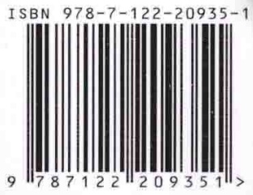

# 气液搅拌釜γ-CT测量、成像与模拟

# γ-CT MEASUREMENT IMAGE AND SIMULATION FOR GAS-LIQUID STIR TANKS

刘跃进 韩路长 编著

气液搅拌釜普遍应用于石油化工、精细化工、生物化工、制药、冶金、能源、环境等领域。釜中气体的分散状况直接决定着气液界面传质、传热与反应的效率。γ-CT测量具有非接触、对流场无扰，可测钢制容器里不透明、高浓度、高温、高压体系，能一次性360°扫描得到二维全流场气含率断面分布，测量结果精确等优点。本书主要介绍γ射线及其探测、γ-CT装置与测量线路均一化、γ- CT数字图像重建、γ-CT测量Rushton气液搅拌釜气含率断面分布、Rushton气液搅拌釜气穴结构及近桨区气含率分布、Rushton气液搅拌釜气含率断面分布的CFD模拟等内容。

本书内容涉及物理γ射线、射线与电子信号探测及加工处理、CT扫描、计算机数字成像、多相流CFD模拟等学科专业，既具有一定的学术理论深度，又具有较强的实践性，图文并茂，可读性强，本书可供化工多相流测量与模拟，工业或医学γ-CT、信号处理与数字成像等相关学科的科研、教学或相关技术人员参阅，也可为工业气液搅拌釜的设计与操作提供参考依据。

## 图书在版编目(CIP)数据

气液搅拌釜γ-CT测量、成像与模拟/刘跃进，韩路长编著.一北京:化学工业出版社，2014.9

ISBN 978-7-122-20935-1

I.①气…Ⅱ.①刘…②韩…Ⅲ.①γ射线-射线检验 ⅣV.①0571.32

中国版本图书馆CIP数据核字（2014）第127794号

责任编辑:杜进祥

责任校对:边涛

文字编辑:孙凤英

装帧设计:韩飞

出版发行:化学工业出版社（北京市东城区青年湖南街13号邮政编码100011）

印 刷:北京永鑫印刷有限责任公司

装 订:三河市胜利装订厂

710mm×1000mm 1/16 印张101/4 字数195千字2014年9月北京第1版第1次印刷

购书咨询:010-64518888（传真:010-64519686） 售后服务:010-64518899

网址:http://www.cip.com.cn

凡购买本书，如有缺损质量问题，本社销售中心负责调换。

定价:48.00元

版权所有违者必究

气液搅拌釜普遍应用于石油化工、精细化工、生物化工、制药、冶金、能源、环境等领域。釜中气体的分散状况直接决定着气液界面传质、传热与反应的效率，其中气含率的大小及分布是描述气液分散程度的基本特性参数。气液搅拌釜中由于搅拌桨的破碎与旋转液体的剪切、流体的湍动和液体循环等的综合作用，使得气泡的产生、分散、破裂和聚并等具有很强的随机性。因此，如何对气液搅拌釜中气含率大小及分布进行测量和研究，一直是复杂的化工多相流问题之一。 γ-CT 测量具有非接触、对流场无扰，可测钢制容器里不透明、高浓度、高温、高压体系，能一次性 $360^{\circ}$ 扫描得到二维全流场气含率断面分布，测量结果精确等优点。这些特点是其他多相流测量技术难以比拟的。

本书是依据笔者在美国圣路易斯华盛顿大学所做137Csγ射线CT测量Rushton气液搅拌釜气含率断面分布的实验测量工作和回国后在国家自然科学基金等项目资助下继续开展的相关研究工作而完成，其相关代表性研究成果已在国内外化工核心学术期刊《AIChEJ》、《ChemEngSci》、《Chem EngJ》、《ChinJChemEng》、《化工学报》、《高校化学工程学报》等发表，书中也有一些CT扫描数据及其研究成果还没有公开发表过。书中大部分数据图表为笔者所做实验数据或其模拟结果，有少部分已标注的数据图表引自于参考文献。

全书共分7章，第1章1.6节和第7章由韩路长撰写，其余由刘跃进撰写并统稿。本书内容涉及物理γ射线、射线与电子信号探测及加工处理、CT扫描、计算机数字成像、多相流CFD模拟等学科专业，既具有一定的学术理论深度，又具有较强的实用实践性，图文并茂，可读性强，可供我国多相流测量与模拟，工业或医学γ-CT、信号处理与数字成像等相关学科的科研、教学或相关技术人员参阅，也可为工业气液搅拌釜的设计与操作提供参考依据。

感谢国家留学基金、国家自然科学基金（20776121，21106122，21376198）、教育部博士点基金(20050530001)、湖南省自然科学基金(05JJ30026)、湖南省教育厅青年项目(11B123)、美国圣路易斯华盛顿大学多相流反应工程实验室M. P. Dudukovic和 Al-DahhanMuthanna 教授的资助和指导!感谢博士研究生DebangshuGuha、Shaibal Roy、李昌峰、罗虎平、薛俊利、RajneeshVarma的帮助！感谢我们课题组研究生韩路长、白鸽、曹杨、孔丽娜、李伟所做出的研究工作！感谢导师罗和安教授的全面精心指导!本书还引用和参考了大量文献，正是在广泛吸收这些参考文献研究成果的基础上，才得以完成本书。在此，特向这些作者表示衷心的感谢！感谢国家科学技术学术著作出版基金对本书出版的资助！感谢化学工业出版社和其他同行专家的大力推荐与热情支持，感谢所有关心和支持本书出版的同仁们！

本书由于学科专业交叉跨度大、学科专业性强、参考文献量大、数据图表多，有些研究可能也还并不怎么成熟，因此，书中不妥之处也在所难免，敬请读者谅解与批评指正!如本书能为我国多相流γ-CT测量与应用起到一点信息参考或者推动作用的话，我们将感到莫大欣慰!这就是笔者的初衷，仅此而已。

刘跃进

2014年5月于湘潭大学

## 第1章 绪论

- 1.1 研究背景、意义与目的 …… 1
- 1.2 侵入式探头点测量技术 …… 1
- 1.2.1 电导探头 …… 2
- 1.2.2 光纤探头 …… 2
- 1.2.3 超声探头 …… 3
- 1.2.4 传热探头 …… 4
- 1.2.5 光电毛细管探头 …… 5
- 1.3 非侵入或非接触式 CT 测量技术 …… 5
- 1.3.1 电阻 CT …… 6
- 1.3.2 电容 CT …… 7
- 1.3.3 射线 CT …… 7
- 1.4 其他测量方法 …… 8
- 1.4.1 激光多普勒测量 …… 8
- 1.4.2 基于差压波动测量 …… 9
- 1.4.3 基于图像识别测量 …… 9
- 1.5 γ-CT 测量气含率及其分布研究进展 …… 10
- 1.6 Rushton 气液搅拌釜气含率断面分布模拟计算进展 …… 11
- 符号说明 …… 14
- 参考文献 …… 15
- γ射线及其探测
- 21
- 2.1 γ射线概述 …… 21
- 2.2 γ射线的性质 …… 22
- 2.2.1 γ射线基本性质 …… 22
- 2.2.2 γ射线与物质的相互作用 …… 23

- 2.2.3 γ射线衰减规律 …… 25
- 2.3 γ源的选择……… 26
- 2.3.1 选择原则 …… 26
- 2.3.2 原因分析 …… 26
- 2.4 辐射安全……… 28
- 2.4.1 γ射线对人体的危害 …… 28
- 2.4.2 人体接受辐射的途径 …… 28
- 2.4.3 辐射防护 …… 29
- 2.5 探测器的种类与选择 …… 29
- 2.6 NaI(TI)闪烁探测器的单元结构及原理 …… 32
- 2.6.1 闪烁体 …… 33
- 2.6.2 光电倍增管 …… 34
- 2.6.3 前置放大器 …… 34
- 2.6.4 线性脉冲放大器 …… 34
- 2.6.5 单(多)道脉冲分析器 …… 35
- 2.7 NaI(TI)闪烁探测器的性能指标 …… 35
- 2.7.1 能量分辨率 …… 35
- 2.7.2 能量的线性 …… 35
- 2.7.3 探测效率 …… 36
- 2.8 NaI(TI)闪烁探测器探测电子流仿真模型 …… 37
- 2.9 $^{137}\mathrm{Cs}\gamma$ 射线能谱图 …… 38
- 2.10 NaI(TI)闪烁探测器的应用进展 …… 38
- 2.11 NaI(TI)闪烁探测器探测$^{137}\mathrm{Cs}\gamma$射线 …… 39
- 2.11.1 探测过程 …… 39
- 2.11.2 探测数据 …… 39
- 2.11.3 数据处理与分析讨论 …… 45
- 2.11.4 结论 …… 52
- 符号说明 …… 52
- 参考文献 …… 52
- γ-CT装置与测量线路均一化 55

- 3.1.3 γ射线信号处理 …… 56
- 3.1.4 γ-CT装置 …… 58
- 3.2 多探测线路均一化 …… 58
- 3.2.1 实验步骤 …… 58
- 3.2.2 调整过程 …… 59
- 3.2.3 分析与讨论 …… 63
- 3.2.4 甄别器能量阈值设置 …… 65
- 3.2.5 多探测线路均一化与光子数响应模型 …… 65
- 符号说明 …… 69
- 参考文献 …… 70
- 第4章 γ-CT数字图像重建 71
- 4.1 CT图像重建的数学基础 …… 71
- 4.1.1 坐标系转换 …… 71
- 4.1.2 Radon变换及逆变换 …… 71
- 4.1.3 傅里叶切片定理 …… 72
- 4.2 CT重建算法概述 …… 73
- 4.3 反投影算法 …… 74
- 4.3.1 滤波反投影算法 …… 74
- 4.3.2 傅里叶变换重建算法 …… 75
- 4.4 代数迭代算法 …… 76
- 4.4.1 代数重建算法 …… 76
- 4.4.2 联合代数重建算法 …… 78
- 4.4.3 乘型代数重建算法 …… 78
- 4.4.4 迭代重建算法 …… 78
- 4.5 EM算法 …… 79
- 4.5.1 泊松分布与二项分布 …… 79
- 4.5.2 EM算法原理与公式推导 …… 81
- 4.6 EM算法CT成像实现与检验 …… 85
- 4.7 搅拌釜气含率断面分布的CT扫描 …… 86
- 4.7.1 气含率断面分布的计算公式 …… 86
- 4.7.2 气含率断面分布的CT扫描图像 …… 86
- 4.7.3 气含率断面分布的径向周均气含率曲线 …… 86
- 4.7.4 CT测量重复性验证 …… 87

- 4.7.5 结论 …… 87
- 符号说明 …… 88
- 参考文献 …… 89
- 第5章 γ-CT测量Rushton气液搅拌釜气含率断面分布 90
- 5.1 Rushton气液搅拌釜 …… 90
- 5.1.1 搅拌釜结构尺寸 …… 90
- 5.1.2 圆环气体分布器 …… 91
- 5.1.3 搅拌桨 …… 91
- 5.2 三种气液分散状态与临界搅拌速度 …… 91
- 5.2.1 三种气液分散状态与流动区域 …… 91
- 5.2.2 临界搅拌速度的确定 …… 93
- 5.3 CT扫描实验设计 …… 94
- 5.3.1 气含率分布的影响因素 …… 94
- 5.3.2 扫描位置 …… 94
- 5.3.3 实验条件 …… 94
- 5.4 CT扫描测量3/4静液高处断面径向气含率分布 …… 95
- 5.4.1 不同临界状态 …… 95
- 5.4.2 不同通气量下搅拌转速的影响 …… 97
- 5.4.3 同一搅拌转速下不同通气量的影响 …… 99
- 5.4.4 气体分布器开孔状况的影响 …… 103
- 5.4.5 搅拌桨安装高度的影响 …… 103
- 5.4.6 搅拌桨型的影响 …… 105
- 5.5 CT扫描不同静液高处径向气含率分布 …… 105
- 5.5.1 搅拌桨上方空间 …… 105
- 5.5.2 搅拌桨下方空间 …… 108
- 5.6 结论 …… 110
- 参考文献 …… 111
- 第6章 Rushton气液搅拌釜气穴结构及近桨区气含率分布 112
- 6.1 气穴结构与流态区域 …… 112
- 6.1.1 气穴形成 …… 112
- 6.1.2 气穴结构 …… 112

- 6.1.3 流态区域 …… 113
- 6.1.4 CT 扫描 …… 114
- 6.2 近浆区气含率分布 …… 115
- 6.2.1 气含率的轴向分布 …… 115
- 6.2.2 气含率的径向分布 …… 116
- 6.3 小结 …… 117
- 参考文献 …… 118
- Rushton 气液搅拌釜气含率断面分布的 CFD 模拟 120
- 7.1 引言 …… 120
- 7.2 双流体模型 …… 121
- 7.3 相间作用力 …… 121
- 7.3.1 曳力 …… 121
- 7.3.2 附加质量力 …… 122
- 7.3.3 液相湍动 …… 122
- 7.4 群体平衡模型 …… 123
- 7.4.1 模型描述 …… 123
- 7.4.2 气泡破裂模型 …… 124
- 7.4.3 气泡聚并模型 …… 129
- 7.5 模拟计算 …… 136
- 7.5.1 Fluent 软件平台 …… 136
- 7.5.2 模拟计算过程和步骤 …… 137
- 7.6 模拟结果与讨论 …… 139
- 7.6.1 通气量 9.44L/min …… 139
- 7.6.2 通气量 18.88L/min …… 143
- 7.6.3 通气量 28.32L/min …… 145
- 7.6.4 结论 …… 147
- 符号说明 …… 148
- 参考文献 …… 150

## 第1章

## 绪论

## 1.1 研究背景、意义与目的

气液搅拌釜普遍应用于石油化工、精细化工、生物化工、冶金、能源、环境等领域，釜中气体的分散状况直接决定着气液界面传质、传热和反应的效率。半个多世纪以来，人们一直把Rushton气液搅拌釜作为经典的气液搅拌釜加以研究[1\~12]，其测量参数有气含率大小及分布、气泡停留时间、表面气速、液体剪切力、脉动速度、循环流型、气液两相流差压波动、表面张力、相对流速、混合密度、器壁剪切力、搅拌速度、传质与传热系数等。其中，气含率大小及分布是描述气液分散程度的一个最基本的特性参数。但由于气液搅拌釜中气泡的产生、分散、破裂、聚并等随机性运动与气泡的可压缩性和易变形性，以及搅拌釜几何形状的不规则性和温度、压力等因素的影响，使得对气含率大小及分布的测量和研究成为复杂的多相流问题之一。因此，对气液搅拌釜中气含率大小及分布的测量和研究具有很大的挑战性。纵观包括对气液两相的多相流研究进展，不难发现，其研究水平随着测量技术水平的提高而不断提高[5\~10]。虽然现在有一些CFD商业模拟软件如Fluent[10,11]、CFX[12]等，但对气液搅拌釜中气含率大小及分布的研究仍然还得依赖于实验的测量结果。通过实验测量，我们不仅可以发现过程的特性和规律，同时还可以为验证理论模型提供数据支持。因此，对气液搅拌釜中气含率大小及分布的实验测量研究，无论是对气液搅拌器中气含率大小及分布的实验测量技术，还是对气液两相流中气泡分散状态及其结构的科学描述都具有重要意义。

本章论述气液搅拌釜气含率大小和分布相关测量技术及其数值模拟进展情况，重点阐述γ-CT测量的研究进展和应用情况。

## 1.2 侵入式探头点测量技术

早期发展的对气含率大小及分布的测量技术主要是探头技术，依据不同的测量原理，有电导、光纤、超声、传热、光电毛细管探头等。探头技术各有其特点，但它们的共同缺点是侵入干扰式点测量，需要把测量所得梯形信号波转变成矩形信号波来标定处理。如果要测量气含率分布，则只有移动探头或者多探头同时测量，但移动探头测量流动状况不一而且操作费时麻烦，多探头同时测量对流动状况干扰又相当大，所以，探头测量一般是用于局部气含率测量，或只能对气含率分布做近似粗浅测量。

## 1.2.1电导探头

电导探头可分为单针、双针和多针系统。单针系统用来测量气泡频率，双针系统用于测量气泡速度、局部时均相界面和局部气含率，多针系统可测量气泡形状。双针电导探头测量气含率的原理如图1.1所示。当上升气泡被探针穿过时，由于气液两相电导率的差异，电路中会产生两个具有时间间隔的脉冲信号。每个脉冲代表1个气泡经过探针尖部，通过采集的脉冲信号可计算局部气含率。

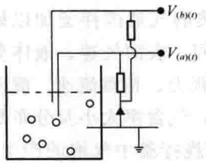

(a) 测量电路

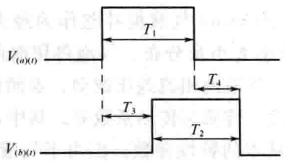

(b) 理想输出波形

(c) 测量波形

图1.1双针电导探头测量气含率的原理[13,14]

设某点的采样时间为t，探测第i个气泡的时间间隔为 $\Delta t_{i}$ ，则该点时均气含率为:

$$
\varepsilon_ {\mathrm{g}} = \sum \Delta t _ {i} / t\tag{1.1}
$$

吕术森[14]修正了T.Miyauchi[15]提出的电导探头测量鼓泡塔中气含率随半径变化的经验式为:

$$
\varepsilon_ {\mathrm{g}} = [ 1. 3 1 2 + 0. 1 8 5 6 (\frac {h}{H}) ] \left\{\varepsilon_ {0} \left[ 1 - \frac {4}{5} (\frac {r}{R}) ^ {2} \right] \right\}\tag{1.2}
$$

其中 $\varepsilon_0 = 0.0156V_{\mathrm{g}}^{0.855}$

电导探头测量的优势在于气液的电导率差异大，测量敏感，响应快，可直接给出电信号，目前在国内应用较多[16\~19]，但测量气液搅拌釜气含率的报道较少。

## 1.2.2 光纤探头

光纤探头[20,21]是利用气液两相介质不同的光学折射率来探测在某点气液两相的交替存在，利用其交替存在的相对时间比求该点的气含率，或用采样时间t内气泡包围探头的时间与t的比值来求得局部含气率[22]，如图1.2所示。由于气液两相界面张力的影响，探头完全刺破气液界面需要一定时间，此时间即为波形信号的上升段，信号的下降段表示探头从气到液的探测过程。气液两相界面张力越大，时间延迟就越大。因此，同电导探头一样，光纤探头的输出信号通常是近似于梯形波，需要将梯形波转换为矩形波来确定气泡经过探头的时间。S.G.Bankoff[23,24]曾在管道变密度模型中提出了气液分散充分发展段的截面气含率的指数规律分布假设，即

$$
\frac {\alpha (r)}{\alpha_ {c}} = \left(1 - \frac {r}{R}\right) ^ {\frac {1}{n}}, \quad n = \frac {2}{\sqrt {1 + 8 \frac {\alpha_ {c}}{\langle \alpha \rangle}} - 3}\tag{1.3}
$$

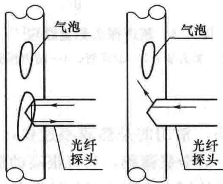

图1.2 光纤探头测量原理[23]

光纤探头引起误差的主要原因有探头表面状况对刺穿气泡能力的影响、探头在两相流中的放置方向和气泡形状的影响等。光纤探头测量技术应用于垂直上升管、液压泵中两相流局部气含率的测量报道较 多[20\~25] ，但测量气液搅拌釜中气含率的报道较少。

## 1.2.3 超声探头

超声探头根据超声波在气液两相中的透射或反射特性来实现气含率分布的测量[26]，又分为超声透射和超声反射两种测量方式。

超声透射测量是根据透射声波特性测量局部气含率和局部平均相界面等参数，需要声波发射和接收探头，发射和接收探头被气液两相系统隔开。图1.3是采用双通道脉冲接收器的超声探头测量系统，探头沿径向移动，从而测得气含率径向分布。

超声反射测量术（又叫脉冲回波测量）根据来自气泡表面反射声波的幅值和频率来确定气泡的大小和速度。超声反射测量的探头本身既是发射器，又是接收器，通过分析反射波的幅值和频率来确定局部气泡尺寸和气速分布。

超声探头测量技术可用于石油管道无损检测[28]、液压泵和流化床中气液两相含率测量[27,29]，但用于测量气液搅拌釜中气含率的报道较少。

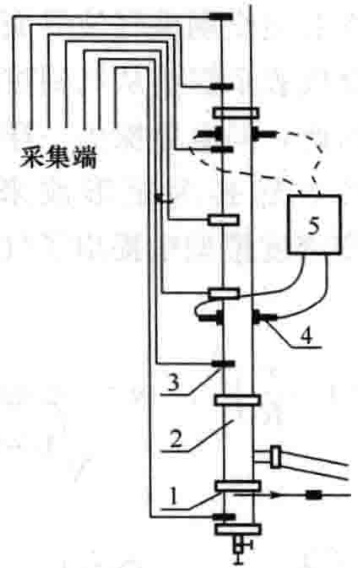

图1.3 超声探头测量原理[27]

1—气体分布器；2—提升管；3—取样管；4—超声探头；5—超声控制器

## 1.2.4 传热探头

传热探头又叫热膜探头，常用的是热膜测速仪，如图1.4所示[30]。热膜探头是镀在细长石英柱上的一层金属薄膜，具有很高的温度系数，利用反馈控制电路使热膜平衡稳定和电阻保持恒定来实现对气液两相流速度和气含率的测定。气泡通过探头时导热会明显下降，因而在输出信号中出现明显的信号峰。通过对输出信号进行分析和处理，可以得到局部气含率[31]、局部液速[32]和湍动量[33]。由于气液两相交替经过热膜表面时从探头上带走的热量不同，因此反馈电压值也不同，经A/D转换处理后，由气液流动引起的电压波动模拟信号变化可由电压与其出现的概率密度图清晰地反应气液两相流动情况，如图1.5所示。

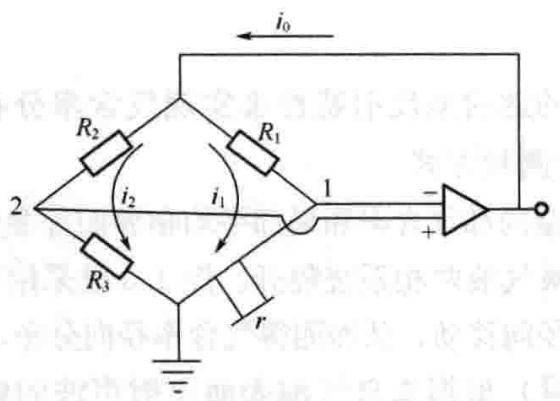

图1.4 热膜测速仪测量原理[30]

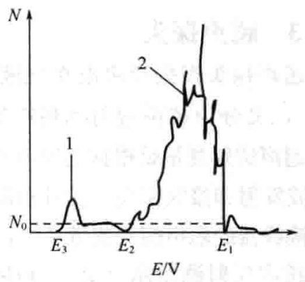

图 1.5 典型的电压概率密度[30]

$i_{1}$ ，i2—电流； $R_{1}\sim R_{3}$ 一电阻；r—热膜探头

1—气相；2—液相

对应塔板上局部气含率所采集的信号采用概率密度法按式（1.4）计算[34]，即气含率为气相与热膜探头接触概率的百分数:

$$
\alpha = t _ {\mathrm{g}} / \sum t = (\sum_ {E _ {1}} ^ {E _ {2}} N + \sum_ {E _ {2}} ^ {E _ {3}} N _ {0}) / N\tag{1.4}
$$

热膜测速仪测量准确性高，价格适中，但机械强度差，在被测量体系流速较大或气含率较高时容易损坏。许松林等[30]利用热膜风速仪对大型塔板上气液两相流在鼓泡状态下的局部气含率进行了测定。陈文义等[35]对由热膜测速仪测得的环流反应器中气液两相流时间序列信号进行子波分析，得到其子波系数，用能量最大准则对信号进行分析，根据子波系数的变化规律，并给定合适的子波系数阈值自动检测两相信号中的所有气相信号，从而得到气含率的变化规律，但在气液搅拌釜内的测量报道甚少。

## 1.2.5 光电毛细管探头

光电毛细管探头是通过测量一定时间内流过毛细管内某一截面处的气液流量来确定气含率。由于流过比截面的气量不一定等于喇叭口处外来流中的气量，当毛细管逆抽吸速率较低时，有部分外来流气体未能被抽进毛细管。随着抽吸速率的增大，毛细管内的气量逐渐增加。当抽吸速率达到某一临界值时，进入喇叭口吸引区的外来流气体均被抽进毛细管，毛细管内的气量将不再随抽吸速率的增加而变化。M.Greaves[36]认为此时喇叭口内外的气含率相等，但实际喇叭口内局部气含率 $\Phi_{c}$ 大于毛细管中取样微元内的气含率 $\Phi_{i}$ 。M. Greaves 利用光电毛细管法测得气液搅拌釜内局部气含率的计算式如下:

$$
\Phi_ {i} = \frac {1}{2} \left[ 1 - \sqrt {1 - \frac {1 6 \Phi_ {0 c} Q _ {1 c}}{(1 - \Phi_ {0 c}) S _ {0}}} \right]\tag{1.5}
$$

但M.Greaves在计算局部气含率过程中假定某一抽吸速率下毛细管喇叭口内外气含率相等，所以其结果偏大。毛细管喇叭口外气泡和周围液体间存在一定的相对速度、气泡与液体界面间张力、气泡的变形性等因素，这些都会导致喇叭口内外的局部气含率之间有不可忽略的偏差。张志斌[37]利用改进光电毛细管探头技术所测气液搅拌釜内局部气含率的计算式为:

$$
\Phi_ {i} = \frac {1}{2} \left[ 1 - \sqrt {1 - 1 6 \left(\frac {\pi}{4} d _ {\mathrm{k}} ^ {2} \nu_ {\mathrm{b}} ^ {*} / 1 . 1 9 - Q _ {1}\right) \frac {P ^ {*}}{P _ {0} S _ {0}}} \right]\tag{1.6}
$$

他们考虑了喇叭口外气液轴向运动的差异，给出了喇叭口内外气含率之间的定量关系，利用改进后的光电毛细管探头法测定了气液搅拌釜内气含率的空间分布。

## 1.3 非侵入或非接触式CT 测量技术

侵入式探头点测量技术建立在传感器硬件基础上，侵入式接触测量受被测体系温度、压力、浓度、透明度、流体湍度和容器壁等因素的影响和限制。为了克服这些缺点，20世纪80年代中后期发展起了CT测量技术[38]。其特征是用阵列传感器以非接触或非侵入扫描方式获取不同方向上反映穿越多相流体的某种信号变化，通过计算机对所获得的信号变化依据其变化规律进行以流体像素小区间为单位的数值计算和图像重建，获得流体结构图像和提取其特征信息，从而实现多相流参数的测量结果。目前，虽然从原理上有电学、声学、光学、射线四类CT测量，但用于气液两相气含率测量研究的国内文献报道只有电阻、电容和射线CT，且实际测量应用报道甚少。

## 1.3.1 电阻 CT

电阻CT简称ERT。根据气液两相具有不同的电导率，测量出电导率分布便可知气液两相分布。采用的工作方式是电流激励与电压测量，即通过电流激励产生敏感场，测量通过场内电压变化反映的电导率的分布变化，再通过成像算法，可重建出场内的电导率分布或反映电导率分布情况的灰度分布。电阻CT测量原理如图1.6所示。在圆形场域边界上均匀安装若干电极。在其中某一对相邻或相对电极上施加某种频率的恒定电流激励，就可以在其他电极对上测量出电位差。轮流测量所有这些电压，就构成了被测场域内电导率分布的一个投影。随着激励电极对的位置按一定方式（如逆时针）变化，就可以获得不同观测角度下被测场域内电导率分布函数的投影。当场域内的电导率发生变化时，如图1.6中场内某区域电导率变化时，电流场分布会随之变化，导致场内电势分布的变化，从而场域边界上的测量电压也要发生变化。测量这些电压的变化情况就反映了电导率的变化信息。只要从场域边界获得足够多的投影值，通过一定的成像算法，即可重建出场内近似的电导率分布情况。已有一些关于电阻CT测量技术的研究报道，国内天津大学董峰等曾获国家863项目资助[40\~43]，但应用报道甚少。

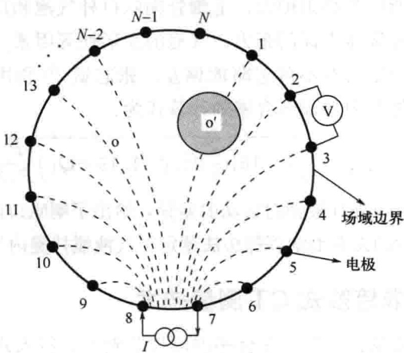

图 1.6 电阻CT测量原理[39]

## 1.3.2 电容 CT

电容CT简称ECT，是根据不同媒介具有不同的介电常数，测量出多相流介电常数变化引起的极板间的电容值变化，而电容值的大小及分布状况则反映了多相流介质相浓度的大小和分布状况。典型的电容过程层析成像系统由传感器系统、数据采集系统及成像计算机三部分组成，如图1.7所示。电容传感器空间阵列将被测管道中介质的相分布转化为电极间的电容，数据采集系统首先通过电容/电压转换电路将电容转换为直流电压信号，此信号经A/D转换变为数字量，经计算机处理后转为一定的投影数据，由图像重建单元重建出图像并显示出来。电容电极沿绝缘层外壁周向均匀分布，为了防止外界电磁干扰，通常设置屏蔽层。目前常用的电极数目一般为6～16个。增加电极数目，可获得更多扫描数据，从而提高重建图像质量，但同时会带来信噪比降低和边缘效应增大的问题。目前ECT已成为国内流动层析成像技术发展的主流之一，浙江大学黄志尧等曾得到国家自然科学基金重大项目资助[45\~47]，但还是偏研究多，而实际应用少。

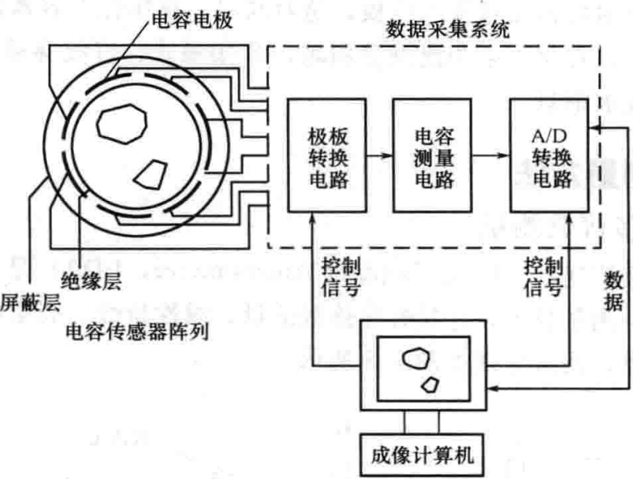

图 1.7 电容CT 测量原理[44]

## 1.3.3 射线 CT

射线CT是通过射线穿过流场强度的变化来再现气含率的断面分布，如X-CT和γ-CT。X-CT早已在医学上得到普遍应用，但X射线辐射源发生系统复杂，且穿透力不如γ射线，所以难以适应工业设备的测量。γ射线穿透能力强，可用来测量高温高压钢制容器。另外，X射线产生多能光谱，易产生伪影，而γ射线为单能射线，产生伪影的概率相对较少。γ-CT是基于气液两相密度差和射线衰减Lambert-Bill定律，原理如下:

$$
I / I _ {0} = \mathrm{e} ^ {- \rho \mu l} = \mathrm{e} ^ {- \Phi l}\tag{1.7}
$$

若穿过两种不同介质，其质量衰减系数为 $\Phi_{1}$ $\Phi_{2}$ ，距离为 $l_{1}$ $l_{2}$ ，则为:

$$
I / I _ {0} = \mathrm{e} ^ {- (\Phi_ {1} l _ {1} + \Phi_ {2} l _ {2})}\tag{1.8}
$$

设 $l_{1} = \varepsilon_{1}L, l_{2} = (1 - \varepsilon_{1})$ L，且 $L = l_{1} + l_{2}$ ，可得:

$$
\varepsilon_ {1, \mathrm{p}} = \frac {\Phi_ {2 , \mathrm{p}} - \Phi_ {1 2 , \mathrm{p}}}{\Phi_ {2 , \mathrm{p}} - \Phi_ {1 , \mathrm{p}}}\tag{1.9}
$$

式中， ε 1 为相含率；L为像素尺寸；p为像素。像素尺寸要根据CT装置探测器排列紧密度及准直孔尺寸而定，目前一般为 $1\sim 2\mathrm{mm}^{[48\sim 50]}$

γ-CT测量具有非接触，对流场无扰，可测钢制容器里不透明、高浓、高温、高压体系，能一次性得到二维全流场气含率断面分布，测量结果精确等优点。

综上，电容CT或电阻CT是基于电信号的变化，电信号发生和接受方式简单，易做到 $360^{\circ}$ 信号发生和接受同步进行。但由于电容或电阻信号穿越流场时难于确定其沿程轨迹和电极之间的相互干扰影响难于消除，因此就难于准确测定沿程电容或电阻变化与流体气泡浓度之间的关系，这极大地限制了测量的准确性。另外，还需要通过容器器壁置入电极，这对高温、高压化工容器设备来说是一个很大限制。所以，在化工多相流测量领域，非接触式、直线穿越流场的 γ-CT 测量技术很具有发展前景。

## 1.4 其他测量方法

## 1.4.1 激光多普勒测量

激光多普勒测速仪(Laser Doppler Anemometer，LDA)是 20世纪 60年代发展起来的一种测量技术，它具有非接触测量、线性特性、高空间分辨率和快速动态响应等特点，测量原理如图1.8所示。

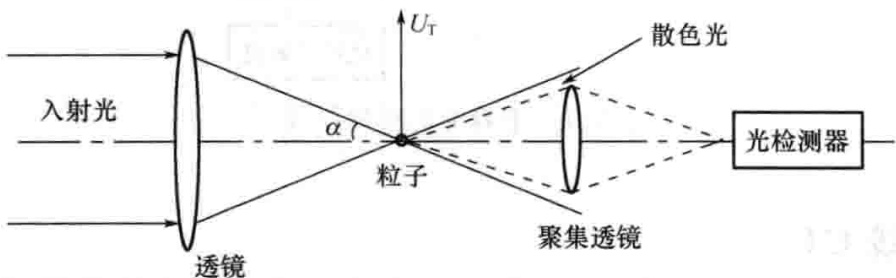

图1.8激光多普勒测速仪测量原理[51]

当激光射到气液两相中的气泡时，产生的散射光频率和入射光频率间的多普勒偏移与流速成正比， N. Zuber $^{[52]}$ 根据漂移通量模型计算气含率的公式为:

$$
\alpha_ {\mathrm{g}} = \frac {U _ {\mathrm{g}}}{C (U _ {\mathrm{g}} + U _ {\mathrm{s}}) + U _ {\mathrm{b,} \infty}}\tag{1.10}
$$

A. Kulkarni等[53,54]、王国峰等[55]借助小波分析对激光多普勒测速仪测量的鼓泡塔内速度时序信号进行系统分析，应用LIM(Local IntermittencyMeasurement，LIM)方法辨识信号中与鼓泡流化床反应器内气泡特征相关的奇异点，以LIM值的均方根RMS为基，选择门限阈值，得到局部气含率的径向分布。有利用LDA测量对搅拌釜内三维液相速度[56]和二维时均速度场和湍流强度场的报道[57]。但LDA只适用低浓度体系。

## 1.4.2 基于差压波动测量

流动参数强烈的波动性是两相流的普遍特性。申国强等[58]对气液两相流过孔板产生的瞬时差压进行分析，完成了总质量流量和干度的双参数测量。劳力云[59]借鉴申国强等的研究思想，就直管道差压波动信号与空隙率的关系做了相关研究，采用多项式拟合的方法得到差压波动信号与空隙率的关系式如下（限于空隙率小于50%的范围内）:

$$
c = 0. 5 1 2 5 \times 1 0 ^ {3} \varphi^ {3} - 2. 4 8 5 \times 1 0 ^ {3} \varphi^ {2} + 2. 5 7 8 \times 1 0 ^ {3} \varphi\tag{1.11}
$$

式中， $c = \frac{\delta P}{q_{\mathrm{ml}}^{2 - n}}$ $n = 0.84$ （根据流型而定）

王芳等[60]研究了基于环形管差压波动信号测量气液两相气含率，建立了由差压脉动振幅均方根和差压时均信号形成的无量纲数与容积含气率的关系模型，并对容积含气率小于0.65的情况进行了实验研究，测量误差小于5%。张宏建等[61]通过分析文丘里管差压波动信号与气含率、流量、压力以及流体密度等参数的关系，得出差压波动信号与其含量的量纲关系，并提出测量文丘里管前压力与文丘里管前后的差压波动信号，计算出该差压信号的时均值、瞬时值，就可以计算得到气含率值。但很少见到用于气液搅拌釜中气含率及分布的测量的研究报道。

压力信号测量经济方便，是实现流动监控和参数检测的重要依据，但气液两相流压差波动是一个复杂的物理过程，需运用多相流、统计学、混沌理论、小波分析、神经网络等理论和信号处理技术来分析和建立气液两相压差波动机理模型，研究难度较大。

## 1.4.3 基于图像识别测量

该方法是基于数字图像处理技术，采用高速摄像仪，对容器中气液两相流体流动过程进行实时拍摄和图像采集，利用边缘检测和图像填充技术提取并计算气泡尺寸，从而计算气含率。有实验结果表明测量相对误差在15%左右。图像检测技术在两相流测量领域主要有两方面的应用:一是利用高速摄影法直接拍摄流体的流动图像，然后利用图像处理技术提取图像中特征，根据图像特征检测两相流中相含率值[62]；二是利用过程层析成像技术，获得两相流二维/三维信息，利用图像重建算法获得两相流动态流动图像，以实现对两相流气含率及其分布的在线监测。

施丽莲等[63]利用差影算法来消除背景噪声，利用迭代法对图像进行最佳阈值分割，实现了数字图像处理技术对垂直管道中气液两相流中的气泡尺寸及截面气含率的在线测量。尽管很多国内外学者基于数字图像处理技术做了大量研究，但在自动快速检测两相流参数方面的研究还是很有限的。研究新的图像重建算法，并融合人工神经网络、模式识别等交叉学科的处理方法用到两相流测量领域有待进一步的研究。

## 1.5 γ-CT测量气含率及其分布研究进展

早在1964年Calgary大学已利用γ射线吸收法确定介质间的空隙率，即根据射线穿过不同介质的衰减值确定相应路径上的线均空隙率。1979年J.R.Fincke等[64]利用γ射线测量多相流中的分相含率。S. Banerjee、K.Ogawa、G. A. Johansen等[65\~67]设计单源单探测器构成的γ-CT测量气液两相流的气含率分布。该CT结构简单，成本低，图像清晰，但检测效率低。1994年美国圣路易斯华盛顿大学反应工程实验室S.B.Kumar等[48,68,69]以137Cs为放射源，采用多个探测器旋转采样的γ-CT分别对气液鼓泡塔、搅拌釜、气固流化床、提升管和液固提升管中相含率分布进行成像测量，扩大了γ-CT在气固、液固两相流领域的应用。为了进一步提高相含率的测量精度，1994～1996年G.A.Johansen等[70]建立了双能射线测量相含率的方法，并用第三种射线单独测量矿化度用以修正 γ射线的透射计数。印度孟买大学的 U.P.Veera和J. B. Joshi[71]优化设计了137Cs γ-CT，改进了S. B. Kumar等只能对实验室小型鼓泡塔进行时均测量的不足，将CT旋转方式设计为扇状射束和笔状射束结合扫描，以获得在最小康普顿散射效应下的最大计数率，并实现对工业规模反应器内整个非均相区域的扫描测量。D.L. George等[72]结合γ-CT和电阻CT 对气液固三相流相含率进行测量。Schlumberger公司设计了将文丘里管和γ射线探测技术结合应用测量的复杂流体模型，实现了动态的连续测量[73]。2007年德国FZD研究中心U.Hampel等设计了高分辨率γ-CT测量方法，并用CFD-Eulerian两相流动模型验证实验结果，解决了搅拌叶轮刀刃附近流体的高负荷气体效应问题，成功展示了在化工反应器中的应用[50]。2008年 M. Sohubert、A. K. Patel 利用137Cs γ-CT分别对流体滴液反应器中液体的流动结构进行定量分析，设计有效的数学模型，优化更新了现有的工业反应器结构[74]。

国内γ-CT测量研究起步相对较晚，研究报道甚少。1996年浙江大学黄志尧等[75]所发表的综述论文《层析成像技术在多相流检测中的应用》提到了γ-CT测量技术。2004年中国石油大学靳海波等[76]在化工学报发表的《γ射线透射技术对气液鼓泡塔内气含率的轴向分布》研究论文，只是单一γ射线探测器的线测量，而非多γ射线探测器的CT扫描断面测量。2006年笔者在《高校化学工程学报》发表的 $\ll^{137}Cs\gamma-CT$ 测量标准Rushton搅拌釜气含率分布及数字图像重建》一文，算是国内鲜见的关于γ-CT测量与研究的论文[77]。后来我们课题组开展了这方面的系列研究工作，其相关研究成果在《AIChEJ》、《Chem Eng Sci》、《Chem Eng J》、《ChinJChem Eng》、《化工学报》等国内外权威化工核心期刊上发表[78\~88]。近年重庆大学张平发表了γ-CT教学仪器数据采集电路研究的论文[89]。天津大学王化祥等在国家自然科学基金重点项目、国家自然科学基金重大国际合作项目等资助下开展了这方面的工作，主要是在仪器设计与仿真方面的研究，而实用测量数据报道相对较少[90\~93]。

目前，国内γ射线CT测量研究报道仍然很少，究其原因分析如下:①稳定、均匀、适合高精度CT测量的γ射线源难于制作；②高精度探测器和CT装置成本较高；③辐射允许和安全问题。但是，γ-CT技术具有非接触、对流场无干扰，可测量钢制容器里不透明、高浓度、高温、高压体系，能一次性得到二维全流场气含率断面分布，测量结果精确等优点。对于多相流气含率测量来说，这些优点是其他多相流测量技术难以比拟的。尤其是对化工多相流领域钢制容器、不透明、高浓度、高温、高压体系等，研发γ-CT测量技术及其应用具有非常重要的意义。

## 1.6 Rushton气液搅拌釜气含率断面分布模拟计算进展

气液搅拌釜气含率大小及分布除利用实验测量外，计算流体力学(CFD，Com putational Fluid Dynamics)模拟也是一个非常重要的手段[6]。在现有有限的实验测量技术手段和高额测量成本限制的情况下，模拟计算越来越得到了人们的青睐，一些专门的商业模拟计算软件也在不断涌现，如Fluent[10,11]、CFX[12]等。CFD模拟计算是基于流场中质量、动量和能量守恒规律建立反映气液两相流动的基本流体力学方程组的数值计算，与经验模型相比有更坚实的理论基础，预测能力强，适用范围广，可对流场进行数值模拟研究，有利于深入了解流场结构与流体运动规律。

搅拌釜中由于旋转搅拌桨对从圆环气体分布器上升的气泡的破裂和分散、液体强湍流和强剪切，导致气泡的破裂和聚并现象频繁发生，而气泡的破裂与聚并具有很强的随机性，这比鼓泡塔中上升气泡靠自然升力分散与聚并情况更复杂。因此，如何对搅拌釜中气含率分布这一随机性现象进行正确的物理描述并找到合适的模拟手段，是一个很具挑战性的研究课题。

目前，气液两相流的模拟方法大致有两类:Euler-Euler法[94\~98]和Euler-Lagrange法[94\~101]。Euler-Euler法认为气相与液相互渗透，将气、液相分别处理为拟连续介质，采用与连续流体类似的质量、动量和能量守恒方程来描述两相流动，此类模型也称双流体模型。这种方法可以大大简化物理模型，所花费的计算代价也较小。用这种方法模拟搅拌釜气含率分布的文献报道较多。

W.M.Lu和S.J.Ju[102]使用HWA测量了气含率、过滤蒸馏水的平均速度、脉动速度。他们所使用的搅拌釜直径为28.8cm，圆盘涡轮和圆环喷嘴带小孔(直径8cm)。他们测量了搅拌桨排流区两挡板中间的垂直平面，并且报道了不同搅拌转速下和通气量下的气含率、平均液相速度和湍动强度在不同径向和轴向位置的变化。他们采用的搅拌转速为400～720r/min。K.E.Morud和Hjertager[103]使用LDA测量了平均和湍动气速。他们使用的搅拌釜直径为0.222m，为中凹圆底Rushton涡轮，叶片为正方形，尺寸为搅拌浆直径的1/4，离底距为0.47倍釜高度。空气通过一个进气管和一个位于搅拌桨下方的多孔喷嘴进入搅拌釜。搅拌釜在360r/min、400r/min、560r/min、720r/min和通气量Q为0.49vvm、0.75vvm、1vvm、1.33vvm（vvm:气体体积/液体体积），他们使用相位多普勒测定仪（PhaseDopplerAnemometry）测量的气含率在 0.01～ 0.08。他们报道了在不同高度、转速和气速下的气相径向速度的变化，发现气相的湍动近似为各向同性。K.E. Morud 和 B. H. Hjertager[103]用标准 k-ε湍流模型、两流体模型对搅拌釜气液两相进行了二维模拟。

N. G. Deen 和B. H. Hjertager[104]使用DPIV 研究了与 K. E. Morud和B.H. Hjertager同样系统的液相特性。他们给出了从低到中等气含率(0.01\~0.07)搅拌釜中相对比较完整的气液系统描述。N.G.Deen和 B. H. Hjertager 在搅拌转速360r/min和气流量0.5vvm下进行了测量。他们对照了有气体和无气体情况下径向速度和轴向速度的轴向分布，并同H.Wu和G.K.Patterson[105]在无气体下获得的数据进行了比较，发现无气体时的最大径向速度要低于 H. Wu 和 G. K. Patterson的液相速度值23%，而有气体时的最大径向速度要低于80%。K.E.Morud和B. H. Hjertager、N. G. Deen 和 B. H. Hjertager 两者都详细地研究了气相和液相速度，但是他们都把气含率限制在0.01\~0.07。仅仅W.M.Lu和S.J.Ju[102]同时测量了液相速度、湍动参数和气含率，但W.M.Lu和S.J.Ju仅报道了测量的合速度(没有速度分量)，所测的气含率也不够精确，误差高于20%。因此有必要深入测量气液两相的流体动力学的准确和可靠信息(特别是更高的气含率情形)。

A.R.Rammohan[106]使用CARPT技术测量了平均和湍动液速。他们使用平底搅拌釜（直径为0.2m)，标准Rushton涡轮配置，桨离底距为0.33倍釜高度。空气通过一个进气管以及一个位于搅拌桨下方的多孔喷嘴进入釜中。使用CT测量的气含率在0.01\~0.2。他们报道了在不同高度、气速下的气含率沿着径向位置的分布。K. A. Pericleous和 M.K. Patel[107]使用代数滑移模型模拟了搅拌釜气液两相流动。他们使用混合特性求解动量输运方程，用一个常数滑移速度来求解一个对流扩散方程来说明气泡的存在，并且用气泡浓度来修正混合物密度。A.D.Gosman等[108]使用黑箱法模拟了搅拌釜气液和液固流动。他们使用两流体模型、k-ε湍流模型，模拟的液固体系滑移速度大约为0.04m/s，与粒子沉降速度同数量级。但是气含率被明显低估，这是由于没有模拟聚并和再分散现象。V.V. Ranade和 H. E. A.Van denAkker[109]将快照法发展到三维多相流模拟中，他们使用了两流体模型，但是不像A.D.Gosman等[108]那样使用Favre平均，而是使用了雷诺平均方法。尽管Favre平均导致了更少的需要封闭的项，但实验技术可以提供给我们雷诺平均方面的信息。V.V. Ranade和H.E. A. Van den Akker将模拟结果与 Rousar 和 H. E. A. Van den Akker[110]实验结果进行了比较，结果表明在搅拌浆区预测的轴向速度要高于实验值(最大偏差35%～40%)，而在近壁区却低估了速度值。从文献报道来看，快照法在定性预测上很好，而且在不需输入实验数据(除了两流体模型需要输入气泡直径外）情况下定量也较为合理。文献报道的模型也捕捉到了叶片后气体聚集的现象，以及在搅拌桨区域压力的分布，叶片尖端附近气体和液体速度的角度变化情况等。如果适当改进空间分辨率、曳力表达式等，这一模型在验证两相流场方面将具有有较好的潜力。

K. A.Pericleous和M.K. Patel[107]采用两流体模型，通过添加“源”项与“汇”项来模拟搅拌桨和挡板。实验测量与模型模拟的整个气含率和相对功率随气速变化情况的对照较为合理，预测的靠近搅拌桨的平均气相速度与实验值吻合很好，但在其他区域，模型则高估了速度值。G.L.Lane和M.P.Schwarz[111]应用CFX软件模拟了搅拌釜气液两相流。搅拌转速为180r/min，通气量Q= 0.00164m³/s。采用3D计算域，用多重参考坐标法（MRF)描述搅拌桨和挡板的相对运动，用两流体模型计算流场。考虑了气泡的聚并、破裂。将模拟的结果同实验对比，获得了与实验结论相一致的气体分布、局部气泡大小变化趋势。但是没有从定量上得出相一致的数据。

Euler-Lagrange法是在Euler坐标系下考察液体运动、在Lagrange坐标系下考察气泡运动，此类模型也称为离散轨道模型。其特点是模型物理概念直观，可获得单个气泡的详细运动信息，但由于搅拌釜内气泡数量众多，导致计算量非常大，而且气泡尺寸大小不一，上升途中有变形、破裂、聚并现象，气泡受力表征非常困难，目前在搅拌釜中的应用较少。离散颗粒模型的优点是在描述颗粒传质、破裂分散与聚并以及颗粒与连续相的相互作用时较欧拉模型更方便、直观，这类模型适合于分相以颗粒（固体颗粒、液滴或气泡）形式存在的情形，比如流化床、搅拌釜、鼓泡床等反应器。

近年来，已有少数研究者开始尝试将离散颗粒模型应用于鼓泡床和搅拌釜的模拟，但他们所作的假设和处理方法彼此存在差异。A.Sokolichin等[112]在对鼓泡床进行二维模拟时不考虑升力、附加质量力，并假定气-液体系的有效黏性等于水的涡黏性，考虑了气泡尾迹的影响，并忽略分相对有效密度的贡献，同时也假定连续相有效速度等于水速，计算获得了与拟流体法定性上的一致性。V.V.Buwa等[113]使用离散随机游走和涡寿时间模型对鼓泡床进行了三维非稳态模拟，考虑了升力、附加质量力，视气泡为球形刚性粒子，采用单一尺度模拟了气泡羽的低频摆动。X.Gong等[114]研究了三维鼓泡床气泡羽中臭氧粒子的分解、传质过程，将液体和空气的混合物视为连续相，基于混合模型方法建立了动量方程，并忽略气泡质量、相作用项。G.Hu等[115]结合大涡模拟方法模拟了一个扁平鼓泡床气泡流，发现气泡尺寸虽然大于最小流体脉动尺度，但将气泡处理为点体积的方法仍可获得较好的预测结果。D.Arlov等[116]结合大涡模拟方法研究了低气含率下的搅拌釜，考察了气流量、搅拌转速和喷嘴型式对速度场预测的影响，但未给出平均气含率的定量结果比较。注意到，上述文献除V.V.Buwa等[113]外，均未明确给出气泡的湍流扩散模型。笔者[80,82]采用离散颗粒法模拟了搅拌釜气含率分布，考察气泡曳力系数的修正形式对气含率分布预测的影响，研究表明有必要对气泡曳力系数进行湍流修正。

综上，基于Euler-Euler法和Euler-Lagrange法发展出来的模型在应用于气液两相流模拟时都存有各自的不足。目前，要建立准确的机理模型解决搅拌釜中气含率分布的模拟计算还任重而道远。

## 符号说明

| t | 采样时间,s | $E_{2}$ | 电压值,V |
| --- | --- | --- | --- |
| $\Delta t_{i}$ | 探针在第i个气泡中的时间,s | $E_{3}$ | 电压值,V |
| $\varepsilon_{g}$ | 气含率 | N | 概率密度 |
| r | 距中心距离,mm | $N_{0}$ | 气液区分点的概率密度 |
| h | 测量点高度,mm | $\sum t$ | 液体的总接触时间,s |
| $V_{g}$ | 气体体积流率,$m^{3}/h$ | $t_{g}$ | 气相接触时间,s |
| H | 鼓泡塔的总高度,mm | $\alpha$ | 气含率 |
| $\alpha$ | 平均截面含气率 | d | 搅拌桨直径,mm |
| $\alpha_{c}$ | 局部含气率 | P | 流体压力,Pa |
| r | 探针距中心距离,mm | Q | 毛细管内气体或液体的流量,mL |
| R | 鼓泡塔半径,mm | $S_{0}$ | 毛细管喇叭口截面的面积,$mm^{2}$ |
| E | 电压值,V | $\nu$ | 搅拌槽内气液分散系体积,$mm^{3}$ |
| $E_{1}$ | 电压值,V | $\Phi$ | 搅拌槽内整体平均气含率 |

| $\Phi_i$ | 取样微元内的气含率 | 上标 |  |
| --- | --- | --- | --- |
| $\Phi_c$ | 毛细管喇叭口内的气含率 | * | 光电检测处 |
| $\varphi$ | 气含率 |  |  |
| $\delta_p$ | 差压脉动振幅的均方根 | 下标 |  |
| $\alpha(t)$ | 截面含气率 | i | 气泡个数 |
| V | 测量控制体的体积 | 0 | 喇叭口处 |
| $V_1(t)$ | 液相所占的体积 | c | 喇叭口内 |
| $\alpha_g$ | 气含率 | g | 气体 |
| $U_g$ | 表观气速,m/s | l | 液体 |
| $U_s$ | 混合物循环速度,m/s | s | 固体 |
| $U_b$ | 搅拌釜叶轮的转速,m/s | q | 均方根 |

## 参考文献

[1] Kramers H, Baars G M, Knoll W H. A Comparative study on the rate of mixing in stirred tanks [J]. Chem Eng Sci, 1953 (1): 35-42.

[2] Biggs R D. Mixing rates in stirred tanks [J]. AIChE J, 1963 (5): 636-640.

[3] Brennan D J, Lehrer I H. Impeller mixing in vessels experimental studies on the influence of some parameters and formulation of a general mixing time equation [J]. Chem Eng Res &. Des, 1976 (A3) : 139-152.

[4] Benayad S, David R, Cognet G. Measurement of coupled velocity and concentration fluctuations in the discharge flow of a Rushton turbine in a stirred tank [J]. Chem Eng & Proc, 1984, 19 (3) : 157-165.

[5] Lu W M, Ju S J. Local gas holdup, mean liquid velocity and turbulence in an aerated stirred tank using hot-film anemometry [J]. Chem Eng J, 1987, 35: 9.

[6]Morud K E, Hjertager B H. LDA measurement and CFD modelling of gas-liquid flow in a stirred vessel [J]. Chem Eng Sci, 1996, 51 (2): 233-249.

[7] Fall A, Lecoq Q, David R. Characterization of mixing in a stirred tank by planar laser induced fluorescence (PLIF) [J] . Chem Eng Res & Des, 2001, 79: 876 - 882.

[8]孙海燕，王卫京，毛在砂.各向异性k-ε湍流模型在Rushton桨搅拌槽三维流场整体数值模拟中的应用[J].化工学报，2002，53（11）:1153-1159.

[9] Hartmann H, Derksen J J. Macroinstability Uncovered in a Rushton Turbine Stirred Tank by Means of LES[J].AIChE J, 2004, 50 (10):2383-2393.

[10] Khopkar A R, Rammohan A R, et al. Gas-liquid flow generated by a Rushton turbine in stirred vessel: CARPT/CT measurements and CFD simulations [J]. Chem Eng Sci, 2005, 60 (8-9): 2215-2229.

[11] Han Luchang, Liu Yuejin, et al. Numerical Simulation of Gas Holdup Distribution in a Standard RushtonStirred Tank Using DiscreteParticle Method [J]. Chin J Chem Eng, 2007, 15(6):808-813.

[12] Hristo V H, Boden S, Hampel U. A study on the two-phase flow in a stirred tank reactor agitated by a gas-inducing turbine [J]. Chem Eng Res & Des,2008, 237 (4): 399-408.

[13]高正明，王英琛，施力田，等.应用电导探针法测定气泡参数[J].化学反应工程与工艺，1992，8 (1):105-110.

[14]吕术森，等，应用电导探针测定鼓泡塔内气泡参数[J].化学反应工程与工艺，2003，19（4）:344-350.

[15] Miyauchi T, Shyu C N. Fluid Flow in Bubble Columns [J] . Jap Chem Eng, 1970, 34: 958-96.

[16]李建辉，王亦飞，曾清华，等.桨态鼓泡床新型锐孔分布器气含率分布[J].化学反应工程与工艺，2008, 24 (2):108-114.

[17]林松，李良超，王嘉骏，等.鼓泡塔中气泡尺寸分布和局部气含率研究[J].化学工程，2008，36 (2): 21-24.

[18]王丽军，张煜，李希、湍动浆态床流体力学研究（1）:气含率及其分布规律[J]，化工学报，2008，59(12):2996-3001.

[19]罗枚，伍倩，王铁峰，等，电导探针法测量高固含体系循环液速和气含率[J]，过程工程学报，2008,8(5):833-838.

[20]刘明言，杨扬，薛娟萍.气液固三相流化床反应器测试技术[J].过程工程学报，2005，5（2):217-222.

[21]杨胜，罗毓珊，陈听宽，等，垂直上升管中采用光纤探针测量截面含气率的实验研究[J].动力工程，2006，26(6):875-878.

[22]俞强，孙建中，唐福瑞.光纤法检测三相相含率[J].化工学报，1991（4）:515-517.

[23]唐人虎，陈听宽，罗毓珊，等.高温高压下用光纤探针测量截面含气率的实验研究[J].化工学报，2001,52(6):560-563.

[24] Bankoff S G. Trans ASME Journal of Heart Transfer, 1960, 82: 265-272.

[25] Murzyn F, Mouaze D, et al. Optical fibre probe measurements of bubbly flow in hydraulic jumps [J]. International Journal of Multiphase Flow, 2005, 31 (1): 141-154.

[26] Macci A, et al. Use of Ultrasound for Phase Holdup Measurements in Multiphase System [J] . Can J Chem Eng, 2001, 79(4): 570-583.

[27] Liu Z L, Vatanakul M, Jia L F, et al. Hydrodynamies and MassTransfer in Gas-Liquid-Solid Circulating Fluidized Beds [J]. Chem Eng Technol, 2003, 26 (12): 1247-1253.

[28]陆唯一，张琦，阙沛文，石油管道检测中超声探头的选择及声场分析[J].传感器与微系统，2007，26(8):20-25.

[29] Kucukali S, Chanson H. Turbulence measurements in the bubbly flow region of hydraulic jumps [J]. Exp Therm Fluid Sci, 2008, 33 (1): 41-53.

[30]许松林，刘富善，许宏庆，等.应用热膜风速仪检测塔板上气液两相流的局部气含率[J].化工学报，1995，46(5):621-624.

[31] Farrar B, Samways A L, Ali J, et al. A computer based hotfilm technique for two-phase flow measurements [J]. Meas Sci Tech, 1995, 6: 1528-1537.

[32] UtigerM, Dtuber F, Duquenne A M, et al. Local measurements for the study of external loop airlift hydrodynamics [J]. Can J Chem Eng, 1999, 77: 375-382.

[33] Hogsett S, Ishii M. Local two-phase flow measurements using sensors techniques [J].Nuclear Eng Des, 1997, 175: 15-24.

[34] Delhaye J M. ASME Symp on Two-phase Flow Instrumentation [M] . Chicago: The Science Press Inc, 1969: 58-75.

[35]陈文义，姜楠，王振东.基于小波分析的气液两相流中气含率的测量[J].计量学报，2008，29 (1):51-53.

[36] Greaves M, Kobbacy K A H. Chem Eng Res & Des, 1984, 62: 3.

[37]张志斌，戴干策，陈敏恒.光电毛细管探头法的改进及搅拌槽内的气含率分布[J].化学反应工程与工艺，1988，4(3):102-107.

[38] Williams R A, Beck M S. Process tomography, principles, techniques and applications [M] . Great Britain: Butterworth-HeinemannLtd, Linacre House, Jordan Hill, Oxford, 1995, ISBN 07506 07440.

[39]邵嘉庆，徐苓安.电阻层析成像系统的研究[J].自动化与仪表，1999，14（12):1-4.

[40]马艺馨，徐苓安，等.电阻断层成像技术的研究[J].仪器仪表学报，2001，22（2):195-199.

[41]董峰，乔旭彤，姜之旭，等.应用电阻层系成像技术测量垂直管道气/液两相流分相含率[J].天津大学学报，2004，34（6）:510-514.

[42]刘铁军，王保良，黄志尧，等.两相流电阻断层成像测量电路与图像重建[J]，化工学报，2007，58(4):863-868.

[43]韩玉环.采用电阻层析成像技术测量三相外环流反应器中相含率的实验研究[J].过程工程学报，2009,9 (3):431-436.

[44]王兴，颜华.电容层析成像技术及发展现状[J].沈阳工业大学学报，2001，23（6）:497-500.

[45]黄志尧，王保良，李海青.用于两相流流型显示和空隙率测量的电容层析成像技术[J].化工学报，2001,52(1):1035-1037.

[46]王雷，冀海峰，黄志尧，等，基于ECT传感器和模式识别的气液两相流空隙率测量新方法研究[J].仪器仪表学报，2005，26（6）:557-561.

[47]王微微，王保良，黄志尧，等.利用电容层析成像技术快速测量油气两相流空隙率的研究[J].高校化学工程学报，2006，20(4):515-519.

[48] Kumar S B. Computed Tomographic Measurements of Void Fraction and Modeling of the Flow in Bubble Columns [D] . USA: Washington University in StLouis, 1994.

[49] Thatte A R, et al. Local gas holdup measurement in sparged and aerated tanks by gamma-ray attenuation technique [J]. Ind &Eng ChemRes, 2004, 43 (17) : 5389-5399.

[50] Hampel U, et al. Application of high-resolution gamma ray tomography to the measurement of gas hold-up distributions in a stirred chemical reactor [J]. Flow Measurement and Instrumentation, 2007, 18 (5-6):184-190.

[51]刘会娥，魏飞，金涌.气固循环流态化研究中常用的测试技术[J].化学反应工程与工艺，2011，17 (2):166-174.

[52] Zuber N, Findlay J A. Average volumetric concentration in two-phase flow systems [J] . Heat Trabsfer, 1965, 87:453-468.

[53]Kulkarni A, Joshi J, Kumar V, et al. Application of multiresolution analysis for simultaneous measurement of gas and liquid velocity and fractional gasholdup in bubble column using LDA [J]. ChemEng Sci, 2001,56:5037-5048.

[54]Kulkarni A, Joshi J, Kumar V, et al. Simultaneous measurement of hold-up profiles and interfacial area using LDA in bubble columns: predictions by multiresolution analysis and comparison with experiments [J]. Chem EngSci, 2001, 56: 6437-6445.

[55]王国峰，杨茹，刘辉，等.一种利用压强脉动信号测取鼓泡床中气含率的新方法[J].过程工程学报，2006，6(5):708-712.

[56]毛德明，冯连芳，王凯.搅拌釜中泵送能力系数的研究[J].合成橡胶工业，1997，20（3）:146-149.

[57]毛德明，冯连芳，许国军，等.用LDA研究搅拌釜内的流场[J].高校化学工程学报，1996，10

(3): 258-263.

[58]申国强，林宗虎.应用动态法进行气液两相流的双参数测量[J].计量学报，1993，14（2）:140-145.

[59]劳力云.基于动态差压信号分析的两相流参数辨识方法研究[D].杭州:浙江大学，1998.

[60]王芳，梁国伟，谢代梁，基于环形管差压波动信号测量气液两相流气相含率的研究[J].传感技术学报，2007，20（3）:628-631.

[61]张宏建，岳伟挺，马龙博，等.文丘里管中气液两相流差压波动信号与空隙率关系[J].化工学报，2005,56 (11):2102-2107.

[62]周云龙，尚秋华，范振儒，洪文鹏.气液两相流容积含气率的图像检测方法[J].热能动力工程，2008,23(5):507-511.

[63]施丽莲，周泽魁，任沙浦.垂直管道中气液两相里参数的图像检测方法[J].流体机械，2004，32 (9): 4-9.

[64] Fincke J R, Berggren M J, Johnson S A. The application of reconstructive tomography to the measurement of density distribution in two phase flow [C] . In Proc Int Instrumentation Symp Seattle, 1980, 26: 235-243.

[65] Hau F L, Banerjee S. Measurement of mass flux in twophase flow using combinations of pitot tubes and gamma densitometers [J]. AIChE J, 1981, 27(2): 177-184.

[66]Ogawa K, Takagi Y, et al. An attenuation correction method of single photon emission computed tomography using gamma ray transmission CT[J]. Kaku Igaku (Japan), 1985, 22 (4): 477-90.

[67] Johansen G A, Froytein T, Hjertaker B T, et al. A dual sensor flow imaging tomographic system. Meas Sci Technol, 1996, 7: 297-307.

[68] Kumar S B, Moslemian D, et al. A gamma-ray tomographic scanner for imaging voidage distribution in two phase flow systems [J] .Flow Measurement and Instrumentation, 1995, 6(1): 61-73.

[69] Kumar S B, Dudukovic M P, et al. Computer assisted gamma and X-ray tomography: Applications to multiphase flow systems, Non-Invasive Monitoring of Multiphase Flows. Amsterdam: Elsevier Science B. V, 1997: 47-103.

[70] Johansen G A, Froytein T, Hjertaker B T, et al. The development of a dual mode tomographic for three-component flow imaging [J]. The Chem Eng J, 1995 (56): 175-182.

[71] Veera U P, Joshi J B. Measurement of gas hold-up profiles by gamma ray tomography: Effect of sparger design and height of dispersion in bubble columns [J]. Chem Eng Res&. Des, 1999, 77(4) : 303-317.

[72] GeorgeDL, et al. Three-phase material distribution measurements in a vertical flow using gamma-densitometry tomography and electrical-impedance tomography [J]. International J of Multiphase Flow, 2001, 27 (11):1903-1930.

[73] Schubert M, Hessel G, et al. Liquid flow texture analysis in trickle bed reactors using high-resolution gamma ray tomography[J]. Chem Eng J, 2008, 140 (1-3): 332-340.

[74] Patel A K, Thorat B N. Gamma ray tomographyan experimental analysis of fractional gas hold-up in bubble columns [J]. Chem Eng J, 2008, 137 (2): 376-385.

[75]黄志尧，金宁德，李海青.层析成像技术在多相流检测中的应用[J].化学反应工程与工艺，1996，12(4): 395-405.

[76]靳海波，杨索和.γ射线透射技术测量气液鼓泡塔内气含率的轴向分布[J].化工学报，2004，55 (9):1523-1527.

[77]刘跃进，韩路长.137Cs γ射线CT 测量标准Rushton搅拌釜气含率分布及数字图像重建[J].高校化工学报，2006，28（4）:648-649.

[78]刘跃进，韩路长，罗和安.搅拌釜三维流场的雷诺应力模型数值模拟[J].化工学报，2006，57 (9):2053-2057.

[79]韩路长，刘跃进，李毅斌，李保华，罗和安.应用SSTk湍流模型计算Rushton搅拌釜流场[J]化学工程，2006，34（3）:28-32.

[80]韩路长，刘跃进，罗和安. Numerical simulation of gas holdup distribution in a standard Rushton stirred tank using discrete particle method[J]. Chin J Chem Eng, 2007, 15 (6): 808-813.

[81]刘跃进，李伟，白鸽，韩路长，曹阳.137Csγ射线CT多探测器均一化响应模型[J].仪器仪表学报，2010，31（4）:333-338.

[82]韩路长，曹杨，吴学文，白鸽，刘跃进.The Effect of Eddy-bubble Interaction Model on the Turbulent Dispersion of Gas Bubbles inStirred Tanks [J]. Chin J Chem Eng, 2010, 18(1) : 27-33.

[83] Liu Yuejin, Li Wei, Han Luchang, Cao Yang, Luo Hean, Muthanna Al-Dahhan, Dudukovic M P. γ-CT measurement and CFD simulation of cross section gas holdup distribution in a gas-liquid stirred standard Rushton tank [J]. Chem Eng Sci, 2011, 66 (17) : 3721-3731.

[84]李伟，刘跃进，孔丽娜，韩路长.Rushton搅拌釜中气液传质及其流动特性[J].化工学报，2011，62(10):2691-2698.

[85]刘跃进，孔丽娜，白鸽，韩路长，曹杨，罗和安.Rushton搅拌釜气含率分布CT彩色数字成像模型研究[J].哈尔滨工程大学学报，2011，10:1374-1380.

[86] Han Luchang, LuoHean, Liu Yuejin. Amulti-scale theoretical model for gas - liquid interface mass transfer based on the eide spectrum eddy contact concept [J]. AIChE J, 2011, 57 (4): 886 - 896.

[87] Han Luchang, Luo Hean, Liu Yuejin. A theoretical model for droplet breakup in turbulentdispersions [J]. Chem Eng Sci, 2011, 66 (4): 766-776.

[88] Kong Li-na, Li Wei, Han Luchang, Liu Yuejin, Luo Hean, Muthanna Al Dahhan, Dudukovic M P. On the measurement of gas holdup distribution near the region of impeller in a gas liquid stirred Rushton tank by means of γ-CT [J] . Chem Eng J, 2012, 188: 191-198.

[89]张平，杨琳佳.γ射线CT 教学实验仪数据采集电路的实现[J].计算机工程与设计，2009，30 (17): 4088-4091.

[90]王化，戴鹏，郝魁红.基于Geant 4多相流CT系统优化设计[J].天津大学学报，2008，41(11):1293-1298.

[91]薛倩，王化祥. γ-CT Technique Used for Industrial Multiphase FlowDetection [J]. Journal of Measurement Science and Instrumentation, 2011,2 (2): 108-112.

[92]苏吉，王化祥，薛倩，等.基于Geant4的γ-CT系统优化设计 [J].核技术，2011，8（34):575-580.

[93]辛山，基于γ射线CT及ECT的气液两相流成像系统[D].天津:天津大学，2011.

[94]王铁峰.气液（桨）反应器流体力学行为的实验研究和数值模拟[D].北京:清华大学，2004.

[95] Lehr F, Millies M, Mewes D. Bubble-size distribution and flow fields in bubble column [J]. AIChE J, 2002, 48(11):2426-2443.

[96] BuwaV V, Ranade V V. Dynamics of gas-liquid flow in arectangular bubble column: experiments/ multi-groupCFD simulation [J]. Chem Eng Sci, 2002, 57: 4715-4736.

[97] Krishna R, Baten Van, Urseanu JM. Three-phase Eulerian simulation of bubble column reactors oper-

rating in the churn-turblent regime: a scale up strategy [J] . Chem Eng Sci, 2000, 55: 3275-3286.

[98] Wang Weijing, Mao Zaisha. Numerical simulation of gas-liquid flow in a stirred tank with a Rushton impeller [J]. Chin J Chem Eng, 2002, 10 (4):385-395.

[99] Lou S. Application of population balance toCFD modeling of bubbly flows via the MUSIG model [C]. AEAT-1096, Fluent international, UK: AEA Technology, 1998.

[100]Olomos E, Gentric C, Visl Ch. Numerical simulation of multiphase flow in bubble column reactors, Influence os bubble coalescence and break-up [J]. Chem Eng Sci, 2001, 56: 6359-6365.

[101]Martin Sommerfeld, Evgueni Bourloutski, Dirk Bröder. Euler/Lagrange calculations of bubbly flows with consideration of bubble coalescence [D]. Martin Luther University. 2008.

[102] Lu W M, Ju S J. Local gas holdup, mean liquid velocity and turbulence in an aerated stirred tank using hot film anemometry [J]. The Chemical Engineering Journal, 1987, 35 (1): 9-17.

[103] Morud K E, Hjertager B H. LDA measurements and CFD modeling of gas – liquid flow in a stirred vessel [J]. Chem Eng Sci, 1996, 51 (2): 233-249.

[104] Deen N G, Hjertager B H. Multiphase Particle Image Velocimetry Measurements in an Aerated Stirred Tank [C]. at the AIChE. Annual meeting ofUS, 1999.

[105] Wu H, Patterson G K. LDA measurements of turbulent flow parameters in a stirred mixer [J] . Chem EngSci, 1989, 44 (10): 2207-2221.

[106] Rammohan A R. Characterization of single and multiphase flows in stirred tank reactors [D] . St Louis MO: Washington University, 2002.

[107] Pericleous K A, PatelMK. The modeling of tangential and axial agitators in chemical reactors [J]. Physico Chem Hydrodyn, 1987,8(2): 105-123.

[108]Gosman A D, Lekakou C Politis, et al. Multidimensional modeling of turbulent two phase flows in stirredvessels [J]. AIChEJ, 1992,38(12): 1946-1956.

[109] Ranade V V, Van den Akker H E A. A computational snap shot of gas-liquid flow in baffled stirred reactors[J]. Chem Eng Sci, 1994, 49 (24B):5175-5192.

[110] Rousar I, Van den Akker H E A. LDA measurements of liquid velocities in sparged agitated turbines with single and multiple Rushton turbines [C]. Institution of Chemical Engineers Symposium Series, 1994, 136: 89-96.

[111] Lane G L, Schwarz M P, Evans G M. Predicting gas – liquid flow in a mechanically stirred tank [J] Appl Math Model, 2002(26): 223-235.

[112] Sokolichin A, Eigenberger G, Lapin A, et al.Dynamic numerical simulation of gas-liquid two-phase flows, Euler/Euler versus Euler/Lagrange [J]. Chem Eng Sci, 1997, 52: 611-626.

[113] Buwa V V, Dhanannjay S D, Ranade V V. Eulerian – Lagrangian simulations of unsteady gas-liquid flows in bubble columns [J]. Int J Multiphase Flow, 2006, 32:864-885.

[114] Gong X, Shu T, Huang H, et al. Numerical study of mass transfer of ozone dissolution in bubble plumes with an Euler-Lagrange method [J]. Chem Eng Sci, 2007, 62: 1081-1093.

[115] Hu G, Celik I. Eulerian-Lagrangian based large-eddy simulation of a partially aerated flat bubble column [J]. Chem Eng Sci, 2008, 63: 253-271.

[116] Arlov D, Revstedt J, Fuchs L. Numerical simulation of a gas - liquid Rushtonstirred reactor-LES and LPT [J]. Computers & Fluids, 2008, 37 (7): 793-801.

## 第2章

## γ射线及其探测

## 2.1 γ 射线概述

γ射线是一种高频 $(10^{12} \sim 10^{13} \mathrm{~Hz})$ 高能电磁波，波长比X射线短（X射线波长 0.01\~100Å$^{①}$ ，γ射线波长 0.001\~0.01 Å) ，因而能量大，穿透力比X射线强。γ射线又是一种光子流，不带电，具有波粒二相性[1]。γ射线的产生有两种形式:一是靠原子核的自行激发产生，如铀（U)；二是由人工造成原子核激发产生，如用中子辐照发生裂变反应、用加速器加速粒子合成或热核爆炸、同位素经过一系列衰变产生γ射线。这类因激发而发生衰变的原子称为放射性同位素，如 $^{60}$  Co,  $^{134}$  Cs,  $^{137}$  Cs 等。如 $^{59}_{27}$  Co 是一种非放射性元素，受到中子轰击后，由非放射性的稳定元素变为放射性同位素60 Co 。27 Co 放出 β 射线和两个能量为1.17MeV和1.33MeV的γ射线后，衰变成其同质异能素68Ni，其过程为[2]:

$$
\mathrm{Co} + \mathrm{1} _ {0} \mathrm{n} \longrightarrow \mathrm{60} _ {2 7} \mathrm{Co}\tag{2.1}
$$

$$
{ } _ { 2 7 } ^ { 6 0 } \mathrm{Co} \longrightarrow \beta + \gamma_ {1} + \gamma_ {2} + { } _ { 2 8 } ^ { 6 0 } \mathrm{Ni}\tag{2.2}
$$

$$
1. 1 7 \mathrm{MeV} \quad 1. 3 3 \mathrm{MeV}
$$

又如放射性同位素 $^{137}_{55}$  Cs 是原子堆裂变的产物。 $^{137}_{55}$  Cs 发生 β 衰变核素，发射两种 β 粒子，最大能量分别为0.52MeV(94.0%）和1.18MeV(6.0%)，半衰期为30.17a。转变为同质异能素137 $\mathrm{Ba^{m}}$ 后，作同质异能跃迁衰变，其γ射线能量为0.662MeV，半衰期为2.55min。 $^{137}_{55}$  Cs 137 $\mathrm{Ba^{m}}$ 能迅速达到放射性平衡。所以， $^{137}$ Cs 既可作 β 放射源，又可作γ放射源，其衰变过程如图2.1和式（2.3）、式（2.4）式所示:

$$
\stackrel {1 3 7} {5 5} \mathrm{Cs} \longrightarrow \beta_ {1} + \beta_ {2} + \stackrel {1 3 7} {5 3} \mathrm{Ba} ^ {\mathrm{m}}\tag{2.3}
$$

$$
\mathrm{Ba} ^ {\mathrm{m}} \longrightarrow \gamma + \mathrm{Ba}\tag{2.4}
$$

$$
0. 6 6 2 \mathrm{MeV}
$$

<small>① $1\AA = 10^{-10}\mathrm{m}$ ，下同。</small>

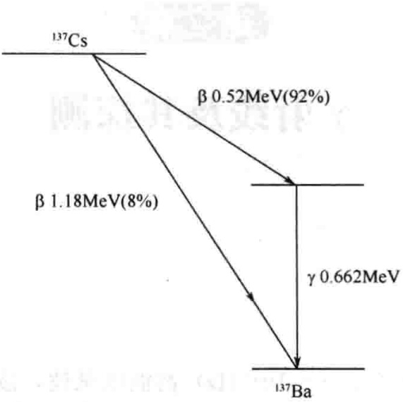

图 2.1 $^{137}$ Cs 衰变[3]

可见γ射线是放射性核素在衰变过程中，由高激发态跃迁回低激发态或基态时所放出的光子。

## 2.2γ射线的性质

## 2.2.1 γ 射线基本性质

γ射线大部分性质与X射线相同，但也有不同之处，归纳如下[4]。

①直线传播。以光速沿直线传播，且不受电磁场的干扰，不带电。

②不可见。人用肉眼看不到，即使用透镜聚光或棱镜分光也无法看到。

③光的特性。有反射、干涉、绕射、折射和极化等现象。

④穿透力。能穿透不透明物质同时被物质吸收和散射从而引起能量衰减。

⑤光化作用。能使某些物质起光化学作用，使照相底片感光。

⑥荧光作用。能使某些晶体物质发出荧光。

⑦电离性质。能排斥原子层中的电子，使气体电离，也影响液固体的电性质。

⑧生物效应。伤害或杀死生命细胞。

⑨波粒二象性。在干涉、绕射现象中显示波动性，射线传播显示光粒子性。

⑩射线控制。γ射线的发生及其能量和强度均不受人为控制，只取决于放射性原子核的性质而与其他因素无关，而X射线的发生及波长和强度均可控制。

①波谱分布。γ射线是单一或窄束波谱，如137Cs γ射线源只产生0.662MeV的单一能量的γ射线，而X射线则出现连续波谱。

②产生方式。γ射线是原子核发生衰变而产生的，而X射线通常是由高速定向电子在真空中撞击靶而产生的。

## 2.2.2 γ射线与物质的相互作用

γ光子可以与下列带电体发生相互作用:①与被束缚在原子中的电子；②与自由电子（单个电子)；③与库仑场（核或电子）；④与核子（单个核子或整个核)。γ射线可能的吸收和散射有12种过程，如表2.1所示。γ射线与物质的相互作用主要有三种效应:光电效应、康普顿效应、电子对效应。γ射线能量范围一般为10keV\~10MeV。

表2.1 光子与物质相互作用分类[5]

<table><tr><td rowspan="2">相互作用对象</td><td rowspan="2">吸收</td><td colspan="2">散射</td></tr><tr><td>弹性</td><td>非弹性</td></tr><tr><td>原子的电子</td><td>光电效应: $\sigma-5Z$ </td><td>Rayleigh 散射 $\sigma-2Z$ </td><td>康普顿散射 $\sigma-Z$ </td></tr><tr><td>原子核</td><td>光核效应: $\sigma-Z,h\nu\geqslant10MeV$ </td><td>核弹性散射</td><td>核共振散射</td></tr><tr><td>围绕带点粒子的电场</td><td>电子对效应:1核场  $h\nu\geqslant1.02MeV$ ;2电子场  $h\nu\geqslant2.04MeV$ </td><td>Delbruck 散射</td><td>无</td></tr><tr><td>介子</td><td>光介子产生: $h\nu\geqslant140MeV$ </td><td>无</td><td>无</td></tr></table>

(1)光电效应 当γ光子与原子碰撞时，它将自己的全部能量交给原子，原子又把此能量几乎全部交给原子壳层中的电子，使电子克服原子核的吸引力脱离原子而成为自由电子（称光电子)，光子则整个被吸收（称光电吸收），这就是光电效应(PhotoelectricEffect)。光电效应具有以下三个重要特征:①入射光子的能量hv。在碰撞中全部被原子吸收；②光子与自由电子不产生光电效应，光电效应遵循动量守恒定律；③光电效应伴随着二次射线的产生。当光子能量小于1MeV时，主要发生光电效应。

(2)康普顿效应当γ光子能量增大到1MeV时，γ射线与原子的壳层电子相碰撞，将一部分能量传给电子，使获得能量的电子沿γ射线入射方向成φ角射出原子之外(称反冲电子)，损失能量之后的光子成θ角方向散射出去(称散射光子)。入射光子的能量和动量就由反冲电子和散射光子两者之间分配，这就是康普顿效应(ComptonEffect)。康普顿效应发生的可能性与入射光子的能量和物质的原子序数相关，原子序数低的元素发生的可能性很高。对中等能量的光子，各种放射性元素都会产生康普顿效应。

(3)电子对效应 当γ光子能量大于1.022MeV时，在它从原子核旁边经过时，入射γ光子在库仑场作用下能量完全被吸收，电子从负能级跃迁到正能级，同时放出一对正负电子，这就是电子对效应(ElectronPairEffect)。产生电子对所需的最小能量 $E_{\mathrm{r}} = 2m_0c^2 = 1.022\mathrm{MeV}$ ，mo是电子的静止质量。生成的正电子与物质中的电子相互作用，转变成各为0.511MeV的两个光子，这就是正负电子的湮灭辐射。

图2.2是光电效应、康普顿效应、电子对效应示意。这三种效应的产生与人射光子能量(hv0)和物质的原子序数（Z)有着重要的关系，如图2.3所示。①当入射γ光子能量在0.8\~4MeV范围内，对任何Z值而言，康普顿效应都是主要的；②在原子序数较小的情况下，康普顿效应占主要地位的光子能量区域很宽；③在中等Z值以上，若 $h\nu_{0}$ 较小，则光电效应是主要的；若hvo较大，则电子对效应为主。此外，其他几种效应分别如下。

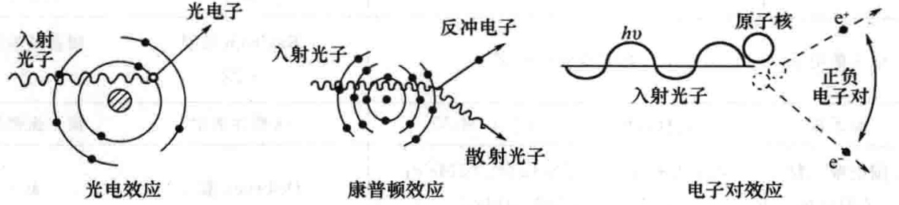

图2.2光电效应、康普顿效应、电子对效应示意[6]

图2.3γ射线三种效应区域分布图[6]

①相干散射低能光子与束缚电子之间的弹性碰撞，而靶原子保持它的初始状态。碰撞后的光子能量不变，即电磁波波长不变。这称为汤姆逊散射或相干散射。

②光致核反应大于一定能量的γ光子与物质原子的原子核作用，能发射出粒子，如（γ，n)反应，但这种相互作用的大小与其他效应相比可忽略不计。

③核共振反应 入射光子把原子核激发到激发态，然后退激时再放出γ光子。

## 2.2.3 γ 射线衰减规律

不同能量的光子组成的连续射线在通过物质衰减时，射线的质和量都有所变化。X射线是连续射线，强度为 $I_{0}$ 的入射X射线穿过质量均匀、吸收系数为 μ厚度为H的物质时，其强度衰减为I[7]:

$$
I = I _ {0} \mathrm{e} ^ {- \mu H}\tag{2.5}
$$

X射线会产生散射，即平行的单色X射线经过一个散射点时会向四周辐射它吸收的能量，其散射强度的衰减与距离的平方成反比[8]。

相同能量的光子组成的单能射线的衰减只有光子个数的减少，而没有光子能量的变化。γ射线是单一或窄束波谱。当γ射线穿过物质时，会与物质发生相互作用，其能量会被物质吸收，穿透物质后的射线能量会减弱，其减弱程度与放射源能量、吸收体性质和物质厚度有关，可用Lambert-Beer定律[9]描述:

$$
I = I _ {0} \mathrm{e} ^ {- \mu \rho l} = I _ {0} \mathrm{e} ^ {- \Phi l}\tag{2.6}
$$

射线能量是影响CT测量性能的主要因素，由式(2.5)、式(2.6)可见，两种射线衰减规律相同，但对成像结果的影响却不相同。利用X射线CT能在短时间内进行断面成像，同时其密度分辨率和量子检测率较好。但由于X射线产生多能光谱，即发生射线硬化现象，图像重建时易出现伪影，虽然可利用校正法、噪声抑制法等来消除伪影[10]，但却无法根本消除。而γ射线为单能射线，伪影少，所成CT图像清晰可辨，且穿透能力强，可用于测量高压高温钢制容器。化工多相流测量中常遇到的气、液、固、碳钢密度和对不同源的质量衰减系数 $\Phi$ 如表2.2所示。

表2.2气、液、固、碳钢密度和对不同源的质量衰减系数 $\Phi^{[11]}$

单位: $\mathrm{cm}^{-1}$

| 源\\相 | 气相 | 液相 | 固相 | 碳钢 |
| --- | --- | --- | --- | --- |
| $^{137}\mathrm{{Cs}}$ | 0.0000334 | 0.0329 | 0.0735 | 0.225 |
| $^{60}\mathrm{{Co}}$ | 0.0000328 | 0.0282 | 0.0630 | 0.186 |
| $^{241}\mathrm{{Am}}$ | 0.0000524 | 0.0418 | 0.305 | 12.874 |
| $^{192}\mathrm{{Ir}}$ | 0.0000381 | 0.0328 | 0.184 | 0.242 |
| $^{239/240}\mathrm{{Pu}}$ | 0.00164 | 1.28 | 11.875 | 387.005 |

注:气体为空气，液体为水，固体为硅铝催化剂载体，壁面材料为碳钢。

由表2.2可见，气相质量衰减系数远小于液、固相的质量衰减系数（相差1000倍左右)，而对常用的 $^{137}$ Cs 和 $^{60}$ Co. 来说，液、固质量衰减系数差别只是相差3倍左右，碳钢相对固相来讲，也只是大3倍左右。所以用 $^{137}$  Cs 和 $^{60}$  Coγ 射线对气液、气固相气含率测量时偏差较小，图像出现伪影和失真的概率也相对较小。

## 2.3 γ源的选择

## 2.3.1 选择原则

利用γ射线衰减原理测量气液两相中的气含率，γ源的选择至关重要，选择原则如下:①射线具有足够的穿透力以穿透钢制容器中的流体；②射线为单能峰；③放射性衰变产生的新核素稳定，无新的γ射线产生；④康普顿散射尽可能低；⑤半衰期适中；⑥探测器对γ源的探测效率高、响应时间短；⑦γ源的成本；⑧辐射安全。常见的γ源有 $^{137}$  Cs $^{60}$ Co 241Am、 $^{192}$ Ir 、234Pu等，其能量、半衰期、放射效率如表2.3所示。

表2.3不同放射源的γ射线能量、源的半衰期和放射效率[12]

<table><tr><td>源</td><td>射线能量/MeV</td><td>半衰期/a</td><td>放射效率/%</td></tr><tr><td> $^{137}\text{Cs}$ </td><td>0.662</td><td>30.17</td><td>85.2</td></tr><tr><td> $^{60}\text{Co}$ </td><td>1.17, 1.33</td><td>5.27</td><td>99.98</td></tr><tr><td> $^{241}\text{Am}$ </td><td>0.0592</td><td>432.2</td><td>36</td></tr><tr><td rowspan="2"> $^{192}\text{Ir}$ </td><td>0.316</td><td rowspan="2">73.83 (d)</td><td>82.7</td></tr><tr><td>0.468</td><td>47.8</td></tr><tr><td> $^{239/240}\text{Pu}$ </td><td>0.017</td><td>24000</td><td>—</td></tr></table>

注:放射性核素发生100次衰变所发出的全能光子数即为放射效率。

## 2.3.2 原因分析

据表2.3，对γ源的选择，可做如下原因分析。

(1)射线能量 选择γ源设计CT装置要考虑源的能量高低。若选择γ源能量太高，探测效率高、响应时间短，穿透能力强，但易发生康普顿效应（当γ光子能量大于1MeV时）和电子对效应（当γ光子能量大于1.022MeV时），产生二次射线而干扰和影响一次射线的吸收与传播，且不利于辐射防护。若选择γ射线源能量太低，又很难保证射线能够穿透介质实现非接触式测量。从表2.3可见，选用能量适中，半衰期不算短的 $^{137}$ Cs 做γ射线CT源较为合适。

虽然有以高能 $^{60}$ Co 为放射源的锥束CT扫描装置实现医学伽马刀治疗的报道[13]，但 $^{60}$ Co 发射两个能量的γ射线（1.17MeV，1.33MeV)[14]，且大于1MeV，易发生康普顿效应和电子对效应而产生二次射线，影响测量精度。U.P.Veera[15]根据γ射线穿过探测系统的能力及其灵敏度，针对不同容器尺寸和探测器计数时间，选用能量为0.662MeV的 $^{137}$ Cs 设计 γ-CT 。国内王化祥等[16]优化设计了基于Geant4多相流CT系统，通过仿真实验，对比 $^{137}$  Cs 241Am、239/240Pu对油、气、水的衰减比，发现241Am的衰减比为0.564:1，高于137Cs的0.85:1，而239/240Pu穿过油水介质几乎全部衰减。他们根据射线源在油、水中的衰减比，选用了241Am作为CT仿真系统的γ放射源。

(2)半衰期和放射效率由表2.3可见，241Am半衰期长达432.2a，但其能量和放射效率都较低，此外241Am剧毒。192Ir的半衰期很短，放射效率和能量都不高。239/240Pu虽然半衰期很长，但能量不高。 $^{137}$  Cs 能量为0.662MeV、半衰期30.2a、放射效率85.2%，从各方面看均适合做γ-CT源，S. B.Kumar、U. Hampel、U. P. Veera、A. R. Khopkar 等[17\~20] 均选用 $^{137}$  Cs 做γ放射源进行γ-CT多相流测量应用。

(3）放射活度 源的放射活度（或称强度）常用单位是居里（Curie)，即在1s 内发生 $3.7\times 10^{10}$ 次核衰变，符号为Ci。1Bq（贝可勒尔，简称贝可）就是1s发生1次衰变。

$$
1 \mathrm{Ci} = 3. 7 \times 1 0 ^ {1 0} \mathrm{Bq}\tag{2.7}
$$

U.P.Veera[19]考虑放射性活度 $(A_{c})$ 与所需137Cs计数值 $N_{\mathrm{R}}$ 的变化关系如下:

$$
A _ {\mathrm{c}} = \frac {N _ {\mathrm{R}}}{G f e}\tag{2.8}
$$

式中，G为几何因子；f为探测器探测效率；e为放射源发射效率。几何因子是指射束尺寸、准直距离和其他测量误差。

依据137Cs衰变图2.1，8%的 $^{137}$  Cs 发出能量为1.176MeV的β粒子变为基态的 $^{137}$  Cs 。92%的 $^{137}$ Cs 发出能量为0.541MeV的β粒子变为激发态的137Bam，137Bam变为基态的137Ba，同时发出0.662MeV的γ射线。根据放射性衰变基本规律:

$$
A = - \frac {\mathrm{d} N}{\mathrm{d} T} = \lambda N = \lambda N _ {0} \mathrm{e} ^ {- \lambda t} = A _ {0} \mathrm{e} ^ {- \lambda t}\tag{2.9}
$$

式（2.9）中，A为放射性强度；λ为衰变常数（单位时间内每个原子核衰变概率），有:

$$
\lambda T _ {1 / 2} = \ln 2 = 0. 6 9 3\tag{2.10}
$$

$1\mathrm{mCi}^{137}\mathrm{Cs}$ 表示每秒钟发生 $3.7\times 10^{7}$ 次核衰变，放出 $2\times3.7\times10^{7}\beta$ 粒子和$3.7\times 10^{7}\gamma$ 光子，这里放出的射线数是衰变的三倍。CT图像中的统计噪声是由γ光子计数时的随机统计涨落引起的，为了减少γ光子计数时的随机统计涨落误差，要控制γ光子计数在探测器测量计数的平均值左右。为减少计数过程和统计涨落，需满足以下条件 [21]: $\overline{C_n}$ 至少控制在100以上 $(C_{n}$ 为平均计数值)。探测光子数越多，测量精度就越高，但γ光子强度太大，又存在辐射安全问题。设选择x（mCi)的 $^{137}$ Cs,  $T_{1/2}=30.2a$ ，一次采样时间为 $t = 5.7\mathrm{s}$ ，采样频率 $f =$ 20Hz ，则有:

$$
\overline {{C _ {n}}} = t f x \times 3. 7 \times 1 0 ^ {7} \lambda = 3 0 7\tag{2.11}
$$

据式（2.11），当取 $x = 100\mathrm{mCi}$ 时， $\overline{C_n} = 307$ 。再考虑到γ射线经过被测气液体系和探测器的衰减，这样在计算机终端显示的采集信号数在70\~100之间，符合γ光子统计数要求。

S. B. Kumar[17]用 100mCi137Csγ-CT测量标准 Rushton 搅拌釜气含率分布，以减少γ射线与物质作用的电子对效应，使之主要表现为光电效应，减少了测量误差，能有效准确测量气液两相流气含率分布。近年天津大学[22]研究低能射线多相管流检测技术。为保证足够大的计数率和高的测量实时性，选用300mCi的241Am为放射源。由于241Am能量不是很强，康普顿散射截面小，使康普顿散射峰远小于光电峰，从而使高能峰不再是较理想的高斯分布，而使0.0595MeV左右出现不对称分布形状，由于这些因素的影响，导致测量结果与实际测量值之间存在有一定误差。

从上分析讨论，从射线能量适中、源的半衰期和放射效率等综合要求来看，$^{137}$ Cs 做γ射线CT放射源较为合适[17\~20]。

## 2.4 辐射安全

## 2.4.1 γ 射线对人体的危害

人体受到一定剂量的电离辐射后，可产生各种对健康有害的生物效应。辐射伤害要考虑三个因素:剂量大小、身体受照射部位、急性还是慢性暴露。急性放射损伤平时少见。在较长时间内接受超允许剂量的辐射可能引起慢性放射病，如慢性皮肤损伤、造血障碍等。辐射可能致癌和可能造成遗传损伤。辐射可使生殖细胞基因突变和染色体畸变，使受照者的后代各种遗传疾病的发生率增高。高能量γ射线对人体的破坏作用相当大。当人体受到γ射线辐射剂量达200～600rem $(1\mathrm{rem} = 10^{-2}\mathrm{Sv}$ ，下同）时，人体造血器官如骨髓将遭到损坏，两个月内死亡概率为0\~80%；当辐射剂量达600\~1000rem时，两个月内死亡概率为80%～ 100%；当辐射剂量达1000\~1500rem时，人体肠胃系统将遭破坏，两周内死亡概率几乎为100%；当辐射剂量达5000rem以上时，可导致中枢神经系统受到破坏，两天内死亡概率为100%[23]。放射性疾病已被定为职业病，并制定有相应的国家诊断标准[24]。

## 2.4.2 人体接受辐射的途径

通常依辐射的能量高低或电离物质的能力，将辐射分成电离和非电离辐射两类。

(1)非电离辐射指能量低无法电离物质的辐射，如太阳光、灯光、红外线、微波、无线电波、雷达波等。

(2)电离辐射指能量高能使物质发生电离作用的辐射。电离辐射又分为:①粒子辐射，如α、β、中子辐射等；②波的辐射，如γ辐射和X射线等。通常所指的辐射或者放射，是指电离辐射而言。

人类受到来自天然放射性源和人工辐射源两个方面的辐射。

(1)天然辐射天然辐射来自环境中天然存在的放射性源如太空的宇宙射线、土壤及建筑材料中的天然放射性核素、食物中的钾40、空气中的氮222及其子体等的辐射。

(2)人工辐射人工辐射主要来自各种频繁的电器接触如手机、计算机与电视等，安检、医检、核电、核动力、核爆炸辐射等。

## 2.4.3 辐射防护

(1)体外辐射防护体外辐射防护有时间、距离、屏蔽三种方法。

①时间防护缩短受辐射时间是简易而有效的防护措施。为此，应避免在辐射场逗留，即使工作需要，也尽量缩短在辐射场的逗留时间。

②距离防护增大与辐射源的距离。人体受到的辐射剂量与距离平方成反比。就是说，距离增加1倍，受到的辐射剂量则减少到原来的1/4。因此，操作者与辐射源之间有足够的距离是十分必要的。

③屏蔽防护人与辐射源之间设置防护屏障。表2.4是几种常用屏蔽物质的防护效果。从表2.4可见，铅对137Cs的防护效果最好。

表2.4几种屏蔽物质的防护效果[25]

<table><tr><td>放射源</td><td>物质</td><td>屏蔽防护效果[(衰减系数)/(cm2/g)]</td></tr><tr><td rowspan="5"> $^{137}Cs$ </td><td>铅</td><td>0.0710</td></tr><tr><td>铁</td><td>0.0286</td></tr><tr><td>铜</td><td>0.0286</td></tr><tr><td>硅</td><td>0.0295</td></tr><tr><td>水泥</td><td>0.0297</td></tr></table>

(2)体内辐射防护放射性物质进入体内的途径有饮食、呼吸、皮肤吸收、伤口侵入。因此，体内辐射的防护方法就是避免食入和吸入、增加排泄、避免在污染区逗留。

## 2.5 探测器的种类与选择

γ射线需用探测器来探测其信号。探测器探测γ射线粒子的效率和计数值与CT测量精度相关，是CT图像统计噪声的主要影响因素[26]。据γ射线粒子与探测元件作用方式不同，可分为电离探测器、晶体闪烁发光探测器两类。其中电离探测器又可分为气体探测器、半导体探测器两种。按监测目的和性质不同，也可分为粒子强度仪、剂量仪和谱仪等。粒子强度仪仅能探测γ射线粒子数，不能探测γ射线能量。剂量仪不仅可以探测γ射线粒子数，还可探测γ射线能量，但无法区分是哪种核素发射出的γ射线。谱仪能够区分各种不同放射性核素，与内置数据库结合，可以确定各种核素的强度及剂量。与CT有关的γ射线探测主要是对γ射线强度和能谱的探测。

探测器探测γ射线是利用γ射线穿过物质时发生电离和激发作用，探测其电离信号或探测电子在退激时发射的光信号。对带电粒子的探测，是由其直接产生的电离和激发；对γ射线和中子的探测，则是由它们的次级粒子产生的电离和激发。常用的探测器有电离探测器、半导体探测器和闪烁探测器三种，如表2.5所示。

表2.5三种常用探测器[27]

<table><tr><td colspan="2">仪器</td><td>特点</td><td>应用</td></tr><tr><td rowspan="3">电离探测器</td><td>电离室</td><td>对任何电离都有响应,不可用于甄别射线类型,只适用于较强放射性测量</td><td>测量辐射强度及其随时间的变化</td></tr><tr><td>正比计数管</td><td>性能稳定、本底响应低、检测效率高,适用于弱放射性测量</td><td>α、β粒子的快速计数,还可用于能谱测定和β射线的探测</td></tr><tr><td>盖革(GM)计数管</td><td>检测效率高,有效计数率近100%,但对不同射线类型无法甄别</td><td>用于检测β射线强度</td></tr><tr><td colspan="2">半导体探测器</td><td>检测灵敏区范围较小,具有较好的分辨率</td><td>测量α、β、γ辐射强度,能谱分析并测定吸收量</td></tr><tr><td colspan="2">闪烁探测器</td><td>灵敏度高,计数率高</td><td>测量α、β、γ射线强度和照射量、吸收剂量,鉴别放射性核素</td></tr></table>

电离探测器设备简单，信号幅度大，应用方便，但只能记录γ射线粒子的个数，难以甄别γ射线粒子的能量，如GM计数管。半导体探测器元件效率较高，输出信号和能量成正比，但信号较弱，需用放大器放大后才能由仪器记录和分析，如HPGe半导体探测器。闪烁探测器利用γ粒子和闪烁晶体作用，产生的光子在介质中传播并被收集，再放大成电信号，由仪器记录和分析，如NaI(Tl)闪烁探测器。常用于γ射线探测的主要有半导体探测器和闪烁探测器。

探测器的两个主要参数是能量分辨率和探测效率。能量分辨率是射线全能峰的半峰宽与峰高之比，其比值越小，表示脉冲幅度分布越窄，也就是相同能量粒子形成的脉冲幅度越近，因而对不同能量粒子分辨越容易，即能量分辨能力越强。图2.4、图2.5分别是HPGe半导体探测器和NaI(T31)闪烁探测器探测137 Cs 的0.662MeV全能峰。可见，HPGe探测器的能量分辨力强。探测效率是γ射线全能峰下等额面积所对应的粒子计数值与辐射源发射的相应γ粒子数之比。表2.6 是 HPGe探测器和NaI探测器的比较。

图 2.4 HPGe半导体探测器测得 $^{137}$ Cs γ射线能谱[28]

图2.5NaI（Tl) 闪烁探测器测得 $^{137}$  Cs γ射线能谱[28]

表2.6 两种探测器的能量分辨率和探测效率[28]

| 探测器 | 能量分辨率/% | 探测效率/% |
| --- | --- | --- |
| HPGe探测器 | 0.221 | 31.5 |
| NaI(Tl)探测器 | 10.1 | 100 |

注:在所有与光电倍增管耦合的闪烁晶体中Na1（Tl）发光效率最高，故将其定为基准100%29。

从表2.6可见，HPGe半导体探测器对γ射线具有较好的能量分辨能力，但NaI(Tl)闪烁探测器探测效率远比HPGe半导体探测器高。这是由于半导体探测器检测灵敏区范围小、信号弱，而闪烁探测器灵敏度高和计数率都高的缘故。闪烁探测器按闪烁晶体不同又分为NaI(Tl)、CsI(Na)闪烁探测器等。表2.7列出了一些常用无机闪烁晶体探测器的性质。

表2.7一些常用无机闪烁晶体探测器的性质[30]

| 闪烁晶体 | 衰减时间/μs | 密度/(mg/cm3) | γ闪烁效率/% |
| --- | --- | --- | --- |
| NaI (Tl) | 0.23 | 3.67 | 100 |
| CsI (Na) | 0.63 | 4.51 | 85 |
| CsI (Tl) | 1.0 | 4.51 | 45 |
| Cs | 0.005 | 4.11 | 3 |
| 6LiI (Eu) | 1.4 | 4.08 | 35 |
| CaF2 (Eu) | 0.9 | 3.19 | 50 |
| BaF2 | 0.63 | 4.88 | 10 |
| KI (Tl) | 0.24/0.25 | 3.13 | 24 |
| Ps | 约0.002 | 1.05 | &lt;5 |

综上，NaI(Tl)晶体探测器效率高，能量分辨率适中，光产率较高，衰减时间短，计数快，制造和价格相对便宜，因而在γ射线测量中得到广泛应用。

## 2.6 Nal(Tl) 闪烁探测器的单元结构及原理

NaI(Tl)闪烁探测器利用γ射线作用下闪烁体的发光特性来探测射线的能量与强度，它由闪烁体、光电倍增管、前置放大器和多（单）道分析器构成，如图2.6所示。

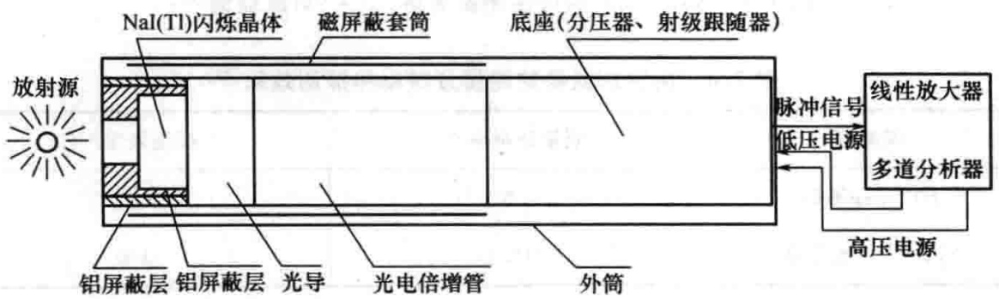

图 2.6 NaI（T1） 闪烁探测器[31]

## 2.6.1 闪烁体

当闪烁体受到γ粒子碰撞时，产生荧光光子，此荧光光子被收集到光电倍增管的光阴极，并击发出光电子。闪烁体有有机闪烁体如蒽晶体、塑体闪烁体等，常用于测量电子；有无机闪烁体如ZnS（Ag）、NaI（Tl）、CsI（Tl）、 $\mathrm{BaF}_{2}$ 晶体等，常用于测量γ、β、α粒子。当γ射线射到NaI（Tl)闪烁体时，闪烁体原子会发生退激或激发，释放出光子，其过程可用能带理论解释如下。

NaI晶体存在三层能带，如图2.7所示。最低一层是价带，价带中通常是为晶格所束缚的电子。中间一层叫禁带。就一个纯晶体而言，禁带中不存在电子，若价带中的电子自外界获得足够的能量则可移至导带，并在充满电子的价带中留下电洞，导带中的电子又会回到价带与电洞结合发出光子。但在纯NaI晶体中，电子与电洞结合而放出光子的概率很小，所以通常会在NaI晶体中加入少量杂质以在晶格中形成特殊的晶格点，这些杂质称为激活剂，如T1。若所形成的激活剂能态是容许跃迁到基态的激发组态，便会很快激发，可使导带中电子与电洞结合的概率大为增加。若选择合适的激活剂，则可使之发出可见光，这种激发态的半寿命约为 $10^{-7}$ s，这些激发态的衰减时间决定着发射闪光的时间特性。同一闪烁体发出的光有一确定光谱。对于每种闪烁体，总可找到一两种波长的光，它所占比例较大，是光谱中的主要成分，如NaI(Tl)为4100Å、蒽为4120Å和4720Å、ZnS(Ag)为4500Å。

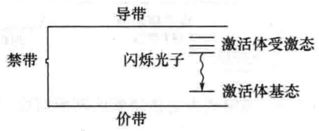

图2.7 激活晶态闪烁体的能带结构[32]

NaI（Tl)晶体是以NaI为基质材料掺以适当浓度的碘化铊(TlI）生长而成，其中T1+作为激活离子，在吸收射线能量后成为发光中心。NaI（Tl）晶体对不同能量的射线分辨率不同，通常所说的能量分辨率是指对137Cs峰(0.662MeV)而言，NaI(Tl)晶体的能量分辨率一般在7%\~11%之间[27]。但随晶体尺寸增大，能量分辨率会有所下降。在一定时间内（一般为100s)闪烁体发出的光子数称为计数率，在进行射线强度测量时常要求此指标。计数率主要与晶体尺寸有关，尺寸越大，计数率越高。NaI(Tl)晶体具有较高的发光效率，其发光波长在可见光区，对环境的适应性强，工艺制备上又易于生长大尺寸单晶，最大直径可做到500mm，因而得到广泛应用[33]。

## 2.6.2 光电倍增管

在闪烁体与光电倍增管间用光导透明固体使其耦合到一起，起到引导闪光、提高光收集效率的作用。光电倍增管是一真空器件，它由光电发射阴极（光阴极）和聚焦电极、电子倍增极及电子收集极（阳极）组成。光电倍增管按入射光接收方式可分为端窗式（Head-on）和侧窗式（Side-on）两种类型。目前用于闪烁计数的光电倍增管大都是端窗式。图2.8为端窗式光电倍增管的剖面结构。当闪烁光子入射到光阴极上时，光阴极将入射光子转换成低能光电子。当来自闪烁晶体的光子构成脉冲时，所产生的光电子也将是持续时间类同的脉冲。这些光电子通过聚焦极电场进人电子倍增系统，并通过进一步的二次发射得到倍增放大。经过倍增结构放大后，一个典型的闪烁脉冲将产生 $10^{7}\sim 10^{10}$ 个电子，然后把放大后的电子用阳极收集作为信号输出。

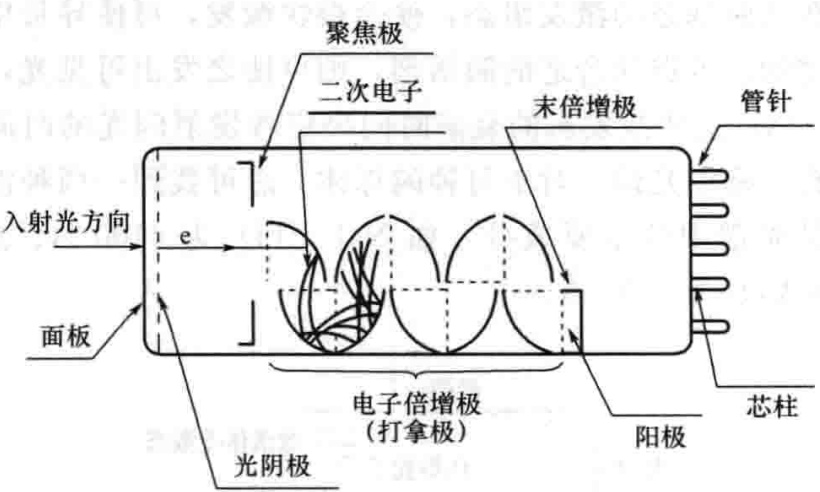

图2.8 端窗式光电倍增管的剖面结构[34]

## 2.6.3 前置放大器

探头中前置放大器的作用是把光电倍增管输出的电信号加以放大，同时使探头与后面的电子系统实现阻抗匹配。前置放大器的输出信号输入到线性放大器，经线性放大器成型，放大后的信号输到计算机多道脉冲幅度分析器或单道脉冲幅度分析器，亦可输入到显波器上观察这些信号。

## 2.6.4 线性脉冲放大器

线性脉冲放大器的作用是将光电倍增管阳极负载上输出的10～100mV电压脉冲放大到0.1\~10V，以满足多道脉冲幅度分析器对输入脉冲的要求。对脉冲线性放大器的要求是放大倍数可调、上升时间 $<0.1\mu s$ 、线性良好。

## 2.6.5单（多）道脉冲分析器

单道脉冲分析器是把线性脉冲放大器输出脉冲按高度分级。若线性脉冲放大器输出电压是0\~10V，如果把它按脉冲高度分成500级（或称500道），则每道宽度为0.02V。在实际测量能谱时，道宽的选择必须恰当。道宽过大会使能谱变形，分辨率变低；道宽过小则使每道的计数减少，统计涨落增大，不具备统计规律，测量时间相应增加。当单道脉冲分析器在微分状态下工作时，逐点增加甄别电压 $V_{0}$ (此电压可连续调节，称为阈值）进行测量，就可测出整个谱形。当单道工作在积分状态下时，只要脉冲高度大于阈值，单道就输出一个脉冲，记录的是大于某一高度的所有脉冲数目。

多道脉冲分析器相当于数百个单道分析器与计数器组合，它由0\~10V的A/D转换器按高度大小转换成与脉冲高度成正比的数字输出。因此，可以同时对不同幅度的脉冲进行计数，一次测量可得到整个能谱曲线。

## 2.7 Nal(TI) 闪烁探测器的性能指标

## 2.7.1 能量分辨率

由于单能带电粒子在闪烁体损失能量引起闪烁荧光子数有统计涨落，荧光子打在光电倍增管光阴极上产生的光电子数也有统计涨落，这就使同一能量的粒子产生的脉冲幅度不是同一大小而近似为高斯分布。能量分辨率定义为:

$$
\eta = \frac{\Delta E}{E}\times 100\%\tag{2,12}
$$

由于脉冲幅度与能量有线性关系，并且脉冲幅度与多道数成正比，故又可以表示为:

$$
\eta = \frac {\Delta \mathrm{CH}}{\mathrm{CH}} \times 100\%\tag{2.13}
$$

式中，△CH为计数率极大值一半处的宽度（半宽度)；CH为计数率极大处的脉冲幅度。

能量分辨率还和入射粒子能量有关[35]:

$$
\eta = \frac{1}{\sqrt{E}}\times 100\%\tag{2.14}
$$

通常NaI（Tl)闪烁探测器能量分辨率是以 $^{137}$ Cs 的0.662MeV单能 γ射线为标准，碘化钠闪烁体与光电倍增管耦合在一起对0.662MeV的 $^{137}$ Cs γ射线的能量分辨率在6%\~7%[27]

## 2.7.2能量的线性

能量的线性是指输出脉冲幅度与光子能量之间的线性关系。NaI(T1)单晶的荧光输出在150keV\~6MeV范围内，和γ射线能量成正比。NaI（Tl)闪烁探测器的线性好坏取决于闪烁探测器的工作状况:如当射线能量较高时，由于光电倍增管后几个联极的空间电荷影响，会使线性变坏。为了检查谱仪的线性，需用一组已知能量的γ射线在相同实验条件下分别测出它们的光电峰位，画出能量幅度曲线，如图2.9所示，称为能量刻度曲线，用最小二乘法回归，线性度一般要求在0.99以上。对于未知能量的放射源，由谱仪测出脉冲幅度后，利用该曲线就可求出射线能量。

图 2.9 γ射线能量-幅度曲线[36]

## 2.7.3 探测效率

探测效率为探测器记录的脉冲数与入射粒子数之比(又称绝对探测效率)，入射γ粒子数可根据放射源强度和探头几何条件计算。探测器性能是闪烁体发光性能、光电倍增管和电子系统性能效果的总和，其中探头（闪烁体加光电倍增管）性能对探测器起着决定性的作用。绝对探测效率不仅与探测器的灵敏体积、晶体几何形状有关，还与探测器至γ源的距离有关。

(1)晶体形状 NaI（Tl)闪烁体实心正圆柱体能直接装到大多数光电倍增管的圆形阴极上，但探测效率对圆柱体本身的高径比有要求:若高径比远小于1，在晶体和光电倍增管之间插入一个光导，使每个闪烁光更均匀地撒在整个光阴极上，不仅可以提高脉冲幅度的分辨率，还可匀和光阴极上电信号的空间变化。

(2)辐射方式由于绝对探测效率对源和探测器之间的距离十分灵敏，可设计两种辐射方式:一是使平行γ射线束均匀照射探测器某一面（相当于无限远距离的点源)，可以缓和甚至消除对探测器灵敏度的依赖关系；二是使γ射线成窄准直束射在探测器表面特定地点(相当于射束)。本书实验装置采用探测器前设置窄准直器方法获得射束，具体情况见第3章3.1.4γ-CT装置。

## 2.8 Nal(TI) 闪烁探测器探测电子流仿真模型

为使闪烁体发射光谱和光电倍增管光谱响应配合，以获得高的光电子产率。据NaI(Tl)闪烁体发光衰减时间为0.23μs[37]，通常选定光电倍增管的阳极时间常数远小于此衰减时间。设 $t = 0$ 时，流入阳极的电流i（t）是一个电子脉冲。多数闪烁体发射光时间特性可用一个衰减指数时间表示。当光电倍增管飞越时间小于闪烁发光衰减时间时，到达光电倍增管阳极的电子流仿真模型为[37]:

$$
i (t) = i _ {0} \mathrm{e} ^ {- \lambda t}\tag{2.15}
$$

式中，λ为闪烁体衰减常数。

初始电流 $i_{0}$ 可由在整个脉冲范围内收集的总电荷Q表示:

$$
Q = \int_ {0} ^ {\infty} i (t) \mathrm{d} t = i _ {0} \int_ {0} ^ {\infty} \mathrm{e} ^ {- \lambda t} = \frac {i _ {0}}{\lambda}\tag{2,16}
$$

$$
i _ {0} = \lambda Q\tag{2.17}
$$

$$
i (t) = \lambda Q \mathrm{e} ^ {- \lambda t}\tag{2.18}
$$

流入R-C并联电路的电流是流入电容的电流 $i_{C}$ 与流经电阻的电流 $i_R$ 之和:

$$
i (t) = i _ {C} + i _ {R}\tag{2.19}
$$

$$
i (t) = C \frac {\mathrm{d} V (t)}{\mathrm{d} t} + \frac {V (t)}{R}\tag{2.20}
$$

将式（2.15）代入式（2.20），且式（2.20）两边同除以C，解此方程，得:

$$
V (t) = \frac {1}{\lambda - \theta} \times \frac {\lambda Q}{C} (\mathrm{e} ^ {- \theta t} - \mathrm{e} ^ {- \lambda t})\tag{2.21}
$$

此处 $\theta \equiv \frac{1}{RC}$ 是阳极电路时间常数的倒数。

选定阳极时间常数远小于闪烁体衰减时间，即 $\theta \gg \lambda$ ，则式（2.21）为:

$$
V (t) = \frac {\lambda}{\theta} \times \frac {Q}{C} (\mathrm{e} ^ {- \lambda t} - \mathrm{e} ^ {- \theta t})\tag{2.22}
$$

这一脉冲在 t 值大 $(t = 5.7\mathrm{s})^{[38]}$ 时脉冲特性变化为:

$$
V (t) \cong \frac {\lambda}{\theta} \times \frac {Q}{C} \mathrm{e} ^ {- \lambda t} \left(t \gg \frac {1}{\lambda}\right)\tag{2.23}
$$

从式（2.22)、式(2.23)可见，脉冲后时间特性与闪烁体闪光时间特性相同。随着时间常数减少，电压脉冲形状越接近于闪烁体闪光引起的光电倍增管电流的形状。形成短持续时间的代价是脉冲幅度衰减，脉冲幅度随阳极电路时间常数呈线性变化，而随闪烁体衰减时间呈反比变化。不过在一定条件下，脉冲幅度仍是阳极所收集电荷Q的线性量度。

## 2.9 137Csγ 射线能谱图

用NaI(T1)闪烁探测器测得 $^{137}$ Cs γ 射线能谱，如图2.10所示。

图 2.10NaI（T1)闪烁探测器测得的 $^{137}$ Cs γ 射线能谱[38]

图2.10中横坐标是道数，纵坐标是脉冲数。测得γ能谱有三个峰和一个平台。最右边A峰为全能峰，脉冲幅度可通过道数来确定，γ射线能量为0.662MeV，峰中包含了光电效应及多次光电效应的贡献。平台状曲线B是康普顿效应的贡献，其特征是散射光子逃逸后留下一个能量从0到 $E_{\gamma} / (1 + 1 / 4E_{\gamma})$的连续光电子谱。C峰是反散射峰，由γ射线透过闪烁体射在光电倍增管光阴极上发生康普顿反散射或γ射线在源及周围物质上发生康普顿反散射，反散射光子进入闪烁体通过光电效应所致，可计算出反散射峰能量为:

$$
E _ {\gamma} ^ {\prime} (\theta = 1 8 0 ^ {\circ}) \approx E _ {\gamma} / (1 + 4 E _ {\gamma}) = 0. 6 6 2 / (1 + 4 \times 0. 6 6 2) = 0. 1 8 4 \mathrm{MeV}\tag{2.24}
$$

D峰是X射线峰，它是由137Ba的k层特性X射线所致，即 $^{137}$  Cs β 衰变体 137 Ba 的0.662MeV激发态在放出内转换电子后造成k空位，外层电子跃迁后产生的X光子。

## 2.10 Nal(TI)闪烁探测器的应用进展

S. B. Kumar 等[39]使用 $2\mathrm{in}\times 2\mathrm{in}$ ( $1\mathrm{in} = 0.0254\mathrm{m}$ ，下同）NaI(Tl)闪烁探测器进行气液两相流CT测量，具有探测效率高、响应时间快的优点，不仅能够降低源强度，同时高计数率避免了脉冲堆积。任晓蓉等[35]研究了NaI（T1）闪烁探测器测量γ射线的响应模型，用灵敏度和垂直分辨率选择高性能探测器，这项研究改进了NaI(T1）闪烁探测器的设计，提高了测量精度。陈坚祯等[40]改进了NaI(T1)闪烁探测器稳谱技术，设计了克服由于环境温度变化给探测器本身带来的温度效应以及仪器的不稳定性（元器件老化，电压电流漂移等）等外界干扰。方晓明等[28]分析对比了NaI（T1闪烁体探测器和HPGe探测器性能，虽然HPGe探测器的能量分辨率比NaI(Tl)闪烁体探测器好，但NaI(Tl)闪烁体探测器的探测效率远比HPGe探测器高。测量单能γ射线选用NaI（Tl)闪烁晶体探测器比较合适。

## 2.11 Nal(TI)闪烁探测器探测137Csγ射线

## 2.11.1 探测过程

NaI（Tl)闪烁探测器探测γ射线过程如图2.11所示。

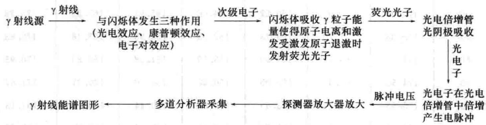

图2.11 NaI(T1) 闪烁探测器探测γ射线过程示意

一个100mCi的137Csγ源发射出的γ射线被相距一定距离的七个扇形排列的NaI（Tl)闪烁探测器中的NaI（Tl）晶体吸收。闪烁体与γ射线发生作用，吸收γ粒子能量使原子电离和激发，受激发原子退激时发射闪烁光子。利用反射物和光导将闪烁光子收集到光电倍增管的光阴极上，由于光电效应，光子在光阴极上击出光电子。光电子在光电倍增管中倍增，光电倍增管中产生电脉冲，被探测器里的前置放大器进行第一次放大，再传送至定时滤波放大器(TimingFilter Amplifer）放大，然后通过甄别器（Discrim)去掉干扰噪声信号，进入比例计数器(Scaler)计数，计算机在线显示。

## 2.11.2 探测数据

用NaI（Tl）闪烁探测器测量相距69.85cm 空白距离由一个100mCi的137Cs γ源发射出的γ射线，结果如表2.8所示。

表2.8中，第1列是光子能量阈值，第2\~8列是通过相应光子能量阈值的光子数。

表 2.8 探测器测得137Cs γ 射线数据

| 光子能量阈值/keV | 探测器1光子数 | 探测器2光子数 | 探测器3光子数 | 探测器4光子数 | 探测器5光子数 | 探测器6光子数 | 探测器7光子数 |
| --- | --- | --- | --- | --- | --- | --- | --- |
| 0 | 0 | 0 | 0 | 0 | 0 | 0 | 0 |
| 5 | 0 | 0 | 0 | 0 | 0 | 0 | 0 |
| 10 | 0 | 0 | 0 | 0 | 0 | 0 | 0 |
| 15 | 0 | 0 | 0 | 0 | 0 | 0 | 0 |
| 20 | 188.80 | 180.49 | 177.72 | 171.91 | 160.57 | 172.79 | 184.83 |
| 25 | 189.05 | 178.82 | 178.83 | 169.54 | 160.54 | 170.71 | 184.08 |
| 30 | 186.77 | 178.96 | 172.74 | 168.77 | 160.92 | 169.68 | 181.39 |
| 35 | 183.93 | 175.44 | 173.85 | 166.17 | 158.29 | 169.42 | 179.26 |
| 40 | 181.94 | 174.60 | 171.47 | 166.79 | 157.55 | 167.10 | 176.97 |
| 45 | 180.44 | 173.19 | 171.75 | 165.64 | 155.92 | 165.47 | 176.63 |
| 50 | 179.97 | 170.92 | 170.27 | 164.00 | 155.91 | 165.59 | 175.38 |
| 55 | 179.38 | 171.70 | 169.13 | 162.99 | 154.98 | 162.48 | 172.83 |
| 60 | 177.57 | 168.31 | 168.29 | 163.10 | 151.28 | 159.83 | 170.93 |
| 65 | 174.53 | 167.99 | 165.05 | 160.48 | 150.50 | 160.37 | 171.67 |
| 70 | 175.53 | 168.00 | 163.85 | 160.31 | 149.44 | 158.12 | 167.13 |
| 75 | 172.46 | 164.07 | 161.36 | 157.10 | 147.07 | 158.73 | 167.57 |
| 80 | 170.17 | 164.24 | 160.14 | 156.12 | 145.79 | 154.93 | 164.09 |
| 85 | 169.91 | 162.91 | 161.73 | 153.62 | 143.65 | 153.83 | 162.99 |
| 90 | 166.13 | 159.43 | 158.66 | 153.36 | 142.52 | 152.53 | 161.44 |
| 95 | 165.43 | 159.65 | 156.94 | 151.13 | 140.04 | 152.64 | 159.71 |
| 100 | 163.75 | 158.00 | 155.17 | 150.00 | 140.83 | 148.00 | 158.27 |
| 105 | 163.21 | 156.65 | 154.08 | 148.92 | 137.33 | 147.32 | 154.61 |
| 110 | 160.14 | 153.69 | 151.32 | 145.87 | 136.58 | 145.98 | 155.36 |
| 115 | 159.53 | 152.60 | 150.92 | 145.72 | 136.90 | 143.41 | 153.20 |
| 120 | 156.84 | 150.74 | 148.46 | 143.37 | 134.19 | 142.70 | 152.27 |
| 125 | 154.42 | 150.00 | 147.29 | 141.71 | 131.50 | 140.57 | 149.11 |
| 130 | 152.95 | 148.95 | 145.09 | 138.60 | 131.22 | 140.01 | 147.00 |
| 135 | 152.04 | 147.18 | 145.12 | 138.02 | 128.46 | 138.00 | 144.13 |
| 140 | 149.80 | 143.43 | 143.05 | 137.03 | 127.74 | 135.11 | 143.04 |
| 145 | 146.42 | 141.97 | 140.11 | 133.50 | 126.92 | 134.42 | 141.80 |
| 150 | 145.13 | 140.23 | 140.53 | 133.28 | 123.64 | 133.10 | 139.48 |
| 155 | 144.20 | 139.03 | 138.67 | 130.43 | 122.42 | 130.19 | 137.84 |
| 160 | 143.14 | 135.25 | 135.94 | 130.04 | 121.21 | 127.94 | 137.38 |
| 165 | 140.27 | 134.93 | 132.89 | 129.46 | 120.17 | 127.61 | 132.64 |
| 170 | 138.95 | 134.42 | 133.11 | 127.76 | 119.06 | 124.95 | 132.33 |
| 175 | 137.21 | 131.99 | 130.94 | 126.37 | 117.63 | 124.08 | 131.02 |
| 180 | 136.96 | 129.43 | 128.75 | 123.26 | 116.05 | 123.40 | 129.71 |
| 185 | 134.18 | 130.63 | 127.03 | 123.73 | 114.58 | 121.69 | 129.17 |
| 190 | 132.78 | 126.22 | 125.57 | 122.00 | 113.55 | 119.53 | 127.30 |
| 195 | 132.53 | 125.91 | 125.57 | 120.29 | 111.71 | 117.91 | 124.50 |
| 200 | 131.97 | 126.57 | 125.03 | 118.75 | 110.47 | 117.97 | 123.67 |
| 205 | 129.30 | 123.05 | 122.11 | 117.73 | 109.26 | 116.39 | 123.04 |
| 210 | 128.13 | 123.69 | 123.04 | 116.76 | 107.94 | 115.71 | 121.03 |
| 215 | 125.72 | 120.72 | 119.44 | 116.61 | 108.13 | 112.00 | 119.91 |
| 220 | 124.17 | 120.35 | 117.05 | 114.32 | 104.41 | 111.82 | 118.46 |
| 225 | 124.17 | 117.78 | 117.32 | 112.38 | 106.41 | 111.75 | 117.40 |
| 230 | 122.39 | 117.11 | 117.40 | 111.87 | 103.33 | 110.64 | 114.81 |
| 235 | 120.10 | 115.68 | 115.77 | 110.19 | 103.32 | 108.54 | 115.74 |
| 240 | 119.41 | 114.66 | 112.55 | 108.43 | 100.84 | 106.99 | 112.99 |
| 245 | 119.91 | 114.00 | 112.78 | 106.66 | 99.85 | 107.49 | 113.46 |
| 250 | 118.46 | 112.52 | 112.01 | 106.13 | 99.08 | 105.42 | 112.37 |
| 255 | 116.35 | 111.50 | 109.60 | 105.53 | 98.20 | 104.60 | 110.85 |
| 260 | 116.75 | 110.15 | 108.89 | 104.83 | 97.05 | 102.06 | 109.07 |
| 265 | 114.00 | 110.52 | 109.44 | 103.58 | 96.46 | 100.80 | 109.41 |
| 270 | 114.45 | 108.27 | 107.11 | 101.52 | 95.98 | 102.30 | 105.68 |
| 275 | 111.35 | 106.12 | 104.88 | 99.91 | 94.43 | 99.76 | 106.55 |
| 280 | 111.39 | 106.30 | 104.98 | 100.42 | 93.76 | 98.18 | 105.75 |
| 285 | 108.71 | 103.41 | 102.77 | 98.76 | 91.50 | 95.88 | 103.71 |
| 290 | 110.32 | 102.25 | 100.70 | 98.83 | 90.57 | 96.52 | 102.61 |
| 295 | 108.50 | 102.03 | 100.83 | 96.95 | 89.90 | 97.23 | 102.13 |
| 300 | 106.30 | 100.61 | 101.15 | 97.22 | 89.60 | 95.07 | 100.56 |
| 305 | 104.84 | 101.03 | 100.23 | 94.04 | 88.30 | 93.15 | 98.83 |
| 310 | 103.95 | 98.10 | 96.82 | 93.81 | 87.01 | 93.41 | 96.96 |
| 315 | 102.68 | 98.02 | 96.63 | 91.40 | 86.22 | 90.69 | 96.11 |
| 320 | 101.55 | 97.26 | 95.20 | 91.35 | 84.66 | 89.66 | 95.46 |
| 325 | 100.74 | 95.06 | 95.30 | 90.58 | 84.40 | 89.40 | 93.91 |
| 330 | 98.27 | 93.71 | 93.85 | 89.41 | 82.36 | 88.21 | 94.91 |
| 335 | 97.87 | 92.70 | 92.64 | 87.38 | 81.28 | 87.57 | 92.30 |
| 340 | 97.86 | 91.18 | 90.91 | 87.74 | 81.03 | 86.20 | 91.18 |
| 345 | 95.33 | 90.18 | 90.62 | 84.69 | 80.08 | 84.34 | 90.84 |
| 350 | 95.35 | 90.41 | 89.97 | 84.97 | 79.17 | 83.97 | 88.08 |
| 355 | 94.24 | 90.15 | 89.21 | 85.52 | 78.46 | 82.66 | 87.31 |
| 360 | 92.92 | 87.95 | 87.23 | 82.60 | 77.40 | 83.22 | 88.36 |
| 365 | 92.10 | 86.91 | 85.64 | 82.92 | 76.65 | 81.63 | 86.46 |
| 370 | 91.33 | 85.42 | 85.22 | 80.98 | 75.98 | 79.77 | 85.57 |
| 375 | 90.44 | 86.39 | 83.44 | 81.72 | 75.19 | 80.07 | 84.28 |
| 380 | 89.98 | 84.80 | 83.73 | 80.83 | 74.85 | 79.57 | 84.68 |
| 385 | 87.83 | 83.68 | 83.54 | 79.58 | 73.51 | 79.66 | 83.42 |
| 390 | 87.70 | 83.46 | 83.24 | 80.18 | 73.63 | 77.77 | 83.87 |
| 395 | 86.38 | 82.98 | 82.48 | 78.99 | 72.98 | 77.67 | 81.28 |
| 400 | 86.97 | 83.37 | 81.68 | 79.20 | 73.05 | 77.91 | 82.21 |
| 405 | 87.17 | 82.38 | 81.81 | 78.29 | 72.17 | 76.56 | 81.50 |
| 410 | 84.95 | 81.90 | 80.56 | 77.13 | 72.01 | 76.28 | 80.80 |
| 415 | 85.59 | 81.88 | 79.65 | 76.48 | 72.44 | 76.00 | 80.31 |
| 420 | 84.78 | 80.70 | 79.88 | 75.95 | 70.83 | 76.07 | 79.95 |
| 425 | 84.69 | 80.67 | 79.54 | 76.63 | 69.98 | 74.51 | 80.18 |
| 430 | 82.76 | 80.42 | 78.41 | 75.14 | 69.97 | 75.48 | 79.15 |
| 435 | 84.15 | 79.22 | 78.62 | 75.30 | 70.65 | 74.86 | 77.99 |
| 440 | 82.86 | 80.23 | 77.96 | 74.78 | 69.54 | 73.75 | 78.30 |
| 445 | 81.20 | 77.42 | 77.81 | 74.24 | 68.88 | 74.16 | 76.99 |
| 450 | 80.83 | 78.02 | 76.59 | 74.36 | 69.15 | 73.37 | 76.53 |
| 455 | 81.17 | 77.17 | 76.05 | 72.97 | 68.89 | 71.76 | 76.45 |
| 460 | 79.77 | 77.79 | 75.62 | 73.17 | 67.63 | 72.76 | 76.37 |
| 465 | 79.95 | 76.82 | 75.11 | 71.42 | 67.58 | 71.07 | 75.29 |
| 470 | 80.08 | 75.69 | 75.35 | 72.61 | 67.51 | 71.29 | 73.87 |
| 475 | 79.35 | 75.27 | 73.89 | 71.23 | 66.23 | 70.16 | 75.13 |
| 480 | 79.28 | 75.09 | 73.80 | 70.15 | 64.41 | 68.58 | 74.68 |
| 485 | 78.28 | 74.99 | 73.65 | 69.26 | 64.19 | 67.92 | 72.76 |
| 490 | 77.44 | 73.68 | 73.85 | 69.90 | 63.20 | 66.49 | 73.06 |
| 495 | 75.64 | 72.94 | 72.68 | 67.54 | 62.36 | 64.82 | 70.79 |
| 500 | 76.69 | 71.69 | 71.69 | 66.86 | 61.23 | 62.99 | 68.32 |
| 505 | 74.35 | 69.01 | 70.20 | 64.60 | 58.17 | 58.42 | 66.20 |
| 510 | 72.09 | 65.45 | 68.14 | 61.50 | 53.59 | 52.69 | 61.66 |
| 515 | 70.72 | 62.33 | 66.44 | 57.44 | 48.77 | 48.04 | 58.23 |
| 520 | 66.48 | 57.95 | 62.17 | 51.69 | 43.53 | 41.90 | 52.49 |
| 525 | 61.31 | 51.48 | 59.95 | 45.59 | 37.19 | 35.93 | 46.07 |
| 530 | 56.68 | 45.12 | 54.33 | 38.71 | 31.73 | 27.55 | 39.30 |
| 535 | 48.70 | 37.88 | 48.86 | 32.86 | 24.66 | 21.83 | 30.76 |
| 540 | 40.66 | 30.76 | 42.47 | 24.76 | 18.79 | 16.09 | 24.99 |
| 545 | 33.16 | 25.07 | 35.17 | 19.32 | 13.75 | 11.39 | 18.21 |
| 550 | 25.10 | 18.82 | 28.68 | 13.88 | 10.41 | 7.54 | 13.31 |
| 555 | 19.38 | 13.30 | 21.65 | 9.29 | 6.98 | 5.06 | 8.97 |
| 560 | 13.39 | 9.03 | 15.89 | 5.89 | 4.30 | 3.31 | 5.77 |
| 565 | 8.76 | 5.79 | 11.77 | 3.77 | 2.89 | 1.95 | 3.46 |
| 570 | 5.39 | 3.70 | 7.77 | 2.51 | 1.91 | 1.14 | 2.18 |
| 575 | 3.16 | 2.10 | 5.20 | 1.52 | 1.17 | 0.82 | 1.29 |
| 580 | 2.08 | 1.31 | 3.04 | 1.00 | 0.72 | 0.60 | 1.00 |
| 585 | 1.14 | 0.76 | 2.08 | 0.68 | 0.63 | 0.47 | 0.70 |
| 590 | 0.86 | 0.69 | 1.19 | 0.47 | 0.45 | 0.44 | 0.55 |
| 595 | 0.62 | 0.51 | 0.85 | 0.37 | 0.36 | 0.38 | 0.51 |
| 600 | 0.60 | 0.47 | 0.67 | 0.42 | 0.35 | 0.30 | 0.46 |
| 605 | 0.45 | 0.42 | 0.48 | 0.44 | 0.30 | 0.33 | 0.42 |
| 610 | 0.43 | 0.43 | 0.44 | 0.44 | 0.27 | 0.38 | 0.47 |
| 615 | 0.49 | 0.40 | 0.44 | 0.41 | 0.33 | 0.37 | 0.37 |
| 620 | 0.37 | 0.38 | 0.37 | 0.40 | 0.31 | 0.32 | 0.44 |
| 625 | 0.52 | 0.33 | 0.39 | 0.35 | 0.37 | 0.39 | 0.37 |
| 630 | 0.39 | 0.39 | 0.37 | 0.33 | 0.29 | 0.37 | 0.4 |
| 635 | 0.44 | 0.37 | 0.40 | 0.36 | 0.31 | 0.39 | 0.32 |
| 640 | 0.39 | 0.38 | 0.36 | 0.29 | 0.31 | 0.38 | 0.41 |
| 645 | 0.37 | 0.35 | 0.29 | 0.27 | 0.30 | 0.33 | 0.33 |
| 650 | 0.37 | 0.36 | 0.37 | 0.29 | 0.29 | 0.30 | 0.29 |
| 655 | 0.32 | 0.33 | 0.35 | 0.28 | 0.25 | 0.22 | 0.27 |
| 660 | 0.28 | 0.26 | 0.28 | 0.29 | 0.32 | 0.28 | 0.31 |
| 665 | 0.34 | 0.22 | 0.36 | 0.28 | 0.25 | 0.24 | 0.25 |
| 670 | 0.33 | 0.33 | 0.26 | 0.24 | 0.29 | 0.29 | 0.28 |
| 675 | 0.25 | 0.36 | 0.30 | 0.27 | 0.28 | 0.23 | 0.33 |
| 680 | 0.35 | 0.26 | 0.30 | 0.29 | 0.31 | 0.33 | 0.28 |
| 685 | 0.26 | 0.22 | 0.31 | 0.28 | 0.19 | 0.21 | 0.26 |
| 690 | 0.31 | 0.28 | 0.28 | 0.28 | 0.18 | 0.21 | 0.21 |
| 695 | 0.32 | 0.22 | 0.33 | 0.19 | 0.28 | 0.21 | 0.28 |
| 700 | 0.27 | 0.23 | 0.27 | 0.28 | 0.28 | 0.27 | 0.23 |

## 2.11.3数据处理与分析讨论

据表2.8实验测量数据，用Excel软件处理可得如图2.12所示的曲线。从图2.12可见，当光子能量阈值在0\~360keV范围内时，光子数与光子能量阈值近似成线性反比关系，即光子能量阈值愈高，所通过的光子数越少(说明:由于γ射线光子是随机信号和所设置光子能量阈值仅为5keV，所以总的趋势是光子能量阈值愈高，所通过的光子数越少，但不排除在两个相邻能量仅为5keV阈值时，所通过的光子数并不是减少的现象)。这是因为在γ射线光子信号采集、加工和处理过程中，为了消除γ射线康普顿效应噪声信号（通常是小能量信号)，设置了能量阈值，过滤掉了能量低于能量阈值的γ射线光子的缘故。当光子能量阈值在360\~500keV时，这种光子数与光子能量阈值线性反比下降稍有缓和。而当光子能量阈值在500～580keV时，光子数随着光子能量阈值提高而急剧下降。当光子能量阈值大于580keV时，光子数几乎为0。所以，光子能量阈值不应小于500keV，否则光子数会急剧下降，不能提供足够数量的γ光子有效信号。进一步的分析可知，这与数理统计的累积分布函数恰恰相反，这里命名为负累积分布函数，在3.2.5节（2）响应曲线负累计分布模型中将建立负累积分布函数。然而，从图2.12不能看出如何从能量大小混杂在一起的γ光子中过滤掉康普顿效应小能量噪声信号γ光子。根据数理统计分布密度函数的启示，对表2.8测量数据进行加工处理，找出相邻两能量阈中值与两相邻能量阈所通过的γ光子数差额关系，如表2.9所示。

图2.12 光子能量阈值与光子数曲线

表2.9 相邻两能量阈中值与两相邻能量阈所通过的γ光子数差额关系

| 光子能量阈中值/keV | 探测器1光子减量 | 探测器2光子减量 | 探测器3光子减量 | 探测器4光子减量 | 探测器5光子减量 | 探测器6光子减量 | 探测器7光子减量 |
| --- | --- | --- | --- | --- | --- | --- | --- |
| 2.5 | 0 | 0 | 0 | 0 | 0 | 0 | 0 |
| 7.5 | 0 | 0 | 0 | 0 | 0 | 0 | 0 |
| 12.5 | 0 | 0 | 0 | 0 | 0 | 0 | 0 |
| 17.5 | -188.80 | -180.49 | -177.72 | -171.91 | -160.57 | -172.79 | -184.83 |
| 22.5 | -0.25 | 1.68 | -1.11 | 2.37 | 0.04 | 2.09 | 0.75 |
| 27.5 | 2.28 | -0.15 | 6.09 | 0.77 | -0.38 | 1.04 | 2.70 |
| 32.5 | 2.84 | 3.52 | -1.11 | 2.61 | 2.63 | 0.26 | 2.13 |
| 37.5 | 2.00 | 0.85 | 2.38 | -0.62 | 0.74 | 2.33 | 2.30 |
| 42.5 | 1.50 | 1.41 | -0.29 | 1.15 | 1.64 | 1.63 | 0.34 |
| 47.5 | 0.48 | 2.28 | 1.49 | 1.65 | 0.02 | -0.12 | 1.26 |
| 52.5 | 0.60 | -0.78 | 1.15 | 1.01 | 0.93 | 3.11 | 2.55 |
| 57.5 | 1.82 | 3.39 | 0.84 | -0.11 | 3.70 | 2.66 | 1.91 |
| 62.5 | 3.04 | 0.32 | 3.25 | 2.62 | 0.79 | -0.54 | -0.74 |
| 67.5 | -1.00 | -0.02 | 1.20 | 0.17 | 1.06 | 2.25 | 4.54 |
| 72.5 | 3.08 | 3.94 | 2.5 | 3.21 | 2.38 | -0.62 | -0.44 |
| 77.5 | 2.29 | -0.18 | 1.22 | 0.99 | 1.29 | 3.81 | 3.48 |
| 82.5 | 0.27 | 1.34 | -1.60 | 2.50 | 2.14 | 1.11 | 1.10 |
| 87.5 | 3.79 | 3.48 | 3.08 | 0.27 | 1.14 | 1.30 | 1.55 |
| 92.5 | 0.70 | -0.22 | 1.73 | 2.24 | 2.49 | -0.11 | 1.74 |
| 97.5 | 1.69 | 1.65 | 1.77 | 1.13 | -0.79 | 4.64 | 1.45 |
| 102.5 | 0.54 | 1.36 | 1.10 | 1.09 | 3.50 | 0.69 | 3.66 |
| 107.5 | 3.08 | 2.97 | 2.76 | 3.05 | 0.75 | 1.34 | -0.76 |
| 112.5 | 0.61 | 1.09 | 0.41 | 0.15 | -0.32 | 2.58 | 2.17 |
| 117.5 | 2.70 | 1.86 | 2.46 | 2.36 | 2.71 | 0.72 | 0.93 |
| 122.5 | 2.42 | 0.75 | 1.17 | 1.66 | 2.70 | 2.13 | 3.16 |
| 127.5 | 1.48 | 1.06 | 2.21 | 3.11 | 0.28 | 0.57 | 2.11 |
| 132.5 | 0.92 | 1.77 | -0.04 | 0.58 | 2.77 | 2.01 | 2.88 |
| 137.5 | 2.25 | 3.75 | 2.07 | 0.99 | 0.72 | 2.90 | 1.10 |
| 142.5 | 3.38 | 1.47 | 2.95 | 3.53 | 0.83 | 0.69 | 1.25 |
| 147.5 | 1.30 | 1.74 | -0.42 | 0.22 | 3.28 | 1.32 | 2.32 |
| 152.5 | 0.93 | 1.21 | 1.86 | 2.86 | 1.23 | 2.92 | 1.64 |
| 157.5 | 1.07 | 3.79 | 2.74 | 0.39 | 1.21 | 2.25 | 0.47 |
| 162.5 | 2.88 | 0.32 | 3.05 | 0.59 | 1.05 | 0.34 | 4.75 |
| 167.5 | 1.32 | 0.51 | -0.23 | 1.70 | 1.11 | 2.66 | 0.31 |
| 172.5 | 1.74 | 2.43 | 2.18 | 1.40 | 1.43 | 0.87 | 1.31 |
| 177.5 | 0.26 | 2.57 | 2.19 | 3.11 | 1.59 | 0.69 | 1.31 |
| 182.5 | 2.78 | -1.21 | 1.72 | -0.47 | 1.48 | 1.72 | 0.55 |
| 187.5 | 1.41 | 4.42 | 1.47 | 1.73 | 1.03 | 2.16 | 1.87 |
| 192.5 | 0.26 | 0.32 | -0.01 | 1.72 | 1.85 | 1.63 | 2.80 |
| 197.5 | 0.56 | -0.66 | 0.55 | 1.54 | 1.24 | -0.07 | 0.84 |
| 202.5 | 2.68 | 3.52 | 2.92 | 1.03 | 1.21 | 1.59 | 0.63 |
| 207.5 | 1.17 | -0.64 | -0.93 | 0.97 | 1.33 | 0.68 | 2.02 |
| 212.5 | 2.41 | 2.97 | 3.60 | 0.16 | -0.19 | 3.71 | 1.13 |
| 217.5 | 1.56 | 0.38 | 2.40 | 2.29 | 3.72 | 0.19 | 1.45 |
| 222.5 | -0.01 | 2.57 | -0.28 | 1.95 | -2.00 | 0.08 | 1.06 |
| 227.5 | 1.79 | 0.67 | -0.08 | 0.51 | 3.08 | 1.11 | 2.60 |
| 232.5 | 2.29 | 1.44 | 1.63 | 1.69 | 0.02 | 2.10 | -0.93 |
| 237.5 | 0.70 | 1.03 | 3.23 | 1.76 | 2.49 | 1.55 | 2.75 |
| 242.5 | -0.50 | 0.66 | -0.24 | 1.77 | 0.99 | -0.5 | -0.47 |
| 247.5 | 1.46 | 1.49 | 0.77 | 0.53 | 0.77 | 2.07 | 1.09 |
| 252.5 | 2.11 | 1.03 | 2.42 | 0.60 | 0.88 | 0.83 | 1.52 |
| 257.5 | -0.40 | 1.36 | 0.71 | 0.71 | 1.16 | 2.55 | 1.79 |
| 262.5 | 2.75 | -0.38 | -0.56 | 1.25 | 0.60 | 1.27 | -0.35 |
| 267.5 | -0.46 | 2.26 | 2.33 | 2.07 | 0.48 | -1.51 | 3.74 |
| 272.5 | 3.10 | 2.15 | 2.24 | 1.62 | 1.56 | 2.55 | -0.88 |
| 277.5 | -0.04 | -0.18 | -0.10 | -0.52 | 0.68 | 1.58 | 0.80 |
| 282.5 | 2.69 | 2.89 | 2.21 | 1.67 | 2.27 | 2.31 | 2.05 |
| 287.5 | -1.62 | 1.17 | 2.07 | -0.07 | 0.93 | -0.64 | 1.10 |
| 292.5 | 1.83 | 0.22 | -0.13 | 1.88 | 0.68 | -0.72 | 0.49 |
| 297.5 | 2.20 | 1.42 | -0.32 | -0.28 | 0.31 | 2.16 | 1.58 |
| 302.5 | 1.47 | -0.42 | 0.92 | 3.19 | 1.30 | 1.93 | 1.73 |
| 307.5 | 0.89 | 2.93 | 3.42 | 0.24 | 1.29 | -0.26 | 1.87 |
| 312.5 | 1.28 | 0.08 | 0.19 | 2.41 | 0.80 | 2.73 | 0.85 |
| 317.5 | 1.13 | 0.76 | 1.43 | 0.06 | 1.57 | 1.03 | 0.66 |
| 322.5 | 0.81 | 2.21 | -0.10 | 0.78 | 0.26 | 0.26 | 1.55 |
| 327.5 | 2.48 | 1.35 | 1.45 | 1.17 | 2.05 | 1.19 | -1.00 |
| 332.5 | 0.40 | 1.02 | 1.22 | 2.04 | 1.08 | 0.65 | 2.61 |
| 337.5 | 0.02 | 1.52 | 1.73 | -0.37 | 0.26 | 1.37 | 1.12 |
| 342.5 | 2.53 | 1.00 | 0.29 | 3.06 | 0.96 | 1.86 | 0.35 |
| 347.5 | -0.03 | -0.23 | 0.66 | -0.28 | 0.92 | 0.37 | 2.77 |
| 352.5 | 1.12 | 0.27 | 0.76 | -0.56 | 0.72 | 1.32 | 0.77 |
| 357.5 | 1.32 | 2.20 | 1.99 | 2.93 | 1.06 | -0.57 | -1.05 |
| 362.5 | 0.83 | 1.05 | 1.59 | -0.33 | 0.75 | 1.60 | 1.91 |
| 367.5 | 0.77 | 1.50 | 0.42 | 1.94 | 0.68 | 1.86 | 0.90 |
| 372.5 | 0.89 | -0.98 | 1.79 | -0.74 | 0.80 | -0.30 | 1.29 |
| 377.5 | 0.47 | 1.60 | -0.29 | 0.89 | 0.35 | 0.51 | -0.40 |
| 382.5 | 2.15 | 1.13 | 0.19 | 1.26 | 1.35 | -0.10 | 1.26 |
| 387.5 | 0.14 | 0.22 | 0.31 | -0.61 | -0.13 | 1.89 | -0.46 |
| 392.5 | 1.32 | 0.48 | 0.76 | 1.20 | 0.65 | 0.11 | 2.60 |
| 397.5 | -0.59 | -0.39 | 0.81 | -0.21 | -0.07 | -0.25 | -0.94 |
| 402.5 | -0.20 | 0.99 | -0.14 | 0.91 | 0.88 | 1.36 | 0.72 |
| 407.5 | 2.22 | 0.49 | 1.26 | 1.17 | 0.16 | 0.29 | 0.71 |
| 412.5 | -0.64 | 0.02 | 0.91 | 0.65 | -0.44 | 0.28 | 0.49 |
| 417.5 | 0.81 | 1.19 | -0.23 | 0.53 | 1.62 | -0.07 | 0.37 |
| 422.5 | 0.09 | 0.03 | 0.35 | -0.69 | 0.86 | 1.57 | -0.24 |
| 427.5 | 1.93 | 0.26 | 1.14 | 1.50 | 0.02 | -0.97 | 1.03 |
| 432.5 | -1.39 | 1.20 | -0.21 | -0.17 | -0.69 | 0.62 | 1.16 |
| 437.5 | 1.30 | -1.02 | 0.66 | 0.52 | 1.11 | 1.11 | -0.31 |
| 442.5 | 1.66 | 2.82 | 0.16 | 0.55 | 0.66 | -0.42 | 1.31 |
| 447.5 | 0.38 | -0.61 | 1.22 | -0.13 | -0.27 | 0.80 | 0.47 |
| 452.5 | -0.35 | 0.86 | 0.54 | 1.39 | 0.27 | 1.61 | 0.08 |
| 457.5 | 1.40 | -0.63 | 0.43 | -0.20 | 1.27 | -1.01 | 0.09 |
| 462.5 | -0.18 | 0.98 | 0.52 | 1.75 | 0.06 | 1.70 | 1.08 |
| 467.5 | -0.13 | 1.14 | -0.25 | -1.19 | 0.07 | -0.23 | 1.42 |
| 472.5 | 0.73 | 0.42 | 1.47 | 1.39 | 1.28 | 1.14 | -1.26 |
| 477.5 | 0.07 | 0.18 | 0.10 | 1.09 | 1.82 | 1.59 | 0.46 |
| 482.5 | 1.00 | 0.10 | 0.15 | 0.90 | 0.22 | 0.66 | 1.92 |
| 487.5 | 0.85 | 1.32 | -0.20 | -0.65 | 0.99 | 1.44 | -0.31 |
| 492.5 | 1.81 | 0.74 | 1.18 | 2.36 | 0.85 | 1.67 | 2.28 |
| 497.5 | -1.05 | 1.26 | 0.99 | 0.69 | 1.14 | 1.84 | 2.47 |
| 502.5 | 2.34 | 2.68 | 1.49 | 2.27 | 3.06 | 4.57 | 2.13 |
| 507.5 | 2.26 | 3.57 | 2.07 | 3.11 | 4.59 | 5.74 | 4.54 |
| 512.5 | 1.38 | 3.12 | 1.70 | 4.06 | 4.83 | 4.65 | 3.44 |
| 517.5 | 4.24 | 4.39 | 4.27 | 5.76 | 5.24 | 6.15 | 5.74 |
| 522.5 | 5.17 | 6.47 | 2.23 | 6.10 | 6.35 | 5.97 | 6.42 |
| 527.5 | 4.64 | 6.37 | 5.62 | 6.88 | 5.47 | 8.38 | 6.78 |
| 532.5 | 7.98 | 7.25 | 5.48 | 5.85 | 7.07 | 5.73 | 8.54 |
| 537.5 | 8.04 | 7.13 | 6.40 | 8.10 | 5.87 | 5.74 | 5.77 |
| 542.5 | 7.51 | 5.70 | 7.31 | 5.44 | 5.05 | 4.71 | 6.79 |
| 547.5 | 8.06 | 6.25 | 6.50 | 5.45 | 3.35 | 3.85 | 4.91 |
| 552.5 | 5.73 | 5.52 | 7.03 | 4.60 | 3.43 | 2.49 | 4.35 |
| 557.5 | 5.99 | 4.28 | 5.76 | 3.40 | 2.69 | 1.75 | 3.20 |
| 562.5 | 4.63 | 3.25 | 4.12 | 2.13 | 1.41 | 1.37 | 2.32 |
| 567.5 | 3.37 | 2.09 | 4.01 | 1.26 | 0.99 | 0.82 | 1.28 |
| 572.5 | 2.24 | 1.60 | 2.58 | 1.00 | 0.74 | 0.32 | 0.90 |
| 577.5 | 1.08 | 0.80 | 2.17 | 0.52 | 0.46 | 0.22 | 0.29 |
| 582.5 | 0.94 | 0.56 | 0.96 | 0.33 | 0.09 | 0.14 | 0.31 |
| 587.5 | 0.29 | 0.08 | 0.90 | 0.21 | 0.19 | 0.03 | 0.15 |
| 592.5 | 0.25 | 0.18 | 0.35 | 0.10 | 0.10 | 0.06 | 0.05 |
| 597.5 | 0.02 | 0.04 | 0.18 | -0.06 | 0.01 | 0.08 | 0.06 |
| 602.5 | 0.16 | 0.06 | 0.19 | -0.03 | 0.06 | -0.03 | 0.04 |
| 607.5 | 0.02 | -0.02 | 0.05 | 0.00 | 0.03 | -0.06 | -0.05 |
| 612.5 | -0.06 | 0.04 | 0.00 | 0.04 | -0.07 | 0.02 | 0.10 |
| 617.5 | 0.13 | 0.03 | 0.07 | 0.02 | 0.03 | 0.05 | -0.08 |
| 622.5 | -0.16 | 0.05 | -0.03 | 0.06 | -0.06 | -0.07 | 0.08 |
| 627.5 | 0.14 | -0.06 | 0.03 | 0.02 | 0.08 | 0.03 | -0.04 |
| 632.5 | -0.06 | 0.03 | -0.04 | -0.04 | -0.02 | -0.03 | 0.08 |
| 637.5 | 0.06 | -0.01 | 0.05 | 0.08 | 0.00 | 0.02 | -0.09 |
| 642.5 | 0.03 | 0.03 | 0.08 | 0.03 | 0.01 | 0.05 | 0.08 |
| 647.5 | -0.01 | -0.02 | -0.08 | -0.03 | 0.02 | 0.04 | 0.05 |
| 652.5 | 0.06 | 0.03 | 0.03 | 0.02 | 0.05 | 0.08 | 0.03 |
| 657.5 | 0.05 | 0.08 | 0.07 | -0.02 | -0.08 | -0.07 | -0.04 |
| 662.5 | -0.07 | 0.04 | -0.09 | 0.02 | 0.07 | 0.05 | 0.07 |
| 667.5 | 0.01 | -0.11 | 0.11 | 0.05 | -0.04 | -0.05 | -0.04 |
| 672.5 | 0.09 | -0.03 | -0.05 | -0.04 | 0.02 | 0.06 | -0.05 |
| 677.5 | -0.10 | 0.10 | 0.01 | -0.03 | -0.04 | -0.10 | 0.06 |
| 682.5 | 0.09 | 0.04 | -0.02 | 0.01 | 0.12 | 0.12 | 0.03 |
| 687.5 | -0.06 | -0.06 | 0.04 | 0.01 | 0.02 | 0.00 | 0.05 |
| 692.5 | -0.02 | 0.06 | -0.06 | 0.09 | -0.10 | 0.00 | -0.08 |
| 697.5 | 0.06 | -0.01 | 0.07 | -0.09 | 0.00 | -0.06 | 0.06 |

表2.9中，第1列是相邻光子能量阈值的中值，第2\~8列是第1～7探测器所探测到的通过相应两相邻能量阈值的γ光子数减量。据表2.9，可得图2.13。图2.13（b）是将表2.9第2\~8列除以5（每相邻1keV光子能量阈中值）所得。

(a) 每相邻5keV光子能量阈中值/keV

(b) 每相邻1keV光子能量阈中值/keV

图2.13相邻两光子能量阈中值与其相应光子减量关系

从图2.13可见，当光子能量阈值在500keV以下时，光子数减量大体在0\~ 0.6范围内波动，核心波动区域为0.1\~0.4。但当能量阈值在500\~550keV范围时，光子数减量急剧上升，从0.3几乎直线上升到1.6。当能量阈值在550\~ 580keV范围时，光子数减量又急剧下降，从1.6几乎直线下降到0。当能量阈值大于580keV时，光子数减量几乎为0(这时从图2.12可见光子数也几乎是0)。这说明γ光子密度在500～560keV范围内最大，也就是说，众多的高能γ光子集中在这一范围。而在500keV前，混杂了一些康普顿效应引起的低能γ光子，而这些低能γ光子不是探测器从射线源137Cs所受到的直接的γ射线，是无效的噪声干扰信号必须加以去除。

## 2.11.4 结论

①提出了探测γ光子能量阈值与光子数负累积分布和分布密度概念，分别运用γ光子能量阈值与光子数负累积分布和概率密度分布概念，解决了如何确定提供足够数量的γ光子有效信号和如何从能量大小混杂在一起的γ光子中过滤掉康普顿效应小能量噪声信号问题。

②γ光子能量阈值不应小于500keV，否则光子数会急剧下降，不能提供足够数量的γ光子有效信号。

③高能γ光子集中在500\~560keV范围内，这是从射线源137Cs所直接辐射的有效信号。

④设置光子能量阈值为500keV，可以去除康普顿效应引起的低能γ光子噪声干扰信号。

## 符号说明

<table><tr><td> $I_0$ </td><td>入射射线强度,mCi</td><td>I</td><td>透射射线强度,mCi</td></tr><tr><td>l</td><td>介质的厚度,cm</td><td>ρ</td><td>介质的密度,g/cm3</td></tr><tr><td>μ</td><td>线性衰减系数,cm2/g</td><td> $\Phi = \mu\rho$ </td><td>质量衰减系数,cm-1</td></tr><tr><td>ΔE</td><td>荧光光子的能量,eV</td><td>E</td><td>入射粒子的能量,eV</td></tr><tr><td>η</td><td>能量分辨率</td><td>ΔCH</td><td>脉冲半宽度,cm</td></tr><tr><td>CH</td><td>计数率极大处的脉冲幅度</td><td>i(t)</td><td>流入阳极的电流</td></tr><tr><td> $i_0$ </td><td>初始电流</td><td>λ</td><td>闪烁体的衰减常数</td></tr><tr><td>Q</td><td>脉冲范围内的总电荷</td><td> $i_C$ </td><td>流入电容的电流</td></tr><tr><td> $i_R$ </td><td>流经电阻的电流</td><td>R</td><td>可以接至管座上的负载电阻</td></tr><tr><td>C</td><td colspan="3">表示阳极本身电容加连接电缆电容和与阳极相接的电路的输入电容</td></tr></table>

## 参考文献

[1] Albert Einstein. On a Heuristic Pointof View about the Creation and Conversion of Light. Ann Phys,

[2] CHU Chengjie, XING Jiansheng, JIAO Chuanrong. Designation of Ray Detector Shielding Box for Radiation Imaging [J]. At Energy Sci& Technol, 2003(1): 59-60.

[3] LI Jianhua,JIN Huiming, DIAOLijun. A Low-background Anti-Compton Gamma-ray Spectrometry System [J]. At Energy Sci &. Technol, 2003(1): 71-72.

[4]孙万铃，潘炳勋，杨新荣.射线检测[M].北京:国防工业出版社，1989:1-2.

[5] Davisson C M. Interaction ofgamma radiation with matter in Alpa Beta andGamma-Ray Spectroscopy. Amsterdam, North Holland, 1965: 37.

[6]克劳塞梅尔CE.应用γ射线能谱学[M].北京:原子能出版社，1977:17-22.

[7]滕凤恩.X射线分析原理与晶体衍射实验[M].长春:吉林大学出版社，2001:35-36.

[8]梁栋财.X射线晶体学基础[M].北京:科学出版社，2006:35-38.

[9] Keiichiro, Fuwa B L, Valle. The Physical Basis of Analytical Atomic Absorption Spectrometry, The Pertinence of the Beer-Lambert Law. Anal Chem, 1963, 35 (8): 942 – 946.

[10] Rapaport M S, Gayer A, Iszak E, et al. A dual-model industrial CT [J] . Nucl Instrum & Methods in Phys Res, 1995, A 352: 652-658.

[11] Tsoulfanidies N. Measurement and Detection of Radiation. New York: Mc-Graw Hill, 1983.

[12]放射性同位素与射线装置安全和防护条例，附放射源分类方法[EB]，中华人民共和国国务院号令，第449号，http://www.gov.cn/zwgk/2005-10/08/content\_74766.htm,2005-12-1.

[13]姬长国，段侪杰.基于Co-60放射源的锥束CT成像系统的研究.仪器仪表学报，2008，29（9）:1799-1803.

[14]王群书，康克军.ST401闪烁探测器γ能量响应的实验研究[J].原子能科学技术，2008，42（9):856-860.

[15]Veera U P. Gamma ray tomography design for the measurement of hold-up profiles in two-phase bubble columns [J]. Chemical Engineering Journal, 2001, 81 (1-3): 251-260.

[16]王化祥，戴鹏，郝魁红，基于Geant4的多相流CT系统优化设计.天津大学学报，2008，41（11）:1293-1298.

[17] Kumar SB, MoslemianD, et al. A gamma-ray tomographic scanner for imaging voidage distributionin two-phase flow systems [J].Flow Measurement and Instrumentation, 1995, 6 (1): 61-73.

[18]Hampel U, Hristov H V, et al. Application of high-resolution gamma ray tomography to the measurement of gas hold-up distributions in a stirred chemical reactor. Flow Measurement and Instrumentation, 2007, 18 (5-6):184-190.

[19] Veera U P, Joshi J B. Measurement of Gas Hold-Up Profiles by Gamma Ray Tomography: Effect of Sparger Design and Height of Dispersion in Bubble Columns. Chemical Engineering Research and Design, 1999, 77 (4):303-317.

[20]Khopkar AR, Rammohan AR, et al. Gas-liquid flow generatedby a Rushton turbine in stirred vessel: CARPT/CT measurements and CFD simulations [J]. Chemical EngineeringScience, 2005, 60 (8-9): 2215-2229.

[21] BarrettP R. Systematic Errors in the Discrete Time-Interval Transmission Method For the Estimation of Void Statistics in Boiling Channels [J]. Nucl EngDes, 1997,30: 316-327.

[22]郝魁红.基于低能射线多相管流检测技术研究[D].天津:天津大学，2004:1-140.

[23]伽马射线有多大的危害.http://www.120ask.com/question/2009-5-30/10779408.htm.

[24]GBZ106-2002. 放射性皮肤疾病诊断标准[S].北京:法律出版社，2002.

[25] Tsoulfanidies N.Measurement and Detection of Radiation. New York: Mc-Graw Hill,1983.

[26] Kumar S B, Dudukovic M P, et al. Computer assisted gamma and X-ray tomography: Applications to multi-phase flow systems [D]. Non-Invasive Monitoring of Multiphase Flows, Elsevier Science BV, 1997:47-103.

[27]格伦F. 诺尔.辐射探测与测量[M].北京:原子能出版社，1988:101-377.

[28]方晓明，李欣年.碘化钠探测器和高纯锗探测器γ能谱仪性能比较[J].上海大学学报:自然科学版，2004，10(4）:389-393.

[29] Peng MA, Hongqing SUN, Peijia Tang. Comparison of Detection Efficiency for Four Gamma Ray De tectors [J]. Radiochem & Nucl Chem, 2007: 195-196.

[30] I SAINT-GOBAIN Ceramic &. Plastic. CsF2 (Eu) Calcium Fluoride Scintillation Material [Z]. Saint-Cobain Crystals, 2005.

[31]许庭宝.核探测器与核电子学[M].北京:原子能出版社，1982:183.

[32]汪婧，陈伯显，庄人遴.无机闪烁探测器综述[J].核电子学与探测技术，2006，26（6）:1039-1045.

[33]李瑞龙，张永春，等.无机闪烁晶体碘化钠NaI（Tl）的现状与发展趋势[J].新材料产业，2007

[34]武兴建，吴金宏.光电倍增管原理、特性与应用[J].国外电子元器件，2001（8）:13-14.

[35]任晓蓉.NaI（Tl）闪烁探测器测量γ射线的性能分析[J].传感器世界，2004，1:21-26.

[36] Basarragscha B, et al. Neutron Capture Gamma-ray Spectroscopy and Related Topic [J] . Inst Des Sci Nucl, 1981, 4: 505.

[37]克劳塞梅尔CE. 应用γ射线能谱学[M].高物伍实译，北京:原子能出版社，1977:258-261.

[38]吴治华，赵国庆，陆福全，等.原子核物理试验方法[M].北京:原子能出版社，1997:123-131.

[39] Kumar S B, Moslemian D, et al. A gamma-ray tomographic scanner for imaging voidage distribution in two-phase flow systems [J]. Flow Measurement and Instrumentation, 1995, 6(1): 61-73.

[40]陈坚祯，郭兰英，凌球，等.NaI（T1)γ谱的计算机稳峰技术[J].原子能科学技术，2005，39 (3):266-269.

## 第3章

# γ-CT装置与测量线路均一化

实验用美国圣路易斯华盛顿大学多相流反应工程实验室 $^{137}$ Cs γ-CT 装置。该装置由 $^{137}$ Csγ 源、7个扇形排列探测器扫描、电子信号处理、计算机数字成像四个部分组成。

## 3.1 γ-CT 装置

## 3.1.1 γ 射线源

实验所用 $^{137}$ Csγ 射线源为一强度为100mCi（毫居）的 $^{137}$ Cs (铯)，如图3.1所示。

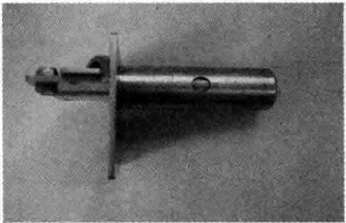

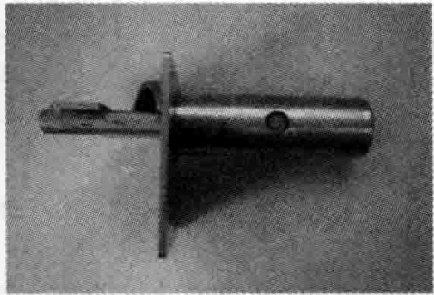

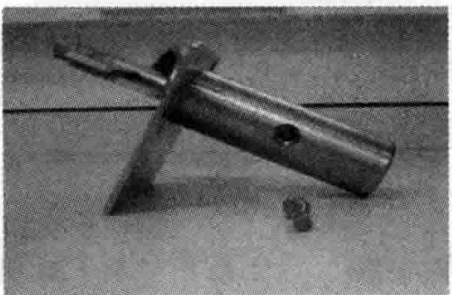

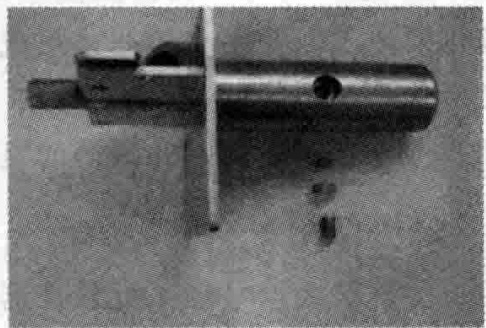

图3.1栓子封装的γ射线源 $^{137}$ Cs

图3.1中， $^{137}$ Cs γ 射线源是小纽扣大小的薄薄圆柱体，被封装在一个长圆柱体的中间小孔中。长圆柱体上头有一把手，把手旋转即可以关闭大圆柱体中间小孔以隔绝γ源。

## 3.1.2 探测器扫描方式

七个探测器（探测器 Saint-Gobain Industrial Ceramics，Inc. BICRON AS-SEMBLED IN INDIA Mod:2M2/2-X，直径2.125in，长12. 5in。前置放大器GANBEERA Industries, Inc. 800 Research pky, Meriden, CT 06450 Mod: 2007)以 $^{137}$ Cs 源为圆心、角间距 $5^{\circ}$ 扇形排列，固定在一个由精密数控马达精确控制旋转的钢板上。扫描方式如下:

①整组探测器在每个测量位置（aposition)停留5.7s，采样频率20Hz，这样在一个测量位置每个探测器采样114次，探测接受γ射线光子；

②整组探测器以 $^{137}$  Cs γ射线源为圆心，以0.2°间距共旋转4.8°停留25个测量位置，以确保整个被扫描体截面都被扫到（称为一辐射照，aview)，并且有足够数量的γ射线穿过被扫描截面的每个像素小区间，如图3.2所示；

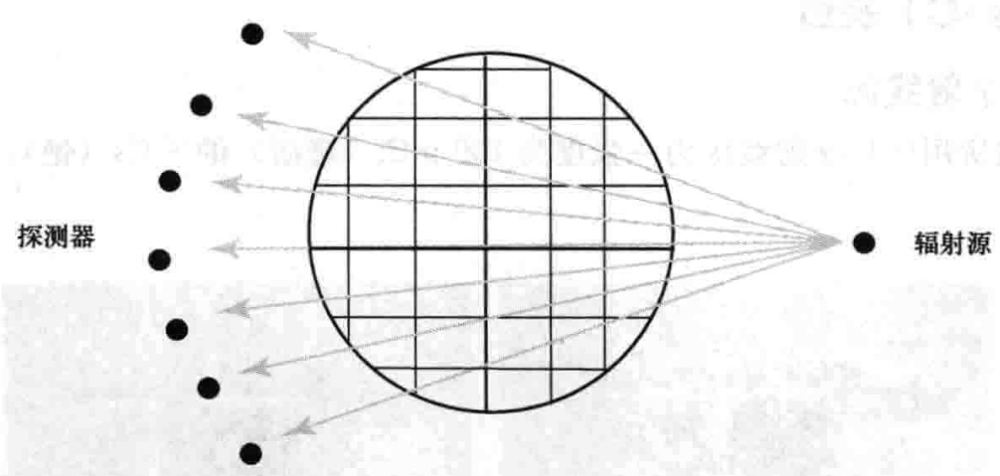

图 3.2 七个探测器 CT 扫描示意

③在 $360^{\circ}$ 范围内均匀旋转测量一百个辐射照。

这样共采集1995000个数据，形成17500条辐射线，以满足γ射线随机信号采样和CT测量装置空间分辨率的要求。这样旋转一周共花近5h，又是依据大量随机信号进行统计处理，因此测得的是气含率分布的时均值。

## 3.1.3γ射线信号处理

图3.3是γ射线信号加工处理仪器单元构成。γ射线信号加工处理过程简述如下:890V直流电压加于探测器。137Cs发出γ射线被探测器所接受，在探测器光电管中产生电脉冲，被探测器前置放大器进行第1次放大。第1次放大后电脉冲传送至定时滤波放大器进行滤波和第2次放大。第2次放大后电脉冲传送至甄别器去掉康普顿低平电脉冲信号，再进入计数器计数，并在计算机上在线显示。所以，最终在计算机屏幕上显示的是在一定时间内探测器探测到且经过电子仪器单元加工处理的高平电脉冲数，即高能γ光子。各仪器单元分叙如下。

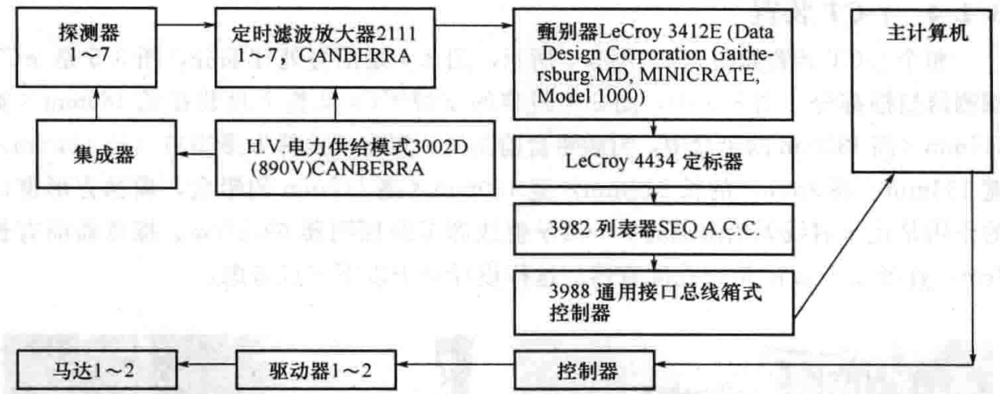

图3.3γ射线信号加工处理仪器单元

(1)定时滤波放大器定时滤波放大器（Timing Filter Amplifer 2111)是一种为加强定时分析而设计的宽频带脉冲成形放大器，增益高，可调范围大。它带有可变的微积分时间常数，可做定时用，也可以使脉冲成形，优化信噪比。还可做宽频带或多带宽通用放大器，输出电压正负5V，在50Ω负载上有较大的输出幅度。仪器由限幅器、倒相选择及微分网络、四个粗调增益、一个精密细调增益、积分网络和输出放大环等部分组成。

(2）甄别器甄别器(LeCroy3412E，DISCRIM)鉴别输入电脉冲，弃除光电倍增管的热发射噪声脉冲。在甄别器内设有一个连续可调的甄别电平，当输入脉冲高度高于甄别电平时，甄别器就输出一个标准脉冲；当输入脉冲高度低于甄别电平时，甄别器无输出。要求甄别器甄别电平稳定、灵敏度高、时间滞后短、死时间小。

(3)定标器定标器(LeCroy4434SCALER)是一个32 通道的24位计数器，主要功能是在规定的测量时间间隔内把甄别器输出的标准脉冲累计或显示。

(4）其他图 3.3 中，设定Driver1在4A和8（20000）位置 $2120 = 3.6^{\circ}$ ，使得数控马达1可以控制整个CT钢板盘绕轴中心精确 3.6° 正或逆时钟方向水平圆周旋转，见图3.5。设定Driver2在2A和4（20000）位置 $3400 = 0.2^{\circ}$ ，使得数控马达2可以精确控制整个探测器组板绕射线源精确0.2°正或逆时钟方向水平扇形旋转。

马达:WARNER ELECTRIC,SLO-SYN,STEPING MOTOR,TYPE KML093F10 3.21VDC, 5.1 AMPS, 200 STEPS/REV, CONNECT PER213803。Motor drive:WARNERELECTRIC,SLO-SYN, Motor drive (SS2000D6)。

控制器: WARNER ELECTRIC,SLO-SYN Programmable Motion Control, Model SS2001。

数据传输线:An RS232 连接用于运行Program the WARPDRIVETM

## 3.1.4 γ-CT 装置

整个γ-CT装置如图3.4、图3.5所示，图3.4是信号处理部分，图3.5是γ-CT探测器扫描部分。图3.5中，图3.1封装的γ源137Cs又整个封装在长180mm×宽114mm×高130mm的铅盒中，封装铅盒前面又放置有一扁梯方形窗口（长114mm×宽133mm×高9mm)的长113mm×宽180mm×高112mm的铅盒，扁梯方形窗口的作用是让γ射线无铅阻通过。137Cs γ射线源至距探测器69.85cm。探测器前有长7cm、直径2.5cm的铅圆孔准直器。这样设计基于以下三点考虑:

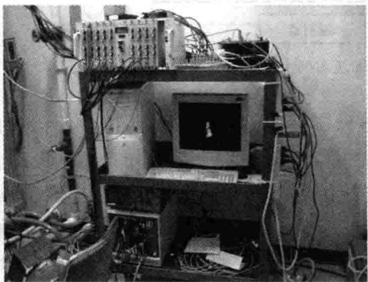

图 3.4 γ射线信号处理仪器照片

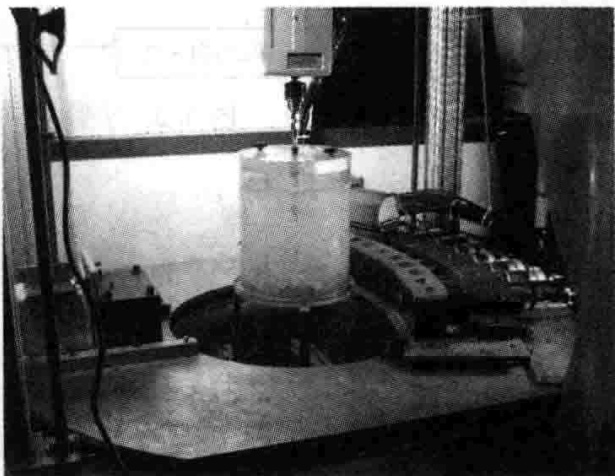

图 3.5 γ-CT 装置照片

①以确定被扫描流体截面像素区间尺寸大小，这里定为2mm×2mm;

②尽可能减少射线源和探测器前的射线漫反射引起的康普顿效应；

③保证γ射线通过被扫描系统衰减后仍然有一定的粒子数进入探测器。

射线源中心至探测器前端距离698.5mm(27.5in)。整个CT装置由数控马达精确控制可以上下移动和绕轴心360°水平圆周旋转。

## 3.2 多探测线路均一化

虽然实验所用七个NaI(T1)闪烁探测器是连入相同的信号加工处理电子仪器单元，但其测量线路是各自独立的，它们不可避免地存在各种不可预测的信号加工处理差异。所以，首先必须对多探测线路做均一化（Synchronize）处理。

## 3.2.1 实验步骤

七探测线路仪器均一化实验步骤如下。

①去掉图3.5中搅拌釜以做空白测量。

②连接电源，开启电子仪器，890V直流电加于探测器。

③计算机程序设置取样频率20Hz。

④Timing Filter Amplifers放大器微分时间设置 out，积分时间设置 100ns,输出阻抗50Ω(Output Terminate in 50Ω， NON-INV)。

⑤利用计算机均一化软件 Genie2k（GammaAcquire and Analysis)调整放大器，具体调整过程如下:

a. 调整各探测线路的 Timing Filter Amplifers放大器粗调或微调，使Genie2k设置在 273keV左右(经验)；

b. 计算机运行程序 tototest. exe(C:/Peter/Debug);

c. 用Excel 软件装载并检查 tototavg. dat(C:/Peter/Debug)，保存数据文件，再用Excel软件图像检查是否每个探测线路康普顿峰都在同一设定的能阈值结束，如500keV；

d. 如果探测器康普顿峰不在500keV结束，放大器微调使得康普顿峰在500keV结束；

e. 计算机运行程序，各探测器同时进行空白测量实验，检查计算机屏幕是否显示同样的光子数。如是则调整成功，如不是则需要重新调整放大器，直至各探测器所显示光子数尽可能相近。

## 3.2.2调整过程

七探头测量线路均一化调整过程记录如表3.1所示。

表3.1七探头测量线路均一化调整过程

<table><tr><td colspan="2">探测器</td><td>D1</td><td>D2</td><td>D3</td><td>D4</td><td>D5</td><td>D6</td><td>D7</td></tr><tr><td>测量1</td><td>Genie2k</td><td>288</td><td>281</td><td>285</td><td>291</td><td>279</td><td>270</td><td>263 keV</td></tr><tr><td rowspan="4">放大器位置</td><td>粗调</td><td>30</td><td>100</td><td>100</td><td>100</td><td>100</td><td>100</td><td>10</td></tr><tr><td>微调</td><td>0.75</td><td>0.8</td><td>0.8</td><td>1.06</td><td>1.10</td><td>0.65</td><td>1.30</td></tr><tr><td>C1</td><td>535</td><td>520</td><td>540</td><td>550</td><td>510</td><td>510</td><td>485</td></tr><tr><td>C2</td><td>78</td><td>75</td><td>69</td><td>71</td><td>62</td><td>70</td><td>80</td></tr><tr><td colspan="2">能量阈值 480keV</td><td>82</td><td>79</td><td>74</td><td>77</td><td>66</td><td>75</td><td>80</td></tr><tr><td colspan="2">空白测量(480keV)</td><td>83</td><td>78</td><td>75</td><td>79</td><td>68</td><td>77</td><td>82</td></tr><tr><td colspan="2">能量阈值 500keV</td><td>81</td><td>77</td><td>73</td><td>74</td><td>64</td><td>71</td><td>72</td></tr><tr><td colspan="2">空白测量(500keV)</td><td>81</td><td>78</td><td>76</td><td>78</td><td>64</td><td>74</td><td>73</td></tr><tr><td colspan="2">能量阈值 520keV</td><td>80</td><td>75</td><td>73</td><td>74</td><td>57</td><td>68</td><td>44</td></tr><tr><td colspan="2">空白测量(520keV)</td><td>80</td><td>76</td><td>72</td><td>77</td><td>60</td><td>69</td><td>50</td></tr></table>

结论:图形观察空白测量均一化很相近，但光子数却有不少差别，需要调整在75\~80（据数字成像经验）推论:应先求各探测器光子数接近，而不是均一化图形

<table><tr><td colspan="2">探测器</td><td>D1</td><td>D2</td><td>D3</td><td>D4</td><td>D5</td><td>D6</td><td>D7</td></tr><tr><td>测量2</td><td>放大器调整</td><td>-9</td><td>不动</td><td>-12</td><td>-18</td><td>+6</td><td>+6</td><td>+21</td></tr><tr><td></td><td>Genie2k</td><td>279</td><td>281</td><td>273</td><td>276</td><td>285</td><td>276</td><td>284 keV</td></tr><tr><td></td><td>C1</td><td>520</td><td>520</td><td>520</td><td>520</td><td>520</td><td>520</td><td>525</td></tr><tr><td></td><td>C2</td><td>76</td><td>75</td><td>68</td><td>70</td><td>63</td><td>73</td><td>82</td></tr><tr><td colspan="2">能量阈值480keV</td><td>80</td><td>79</td><td>73</td><td>75</td><td>68</td><td>77</td><td>86</td></tr><tr><td colspan="2">能量阈值500keV</td><td>79</td><td>77</td><td>72</td><td>74</td><td>66</td><td>75</td><td>83</td></tr><tr><td colspan="9">结论:1.通过GENIE2k,按3/5keV调整能量阈值到520keV,均一化有效,但各探测器光子数并不相等;2.康普顿0点光子数C2值改变很小,不怎么随能量阈值变化</td></tr><tr><td>测量3</td><td>放大器调整</td><td>不动</td><td>不动</td><td>+9</td><td>+6</td><td>+12</td><td>+3</td><td>-6</td></tr><tr><td></td><td>Genie2k</td><td>279</td><td>281</td><td>282</td><td>282</td><td>297</td><td>280</td><td>278 keV</td></tr><tr><td></td><td>C1</td><td>515</td><td>515</td><td>530</td><td>530</td><td>540</td><td>530</td><td>515</td></tr><tr><td></td><td>C2</td><td>79</td><td>76</td><td>70</td><td>72</td><td>64</td><td>72</td><td>81</td></tr><tr><td>能量阈值</td><td>480keV</td><td>81</td><td>79</td><td>74</td><td>77</td><td>69</td><td>79</td><td>83</td></tr><tr><td></td><td>500keV</td><td>79</td><td>77</td><td>73</td><td>76</td><td>67</td><td>77</td><td>83</td></tr><tr><td></td><td>520keV</td><td>76</td><td>75</td><td>72</td><td>75</td><td>67</td><td>75</td><td>78</td></tr><tr><td></td><td>540keV</td><td>64</td><td>64</td><td>68</td><td>69</td><td>64</td><td>68</td><td>64</td></tr><tr><td colspan="9">结论:调整会影响相邻探测线路,如探测器1和2未调整,但受影响康普顿C1值变低,由520keV降低到515keV</td></tr><tr><td>测量4-1</td><td>放大器调整</td><td>不动</td><td>+1</td><td>+4</td><td>+2</td><td>+10</td><td>+2</td><td>-3</td></tr><tr><td></td><td>Genie2k</td><td>279</td><td>282</td><td>286</td><td>284</td><td>307</td><td>282</td><td>275keV</td></tr><tr><td></td><td>C1</td><td>515</td><td>520</td><td>540</td><td>530</td><td>560</td><td>530</td><td>510</td></tr><tr><td></td><td>C2</td><td>77</td><td>75</td><td>70</td><td>74</td><td>63</td><td>72</td><td>80</td></tr><tr><td>能量阈值</td><td>480keV</td><td>82</td><td>78</td><td>74</td><td>78</td><td>69</td><td>78</td><td>83</td></tr><tr><td></td><td>500keV</td><td>79</td><td>78</td><td>74</td><td>78</td><td>68</td><td>76</td><td>82</td></tr><tr><td></td><td>520keV</td><td>76</td><td>75</td><td>72</td><td>74</td><td>68</td><td>74</td><td>75</td></tr><tr><td></td><td>540keV</td><td>63</td><td>67</td><td>70</td><td>70</td><td>66</td><td>69</td><td>54</td></tr><tr><td colspan="9">结论:第5探测器C1值高达560keV,怀疑第5探测器接触不良,检查第5探测器后,重测</td></tr><tr><td>测量4-2</td><td>Genie2k</td><td>279</td><td>282</td><td>286</td><td>284</td><td>307</td><td>282</td><td>275keV</td></tr><tr><td></td><td>C1</td><td>515</td><td>520</td><td>540</td><td>525</td><td>560</td><td>530</td><td>510</td></tr><tr><td></td><td>C2</td><td>77</td><td>74</td><td>69</td><td>76</td><td>67</td><td>76</td><td>80</td></tr><tr><td rowspan="4">能量阈值</td><td>480keV</td><td>81</td><td>77</td><td>76</td><td>81</td><td>75</td><td>81</td><td>84</td></tr><tr><td>500keV</td><td>78</td><td>77</td><td>74</td><td>79</td><td>71</td><td>79</td><td>81</td></tr><tr><td>520keV</td><td>75</td><td>74</td><td>72</td><td>78</td><td>71</td><td>76</td><td>76</td></tr><tr><td>540keV</td><td>61</td><td>66</td><td>69</td><td>72</td><td>69</td><td>69</td><td>55</td></tr><tr><td colspan="9">结论:第5探测器仍然C1值高达560keV</td></tr><tr><td rowspan="4">测量5</td><td>放大器调整</td><td>不动</td><td>+3</td><td>+6</td><td>-3</td><td>+9</td><td>不动</td><td>不动</td></tr><tr><td>Genie2k</td><td>279</td><td>285</td><td>292</td><td>281</td><td>316</td><td>282</td><td>275keV</td></tr><tr><td>C1</td><td>515</td><td>530</td><td>550</td><td>520</td><td>575</td><td>520</td><td>495</td></tr><tr><td>C2</td><td>76</td><td>74</td><td>69</td><td>77</td><td>67</td><td>78</td><td>82</td></tr><tr><td rowspan="4">能量阈值</td><td>480keV</td><td>80</td><td>79</td><td>76</td><td>81</td><td>75</td><td>82</td><td>84</td></tr><tr><td>500keV</td><td>79</td><td>78</td><td>74</td><td>79</td><td>75</td><td>79</td><td>81</td></tr><tr><td>520keV</td><td>76</td><td>77</td><td>72</td><td>77</td><td>72</td><td>78</td><td>73</td></tr><tr><td>540keV</td><td>61</td><td>71</td><td>71</td><td>70</td><td>71</td><td>66</td><td>50</td></tr><tr><td rowspan="4">测量6</td><td>放大器调整</td><td>不动</td><td>不动</td><td>+6</td><td>不动</td><td>+6</td><td>不动</td><td>+6</td></tr><tr><td>Genie2k</td><td>279</td><td>285</td><td>299</td><td>281</td><td>322</td><td>282</td><td>279</td></tr><tr><td>C1</td><td>515</td><td>530</td><td>565</td><td>525</td><td>600</td><td>525</td><td>515</td></tr><tr><td>C2</td><td>77</td><td>74</td><td>70</td><td>75</td><td>65</td><td>77</td><td>82</td></tr><tr><td rowspan="4">能量阈值</td><td>480keV</td><td>82</td><td>79</td><td>75</td><td>82</td><td>77</td><td>82</td><td>85</td></tr><tr><td>500keV</td><td>79</td><td>78</td><td>75</td><td>79</td><td>75</td><td>80</td><td>82</td></tr><tr><td>520keV</td><td>77</td><td>75</td><td>75</td><td>76</td><td>72</td><td>77</td><td>80</td></tr><tr><td>540keV</td><td>62</td><td>70</td><td>72</td><td>70</td><td>72</td><td>71</td><td>68</td></tr><tr><td rowspan="4">测量7</td><td>放大器调整</td><td>不动</td><td>不动</td><td>不动</td><td>不动</td><td>+19</td><td>不动</td><td>-3</td></tr><tr><td>Genie2k</td><td>279</td><td>285</td><td>299</td><td>281</td><td>341</td><td>282</td><td>274</td></tr><tr><td>C1</td><td>515</td><td>530</td><td>570</td><td>525</td><td>630</td><td>525</td><td>510</td></tr><tr><td>C2</td><td>77</td><td>74</td><td>68</td><td>76</td><td>66</td><td>77</td><td>77</td></tr><tr><td rowspan="4">能量阈值</td><td>480keV</td><td>81</td><td>79</td><td>77</td><td>81</td><td>80</td><td>81</td><td>84</td></tr><tr><td>500keV</td><td>79</td><td>78</td><td>77</td><td>78</td><td>76</td><td>80</td><td>82</td></tr><tr><td>520keV</td><td>74</td><td>76</td><td>75</td><td>76</td><td>77</td><td>77</td><td>73</td></tr><tr><td>540keV</td><td>62</td><td>70</td><td>72</td><td>70</td><td>75</td><td>72</td><td>53</td></tr><tr><td rowspan="4">测量8</td><td>放大器调整</td><td>+3</td><td>不动</td><td>不动</td><td>不动</td><td>不动</td><td>不动</td><td>+3</td></tr><tr><td>Genie2k</td><td>未记录</td><td>285</td><td>299</td><td>281</td><td>341</td><td>282</td><td>未记录</td></tr><tr><td>C1</td><td>525</td><td>525</td><td>570</td><td>525</td><td>630</td><td>525</td><td>505</td></tr><tr><td>C2</td><td>75</td><td>74</td><td>68</td><td>76</td><td>67</td><td>76</td><td>83</td></tr><tr><td rowspan="4">能量阈值</td><td>480keV</td><td>81</td><td>78</td><td>76</td><td>82</td><td>80</td><td>82</td><td>84</td></tr><tr><td>500keV</td><td>79</td><td>77</td><td>74</td><td>80</td><td>77</td><td>80</td><td>82</td></tr><tr><td>520keV</td><td>78</td><td>76</td><td>74</td><td>77</td><td>76</td><td>78</td><td>78</td></tr><tr><td>540keV</td><td>71</td><td>70</td><td>73</td><td>70</td><td>76</td><td>72</td><td>60</td></tr><tr><td rowspan="4">测量9</td><td>放大器调整</td><td>不动</td><td>+2</td><td>+4</td><td>+1</td><td>+2</td><td>不动</td><td>不动</td></tr><tr><td>Genie2k</td><td>未记录</td><td>未记录</td><td>未记录</td><td>未记录</td><td>未记录</td><td>未记录</td><td>未记录</td></tr><tr><td>C1</td><td>525</td><td>525</td><td>570</td><td>525</td><td>630</td><td>525</td><td>505</td></tr><tr><td>C2</td><td>76</td><td>73</td><td>68</td><td>75</td><td>66</td><td>78</td><td>80</td></tr><tr><td rowspan="4">能量阈值</td><td>480keV</td><td>81</td><td>80</td><td>77</td><td>82</td><td>80</td><td>83</td><td>85</td></tr><tr><td>500keV</td><td>80</td><td>80</td><td>75</td><td>79</td><td>79</td><td>81</td><td>83</td></tr><tr><td>520keV</td><td>77</td><td>77</td><td>74</td><td>78</td><td>76</td><td>79</td><td>77</td></tr><tr><td>540keV</td><td>70</td><td>72</td><td>73</td><td>71</td><td>76</td><td>72</td><td>61</td></tr><tr><td rowspan="4">测量10</td><td>放大器调整</td><td>不动</td><td>不动</td><td>+15</td><td>不动</td><td>+2</td><td>-3</td><td>不动</td></tr><tr><td>Genie2k</td><td>未记录</td><td>未记录</td><td>321</td><td>未记录</td><td>346</td><td>276</td><td>未记录</td></tr><tr><td>C1</td><td>530</td><td>535</td><td>615</td><td>530</td><td>630</td><td>515</td><td>515</td></tr><tr><td>C2</td><td>75</td><td>75</td><td>67</td><td>75</td><td>68</td><td>77</td><td>83</td></tr><tr><td rowspan="4">能量阈值</td><td>480keV</td><td>82</td><td>80</td><td>79</td><td>81</td><td>81</td><td>82</td><td>85</td></tr><tr><td>500keV</td><td>80</td><td>79</td><td>77</td><td>80</td><td>79</td><td>80</td><td>83</td></tr><tr><td>520keV</td><td>78</td><td>78</td><td>76</td><td>77</td><td>78</td><td>77</td><td>78</td></tr><tr><td>540keV</td><td>70</td><td>73</td><td>76</td><td>72</td><td>76</td><td>64</td><td>60</td></tr><tr><td rowspan="4">测量11</td><td>放大器调整</td><td>不动</td><td>不动</td><td>+2</td><td>+2</td><td>不动</td><td>+2</td><td>不动</td></tr><tr><td>Genie2k</td><td>282</td><td>287</td><td>323</td><td>284</td><td>345</td><td>278</td><td>278</td></tr><tr><td>C1</td><td>530</td><td>535</td><td>615</td><td>530</td><td>630</td><td>515</td><td>515</td></tr><tr><td>C2</td><td>75</td><td>75</td><td>67</td><td>75</td><td>68</td><td>77</td><td>83</td></tr><tr><td rowspan="4">能量阈值</td><td>480keV</td><td>82</td><td>80</td><td>79</td><td>81</td><td>81</td><td>82</td><td>85</td></tr><tr><td>500keV</td><td>80</td><td>79</td><td>77</td><td>80</td><td>79</td><td>80</td><td>83</td></tr><tr><td>520keV</td><td>78</td><td>76</td><td>77</td><td>78</td><td>78</td><td>79</td><td>78</td></tr><tr><td>540keV</td><td>70</td><td>73</td><td>76</td><td>72</td><td>76</td><td>64</td><td>60</td></tr><tr><td>测量12</td><td>放大器微调</td><td>未记录</td><td>未记录</td><td>未记录</td><td>未记录</td><td>未记录</td><td>未记录</td><td>未记录</td></tr><tr><td></td><td>Genie2k</td><td>282</td><td>290</td><td>325</td><td>284</td><td>345</td><td>278</td><td>278</td></tr><tr><td>能量阈值</td><td>520keV</td><td>77</td><td>77</td><td>77</td><td>79</td><td>76</td><td>78</td><td>78</td></tr><tr><td>测量13</td><td>放大器微调</td><td>不动</td><td>不动</td><td>不动</td><td>-2</td><td>+1</td><td>不动</td><td>不动</td></tr><tr><td></td><td>Genie2k</td><td>282</td><td>290</td><td>325</td><td>280</td><td>347</td><td>278</td><td>278</td></tr><tr><td>能量阈值</td><td>520keV</td><td>78</td><td>76</td><td>76</td><td>77</td><td>78</td><td>78</td><td>78</td></tr><tr><td>测量14</td><td>放大器微调</td><td>不动</td><td>+3</td><td>+3</td><td>不动</td><td>不动</td><td>不动</td><td>不动</td></tr><tr><td></td><td>Genie2k</td><td>282</td><td>293</td><td>328</td><td>280</td><td>347</td><td>278</td><td>278</td></tr><tr><td>能量阈值</td><td>520keV</td><td>77</td><td>77</td><td>77</td><td>77</td><td>78</td><td>79</td><td>77</td></tr><tr><td>测量15</td><td>放大器微调</td><td>不动</td><td>不动</td><td>不动</td><td>不动</td><td>-1</td><td>-2</td><td>不动</td></tr><tr><td></td><td>Genie2k</td><td>282</td><td>293</td><td>328</td><td>280</td><td>343</td><td>274</td><td>278</td></tr><tr><td>能量阈值</td><td>520keV</td><td>77</td><td>77</td><td>76</td><td>77</td><td>78</td><td>77</td><td>77</td></tr><tr><td>测量16</td><td>放大器微调</td><td></td><td></td><td>+2</td><td></td><td>-1</td><td></td><td></td></tr><tr><td></td><td>Genie2k</td><td>282</td><td>293</td><td>331</td><td>280</td><td>343</td><td>274</td><td>278</td></tr><tr><td>能量阈值</td><td>520keV</td><td>77</td><td>78</td><td>78</td><td>78</td><td>78</td><td>76</td><td>77</td></tr><tr><td>测量17</td><td colspan="8">3个View测量实验</td></tr><tr><td rowspan="3">空白测量实验(520keV),整个探测器组旋转4.8°再平均</td><td>View1</td><td>78</td><td>78</td><td>79</td><td>78</td><td>80</td><td>78</td><td>77</td></tr><tr><td>View2</td><td>77</td><td>78</td><td>78</td><td>79</td><td>80</td><td>78</td><td>77</td></tr><tr><td>View3</td><td>78</td><td>77</td><td>76</td><td>77</td><td>78</td><td>77</td><td>78</td></tr><tr><td colspan="9">结论:尽管每个探测器光子数波动较大,但平均数还是相当接近;另外不同探测器之间平均光子数最大偏差值为3</td></tr><tr><td colspan="9">空白实验以后检查Genie2k结果如下,说明Genie2k有微小变化</td></tr><tr><td>Genie2k</td><td></td><td>283</td><td>291</td><td>332</td><td>282</td><td>343</td><td>274</td><td>274</td></tr><tr><td colspan="9">CT扫描测量实验以后检查Genie2k结果如下,说明Genie2k有微小变化</td></tr><tr><td>Genie2k</td><td></td><td>278</td><td>294</td><td>333</td><td>282</td><td>341</td><td>273</td><td>271</td></tr></table>

续表

注:C1为康普顿0点（峰结束处）出子能量（keV)，C2为康普顿0点光子数。

## 3.2.3 分析与讨论

多探测线路均一化有两个目的:一是使得各探测线路输出均一化图形，二是使得各探测线路所接受电脉冲数相等。但从表3.1调整过程来看，这两者很难兼顾。如表3.1中测量2结果，康普顿峰结束处光子能量C1值很接近，各探测线路也很均一化，如图3.6所示，但光子数C2值却有差别；测量11结果及以后光子数C2值都很相近，而康普顿峰结束处光子能量C1值却有很大差别，均一化不好，如图3.7所示。

图 3.6 七探测线路均一化（一）

图3.7 七探测线路均一化（二）

按图3.6，当设置光子能量阈值为500keV时，七个探测器所获得的光子数分别为81、78、76、78、64、74、73，这时虽然均一化好，但光子数却有差别，可见探测线路1（光子数81）和5（光子数64）与其他探测线路有差别。按图

3.7，当设置能量阈值为520keV时，七个探测器所获得的光子数分别为78、78、79、78、80、78、77，这时虽然均一化不好，但光子数却很接近，可见探测线路3和5与其他线路有差别。究其原因，可能是这些探测器或其探测线路仪器的问题，如第5探测器或其探测线路仪器。但由于仪器价格昂贵，不可能轻易更换，好在这些实验数据仍在实验误差范围之内。

## 3.2.4 甄别器能量阈值设置

从图3.6七个探测线路均一化可知，设定甄别器能量阈值为500keV，可去掉500keV以下康普顿效应噪声信号干扰，且此时均一化好，但光子数却有差别。如按图3.7，设定鉴定器能量阈值为520keV，可去掉520keV以下康普顿噪声信号干扰，但仍有520keV以上康普顿噪声信号干扰未能去除，且这时均一化也不好，但光子数却很接近。因为各探测线路所采集光子数是直接参与计算成像的测量信号数据，它们的空白实验测量值应该相等或相近，否则会严重影响实验测量气液两相气含率的准确性。故综合考虑设置甄别器能量阈值为520keV。这与第2章所得“高能γ光子集中在500～560keV范围”结论一致，这是探测器采集有效信息数据的范围。

## 3.2.5多探测线路均一化与光子数响应模型

(1)问题提出 按理说既然多探测线路已均一化，空白测量实验应得到相同或相近的光子数，可当按图3.6七探测线路均一化图形设定鉴定器槛电压为500kV时，它们所接受的光子数却有差别，分别是81、78、76、78、64、74、73。这说明虽然通过调整多探测线路得到了人眼观测的均一化图形，但还不能保证这七个探测线路的均一性。但是，由于这七个探测线路的均一化与所探测光子数只能单个分别调整，因此，建立起其均一化与所探测光子数的响应模型是相当必要的，这对仪器的快速与精确调整具有一定意义。

在第2章2.11.3节对光子能量阈值与光子数关系数据处理与分析讨论中，我们提出了探测γ光子能量阈值与光子数负累积分布和分布密度概念，并且分别运用γ光子能量阈值与光子数负累积分布和概率密度分布概念，解决了如何确定提供足够数量的γ光子有效信号和如何从能量大小混杂在一起的γ光子中过滤掉康普顿效应小能量噪声信号问题。在此基础上，进一步建立起多探测线路均一化与所探测光子数的响应模型。

(2) 响应曲线负累计分布模型 通过第2章表2.8和图2.12γ光子能量阈值与光子数关系曲线的建立、分析和讨论，考虑到该曲线在有限域内连续递减的特征正好与数理统计中累计分布函数的连续递加性质相反，我们提出γ射线测量线路响应曲线负累计分布分段多项式模型，如式(3.1)。

$$
f (x) = \left\{ \begin{array}{l l} a _ {1} x ^ {2} - b _ {1} x + c _ {1} & x \leqslant 3 6 0 \\ a _ {2} x ^ {2} - b _ {2} x + c _ {2} & 3 6 0 <   x \leqslant 5 0 0 \\ a _ {3} x ^ {3} - b _ {3} x ^ {2} + c _ {3} x - d _ {3} & 5 0 0 <   x \leqslant 5 8 0 \\ 0 & x > 5 8 0 \end{array} \right.\tag{3.1}
$$

用Matlab软件模拟计算各分段多项式系数如表3.2所示。图3.8是γ光子响应负累计分布的模拟值与测量值的对照曲线。从图3.8可见，模拟曲线与测量曲线非常吻合。需要说明的是，响应曲线的负累计积分布函数模型的建立及其数值拟合过程完全是经验性的多项式拟合，模型中所设参数并没有任何物理意义。因此，还需建立响应函数的密度分布模型，对响应曲线做更进一步的研究和探讨。

表3.2γ射线响应负累计分布多项式拟合系数

| 系数值 | 多项式1 | 多项式2 | 多项式3 |
| --- | --- | --- | --- |
| $a_i$ | 0.0002 | 0.0001 | 0.1000 |
| $b_i$ | -0.3703 | -0.2155 | -0.1000 |
| $c_i$ | 186.5293 | 147.5295 | 217.0000 |
| $d_i$ | 0 | 0 | -38166.0000 |

图3.8 γ光子响应负累计分布拟合曲线

(3)响应曲线分布密度模型朱国钦等[1]在对γ能谱解析中提到了逆矩阵法，但并未做深人讨论，而Arvind D.Sabharwal[2]求逆矩阵得到了NaI（Tl)探测器探测γ射线响应函数模型。他在假定全能峰半宽度不变的条件下，给出了一个16×16矩阵S=N×R（N代表每个特征道域内的计数率， $R_{ij}$ 是一个列和行分别为每道光子能量与对应脉冲高度的二进制计数关系下的三角阵，S表示测得的脉冲高度分布)，再求合成矩阵 $\boldsymbol{R}_{ij}$ 的逆 $(N = S \times R^{-1})$ ，得到了γ图谱的响应矩阵N(E)，并在此基础上得到了全能峰的Gauss分布函数如下:

$$
Y (E ^ {\prime}) = Y _ {0} \exp \left[ - \frac {(E - E ^ {\prime}) ^ {2}}{\Delta E ^ {2} / (4 \times \ln 2)} \right]\tag{3.2}
$$

式中， $\Delta E$ 为半峰宽； $Y_{0}$ 为测量谱图峰高，其值大小为:

$$
Y _ {0} = \frac {1}{1 . 0 6 4 \Delta E} n (E) \varepsilon_ {\mathrm{i}} (E) \varepsilon_ {\mathrm{p}} (E)\tag{3.3}
$$

式中， $\varepsilon_{\mathrm{i}}(E),\varepsilon_{\mathrm{p}}(E)$ 分别为探测器本征效率与全能峰效率；n(E)是通过逆阵求得的响应矩阵N（E）。

张引娣等[3]根据探测器响应原理，给出了响应函数式(3.4)，并通过高斯数值求积计算了任意单能γ射线的响应函数值:

$$
R (E _ {0}, h) = \eta (E _ {0}) \int_ {0} ^ {E _ {0}} D (E _ {0}, E) G (E, h) \mathrm{d} E\tag{3.4}
$$

式中，函数G（E，h）为一正态分布的脉冲幅度Gauss函数； $\eta (E_0)$ 为探测器的计数效率，是探测器晶体内至少发生一次反应的γ射线与入射到探测器上的γ射线的数目比； $D(E_0,E)$ 为探测器能量沉积谱。

再给出符合γ光子全能峰分布特征的Gauss函数模型:

$$
G (E, h) = \frac {1}{\sqrt {2 \pi} \sigma (E)} \exp \left\{- \frac {\left[ f (E) - h \right] ^ {2}}{2 \sigma^ {2} (E)} \right\}\tag{3.5}
$$

式中，h为道宽； $\sigma (E)$ 为正态分布的脉冲幅度的绝对标准偏差； $f(E)$ 为能量的线性函数，经分析计算得到了它们相应的经验表达式:

$$
\sigma (E) = 0. 0 4 6 4 6 E ^ {0. 6 6}, f (E) = \alpha E + \beta\tag{3.6}
$$

上述两种方法在承认全能峰为高斯分布的基础上建立了γ光子分布的Gauss函数模型，并说明了对应参数的物理意义。在此基础之上，我们提出了一个简化的偏高斯全能峰分布和康普顿效应低能峰随机分布之和的γ射线测量线路响应分布密度模型如下:

$$
f (E _ {0}, E) = \left\{ \begin{array}{l l} \frac {A _ {1}}{B _ {1} \sqrt {2 \pi}} \mathrm{e} ^ {- \frac {(E - E _ {0}) ^ {2}}{2 B _ {1} ^ {2}}}, & E > 4 8 0 \\ A _ {2} E + A _ {3} / E + A _ {4} \sin (\omega E + \varphi) + \varepsilon , E \leqslant 4 8 0 \end{array} \right.\tag{3.7}
$$

式中， $E_{0}$ 为γ光子的入射能量，即为γ射线响应分布密度拟合曲线中全能峰的最高点所对应的能量阈值，图3.9中模拟曲线对应的 $E_{0}$ 值为532.5keV。B²为高斯分布的方差，说明构成全能峰的γ光子的离散程度，该量直接决定了全能峰的半宽度与能量分辨率，它是影响γ射线全能峰峰形的敏感因素，其值在表3.3中给出。 $A_{1}$ 是一个微调参数，它可以在一个微小范围内调整全能峰高。设定它的初值为1，然后微调参数 $A_{1}$ 使之模拟更好。 $1 / A_{2},A_{3}$ 为两个对应不同的能量阈值。其中 $1 / A_{2}$ 是康普顿效应噪声干扰信号基本完全被去除时对应的能量阈值，其值为500keV，这正好和实验结果相吻合。 $A_{3}$ 为初始能量阈值，即探测器开始接收到光电信号时所对应能量阈值，其值约为20keV。 $A_{4}$ 为康普顿散射中散射光子的能量与入射光子能量的比值，为一微分计数。散射光子能量为 $E_{c}$用式（3.8）计算:

$$
E _ {\mathrm{c}} = \frac {E _ {0}}{1 + a _ {0} (1 - \cos \theta)}\tag{3.8}
$$

式中， θ 为散射角； $E_{0}$ 为光子人射能量；系数 $a_0 = E_0 / (mc^2)$

φ ε 均为指示性参数，其中参数ε为一个康普顿坪相对位移量的指示参数。考虑到影响γ射线响应密度函数的因素复杂，φ初设为 φ 0. ε 反映康普顿边向高能侧的移动，它的初值设为1.0，参见张锦藻[4]与 Y. Jin $^{[5]}$ 对响应函数的研究。其中， $A_{2}$ 、 $A_{3}$ 、 $A_{4}$ 均为影响γ射线响应函数的敏感性因素。

需指明的是，能量阈值大于480keV时的E与小于480keV时不同，即能量阈值大于480keV时，E应修正为:

$$
E = E _ {\mathrm{a}} + f E _ {\mathrm{b}}\tag{3.9}
$$

式中， $E_{b}$ 为全能峰函数项应加入低能尾小高斯函数的修正项；f为加入低能尾小高斯函数修正项的峰高，齐荣等[6]也对全能峰函数做了相应的修正。表3.3列出了γ射线响应分布密度函数的敏感性参数。

表3.3 γ射线响应分布密度函数的敏感性参数

| 敏感性参数 | B1 | A2 | A3 | A4 |
| --- | --- | --- | --- | --- |
| 计算值 | 0.0800 | 0.0020 | 19.7428 | 0.8912 |

据第2章表2.8，利用Matlab求平均值方法得到了七个探测器的平均响应曲线，如图3.9所示，图中还列出了模拟曲线。由图3.9可知，模拟曲线与实验所测平均响应曲线吻合较好。

(4)模型应用唐碧华[7]对影响γ射线响应图谱因素做了分析，认为均一化的过程主要是消除三大因素的干扰:一是电离过程与光电倍增过程的统计涨落；二是探测器本身及前置放大器产生的噪声；三是电子学系统的不稳定性，主要包括放大器增益不稳，多道分析器道宽、道阈漂移等。因为各测量仪器不可避免地存在测量精确性和误差问题，要从本质上解决多测量线路均一化问题有一定难度。我们这里提出利用式（3.7）γ射线响应分布密度模型中偏高斯分布函数(偏高斯分布全能峰)来实现模拟值与多探测线路平均测量值误差平方和最小为均一化判断标准，以避免人眼观测的不精确性，并且开发判断程序植入计算机以实现计算机在线精确快速判断，这方面的研究还有待继续深入[8]。

图3.9 γ射线响应分布密度拟合曲线

## 符号说明

<table><tr><td>t</td><td>采样时间,s</td><td> $\sum t$ </td><td>液体的总接触时间,s</td></tr><tr><td rowspan="2"> $\Delta t_i$ </td><td rowspan="2">探针在第i个气泡中的时间,s</td><td> $t_g$ </td><td>气相接触时间,s</td></tr><tr><td> $\alpha$ </td><td>气含率</td></tr><tr><td> $\varepsilon_g$ </td><td>气含率</td><td>d</td><td>搅拌桨直径,mm</td></tr><tr><td>r</td><td>距中心距离,mm</td><td>p</td><td>流体压力,Pa</td></tr><tr><td>h</td><td>测量点高度,mm</td><td rowspan="2">Q</td><td rowspan="2">毛细管内气体或液体的流量,mL</td></tr><tr><td> $V_g$ </td><td>气体体积流率, $m^3/h$ </td></tr><tr><td>H</td><td>鼓泡塔的总高度,mm</td><td rowspan="2"> $S_0$ </td><td rowspan="2">毛细管喇叭口截面的面积, $mm^2$ </td></tr><tr><td> $\alpha$ </td><td>平均截面含气率</td></tr><tr><td> $\alpha_c$ </td><td>局部含气率</td><td rowspan="2"> $\nu$ </td><td rowspan="2">搅拌槽内气液分散系体积, $mm^3$ </td></tr><tr><td>r</td><td>探针距中心距离,mm</td></tr><tr><td>R</td><td>鼓泡塔半径,mm</td><td>V</td><td>测量控制体的体积</td></tr><tr><td>E</td><td>电压值,V</td><td> $V_1(t)$ </td><td>液相所占的体积</td></tr><tr><td> $E_1$ </td><td>电压值,V</td><td> $\alpha_g$ </td><td>气含率</td></tr><tr><td> $E_2$ </td><td>电压值,V</td><td> $U_g$ </td><td>表观气速,m/s</td></tr><tr><td> $E_3$ </td><td>电压值,V</td><td> $U_s$ </td><td>混合物循环速度,m/s</td></tr><tr><td>N</td><td>概率密度</td><td> $U_b$ </td><td>搅拌釜叶轮的转速,m/s</td></tr><tr><td> $N_0$ </td><td>气液区分点的概率密度</td><td> $\varepsilon_i(E)$ </td><td>探测器的本征效率</td></tr><tr><td> $\epsilon_{\mathrm {p}}(E)$ </td><td>探测器的全能峰效率</td><td> $Y_0$ </td><td>全能峰的峰高</td></tr><tr><td> $\eta (E_0)$ </td><td>探测器的计数效率</td><td> $\sigma (E)$ </td><td>正态分布的标准偏差</td></tr><tr><td> $E_0$ </td><td>γ光子的入射能量,keV</td><td> $E_a$ </td><td>未修正的全能峰能量值,keV</td></tr><tr><td>E</td><td>探测器接收的γ光子能量,keV</td><td rowspan="2"> $E_b$ </td><td rowspan="2">全能峰能量的小高斯修正项,keV</td></tr><tr><td> $E_c$ </td><td>散射光子的能量,keV</td></tr><tr><td>h</td><td>多道分析器的道数</td><td>f</td><td> $E_b$ 项的修正系数</td></tr><tr><td>ΔE</td><td>全能峰的半峰宽,keV</td><td></td><td></td></tr></table>

## 参考文献

[1]朱国钦，查传玉，郑仁淑.HD-8004型NaI（Tl) 闪烁谱仪测量自然γ能谱的精度[J].核电子学与探测技术，1994，14（1):39-45.

[2] Arvind D Sabharwal, Manpreet Singh, Bhajan Singh, Sandhu BS. Response function of NaI (Tl) detectors and multiple backscatteringofgammaraysin aluminium. Applied Radiation and Isotopes, 2008, 66 (10): 1467-1473.

[3]张引娣，梅立泉.NaI（Tl)探测器对伽玛射线响应函数的数值计算[J].西安工程学院学报，1998，20(4):66-69.

[4]张锦藻，王书铨，等.对γ探测器响应函数的研究[J].哈尔滨科学技术大学学报，1991，15（2):74-80.

[5] Jin Y, Gardner R P, Verghese K. A semi-empirical model for the gamma-ray response function of germanium detectors based on fundamental interaction mechanisms. Nuclear Instruments and Methods in Physics Research Section A: Accelerators, Spectrometers, Detectors and Associated Equipment, 1986,242 (3): 416-426.

[6]齐荣，毛永，陈熙萌.快速NaI全身计数器γ谱全能峰形函数的探讨[J].核技术，2008，31（5）:332-334.

[7]唐碧华.γ射线探测效率及响应函数的蒙特卡罗方法研究[D].四川:四川大学，2006.

[8]刘跃进，李伟，白鸽，等.137Csγ射线CT多探测器均一化响应模型[J].仪器仪表学报，2010，31 (4): 333-338.

## 第4章

# γ-CT数字图像重建

CT阵列探测器所探测到的穿过气液搅拌釜的γ射线衰减信号，经过计算机图像重建，可得到搅拌釜气含率断面分布图像和周向平均气含率沿半径变化的数字曲线。本章阐述CT数字成像的数学基础及几种CT数字图像重建方法，重点结合γ射线 CT 实验装置推导EM 算法的成像公式，实现γ射线CT 扫描Rushton气液搅拌釜气含率断面分布的数字成像。

## 4.1 CT 图像重建的数学基础

CT图像重建的思想最早可追溯到1917年，奥地利数学家Radon首先找到从函数线积分重建该函数的求解方法。后来，他所证明的Radon变换和Fourier切片定理构成了图像重建的数学理论基础[1]。下面先阐述图像重建中常用的几种坐标系间的转换。

## 4.1.1 坐标系转换

待建图像可用直角坐标（x，y）或极坐标（r，θ）表示，二者之间转换关系为:

$$
\left\{ \begin{array}{l} x = r \cos \theta \\ y = r \sin \theta \end{array} \right.\tag{4.1}
$$

考虑计算方便，定义另一坐标系 $(x_{r},y_{r})$ ，令新坐标系与原坐标系的坐标原点重合，平行于射线方向为 $y_{r}$ 方向，xr方向垂直 $y_{r}$ 方向，见图4.1，则点$(x,y)$ 在投影角度 φ 下的坐标 $(x_{r},y_{r})$ 可表示为:

$$
\left( \begin{array}{l} x _ {r} \\ y _ {r} \end{array} \right) = \left( \begin{array}{c c} \cos \phi & \sin \phi \\ - \sin \phi & \cos \phi \end{array} \right) \binom{x}{y}\tag{4.2}
$$

## 4.1.2 Radon变换及逆变换

CT扫描时，从射线源发出的射线，通过物场吸收衰减后，被准直器过滤成狭窄射束后再被探测器接受，经过信号处理电路将射线信号转换为数字信号，传送到计算机。由于物场中不同物质的射线吸收系数不同，因而探测器得到的射线强度信号实际上包含了射线传输路径上的射线吸收系数的积分信息。通过图像重建算法，可以求出物场中射线吸收系数的分布的二维数字图像。Radon变换是一种直线积分的投影变换，二维Radon变换为[2]:

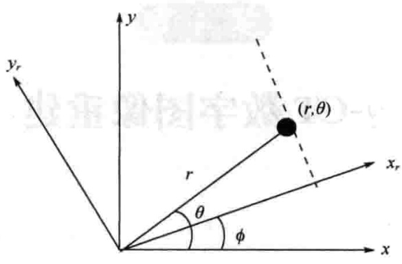

图4.1 几种坐标系间的转换

$$
\begin{array}{r l} p (\rho , \beta) & = \int_ {l} f (x, y) \mathrm{d} l = \int_ {l} \widehat {f} (r, \theta) \mathrm{d} l = \int_ {- \infty} ^ {+ \infty} \int_ {- \infty} ^ {+ \infty} f (x, y) \\ & \quad \delta (x \cos \beta + y \sin \beta - \rho) \mathrm{d} x \mathrm{d} y \end{array}\tag{4.3}
$$

式中， $(x,y)$ 表示像素点在直角系中的坐标； $(r,\theta)$ 是像素点 $(x,y)$ 的极坐标； β 表示旋转角； δ(x) 是采样函数； $f(x,y)$ 或 $\widehat{f} (r,\theta)$ 表示图像中像素点$(x,y)$ 或 $(r,\theta)$ (r, 的灰度值。二维Radon反变换为:

$$
f (x, y) = \widehat {f} (r, \theta) = \frac {1}{2 \pi^ {2}} \int_ {0} ^ {\pi} \int_ {- \infty} ^ {+ \infty} \frac {1}{r \cos (\theta - \beta) - \rho} \times \frac {\partial p}{\partial \rho} \mathrm{d} \rho \mathrm{d} \beta\tag{4.4}
$$

$$
x = r \cos \theta , y = r \sin \theta , r = \sqrt {x ^ {2} + y ^ {2}}, \rho = x \cos \theta + y \sin \theta\tag{4.5}
$$

## 4.1.3 傅里叶切片定理

在第2章γ射线及探测2.7节NaI（T1) 闪烁探测器的性能指标探测效率的辐射方式中曾经提到，CT扫描存在平行束投影和扇形束投影两种方式，其中扇形束计算是在平行束投影基础上进行校正。因此，这里以平行束为例来说明傅里叶切片定理[2](也称为中心切片定理或投影定理)。

以 y, 轴为投影轴的投影为

$$
p _ {\phi} (x _ {r}) = \int_ {- \infty} ^ {\infty} f (x _ {r}, y _ {r}) \mathrm{d} y _ {r}\tag{4.6}
$$

它的一维傅里叶变换为:

$$
\begin{array}{c} F _ {1} \left[ p _ {\phi} (x _ {r}) \right] = \int_ {- \infty} ^ {\infty} p _ {\phi} (x _ {r}) \mathrm{e} ^ {- i \times 2 \pi \rho x _ {r}} \mathrm{d} x _ {r} \\ = \int_ {- \infty} ^ {\infty} \int_ {- \infty} ^ {\infty} f _ {r} (x _ {r}, y _ {r}) \mathrm{d} y _ {r} \mathrm{e} ^ {- i \times 2 \pi \rho x _ {r}} \mathrm{d} x _ {r} = p _ {\phi} (\rho) \\ \mathrm{d} x _ {r} \mathrm{d} y _ {r} = \left| \begin{array}{l l} \partial x _ {r} / \partial x & \partial x _ {r} / \partial y \\ \partial y _ {r} / \partial x & \partial y _ {r} / \partial y \end{array} \right| \mathrm{d} x \mathrm{d} y = \left| \begin{array}{l l} \cos \phi & \sin \phi \\ - \sin \phi & \cos \phi \end{array} \right| \mathrm{d} x \mathrm{d} y = \mathrm{d} x \mathrm{d} y \end{array}\tag{4.7}
$$

(4.8)

当 $\omega_{1},\omega_{2}$ 满足条件

$$
\left\{ \begin{array}{l} \omega_ {1} = 2 \pi \rho \cos \phi \\ \omega_ {2} = 2 \pi \rho \sin \phi \end{array} \right.\tag{4.9}
$$

有

$$
\begin{array}{r l} F _ {1} = [ p _ {\phi} (x _ {r}) ] & = \int_ {- \infty} ^ {\infty} \int_ {- \infty} ^ {\infty} f (x, y) \mathrm{e} ^ {- i (\omega_ {1} x = \omega_ {2} y)} \left| \begin{array}{l} \mathrm{d} x \mathrm{d} y \\ \omega_ {1} = 2 \pi \rho \cos \phi \\ \omega_ {2} = 2 \pi \rho \sin \phi \end{array} \right. \\ & = F (\rho , \phi) \Bigg | _ {\phi = \arctan \frac {\omega_ {1}}{\omega_ {2}}} \\ & = F (\omega_ {1}, \omega_ {2}) \Bigg | _ {\substack {\omega_ {1} = 2 \pi \rho \cos \phi \\ \omega_ {2} = 2 \pi \rho \sin \phi}} \end{array}\tag{4.10}
$$

上式即为中心切片定理。其文字表述为:图像 $f(x,y)$ 在视角φ时的投影 φ $p(s,\phi)$ 的一维傅里叶变换等同于该图像二维傅里叶变换 $F(\omega_1,\omega_2) = \widehat{F} (\rho ,\phi)$的一个中心切片，该切片与u轴的夹角成 φ ，且通过原点。

设 $f(x,y)$ 在每个投影角度 φ 下的投影为 $p_{\phi}(s)$ ，其中 $|s|$ (即 $x_{r}$ ) 为点$(x,y)$ 在 $\phi^{\mathrm{T}}$ 方向到坐标原点的投影距离， $f(x,y)$ 的二维傅里叶变换为$F(\omega_{1},\omega_{2}) = F(\rho ,\phi)$ ，根据中心切片定理，可通过 $f(x,y)$ 在不同角度 φ 下的Radon 变换值 $p_{\phi}(s)$ 的一维傅里叶变换求得，即

$$
F (\omega_ {1}, \omega_ {2}) = F (\rho , \phi) = F _ {1} [ p _ {\phi} (s) ] = p _ {\phi} (\rho) = p (\rho , \phi)\tag{4.11}
$$

中心切片定理可理解为:通过在投影上执行傅里叶变换，可从每个投影中得到物体的二维傅里叶变换，即在0到π的范围内采集足够多的投影，就可以填满试图重建的物体的整个傅里叶空间。只要得到它的傅里叶变换，就可以用傅里叶反变换恢复物体本身，CT图像重建过程就是求得一系列一维傅里叶变换以后，再做一次二维傅里叶逆变换。

## 4.2 CT 重建算法概述

重建算法是CT数字成像的关键，不同的算法不仅会影响重建图像质量，而且对计算量和数据量要求也有很大不同[2]。在过去的三十年里，尽管X-CT成像技术得到了长足的发展，但直到现在CT重建算法仍然是一个重要的研究课题[3\~6]。CT重建算法大致可分为变换法、迭代法两大类。

(1)变换法变换法即解析法，是以Radon变换理论为基础，对横断面的直接数学反计算，包括滤波反投影算法(FBP)、卷积反投影算法(CBP)和Radon逆变换算法。

(2)迭代法迭代法是通过对初始假定图像进行数学迭代运算重建图像，常用的有代数重建法(ART)、极大嫡迭代算法和根据估计理论得到的期望最大化重建算法如ML-EM、Os-EM、Bayesian重建算法等[7]，其中期望最大化算法是一种基于统计理论的随机参数估计方法。

各种CT重建算法各有其特点，其中滤波反投影算法简单、重建速度较快，是CT重建技术中常用的算法。但该算法要求采集投影角度完全，且该算法重建图像易产生星状伪迹[8]。傅里叶重建算法重建速度快，但由于在计算过程中的插值处理的误差影响精度，进而影响重建图像质量[9]。代数迭代重建算法具有好的重建图像质量，尤其适合投影数据不是均匀分布且投影数据不足的情况，但计算量大、重建时间长[10]。随着计算机硬件条件的改善，计算速度加快，代数迭代重建算法越来越被看好[11]。

## 4.3 反投影算法

反投影重建算法是较早应用于实际CT系统中的图像重建算法，其中最简单的是线性反投影，它不需要复杂的数学模型，直观易懂，成为研究图像重建算法的基础。在此基础上不断涌现出新的重建算法，其中较典型的是滤波反投影法[12]。

## 4.3.1 滤波反投影算法

滤波反投影算法是CT重建算法中应用较为广泛的一种算法[13]，它把断层平面中某一点的密度值看作是该平面内所有经过该点的射线投影之和的平均值，图像重建算法过程为:①采集不同视角下的投影；②求出各投影的一维傅里叶变换，此即图像二维傅里叶变换过原点的各切片，理论上是连续的无穷多片；③将上述各切片汇集成图像的二维傅里叶变换，求二维傅里叶反变换得重建图像。

反投影是把取自有限物体空间的投影均匀地抹回到射线所及的无限空间的各点，包括原先像素值零点，这样就使得原始图像像素值零点经反投影重建后不等于零即产生星状伪影从而使图像失真。要除去反投影算法的星状伪迹，可加一滤波器，通常有以下两种方式，如图4.2所示。

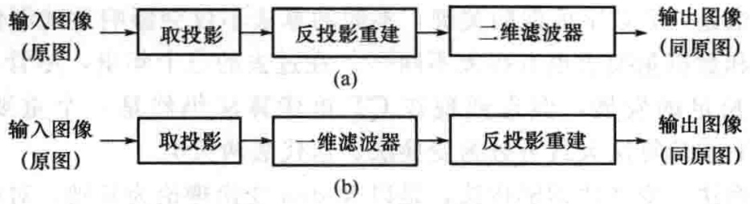

图 4.2 两种去星状伪迹方式

待建图像为 $f(x,y)$ 其2D傅氏变换为: $F(\omega_1, \omega_2) = \widehat{F}(\rho, \theta)$由中心切片定理:

(4.12)

$$
F (\omega_ {1}, \omega_ {2}) = \widehat {F} (\rho , \theta) = F [ p _ {\phi} (x _ {r}) ] = p _ {\phi} (\rho) = p (\rho , \phi)\tag{4.13}
$$

待建图像 $\widehat{f} (r,\theta) = f(x,y) = F_2^{-1}\big[F(\omega_1,\omega_2)\big]$

$$
= \int_ {0} ^ {\pi} \mathrm{d} \phi \int_ {- \infty} ^ {\infty} | \rho | p (\rho , \phi) \mathrm{e} ^ {j \times 2 \pi \rho r \cos (\theta - \phi)} \mathrm{d} \rho\tag{4.14}
$$

其中

$$
\begin{array}{r l} \int_ {- \infty} ^ {\infty} | \rho | p (\rho , \phi) e ^ {j \times 2 \pi \rho r \cos (\theta - \phi)} d \rho & = h (x _ {r}) p (x _ {r}, \phi) | _ {x _ {r} = r \cos (\theta - \phi)} \\ & = g (x _ {r}, \phi) | _ {x _ {r} = r \cos (\theta - \phi)} = g [ r \cos (\theta - \phi), \phi ] ^ {4} \end{array}\tag{4.15}
$$

待建物体 $f(x,y)$ 的投影 $p(x_{r},\phi)$ 经过传递函数为 $\left|\rho\right|=F\left[h(x_{r})\right]$ 的滤波器滤波后，得到修正后的投影 $g(x_{r},\phi)$ 在 $x_{r} = r\cos (\theta -\phi)$ 处的值，这恰是通过给定点的射线方程，则:

$$
\widehat {f} (r, \theta) = \int_ {0} ^ {\pi} g [ r \cos (\theta - \phi), \phi ] \mathrm{d} \phi\tag{4.16}
$$

其物理意义为:经过给定点 $(r,\theta)$ 的所有滤波后的(射线）投影在$0\sim \pi$ 范围内的累加，即反投影重建，得出（r，θ）点的像素值。式（4.16)称为滤波反投影方程，体现了滤波（卷积）反投影算法的三个步骤:①在固定视角 $\phi_{i}$ 下测得的投影 $p(x_{r},\phi_{i})$ 经过滤波，得到滤波后投影 $g(x_{r},\phi_{i})$ ②对每一个 $\phi_{i}$ ，把 $g(x_{r},\phi_{i})$ 反投射于满足 $x_{r} = r\cos (\theta -\phi_{i})$ 的射线上的所有各点（r，θ）；③将步骤②中的反投影值对所有 $0 <   \phi \leqslant \pi$ 进行累加积分，得重建图像。

## 4.3.2傅里叶变换重建算法

由中心切片定理可知，如果在不同角度下取得足够多的投影函数数据，并做傅里叶变换，那么变换后的数据就将充满整个 $(u,v)$ 平面。一旦频域函数$F(u,v)$ 域的全部 $F(\rho ,\beta)$ 值得到后，将其做一次傅里叶反变换:

$$
f (x, y) = \iint F (u, v) \exp [ j \times 2 \pi (u x + v y) ] \mathrm{d} u \mathrm{d} v\tag{4.17}
$$

这样就得到了原始密度函数 $f(x,y)$ ，即重建图像。

图4.3给出了傅里叶变换重建流程。该法的优点是重建速度快，缺点是投影函数一维傅里叶变换在频域中为极坐标形式，当把极坐标数据通过插补运算转换为直角坐标数据时，计算工作量比较大。此外，极坐标形式频域数据中离原点较远频域较高部分数据较稀疏，作插补运算时误差较大，使得重建图像中高频分量可能会有明显失真。

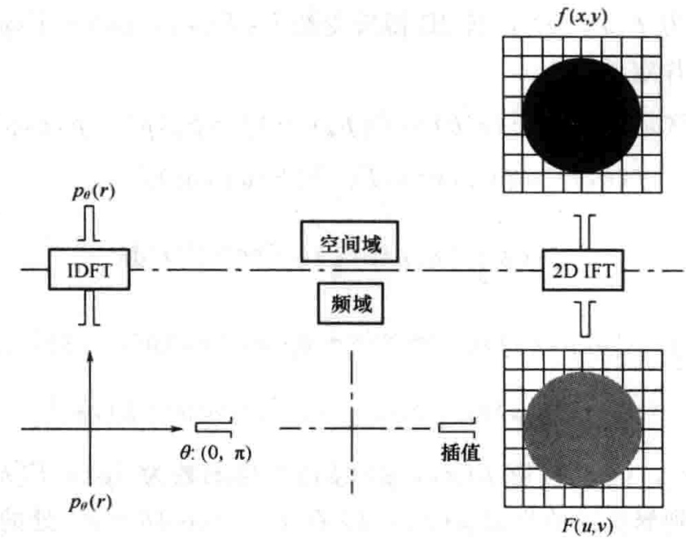

图4.3 傅里叶变换重建图像过程[14]

## 4.4 代数迭代算法

## 4.4.1 代数重建算法

代数重建算法（ART）最初是由Kaczmarz于1937年在求解相容线性方程组时提出，随后由Tanabe得到进一步阐明，1970年Gordon、Bender、Herman等将其引入图像重建，Hounsfiekl第一台CT机用的是ART算法。代数重建方法本身属于级数展开法，所有级数展开法都是求解离散重建问题。ART算法是一个迭代过程，通常包含四个主要步骤[15]:①给出重建图像的一个初始估计值；②计算图像的校正值；③应用校正值校正图像；④检验是否满足收敛准则。

把重建区域分成N个非重叠的像素区域，如图4.4所示，图像函数 $f(x)$ 沿着第i号射线Li的投影为(x为像素值):

$$
\int_ {L _ {i}} f (x) \mathrm{d} x = g _ {i}\tag{4.18}
$$

选定一个基函数集合笼 $\{\phi_j(x)\}_{j = 1}^N$ ，它们的线性组合能够给出所需要重建图像的一个足够近似，然后定义f(x)的数字化图像 $\widehat{f} (x)$ 如下:

$$
f (x) \approx \widehat {f} (x) = \sum_ {j = 1} ^ {N} f _ {j} \phi_ {j} (x)\tag{4.19}
$$

其中 $f_{j}$ 为 $f(x)$ 在第j个像素上的平均值，把上式代入式（4.18）中，则有:

$$
\sum_ {j = 1} ^ {N} f _ {j} \int_ {L _ {i}} \phi_ {j} (x) \mathrm{d} x = g _ {i} \quad i = 1, 2, \dots M\tag{4.20}
$$

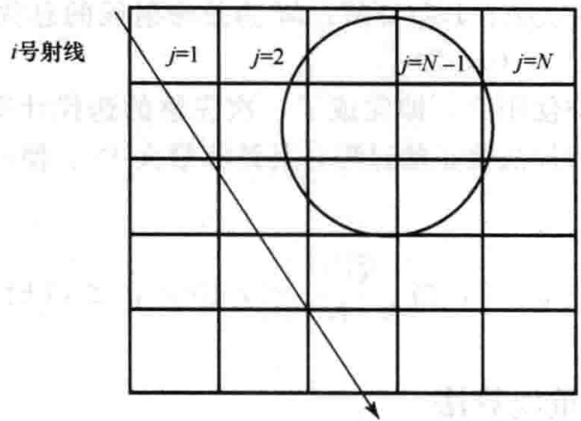

图4.4 ART 重建算法区域示意

若令 $\int_{L_i}\phi_j(x)\mathrm{d}x = a_{ij}$ ，则以上式变为 $\sum_{j=1}^{N}f_{j}a_{ij}=g_{i}$

(4.21)

式中，N为重建区域像素总数； $1\leqslant i\leqslant M$ ；M为投影射线总数； $a_{ij}$ 为第i号射线对第j号像素的贡献； $g_{i}$ 为真实射线和（即测量的投影数据）； $\sum_{j = 1}^{N}f_{j}a_{ij}$ 为伪射线和。因为级数展开法的近似性，真实射线和与伪射线和之间会有一定误差，设其为 $e_i$ ，把上式写成矩阵形式并考虑误差，得:

$$
\boldsymbol {G} = \boldsymbol {A} \boldsymbol {F} + \boldsymbol {E}\tag{4.22}
$$

式中， $\boldsymbol{G} = \{g_{1},\dots ,g_{M},\dots \}^{\mathrm{T}}$ 为测量向量； $A = (a_{ij})$ 为系数矩阵； $\boldsymbol{F} =$ $\{f_1,\dots ,f_N\}^{\mathrm{T}}$ 为图像向量； $\boldsymbol{E} = \{e_1, \dots, e_M\}^{\mathrm{T}}$ 为误差向量。

ART重建算法实际上是解一个如下形式线性方程组问题(假设误差向量为0):

$$
G = A F\tag{4.23}
$$

根据测量向量G，通过解线性方程组来估算图像矢量F。分析该线性方程组的特点是:①系数矩阵A相当大；②系数矩阵A是稀疏的矩阵A的元素是第i号射线第j号像素的贡献，因为每一条射线最多和 $2\sqrt{N}$ 个像素相交，平均为 $\sqrt{N}$个，对于M条射线则A的非零元素的个数为 $M\sqrt{N}$ ，所占比例为 $M\sqrt{N} /(MN) =$ $1 / \sqrt{N}$ ，当N较大时，这个值非常小]；③矩阵A的秩是未知的；④测量向量G的元素一般非负；⑤图像向量F反映了物质的线性衰减系数（非负）；⑥假设E为零会引起线性方程组的不相容性。以上特点说明了只能用迭代方法求解。有许多迭代方法，这里叙述加性ART重建算法解等式方程组的松弛法。

$$
\left\{ \begin{array}{l l} {\pmb {F} ^ {(0)}} & {\text {初始值零}} \\ {\pmb {F} ^ {(k + 1)} = \pmb {F} ^ {(k)} + \lambda^ {(k)}   \frac {g _ {i} - a _ {i} ^ {\mathrm{T}} \pmb {F} ^ {(k)}}{\| a _ {i} \| ^ {2}} a _ {i}} \end{array} \right.\tag{4.24}
$$

式中，k为迭代次数； $1\leqslant i\leqslant M;M$ 为投影射线的总数； $\lambda^{(k)}$ 为迭代松弛因子，且满足关系 $\lambda^{(k)}\in (0,2)$

当所有投影数被使用完，即完成了一次完整的迭代计算。ART算法是一个对图像向量不断进行加法修正的过程，其计算量大[16]。使用ART算法时，常用的收敛标准是

$U^{(k)} = \sum_{t = 1}^{N}\left(p_t - \vec{f}^{(k)}\vec{w}_t\right)^2$ ，当 $\sqrt{\frac{U^{(k)}}{N}} < e (0 < e < 1)$ 时停止迭代。

## 4.4.2 联合代数重建算法

联合代数重建算法(Simultaneous ART， SART)[17] 是由Anderson和 Kak于1984年提出的一种新的代数重建方法。该算法和ART算法不同点在于每个像素的校正是同一投影角度内通过该像素的所有射线误差值累加，其实质就是对ART中的噪声进行了平滑，因此可以获得较为理想的重建结果，其迭代公式为:

$$
f _ {j} ^ {(k + 1)} = f _ {j} ^ {(k)} + \frac {\sum_ {p _ {i} \in p _ {\phi}} \left[ \lambda \times \frac {p _ {i} - \sum_ {n = 1} ^ {N} w _ {i n} f _ {n} ^ {(k)}}{\sum_ {n = 1} ^ {N} w _ {i n}} \right] w _ {i j}}{\sum_ {p _ {i} \in p _ {\phi}} w _ {i j}}\tag{4.25}
$$

## 4.4.3乘型代数重建算法

在ART算法求解过程中，每个像素的校正都是通过加上一个校正值来实现的，即 $f^{(k + 1)} = f^{(k)} + \Delta f^{(k)}$ ，因此通常称为“加型”ART算法。当每一个像素的校正是通过乘上一个校正值来实现，便得到“乘型”代数重建方法（Multi-plicativeART，MART)，其解的步骤如下。

① 给定初始值 $\overline{f}^{(0)}$ ，一般常取 $\overline{f}^{(0)}$ 的各分量均为1的向量。

$$
② f _ {j} ^ {(k + 1)} = \lambda \frac {p _ {i}}{\sum_ {n = 1} ^ {N} w _ {i n} f _ {n} ^ {k}} f _ {j} ^ {k} \quad j = 1, 2, \dots , N\tag{4.26}
$$

MART算法的特点是:初始估计值 $\overline{f}^{(0)}$ 中的每个分量值必须大于0，且在迭代过程中一旦某个像素值变为零，在后面迭代过程中，它将始终保持为0。可以证明在一定条件下，式（4.26）所得解的序列 $\overline{f}^{(0)},\overline{f}^{(1)},\overline{f}^{(2)}$ ，…收敛于$RF = P$ 的最大嫡解[18]。

## 4.4.4 迭代重建算法

迭代重建算法又称级数展开法，它先将成像目标离散成一个重建图像网格，根据成像物理过程和相应数学模型，建立起重建图像和投影数据之间的代数方程组，图像重建转化为解该方程组。其特点是:①在空域中较灵活，容易调整以适应新的应用，如利用新物理原理和新数据采集方法的图像重建问题；②能重建出较高对比度图像，如对密度突变的材料；③比变换法更适合于二维重建；④适合于不完全投影情况，因为变换法要求对每个投影均匀采样并对每个采样点赋值，投影数据必须完全，而迭代重建法则把丢失投影值看作缺少方程可以忽略；⑤缺点是计算量大，存储空间大，影响重建速度。

## 4.5 EM 算法

EM 算法(TheAlgorithm for Evaluation ofMaximum Likelihood) 是基于最大概率事件最可能发生定则来进行模型参数估计的一种迭代算法[19,20]，其特点是在对被估计的未知参数没有任何先验知识的情况下，利用已知的一定量观测值估计该参数。当CT系统在数据采集过程中受到噪声干扰或投影数据采集不足时，用确定性重建方法将得不到满意的结果，而使用以估计理论为基础的EM方法将能进行有效的图像重建[21]。因此，考虑到γ射线随机统计特性和探测器扇形扫描这两个特点，我们确定采用EM图像重建方法。

核物理研究表明[22]:γ射线发射和探测可用泊松分布随机模型来描述，而气液两相流体吸收衰减射线信号可用二项分布随机模型来描述。因此，下面先简述这两个分布。

## 4.5.1 泊松分布与二项分布

(1)泊松分布的特征及描述泊松分布是1837年由法国数学家泊松(S.D.Poisson)首次提出，适合于描述稀有事件概率，如单位面积内放射性物质放射出的某种质点数等。设随机变量x所有可能取值为0，1，2，…，n，其概率分布函数P（x）为:

$$
P (x = k) = \frac {\mathrm{e} ^ {- \lambda}}{k !} \lambda^ {k} (k = 0, 1, \dots , n)\tag{4.27}
$$

其中 $\lambda >0$ 是常数，则称x服从参数为λ的泊松分布，记作 $x\sim P(\lambda)$ 。泊松分布的参数λ是单位时间或单位面积内随机事件的平均发生概率。

泊松分布图形随λ值不同而变，λ是泊松分布的唯一参数。λ愈小分布愈偏倚，随着λ增大，分布趋于对称，如图4.5所示，当 $\lambda = 20$ 时接近正态分布。

(2)二项分布的特征及描述 设n次贝努里试验满足条件:①每一次试验中事件A发生的概率是不变的，等于p；②事件A在各次试验中是否发生是独立的。二项分布是说明结果只有两种情况的n次实验中发生某种结果为x次的概率

图 4.5 不同λ的泊松分布

分布，其概率密度为:

$$
P (x) = C _ {n} ^ {x} p ^ {x} (1 - p) ^ {n - x}, x = 0, 1, \dots , n
$$

$$
\text {或} P (x) = \frac {n !}{x ! (n - x) !} p ^ {x} q ^ {n - x}\tag{4.28}
$$

二项分布在 $p = 0.5$ 时表现出图像的对称性，而在 p 取其他值时是非对称的，如图4.6所示。在图4.6中，横坐标发生事件的次数 x ，纵坐标为发生 x 次事件的概率 p o

(c) $p = 0.50$ (对称)

(b) $p > 0.50$ (负偏峰)

(d) $p\neq0.50,$ n相当大（对称、正态）

图4.6二项分布的概率函数直条

(3)两种分布的相互关系设随机变量x服从二项分布 $B(n,p)$ ，当$n\to +\infty$ ，且 p 很小时， x 近似服从泊松分布 $P(\lambda)$ 9 $\lambda = np$

$$
C _ {n} ^ {i} p ^ {i} (1 - p) ^ {n - i} \approx \frac {\lambda^ {i}}{i !} \mathrm{e} ^ {- \lambda}\tag{4.29}
$$

## 4.5.2 EM算法原理与公式推导

(1)算法原理 EM算法是基于最大概率事件最可能发生定则来进行模型参数估计的一种迭代算法，其特点是在对被估计的未知参数没有任何先验知识的情况下，利用已知的一定量观测值估计该参数，具体原理与步骤如下。

设被测变量样本空间为Y，其概率密度分布函数为 g (Y, Φ) $\Phi$ 为待估计参数。所要求的是一个完整母空间X，其概率密度分布函数为 $f(X,\Phi)$ ，且与Y具有对应关系 h (X) =Y ，Y是X的一个子空间。

①在已知实验样本空间Y和参数 Φ (开始时需假定 $\Phi$ 的初值）条件下，基于发射和接受辐射信号的Poisson分布和放射信号衰减的二项分布随机模型，对完整母空间X进行估计:

$$
X = E (X \mid Y, \Phi)\tag{4.30}
$$

②在所估计X空间下，求其联合概率密度分布函数，并对其联合概率密度分布函数采用线性最大似然估计法求参数 $\Phi$ 的迭代式。

先求表达式:

$$
\ln \iint_ {S} f (X, \Phi) \mathrm{d} S\tag{4.31}
$$

令

$$
\frac {\partial}{\partial \Phi} \ln \iint_ {S} f (X, \Phi) \mathrm{d} S = 0\tag{4.32}
$$

得

$$
\Phi = \Phi (X)\tag{4.33}
$$

③以实验样本空间Y、所求完整母空间X和参数Φ代入式（4.31）判断是否达到最大，如果是，则 $\Phi$ 即为所求；如果不是，重复步骤①、②，直至达到最大为止。

** (2)** 公式推导

## ①基本前提

a.据第3章3.1.2节探测器扫描方式、3.1.4节 γ-CT 装置和 Rushton 搅拌釜尺寸大小，将待重建图像区域划分为 120×120 个 $2\mathrm{mm}\times 2\mathrm{mm}$ 的正方形像素小区间(包括了器壁)。

b. 放射线数远远大于像素数，每个像素小区间尺寸须小于CT扫描空间分辨率。

c. 放射源发射信号和探测器接受放射衰减信号用Poisson概率分布描述，在各像素小区间的信号吸收和和传递用二项概率分布描述，射线衰减服从Lambert-Beer定律。

d. 各射线经过每个像素小区间发生的信号吸收和传递是相互独立的。

②估值（E-Step)。强度为 $I_{0}$ 的放射源在 Δt 时间内所发射信号数的平均值d为:

$$
d = I _ {0} \Delta t\tag{4.34}
$$

据放射信号衰减Lambert-Beer定律，第i条辐射线经过整个像素区间沿程轨迹线衰减信号的平均值 λ i 为:

$$
\lambda_ {i} = d \exp (- \sum_ {j = 1} ^ {K _ {i}} \phi_ {i, j} l _ {i, j})
$$

$$
i = 1, 2, \dots , M\tag{4.35}
$$

式中，i为第i条放射线；M 为放射线总数；j为第j个像素小区间； $K_{i}$ 为第i条放射线经过的像素小区间数； $\phi_{i,j}, l_{i,j}$ 分别为第i条放射线经过第j个像素小区间的质量衰减系数和距离。

按照基本前提c，有:

$$
\begin{array}{l l} p (x _ {i, 1}) = \frac {d ^ {x _ {i , 1}}}{x _ {i , 1} !} \exp (- d) & i = 1, 2, \dots , M \\ p (y _ {i}) = \frac {\lambda_ {i} ^ {y _ {i}}}{y _ {i} !} \exp (- \lambda_ {i}) & i = 1, 2, \dots , M \end{array}\tag{4.36}
$$

(4.37)

式中， $x_{i,1}$ 为第i条放射线进入其最初像素小区间的信号； $y_{i}$ 为第i条放射线离开其最后像素小区间的信号，也即认为是探测器所探测到的信号(射线离开最后像素小区间到探测器之间的信号衰减 $\phi l$ 乘积很小可以省略不计（因为距离很短，空气质量衰减系数比流体小了近1000倍)。

当为 $x_{i,j}$ 的放射信号进入第 j 像素小区间时，一部分被流体介质吸收，一部分传递进入相邻下一像素小区间，发生吸收与传递两者概率之间服从二项分布，所以离开该像素小区间的放射信号 $x_{i,j + 1}$ 的概率是:

$$
\begin{array}{r l} p (x _ {i, j + 1}) = & \binom {x _ {i, j}} {x _ {i, j + 1}} \left[ \exp (- \phi_ {i, j} l _ {i, j}) \right] ^ {x _ {i, j + 1}} \left[ 1 - \exp (- \phi_ {i, j} l _ {i, j}) \right] ^ {(x _ {i, j} - x _ {i, j + 1})} \\ & i = 1, 2, \dots , M; j = 1, 2, \dots , K _ {i} \end{array} \tag {4}\tag{4.38}
$$

式（4.38）中 $x_{i}, K_{i+1}$ 即为 $y_{i}$

进入第j像素小区间放射信号数 $x_{i,j}$ 的期望值是:

$$
\begin{array}{c} E (x _ {i, j}) = \gamma_ {i, j} = d \exp (- \sum_ {k = 1} ^ {j - 1} \phi_ {i, k} l _ {i, k}) \\ i = 1, 2, \dots , M; j = 2, 3, \dots , K _ {i} \end{array}\tag{4.39}
$$

又

$$
E (x _ {i, 1}) = d \quad i = 1, 2, \dots , M\tag{4.40}
$$

$$
E (y _ {i}) = \gamma_ {y _ {i}} = \lambda_ {i} = d \exp (- \sum_ {j = 1} ^ {K _ {i}} \phi_ {i, j} l _ {i, j}) \quad i = 1, 2, \dots , M\tag{4.41}
$$

对第i条放射线，在给定进入第j像素小区间放射信号 $x_{i,j}$ 条件下，离开最后一个像素小区间信号 $y_{i}$ 的概率是:

$$
\begin{array}{r l} p (y _ {i} / x _ {i, j}) = & \exp (- \sum_ {k = j} ^ {K _ {i}} \phi_ {i, k} l _ {i, k}) = \gamma_ {y _ {i}} / \gamma_ {i, j} \\ & i = 1, 2, \dots , M; j = 1, 2, \dots , K _ {i} \end{array}\tag{4.42}
$$

又 $x_{i,j}$ 服从期望为 $\gamma_{i,j}$ 的 Poisson 分布:

$$
\begin{array}{r l} p (x _ {i, j}) & = \exp (- \gamma_ {i, j}) \frac {\gamma_ {i , j} x _ {i , j}}{x _ {i , j} !} \\ i & = 1, 2, \dots , M; j = 1, 2, \dots , K _ {i} \end{array}\tag{4.43}
$$

因此，式（4.42)、式（4.43)这两者共同发生的联合概率为:

$$
\begin{array}{r l} p (x _ {i, j}, y _ {i}) = & \exp (- \gamma_ {i, j}) \frac {\gamma_ {i , j} x _ {i , j}}{x _ {i , j} !} \binom {x _ {i, j}} {y _ {i}} \left(\frac {\gamma_ {y _ {i}}}{\gamma_ {i , j}}\right) ^ {y _ {i}} \left(1 - \frac {\gamma_ {y _ {i}}}{\gamma_ {i , j}}\right) ^ {x _ {i, j} - y _ {i}} \\ & i = 1, 2, \dots , M; j = 1, 2, \dots , K _ {i} \end{array}\tag{4.44}
$$

给定 $y_{i}$ 条件下 $x_{i,j}$ 的概率是:

$$
\begin{array}{r l} p (x _ {i, j} / y _ {i}) & = \frac {\exp (- \gamma_ {i , j}) \frac {\gamma_ {i , j} x _ {i , j}}{x _ {i , j} !} \binom {x _ {i , j}} {y _ {i}} \left(\frac {\gamma_ {y _ {i}}}{\gamma_ {i , j}}\right) ^ {y _ {i}} \left(1 - \frac {\gamma_ {y _ {i}}}{\gamma_ {i , j}}\right) ^ {x _ {i , j} - y _ {i}}}{\exp (- \gamma_ {y _ {i}}) \frac {\gamma_ {y _ {i}} y _ {i}}{y _ {i} !}} \\ & = \frac {(\gamma_ {i , j} - \gamma_ {y _ {i}}) (x _ {i , j} - y _ {i})}{(x _ {i , j} - y _ {i}) !} \exp [ - (\gamma_ {i, j} - \gamma_ {y _ {i}}) ] \\ & i = 1, 2, \dots , M; j = 1, 2, \dots , K _ {i} \end{array}\tag{4.45}
$$

改写式(4.45)，得:

$$
\begin{array}{r l} p (x _ {i, j} / y _ {i}) & = p (X = x _ {i, j} / Y = y _ {i}) = p [ (X - y _ {i}) = (x _ {i, j} - y _ {i}) / Y = y _ {i} ] \\ & = \frac {(\gamma_ {i , j} - \gamma_ {y _ {i}}) ^ {(x _ {i , j} - y _ {i})}}{(x _ {i , j} - y _ {i}) !} \exp [ - (\gamma_ {i, j} - \gamma_ {y _ {i}}) ] \\ & i = 1, 2, \dots , M; j = 1, 2, \dots , K _ {i} \end{array} \tag {4}\tag{4.46}
$$

从式（4.46）可知， $(x_{i,j} - y_i)$ 在给定 $y_{i}$ 条件下服从期望值为 $(\gamma_{i,j} - \gamma_{y_i})$的 Poisson分布，因此有:

$$
\begin{array}{c} E [ (x _ {i, j} - y _ {i}) / y _ {i} ] = \gamma_ {i, j} - \gamma_ {y _ {i}} = E (x _ {i, j}) - E (y _ {i}) \\ i = 1, 2, \dots , M; j = 1, 2, \dots , K _ {i} \end{array}\tag{4.47}
$$

$$
\mathrm{又因为} \quad E [ (x _ {i, j} - y _ {i}) / y _ {i} ] = E (x _ {i, j} / y _ {i}) - E (y _ {i} / y _ {i}) = E (x _ {i, j} / y _ {i}) - y _ {i}
$$

$$
i = 1, 2, \dots , M; j = 1, 2, \dots , K _ {i}\tag{4.48}
$$

结合式（4.47）、式（4.48)，得 $E(x_{i,j} / y_i) = y_i + E(x_{i,j}) - E(y_i)$

$$
i = 1, 2, \dots , M; j = 1, 2, \dots , K _ {i}\tag{4.49}
$$

式（4.49）即为所测实验数据 $y_{i}$ 条件下 $x_{i,j}$ 的估值式，即用来完成 $X =$ $E(X|Y,\Phi)$ 对完整母空间X的估值。

③最大化(M-Step)。各射线经过每个像素小区间发生的信号吸收和传递是相互独立的，故所有像素区间所有射线信号数的联合概率为:

$$
\begin{array}{c} \prod_ {i = 1} ^ {M} \left\{\frac {d ^ {x _ {i , 1}}}{x _ {i , 1} !} \exp (- d) \prod_ {j = 1} ^ {K _ {i}} \binom {x _ {i, j}} {x _ {i, j + 1}} \left[ \exp (- \phi_ {i, j} l _ {i, j}) \right] ^ {x _ {i, j + 1}} \right. \\ \left. [ 1 - \exp (- \phi_ {i, j} l _ {i, j}) ] ^ {(x _ {i, j} - x _ {i, j + 1})} \right\} \end{array}\tag{4.50}
$$

取对数，得:

$$
\begin{array}{r l} \sum_ {i = 1} ^ {M} \sum_ {j = 1} ^ {K _ {i}} & \left\{(x _ {i, j} - x _ {i, j + 1}) \ln [ 1 - \exp (- \phi_ {i, j} l _ {i, j}) ] - \phi_ {i, j} l _ {i, j} x _ {i, j + 1} + \right. \\ & \left. x _ {i, 1} \ln d - d - \ln x _ {i, 1}! + \sum_ {j = 1} ^ {K _ {i} - 1} \ln (\frac {x _ {i , j}}{x _ {i , j + 1}}) \right\} \end{array}\tag{4.51}
$$

为了推导便于计算机编程的迭代公式，将式（4.51）中 $\phi_{i,j}$ 以 $\phi_{p}$ 重新排列(先按 i 排序 $j, j=1, 2, \cdots, K_{i})$ 像素序数 $(p = 1 \sim N$ ，N为总像素小区间数），得:

$$
\sum_ {p = 1} ^ {N} \sum_ {i = 1} ^ {K _ {p}} \{(x _ {i, p _ {\mathrm{in}}} - x _ {i, p _ {\mathrm{out}}}) \ln [ 1 - \exp (- \phi_ {p} l _ {i, p}) ] - \phi_ {p} l _ {i, p} x _ {i, p _ {\mathrm{out}}} + R \}\tag{4.52}
$$

式（4.52)中R是与 $\phi_{p}$ 无关的项。

对式（4.52）中的 $\phi_{p}$ 求偏导，并令其等于0，得:

$$
\begin{array}{r l} 0 = & \sum_ {i = 1} ^ {K _ {p}} \left[ \frac {(x _ {i , p _ {\mathrm{in}}} - x _ {i , p _ {\mathrm{out}}}) l _ {i , p} \exp (- \phi_ {p} l _ {i , p})}{1 - \exp (- \phi_ {p} l _ {i , p})} - x _ {i, p _ {\mathrm{out}}} l _ {i, p} \right] \\ & = \sum_ {i = 1} ^ {K _ {p}} \left[ \frac {(x _ {i , p _ {\mathrm{in}}} - x _ {i , p _ {\mathrm{out}}})}{\exp (\phi_ {p} l _ {i , p}) - 1} - x _ {i, p _ {\mathrm{out}}} \right] l _ {i, p} \\ & p = 1, 2, \dots , N \end{array}\tag{4.53}
$$

当 S<1 时，有如下近似式: 1 1 1 S es - 1 一 S 2 12

(4.54)

流体 φ 永小于1 $(\phi_{\text{水}} = 0.086\mathrm{cm}^{-1})$ ，正方形像素小区间边长为2mm，这样$\phi_{p}l_{i,p}\ll 1$ ，满足式（4.54），可得:

$$
\begin{array}{r l} \phi_ {p} ^ {2} \sum_ {i = 1} ^ {K _ {p}} (x _ {i, p _ {\mathrm{in}}} - x _ {i, p _ {\mathrm{out}}}) \frac {l _ {i , p} ^ {2}}{1 2} - \phi_ {p} \sum_ {i = 1} ^ {K _ {p}} (x _ {i, p _ {\mathrm{in}}} + x _ {i, p _ {\mathrm{out}}}) \frac {l _ {i , p}}{2} + \\ \sum_ {i = 1} ^ {K _ {p}} (x _ {i, p _ {\mathrm{in}}} - x _ {i, p _ {\mathrm{out}}}) = 0 & p = 1, 2, \dots , N \\ \phi_ {p} = \frac {\sum_ {i = 1} ^ {K _ {p}} (x _ {i , p _ {\mathrm{in}}} + x _ {i , p _ {\mathrm{out}}}) \frac {l _ {i , p}}{2}}{2 \sum_ {i = 1} ^ {K _ {p}} (x _ {i , p _ {\mathrm{in}}} - x _ {i , p _ {\mathrm{out}}}) \frac {l _ {i , p} ^ {2}}{1 2}} - \end{array}\tag{4.55}
$$

$$
\frac {\sqrt {\left[ \sum_ {i = 1} ^ {K _ {p}} (x _ {i , p _ {\mathrm{in}}} + x _ {i , p _ {\mathrm{out}}}) \frac {l _ {i , p}}{2} \right] ^ {2} - 4 \sum_ {i = 1} ^ {K _ {p}} (x _ {i , p _ {\mathrm{in}}} - x _ {i , p _ {\mathrm{out}}}) \frac {l _ {i , p}}{1 2} ^ {2} \sum_ {i = 1} ^ {K _ {p}} (x _ {i , p} - x _ {i , p _ {\mathrm{out}}})}}{2 \sum_ {i = 1} ^ {K _ {p}} (x _ {i , p _ {\mathrm{in}}} - x _ {i , p _ {\mathrm{out}}}) \frac {l _ {i , p} ^ {2}}{1 2}}{p = 1, 2, \dots , N} \tag {4.56}
$$

通过式（4.39）\~式（4.41）、式（4.49）进行参数估值，式（4.56）对参数 $\phi_{p}$ 进行迭代，这样循环反复，直至 $\phi_{p}$ 相邻前后两次迭代相对误差小于规定的相对误差为止(一般可设置为1/1000)。这样就求出了每个像素小区间参数，用Fortran语言编程计算，通过Matlab实现每个像素小区间参数的彩色图像显示。

(3)EM算法特点EM算法稳定，收敛性较好，且该算法具有很好的抗噪声能力，尤其是在数据采集过程中受到严重噪声干扰或投影数据采集不足时，用确定性重建方法有可能得不到满意的结果，而使用以估计理论为基础的EM方法将能进行有效的图像重建。

## 4.6 EM 算法 CT 成像实现与检验

图 4.7是 $^{137}$ Cs γ-CT 扫描搅拌空釜用的CT扫描图像（在Matlab平台显示，下同)。CT图像网格清晰可见，搅拌釜壁厚有3个小网格，每个小网格边长为2mm即壁厚为6mm；中心轴有4个小网格即直径为8mm。这些CT成像结果与搅拌釜尺寸一致，证明所用实验装置 $^{137}$ Cs γ 射线CT装置及EM成像算法准确可行、分辨率为2mm、显示对比鲜明、图像清晰可见。值得指出的是，在壁的周围，还是有些伪影，这与 γ-CT 装置分辨率有关。怎么样解释和去掉这些伪影，还有待更深人的研究。

图4.7 CT 扫描搅拌空釜图像

通气量18.88 L/min，搅拌转速470r/min通气量18.88 L/min，搅拌转速600r/min

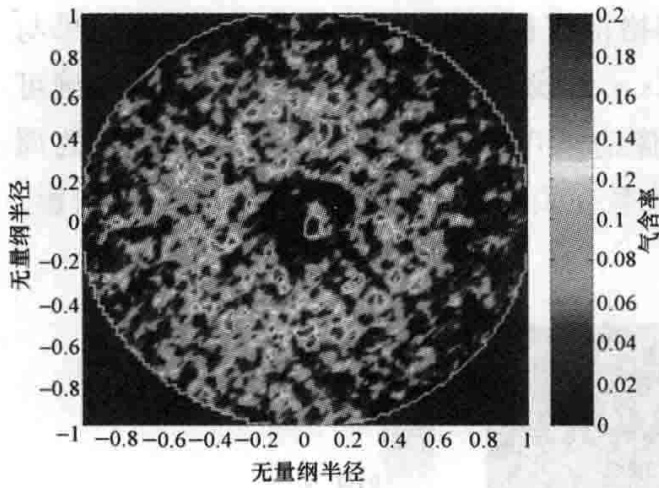

## 4.7 搅拌釜气含率断面分布的CT扫描

## 4.7.1 气含率断面分布的计算公式

当通过EM算法迭代式(4.56)求出每个像素小区间的质量衰减系数 $\phi_{p}$ 后，对气液两相流，有:

(4.57)

$$
\begin{array}{r l} & {\phi_ {\mathrm{气液}} (x, y) = \varepsilon (x, y) \phi_ {\mathrm{气}} (x, y) + [ 1 - \varepsilon (x, y) ] \phi_ {\mathrm{液}} (x, y)} \\ & {\mathrm{得} \quad \varepsilon (x, y) = [ \phi_ {\mathrm{液}} (x, y) - \phi_ {\mathrm{气液}} (x, y) ] / [ \phi (x, y) _ {\mathrm{液}} - \phi_ {\mathrm{气}} (x, y) ]} \end{array}\tag{4.58}
$$

按式（4.57)、式(4.58)，即可求出每个小像素区间的气含率。其中， φ气φ 液、 $\phi$  气液 分别为扫描空气搅拌釜、液体搅拌釜和气液搅拌釜时的像素小区间所估值质量衰减系数。

## 4.7.2气含率断面分布的CT扫描图像

图4.8是通气量为18.88L/min、搅拌转速分别为470r/min和600r/min的CT扫描彩色图像（以黑白图表示，图中直角坐标为无量纲半径，右边柱状色彩度坐标为气含率大小，下同)。CT彩色图像能够通过色彩度的不同来显示气含率的大小。从图可知，在同样气量下，搅拌速度增加，气含率也相应增加，主要增加在无量纲半径0.2\~0.6处。

图4.8 同一通气量不同搅拌转速的 CT 图像

## 4.7.3 气含率断面分布的径向周均气含率曲线

图4.8所示CT扫描图像用彩色度定量表示断面气含率分布，虽然形象、清晰、可辨，但还是不便于进行定量描述和比较。因此，还需把Matlab软件显示的CT扫描彩色数字图像进一步用Excel软件显示其断面径向周均气含率(同一半径圆周上所有像素小区间气含率的算术平均值，下同）分布，即径向周均气含率沿无量纲半径变化的数字曲线，如图4.9所示。从图可见，在通气量18.88L/min下，当搅拌转速从临界搅拌转速470r/min增加到600r/min时，在无量纲半径0.25\~0.65处略有气含率增加。

图4.9 CT扫描图像的径向周均气含率分布曲线

## 4.7.4CT测量重复性验证

在通气量为28.32L/min、搅拌转速为530r/min条件下，3/4(15cm)静液高处，进行了CT测量重复性验证实验，结果如图4.10和图4.11所示。从图可见，CT测量重复性好。

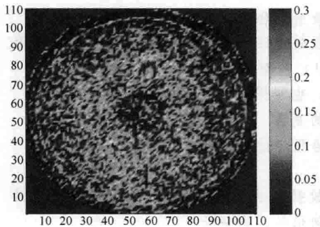

图4.10 气含率断面分布CT重复测量图像

## 4.7.5 结论

137Csγ-CT扫描气液搅拌釜，通过EM算法成像，可以得到准确、清晰、可辨的气含率断面分布彩色图像和断面径向周均气含率沿半径变化的数字曲线，且重复性好，这是一些其他测量方法很难做到的。

图4.11径向周均气含率分布CT重复测量曲线

## 符号说明

| $I_0$ | 放射源发射信强度,光子数/s |
| --- | --- |
| d | 强度为$I_0$的放射源在$\Delta t$时间内所发射光子信号数的平均值 |
| $\Delta t$ | 探测器在一个停留位置接受射线信号时间,s |
| $λ_i$ | 第i条辐射线经过像素区间沿程轨迹线衰减光子信号数的平均值 |
| i、j | 分别为第i条放射线和第j个像素小区间 |
| $φ_{i,j}$、$l_{i,j}$ | 分别为第i条放射线经过第j个像素小区间的质量衰减系数($mm^{-1}$)和距离(mm) |
| M | 放射线总条数,也即探测器停留位置总数 |
| k | 一个用于计数的变量 |
| $K_i$ | 第i条放射线沿程经过的像素小区间数 |
| x | 光子信号数 |
| $x_{i,1}$、$y_i$ | 分别为第i条放射线进入其最初像素小区间和离开其最后像素小区间信号,光子数 |
| $E(x_{i,j}) = γ_{i,j}$ | 第i条射线进入第j像素小区间放射信号光子数$x_{i,j}$的期望值 |
| $p(x_{i,j})$ | 第i条放射线进入第j个像素小区间的光子数 |
| p | 重新排序后的第p个像素小区间 |
| N | 总像素小区间数 |
| $p_{in}$、$p_{out}$ | 分别为进入和离开第p像素的光子数 |

第p 个像素小区间的质量衰减系数， $\mathrm{mm}^{-1}$数学期望气含率 气含率

## 参考文献

[1] Kenneth R, Castleman. Digital Image Processing [M]. Prentice-Hall Inc, 1998.

[2]庄天戈.CT原理与算法[M].上海:上海交通大学出版社.1992:1-88.

[3]陈庆勇.工业CT重建技术与算法研究[D].重庆:重庆大学，2006:4-7.

[4]陈炼，吴志芳，王钦娅.锥束CT的分区短扫描FDK重建算法[J].清华大学学报:自然科学版，2009, 49(6): 860-863, 867.

[5] Zhang Shuxu , Zhou Linghong, Chen Guangjie, et al. Four-Dimensional Computerized Tomography (4D-CT) Reconstruction Basedon the Similarity Measure of Spatial Adjacent Images [J]. Chin J of Bio Eng, 2008, 17(3): 106-113.

[6]张顺利，张定华，赵歆波，等.基于最小区域的快速CT图像重建[J].计算机辅助设计与图形学学报，2009，21(2):160-164.

[7] 赫尔曼GT.由投影重建图像—CT的理论基础[M].北京:科学出版社，1985:39-44.

[8] FrankNatterer. Numerical Methods in Tomography [J] . Acta Numerica, 1999, 1 (8): 107-141.

[9] David Gottlieb, Bertil Gustafsson, Patrik Forssen. On the Direct Fourier Method for Computer Tomography [J].IEEE Transaction on Medical Imaging, 2000, 19 (3): 223-232.

[10] Herman G T, Lent A, Rowland S W. ART: Mathemetics and Applications [J]. Theor Biol, 1973, 42: 1-32.

[11] Gabor T Herman, Amold Lent. Iterative Reconstruction Algorithms Compute [J]. Biol Med P, 1976, 3 (6): 273-294.

[12]房瑞.多相流CT系统优化设计与算法研究[D].天津:天津大学电气与自动化工程学院，2007.

[13]张鹏，张兆田.几种CT图像重建算法的研究和比较[J].CT理论与应用研究，2001，10（4):3-8.

[14]张顺利，工业CT图像的代数重建方法研究及应用[D].西安:西北工业大学，2004:11-13.

[15] Subbarao P M V, Munshi P, Muralidhar K. Performance of iterative demographic algorithms applied to non-destructive evaluation with limited data [J].NDT&E International, 1997, 30 (6): 359-370.

[16]郝魁红，王化祥.一种新型层析成像重建算法[J].中国民航学院学报，2005，23（2）:19-21.

[17] Andersenand A H, Kak A C. Simultaneous Algebraic Reconstruction Techniques (SART) : a Superior. implementation of the ARTalgorithm [J]. Ultrason Img, 1984, 6: 81-94.

[18]江少恩，刘忠礼，等.乘代数重建法和最大嫡重建法比较研究[J].光子学报，1998，27（5）.

[19] Chornoboy E S, Chen C J, Miller M I, et al. An evaluation of maximum likelihood reconstruction for SPECT [J]. IEEE transactions on medical imaging, 1990, 9 (1): 99-110.

[20] Hebert T J, Leahy R. Fast methods for including attenuation inthe EM algorithm [J]. IEEE Trans Nuel Sei, 1990, 37 (2): 754-7520.

[21]董宝玉.XCT中锥束投影重排算法与EM算法的研究[D].大连:大连理工大学通信与信息工程学院，2005:27-30.

[22]Chornoboy ES, Chen C J, Miller M I, et al. An evaluation ofmaximum likelihood reconstruction for SPECT. IEEEtransactions on medical imaging,1990, 9 (1): 99-110.

## 第5章

# γ-CT测量Rushton气液搅拌釜气含率断面分布

## 5.1 Rushton 气液搅拌釜

气液搅拌釜普遍应用于石油化工、精细化工、生物化工、冶金、能源、环境等领域，Rushton气液搅拌釜一直被作为气液搅拌釜的典型加以研究。气含率大小及分布是描述气液分散好坏程度的一个最基本特性。对气液搅拌釜气含率大小及分布的测量和研究是多相流测量和研究中较为复杂的，具有一定的挑战性。

在第1章绪论中阐述了现在使用和研究的一些气液或气固两相体系中气含率的测量方法，但能成功用于气液搅拌釜气含率分布测量的技术甚少。在第4章γ-CT数字图像重建4.7节搅拌釜气含率断面分布的CT扫描中，已得到和证实了137Csγ-CT测量气液搅拌釜气含率断面分布清晰、准确的彩色CT图像和周向平均气含率沿半径分布的数字曲线。本章利用 $^{137}$ Cs γ 射线CT测量不同条件下20cm内直径标准Rushton气液搅拌釜气含率断面分布，并进行影响因素分析与讨论。

## 5.1.1 搅拌釜结构尺寸

实验用为标准Rushton气液搅拌釜，结构尺寸如图5.1所示。搅拌釜内直径20cm、高24cm、壁厚6mm，4块挡板长2cm、厚1.5mm、高24cm。静液高200mm，上面留有40mm高空间，搅拌釜有一盖子，以防液体被气相带出搅拌釜。

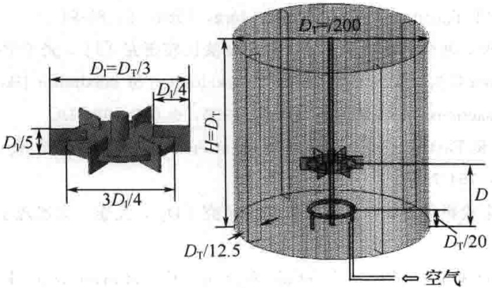

图 5.1 Rushton气液搅拌釜结构

## 5.1.2 圆环气体分布器

圆环气体分布器(Sparge)如图5.2所示，有1.5mm8孔和0.5mm16孔两种型号。圆环直径66.6mm，圆环孔直径6.35mm，安装在距底部1cm处。有一直径为12mm的供气管与圆环气体分布器相连。

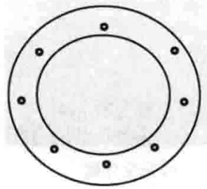

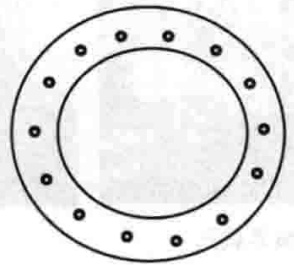

图5.2 圆环气体分布器示意

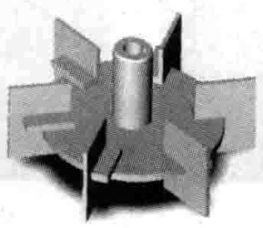

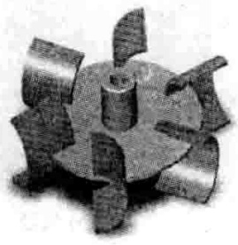

图 5.3 Rushton桨（左）和Smith桨（右）

## 5.1.3 搅拌桨

搅拌桨结构尺寸如图5.3所示。搅拌轴直径8mm；透平直径50mm，厚3mm；6个长方形或者半圆形叶轮:17mm×13mm长方形，厚1mm，长边镶入透平8.5mm。

## 5.2 三种气液分散状态与临界搅拌速度

## 5.2.1三种气液分散状态与流动区域

从气液搅拌釜底部通入多孔圆环气体分布器的气体（空气）以气泡形式上升，被旋转的搅拌桨打碎分散成更小和更多的小气泡，同时也被旋转的液相层（水）剪切分散成更小和更多的小气泡，这样使得气泡充满反应釜，达到了分散与混合气液两相的目的。虽然早有一些文献对Rushton气液搅拌釜气体分散现象进行过研究[1\~5]，这里我们仍对标准200mm×240mm Rushton气液搅拌釜进行气体分散现象进行实验观察，三种典型的现象如图5.4所示。

固定一定的通气量，逐渐增加搅拌转速。当搅拌转速较低时，从搅拌釜底部气体圆环分布器底部通入釜内的气体上升达到透平桨时，部分气泡被透平桨打碎成细小气泡，但也有部分气泡通过透平桨间隙而上升。这时候气体主要围绕着搅拌桨上方区域上升，并带有呼呼响声，气泡在搅拌桨上方空间呈“倒杯状”分散状态，如图5.4（a)所示。当搅拌转速增加时，搅拌桨上方空间气泡“倒杯状”分散范围扩大。当搅拌转速增至某个临界值时，搅拌桨上方空间气泡“倒杯状”分散状态突然全部转变为均匀充满整个搅拌桨上方空间的细小气泡，气体呼呼声也随之消失。这个过程就好像把一把半开的伞全部打开的那一瞬间，有明显的临界突变现象，且能够重复。这种气体分散状态如图5.4（b）所示。这时从搅拌釜底部气体圆环分布器底部通人釜内的气体上升达到透平桨的所有气泡不但被飞转的透平桨打碎和分散，而且透平桨处旋转的整个液体平面也起到阻挡、打碎和分散气泡的作用，以至于达到了搅拌桨平面整个上方空间均匀分散气泡的效果。当搅拌转速继续加大，搅拌桨下方液体形成沿壁而下的循环流，这样把一部分气泡带人搅拌桨下方近壁区，而搅拌桨下方空间气泡仍然很少，如图5.4（c)所示。所以，据以上实验观察现象，从工业应用角度来考虑，我们提出将Rushton气液搅拌釜气液分散状态划分为如图5.4所示气泛、临界载气和完全分散三种状态较为合理。

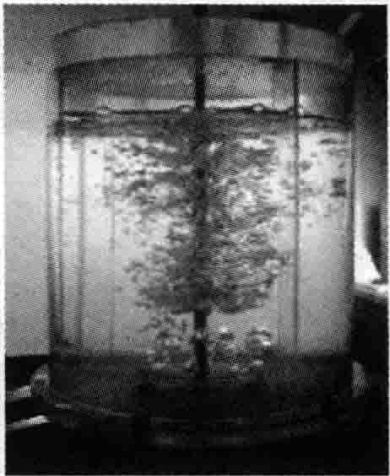

(a)气泛

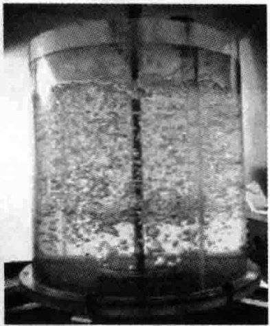

(b) 临界载气

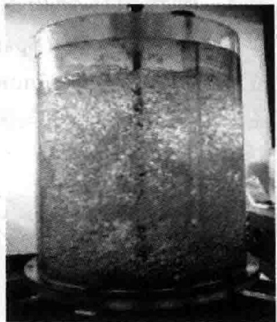

(c) 完全分散

图 5.4 Rushton气液搅拌釜中三种气液分散状态

很明显，气泛状态气泡明显没有分散好，在搅拌桨上方空间呈“倒杯状”分散状态，而且多为大气泡，工业操作上绝对要避免这种现象。虽然从气泛状态到临界载气状态存在着明显的突变且能重复的过程，但从临界载气状态到完全分散状态却是一个逐变过程，且气体分散的效果随着搅拌转速的增加并没有多大改善(实验观察和本章CT扫描结果均可证实)。另外，太大的搅拌转速会引起机械震动和功率消耗的增加。因此，从工业应用和设计的角度来看，Rushton搅拌釜气液气体分散应该是在超过临界载气状态后的一个达到气含率与功率消耗比值最大状态为最佳。

值得指出的是，以前搅拌釜中气体分散状态一般是根据图5.5[1,2]建立在气穴结构研究上的流态区域来判断。图5.5中， $F_{1} = Q_{\mathrm{G}} / (ND_{1}^{3})$ 反映了纵向通气量与透平叶片离心泵出量之比， $F_{\mathrm{r}} = N^{2}D_{1} / g$ 反映了透平叶片离心泵出力与纵向重力之比。 $Q_{G}$ 为通气量， $\mathrm{m}^{3}/\mathrm{s}$ ；N为搅拌桨转速， r/s;  $D_{1}$ 为搅拌桨直径；g为重力加速度。图5.5中标注了表5.1中的九个实验点。虽然气泛、临界载气和完全分散这三种状态也能够在流动区域图上标注出来，但在流动区域图中却很难反映出临界载气状态区分的重要性。所以，这里对Rushton气液搅拌釜气泛、临界载气和完全分散三种气液分散状态的划分具有重要意义。

图 5.5 气液搅拌釜流态区域

## 5.2.2 临界搅拌速度的确定

影响气液分散效果的因素有搅拌釜形状、气体通入方式、通气量大小、搅拌桨形状、搅拌速度、液体黏度等。目前，Rushton气液搅拌釜临界搅拌速度还只能依赖于实验的观测。因此，在进行CT测量以前，为避免在气泛状态下的测量，必须先确定一定通气量下的临界搅拌速度。表5.1是分别在9.44L/min、18.88L/min、28.32L/min通气量下测定的临界搅拌速度。可见，临界搅拌速度随通气量的增加而增加。

表 5.1 不同通气量下 Rushton搅拌釜的临界搅拌速度

<table><tr><td>通气量/(L/min)</td><td>9.44</td><td>18.88</td><td>28.32</td></tr><tr><td>临界搅拌/(r/min)</td><td>350(F1=0.09, Fr=0.23)</td><td>470(F1=0.14, Fr=0.42)</td><td>530 (F1=0.18, Fr=0.53)</td></tr><tr><td>中等搅拌/(r/min)</td><td>500(F1=0.06, Fr=0.47)</td><td>600 (F1=0.11, Fr=0.68)</td><td>640(F1=0.15, Fr=0.77)</td></tr><tr><td>最大搅拌/(r/min)</td><td>800(F1=0.04, Fr=1.21)</td><td>800(F1=0.08, Fr=1.21)</td><td>800(F1=0.12, Fr=1.21)</td></tr><tr><td colspan="4">注: F1=QG/(ND13), Fr=N2D1/g。</td></tr></table>

## 5.3 CT 扫描实验设计

## 5.3.1 气含率分布的影响因素

在釜体结构尺寸一定情况下，Rushton气液搅拌釜体中气含率大小及分布受通气量、搅拌转速、气体分布器、搅拌桨形状和位置等因素的影响。

(1)通气量由于20cm×24cmRushton搅拌釜体积尺寸的限制，实验气量设置为9.44L/min（20SCFH)、18.88L/min（60SCFH)、28.32（60SCFH) L/min，最大通气量只能设置为28.32L/min，否则尽管有盖子盖住，气量大了还是很容易把液体带出。

(2)搅拌转速搅拌转速确定在相应通气量的临界搅拌转速和最大搅拌转速之间。最大搅拌转速设置为800r/min，因为如果搅拌转速超过800r/min，搅拌轴釜会发生摇摆、搅拌釜会发生激烈的震动而不能正常操作。

(3)气体分布器8孔1.5mm孔径和16孔0.5mm16孔径圆环气体分布器，如图5.2所示。除了在5.4.4节中使用了16孔0.5mm孔径以外，其余均为8孔1.5mm孔径。

(4)搅拌桨形状和位置搅拌桨为如图5.3所示的Rushton桨，安装在无量纲静液高1/3处。为了考察搅拌桨安装高度的影响，在5.4.5节中搅拌桨安装在无量纲静液高1/6处。为了考察搅拌桨型的影响，在5.4.6节使用了Smith桨。

## 5.3.2 扫描位置

由于Rushton搅拌釜在搅拌时搅拌桨透平正中上、下方空间会形成一个负压区，从气体分布器上升的气泡被搅拌桨叶片打碎分散及搅拌桨透平所在旋转液体平面剪切分散形成更多的小气泡，在气泡上升过程中，一部分小气泡同时被吸入此负压空间，而另外一部分小气泡被旋转液体甩向外围，形成上、下两个气液循环流，最后在3/4静液高处形成相对比较均匀的气泡分布，如图5.6所示。因此，考察通气量、搅拌转速、气体分布器、搅拌桨形状和位置等因素改变对气含率分布的影响的CT扫描测量实验主要在3/4静液高处进行。另外，为了考察不同高度处气含率断面分布的结构及其影响因素，进行了不同高度处的CT扫描测量实验。

## 5.3.3 实验条件

气液Rushton搅拌釜气含率分布CT扫描实验设计见表5.2、表5.3。

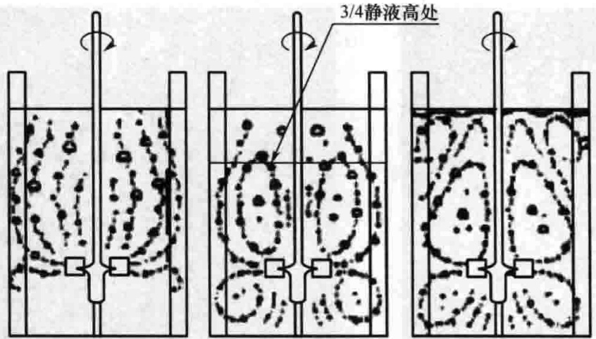

图5.6Rushton气液搅拌釜中流动区域

表5.2 3/4 静液高处 CT扫描实验条件

<table><tr><td>通气量/(L/min)</td><td>9.44</td><td>18.88</td><td>28.32</td></tr><tr><td rowspan="3">转速/(r/min)</td><td>350 $^{\text{1}}$ </td><td>470 $^{\text{1}}$ </td><td>530 $^{\text{1}}$ </td></tr><tr><td>500</td><td>600</td><td>640</td></tr><tr><td>800</td><td>800</td><td>800</td></tr><tr><td colspan="4">改变气体分布器开孔数及直径</td></tr><tr><td colspan="4">改变桨型</td></tr></table>

①临界搅拌速度。

表 5.3 不同静液高处的 CT扫描

<table><tr><td>搅拌转速/(r/min)</td><td></td><td></td><td colspan="4">无量纲静液高</td></tr><tr><td>470</td><td>-</td><td>6.7 $^1$ </td><td>8.85</td><td>10.4</td><td>15</td><td>18.2</td></tr><tr><td>600</td><td>3.4</td><td>6.7 $^1$ </td><td>8.85</td><td>10.4</td><td>15</td><td>18.2</td></tr><tr><td>800</td><td>3.4</td><td>6.7 $^1$ </td><td>8.85</td><td>10.4</td><td>15</td><td>18.2</td></tr></table>

①搅拌桨所在的位置。

注:固定通气量为18.88L/min。

## 5.4 CT扫描测量3/4静液高处断面径向气含率分布

## 5.4.1 不同临界状态

通气量分别为9.44 L/min、18.88L/min、28.32 L/min时，其临界搅拌转速分别为350r/min、470r/min、530r/min，其临界分散状态下CT扫描结果如图5.7、图5.8所示。可见，随着通气量的增大，所需临界搅拌转速增加，气含率及其分布不均匀性均明显增加，在无量纲半径0.35\~0.65搅拌桨叶片上方空间增加最明显。在下节5.4.2不同通气量下搅拌转速的影响中还将对此做进一步的分析与讨论。

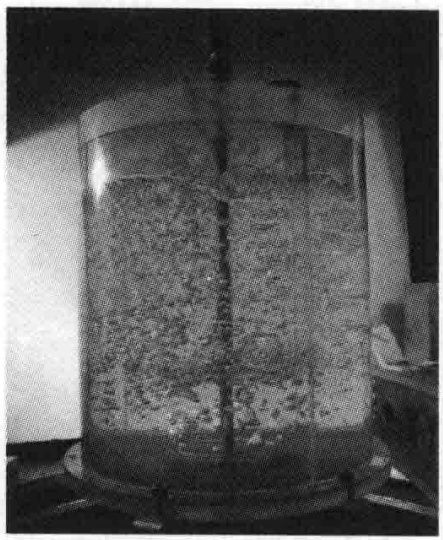

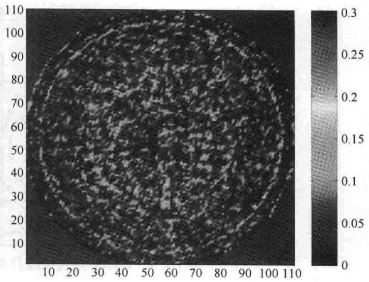

临界分散:气量9.44L/min，搅拌转速350r/min

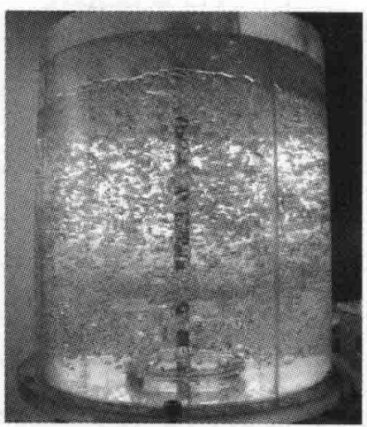

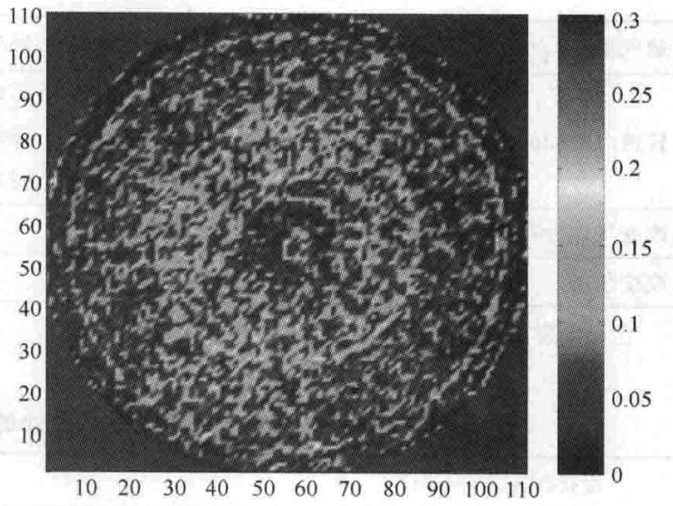

临界分散:气量18.88L/min,搅拌转速470r/min

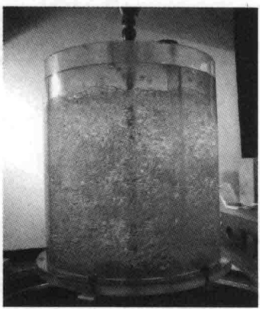

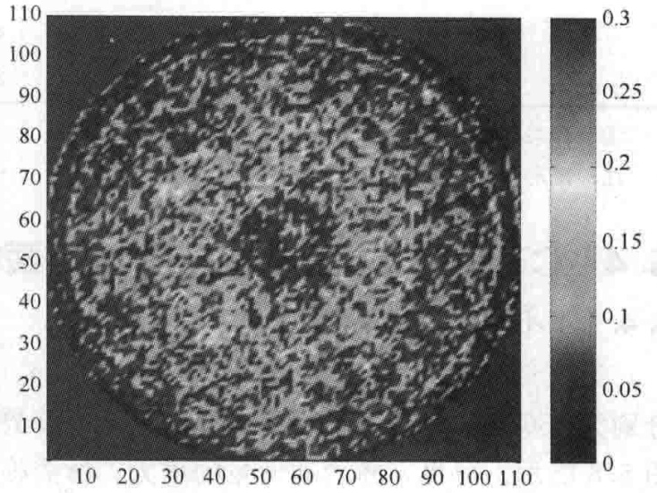

临界分散:气量28.32L/min，搅拌转速530r/min

图5.7 三种不同临界状态的气含率分布正面照片和断面CT图像

图5.8三种临界状态下的径向周均气含率分布

## 5.4.2不同通气量下搅拌转速的影响

在气液搅拌釜中，搅拌转速对气液分散的影响显而易见，如随着搅拌转速的提高，可以使气液分散从液泛到临界分散和完全分散状态的转变。本节介绍当搅拌转速超过临界转速后，在不同通气量时搅拌转速对气含率分布的影响。

(1)通气量 9.44 L/min在通气量9.44 L/min下搅拌转速分别为350r/ min、500r/min、800r/min时的CT扫描结果和径向周均气含率分布如图5.9、图5.10所示。

根据图5.9、图5.10，讨论如下。

①从图5.9可见，在通气量9.44L/min时，随着搅拌转速的增加，气含率有所增加，实拍正面照片明显反映出了这一点，彩色CT图像则从气含率断面分布也反映出了这一点，相互得到验证。从CT图像还可见，临界搅拌时气含率断面分布比较均匀，随着转速的增加，气含率主要在搅拌桨正上方空间增加较多。图5.10径向周均气含率分布曲线进一步定量反映出了CT图像的这一定性结果。

②气含率较大区域出现在无量纲半径0.25～0.65范围，这刚好与搅拌桨外围尺寸相符。这是因为从气体分布器上升的气泡同时被搅拌桨叶片和搅拌桨透平所在旋转液平面分散，形成了大量小气泡，上升气泡与液体间摩擦力明显小于向外甩出气泡的摩擦力，故大部分气泡进入了搅拌桨透平正中上方的负压空间。由于搅拌桨透平的“阻挡效应”，气含率较小区域出现在无量纲半径0.1\~0.2范围。另外，搅拌轴表面也会产生少量气泡。因此，虽然有搅拌桨透平的阻挡，但中心气含率还是有一个从高到低的下降过程。

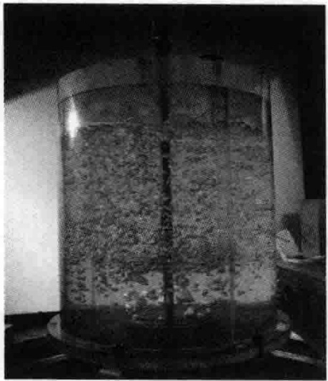

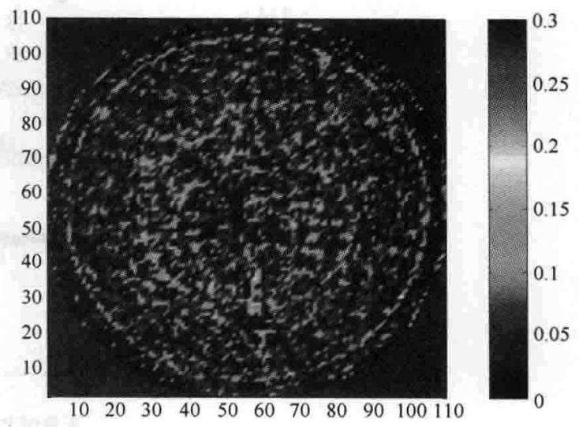

通气量9.44L/min，搅拌转速350r/min

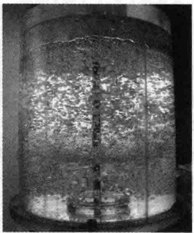

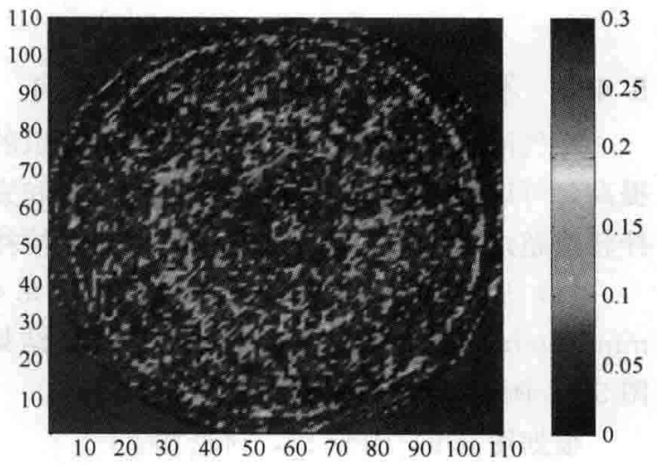

通气量9.44 L/min，搅拌转速500r/min

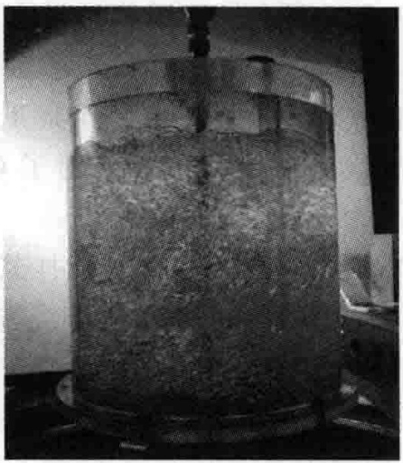

通气量9.44L/min，搅拌转速800r/min

图5.99.44L/min通气量下不同搅拌转速时气含率分布的正面照片和断面CT图像

图5.10通气量9.44 L/min下搅拌转速对断面气含率分布的影响

③临界搅拌以后，断面气含率分布更加不均匀，这支持和证实了②的解释，即搅拌转速越大，搅拌桨上方形成的负压增加，气体小气泡快速进入此负压空间(无量纲半径0.25\~0.65)范围的也就越多。

④图5.9中釜内液体膨胀高度分别为20.3cm、20.4cm、20.6cm，据此算出相应的宏观总气含率分别只有1.5%、2%、3%，这与①断面径向周均气含率相差甚大。究其原因，是搅拌桨下方（近1/3空间）气含率相当低，在搅拌桨上方气含率也有一个发展过程，在静液3/4高处会形成相对比较均匀而较高的气含率分布。

(2)通气量18.88L/min 在通气量18.88 L/min下搅拌转速分别为470r/ min、600r/min、800r/min时的CT扫描结果和径向周均气含率分布如图5.11、图5.12所示。对比图5.10和图5.12可见，通气量增加，气含率及其分布不均匀性均增加，但此时搅拌转速的影响却下降。

(3)通气量28.32L/min 在通气量28.32L/min下搅拌转速分别为530r/ min、640r/min、800r/min时的CT扫描结果和径向周均气含率分布如图5.13、图5.14所示。

图5.14进一步验证了“通气量增加，气含率及其不均匀性均明显增加，但此时搅拌转速的影响却下降”的结论。

## 5.4.3同一搅拌转速下不同通气量的影响

在Rushton气液搅拌釜中，在低转速下通气量对气含率大小及其分布的影响显而易见。因此，这里设计在最大搅拌转速800r/min下，考察增加通气量9.44 L/min、18.88L/min、28.32L/min时对气含率大小及其断面分布的影响，其CT扫描结果如图5.15、图5.16所示。

通气量18.88 L/min,搅拌转速470r/min

通气量18.88L/min,搅拌转速800r/min

通气量18.88 L/min,搅拌转速600r/min

图5.11 18.88L/min通气量下不同搅拌转速时气含率分布的正面照片和断面CT图像

图5.12 通气量18.88 L/min下搅拌转速对气含率分布的影响

通气量28.32L/min,搅拌转速530r/min

通气量28.32L/min,搅拌转速800r/min

通气量28.32 L/min,搅拌转速640r/min

图 5.13 28.32 L/min通气量下不同搅拌转速时气含率分布的正面照片和断面CT图像

图5.14 通气量28.32L/min下搅拌转速对气含率分布的影响

通气量9.44L/min，搅拌转速800r/min

通气量18.88 L/min,搅拌转速800r/min

通气量28.32 L/min,搅拌转速800r/min

图 5.15 搅拌转速 800r/min 时不同通气量的 CT 图像

图5.16 搅拌转速800r/min时通气量对气含率分布的影响

8孔1.5mm孔径

从图5.15和图5.16清楚可见，在3/4静液高处，即使在高转速下，气量越大，气含率也越大，分布也越不均匀，而且气含率增加幅度明显大于搅拌转速增加的影响。这说明在超过临界气体分散状态后，增加气量对气含率增加的效果比增加搅拌转速效果好。

## 5.4.4 气体分布器开孔状况的影响

圆环气体分布器两种开孔情况:8孔1.5mm孔径和16孔0.5mm孔径。实验观察得知，在16孔0.5mm孔径情况下，从圆环气体分布器上升至搅拌桨间的气泡密而小，但在3/4静液高处CT扫描结果却差别不大。这说明超过临界载气状态以后，在圆环气体分布器已有一定均匀分布开孔数情况下，再增加开孔数和降低开孔直径并无多大效果。在通气量9.44L/min、搅拌转速500r/min时，CT扫描考察气体分布器开孔数和开孔直径对断面气含率分布的影响，也证实了这一点，结果如图5.17、图5.18所示。

图 5.17 气体分布器不同开孔状况时的 CT图像

## 5.4.5 搅拌桨安装高度的影响

在通气量18.88L/min、搅拌转速600r/min下进行不同搅拌桨安装高度CT扫描结果的比较，如图5.19、图5.20所示。左图搅拌桨安装高度在静液高1/3处，右图在1/6处。

从图5.19、图5.20可见，降低搅拌桨安装高度，气含率增加，但呈现出更加不均匀性分布，尤其是在轴中心、0.55无量纲半径和近壁处。究其原因，可能有二:一是从圆环气体分布器小孔喷出的气泡带有很大的动能，也还没有来得及分散成型，就与搅拌桨相遇；二是由于搅拌桨位置的改变，引起液体循环流型的改变。究竟为何标准Rushton搅拌釜搅拌桨安装高度一直以来都设计在1/3无

图5.18气体分布器不同开孔状况时的气含率分布

图 5.19搅拌桨不同安装高度时的CT 图像

图5.20 搅拌桨不同安装高度时的气含率分布

量纲高度而不是在更低一点的位置以留出更多的气液接触和气体分散空间，这个问题也许也值得考证与思考。

## 5.4.6搅拌桨型的影响

在通气量9.44L/min、搅拌转速为350r/min、500r/min、800r/min时比较Rushton和 Smith搅拌桨的CT扫描结果，如图5.21、图 5.22所示。搅拌桨安装高度在1/3静液高处，扫描高度在3/4静液高处，圆环气体分布器是8孔1.5mm孔径。

由图5.21、图5.22 可见，Smith搅拌桨在低搅拌转速时比Rushton桨效果略好，但当搅拌转速增大时，两者差别甚少。在通气量28.32L/min、搅拌转速500r/min时Rushton和 Smith 搅拌桨 CT 扫描结果并无多少差别，如图 5.23、图5.24所示。

## 5.5 CT扫描不同静液高处径向气含率分布

按表5.3，固定气量(18.88L/min)，在不同搅拌转速不同静液高处进行CT扫描测量。虽然CT扫描图像能形象地反映出断面气含率分布，并进行定性比较，但难进行定量比较。因此，为节省篇幅起见，对搅拌桨上方空间各实验操作条件下的CT图像不再列出，而直接列出基于CT扫描图像的断面气含率分布径向周均气含率沿半径变化的数字分布曲线，进行分析与讨论。下面分搅拌桨上、下方空间叙述。

## 5.5.1搅拌桨上方空间

搅拌桨上方空间CT扫描不同高度处断面径向气含率分布如图5.25所示。搅拌桨安装在气液Rushton釜中6.67cm高度，即1/3静液高位置。因此，搅拌桨上方空间CT扫描高度位置依次是8.85cm(a)、10.4cm（b)、15cm(c)、18.2cm（d）高处。通气量为18.88L/min。

从图5.25可见，搅拌桨上方不同扫描高度处断面径向周均气含率分布差别很大。在搅拌轴中心，在旋转的搅拌轴表面很容易产生气泡，故有一定的气含率。实验观测也证实了这一现象。由于搅拌桨透平对从圆环气体分布器喷射的上升气泡的阻挡、破碎与液面的剪切与分散作用，导致在所有高度处无量纲半径0.18左右区域（搅拌桨透平的无量纲半径为0.25）均出现气含率最低点。除了在3/4静液高断面处，此最低气含率为0.03（即3%)，其余几乎为0。这也再次验证了3/4静液高断面处气含率分布的特殊性，见5.3.2节扫描位置讨论及图5.6。

当无量纲半径超过0.2时，气含率开始呈增加趋势，同时各高度处的气含率分布曲线也开始有所区别。随着扫描高度的增加，气含率分布曲线的峰值逐渐向靠近搅拌釜壁处方向移动。这可能是由于搅拌透平对近桨区气液产生了离心剪切力影响的缘故。

通气量9.44L/min，搅拌转速350r/min(左图Rushton桨，右图Smith桨)

通气量9.44L/min，搅拌转速500r/min(左图Rushton桨，右图Smith桨)

通气量9.44L/min，搅拌转速800r/min(左图Rushton桨，右图Smith桨)

图5.21 不同桨型时的CT 图像

(通气量9.44L/min，搅拌转速350r/min、500r/min、800r/min)

图5.22 不同桨型时的气含率分布

(通气量9.44L/min，搅拌转速350r/min、500r/min、800r/min)

相对其他断面而言，在3/4静液高断面处，CT扫描断面气含率分布相对比较均匀，尤其在无量纲半径0.3至0.6处，这再次证实了人眼正面观测到的气泡在3/4静液高断面处“动态分散均匀”的现象。

整体上，在超过临界转速以后，搅拌转速的增加对气含率的大小及其分布的影响均不大。这再次说明临界搅拌转速的确定是非常重要的，尤其是在工业应用中，气液搅拌釜一定要避免液泛状态下操作。

至于图5.25（d)已经是在近Rushton搅拌釜的出口位置，为什么此时其出口气含率分布还不均匀，这个问题值得深人探讨。依作者所见，这可能是由于Rushton搅拌釜的结构尺寸所限，Rushton搅拌釜中搅拌桨上方区域均未脱离搅拌桨的作用，并没有进入气泡上升的“自由发展区”。这也给气液搅拌釜的设计与应用带来两个思考问题:设计什么样的搅拌桨才能充分分散为均匀分布的均匀气泡？怎么样充分利用搅拌桨的分散作用以及气泡上升的自然分散作用与区域?

图5.23 不同桨型时的 CT图像（通气量28.32L/min、搅拌转速500r/min)

图5.24 不同桨型时的气含率分布（通气量28.32L/min、搅拌转速500r/min)

## 5.5.2 搅拌桨下方空间

在搅拌桨下方一半位置高度即3.4cm处通气量为18.88L/min、两种不同转速下(600r/min和800r/min)进行CT扫描（图5.26)，其径向气含率分布如图5.27所示。

从图5.27可见，在搅拌桨透平无量纲半径为0.25以内，出现气含率的凹向分布，在无量纲半径0.18左右出现最低值，这与搅拌桨上方区间的情况相同。紧接着是气含率的凸向分布，并且在无量纲半径0.3左右出现最高值，这刚好是圆环气体分布器喷气小孔的正上方。值得注意的是，在近壁处气含率有所上升。这是因为搅拌桨旋转带入了向下循环流的气泡。随着搅拌转速的增加，带入了向下循环流的气泡也更多。实验中人眼的正面动态观测与CT扫描断面径向图均气含率分布均证实了这一点。

(a)无量纲半径

(b) 无量纲半径

(c) 无量纲半径

(d) 无量纲半径

图5.25 搅拌桨上方不同高度处断面周均气含率沿半径变化曲线

-1 -0.8-0.6-0.4-0.2 0 0.2 0.4 0.6 0.8

-1-0.8-0.6-0.4-0.2 00.20.4 0.6 0.81

图5.26搅拌桨下方CT扫描图像（通气量18.88L/min，搅拌转速600r/min、800r/min)

图5.27搅拌桨下方的气含率分布（通气量18.88L/min，搅拌转速600r/min、800r/min)

## 5.6 结论

系统研究了Rushton气液搅拌釜中气液分散状态，通过对Rushton气液搅拌釜各种实验条件下的实验观测与CT扫描实验，得到不同位置、不同通气量、不同搅拌转速等情况下搅拌釜中气含率的径向与轴向分布的CT图像及其数字分布曲线，通过对它们的分析、比较与讨论，结论如下。

①提出将Rushton气液搅拌釜气液分散状态划分为气泛、临界载气和完全分散三种状态，工业应用应该避免在气泛状态操作。临界搅拌速度随通气量的增加而增加，但目前主要是通过实验观测加以确定。对于工业应用的气液搅拌釜，如何确定其临界搅拌转速，无论是从实验测量还是模拟计算之中，仍待进一步地深人研究。

②在超过临界状态后，增加搅拌转速、加密圆环气体分布器的开孔数或者减少其开孔直径，对提高气含率或改善气含率分布效果并不是很明显。与增加搅拌转速相比，增加通气量对提高气含率的效果要明显得多。气含率的增加主要在搅拌桨叶片上方空间，但通气量过大会引起气液夹带和气体是否达到临界分散问题。

③Rushton气液搅拌釜气含率断面径向分布很不均匀，呈现出一凹一凸的分布形状。即在半径小于透平半径以内范围，气含率是呈凹形分布，在无量纲半径

0.18左右出现最低值。而在半径大于透平半径以外范围，气含率是呈凸形分布，在无量纲半径0.3左右出现最大值，气泡主要出现在搅拌桨叶片上方区间。

④Rushton气液搅拌釜气含率正面轴向分布也不均匀，但在3/4静液高处，气含率分布相对均匀一些。

⑤降低搅拌桨安装高度，气含率会有所增加，但断面径向分布也会更不均匀。

⑥Rushton 和 Smith 两种搅拌桨型对气含率大小及分布影响也很小。

## 参考文献

[1] Nienow A W, Warmoeskerken M M C G, Smith J M, et al. On the flooding/loading transition and the complete dispersal condition in aerated vessels agitated by a Rushton turbine. Wurzburg: Proceedings of the European Conference on Mixing, 1985: 15.

[2]Bombac A, Zun I,Filipic B, Gas filled cavity structures and local void fraction distribution in aerated stirred vessel. AIChEJ, 1997, 43 (11): 2921-2931.

[3] Alessandro Paglianti, SandroPintus, MassimilianoGiona. Time-series analysis approach for the identification of flooding/loading transition in gas liquid stirred tank reactors. Chem Eng Sci, 2000 (55): 5793-5802.

[4] Jade A M, JayaramanV K,Zulkarni BD, et al. A novel local singularity distribution based method for flow regime identification: Gas-liquid stirred vessel with Rushton turbine. Chem Eng Sci, 2006(61): 688-697.

[5] Wang Weijing, Mao Zaisha, Yang Chao. Experimental and numerical investigationon gas holdup and flooding in an aerated stirredtank with rushton impeller. Ind Eng Chem Res, 2006 (45): 1141-1151.

## 第6章

# Rushton气液搅拌釜气穴结构及近桨区气含率分布

为了进一步了解Rushton气液搅拌釜气液两相行为及结构，本章研究Rushton气液搅拌釜透平桨处气穴结构及近桨区气含率分布，并进行CT扫描测量实验，这对了解气体在搅拌桨处分散机理及开发新型气液搅拌桨很有意义。

## 6.1 气穴结构与流态区域

## 6.1.1 气穴形成

在Rushton气液搅拌釜中，在搅拌桨转动作用力下，气液混合流体一起做周向与径向运动，同时在叶片的上下边缘侧后形成一定的尾涡流，涡流中心的负压较大，因此从叶轮下方鼓入的气体立即被卷人到涡流中，在桨叶背面形成“气穴”，如图6.1、图6.2所示[1]。气穴是由气体填充的，且黏附在叶轮边缘，气穴的边缘扩大了叶轮的直径。气穴的存在使得搅拌桨在充气时旋转阻力减小，搅拌功率下降，为不通气时的20%～40%。气穴结构对气含率大小及其分布具有本质的影响。气穴结构的形成与搅拌桨结构及转速、通气流量、气液性质等有关。

图6.1 模拟的气穴形成

图 6.2 叶轮后的气穴

## 6.1.2 气穴结构

已报道的气穴结构通常通过非旋转测量技术结合摄像机和快照技术、震动叶轮、水测器、CTA、电阻探针等技术来测量[2\~8]。A. W.Nienow[2]、A. Bombac等[3]利用电阻探针测量电信号响应得到结构函数 $M_{p}$ ，各气穴结构转换都会使结构函数产生明显的电脉冲，而电脉冲高度则对应着不同的气穴结构与大小。他们测量出以下几种气穴结构类型:黏附涡气穴结构VC（VortexClinging Structure)、第一个出现的大气穴 1L(The First Large Cavity)、两个大气穴2L (Two Large Cavities)、小3-3 气穴结构 S33(Small 3-3'Structure)、大 3-3气穴结构L33(Large′3-3′Structure)以及不规则气穴结构RC(Ragged Cavities)。由VC到S33的转变先后经过1L和2L两种气穴结构。1L、2L、S33、L33气穴结构分别包括一个、两个、三个及六个大气穴。在所有流态下，没有发现包含四个或五个大气穴的气穴结构。在2L气穴结构中，一个大气穴伴随两个黏附涡气穴。在S33和L33气穴结构中，两个或三个气穴不会在相邻叶轮上出现，而是被分散的小气穴隔开，大气穴常在同一叶轮上出现[3]。根据不同的气穴结构，可分为不同的流动区域[3]，如图6.3所示。图6.3中， $F_{1} = Q_{\mathrm{G}}/$ $(ND_1^3)$ 反映了纵向通气量与透平叶片离心泵出量之比， $F_{\mathrm{r}} = N^{2}D_{\mathrm{I}} / g$ 反映了透平叶片离心泵出力与纵向重力之比。 $Q_{G}$ 为通气量， $\mathrm{m}^3 /\mathrm{s};N$ 为搅拌桨转速，r/s; $D_{I}$ 为搅拌桨直径；g为重力加速度。

图6.3 气液搅拌釜流态区域[3]

## 6.1.3 流态区域

我们实验所测的各流态区域（见第5章5.2.1节中图5.5)与文献[3]报道的图6.3流态区域划分相近，但所测得的临界载气线要高于图6.3流态区中的临界载气线，这可能是由不同气液搅拌釜中不同实验条件下的实验测量差异所致。

过去对气液两相流态区域的研究大多在流态区域划分及判别上[9,10]，而对相应气穴结构下及近桨区的气含率分布则鲜有报道。在工业应用中，很明显要避免液泛状态而要在载气状态下操作。从图5.5可见，载气状态下叶轮后的气穴结构处在S33到L33结构范围（简称“3-3”结构)，这时“3-3”气穴结构与载气状态相连。因此，我们试图通过载气状态下 γ-CT 对透平叶片及其附近位置的扫描测量，来研究“3-3”气穴结构及近桨区的气含率分布[11,12]。

## 6.1.4 CT扫描

图6.4为搅拌桨透平处 CT扫描图像，实验条件为:通气量18.88L/min，搅拌转速分别为470r/min、600r/min、800r/min，据图5.5流动区域所标实验点可见，这时大致分别对应着L33、S33-L33、S33的气穴结构。

(a)

(b)

(c)

图6.4 透平桨透平处气含率分布CT图像 $[z = 6.7\mathrm{cm}$ ,(a) L33, (b)S33-L33, (c) S33]

三种气穴结构情况下的CT图像有共同的形状特点，即所有CT图像中心都有一个“黑色圆盘区”，这就是搅拌桨透平位置所在；然后是一个“白色圆环区”，说明此区域气含率较高，这对应着搅拌桨透平叶轮外缘区域的上升气泡区域；最后是一个“黑白相混的大圆环区”，说明大部分气泡在此区域分散。

为了对比，再在搅拌桨上方空间近桨区进行CT扫描，结果如图6.5、图6.6所示。

(a)

(b)

(c)

图 6.5 气含率分布 CT图像[z=8.85cm，(a) L33，(b) S33-L33，(c) S33]

从图6.4、图6.5、图6.6可见，所有S33结构下气含率比L33结构下气含率都要高，这也说明提高搅拌转速对提高气含率还是有一定效果的。并且随着轴向位置升高，“白色圆环区”逐渐消失，这说明搅拌釜桨区影响也逐渐减弱，CT断面气含率分布也趋向均匀。

## 6.2 近桨区气含率分布

## 6.2.1 气含率的轴向分布

在通气量为18.88L/min时三种分散状态下，对Rushton搅拌釜不同断面高处进行CT扫描，以断面像素小区间气含率的算术平均值作为该断面的平均气含率，结果如图6.7所示，并与A.Bombac[3]测量结果进行定性比较。两者均是对L33、S33两种气穴结构下轴向气含率分布的测量，A.Bombac采用的是电阻探头测量技术，我们采用的是基于流动区域划分的CT扫描测量技术，且测搅拌釜尺寸和操作条件不尽相同，但搅拌桨安装高度都是在1/3静液高位置，实验条件见表6.1。

(a)

(b)

(c)

图 6.6 气含率分布CT 图像 $\left[z = 10.4\mathrm{cm}\right.$ (a) L33, (b) S33-L33, (c) S33]

表6.1 轴向气含率分布的实验条件

| 气穴结构 | 笔者实验条件 | Bombac 实验条件 |
| --- | --- | --- |
| L33 | N=470r/min, Q=18.88 L/min | N=265.8r/min, Q=100.2 L/min |
| S33-L33 | N=600r/min, Q=18.88 L/min | — |
| S33 | N=800r/min, Q=18.88 L/min | N=376.2r/min, Q=100.2 L/min |

图6.7中实线为笔者实验数据，虚线为A.Bombac实验数据。从轴向气含率分布图6.7可见，S33气穴结构下的气含率都要明显高于L33气穴结构下的气含率，且两者气含率均在搅拌桨叶轮处达到最大。随着轴向高度位置的升高，轴向气含率分布趋向均匀。

## 6.2.2 气含率的径向分布

图6.7轴向气含率分布表明，在搅拌桨叶轮周围气体分布最为密集，对气液两相分散的影响也最大。但是，可能是由于实验测量技术难度方面的原因，相关实验数据文献报道甚少。因此，我们对近桨区气含率分布进行CT扫描测量，结果如图6.8所示。图中给出了叶轮半剖面示意，黑色直线表示CT扫描位置。

图6.7 S33 与L33 结构下的轴向气含率分布

从图6.8可见，同一扫描高度下，不同气穴结构的气含率分布差别不是很大。在搅拌桨处[图6.8（a)]，径向气含率分布曲线的峰值出现在叶轮外缘处(无量纲半径0.34)。经过峰值后，随着无量纲半径的增加，气含率又迅速减小，在减小到一定程度后趋向平坦。另外，随着轴向高度的增加，气含率峰值往搅拌桨叶轮外移，整体径向分布也变得平坦一些。

## 6.3 小结

①Rushton气液搅拌釜中搅拌桨处气液两相流分散过程相当复杂。本章介绍了Rushton气液搅拌釜中搅拌桨叶轮旋转时产生的气穴结构及相应的流态区域划分，这对了解气体在搅拌桨处分散机理及开发新型气液搅拌桨都很有意义。

②利用γ-CT技术扫描测量了Rushton搅拌釜中“3-3”气穴结构下的轴向气含率分布，并与文献[3]测量结果进行了比较，结果表明两者基本吻合，所有S33气穴结构下的气含率都要明显高于L33气穴结构下的气含率，气含率均在搅拌桨叶轮处达到最大，随着轴向位置升高，轴向气含率分布趋向均匀。

③通过近桨处CT扫描，发现在同一扫描高度下，不同气穴结构的气含率分布差别不是很大。在搅拌桨处，径向气含率分布曲线的峰值在叶轮外缘处产生，经过峰值后，随着无量纲半径的增加，气含率又迅速减小，在减小到一定程度后趋向平坦。另外，随着轴向位置的升高，气含率峰值往搅拌桨叶轮外移，分布也变得平坦一些。

(a) z=6.7 cm

(b) z=8.85 cm

图6.8 近桨区气含率的径向分布

## 参考文献

[1]孔丽娜.Rushton搅拌釜内气-液两相流分散状态γ-CT测量及 CFD模拟[D].湘潭:湘潭大学，2012.

[2] Nienow A W, Warmoeskerken M M C G, Smith J M, Konno M. On the flooding/loading transition and the complete dispersal condition in aerated vessels agitated by a Rushton-turbine//Proceedings of the 5th European Conference on Mixing, BHRA, The Fluid Engineering Centre Cranfield, 1985: 143-154.

[3] Bombac A, Zun I, Filipic B, Zumer M. Gas-filled cavity structures and local void fraction distribution in aerated stirred vessel [J]. AIChE J, 1997, 43 (11): 2921-2931.

[4] Nagase Y,Yasui H. Fluidmotion and mixing in a gas-liquid contactorwith turbine agitators [J]. Chem Eng J, 1983, 27(1): 37-47.

## 第7章

# Rushton气液搅拌釜气含率断面分布的 CFD 模拟

## 7.1 引言

气含率大小及分布除实验测量以外，CFD(Computional Fluid Dynamics)模拟也是一个非常重要的手段[1]。在现有的实验测量技术手段限制下，模拟计算越来越得到了人们的青睐，一些专门的商业模拟计算软件也在不断涌现，如Fluent[2,3]、CFX[4]等。由于旋转搅拌桨对从圆环气体分布器上升气泡的破裂和分散、液体强湍流剪切和循环，导致气液搅拌釜中气泡破裂、聚并、分散与运动行为比鼓泡床更复杂。因此，如何对搅拌釜气液两相行为进行准确的物理和数学描述，并找到合适的模拟方法与计算手段，是大家所关注的非常重要的研究性课题。

对气液两相流数值模拟主要有Euler-Lagrange[5]和Euler-Euler[6]两大类方法。

Euler-Lagrange法分别是在Euler坐标、Lagrange坐标下考察液体和气泡颗粒行为，也称离散颗粒模型。该法将气相视为由大量的气泡颗粒组成，通过对气泡颗粒运动轨迹进行跟踪计算获得气泡颗粒相的流场分布。其特点是模型物理概念直观，可获得单个气泡颗粒的详细信息。但由于气泡颗粒数目繁多、大小不一，气泡颗粒之间有碰撞、反弹、界面变形、破裂、聚并等现象，很难进行准确的物理与数学描述，另外计算量也很大，所以用该法模拟气液搅拌釜气含率断面分布的文献报道甚少。

Euler-Euler法认为分散相与连续相相互渗透，采用与连续流体类似的质量、动量和能量守恒方程来描述两相行为，也称双流体模型。若能建立合理的气泡聚并、破裂机理模型，再运用群体平衡模型（PBM，PopulationBalanceModel)和双流体模型耦合求解，就能获得气液两相流场结构。因此，我们考虑搅拌釜内强湍流剪切作用下随机性气泡破裂与聚并现象，在双流体模型基础上引进群体平衡模型[7,8]，并认为破裂的大气泡体积等于生成的小气泡体积之和，由于聚并而消亡的小气泡体积等于聚并生成的大气泡体积之和，对Rushton气液搅拌釜气含率及气泡大小分布、气液两相速度场进行了CFD模拟计算，并与实验观测现象和CT扫描测量结果进行对比，以考察CFD模拟计算的可靠性和Rushton气液搅拌釜中气液两相流场结构。

## 7.2 双流体模型

双流体模型基本方程包括连续性方程和动量守恒方程，一般在没有温度变化情况下，不考虑能量守恒方程[9\~12]。

对于两相流，i相的连续性方程可表示为:

$$
\frac {\partial \rho_ {i} \alpha_ {i}}{\partial t} + \nabla \cdot (\rho_ {i} \alpha_ {i} u _ {i}) = \sum_ {j = 1} ^ {n} m _ {j i}\tag{7.1}
$$

式中， $u_{i}$ 是i相的速度； $\alpha_{i}$ 为i相体积分率； ∇ 为拉普拉斯算子； $m_{ji}$ 为从j相到i相的质量传递通量。这里不考虑传质过程，则有:

$$
\sum_ {j = 1} ^ {n} m _ {j i} = 0\tag{7.2}
$$

动量守恒方程为:

$$
\frac {\partial \rho_ {i} \alpha_ {i} u _ {i}}{\partial t} + \nabla \cdot (\rho_ {i} \alpha_ {i} u _ {i}) = - \alpha_ {i} \nabla P + \nabla \cdot (\alpha_ {i} \tau_ {i}) + F _ {i, j} + \rho_ {i} \alpha_ {i} g\tag{7.3}
$$

$\tau_{i}$ 是i相的应力张量，如下式表示:

$$
\tau_ {i} = - \mu_ {\mathrm{eff}, i} \left[ \nabla u _ {i} + (\nabla u _ {i}) ^ {\mathrm{T}} - \frac {2}{3} I (\nabla u _ {i}) \right]\tag{7.4}
$$

$\mu_{\mathrm{eff}}$ i为有效黏度，包括分子黏度、湍流黏度和气泡引起湍流项三部分组成。

$$
\mu_ {\mathrm{eff}, i} = \mu_ {\mathrm{i,L}} + \mu_ {\mathrm{t,L}} + \mu_ {\mathrm{BIT,L}}\tag{7.5}
$$

双流体模型关键问题是对相间作用项进行封闭，包括相间作用力 $F_{i,j}$ 和相间湍动项 $\nabla \cdot (\alpha_{i}\tau_{i})$ 0

## 7.3 相间作用力

气液相间主要作用力是曳力。当气泡相对于液体运动时，气泡受到附加质量力的作用。当液速存在径向分布时，气泡受到径向力的作用。径向力包括升力、湍动扩散力和壁面润滑力。在水-空气体系中，当气泡直径小于1mm时，其形状大致为球形，表面张力起主导作用。对中等尺寸气泡，表面张力和气泡周围液体的惯性力同时起作用，液体黏度和表面张力对气泡的运动也有明显影响。中等气泡具有次级运动特性，如呈锯齿状或螺线状轨迹上升。对于大气泡，周围流体的惯性力起主要作用。对气液搅拌釜中影响气含率的几种主要作用力情况分析如下。

## 7.3.1 曳力

目前利用实验手段对强湍流中气泡的曳力系数进行关联比较困难，且湍流与滑移速度之间的影响机理也不大清楚。因此，对曳力系数计算一般使用简单情形(如静止液体中气泡上升等）时的关联式或其修正式[13]。王铁峰等[14]为简化使用了常系数，Sun等[15]则使用了变速流场中气泡运动时曳力系数关联式，并忽略湍流对曳力系数的影响。F.Magelli等[16]研究表明当粒子尺寸相对于Komogrov尺度足够大时，湍流耗散涡与粒子发生作用，使粒子在曳力和沉降速度上发生改变。A.Brucato等[17]通过实验研究证实了湍流对粒子沉降速度产生了影响，其速度小于静止液体情形，将粒子尺寸同λ进行关联，对曳力系数作如下修正:

$$
\frac {C _ {\mathrm{D}} - C _ {\mathrm{D0}}}{C _ {\mathrm{D0}}} = K \left(\frac {d _ {\mathrm{b}}}{\lambda}\right) ^ {3}\tag{7.6}
$$

并由实验数据拟合得到系数K为 $8.76\times 10^{-4}$ 。Lane 等和A. R. Khopkar等[18]均采用该修正式进行了模拟计算，其中后者使用了一个更小的系数6.5× $10^{-6}$ 。A.Bakker等[19]则采取了不同的思路，对粒子相对雷诺数Re修正，在原来流体分子黏性项中添加了湍流导致的增强黏性:

$$
R e = \frac {\rho_ {1} d _ {\mathrm{b}} \left| u _ {1} - u _ {\mathrm{b}} \right|}{\mu}\tag{7.7}
$$

$$
\mu = \mu_ {\mathrm{L}} + C \mu_ {\mathrm{T,l}} = \mu_ {\mathrm{L}} + C _ {1} \rho_ {\mathrm{l}} \frac {k ^ {2}}{\varepsilon}\tag{7.8}
$$

A. Bakker 等[19]给出 $C_{1}$ 为0.02，F.Kerdouss 等[20]给出C 为0.3。M. Laakkonen等[21]将上式中的湍动动能与湍流脉动速度进行关联:

$$
k = 0. 5 u ^ {\prime 2} = \varepsilon^ {2 / 3} d _ {\mathrm{b}} ^ {2 / 3}\tag{7.9}
$$

则式（7.8)修正为:

$$
\mu = \mu_ {\mathrm{L}} + C _ {7} \rho_ {1} \varepsilon^ {1 / 3} d _ {\mathrm{b}} ^ {4 / 3} (\text {其中}, C _ {7} = 0. 0 2)\tag{7.10}
$$

考虑湍流修正后有可能获得更合理的气含率分布。

## 7.3.2 附加质量力

当气泡相对于液体运动时，其周围部分液体被加速，使气泡受到附加质量力的作用，计算式如下:

$$
F _ {\mathrm{VM}} = - \alpha_ {\mathrm{g}} \alpha_ {1} C _ {\mathrm{VM}} \frac {D}{D t} (u _ {\mathrm{b}} - u _ {1})\tag{7.11}
$$

式中，Cvm为附加质量力系数，对应于被加速液体的体积和气泡体积之比。对于气泡，Cvm和气泡大小和形状有关，而G.M.Homsy等[22]认为气泡的 $C_{\mathrm{VM}}$和相含率有关。我们取0.5进行模拟计算。

## 7.3.3 液相湍动

选用标准k-ε湍流模型[14]描述气液搅拌釜中的液相湍动，守恒方程如下:

$$
\begin{array}{l} \frac {\partial}{\partial t} (\rho \phi) + \frac {\partial}{\partial x _ {i}} (\rho v _ {i} \phi) = \frac {\partial}{\partial x _ {i}} \left(\Gamma \frac {\partial \phi}{\partial x _ {i}}\right) + S _ {0} \\ \text {(I)} \quad \text {(II)} \quad \text {(III)} \quad \text {(IV)} \end{array}\tag{7.12}
$$

式中，(I)为时间项；(Ⅱ)为对流项；(Ⅲ)为扩散项；(Ⅳ)为源项； φ 为传递变量 $(v_{i},k,\varepsilon ,c);S_{0}$ 为单位体积源项；Γ为扩散系数 $(\Gamma = \mu_{\mathrm{eff}} / Sc)$ ; $Sc$ 为Schmidt数。

当湍流模型为标准k-ε模型时，其k和ε守恒方程的具体表达式为:

$$
\frac {\partial}{\partial t} (\rho k) + \frac {\partial}{\partial x _ {i}} (\rho k v _ {i}) = \frac {\partial}{\partial x _ {j}} \left[ \left(\mu + \frac {\mu_ {i}}{\sigma_ {k}}\right) \frac {\partial k}{\partial x _ {j}} \right] + G _ {\mathrm{k}} + G _ {\mathrm{b}} - \rho \varepsilon - Y _ {\mathrm{M}} + S _ {k}\tag{7.13}
$$

$$
\begin{array}{r l} \frac {\partial}{\partial t} (\rho \varepsilon) + \frac {\partial}{\partial x _ {i}} (\rho \varepsilon v _ {i}) & = \frac {\partial}{\partial x _ {j}} \left[ \left(\mu + \frac {\mu_ {i}}{\sigma_ {\varepsilon}}\right) \frac {\partial \varepsilon}{\partial x _ {j}} \right] + \\ C _ {1 \varepsilon} \frac {\varepsilon}{k} (G _ {\mathrm{k}} + C _ {3 \varepsilon} G _ {\mathrm{b}}) - C _ {2 \varepsilon} \rho \frac {\varepsilon^ {2}}{k} + S _ {\varepsilon} \end{array}\tag{7.14}
$$

式中， $G_{k}$ 为由于平均速度梯度而产生的湍流动能项。根据Boussinesq假说，可得 $G_{k}$ 的近似表达式为 $G_{\mathrm{k}} = \mu_{\mathrm{t}}S^{2}$ ，S为张量模数， μ 为湍流黏度。

$$
\mu_ {\mathrm{t}} = \rho C _ {\mu} \frac {k ^ {2}}{\varepsilon}\tag{7.15}
$$

式中， $C_{\mu}$ 为常数； $G_{b}$ 代表由于浮力而产生的湍流动能项； $Y_{\mathrm{M}}$ 代表可压缩湍流流动中波动扩张对整个能量耗散的贡献值； $C_{1\varepsilon}, C_{2\varepsilon}$ 是模型常数； $\sigma_{k}$ 和 $\sigma_{\varepsilon}$ 分别为k和ε的湍流普朗特数； $S_{k}$ 和 $S_{\varepsilon}$ 均为用户自定义源项。取 $C_{1\varepsilon} = 1$ .44, $C_{2\varepsilon} = 1.92$ $C_{\mu} = 0.09$ $\sigma_{k} = 1.0$ $\sigma_{\varepsilon} = 1.3$ 。两相流动的湍流模型在式（7.13)、式（7.14）中引入相含率变量进行求解。

## 7.4 群体平衡模型

群体平衡模型是描述多相体系中分相尺寸分布的常用方法。近年来，群体平衡模型成为多相流领域的一个研究热点，已在气液、液液体系中有关流体颗粒破裂与聚并、结晶、聚合和颗粒制备等过程中得到了广泛应用[23\~27]。将群体平衡模型用于气液或液液体系，可以系统地考察气泡破裂和聚并过程对流体颗粒相含率及其尺寸分布的影响，近年来不少研究者在这一领域开展了工作[23,28\~71]。

## 7.4.1 模型描述

群体平衡模型具有如下一般形式:

$$
\frac {\partial n (V , t)}{\partial t} + \nabla \cdot [ n (V, t) \boldsymbol {u} ] + \underbrace {\nabla_ {V} \cdot [ G _ {V} n (V , t) ]} _ {(1)}
$$

$$
\begin{array}{l} = \underbrace {\int_ {\Omega} p b (V ^ {\prime}) \beta (V | V ^ {\prime}) n (V ^ {\prime} , t) d V ^ {\prime}} _ {(2)} - \underbrace {b (V) n (V , t)} _ {(3)} + \\ \underbrace {\frac {1}{2} \int_ {0} ^ {V} c (V - V ^ {\prime} , V ^ {\prime}) n (V - V ^ {\prime} , t) n (V ^ {\prime} , t) d V ^ {\prime}} _ {(4)} - \underbrace {\int_ {0} ^ {\infty} c (V , V ^ {\prime}) n (V ^ {\prime} , t) d V ^ {\prime}} _ {(5)} \end{array}\tag{7.16}
$$

式中，n(V，t)表示体积为V的气泡的数目密度函数； $b(V^{\prime})$ 表示体积为$V^{\prime}$ 的气泡的破裂速率； $\beta (V|V^{\prime})$ 表示体积为 $V'$ 的气泡破裂成体积为V及其剩余子气泡的子尺寸分布函数； $c(V,V^{\prime})$ 表示体积为V的与体积为 $V'$ 的气泡的聚并速率。此外，（1）表示气泡的成核生长源项，(2)表示破裂引起的生成源项，(3)表示破裂引起的消亡源项，(4)表示聚并引起的生成源项，(5)表示聚并引起的消亡源项。

应用群体平衡模型预测气泡含率尺寸分布成功的关键之一是正确建立气泡的破裂模型（破裂速率、子尺寸分布函数）和聚并模型（聚并速率）。

## 7.4.2 气泡破裂模型

根据已有的实验观察，气泡的破裂过程通常可以分为两个阶段:一是气泡在周围液相流体作用下开始变形；二是当变形到一定程度后，气泡破裂成两个或更多个子气泡。气泡破裂机制包括湍流脉动（常被描述为湍流涡体的碰撞）、液体黏性剪切作用以及气泡表面不稳定等。一般来说，湍流脉动引起的气泡破裂为主要机制，已提出的破裂标准主要有[33,34]:①气泡的湍流动能大于或等于气泡的表面能[35\~38]；②周围液相流体的脉动速度大于或等于等尺寸破裂时气泡表面能增量所对应的速度[39,40]；③碰撞涡的湍动动能大于或等于某个临界值（比如破裂前后的表面能增量)[29,31,41\~45]；④碰撞涡的动压力（或惯性力）大于或等于破裂后的最小子气泡的附加压力（或界面力)[32,46]；⑤将③和④相结合的标准[47,48]。

(1)破裂速率这里介绍与气泡破裂标准③\~⑤有关的破裂速率模型。H. Luo& H.F.Svendsen[31]基于各向同性湍流理论，并假定:气泡发生二元破裂；破裂发生由抵达湍流涡的能级决定；只有小于或等于气泡的湍流涡才能引起气泡的破裂，大涡只能对气泡起输运作用。借鉴气体分子反应动力学理论，体积为 $V_{0}$ 的气泡以破裂比 $f_{\mathrm{v}}$ 发生破裂的速率定义为:

$$
b (V _ {0}: V _ {0} f _ {\mathrm{v}}) = \int_ {\lambda \min} ^ {d _ {0}} P _ {\mathrm{B}} (V _ {0}: V _ {0} f _ {\mathrm{v}}, \lambda) \omega_ {\mathrm{B}} (d _ {0}, \lambda) \mathrm{d} \lambda\tag{7.17}
$$

式中， $P_{\mathrm{B}}$ 为气泡发生破裂的概率； $\omega_{\mathrm{B}}$ 为气泡与尺寸为λ的湍流涡的碰撞频率。H. Luo& H.F. Svendsen[31]定义尺寸在λ和λ+dλ之间的湍流涡与气泡的碰撞频率为:

$$
\omega_ {\mathrm{B}} (d _ {0}, \lambda) = c _ {4} (1 - \alpha) n (\varepsilon d _ {0}) ^ {1 / 3} \frac {(1 + \xi) ^ {2}}{d _ {0} ^ {2} \xi^ {1 1 / 3}}\tag{7.18}
$$

并提出气泡的破裂标准为碰撞涡的湍流动能大于或等于破裂后的表面能增量。

$$
e (\lambda) \geqslant c _ {\mathrm{f}} \pi d ^ {2} \sigma\tag{7.19}
$$

式中， $c_{\mathrm{f}} = f_{\mathrm{v}}^{2 / 3} + (1 - f_{\mathrm{v}})^{2 / 3} - 1$ ，表示破裂后的总表面积增量。根据已有实验报道，H.Luo&H.F.Svendsen[31]采用了湍流涡动能服从指数分布的关系，定义气泡与湍流涡碰撞后以破裂比 $f_{\mathrm{v}}$ 发生破裂的概率为:

$$
P _ {\mathrm{B}} (V _ {0}: V _ {0} f _ {\mathrm{v}}, \lambda) = 1 - \int_ {0} ^ {\chi_ {\mathrm{c}}} \exp (- \chi) \mathrm{d} \chi = \exp (- \chi_ {\mathrm{c}})\tag{7.20}
$$

式中， $\chi_{c}$ 为无量纲临界能量，定义为:

$$
\chi_ {\mathrm{c}} = \frac {c _ {\mathrm{f}} \pi d _ {0} ^ {2} \sigma}{\bar {e} (\lambda)} = \frac {1 2 c _ {\mathrm{f}} \sigma}{\beta_ {1} \rho_ {\mathrm{c}} \varepsilon^ {2 / 3} d _ {0} ^ {5 / 3} \xi^ {1 1 / 3}}\tag{7.21}
$$

则气泡以破裂比 $f_{\mathrm{v}}$ 发生破裂的速率为:

$$
b \left(V _ {0}: V _ {0} f _ {\mathrm{v}}\right) = c _ {4} (1 - \alpha) n \left(\frac {\varepsilon}{d _ {0} ^ {2}}\right) ^ {1 / 3} \int_ {\xi_ {\min}} ^ {1} \frac {(1 + \xi) ^ {2}}{\xi^ {1 1 / 3}} \exp \left(- \frac {1 2 c _ {\mathrm{f}} \sigma}{\beta_ {1} \rho_ {\mathrm{c}} \varepsilon^ {2 / 3} d _ {0} ^ {5 / 3} \xi^ {1 1 / 3}}\right)\tag{dξ}
$$

(7.22)

气泡发生破裂的总速率为:

$$
b (V _ {0}) = \frac {1}{2} \int_ {0} ^ {1} b (V _ {0}: V _ {0} f _ {\mathrm{v}}) \mathrm{d} f _ {\mathrm{v}}\tag{7.23}
$$

H. Luo & H.F.Svendsen[31]模型除了积分上限取气泡直径和积分下限 $\lambda_{\min}$为估算外，不包括其他未知或可调参数。模型的另外一个优点是子尺寸分布可直接从破裂速率中获得。因此，该模型近年来得到了广泛的应用[49\~59]

C. Martínez-Bazán等[44]针对发展湍流中的气泡，提出破裂发生的标准为周围流体湍流脉动提供的变形应力 $\tau_{t}(d_{0})$ 必须大于或等于气泡表面的恢复性附加压力 $\tau_{s}(d_{0})$ 。这两个作用力分别表示为:

$$
\tau_ {\mathrm{t}} (d _ {0}) = \frac {1}{2} \rho_ {\mathrm{c}} \overline {{\Delta u ^ {2}}} (d _ {0}), \tau_ {\mathrm{s}} (d _ {0}) = \frac {\pi \sigma d _ {0} ^ {2}}{\pi d _ {0} ^ {3} / 6} = \frac {6 \sigma}{d _ {0}}\tag{7.24}
$$

当τ1 $(d_0) = \tau_{\mathrm{s}}(d_0)$ 时，可获得临界破裂直径 $d_{c}$ 。当 $d_{0}$ 小于 $d_{c}$ 时，破裂不能发生；当 $d_{0}$ 大于 $d_{c}$ 时，变形应力提供的变形能将大于气泡的表面能，破裂将发生。C.Martínez-Bazán等[44]假定在 $t_{\mathrm{b}}$ 时间内气泡发生破裂的概率随变形应力、气泡表面恢复性压力之差的增大而增大；当差降为零时，气泡的破裂速率也将降为零。因此他们提出了如下关系式:

$$
t _ {\mathrm{b}} \propto d _ {0} / u _ {\mathrm{b}} = d _ {0} / \sqrt {\Delta u ^ {2}} (d _ {0}) - 1 2 \sigma / (\rho_ {\mathrm{c}} d _ {0})\tag{7.25}
$$

式中， $u_{b}$ 为气泡破裂过程中的特征速度。气泡的破裂速率为

$$
b (d _ {0}) = 1 / t _ {\mathrm{b}} = K \sqrt {\beta_ {2} (\varepsilon d _ {0}) ^ {2 / 3} - 1 2 \sigma / (\rho_ {\mathrm{c}} d _ {0})} / d _ {0}\tag{7.26}
$$

式中，K为待定参数，需由实验确定。对气液体系，C.Martinez-Bazan等[44]给出的值为0.25。

Lehr& D.Mewes[25]采用了二元破裂的假定，并认为只有小于或等于气泡直径的湍流涡才能引起破裂的发生，假设对气泡破裂有贡献的最小湍流涡的尺寸等于最小子气泡的直径，提出气泡发生破裂的标准为:碰撞涡的动压力（或惯性力）大于或等于气泡表面的界面力。界面力取决于气泡的形状和子气泡的碎片尺寸。根据动压力与界面力的平衡，假定破裂前气泡局部接近圆柱形，则有:

$$
\frac {1}{2} \rho_ {\mathrm{c}} u _ {\lambda} ^ {2} = \frac {2 \sigma}{d ^ {\prime}}\tag{7.27}
$$

式中， $d'$ 为最小子气泡的直径。F.Lehr&D. Mewes[32]定义破裂速率等于破裂概率和碰撞频率之积，假定湍流涡速度服从正态分布，获得破裂概率为:

$$
P (\lambda , V ^ {\prime}, V _ {0}) = \frac {4 \sigma}{\pi} \times \frac {1}{\rho_ {\mathrm{c}} \varepsilon^ {2 / 3} \lambda^ {2 / 3}} \times \frac {1}{d ^ {\prime 4}} \exp \left(- \frac {2 \sigma}{\rho_ {\mathrm{c}} \varepsilon^ {2 / 3} \lambda^ {2 / 3} d ^ {\prime}}\right)\tag{7.28}
$$

对于 $0 \leqslant V' \leqslant V_0 / 2$ ，破裂速率为:

$$
b \left(V ^ {\prime}, V _ {0}\right) = \int_ {d ^ {\prime}} ^ {d _ {0}} \sqrt {2} C \frac {\sigma}{\rho_ {\mathrm{c}} \varepsilon^ {2 / 3} d ^ {\prime 4}} \times \frac {\left(\lambda + d _ {0}\right) ^ {2}}{\lambda^ {1 3 / 3}} \exp \left(- \frac {2 \sigma}{\rho_ {\mathrm{c}} \varepsilon^ {2 / 3} \lambda^ {2 / 3} d ^ {\prime}}\right) \mathrm{d} \lambda\tag{7.29}
$$

对于 $V_{0} / 2 <   V^{\prime}\leqslant V_{0}$ ，破裂速率为:

$$
b (V ^ {\prime}, V _ {0}) = b (V _ {0} - V ^ {\prime}, V _ {0})\tag{7.30}
$$

积分上式可得到一个破裂速率的解析表达式:

$$
b (d ^ {*}) = 0. 5 d ^ {* 5 / 3} \exp (- \sqrt {2} / d ^ {* 3})\tag{7.31}
$$

T.F. Wang等[47]提出了将 H. Luo& H. F. Svendsen模型[31]的表面能增量标准和F. Lehr& D. Mewes[32]的动压力标准相结合的观点，并指出H. Luo& H.F.Svendsen模型存在当破裂比趋于无穷小时，任何湍流涡都能导致气泡破裂的不足之处。他们提出:动压力标准(又称毛细压力）决定了最小破裂比 $f_{\mathrm{v,min}}$ ，表面能增量标准决定了最大破裂比 $f_{\mathrm{v,max}}$ 尺寸为 $d_{0}$ 的气泡与尺寸为λ的湍流涡发生破裂后可能的破裂比在 $f_{\mathrm{v,min}}$ 和 $f_{\mathrm{v,max}}$ 之间，且服从均一分布，则有:

$$
P _ {\mathrm{b}} \left[ f _ {\mathrm{v}} \mid d _ {0}, e (\lambda), \lambda \right] = \left\{ \begin{array}{l l} \frac {1}{f _ {\mathrm{v,max}} - f _ {\mathrm{v,min}}} & \text {当} f _ {\mathrm{v,max}} - f _ {\mathrm{v,min}} \geqslant \delta_ {1}, f _ {\mathrm{v,min}} <   f _ {\mathrm{v}} <   f _ {\mathrm{v,max}} \text {时} \\ 0 & \text {其他条件下} \end{array} \right.\tag{7.32}
$$

式中， $\delta_{1}$ 是为了避免 $f_{\mathrm{v,max}}$ 与 $f_{\mathrm{v, min}}$ 相等时出现无穷大情形而引入的可调参数。结合湍流涡动能的指数分布关系，并假定气泡与湍流涡碰撞后以破裂比 $f_{\mathrm{v}}$ 发生破裂的概率密度可以表示成 $f_{\mathrm{v}}$ 的概率分布密度与湍流涡动能的概率分布密度之积，则有:

$$
\begin{array}{r l} P _ {\mathrm{b}} (f _ {\mathrm{v}} \mid d _ {0}, \lambda) & = \int_ {0} ^ {\infty} P _ {\mathrm{b}} \left[ f _ {\mathrm{v}} \mid d _ {0}, e (\lambda), \lambda \right] P _ {e} \left[ e (\lambda) \right] \mathrm{d} e (\lambda) \\ & = \int_ {0} ^ {\infty} \frac {1}{f _ {\mathrm{v,max}} - f _ {\mathrm{v,min}}} \frac {1}{\overline {{e}} (\lambda)} \exp \left[ - \frac {e (\lambda)}{\overline {{e}} (\lambda)} \right] \mathrm{d} e (\lambda) \end{array}\tag{7.33}
$$

式中， $f_{v, \max}$ 由 $c_{\mathrm{f,max}} = \min [2^{1 / 3} - 1, e(\lambda) / (\pi d_0^2\sigma)]$ 计算， $f_{\mathrm{v,min}} =$ $\{\pi \lambda^3\sigma /\left[6e(\lambda)d_0\right]\}^3$ ，则气泡以破裂比 $f_{\mathrm{v}}$ 发生破裂的速率为:

$$
b (V _ {0}: V _ {0} f _ {\mathrm{v}}) = \int_ {\lambda \min} ^ {d _ {0}} P _ {\mathrm{b}} (f _ {\mathrm{v}} | d _ {0}, \lambda) \omega_ {\mathrm{B}} (d _ {0}, \lambda) \mathrm{d} \lambda\tag{7.34}
$$

气泡发生破裂的总速率为:

$$
b (V _ {0}) = \frac {1}{2} \int_ {0} ^ {1} b (V _ {0}: V _ {0} f _ {\mathrm{v}}) \mathrm{d} f _ {\mathrm{v}}\tag{7.35}
$$

在上述模型的基础上，H.Zhao&. W.Ge[48]考虑了气泡表面的脉动对气泡从湍流涡中吸取能量的影响，在临界涡能中引人了一个效率系数 $C_{\mathrm{eddy}}$ 。他们认为气泡与湍流涡之间的接触时间决定了气泡从每个湍流涡那里所能吸取的最大能量。当湍流涡的持续时间小于气泡摆动周期的一半时，气泡将持续变形并尽一切可能地从耗散涡中吸取能量。将气泡表面脉动周期的一半与湍流涡特征时间的比率作为湍流涡能量的效率系数，则有:

$$
C _ {\mathrm{eddy}} = \min \left[ \frac {0 . 5}{f (2) \tau_ {\mathrm{e}}}, 1 \right]\tag{7.36}
$$

式中，f(2)为气泡表面脉动的频率。引入涡能效率系数，则表面能增量标准变为:

$$
e (\lambda) \geqslant \frac {c _ {\mathrm{f}} \pi d _ {0} ^ {2} \sigma}{C _ {\mathrm{eddy}}}\tag{7.37}
$$

引入动压力标准，他们提出了如下临界湍流涡动能条件:

$$
e _ {\mathrm{c}} (d _ {0}, \lambda) = \max \left[ \frac {c _ {\mathrm{f}} \pi d _ {0} ^ {2} \sigma}{C _ {\mathrm{eddy}}}, \frac {\pi \sigma \lambda^ {3}}{3 d _ {0} \min (f _ {\mathrm{v}} , 1 - f _ {\mathrm{v}}) ^ {1 / 3}} \right]\tag{7.38}
$$

与T.F.Wang的模型[47]不同，上式给出的表面能增量标准和动压力标准相结合的形式使得破裂模型更便于应用。H.Zhao& W. Ge $^{[48]}$ 给出破裂发生的概率为:

$$
P _ {\mathrm{B}} (d _ {0}, \lambda) = P _ {e} \left[ e (\lambda) \geqslant e _ {\mathrm{c}} (d _ {0}, \lambda) \right]\tag{7.39}
$$

则气泡发生破裂的总速率为:

$$
b (d _ {0}) = \int_ {\lambda \min} ^ {d _ {0}} b (d _ {0}, \lambda) \mathrm{d} \lambda = \int_ {\lambda \min} ^ {d _ {0}} \omega (d _ {0}, \lambda) P _ {\mathrm{B}} (d _ {0}, \lambda) \mathrm{d} \lambda\tag{7.40}
$$

需要指出的是，H.Zhao & W. Ge $^{[48]}$ 将破裂比 $f_{\mathrm{v}}$ 定义为湍流涡直径与气泡直径比值的立方，这与已有大部分模型给出的定义不同。

(2)子尺寸分布函数 由群体平衡模型式(7.16)可知，完整的破裂模型除了需要知道破裂速率外，还需要知道子尺寸分布函数。文献中的子尺寸分布函数有统计学模型、现象学模型和基于二者结合的混合模型。统计学模型在早期应用较多，主要有正态分布[60]、 β 分布[42,61]、均匀分布[62,63]等，这类模型一般不能反映湍流条件的影响。现象学模型的子尺寸分布可从破裂速率中获得，并能反映湍流条件、物性参数的影响，因而近年来得到了较多研究者的应用。下面介绍文献中由破裂速率获得的二元破裂子尺寸分布函数。

H. Luo& H.F. Svendsen[31]根据建立的破裂速率，获得了如下子尺寸分布函数:

$$
\beta (V _ {0}: V _ {0} f _ {\mathrm{v}}) = \frac {2 \int_ {\xi_ {\min}} ^ {1} (1 + \xi) ^ {2} \xi^ {- 1 1 / 3} \exp (- \chi_ {\mathrm{c}}) \mathrm{d} \xi}{V _ {0} \int_ {0} ^ {1} \int_ {\xi_ {\min}} ^ {1} (1 + \xi) ^ {2} \xi^ {- 1 1 / 3} \exp (- \chi_ {\mathrm{c}}) \mathrm{d} \xi \mathrm{d} f _ {\mathrm{v}}}\tag{7.41}
$$

该模型预测的子尺寸分布为 “U” 型，气泡发生等尺寸破裂的概率随着气泡直径 $d_{0}$ 和湍流耗散速率的增大而增大。

C. Martinez-Bazán 等[44]假定尺寸为 $d_{0}$ 的气泡发生破裂的概率与变形应力、气泡表面恢复性压力的差值成正比，获得了如下子尺寸分布函数:

$$
\begin{array}{l} \beta (d _ {0}: d _ {0} f _ {\mathrm{v}} ^ {1 / 3}) = \\ \frac {\left[ 0 . 5 \beta_ {2} \rho_ {\mathrm{c}} (\varepsilon d _ {0} f _ {\mathrm{v}} ^ {1 / 3}) ^ {2 / 3} - 6 \frac {\sigma}{d _ {0}} \right] \left\{0 . 5 \beta_ {2} \rho_ {\mathrm{c}} [ \varepsilon d _ {0} (1 - f _ {\mathrm{v}}) ^ {1 / 3} ] ^ {2 / 3} - 6 \frac {\sigma}{d _ {0}} \right\}}{d _ {0} \int_ {0} ^ {1} \left[ 0 . 5 \beta_ {2} \rho_ {\mathrm{c}} (\varepsilon d _ {0} f _ {\mathrm{v}} ^ {1 / 3}) ^ {2 / 3} - 6 \frac {\sigma}{d _ {0}} \right] \left\{0 . 5 \beta_ {2} \rho_ {\mathrm{c}} [ \varepsilon d _ {0} (1 - f _ {\mathrm{v}}) ^ {1 / 3} ] ^ {2 / 3} - 6 \frac {\sigma}{d _ {0}} \right\} \mathrm{d} f _ {\mathrm{v}}} \end{array}\tag{7.42}
$$

该模型预测了“bell”型分布，气泡发生等尺寸破裂的概率最高。

F. Lehr& D. Mewes[32]根据破裂速率，获得了如下子尺寸分布函数:

$$
\beta (V ^ {\prime *}, V _ {0} ^ {*}) = \frac {6}{\pi^ {3 / 2} d ^ {\prime * 3}} \times \frac {\exp \left[ - \frac {9}{4} \ln^ {2} (2 ^ {2 / 5} d ^ {\prime *}) \right]}{\left\{1 + \mathrm{erf} \left[ \frac {3}{2} \ln (2 ^ {1 / 1 5} d ^ {*}) \right] \right\}}\tag{7.43}
$$

该模型显示随着气泡直径的减小，子尺寸分布将从双峰转变为单峰分布，这意味着小气泡发生等尺寸破裂的概率要大于大气泡发生等尺寸破裂的概率，这一趋势并没有得到实验的支持。

T. F. Wang 等 [47] 结合了表面能增量和动压力标准，获得了如式(7.44）所示的子尺寸分布函数，该模型预测的子尺寸为 “M” 型分布。当fv趋于0时，气泡的破裂概率趋近0，这意味着从气泡中破裂出一个无穷小的子气泡是不可能的，另外气泡等尺寸破裂的概率随着气泡直径的增大和湍流耗散速率的减小而减小。

$$
\begin{array}{l} \beta (V _ {0}: V _ {0} f _ {\mathrm{v}}) = \\ 2 \int_ {\lambda \min} ^ {d _ {0}} \frac {(\lambda + d _ {0}) ^ {2}}{\lambda^ {1 1 / 3}} \int_ {0} ^ {\infty} \frac {1}{f _ {\mathrm{v,max}} - f _ {\mathrm{v,min}}} \times \frac {1}{\bar {e} (\lambda)} \exp \left[ - \frac {e (\lambda)}{\bar {e} (\lambda)} \right] \mathrm{d} e (\lambda) \mathrm{d} \lambda \\ \hline V _ {0} \int_ {0} ^ {1} \int_ {\lambda \min} ^ {d _ {0}} \frac {(\lambda + d _ {0}) ^ {2}}{\lambda^ {1 1 / 3}} \int_ {0} ^ {\infty} \frac {1}{f _ {\mathrm{v,max}} - f _ {\mathrm{v,min}}} \times \frac {1}{\bar {e} (\lambda)} \exp \left[ - \frac {e (\lambda)}{\bar {e} (\lambda)} \right] \mathrm{d} e (\lambda) \mathrm{d} \lambda \mathrm{d} f _ {\mathrm{v}} \end{array}\tag{7.44}
$$

H. Zhao& W. Ge $^{[48]}$ 提出了如下的子尺寸分布函数:

$$
\beta (d _ {0}, f _ {\mathrm{v}}) = \frac {d _ {0} b (d _ {0} , \lambda)}{3 f _ {\mathrm{v}} ^ {2 / 3} b (d _ {0})} + \frac {d _ {0} b (d _ {0} , d _ {0 - \lambda})}{3 (1 - f _ {\mathrm{v}}) ^ {2 / 3} b (d _ {0})}\tag{7.45}
$$

该模型也显示当fv趋于0时，气泡破裂概率趋于0。

## 7.4.3气泡聚并模型

气泡的聚并过程一般可以分为三个阶段:①两气泡靠近接触，并形成一夹持液膜；②两气泡进一步靠近，液膜不断排液、减薄；③当液膜减薄到某个临界厚度时就可能发生破裂，两气泡聚并为一个尺寸更大的气泡。气泡间的靠近接触机制包括湍流脉动、速度梯度（层流剪切）、涡捕获、浮力驱动和尾涡夹带等，反应器内气泡间的聚并过程一般是其中一种或几种机制综合作用的结果。比如，在气液搅拌釜搅拌桨的排流区，气泡聚并主要为湍流脉动机制；而在循环流区还需同时考虑浮力驱动、涡捕获机制等。

近年已有开始采用格子一玻尔兹曼[72]、水平集[73]等方法模拟气泡在剪切流中的聚并和破裂行为，不过现阶段应用这类方法对反应器内所有气泡的聚并和破裂过程进行模拟还不太现实，这主要是因为计算量太大，相关理论也尚未完善。

由群体平衡模型可知，气泡聚并模型实际上是指聚并速率模型。聚并速率模型可分为经验模型[74\~77]和物理模型，其中经验模型是基于经验关联方法，常含有若干个由实验确定的可调参数。物理模型是类比气体分子反应动力学理论[78]，将聚并速率描述为两气泡的碰撞频率与聚并概率（或效率）的乘积，即

$$
c (d _ {1}, d _ {2}) = \omega_ {\mathrm{c}} (d _ {1}, d _ {2}) P _ {\mathrm{c}} (d _ {1}, d _ {2})\tag{7.46}
$$

式中， $c(d_{1},d_{2})$ 为聚并速率； $\omega_{c}$ 为碰撞频率； $P_{\circ}$ 为聚并概率。

(1)碰撞频率假定湍流中气泡间的碰撞可类比于气体分子之间的碰撞，根据气体反应动力学理论，气泡的碰撞频率表示为

$$
\omega_ {\mathrm{c}} (d _ {1}, d _ {2}) = S _ {1 2} u _ {\mathrm{rel}} = \frac {\pi}{4} (d _ {1} + d _ {2}) ^ {2} u _ {\mathrm{rel}} n _ {1} n _ {2}\tag{7.47}
$$

式中， $S_{12}$ 为碰撞管的截面积； $u_{\mathrm{rel}}$ 为两气泡的靠近速度。假定两气泡的靠近速度与相同大小的湍流涡的速度平方和的根成正比[29,35,42,79]，则有:

$$
u _ {\mathrm{rel}} = \sqrt {u _ {\lambda 1} ^ {2} + u _ {\lambda 2} ^ {2}}\tag{7.48}
$$

式中， $u_{\lambda 1}$ 为直径为 $d_{1}$ 的湍流涡的速度。假定涡尺寸主要位于惯性子区，根据各向同性湍流理论，湍流涡速度为:

$$
u _ {\lambda} = \sqrt {2} (\varepsilon d) ^ {1 / 3}\tag{7.49}
$$

最后，碰撞频率表示为[79]:

$$
\omega_ {\mathrm{c}} (d _ {1}, d _ {2}) = c _ {\omega 2} \frac {\pi}{4} (d _ {1} + d _ {2}) ^ {2} (d _ {1} ^ {2 / 3} + d _ {2} ^ {2 / 3}) ^ {1 / 2} \varepsilon^ {1 / 3} n _ {1} n _ {2}\tag{7.50}
$$

上式得到了广泛使用。

在上式基础上，C.Colin等[80]进一步考虑了气泡与湍流涡的相对大小对靠近速度的影响。他们认为当气泡的尺寸大于湍流涡的积分尺度 $l_{e}$ 时，湍流涡将不能有效地促使气泡运动，气泡之间的相对运动将主要由平均剪切流引起。因此，湍流脉动引起的碰撞主要在以下情形发生:

$$
\mathrm{当} d _ {1} <   l _ {\mathrm{e}}, d _ {2} <   l _ {\mathrm{e}}, u _ {\mathrm{rel}} = \frac {c _ {\mathrm{t}}}{\sqrt {1 . 6 1}} \left(\varepsilon \times \frac {d _ {1} + d _ {2}}{2}\right) ^ {1 / 3}\tag{7.51}
$$

$$
\mathrm{当} d _ {1} <   l _ {\mathrm{e}}, d _ {2} > l _ {\mathrm{e}}, u _ {\mathrm{rel}} = \frac {c _ {\mathrm{t}}}{\sqrt {1 . 6 1}} (\varepsilon d _ {1}) ^ {1 / 3}\tag{7.52}
$$

式中， $c_{t}$ 为系数，考虑了气泡和液体湍流涡之间的速度的差异性。

Q. Wu 等[81]认为气泡的存在将使气泡运动的自由空间减少，从而导致碰撞频率的增加。他们提出了与气含率有关的修正因子γ，将其与式(7.48)相乘以修正碰撞频率。

$$
\gamma = \frac {1}{\alpha_ {\max} ^ {1 / 3} (\alpha_ {\max} ^ {1 / 3} - \alpha^ {1 / 3})}, \alpha_ {\max} = 0. 8\tag{7.53}
$$

T. Hibiki& M. Ishii[82,83]则提出如下关系:

$$
\gamma = \frac {1}{\alpha_ {\mathrm{max}} - \alpha}, \alpha_ {\mathrm{max}} = 0. 5 2 \text {或} 0. 7 4 2\tag{7.54}
$$

F. Lehr等[46]提出如下关系:

$$
\gamma = \exp \left[ - \left(\frac {\alpha_ {\max} ^ {1 / 3} - \alpha^ {1 / 3}}{\alpha^ {1 / 3}}\right) ^ {2} \right], \alpha_ {\max} = 0. 6\tag{7.55}
$$

T. F. Wang等[47]提出如下修正因子:

$$
\gamma = \frac {\alpha_ {\max}}{\alpha_ {\max} - \alpha}, \alpha_ {\max} = 0. 8\tag{7.56}
$$

除了F.Lehr模型[46]外，上述三个修正式均预测出当气含率α很小时，γ接近1\~2；而当α接近 $\alpha_{\mathrm{max}}$ 时，γ趋于无穷大。

Q.Wu等[81]，T.F.Wang等[84]认为当气泡平距湍动距离小于气泡间距时，实际的碰撞频率会小于式（7.47）的计算值，并提出了相应的修正式。

碰撞频率模型研究情况见表7.1。

表7.1 碰撞频率模型研究情况[85]

<table><tr><td>研究者</td><td>ωc(d1, d2)/(n1n2)</td><td>系数</td></tr><tr><td colspan="3">湍流脉动机制</td></tr><tr><td>Prince &amp; Blanch(1990)</td><td>c1 (d1+d2) 2 (d12/3+d22/3) 1/2ε1/3</td><td>c1=0.28~1.11</td></tr><tr><td rowspan="2">Colin等(2004)</td><td rowspan="2">c2 (d1+d2) 7/3ε1/3 (d1&lt;le;d2&lt;le)c3 (d1+d2) 2 d1/3ε1/3 (d1&lt;le;d2&gt;le)</td><td>c2=1/2 (8π/3) 1/2×c1/√1.61×3/2</td></tr><tr><td>c3=1/2 (8π/3) 1/2×c1/√1.61</td></tr><tr><td>Carrica等(1999)</td><td>c4 (ε/v) 1/2 (V1 1/3+V2 1/3) 3 (d1&lt;le;d2&lt;le)c5 (d1+d2) 2 d1/3ε1/3 (d1&lt;le;d2&gt;le)</td><td>c4=(3/10π) 1/2c5=1.4</td></tr><tr><td>Wang等(2005)</td><td>c6γΠ (d1+d2) 2 (d1 2/3+d2 2/3) 1/2ε1/3</td><td>c6=1.11,II为修正因子</td></tr><tr><td colspan="3">层流剪切机制、涡捕获机制</td></tr><tr><td>Friedlander(1977)</td><td>c7 (r1+r2) 3√ε/ν</td><td>c7=4/3</td></tr><tr><td>Kocamustafaogullari &amp; Ishii(1995)</td><td></td><td>c7=0.618</td></tr><tr><td>Colin等(2004)</td><td></td><td>c7=4π/3√1.61</td></tr><tr><td colspan="3">浮力驱动机制</td></tr><tr><td>Friedlander(1977)</td><td></td><td></td></tr><tr><td>Prince &amp; Blanch(1990)</td><td>π/4 (d1+d2) 2 | ur1-ur2|</td><td></td></tr><tr><td>Wang等(2005)</td><td>ur=(2.14σ/ρcd+0.505gd) 1/2</td><td></td></tr><tr><td colspan="3">尾涡夹带机制</td></tr><tr><td>Kalkach-Navarro 等(1994)</td><td>c8 (V1+V2) (V11/3+V2 1/3) 2</td><td></td></tr><tr><td>Colella等(1999)</td><td>urel V1B (lw)-1</td><td></td></tr><tr><td>Hibiki等(2001)</td><td>c9CD1/3d2urel</td><td>c9≈0.77</td></tr></table>

(2)聚并概率聚并概率模型主要有能量模型、临界速度模型和排液模型等。能量模型首先由W.J.Howarth[86]提出。实验研究表明，聚并概率随着碰撞能量的增加而增大，这说明能量观点具有合理性。因此，H.Sovova[87]进一步发展了如下的聚并概率模型:

$$
P _ {\mathrm{c}} (d _ {1}, d _ {2}) = \exp \left(- c _ {\mathrm{pl}} \frac {E _ {\sigma}}{E _ {\mathrm{kin}}}\right)\tag{7.57}
$$

式中， $E_{\sigma}$ 和 $E_{\mathrm{kin}}$ 分别为界面能和动力学碰撞能。假定前者与表面张力和液滴表面积成正比，则有:

$$
E _ {\sigma} = \pi (V _ {1} ^ {2 / 3} + V _ {2} ^ {2 / 3}) \sigma\tag{7.58}
$$

假设动力学碰撞能与两液滴的当量体积和靠近速度成正比，则有:

$$
E _ {\mathrm{kin}} = \frac {1}{2} \rho_ {\mathrm{d}} V _ {\mathrm{eq}} u _ {\mathrm{rel}} ^ {2}, \text {其中} V _ {\mathrm{eq}} = \frac {V _ {1} V _ {2}}{V _ {1} + V _ {2}}\tag{7.59}
$$

靠近速度则从式(7.48)、式（7.49)计算。最后，聚并概率为:

$$
P _ {\mathrm{c}} (d _ {1}, d _ {2}) = \exp \left[ - c _ {\mathrm{p2}} \frac {\sigma (V _ {1} ^ {2 / 3} + V _ {2} ^ {2 / 3}) (V _ {1} + V _ {2})}{\rho_ {\mathrm{d}} \varepsilon^ {2 / 3} V _ {1} V _ {2} (V _ {1} ^ {2 / 9} + V _ {2} ^ {2 / 9})} \right]\tag{7.60}
$$

M.Simon[88]从碰撞过程中的动量守恒估算碰撞能:

$$
E _ {\mathrm{kin}} \propto \rho_ {\mathrm{d}} \varepsilon^ {2 / 3} (V _ {1} ^ {1 1 / 9} + V _ {2} ^ {1 1 / 9})\tag{7.61}
$$

基于式（7.60)获得了如下聚并概率模型:

$$
P _ {\mathrm{c}} (d _ {1}, d _ {2}) = \exp \left[ - c _ {\mathrm{p3}} \frac {\sigma (V _ {1} ^ {2 / 3} + V _ {2} ^ {2 / 3})}{\rho_ {\mathrm{d}} \varepsilon^ {2 / 3} (V _ {1} ^ {1 1 / 9} + V _ {2} ^ {1 1 / 9})} \right]\tag{7.62}
$$

上述能量模型意味着在碰撞瞬间，如果靠近速度超过某个临界值时，聚并将立即发生。显然模型没有考虑排液阶段液膜面积的增大对表面能 $E_{\sigma}$ 的贡献。

根据实验观察，F.Lehr等[46]提出了一个基于临界速度的聚并概率模型:

$$
P _ {\mathrm{c}} (d _ {1}, d _ {2}) = \max \left(\frac {u _ {\mathrm{c}}}{u _ {\mathrm{rel}}}, 1\right)\tag{7.63}
$$

式中， $u_{c}$ 为临界速度，由实验确定，对气一液体系，取值为0.08m/s。由上式可见，当靠近速度接近于零时，聚并概率将趋于无穷大，这显然不合理。

应用较多的是基于排液（或聚并）时间和气泡接触时间的聚并概率模型。S.L. Ross[89]假定聚并时间和接触时间均为随机变量，运用服从正态分布的概率密度函数来计算聚并概率，得到如下模型:

$$
P _ {\mathrm{c}} (d _ {1}, d _ {2}) = \frac {1}{2} \exp \left(- \frac {t _ {\mathrm{d}}}{t _ {\mathrm{c}}}\right) \exp \left(\frac {1}{2} \frac {\sigma_ {t _ {\mathrm{d}}} ^ {2}}{t _ {\mathrm{c}} ^ {2}}\right) e r f c \left(\frac {\sqrt {2}}{2} \times \frac {\sigma_ {t _ {\mathrm{d}}} ^ {2} - t _ {\mathrm{d}} t _ {\mathrm{c}}}{t _ {\mathrm{c}} ^ {2} \sigma_ {t _ {\mathrm{d}}}}\right)\tag{7.64}
$$

式中， $t_{\mathrm{d}}$ 为排液时间； $t_{c}$ 为接触时间。

C. A. Coulaloglou[35]假定 $\sigma_{\mathrm{t_d}} = 0$ ，将上式简化为:

$$
P _ {\mathrm{c}} (d _ {1}, d _ {2}) = \exp \left(- \frac {t _ {\mathrm{d}}}{t _ {\mathrm{c}}}\right)\tag{7.65}
$$

尽管上式中指数分布的理论依据不足，但近年来该关联式得到了较多采用。围绕这两个时间尺度，许多表达式被不断提出来，见表7.2排液时间模型。

表7.2排液时间模型[85]

<table><tr><td></td><td>研究者</td><td> $t_{\text{d}}$ </td></tr><tr><td>不变形、刚性界面(适合小粒径)</td><td>Chesters (1991)Davis 等 (1989)</td><td> $\frac{3\pi\mu}{2F}r^{2}\ln\left(\frac{h_{0}}{h_{\text{c}}}\right)$ </td></tr><tr><td>变形、界面不活动</td><td>Coulaloglou&amp;Tavlarides (1977)Chesters (1991)</td><td> $\frac{3\mu F}{16\pi\sigma^{2}}r^{2}\left(\frac{1}{h_{\text{c}}^{2}}-\frac{1}{h_{0}^{2}}\right)$ </td></tr><tr><td rowspan="2">变形、界面部分活动</td><td>Chesters (1991)</td><td> $\frac{\pi\mu_{\text{d}}F^{1/2}}{2(2\pi\sigma/r)^{3/2}}r^{2}\left(\frac{1}{h_{\text{c}}}-\frac{1}{h_{0}}\right)$ </td></tr><tr><td>Sagert &amp; Quinn (1976)Lee 等 (1987)</td><td> $-\int_{h_{0}}^{h_{\text{c}}} \frac{3M\mu R_{\text{a}}^{2}dx}{8x^{3}[2\sigma/r+A/(6\pi x^{3})]}$ </td></tr><tr><td rowspan="3">变形、界面充分活动</td><td>Sagert&amp; Quinn (1976)</td><td> $\frac{R_{\text{a}}}{4}\left(\frac{\rho_{\text{c}}d}{2\sigma}\right)^{1/2}\ln\left(\frac{h_{0}}{h_{\text{c}}}\right)$ </td></tr><tr><td>Prince &amp; Blanch (1990)</td><td> $\left(\frac{r_{\text{eq}}^{3}}{16\sigma}\right)^{1/2}\ln\left(\frac{h_{0}}{h_{\text{c}}}\right)$ </td></tr><tr><td>Luo (1993)</td><td> $\frac{1}{2} \times \frac{u_{12}\rho_{\text{c}}d_{1}^{2}}{(1+d_{1}/d_{2})^{2}\sigma}$ </td></tr></table>

早期的接触时间模型主要是类比湍流涡的特征时间，H.Luo[79]则基于能量守恒原理，假设气泡靠近过程中系统动能的减少主要源于表面自由能的增加，从平面膜模型中推导了如下接触时间表达式:

$$
t _ {\mathrm{c}} = (1 + \xi) \left[ \frac {(\rho_ {\mathrm{d}} / \rho_ {\mathrm{c}} + C _ {\mathrm{V}}) \rho_ {\mathrm{c}} d _ {1} ^ {3}}{2 (1 + \xi^ {2}) (1 + \xi^ {3}) \sigma} \right]\tag{7.66}
$$

A.M. Kamp& A.K.Chesters[90]也运用靠近过程的能量守恒原理，提出了如下关系:

$$
t _ {\mathrm{c}} = \frac {\pi}{4} \left(\frac {\rho_ {\mathrm{c}} C _ {\mathrm{V}} d _ {\mathrm{eq}} ^ {3}}{3 \sigma}\right) ^ {2}\tag{7.67}
$$

(3)排液速率模型从上述聚并速率模型来看，排液时间是聚并概率模型中的关键参数。文献中大部分工作是从液膜的排液、减薄过程来进行研究，相关的实验和理论研究的报道较多[91\~95]。已提出的排液速率模型可分为平面膜模型和曲面膜模型两种，前者通常假定液膜在排液减薄过程中近似为平行平面，而后者则考虑了液膜形状随着时间的变化。大部分模型采用润滑近似方法，假设压力沿厚度方向的梯度为零，膜内流动则主要考虑径向流动。S. A. Koehler等[96]、朱丽[97]、P.M Kruglyakov等[98]和魏超[99]，已对排液速率模型进行了综述，这里就不再赘述了。

** (4)**尚待进一步研究的问题

①破裂发生的标准。经分析不难发现，现有的动压力破裂标准以及已有的主张将其与表面能增量标准相结合的标准尚需深入研究，因为前者有可能导出一些不太合理的结论。另外，如果变形过程中某个阶段的表面能增量大于破裂后的表面能增量，那么即使湍流涡提供的动能满足现有破裂发生的约束标准，即动能大于破裂后子流粒的总表面能增量，但这部分动能却有可能不足以使流粒达到破裂前的变形程度，这样的破裂事实上不能发生。可见现有的表面能增量标准有可能低估了破裂发生所需要的能量。

②涡尺寸对破裂的影响。大部分的研究者将湍流流体与流粒之间的相互作用设想为大量单个湍流涡与流粒的碰撞过程。在这一过程中，湍流场中不同大小的湍流涡对流粒的碰撞作用是不同的，湍流涡尺寸对流粒破裂发生的影响机理对于判断破裂能否发生至关重要。如前所述，前人在研究湍流涡对流粒的作用时，一般是假定只有小于或等于流粒尺寸的湍流涡才能引起流粒的破裂，而大于流粒的湍流涡则对流粒起到夹带输运作用[31,32,47,48,64]。但这一假定至今未得到实验证实，也缺乏相应的理论依据。根据湍流场的研究报道，流粒在破裂前存在明显的拉伸变形，流粒的表面形状会发生改变，甚至有可能出现较初始尺寸增大2\~3倍的情形[65]。可见，小于湍流涡尺寸的流粒在变形过程中有可能变得大于或等于湍流涡的尺寸，同时由于密度差导致两相存在速度差，流粒表面、内部的流动与连续相流体的运动无法保持完全一致，因此大于流粒尺寸的湍流涡是否只是夹带流粒，而不会将部分动能传递给流粒（这部分动能有可能致使破裂的发生）的问题仍值得商榷。另外，小尺度湍流涡对整个破裂过程的影响也是十分重要的。有研究表明在搅拌湍流区，小尺度的湍流涡也可能包含足够的动能，致使流粒可能发生破裂。因此有必要研究不同尺寸的湍流涡对流粒破裂的贡献机理。

③子尺寸分布。已有实验研究表明[66\~71]，湍流条件下不同性质流体界面(这里指湍流液体中气泡或液滴的表面）的破裂过程存在明显区别。比如，小尺寸或者中等尺寸的气泡基本上发生二元破裂，且发生等尺寸破裂的概率是最低的[66,68]，而小尺寸或者中等尺寸的液滴则发生多元破裂，发生等尺寸破裂的概率与多元破裂的概率相比是最高的[68]。至今，未有子尺寸分布模型能够对这两种截然不同的破裂现象均给出合理的预测。对于等尺寸破裂的概率，基于表面能增量和动压力（或能量密度[64]）破裂标准的模型分别预测出了最低和最高的概率[34]。T.F.Wang等的模型[47]将表面能增量标准和动压力标准结合起来，预测出了“M”型分布，该模型需预先确定最小破裂比和最大破裂比，并假定:处于二者之间的破裂才是有效破裂，且破裂比服从均匀分布；如果最小破裂比大于或等于最大破裂比时，破裂概率为零。这一假定可能还需要进一步的实验验证。T. F. Wang等的模型[47]可以总是获得“M”型分布，而 H. Zhao&W.Ge 的模型[48]则不能保证这一趋势。这主要是因为二者采用动压力标准的形式不太一致，前者为 $\sigma /d^{\prime}$ ，后者为 $2\sigma /d^{\prime}$ 。随着物性参数和湍动强度的变化（比如母流粒直径增大、湍流耗散速率减小等)，H.Zhao&W.Ge的模型[48]预测的子尺寸分布可能会出现整个破裂比范围内 $(f_{\mathrm{v}} = 0\sim 1.0)$ 均为动压力控制的情况，此时等尺寸破裂的概率是最高的。

现有的大部分子尺寸分布模型含有一个能够体现气泡和液滴差异的参数，即表面张力。但由于表面能增量和动压力均与表面张力成正比，在判断二者谁起控制作用时，这个参数实际上不起作用，所以模型也就无法体现两种流粒子尺寸分布的差异性。H. Zhao & W. Ge $^{[48]}$ 在修正表面能增量时引入的涡能效率系数包含了流粒的密度（出现在流粒表面脉动频率中），但由于湍流涡动能与其产生的动压力存在重要联系，所以这个系数也应用于修正动压力所对应的能量。

由上述分析可见，表面能增量标准和与子流粒尺寸有关的动压力标准在决定子尺寸分布方面似乎是相对立的。前者显示等尺寸破裂的表面能增量最大，破裂最难发生；而后者则显示等尺寸破裂所需要克服的附加压力最小，破裂最易发生。同一种流粒的破裂是否会出现这两种截然不同的子尺寸分布规律?比如子尺寸分布是否会随着液相湍流条件或流粒尺寸的改变而发生转戾?最近，液滴破裂的实验研究[60]报道了液滴的子尺寸分布随着液相湍流强度的增大由非等尺寸破裂概率最高转为等尺寸破裂概率最高的趋势。同时，实验还显示低湍动（雷诺数）时液滴以发生二元、三元破裂为主，高湍动时液滴以发生四元、五元和六元破裂为主。需要注意的是，他们给出的子尺寸分布转变趋势是综合多元破裂的结果，因此这一现象并不能说明二元破裂的情形。总体来看，二元破裂的子尺寸分布存在转戾的特性并未得到实验数据的支持。

④聚并机理方面。从上述分析可见，文献中的碰撞频率、聚并概率模型大都采用了两个假定，即两流粒的靠近速度等于相同大小的湍流涡的速度平方和的根、排液时间和接触时间的比率服从指数分布关联。

显然，第一个假定不能体现流粒与湍流涡之间密度的差异性，虽然有研究者通过引人修正系数考虑了气泡与湍流涡的相对大小对靠近速度的影响，但仍未充分考虑两相密度的差异。另外，基于这一假定及其修正的碰撞频率模型未能体现湍流脉动随机性对聚并速率的影响，这是由于模型采用了确定性的湍流涡尺寸(由两流粒尺寸确定)。实际上，并不只是与流粒相同大小的湍流涡才对碰撞有贡献，它应存在一个尺寸范围(比如小于或等于流粒尺寸)，处于该范围的湍流涡都有可能与流粒发生碰撞而促使两流粒相互靠近。这里需要指出的是，大于流粒的湍流涡主要对流粒起夹带输运作用，趋于形成涡捕获机制。对于第二个假定，有研究者已提出了质疑[99]，他们认为虽然这种关联能够反映聚并概率的变化趋势，但理论依据不足，排液减薄和靠近接触这两个子过程在时间上就明显相交，将它们分解孤立是人为的。因而他们提出临界液膜厚度和最小液膜厚度的判据，即如果液膜排液减薄过程中所能达到的最小厚度小于或等于临界膜厚度，聚并就能发生。不过，这种方法需确定厚度与聚并概率的关系，这看起来又与时间同聚并概率的关系类似，相关的理论依据仍然缺乏。

作者认为两流粒的聚并与靠近速度密切相关，而靠近速度又与流粒系统的初始内部动能有关。对于湍流脉动引起的聚并，系统内部动能将主要由湍流涡提供。实验研究已表明湍流涡动能存在涨落且服从指数分布（对应着脉动速度服从正态分布)[31]。如果了解流粒与湍流涡之间的能量传递关系，就可以通过临界靠近速度的判据（排液减薄过程和靠近过程的耦合）找到聚并发生的临界动能。然后参照流粒破裂概率模型的方法，运用能量传递关系建立聚并概率的理论模型。本章目的是通过分析现有破裂和聚并模型预测搅拌釜气含率分布的性能，为发展新的机理模型提供参考。

## 7.5 模拟计算

## 7.5.1 Fluent 软件平台

Fluent是一款实用流体工程分析与模拟计算的软件，其优势在于处理流动物理现象简单而几何形状复杂的问题，适用于直角/柱面/旋转坐标系、稳态/非稳态流动、瞬态/滑移网格、不可压缩/弱可压缩/可压缩流体、浮力流、多相流、非牛顿流体等过程。Fluent采用有限元法，自动时间步长控制，SIMPLE算法，代数多网格，能有效、精确地表达复杂几何形状，任意连接模块即可构造所需的几何图形。在每一个模块内，网格的生成可以确保迅速、可靠地进行，这种多块式网格允许扩展和变形，滑动网格功能允许网格的各部分可以相对滑动或旋转。Fluent引进了各种公认的湍流模型，如k-ε模型，低雷诺数k-ε模型，RNG k-ε模型，代数雷诺应力模型，微分雷诺应力模型，微分雷诺通量模型等。Fluent多相流模型可用于分析连续相及分散相的多相流模型。Fluent软件平台见图7.1，Fluent 中主要模型及参数选择见表7.3。

图 7.1 Fluent 主要设置界面

表7.3Fluent 中主要模型及参数选择

气液两相流模型：两流体模型（Euler-Euler 法）
曳力系数：Schiller&amp;Naumann 曳力模型
附加质量力系数： $C_{vm}=0.5$ （由搅拌釜工况选定）
湍动扩散力系数： $C_{TD}=1.0$ （水-空气体系）
湍流模型：标准  $k-\varepsilon$  模型
破裂模型：Luo &amp; Svendsen 模型
聚并模型：Coulaloglou&amp;Tavlarides 模型
PBM 模型：将气泡尺寸分为 15 组， $d_{min}=0.3mm$ ， $d_{max}=10mm$

## 7.5.2 模拟计算过程和步骤

(1)导入计算区域网格对第5 章图 5.1所示标准Rushton气液搅拌釜（搅拌釜直径T=20cm，液位高H=20cm，挡板宽为2cm，搅拌桨直径D= 6.67cm，搅拌轴直径8mm)，取计算区域为整个釜体，如图7.2所示（给出部分区域网格)。

滑动交界面取在搅拌桨叶和挡板的中间。采用Fluent前处理软件Gambit将搅拌釜划分成300000个网格，对桨叶区适当加密。预先采用几种疏密规格的网格进行计算，确保所采用的网格数目对搅拌釜内流型影响可略。

(2)定义搅拌区和静态区将搅拌桨区网格加密，没有加密部分为静态区。压力为 latm (latm=101325 Pa) ，下同)，选取浮力复选框。在区域选项中搅拌区为Rotating，外筒体为静态区Stationary，其他设置和搅拌区一致。

图7.2 搅拌釜结构和计算区域

** (3)** 模型及其参数选取

①选取曳力模型选取相对稀薄体系的Schiller&Naumann曳力系数[27]。当分散相分率增加时，分散相微团之间的相互作用将会增强，这一因素必须加以考虑。目前对分相高含率时曳力系数的描述主要依赖于经验，已有的表达式也只能应用到有限的体系中。

$$
C _ {\mathrm{D}} = \frac {2 4}{R e _ {\mathrm{b}}} (1 + 0. 1 5 R e _ {\mathrm{b}} ^ {0. 6 8 7}), R e _ {\mathrm{b}} <   1 0 0 0\tag{7.68}
$$

$$
C _ {\mathrm{D}} = 0. 4 4, R e _ {\mathrm{b}} \geqslant 1 0 0 0, R e _ {\mathrm{b}} = \frac {d _ {\mathrm{b}} \rho_ {\mathrm{l}} \left| V _ {\mathrm{l}} - V _ {\mathrm{g}} \right|}{\mu_ {\mathrm{l}}}\tag{7.69}
$$

由于模拟工况气含率都较低、湍流较强，因此采用该模型。但没有考虑湍流修正，这是由于考虑修正时计算变得非常不稳定，没有获得收敛解。

②选取附加质量力模型针对搅拌釜，已有文献通过对比曳力与附加质量力的大小，发现在桨叶区和排流区的附加质量力较为重要，因此本文予以考虑。如7.3.2节提到的，在较低气含率时，各关联式得到的 $C_{\mathrm{VM}}$ 比较接近，由于计算工况气含率较低，故为了简化问题，取 $C_{\mathrm{VM}} = 0.5$ 0

③选取湍动扩散力模型湍动扩散力是由液相湍动和气含率径向分布引起的，其作用效果是使气含率径向分布趋于均匀。对于水-空气体系， $C_{\mathrm{TD}}$ 取值为1.0。

④气泡破裂模型 在气液搅拌釜中，气泡破裂的主要原因是叶片打碎和旋转液体平面剪切，选用Luo& Svendsen气泡破裂模型，认为气泡破裂速率等于气泡湍流涡体的碰撞频率与破裂效率之积，将气泡和湍流涡体的碰撞过程与气体分子运动论进行类比计算。在PBM模型设置中，将气泡分为15尺寸组， $d_{\min} =$ 0.3mm,  $d_{max}=10mm$

⑤气泡聚并模型 整个聚并过程可通过两气泡间的碰撞速率及碰撞效率两者计算求得，Fluent 中采用简化的Coulaloglou& Tavlarides 模型来预测气泡组间的聚并速率。

** (4)** 定义边界条件

①在所有固体表面，如搅拌桨、挡板和釜壁上，应用壁面边界条件（Wall)和标准壁面函数；

②液相采用无滑移边界条件，气相采用自由滑移边界条件；

③液面视作水平，应用对称边界条件(Symmetry Boundary);

④按实际工况设定入口气通量；

⑤将液体上表面设为气体出口。

(5)设置初始条件对于Rushton气液搅拌釜，H=20cm液面为初始液面，把整个搅拌釜以此液面为界限划分为上下两部分:对 $H <   20\mathrm{cm}$ 部分，初始时设气体分率为0，水分率为1；对 $H > 20\mathrm{cm}$ 部分，设气体分率为1，水分率为0。湍流动能，湍流涡耗散选择Automatic。

(6) 设置求解器在Fluent求解器设置中选用SIMPLEC算法求解压力校正方程，对连续性方程、各向异性动量方程、湍流动能方程、耗散速率方程和雷诺应力分量方程中的对流项、扩散项采用迎风差分格式离散，对控制方程进行逐点亚松弛迭代求解。当动量和质量的残差小于 $10^{-5}$ 时视为收敛，结束迭代，退出计算。

（7)模拟计算 保存设置后进入计算状态，直到计算收敛并自动终止。本章所模拟的九个不同工况在个人计算机上(主频3.2GHz)，共花费计算时间约为$7\times 10^{5}s$ ，即194h，每算一个工况约20h。

## 7.6 模拟结果与讨论

按5.3.3实验条件的九个不同工况:通气量9.44L/min，搅拌转速350r/ min、500r/min、800r/min；通气量18.88 L/min，搅拌转速470r/min、600r/ min、800r/min；通气量28.32 L/min，搅拌转速530r/min、640r/min、800r/ min，进行CFD模拟计算，其结果与讨论分叙如下。

## 7.6.1 通气量 9.44L/min

图7.3是通气量为9.44 L/min时不同搅拌转速下 CFD模拟的气含率分布。由图可见，350r/min低转速时，气含率分布主要集中在搅拌桨叶片正上方空间，随着搅拌转速的增加，气泡分散区域逐渐扩大，气泡分散性也逐渐变好，当搅拌转速为800r/min时，气泡分散比较均匀。这与图5.9、图5.10CT扫描断面图像及径向周均气含率分布大体相近，但这里的CFD模拟搅拌转速影响气泡分散均匀性结果明显要好于实际CT扫描测量结果。

(a) 350r/min

(b) 500r/min

(叶片后10°处纵部面)

(c) 800r/min

(d) 350r/min

(e) 500r/min

(f)800r/min

(挡板处纵剖面)

图7.3通气量9.44 L/min时不同搅拌转速下CFD模拟的气含率分布

当搅拌转速为350r/min和500r/min时，CFD模拟出了从圆环气体分布器小孔喷出至搅拌桨叶轮处的上升气泡，但搅拌桨下方其余区域气泡较少，而当转速增至800r/min时，这一区域的气泡明显开始分散，在靠壁处也出现了一定量的气泡。这是高搅拌转速下产生的向下运动的循环流所携带气泡的结果。

图7.4 是通气量为9.44L/min时不同搅拌转速下 CFD模拟的气泡大小分布。由图可见，但随着转速增加，搅拌桨以下区域气泡直径逐渐变小。这是由于转速增加时，从搅拌桨排流区的向下循环流增加，这样就携带了更多的气泡，这些气泡在液相湍流作用下被不断破碎成许多小尺寸气泡。随着搅拌转速的增加，搅拌桨以上区域的气泡直径也逐渐变小，直径大于3.5mm的气泡分布区域发生了明显改变。当转速为350r/min时，搅拌桨以上区域出现直径大于3.5mm的范围较大；当转速为500r/min时，大气泡分布区域相应变小，但仍然出现在透平叶片上方区域；当转速为800r/min时，大气泡分布区域进一步变小并且往搅拌桨里面区域靠。这是由于高转速时，气泡在搅拌桨上部区域发生了大循环流动，使得气泡往里循环，且在该区域浓集，从而导致气泡尺寸增大。

(a) 350r/min

(c) 800r/min

(挡板处纵剖面位置)

图 7.4 通气量 9.44 L/min 时不同搅拌转速下 CFD 模拟的气泡尺寸分布

图7.5是通气量为9.44 L/min时不同搅拌转速下CFD模拟的气液速度场分布。从图可见，液相速度场在搅拌速度从350r/min增至500r/min时发生了明显改变。当转速为350r/min时，搅拌桨排流区的速度向量明显抬升。这意味着在低搅拌转速时，液体由于受到上升气泡的作用，并不是严格沿径向、切向朝釜壁运动，而是发生了向上的偏斜。这也使得搅拌桨上部的大涡漩受这种偏斜的影响而变得很扁平，搅拌釜下部区域的大涡漩中心位置也相应抬升。当转速增至500r/min时，搅拌桨对液体作用力加强，搅拌桨上部大涡漩没有原来那么扁平，搅拌桨上方循环流也变得规则整齐，这是由于搅拌转速的增加减弱了上升气泡对液相流场的影响。当转速再增至800r/min时，上升气泡对于液相流场的影响更加减弱，液相流场除了强度有所加强外，其流场分布与搅拌转速为500r/min时大体相近。

(a) 350 r/min(液相速度)

(b) 500 r/min(液相速度)

(c) 800 r/min(液相速度)

(d)350 r/min(气相速度)

(e) 500 r/min(气相速度)

(f) 800 r/min(气相速度)

图7.5通气量9.44L/min时不同搅拌转速下 CFD模拟的气液速度场分布

对气相流场来说，气相速度场在搅拌速度从500r/min增至800r/min时发生了明显改变。在低转速350r/min时，搅拌桨排流区的气相速度向量明显向上抬升，在搅拌桨下部区域出现了大涡漩结构。但在桨上部区域，气相运动类似于鼓泡床中的气相运动，表现出在桨区上方略向里斜偏后直接上升。当转速增至500r/min时，气相运动仍然类似于350r/min时情形，但此时气相可获得一定的离心速度，从而朝径向运动较长一些距离，这样有利于气相分散。当搅拌转速再进一步增至800r/ min时，气相受到强液体循环流的夹带作用，分别在搅拌桨上、下方也出现了大涡漩结构。但相对于液相的大涡漩来说，搅拌桨上方的气相涡旋位置更高且更靠近搅拌桨叶轮上方搅拌釜中心。这说明在同样的搅拌转速下，气液两相流场还是有差别的，这主要是由上升气泡受到浮力作用与液相受到重力作用的差别所致。

## 7.6.2 通气量 18.88 L/min

图7.6是通气量为18.88L/min时不同搅拌转速下 CFD模拟的气含率分布。由图可见，当转速为470r/min时，只有少数气泡能够到达搅拌桨下部区域，大部分气泡在搅拌桨的作用下沿径向偏上方向运动，气泡主要集中在搅拌桨叶轮上方偏外区域。但相对于9.88L/min、350r/min时的气含率分布，当前操作条件下气泡更易在偏搅拌桨叶轮外上部空间聚集。当转速为600r/min时，有些气泡到达桨下部区域，搅拌桨上方气泡趋向分散。当转速为800r/min时，气泡在高转速下破裂分散，整个搅拌釜气泡更为分散，气含率分布相对均匀一些。相对于通气量为9.88L/min同转速下情形，此时平均气含率增大约2倍，与通气量增大倍数大致相同。

(a) 470r/min(叶片后10°)

(b)600r/min(叶片后10°)

(c) 800r/min(叶片后10°)

(d) 470r/min(挡板位置)

(e)600r/min(挡板位置)

(f) 800r/min(挡板位置)

图7.6 通气量18.88L/min时不同搅拌转速下 CFD模拟的气含率分布

图7.7是通气量为18.88 L/min时不同搅拌转速下CFD模拟的气泡大小分布。当转速为470r/min时，在搅拌釜叶轮上方区域出现直径大于4.0mm的大气泡:当转速为600r/min时，大尺寸气泡分布区域往搅拌桨里移；当转速增大到800r/min时，大尺寸气泡进一步下移且分布范围明显减小。在三个不同转速时，搅拌桨排流区域的气泡尺寸均小于其他区域。这是因为该区域的液相湍流最为强烈，可把气泡破碎成尺寸更小的气泡。而在搅拌桨上方区域，由于湍流减弱和可能出现的气相大循环流动，使得气泡聚并现象较排流区更为频繁发生，因此整体上气泡尺寸较大。相对于通气量9.88L/ min、转速800r/min时气泡尺寸分布，当前通气量下800r/min下的气泡尺寸略有增加。这是因为转速不变时，增加通气量可使气泡碰撞机会增加，聚并现象更多发生，从而尺寸增大。

(a) 470r/min(挡板位置)

(b) 600r/min(挡板位置)

(c) 800r/min(挡板位置)

图7.7 通气量18.88 L/min 时不同搅拌转速下 CFD模拟的气泡尺寸分布

图7.8是通气量为18.88L/min时不同搅拌转速下CFD模拟的气液速度场分布。由图可见，随着搅拌转速从470r/min增至800r/min，液相速度场分布并没有发生明显变化。这点与9.44 L/min通气量时，搅拌转速从350r/min增至500r/min时的情形不同。气泡受到了搅拌桨转速增加的粉碎与离心力作用，在搅拌桨下方均形成了近壁下循环流，而在搅拌桨上方，随着搅拌转速的增加，形成了近壁上循环流。气相速度场在搅拌速度从470r/min增至600r/min时发生了明显改变。

当转速为470r/min时，气泡在搅拌桨旋转作用下，在桨所在平面略偏下近壁区形成大循环涡，而在桨以上区域则类似于鼓泡床中的气泡运动，气泡在浮力的驱动下上升，当前气量和转速为470r/min时的气相速度向量分布与通气量为9.88 L/min、转速为500r/min时的情形相似。当转速为600r/min时，气相速度场出现了两个明显的大循环涡。而当转速增至800r/min时，上部的大涡漩移动到釜中部区域，且循环流动区域范围增大。这种转变趋势有利于气泡的分散。对比9.88L/min通气量、800r/min搅拌转速时的气相速度场，当前通气量和与之同转速下的气相速度场分布基本相似。这说明转速达到一定大的数值后，通气量增加不会再明显改变气液两相速度场的分布趋势。

(a) 470 r/min(液相速度)

(b) 600 r/min(液相速度)

(c) 800 r/min(液相速度)

(d) 470 r/min(气相速度)

(e) 600 r/min(气相速度)

(f) 800 r/min(气相速度)

图7.8通气量18.88 L/min时不同搅拌转速下 CFD模拟的气液速度场分布

## 7. 6.3 通气量 28.32 L/min

图7.9是通气量为28.32L/min时不同搅拌转速下 CFD模拟的气含率分布。由图可见，随着搅拌转速的增加，气相逐渐分散，但整体上气含率分布仍不均匀。由于通气量的增大，气泡在上升后很快聚并长成大尺寸气泡，导致分散性不及低通气量时的好。这与第5章5.4.2节中CT扫描测量结果“通气量增加，气含率及其分布不均匀性均增加，但此时搅拌转速的影响却下降”结论一致。另外，在近壁区气含率较高。这是因为高通气量高转速下近壁区向上循环流携带大量气泡。

图7.10是通气量为28.32L/min时不同搅拌转速下CFD模拟的气泡大小分布。由图可见，高通气量下搅拌转速增加导致搅拌桨以下区域的气泡尺寸减小，

(a) 530r/min

(b) 640r/min

(c) 800r/min

(d) 530r/min

(叶片后10°处纵向剖面)

(e) 640r/min

(挡板处纵向剖面)

(f) 800r/min

图 7.9 通气量 28.32 L/min时不同搅拌转速下 CFD模拟的气含率分布

(a) 530r/min(挡板位置)

(b) 640r/min(挡板位置)

(c) 800r/min(挡板位置)

图7.10 通气量28.32 L/min时不同搅拌转速下CFD模拟的气泡大小分布

并且分布均匀。当转速为530r/min时，直径大于3.5mm的气泡主要集中在搅拌桨上方的近壁区；当转速为640r/min时，大尺寸气泡分布在搅拌釜上方区域变宽；当转速增至800r/min时，大气泡分布才相对缓和。这是由于转速增大虽然有利于气泡分散，但必须有足够高的转速才能与当前高通气量情形相适应。否则，大气泡尺寸分布反而变宽。

图7.11是通气量为28.32 L/min时不同搅拌转速下CFD模拟的气液速度场分布。从图可见，在三种转速下，液相速度场均出现了上、下两个明显的循环涡，但相对于低通气量条件下的速度场，当前通气量的上、下循环涡中心位置明显分别向上、向下偏移。这是因为通气量的增大，液相流动被气相扰动更强烈，当气泡经过搅拌桨排流区发生偏斜上升后，运动的液相流体就会发生大的循环涡流。通气量增大相当于增大了气相的速度，因而这种大的循环涡流趋势越明显。在搅拌桨下方空间，同样由于通气量增加，使得下循环气液相相互扰动增加，因而下循环涡也明显下移。与前面9.44L/min、18.88L/min通气量下相比，气相流场在搅拌桨下方更没有形成内循环涡流的趋势，这是因为高通气量从圆环气体分布器小孔喷出的气速更高。同样的道理，在搅拌桨上方上循环流涡流位置也就相对靠上。

## 7.6.4结论

①在Euler-Euler双流体模型基础上，针对气液搅拌釜搅拌桨对气泡的破裂、聚并以及液体强湍流剪切和循环的现象，考虑气泡破裂与聚并现象，耦合泡破裂与聚并群体平衡模型，设定了附加质量力系数，细化了气泡分组，对Rushton气液搅拌釜气含率分布、气泡尺寸分布和气液速度场分布进行了CFD模拟计算。

②三种通气量(9.44 L/min、18.88L/min和28.32 L/min)、不同搅拌转速情况下气含率分布模拟值与CT扫描实验值趋势大体相近，说明本书所采用的CFD模型计算方法及其结果对预测Rushton气液搅拌中气含率分布、气泡大小分布、气液速度场分布基本可行，并且可以得到合理的解释。

③CFD模拟的通气量对气含率分布的影响要比实验CT扫描测量结果明显一些，这可能是所采用的气泡破裂和聚并模型还不能完全很好地适用于Rushton气液搅拌中气体分散及气泡行为所致。

④CFD模拟的搅拌转速对气含率分布的影响也要比实验CT扫描测量结果明显一些，这可能是所采用的模型还没有考虑气相的湍动和气液两相的曳力作用描述不够准确所致。我们曾尝试采用更为复杂的虚拟质量力和曳力封闭方程，但由于这两种力对流场的计算影响很大，导致计算难以收敛而放弃。所以，在今后工作中需要在计算收敛技术方面深入探讨。

⑤通过综述分析目前文献中存在的各种破裂和聚并机理模型，我们认为在模拟气液搅拌釜气含率分布方面的重点工作应该放在气泡的破裂和聚并机理模型、气液相间作用力以及计算收敛技术上。因为只有合理的构建出可靠的气泡产生、破裂和聚并模型，才能对气泡行为做出合理的预测，为获得准确的气含率分布提供模型基础。

(a) 530 r/min(液相速度)

(b) 640 r/min(液相速度)

(c) 800 r/min(液相速度)

(d) 530 r/min(气相速度)

(e) 640 r/min(气相速度)

(f) 800 r/min(气相速度)

图7.11 通气量28.32 L/min时不同搅拌转速下CFD模拟的气液速度场分布

## 符号说明

| $C_{D}$ | 曳力系数 | u | 速度,m/s |
| --- | --- | --- | --- |
| $C_{VM}$ | 附加质量力系数 | $u_{b}$ | 气泡滑移速度,m/s |
| $c_{f}$ | 表面能增量 | V | 体积,$m^{3}$ |
| $C_{\varepsilon},C_{\mu}$ | k-ε模型参数 | v | 母气泡体积,$m^{3}$ |

| $C_{TD}$ | 湍动扩散力系数 | $x_c$ | 气泡破裂所需要最小能量,J |
| --- | --- | --- | --- |
| $d_b$ | 气泡直径,mm | $Y_M$ | 可压缩湍流流动中波动扩张对整个能量耗散的贡献值 |
| $E_o$ | Evotos数,$E_o = g(\rho_1 - \rho_b)d_b^2/\sigma_1$ | z | 轴向位置,m |
| e(λ) | 大小为λ的湍流涡体的湍动能,J | 希腊字母 |  |
| $f_b$ | 气泡频率,$s^{-1}$ | α | 相含率 |
| $f_v$ | 气泡破裂比 | ε | 湍动耗散速率,$m^2/s^3$ |
| $F_D$ | 曳力,$N/m^3$ | μ,μL | 分别为有效黏度、分子黏度,Pa·s |
| $F_{g,l}$ | 液相作用于气相的合力,N | ρ | 密度,$kg/m^3$ |
| $F_{VM}$ | 附加质量力,N | ωc | 气泡碰撞频率,$s^{-1}$ |
| $G_k$ | 由于平均速度梯度而产生的湍流动能项 | λ | Komogrov尺度 |
| $G_b$ | 由于浮力而产生的湍流动能项 | ξ | 气泡形状因子 |
| $h_f$ | 气泡聚并时的临界液膜厚度,m | φ | 代表传递变量($v_i$,k,ε,c) |
| $h_0$ | 初始液膜厚度,m | T | 阈值选取参数 |
| k | 湍动动能,$m^2/s^2$ | Γ | 扩散系数 |
| $m_{pq}$ | 从p相到q相的质量传递通量,kg | μ | 黏度,Pa·s |
| n | 气泡个数密度函数,$m^{-3}$ | σ | 表面张力,N/m |
| Q | 气泡质量流量,kg/s | $σ_k$,$σ_ε$ | 分别为k和ε的湍流普朗特数 |
| r | 无量纲半径,(r=半径/釜半径) | β($f_v$,d) | 子气泡大小分布 |
| Re | 相对雷诺数 | $τ_{i,j}$ | 气泡聚并时间,s |
| $S_0$ | 单位体积源项 | 下角标 |  |
| S | 张量模数 | l | 液相 |

Sc Schmidt 数 g 气相t 气泡接触时间，s i, j 坐标方向$t_{i,j}$ 气泡聚并所需时间，s t 时间b 气泡

## 参考文献

[1] Morud K E, Hjertager B H. LDA measurement and CFD modelling of gas-liquid flow in a stirred vessel [J]. Chem Eng Sci, 1996, 51 (2): 233-249.

[2] Lun I, Calay R K, Holdo A E. Modelling two-phase flows using CFD [J]. Chem Eng Sci, 1996, 53 (3):299-314.

[3] Harald L, Tor Y. Computer simulation and experiments on two-phase flow in an inclined sedimentation vessel [J]. Pow Tec, 1997, 1 (94): 35-49.

[4] Wit P J, Perry J H. A numerical model for predicting bubble formation in a 3D fluidized bed [J] . App Mat Mod, 1998, 12 (22): 1071-1080.

[5] Delnoij E, Lammers F A, Kuipers J A M, et al. Dynamic simulation of dispersed gas-liquid two-phase flow using a discrete bubble model [J]. Chem Eng Sci, 1997, 52: 1429-1458.

[6] Gupta A, Roy S. Euler-Euler simulation of bubbly flow in a rectangular bubble column: Experimental validation with Radioactive Particle Tracking. Chem Eng J, 2013, 225 (1): 818-836.

[7] Wang Tiefeng, Wang Jinfu, Jin Yong. Population Balance Model for Gas-Liquid Flows: Influence of Bubble Coalescence and Breakup Models. Ind Eng Chem Res, 2005 (44) : 7540-7549.

[8] Bhole M R, Joshi J B, Ramkrishna D. Population Balance Modeling for Bubble Columns operating in the Homogeneous Regime [J]. DOI10.1002/aick,2007: 11099.

[9] Ishii M. Thermo-fluid dynamic theory of two-phase flow [M]. Paris: Eyrolles, 1975.

[10] Drew D A. Mathematicalmodeling of two-phase flow [J]. Ann Rev Fluid Mech, 1983, 15: 261-291.

[11] Lahey R T, Drew D A. On the development of multidimensional two-fluid models for vapor/liquid twophase flows [J]. ChemEng Comm, 1992 (118): 125-139.

[12] Krishna R, Urseanu M I, Van Baten J M, et al. Influence of scale on the hydrodynamics of bubble columns operating in the churn-turbulent: Experiments vs. Eulerian simulations [J] . Chem Eng Sci, 1999, 54:4903-4911.

[13] Xu M, Finch J A. Effect of sparger surface area on bubble diameter inflatation columns [J] . Can Metall Q, 1989 (28): 1-6.

[14]王铁峰.气液（桨）反应器流体力学行为的实验研究和数值模拟[D].北京:清华大学，2004:26-37.

[15] Sun Haiyan, Mao Zai-Sha, YuGengzhi. Experimental and numerical study of gas hold-up in surface aerated stirred tank [J]. Chem Eng Sci, 2006 (61):4098-4110.

[16] Magelli F, Fajner D. Solids distribution in vessels stirred with multiple impellers [J] . Chem Eng Sci, 1990(45):615-625.

[17] Brucato A, Grisap F, et al. Particle drag coefficients in turbulent fluids [J] . Chem Eng Sci, 1998, 53

(18):3295-3314.

[18] Khopkar A R, Kasat G R, Pandit A B, et al. CFD simulation of mixing in tall gas-liquid stirred vessel: Role of local Flow patterns [J]. Chem Eng Sci, 2006 (61): 2921-2929.

[19] Bakker A, Van den Akker H E A. A computational model for the gas-liquid flow in stirred reactors [J]. Chem Eng Res& Desi, 1994, 72 (A): 594-606.

[20] Kerdouss F, Bannari A, Proulx P. CFD modeling of gas dispersion and bubble size in a double turbine stirred tank [J]. Chem Eng Sci, 2006, 61: 3313-3322.

[21] LaakkonenM, Alopaeus V, Aittamaa J. Validation of bubble breakage, coalescence and mass transfer models for gas-liquid dispersion in agitated vessel [J]. Chem Eng Sci, 2006, 61 (1) : 218-228.

[22]Homsy G M, El-Kaissy MM, Didwania A K. Instability waves and the origin of bubbles in fluidized beds-II. Comparison of theory with experiment [J]. Int J Mult Flow, 1980 (6): 305-318.

[23]韩路长.多相反应器内流体颗粒表面传质、破裂分散和聚并行为的研究[D].湘潭:湘潭大学，2010.

[24]张湜，范伟平，蔡瑞英，等.苯丙酮酸钠反应结晶过程的数学模拟[J].高校化学工程学报，1999，13(6）:538-542.20

[25]Millies M and Mewes D. Interfacial area density in bubbly flow [J]. Chem Eng Proc, 1999, 38:

[26] Gerstlauer A, Mitrovic A, Motz S, et al. A population model for crystallization processes using two independent particle properties [J]. Chem Eng Sci, 2001, 56: 2553-2565.

[27]Mahoney A W and Ramkrishna D. Efficient solution of population balance equations with discontinuities by finite elements [J]. Chem Eng Sci, 2002,57: 1107-1119.

[28] Immanuel C D, Cordeiro C F, Sundaram S S, et al. Modeling of particle size distribution in emulsion co-polymerization: Comparison with experimental data and parametric sensitivity studies [J]. Comp Chem Eng,2002, 26(7-8):1133-1152.

[29] Prince M J and Blanch H W. Bubble coalescence and break-up in air-sparged bubble columns [J] . AIChEJ,1990,36(10):1485-1499.

[30] Kumar S and Ramkrishna D. On the solution of population balance equation by discretization-I. A fixed pivottechnique [J]. Chem Eng Sci, 1996, 51 (8): 1311-1332.

[31] Luo H and Svendsen H F. Theoretical Model for drop and bubble breakup in turbulent dispersions [J]. AIChEJ,1996,42 (5):1225-1233.

[32] Lehr F and Mewes D. A transport equation for the interfacial area density applied to bubble columns [J]. Chem Eng Sci, 2001, 56: 1159-1166.

[33] Lasheras J C, Eastwood C, Martíinez-Bazán C, et al. A review of statistical models for the break-up of an immiscible fluid immersed into a fully developed turbulent flow [J]. Int J Multiphase Flow, 2002, 28: 247-278.

[34] Liao Y, Lucas D. A literature review of theoretical models for drop and bubble breakup in turbulent dispersions [J]. Chem Eng Sci, 2009, 64: 3389-3406.

[35] Coulaloglou C A and Tavlarides L L. Description of interaction processes in agitated liquid-liquid dispersions [J]. Chem Eng Sci,1977, 32(11): 1289-1297.

[36] Chatzi E, et al. Analysis of interactions for liquid-liquid dispersions in agitated vessels [J]. Ind Eng Chem Res, 1987,26: 2263-2267.

[37] Chatzi E, Garrielides A D and Kiparissides C. Generalized model for prediction of the steady-state drop size distributions in batch stirred vessels [J]. Ind Eng Chem Res, 1989, 28: 1704-1711.

[38] Chatzi E and Kiparissides C. Dynamic simulation of bimodal drop size distributions in low-coalescence batch dispersion systems [J]. Chem Eng Sci, 1992, 47: 445-456.

[39] Alopaeus V, et al. Simulation of the population balances for liquid-liquid systems in a nonideal stirred tank: Part 1Description and qualitative validation ofthe model [J]. Chem Eng Sci, 1999, 54, 5887-5899.

[40]Nambiar D K R, Kumar R, Das T R, et al. A new model for the breakup frequency of drops in turbulent stirred dispersions [J]. Chem Eng Sci, 1992, 47 (12): 2989-3002.

[41]Lee C H, et al. Bubble breakup and coalescence in turbulent gas liquid dispersions [J]. Chem Eng Comm,1987, 59: 65-84.

[42] Lee C H, et al. Dynamics of bubble size distribution in turbulent gas liquid dispersions [J]. Chem Eng Comm,1987, 61(b): 181-195.

[43] Tsouris C, Tavlarides L L. Breakage and coalescence models for drops in turbulent dispersions [J] . AIChEJ,1994,40(3):395-406.

[44]Martínez-Bazán C, Montañés JL, Lasheras J C. On the breakup of an air bubble injected into a fully developed turbulent flow, Part I: Break-up frequency [J] . J Fluid Mech, 1999, 401: 173-207.

[45] Martínez-Bazán C, Montañés J L, Lasheras J C. On the break-up of an air bubble injected into a fully developed turbulent flow. Part II: Size pdf of the resulting daughter bubbles [J]. J Fluid Mech, 1999, 401: 173-207.

[46] Lehr F, Millies M, Mewes D. Bubble size distribution and flow field in bubble columns [J] . AIChE J, 2002, 48: 2426-2443.

[47]Wang T F, Wang J F, JinY. A novel theoretical breakup kernel function for bubbles/droplets in a Turbulent Flow[J]. Chem Eng Sci, 2003, 58: 4629-4637.

[48] Zhao H, Ge W. A theoretical bubble breakup model for slurry beds or three-phase fluidized beds under high pressure [J]. Chem Eng Sci, 2007, 62: 109-115.

[49]Zumaeta N, Byrne E P, Fitzpatrick J J. Predicting precipitate particle breakage in a pipeline e: Effect of agitationintensity during precipitate formation [J]. ChemEngSci, 2006, 61: 7991-8003.

[50]Hu B, Matar O K, Hewitt G F, et al. Population balance modelling of phase inversion in liquid-liquid pipeline flows[J]. ChemEng Sci, 2006, 61 (15): 4994-4997.

[51] Bao Y, Zhang J L, Yin Q X, et al. Determination of growth and breakage kinetics of L-threonine crystals [J]. J of Crystal Growth, 2006, 291 (1): 317-323.

[52] Jakobsen H A, Lindborg H, Dorao C A. Modeling of bubble column reactors: Progress and limitations [J]. Ind Eng Chem Res,2005, 44 (14): 5107-5151.

[53] van den Hengel E I V, Deen N G, Kuipers J A M. Application of coalescence and breakup models in a discrete bubble model for bubble columns [J]. Ind Eng Chem Res, 2005, 44 (14): 5233-5245.

[54] Yeoh G H, Tu J Y. A unified model considering force balances for departing vapourbubbles and population balance in subcooled boiling flow [J]. Nuclear Engineering and Design, 2005, 235(10-12) : 1251-1265.

[55] Hu B, Angeli P, Matar O K, et al. Prediction of phase inversion in agitated vessels using a two-region model [J]. Chem EngSci, 2005, 60(13): 3487-3495.

[56] Chen P, Dudukovic M P, Sanyal J. Three-dimensional simulation of bubble column flows with bubble coalescence and breakup [J]. AIChE J, 2005, 51(3): 696-712.

[57] Chen P, Sanyal J, Dudukovic M P. Numerical simulation of bubble columns flows: effect of different breakup andcoalescence closures [J]. Chem Eng Sci, 2005, 60(4): 1085-1101.

[58] Yeoh G H, Tu J Y. Thermal-hydrodynamic modeling of bubbly flows with heat and mass transfer [J]. AIChEJ,2005,51(1):8-27.

[59] Chen P, Sanyal J, Dudukovic M P. CFD modeling of bubble columns flows: implementation of population balance [J]. ChemEng Sci, 2004, 59 (22-23): 5201-5207.

[60] Valentas K J, Bilous O and Amundson N R. Analysis of breakage in dispersed phase systems [J]. Ind Eng Chem Fundamentals,1966, 5:271-279.

[61] Konno M, Matsunaga Y, Arai K, et al. Simulations model for break-up process in an agitated tank [J]. JChem Eng Jpn,1980, 13, 67-73.

[62] Narsimhan G, Gupta, J P, Ramkrishna D. A model for transitional breakage probability of droplets in agitated lean liquid-liquid dispersions[J]. Chem EngSci, 1979, 34: 257-265.

[63] Randolph A D. Effect of crystal breakage on crystal size distribution in a mixed suspension crystallizer [J]. Ind Eng Chem Fundamentals, 1969, 8: 58-63.

[64] Hagesaether L, Jakobsen H A, Svendsen H F. A model for turbulent binary breakup of dispersed fluid particles [J]. Chem Eng Sci, 2002, 57: 3251-3267.

[65] Andersson R, Andersson B. On the Breakup of Fluid Particles in Turbulent Flows [J]. AIChE J, 2006,2:2020-2030.

[66] Hesketh R P, Etchells A W. Bubble breakup in pipeline flow [J] . Chem Eng Sci, 1991, 46 (1): 1-9.

[67] Galinat S, Masbernat O, Guiraud P, et al. Drop breakup in turbulent pipe flow downstream of a restriction [J]. Chem Eng Sci, 2005, 60: 6511-6528.

[68] Andersson R, Andersson B. Modeling the breakup of fluid particles in turbulent flows [J]. AIChE J, 2006,52:2031-2038.

[69] Podgórska W. Modelling of high viscosity oil drop breakage process in intermittent turbulence [J]. Chem Eng Sci, 2006, 6: 2986-2993.

[70] Tcholakova S, Vankova N, Denkov N D, et al. Emulsification in turbulent flow: 3. Daughter drop-size distribution [J]. J Colloid Interface Sci, 2007, 310: 570-589.

[71] Zaccone A, Gäler A, Maaß S, et al. Drop breakage in liquid - liquid stirred dispersions: Modelling of single drop breakage [J]. Chem Eng Sci, 2007, 62: 6297-6307.

[72] Inamuro T, Ogata T, Tajima S, et al. A lattice Boltzmann method for incompressible two-phase flows with large density differences [J]. Journal of Computational Physics, 2004, 198: 628-644.

[73] Tanguy S, Berlemont. Application of a level set method for simulation of droplet collisions [J]. InternationalJournal of MultiphaseFlow, 2005, 31: 1015-1035.

[74] WrightH, Ramkrishna D. Factors affecting coalescence frequency of droplets in a stirred liquid - liquid dispersion[J]. AIChEJ, 1994, 40:767-776.

[75]Kentish S E, et al. Estimation of coalescence and breakage rate constants within a Kuhni column [J]. Ind Eng ChemRes, 1998, 37: 1099-1106.

[76] Casamatta G, Vogelpohl A. Modelingof fluid dynamics and mass transfer in extraction columns [J]. German Chemical Engineering 1985, 8: 96-103.

[77]Konno M, et al. Coalescence of dispersed drops in an agitated tank [J]. Journal of ChemicalEngineer-

ing of Japan 1988, 21: 335-338.

[78] Kennard E H.Kinetic Theory of Gases. New York: McGraw-Hill, 1938.

[79] Luo H. Coalescence, breakup and liquid circulation in bubble column reactors [D]. Trondheim: The NorwegianInstitute of Technology, 1993.

[80] Colin C, et al. Turbulence and shear-induced coalescence in gas-liquid pipe flows [C] // Fifth International Conference on Multiphase Flow, ICMF'04, Japan: Yokohama, 2004.

[81] Wu Q, et al. One-group interfacial area transport in verticalbubbly flow [J]. International Journal of Heat and MassTransfer, 1998, 41: 1103-1112.

[82] Hibiki T, Ishii M. One-group interfacial area transport of bubbly flows in vertical round tubes [J]. International Journal of Heat andMass Transfer, 2000, 43: 2711-2726.

[83] Hibiki T, Ishii M. Two-group interfacial area transport equations at bubbly-to-slug flow transition [J] . Nuclear Engineering and Design, 2000,202: 39-76.

[84]Wang T F, et al. Theoretical prediction of flow regime transition in bubble columns by the population balance model [J]. Chem Eng Sci, 2005, 60: 6199-6209.

[85] Liao Y, Lucas D. A literature review on mechanisms and models for the coalescence process of fluid particles [J]. Chem EngSci, 2010, 65: 2851-2864.

[86] Howarth W J. Measurement of coalescence frequency in an agitated tank [J]. AIChE J, 1967, 13: 1007-1013.

[87]Sovova H. Breakage and coalescence of drops in a batch stirred vessel—  Comparison of model and experiments [J]. Chem Eng Sci, 1981, 36; 1567-1573.

[88] Simon M. Koaleszenzvon Tropfenund Tropfenschwarmen [D]. die Teschinschen Universtit at Kaiserslautern, 2004.

[89] Ross S L. Measurements and models of the dispersed phase mixing process [D]. Ann Arbor: The University of Michigan, 1971.

[90]Kamp A M, Chesters A K. Bubble coalescence in turbulent flows: A mechanistic model for turbulenceinduced coalescence applied to microgravity bubbly pipe flow [J]. International Journal of Multiphase Flow, 2001，27:1363-1396.

[91]李佟茗.小气泡或小液滴之间的聚并[J].化工学报，1994，45:38-44.

[92]刘世平，李佟茗，贾绍义.两个液滴之间的聚并[J].物理化学学报，1995，11:997-1003.

[93]韩社教，胡宗定.气泡聚并机理模型[J].化工学报，1997，48:73-79.

[94] Yeo L Y, Matar O K, Susana Perez de Ortiz E, et al. Film drainage between two surfactant-coated drops colliding at constant approach velocity[J]. J Coll and InterSci, 2003, 257: 93-107.

[95] Zdravkov A N, Peters G W M, Meijer H E H. Film drainage between two captive drops: PEO - water in silicon oil [J]. JColl and Inter Sci, 2003, 266: 195-201.

[96] Koehler S A, Hilgenfeld S, Stone H A. A generalized view of foam drainage: experiment and theory [J] Langmuir, 2000, 16: 6327.

[97]朱丽.含液多相体系中气泡聚并行为的研究[D].天津:天津大学，2004.

[98] Kruglyakov P M, Karakashev S I, Nguyen A V, et al. Foam drainage [J] . Curr Opin Colloid Interface Sci, 2008, 13: 163-170.

[99]魏超，流体颗粒聚并过程研究[D]，湘潭:湘潭大学，2005.

"pdf\_generation\_missing\_pages": false}

Images have been losslessly embedded. Information about the original file can be found in PDF attachments. Some stats (more in the PDF attachments):

"filename": "MTM2MjE3NDhf5rG95ray5pCF5ouM6YeczrPvvI1DVOa1i+mHj+OAgeaIkOWDj+S4juaooeaLny56aXA=", "filename\_decoded":

"13621748\_\u6c7d\u6db2\u6405\u62cc\u91dc\u03b3\uff0dCT\u6d4b\u91cf\u3001\u6210\u50cf\u4e0e\u6a21\u62df.zip", "filesize": 25367793,

"md5": "4fd5fb684619f7e0b95b0f8f39a63dc0",

"header\_md5": "0d9bc77fa59c2c9bbfd2089fe889d76c",

"sha1": "c0fc13be349735fba3b59fff1554f3a86ed8d0a1",

"sha256": "70edc36fed01dca76b3cf756b2d28526b254c169ae415ba176cf6baf3cc5a0d2",

"crc32": 977943031,

"zip\_password": "wcpfxk&\*^TDwcpfxk",

"uncompressed\_size": 31266152,

"pdg\_dir\_name": "",

"pdg\_main\_pages\_found": 154,

"pdg\_main\_pages\_max": 154,

"total\_pages": 165,

"total\_pixels": 901315800,

<!-- page-appendix -->
## 附录 A 页码对照（PDF 页码）

> 由 MinerU `middle_json` 的逐页文本反查生成；页码为 PDF 阅读器物理页（非书印刷页码）。章节取正文首次出现页（跳过前 10 页封面/目录），图取首次出现页。

### A.1 章节

| 章节 | PDF 页 |
|:---|:---:|
| 第1章 | 12 |
| 第2章 | 32 |
| 第3章 | 66 |
| 第4章 | 82 |
| 第5章 | 101 |
| 第6章 | 123 |
| 第7章 | 131 |
| 1.1 研究背景、意义与目的 | 12 |
| 1.2 侵入式探头点测量技术 | 12 |
| 1.2.2 光纤探头 | 13 |
| 1.2.3 超声探头 | 14 |
| 1.2.4 传热探头 | 15 |
| 1.2.5 光电毛细管探头 | 16 |
| 1.3 非侵入或非接触式CT 测量技术 | 16 |
| 1.3.1 电阻 CT | 17 |
| 1.3.2 电容 CT | 18 |
| 1.3.3 射线 CT | 18 |
| 1.4 其他测量方法 | 19 |
| 1.4.1 激光多普勒测量 | 19 |
| 1.4.2 基于差压波动测量 | 20 |
| 1.4.3 基于图像识别测量 | 20 |
| 1.5 γ-CT测量气含率及其分布研究进展 | 21 |
| 1.6 Rushton气液搅拌釜气含率断面分布模拟计算进展 | 22 |
| 2.1 γ 射线概述 | 32 |
| 2.2.1 γ 射线基本性质 | 33 |
| 2.2.2 γ射线与物质的相互作用 | 34 |
| 2.2.3 γ 射线衰减规律 | 36 |
| 2.3 γ源的选择 | 37 |
| 2.3.1 选择原则 | 37 |
| 2.3.2 原因分析 | 37 |
| 2.4 辐射安全 | 39 |
| 2.4.1 γ 射线对人体的危害 | 39 |
| 2.4.2 人体接受辐射的途径 | 39 |
| 2.4.3 辐射防护 | 40 |
| 2.5 探测器的种类与选择 | 40 |
| 2.6 Nal(Tl) 闪烁探测器的单元结构及原理 | 43 |
| 2.6.1 闪烁体 | 44 |
| 2.6.2 光电倍增管 | 45 |
| 2.6.3 前置放大器 | 45 |
| 2.6.4 线性脉冲放大器 | 45 |
| 2.7 Nal(TI) 闪烁探测器的性能指标 | 46 |
| 2.7.1 能量分辨率 | 46 |
| 2.7.3 探测效率 | 47 |
| 2.8 Nal(TI) 闪烁探测器探测电子流仿真模型 | 48 |
| 2.9 137Csγ 射线能谱图 | 49 |
| 2.10 Nal(TI)闪烁探测器的应用进展 | 49 |
| 2.11 Nal(TI)闪烁探测器探测137Csγ射线 | 50 |
| 2.11.1 探测过程 | 50 |
| 2.11.2 探测数据 | 50 |
| 2.11.4 结论 | 63 |
| 3.1 γ-CT 装置 | 66 |
| 3.1.1 γ 射线源 | 66 |
| 3.1.2 探测器扫描方式 | 67 |
| 3.1.4 γ-CT 装置 | 69 |
| 3.2 多探测线路均一化 | 69 |
| 3.2.1 实验步骤 | 69 |
| 3.2.3 分析与讨论 | 74 |
| 3.2.4 甄别器能量阈值设置 | 76 |
| 4.1 CT 图像重建的数学基础 | 82 |
| 4.1.1 坐标系转换 | 82 |
| 4.1.2 Radon变换及逆变换 | 82 |
| 4.1.3 傅里叶切片定理 | 83 |
| 4.2 CT 重建算法概述 | 84 |
| 4.3 反投影算法 | 85 |
| 4.3.1 滤波反投影算法 | 85 |
| 4.4 代数迭代算法 | 87 |
| 4.4.1 代数重建算法 | 87 |
| 4.4.2 联合代数重建算法 | 89 |
| 4.4.4 迭代重建算法 | 89 |
| 4.5 EM 算法 | 90 |
| 4.5.1 泊松分布与二项分布 | 90 |
| 4.5.2 EM算法原理与公式推导 | 92 |
| 4.6 EM 算法 CT 成像实现与检验 | 96 |
| 4.7 搅拌釜气含率断面分布的CT扫描 | 97 |
| 4.7.1 气含率断面分布的计算公式 | 97 |
| 4.7.3 气含率断面分布的径向周均气含率曲线 | 97 |
| 4.7.5 结论 | 98 |
| 5.1 Rushton 气液搅拌釜 | 101 |
| 5.1.1 搅拌釜结构尺寸 | 101 |
| 5.1.2 圆环气体分布器 | 102 |
| 5.1.3 搅拌桨 | 102 |
| 5.2 三种气液分散状态与临界搅拌速度 | 102 |
| 5.2.2 临界搅拌速度的确定 | 104 |
| 5.3 CT 扫描实验设计 | 105 |
| 5.3.1 气含率分布的影响因素 | 105 |
| 5.3.2 扫描位置 | 105 |
| 5.3.3 实验条件 | 105 |
| 5.4 CT扫描测量3/4静液高处断面径向气含率分布 | 106 |
| 5.4.1 不同临界状态 | 106 |
| 5.4.4 气体分布器开孔状况的影响 | 114 |
| 5.4.5 搅拌桨安装高度的影响 | 114 |
| 5.5 CT扫描不同静液高处径向气含率分布 | 116 |
| 5.5.2 搅拌桨下方空间 | 119 |
| 5.6 结论 | 121 |
| 6.1 气穴结构与流态区域 | 123 |
| 6.1.1 气穴形成 | 123 |
| 6.1.2 气穴结构 | 123 |
| 6.1.3 流态区域 | 124 |
| 6.1.4 CT扫描 | 125 |
| 6.2 近桨区气含率分布 | 126 |
| 6.2.1 气含率的轴向分布 | 126 |
| 6.2.2 气含率的径向分布 | 127 |
| 6.3 小结 | 128 |
| 7.1 引言 | 131 |
| 7.2 双流体模型 | 132 |
| 7.3 相间作用力 | 132 |
| 7.3.1 曳力 | 132 |
| 7.3.2 附加质量力 | 133 |
| 7.3.3 液相湍动 | 133 |
| 7.4 群体平衡模型 | 134 |
| 7.4.1 模型描述 | 134 |
| 7.4.2 气泡破裂模型 | 135 |
| 7.5 模拟计算 | 147 |
| 7.5.1 Fluent 软件平台 | 147 |
| 7.5.2 模拟计算过程和步骤 | 148 |
| 7.6 模拟结果与讨论 | 150 |
| 7.6.1 通气量 9.44L/min | 150 |
| 7.6.2 通气量 18.88 L/min | 154 |

### A.2 图

| 图号 | PDF 页 |
|:---|:---:|
| 图1.1 | 13 |
| 图1.2 | 13 |
| 图1.3 | 14 |
| 图1.4 | 15 |
| 图1.5 | 15 |
| 图1.6 | 17 |
| 图1.7 | 18 |
| 图1.8 | 19 |
| 图2.1 | 32 |
| 图2.2 | 35 |
| 图2.3 | 35 |
| 图2.4 | 42 |
| 图2.5 | 42 |
| 图2.6 | 43 |
| 图2.7 | 44 |
| 图2.8 | 45 |
| 图2.9 | 47 |
| 图2.10 | 49 |
| 图2.11 | 50 |
| 图2.12 | 56 |
| 图2.13 | 61 |
| 图3.1 | 66 |
| 图3.2 | 67 |
| 图3.3 | 67 |
| 图3.4 | 69 |
| 图3.5 | 68 |
| 图3.6 | 75 |
| 图3.7 | 75 |
| 图3.8 | 77 |
| 图3.9 | 78 |
| 图4.1 | 82 |
| 图4.2 | 85 |
| 图4.3 | 86 |
| 图4.4 | 87 |
| 图4.5 | 90 |
| 图4.6 | 91 |
| 图4.7 | 96 |
| 图4.8 | 97 |
| 图4.9 | 98 |
| 图4.10 | 98 |
| 图4.11 | 98 |
| 图5.1 | 101 |
| 图5.2 | 102 |
| 图5.3 | 102 |
| 图5.4 | 102 |
| 图5.5 | 103 |
| 图5.6 | 105 |
| 图5.7 | 106 |
| 图5.8 | 106 |
| 图5.9 | 108 |
| 图5.10 | 108 |
| 图5.11 | 110 |
| 图5.12 | 110 |
| 图5.13 | 110 |
| 图5.14 | 110 |
| 图5.15 | 110 |
| 图5.16 | 110 |
| 图5.17 | 114 |
| 图5.18 | 114 |
| 图5.19 | 114 |
| 图5.20 | 114 |
| 图5.21 | 116 |
| 图5.22 | 116 |
| 图5.23 | 116 |
| 图5.24 | 116 |
| 图5.25 | 116 |
| 图5.26 | 119 |
| 图5.27 | 119 |
| 图5.99 | 109 |
| 图6.1 | 123 |
| 图6.2 | 123 |
| 图6.3 | 124 |
| 图6.4 | 125 |
| 图6.5 | 125 |
| 图6.6 | 125 |
| 图6.7 | 126 |
| 图6.8 | 128 |
| 图7.1 | 147 |
| 图7.2 | 148 |
| 图7.3 | 150 |
| 图7.4 | 151 |
| 图7.5 | 152 |
| 图7.6 | 154 |
| 图7.7 | 154 |
| 图7.8 | 155 |
| 图7.9 | 156 |
| 图7.10 | 156 |
| 图7.11 | 158 |
