<!-- page: 1 -->

[日] 永田进治 编著

<!-- page: 2 -->

【日】永田进治 编著

马继舜等译

<!-- page: 3 -->

本书内容丰富，书内不但阐明混合的主要原理，且提出解决现实问题的意见，因此实用性强，对混合搅拌领域是一本有价值的参考书。

本书共分10章，第1～3章主要讨论混合叶轮的功率消耗。各种混合容器中的传热系数并与容器和叶轮的结构进行关联。通过液体流型和蠕动分布介绍混合操作效果的基本概念。第4～5章讨论均相液体混合的理论和实践及用“宏观混合模型”讨论连续搅拌反应器的操作。第6～9章详细介绍非均相系统混合及伴有非均相化学反应的混合。第10章主要讨论在实践中的应用并有计算例题。

本书的译者为马继舜（第1章）、黄燕华（第2、5、6章）石荣华（第3、4章）李小琳（第7章）吴天和（第8、9章）王孝恕（第10章）。全书由马继舜审校。

本书可供化工、石油、轻工等部门的研究、设计、工厂等有关的科技工程技术人员参考，也可做为有关大专院校师生的参考书。

混合原理与应用 〔日〕永田进治 编著 马继舜等译

责任编辑:苗延秀

封面设计:许立

化学工业出版社出版

（北京和平里七区十六号楼）

化学工业出版社印刷厂印刷

新华书店北京发行所发行

开本 $850 \times 1168^{1/32}$ 印张 $14^{3/8}$ 字数390干字印数1—5,170

1984年10月北京第1版1984年10月北京第1次印刷

统一书号15063·3622定价?·20元

<!-- page: 4 -->

## 前言

混合在化学工业中是非常普遍的操作，其重要性是无疑的。但是，混合完全决定于流体动力学的操作，则还未被确认。流体与所有物质的相互物理反应，从颗粒状固体到粘滞物以及低密度的气体，均包括在混合之内。微观尺度混合是分子扩散的结果，或者是相邻微小颗粒重复地相对运动的结果。在宏观尺度上，混合则是单相或多相所成大量流体的运动结果。如此，使系统发生流体运动和使分子扩散快速有效地进行，就能得到期望的各类分子的分布。

机械装置使流体运动，最常用的是旋转混合叶轮。但是，不论用什么设备，流体运动的结果总是“搅拌”和混合。混合器或搅拌器推动物料和流体，此运动即产生混合。

在研究和了解混合中遇到困难是因为要广泛应用多相系统流体力学和可能发生的化学反应所依据的原理。分别研究众多的物理和化学的相互反应作用，并汇总到希望的结果，就需要在大量不同的混合问题上作深入的研究和试验。永田教授以其多年在流体力学和化学原理的研究和实际应用的经验写成此书，给我们对此复杂的工程领域作一个权威性的阐述。

永田教授不仅在他东京大学的试验室里和日本的工业公司里研究混合，而且在美国还和我一起在这里研究过混合，还视察过我们的工业开发试验室。他也曾视察过加拿大和欧洲的其他研究实验室、工业实验室以及操作现场。我还未见过像永田教授这样的人如此献身于他所选择的领域，而从事此领域是需要明智的和具有实际活动能力的。他已经开发了混合研究的许多方面，而通过此书，他现在已能对混合包括的各种问题提出不偏不倚的见解。

<!-- page: 5 -->

我感到荣幸被邀请来写此前言，并推荐此化工行业中一个真正的专家的权威性著作。

J. H. Rushton (签字) J. Henry Rushton Purdue University Lafayette, Indiana, U. S. A.

<!-- page: 6 -->

## 序言

混合可能是化学工业和其他有关工业中最常见的操作。但是，虽然混合过程已有悠久的历史，理论却常常脱离实践，混合器设计的概念尚未系统化。流体物理运动和扩散引起混合或在流体内热量、质量的传递，因而对化学过程也带来种种的效应。流体运动也引起带有种种流体机械效应的剪力或惯性力。

此书并非讨论这些现象的原理，而是向读者说明混合的主要原理并提出解决现实问题的意见。此书将讨论搅拌容器中液体的混合及加工。书中述及操作液体粘度的极值约1000泊，在某种程度上还谈到糊状和浆状物料。

因为搅拌容器中的流型和过程非常复杂，故定义代表搅拌现象的一些指标是困难的。在混合设备的性能计算和基础设计中，需要估算混合叶轮的功率消耗。

第 1 章通过引起圆柱体旋转区变化的概念，总结了混合叶轮的功率消耗，也讨论了非牛顿型液体和非均相系统的功率消耗。在第 2 章中，列出了各种液体在混合容器中的传热系数，并把这些系数对应容器和叶轮的结构进行了关联。第 3 章通过液体流型和湍动分布介绍混合操作效果的基本概念。第 4 章中讨论均相液体混合的理论和实践。

第5章中通过所谓“宏观混合模型”讨论连续搅拌反应器的操作。第6～9章详细介绍非均相系统混合，以及伴有非均相化学反应的混合。第10章全面讨论混合操作的实践。此章提供了在研究、开发、设计或操作领域内实际使用混合以解决工程问题的知识；此章还介绍了许多实践中的计算例题以使读者更好地理解混合原理。

感谢J. Y. Oldshue博士，K. Yamamoto教授和M. Nishikawa博士，由于他们撰稿协助，本书得以迅速完成。作者尤其感激Old-

<!-- page: 7 -->

shue 博士校核全书的英语。对 F. Kobayashi 夫人的打印和描图，并及化学工程部协助此书完成的人们均此致谢。同时对 Kodansha 全体人员的努力志谢。

Shinji Nagata

(永田进治)

永田进治教授在刚完成此书的手稿后不久，突因肺癌逝世。此书遂成为他一生工作的代表作。我们相信此书能够符合永田教授的精神，并希望他如在世会感到愉快。在准备手稿付印的过程中，得到这样多人的善意帮助，正足以反映已故永田教授的道德影响。

James Y. Oldshue

Kazuo Yamanoto

Masabumi Nishikawa

<!-- page: 8 -->

## 目录

- 第一章 混合叶轮的功率消耗 …… 1
- 1.1 圆筒形混合容器中的流动模型 …… 1
- 1.1.1 自由涡流运动 …… 1
- 1.1.2 复合涡流运动 …… 3
- 1.1.3 圆筒形混合容器中的环流 …… 4
- 1.1.4 C.R.Z. 半径和叶轮功率消耗 …… 8
- 1.2 测定功率消耗的方法 …… 13
- 1.2.1 前人使用功率计的分类 …… 13
- 1.2.2 作者设计的功率计 …… 14
- 1.2.3 功率测定中出错的原因 …… 16
- 1.2.4 静摩擦对功率的影响 …… 16
- 1.2.5 弗鲁德数对功率数据的影响 …… 18
- 1.3 桨式搅拌器功率消耗的经验式及扩大应用到其他类型的搅拌器 …… 24
- 1.3.1 推导经验式的基本概念 …… 24
- 1.3.2 经验式中系数的决定 …… 28
- 1.3.3 桨宽、桨长与功率消耗的关系 …… 32
- 1.3.4 桨叶与水平面的角度和液面高度的影响 …… 35
- 1.3.5 桨叶高度和桨叶数对功率消耗的影响 …… 38
- 1.3.6 最大功率消耗 …… 40
- 1.3.7 全挡板条件下的最大功率消耗 …… 41
- 1.3.8 用曲线图作叶轮的功率消耗估算 …… 47
- 1.3.9 不同类型叶轮的功率消耗估算 …… 51
- 1.3.10 计算中使用的列线图 …… 58
- 1.4 非均相液体中的叶轮功率消耗 …… 60
- 1.4.1 在通气情况下涡轮式叶轮的功率消耗 …… 60
- 1.4.2 固体悬浮液中叶轮的功率消耗 …… 64

<!-- page: 9 -->

- 1.4.3 液-液乳化液中叶轮的功率消耗 …… 67
- 1.5 高粘度宾厄姆塑性液体中叶轮的功率消耗 …… 68
- 1.5.1 宾厄姆塑性液体功率关联式的推导 …… 68
- 1.5.2 螺带式搅拌器的功率关联 …… 70
- 1.5.3 涡轮式的功率消耗 …… 75
- 1.6 拟塑性液体中的混合叶轮功率消耗 …… 78
- 1.6.1 基本概念 …… 78
- 1.6.2 试验结果和讨论 …… 80
- 第二章 搅拌容器的传热 …… 85
- 2.1 湍流区夹套容器壁的传热 …… 85
- 2.1.1 带冷却蛇管的无挡板容器的传热系数h₁ …… 85
- 2.1.2 不带冷却蛇管的无挡板容器的传热系数h₁ …… 90
- 2.1.3 有冷却蛇管和无冷却蛇管的挡板容器传热系数h₁ …… 90
- 2.2 湍流区冷却蛇管的传热 …… 91
- 2.2.1 无挡板容器的传热系数hₑ …… 92
- 2.2.2 挡板容器的传热系数hₑ …… 94
- 2.2.3 各种关联与其他作者的比较 …… 94
- 2.2.4 各类叶轮的传热系数 …… 98
- 2.3 高粘度液体的传热 …… 98
- 2.3.1 螺带式叶轮 …… 98
- 2.3.2 锚式叶轮 …… 99
- 2.3.3 叶轮与容器间隙的影响 …… 101
- 2.3.4 旋转蛇管表面的传热 …… 102
- 2.3.5 数值比较 …… 108
- 2.3.6 刮刀表面的传热 …… 114
- 第三章 搅拌液体的流型 …… 120
- 3.1 测量流体速度的方法 …… 120
- 3.1.1 摄影法 …… 120
- 3.1.2 皮托管 …… 121
- 3.1.3 热膜风速计 …… 121
- 3.1.4 电化学方法 …… 122
- 3.1.5 莱塞-多普勒技术 …… 122

<!-- page: 10 -->

- 3.1.6 其它方法 …… 123
- 3.2 搅拌容器中的流型和叶轮特性曲线 …… 123
- 3.2.1 C.R.Z.(强制涡流区域)的生成 …… 123
- 3.2.2 完全层流区[A] …… 124
- 3.2.3 部分层流区[B] …… 125
- 3.2.4 过渡区[C] …… 125
- 3.2.5 完全湍流区[D] …… 126
- 3.2.6 有档板搅拌——完全湍流域 …… 132
- 3.3 各类叶轮的输出效率 …… 134
- 3.4 搅拌容器中剪切、湍动和能耗的分布 …… 137
- 3.4.1 层流域 …… 137
- 3.4.2 湍流理论 …… 138
- 3.4.3 搅拌容器中的湍动分布 …… 148
- 3.4.4 雷诺应力的分布 …… 153
- 3.4.5 搅拌液体中的湍动能谱 …… 154
- 3.4.6 能耗分布和微涡旋的尺度 …… 155
- 3.4.7 无档板搅拌 …… 160
- 3.4.8 湍动扩散 …… 163
- 3.5 容器壁上的输送现象和流率 …… 163
- 3.6 螺旋式叶轮搅拌的高粘度液体的流型 …… 165
- 第四章 均相液体的混合 …… 169
- 4.1 液体混合的基本概念 …… 169
- 4.1.1 定义混合状态 …… 169
- 4.1.2 混合流型和混合过程 …… 172
- 4.1.3 层流域中的混合 …… 174
- 4.1.4 湍动混合 …… 176
- 4.1.5 液体混合与化学反应 …… 182
- 4.2 混合模型 …… 183
- 4.3 搅拌容器中的混合 …… 184
- 4.3.1 测量混合器性能的方法 …… 184
- 4.3.2 混合过程 …… 187
- 4.3.3 循环流型和混合时间 …… 191

<!-- page: 11 -->

- 4.3.4 混合时间的关联 …… 193
- 4.4 高粘度液体混合 …… 195
- 4.4.1 宏观混合的叶轮转数 …… 195
- 4.4.2 宏观混合能量 …… 197
- 4.4.3 非牛顿型液体的混合器性能 …… 199
- 4.5 低粘度液体的混合 …… 200
- 4.6 大型罐中的混合 …… 204
- 4.7 管线式混合器 …… 207
- 第五章 连续流反应器 …… 211
- 5.1 连续流反应器的流型 …… 211
- 5.2 出口年令分布函数 …… 212
- 5.3 搅拌容器中的液体流动及其流动模型 …… 216
- 5.3.1 Cholette和Cloutier推荐的流动模型 …… 216
- 5.3.2 Inoue等人推荐的流动模型 …… 216
- 5.3.3 Van de Vusse的模型 …… 217
- 5.3.4 Takamatsu和Sawada的模型 …… 217
- 5.3.5 Otto和Stout推荐的方法 …… 218
- 5.4 有停留时间分布的流动速率过程 …… 219
- 5.5 用分散相模型的近似法 …… 221
- 5.5.1 扩散模型的停留时间分布函数 …… 221
- 5.5.2 反应器的扩散模型 …… 224
- 5.6 用串联的完全混合反应器代替的近似法 …… 228
- 5.7 用假设循环流的近似法 …… 230
- 5.8 用完全混合流和活塞流组合的近似法 …… 230
- 5.8.1 并联组合的近似法 …… 230
- 5.8.2 串联组合的近似法 …… 234
- 5.9 多层搅拌的混合状态 …… 237
- 第六章 固-液系统的搅拌 …… 245
- 6.1 搅拌液体中固体颗粒的悬浮 …… 245
- 6.1.1 固体颗粒悬浮液的流型 …… 246
- 6.1.2 固-液搅拌中叶轮的推荐尺寸 …… 246
- 6.2 固-液搅拌中的传质 …… 250

<!-- page: 12 -->

- 6.2.1 固体颗粒的溶解速率 …… 250
- 6.2.2 溶解速率系数和固-液搅拌中各项因子的关联 …… 252
- 6.2.3 影响 P 的各项因素 …… 254
- 6.2.4 挡板容器中固体的溶解速率 …… 258
- 6.2.5 传质系数与波动速度的关联 …… 260
- 6.3 搅拌液体中悬浮微粒的传质 …… 261
- 6.3.1 溶解反应中使用的固体颗粒 …… 262
- 6.3.2 实验结果 …… 263
- 6.4 固体颗粒流化的临界搅拌速度 …… 265
- 6.4.1 无挡板容器中的临界搅拌速度的关联 …… 266
- 6.4.2 挡板容器中悬浮的临界搅拌速度 …… 270
- 6.5 空气鼓泡的固体颗粒悬浮 …… 273
- 6.6 成团固体颗粒的分散 …… 273
- 6.7 搅拌容器中伴随化学反应的固体颗粒溶解速率 …… 273
- 6.7.1 伴随化学反应的固-液传质理论方程 …… 275
- 6.7.2 实验装置和操作 …… 279
- 6.7.3 搅拌对总反应率的影响 …… 284
- 第七章 液-液系统的搅拌 …… 294
- 7.1 两种不互溶液体的分散 …… 294
- 7.1.1 液-液搅拌容器的结构 …… 294
- 7.1.2 液体分散的临界搅拌速度 (N₀) …… 296
- 7.2 混合指数 …… 297
- 7.3 分散相液滴的减小 …… 298
- 7.3.1 液滴大小的测定 …… 298
- 7.3.2 取得的实验结果 …… 298
- 7.4 逆分散 …… 312
- 7.5 液-液搅拌系统中伴随化学反应的传质 …… 313
- 7.5.1 无化学反应的传质 …… 313
- 7.5.2 传质阻力控制 …… 313
- 7.5.3 化学反应速率控制 …… 315
- 7.6 分散相与连续相密度相近的搅拌对溶解的影响 …… 315
- 7.7 搅拌对兼受扩散速率和反应速率控制而密度差可忽略的反应系统的影响 …… 317

<!-- page: 13 -->

- 7.8 搅拌对液滴内部混合的影响 …… 318
- 7.9 液滴的凝并和再分散 …… 320
- 7.9.1 Harada 等人的工作 …… 320
- 7.9.2 Madden 等人的工作 …… 321
- 7.10 乳化稳定区 …… 322
- 7.11 流动混合器 …… 324
- 第八章 气-液系统的搅拌 …… 331
- 8.1 通气的搅拌容器 …… 331
- 8.1.1 一般概念 …… 331
- 8.1.2 搅拌功率的效率 …… 332
- 8.1.3 容器和叶轮的标准尺寸及操作条件 …… 334
- 8.2 气泡在液体中的分散 …… 337
- 8.2.1 测定气泡大小或接触面积的方法 …… 337
- 8.2.2 持气量 …… 337
- 8.2.3 气泡分散所需的最低搅拌转速 (n₀) …… 337
- 8.2.4 气泡吸入涡流所需的最小搅拌转速 …… 339
- 8.2.5 液体中气泡的分布 …… 340
- 8.2.6 理论上的研究和关联 …… 340
- 8.2.7 其它关联 …… 344
- 8.3 液体中的持气量及接触时间 …… 346
- 8.4 分散液中气泡的凝并 …… 347
- 8.5 通气条件下搅拌容器中的传质容积系数 …… 347
- 8.6 气-液接触器的设计 …… 350
- 8.7 在气体分散连续相中的传热和传质 …… 353
- 8.8 用气体喷射的液体搅拌 …… 356
- 8.8.1 由喷嘴吹入气体 …… 356
- 8.8.2 空气喷射搅拌和混合能 …… 358
- 8.8.3 在帕丘卡罐中的液体循环 …… 360
- 8.8.4 空气提升 …… 362
- 8.8.5 空气搅拌器的例子 …… 363
- 第九章 非均相反应中搅拌的作用 …… 366
- 9.1 液-液反应的例子——苯的硝化 …… 366
- 9.2 搅拌器转速对非均相反应速率的影响 …… 368

<!-- page: 14 -->

- 9.3 α-甲基苯乙烯的氢化 …… 369
- 9.3.1 气泡周围的液体阻力 …… 370
- 9.3.2 固体周围的液体阻力 …… 371
- 9.3.3 氢传递的总阻力 …… 371
- 9.4 搅拌下气-液串联反应中的选择性 …… 373
- 9.4.1 容器中液体表面积保持恒定的例子 …… 374
- 9.4.2 气泡大小对选择性的影响 …… 375
- 9.5 环己烷氧化反应中间产品的选择性 …… 378
- 9.6 脂肪油非均相氢化反应中的选择性和搅拌转速的关系 …… 383
- 第十章 应用 …… 388
- 10.1 液-固接触 …… 388
- 10.1.1 固体均匀化的判据 …… 388
- 10.1.2 分批操作研究 …… 389
- 10.1.3 连续流动罐中的均匀性 …… 392
- 10.1.4 液-固传质 …… 393
- 10.1.5 纸料 …… 395
- 10.1.6 举例 …… 396
- 10.1.7 油漆悬浮和分散 …… 398
- 10.1.8 架凝 …… 401
- 10.1.9 通气速率的影响 …… 401
- 10.2 气-液操作 …… 402
- 10.2.1 气-液分散 …… 402
- 10.2.2 气-液传质 …… 404
- 10.2.3 氢化 …… 406
- 10.2.4 深层通气 …… 406
- 10.2.5 发酵 …… 409
- 10.2.6 二氧化碳吸收 …… 410
- 10.2.7 亚硫酸氧化 …… 411
- 10.2.8 气-液浆液 …… 411
- 10.2.9 间歇氧化 …… 412
- 10.2.10 连续催化反应 …… 413
- 10.2.11 催化氢化反应 …… 414
- 10.3 液-液接触 …… 414

<!-- page: 15 -->

- 10.3.1 间歇液-液分散 …… 414
- 10.3.2 液-液操作中的传质 …… 416
- 10.3.3 混合器-澄清器 …… 416
- 10.3.4 液-液萃取塔 …… 417
- 10.3.5 乳化液聚合 …… 425
- 10.4 调和 …… 425
- 10.4.1 间歇的调和 …… 425
- 10.4.2 功率对原始费用的比较 …… 427
- 10.4.3 石油调和 …… 427
- 10.4.4 管线调和器 …… 430
- 10.4.5 均相化学反应 …… 431
- 10.4.6 高粘度调和 …… 432
- 10.5 输送性能的应用 …… 433
- 10.5.1 导流筒和空气循环器 …… 434
- 10.5.2 提升输送 …… 435
- 10.5.3 传热 …… 436
- 10.6 连续流的特性 …… 437
- 10.6.1 停留时间分布比率 …… 437
- 10.6.2 连续流中的波动阻尼 …… 438
- 10.7 比拟放大和中间工厂的工作 …… 440
- 10.7.1 比拟放大 …… 440
- 10.7.2 中间工厂工作 …… 442

<!-- page: 16 -->

## 第一章 混合叶轮的功率消耗

在混合设备的设计中，功率估算是很重要的。因为功率和流型联系密切，所以，我们将要讲到，根据功率能够作出混合状态的推论。

### 1.1 圆筒形混合容器中的流动模型[20]

如以置于中央的桨式搅拌器在圆筒形混合容器中搅拌液体，则它的速度分布与所谓Rankine复合涡流相似。容器中央部分液体旋转的角速度和桨相同，而外层部分的流动则与自由涡流相似。第三章中将述及其实验结果。

所以，叶轮功率消耗和它的流型是密切相关的。

#### 1.1.1 自由涡流运动

图1.1中，具有恒定能量的流体环绕旋转中心O旋转，AB和CD为其相邻的两根流线。现以厚度为dZ的、带剖面线的面积表示的微元作动量平衡。压力P作用于此微元的内表面， $p+dp$ 作用于外表面，还有一离心力向外作用，故有

$$ \rho \mathrm{rd} \theta \cdot \mathrm{dr} \cdot \mathrm{dZ} = \frac {\mathrm{v} ^ {2}}{\mathrm{r} ^ {2}} + \mathrm{prd} \theta \cdot \mathrm{dZ} - (\mathrm{p} + \mathrm{dp}) \mathrm{rd} \theta \cdot \mathrm{dZ} = 0 $$

此处dZ为液体微元的厚度，v为液体速度。将此式再行整理，得

$$ \frac {\mathrm{dp}}{\rho} = \frac {\mathrm{v} ^ {2}}{\mathrm{r}} \mathrm{dr}\tag{1.1} $$

因单位体积的重量 $\gamma$ 等于 $\rho_{\mathrm{g}}$ ，故

$$ \frac {\mathrm{dp}}{\gamma} = \frac {\mathbf {v} ^ {2}}{\mathrm{gr}} \mathrm{dr}\tag{1.1'} $$

式 $(1.1')$ 表示，由于有离心力，微元外表面上的压头要加上这个量而变得大些。

<!-- page: 17 -->

现以H表示流线AB上P点的总压头，则按照Bernoulli理论，

$$ \mathrm{Z} + \frac {\mathrm{F}}{\gamma} + \frac {\mathrm{v} ^ {2}}{2 \mathrm{g}} = \mathrm{H}\tag{1.2} $$

在同一水平面上dZ等于零，故有

$$ \frac {\mathrm{dp}}{\gamma} + \frac {\mathbf {v d v}}{\mathbf {g}} = \mathrm{dH}\tag{1.2'} $$

因为是研究具有恒定能量的环流，故dH为零。

因此在自由涡流运动中，

$$ \frac {\mathrm{dp}}{\gamma} + \frac {\mathrm{vdv}}{\mathrm{g}} = 0\tag{1.3} $$

由式 $(1.1')$ 和 $(1.3)$ 得，

$$ \frac {\mathrm{vdv}}{\mathrm{g}} = - \frac {\mathrm{v} ^ {2}}{\mathrm{gr}} \mathrm{dr}; \quad \frac {\mathrm{dv}}{\mathrm{v}} = - \frac {\mathrm{dr}}{\mathrm{r}}\tag{1.4} $$

积分后

$$ \mathrm{v} \mathrm{r} = \mathrm{C}, (\text {常数})\tag{1.5} $$

式（1.5）表示在自由涡流运动中，流速v与曲率半径成反比。设每个流线的总头都为定值，并微分式（1.2），则

$$ \mathrm{d} Z + \frac {\mathrm{dp}}{\gamma} + \frac {\mathrm{vdv}}{\mathrm{g}} = 0 $$

在恒压面上dp=0，

$$ \mathrm{d} Z + \frac {\mathbf {v} \mathrm{d} \mathbf {v}}{\mathrm{g}} = 0 $$

故

$$ Z + \frac {\mathbf {v} ^ {2}}{2 \mathrm{g}} = C\tag{1.6} $$

把式（1.5）代入式（1.6），

$$ Z + \frac {C _ {1} ^ {\prime}}{2 g r ^ {2}} = C $$

用 Z 等于零的边界条件，当 r 趋向无穷大时，可定出 C 值等于零，故，

<!-- page: 18 -->

$$ Z _ {\mathrm{I}} ^ {2} = \frac {- C _ {1} ^ {2}}{2 \mathrm{g}} = \text {常数}\tag{1.7} $$

此式的图形为双曲线，引入不同的C值即能确定各恒压面。液体的自由表面是恒压的且显示出双曲线的外形。

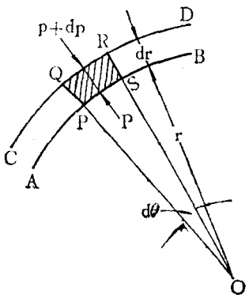

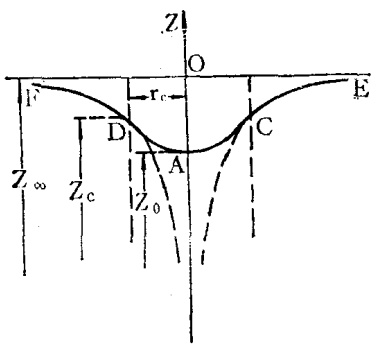

图1.2 自由涡流的自由表面外形

#### 1.1.2 复合涡流运动

作用于单位表面上的粘滞力表达如下:

$$ \tau = - \mu \frac {\mathrm{d} \mathbf {v}}{\mathrm{d} \mathbf {r}}\tag{1.8} $$

微分式（1.5）得

$$ \frac {\mathrm{d} \mathbf {v}}{\mathrm{d} \mathbf {r}} = - \frac {\mathbf {v}}{\mathbf {r}}\tag{1.9} $$

格式（1.5）代入式（1.9），即得

$$ \frac {\mathrm{d} \mathbf {v}}{\mathrm{d} r} = - \frac {\mathbf {C} _ {1}}{r ^ {2}}\tag{1.10} $$

故得出

$$ \tau = \mu \frac {\mathrm{C} _ {1}}{\tau^ {2}}\tag{1.11} $$

<!-- page: 19 -->

由式（1.11）可知粘滞剪应力与 $r^{2}$ 成反比，故在旋转中心的 $\tau$ 变成无限大。同样如在旋转中心式（1.5）成立，则速度为无限大。按Bernoulli理论，增加速度使压力减少，故中心的压力应为无限小且甚至为负值，这样，就可能吸入空气。另一方面，旋转中心的粘度为无限大也是不可能的，但存在某一最大值，在此值以上，液体应以恒定的速度旋转。这样就有了复合涡流运动，就是所谓Renkin复合涡流。

如图1.2所示，半径为 $r_{c}$ 的中央部分DAC以恒定的角速度旋转，它是没有速度梯度的，即没有剪切率。它看来象实心圆筒一样，故此强制涡流被称为“圆筒形旋转涡流”。在此圆筒形旋转区域（以下称为C.R.Z.）以外，即在半径大于 $r_{c}$ 的范围内，所得自由涡流的表面外形如曲线FD和CE所示，式（1.7）即表示在此范围内的表面外形。简单说来，对复合涡流可有，

$$ \mathrm{r} \leq \mathrm{r} _ {\mathrm{c}}; \quad \mathrm{v} = \mathrm{r} \omega\tag{1.12} $$

$$ \mathrm{r} \geq \mathrm{r} _ {\mathrm{c}}, \quad \mathrm{v} = \frac {\omega_ {\mathrm{RG}} ^ {2}}{\mathrm{r}}\tag{1.13} $$

式中 $①$ 为角速度。

#### 1.1.3 圆筒形混合容器中的环流

叶轮在圆筒形混合容器中产生环流并得到与第1.1.2节所说过的一样的复合涡流。

如图1.3所示，叶轮的周速用OAA表示，而液体的周速用OAA"表示，后者因器壁上存在摩擦而较低。叶轮和液体之间存在以曲线（AA'-AA'）表示的速度差，而叶轮起了排出液体和加速液体的作用，故式（1.12）和（1.13）也给出了近似的速度分布。可见在器壁附近速度是迅速降低的，即

$$ \mathrm{v} = \mathrm{c} (\mathrm{r} _ {2} - \mathrm{r})\tag{1.14} $$

在C.R.Z.区内，加速度和重力合成的各力与液体表面垂直，如图1.4，即有

$$ \frac {\mathrm{d} Z}{\mathrm{dr}} = \mathrm{tg} \theta = \frac {\mathrm{mr} \omega^ {2}}{\mathrm{mg}} $$

<!-- page: 20 -->

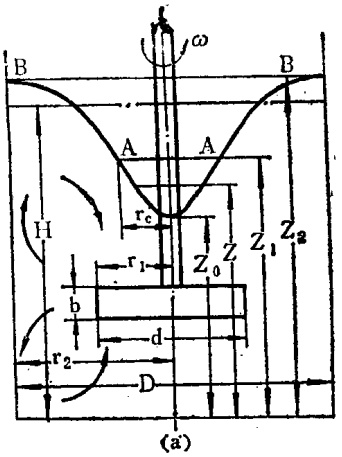

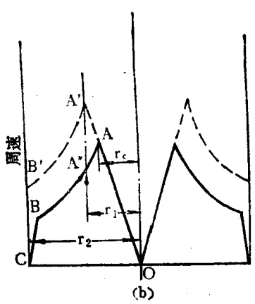

图1.3 搅拌容器中使用的符号和周速分布

积分后并把 $r=0,\quad Z=Z_{0}$ 的边界条件代入，则在 $r\leq r_{c}$ 的区内得出:

$$ \mathrm{Z} = \mathrm{Z} _ {0} + \frac {\omega^ {2} \mathrm{r} ^ {2}}{2 \mathrm{g}}\tag{1.15} $$

由式（1.13）和（1.6），得出在 $r\geq r_{c}$ 区域的表面方程为

$$ \mathrm{Z} + \frac {\varpi^ {2} \mathrm{r} _ {\mathrm{c}} ^ {4}}{2 \mathrm{gr} ^ {2}} = \mathrm{C} $$

可用 $r=r_{c}$ 处 $Z=Z_{1}$ 作为边界条件，此处Z，为CRZ（按图1.3）和自由涡流区分界处（A）的液面高度，

$$ \mathrm{C} = \mathrm{Z} _ {1} + \frac {\omega^ {2} \mathrm{T} _ {\mathrm{c}} ^ {2}}{2 \mathrm{g}} $$

故

$$ Z = Z _ {1} + \frac {\omega^ {2} \mathrm{r} _ {\mathrm{c}} ^ {2}}{2 \mathrm{g}} \left(1 - \frac {\mathrm{r} _ {\mathrm{c}} ^ {2}}{\mathrm{r} ^ {2}}\right) $$

因点A属于C.R.Z.，故由式（1.15）有

$$ Z _ {1} = Z _ {0} + \frac {\omega^ {2} T _ {c} ^ {2}}{2 g} $$

因此在 $\mathrm{r}\geq \mathrm{r_c}$ 的区内:

<!-- page: 21 -->

6

$$ \mathrm{Z} = \mathrm{Z} _ {0} + \frac {\omega^ {2} \mathrm{r} _ {\mathrm{c}} ^ {2}}{2 \mathrm{g}} \left(2 - \frac {\mathrm{r} _ {\mathrm{c}} ^ {2}}{\mathrm{r} ^ {2}}\right)\tag{1.16} $$

虽然我们认为A是C.R.Z.和自由涡流区的分界，但在此两个区域之间并无明显的过渡。由式（1.16），C.R.Z.的半径 $r_{c}$ 可由下式得出，

$$ \mathrm{r} _ {\mathrm{c}} = \sqrt {\mathrm{r} _ {2} \left(\mathrm{r} _ {2} - \sqrt {\mathrm{r} _ {2} ^ {2} - \mathrm{k}}\right)}\tag{1.17} $$

$$ \mathrm{k} = \frac {2 \mathrm{g}}{\omega^ {2}} (Z _ {2} - Z _ {0}) $$

式中 $r_{2}$ 为容器的内半径， $Z_{2}$ 为容器壁上的液面高度。

计算 $r_{c}$ 的另一方法如下，搅拌前液面高度H与液体体积V关联如下，

$$ \mathrm{H} = \frac {\mathrm{V}}{\pi r _ {2} ^ {2}}\tag{1.18} $$

搅拌时，有

$$ \begin{array}{l} \mathrm{V} = \int_ {0} ^ {\mathrm{r} _ {a}} \left(Z _ {0} + \frac {\omega^ {2} \mathrm{r} ^ {2}}{2 \mathrm{g}}\right) 2 \pi \mathrm{r} \mathrm{d} \mathrm{r} \\ \quad + \int_ {\mathrm{r} _ {a}} ^ {\mathrm{r} _ {2}} \left\{Z _ {0} + \frac {\omega^ {2} \mathrm{r} _ {c} ^ {2}}{2 \mathrm{g}} \left(2 - \frac {\mathrm{r} _ {c} ^ {2}}{\mathrm{r} ^ {2}}\right) \right\} 2 \pi \mathrm{r} \mathrm{d} \mathrm{r} \\ = Z _ {0} \pi \mathrm{r} _ {2} ^ {2} + \frac {\pi \omega^ {2}}{4 \mathrm{g}} \mathrm{r} _ {c} ^ {4} + \frac {\pi \omega^ {2}}{\mathrm{g}} \mathrm{r} _ {c} ^ {2} (\mathrm{r} _ {2} ^ {2} - \mathrm{r} _ {c} ^ {2}) \\ - \frac {\pi \omega^ {2} \mathrm{r} _ {c} ^ {4}}{\mathrm{g}} \ln \left(\frac {\mathrm{r} _ {2}}{\mathrm{r} _ {c}}\right) \end{array} $$

再一次提出 $r_{c}/r_{2}\equiv y\leq1$ 并代入式（1.18），得

$$ \begin{array}{l} \left(\frac {\mathrm{H} - Z _ {0}}{\mathrm{r} _ {2} ^ {2}}\right) \left(\frac {\mathrm{g}}{\omega^ {2}}\right) \\ = \mathrm{y} ^ {2} - \mathrm{y} ^ {4} \Big \{2. 3 0 3 \log \left(\frac {1}{\mathrm{y}}\right) + \frac {3}{4} \Big \} \end{array}\tag{1.19} $$

$$ \mathrm{Z} _ {2} = \mathrm{H} + \frac {\omega^ {3}}{\mathrm{g}} \mathrm{r} _ {c} ^ {2} \mathrm{y} ^ {2} \left\{\frac {1}{4} + 2. 3 0 3 \log \left(\frac {1}{\mathrm{y}}\right) \right\}\tag{1,20} $$

<!-- page: 22 -->

$\{(H-Z_{0})/r_{2}^{2}\}(g/\omega^{2})$ 的值可由 $Z_{0}$ 和 $\omega$ 的观测值算出，且仅为y的函数。所以，如对应y的各值先算出式（1.19）右边的值并对y在0~1的范围内标绘如图1.5，就容易在已知的搅拌情况下从测得的 $(H-Z_{0})$ 和 $\omega$ 值计算y或 $r_{c}$ 之值。在解释混合容器中液流的各种状态时， $r_{c}$ 的值是很重要的。

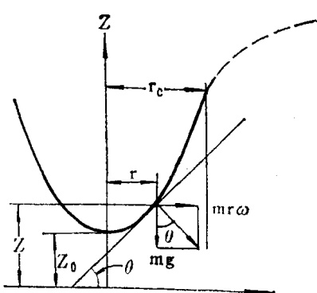

图1.4 强制涡流的自由表面外形

例1.1 有一内半径 $r_{2}=7.05cm$ 的圆筒形容器，贮水至液面高度H=10cm，并以半径 $r_{1}=2.35cm$ 的四叶桨式叶轮在400转/分下搅拌。中央的和边上的液面高度以钢尺测得分别为 $Z_{0}=6.40cm$ 和

$Z_{2}=10.56cm$ 。估计C.R.Z的半径。

解1)

用式（1.17）估算 $r_{c}$

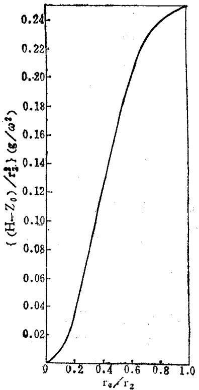

图1.5 由液体表面外形估算 \mathbf{r}_{\mathrm{o}} 的曲线图

<!-- page: 23 -->

$$ \omega = \frac {2 \mathrm{N} \pi}{6 0} = \frac {\mathrm{N} \pi}{3 0} \text {弧度} / \mathrm{s} $$

$$ \mathrm{k} = \frac {9 0 0 \times 2 \times 9 8 0}{\mathrm{N} ^ {2} \pi^ {2}} \quad \left(\mathrm{Z} _ {2} - \mathrm{Z} _ {0}\right) = 1 7 8 6 0 0 \quad \frac {\mathrm{Z} _ {2} - \mathrm{Z} _ {0}}{\mathrm{N} ^ {2}}\tag{a} $$

$$ \mathrm{k} = \frac {1 7 8 6 0 0}{4 0 0 ^ {2}} \times (1 0. 5 6 - 6. 4 0) = 4. 6 5 $$

$$ \mathrm{r} _ {\mathrm{c}} = \sqrt {7 . 0 5 (7 . 0 5 - \sqrt {7 . 0 5 ^ {2} - 4 . 6 5})} = 1. 5 5 \mathrm{cm}\tag{b} $$

解2)

用式（1.19）

$$ \begin{array}{r l} & {\left(\frac {\mathrm{H} - Z _ {0}}{\mathrm{r} _ {2} ^ {2}}\right) \left(\frac {\mathrm{g}}{\omega^ {2}}\right) = \left(\frac {1 0 - 6 . 4}{7 . 0 5 ^ {2}}\right) \left(\frac {9 0 0 \times 9 8 0}{4 0 0 ^ {2} \pi^ {2}}\right)} \\ & {\qquad = \frac {3 . 6}{4 9 . 7} (0. 5 5 9) = 0. 0 4 0 5} \end{array} $$

$$ \begin{array}{l} \mathrm {y = r_c / r_2 = 0.212} \\ \mathrm {r_c = 0.212\times 7.05 = 1.493cm} \end{array}\tag{c} $$

即可估算出比值为

由（b）

$$ \frac {r _ {c}}{r _ {1}} = \frac {1 . 5 5}{2 . 3 5} = 0. 6 6 $$

由（c）

$$ \frac {\mathrm{r} _ {\mathrm{c}}}{\mathrm{r} _ {1}} = \frac {1 . 4 9 3}{2 . 3 5} = 0. 6 3 6 $$

故叶轮叶片仅能在其总叶面积的 $35\%$ 上起有效作用。

#### 1.1.4 C.R.Z.半径和叶轮功率消耗

如前所述，搅拌时在圆筒容器中有两种不同的流，且在它们中间的混合是很微弱的。

如上所述，虽然C.R.Z.的大小可用液面外形来决定，但是还有另一方法，如图1.6（附图）所示。

测定了 d 和 b 相等而宽度 1 不同的叶轮功率消耗后，把此功率和桨式的功率（ $P_{桨}$ ）之比作为纵座标而对应的 $\frac{1}{r_{1}}$ 作为横座标在

<!-- page: 24 -->

图1.6中进行标绘。

可见，l 增加时功率亦增加，直至最后 l 达到 $l_{c}(=\mathbf{r}_{1}-\mathbf{r}_{c})$ 时叶轮的功率消耗达到最大值并等于桨式的功率。

图中说明，桨叶以线速OAA'旋转时，液流的速度为OAA'，故长度为 $l_{c}$ 的外部桨叶消耗功率，而长度为 $r_{c}$ 的内部桨叶则不消耗功率。

桨叶上面积为bdl的微元与相对速度为 $u_{r}=ab$ 的液体相撞击，故阻力df为

$$ \mathrm{df} = \mathrm{K} \rho \mathrm{ur} ^ {2} \mathrm{bdl}\tag{1.21} $$

当桨叶在此阻力作用下以相对速度 $u_{r}$ 旋转时，其功率消耗 $P_{t}$ 为，

$$ \mathrm{P} _ {l} = \int_ {0} ^ {l} 2 \mathrm{n} \pi \cdot 2 \mathrm{rdf} = \int_ {0} ^ {l} 4 \pi \rho \mathrm{Knru} _ {t} ^ {2} \cdot \mathrm{bd} l\tag{1.22} $$

由图可见 $\mathrm{u_r}$ 与ab成正比例，

$$ \mathrm{u} _ {\mathrm{r}} = 2 \mathrm{n} \pi \mathrm{r} - 2 \mathrm{n} \pi \mathrm{r} _ {\mathrm{c}} ^ {2} / \mathrm{r} = 2 \mathrm{n} \pi (\mathrm{r} - \mathrm{r} _ {\mathrm{c}} ^ {2} / \mathrm{r})\tag{1.23} $$

把式（1.23）代入式（1.22），得

$$ \mathrm{P} _ {l} = \int_ {0} ^ {l} \mathrm{K} ^ {\prime} \rho \mathrm{n} ^ {3} \mathrm{b} \left(\mathrm{r} _ {1} - l\right) ^ {3} \left\{1 - \mathrm{r} _ {\mathrm{c}} ^ {2} / \left(\mathrm{r} _ {1} - l\right) ^ {2} \right\} ^ {2} \mathrm{d} l\tag{1.24} $$

在式（1.24）的积分中假定 $K'$ 为常数。从0到l积分，即得对应于半径为l的叶轮在液体内旋转的功率消耗 $P_{l}$ ，C.R.Z.半径等于 $r_{c}$ :

$$ \begin{array}{r l} \mathrm{P} _ {I} = & \mathrm{K} ^ {\prime} \rho \mathrm{bn} ^ {3} \mathrm{r} _ {1} ^ {4} \left[ - \frac {1}{4} \left\{1 - \left(\frac {\mathrm{r}}{\mathrm{r} _ {1}}\right) ^ {4} \right\} - \left(\frac {\mathrm{r} _ {\mathrm{c}}}{\mathrm{r} _ {1}}\right) ^ {2} \left\{1 - \left(\frac {\mathrm{r}}{\mathrm{r} _ {1}}\right) ^ {2} \right\} \right. \\ & \left. + \left(\frac {\mathrm{r} _ {\mathrm{c}}}{\mathrm{r} _ {1}}\right) ^ {4} \ln \left(\frac {\mathrm{r} _ {1}}{\mathrm{r}}\right) \right] \end{array} \tag {1.25} $$

自0至 $l_{c}$ 进行积分时，与d和b相等的桨叶其功率消耗一致，

$$ \begin{array}{l} \mathrm{P} _ {\text {浆}} = \mathrm{K} ^ {\prime} \rho \mathrm{bn} ^ {3} \mathrm{r} _ {1} ^ {4} \left[ \frac {1}{4} \right\rbrace 1 - \left(\frac {\mathrm{r} _ {\mathrm{c}}}{\mathrm{r} _ {1}}\right) ^ {4} \Bigg \} - \\ \left(\frac {\mathrm{r} _ {\mathrm{c}}}{\mathrm{r} _ {1}}\right) ^ {2} \Bigg \} 1 - \left(\frac {\mathrm{r} _ {\mathrm{c}}}{\mathrm{r} _ {1}}\right) ^ {2} \Bigg \} + \left(\frac {\mathrm{r} _ {\mathrm{c}}}{\mathrm{r} _ {1}}\right) ^ {4} \ln \left(\frac {\mathrm{r} _ {1}}{\mathrm{r}}\right) \Bigg ] \end{array}\tag{1.26} $$

<!-- page: 25 -->

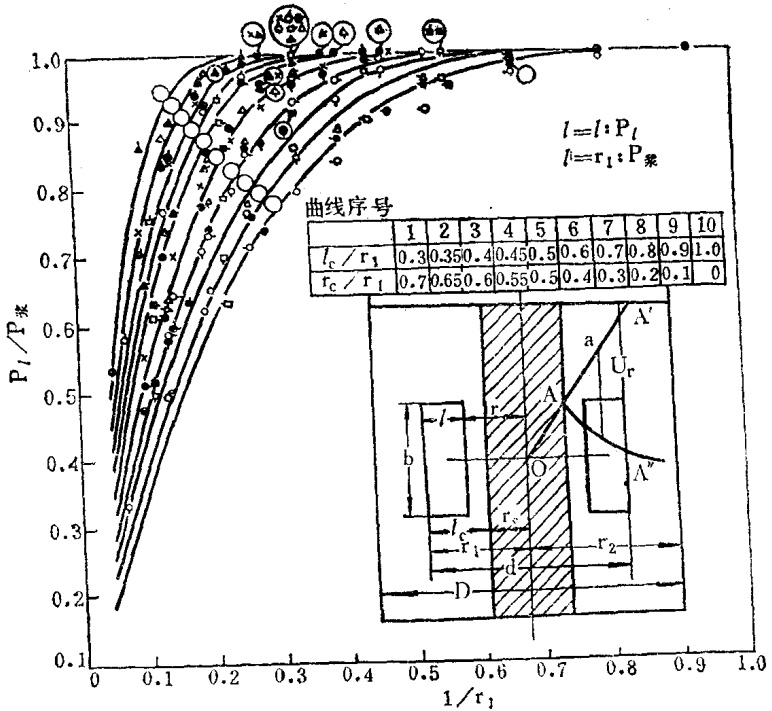

图1.6 各种粘度液体的C.R.Z.半径 \mathbf{r}_{\mathrm{c}} 估算图

故，

$$ \begin{array}{r l} & {\frac {P _ {i}}{P _ {\text {浆}}} =} \\ & {\frac {1}{4} \Big \{1 - \Big (\frac {r}{r _ {1}} \Big) ^ {4} \Big \} - \Big (\frac {r _ {c}}{r _ {1}} \Big) ^ {2} \Big \} 1 - \Big (\frac {r}{r _ {1}} \Big) ^ {2} \Big \} + \Big (\frac {r _ {c}}{r _ {1}} \Big) ^ {4} \ln \Big (\frac {r _ {1}}{r} \Big)} \\ & {\frac {1}{4} \Big \{1 - \Big (\frac {r _ {c}}{r _ {1}} \Big) ^ {4} \Big \} - \Big (\frac {r _ {c}}{r _ {1}} \Big) ^ {2} \Big \} 1 - \Big (\frac {r _ {c}}{r _ {1}} \Big) ^ {2} \Big \} + \Big (\frac {r _ {c}}{r _ {1}} \Big) ^ {4} \ln \Big (\frac {r _ {1}}{r} \Big)} \end{array}\tag{1,27} $$

图1.6中的曲线（1），（2）……（10）是把 $r_{c}/r_{1}=0.7$ ，0.65，……0代入式（1.27）后计算得出的。曲线（10）是假定C.R.Z.消失或 $r_{c}=0$ 而算得的。

当然，如长度 $l$ 小于 $l_{\mathrm{c}}$ ，速度分布就可能和d和b尺寸相同的

<!-- page: 26 -->

桨的分布不同。但作为粗糙的近似，图1.6中曲线（1），（2）……（10）可用来表示 $l_{c}$ 变化引起的差异，在 $P_{l}/P_{集}$ 接近1.0的区域内尤其如此。

不同 $l$ 值的 $(\mathrm{P}_l / \mathrm{P}_{\text{架}})$ 的观测值落在图1.6的曲线（1）至(10)上。数据的标绘点和计算所得的曲线不甚符合，特别在 $(\mathrm{P}_l / \mathrm{P}_{\text{架}})$ 值偏离1.0的区域更是如此，这是因为用了上述近似的缘故。不论如何，用正确的选择和内插法可以决定不同粘度液体的 $(l_{\mathrm{c}} / r_{1})$ 或 $(r_{\mathrm{c}} / r_{1})$ 值。结果列于表1.1。

表 1.1 标绘点符号的意义和推测的 {r}_{0}/{r}_{1} 值

| d/D | b/D | 水(1c.P) |  | Millet-Jelly(30c.P) |  | Millet-Jelly(130c.P) |  | Millet-Jelly(500c.P) |  |
|---|---|---|---|---|---|---|---|---|---|
| 符号Re | r_e/r_1 | 符号Re | r_e/r_1 | 符号Re | r_e/r_1 | 符号Re | r_e/r_1 |  |  |
| 0.154 | 0.154 | 20,300 | 0.3 |  | 0.5~0.55 |  |  |  |  |
| 0.3 | 0.3 | 40,500 | 0.6~0.65 | 1,520 | 0.4 | 398 | 0.2~0.3 | 60.3 | 0 |
| 0.3 | 0.5 |  |  | 991 | 0.3 |  |  |  |  |
| 0.5 | 0.3 | 67,500 | 0.55~0.6 | 2,400 | 0.5 | 513 | 0.2 | 67.8 | 0 |
| 0.5 | 0.5 | 56,300 | 0.6~0.65 | 2,420 | 0.4~0.48 | 380 | 0.3~0.4 | 46.1 | 0 |
| 0.5 | 0.7 | 56,300 | 0.65 | 1,980 | 0.4~0.5 | 380 | 0.35~0.4 | 64.0 | 0 |
| 0.7 | 0.3 | 110,000 | 0.6~0.65 | 2,470 | 0.4 | 617 | 0.8 | 70.0 | 0 |
| 0.7 | 0.5 | 95,500 | 0.6 | 2,260 | 0.45 |  |  |  |  |
| 0.7 | 0.7 | 95,500 | 0.65~0.7 | 1,980 | 0.5 |  |  |  |  |

对于d=0.5D，b=0.1D的桨，用此法所得的 $r_{c}$ 值很符合由式(1.19)或图1.5所算得的值。但对较大d/D的桨，如0.7，就不能保持很好的一致性了。然而，可以断定搅拌液体的粘度增加则 $r_{c}$ 值减少。

图1.7上部的曲线为 $r_{e}/r_{1}$ 值对应雷诺数 $(d^{2}n\rho/\mu)$ 的标绘。

除 $\mathrm{d} / \mathrm{D} = 0.154$ 外，雷诺数在 $4 \times 10^{4}$ 以上时 $(\mathrm{r_c} / \mathrm{r_1})$ 值接近常数，范围为 $0.6 \sim 0.65$，而如前者低于2000则突然下降。

$\mathrm{Re} / (\mathrm{r_c} / \mathrm{r_1})$ 对应Re标绘时，可得如图1.7下半部分所示的直线并得以下关联式，

<!-- page: 27 -->

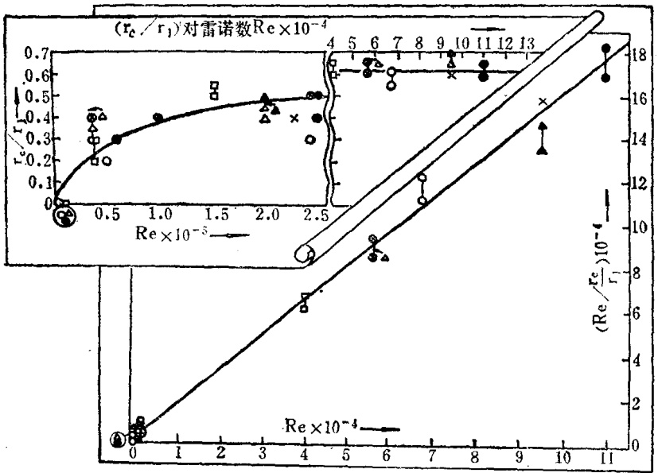

图 1.7  (\mathrm{r}_{\mathrm{c}}/\mathrm{r}_{1})  对应雷诺数的图

$$ \frac {\mathrm{r} _ {\mathrm{c}}}{\mathrm{r} _ {1}} = \frac {\mathrm{Re}}{1 0 ^ {3} + 1 . 6 \mathrm{Re}}\tag{1.28} $$

在这些实验中没有得到桨长（d/D）和桨宽（b/D）对应 $(r_{c}/r_{1})$ 比的效应，只是指出了（d/D）变小时 $(r_{c}/r_{1})$ 也变小。

这就能归纳得出，当雷诺数降低并趋向于100时，C.R.Z.的 $r_{c}/r_{l}$ 就接近于0，换言之，当桨式搅拌叶的转速一定时，如桨的全面积受到流体阻力时，就达到最大功率 $(P_{\text{最大}})$ 。

当桨的尺寸和转速固定不变而增加容器直径时，象增加粘度时一样，C.R.Z.要减少，当容器增加到很大，功率消耗就增至最大值 $\left(\mathrm{P}_{\text {最大}}\right)_{2}$ ，此最大功率 $\left(\mathrm{P}_{\text {最大}}\right)_{1}$ 和 $\left(\mathrm{P}_{\text {最大}}\right)_{2}$ 也相等于全挡板情况的最大功率 $\left(\mathrm{P}_{\text {最大}}\right)_{3}$ 或偏心情况的最大功率 $\left(\mathrm{P}_{\text {最大}}\right)_{4}$ （参见例1.3的解）。

$$ (P _ {\text {最大}}) _ {1} \cong (P _ {\text {最大}}) _ {2} \cong (P _ {\text {最大}}) _ {3} \cong (P _ {\text {最大}}) _ {4}\tag{1.29} $$

<!-- page: 28 -->

### 1.2 测定功率消耗的方法 ^{[21]}

有许多研究工作者研究过搅拌叶的功率消耗，但他们的结果不能很好符合 $^{[32]}$ 。为了弄清楚不一致的原因，需要检验实验中使用的装置。

因为过去很少描述使用的功率计，所以有时在讨论中作过各种假定。在搅拌叶功率计算中，必须能测到较小的转矩值。因此，差不多所有的研究工作者都使用自己设计的装置，而在轴承上的摩擦还会带来一些不利。

#### 1.2.1 前人使用功率计的分类

**A.换向器电机的输入功率测定法 ^{[11,43]}**

在观测值中减去铜损、铁损和空载输入功率，可算得电机的有效输入功率，但是，此法不易得到精确的值。

**B.转矩测定法**

**a）在转台上的转矩测定 ^{[8,9,18,42]}**

在液体中旋转的叶轮在容器的壁是要产生转矩的，此法就是把容器置于摩擦甚小的转台之上，用一个砝码重量来平衡此转矩。

b）电机反馈转矩的测定 $^{[9,21,29,30]}$

此为测定驱动电机内定子的反馈转矩的方法。

C.转矩功率计法

此法是以弹簧的伸长来测定转矩。

a）螺旋弹簧功率计 $^{[38,42]}$ （见图1.19）

**b）涡卷弹簧功率计 ^{[12,31]}**

各研究工作者对旋转时弹簧伸长度的读法是不同的。他们都曾试装过静摩擦甚小的功率计。

**c）应变片功率计 ^{[21,41]}**

这是用应变片来测量旋转轴的轴向转矩的方法，适用于测量较大的功率（见图1.8）。

**d）差动齿轮法 ^{[35]}**

使用Rushton和助手们在他们的大量研究工作中使用的转矩

<!-- page: 29 -->

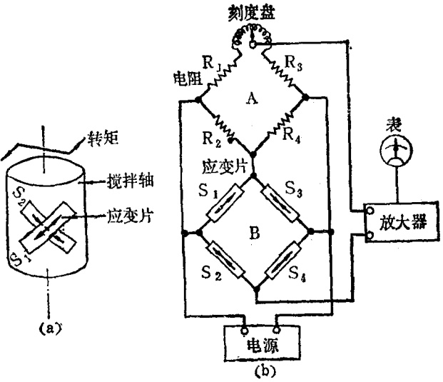

图1.8 装有应变片的转矩表

表，永田等曾对此提出详图 $^{[21]}$ 。

#### 1.2.2 作者设计的功率计 ^{[21]}

作者在各种研究工作的进展中，曾用过三种功率计。可以得出这样的结论，即在功率数据中，功率计的静摩擦是很大的误差根源。需要使用静摩擦可以忽略不计的功率计以计算后述的弗鲁德数对搅拌叶功率消耗的影响。

**A.1号功率计**

此功率计就是上述的测量反馈转矩的类型。

**B.2A号功率计（电感仪式）**

此功率计是以上说过以转矩功率计的一种类型，如图 1.9，图中，两个面向的盘用 $90^{\circ}$ 分布的四个螺旋弹簧连接。

上面的盘直接与驱动轴连接。

下面盘的轴穿过上面盘的空心轴并在摩擦力很小的二个滚珠轴承上同心旋转。

采用图1.9(b)所示的电感仪法以测量两旋盘之间的角位移。

<!-- page: 30 -->

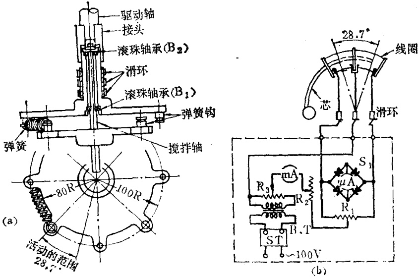

（b）2A号功率计测量角位移方法的简图

上面盘上固定有一线圈。固定于下面盘的铁芯可以在此线圈内自由地进出，如图1.9(b)所示。

线圈的电感会对应弹簧的伸长而变化。角位移可由微安计（ $\mu A$ ）读出。取去弹簧并测出转动搅拌轴的最小转矩即能求得功率计的静摩擦（ $T_{s}$ ）。

2A号功率计的静摩擦转矩T,为10~20g·cm(平均15g·cm)。与需要测定的转矩相比，此值是够小的了。

**C.2B号功率计（滑线电阻式）**

此功率计与2A号相似，而测量两转盘间角位移的方法则有差别。在上面盘上固定一电阻器。固定于下面盘的刷子可在此电阻器的表面上滑动。T值大于A型的值（150～200g·cm，平均175g·cm）。作者使用B型的目的，是将它的值与A型的值比较以弄清楚在观测功率时静摩擦转矩所引起的误差。

**D.3号功率计**

<!-- page: 31 -->

此功率计设计得静摩擦可忽略不计，用来测定较小的功率，特别是推进式搅拌叶轮的功率。搅拌叶驱动部分与搅拌叶轮的重量都很轻并用钻石轴承作支点。角位移以频闪观察法读出。这样，此功率计的静摩擦T能降低到2A号型的十分之一，即降低到1g·cm，但与2A号比较，可测功率的上限较低。

#### 1.2.3 功率测定中出错的原因

功率测定中有许多出错的原因，可以集中为以下两种重要的原因来讨论。

1. 空载时动摩擦引起的误差。

2. 转矩测量装置中静摩擦引起的误差（静摩擦引起的错误）。

a）空载时动摩擦引起的误差。

在加入搅拌液以前任何固定件与搅拌轴的机械接触都会产生功率消耗。为了避免此误差，必须在观测值内把空载时的测定值减去。

Olney $^{[301]}$ , Stoops $^{[38]}$ , 和Mack $^{[12]}$ 所用装置测得的值包含有以上的误差。

Oyama $^{[31]}$ ，所用的自同步电机内转子有三个滑环，它们的摩擦也会产生这类误差。

**b）静摩擦引起的误差**

转矩测量系统中的运动部件引起静力摩擦。

例如，(1.21B, a) 中转台的滚珠轴承，支持驱动电机重量的轴承的摩擦以及2B号功率计的刷子等的机械摩擦都属于此范畴。

#### 1.2.4 静摩擦对功率的影响

图1.10用曲线比较了2A号和2B号功率计测得功率数据的结果。如图所示，在高功率的范围内B型测得的功率数据（用虚线绘出）与A型测得的数据（用实线绘出）很符合，但在低功率范围内两曲线偏离渐大且B型测得的功率之值较高。

图1.10中虚线上的C点为一转折点。表1.2就是在不同条件下测定这些点的结果。表内的 $N_{t}$ ， $T_{f}$ 和 $P_{f}$ 依次为C点的转速，转矩和功率。

<!-- page: 32 -->

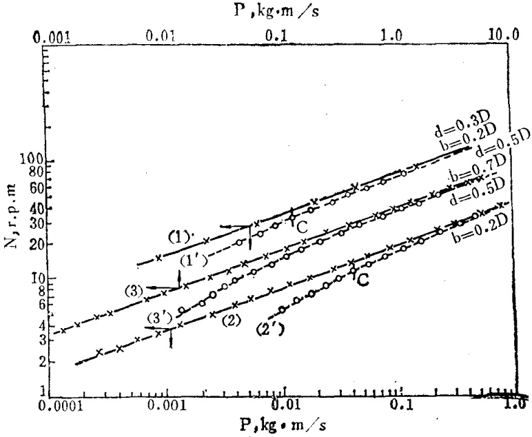

图1.10 滑动电阻功率计和电感仪

表中，在 $N_{f}$ 和 $P_{f}$ 的值内找不到特别的关联，可见 $T_{f}$ 拓于假定，其范围为2500至4,700g·cm，且与静摩擦转矩 $T_{s}$ 相比。此值相当于大20倍。由此，可以将误差的程度用静摩擦转矩的尺度来表示。

现在，让我们来研究由于静摩擦作用使测得的功率值较大于正确的功率值的原因。

一般说来，搅拌开始时转矩非常大而当涡旋运动增加即开始减小，最后达到稳态时的恒定值。

随着转矩变化，表的指针降至平衡点，位置由于静摩擦而较高，且不会回到正确功率之处。此偏离的读数以 $T_{b}$ 表示。相反，在差不多稳定的状态时，可以用手加快搅拌叶轮速度以使搅拌器一侧的轴转速暂时增加，这样，表的读数（即弹簧的伸长）即能减低。随后放手，表的读数就开始再增加，但是，由于静摩擦，它停下的位置稍低于正确功率。此较低的读数以 $T_{1}$ 表示。

<!-- page: 33 -->

在测量搅拌器的功率消耗时，B型功率计中 $T_{h}$ 和 $T_{f}$ 的差别大而A型中的差别则很小。

表 1.2 滑动电阻功率计（2 B号）测定的N对 P标绘，曲线上折点C的 ${\mathrm{N}}_{\mathrm{f}},{\mathrm{T}}_{\mathrm{f}}$ 和 ${\mathrm{P}}_{\mathrm{f}}$ 值

平均静力摩擦转矩 $T_{s}=1750g\cdot cm$ ；测量转矩范围=1000—40000g·cm；D=容器直径，d=搅拌叶直径，b=搅拌叶宽度。

| 使用液体 | D(cm) | d/D | b/D | N_f (r.p.m.) | T_f (g·cm) | P_f (kg·m/s) |
|---|---|---|---|---|---|---|
| 水 | 117 | 0.5 | 0.2 | 12 | 3340 | 0.042 |
| 水 | 117 | 0.3 | 0.2 | 34 | 3580 | 0.128 |
| 水 | 117 | 0.3 | 0.7 | 34.6 | 3530 | 0.128 |
| 水 | 117 | 0.5 | 0.7 | 10.25 | 3770 | 0.0406 |
| 水 | 117 | 0.5 | 0.05 | 21.6 | 4000 | 0.0907 |
| 机油1.30p. | 58.5 | 0.3 | 0.7 | 79 | 2530 | 0.209 |
| 机油10p. | 58.5 | 0.5 | 0.2 | 34.2 | 4700 | 0.168 |
| 机油10p. | 58.5 | 0.5 | 0.7 | 15 | 2670 | 0.042 |

因此，用逐步增加转速以测定功率的方法能观测到有静摩擦的较大值，因为它的初始转矩比稳态的大。

把2A号功率计测得的 $T_{h}$ 和 $T_{1}$ 的平均值记为 $T_{0}$，此功率可作为正确的值。对于A型功率计，转矩 $T_{A}$ 大于 $T_{s}\times20=15\times20=300g\cdot cm$，并等于 $T_{0}$，换言之， $T_{h}$ 几乎等于 $T_{1}$ 故观测值是正确的。

以 $\{(T_{h}-T_{0})/T_{0}\}\cdot(100)$ 作纵座标而以 $(T_{0}/T_{s})$ 作横座标标绘曲线即得图1.11。

表1.3为用2A号功率计对 $d=0.5D,\quad b=0.2D$ 桨式得到的数据进行误差计算的一例。此时将 $T_{0}$ 看作为 $T_{A}$ 。

如图1.11所示，只有在测得的转矩大于二十倍静摩擦时才能获得其准确值，就是说，对于静摩擦 $T_{s}$ 等于 $15g\cdot cm$ 的A型功率计，要大于 $300g\cdot cm$ 。

对于静摩擦 $T_{s}$ 等于 $175g\cdot cm$ 的B型功率计，只有观测值比 $T_{s}$ 大100～150倍时，即大于 $1.75\times10^{4}\sim2.63\times10^{4}g\cdot cm$ 时才是可靠的。

#### 1.2.5 弗鲁德数对功率数据的影响

<!-- page: 34 -->

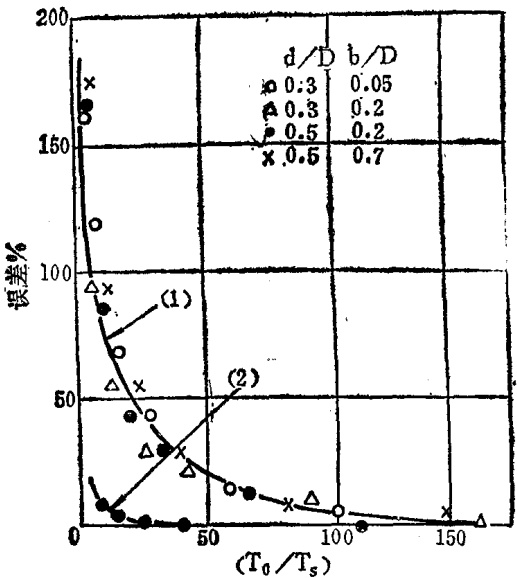

图1.11 静摩擦引起的误差

(1)滑动电阻型功率计 $T_{s}=150\sim200g\cdot cm$ (2)电感仪式功率计 $T_{s}=10\sim20g\cdot cm$

表1.3 2B号功率计所得数据的误差计算

容器直径D=117cm；使用液体=水；

2B号功率计的静摩擦 $(T_{a})_{B}=175g\cdot cm$

2A号功率计的静摩擦 \left(\mathrm{T}_{\mathrm{s}}\right)_{\mathrm{A}}=15\mathrm{g}\cdot\mathrm{cm}

| 搅拌器速度N(r.p.m.) | 滑动电阻型(2B号) |  | 电感仪式(2A号) |  | T_{B}-T_{0} ( \div T_{B}-T_{A} ) | 误差% |  |
|---|---|---|---|---|---|---|---|
| 功率 P_{B} (kg·m/s) | 转矩 T_{B} (g·cm) | 功率 P_{A} (kg·m/s) | 转矩 T_{A} (g·cm) | \{(T_{B}-T_{0})/T_{0}\} \cdot 100 | T_{0}/(T_{S})_{B} |  |  |
| 5 | 0.0084 | 1605 | 0.0024 | 460 | 1145 | 249 | 2.63 |
| 7 | 0.0160 | 2185 | 0.0060 | 820 | 1365 | 166.5 | 4.69 |
| 10 | 0.0305 | 2900 | 0.0165 | 1570 | 1330 | 84.7 | 8.96 |
| 15 | 0.072 | 4590 | 0.050 | 3190 | 1400 | 43.9 | 18.2 |
| 20 | 0.145 | 6950 | 0.112 | 5360 | 1590 | 29.7 | 30.7 |
| 30 | 0.400 | 12720 | 0.360 | 11450 | 1270 | 11.1 | 65.4 |
| 40 | 0.800 | 19100 | 0.800 | 19100 | 0 | 0 | 109.0 |

<!-- page: 35 -->

|  | 曲线编号 | D,cm | 搅拌器 | d/D | b/D | 螺矩 | H/D | HP | 液体 | 使用功率计 |
|---|---|---|---|---|---|---|---|---|---|---|
| 作者数据 | 5 | 117 | 桨式 | 0.5 | 0.2 | — | 1.0 | H/2 | 水 | 28号 |
| 6 | 0.7 | — |  |  |  |  |  |  |  |  |
| 5 | 117和58.5 | 0.2 | — | 水和机油 | 2A号 |  |  |  |  |  |
| 6 | 0.7 | — |  |  |  |  |  |  |  |  |
| 4 | 58.5 | 推进式 | 0.2 | 0.07 | =d |  |  |  | 3号 |  |
| Rushton数据 | 1,2,3 | 137 | 推进式 | 0.22 | — | =d | 1.0 | 离底12m |  |  |
| 4 | \mathrm{Np}=(\mathrm{Fr})(\mathrm{a}-\log \mathrm{Re})/\mathrm{bVSRe} |  |  |  |  |  |  |  |  |  |

| RPM |  | 1 | 27 | 210 | 1700 |
|---|---|---|---|---|---|
| 轴线4、上钩件号 | 90 | △ | ○ | ↘ | ● |
| 120 | -△ | ○ | - | ● |  |
| 180 | △ | ○ | × | ● |  |
| 240 | -△ | ○ | - | ● |  |
| 300 | △ | ○ | × | ● |  |
| 360 | △ | ○ | × | ● |  |
| 420 | × | ○ | × | ■ |  |
| 480 | △ | ○ | × | ● |  |
| 540 | △ | ○ | × | ■ |  |
| 600 |  | ○ |  |  |  |
| 720 |  | ○ |  |  |  |
| 900 |  | ○ |  |  |  |

<!-- page: 36 -->

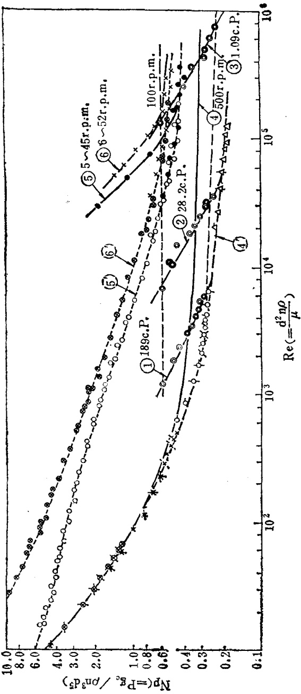

图1.12 永田数据和Rushton数据的比较，静摩擦对引起误差的影响

<!-- page: 37 -->

Rushton 和其助手曾用 $(\mathrm{dn}^{2}/\mathrm{g})(\mathrm{a}-\lg\mathrm{Re})/\mathrm{b}$ 一项来解释弗鲁德数对功率数的影响，并给出了推进式和涡轮式搅拌器的 a 和 b 因子的数据 $^{[35]}$ 。

作者测定了各类搅拌叶在一些粘度不同的液体中的功率。功率数 $\mathrm{Np}=(\mathrm{P}\cdot\mathrm{gc}/\rho\mathrm{n}^{3}\mathrm{d}^{5})$ 对雷诺数 $\mathrm{Re}=(\mathrm{d}^{2}\mathrm{n}\rho/\mu)$ 的标绘(无因次关连接1.3节)基本上落在一条曲线上，且看来无须进行弗鲁德数的修正。当然，在搅拌容器系统内有自由表面时，应该考虑弗鲁德数的影响。为了消除弗鲁德数的影响，功率计的精度应该很高。

图1.12表示Np对应Re的关系，其中曲线(1)，(2)，(3)为Rushton的船舶型推进式的实验结果。如果这些结果是正确的，就必须考虑弗鲁德数的修正。但是，曲线（4′）为作者用最小静摩擦的功率计对同样类型搅拌叶轮测得的结果，看来弗鲁德数的影响是可以忽略不计的。

如果用2B号滑线电阻功率计测得的，在图1.10中以曲线 $(2')$ （3'）表示的功率数据标绘在图1.12上，就得到曲线 $(5')$ 和 $(6')$ 。

推进式以高转速用于大容器中而近器壁的液面升起较小（见图1.13附图（1）），这是因为桨式（或涡轮式）的直径一般大于推进式之故。例如，如叶轮直径为容器直径的十分之九（$d = 0.9D$）的桨式用于搅拌，则在高速时近壁处有较大的液面升高并且对壁的摩擦是很明显的（见图1.13附图（2））。所以，对于桨式，液体表面变形的能量耗损较大，这就是弗鲁德数的影响。作者欲以下列附加试验来说明。实验情况示于图1.13。

曲线（1）是推进式的结果，与图1.12的曲线（4′）一样。从中很难看出弗鲁德数的影响。曲线（2）为尺寸较大（d=0.9D）的桨式的结果。180r.p.m.以下的Np值落在此曲线上。附图（2）的实线就表示此转速时的液面。当搅拌叶转速超过180r.p.m.时，如图中虚线（N=240r.p.m.）所示，液面外形变得陡峭，故壁摩擦损耗能量就较大。此摩擦使KP线偏离曲线（2），P点是当液体粘度大，搅拌器转速也大时得到的，Q点则是液体粘度小，搅拌器速度也小时所得，但是，此两点的雷诺数却是相等的。P点的弗鲁

<!-- page: 38 -->

| 线上的符号2号 |  |  |  |  |
|---|---|---|---|---|
| 粒度 {\mathrm{c}}_{\mathrm{{p}},\mathrm{m}} | 1c.P | 5c.P | 10c.P | 36c.P |
| 18 |  |  | - | \Phi |
| 21 |  |  | \Phi | \Phi |
| 30 | \bigcirc | \star | \Delta | \square |
| 45 | -\bigcirc | \star | \Delta | -\square |
| 60 | \varphi | \star | \Delta | \square |
| 90 | \bigcirc | \star | \Delta | \square |
| 120 | -\bigcirc | \star | \Delta | -\square |
| 150 | \varphi | \star | \varphi | \varphi |
| 180 | \varphi | \star | \Delta | \square |
| 220 | \varphi |  |  | \square |
| 240 | \varphi | \star | \varphi | \varphi |
| ◎500c.P~10000c.P |  |  |  |  |

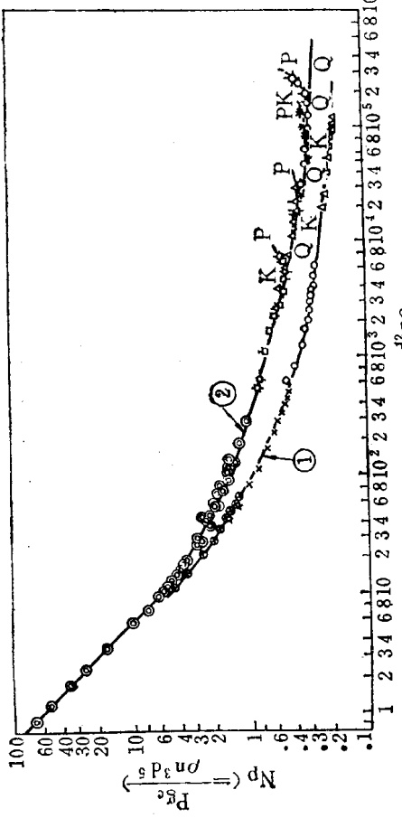

\mathrm{Re}(= \frac{d^2n\rho}{\mu})

<!-- page: 39 -->

德数比 Q 点的大得多，与 Rushton 的结果（图1.12的曲线（1），（2）和（3））比较，可发现偏离的方向是相反的。

象这样极端的情况，可能必须对弗鲁德数进行修正，但如只要求工程上的准确度，则略去弗鲁德数的修正还是有把握的。

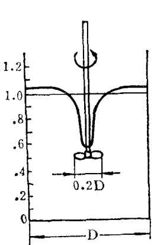

(1) d = 0.2D 推进式

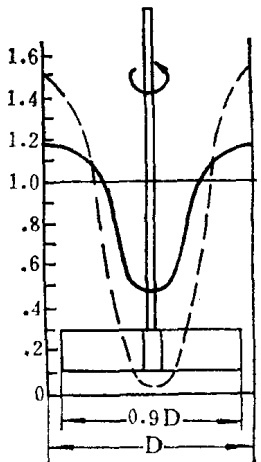

图1.13 附图

### 1.3 桨式搅拌器功率消耗的经验式

**及扩大应用到其他类型的搅拌器**

由于桨式搅拌器的设计和结构都较简单，故广泛应用于化学工业中。

桨式制造简便并易于标明其尺寸，这种叶轮比涡轮式和推进式简单得多，故作者先推导桨式的功率消耗经验式再将其推广至其他型式的叶轮。

本章内讨论研究的叶轮功率消耗为轴功率，不包括驱动电机和传动机构的损失。

#### 1.3.1 推导经验式的基本概念

作者曾解释过圆筒形容器内桨式的功率消耗和简化的流型的关

<!-- page: 40 -->

系，其结果大致如下:

当搅拌的液体粘度低时，在容器的中央轴线周围出现圆筒形旋转区域（简称C.R.Z.），其中液体和桨叶的速度基本相同，而外侧则有一个自由涡流区域，如图1.14所示。因此，可以假定桨式的中央表面abcd对功率消耗没有影响而只有叶端AaD和BbcC对流量的输出起作用。当粘度较大，C.R.Z.的半径 $r_{c}$ 就较小，且在湍流到层流的过渡雷诺数（Re）上， $r_{c}$ 缩减到0，此时，桨叶的全部表面ABCD对液体都有相对速度且都对功率消耗是起作用的。

虽然如图1.14所示在低粘度区也出现涡流 $V_{1}$ ， $V_{1}'$ 与 $V_{2}$ ， $V_{2}'$ ，但与中央区域的强制涡流相比，它们都较弱。搅拌容器内的流动不象管内流动那样，从湍流到层流会出现明显的临界雷诺数，而是逐步过渡的，因此，如果两者的效应都已考虑，就能有效地用一个关系式来计算功率消耗。

首先，我们来考虑湍流区的功率消耗。如图1.15所示，叶轮具有相对速度 $u_{k}=AA'-AA''$ （按1.1节）。

液体对此微元的内阻dF可表示为，

$$ \mathrm{dF} = \mathrm{K}\rho_{\mathrm{u}}{}_{\mathrm{r}}^{2}\mathrm{bdl} $$

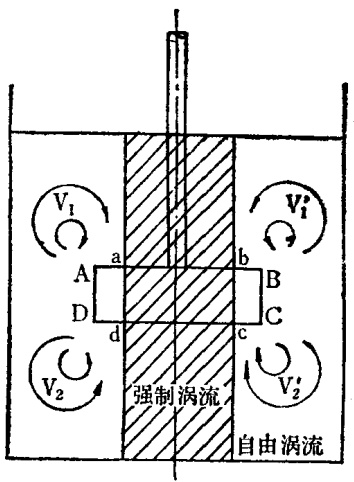

图1.14 功率关联的简化流动模型

(1.30)

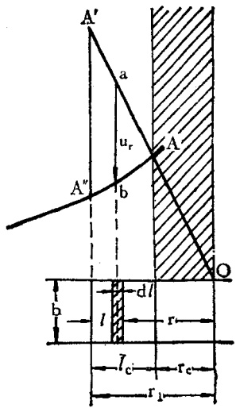

图1.15 桨叶和液体的相对速度分布

<!-- page: 41 -->

将AA"近似地当作直线，相对速度 $u_{r}$ 可由式（1.31）给出，

$$ \mathrm{u} _ {\mathrm{r}} = \mathrm{cn} (l _ {\mathrm{c}} - l)\tag{1.31} $$

故此则微元的功率消耗dP成为，

$$ \mathrm{dP} = \omega \mathrm{dM} = 2 \mathrm{n}\pi \cdot 2 \mathrm{rdF} = 4 \pi \mathrm{nrdF}\tag{1.32} $$

将式（1.30）和（1.31）代入式（1.32），

$$ \mathrm{dP} = 4 \pi \mathrm{bc} ^ {2} \mathrm{K} \rho \mathrm{n} ^ {3} (l _ {\mathrm{c}} - l) ^ {2} (\mathrm{r} _ {1} - l) \mathrm{d} l\tag{1.33} $$

在 $l=0\sim l_{c}$ 区间内积分式（1.33），即得搅拌叶轮功率消耗，

$$ \begin{array}{r l} \mathrm{P} & = 4 \pi \mathrm{bc} ^ {2} \mathrm{K} \rho \mathrm{n} ^ {3} \int_ {0} ^ {l _ {\mathrm{c}}} (l _ {\mathrm{c}} - l) ^ {2} (\mathrm{r} _ {1} - l) \mathrm{d} l \\ & = (1 / 3) \pi \mathrm{bc} ^ {2} \mathrm{K} \rho \mathrm{n} ^ {3} l _ {\mathrm{c}} ^ {3} (4 \mathrm{r} _ {1} - l _ {\mathrm{c}}) \end{array}\tag{1.34} $$

因此，在叶轮功率消耗计算中 $l_{c}$ 之值是主要的。此值的正确估算甚难，可用式（1.28）作近似解，

$$ \tau_ {\mathrm{c}} / \mathrm{r} _ {1} = \mathrm{Re} / (1 0 ^ {3} + 1. 6 \mathrm{Re})\tag{1.35} $$

$$ l _ {\mathrm{c}} = \mathrm{r} _ {1} - \mathrm{r} _ {\mathrm{c}} = \mathrm{r} _ {1} (1 - \mathrm{r} _ {\mathrm{c}} / \mathrm{r} _ {1})\tag{1.36} $$

$$ \therefore l _ {c} = \left(\frac {1 0 ^ {3} + 0 . 6 \mathrm{Re}}{1 0 ^ {3} + 1 . 6 \mathrm{Re}}\right) \left(\frac {\mathrm{d}}{2}\right)\tag{1.37} $$

将式（1.37）代入式（1.34），即有

$$ \mathrm{P} = \frac {\pi \mathrm{c} ^ {2} \mathrm{Kbd} ^ {4} \rho \mathrm{n} ^ {3}}{1 6} \cdot \frac {(1 0 ^ {3} + 1 . 9 3 \mathrm{Re}) (1 0 ^ {3} + 0 . 6 \mathrm{Re}) ^ {3}}{(1 0 ^ {3} + 1 . 6 \mathrm{Re})} $$

$$ \approx \frac {\pi \mathrm{c} ^ {2} \mathrm{Kb}}{1 6} \left(\frac {1 0 ^ {3} + 0 . 6 \mathrm{Re}}{1 0 ^ {3} + 1 . 6 \mathrm{Re}}\right) ^ {2} \rho \mathrm{n} ^ {3} \mathrm{d} ^ {3} $$

$$ \begin{array}{r l} \therefore \frac {\mathrm{Pg} _ {\mathrm{c}}}{\rho \mathrm{n} ^ {3} \mathrm{d} ^ {5}} & \cong \frac {\pi \mathrm{c} ^ {2} \mathrm{Kg} _ {\mathrm{c}}}{1 6} \left(\frac {\mathrm{b}}{\mathrm{a}}\right) \left(\frac {1 0 ^ {3} + 0 . 6 \mathrm{Re}}{1 0 ^ {3} + 1 . 6 \mathrm{Re}}\right) ^ {3} \\ & = \mathrm{B} ^ {\prime} \left(\frac {1 0 ^ {3} + 0 . 6 \mathrm{Re}}{1 0 ^ {3} + 1 . 6 \mathrm{Re}}\right) ^ {3} \end{array}\tag{1.38} $$

<!-- page: 42 -->

此处 $P\cdot g_{c}/\rho n^{3}d^{5}$ 为无因次项，称功率数并以Np表示，Re为雷诺数 $(d^{2}n\rho/\mu)$ 。

在式（1.38）的推导过程中，曾经作过一些近似的处理，例如，曾假设C.R.Z.中的液体与叶轮以同一角速度旋转，式（1.30）和式（1.31）式中的比例系数K，C为常数，还有 $l_{c}$ 按式（1.37）随雷诺数而变化。

因此，将式（1.38）作为近似式使用，还必须加上一些经验常数。作者推荐修正式（1.39）并由实验决定指数 $a$ 和系数 $f$，

$$ \frac {\mathrm{P} \cdot g _ {c}}{\rho \mathrm{n} ^ {3} \mathrm{d} ^ {5}} = \mathrm{Np} = \mathrm{B} \left(\frac {1 0 ^ {3} + 0 . 6 \mathrm{fRe} ^ {a}}{1 0 ^ {3} + 1 . 6 \mathrm{fRe} ^ {a}}\right) ^ {\mathrm{p}}\tag{1.39} $$

其次，在层流区域内，功率消耗随粘度按比例增加，故得下式，

$$ \frac {\mathrm{P} \cdot \mathrm{g} _ {\mathrm{c}}}{\rho \mathrm{n} ^ {3} \mathrm{d} ^ {5}} = \mathrm{A} \left(\frac {\mathrm{d} ^ {2} \mathrm{n} \rho}{\mu}\right) ^ {- 1} = \frac {\mathrm{A}}{\mathrm{Re}}\tag{1.40} $$

由上述概念，对于从层流区到湍流区的桨式功率消耗，可以用式（1.41）作为通式，并用实验数据以决定 $\alpha$ ，f和A，B，P之值，

$$ \mathrm{Np} = \frac {\mathrm{A}}{\mathrm{Re}} + \mathrm{B} \left(\frac {1 0 ^ {3} + 0 . 6 \mathrm{fRe} ^ {\alpha}}{1 0 ^ {3} + 1 . 6 \mathrm{fRe} ^ {\alpha}}\right) ^ {\mathrm{p}}\tag{1.41} $$

通常功率数（Np）对雷诺数（Re）的关系曲线如图（1.16）的实

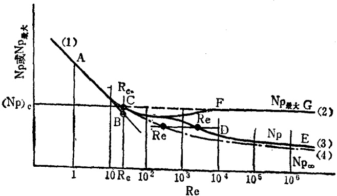

图1.16 决定经验系数的方法

<!-- page: 43 -->

线所示，功率数（Np）随雷诺数增加而降低（AB区）降低之值逐渐减少（CD区），最后达到一定值（E）。式（1.41）右边第二项符合 $B>B[(10^{3}+0.6fRe^{2})/(10^{3}+1.6fRe^{2})]^{p}>B(0.6/1.6)^{p}$ 并与实验结果甚为符合。

另外，当Re值小于临界雷诺数 $(R_{c})$ 时，式（1.41）右方第一项成为控制项。

#### 1.3.2 经验式中系数的决定

**A.系数A和B的关联**

图1.16为桨式的功率数（$\mathrm{Np} = \mathrm{P} \cdot \mathrm{g}_{\mathrm{c}} / \rho \mathrm{n}^{3} \mathrm{~d}^{5}$）和雷诺数（$\mathrm{Re} = \mathrm{d}^{2} \mathrm{n} \rho / \mu$）的关系图。图中，$\mathbb{R}_{\mathrm{c}}$ 为 $\mathrm{Np}$ 对 $\mathrm{Re}$（CDE）曲线，以及 $\mathrm{Np}_{\text {最大}}$ 对 $\mathrm{Re}$ 延长线（FG）的交点，并假定为层流和湍流区之间的边界雷诺数。第1.3.6节中将说明 $\mathrm{Np}_{\text {最大}} = \rho_{\text {最大}} \mathrm{g}_{\mathrm{c}} / \rho \mathrm{n}^{3} \mathrm{~d}^{5}$ 为挡板容器的功率数。我们还发现 $\mathrm{Re}$ 处于 $\mathbb{R}_{\mathrm{c}}$ 数10与 $10^{2}$ 的区域中。

将Re=1代入式（1.41）中，因第二项消失，可得A，

$$ \mathrm{A} = (\mathrm{Np})_{\mathrm{Re} = 1}\tag{1.42} $$

将得到的A和实验所得的 $\mathbb{R}_c$ 代入式（1.41），即有

$$ (\mathrm{Np}) _ {\mathrm{c}} = \frac {\mathrm{A}}{\mathrm{R} _ {\mathrm{c}}} + \mathrm{B}\tag{1,43} $$

因式（1.41）右边第二项缩小到 $B(=B\times l_{p})$ ，故定出系数B为.

$$ \mathrm{B} = (\mathrm{Np}) _ {\mathrm{c}} - \frac {\mathrm{A}}{\mathrm{R} _ {\mathrm{c}}}\tag{1.43'} $$

**a）系数A**

图1.17和1.18为功率数对应雷诺数的标绘。总结两图中实验曲线在Re=1处读得的A值列于表1.4。由几次试验的结果可发现A值能由（b/D）和（d/D）关联如下:

$$ \mathrm{A} = 1 4 + \mathrm{b/D} \{6 7 0 (\mathrm{d/D-0.6}) ^ {2} + 1 8 5 \}\tag{1.44} $$

**b）系数B**

将图1.18的曲线上读得的 $(\mathrm{Np})_{c}$ 值以及其它数值代入式 $(1.43')$ 可得B值并由下式关联

$$ \mathrm{B} = 1. 0 ^ {\{1. 3 - 4 (\mathrm{b} / \mathrm{D} = 0. 5) ^ {2} - 1. 1 4 (\mathrm{d} / \mathrm{D}) \}}\tag{1.45} $$

<!-- page: 44 -->

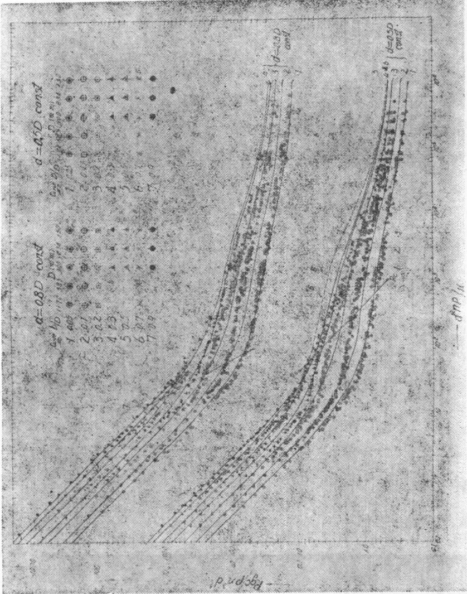

图 1.17 各种叶宽桨式叶轮的功率数和雷诺数之间的关系

<!-- page: 45 -->

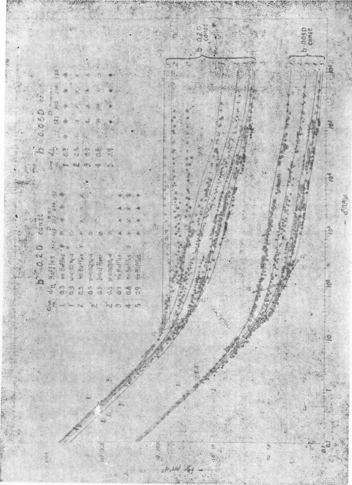

1.18 各种长度桨式叶轮的功率和雷诺数之间的关系图内const(常数)，curve(曲线)，baffles(挡板)。

<!-- page: 46 -->

**B.指数 P 的关联**

让我们来研究大雷诺数的情况。图1.16中Np对Re的标绘表明，Np之值逐渐减少，并接近定值 $Np_{\infty}$ ，

$$ \begin{array}{r l} \mathrm{Np} _ {\infty} & = \lim _ {\mathrm{Re} \to \infty} \frac {\mathrm{A}}{\mathrm{Re}} + \mathrm{B} \left(\frac {1 0 ^ {3} + 0 . 6 \mathrm{fRe} ^ {\alpha}}{1 0 ^ {3} + 1 . 6 \mathrm{fRe} ^ {\alpha}}\right) ^ {\mathrm{p}} \\ & = \mathrm{B} \left(\frac {0 . 6}{1 . 6}\right) ^ {\mathrm{p}} \end{array} $$

$$ \therefore \mathrm{P} = \frac {\log \left(\mathrm{B} / \mathrm{Np} _ {\infty}\right)}{\log (1 . 6 / 0 . 6)} = 2. 3 5 \log \left(\frac {\mathrm{B}}{\mathrm{Np} _ {\infty}}\right)\tag{1.46} $$

$Np_{\infty}$ 之值由图1.17与图1.18估计而得并示于表1.5。把 $Np_{\infty}$ 和B之值代入式（1.46）可得P值并由下式关连，

$$ \mathrm{p} = 1. 1 + 4 (\mathrm{b} / \mathrm{D}) - 2. 5 (\mathrm{d} / \mathrm{D} - 0. 5) ^ {5} - 7 (\mathrm{b} / \mathrm{D}) ^ {4}\tag{1.47} $$

当 $(\mathrm{b} / \mathrm{D})\leq 0.3$ ，式（1.47）的最后一项 $7(\mathrm{b} / \mathrm{D})^4$ 可以略去。

表 1.4 A 的观测值

| b/D \frac{d/D}{D} | 0.2 | 0.3 | 0.4 | 0.5 | 0.7 | 0.8 | 0.9 |
|---|---|---|---|---|---|---|---|
| 0.05 | — | 26.3 | — | 22.3 | — | 24.0 | — |
| 0.1 | — | 41.8 | — | 32.5 | 36.2 | 33.6 | 32.7 |
| 0.2 | — | 63.3 | 54.6 | 51.7 | 50.0 | 52.0 | 59.0 |
| 0.3 | — | 84.4 | — | 75.0 | 73.0 | 74.0 | 82 |
| 0.4 | — | — | — | 93.0 | 88.0 | 96.0 | 110 |
| 0.5 | 200 | 135 | 122 | 107 | 110.0 | 122 | 134 |
| 0.6 | — | — | — | — | — | — | 160 |
| 0.7 | — | 190 | 172 | 145 | 146 | 163 | 183 |
| 0.8 | — | — | — | — | — | 182 | 213 |
| 0.9 | — | 228 | 228 | 190 | 175 | 212 | 260 |

**c.系数 f 和指数 \alpha 的关连**

用前面所得的A，B和p值并首先在式（1.39）中置 $f = 1$ ，$a = 1$ ，可得下式，

$$ \mathrm{Np} = \frac {\mathrm{A}}{\mathrm{Re}} + \mathrm{B} \left(\frac {1 0 ^ {3} + 0 . 6 \mathrm{Re}}{1 0 ^ {3} + 1 . 6 \mathrm{Re}}\right) ^ {\rho}\tag{1.48} $$

<!-- page: 47 -->

表 1.5 {\mathrm{N}}_{\infty } 的外插值

| b/D\d/D | 0.15 | 0.2 | 0.3 | 0.5 | 0.7 | 0.8 | 0.9 |
|---|---|---|---|---|---|---|---|
| 0.05 | 0.8 | 0.62 | 0.42 | 0.23 | 0.15 | 0.13 | 0.12 |
| 0.1 | 1.0 | 0.8 | 0.53 | 0.30 | 0.2 | 0.17 | 0.26 |
| 0.2 | — | — | 0.66 | 0.36 | 0.235 | 0.215 | 0.2 |
| 0.3 | — | — | 0.72 | 0.39 | 0.255 | 0.235 | 0.225 |
| 0.5 | — | — | 0.79 | 0.41 | 0.265 | 0.24 | 0.23 |
| 0.7 | — | — | 0.82 | 0.42 | 0.27 | 0.245 | 0.235 |

图1.16绘出的点划线为式（1.48），但在过渡区的观测值与它不大符合。但不论如何，点划线应在三点上与观测值吻合，即A，C和E。因此，在过渡区以同一Np，在观测值曲线上取Re并在计算所得的线上取 $Re'$ ，以此两值标绘，如用对数座标纸，就能得一直线，表示为，

$$ \mathrm{Re} ^{\prime} = 2\mathrm{Re}^{0.66}\tag{1.49} $$

使用Re'作为修正雷诺数以代式（1.48）中的Re，可推导出最后关系式如下，

$$ \mathrm{Np} = \frac {\mathrm{A}}{\mathrm{Re}} + \mathrm{B} \left(\frac {1 0 ^ {3} + 1 . 2 \mathrm{Re} ^ {0 . 6 6}}{1 0 ^ {3} + 3 . 2 \mathrm{Re} ^ {0 . 6 6}}\right) ^ {\mathrm{p}}\tag{1.50} $$

此处，

$$ \mathrm{A} = 1 4 + (\mathrm{b/D}) \left\{6 7 0 (\mathrm{d/D} - 0. 6) ^ {a} + 1 8 5 \right\}\tag{1.44} $$

$$ \mathrm{B} = 1 0 ^ {\{1, 3 - 4 (\mathrm{b} / \mathrm{l}) - 0. 5 \} ^ {2} - 1. 1 4 (\mathrm{d} / \mathrm{D}) \}}\tag{1.45} $$

$$ \mathrm{P} = 1. 1 + 4 (\mathrm{b} / \mathrm{D}) - 2. 5 (\mathrm{d} / \mathrm{D} - 0. 5) ^ {2} - 7 (\mathrm{b} / \mathrm{D}) ^ {4}\tag{1.47} $$

图1.17和图1.18的实线为式（1.50）算得的曲线。此与观测值甚相符合。但可以看出在图1.17中只有虚线 $(d/D=0.5, b/D=0.5)$ 的差距大。一般说来，当桨的宽度大且等于桨长时，差距即大。

#### 1.3.3 桨宽、桨长与功率消耗的关系

第1.1节中讨论到，作者为方便起见认为与功率消耗有关的面积等于 $b l_{c}$ ，而事实上如图1.19所示用以下的考虑更较合理。对低粘

<!-- page: 48 -->

度液体，液流可限于浆的边缘如带剖面线的面积（A₁）（A₂）（A₃）所示，而对高粘度液体，则如（B₁）（B₂）（B₃）。

图1.20示出，以不同宽度b的桨其功率消耗和宽 $b = 0.20D$ 桨的功率消耗之比作为纵坐标，而以桨宽和直径之比作为横座标点绘出来的曲线。对于水一类的低粘度液体，C.R.Z.的半径 $r_{c}$ 大而 $l_{c}$ 小。如液体流过桨的四角，则随着桨宽的增加，功率亦将增加，直至桨宽b增加至 $2l_{c}$，但如果大于 $2l_{c}$ 时，功率即停止增加，如图1.19的（A3）所示。严格说来，桨宽改变则C.R.Z.半径会随之改变，但为了便于说明，可认为 $r_{c}$ 为常数并可由式（1.28）计算 $r_{c}$ 。

此影响与图1.20中曲线（1）所示的结果符合得很好，实际上是说明当 $b=2l_{c}$ 即在比较小的宽度时功率达到最大值。

另一方面，在较高粘度的液体中 C.R.Z. 变小，于是，功率随着桨宽的增加而增加的限度偏移到较大桨叶宽度的那一边，如图 1.19 中 $(B_{1})(B_{2})(B_{3})$ 与图 1.20 中曲线（2）和（3）所示。

最后，曲线（3）表示，在粘度大于5p的高粘度液体中， $r_{c}$ 趋

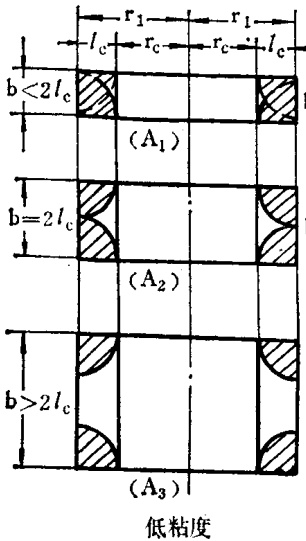

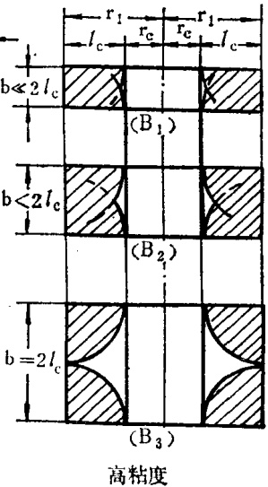

图1.19 不同粘度液体中的功率消耗

<!-- page: 49 -->

向于零而 $l_{c}$ 趋向于 $\mathbf{r}_1$ 。随着桨宽的增加，功率继续增加，直至b达到 $2l_{c}(= 2\mathrm{r}_{1} = \mathrm{d})$ 为止。事实上，桨宽b大于d时功率即为常数。此相当于湍流区的最大粘度。曲线（4）示出粘度为18.2P的液体中的实验结果，为层流到湍流的过渡区。曲线（5）则示出粘度为58cP的液体的实验结果，它处于完全层流状态，故随着桨宽b增加功率直线上升，甚至在b大于d的区域内亦如此。图1.20是用图1.17的数据标绘而得的。如此，即能了解如湍流区中（b/D）增加时，$\mathrm{Np}\sim \mathrm{Re}$ 曲线斜率增加的趋向。

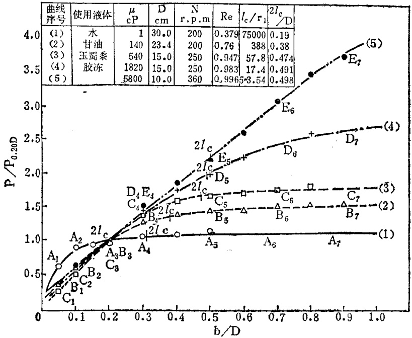

图1.20 桨宽增加 (\mathrm{d} = 0.5\mathrm{D}) 影响功率增加的示意图 l_{c} / r_{1} 值 (= 1 - r_{c} / r_{1}) 由式(1.28)算出

J. H. Rushton 在1953年的《单元操作论述》（混合）中说明:“美国使用桨叶的桨叶长(叶直径之半)对桨宽之比约为3:1与4:1，而德国则为1:2与1:3*左右”。

<!-- page: 50 -->

基于上述结果，按搅拌液体的粘度来选择桨宽是合理的，即狭窄的桨对低粘度液体有效而大宽度（和大直径）的桨则对高粘度液体有效。

说明桨的长度对功率消耗的影响是困难的。图 1.18 是以（d/D）作为参变数而绘出的。与图1.17比较，随着（d/D）的变化，Np-Re曲线斜率差不多完全相同。

在几何相似的容器中，下式在层流区内成立，

$$ \begin{array}{r l} \frac {\mathrm{Pg} _ {\mathrm{c}}}{\rho \mathrm{n} ^ {3} \mathrm{d} ^ {5}} & = \mathrm{A} \left(\frac {\mathrm{d} ^ {2} \mathrm{n} \rho}{\mu}\right) ^ {- 1} \\ \mathrm{P} & = \mathrm{A} ^ {\prime} \mu \mathrm{n} ^ {2} \mathrm{d} ^ {3} = \mathrm{A} ^ {\prime \prime} \mu \mathrm{n} ^ {2} \mathrm{D} ^ {3} \end{array} $$

或

(1.51)

由上式可见，桨叶的功率消耗与粘度，搅拌速度的二次乘积、桨叶直径的三次乘积成比例。液体密度对功率消耗没有影响。

在湍流区，特别在大雷诺数时，Np对Re曲线趋向于水平，并得到以下关系，

$$ \begin{array}{r} {\frac {\mathrm{P} \cdot \mathbf {g} _ {\mathrm{c}}}{\rho n ^ {3} \mathrm{d} ^ {5}} = \mathrm{B} \left(\frac {1 0 ^ {3} + 1 . 2 \mathrm{Re} ^ {0 . 6 6}}{1 0 ^ {3} + 3 . 2 \mathrm{Re} ^ {0 . 6 6}}\right) ^ {\mathrm{p}} \cong \mathrm{K} (\text {常数})} \\ {\mathrm{P} \cong \mathrm{K} \rho n ^ {3} \mathrm{d} ^ {5}} \end{array} $$

或

(1.52)

即在全湍流区桨叶的功率消耗基本上与液体密度、搅拌速度三次乘积、桨叶直径五次乘积成正比例。粘度看来对功率消耗影响甚小。

#### 1.3.4 桨叶与水平面的角度和液面高度的影响

毫无疑问，桨叶角度 $\theta$ 越小，功率越小。但是功率减少的程度随液体的粘度而定，或严格说来，按雷诺数而定。

图1.21中靠近曲线（1），（2），（3），（4）的标绘点为观测值。在雷诺数减小的情况下，由 $\theta$ 的差异引起的功率的差异亦随之减小，最后当Re比图中之值小时，即可忽略不计。此结果可由以下事实说明，即在层流区作用于叶面上的摩擦阻力成为控制因素。为了表明此关系，可将式（1.50）的右边乘上一修正值。

在较高雷诺数的区域内液面高度的影响亦较显著，而降低雷诺数其影响即减少。当雷诺数低到相当于层流区域范围，液面高度对

<!-- page: 51 -->

功率消耗无影响。因此，把式（1.50）右边第二项乘上一个合适的修正系数以修正液面高度的影响较为方便。这样考虑后，作者得到下式:

$$ \mathrm{Np} = \frac {\mathrm{A}}{\mathrm{Re}} + \mathrm{B} \left(\frac {1 0 ^ {3} + 1 . 2 \mathrm{Re} ^ {0 . 6 6}}{1 0 ^ {3} + 3 . 2 \mathrm{Re} ^ {0 . 6 6}}\right) ^ {\mathrm{p}} \left(\frac {\mathrm{H}}{\mathrm{D}}\right) ^ {(0. 3 5 + \mathrm{b/l})} (\sin \theta) ^ {1. 2}\tag{1.53} $$

图1.21中的曲线（1），（2），（3）等表示以式（1.53）算得的Np值。这些曲线与观测值很符合。尽管此结果没有在上图中表示此结论已由 $(d/D)=0.3\sim0.8$ 和 $(b/D)=0.05\sim0.5$ 范围内的实验得到进一步的证实。

所以，式（1.53）能在很广泛的范围内应用并且误差很小。

应该指出，式（1.44）、（1.45）、（1.47）、（1.50）和（1.53）都是用在双叶桨的功率关联上的。虽然经过第1.3.5节和图1.22的修正，也可用于其他型式。

例 1.2 直径为 2.4 米的圆筒形容器内加入比重 1.2 和粘度 200cP 的液体至液面高度为容器直径的 70%，用 d=1.2 米、b=0.48m、np=2 的桨式叶轮以 60r.p.m. 的速度搅拌此液体。计算桨叶角 $\theta=90^{\circ}$ ， $45^{\circ}$ ， $30^{\circ}$ 三种情况的功率消耗。

解

$$ \begin{array}{l} \mathrm{Re} = 1. 2 ^ {2} \times 1 \times 1 2 0 0 / 0. 2 = 8 6 5 0, \quad \mathrm{Re} ^ {0. 6 6} \cong 4 0 0 \\ \mathrm{d/D} = 0. 5 \quad \mathrm{b/D} = 0. 2 \\ (\mathrm{H/D}) ^ {(0. 3 5 + \mathrm{b/D})} = 0. 7 ^ {(0. 3 5 + 0. 2)} = 0. 8 2 2 \end{array} $$

$$ \begin{array}{r l} \text {式(1.44)、(1.45)、(1.47)} \\ & \mathrm{A} = 1 4 + (\mathrm{b/D}) \left\{6 7 0 (\mathrm{d/D} - 0. 6) ^ {2} + 1 8 5 \right\} \\ & = 1 4 + 0. 2 \left\{6 7 0 (0. 5 - 0. 6) ^ {2} + 1 8 5 \right\} = 5 2. 3 \\ & \mathrm{B} = 1 0 ^ {\{1. 3 - 4 (\mathrm{b/D} - 0. 5) ^ {2} - 1. 1 4 (0. 5) \}} \\ & = 1 0 ^ {0. 3 7} = 2. 3 4 \\ & \mathrm{P} = 1. 1 + 4 (\mathrm{b/D}) - 2. 5 (\mathrm{d/D} - 0. 5) ^ {2} \\ & = 1. 1 + 4 (0. 2) - 2. 5 (0) = 1. 9 \end{array} $$

图1.35、1.36、1.37的列线图是备作A.B.P的计算使用的。

<!-- page: 52 -->

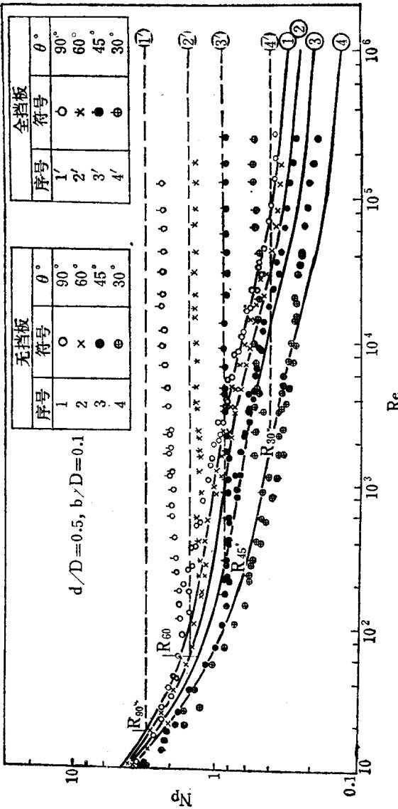

图1.21 各种Re的桨叶角度对功率因素的影响

<!-- page: 53 -->

$$ \begin{array}{r l} Z & = \frac {1 0 ^ {3} + 1 . 2 \mathrm{Re} ^ {0 . 6 6}}{1 0 ^ {3} + 3 . 2 \mathrm{Re} ^ {0 . 6 6}} \\ & = \frac {1 0 ^ {3} + 1 . 2 (4 0 0)}{1 0 ^ {3} + 3 . 2 (4 0 0)} = \frac {1 4 8 0}{2 2 8 0} = 0. 6 5 \end{array} $$

图1.38用于Z的计算甚便。用式（1.53）可以算得， $\theta=90^{\circ}$ 时

$$ \begin{array}{r l} (\mathrm{Np}) _ {9 0 ^ {\circ}} & = \frac {5 2 . 3}{8 6 5 0} + 2. 3 4 (0. 6 5) ^ {1. 9} (0. 8 2 2) \\ & = 0. 8 5 9 \end{array} $$

$$ \begin{array}{r l} \therefore \mathrm{P} _ {9 0 ^ {\circ}} & = 0. 8 9 5 \times 1 2 0 0 \times 1 ^ {3} \times 1. 2 ^ {3} / 9. 8 \\ & = 2 6 5 \mathrm{kg} \cdot \mathrm{m} / \mathrm{s} = 3. 5 \mathrm{PS} \end{array} $$

用图1.34从 $\mathrm{Np}$ 值计算P，

$$ \theta = 4 5 ^ {\circ} \text {时}, \quad 3. 5 (\sin 4 5 ^ {\circ}) ^ {1 \cdot 2} = 3. 5 (0. 7 0 7 1) ^ {1 \cdot 2} = 2. 3 1 \mathrm{PS} $$

$$ \theta = 3 0 ^ {\circ} \text {时}, \quad 3. 5 (\sin 3 0 ^ {\circ}) ^ {1 \cdot 2} = 3. 5 (0. 5) ^ {1 \cdot 2} = 1. 5 2 5 \mathrm{PS} $$

#### 1.3.5 桨叶高度和桨叶数对功率消耗的影响

**A.单桨**

桨在搅拌容器内的高度（Hp）对功率影响甚微。

近容器顶 Hp=0.9D（或近容器底 Hp=0.1D）的桨与容器中间的桨相比功率消耗的差别甚微。除高粘度液体的情况外，此差异可忽略不计。

**B.多层桨和桨叶数**

如图1.22所示，两个叶轮之间的距离对功率消耗的影响是很小的。两倍宽度桨（1）的功率消耗与任意距离两桨（2）（3）相等。作为极端情况，四叶桨（4）的功率消耗与两倍宽度桨（1）所需的相等。故结论为，如

$$ \mathrm{b} \times \mathrm{n} _ {\mathrm{p}} = \text {常数}\tag{1.54} $$

如桨叶具有同样的 d 和 $\theta$ ，则在同一容器中心位置搅拌时的功率消耗是一样的。

应该指出，上式（1.54）不能应用于挡板容器的搅拌。

<!-- page: 54 -->

(1) $n_p = 2$, C = 5 (2) $n_p = 2$, $C_1 = 3$, $C_2 = 7$ (3) $n_p = 2$, $C_1 \cong C_2 \cong 5$ (4) $n_p = 4$, C = 5 (5) 直叶开式涡轮（亦称风扇式涡轮）

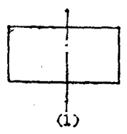

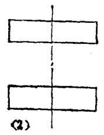

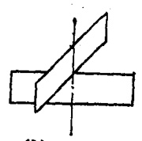

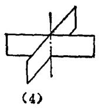

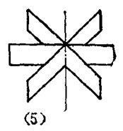

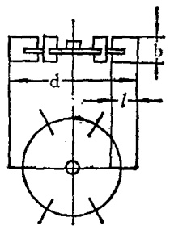

图1.22 功率消耗相同的桨叶

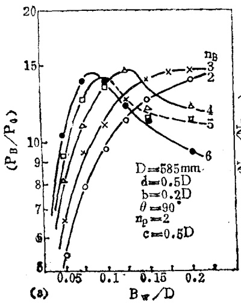

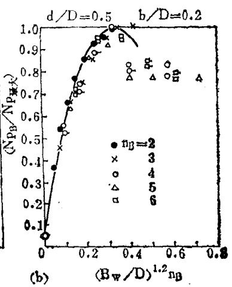

(b) 挡板对功率因素的影响

<!-- page: 55 -->

**C.涡轮搅拌器**

涡轮搅拌器如图 1.22(b) 所示。Rushton $^{[35,37]}$ 曾提出其尺寸比例，在此称为“标准涡轮”。

第1.1.4节讨论过，C.R.Z.可延伸至涡轮叶的内缘，这样，在低粘度和中粘度液体中，涡轮（6）的功率消耗与叶数一样的开式涡轮（5）一致，而后者又与三倍宽度桨（1）的消耗相等。但是，在叶轮（1）和（6）过渡区的功率消耗就有很大的差异。

#### 1.3.6 最大功率消耗

**A.全挡板条件**

在容器壁上插入档板就阻止了液体的切线流且第1.1节所述的C.R.Z.就消失，故叶轮的功率消耗增加。

增加挡板宽度使与液体有相对速度的桨面积增加，并且达到最大功率。作为一例，图1.23表示随着挡板宽度增加的功率消耗变化。所用桨的尺寸为， $d=0.5D,\quad b=0.2D,\quad\theta=90^{\circ},\quad n_{p}=2$ ，在D=585mm的容器内旋转。装了挡板宽度 $B_{w}$ 的容器中的功率 $(P_{b})$ 与未装挡板的 $(P_{0})$ 作了比较。当挡板宽度增加，功率增加很快，最后达到一最大值，随即在再大一点的 $(B_{w}/D)$ 时还有点降低。如挡板数增加，则在较小的 $(B_{w}/D)$ 时就达到最大功率 $P_{最大}$ 。 $P_{最大}$ 表示最大功率。用下式可粗略地表示达到最大功率的挡板相对宽度，

$$ (\mathrm{B_w/D}) \times \mathrm{n_b=0.5}\tag{1.55} $$

或较准确为，

$$ (\mathrm{B} _ {\mathrm{w}} / \mathrm{D}) ^ {1. 2} \times \mathrm{n} _ {\mathrm{B}} = 0. 3 5\tag{1.55'} $$

此关系称为“全挡板条件”。

**B.全挡板条件的档板宽度**

全挡板条件可能因不同的桨长(d)或不同的桨宽(b)而异。但按实验结果断定，对于不同桨的尺寸，达到最大功率的挡板宽度差不多是常数并且式（1.55）和式（1.55'）是成立的。

**C.在不同粘度液体中最大功率的恒定性**

如J.H.Rushton等人的报告所述，对于不同粘度的液体，保

<!-- page: 56 -->

持叶轮速度不变时，最大功率 $P_{最大}$ 差不多是恒定的。此结果亦为作者证实，见图1.18（曲线 $(1')$ ， $(2')$ ）。

在部分挡板条件下，如图中曲线（2′′）所示，对于不同粘度的液体此功率值也是定值。此结果与不同粗糙度的管中流动液体的摩擦因数与雷诺数间的关系相似。

**D.启动功率**

桨在静止液体中开始旋转的瞬时，整个桨叶承受流体阻力，C.R.Z.半径为零，故初始时的 $P_{始}$ 等于 $P_{最大}$ ，

$$ \mathrm{P} _ {\text {始}} \cong (\mathrm{P} _ {\text {最大}}) _ {3}\tag{1.56} $$

在图1.18曲线（2′）上，符号为 $I_{1}$ ， $I_{2}$ ，…… $I_{6}$ 的点表示 $P_{始}$ 的功率因素，可见它与全挡板条件的 $Np_{最大}$ 相等。因此 $P_{始}$ 差不多为稳态下 $P_{0}$ 的1.5倍。换言之，叶轮启动后，容器中的液体开始旋转，叶轮上液体阻力逐渐降低，最后到达稳态而功率消耗在此时降低至 $P_{0}$ 。

**E.偏心装置的桨的功率消耗**

当桨开始偏离容器中心时，功率消耗逐渐增加，随即急速增加，直至偏心位置（ε）几乎等于桨直径（d）的一半时就达到--最大值从此保持不变，如图1.24所示。此功率称为最大偏心功率并以 $\left(\mathrm{P}_{\text {最大}}\right)_{4}$ 表示。当增加液体粘度时，图1.24示出装在中央的桨的功率 $P_{0}$ 亦增大，但最大功率 $\left(\mathrm{P}_{\text {最大}}\right)_{4}$ 却保持不变。增加粘度使 $P_{0}$ 越来越大，最后达到 $\left(\mathrm{P}_{\text {最大}}\right)_{4}$ 即停止，因为桨叶的全面积都承受流体阻力了。在不改变叶轮而增大容器直径时，也存在同样情况。在很大的容器中，则桨置于中央或偏心的功率消耗差别不大。

#### 1.3.7 全挡板条件下的最大功率消耗

**A.临界雷诺数条件（ R_{c} ）**

如上所述，装上由式（1.55）或（1.55′）给定尺寸的档板就得到最大功率。由第1.3.1节可以明确，当液体粘度大到C.R.Z.消失时，其功率将等于全挡板条件下的最大值。虽然在混合容器中，层流到湍流的过渡是逐渐进行的，而且“临界雷诺数”之称也并不十分妥当，作者还是把它定义为相当于 $Np_{最大}(P_{最大}g_{c}/\rho n^{3}d^{5})$ 对Re

<!-- page: 57 -->

[1]

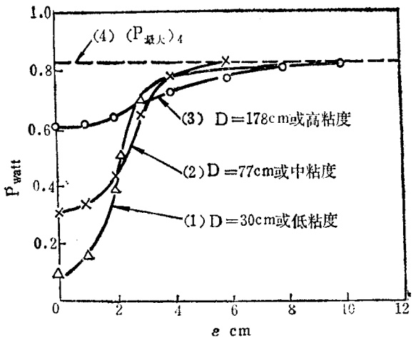

图 1.24 N=200r.p.m., d=7.5cm, b=2.7cm,  \theta=90^{\circ} ,  n_{p}=4

的水平延长线与Np对Re的曲线两者的交点，如图1.16所示。

对于不同尺寸的直径 d 和宽度 b，桨式 $(\theta=90^{\circ})$ 的 $R_{c}$ 值由下式关联，

$$ \mathrm{R} _ {\mathrm{c}} = \frac {2 5}{(\mathrm{b/D})} \left(\frac {\mathrm{d}}{\mathrm{D}} - 0. 4\right) ^ {2} + \left(\frac {\mathrm{b/D}}{0 . 1 1 (\mathrm{b/D}) - 0 . 0 0 4 8}\right)\tag{1.57} $$

B.叶角 $90^{\circ}$ 桨的最大功率消耗

如第1.2.3(A)节所述， $Np_{最大}$ 对 Re 直线与 Np 对 Re 曲线在式（1.57）算得的 $R_{c}$ 处相交。故把 $R_{c}$ 代入式（1.50）中的 Re，可以算出 $Np_{最大}$ 。置 $\sin\theta$ 为 1.0 并把 $R_{c}$ 代入式（1.53）中的 Re，则任一液面高度的 $Np_{最大}$ 也能算出。进一步说，因 $R_{c}$ 通常很小，可用以下较简单的算式，

$$ \mathrm{Np} _ {\text {最大}} = \frac {\mathrm{A}}{\mathrm{Re}} + \mathrm{B} \left(\frac {\mathrm{H}}{\mathrm{D}}\right) ^ {(0, 3 5 + \mathrm{b/D})}\tag{1.58} $$

图 1.18 的曲线（1）'，（2）是由式（1.58）算得的。这两条曲线与观测值全都很符合。从式（1.58）能看出， $N_{p}$ 最大之值基本上与液面高度无关。

在图1.25中，$\mathrm{Np}_{\text{最大}}$ 的观测值与不同尺寸宽度与长度的桨的计

<!-- page: 58 -->

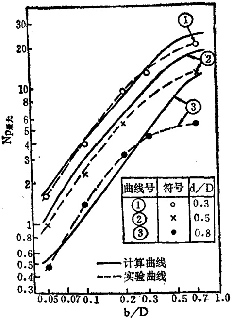

图1.25 \mathbf{Np}_{\text{最大的}} 的观测数据与计算值比较

算值作比较，除大宽度桨外，两者的一致性是令人满意的。

**C.倾斜叶桨的最大功率消耗**

对于倾斜叶桨，湍流到层流的过渡甚为缓慢，过渡雷诺数 $R_{\theta}$ 应定义为，Np 对 Re 曲线与 $(\mathrm{Np}_{\text{最大}})_{\theta}$ 对 Re 曲线的交点。 $R_{\theta}$ 可大致由 $\theta = 90^{\circ}$ 的 $R_{c}$ 估计如下，

$$ \mathrm{R} _ {\theta} = 1 0 ^ {4 (1 - \sin \theta)} \mathrm{R} _ {\mathrm{c}}\tag{1.59} $$

所以，倾斜叶桨的最大功率消耗可以很方便地把 $R_{\theta}$ 代入式（1.53）中计算出来。由此法算得的图1.21中的曲线 $(1')$ 、 $(2')$ 、 $(3')$ 、 $(4')$ 不是处处都和观测值吻合得很好。与其他桨叶相比，这是符合得最差的。

例 1.3 在全挡板条件下，计算例 1.2 叶轮的功率消耗并比较因插入挡板而增加的功率。

解 对于 $\theta = 90^{\circ}$ 的桨

以式（1.57）估计临界雷诺数 $R_{c}$

<!-- page: 59 -->

$$ \mathrm{R} _ {c} = \frac {2 5}{0 . 2} (0. 5 - 0. 4) ^ {2} + \frac {0 . 2}{0 . 1 1 (0 . 2) - 0 . 0 0 4 8} = 1 2. 8 6 $$

可以用图1.39的列线图来计算。

由图1.38，

$$ \mathrm{R} _ {\mathrm{c}} = 1 2. 8 6 \text {时,} Z = 0. 9 9 $$

$$ \therefore \quad \left(\mathrm{Np} _ {\text {最大}}\right) _ {9 0 ^ {\circ}} = \frac {5 2 . 3}{1 2 . 8 6} + (2. 3 4) (0. 9 9) ^ {1. 9} (0. 8 2 2) = 5. 9 9 $$

$$ \begin{array}{r l} (\mathrm{P} _ {\text {最大}}) _ {9 0 ^ {\circ}} & = 5. 9 9 \times 1 2 0 0 \times 1 ^ {3} \times 1. 2 ^ {5} / 9. 8 \\ & = 1 8 2 7 \mathrm{kg} \cdot \mathrm{m/s} = 2 4 \mathrm{P.S.} \end{array} $$

由式（1.59）

$$ \mathrm{R} _ {4 5 ^ {\prime}} = 1 0 ^ {4 (1 - \sin 4 5 ^ {\circ})} (1 2. 8 6) = 1 9 0 $$

$$ R _ {3 0 ^ {\circ}} = 1 0 ^ {4 (1 - \sin 3 0 ^ {\circ})} (1 2. 8 6) = 1 2 8 6 $$

$$ \begin{array}{r l} (\mathrm{Np} _ {\text {最大}}) _ {4 5 ^ {\circ}} & = \frac {5 2 . 3}{1 9 0} + 2. 3 4 \left\{\frac {1 0 ^ {3} + 1 . 2 (1 9 0) ^ {0 . 6 6}}{1 0 ^ {3} + 3 . 2 (1 9 0) ^ {0 . 6 6}} \right\} ^ {1. 9} \\ & \times (0. 8 2 2) (0. 7 0 7 1) ^ {1. 2} = 1. 4 0 \\ & \therefore (\mathrm{P} _ {\text {最大}}) _ {4 5 ^ {\circ}} = 5. 7 2 \mathrm{P.S}. \end{array} $$

$$ \begin{array}{r l} (\mathrm{N} _ {\mathrm{P} _ {\text {最大}}}) _ {3 0 ^ {\circ}} & = \frac {5 2 . 3}{1 2 8 6} + 2. 3 4 \left\{\frac {1 0 ^ {3} + 1 . 2 (1 2 8 6) ^ {0 . 6 6}}{1 0 ^ {3} + 3 . 2 (1 2 8 6) ^ {0 . 6 6}} \right\} \\ & \times (0. 8 2 2) (0. 5) ^ {1. 2} = 0. 6 3 5 \\ & \therefore \quad (\mathrm{P} _ {\text {最大}}) _ {3 0 ^ {\circ}} = 2. 5 9 \mathrm{P.S.} \end{array} $$

取例（1.2）和（1.3）所得的数据即算得的 $\left(P_{\text{最大}}/P_{0}\right)$ 比值在表1.6中列出。

的功率比 (P_{\text{最大}} / P_0) 的比较

|  | 挡板( P_{最大} ) | 无挡板( P_0 ) | P_{最大}/P_0 |
|---|---|---|---|
| \theta=90^\circ | 24.4 | 3.5 | 6.97 |
| \theta=45^\circ | 5.72 | 2.31 | 2.47 |
| \theta=30^\circ | 2.59 | 1.52 | 1.70 |

<!-- page: 60 -->

应该指出，叶角不同， $\left(P_{\text{最大}}/P_{0}\right)$ 的比值就有很大差异。

D.部分挡板条件下的功率消耗

如上所述，作者已用式（1.55）或式（1.55′）对全挡板条件下了定义。但小挡板的功率消耗却低于最大功率（ $P_{最大}$ ）。用（ $B_{w}/D)^{1.2}n_{B}$ 关联的部分挡板与全挡板条件下功率数之比示于图1.23b。

比全挡板条件小的部分挡板功率数 $\mathrm{Np_B}$ 由下式估算，

$$ \frac {\mathrm{Np} _ {\mathrm{最大}} - \mathrm{Np} _ {\mathrm{B}}}{\mathrm{Np} _ {\mathrm{最大}} - \mathrm{Np} _ {\infty}} = \{1 - 2. 9 (\mathrm{B} _ {\mathrm{w}} / \mathrm{D}) ^ {1. 2} \mathrm{n} _ {\mathrm{B}} \} ^ {1. 2}\tag{1.60} $$

此处 $\mathrm{Np}_{\infty}$ 为Re趋于无穷大时所得的功率数，即

$$ \mathrm{Np} _ {\infty} = \mathrm{B} (0, 6 / 1, 6) ^ {p}\tag{1.61} $$

$N_{P_{最大}}$ 为式（1.58）的估算值。

式（1.60）在图1.23(b)中绘出为一实线，此线与标绘点符合得很好。虽没有其他尺寸的（d/D和b/D）的图，但已得到过很一致的结果。

E.矩形容器和装有冷却蛇管的圆筒容器中桨的功率消耗

使用的容器为图 1.26 的（b），（c）。在这些容器中旋转流被部分抑制。实验结果示于图 1.27。

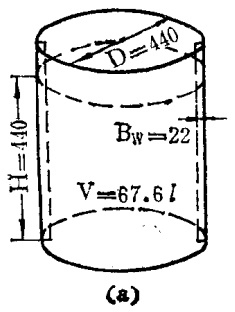

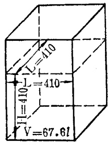

(b)

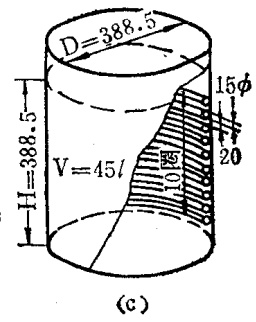

图1.26 容器的形式

（a）部分挡分圆筒形容器

(b) 方形容器

(c) 有蛇管的圆筒形容器

<!-- page: 61 -->

图1.27 附表列出了使用的桨（d/D=0.5，b/D=0.1，0.2，0.5， $\theta=90^{\circ}$ ， $n_{p}=2$ ）。如图1.27所示，这些容器中得到的实验结果与 $(B_{w}/D=0.05, n_{B}=2)$ 的部分挡板容器所得的不同，但能给出近似的值。

例1.4 在直径 \mathrm{D} = 2.4\mathrm{m} 的圆筒容器中充水至液面 \mathrm{H} = 2.4\mathrm{m}。

| 容器 | 曲线号 | d/D | b/D | 符号 |
|---|---|---|---|---|
| 圆筒形容器 | 1 | 0.5 | 0.1 |  |
| 无挡板 | 2 | 0.5 | 0.2 |  |
| 3 | 0.5 | 0.5 |  |  |
| 圆筒形容器 | 1' | 0.5 | 0.1 |  |
| 有挡板 | 2' | 0.5 | 0.2 |  |
| B_W=0.05D\ n_B=2 | 3',3'' | 0.5 | 0.5 |  |
| 方形图1.45(b) | 15 | 0.5 | 0.1 |  |
| 25 | 0.5 | 0.2 |  |  |
| 35 | 0.5 | 0.5 |  |  |
| 有蛇管的圆筒形容器 | 1c | 0.5 | 0.1 |  |
| 图1.45(a) | 2c | 0.5 | 0.2 |  |
| 3c | 0.5 | 0.5 |  |  |

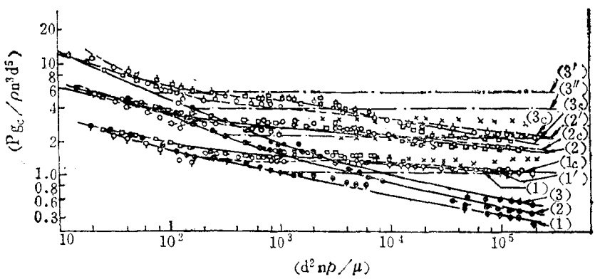

图1.27 方形容器和有蛇管的圆筒形容器的功率与无挡板容器的比较

<!-- page: 62 -->

$d = 1.2m, b = 0.48m, n_{p} = 2$ 的桨在其中以 $60r.p.m.$ 旋转。对下列情况（1）无挡板，（2）全挡板条件: $B_{w}/D = 0.15, n_{p} = 4$，

（3）部分挡板条件 $B_{w}/D=0.05,\quad n_{B}=4$ 估算功率消耗。

解

$$ \mathrm{d} / \mathrm{D} = 1. 2 / 2. 4 = 0. 5, \mathrm{b} / \mathrm{D} = 0. 4 8 / 2. 4 = 0. 2, \mathrm{n} _ {\mathrm{B}} = 2 $$

$$ \mathrm{n} = 1 \mathrm{r} \cdot \mathrm{p} \cdot \mathrm{m}, \mathrm{d} ^ {2} \mathrm{n} \rho / \mu = 1. 2 ^ {2} \times 1 \times 1 0 0 / 0. 0 0 1 = 1. 4 4 \times 1 0 ^ {6} $$

**a）有挡板**

$$ \mathrm{Np} \cong \mathrm{B} (\mathrm{Z}) ^ {\mathrm{p}} = 2. 3 2 (0. 3 9 2) ^ {1. 9} = 0. 3 9 $$

$$ \mathrm{P} = 0. 3 9 \times 1 0 0 0 \times 1 ^ {3} \times 1. 2 ^ {5} / (9. 8 \times 7 5) = 1. 3 2 \mathrm{P.S.} $$

b）有挡板（全挡板条件； $B_{w}/D=0.15,\quad n_{B}=4$ ）

$$ (\mathrm{B} _ {\mathrm{w}} / \mathrm{D}) ^ {1 \cdot 2} \mathrm{n} _ {\mathrm{B}} = 0. 1 5 ^ {1 \cdot 2} \times 4 = 0. 4 0 8 (\text {全挡板条件}) $$

$$ \mathrm{Np} _ {\text {最大}} = \frac {\mathrm{A}}{\mathrm{Re}} + \mathrm{B} = \frac {5 2}{1 2} + 2. 3 2 = 6. 6 5 $$

$$ \mathrm{P} = 6. 6 5 \times 1 0 0 0 \times 1 \times 1. 2 ^ {2} / (9. 8 \times 7. 5) = 2 2. 5 \mathrm{P.S}. $$

c）有挡板（部分挡板条件； $B_{w}/D=0.05,\ n_{8}=4$ ）

$$ (\mathrm{B} _ {\mathrm{w}} / \mathrm{D}) ^ {1 \cdot 2} (\mathbf {n} _ {\mathrm{B}}) = (0. 0 5) ^ {1 \cdot 2} \times 4 = 0. 1 1 (\text {部分挡板条件}) $$

由图1.23b

$$ (\mathrm{Np} _ {\mathrm{B}} / \mathrm{Np} _ {\text {最大}}) = 0. 5 6 \quad \mathrm{Np} _ {\mathrm{B}} = 6. 6 5 (0. 5 6) = 3. 7 2 $$

$$ \mathrm{P} _ {\mathrm{R}} = 1 2. 4 \mathrm{P.S}. $$

#### 1.3.8 用曲线图作叶轮的功率消耗估算

在叶轮的功率消耗计算中，以上的Np对Re的曲线图（图1.12，1.13，1.17，1.18，1.27）是有用的，而对于特殊的叶轮类型，下图1.28和图1.29也是便于使用的。在有实验数据的地方，最好还是用这些数据来代替实验式（1.44），（1.45），（1.47），（1.50）和（1.53）。这些关系式在理解各种因素的内在关系时是有价值的。

**a）Rushton推荐的图[36]**

图1.28示出J. H. Rushton 等人推荐的各种类型桨叶的 Np 对 Re 图。

在有挡板情况下的Re小于300范围内，液面不存在凹陷。可取纵坐标 $\phi = \mathrm{Pg_c / \rho n^3d^5 = N_P}$

<!-- page: 63 -->

在无挡板的湍流区内，液面发生凹陷表象，必须取下项作为纵坐标。

$$ \phi = \frac {\mathrm{Pg} _ {\mathrm{c}}}{\rho \mathbf {n} ^ {3} \mathrm{d} ^ {5}} \left(\frac {\mathrm{g}}{\mathrm{dn} ^ {2}}\right) \left(\frac {\alpha - \log \mathrm{Re}}{\beta}\right)\tag{1.62} $$

他们建议用下式求弗鲁德数的指数q

$$ \mathrm{q} = \frac {\alpha - \log \mathrm{Re}}{\beta}\tag{1.62'} $$

$\alpha$ 和 $\beta$ 的数值按不同的（d/D）及不同类型的搅拌叶而不同，其值列于表1.7。

表 1.7 當诺数高于 $^{①}$ 300的弗鲁德数指数q的值

$$ \mathrm{q} = \frac {\alpha - \log \mathrm{Re}}{\beta} $$

全挡板时，无旋涡时，或雷诺数低于300时， q 为0

| 推进式桨叶直径d in. | 容器直径D in. | d/D比 | \alpha | \beta |
|---|---|---|---|---|
| 4 | 8.5 | 0.47 | 2.6 | 18.0 |
| 20 | 54 | 0.38 | 2.3 | 18.0 |
| 18 | 54 | 0.332 | 2.1 | 18.0 |
| 4 | 13 | 0.308 | 1.7 | 18.0 |
| 12 | 54 | 0.222 | 0 | 18.0 |
| 六叶平直叶涡轮式 |  |  |  |  |
| 4 | 13 | 0.308 | 1.0 | 40.0 |
| 6 | 18 | 0.333 | 1.0 | 40.0 |

图1.28示出很多种类搅拌叶的实验关系，在实用上是方便的，但只限于使用的桨叶尺寸与Rushton等人所用的相同。

例1.5 计算六叶平直叶涡轮的功率消耗，d=1m，d:l:b=20:5:4， $n_{p}=6$ （属于图1.22(b)），转速60r.p.m.，容器直径3m，容器中液体比重1.2，粘度60cP，液面高度3m。

<!-- page: 64 -->

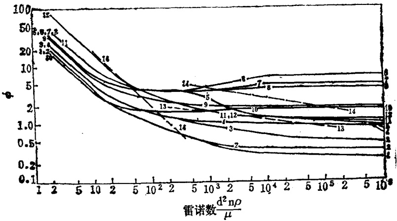

图1.28 各种叶轮的比较

无挡板，Re 超过300 用 $\phi = \left(\frac{P_{\mathrm{s}}}{\rho n^{3}d^{5}}\right)\left(\frac{g}{n^{2}d}\right)^{\left(\frac{\alpha - \log Re}{\beta}\right)}$

$$ \text {否则用} \phi = \frac {\mathrm{P} _ {\text {总}}}{\rho \mathrm{n} ^ {3} \mathrm{d} ^ {5}} = \mathrm{Np} $$

图中曲线1.推进式 螺距等于直径 无挡板

2. 推进式 螺距等于直径 四块挡板每块0.1D

3. 推进式 螺距二倍直径 无挡板

4. 推进式 螺距二倍直径 四块挡板每块0.1D或同一推进式叶轮，无挡板但偏心装置

5. 六叶平直叶涡轮 无挡板 6. 六叶平直叶涡轮 四块挡板每块0.1D 7. 六叶弯叶涡轮 四块挡板每块0.1D 8. 六叶箭式涡轮 四块挡板每块0.1D 9. 八叶平直叶涡轮 四块挡板每块0.1D 10. 二叶平直叶桨 四块挡板每块0.1D 11. 六叶封闭式涡轮 四块挡板每块0.1D 12. 六叶封闭式涡轮 附有20叶固定环 13. 桨式 无挡板 MILLER数据 14. 桨式 无挡板 WHITE数据

解 此例所用的桨叶相当于Rushton在图1.28曲线（5）中所用的。

$$ \mathrm{d} = 1 \mathrm{m}, l = 5 / 2 0 = 0. 2 \mathrm{m}, \mathrm{b} = 4 / 2 0 = 0. 2 \mathrm{m}, \mathrm{n} = 1 \mathrm{r}. \mathrm{p}. \mathrm{m}, $$

$$ \rho = 1 2 0 0 0 \mathrm{kg/m} ^ {3}, \mu = 0. 0 6 \mathrm{kg/m} \cdot \mathrm{s} $$

$$ \mathrm{Re} = 1 ^ {2} \times 1 \times 1 2 0 0 / 0. 0 6 = 2 \times 1 0 ^ {4}, $$

<!-- page: 65 -->

$$ \mathrm{Fr} = \mathrm{dn} ^ {2} / \mathrm{g} = 1 \times 1 ^ {2} / 9. 8 = 0. 1 0 2 $$

由表1.7，得 $\alpha = 10$ ， $\beta = 40$

$$ \begin{array}{r l} \mathrm{q} & = (\alpha - \log \mathrm{Re}) / \beta = (1. 0 - 4. 3 0 1) / 4 0 = - 0. 0 8 2 5 \\ & (\mathrm {g / d n ^ {2}}) ^ {\mathrm{a}} = (1 / 0. 0 1 0 2) ^ {- 0. 0 8 2 5} = 0. 8 2 8 \end{array} $$

由图1.28中曲线（5），在 $\mathrm{Re} = 2\times 10^{4}$ 处得 $\phi = 1.2$

$$ \therefore \quad \mathrm{Pg} _ {\mathrm{c}} / \rho \mathrm{n} ^ {3} \mathrm{d} ^ {5} = 1, 2 / 0, 8 2 5 = 1, 4 5 $$

$$ \mathrm{P} = 1. 4 5 \times 1 2 0 0 \times 1 \times 9 / 9. 8 = 1 7 7. 5 (\mathrm{kg} \cdot \mathrm{m/s}) = 2. 3 7 \mathrm{P.S}. $$

b）Martin推荐的图[13]

J. J. Martin 整理了各家的数据而作出图1.29。其中没有计入弗鲁德数的影响。使用此图时，应注意在纵座标的 $Np' = P'/\rho n^{3}d^{5}$ 中， $P'$ 用 H. P., 而 $\rho$ , d 用 ft, 1b 作单位，且其中各单位不一致。但因功率消耗直径以 H. P. 为单位算出，故较方便。

例1.6 计算桨式的功率消耗，它的 $d = 1\mathrm{ft}$，$b = 0.25\mathrm{ft}$，$n_p = 4$。转速 $N = 180r.p.m.$，容器 $D = 3m$，$H = 3m$，$\theta = 90^\circ$，液体比重为1.8，粘度为13cP的NaOH溶液。

解1)

用Martin的图

情况恰与图1.29的曲线 $c - c$ 一致。

$$ \begin{array}{l} \mathrm{n} = 1 8 0 / 6 0 = 3 \mathrm{r.p.m.,} \rho = 1. 3 0 \times 6 2. 4 = 8 1 \quad 1 \mathrm{b/ft} ^ {3} \\ \mathrm{d} = 1 \mathrm{ft}, \mu = 1 3 \times 0. 0 0 0 6 7 2 = 0. 0 0 8 7 4 (1 \mathrm{b/ft} \cdot \mathrm{s}) \\ \therefore \quad \mathrm{Re} = 1 ^ {2} \times 3 \times 8 / 0. 0 0 8 7 4 = 2. 7 8 \times 1 0 ^ {4} \end{array} $$

由曲线c-c， $N_{p}^{\prime}=0.000062\quad Re=2.28\times10^{4}$

$$ \therefore \quad \mathrm{P} ^ {\prime} = 0. 0 0 0 0 6 2 \times 8 1 \times 3 ^ {2} \times 1 ^ {5} = 0. 1 3 5 5 \mathrm{H.P.} = 0. 1 3 8 \mathrm{P.S}. $$

解2)

用经验式，

如式（1.54）所示，b=0.25ft、 $n_{p}=4$ 的桨的功率与b=0.5ft、 $n_{p}=2$ 桨的相同，故计算中应该用(b/D)=0.5/3=0.167。

$$ B = 1 0 ^ {\{1. 3 - 4 (0. 1 6 7 - 0. 5) ^ {2} - 1. 1 4 (1 / 3) \}} = 1 0 ^ {0. 4 7 8} = 3. 0 1 $$

$$ \mathrm{P} = 1. 1 + 4 (0. 1 6 7) - 2. 5 (0. 3 3 3 - 0. 5) ^ {2} = 1. 6 9 8 $$

$$ \mathrm{Re} ^ {0. 6 6} = (2. 7 8 \times 1 0 ^ {4}) ^ {0. 6 6} = 8 5 5 $$

<!-- page: 66 -->

$$ \begin{array}{r l} Z & = \left\{1 0 ^ {3} + 1. 2 (8 5 5) \right\} / \left\{1 0 ^ {3} + 3. 2 (8 5 5) \right\} = 0. 5 4 2 \\ & \mathrm{Np} = 3. 0 1 (0. 5 4 2) ^ {1. 6 9 8} = 1. 0 6 3 \\ \therefore & \mathrm{P} = 1. 0 6 3 \times 1 3 0 0 \times 3 ^ {2} \times 0. 3 0 4 8 5 ^ {5} / 9. 8 \\ & = 9. 9 \mathrm{kg} \cdot \mathrm{m} / \mathrm{s} = 0. 1 3 \mathrm{P}. \mathrm{S}. \end{array} $$

例1.7 计算桨式的功率消耗，它的 $d = 0.2\mathrm{m}$，$b = (0.25)$，$d = 0.05\mathrm{m}$，$\theta = 45^{\circ}$，$n_p = 4$，转速360转/分，容器 $D = 5.2d = 1.04\mathrm{m}$，$H = D$。液体为水。

解1)

用Martin图

$$ \mathrm{d} ^ {2} \mathrm{n} \rho / \mu = 0. 2 ^ {2} \times 6 \times 1 0 0 0 / 0. 0 0 1 = 2. 4 \times 1 0 ^ {5} $$

由图1.29中曲线 e-e，用外插法估出 $Re=2.4 \times 10^{5}$ 的 $Np'$ 为 0.000033。

$$ \begin{array}{r l} \mathrm{d} & = 0. 2 \times 3. 2 8 1 = 0. 6 5 6 \mathrm{ft} \\ \mathrm{P} ^ {\prime} & = 0. 0 0 0 0 3 6 \times 6 2. 4 \times 6 ^ {3} \times 0. 6 5 6 ^ {5} = 0. 0 5 3 8 \mathrm{H.P.} \\ & = 0. 0 5 4 7 \mathrm{P.S.} \end{array} $$

解2)

用式（1.53）

$\mathbf{n_p} = 4$ 桨的功率用两倍宽度的 $\mathrm{np} = 2$ 的桨来估计，

$$ \begin{array}{r l} \mathrm{d/D} & = 1 / 5. 2 = 0. 1 9 2, \mathrm{b/D} = (0. 0 5 \times 2) / 1. 0 4 = 0. 0 9 6 \\ \mathrm{B} & = 1 0 ^ {(1. 3 - 4 (0. 0 9 6 - 0. 5) ^ {2} - 1. 1 4 (0. 1 9 2))} = 2. 6 8 \\ \mathrm{P} & = 1. 1 + 4 (0. 0 9 6) - 2. 5 (0. 1 9 2 - 0. 5) ^ {2} = 1. 2 4 6 \\ \sin 4 5 ^ {\circ} & = 0. 7 0 7 1, (\sin 4 5 ^ {\circ}) ^ {1. 2} = 0. 7 0 7 1 ^ {1. 2} = 0. 6 6 \end{array} $$

由图1.38，得 $\mathrm{Re} = 2.4\times 10^{5}$ 的 $Z$ 为0.426

$$ \begin{array}{r l} \mathrm{Np} & = 2. 6 8 (0. 4 2 6) ^ {1. 2 4 6} (0. 6 6) = 0. 6 1 2 \\ \mathrm{P} & = 0. 6 1 2 \times 1 0 0 0 \times 6 ^ {3} \times 0. 2 ^ {5} / 9. 8 = 4. 3 2 \mathrm{kg} \cdot \mathrm{m} / \mathrm{s} \\ & = 0. 0 5 7 5 \mathrm{P.S}. \end{array} $$

#### 1.3.9 不同类型叶轮的功率消耗估算

前面已讨论过各种尺寸、桨叶角度和叶数的桨式搅拌叶轮功率消耗。此节将把式（1.50）和式（1.53）的应用扩大到涡轮式、锚式和带式搅拌叶轮。

<!-- page: 67 -->

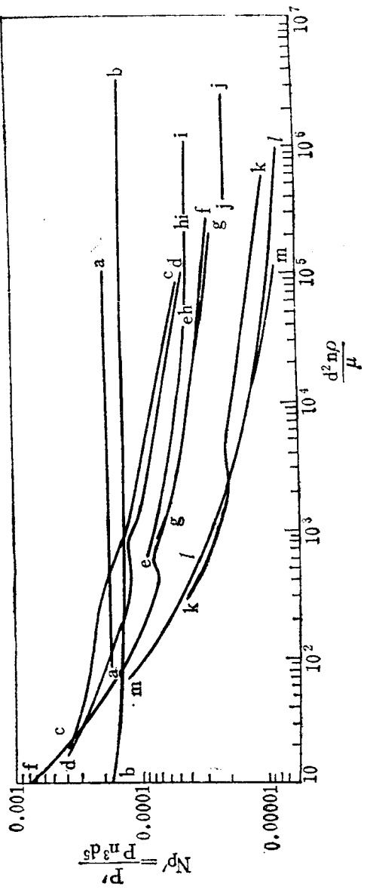

<!-- page: 68 -->

① Miller and Rushton: Ind. Eng. Chem. 38, 499(1944).
② Valentine and Maclean: Chapter XIV in Chem. Engineers Handbook, 2nd Ed.

| 曲线 | 搅拌叶型式 | 挡板 |  | D | H | 参考文献 | 曲线 | 搅拌叶型式 | 挡板 |  | D | H | 参考文献 |
|---|---|---|---|---|---|---|---|---|---|---|---|---|---|
| a-a | 16叶圆盘式 | n_B | B_W | 2.5D | 2.5D | 4 | h-h | 二叶桨式 |  |  | 3d | 3.2d | 18 |
| 4 | d/4 |  |  |  |  |  |  |  |  |  |  |  |  |
| b-b | 径向涡轮附折向环 | 0 |  |  |  | 2 | i-i | 三叶船舶型推进式,螺距=1.33d | 3 | d | 16d |  | 1 |
| c-c | 四叶桨式 | 0 |  | 3d | 3d | 9 | j-j | 三叶船舶型推进式,螺距=1.09d | 3 | 0.6d | 9.6d |  | 1 |
| d-d | 四叶轴向涡轮 | 0 |  | 3d | 3d | 9 | k-k | 三叶船舶型推进式,螺距=d | 0 |  | 3.8d | 3.5d | 38 |
| e-e | 除桨叶角=45°外与d-d同 | 0 |  | 5.2d | 5.2d | 9 | l-l | 二叶桨式 | 0 |  | 1.08d | 0.5d | 42 |
| f-f | 同e-e | 0 |  | 3d | 3d | 9 | m-m | 二叶桨式 | 0 |  | 1.08d | 0.4d | 42 |
| g-g | 同e-e | 0 |  | 2.4d | 2.4d | 9 |  |  |  |  |  |  |  |

<!-- page: 69 -->

**A.平直叶涡轮式**

Rushton推荐尺寸用式（1.63）表示的六叶平直叶涡轮式为标准型 $^{[35,37]}$ ，

$$ \mathrm{d}: l: \mathrm{b} = 2 0: 5: 4\tag{1.63} $$

此处的 d, l, b 见图 1.22(b)。第 1.3.1 节讲过， $(r_{c}/r_{1})$ 之比可由式（1.35）作粗略估计，则

$$ \frac {l _ {\mathrm{c}}}{\mathrm{r} _ {1}} = \left(1 - \frac {\mathrm{r} _ {\mathrm{c}}}{\mathrm{r} _ {1}}\right) = \frac {1 0 ^ {3} + 0 . 6 \mathrm{Re}}{1 0 ^ {3} + 1 . 6 \mathrm{Re}}\tag{1.64} $$

因此，在 $l>l_{c}$ 的雷诺数范围内，涡轮式的功率消耗与桨叶宽度符合式（1.54）的桨式相同。当液体粘度变大至 $l<l_{c}$ ，涡轮式的功率消耗应小于桨式。实验结果与此假设相符。

按式（1.64）， $l_{c}=l$ 处的雷诺数估算如下，

$$ \begin{array}{r l} \frac {l _ {\mathrm{c}}}{\mathrm{r} _ {1}} & = \frac {5}{(2 0 / 2)} = \frac {1 0 ^ {3} + 0 . 6 \mathrm{Re}}{1 0 ^ {3} + 1 . 6 \mathrm{Re}} \\ \mathrm{Re} & = 2. 4 \times 1 0 ^ {3} \end{array} $$

例 1.8 用式（1.50）再计算例 1.5 的涡轮功率，并与根据 Rushton 图算得的结果比较。

解 因液体粘度为60c.P., 涡轮式功率与叶数相等的开式涡轮相等, 而后者又与具有3倍叶宽的桨式搅拌叶相等。所以, 可将 $b = 0.2 \times 3 = 0.6$ 代入式 (1.50) 来计算功率。

因 $\mathrm{Re} = 2\times 10^{4}$ ，而且A/Re项小到可以忽略不计，所以，

$$ \begin{array}{r l} \mathrm{B} ^ {\{1. 3 - 4 (0. 2 - 0. 5) ^ {2} - 1. 1 4 (1 / 3) \}} & = 3. 6 3 \\ \mathrm{P} & = 1. 1 + 4 (0. 2) - 2. 5 (0. 3 3 - 0. 5) ^ {2} = 1. 8 2 8 \end{array} $$

由图1.38， $Re=2\times10^{4}$ 时Z=0.56

$$ \begin{array}{r l} \therefore & \mathrm{Np} = 3. 6 3 (0. 5 6) ^ {1. 8 2 8} = 1. 2 6 \\ & \mathrm{P} = 1. 2 6 \times 1 2 0 0 \times 1 ^ {3} \times 1 ^ {5} / 9. 8 \\ & = 1. 5 4 5 \mathrm{kg} \cdot \mathrm{m} / \mathrm{s} = 2. 0 6 \mathrm{P.S}. \end{array} $$

**B.高粘度液体的门式和多层搅拌叶**

在高粘度液体内的门式搅拌叶轮中，多层搅拌叶轮的功率消耗大致可用全面积相等的桨式来估计，有时锚式亦可如此。例如图

<!-- page: 70 -->

1.30(b)的锚式的功率大致与图1.31的矩形（1234）表示的桨式相等。

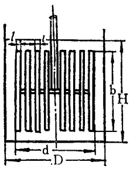

(a)

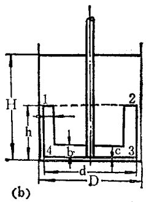

图1.30 桨式变型

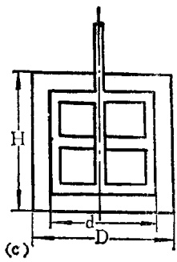

(a) 门式 (b) 锚式 (c) 框式

**c.高粘度液体的螺旋型叶轮**

螺距与叶径相等的双螺带式叶轮对于高粘度液体的混和是有效的 $^{[23]}$ ，见图1.32(a)。b=0.1D，s=D的双螺带式叶轮的功率消耗用同样直径和高度的桨式来估计是不可靠的，如图1.31曲线(4)所示。

如图1.33所示，叶轮与壁的间隙以及螺带的螺距对功率影响甚大，所以对 b=0.1D 的螺带式叶轮推荐下式 $^{[27]}$

$$ \frac {\mathrm{P} \cdot \mathrm{g} _ {\mathrm{c}}}{\rho \mathrm{n} ^ {3} \mathrm{d} ^ {5}} = 7 4. 3 \left(\frac {\mathrm{D} - \mathrm{d}}{\mathrm{d}}\right) ^ {- 0. 5} \left(\frac {\mathrm{n} _ {\mathrm{p}} \mathrm{d}}{\mathrm{s}}\right) ^ {0. 5} \left(\frac {\mathrm{d} ^ {2} \mathrm{n} \rho}{\mu}\right) ^ {- 1}\tag{1.65} $$

对于 $\mathrm{b} = 0.1\mathrm{D}$ 的双螺带式叶轮

$$ \mathrm{n} _ {\mathrm{p}} = 2, \frac {\mathrm{P} \cdot \mathrm{g} _ {\mathrm{c}}}{\rho \mathrm{n} ^ {3} \mathrm{d} ^ {5}} = 7 4. 3 \left(\frac {\mathrm{D} - \mathrm{d}}{\mathrm{d}}\right) ^ {- 0. 5} \left(\frac {\mathrm{d}}{\mathrm{s}}\right) ^ {0. 5} \left(\frac {\mathrm{d} ^ {2} \mathrm{n} \rho}{\mu}\right) ^ {- 1}\tag{1.65'} $$

对于 $d = 0.95\mathrm{D}$ ， $b = 0.1\mathrm{D}$ 的双螺带式叶轮

$$ \frac {\mathrm{P} \cdot \mathrm{g} _ {\mathrm{c}}}{\rho \mathrm{n} ^ {3} \mathrm{d} ^ {5}} = 3 4 0 \left(\frac {\mathrm{s}}{\mathrm{d}}\right) ^ {- 0. 5} \left(\frac {\mathrm{d} ^ {2} \mathrm{n} \rho}{\mu}\right) ^ {- 1}\tag{1.66} $$

再者，如 $s / d = 1$ ，则

<!-- page: 71 -->

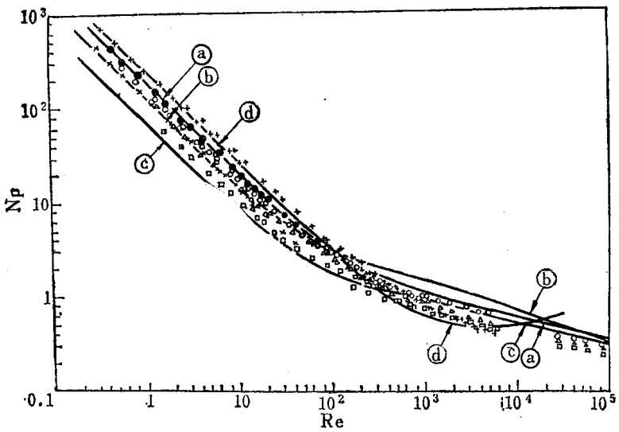

图1.31 锚式和带式叶轮的功率消耗

| 符号 | 搅拌叶 | d/D | b/D | h/D |
|---|---|---|---|---|
| ○ | 锚式 | 0.9 | 0.1 | 0.75 |
| △ | 锚式 | 0.9 | 0.1 | 0.5 |
| □ | 锚式 | 0.9 | 0.1 | 0.25 |
| + | 带式 | 0.95 | 0.1 | 0.95 |
| ● | 桨式 | 0.9 | 0.75 |  |
| × | 桨式 | 0.9 | 0.5 |  |
| a | 计算所得的线 | 0.9 | 0.75 |  |
| b | 计算所得的线 | 0.9 | 0.5 |  |
| c | 计算所得的线 | 0.9 | 0.25 |  |
| d | 计算所得的线 | 0.95 | 0.95 |  |

$$ \frac {\mathrm{P} \cdot \mathrm{g} _ {\mathrm{c}}}{\rho \mathrm{n} ^ {3} \mathrm{d} ^ {5}} = 3 4 0 \left(\frac {\mathrm{d} ^ {2} \mathrm{n} \rho}{\mu}\right) ^ {- 1}\tag{1.66'} $$

由式（1.66）和图1.33(b)可见，螺距较小则功率消耗较大，这是因为受到粘滞阻力作用的搅拌叶面积变得较大之故。

<!-- page: 72 -->

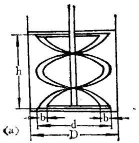

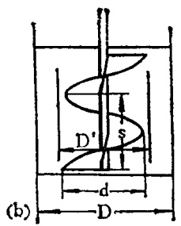

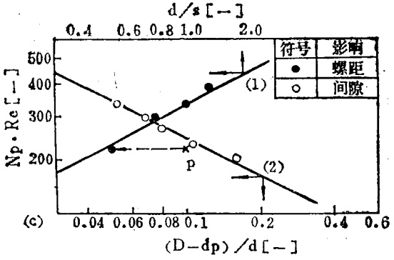

图1.32 螺旋型叶轮的功率消耗

（c）螺带式叶轮的螺距与间隙比的效应

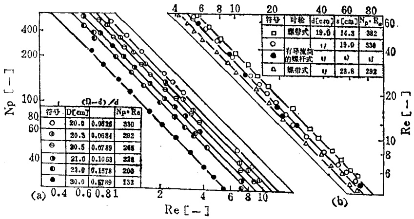

图1.33 螺旋型叶轮的功率消耗

<!-- page: 73 -->

图1.32(b)所示的导流筒的螺杆式对高粘度液体的混合也有效。s=d 的这种类型叶轮的功率消耗可用双螺带叶轮来估计，此螺带式叶轮的(d/D)值应与(d/D')相等。

#### 1.3.10 计算中使用的列线图

到此为止，作者解释了如何关联和如何计算搅拌叶轮的功率消耗。

简言之，综合使用下列各式，可以估算出工作条件下不同类型叶轮的功率消耗，

$$ \mathrm{N} _ {\mathrm{p}} = \frac {\mathrm{A}}{\mathrm{Re}} + \mathrm{B} \left(\frac {1 0 ^ {3} + 1 . 2 \mathrm{Re} ^ {0 . 6 6}}{1 0 ^ {3} + 3 . 2 \mathrm{Re} ^ {0 . 6 6}}\right) \left(\frac {\mathrm{H}}{\mathrm{D}}\right) ^ {(0. 3 5 + \mathrm{b/D})} (\sin \theta) ^ {1. 2}\tag{1.53} $$

此处，

$$ \mathrm{N} _ {\mathrm{p}} = \frac {\mathrm{P} \cdot \mathrm{g} _ {\mathrm{c}}}{\rho \mathrm{n} ^ {3} \mathrm{d} ^ {5}} \quad \text {和} \quad \mathrm{Re} = \frac {\mathrm{d} ^ {2} \mathrm{n} \rho}{\mu} $$

$$ \mathrm{A} = 1 4 + (\mathrm{b/D}) \left\{6 7 0 (\mathrm{d/D-0.6}) ^ {2} + 1 8 5 \right\}\tag{1.44} $$

$$ \mathrm{B} = 1 0 ^ {\{1. 3 - 4 (\mathrm{b} / \mathrm{D} - 0. 5) ^ {2} - 1. 1 4 (\mathrm{d} / \mathrm{D}) \}}\tag{1.45} $$

$$ P = 1. 1 + 4 (b / D) - 2. 5 (d / D - 0. 5) ^ {2} - 7 (d / D) ^ {4}\tag{1.47} $$

$$ \mathrm{R} _ {\mathrm{c}} = \frac {2 5}{(\mathrm{b/D})} \left(\frac {\mathrm{d}}{\mathrm{D}} - 0. 4\right) ^ {2} + \left\{\frac {\mathrm{b/D}}{0 . 1 1 (\mathrm{b/D}) - 0 . 0 0 4 8} \right\}\tag{1.57} $$

$$ \mathrm{R} _ {\theta} = 1 0 ^ {4 (1 - \sin \theta)} \mathrm{R} _ {\mathrm{c}}\tag{1.59} $$

用列线图1.34～1.39来计算以上各系数。通过以上各例可以理解怎样来使用它们。

<!-- page: 74 -->

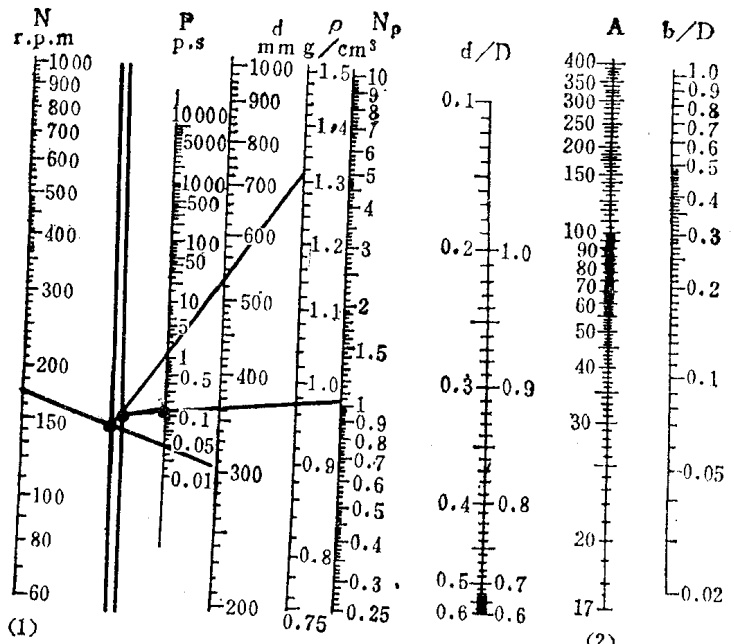

图1.36 计算B的列线图（3）

<!-- page: 75 -->

图1.38 计算 Z 的列线图（5）

### 1.4 非均相液体中的叶轮功率消耗

作者已经讨论了叶轮在均相液体中的功率消耗。至于非均相液体中的功率，诸如在通气中的液体，不互溶的液-液分散液，以及固体悬浮液，已发表的文章甚少。

#### 1.4.1 在通气情况下涡轮式叶轮的功率消耗

气-液搅拌在吸收，化学反应和发酵中是经常使用的。Copper $^{[45]}$ 作了功率消耗和气体吸收系数的关联，Rushton $^{[34]}$ 作了持气量、Calderbank $^{[1]}$ 作了界面接触面积的关联。Oyama 和Endo $^{[33]}$ ，Yamamoto 和Kawahigashi $^{[44]}$ 、Friedman 和Lightfoot $^{[6]}$ 以及Miches 和Millar $^{[16]}$ 都曾发表文章，述及功率消耗为操作条件、容器大小和液体性质的函数，但只能在有限的范围中使用。

<!-- page: 76 -->

图1.39 计算 \mathbf{R}_{\mathrm{e}} 的列线图（6）

如图1.40所示，随着空气流率增加，通气的叶轮功率消耗 $P_{g}$ (kg·m/s)就降低。图中以功率比 $(P_{g}/P_{0})$ 对应通气数 $N_{A}(=q/nd^{3})$ 标绘，其中 $P_{0}$ 是不通气的功率而q为气体流率 $(cm^{3}/s)$ 。叶轮形式不同，曲线的形状亦异，但在大的气体流率下，通气的功率 $P_{g}$ 就减少到不通气功率的30~50%。

作者对不同尺寸的六叶 Rushton 型涡轮（d = D/4、D/3、D/2 和 (3/4) D、b = d/5，l = d/4）作了在广泛范围的空气流率中应用的功率消耗的关联。

试验装置和所使用的符号示于图1.41。容器的直径D=0.15、0.30和0.585m， $B_{w}=0.1D$ 的四块档板径向均布于器壁，空气主要由环形分布器加入；在少数实验中，空气由容器中央的单一喷管加入。

<!-- page: 77 -->

可在单对数纸上把实验结果标绘上去。图1.42就是一例。

全部试验数据已由下式关联:

$$ \log \frac {\mathrm{P} _ {\mathrm{g}}}{\mathrm{P} _ {0}} = - 1 9 2 \left(\frac {\mathrm{d}}{\mathrm{D}}\right) ^ {4. 3 8} \left(\frac {\mathrm{d} ^ {2} \mathrm{n}}{\nu}\right) ^ {0. 1 1 5} \left(\frac {\mathrm{dn} ^ {2}}{\mathrm{g}}\right) ^ {1. 9 6 (\mathrm{d} / \mathrm{D})} \left(\frac {\mathrm{q}}{\mathrm{nd} _ {3}}\right)\tag{1.67} $$

此处 $P_{g}$ 与 $P_{0}$ 依次为通气和不通气的功率消耗 $kg\cdot m/s$ 而q为气体流率 $(m^{3}/s)$ 。

图1.40 通气搅拌叶轮的功率特性

a.平直叶开式涡轮式 $(n_{p}=8)$

b.盘下直叶涡轮式 $(n_{p}=8)$

c. 盘下直叶涡轮式 ( $n_{p}=16$ )

d.桨式 $(n_{p}=2)$

由式（1.67）可见，通气功率消耗为通气数 $\left(\mathrm{q}/\mathrm{nd}^{3}\right)$ 、弗鲁德数 $\left(\mathrm{dn}^{2}/\mathrm{g}\right)$ 和雷诺数 $\left(\mathrm{d}^{2}\mathrm{n}/\nu\right)$ 的函数。

气体由中央喷管加入时的 $P_{g}/P_{0}$ 的减少较由环状分布器加入气体时的 $P_{g}/P_{0}$ 值低得多。

例1.9 如图1.41所示，使用的是标准涡轮式叶轮，它的直径为20cm，以180r·p·m在直径为60cm的容器中旋转，容器中充水至液高和直径相等。通气速率为120 l/m。试求通气条件下的功率消耗。

解 把D=0.60m, d/D=1/3, n=3转/秒, q=0.120/60=0.002m³/s代入式 (1.67)

<!-- page: 78 -->

图 1.42 功率消耗和气体流率的关系  
(d/D=1/2, D=0.585m, μ=0.904c.P.)

$$ l = 5 / 2 0 \mathrm{d}, \quad s = \frac {Q}{2} $$

$$ \begin{array}{r l} \log \frac {\mathrm{P} _ {\mathrm{g}}}{\mathrm{P} _ {0}} & = - 1 9 2 \left(\frac {1}{3}\right) ^ {4. 3 8} \left(\frac {0 . 2 ^ {2} \times 3}{1 0 ^ {- 6}}\right) ^ {0. 1 1 5} \left(\frac {0 . 2 \times 3 ^ {2}}{9 . 8}\right) ^ {1. 9 6 (1 / 3)} \\ & \left(\frac {0 . 0 0 2}{3 \times 0 . 2 ^ {3}}\right) \\ & = - 1 9 6 \left(\frac {1}{1 2 4} (1. 2 \times 1 0 ^ {5}) ^ {0. 1 1 5} (0. 8 1 3 5) ^ {0. 6 5 3} (0. 0 8 3 2)\right) \\ & = 0. 1 6 5 \end{array} $$

<!-- page: 79 -->

$$ \therefore \quad \frac {\mathrm{P} _ {\mathrm{g}}}{\mathrm{P} _ {0}} = 0. 6 8 3 9. $$

$P_{0}$ 用图1.28(Rushton图)的曲线6算得

$$ \mathrm{N} _ {\mathrm{p}} = 6. 2, \quad \mathrm{P} _ {0} = 6. 2 \times 1 0 0 0 \times 3 ^ {3} \times 0. 2 ^ {5} / 9. 8 = 5. 4 5 [ \mathrm{kg} \cdot \mathrm{m} / \mathrm{s} ] $$

$$ \therefore \quad \mathrm{P} _ {\mathrm{g}} = 0. 6 8 3 9 \times 5. 4 5 = 3. 7 3 [ \mathrm{kg} \cdot \mathrm{m} / \mathrm{s} ] $$

#### 1.4.2 固体悬浮液中叶轮的功率消耗

在固体悬浮液中旋转的叶轮功率消耗可按悬浮液的性质区分为两类。

1）固体颗粒的尺寸和密度均大，停止搅拌后颗粒迅速沉降。在此情况下，流体呈湍流状态。此类称之为“沉降浆”。

2）固体颗粒的尺寸和密度均小且悬浮液充盈整个器内，因而颗粒沉降不快。在此情况下，流体呈层流状态。此类称之为“非沉降浆”。本节先讨论第（1）类，而在第1.5节再讨论第（2）类。

当粗糙颗粒悬浮液被搅拌时，液体处于湍流状态，功率可用叶轮周围的平均液体密度 $\rho^{*}$ 来估计。但是，因为 $\rho^{*}$ 难以测量，所以用测量功率的方法来估计 $\rho^{*}$ 还是较合理的。现在来考虑下列三种条件下，标准六叶涡轮（d=0.5D）在泥浆中的功率消耗。

1）壁上有标准挡板（见图1.43(a)）。

2）底部有小挡板（见图1.43(b)）。

3）无挡板。

A.壁上有标准挡板。

在水中悬浮海砂（20～28网目、32～42网目）、铝粉（150～250网目）、闪光粉（Illumenite）（60～100网目）和黄铁矿（250～325网目），使泥浆的平均密度范围为 $\rho=1.00\sim1.52$ ，观测取得湍流状态下的功率消耗 $P_{s}$ 。式（1.68）表示功率 $P_{s}$ 按叶轮速度 n 的三次方而增加，并假定固体在湍动状态下均匀悬浮，故还与 $\bar{\rho}$ 成正比。

$$ P _ {s} \cdot g _ {c} = K \bar {\rho} n ^ {3} d ^ {5}\tag{1.68} $$

涡轮在水中搅拌的功率和水的密度分别为 $\mathrm{P_w}$ 和 $\rho_{\mathrm{w}}$ ，则

<!-- page: 80 -->

$$ \frac {P _ {\mathrm{s}}}{P _ {\mathrm{w}}} = \frac {\bar {\rho}}{\rho_ {\mathrm{w}}} \quad \text {或} \quad \frac {P _ {\mathrm{s}}}{P _ {\mathrm{w}}} - 1 = \left(\frac {\bar {\rho}}{\rho_ {\mathrm{w}}} - 1\right)\tag{1.69} $$

图1.44中的曲线（1）表示了式（1.69）的关系。

图1.43 挡板容器

（a）有挡板的圆筒容器

$$ \mathrm{d} = \mathrm{D} / 2, \quad \mathrm{b} = \mathrm{D} / 1 0, \quad \theta = 4 5 ^ {\circ}, \quad \mathrm{n} _ {p} = 4, $$

$$ \mathrm{B} _ {\mathrm{w}} = \mathrm{D} / 1 0, \mathrm{n} _ {\mathrm{p}} = 4, \mathrm{C} = \mathrm{D} / 1 0 $$

（b）有底部挡板的圆筒容器

$$ \mathrm{d} = \mathrm{D} / 2, \mathrm{b} = \mathrm{D} / 1 0, \mathrm{n} _ {\mathrm{p}} = 4, \mathrm{B} _ {\mathrm{H}} = 0. 0 5 \mathrm{D} $$

$$ \mathrm{B} _ {\mathrm{W}} = 0. 1 \mathrm{D}, \mathrm{n} _ {\mathrm{B}} = 4, \mathrm{C} = \mathrm{D} / 4, \varepsilon_ {\mathrm{B}} = \mathrm{d} / 2 $$

固体颗粒的体积分率为 $\phi$ 且固体颗粒的密度为 $\rho_{s}$ 时，平均密度由下式给出

$$ \bar {\rho} = \phi \rho_ {\mathrm{s}} + (1 - \phi) \rho_ {\mathrm{w}}\tag{1.70} $$

**B.底部有小挡板**

如要用尽量低的转速使固体颗粒悬浮，可以推荐在容器底装上小挡板，如图1.43(b)所示。

这种型式称为“底部挡板”，其尺寸如下

$$ \left| \begin{array}{l} \mathrm{B} _ {\mathrm{w}} = 0. 1 \mathrm{D} \\ \mathrm{B} _ {\mathrm{H}} = 0. 0 5 \mathrm{D} \\ \mathrm{n} _ {\mathrm{B}} = 4 \end{array} \right\}\tag{1.71} $$

叶轮高度保持在离底1/4容器直径处。

<!-- page: 81 -->

如容器中具有式（1.71）所示的底部挡板，则其中涡轮式的功率消耗如图1.44中曲线（2）～（6）所示，因为悬浮状态随悬浮的颗粒大小和密度的不同而变化，曲线的斜率（k）亦随之变化，且k总比1大。这些曲线可由式（1.72）表达

$$ \frac {\rho_ {s}}{P _ {w}} - 1 = k \left(\frac {\bar {\rho}}{\rho_ {w}} - 1\right)\tag{1.72} $$

用标准挡板，k等于1.0。由曲线（2）、（4）、（6）和（3）、（5）可知，当 $\rho_{s}$ 和 $d_{p}$ 变得较大时，k值亦变得较大。

如前所述，设叶轮周围的平均密度为 $\rho^{*}$ 。

图1.44 P_{\mathrm{S}} / P_{\mathrm{w}} 与 \rho /\rho_{\mathrm{w}} 的比较

<!-- page: 82 -->

$$ \frac {\mathrm{P} _ {\mathrm{s}}}{\mathrm{P} _ {\mathrm{w}}} = \frac {\rho^ {*}}{\rho_ {\mathrm{w}}}\tag{1.69'} $$

故由式（1.72）和（1.69′）可估计 $\rho^{*}$ 如下:

$$ \rho^ {*} = \mathrm{K} (\rho - \rho_ {\mathrm{w}}) + \rho_ {\mathrm{w}}\tag{1.73} $$

**C.无挡板**

现在来研究固体悬浮液在无挡板容器中搅拌的情况。在增加叶轮速度的同时，它顶端下部周围的固体颗粒开始浮游并向中央及四周扩散。因此叶轮周围的固体浓度随颗粒大小、固体密度以及装料重量的不同而不同，如图1.45所示，随着搅拌转速N增加就使P的变化复杂化。

在较低的叶轮速度（1、2、3、4）范围，斜率 $P_{1}$ 大于3.0，但当转速大于浮游速度 $N_{f}$ 时，即在（4、5、6）的范围，斜率 $p_{2}$ 小于3.0。最后，当转速大于发生吸入空气的 $N_{a}$ 时，斜率 $p_{3}$ 为3.0。此现象可说明如下:如搅拌转速N增加叶轮周围的液体密度 $\rho^{*}$ 不变，则功率消耗 $P_{s}$ 必定与搅拌转速的三次方成比例增加。在 $N<N_{f}$ 范围内，固体浮游量随N的增加而增加，故 $P_{s}$ 可能增加得比N的三次方大，即搅拌转速为 $N_{1}<N_{2}<N_{3}<N_{4}$ ，而叶轮周围的密度应力 $\rho_{1}^{*}<\rho_{2}^{*}<\rho_{3}^{*}<\rho_{4}^{*}$ 。当搅拌速度大于 $N_{f}$ 时，固体颗粒向叶轮的上部扩散，在叶轮周围的密度变小，如 $\rho_{5}^{*}$ 和 $\rho_{6}^{*}$ 所示，这样，斜率就变得小于3.0。最后，搅拌转速大于 $N_{a}$ 时，叶轮周围的密度达到一个固定值，此时再增加搅拌转速此密度亦保持不变。在以上这种情况下不易取得普遍性的关联。

#### 1.4.3 液-液乳化液中叶轮的功率消耗

迄今未见报导液-液乳化液中叶轮的功率消耗。可以设想，用式（1.68）和式（1.70）来计算功率消耗较好。在液-液分散液内，式（1.70）中的P$_{s}$自然应该用分散相的密度（ρ$_{0}$）来替代，至于平均粘度μ$_{m}$则Laity和Treyball$^{[10]}$建议当系统中水的体积大于40%时用

$$ \mu_ {\mathrm{m}} = \frac {\mu_ {\mathrm{w}}}{\mathrm{x} _ {\mathrm{w}}} \left[ 1 + \frac {6 . 0 \mathrm{x} _ {0} \mu_ {0}}{\mu_ {\mathrm{w}} + \mu_ {0}} \right]\tag{1.74} $$

而当系统中水的体积小于 $40\%$ 时，用

<!-- page: 83 -->

$$ \mu_ {\mathrm{m}} = \frac {\mu_ {0}}{\mathrm{x} _ {0}} \left[ 1 - \frac {1 . 5 \mathrm{x} _ {\mathrm{w}} \mu_ {\mathrm{w}}}{\mu_ {\mathrm{w}} + \mu_ {0}} \right]\tag{1.74'} $$

上式中，下标0和w依次为有机物相和水相，x为体积分率。

图1.45 固体悬浮液的无挡板容器内功率消耗

### 1.5 高粘度宾厄姆塑性液体中叶轮的功率消耗

对非牛顿型液体中混和叶轮的功率消耗的估计还没有较好的开展。虽然对涡轮式和锚式已发表过少量文章 $^{[3,5,14]}$ ，但是在粘滞液体的混合中带式叶轮较为重要 $^{[23]}$ 。

在宾厄姆塑性液体中，从功率数对雷诺数的关联曲线可见，如使用涡轮式和桨式，在层流区和湍流区之间有明显的转折，并且有周期性的涡流产生和消失。这种现象是和叶轮的功率消耗紧密相关的。因此，在非牛顿型液

中，功率测量有助于理解液体流动的情况。

#### 1.5.1 宾厄姆塑性液体功率关联式的推导

对于牛顿型液体，叶轮功率消耗可由式（1.40）得出

$$ \frac {\mathrm{P} \cdot \mathrm{g} _ {\mathrm{c}}}{\rho \mathrm{n} ^ {3} \mathrm{d} ^ {5}} = \beta_ {\mathrm{N}} \bigg (\frac {\mathrm{d} ^ {2} \mathrm{n} \rho}{\mu} \bigg) ^ {- 1} \quad \text {或} \quad \mathrm{N} _ {\mathrm{P}} = \beta_ {\mathrm{N}} \mathrm{Re} ^ {- 1}\tag{1.75} $$

作用于叶轮轴的转矩由下式得出，

$$ \mathrm{T} \cdot \mathrm{g}_{\mathrm{c}} = \beta_{\mathrm{Nn}}\mu \mathrm{d}^{3} / 2\pi\tag{1.76} $$

记 $\dot{Y}_{平均}$ 为混合容器内的平均剪切率，则在层流区得下式，

$$ \mathrm{T} \cdot \mathrm{g} _ {\mathrm{c}} = \mathrm{k} \mu \dot {\gamma} _ {\mathrm{平均}} \mathrm{d} ^ {3}\tag{1.77} $$

由式（1.76）和（1.77）得

<!-- page: 84 -->

$$ \beta_ {\mathrm{N}} = 2 \pi \mathrm{k} \left(\dot {\gamma} _ {\text {平均}} / \mathrm{n}\right) = \alpha \left(\dot {\gamma} _ {\text {平均}} / \mathrm{n}\right)\tag{1.78} $$

A. B. Metzner 提出，混合容器内拟塑性液体的平均剪切率大致与搅拌转速成正比

$$ \dot {\gamma} _ {\mathrm{平均}} = \mathrm{Kn}\tag{1.79} $$

为了简化，假设式（1.79）可用于宾厄姆塑性液和牛顿型液体。

通常，高浓度的细固体颗粒泥浆具有宾厄姆塑性。图1.46为宾厄姆塑性液的流动图。图中说明，有屈服剪应力 $\tau_{y}$ 存在，即在应力 $\tau_{y}$ 之下，液体不会流动，如此即有以下关系，

$$ \tau - \tau_ {\mathrm{y}} = \eta \dot {\gamma}\tag{1.80} $$

此处?为液体中的剪切率或剪应变，而η为塑性粘度。

图1.46 宾厄姆塑性泥浆的流动图

下式规定非牛顿液体的表观粘度为，

$$ \mu_ {a} = \tau / \dot {\gamma}\tag{1.81} $$

在混合容器中，式（1.80）和(1.81)的 $\dot{\gamma}$ 必须换用 $\dot{\gamma}_{平均}$ 。

用表观粘度 $\mu_{a}$ 时，层流区的叶轮功率消耗由式（1.82）表示，式（1.82）和（1.75）相似，

<!-- page: 85 -->

$$ \frac {\mathrm{P} \cdot \mathrm{g} _ {c}}{\rho \mathrm{n} ^ {3} \mathrm{d} ^ {1 5}} = \beta \left(- \frac {\mathrm{d} ^ {2} \mathrm{n} \rho}{\mu_ {s}}\right) ^ {- 1} \quad \text {或} \quad \mathrm{N} _ {\mathrm{P}} = \beta \mathrm{Re} ^ {\prime - 1}\tag{1,82} $$

此处 $Re'$ 为使用表观粘度 $\mu_{a}$ 而得的雷诺数。

设混合容器中的平均剪切率 $\dot{\gamma}_{平均}$ 由式（1.80）给出，表观粘度由式（1.81）定义，则得下式

$$ \begin{array}{r l} & {\frac {\mathrm{P} \cdot \mathrm{g} _ {\mathrm{c}}}{\rho \mathrm{n} ^ {3} \mathrm{d} ^ {5}} = \beta \left(\frac {\eta + \tau_ {\mathbf {y}} / \dot {\gamma} _ {\text {平均}}}{\mathrm{d} ^ {2} \mathrm{n} \rho}\right)} \\ & {= \beta \left\{\frac {\eta}{\mathrm{d} ^ {2} \mathrm{n} \rho} + \left(\frac {\mathrm{n}}{\dot {\gamma} _ {\text {平均}}}\right) \left(\frac {\tau_ {\mathbf {y}}}{\mathrm{d} ^ {2} \mathrm{n} ^ {2} \rho}\right) \right\}} \end{array}\tag{1.83} $$

因 $\mu_{a}$ 等于 $\eta+\tau_{y}/\dot{\gamma}_{平均}$ ，且当 $\dot{\gamma}_{平均}$ 很大时， $\mu_{a}$ 趋向于定值 $\eta$ 。令

$$ \frac {\mathrm{d} ^ {2} \mathbf {n} \rho}{\eta} = \mathrm{Re} ^ {\prime \prime}\tag{1.84} $$

$$ \tau_ {\mathrm{y}} / \mathrm{d} ^ {2} \mathrm{n} ^ {2} \rho = \mathrm{N},\tag{1.85} $$

Re"为使用塑性粘度所得的雷诺数， $N_{y}$ 为对应于克服屈服应力的“屈服应力功率数”。

将式（1.78）代入式（1.83）并假设 $-\beta \cong \beta_{\mathrm{N}}$ 作为近似，得

$$ \mathrm{N}_{p} = \beta (\mathrm{Re}^{\prime \prime})^{-1} + \alpha \mathrm{N}_{y}\tag{1.86} $$

$$ \mathrm{N}_{\mathrm{p}} = \beta (\mathrm{Re}^{\prime \prime})^{-1} + \alpha \mathrm{He}(\mathrm{Re}^{\prime \prime})^{-2}\tag{1.86'} $$

$$ \alpha = \alpha \pi \mathrm{k} = \beta_ {\mathrm{N}} (\mathrm{n} / \dot {\gamma} _ {\text {平均}}) \cong \beta (\mathrm{n} / \dot {\gamma} _ {\text {平均}}) \cong \text {常数}\tag{1.86''} $$

此处He为由式（1.87）所定义的无因次Hedströn数，用以测量非牛顿型性质

$$ \mathrm{He} = \tau_ {\mathrm{y}} \rho \mathrm{d} ^ {2} / \eta^ {2} = \mathrm{N} _ {\mathrm{y}} (\mathrm{Re} ^ {\prime \prime}) ^ {2}\tag{1.87} $$

再来用实验数据来决定系数 $\alpha$ 和 $\beta$ 。

把$\mathrm{CaCO_{3}}$、$\mathrm{MgCO_{3}}$、高岭土和$\mathrm{TiO_{2}}$分散于城市用水、甘油水溶液、机油和色拉油中。改变分散物质的量，Hedström数的变化范围从0（牛顿型液体）至$10^{9}$。

#### 1.5.2 螺带式搅拌器的功率关联

图1.49表示一个双层螺带式搅拌器（d/D=0.95，b/D=0.1，h'/D=0.95参见图1.32（a））功率数对雷诺数的关系。如上

<!-- page: 86 -->

所述，可设想式（1.86）在层流区是可靠的。所以 $\mathrm{Np} \cdot \mathrm{Re}''$ 对 $\mathrm{Ny} \cdot \mathrm{Re}''$ 标绘应为直线关系。此线的斜率为 $\alpha$，截距为 $\beta$。图1.48为 $\alpha$ 和 $\beta$ 的估计值对应He的标绘。由此图可见，和假设一样，$\alpha$ 为常数而 $\beta$ 为He的函数如下

$$ \beta - \beta_ {\mathrm{N}} = \mathrm{KHe} ^ {\mathrm{b}}\tag{1.88} $$

图1.47 螺带式搅拌器的“Np-Re”关系

He=0的情况相当于牛顿型液体，此时 $\beta$ 等于 $\beta_{N}$ 。不同叶轮所得的 $\alpha$ 和 $\beta$ 值列于表1.8。

如第 1.4.2 节所述，式（1.68）表示固体悬浮液中的叶轮功率消耗，如以 I 记为充满固体悬浮浆的功率数，即

$$ \mathbf {p} _ {\mathrm{s}} \cdot \mathbf {g} _ {\mathrm{c}} / \rho \mathrm{n} ^ {3} \mathbf {d} ^ {5} = \mathrm{I}\tag{1.89} $$

<!-- page: 87 -->

图1.48 \beta_{\mathrm{N}} 和 \alpha 对He数的关联

表 1.8 式（1.92）中的已定系数

|  | \alpha | \beta_{N} | I | K | h |
|---|---|---|---|---|---|
| 螺带式 | 6.13 | 320 | 0.2 | 15 | 1/3 |
| 锚式 | 4.80 | 200 | 0.29 | 30 | 1/3 |
| 六叶涡轮式 | 3.44 | 70 | — | 10 | 1/3 |
| 六叶涡轮式加档板 | 3.44 | 70 | 5.5 | 10 | 1/3 |

表1.8第4栏列出了I的值

用式（1.86）和（1.89）的交点估算过渡区的功率数，换言之，泥浆中叶轮功率消耗为破坏内部结构的功率 $(P_{y})$ 、克服粘滞阻力的功率 $(P_{v})$ 和克服惯性阻力的功率 $(P_{1})$ 之和，

$$ \mathrm{P} = \mathrm{P_y} + \mathrm{P_v} + \mathrm{P}\tag{1,90} $$

或以无因次形式表示，则有

<!-- page: 88 -->

$$ \mathrm{Np} = \alpha \mathrm{N} _ {\mathrm{y}} + \beta \mathrm{Re} ^ {\prime \prime - 1} + \mathrm{I}\tag{1.91} $$

因此，宾厄姆塑性液的功率方程式可表示如下，

$$ \mathrm{Np} = \alpha \mathrm{N}_{\mathbf{y}} + (\beta_{\mathrm{N}} + \mathrm{kH}^{\mathrm{h}})\mathrm{Re}^{\prime \prime -1} + \mathrm{I}\tag{1.92} $$

式（1.90）、（1.91）和（1.92）中的某一项在特定的区域内可以不计。

使用表1.8的值，并由式（1.92）所算出的功率数，即为图1.47中的实线，它与实验所得的值很一致。

在层流区，作用于搅拌轴的阻力主要为屈服应力，部分则为粘滞剪应力。各曲线斜率的绝对值为1.75，但随着Hedström数的降低而变小，直到最后达到牛顿型液体的1.0。

对于螺带式搅拌器，作者推荐式（1.65），其叶端和器壁的间隙对高粘度液体的功率消耗影响很大。不过，在宾厄姆塑性液体中，除非分散相的粘度很大，此间隙对功率的影响甚小。这就是说，式（1.65）中的修正项（D-d)/d可以取为1.0或者把用于牛顿型和拟塑性的指数-0.5改为零。此可解释如下:在宾厄姆塑性液中，虽然表观粘度 $\mu_{a}$ 可能是大的，但当介质为水时，因为介质本身的粘度小，就使叶轮传来的动量被固体颗粒吸收且在器壁和叶轮之间产生滑动的缘故。

例1.10 图1.32(a) 所示的双螺带式叶轮 (d=0.95D, b=0.1D, h=s=d) 在水中含有 $MgCO_{3}$ (8%体积比) 的泥浆中旋转，容器直径D=30cm。

图1.46中曲线（1）为此类泥浆的流动图。

$$ \rho = 1. 0 8 \mathrm{g} / \mathrm{cm} ^ {3}, \eta = 0. 0 3 7 3 \mathrm{p}, \tau_ {\mathrm{y}} = 6 2. 2 \mathrm{dyme} / \mathrm{cm} \cdot \mathrm{s} ^ {2}, $$

$$ \mathrm{He} = \tau_ {y} \rho \mathrm{d} ^ {2} / \eta^ {2} = 3. 9 2 5 \times 1 0 ^ {7} $$

计算各种叶轮速度的功率，并表明哪项起着主要作用。

解 由式（1.92）计算功率数

$$ \mathrm{Np} = \alpha \mathrm{He} (\mathrm{Re} ^ {\prime \prime}) ^ {- 2} + \left(\beta_ {\mathrm{N}} + \mathrm{KHe} ^ {\mathrm{h}}\right) (\mathrm{Re} ^ {\prime \prime}) ^ {- 1} + 1\tag{1.92'} $$

由表1.8，得 $\alpha = 6.13$ ， $\beta_{\mathrm{N}} = 320$ 、K=15、h=1/3和I=0.20

$$ \mathrm{Re} ^ {\prime \prime} = \mathrm{d} ^ {2} \mathrm{n} \rho / \eta = (2 8. 5 ^ {2} \times 1. 0 8 / 0. 0 3 7 3) \mathrm{n} = (2 3. 5 2 0) \mathrm{n} $$

即得下表各值。

<!-- page: 89 -->

| N_{r.p.m.} | n_{r.p.m.} | Re^{n} | \alpha He/(Re^{n})^{2} | (\beta_{N}+KHe^{h})/Re^{n} | I | Np_{计算} | Np_{观测} 1 |
|---|---|---|---|---|---|---|---|
| 4.58 | 0.0763 | 1.79\times 10^{3} | 74.8 | 3.02 | 0.20 | 78.0 | 75.7 |
| 10.3 | 0.172 | 4.04\times 10^{3} | 14.8 | 1.34 | 0.20 | 16.3 | 16.0 |
| 14.4 | 0.240 | 5.64\times 10^{3} | 7.57 | 0.96 | 0.20 | 8.73 | 8.39 |
| 28.4 | 0.473 | 1.13\times 10^{4} | 1.88 | 0.479 | 0.20 | 2.56 | 2.43 |
| 62.0 | 1.03 | 2.43\times 10^{4} | 0.408 | 0.223 | 0.20 | 0.831 | 0.76 |
| 109 | 1.82 | 4.27\times 10^{4} | 0.132 | 0.127 | 0.20 | 0.459 | 0.39 |
| 133 | 2.22 | 5.21\times 10^{4} | 0.0886 | 0.104 | 0.20 | 0.393 | 0.34 |

① \mathrm{Np}_{\text{观测标绘在图}1.47} 中（曲线 a_6b_6c_6 ）

由上表可见，在较低的搅拌转速时与屈服有关的项起主要作用，N=28r.p.m.时，粘度项作用也显著了；最后惯性项的作用变成与粘度项类似而屈服项是可忽略的。

例1.11 双螺带式叶轮（d=0.95D，b=0.1D，h=s=d），在含有 $MgCO_{3}$ 色拉油（40.4%体积比）的泥浆中旋转，容器直径D=20cm。图1.46曲线（2）为此浆的流动图。

$$ \rho = 1. 3 1 0 \mathrm{g/cm} ^ {3}, \eta = 1. 7 5 4 \mathrm{g/cm} \cdot \mathrm{s}, \tau_ {\mathrm{y}} = 1 2 0. 8 \mathrm{g/cm} \cdot \mathrm{s} ^ {2}, $$

$$ \mathrm{He} = 1 8 5 8 4 $$

计算随叶轮速度而变化的功率数

解 由式（1.92），有

$$ \mathrm{Np} = \frac {1 1 . 3 9 \times 1 0 ^ {4}}{\left(\mathrm{Re} ^ {\prime \prime}\right) ^ {2}} + \frac {7 1 7}{\mathrm{Re} ^ {\prime \prime}} + 0. 2\tag{1.92"} $$

| N | Re'' | 11.39\times 10^{4}/(Re'')^{2} | 717/Re'' | I | Np_{计算} | Np_{观测}^{1} |
|---|---|---|---|---|---|---|
| 5.17 | 23.2 | 211.6 | 30.9 | 0.2 | 243 | 235 |
| 8.63 | 38.8 | 75.5 | 18.5 | 0.2 | 94.4 | 96.2 |
| 19.36 | 86.9 | 15.1 | 8.25 | 0.2 | 23.6 | 25.3 |
| 36.0 | 162 | 4.34 | 4.43 | 0.2 | 8.97 | 9.62 |
| 80.0 | 359 | 0.884 | 2.00 | 0.2 | 3.08 | 3.31 |
| 167 | 751 | 0.202 | 0.955 | 0.2 | 1.36 | 1.48 |
| 238 | 1069 | 0.100 | 0.671 | 0.2 | 0.971 | 1.09 |

① $\mathrm{Np}$ 观测标绘在图1.47中（曲线 $\mathrm{a}_3\mathrm{b}_3\mathrm{c}_3$）。与例1.10比较，可注意到当泥浆内的介质较为粘滞时，粘度项起主要作用的区域亦较宽。

<!-- page: 90 -->

#### 1.5.3 涡轮式的功率消耗

图1.49表示无挡板条件下Rushton型六叶涡轮式(d=0.5D)的Np-Re"关联。图中的曲线是由表1.8所列的值代入式(1.92)计算后绘出的。这些曲线与实验值很符合。

当雷诺数增加到离开层流域的曲线，最后趋近到牛顿型的关联曲线 $(a_{1}b_{1}c_{1}c_{2}f_{1})$ 时，每一关联曲线都经过最小的 $c_{i}(Np_{\text{最小}})$ 和最大的 $d_{i}(Np_{\text{最大}})$ 。

挡板条件下的关联曲线示于图1.50。在达到 $Np_{最大}$ 的各点以前，各关联曲线与无挡板条件的曲线重合。在此以后，关联曲线即趋近挡板条件下牛顿型的 $\mathrm{Np(b_{1}e_{1}d_{1}e_{1})}$ 。

图1.40 六叶涡轮的 \mathrm{Np - Re''} 关联

在图1.49中，达到 $Np_{最大}$ 点后，在无挡板条件下如稍增加一点叶轮速度，液体表面即产生微小皱纹波。同时可见涡流的周期性产生和消失。随着叶轮速度的增加，这个时间的周期就变得越来越

<!-- page: 91 -->

短。以后就发生涡流由越来越大到越来越小的转折。在看不到涡流的周期中，液面表面是静止的。这些现象解释如下:

在得到 $Np_{最小}$ 的叶轮速度附近，叶轮开始产生输出流，并且克服屈服应力而使流动区域扩展至周围液体。结果，搅拌轴上的抗阻转矩增加同时功率消耗也增加。液体表面的皱纹表示流动到达液面。达到 $Np_{最大的}$ 搅拌速度时，输出流到达器壁，在整个混合容器中剪应力大于屈服应力。如此即生成涡流。在搅拌速度大于对应于 $Re^{\prime\prime}_{最大}$ 的速度时，容器中全部液体都在流动，并且，增加搅拌速度就减小表观粘度，即相当于减小功率消耗。在激烈流动情况下，叶轮周围液体的表观粘度是低的，而自叶轮传递给液体的能量也变小。结果，混合容器中离搅拌叶远处的剪应力就低于屈服应力而涡流消失。流入搅拌叶所在处的液体中能量减小且其周围的表观粘度

图 1.50 六叶涡轮在全挡板条件下的Np-Re"关联

<!-- page: 92 -->

增加。于是作用于叶轮的转矩增加，结果虽然搅拌速度保持不变，搅拌叶传递的能量也变大。如此，离搅拌叶远处的剪应力变得大于屈服应力，再度产生涡流。

在搅拌速度的某一区间内，作用于搅拌轴上的转矩按涡流情况而呈周期性变化。

在有挡板条件下的实验中未见涡流生成，但是在挡板前的液面仍有周期性升降。

由以上解释显见，在迁移区再循环流与搅拌功率的反常有很大关系，示如图1.49。

对于那些桨式和涡轮式叶轮，容器中的局部区域先得到大量的能量，然后再分布到整个容器，也能见到以上的现象。对于伸展于全容器的螺带式搅拌器，这些效应就不能见到，而宾厄姆塑性液的功率关联曲线就与牛顿型液体的功率曲线能平滑地连接起来，示于图1.47 $(a_{i}b_{i}c_{i}-c_{1}c_{2}c_{3}c_{4}c_{5}d)$ 。同样，桨式搅拌叶直径越大，此效应越小。

对于易于沉降的悬浮液，在完全悬浮的最低搅拌速度以上，对功率消耗而言，式（1.92）中的第一项和第二项可忽略不计，而式（1.92）即简化为

$$ \mathrm{Np} \cong \mathrm{I}\tag{1.93} $$

表1.9中比较了全挡板条件下宾厄姆液体、均相液体和颗粒悬浮液三者的湍流功率数，依次为 $I_{2}$ 、 $I_{1}$ 和 $I_{3}$ 。

表 1.9 完全湍流区的Np比较

| 叶轮 | C/D | \beta_{N} | I_{1} | I_{2} | I_{3} |
|---|---|---|---|---|---|
| 均相流体 | 宾厄姆塑性液 | 固体悬浮液 ^{1} |  |  |  |
| 6叶涡轮 | 1/2 | 70 | 5.5 | 5.5 | 5.6 |
| 6叶涡轮 | 1/3 | 70 | 5.0 | 5.1 | 5.4 |
| 6叶涡轮 | 1/10 | 70 | 3.3 | — | 3.3 |
| 6叶桨 | 1/2 | 70 | 4.4 | 4.5 | — |

① 停止搅拌后易于沉降的固体颗粒。

<!-- page: 93 -->

对于在宾厄姆液体和固体悬浮液的中间性质的物料，可用内插法来估算功率。因此，除膨胀性液体外，可以说式（1.92）是包括了所有固体悬浮系统的功率关联式。

### 1.6 拟塑性液体中的混合叶轮功率消耗 ^{[28]}

大多数非牛顿型液体为拟塑性的。拟塑性液体的例子通常可以从下列物料中找到:聚合物溶液、纸浆和发酵液。

叶轮周围拟塑性液的表观粘度随搅拌速度的增加而改变，故功率消耗的关联颇为困难。

Foresti $^{[5]}$ 、Metzner $^{[14,15]}$ 和 Calderbank $^{[2]}$ 曾经发表过非牛顿型液体中功率消耗的关联。

在Foresti和Calderbank的关联中，在整个与剪切率相关的范围内，假设液体是服从功率定律的。Metzner提出的方法不包括后述的那些效应。因为尚未建立混合容器中剪切率分布的分析，故用Metzner法较方便。对于此法的适用性，Midler $^{[17]}$ 、Taguchi $^{[39]}$ 和Taniyama $^{[40]}$ 曾对服从功率定律的液体作了证明，而Goldleski $^{[7]}$ 则曾对不服从功率定律的拟塑性液体作了证明。

#### 1.6.1 基本概念

在牛顿型液体中，剪应力和剪切率的关系是线性的，而粘度的计算与剪切率无关，即

$$ \tau = \mu \dot {\gamma}\tag{1.94} $$

对于拟塑性液体，剪应力和剪切率之间的线性关系不再存在，而流动曲线一般由以下功率定律模型来表示:

$$ \tau = \mathrm{k} \dot {\gamma} ^ {\mathrm{m}} (\mathrm{m} <   1)\tag{1.95} $$

用牛顿型的类推法，表观粘度可定义如下

$$ \mu_ {a} = \tau / \dot {\gamma}\tag{1.96} $$

合并式（1.95）和（1.96），服从功率定律的液体的表观粘度定义如下:

$$ \mu_ {a} = k (\dot {\gamma}) ^ {m - 1}\tag{1.97} $$

Metzner 提出关联拟塑性液体中混合叶轮的功率消耗方法如

<!-- page: 94 -->

下:

1）绘出牛顿型液体中给定叶轮的 Np-Re 关联曲线，如图 1.51(a)。

2）对某一拟塑性液体，用同一叶轮在给定搅拌速度下测出功率 $\left(\mathrm{Np}_{1}\right)$ 。

3）在牛顿型曲线中找出相应的雷诺数（$\mathrm{Re}_1'$）。

4）由此雷诺数算出拟塑性液体混合情况时的表观粘度 $\mu_{s}$ 如下:

$$ \mu_ {2} = \mathrm{d} ^ {2} \mathrm{n} \rho / \mathrm{Re} _ {1} ^ {\prime}\tag{1.98} $$

5）由流量计测出之值所作的流动曲线，估算出混合容器中相应的平均剪切率，如图1.51(b)。

$\dot{\gamma}_{平均}$ 是混合容器中复杂流的平均值，已发现它与搅拌速度成线性比例。

$$ \dot {\gamma} _ {\mathrm{平均}} = \mathrm{Kn}\tag{1.99} $$

表1.10中总结了一些作者所报告的K的实验值。

最后，拟塑性液体的功率由图1.51(b)算出的表观粘度 $\mu_{a}$ 和式（1.99）算出的 $\dot{\gamma}_{平均}$ 进行估算

$$ \mathrm{Np} = \beta_ {\mathrm{N}} (\mathrm{Re} ^ {\prime}) ^ {- 1}\tag{1.100} $$

此处 $\mathrm{Re}^{\prime}$ 即为 $\mathrm{d}^2\mathbf{n}\rho /\mu_{*}$

图1.51 混合容器中平均剪切率的估算

（a）牛顿型液体的功率关联曲线

(b) 拟塑性液体的流动曲线

<!-- page: 95 -->

表 1.10 拟塑性液体的K观测值 {\mathrm{K}}_{\text{观测 }} ( \gamma_{\text{平均 }} = \mathrm{{Kn}} )

| 研究人 | 本作者 | Calder-bank[2] | Metzn-er[14,16] | Goldle-ski[7] | Taniy-ama[40] | Tagnc-hi[11] | Beckner1 |
|---|---|---|---|---|---|---|---|
| 螺带式(d/D=0.95,s/d=1) | 30.0 | — | — | — | — | — | — |
| 锚式(d/D=0.95) | 25.0 | — | — | — | — | — | 20(m=0.4)22(m=0.3) |
| 桨式 | 10.5 | 10.0 | 13.0 | — | 11.0 | — | — |
| 6叶涡轮式 | 11.83 | 10.0 | 11.0~13.0 | 11.0 | 10.6 | 11.0 | — |
| 弯叶桨式 | — | — | — | — | 7.1 | — | — |
| Brumargine式 | — | — | — | — | 10.5 | — | — |
| 推进式 | — | — | 10.0 | — | — | — | — |

① Beckner, J. L and J. M. Smith; Trans, Instn, Chem, Engrs. (London) 44, 224(1966).

#### 1.6.2 试验结果和讨论

使用的叶轮与第1.5节中为关联宾厄姆塑性液功率而用的相同。

使用 CMC 水溶液，聚乙烯醇水溶液和醋酸聚乙烯的甲苯溶液作为拟塑性液体。它们的流动性质列于表1.11。作者建议用 Metzner 法估算的式（1.99）中的 K 的平均值为11.83。

用式（1.99）和流动曲线估算的表观粘度所作的螺带式叶轮的 $Np-Re'$ 关联示于图1.52，可见从层流到湍流的区域内都与牛顿型的关联曲线很一致。

对于在整个容器内伸展的螺带式叶轮，在宽的雷诺数范围内，混和容器内的流型是一样的。螺带式叶轮的混合时间与搅拌速度成反比并与粘度无关:

$$ \mathbf {n} \cdot \boldsymbol {\theta} = \text {常数}\tag{1.101} $$

业已发现，拟塑性液体中的间隙比 $\left[(D-d)/d\right]$ 和搅拌叶螺距对功率关联的影响是和牛顿型一样的， $\beta_{N}$ 曾在第1.3节说明过（参见式(1.65))，可用式（1.102）来表达。

$$ \beta_ {\mathrm{N}} = 7 4. 3 \left\{\left(\mathrm{D} - \mathrm{d}\right) / \mathrm{d} \right\} ^ {- 0. 5} (\mathrm{d} / \mathrm{s}) ^ {0. 5}\tag{1.102} $$

<!-- page: 96 -->

表 1.11 试验用流体

| 液体 | 重量% | 高剪切率时的流动性质 ^1 |  |
|---|---|---|---|
| m | k |  |  |
| CMC水溶液 | 0.3~6.2 | 1.00~0.270 | 0.01~690 |
| LVNo1 |  |  |  |
| CMC水溶液 | 0.5~4.5 | 0.72~0.432 | 13.1~225 |
| WS-C |  |  |  |
| CMC水溶液 | 1.0~4.5 | 0.668~0.436 | 11.4~259 |
| HESS |  |  |  |
| PVAL水溶液 | 10~15 | 0.71~0.57 | 62~340 |
| PVAC甲苯溶液 | 30~35 | 0.72~0.64 | 71~220 |

① CMC水溶液WS-C和HESS从低剪切率范围（8～100s ^{-1} ）到高剪切率范围（200～1000s ^{-1} ）都有服从功率定律的性质。其它不服从功率定律。

图 1.52 拟塑性液体的 Np-Re' 关联（螺带式d/D=0.95）

六叶Rushton型涡轮式在拟塑性液体中运转的 $\mathrm{Np - Ke^{\prime}}$ 关联示于图1.53。按此图，过渡区的关联曲线（$\mathrm{bc_2d}$）比牛顿型的曲线（$\mathrm{bc_1d}$）低，而拟塑性液体功率数的最低值和宾厄姆塑性液的相等。对于涡轮式和桨式，层流区中桨叶附近消耗大部分桨叶产生的

<!-- page: 97 -->

能量。在过渡区，为了它具有非牛顿型特性故在叶轮周围消耗功率较多，这就使叶轮的输出流受到抑制，最后引起拟塑性液体的功率关联曲线与牛顿型的偏离。还有Midler认为式（1.99）仅能在层流区应用，它的扩充使用也会引起对牛顿型液体Np-Re曲线的偏离，特别在无档板搅拌下更是如此。

图 1.53 拟塑性液体的 Np-Re' 关联（6叶涡轮式d/D=0.5）

在第1.5节中讨论宾厄姆塑性液的功率时曾讲到:当搅拌速度对应于最小功率数时开始产生输出流。对拟塑性液体也有类似情况。结果是，在此搅拌转速之上搅拌轴上的转矩开始增加，功率消耗也增加，最后逐渐接近牛顿型曲线。

**符号**

<!-- page: 98 -->

- H 液流线的总压头 [cm]
- h 式 (1.92) 中用的指数 [-]
- h 按图1.68的螺带式和锚式叶轮高度 [cm]
- K 功率定律模型中的流体稠度指数 [dyme·m/cm²]
- Kp 塑性液的比例常数 [-]
- M 作用于叶轮上的力矩 [g·cm²/s²]
- m 液体微元的质量 [g]
- Pₐ 泥浆中的搅拌功率消耗 [kg·m/s]
- P₀ 未通气功率消耗 [kg·m/s]
- P 式 (1.39)、(1.41)、(1.50)、(1.51) [—]
- 和 (1.57) 中使用的指数
- Q 气体流率 [1/m]
- q 气体流率 [cm³/s] 或 [m³/s]
- R₁ 层流和湍流区间转折点上的Re [-]
- T 作用于叶轮上的转矩 [g·cm²/s²]
- Tₐ 以功率计2A测得的搅拌扭矩 [g·cm²/s²]
- (按图1.14)
- Tₛ 静摩擦扭矩 [g·cm²/s²]
- uᵣ 叶轮和液体的相对速度 [cm/s]
- v 液体的切线速度 [cm/s]
- y=r_c/r_2 [-]
- z 液面离底高度 [cm]
- α 式 (1.39) 中使用的校正指数 [-]
- α 式 (1.82)、(1.109)、(1.111) 和 (1.112)
- 中使用的比例常数 [-]
- β 比例常数 [-]
- βₙ 式 (1.75)、(1.92) 和 (1.100) 中使用的牛顿型液体比例常数 [-]
- γ=ρg 单位体积的重量液体 [g/cm²·s²]
- ρ_w 水的密度 [g/cm³]
- ρ̅ 平均液体密度 [g/cm³]
- ρ₀ 分散液体密度 [g/cm³]

<!-- page: 99 -->

## 参考文献

1) Calderbank, P. H., Trans. Inst. Chem. Engrs., 36, 449 (1958).

2) Calderbank, P. H. and M. B. Moo-Young, Trans. Inst. Chem. Engrs., 37, 26 (1959).

3) Calderbank, P. H. and M. B. Moo-Young, Trans. Inst. Chem. Engrs., 40, 1 (1962).

4) Cooper, C. M. et al., Ind. Eng. Chem., 36, 504 (1944).

5) Foresti, R. and T. Liu, Ind. Eng. Chem., 51, 860 (1959).

6) Friedman, A. M. and E. N. Lightfoot, Ind. Eng. Chem., 49, 1227 (1957).

7) Goldleski, E. S. and J. C. Smith, A.I.Ch.E. J., 8, 617 (1962).

8) Hixson, A. W. and V. D. Luedeke, Ind. Eng. Chem., 29, 927 (1937).

9) Hixson, A. W. and S. J. Baum, Ind. Eng. Chern., 35, 194 (1942).

10) Laity, D. S. and R. E. Treybal, A.I.Ch.E.J., 3, 176 (1957).

11) Kamei, S. et al., Japan Sci. Rev., 1, No. 4, 43 (1950).

12) Mack, D. E. and A. E. Kroll, Chem. Eng. Progr., 44, 187 (1948).

13) Martin, J. J., Trans, A.I.Ch.E.J., 42, 777 (1946).

14) Metzner, A. B. and R. E. Otto, A.I.Ch.E.J., 3, 3 (1957).

15) Metzner, A. B. et al., A.I.Ch.E. J., 7, 3 (1961).

16) Michel, B. J. and S. A. Miller, A.I.Ch.E.J., 8, 262 (1962).

17) Midler, M. and R. K. Finn, Biochem. and Bioeng., 8, 71 (1966).

18) Miller, S. A. and C. A. Mann, Trans. A.I.Ch.E.J., 40, 709 (1944).

19) Miyagi, O., Mechanical Engineering (Japanese), 35, 177, 197, (1932).

20) Nagata, S. et al., Annual Report of Chem. Eng. (Japanese), 8, 43 (1950);

Memoirs Fac. Eng., Kyoto Univ., 17, No. 3, 175 (1955).

21) Nagata, S. and T. Yokoyama, Memoirs Fac. Eng., Kyoto Univ., 17, No. 4, 253 (1955).

22) Nagata, S. et al., Memoirs Fac. Eng., Kyoto Univ., 18. No. 4, 13 (1956).

23) Nagata, S. et al., Memoirs Fac. Eng., Kyoto Univ., 1J, No. 4, 444 (1956).

24) Nagata, S. et al., Memoirs Fac. Eng., Kyoto Univ., 19, No. 3, 274 (1957).

25) Nagata, S. et al., Kagaku Kogaku (Japanese), 31, No. 10, 86 (1967).

26) Nagata, S. et al., J. of Chem. Eng. of Japan, 3, No.2, 237 (1970).

27) Nagata, S. et al., Kagaku Kogaku (Japanese), 34, No. 10, 1115 (1970).

28) Nagata, S. et al., J. of Chem. Eng. of Japan, 4, No. 1, 72 (1971).

29) O'Connell and D. E. Mack, Chem. Eng. Progr., 46, 358 (1950).

30) Olney, R. B. and G. A. Carlson, Chem. Eng. Progr., 43, 473 (1947).

31) Oyama, Y. and S. Aiba, Kagaku Kogaku (Japanese), 15, 354 (1951).

32) Oyama, Y. and S. Aiba, Kagaku Kogaku (Japanese), 15, 368 (1951).

33) Oyama, Y. and K. Endo, Kagaku Kogaku (Japanese), 19, 2 (1955)
34) Rokhtar, J. and K. Endo, Kagaku Kogaku (Japanese), 19, 2 (1955)

34) Rushton, J. H. et al., Ind. Eng. Chem., 36, 517 (1944).

35) Rushton, J. H. et al., Chem. Eng. Progr., 46, 395 (1950).

36) Rushton, J. H. et al., Chem. Eng. Progr., 46, 467 (1950).

37) Sachs, J. P. and J. H. Rushton, Chem. Eng. Progr., 50, No. 12, 597 (1954).  
38) Stenner, G. F. and G. C.

38) Stoops, C. E. and C. L. Lovell, Ind. Eng. Chem., 35, 845 (1943).

39) Taguchi, H. and S. Miyamoto, Biochem. and Bloeng., 8, 43 (1966).  
40) Tari, A. and S. Miyamoto, Biochem. and Bloeng., 8, 43 (1966).

40) Taniyama, I. and T. Sato, Kagaku Kogaku, (Japanesc), 29, 709 (1965).
41) Uhl, Y. W. R. (Kakaku, Japan).

41) Uhl, V. W., Point Oil and Chem. Rev., No. 11, 95 (1950).

42) White, A. M. et al., Trans. A.I.Ch.E. J., 30, 570 (1924).

43) Wood, J. C. et al., Read at the meeting of A.I.Ch.E. Dec. 6 to 9 (1922).

44) Yamamoto, K. and J. Kawahigashi, Kagaku Kogaku (Japanese), 20, 106 (1956).

<!-- page: 100 -->

## 第二章 搅拌容器的传热

自从 Chilton 等人 $^{[9]}$ 倡议以来，已经发表过许多传热系数 $(1\sim8,10,11,16,21,30,33,35,37)$ 的关联式。影响传热系数的因素很多，作者想把它们分成两类:1）湍流区传热系数的关联，2）层流区传热系数的关联。

要像功率消耗一样地推导一个传热的关联通式是困难的。通常传热系数用一个无因次式来关联如式（2.1）和式（2.2）所示。

过去虽然发表过许多经验公式，但是适用的范围不广。因此在特定情况下不易选择到可用的关联式。

作者想推荐一些广泛适用的无因次式，只要代入给定数据就能得到传热系数。

### 2.1 湍流区夹套容器壁的传热

#### 2.1.1 带冷却蛇管的无挡板容器的传热系数 h_{j}^{[25]}

考虑了所有的重要因素后，传热方程式可表示如下:

$$ \frac {\mathrm{h} _ {\mathrm{j}} \mathrm{D}}{\mathrm{k}} = \mathrm{f} \left[ \left(\frac {\mathrm{d} ^ {2} \mathrm{n} \rho}{\mu}\right), \left(\frac {\mathrm{C} _ {\mathrm{p}} \mu}{\mathrm{k}}\right), \left(\frac {\mu}{\mu_ {\mathrm{w}}}\right), \left(\frac {\mathrm{d}}{\mathrm{D}}\right), \right. $$

$$ \left(\frac {\mathrm{b}}{\mathrm{D}}\right), \left(\frac {\mathrm{c}}{\mathrm{D}}\right), \left(\frac {\mathrm{H}}{\mathrm{D}}\right), (\mathrm{n} _ {\mathrm{p}}), (\mathrm{B}), (\sin \theta) \bigg ]\tag{2.1} $$

首先，我们来研究如图2.1所示（容器1）的装有一个内部冷却蛇管，并外包蒸汽夹套容器壁的传热系数 $h_{j}$ 。

如图2.3曲线（1）所示，当 Re>100 时，式（2.2）能把实验结果关联得很好。

<!-- page: 101 -->

图2.1 有冷却蛇管的混合容器

（1）叶轮；（2）冷却蛇管；（3）夹套；（4）蒸汽进口；（5）排水口；（6）排气口；（7）冷却水进口；（8）冷却水出口；○热电偶位置（24点）

涡轮式

桨式

图2.2 使用的叶轮形式

$$ \begin{array}{r l} \left(\frac {\mathrm{b} _ {\mathrm{i}} \mathrm{D}}{\mathrm{k}}\right) & = 0. 5 1 \left(\frac {\mathrm{d} ^ {2} \mathrm{n} \rho}{\mu}\right) ^ {2 / 3} \left(\frac {\mathrm{C} _ {\mathrm{p}} \mu}{\mathrm{k}}\right) ^ {1 / 3} \left(\frac {\mu}{\mu_ {\mathrm{w}}}\right) ^ {0. 1 4} \\ & \quad \left(\frac {\mathrm{d}}{\mathrm{D}}\right) ^ {- 0. 2 5} \left(\frac {\Sigma \mathrm{b} _ {\mathrm{i}}}{\mathrm{D}}\right) ^ {0. 1 5} (\mathrm{n} _ {\mathrm{p}}) ^ {0. 1 6} \end{array} $$

<!-- page: 102 -->

$$ \left(\frac {\Sigma \mathrm{C} _ {\mathrm{i}}}{\mathrm{iH}}\right) ^ {0. 1 5} (\sin \theta) ^ {0. 5} \left(\frac {\mathrm{H}}{\mathrm{D}}\right) ^ {0}\tag{2.2} $$

表 2.1 使用的叶轮(D=30cm)

| 叶轮 | d,cm | b,cm | l,cm | n_p | θ |
|---|---|---|---|---|---|
| 涡轮式 | 7.5,10,15,20 | 1~8 | 1.875~5 | 2,4,6,8,16 | 90°,60°,45° |
| 桨式 | 4.2,6.8,8.2,10,10.3,11,12.2,15,18.5 | 1~11 |  | 2,3,4,6,16 | 90°,60°,45°,80° |

表 2.2 所用的物料性质(20℃)

|  | \rho, \text{kg/m}^{3} | C_{p}, \text{kcal/kg°C} | k, kcal/m·hr°C | \mu 或 \mu_{a} 值 |
|---|---|---|---|---|
| 水 | 1000 | 1.0 | 0.512 | 0.01 |
| 小米糊 ^{1} | 1450 | 0.57 | 0.36 | 150 |
| CMC溶液 ^{2} (1) | 1000 | 1.0 | 0.512 | 0.03~7 |
| CMC溶液(2) | 1000 | 1.0 | 0.512 | 0.5~900 |
| 甘油 ^{3} | 1200 | 0.70 | 0.25 | 10.0 |
| 碳酸镁浆 | 2000 | 0.25 | 0.057 | — |
| 甘油 | 970 | 0.36 | 0.137 | 476~1000 |

⑤ 甘油-水混合物的 \rho, C_{\mathrm{p}} 及 \mathbf{k} 值示于Murakami的哲学博士论文[61]。

上述关联式是用图2.2中的叶轮并用表2.1、表2.2、表2.3所示的变量而取得的。

表2.3说明两个同轴的六叶涡轮的传热关联式可近似表示如下:

$$ \mathrm{h} _ {\mathrm{i}} \alpha (\Sigma \mathrm{b} _ {\mathrm{i}}) ^ {0. 1 5} (\Sigma \mathrm{C} _ {\mathrm{i}} / \mathrm{iH}) ^ {0. 1 5}\tag{2,2'} $$

即 i 层的多个叶轮的传热系数相当于单个叶轮值:它的宽度等于 i 个叶轮放在一起的总和，而它的高度相当于轴上 “i” 个位置的平均高度。

<!-- page: 103 -->

表 2.3 两套6叶涡轮的传热关联式

| d/D | b/D | C_1/H | C_2/H | 关联式 |
|---|---|---|---|---|
| 0.5 | 0.2 | 0.5 | — | Nu_j=0.55Re^{2}/^3Pr^{1}/^8Vis^{0.14} |
| 0.5 | 0.1 | 0.5 | 0.48~0.25 | 0.56 |
| 0.5 | 0.1 | 0.5 | 0.2 | 0.52 |
| 0.5 | 0.1 | 0.5 | 0.125 | 0.49 |
| 0.5 | 0.1 | 0.5 | — | 0.48 |
| 0.33 | 0.134 | 0.5 | — | 0.57 |
| 0.33 | 0.067 | 0.5 | 0.48~0.25 | 0.57 |
| 0.33 | 0.067 | 0.5 | 0.2 | 0.53 |
| 0.33 | 0.067 | 0.5 | 0.125 | 0.49 |
| 0.33 | 0.067 | 0.5 | — | 0.49 |
| 0.33 | 0.067 | 0.575 | 0.425 | 0.57 |
| 0.33 | 0.067 | 0.625 | 0.375 | 0.55 |

液面高度（H/D）的指数是0，因此在正常的液面高度条件下可以略去这个影响，即(H/D)的比值接近1.0。

按表2.4列出的变量来改变冷却蛇管的尺寸时，可观察到传热系数并没有改变。

Kraussold $^{[16]}$ 和Pursell $^{[33]}$ 发表了包括有其他作者数据的下列关联式。Kraussold略去了设备几何形状的差异，推荐式（2.3），

$$ \left(\frac {\mathrm{h} _ {\mathrm{j}} \mathrm{D}}{\mathrm{k}}\right) = 0. 3 6 \left(\frac {\mathrm{d} ^ {2} \mathrm{n} \rho}{\mu}\right) ^ {2 / 3} \left(\frac {\mathrm{C} _ {\mathrm{p}} \mu}{\mathrm{k}}\right) ^ {1 / 2} \left(\frac {\mu}{\mu_ {\mathrm{w}}}\right) ^ {0. 1 4}\tag{2.3} $$

Pursell提出下式（2.4）

$$ \begin{array}{c} \left(\frac {\mathrm{h} _ {\mathrm{j}} \mathrm{D}}{\mathrm{k}}\right) = 0. 1 1 2 \left(\frac {\mathrm{d} ^ {2} \mathrm{n} \rho}{\mu}\right) ^ {3 / 4} \left(\frac {\mathrm{C} _ {\mathrm{p}} \mu}{\mathrm{k}}\right) ^ {0. 4 4} \left(\frac {\mu}{\mu_ {\mathrm{w}}}\right) ^ {0. 1 4} \\ \left(\frac {\mathrm{d}}{\mathrm{D}}\right) ^ {- 0. 1 4} \left(\frac {\mathrm{b}}{\mathrm{D}}\right) ^ {0. 1 3} \end{array}\tag{2.4} $$

Uhl $^{[40]}$ 推荐式（2.4），但在标绘出来的数据中发现与关联的曲线有重大的偏差。如式（2.4）所示，Pursell推荐Re数和Pr数的指数分别为3/4和0.44而其他作者推荐的值则不同。

把Re数的指数定为2/3并引进若干修正项后，作者重新标绘用

<!-- page: 104 -->

图2.3 有关作者介绍的数据对夹套侧传热系数的关联

来推导式（3.2）和式（2.4）的试验数据。由图2.3可见，关联数据与式（2.2）甚相符合。

只有Hoechst的数据 $^{[13]}$ 偏离至关联的曲线之下。这可能由于他使用大桨叶的原因，桨宽达到容器直径的70%；因此流型可能更接近于锚式叶轮所产生的流型，事实上，他的数据与锚式叶轮的关联是一致的。

Murakami $^{(21)}$ 推荐式（2.5）。该式包括叶轮直径、挡板宽度、

表 2.4 冷却蛇管的尺寸 (3/4"铜管)

$$ \mathrm{D} = 3 0 \mathrm{cm}, \mathrm{h} _ {1} = 3 0 \mathrm{cm} \quad \mathrm{H} = 4 0 \mathrm{cm} $$

| No | D_{e},mm | d_{g},mm | L_{c},mm | 蛇管表面积 F,m^{2} | H_{c},mm |
|---|---|---|---|---|---|
| 1 | 225 | 10 | 230 | 0.300 | 80 |
| 2 | 225 | 15 | 230 | 0.266 | 80 |
| 3 | 225 | 20 | 230 | 0.231 | 80 |
| 4 | 210 | 15 | 230 | 0.249 | 80 |
| 5 | 240 | 15 | 230 | 0.276 | 80 |

<!-- page: 105 -->

挡板数、挡板角度和夹套高度的修正项。除掉二、三项外，式(2.5)等价于上面所介绍的式(2.2)。

$$ \begin{array}{r l} \left(\frac {\mathrm{h} _ {\mathrm{j}} \mathrm{D}}{\mathrm{k}}\right) & = 0. 4 6 \left(\frac {\mathrm{d} ^ {2} \mathrm{n} \rho}{\mu}\right) ^ {2 / 3} \left(\frac {\mathrm{C} _ {\mathrm{p}} \mu}{\mathrm{k}}\right) \left(\frac {\mu}{\mu_ {\mathrm{w}}}\right) ^ {0. 1 4} \left(\frac {\mathrm{d}}{\mathrm{D}}\right) ^ {- 0. 1} \\ & \left(\frac {\mathrm{d} \sin \theta \mathrm{n} _ {\mathrm{p}}}{\mathrm{H}}\right) ^ {0. 1 5} \end{array} \tag {2.1}\tag{2.5} $$

#### 2.1.2 不带冷却蛇管的无挡板容器的传热系数 h_{j}

这里是把冷却水直接导入夹套内以测量稳态下的夹套壁的传热。此容器称为无冷却蛇管的容器（2）。用此直接冷却法，冷却水速度与低雷诺数的叶轮输出流相比，其作用较为明显，以致实验值比图2.4中所示一般正常情况之值为高。图中q为冷却水流速(kg/h)。

通过对冷却水入口能量的适当修正（参考原文），作者得出六叶涡轮的式（2.6）。

对于水:

$$ \begin{array}{r l} & \left(\frac {\mathrm{h} _ {\mathrm{j}} \mathrm{D}}{\mathrm{k}}\right) = 0. 7 5 \left(\frac {\mathrm{d} ^ {2} \mathrm{n} \rho}{\mu}\right) ^ {2 / 3} \left(\frac {\mathrm{C} _ {\mathrm{p}} \mu}{\mathrm{k}}\right) ^ {1 / 3} \left(\frac {\mu}{\mu_ {\mathrm{w}}}\right) ^ {0. 1 4} \\ & \quad \left(\frac {\mathrm{d}}{\mathrm{D}}\right) ^ {- 0. 1 4} \left(\frac {\mathrm{b}}{\mathrm{D}}\right) ^ {0. 1 4} \left(\frac {\mathrm{C}}{\mathrm{H}}\right) ^ {0. 1 5} \end{array}\tag{2.6} $$

如果无冷却蛇管的容器（2）和有冷却蛇管的容器（1）相比，其中叶片数、叶片角度、叶轮数和液面高度的影响差异不大，则把系数0.51换成0.54就可用式（2.2）计算容器（2）。看来是由于冷却蛇管的屏蔽影响，引起 $h_{i}$ 有6%的误差。

#### 2.1.3 有冷却蛇管和无冷却蛇管的挡板容器传热系数 h_{j}

有挡板时，容器（1）和容器（2）的传热系数相等，这可能是因为冷却蛇管屏蔽影响不及挡板的影响显著。有挡板时容器的传热系数的最终关联式如下:

对于 $\mathrm{Re} > 100$

$$ \left(\frac {\mathrm{h} _ {\mathrm{j}} \mathrm{D}}{\mathrm{k}}\right) = 1. 4 0 \left(\frac {\mathrm{d} ^ {2} \mathrm{n} \rho}{\mu}\right) ^ {2 / 3} \left(\frac {\mathrm{C} _ {\mathrm{p}} \mu}{\mathrm{k}}\right) ^ {1 / 3} \left(\frac {\mu}{\mu_ {\mathrm{w}}}\right) ^ {0. 1 4} \left(\frac {\mathrm{d}}{\mathrm{D}}\right) ^ {- 0. 3} $$

<!-- page: 106 -->

$$ \left(\frac {\Sigma \dot {b _ {i}}}{D}\right) ^ {0. 4 5} \quad (n _ {p}) ^ {0. 2} \left(\frac {\Sigma C _ {i}}{\mathrm{iH}}\right) ^ {0. 2} (\sin \theta) ^ {0. 5} \left(\frac {H}{D}\right) ^ {- 0. 6}\tag{2.7} $$

式（2.7）符合Strek所提出的数据 $^{[37]}$ 。

作为一例，我们比较有档板和无挡板的 $d/D=1/2$ ， $C/H=1/2$ ， $b/D=1/10$ 的六叶涡轮混合容器的传热系数。在容器（1）中，有挡板的传热系数比无挡板时高35%；而在容器（2）中有挡板比无挡板时高25%。在第2.2节中说明在有档板条件下冷却蛇管传热系数 $h_{c}$ 并不增加，与此结果不同。

Brook等人 $^{[5]}$ 报道过 Re<200 时有挡板的传热系数没有增加。这是因为流动没有达到湍流状态也没有到达器壁。因此容器中的温度梯度必须较大。这也就说明了桨式和涡轮式在这样低的雷诺数时不适用。

因此，式（2.2）和式（2.7）不能用于雷诺数低于100的区域

图2.4 混合容器（2）的关联

### 2.2 湍流区冷却蛇管的传热[26]

在Pierce $^{[31]}$ 和Rhodes $^{[34]}$ 关于冷却蛇管的传热系数的早期报告以后，Chilton $^{[9]}$ 和Hoechst $^{[13]}$ 推荐了关联他们数据的无因次式。

<!-- page: 107 -->

虽然后来还发表过许多论文 $^{[10,15,16,21,30,32,35]}$ ，但大多数都不能在广泛的搅拌范围中使用。在冷却蛇管传热系数的关联中Re数的指数有三个推荐值，即0.67、0.62和0.50。虽然器壁传热中已明确地建立了Re数的指数为2/3，对冷却蛇管传热中何值为合适的指数还不清楚。作者企图找出Re数的指数有差异的原因并提出一个冷却蛇管传热的新关联。系统中各项有关参数包括:叶轮直径、桨叶宽度和叶轮数等。

#### 2.2.1 无挡板容器的传热系数 h_{c}

所用容器和叶轮分别和图2.1和图2.2所示的一致。冷却蛇管用3/4"铜管绕成螺旋形。表2.4列出了它的尺寸。

用水、甘油和稀羧甲基纤维素的水溶液作为被搅拌液体来进行关联。这些液体的物理性质列于表2.2。

搅拌容器的传热系数可以用下列无因次式来关联:

$$ \left(\frac {\mathrm{h} _ {\mathrm{c}} \mathrm{D}}{\mathrm{k}}\right) = \mathrm{K} \left(\frac {\mathrm{d} ^ {2} \mathrm{n} \rho}{\mu}\right) ^ {\alpha} \left(\frac {\mathrm{C} _ {\mathrm{p}} \mu}{\mathrm{k}}\right) ^ {\beta} \left(\frac {\mu}{\mu_ {\mathrm{w}}}\right) ^ {\gamma}\tag{2.8} $$

上式可简写为:

$$ \mathrm{Nu} _ {c} = \mathrm{KRe} ^ {\alpha} \mathrm{Pr} ^ {\beta} \mathrm{Vis} ^ {r}\tag{2.8'} $$

式中K是设备的形状因素。

图2.5 雷诺数的影响

<!-- page: 108 -->

作为实验结果的一例，图2.5示出叶轮高度的影响。从图中可见，当叶轮高度(C/H)为1/2时，Re数的指数为0.56；而当(C/H)为1/8时，Re数的指数为0.62。图2.1表示叶轮高度为1/8，叶轮是放在冷却蛇管的底部边缘以下的。综合大量实验数据的结果后，得出了当叶轮放在蛇管组内时，即放在冷却蛇管的底部边缘以上时，Re数的指数为0.62。

对于没有挡板的搅拌容器，综合搅拌器尺寸改变所获得的所有实验数据后，得出蛇管表面传热系数的关联如下:

当叶轮置于蛇管圈内时:(Re>100, 2<Pr<2000)

$$ \left| \begin{array}{l} \mathrm{Nu} _ {c} = 0. 8 2 5 \mathrm{Re} ^ {0. 5 6} \mathrm{Pr} ^ {1 / 3} \mathrm{Vis} ^ {0. 1 4} (\mathrm{d} / \mathrm{D}) ^ {- 0. 2 5} \\ \left(\frac {\mathrm{ib}}{\mathrm{D}}\right) ^ {0. 1 5} \left(\mathrm{n} _ {\mathrm{p}}\right) ^ {0. 1 5} \left(\frac {\mathrm{i} \Sigma \mathrm{C} _ {\mathrm{i}}}{\mathrm{iH}}\right) ^ {0} \sin \theta^ {0} \left(\frac {\mathrm{d} _ {\mathrm{co}}}{\mathrm{D}}\right) ^ {- 0. 3} \end{array} \right|\tag{2.9} $$

当叶轮置于蛇管圈以下时（Re>100，2<Pr<2000）

$$ \mathrm{Nu} _ {\mathrm{c}} = 1. 0 5 \mathrm{Re} ^ {0. 6 2} \mathrm{Pr} ^ {1 / 3} \mathrm{Vis} ^ {0. 1 4} \left(\frac {\mathrm{d}}{\mathrm{D}}\right) ^ {- 0. 2 5} $$

$$ \left(\frac {\mathrm{ib}}{\mathrm{D}}\right) ^ {0, 1 5} \left(\mathrm{n} _ {\mathrm{p}}\right) ^ {0, 1 5} (\sin \theta) ^ {0} \left(\frac {\mathrm{D} _ {\mathrm{c}}}{\mathrm{D}}\right)\tag{2.10} $$

图 2.6 数据的关联（叶轮置于蛇管圈内）

<!-- page: 109 -->

曾按表2.4所列出来的 $D_{c}$ 来改变蛇管的圈径，如叶轮放在蛇管圈内的情况下，由于圈径 $D_{c}$ 改变可观测传热系数 $h_{c}$ 差异不大，但当叶轮放在蛇管圈外时， $h_{c}$ 与 $D_{c}$ 成正比。

图2.6示出作者所得的实验数据。从图中可以看出，式（2.9）和式（2.10）能把作者和其他作者的数据都关联得很好。

当二个叶轮放在蛇管圈内时，只须要假定二个叶轮相当于一个叶轮，即无论叶轮高度如何，该叶轮的叶宽等于原来两个叶轮的叶宽，那末，就可用式（2.9）来计算。另一方面，当叶轮放在蛇管圈下面时，传热系数之值为式（2.9）和式（2.10）计算的中间值。这时Re数的指数 $\alpha$ 为0.60。

#### 2.2.2 档板容器的传热系数 \mathbf{h}_c

四块挡板均匀分布于容器壁上。挡板宽度为容器直径的1/10。改变搅拌器尺寸得出相应的传热系数，用式（2.11）来关联。

$$ \begin{array}{r l} \mathrm{Nu} _ {\mathrm{c}} & = 2. 6 8 \mathrm{Re} ^ {0. 5 6} \mathrm{Pr} ^ {1 / 3} \mathrm{Vis} ^ {0. 1 4} \left(\frac {\mathrm{d}}{\mathrm{D}}\right) ^ {- 0. 3} \left(\frac {\mathrm{ib}}{\mathrm{D}}\right) ^ {0. 3} \\ & (\mathrm{n} _ {\mathrm{p}}) ^ {0. 2} \left(\frac {\Sigma \mathrm{C} _ {\mathrm{i}}}{\mathrm{iH}}\right) ^ {0. 1 5} (\sin \theta) ^ {0. 5} \left(\frac {\mathrm{H}}{\mathrm{D}}\right) ^ {- 0. 5} \end{array}\tag{2.11} $$

有挡板时，不管叶轮置于冷却蛇管圈的内或外，指数 $\alpha$ 始终为 0.56。

#### 2.2.3 各种关联与其他作者的比较

表 2.5 列举了过去报道的有代表性的冷却蛇管表面传热系数的关联式。Re 数的指数 $a$，Oldshue 和 Jha 推荐为 0.67，Chilton、Cummings、Skelland 和 Kranssold 推荐为 0.62，而 Mnrakami 推荐为 0.50。Oldshue、Jha 和 Skelland 是在有挡板的情况下进行实验的。

如上所述，在无挡板情况下，叶轮放在蛇管圈外时，作者取得指数 $\alpha$ 之值为0.62，而当叶轮放在蛇管圈内时，则无论有无挡板，

<!-- page: 110 -->

表 2.5 关联式一览表

| Chilton等人[9]Pratt[32] | h_{co}D/k=0.87Re^{0.22}Pr^{0.33}Vis^{0.14} h_{co}D/k=34Re^{0.5}Pr^{0.3}(d_8/L_c)^{0.8}(b/D_c)^{0.25}(dD/d_{co})^{0.1} | Re=300-4\times 10^5 2\times 10^4\sim 5\times 10^5 |
|---|---|---|
| Cummings和West[10]Kraussold[16]Oldshue和Gretton[31] | h_{co}D/k=1.01Re^{0.62}Pr^{1/3}Vis^{0.14} h_{co}d_{po}/K=1.01Re^{0.62}Pr^{1/3}Vis^{0.14} | 2\times 10^5\sim 7\times 10^5 |
| 0.3\sim 1\times 10^5 |  |  |
| h_{co}d_{po}/k=0.17Re^{0.67}Pr^{0.37}(d/D)^{0.1}(d_{co}/D)^{0.5} | 400\sim 2\times 10^5 |  |
| Skelland[36]Jha和Rao[18] | h_{co}d_{po}/k=0.345Re^{0.62}(D/k)^{0.27} h_{co}D/k=0.18Re^{0.67}Pr^{0.33}(d_{co}/D)^{-0.48}(d/D)^{-0.27}(h/D)^{0.14} | 2.5\times 10^5\sim 10^6 |
| 1\sim 2.5\times 10^5 |  |  |
| Murakami[31] | h_{co}d_{po}/k=23Re^{0.5}Pr^{0.3}(bsin\theta/L_c)^{0.15}(n_p)^{0.16}(d_{co}/D_c)^{1.7}Vis^{0.14} (当 bsin\theta/L_c\geqslant 0.315 时 bsin\theta/L_c=0.315 ) | 100\sim 3\times 10^{-5} |

指数 $\alpha$ 之值均为0.56。Pratt和Murakami是用叶轮放在蛇管圈外进行实验的，而Oldshue、Jha和Skelland则在有挡板条件下进行实验，因此，可取 $\alpha$ 之值为0.56来关联他们的数据。Oldrhue取Pr数的指数 $\beta$ 之值为0.37而Pratt和Murakain取0.3。作者取 $\beta$ 为1/3来再标绘他们的数据，结果用Oldshue的数据获得的曲线斜率(a)为0.58，而用Pratt和Murakami数据则得0.56，两者都接近作者的推荐值0.58。用式（2.9）来复算Hoechst、Pratt和Marakami以叶轮放在圈内所得的数据，同时考虑了多层搅拌影响，重新标绘成图2.6。图2.6表明，数据和关联式甚相吻合。

Chilton等人把叶轮放在蛇管圈下面做实验，而Cummings等人把叶轮放在蛇管圈内做实验。但因为在叶轮附近的蛇管圈之间空隙很大，所以叶轮排出流的屏蔽影响比较少而液流与冷却蛇管平行。因此 $\alpha$ 符合作者所推荐的式（2.10）之值。

用式（2.10）复算Chilton所得的数据而重新标绘图2.6，数据与关联式甚相吻合。如上所述，当修改计算式以用于多层搅拌而使用以前所谓Cummings高值时，也发现和式（2.10）关联得很好。

当比较用 Rushton 所推荐的六叶涡轮而取得的数据时 (d/D=1/2, b/D=1/10, C/H=1/2, $\theta=90^{\circ}$ ), 可见有挡板和无

<!-- page: 111 -->

挡板容器的冷却蛇管的传热系数大小差不多。这些结果和先前的夹套传热情况不同，在夹套传热中，已观测到容器有挡板和无挡板的传热系数有相当大的差异。

**例2.1**

用通水的冷却蛇管除去混合容器的反应热。该容器和蛇管与Gummings和West所使用的形式类同，在设备内叶轮高度外侧处的蛇管间距 $(\mathrm{d}_g^{\prime})$ 大于其他处的蛇管间距 $(\mathrm{d}_g)$，或者把叶轮高度处的蛇管拆除（见图2.1）。

其他尺寸如下:

$$ \mathrm{D} = \mathrm{H} = 1 \mathrm{mm}, \quad \mathrm{d} = 0. 4 \mathrm{m}, \quad \mathrm{b} = 0. 0 6 7 \mathrm{m}, \quad \mathrm{i} = 2 $$

$$ \mathrm{C} _ {1} / \mathrm{H} = 2 / 3, \mathrm{C} _ {2} / \mathrm{H} = 1 / 3, \mathrm{n} _ {\mathrm{p}} = 6, \mathrm{d} _ {\mathrm{g}} = 0. 0 1 6 7 \mathrm{m}, $$

$$ \mathrm{d} _ {2} ^ {\prime} = 0. 1 3 4 \mathrm{m}, \mathrm{d} _ {\mathrm{ro}} = 0. 0 3 3 4 \mathrm{m}, \mathrm{D} _ {\mathrm{c}} = 0. 8 \mathrm{m} $$

水和机油在50℃时冷却。在50℃时，机油的粘度为75c.P.;而在37℃时，为160c.P.。它的比热、密度和导热系数依次是0.47kcal/kg℃，0.86g/cm²和0.12kcal/m·h·℃。

假定冷却蛇管表面温度恒定于 $37^{\circ}C$ ，求叶轮速度为 60r.p.m. 时蛇管表面外的平均传热系数。

解:

按表2.5，Cummings和West对他们的叶轮推荐下式:

$$ \frac {\mathrm{h} _ {\mathrm{co}} \mathrm{D}}{\mathrm{k}} = 1. 0 1 \left(\frac {\mathrm{d} ^ {2} \mathrm{n} \rho}{\mu}\right) ^ {0. 6 2} \left(\frac {\mathrm{C} _ {\mathrm{p}} \mu}{\mathrm{k}}\right) ^ {1 / 3} \left(\frac {\mu}{\mu_ {\mathrm{w}}}\right) ^ {0. 1 4} $$

a）对水:

$$ \begin{array}{l} \mathrm{k=0.55kcal/m\cdoth\cdot^{\circ}C, \rho=988kg/m^{3},} \\ \mathrm {C_{p}=1kcal/kg\cdot^ {\circ}C, \mu=0.0006kg/m\cdoth=2.16kg/m\cdoth,} \\ \mu_ {\mathrm{w}} = 0. 0 0 0 7 5 \mathrm{kg/m\cdots} \end{array} $$

$$ \left(\frac {\mathrm{d} ^ {2} \mathrm{n} \rho}{\mu}\right) ^ {0. 6 2} = \left(\frac {0 . 4 ^ {2} \times 1 \times 9 8 8}{0 . 0 0 0 6}\right) ^ {0. 6 2} = 2 6 4 0 0 0 ^ {0. 6 2} = 2 3 0 0 $$

$$ \left(\frac {C _ {\mathrm{p}} \mu}{\mathrm{k}}\right) ^ {1 / 3} = (1. 0 \times 2. 1 6 / 0. 5 5) ^ {1 / 3} = 3. 9 3 ^ {1 / 3} = 1. 5 8 $$

<!-- page: 112 -->

三叶Brumagin叶轮

$$ \left(\frac {\mu}{\mu_ {\mathrm{w}}}\right) ^ {0. 1 4} = (0. 0 0 0 6 / 0. 0 0 0 7 5) ^ {0. 1 4} = 0. 9 7 $$

$$ \begin{array}{r l} \therefore & \mathrm{h} _ {\mathrm{co}} = 1. 0 1 \times 0. 5 5 \times 2 3 0 0 \times 1. 5 8 \times 0. 9 7 \\ & = 1 9 6 0 \mathrm{kcal} / \mathrm{m} ^ {2} \cdot \mathrm{h} \cdot {} ^ {\circ} \mathrm{C} \end{array} $$

b）对机油:

$$ \mu = 0. 0 7 5 \mathrm{kg/m} \cdot \mathrm{s} = 2 7 0 \mathrm{kg/m} \cdot \mathrm{h}, $$

$$ \mu_ {\mathrm{w}} = 0. 1 6 \mathrm{kg/m} \cdot \mathrm{s}, $$

$$ (\mathrm{d} ^ {2} \mathrm{n} \rho / \mu) ^ {0. 6 2} = (0. 4 ^ {2} \times 1 \times 8 6 0 / 0. 0 7 5) ^ {0. 6 2} = 1 8 3 5 ^ {0. 6 2} = 1 0 6 $$

$$ (C _ {p} \mu / k) ^ {1 / 8} = (0. 4 7 \times 2 7 0 / 0. 1 2) ^ {1 / 3} = 1 0 6 0 ^ {1 / 3} = 1 0. 2 $$

$$ (\mu / \mu_ {w}) ^ {0. 1 4} = (0. 0 7 5 / 0. 1 6) ^ {0. 1 4} = 0. 9 $$

$$ \mathrm{h} _ {\mathrm{c}} = 1. 0 1 \times 0. 1 2 \times 1 0 6 \times 1 0. 2 \times 0. 9 = 1 1 8 \mathrm{kcal/m} \cdot \mathrm{h} \cdot {} ^ {\circ} \mathrm{C} $$

用作者所介绍的方法来计算:

因为叶轮高度处无蛇管，我们必须在传热系数关联式中选择式(2.10)。

a）对水:

$$ (\mathrm{d/D}) ^ {- 0. 2 5} = 0. 4 ^ {- 0. 2 5} = 1. 2 5 5, $$

$$ (\mathrm{i} \cdot \mathrm{n} _ {\mathrm{p}} \mathrm{b} / \mathrm{D}) ^ {0. 1 5} = (1 2 \times 0. 0 6 7) ^ {0. 1 5} = 0. 9 6 8 $$

把这些值代入式（2.10）得:

$$ \begin{array}{r l} \mathrm{h} _ {\mathrm{c}} & = 1. 0 5 \times 2 3 0 0 \times 1. 5 8 \times 0. 9 7 \times 1. 2 5 5 \times 0. 9 6 8 \times 0. 8 \times 0. 5 5 \\ & = 1 9 7 8 \mathrm{kcal/m} ^ {2} \cdot \mathrm{h} \cdot {} ^ {\circ} \mathrm{C} \end{array} $$

图2.7 使用的叶轮

<!-- page: 113 -->

$$ \begin{array}{r l} & {\mathrm{b}) \text {对机油：}} \\ & {\mathrm {h_ {c}} = 1. 0 5 \times 1 0 6 \times 1 0. 2 \times 0. 9 \times 1. 2 5 5 \times 0. 9 6 8 \times 0. 8 \times 0. 1 2} \\ & {\quad = 1 1 9. 2 \mathrm{kcal/m^2} \cdot \mathrm{h} \cdot {} ^ {\circ} \mathrm{C}} \end{array} $$

#### 2.2.4 各类叶轮的传热系数

已取得了用推进式，弯桨式（后斜叶桨）和 Brumagin 式等叶轮（参见图2.7）的由器壁和蛇管传热的关联。

对三叶推进式（d/D=0.4~0.53，C/H=1/8~1/2）

$$ \begin{array}{l} \mathrm{Nu} _ {\mathrm{j}} = 0. 3 3 \mathrm{Re} ^ {2 / 3} \mathrm{Pr} ^ {1 / 3} \mathrm{Vis} ^ {0. 1 4} (\mathrm{d/D}) ^ {- 0. 2 5} (\mathrm{C/H}) ^ {0. 1 5} \\ \mathrm{Nu} _ {\mathrm{c}} = 1. 3 1 \mathrm{Re} ^ {0. 5 6} \mathrm{Pr} ^ {1 / 3} \mathrm{Vis} ^ {0. 1 4} (\mathrm{d/D}) ^ {- 0. 2 5} (\mathrm{C/H}) ^ {0. 1 5} \end{array}\tag{2.12} $$

(2.13)

对六叶弯桨式（d/D=0.3~0.5，b/D=0.03~0.05，C/H=1/8~1/2）

$$ \begin{array}{c} \mathrm{Nu} _ {\mathrm{j}} = 0. 4 8 \mathrm{Re} ^ {2 / 3} \mathrm{Pr} ^ {1 / 3} \mathrm{Vis} ^ {0. 1 4} (\mathrm{d} / \mathrm{D}) ^ {- 0. 2 5} (\mathrm{b} / \mathrm{D}) ^ {0. 1 5} \\ (\mathrm{C} / \mathrm{H}) ^ {0. 1 2} \\ \mathrm{Nu} _ {\mathrm{c}} = 2. 5 1 \mathrm{Re} ^ {0. 5 6} \mathrm{Pr} ^ {1 / 3} \mathrm{Vis} ^ {0. 1 4} (\mathrm{d} / \mathrm{D}) ^ {- 0. 1 5} (\mathrm{b} / \mathrm{D}) ^ {0. 1 5} (\mathrm{C} / \mathrm{H}) ^ {0} \end{array} \tag {2}\tag{2.14} $$

(2.15)

对三叶 Brumagin 叶轮（d/D=0.5，b/D=1/6，l/D=0.1，C/H=0.5）挡板容器:

$$ \mathrm{Nu}_i = 0.42\mathrm{Re}^{2 / 3}\mathrm{Pr}^{1 / 3}\mathrm{Vis}^{0.14}\tag{2.16} $$

$$ \mathrm{Nu} _ {c} = 1. 9 3 \mathrm{Re} ^ {0. 5 6} \mathrm{Pr} ^ {1 / 3} \mathrm{Vis} ^ {0. 1 4}\tag{2.17} $$

无挡板容器:

$$ \mathrm{Nu}_j = 0.37\mathrm{Re}^{2 / 3}\mathrm{Pr}^{1 / 3}\mathrm{Vis}^{0.14}\tag{2.18} $$

$$ \mathrm{Nu} _ {\mathrm{c}} = 1. 9 1 \mathrm{Re} ^ {0. 5 6} \mathrm{Pr} ^ {1 / 3} \mathrm{Vis} ^ {0. 1 4}\tag{2.19} $$

### 2.3 高粘度液体的传热

在高粘度液体中，均匀混合对反应的均匀性和反应热的控制都是很重要的。象推进式、桨式和涡轮式这种叶轮并不适合。用锚式则会观察到容器里的不均匀性。因此，高粘度液体混合推荐使用螺带式和螺旋式加导流筒。

#### 2.3.1 螺带式叶轮[27]

现在来讨论螺带式叶轮搅拌高粘度液体作夹套传热。

<!-- page: 114 -->

器壁传热系数 $(h_{i})$ 关联如下:

$$ \left(\frac {\mathrm{h} _ {\mathrm{j}} \mathrm{D}}{\mathrm{k}}\right) = \mathrm{K} \left(\frac {\mathrm{d} ^ {2} \mathrm{n} \rho}{\mu}\right) ^ {\mathrm{s}} \left(\frac {\mathrm{C} _ {\mathrm{p}} \mu}{\mathrm{k}}\right) ^ {\mathrm{b}} \left(\frac {\mu}{\mu_ {\text {w}}}\right) ^ {\mathrm{e}}\tag{2.20} $$

简写为:

$$ \mathrm{Nu} _ {\mathrm{j}} = \mathrm{KRe} ^ {\mathrm{a}} \mathrm{Pr} ^ {\mathrm{b}} \mathrm{Vis} ^ {\mathrm{c}}\tag{2.20'} $$

混合容器和所用叶轮规格见图2.8。用 $90^{\circ}$ 间隔相邻安装冷却水夹套和加热蒸汽夹套，实验在稳态传热下进行。

表2.2列出了实验所用的物料。

对拟塑性流体，叶轮周围的表观粘度 $\mu_{a}$ 可用功率关联一节中说明的方法估算（参考第1.6节），并以此计算Re、Pr和Vis（粘度修正项）。

在层流区，测出指数 a 和 b 为 1/3，而 c 则为 0.14, 0.18 和 0.24 等。用 0.14 关联数据往往有偏离，而用 0.20 关联则在层流区基本符合。于是推导出下式:

$$ 1 <   \text {Re} <   1 0 0 0 $$

$$ \left(\frac {\mathrm{h} _ {\mathrm{j}} \mathrm{D}}{\mathrm{k}}\right) = 4. 2 \left(\frac {\mathrm{d} ^ {2} \mathrm{n} \rho}{\mu_ {\mathrm{a}}}\right) ^ {1 / 3} \left(\frac {\mathrm{C} _ {\mathrm{p}} \mu_ {\mathrm{a}}}{\mathrm{k}}\right) ^ {1 / 3} \left(\frac {\mu_ {\mathrm{a}}}{\mu_ {\mathrm{aw}}}\right) ^ {0. 2}\tag{2.21} $$

$$ \left(\frac {\mathrm{h} _ {\mathrm{j}} \mathrm{D}}{\mathrm{k}}\right) = 4. 2 \left(\frac {\mathrm{d} ^ {2} \mathrm{n} \rho \mathrm{C} _ {p}}{\mathrm{k}}\right) ^ {1 / 3} \left(\frac {\mu_ {\mathrm{a}}}{\mu_ {\mathrm{aw}}}\right) ^ {0. 2}\tag{2.21'} $$

如式（2.21）所示，除 Vis 项外，无因次式中已消去粘度的影响。此可解释如下:传热表面的边界层厚度比器壁和叶轮之间的空隙大，且传热层厚度保持恒定而与粘度无关。

在符合湍流范围的 $Re>10^{3}$ 的区域中，Re数的指数增加到2/3，而c值推荐用0.14代替0.2，于是得出以下关系:

$$ \mathrm{Re} > 1 0 0 0 $$

$$ \left(\frac {\mathrm{h} _ {\mathrm{j}} \mathrm{D}}{\mathrm{k}}\right) = 0. 4 2 \left(\frac {\mathrm{d} ^ {2} \mathrm{n} \rho}{\mu}\right) ^ {2 / 3} \left(\frac {\mathrm{C} _ {\mathrm{p}} \mu_ {\mathrm{a}}}{\mathrm{k}}\right) ^ {1 / 3} \left(\frac {\mu_ {\mathrm{a}}}{\mu_ {\mathrm{aw}}}\right) ^ {0. 1 4}\tag{2.22} $$

#### 2.3.2 锚式叶轮

由于锚式结构简单所以广泛用于工业。然而，图2.9比较了螺带式和锚式搅拌液体的温度变化，可见后者的混合情况是不理想

<!-- page: 115 -->

①、②冷却水 ③蒸汽入口 ④冷凝水出口 ⑤出料口 ⑥排气口 ⑦、⑧隔热用蒸汽 ①加热夹套 ③冷却夹套

（1）搅拌轴 （2）叶轮 （3）轴封 （4）顶盖（酚醛塑料） （5）底盖（酚醛塑料） （6）垫片（橡皮） （7）隔热层（酚醛塑料） （8）热电偶

的。图2.10表示不同雷诺数下容器中的温度变化。正如这些图中所示:如用锚式，液体温度有明显的变化，且在相同的位置上温度随时间波动。因此难以决定正确的温差，且传热的关联与图2.11曲线

<!-- page: 116 -->

与图2.11曲线6不符。我们取下式作为近似的关联:

$$ \left(\frac {\mathrm{h} _ {\mathrm{j}} \mathrm{D}}{\mathrm{k}}\right) = 1. 5 \left(\frac {\mathrm{d} ^ {2} \mathrm{n} \rho}{\mu_ {\mathrm{a}}}\right) ^ {1 / 2} \left(\frac {\mathrm{C} _ {\mathrm{p}} \mu_ {\mathrm{a}}}{\mathrm{k}}\right) ^ {1 / 3} \left(\frac {\mu_ {\mathrm{a}}}{\mu_ {\mathrm{w}}}\right) ^ {0. 1 4}\tag{2.23} $$

图2.9 近壁面液体温度分布的一例

#### 2.3.3 叶轮与容器间隙的影响

如第 2.3.1 节所述，假定传热层厚度在层流区是恒定的，且其值等于螺带和器壁的间隙。

因此，缩短间隙可能是有利的。尤其是用固定在搅拌带尖端的刮板来更新传热层更好。图2.11和图2.12示出减少间隙增加传热系数的情况，得

$$ \begin{array}{c} \left(\frac {\mathrm{h} _ {\mathrm{j}} \mathrm{D}}{\mathrm{k}}\right) = 1. 7 5 \left(\frac {\mathrm{d} ^ {2} \mathrm{n} \rho}{\mu_ {\mathrm{a}}}\right) ^ {1 / 3} \left(\frac {\mathrm{C} _ {\mathrm{p}} \mu_ {\mathrm{a}}}{\mathrm{k}}\right) ^ {1 / 3} \left(\frac {\mu_ {\mathrm{a}}}{\mu_ {\mathrm{w}}}\right) ^ {0. 2} \\ \left(\frac {\mathrm{D} - \mathrm{d}}{\mathrm{D}}\right) ^ {- 1 / 3} \end{array}\tag{2.24} $$

<!-- page: 117 -->

对容器里有两个橡皮刮板的带状叶轮（d=264mm D=300mm），由图2.11和图2.12得

$$ \left(\frac {\mathrm{h} _ {\mathrm{j}} \mathrm{D}}{\mathrm{k}}\right) = 5. 4 \left(\frac {\mathrm{d} ^ {2} \mathrm{n} \rho}{\mu}\right) ^ {1 / 3} \left(\frac {\mathrm{C} _ {\mathrm{p}} \mu_ {\mathrm{a}}}{\mathrm{k}}\right) ^ {1 / 3} \left(\frac {\mu_ {\mathrm{a}}}{\mu_ {\mathrm{w}}}\right) ^ {0. 2}\tag{2.25} $$

如果传热面的更新是理想的，则Re数的指数应该等于1/2。因此2.11中的实验结果与理论不符。

图 2.10 液体温度分布（6 点平均）
夹套温度:加热侧100～100.5℃，
冷却侧15～25℃

#### 2.3.4 旋转蛇管表面的传热

要使高粘度液体尤其是非牛顿型流体迅速和均匀地混合，就必须用强制液体循环而没有死角的叶轮。为使全部液体温度保持均匀，有效地除去反应热是必要的。

为此目的，推荐旋转蛇管式叶轮

**A.旋转蛇管式叶轮的结构**

旋转蛇管叶轮1号（以后称为RC1）的结构示于图2.13。图中，在混合容器中用两个螺距 $(s/d)=1$ 、对

称围绕于搅拌轴而旋转的蛇管以代替螺带式搅拌叶，冷却水流过两个旋转轴封A和B，再流入此两蛇管。旋转蛇管叶轮2号（以后称为RC2）由内部流过冷却水的，螺距=0.33的单圈螺旋蛇管组成。

**B.搅拌液体**

自来水、甘油和小米糊（基本上类似于谷浆）用作牛顿流体，各种浓度的羧甲基纤维素水溶液用作拟塑性流体，而各种浓度的碳酸镁悬浮液用作宾厄姆塑性流体。这些流体的物性列于表2.2。

**C.表观粘度的估算**

<!-- page: 118 -->

<!-- page: 119 -->

图 2.12 螺带式和锚式叶轮的间隙对传热系数的影响

图2.13 实验设备和1号RC叶轮

$$ \mathrm{D} = 3 0 0 \mathrm{mm}, \mathrm{d} = 2 8 5 \mathrm{mm}, \mathrm{H} = 4 0 0 \mathrm{mm}, \mathrm{d} _ {\mathrm{co}} = 2 8 \mathrm{mm}, $$

④冷却水入口 ⑧冷却水出口 ⑥热水锅炉 ⑭雾滴收集器 ⑧排水收集器

⑧蒸汽出口 ⑨蒸汽入口 ⑩电机驱动 ⑪热电偶位置(14点)

<!-- page: 120 -->

作者已经在节 1.6 中阐明，在非牛顿流体中双层螺带式叶轮所引起的平均剪切率表示如下式:

$$ \dot {\gamma} _ {\mathrm{平均}} = 3 0. 3 \mathrm{n}\tag{2.26} $$

假定式（2.26）也适用于RC1和RC2，则表观粘度可用图2.14中的流动曲线来计算。

**D. 传热系数 h_{j} 和 h_{c} 的比较**

小米糊、CMC悬浮液和 $MgCO_{3}$ 悬浮液用RC1叶轮的传热系数之例见图2.15。用旋转蛇管叶轮（以后称为RCImps）来搅拌高粘度液体的最显著特性是:旋转蛇管外表面的传热系数比夹套的传热系数大得多。该现象可解释如下:如图2.16所示，如果两个平面面对面放在一起（a），且面积相等，其剪切率就相等。但如用旋转蛇管，则蛇管表面积比容器壁（b）小，剪应力集中在蛇管表面上，以致蛇管表面剪切率较大而使拟塑性流体和宾厄姆塑性流体的表观粘度降低。

为了证实RC叶轮传热的优越性进行了两种实验:

情况（1）用夹套内的蒸汽加热搅拌液体并用通过旋转蛇管的水来冷却；结果见图2.15中曲线（1）和（2）（实线）。

情况（2）用旋转蛇管中的蒸汽加热搅拌液体并用通过夹套的冰水来冷却；结果见图2.15中的曲线（3）和（4）（虚线）。

在情况（1）中，拟塑性流体和宾厄姆塑性流体的冷却蛇管传热系数 $(h_{c})_{w}$ 比夹套壁 $(h_{j})_{s}$ 高；夹套壁温比冷却蛇管的高。因此如图2.14(b)所示，在相同的剪切率 $\dot{\gamma}_{平均}$ 下， $\mu_{ac}$ 比 $\mu_{aj}$ 高；故夹套的传热系数 $h_{i}$ 应比 $h_{c}$ 高。但实验结果却是 $h_{c}$ 比 $h_{j}$ 高，这是因为 $\dot{\gamma}_{c}>\dot{\gamma}_{j}$ 的影响超过温度的影响，如图2.14(a)所示。在图2.17中同样可看到此情况。

为了证实上述的假定，作者进行了象情况（2）那样的补充实验。和以上相反，在旋转蛇管内导入加热蒸汽并在夹套里循环冷冻水。图2.15的虚线就是实验结果。可见蒸汽加热蛇管的传热系数 $(h_{c})$ ，比水冷夹套的传热系数大6.5倍。

$h_{c}$ 对 $h_{i}$ 的优越性在反应热要冷却时是很重要的。这将在第2.3.5

<!-- page: 121 -->

节中叙述。

**E.传热系数的关联**

把包括图2.15的曲线（1）、（2）、（3）、（4）的所有实验数据综合，就得到图2.17的曲线（1）和（4）。结果表明Vis项的指数为0.2是合适的，这已经在第2.3.1节中叙述过了。显然，因为能

图2.14 表观粘度的比较

（a）相同温度下夹套和蛇管表面的表观粘度 $\mu_{aj}$ 、 $\mu_{aco}$ 。

（b）在温度为53.6℃的CMC水溶液（6%重量浓度）中冷却蛇管（17.7℃）和加热夹套（100℃）上取得表观粘度的一例。

<!-- page: 122 -->

|  | hj | hc |
|---|---|---|
| 蒸汽加热 | ○ | △ |
| 水冷却 | ▲ | ● |

从式（2.28）和式（2.27）看到其系数分别为0.62和2.2，故 $Nu_{c}$ 几乎为 $Nu_{i}$ 的三倍。由图2.17可关联传热系数如下:

对RC1 1<Re<200;

$$ \mathrm{Nu}_j = 2.2\mathrm{Re}^{1 / 3}\mathrm{Pr}^{1 / 3}\mathrm{Vis}^{0.2}\tag{2.27} $$

$$ \mathrm{Nu} _ {c} = 6. 2 \mathrm{Re} ^ {1 / 3} \mathrm{Pr} ^ {1 / 3} \mathrm{Vis} ^ {0. 2}\tag{2.28} $$

对RC2 $1 < \mathrm{Re} < 200$

$$ \mathrm{Nu} _ {\mathrm{j}} = 1. 6 \mathrm{Re} ^ {1 / 3} \mathrm{Pr} ^ {1 / 3} \mathrm{Vis} ^ {0. 2}\tag{2.29} $$

$$ \mathrm{Nu} _ {c} = 2. 9 \mathrm{Re} ^ {1 / 3} \mathrm{Pr} ^ {1 / 3} \mathrm{Vis} ^ {0. 2}\tag{2.30} $$

在层流区，Re数和Pr数的指数都等于1/3；因此和螺带式叶轮一样，在无因次式中除了Vis项外，可把粘度的影响消去。

RC1和RC2在功率消耗上几乎相等。由式（2.28）和式(2.29)可见，RC1的传热系数 $h_{c}$ 为RC2的两倍。因此RC1比RC2更有效。简短的解释这个道理是困难的。

(a)

(b)

图2.15 1号RC叶轮的 \mathrm{h_j} 和 \mathrm{h_c} 对应搅拌速度的关系

(a) 小米糊: (1), (2) $t_{b}=70^{\circ}C$ $\mu=45\sim60p$ . (3),(4) $t_{b}=84^{\circ}C$ $\mu=12\sim16p$ .

(b) CMC-水溶液:(1)，(2) $\mu_{a}=200\sim500p.$ (3),(4) $\mu_{a}=200\sim300p.$

(c) $\mathrm{MgCO_3}$ -水溶液: $\tau_{y} = 41$ dyn/cm²

<!-- page: 123 -->

图2.17中没有宾厄姆塑性流体的转折点，这可能是由于旋转蛇管表面附近的剪切力大之故。

图2.16 作用于夹套和旋转蛇管表面的剪应力

$\mathrm{Uh1}^{[39]}$ 在层流区的锚式叶轮传热关联中，推荐 Re 数的指数为 1/2，恰好和式（2.23）的相同而和式（2.27）、式（2.29）的 1/3 不同。如图 2.9 所能推测到的那样，这可能由于在高粘度液体中使用锚式会出现死角。如此，则计算传热系数时估计合适的温差是困难的。当 Re > 200 时，RC1 和 RC 2 的关联是等价的，即得，Re > 200:

$$ \mathrm{Nu} _ {\mathrm{j}} = 0. 3 6 \mathrm{Re} ^ {2 / 3} \mathrm{Pr} ^ {1 / 3} \mathrm{Vis} ^ {0. 1 4}\tag{2.31} $$

结果和 Uh1 $^{[39]}$ 所发表的锚式关联式相符合。这可能是由于

循环流的优势。对宾厄姆塑性流体来说，在图2.17的关联曲线(1)和（3）中要用塑性粘度 $\eta$ 代替牛顿型的粘度 $\mu$ 。

贮存料浆的容器中的传热系数在搅拌速度达到某一点以后显著增加，如图2.15(c)的 $B_{j}C_{j}D_{j}$ 曲线所示。在图2.17的 $A_{j}B_{j}C_{j}D_{j}E_{j}$ 上也可看到这种转折点。夹套壁上的表观粘度突然降低可能是引起该现象的原因。

当Re>100， $Nu_{c}$ 与 $Re^{1/2}$ 成正比而不是像 $Nu_{j}$ 那样与 $Re^{2/3}$ 成正比。

$$ \text {对于RC1,} \mathrm{Re} > 1 0 0; \mathrm{Nu} _ {\mathrm{c}} = 3. 3 \mathrm{Re} ^ {1 / 2} \mathrm{Pr} ^ {1 / 3} \mathrm{Vis} ^ {0. 1 4}\tag{2.32} $$

$$ \text {对于RC2,} \mathrm{Re} > 1 0 0; \mathrm{Nu} _ {\mathrm{c}} = 1. 8 \mathrm{Re} ^ {1 / 2} \mathrm{Pr} ^ {1 / 3} \mathrm{Vis} ^ {0. 1 4}\tag{2.33} $$

#### 2.3.5 数值比较

以下比较夹套和旋转蛇管的冷却能量。

例2.2

<!-- page: 124 -->

图2.17 双层旋转蛇管叶轮的传热系数（1号RC叶轮）

<!-- page: 125 -->

在图2.13所示的容器（D=300mm）中进行聚合反应，用40r.p.m.的1号旋转蛇管叶轮来搅拌聚合液，旋转叶轮中通冷却水来保持反应温度为70℃，反应热为3000kcal/h。用电流计来测出聚合液的流动曲线，如图2.14(b)所示。

测得聚合液的导热系数、比热和密度分别是k=0.5/kcal/M·h·℃， $C_{p}=1.0kcal/kg\cdot^{\circ}C,\quad\rho=950kg/M^{3}$ 。

比较两种情况的冷却表面温度:

1）夹套冷却。

2）图2.13所示的旋转蛇管冷却。

冷却表面分别是 $A_{1}=0.2309m^{2}$ 和 $A_{c}=0.1932m^{2}$ 。

解:

用式（2.26）来估计聚合液中RC1周围的平均剪切率 $\dot{\gamma}_{\text{平均}}$

$$ \dot {\gamma} _ {\text {平均}} = 3 0. 3 \mathrm{n} = 3 0. 3 (4 0 / 6 0) = 2 0. 2 \mathrm{s} ^ {- 1}\tag{a} $$

用图2.14(b)来求聚合液在70℃时的表观粘度:

$$ \mu_ {\mathrm{a}} = 2 4 0 0 / 2 0. 2 = 1 1 8. 5 \mathrm{p}\tag{b} $$

故，

$$ \mathrm{Re} ^ {\prime} = \mathrm{d} ^ {2} \mathrm{n} \rho / \mu_ {\mathrm{a}} = (0. 2 8 5 ^ {2}) (0. 6 7) (9 5 0) / 1 1. 8 5 = 4. 3 5 $$

$$ \mathrm{P} _ {\mathrm{T}} = \mathrm{C} _ {\mathrm{p}} \mu_ {\mathrm{a}} / \mathrm{k} = (1. 0) (1 1. 8 5) (3 6 0 0) / (0. 5) = 8. 5 2 \times 1 0 ^ {4} $$

用式（2.27）和（2.28）来计算传热系数 $h_{j}$ 和 $h_{c}$，另外还应加上用式（1.66'）估算的旋转叶轮的机械能转变的热量。

$$ \frac {\mathrm{P} \cdot \mathrm{g} _ {\mathrm{c}}}{\rho \mathrm{n} ^ {3} \mathrm{d} ^ {5}} = 3 4 0 \left(\frac {\mathrm{d} ^ {2} \mathrm{n} \rho}{\mu_ {\mathrm{s}}}\right) ^ {- 1}\left. \right\vert\tag{c} $$

取 $\mathrm{Re}' = 4.35$

$$ \mathrm{P=4.27kg}\cdot \mathrm{m/s=36kcal/h}\tag{c'} $$

因此，移去的总热量达3036kcal/m³·h。

（1）夹套冷却

$$ \mathrm{h} _ {\mathrm{j}} = \frac {(2 . 2) (0 . 5) (4 . 3 5) ^ {1 / 3} (8 . 5 2 \times 1 0 ^ {4}) ^ {1 / 3}}{0 . 3} \left(\frac {\mu_ {\mathrm{s}}}{\mu_ {\mathrm{w}}}\right) ^ {0. 2} $$

<!-- page: 126 -->

$$ = 2 6 4 \left(\frac {\mu_ {\mathrm{a}}}{\mu_ {\mathrm{w}}}\right) ^ {0. 2}\tag{d} $$

由热平衡，

$$ \begin{array}{r l} 3 0 3 6 & = \mathrm{h} _ {\mathrm{j}} \mathrm{A} _ {\mathrm{j}} (\mathrm{t} - \mathrm{t} _ {\mathrm{w}}) = \mathrm{h} _ {\mathrm{j}} (0. 2 3 0 9) (7 0 - \mathrm{t} _ {\mathrm{w}}) \\ \mathrm{h} _ {\mathrm{j}} & = \frac {3 0 3 6}{0 . 2 3 0 9 (7 0 - \mathrm{t} _ {\mathrm{w}})} = \frac {1 3 1 2 0}{7 0 - \mathrm{t} _ {\mathrm{w}}} \end{array}\tag{e} $$

用式(d)、(e)和图2.14(b)通过试差法我们可以求得 $t_{w}$ 和 $h_{i}$ 。

取 $t_{w}=0^{\circ}C$ 代入式（e）得:

$$ \mathrm{h} _ {\mathrm{j}} = 1 3 1 2 0 / 7 0 = 1 8 8 \mathrm{kcal} / \mathrm{m} ^ {2} \cdot \mathrm{h} \cdot {} ^ {\circ} \mathrm{C}\tag{f} $$

用图2.14(b)通过外推法我们可以估计 $\dot{\gamma}_{平均}=20.2s^{-1}$ 、 $t_{w}=0^{\circ}C$ 时的 $\mu_{w}$ ;

$$ \mu_ {\mathrm{w}} = 1 2 4 0 0 / 2 0. 2 = 6 1 5 \mathrm{p}\tag{g} $$

$$ (\mu_ {\mathrm{a}} / \mu_ {\mathrm{w}}) ^ {0. 2} = (1 1 8. 5 / 6 1 5) ^ {0. 2} = (0. 1 9 3) ^ {0. 2} = 0. 7 1 9 $$

由式（d）

$$ \mathrm{h} _ {\mathrm{j}} = 2 6 4 (0. 7 1 9) = 1 9 0 \mathrm{kcal} / \mathrm{m} ^ {2} \cdot \mathrm{h} \cdot {}^ {\circ} \mathrm{C}\tag{h} $$

此值接近(f)式的结果，故得，

$$ \mathrm{t} _ {\mathrm{w}} = 0 ^ {\circ} \mathrm{C}, \mathrm{h} _ {\mathrm{j}} = 1 9 0 \mathrm{kcal} / \mathrm{m} ^ {2} \cdot \mathrm{h} \cdot {} ^ {\circ} \mathrm{C}\tag{i} $$

（2）旋转蛇管冷却

由式（2.28）

$$ \begin{array}{r l} \mathrm {h _ {c}} & = \frac {(6 . 2) (0 . 5) (4 . 3 5) ^ {1 / 3} (8 . 5 2 \times 1 0 ^ {4}) ^ {1 / 3}}{(0 . 3)} \left(\frac {\mu_ {\mathrm{a}}}{\mu_ {\mathrm{w}}}\right) ^ {0. 2} \\ & = 7 4 5 \left(\frac {\mu_ {\mathrm{a}}}{\mu_ {\mathrm{w}}}\right) ^ {0. 2} \\ & 3 0 3 6 = \mathrm {h _ {c} A _ {c} (t- t _ {w}) = h _ {c} (0.1932)(70- t _ {w})} \\ \mathrm {h _ {c}} & = \frac {3 0 3 6}{0 . 1 9 3 2} \quad \frac {1}{7 0 - t _ {\mathrm{w}}} = \frac {1 5 7 0 0}{7 0 - t _ {\mathrm{w}}} \end{array}\tag{j} $$

(k)

取 $t_{\mathrm{w}} = 40^{\circ}\mathrm{C}$ ，即得

$$ \mathrm{h} _ {\mathrm{c}} = \frac {1 5 7 0 0}{7 0 - 4 0} = 5 2 5 \mathrm{kcal} / \mathrm{m} ^ {2} \cdot \mathrm{h} \cdot {} ^ {\circ} \mathrm{C}\tag{1} $$

在 $t_{w}=40^{\circ}C,\quad\gamma_{平均}=20.2$ 时用图2.14(b)求得 $\mu_{wt}$

<!-- page: 127 -->

$$ \mu_ {\mathrm{w}} = 4 6 0 0 / 2 0. 2 = 2 2 7 \mathrm{p} $$

$$ \left(\frac {\mu_ {\mathrm{a}}}{\mu_ {\mathrm{w}}}\right) ^ {0. 2} = (1 1 8. 5 / 2 2 7) ^ {0. 2} = (0. 5 2 2) ^ {0. 2} = 0. 8 7 8 $$

把0.878代入式j，得

$$ \mathrm{h} _ {\mathrm{c}} = 7 4 5 (0. 8 7 8) = 6 5 5 \mathrm{kcal} / \mathrm{m} ^ {2} \cdot \mathrm{h} \cdot {} ^ {\circ} \mathrm{C}\tag{m} $$

该值与(1)式不符，再取 $t_{w}=46^{\circ}C$ 则得，

$$ \mathrm{h} _ {c} = \frac {1 5 7 0 0}{7 0 - 4 6} = 6 5 5 \mathrm{kcal} / \mathrm{m} ^ {2} \cdot \mathrm{h} \cdot {} ^ {\circ} \mathrm{C}\tag{n} $$

在 $t_{w}=46^{\circ}C,\gamma_{\text{平均}}=20.2$ 时，用图2.14(b)求得，

$$ \mu_ {\mathrm{w}} = 4 3 0 0 / 2 0. 2 = 2 1 3 \mathrm{p}\tag{0} $$

$$ (\mu_ {\mathrm{a}} / \mu_ {\mathrm{w}}) ^ {0. 2} = (1 1 8. 5 / 2 1 3) ^ {0. 2} = (0. 5 5 5) ^ {0. 2} = 0. 8 8 5\tag{p} $$

把0.885代入式（j）得:

$$ \mathrm{h} _ {\mathrm{c}} = 7 4 5 (0. 8 8 5) = 6 6 0 \mathrm{kcal} / \mathrm{m} ^ {2} \cdot \mathrm{h} \cdot {} ^ {\circ} \mathrm{C}\tag{q} $$

此值接近(n)的值，因此得，

$$ \mathrm{t} _ {\mathrm{w}} = 4 6 ^ {\circ} \mathrm{C}, \mathrm{h} _ {\mathrm{c}} = 6 6 0 \mathrm{kcal} / \mathrm{m} ^ {2} \cdot \mathrm{h} \cdot^ {\circ} \mathrm{C} $$

从此例看出，旋转蛇管冷却效果很好，与夹套冷却（0℃）比较，可以保持冷却壁温高达46℃。

降低冷却表面的液体粘度就有助于传热的改善。

如上例所示，三倍的传热系数不仅减少了传热面，而且因为壁温较高也减少传热阻力，即用夹套冷却时， $t_{w}①=0^{\circ}C,\mu_{w}=615p$ ，而用旋转蛇管冷却时， $t_{w}=46^{\circ}C,\mu_{w}=213p$ 。

尽管Vis项的指数小，但在高粘度液体中（如小米糊），随着温度降低而粘度显著增加。因此 $(\mu_{\mathrm{a}}/\mu_{\mathrm{w}})^{0.2}$ 项的修正是重要的。

当反应热为 $4000\mathrm{kcal / m^3\cdot h}$ 时，随着 $\mathbf{t}_{\mathrm{w}}$ 的降低 $\mu_{\mathrm{w}}$ 的增加太大，因此不可能用夹套冷却。

在上例中，搅拌机械能所转变的热不显著，但在较大的容器中，机械能变得与反应热相类似，叶轮的冷却能力 $Q_{c}$ 为，

<!-- page: 128 -->

$$ \begin{array}{r l} \mathrm{Q} _ {\mathrm{c}} & = (\mathrm{q} _ {\mathrm{c}} - \mathrm{q} _ {\mathrm{p}}) = \mathrm{hA} \Delta \mathrm{T} - \mathrm{P} / \mathrm{j} \\ & = \mathrm{K} (\mathrm{k} / \mathrm{D}) \mathrm{Re} ^ {\alpha} \mathrm{Pr} ^ {\beta} \mathrm{Vis} ^ {\gamma} \mathrm{A} \Delta \mathrm{T} - \mathrm{Np} \rho \mathrm{n} ^ {3} \mathrm{d} ^ {5} / \mathrm{g} _ {\mathrm{c}} \cdot \mathrm{j} \end{array}\tag{2.34} $$

(2.34')

式中 $q_{c}$ 和 $q_{p}$ 分别是用搅拌从冷却表面除去的热和叶轮机械能转变的热；j 是热和机械能的转换因子。

把 $\alpha=1/3,\quad\beta=1/3,\quad\gamma=0.2$ 代入式 $(1.66')$ 和 $(2.34')$ 中得:

$$ \text {冷却能力} \quad \mathrm{Q} _ {\mathrm{c}} = \mathrm{q} _ {\mathrm{c}} - \mathrm{q} _ {\mathrm{p}} = \mathrm{K} ^ {\prime} \mathrm{n} ^ {1 / 3} \left(- \frac {\mu}{\mu_ {\mathrm{w}}}\right) ^ {0. 2} \left(\mathrm{t} - \mathrm{t} _ {\mathrm{w}}\right) - \mathrm{K} ^ {\prime \prime} \mu_ {\mathrm{n}} ^ {2}\tag{2.35} $$

式（2.35）表示，粘度和叶轮速度越大，冷却能力就越小。当进行放热反应时，叶轮速度将由反应所需的混合速度来决定，且该速度又与冷却能力有关。

图2.18 RCI叶轮在三种大小容器中的冷却能力比较

<!-- page: 129 -->

把上例所得之值代入式（2.34）得:

$$ \mathrm{Q} _ {\mathrm{c}} = \mathrm{q} _ {\mathrm{c}} - \mathrm{q} _ {\mathrm{r}} = 3 1 8 \mathrm{n} ^ {1 / 3} (\mathrm{t} - \mathrm{t} _ {\mathrm{w}}) \mathrm{Vis} ^ {0. 2} - 0. 5 8 6 \mu \mathrm{n} ^ {2}\tag{2.35'} $$

图2.18表示，在 $t-t_{w}=40^{\circ}C$ ， $Vis^{0,2}=0.75$ 的条件下用液体粘度作为参数的 $Q_{c}$ 对n的函数关系。从图中可见，容器直径增加冷却能力就减少。当容器直径在2m内，如反应液粘度为100P时，必须控制反应热在 $7\times10^{3}kcal/m^{3}\cdot h$ 以内。

图2.19表示直径为 2 m 的容器用 1 号旋转叶轮的结果。图中也示出了夹套冷却的结果。从图中可见，旋转蛇管叶轮的影响是显著的。

图 2.19 RCI 叶轮冷却能力比较:夹套传热与夹套加蛇管传热的冷却能力比较。（容器直径 D = 200cm）

图2.20示出了各类叶轮的传热系数。从图中可看出，带式叶轮比锚式性能好，高粘度范围内尤其如此。

#### 2.3.6 刮刀表面的传热[29,36]

为了促进粘度很高的液体传热，采用一种称为旋转器的夹套圆柱体，其中有带刮刀的粗轴旋转器在旋转，如图2.21所示。高粘度

<!-- page: 130 -->

图2.20 不同作者的传热系数比较

液体在此圆柱体的环隙中流动而热或冷介质在夹套中流动。当冷却剂是液体时，为了保持高速度（如2～5m/s），在夹套内嵌入螺旋导向板。当用冷却剂汽化来冷却或介质冷凝来加热时，则不需要螺旋导向板。

传热的机理是把夹套壁所传的热量用刮板从壁面除去且使新的液体与传热面接触。因此我们必须考虑不稳态传热，即要考虑液体的更新周期。

在 $T$ 的时间内通过单位表面所传递的热量为:

$$ \mathrm{Q} _ {\mathrm{x}} = 2 \frac {\mathrm{k} \Delta \theta}{\sqrt {\pi_ {\mathrm{a}}}} \sqrt {\overline {{\mathrm{T}}}} \quad (\mathrm{kcal} / \mathrm{m} ^ {2})\tag{2.36} $$

式中 $\Delta\theta$ 是壁和全部液体间的温差，a是热扩散系数。当T为刮板循环周期时，平均传热率为:

$$ \mathrm{Q} = \frac {\mathrm{Q} _ {\mathrm{T}}}{\mathrm{T}} = \frac {2 \mathrm{k} \Delta \theta}{\sqrt {\pi \mathrm{a}}} \quad \frac {1}{\sqrt {\mathrm{T}}} (\mathrm{kcal} / \mathrm{m} ^ {2} \cdot \mathrm{h})\tag{2.37} $$

取N的单位为每分钟转数，取刮刀数为Z则 $\mathbf{T} = 1 / 60\mathrm{NZ}$

$$ Q = \frac {2 k \Delta \theta}{\sqrt {\pi a}} \sqrt {6 0 N Z}\tag{2.38} $$

<!-- page: 131 -->

则平均传热系数 $h_{s}$ 为:

$$ \mathrm{h} _ {\bullet} = \frac {2 \mathrm{k}}{\sqrt {\pi \mathrm{a}}} \sqrt {6 0 \mathrm{NZ}} \quad (\mathrm{kcal} / \mathrm{m} ^ {2} \cdot \mathrm{h} \cdot {} ^ {\circ} \mathrm{C})\tag{2,39} $$

图2.21 液氨冷却旋转器

因为热扩散系数 $a = k / C_p\cdot \rho$ ，故

$$ \begin{array}{r l} \mathrm{h} _ {\mathrm{s}} & = 2 \sqrt {\frac {6 0}{\pi}} \sqrt {\mathrm{C} _ {\mathrm{p}} \cdot \rho \cdot \mathrm{k}} \quad \cdot \sqrt {\mathrm{NZ}} \\ & = 8. 7 5 (\mathrm{C} _ {\mathrm{p}} \rho \mathrm{kNZ}) ^ {1 / 2} \quad (\mathrm{kcal/m} ^ {2} \cdot \mathrm{h} \cdot {}^\circ \mathrm{C}) \end{array}\tag{2.40} $$

从式（2.40可见）， $h_{s}$ 由 $C_{p}\cdot\rho$ 和 k 来确定而与液体粘度无关。也就是说， $h_{s}$ 与转速 N 和刮板数 Z 的乘积，即与刮除的频率的平方根成正比而与刮板的叶端速度无关。

当粘度变大时，刮下的液体混入整体液体的速度变低，而有效温差的推动力小，故式（2.20）应予修正。Ohara 推荐以下的经验式 $^{[29]}$

$$ \mathrm{h} _ {\bullet} = 8 7. 5 \left(\mathrm{C} _ {p} \rho_ {\mathrm{kNZ}}\right) ^ {1 / 2} \left(\frac {\mu}{1 0}\right) ^ {- 0. 1}\tag{2.41} $$

式中 $\mu$ 是以c.P.表示的液体粘度。当粘度大于20,000c.P.时，他建议把 $(\mu/10)$ 的指数改为-0.14。

<!-- page: 132 -->

**符号**

- B 挡板影响系数 [—]
- D₀ 蛇管圈直径 [cm]
- d₀₁ 蛇管内径 [cm]
- d₀₀ 蛇管外径 [cm]
- d₅ 冷却蛇管的圈间距 [cm]
- dₙ 冷却水管直径 [cm]
- G 质量流速 [kg/m²·h]
- H₀ 最低蛇管的离底距离 [cm]
- H₁ 夹套壁高度 [cm]
- hₐₐ 冷凝表面高度的传热系数 [kcal/m²·h·℃]
- h₀₁ 蛇管内表面的传热系数 [kcal/m²·h·℃]
- h₀₀ 蛇管外表面的传热系数 [kcal/m²·h·℃]
- h₁ 夹套壁传热系数 [kcal/m²·h·℃]
- hₛ 蒸汽垂直方向冷凝膜表面的平均传热系数 [kcal/m²·h·℃]
- i 叶轮数 [—]
- K 经验常数 [—]
- k₁~k₂ 经验常数 [—]
- L 传热表面长度 [cm]
- L₀ 冷却蛇管总高度 [cm]
- p=(s/d) 叶轮叶螺距 [cm]
- Nu=(bD/k) 努塞特准数 [—]
- q 冷却水进水流率 [kg/s]
- s 旋转蛇管叶轮螺距长度 [—]
- Tₑ 总液体温度 [℃]
- T₀ 蛇管外表面液体温度 [℃]
- τ₁ 夹套壁液体温度 [℃]
- t₁ 进口液体温度 [℃]
- t₁ 容器中总液体温度 [℃]
- t₂ 夹套蒸汽温度 [℃]
- U 总传热系数 [kcal/m²·h·℃]

<!-- page: 133 -->

| u | 液体线速度 | [cm/s] |
|---|---|---|
| V_{t} | 壁表面附近搅拌液的切线速度 | [cm/s] |
| W | 液体流率 | [gr/s] |
| \alpha, \beta, \gamma | 经验常数 | [—] |
| \Gamma | 冷凝速率 | [kg/h·m] |
| \Gamma | 在垂直板上的凝液质量流率 | [kg/h·m] |
| \gamma_{o} | 蛇管表面的剪切率 | [s−] |
| \gamma_{1} | 夹套壁的剪切率 | [s] |
| \phi_{d} | 分散相容积比 | [—] |

## 参考文献

1) Ackley, E. J., Chem. Eng., 22, 133 (1960).

2) Akse, H., W. J. Beek, F. C. A. A. van Berken and J. Graauw, Chem. Eng. Sci., 22, 135 (1967).

3) Appleton, W. T. and W. C. Brennan, Can. J. Chem. Eng., 44, 276 (1966).

4) Askew, W. S. and R. B. Beckman, Ind. Eng. Chem., Process Design and Develop., 5, 268 (1966).

5) Brooks, G. and J. Su, Chem. Eng. Progr., 55, 54 (1959).

6) Brown, R. W., R. Scott and C. Towne, Trans. Instn. Chem. Eng., (London), 25, 181 (1947).

7) Carrol, C. V., M. S. Thesis Newark College of Eng., Newark (1952).

8) Chapman, F. S., H. D. Dollenbach and F. H. Holland, Trans. Instn. Chem. Engr., 42, 398 (1964).

9) Chilton, T. H., T. B. Drew and R. H. Jebens, Ind. Eng. Chem., 36, 510 (1944).

10) Cummings, G. H. and A. S. West, Ind. Eng. Chem., 42, 2303 (1950).

11) Gordon, M. Ph. D Thesis Univ. of Minnesota, Minneapolis (1941).
12) G. J. L.

12) Gray, J. B., Chem. Eng. Progr., 59, 55 (1963).

13) Hoechst, Data were cited in Kraussold.

14) Hoogendoorn, C. J. and den Hartog, Chem. Eng. Sci., 22, 1689 (1967).  
15) Hoo, K. (1967).

15) Jha, R. K., and M. R. Rao, cited in Seth, K. K., Ind. Eng. Chem., 61, 39 (1969).  
16) K. K., and M. W.,

16) Kraussold, H., Chem. Ing. Tech., 23, 177 (1951).

17) MacAdams, W. H. and S. D. Turner, J. Am. Soc. Heating Ventilating Engrs., 34, 385 (1928).

18) Mizushima, T. et al., Kagaku Kogaku (Japanese), 30, 819 (1966).

19) Mizushima, T. et al., Kagaku Kogaku (Japanese), 31, 1208 (1967).
20) Mizushima, T. et al., Nagasaki Kogaku (Japanese), 31, 1208 (1967).

20) Mizushima, T. et al., Kagaku Kogaku (Japanese), 31, 1265 (1970).

21) Murakami, Y., Ph. D. Thesis, Kyoto Univ., Kyoto (1965). 22) Nizhara, J., J.

22) Nagata, S., T. Yanagimoto and T. Yokoyama, Kagaku Kogaku (Japanese), 21, 278 (1957); Mem. Fac. of Eng. Kyoto Univ., 18, No. IV, 444 (1956).

23) Nagata, S., M. Nishikawa, H. Tada, and S. Gotoh, J. Chem. Eng. Japan, 4, No. 1, 72 (1971).

24) Nugata, S., M. Nishikawa, and T. Katsube, Kagaku Kogaku (Japanese), 35, No. 7, 793 (1971).

<!-- page: 134 -->

25) Nagata, S., M. Nishikawa, and T. Takimoto, Kagaku Kogaku (Japanese),

26) Nagata, S., M: Nishikawa, et al., Kagaku Kogaku (Japanese), 35, No. 9, 1028 (1971); Heat Transfer-Japanese Research, 1, No. 2, 49 (1972).

27) Nagata, S., M. Nishikawa, et al., J. Chem. Eng. Japan, 5, No. 1, 83 (1972).

28) Nagata, S., M. Nishikawa, et al., J. Chem. Eng. Japan, 5, No. 2, 187 (1972).

29) Ohara, S., Kagaku Kogaku (Japanese), 25, No. 5, 388 (1961).

30) Oldshue, J. Y. and A. T. Gretton, Chem. Eng. Progr., 50, 615 (1954).

31) Pierce, D. E. and P. B. Terry, Chem. Met. Eng., 30, 872 (1924).

32) Pratt, N. H., Trans. Instrn. Chem. Eng. (London), 25, 163 (1947).

33) Pursell, H. O., M. S. Thesis Newark College of Eng., Newark (1954).

34) Rhodes, F. H., Ind. Eng. Chem., 26, 944 (1934).

35) Skelland, A. H. and J. E. Dabrowski, Birmingham Univ. Chem. Eng. Soc., 14 (3), 82 (1963)

36) Skelland, A. H., Chem. Eng. Sci., 7, 166 (1958).

37) Strek, F., International Chem. Eng., 3, 533 (1963).

38) Uhl, V. W., Chem. Eng. Progr. Symp. Ser., 51, 93 (1955).

39) Uhl, V. W. and H. P. Voznick, Chem. Eng. Progr., 56, 72 (1960).

40) Uhl, V. W. and J. B. Gray, Mixing, Vol. 1, Chapt. 5, Academic Press, 1966.

41) Zlokarnik, M., Chem. Ing. Techn., 22, 1195 (1969).

<!-- page: 135 -->

## 第三章 搅拌液体的流型

在许多操作过程中都要用到搅拌，例如，液体的混合，加快固体颗粒溶解速率，不互溶液体和气体的分散，加热或冷却表面传热的强化等。然而，这些操作过程受下列因素控制，即流速、湍动强度、能耗率以及它们在容器中的分布。因此有必要研究每一过程对象的流型和最佳叶轮型式。

在湍流域，具有较大湍动能量的宏观尺度的涡旋和造成粘滯能耗的微观尺度的涡旋，在混合容器中互相交叠并对各种现象带来复杂的影响。在层流域，最主要的是要使被搅拌的液体保持均匀，而这是与流型紧密相关的。

在本章中，作者欲说明搅拌容器中液体的流型，波动速度，雷诺应力分布和能耗。高粘度液体的流型则留待第四章叙述。

### 3.1 测量流体速度的方法

许多研究者都曾观察了搅拌液体的流速，但因为它是三维分布的，故难以测量。本节将简明地讨论有代表性的几个测量方法。

#### 3.1.1 摄影法

把固体、液体或气体粒子悬浮于搅拌液体中。将搅拌容器放置在暗箱内，然后通过一条细缝射入一束窄狭的光线，根据粒子轨迹长度和曝光时间可得流速。过去Metzner $^{[33]}$ 、Sachs $^{[53]}$ 、Takeda $^{[58]}$ 、Cutter $^{[12]}$ 、Schwarberg $^{[57]}$ 和永田 $^{[40]}$ 等人采用此法，在层流域的二维流动中取得成功，但可能不适合湍动场中的三维流。即使示踪粒子的密度与液体的密度相等，它也不能跟踪涡旋运动，其原因是涡旋的尺度与示踪粒子差不多或小于示踪粒子。Kline等人 $^{[25,26]}$ 提出使用在管内连续产生的微小氢气泡，但是这个方法不适用于观测混合容器中的湍动，其原因是波动速度比平均流速大。

<!-- page: 136 -->

#### 3.1.2 皮托管

皮托管可用来测定混合容器中的流速 $^{[39,65]}$ 。对于三维流的测定，必须先用皮托管探测流向，然而再更换探头测量流速。业经发现，用皮托管和热膜风速计测得的数据存在着差异 $^{[8,18]}$ 。每当湍动大时，用皮托管测定的数据有点偏大，它的另一个缺点是不易测量低速。

#### 3.1.3 热膜风速计

液体流率能影响电热细导线或薄膜的散热速率，根据这个原理可测量流速和波动速度。有两种型式，一是恒温式，另一种是恒流式。图3.1为线路的一例。因为这个方法的时滞小，故可推荐用来测定波动速度。

图3.1 热膜风速计

(a) 测量线路

(b) 热膜探头 (单位:mm)

使用热膜风速计时，应该用过滤水和蒸馏水，且探头必须经常校准。探头上的感受器，必须调整到对准测量点的最大流向。采取

<!-- page: 137 -->

这些措施后，就可达到极好的精度。在Rao等人[50]、Bowers等人[7]、永田等人[47]的研究工作中都采用此法。

#### 3.1.4 电化学方法

此方法的原理是电化学反应中边界电流强度与离子扩散量成比例。最普通的是铁氰化钾和亚铁氰化钾的氧化和还原反应。图3.2表示一例测量线路。Lin $^{[29]}$ 、Hanratty $^{[15]}$ 和Mizushima等人 $^{[34,35]}$ 曾用这个方法测量导管内的传质。当已知传质速率和流率之间的相互关系时，此方法可作为测量液体流率的间接方法，用它测量容器壁附近的流率和湍动则更为有效。如使用专用的探头，此法也适用于测量容器中的流率。然而它很少用于测量探头周围微小的湍动，因为在热膜感受器周围，传质的扩散膜厚于传热的扩散膜，即溶液的施密特数为蒸馏水的普兰特数的数千倍，亦即要比它大三个数量级。

#### 3.1.5 莱塞-多普勒技术

图3.2 测量传质的电化学法

<!-- page: 138 -->

此为使用激光束的多普勒效应来测量流率的方法。此法无需在液体中插入探头，因而适用于测量湍动。近来此技术有了发展，Yeh等人 $^{[68]}$ 、Foreman等人 $^{[18]}$ 、Welch等人 $^{[63]}$ 和Lumley等人 $^{[30]}$ 已经用它来测量管内流动中的湍动。

#### 3.1.6 其它方法

Aiba $^{[1\sim3]}$ 提出用铂丝悬挂一个放入放射性同位素的钢球，以测量此铂丝由于流阻引起偏转的方法。

推荐使用热敏电阻 $^{[37]}$ ，一个小风扇和一个特制的堰来测量流量。

测量循环流率的一个简单方法，可用与搅拌液密度相等的示踪粒子悬浮于其内，并观测它在一定时间内的循环次数 $^{[20,49,55,56]}$ ，或者将少量电解质加到液体中去，通过电导的峰值来检测循环率 $^{[64]}$ 。

### 3.2 搅拌容器中的流型和叶轮特性曲线

#### 3.2.1 C.R.Z.（强制涡流区域）[38]的生成

圆筒形混合容器中的流动状态是复杂的，在搅拌叶附近存在强烈湍动。为了简化起见，假设以切线流为主。如此即可把流动近似看作Rankine的复合涡流。第一章已指出过，当叶轮在水中转动时（参见图3.7(a)），在叶轮直径的70%范围内为强制涡流区域(C.R.Z.)，在此以外为拟自由涡流区域。随着被搅拌液体粘度的增加，强制涡流的半径 $(r_{c})$ 减少，当粘度增加到过渡粘度值时，强制涡流半径变成零，其流动状态由湍流过渡到层流。这个过渡与功率特性、输出流和混合时间关系极大。

图 3.3 示出在 8 叶桨式搅拌的圆筒形容器中各特性曲线过渡部分与雷诺数 $\left(\mathrm{d}^{2}\mathrm{n}\rho/\mu\right)$ 变化的关系

$\mathrm{Np}(= \mathrm{P} \cdot \mathrm{g}_{\mathrm{c}} / \rho \mathrm{n}^{3} \mathrm{d}^{5})$ 为功率数（参见第一章），$\mathrm{Nqd}(= \mathrm{q}_{\mathrm{d}} / \mathrm{nd}^{3})$ 是叶轮的输出流数，而 $\mathrm{N}_{\mathrm{M}}(= \theta_{\mathrm{M}} \cdot \mathrm{n})$ 是无因次的混和时间（参见第四章）。$q_{\mathrm{d}}$ 是输出流率[厘米³/秒]，而 $\theta_{\mathrm{M}}$ 是液体的混合时间。

图中，[A]是雷诺数较小且为层流状态的一个区。在[B]、[C]和[D]区中液体的粘度顺序递降。[A]和[B]是层流区，[D]是

<!-- page: 139 -->

图 3.3 特性曲线:流动状态、功率、混合时间

$$ \left(\frac {\mathrm{H}}{\mathrm{D}} = 1, 8 \text {叶桨式} \frac {\mathrm{H}}{\mathrm{D}} = \frac {1}{2}, \frac {\mathrm{d}}{\mathrm{D}} = \frac {1}{1 0}, \frac {\mathrm{H} _ {\mathrm{D}}}{\mathrm{D}} = \frac {1}{2}\right) $$

完全湍流区，〔C〕相当于从层流到湍流而C.R.Z.消失的过渡区。

#### 3.2.2 完全层流区[A]

把示踪粒子粉末萘悬浮在玉米浆中，观测其流速。

在 $\mathrm{Re} \leq 10$ 区域，叶轮周围的液体随叶轮旋转，而远离叶轮的液体是停滞的，如图 $[\mathrm{A}_1]$ 所示。因而混合效果很差，混合时间也非常长，见虚线（1）。在此区内，液体的流动是层流，叶轮旋转的阻力主要是粘滞阻力。因而Np与Re成比例，见曲线（2）。叶轮旋转引起的离心效应可忽略不计，输出流极小，见曲线（3）。观察不

<!-- page: 140 -->

同液面高度的无因次切线速度 $v_{t}/n\pi d$ 之后 $^{[40]}$ ，发现紧靠叶轮范围内的切线速度 $v_{t}$ 大，而远离叶轮的切线速度就非常小。为了防止发生这种远处的停滞流区，宜选用能产生循环流的大尺寸叶轮，如图3.3 $A_{2}$ 所示。

#### 3.2.3 部分层流区[B]

当雷诺数增加到10或10以上，叶轮旋转所产生的离心力就不可忽视。此离心力产生了输出流，使角动量传递到远处的液体。这样远离叶轮的液体开始流动，而使Np-Re曲线偏离曲线（2）的延伸线。在此区内，如曲线（3）所示， $N_{qd}-Re$ 曲线上升的坡度很陡，混合可大为改善，但在靠近叶轮上下部分仍然出现环形的停滞流区域。

#### 3.2.4 过渡区[C]

当雷诺数增加到数百，叶轮周围的液流变成湍流。在区域[C]，输出流显著增加，曲线（3）达到了最大值。在区域[A]和[B]中观察到的停滞流已经消失。雷诺数进一步增加，湍动域逐渐扩大，直至最终完全湍流域占优势。因此区域[C]是一个层流和湍流共存的过渡域，如图所示。

输出流数①达到最大值时的雷诺数不在完全湍流域，而在Re≈90的过渡域。在此区内，远离叶轮的液体是层流，且旋转速度甚低。液体和叶轮之间的速度差是如此之大，以致离心效应占支配地位。

然而，当插入挡板后，输出流数在湍流域内为最大。Ito等人 $^{[21]}$ 测定了过渡域内的速度分布，他们观测了大约在 Re=300～500 时叶轮周围间歇的湍动。

在区域[A]、[B]和[C]内，液面的降落并不显著，所以无需使用挡板。因为在挡板后面出现停滞区，故不应使用挡板。图3.4(a)和(b)是离叶轮两个不同距离(Z)的各种雷诺数下的切线速度

<!-- page: 141 -->

径向分布，可资比较。如图(a)所示，在叶轮半径之内，不论Re数如何变化，速度分布几乎相等，但在叶轮顶端至器壁之间速度分布就有显著的差异。当在低雷诺数时（Re=14），叶轮外面的速度分布几乎与旋转圆柱体周围的相等 $^{[36]}$ 。

图3.5(a)、(b)、(c)和(d)为典型的速度数据。切线速度

图3.4 在各水平剖面上的不同雷诺数切线速度分布变化

随着雷诺数的增加， $v_{t}/n\pi d$ 增大，速度分布的形状从abe、ace变到ade。当变成了湍流且接近完全湍动状态时，就形成了所谓Rankine复合涡流。

在远离叶轮区，在雷诺数值较小时， $v_{t}$ 值非常小，其径向分布平坦，而在雷诺数值较大的范围， $v_{t}$ 值增大，其速度分布与叶轮周围的速度分布相等，如图(b)所示。

Aiba等人 $^{[3]}$ 也观察到类似的趋向。

#### 3.2.5 完全湍流区[D]

在无挡板容器中，在雷诺数大于 $10^{3}$ 的范围内切线流是主要的，还交迭有一个弱的二次循环流。对于有挡板情况下的流型将于下一节[3.2.6]中讨论。

在第一章，曾假设过一个理想的切线速度分布。在这一节中，将比较此理想分布与实验测量值。

永田等人 $^{[39]}$ 用皮托管研究了水中的速度分布，试验罐的直径为58.5cm，叶轮安置在液面到器底的一半高度处。

<!-- page: 142 -->

分量高于径向和轴向速度分量，这三个分量几乎都对称于叶轮轴线，也对称于叶轮旋转平面。

在强制涡流区（C.R.Z.）内，切线速度分量几乎与离中心的距离（r）成正比，但在强制涡流区外，几乎与r成反比，如方程(1.12)和（1.13）所示。用下式(3.1) $^{[65]}$ 可把观测到的数据关联得更好。

$$ \mathrm{r} _ {\mathrm{c}} \geqslant \mathrm{r} \gg 0: \mathrm{v} _ {\mathrm{r}} = \mathrm{r} \omega $$

$$ \mathrm{D} / 2 \geq \mathrm{r} \geq \mathrm{r} _ {\mathrm{c}}: \mathrm{vr} ^ {0. 8} = \text {常数}\tag{3.1} $$

除了靠近液面中心区域之外，在各种搅拌速度下液体的流型是相似的，因此，可假设绝对流速的增大与叶轮速度成正比。最大切线速度 $v_{t,max}$ 等于 $2\pi n r_{c}$ ，因而任意经向位置的 $v_{t}$ 值可以方便地根据式（3.1）求得。

C. R. Z. （强制涡流）的半径 $r_{c}$ 是非常重要的，它是叶轮直径（d）对容器直径（D）之比的函数，也是雷诺数的函数。如前所述，在过渡雷诺数 $(R_{c})$ 处， $r_{c}$ 几乎等于零。随着雷诺数的增加， $r_{c}$ 逐渐增大，最后在完全湍流域， $r_{c}$ 达到定值。

Yamamoto $^{[65]}$ 根据大量实验数据提出一个计算 $r_{c}$ 的经验式

$$ \frac {\mathrm{r} _ {\mathrm{c}}}{\mathrm{r} _ {1}} = 1. 2 3 \left\{0. 5 7 + 0. 3 5 \left(\frac {d}{\mathrm{D}}\right) \right\} \left(\frac {b}{\mathrm{D}}\right) ^ {0. 0 3 6} \mathrm{n} _ {\mathrm{p}} ^ {0. 1 1 6} \{1 \mp 0. 1 6 5 $$

$$ (\sin \alpha) ^ {7. 6} \} \cdot (\sin \theta) ^ {0. 1 5 6} \left\{\frac {\mathrm{Re}}{1 0 0 0 + 1 . 4 3 \mathrm{Re}} \right\}\tag{3.2} $$

式中 $n_{p}$ 是叶片数； $\theta$ 是叶片对水平面的夹角； $\alpha$ 是弯叶的后倾角，当 $\alpha > 0$ 时为负， $\alpha < 0$ 时为正（参见图3.11）。

图 3.5(b) 示出，在两条虚线之间的区内，径向速度分量朝向器壁，在虚线之外则朝向搅拌轴。

图3.5(c)的轴向速度分量标绘示出，在叶轮上方靠近器壁处，液体离开叶轮向上运动，而在两条虚线之间的环区内，液体流回叶轮。

从这些图可见，图(b)中的输出流 $F_{1}F_{0}F_{1}^{\prime}$ 从外部吸入液体，撞击器壁后转为向上（或向下）以产生轴向流 $F_{1}F_{2}$ ，见图(c)，以后

<!-- page: 143 -->

又变成径向，如图(b)中的 F_{1}F_{2}F_{3}F_{4} 所示，最后轴向下流（图(c)中 F_{2}F_{3}F_{4} ）。这些流型在图3.5(d)中表示得更为明显。

<!-- page: 144 -->

如图3.6 $^{[39,65]}$ 所示，根据速度数据，可用积分法算得叶轮产生的径向和轴向的复合流。距离 $Z_{s}$ 和 $r_{s}$ 可任意选择。图中， $Z_{s}=6$ 厘米， $r_{s}=16$ 厘米，输出流率 $q_{d}$ 可由下式得出:

$$ \mathrm{q} _ {\mathrm{d}} = 4 \pi \mathrm{r} _ {\mathrm{s}} \int_ {0} ^ {\mathrm{Z} _ {\mathrm{p}}} \mathbf {v} _ {\mathrm{r}} \mathrm{dZ}\tag{3.3} $$

沿器壁向上的流率 $q_{c}$ 可由下式求得:

$$ \mathrm{q} _ {\mathrm{c}} = 4 \pi \int_ {0} ^ {\mathrm{D} / 2} \mathrm{v} _ {\mathrm{z}} \mathrm{r} \mathrm{d} \mathrm{r}\tag{3.3'} $$

流向叶轮的流率 $q_{t}$ 可用下式计算:

$$ \mathrm{q} _ {\mathrm{t}} = 4 \pi \mathrm{r} _ {\mathrm{s}} \int_ {\mathrm{z} _ {\mathrm{p}}} ^ {\mathrm{z} _ {\mathrm{s}}} \mathrm{v} _ {\mathrm{r}} \mathrm{dZ} + 4 \pi \int_ {0} ^ {\mathrm{r} _ {\mathrm{s}}} \mathrm{rv} _ {\mathrm{z}} \mathrm{dr}\tag{3.3"} $$

因为流向叶轮的流量等于离开叶轮的流量，故 $q_{t}=q_{d}$ 。

图 3.6 二次循环流的示意图（16叶平桨，72r.p.m.）

<!-- page: 145 -->

<!-- page: 146 -->

图3.7 (a) 8叶平桨切线速度 v_{1} 分布 (b) 8叶平桨经向速度 v_{2} 分布 (c) 8叶平桨轴向速度 v_{z} 分布 (d) 8叶平桨循环流的流型

<!-- page: 147 -->

点 $V(r_{0}, Z_{0})$ 是轴向和径向速度分量都等于零的环流眼。

水平循环流率 $q_{H}$ 同样可从切线速度分布 $(v_{t})$ 求得。

图3.6指出（D=58.5cm，d=30cm，b=6cm， $n_{p}=16$ ，N=72r.p.m.），从叶轮输出的流率 $q_{d}=10.6l/s$ ，而从叶轮上方和下方送入输出流的流率 $q_{i}=8.4l/s$ ，二次循环流 $q_{c}$ 的总量为 $q_{d}$ 和 $q_{i}$ 之和，等于19l/s。与这些值相比， $q_{H}$ 要大得多，达110l/s。故为了改善对流的垂直循环，挡板是有用的，它可以阻止水平循环，并把它变换成垂直流，如图3.7(d)

#### 3.2.6 有挡板搅拌——完全湍流域 ^{[40]}

用皮托管观测过8叶直叶开式涡轮搅拌的挡板容器中的流型。图3.7示出了挡板前垂直剖面的典型速度分布。

插入挡板(a)，使切线速度 $(\mathrm{v_t})$ 大大减低，而径向速度 $(\mathrm{v_t})$ 和

图 3.8 水平面的时间平均速度（ \overline{U} ）分布  
(160r. p. m. H=15cm)

<!-- page: 148 -->

轴向速度 $(v_{z})$ 都增加，如图(b)和(c)所示。

图3.7(d)示出两维的拟流线，与图3.5(d)相比，速度分布比较均匀。

有挡板搅拌中，垂直循环流率为74l/s，如图3.6所示的无挡板搅拌的垂直循环流率 $(9.5\times2=19l/s)$ 的四倍。

在叶轮高度处水平面的时间平均速度( $\overline{U}$ )分布用速度等值线图来表示，见图3.8 $^{[48]}$ 。在所有箭头（a）所指的地方，径向速度和切线速度是相等的，输出的复合流与圆周方向成45°角。随着向器壁的靠近，流向按比例逐渐改变，最后与壁平行，如箭头b、c、d所示。

在叶轮高度处流线指向外，而在液面处流线指向内。

图3.9为时间平均速度（$\overline{\mathrm{U}}$）对叶轮速度（N）的标绘。在编者测试范围内，$\overline{\mathrm{U}}$与N成比例。在叶轮附近（H=15厘米，r=10.5cm），时间平均速度接近叶轮顶端速度。H是距离底的高度，r是从中心起算的径向距离，见图3.10。

图3.9 水平面的时间平均速度 \overline{\mathbf{U}} 和叶轮速度 N 的关系（r = 10.5\mathrm{cm}，剖面Ⅲ）

<!-- page: 149 -->

图 3.10 搅拌容器和测量点 (D=30cm, d=15cm,  n_{P}=6 ,  B_{w}=3cm ,  n_{B}=4 )

### 3.3 各种叶轮的输出效率

当雷诺数稍大时，叶轮的输出流产生垂直循环流，并有了混合作用。本节将比较各种叶轮的输出效率。

按照叶轮的流动型式可分为

1）径向流型式——桨式和涡轮式

2）轴向流型式——推进式和斜桨式

在完全湍流域，容积流率与 $nd^{3}$ 成正比，为了便于比较，使用如下无因次数群，即输出流数、感应流数和二次循环流数。

$$ \begin{array}{l} \mathrm {N_{qd} = q_d / nd^3} \\ \mathrm {N_{qi} = q_i / nd^3} \\ \mathrm {N_{qc} = q_c / nd^3} \end{array}\tag{3.4} $$

图3.11示出各种型式的叶轮，表 $3.1^{[39,40]}$ 总结了功率数 $\mathrm{Np}(=\mathrm{Pg}_{\mathrm{c}}/\rho \mathrm{n}^{3}\mathrm{d}^{5})$ 和输出流数 $\mathrm{N_{qd}}$ 之比。

$Np/N_{qd}$ 的比值较大时，这种叶轮的输出效率是较差的，反之 $Np/N_{qd}$ 的比值较小时，输出效率较优。由表3.1中可见， $Np/N_{qd}$ 的比值范围由8叶Brumagin的1.3到16叶涡轮的3.3。

<!-- page: 150 -->

$N_{p}/N_{qd}$ 比值较大的叶轮称剪切型，而比值较小的叶轮称循环型。浆式和涡轮式叶轮的输出效率差别不大。

从表3.1的数据可归纳出，为提高输出效率，我们应优先选择:1）弯叶（c）、2）宽大的叶片、3）斜叶片（f）、4）比容器直径相对要小的搅拌直径。

Brumagin 叶轮(e)输出效率特别好，因为它是一种在叶端是弯叶的涡轮。

当插入挡板后，切线流被显著抑制，而输出流得到了增加，见图3.7(b)。但与循环流的增加相比，功率消耗增加更多，故使用挡板后 $Np/N_{qa}$ 值增加很多。

$q_{c}/q_{d}$ 的比值等于 1.8～1.9，有无挡板差别不大。其含义为，无挡板情况下输出效率优越的叶轮，同样在有挡板时输出效率也是

表 3.1 各种叶轮的输出特性 (Re~10^{5})

| 叶轮(图3.11) | d/D | b/D | n_p | \alpha | \theta | n_B | Np | N_{qd} | Np/N_{qd} |
|---|---|---|---|---|---|---|---|---|---|
| a 涡轮 | 0.5 | 0.1 | 8 | — | 90 | — | 0.93 | 0.34 | 2.7 |
| 涡轮 | 0.5 | 0.1 | 16 | — | 90 | — | 1.08 | 0.33 | 3.3 |
| b 桨式 | 0.5 | 0.1 | 8 | — | 90 | — | 0.95 | 0.34 | 2.8 |
| 桨式 | 0.3 | 0.1 | 8 | — | 90 | 8 | 14.2 | 2.9 | 4.9 |
| 桨式 | 0.5 | 0.1 | 8 | — | 90 | 8 | 9.5 | 1.34 | 7.1 |
| 桨式 | 0.8 | 0.1 | 8 | — | 90 | 8 | 5.8 | 0.38 | 15.3 |
| 桨式 | 0.5 | 0.1 | 2 | — | 90 | 2 | 2.7 | 0.4 | 6.8 |
| c 弯叶 | 0.5 | 0.1 | 8 | 40 | 90 | — | 0.88 | 0.43 | 2.0 |
| 弯叶 | 0.5 | 0.1 | 8 | 80 | 90 | — | 0.55 | 0.37 | 1.5 |
| 弯叶 | 0.5 | 0.1 | 8 | 80 | 90 | 8 | 2.4 | 0.66 | 3.6 |
| 弯叶 | 0.5 | 0.1 | 8 | -80 | 90 | 8 | 6.2 | 0.17 | 36.4 |
| d Pfaudler叶轮 | 0.5 | 0.05 | 3 | 50 | 80 | — | 0.37 | 0.23 | 1.6 |
| Pfaudler叶轮 | 0.5 | 0.05 | 3 | 50 | 80 | 2 | 0.73 | 0.29 | 2.5 |
| e Brumagin叶轮 | 0.5 | 0.1 | 8 | 70 | 90 | — | 0.44 | 0.34 | 1.3 |
| Brumagin叶轮 | 0.5 | 0.1 | 8 | 70 | 90 | 8 | 1.05 | 0.78 | 1.3 |
| f 斜桨 | 0.5 | 0.1 | 8 | — | 45 | — | 0.72 | 0.31 | 2.3 |
| 斜桨 | 0.5 | 0.1 | 8 | — | 45 | 8 | 2.8 | 0.87 | 3.2 |
| 推进式 | 0.5 | 0.1 | 3 | 斜 |  | 8 | 0.66 | 0.43 | 1.5 |
| 带导流筒的推进式 | 0.5 | 0.1 | 3 | 斜 |  | 4 | 0.42 | 0.78 | 0.54 |

<!-- page: 151 -->

图3.11 使用的各种型式叶轮 $D = 60\mathrm{cm}$ ， $\mathrm{d} = 30\mathrm{cm}$ ， $\mathrm{b} = 6\mathrm{cm}$

优越的。

在导流筒中配置一个推进式叶轮，可以得到均匀的轴向循环。当导流筒截面积等于导流筒外的环形面积时，可得到最均匀的循环。

从图3.11和表3.1可知，弯叶涡轮的输出效率很好，但若反转时，输出流将明显减小，而湍动增加，结果循环效率大大降低。

（a）16叶平叶涡轮，（b）8叶平桨，

(c) 8叶弯桨，(d) pfaudler型叶轮，

(●) 8叶Brumagin叶轮，(f) 8叶斜桨

<!-- page: 152 -->

表3.1比较了各种叶轮的输出流准数和输出效率，但下列的关系式也是有用的:

$$ \mathrm{N} _ {\mathrm{qd}} = \left(\frac {\mathrm{q} _ {d}}{\mathrm{nd} ^ {3}}\right) \propto \left(\frac {\mathrm{d}}{\mathrm{D}}\right) ^ {- 2. 5} \left(\frac {\mathrm{b}}{\mathrm{D}}\right) \mathrm{n} _ {\mathrm{p}} ^ {0. 7}\tag{3.5} $$

$$ \mathrm{N} _ {q c} = \left(\frac {\mathrm{q} _ {\mathrm{c}}}{\mathrm{nd} ^ {3}}\right) \propto \mathrm{N} _ {q d} \left[ 1 + 0. 1 6 \left\{\left(\frac {\mathrm{D}}{\mathrm{d}}\right) ^ {2} - 1 \right\} \right]\tag{3.6} $$

从式（3.6）可知，当（D/d）比值较大，感应流率q随之增加，而总循环流 $q_{c}$ 亦随之增加。

### 3.4 搅拌容器中剪切、湍动和能耗的分布

速度梯度，剪应力和湍动强度均与搅拌强度有关。为了说明搅拌的影响，除了考虑宏观流型外，还应考虑湍动的宏观和微观状态。

下面分层流和湍流的情况来进行讨论。

#### 3.4.1 层流域

在层流域内的流动结构比在湍流域的简单。我们应考虑粘度 $(\mu)$ 、速度梯度及由于膨胀和收缩而引起的变形。但是对全容器范围的论述，尚未有过完整的报道。一般的方法是使用与速度分布有紧密关联的能耗 $(\varepsilon)$ 或单位容积的功率消耗 $P_{v}(=P/V)$ 。单位容积在单位时间内消耗的能量用下式来计算:

$$ \begin{array}{r l} \varepsilon \cdot \rho & = P _ {v} \cdot g _ {c} = \mu \left\{2 \left(\frac {\partial v _ {x}}{\partial x}\right) ^ {2} + 2 \left(\frac {\partial v _ {y}}{\partial y}\right) ^ {2} + 2 \left(\frac {\partial v _ {z}}{\partial z}\right) ^ {2} \right. \\ & \quad + \left(\frac {\partial v _ {z}}{\partial y} + \frac {\partial v _ {y}}{\partial z}\right) ^ {2} + \left(\frac {\partial v _ {x}}{\partial z} + \frac {\partial v _ {z}}{\partial x}\right) ^ {2} \\ & \quad + \left(\frac {\partial v _ {y}}{\partial x} + \frac {\partial v _ {x}}{\partial y}\right) ^ {2} \Bigg \} = \mu \phi \end{array}\tag{3.7} $$

式中 $\phi$ 称为耗散函数。

对于有代表性的应变速度，用式（3.8）求解，

<!-- page: 153 -->

$$ \sqrt {\frac {\varepsilon}{\nu}} \equiv \sqrt {\frac {\mathrm{P} _ {\mathrm{v}} \mathrm{g} _ {\mathrm{c}}}{\mu}}\tag{3.8} $$

或对无因次的数值用 $(3.8')$ 求解

健

$$ \sqrt {\frac {\varepsilon}{\nu}} \cdot \frac {1}{\mathrm{n}} \equiv \sqrt {\frac {\mathrm{P} _ {\mathrm{vgc}}}{\mu}} \frac {1}{\mathrm{n}}\tag{3.8'} $$

从动量、热量和质量传递的相似性出发，我们就能了解这些传递值和搅拌操作的密切关系。

图 3.12 $^{[65]}$ 是在低雷诺数域的剪应变 ( $\dot{\gamma}$ ) 和单位体积功率的分布。在叶轮附近，两者的数值均大。

由此可知，在层流搅拌中叶轮周围的搅拌强度分布是不均匀的，故对于高粘度液体的混和，应该使用伸展到整个容器的叶片。

对拟塑性液体，因为叶轮周围的剪切率大，故表观粘度变小。比起牛顿型液体来，叶轮周围能耗的不均匀性更甚 $^{[33]}$ 。这个现象在塑性液体中更为显著 $^{[43,44]}$ 。故桨式和涡轮式叶轮不适用于高粘度液体的混合。

对于几何相似的容器，在低雷诺数域可用式（1.75）。

$$ \begin{array}{c} \mathrm {Pg_ {c}} / \rho \mathrm{n} ^ {3} \mathrm{d} ^ {5} = \mathrm{C} _ {1} \mathrm{Re} ^ {- 1} = \mathrm{C} _ {1} \mu / \mathrm{d} ^ {2} \mathrm{n} \rho \\ \mathrm{P} _ {\nu} \mathrm{g} _ {\mathrm{c}} / \mu = \frac {\mathrm{C} _ {1} \mu}{\mathrm{d} ^ {2} \mathrm{n} \rho} \rho \mathrm{n} ^ {3} \mathrm{d} ^ {5} \left(\frac {4}{\pi}\right) \frac {1}{\mu \mathrm{D} ^ {2} \mathrm{H}} \\ \propto \mathrm{C} _ {2} \mathrm{n} ^ {2} \end{array}\tag{3.9} $$

(3.10)

故得，

$$ \mathrm{n} = \mathrm{C} _ {3} \sqrt {\mathrm{P} _ {\mathrm{v}} \cdot \mathrm{g} _ {\mathrm{c}} / \mu}\tag{3.11} $$

根据式（3.11）可知，代表速度 $\sqrt{P_{v}\cdot g_{c}/\mu}$ 与搅拌速度成比例，此代表速度已由式（3.8）定义，因此容器内剪切率能和叶轮速度相关联。在拟塑性液体的功率关联中 $^{[9,32,43]}$ ，平均剪切速率大致上与叶轮速度成比例，这情况与实验结果是符合的（参见式(1.79)）。

#### 3.4.2 湍流理论 ^{[6,17]}

简明地解释湍流理论是困难的，需详细了解的读者请参考专刊[6,17]。本节仅根据Hinze的著作对该理论给予简要介绍。

<!-- page: 154 -->

图 3.12 低雷诺数域中，剪应变（γ）和单位体积功率 P_{v} 的分布
Re=14, D=H=30cm, d/D=1/2, b/D=1/10, n_{p}=8,
n=0.5r.p.s, 小米糊, μ=10.8P
—γ (剪应变) —P_{v} (单位体积功率)

后面即将讲到，混合容器中的湍流不一定是均匀的，不过，Kolmogoroff $^{[27,28]}$ 推荐的局部各向同性理论一般是适用的。

在湍流场中，任一点的速度和压力虽然在不规则的波动，就时间和空间而言，湍流可以作为一个统计连续函数表示。泰勒指出，相邻两点之间速度关联的傅里叶变换对应于包含湍流各种尺度的能谱函数 $^{[59,60,61]}$ 。

如图3.13所示，X和 $\mathrm{X + r}$ 二点之间速度关联如下

$$ Q _ {i j} (r) = \overline {{u _ {i} (X) u _ {j} (X + r)}}\tag{3.12} $$

Kármán 等人指出，在各向同性的湍流场中，两点之间速度相关系数用标量函数来表示，见式（3.13）和（3.14） $^{[5,22,23,51]}$ 。

$$ \mathrm{f} (\mathrm{r}) = \overline {{\mathrm{u} _ {\mathrm{r}} (\mathrm{X}) \mathrm{u} _ {\mathrm{r}} (\mathrm{X} + \mathrm{r})}} / \bar {\mathrm{u}} ^ {2}\tag{3.13} $$

<!-- page: 155 -->

图3.14 二维速度相关 \mathbf{f}(\mathbf{r}) 和 \mathbf{g}(\mathbf{r})

$$ \mathrm{g} (\mathrm{r}) = \overline {{\mathrm{u} _ {\mathrm{n}} (\mathrm{X}) \mathrm{u} _ {\mathrm{n}} (\mathrm{X} + \mathrm{r})}} / \bar {\mathrm{u}} ^ {2}\tag{3.14} $$

式中， $\bar{u}$ 是波动速度的均方根值（以后用 R. M. S. 速度来表示），下标 r 和 n 分别表示径向和法向。

如图3.14所示， $f(r)$ 是纵向速度相关系数， $g(r)$ 是横向速度相关系数。

按泰勒级数展开 $f(\mathbf{r})$ 和 $\mathbf{g}(\mathbf{r})$ 则得下式

$$ \begin{array}{r l} \mathrm{f(r)} & = 1 + \frac {1}{2 !} \mathrm{r} ^ {2} \left[ \frac {\partial^ {2} \mathrm{f}}{\partial \mathrm{r} ^ {2}} \right] _ {\mathrm{r} = 0} + \frac {1}{4 !} \mathrm{r} ^ {4} \left[ \frac {\partial^ {4} \mathrm{f}}{\partial \mathrm{r} ^ {4}} \right] _ {\mathrm{r} = 0} \\ & \quad + \dots \dots \\ \mathrm{g(r)} & = 1 + \frac {1}{2 !} \mathrm{r} ^ {2} \left[ \frac {\partial^ {2} \mathrm{g}}{\partial \mathrm{r} ^ {2}} \right] _ {\mathrm{r} = 0} + \frac {1}{4 !} \mathrm{r} ^ {4} \left[ \frac {\partial^ {4} \mathrm{g}}{\partial \mathrm{r} ^ {4}} \right] _ {\mathrm{r} = 0} \\ & \quad + \dots \dots \end{array}\tag{3.13'} $$

(3,14')

根据湍流的均匀性，式 $(3.13')$ 可化为

$$ \begin{array}{r l} \mathrm{f(r)} & = 1 - \frac {\mathrm{r} ^ {2}}{2 !} \quad \frac {1}{\bar {\mathrm{u}} ^ {2}} \overline {{\left[ \frac {\partial \mathrm{u} _ {\mathrm{r}}}{\partial \mathrm{r}} \right]}} _ {\mathrm{r} = 0} \\ & + \frac {\mathrm{r} ^ {4}}{4 !} \quad \frac {1}{\bar {\mathrm{u}} ^ {2}} \overline {{\left[ \frac {\partial^ {2} \mathrm{u} _ {\mathrm{r}}}{\partial \mathrm{r} ^ {2}} \right]}} _ {\mathrm{r} = 0} ^ {2} \dots \dots \end{array}\tag{3.13"} $$

r 较小时， $f(r)$ 逼近抛物线函数，它在横座标上的截距 $(\lambda_{f})$ 可近似表示如下。

$$ \left[ \frac {\partial^ {2} f}{\partial r ^ {2}} \right] _ {r = 0} \cong - 1 / \lambda_ {r} ^ {2} $$

因此，当 $\tau$ 值非常小时，有

$$ \mathrm{f} (\mathrm{r}) \cong 1 - \mathrm{r} ^ {2} / \lambda_ {\mathrm{t}} ^ {3}\tag{3.15} $$

<!-- page: 156 -->

$$ \mathrm{g} (\mathrm{r}) \cong 1 - \mathrm{r} ^ {2} / \lambda_ {t} ^ {3}\tag{3.16} $$

于是可得以下定义，

$$ \frac {1}{\lambda_ {t} ^ {2}} = - \frac {1}{2} \left[ \frac {\partial^ {2} f}{\partial r ^ {2}} \right] _ {r = 0} = \frac {1}{2 \bar {u} ^ {2}} \left[ \frac {\partial u _ {r}}{\partial r} \right] _ {r = 0} ^ {2}\tag{3.17} $$

$$ \frac {1}{\lambda^ {2} g} = - \frac {1}{2} \left[ \frac {\partial^ {2} g}{\partial r ^ {2}} \right] _ {r = 0} = \frac {1}{2 \bar {u} ^ {2}} \overline {{\left[ \frac {\partial u _ {n}}{\partial r} \right]}} _ {r = 0}\tag{3.18} $$

$\left[\partial u_{r} / \partial r\right]_{r=0}^{2}$ 和 $\left[\partial u_{n} / \partial r\right]_{r=0}^{2}$ 是 $u_{r}$ 和 $u_{n}$ 局部变化率的均方值，因而 $\lambda_{f}$ 和 $\lambda_{g}$ 可以认为是测量 $u_{r}$ 和 $u_{n}$ 局部变化的尺度。$u_{r}$ 和 $u_{n}$ 局部变化是由包含在湍动场中小涡旋引起的，所以也可认为 $\lambda_{f}$ 和 $\lambda_{g}$ 是小涡旋内含能的测量尺度。$\left[\partial u / \partial r\right]_{r=0}^{2}$ 的数值就是湍动的动能耗散成热的数值，所以 $\lambda_{f}$ 和 $\lambda_{g}$ 也可认为是耗散的涡旋代表性的测量尺度，并称为微观尺度或耗散尺度。

在各向同性的湍动场中，湍动的波动分量可用Navierstokes式简化。

$$ \frac {\partial}{\partial t} \mathrm{Q} _ {i j} (\mathrm{r}) = \mathrm{S} _ {i j} (\mathrm{r}) - 2 v \frac {\partial^ {2}}{\partial \mathrm{x} ^ {2} {} _ {l}} \mathrm{Q} _ {i j} (\mathrm{r})\tag{3.19} $$

式中 $Q_{ij}$ 是二维速度相关张量， $S_{ij}(r)$ 从三维速度相关导出如下

$$ \mathrm{S} _ {\mathrm{ij}} (\mathbf {r}) = \frac {\partial}{\partial \mathrm{x} _ {l}} [ \mathrm{S} _ {\mathrm{ik}, \mathrm{j}} (\mathbf {r}) + \mathrm{S} _ {\mathrm{k} \mathrm{l}, \mathrm{i}} (\mathbf {r}) ]\tag{3.20} $$

三维速度相关定义为

$$ \mathrm{S} _ {\mathrm{i}, \mathrm{j}} (\mathrm{r}) = \overline {{\mathrm{u} _ {\mathrm{i}} (\mathrm{X}) \mathrm{u} _ {\mathrm{k}} (\mathrm{X}) \mathrm{u} _ {\mathrm{j}} (\mathrm{X} + \mathrm{r})}}\tag{3.21} $$

三维速度相关系数 $\mathrm{k(r)}$ ， $\mathrm{h(r)}$ 和q(r)按图3.15所示予以定义。

$$ \mathrm{k} (\mathrm{r}) = \overline {{\mathrm{u} _ {\mathrm{r}} (\mathrm{X}) ^ {2} \mathrm{u} _ {\mathrm{r}} (\mathrm{X} + \mathrm{r})}} / \overline {{\mathrm{u}}} ^ {3}\tag{3.22} $$

$$ \mathrm{h(r)} = \overline {{\mathrm{u} _ {\mathrm{n}} (\mathrm{X}) ^ {2} \mathrm{u} _ {\mathrm{r}} (\mathrm{X} + \mathrm{r})}} / \bar {\mathrm{u}} ^ {3}\tag{3.23} $$

$$ \mathrm{q(r)} = \overline {{\mathrm{u} _ {\mathrm{n}} (\mathrm{X}) \mathrm{u} _ {\mathrm{r}} (\mathrm{X}) \mathrm{u} _ {\mathrm{n}} (\mathrm{X} + \mathrm{r})}} / \bar {\mathrm{u}} ^ {3}\tag{3.24} $$

二维和三维速度相关用式（3.19）来表示湍动时，使用付里叶变换可使该式简化。换言之，不规则运动的付里叶变换，能表示湍流波动场中的动能分布。

相关函数和谐函数之间的关系式首先由泰勒提出 $^{[59]}$ 。

用 $\mathrm{E_r(n)dn}$ 来表示 $\mathbf{n}$ 和 $\mathbf{n} + \mathbf{dn}$ 之间的频率 $\bar{\mathbf{u}}_r^*$，则分布函数

<!-- page: 157 -->

$\mathrm{E_r(n)}$ 必须满足以下条件

$$ \int_ {0} ^ {\infty} \mathrm{E} _ {\mathrm{r}} (\mathbf {n}) \mathrm{d} \mathbf {n} = \bar {\mathbf {u}} _ {\mathrm{r}} ^ {2}\tag{3.25} $$

此分布函数 $\mathrm{E_r(n)}$ 称为泰勒的一维能谱，并由相关系数 $f(r)$

图3.15 三维速度相关 \mathbf{k}(\mathbf{r}) ， \mathrm{h(r)} 和q(r)

的付里叶变换给出

$$ \mathrm{E} _ {\mathrm{r}} (\mathrm{n}) = (4 \bar {\mathrm{u}} _ {\mathrm{r}} ^ {2} / \bar {\mathrm{U}}) \int_ {0} ^ {\infty} \mathrm{drf} (\mathrm{r}) \cos (2 \pi \mathrm{nr} / \bar {\mathrm{U}})\tag{3.26} $$

由式（3.17）可得出下式

$$ \frac {1}{\lambda_ {\mathrm{f}} ^ {2}} = - \frac {1}{2} \left[ \frac {\partial^ {2} \mathrm{f}}{\partial \mathrm{r} ^ {2}} \right] _ {\mathrm{r} = 0} = \frac {\pi^ {2}}{\overline {{\mathrm{U}}} ^ {2} \bar {\mathrm{u}} _ {\mathrm{r}} ^ {2}} \int_ {0} ^ {\infty} \mathrm{dnn} ^ {2} \mathrm{E} _ {\mathrm{r}} (\mathrm{n})\tag{3.27} $$

同样，可导出 $\overline{u}_n^2$ 的横向一维能量函数

$$ \int_ {0} ^ {\infty} \mathrm{E} _ {\mathrm{n}} (\mathrm{n}) \mathrm{dn} = \bar {\mathrm{u}} _ {\mathrm{n}} ^ {2}\tag{3.28} $$

$$ \mathrm{E} _ {\mathrm{n}} (\mathrm{n}) = (4 \bar {\mathrm{u}} _ {\mathrm{n}} ^ {2} / \bar {\mathrm{U}}) \int_ {0} ^ {\infty} \mathrm{d} \mathrm{rg} (\mathrm{r}) \cos (2 \pi \mathrm{nr} / \bar {\mathrm{U}})\tag{3.29} $$

<!-- page: 158 -->

$$ \frac {1}{\lambda_ {\mathrm{g}} ^ {2}} = - \frac {1}{2} \left[ \frac {\partial^ {2} \mathrm{g}}{\partial \mathrm{r} ^ {2}} \right] _ {\mathrm{r} = 0} = \frac {2 \pi^ {2}}{\overline {{\mathrm{U}}} ^ {2} \bar {\mathrm{u}} _ {\mathrm{r}} ^ {2}} \int_ {0} ^ {\infty} \mathrm{dnn} ^ {2} \mathrm{E} _ {\mathrm{n}} (\mathrm{n})\tag{3.30} $$

纵向和横向谱可用热膜风速计测定，并可用式（3.27）和(3.30)来计算耗散的各种尺度。

严格地说，用热膜风速计实际上测量的是空间谱的一维面。为了更准确分析湍动的空间结构，用波数（k）替代频率（n）更为方便，

$$ \mathbf {k} _ {\mathrm{i}} = 2 \pi \mathbf {n} _ {\mathrm{i}} / \overline {{\mathbf {U}}} _ {\mathrm{i}}\tag{3.31} $$

现定义 $\phi_{\mathrm{ij}}(\mathrm{K})$ 和 $\Psi_{\mathrm{ijk}}(\mathrm{K})$ 如下

$$ \phi_ {i j} (\mathrm{K}) = \frac {1}{(2 \pi) ^ {3}} \int_ {0} ^ {\infty} Q _ {i j} (\mathrm{r}) \mathrm{e} ^ {- \mathrm{i} \mathrm{k} \mathrm{r}} \mathrm{dr}\tag{3.32} $$

$$ \Psi_ {\mathrm{ijk}} (\mathrm{K}) = \frac {1}{(2 \pi) ^ {3}} \int_ {0} ^ {\infty} \mathrm{S} _ {\mathrm{ijk}} (\mathrm{r}) \mathrm{e} ^ {- \mathrm{i} \mathrm{k} \mathrm{r}} \mathrm{d} \mathrm{r}\tag{3.33} $$

在半径 k 的球体上对波数维空间中的 $\phi_{ij}(K)$ 进行面积分，就给出能谱函数 $E_{ij}(K)$ ，

$$ \mathrm{E} _ {\mathrm{ij}} (\mathrm{K}) = \int_ {0} ^ {\mathrm{k}} \phi_ {\mathrm{ij}} (\mathrm{K}) \mathrm{ds} (\mathrm{k})\tag{3.34} $$

各向同性湍动的波动分量的三维Navier-Stokes式如下，

$$ \frac {\partial}{\partial t} \mathrm{E(k)} = \mathrm{T(k)} - 2 \mathrm{vK} ^ {2} \mathrm{E(k)}\tag{3.35} $$

式中 $\mathrm{T}(\mathrm{k})$ 是湍动能量传递项，可用下式给出

$$ \mathrm{T(k)} = 4 \pi \mathrm{k} ^ {6} \Psi (\mathrm{k})\tag{3.36} $$

式（3.35）对整个波数范围积分得

$$ \frac {\partial}{\partial t} \int_ {0} ^ {k} E (k) d k = \int_ {0} ^ {k} T (k) d k - 2 v \int_ {0} ^ {k} k ^ {2} E (k) d k\tag{3.37} $$

上式的左侧项表示动能的变化，也表示从0到k之间的涡漩中的能耗率。 $\int_{0}^{k}T(k)dk$ 项为不同波数的涡旋之间通过惯性相互作用而传递的能量。右侧第二项表示由粘滞效应造成的能耗。

因为惯性效应传递的能量仅发生在各能级之间，并不引起总能

<!-- page: 159 -->

量的变化，故有

$$ \int_ {0} ^ {\infty} \mathrm{T(k)} \mathrm{dk} = 0\tag{3.38} $$

因而根据式（3.37）求得的总能耗为

$$ \begin{array}{r l} \varepsilon & = \frac {\mathrm{d}}{\mathrm{dt}} \int_ {0} ^ {\infty} \mathrm{E(k)dk} \\ & = - 2 \mathrm{v} \int_ {0} ^ {\infty} \mathrm{dk} \cdot \mathrm{k} ^ {2} \mathrm{E(k)} \end{array}\tag{3.39} $$

如为一维谱，由式（3.26）得

$$ \begin{array}{r l} \varepsilon & = (6 0 \pi^ {2} \mathrm{v} / \overline {{\mathrm{U}}} ^ {2}) \int_ {0} ^ {\infty} \mathrm{dnn} ^ {2} \mathrm{E} _ {\mathrm{r}} (\mathrm{n}) \\ & = 3 0 \nu (\bar {\mathrm{u}} _ {\mathrm{r}} ^ {2} / \lambda_ {\mathrm{f}} ^ {2}) \end{array}\tag{3.40} $$

(A) 定态大涡旋（B）储能涡旋（C）惯性子域  
(D) 全平衡域（E）粘滞耗散域

从式（3.35）和（3.39）可明显看出，由于粘滞耗散，较小的涡旋即高波数分量，失去动能较快。能量是从较低波数域通过惯性传递来补充的。

小涡旋相当于高波数域的付里叶分量，而大涡旋相当于低波数

<!-- page: 160 -->

域的付里叶分量，在混合容器中，最大涡旋的数量级等于容器的尺度，而循环流是最大涡旋的一例。

大涡旋所含的能量比小涡旋少，它至多只能达到总动能的20%。

如图3.16所示，对湍动的总动能作主要贡献的涡旋称为储能涡旋（B）。

因此，这些储能涡旋的频率（ $\bar{u}k_{e}$ ）可用来表示总湍流能量的衰变

$$ \bar {u} k _ {e} \cong \frac {1}{\bar {u} ^ {2}} \cdot \frac {\mathrm{d} \bar {u} ^ {2}}{\mathrm{d} t}\tag{3.41} $$

式中 $\bar{\mathbf{u}}$ 是R.M.S.速度， $\mathrm{k_e}$ 是储能涡旋的波数。

最小涡旋的波动和耗散远快于大的储能涡旋。

$$ \bar {u} k _ {d} > \frac {1}{\bar {u} ^ {2}} \quad \frac {\mathrm{d} \bar {u} ^ {2}}{\mathrm{d} t}\tag{3.42} $$

式中 $k_{\mathrm{d}}$ 表示最小涡旋（E）的波数。

在高波数储能涡旋区域之上，湍流能量的衰变变成慢于涡旋的运动。换言之，在较高的波数域，可认为湍动属统计的稳态，且湍动能量的均值变化率可忽略不计。此类较高波数的涡旋是由较大涡旋的惯性相互作用而激发的，而较小的涡旋变得与对产生初级涡旋有效的外界条件无关。当雷诺数足够高时，就出现一个大部分湍流能量在此消耗、统计稳定、各向同性并与外界条件无关的波数域。

此高波数域称为全平衡域（D）。

因此，全平衡域中的湍流运动与外界物理条件无关，这个湍动的有效尺度和时间尺度仅受能耗率 $\varepsilon$ 和粘度 $\nu$ 等参数的控制。

因为，来自较大涡旋的粘滞耗散值远小于来自储能涡旋的值，因而可忽略不计，$\varepsilon$ 可用式（3.39）予以计算，

根据Kolmogoroff的推荐，用长度 $\eta$ 和速度尺度v来替代 $\varepsilon$ 和v较便 $^{[28]}$

$$ \eta = (\nu^ {3} / \varepsilon) ^ {1 / 4}\tag{3.43} $$

$$ v = (v / \varepsilon)^{1 / 4}\tag{3.44} $$

<!-- page: 161 -->

$$ \eta_ {0} / v = 1\tag{3.45} $$

在粘滞效应控制的地方，波数 $k_{d}$ 的数量级应与 $1/\eta$ 一致。

$$ \mathrm{k} _ {\mathrm{d}} = 1 / \eta\tag{3.46} $$

全平衡域存在的必要条件是:如图3.16所示，必须把储能涡旋域（B）和最大耗散域（E）分离得足够远，故

$$ \mathrm{k} _ {\mathrm{e}} \ll \mathrm{k} _ {\mathrm{d}}\tag{3.47} $$

以 $\lambda$ 表示储能涡旋的平均尺度，

$$ \mathrm{k} _ {\mathrm{e}} = \frac {1}{\lambda}\tag{3.48} $$

于是有

$$ \frac {1}{\lambda} \ll 1 / \eta = (\varepsilon / v ^ {3}) ^ {1 / 4}\tag{3,49} $$

如为各向同性湍动，则可给出下式

$$ \mathrm{k} _ {\mathrm{e}} = 1 / \lambda = \text {常数} (\varepsilon / \bar {\mathrm{u}} ^ {3})\tag{3.50} $$

因此

$$ 1 / \lambda \ll (\bar {u} ^ {3} / \lambda \nu) ^ {1 / 4}\tag{3.51} $$

或

$$ (\bar {u} \lambda / \nu) ^ {3 / 4} \ll 1\tag{3.52} $$

虽然难以用数学式来表示平衡域存在的充分条件，但Townsend $^{[62]}$ 和Corrsin $^{[10,11]}$ 曾指出，不论外界条件如何，在高波数域中存在着各向同性，并且也指出，即使储能域与耗能域部分交叠，也可证明存在着全平衡域。

当湍动的雷诺数很大时，在平衡域的低波数区的末端，出现一个耗散可以忽略的小区域，这个区域称为惯性子域，在图3.16中用C来表示。在此子域中， $\nu$ 的影响消失，此时能量的惯性传递起支配作用，所以湍动能只受参数 $\varepsilon$ 控制。

惯性子域存在的条件是波数 $\mathbf{k}$ 须在（3.53）所示的范围内。

$$ \mathrm{k}_e \ll \mathrm{k} \ll \mathrm{k}_d\tag{3.53} $$

惯性子域存在的另一条件是雷诺数必须为平衡域存在所需的雷诺数的平方（参见式3.52），故，

<!-- page: 162 -->

$$ (\bar {u} \lambda / \nu) ^ {3 / 8} \ll 1\tag{3.54} $$

在惯性子域内，Kolmogoroff 提出过下列谱定律 $^{[27,28]}$ 。如图3.16所示，在此域内，E 与 $k^{-5/3}$ 成比例，且存在所谓局部各向同性。

$$ \mathrm{E(k)} = (\text {常数}) \varepsilon^ {2 / 3} \mathrm{k} ^ {- 5 / 3}\tag{3.55} $$

比惯性子域波数较高的区域，Heisenberg 提出如下关联式 $^{[6]}$ 。

$$ \mathrm{E} (\mathrm{k}) = (\text {常数}) \varepsilon^ {2} v ^ {- 4} \mathrm{k} ^ {- 7}\tag{3.56} $$

接下来讨论各向异性湍动场。

当 $x_{1}$ 向的主体流 $\overline{U_{1}}$ 仅为 $x_{2}$ 的函数， $(\overline{U_{2}}=\overline{U_{3}}=0)$ ，和 $x_{1}$ 和 $x_{3}$ 向均性时，运动方程就成为，

(3.57)

$$ \begin{array}{l} \frac {\partial}{\partial t} \bar {u} _ {1} ^ {2} = - 2 \overline {{u _ {1} u _ {2}}} \frac {\partial \overline {{U _ {1}}}}{\partial x _ {2}} - \frac {\partial}{\partial x _ {2}} \overline {{u _ {1} ^ {2} u _ {2}}} + \frac {2}{\rho} p \overline {{\frac {\partial u _ {1}}{\partial x _ {1}}}} \\ \quad \text {(I)} \quad \quad \quad \text {(II)} \\ \quad + v \frac {\partial^ {2} \bar {u} _ {1} ^ {2}}{\partial x _ {2} ^ {2}} - 2 v \overline {{\frac {\partial u _ {1}}{\partial x _ {l}} \cdot \frac {\partial u _ {1}}{\partial x _ {l}}}} \\ \quad \text {(IV)} \quad \quad \quad \text {(V)} \\ \frac {\partial}{\partial t} \bar {u} _ {2} ^ {2} = - \frac {\partial}{\partial x _ {2}} \bar {u} _ {2} ^ {3} - \frac {2}{\rho} \cdot \frac {\partial}{\partial x _ {2}} \overline {{p u _ {2}}} + \frac {2}{\rho} p \overline {{\frac {\partial u _ {2}}{\partial x _ {2}}}} \\ \quad \text {(II)} \quad \quad \quad \text {(III)} \\ \quad + v \frac {\partial^ {2}}{\partial x _ {2} ^ {2}} \bar {u} _ {2} ^ {2} - 2 v \overline {{\frac {\partial u _ {2}}{\partial x _ {l}} \cdot \frac {\partial u _ {2}}{\partial x _ {l}}}} \\ \quad \text {(IV)} \quad \quad \quad \text {(V)} \\ \frac {\partial}{\partial t} \bar {u} _ {3} ^ {2} = - \frac {\partial}{\partial x _ {2}} u _ {3} ^ {2} u _ {2} + \frac {2}{\rho} p \overline {{\frac {\partial u _ {3}}{\partial x _ {3}}}} + v \frac {\partial^ {2}}{\partial x _ {2} ^ {2}} u _ {3} ^ {2} \\ \quad \text {(II)} \quad \quad \quad \text {(III)} \\ \quad - 2 v \overline {{\frac {\partial u _ {3}}{\partial x _ {l}} \cdot \frac {\partial u _ {3}}{\partial x _ {l}}}} \\ \quad \text {(V)} \\ \frac {\partial}{\partial t} \overline {{u _ {1} u _ {2}}} = - \bar {u} ^ {2} \frac {\partial \overline {{U _ {1}}}}{\partial x _ {2}} - \frac {\partial}{\partial x _ {2}} u _ {1} \left(u _ {2} ^ {2} + \frac {p}{\rho}\right) \end{array}\tag{3.58} $$

(3.59)

<!-- page: 163 -->

$$ + \frac {\mathrm{P}}{\rho} \left(\overline {{\frac {\partial \mathrm{u} _ {2}}{\partial \mathrm{x} _ {1}} + \frac {\partial \mathrm{u} _ {1}}{\partial \mathrm{x} _ {2}}}}\right) + \nu \frac {\partial^ {2}}{\partial \mathrm{x} _ {2} ^ {2}} \overline {{\mathrm{u} _ {1} \mathrm{u} _ {2}}} + 2 \nu \overline {{\frac {\partial \mathrm{u} _ {1}}{\partial \mathrm{x} _ {i}} \frac {\partial \mathrm{u} _ {2}}{\partial \mathrm{x} _ {i}}}}\tag{3.60} $$

从式（3.57）～（3.60）可以看出， $\bar{u}_{1}^{2}$ 、 $\bar{u}_{2}^{2}$ 、 $\bar{u}_{3}^{2}$ 和 $u_{1}u_{2}$ 的瞬时变化是由主体流的湍动剪应力（I）、能量对流扩散（Ⅱ）、压力-速度梯度相关效应（Ⅲ）、 $x_{2}$ 向流动场的非均性而引起的粘滞效应（Ⅳ）和粘滞耗散（Ⅴ）等因素而产生的。

雷诺应力 $(\rho_{\mathrm{u}_{1}\mathrm{u}_{2}})$ 是大涡漩的湍动引起的实际应力，并且是湍动能量的来源。由雷诺应力的定义就可确知，它是各向异性湍动的特性，而在各向同性湍动场中它等于零。

由式（3.57）～（3.60）可见，只有式（3.57）中的 $\bar{u}_{1}^{2}$ 分量上产生湍动能（I）。粘滞项（V）是对 $\bar{u}_{1}^{2}$ 、 $\bar{u}_{2}^{2}$ 、 $\bar{u}_{3}^{2}$ 和 $\bar{u}_{1}\bar{u}_{2}$ 起反作用的。

当 P 和 $\partial u_{1}/\partial x$ 符号相反时，压力-速度梯度的相关（Ⅱ）对 $\bar{u}_{1}^{2}$ 起反作用，当 P 和 $\partial u_{2}/\partial x_{2}$ 或 $\partial u_{3}/\partial x_{3}$ 符号相同时，压力-速度梯度相关对 $\bar{u}_{2}^{2}$ 和 $\bar{u}_{3}^{2}$ 起正作用。因而，轴向分量 $\bar{u}_{1}$ 消耗时，横向分量 $\bar{u}_{2}$ 和 $\bar{u}_{3}$ 就增加，使湍动变得更为各向同性。

主体流或大尺度涡漩不均匀时才产生雷诺应力。由于三个湍动速度分量相等和雷诺应力减小，因而压力-速度梯度相关（Ⅱ）使各向异性减低。因为随着湍动强度的增加粘滞效应亦随之增大，且各向异性存在时，能耗抑制大强度分量要快些，所以，粘滞耗散在较高的波数域内较明显。

由于粘滞耗散和压力-速度梯度相关的影响，在小尺度的湍动中，到达各向同性的趋向较大。在较高的波数区，各向异性湍动的能谱与各向同性湍动的能谱变得相同。Kolmogoroff提出此效应，并把它称为局部各向同性理论，并已在大气、潮汐和管道流动的湍动实验中得到证实 $^{[14,19,24,54]}$ 。

#### 3.4.3 搅拌容器中的湍动分布[47,48]

图3.17表示搅拌容器中的纵向均方根速度( $\sqrt{u_{i}^{2}}$ )分布（以下简称为纵向R.M.S.速度）。横向均方根速度分布也有类似图形（以下简称为横向R.M.S.速度）。

<!-- page: 164 -->

图3.17 纵向R.M.S.速度 (\sqrt{\overline{u}_r^2}) 的分布

图 3.18 纵向R. M. S. 速度（cm/s）的等值线图  
(160r. p. m., 实线:剖面Ⅲ，虚线:剖面Ⅳ)

<!-- page: 165 -->

由图3.17可见，叶轮附近的纵向R.M.S.速度很大，而离开叶轮后，纵向R.M.S.速度迅速下降，且分布近于均匀。其分布形状与时间平均速度分布相同。

从图3.18中实线图形可知，在中间的垂直剖面（图3.10中剖面Ⅲ）有一个环流中心，在此附近纵向R.M.S.速度最小。

在环流的中心，时间平均速度（$\overline{\mathrm{U}}$）和R.M.S.速度（$\sqrt{\bar{\mathrm{u}}_{\mathrm{r}}^{2}}$，$\sqrt{\bar{\mathrm{u}}_{\mathrm{n}}^{2}}$）均很小，涡旋眼随时间波动，其中的液流处于停滞区域的状态。

从图3.18中虚线图形可知（图3.10中剖面Ⅳ），在挡板前面的剖面上、器壁附近，湍动被挡板抑制，而在搅拌轴和器壁之间，湍动的纵向R.M.S.值最大。

在紧靠挡板后面的剖面 I，湍动区更为宽广，与剖面 IV 相比，它的能量湍动区域转移得更靠近搅拌轴。

图 3.19 横向R. M. S. 速度等值线图（cm/s）
(160r. p. m., 剖面Ⅲ)

<!-- page: 166 -->

横向 R. M. S. 速度分布示于图3.19，在叶轮高度处，也就是说在输出流中， $\sqrt{\bar{u}_{n}^{2}}$ 小于 $\sqrt{\bar{u}_{r}^{2}}$，似乎存在有器壁反射效应，见图3.19的带剖面线部分。

如图3.18和3.19所见，在叶轮高度处，$\sqrt{\bar{u}_{r}^{2}}$ 为 $\sqrt{\bar{u}_{n}^{2}}$ 的二倍，因此输出流处于非各向同性湍动状态，在离开叶轮的地方，$\sqrt{\bar{u}_{r}^{2}}$ 和 $\sqrt{\bar{u}_{n}^{2}}$ 的数值几乎相等，故湍动看来几乎是各向同性的。

$\sqrt{\overline{\mathrm{u}}_{o}^{2}}$ 和 $\sqrt{\overline{\mathrm{u}}_{\mathrm{n}}^{2}}$ 分布和时间平均速度（$\overline{\mathrm{U}}$）分布相似，其比值（$\sqrt{\overline{\mathrm{u}}^{2}} / \overline{\mathrm{U}}$）即湍动强度几乎均为 $50\%$ 左右，湍动强度似乎是很强的。图3.20为水平剖面的 $\sqrt{\overline{\mathrm{u}}^{2}}$ 分布，在图中实线是叶轮高度（$\mathrm{H} = 15\mathrm{cm}$）的 $\sqrt{\overline{\mathrm{u}}_{r}^{2}}$ 的分布，虚线是高度 $\mathrm{H} = 25\mathrm{cm}$ 的分布。

如图3.21所示，均方根速度 $\sqrt{\overline{u}_{r}^{2}}$ 和 $\sqrt{\overline{u}_{\square}^{2}}$ 都和叶轮速度成正比。这些R. M. S. 速度包含着全部频率分量。图3.22曲线(1)指出，具

图 3.20 纵向R. M. S. 速度分布 (cm/s)

(160r.p.m., 实线: H=15cm, 虚线: H=25cm)

<!-- page: 167 -->

图 3.22 各频率区域的R. M. S. 速度和叶轮速度的关系 (H=16cm, r=133cm, 剖面 I)

<!-- page: 168 -->

有所有波数的R.M.S.速度与叶轮速度成正比，而滤去低波数部分而得的R.M.S.速度则数值较小，并偏离了叶轮速度的线性关系，见曲线(2)和(3)。这就是说，当叶轮速度降低时，湍动的较高频率分量迅速降低。这个结论对于混合容器的放大可能是重要的，其原因是叶轮速度不同，大小尺度涡旋之间分布亦不同。

#### 3.4.4 雷诺应力的分布[48]

图3.23表示雷诺应力的分布。从图中可见，在叶轮高度水平剖面处的器壁附近（$R_1$）和紧靠挡板的背后（$R_2$）是雷诺应力发生的地方。$R_1$ 紧靠容器壁，此处是叶轮的输出流与器壁相撞后，再受挡板作用改变方向的地方，$R_2$ 则位于沿着挡板的液流和叶轮的

图 3.23 雷诺应力分布 (g/cm·s²)

(160r. p. m., H=15cm)

<!-- page: 169 -->

输出流相撞之处。不同方向的两个液流之间的相互作用就产生了湍动。在叶轮之外，雷诺应力急速下降。由此看来，可以说只有环绕叶轮的流液是处于非各向同性的湍动状态，因而产生了湍动，而在容器的其余90%的区域是处在各向同性湍动状态。雷诺应力也与叶轮速度成比例。

图 3.24 正态化的能谱 F_{1}=E_{1}/\bar{u}^{3} （r=8.5cm, H=25cm, 剖面Ⅲ）

#### 3.4.5 搅拌液体中的湍动能谱 ^{[48]}

图3.24和3.25为能谱的实例。由图3.24可见，高频波动部分会随着搅拌速度的增加而增加，它也会随着与叶轮距离的缩小而增加。这就是说，随着叶轮速度的增加和靠近叶轮，惯性作用就扩展到较高的频率区域。

<!-- page: 170 -->

图 3.25 比较了不同高度的纵向（ $E_{1}$ ）和横向（ $E_{2}$ ）的波动速度，从图中可明显看出，在叶轮高度处， $E_{1}$ 和 $E_{2}$ 的差异很大，亦即纵向湍动大于横向湍动，但在较高的频率区域，纵向湍动和横向湍动几乎相等，此时备向同性就占优势了。在离开叶轮（H=17cm 和 25cm）处，纵向和横向谱几乎互相重叠，表示在全部频率区域内，存在着各向同性。

图 3.25 纵向和横向能谱（160r. p. m., r = 10.5cm, 剖面Ⅲ）
——纵向能谱
----横向能谱

从图3.24和3.25还能看出，有一个所谓 $(-5/3)$ 指数定律有效区域，因而也证明了在搅拌液体的湍动中存在惯性子域。

紧靠挡板前后的频率分布没有很大的差别，因而看来挡板不影响频率对波动能分布的作用。在与叶轮功率消耗密切相关的低频区域，挡板会影响时间平均速度和R. M. S. 速度，但是对高频湍动可能没有直接影响。

#### 3.4.6 能耗分布和微涡旋的尺度 ^{[48]}

如上所述，在搅拌液体中的湍动似乎均处于各向同性，其粘滞耗散的能量可由式（3.39）算出。

<!-- page: 171 -->

图3.26为耗散尺度和搅拌速度之间的关系。由图可知，能耗尺度似乎与搅拌速度无关，但与所处的位置关系极大。

图3.26 耗散尺度和叶轮速度的关系（有挡板）

图 3.27 耗散尺度 ( \lambda_{t} ) 分布 ( \mu )
(160r. p. m., 剖面Ⅱ)

<!-- page: 172 -->

搅拌速度影响不显著的原因是能耗项 $\left(\int_{0}^{\infty}\mathrm{d}nn^{2}\mathrm{E}(r)/\bar{u}_{r}^{2}\right)^{1/2}$ 和时间平均速度项（ $\overline{U}$ ）受搅拌速度的影响是等价的，并且互相抵消的缘故。

图3.27示明，耗散尺度（ $\lambda$ ）的分布与时间平均速度分布有相同的趋势，且在循环流的中心， $\lambda$ 有一个极小值。

处于各向同性湍动的单位质量液体的能耗率（ $\varepsilon$ ）分布见图3.28和3.29。图3.29中圆括号内的数字表示最小涡旋分布。最大能耗值处（M）位于叶轮高度的挡板前面，叶轮顶端和器壁的中央。

它恰好对应于雷诺应力两峰之间的谷值处(比较图3.23和3.28)

图 3.29 示出，在 $D_{1}$ 和 $D_{2}$ 处还有二个峰值，但它们的能耗仅为 M 处之值的 $1/2 \sim 1/3$ 。

图3.30示出能耗（ε）随搅拌速度的增加而变化，ε值在垂直

图 3.28 单位质量液体能耗分布 \varepsilon (10^{4}cm/s^{3}) (160r. p. m., H=15cm)

<!-- page: 173 -->

方向（H）比在径向（r）的变化显著。图中，由式（1.43）算得的单位质量液体的功率用虚线来表示，此虚线几乎与根据能谱算得的曲线一致（离底H=25cm的区域）。

叶轮速度超过300r. p. m., ε趋向于达到极大值。

在搅拌容器中，吸入叶轮的液体处于强烈湍动状态，因而此部分没有耗散掉的湍动能量回入叶轮。当叶轮速度达到某一极限值，而回到叶轮的湍动能量占主要时， $\varepsilon$ 值接近某一极限值。

可以用式（3.43）来估算最小涡旋的尺度。从此式可明显看出，最小涡旋分布与能耗分布相反（峰谷相反），图3.29中圆括号的数字为最小涡旋的尺度，单位为 $\mu$ 。

图3.31示出随着搅拌转速变化而引起的最小涡旋尺度的变化，同时也示出了由功率消耗估算所得的最小涡旋的大小。

最小涡旋η等值线图（μ）（圆括号内数字）
(160r. p. m., 剖面Ⅲ)

<!-- page: 174 -->

图 3.31 最小涡旋尺度和叶轮速度的关系（有挡板）

<!-- page: 175 -->

图 3.32 纵向R. M. S. 速度 \sqrt{\bar{u}r} 分布 (cm/s)
(无挡板, 210r. p. m.)

图3.33 不同频率区域的R.M.S.速度和叶轮速度的关系

实际上，最小涡旋就是湍动理论中所谓的微涡旋的下限，而湍动能大部分是被其中的粘滞所消耗掉。换言之，最小涡旋中的现象受粘滞所控制，而不受湍动所控制。因此，随着高频分量增加，能耗也随之增加，最小涡旋不再减小。当转速超过300r.p.m.,最小涡旋的尺度与叶轮速度的关系偏离了斜率为-4/3的直线。

#### 3.4.7 无挡板搅拌[47]

图3.32为纵向R.M.S.速度（$\sqrt{\bar{u}_r^2}$）分布。湍动随同输出流从叶轮端部传播至整个容

<!-- page: 176 -->

器。在涡轮叶片（S）内侧端部上面，湍动基本相同。在中间区域即C.R.Z.区域（R）之外，湍动就下降。

图3.34 正态化的能谱， F_{1} = E_{1}\sqrt{\overline{u}_{1}^{2}} （无挡板， \mathrm{H} = 15\mathrm{cm} ， \mathrm{r} = 13.5\mathrm{cm} ）

与有挡板搅拌情况相比，在叶轮高度处，无挡板搅拌的湍动较小（参见图3.18），但离开叶轮高度后，无挡板搅拌的湍动较大。用波动速度除以时间平均速度得出湍动强度（%），在叶轮高度处的纵向分量约为25%，而离开叶轮较远处就减少到10%。

横向 R. M. S. 速度在整个容器内几乎是均匀的，约为纵向 R. M. S. 速度的 1/3～1/4。很明显，它属于非各向同性流动。如为有挡板搅拌，则湍动强度几乎是均匀的，其数值约为40～50%。

同有挡板搅拌相似（参见图3.21），时间平均速度和R.M.S.速度的增加与搅拌速度成比例。在图3.38中，把频率为50周波或50

<!-- page: 177 -->

$r=10cm, Re=2.6\times10^{4}, D=H=30cm, d/D=1/2, b/D=1/10$

周波以上的湍动（曲线2）、1000周波或1000周波以上的湍动（曲线3），对叶轮速度进行了标绘。在较高频率区域内，与包括全部频率曲线1相比，湍动对叶轮速度的关系较大。换言之，小尺度的湍动部分随着叶轮速度的增加而增加。

图 3.35 湍动扩散，湍动粘度和单位体积功率的分布

图3.34为能谱的实例。其趋向与有挡板搅拌相似。按各向同性湍动假设来估算粘滞性耗 $\varepsilon$ 的变化也与有挡板搅拌相似（参见图3.30）。增加搅拌速度时，无挡板搅拌中最小涡旋的变化与有挡板搅拌相似（参见图3.31）。但无挡板搅拌的能耗低，最小涡旋的尺度要比有挡板搅拌的略大。

<!-- page: 178 -->

#### 3.4.8 湍动扩散

如上所述，从叶轮产生的初级涡旋或由于挡板作用而产生的初级涡旋属于相对低频湍动的涡旋，它含有大量动能。这些涡旋受搅拌系统的尺寸和形状等外部条件的影响。对于热量和质量的输送现象，即对湍动扩散，这些大涡旋是起着主要作用的。

图3.35示出了在无挡板搅拌容器中的湍动扩散（$\mathrm{D}_{\text{湍}}$），湍动强度（$\mathrm{P}_{\mathrm{v}}$）和湍动粘度（$\nu_{\text{湍}}$）的分布[66,67]。注入墨水后再拍摄它的分散过程就取得了这些数据。Manning等人[31]则连续注入浓氯化钠溶液来观测搅拌容器中各点的浓度变化。

所有的实验数据都告诉我们，在叶轮周围的湍动强度和湍动扩散是大的，但一离开叶轮后就迅速下降。

### 3.5 容器壁上的输送现象和流率[46]

紧靠搅拌容器壁附近的液体流型对作用于壁上的转矩和通过器壁传递的热量关系甚大。热膜风速计和皮托管很难靠近器壁安装，第[3.1.4]节提出的电化学方法，则可用来测量质量传递，再通过质量传递来估算流率。

在图 3.36 上半部为传质系数 k，而下半部则为传质系数的 R. M. S. 波动 $(\sqrt{\overline{k}^{2}})$ 。

这些数据是通过铁氰化钾和亚铁氰化钾的氧化还原反应取得的。从图3.36可见，除挡板前后外，传质系数的等值线几乎都与展开的圆周线平行。在挡板后面15度与叶轮高度相交处(以M来表示)出现一个极大值。M点正好对应于液体流过挡板撞击器壁之处。

在紧靠挡板的后面，有一个传质速率最小的停滞区 $(B_{1})$ 。

在紧靠挡板的前面，输出流进入挡板根部而没有受到扰动，所以此区 $\left(B_{2}\right)$ 传质速率大。

传质速率在容器底（图3.36，或在顶盖下面）略有增加。

其原因可能是，沿着挡板向上流动或向下流动的液流与容器底相撞而转为径向，就出现一些提高传质速率的湍动。同时也观察到雷诺应力分布具有相同的趋向，在测定局部传热系数时，永田等

<!-- page: 179 -->

人 $^{[41,42]}$ 观测到在底部的传热系数略高，他们曾以为这是由于底板的漏热，但实际上可能是上面所说的内在原因所引起。图8.37表示传质速率的垂直分布。(a) 图为无挡板搅拌，(b) 和 (c) 图为有挡板搅拌，比较图（a）与（b）、(c) 可知，无挡板搅拌的传热速率分布是平坦的，最大值和最小值之差仅为20%。

图 3.36 传质系数 k 的分布（上半部）和在  k = 1.759 \times 10^{-3} cm/s  时传质系数的波动  \sqrt{k^{2}}  的分布（下半部）
(单位 10^{-3}cm/s , D=20cm, 143r, p, m.)

用Sh/Sc $^{1/3}$ 对Re的关联式表示局部传质系数。在容器壁的任何高度，Re数的指数均为2/3，这个指数与夹套壁的传热系数的指数是一致的（参见第二章）。Akse等人 $^{[4]}$ 提出:从叶轮出发的输出流和器壁垂直相撞处，关联局部传热和传质系数中的Re数时，其指

<!-- page: 180 -->

数为0.85。这个结论和作者的观点是不一致的。

（a）无挡板（b）挡板后 5^{\circ} （c）挡板后 10^{\circ}

### 3.6 螺旋式叶轮搅拌的高粘度液体的流型

高粘度液体的流型与混合速率和不均匀性有密切关系，将留待第四章再讨论。

<!-- page: 181 -->

**符号**

- E 湍流动能的谱函数 [cm²/s]
- F=E/ū² 正态化能谱函数 [s]
- f 空间纵向速度相关系数 [—]
- g 空间横向速度相关系数 [—]
- h 空间三维速度相关系数 [—]
- k 空间三维速度相关系数 [—]
- kd 主要耗散波数域 [cm⁻¹]
- ke 储能涡旋波数域 [cm⁻¹]
- k₁(=2πn₁U) 波数 [—]
- Nq₁(=q_c/nd³) 循环流准数 [—]
- Nq₂(=q_d/nd³) 输出流准数 [—]
- Nq₃(=q_H/nd³) 水平流准数 [—]
- Nq₁(=q₁/nd³) 感应流准数 [—]
- p 压力 [G/cm²]
- Q₁₁ 速度相关张量 [—]
- q 空间三维速度相关系数 [—]
- q_c 循环流率 [cm³/s]
- q_d 输出流率 [cm³/s]
- q_B 水平流率 [cm³/s]
- q₁1 感应流率 [cm³/s]
- r 旋转半径即离叶轮轴的径向距离 [cm]
- r₁ 叶轮半径 [cm]
- S₁k,₁或Sₖ,₁ 或 Sₖ,₁
- ū U 三阶相关张量 [—]
- ū₁(=√u̅₂)
- 速度，√u̅₂横向R.M.S. 速度 [cm/s]
- u_t(=nπd) 叶端速度 [cm/s]
- v_r 时间平均速度径向分量 [cm/s]
- v_t 时间平均速度切线分量 [cm/s]
- v_z 时间平均速度轴向分量 [cm/s]

<!-- page: 182 -->

- Z 离叶轮的垂直距离 [cm]
- a 后倾角 [—]
- \eta Kolmogoroff微涡涡旋尺度（最小涡旋尺度） [μ]
- \lambda 湍动的微涡旋尺度；纵向尺度 \lambda_{t}
- 横向尺度 \lambda_{d} [μ]
- v=(v/\varepsilon)^{1/4} Kolmogoroff速度尺度 [cm/s]
- \phi_{1j} Q_{1j} 付里叶变换 [—]
- \psi_{1jk} S_{1jk} 付里叶变换 [—]
- \omega_{e} 液体在 \gamma_{e} 的角速度 [s]

## 参考文献

1) Aiba, S., Kagaku Kogaku (Japanese), 20, 280 (1956).

2) Aiba, S., ibid., 21,130 (1957).

3) Aiba, S., A.I.Ch.E. J., 4, 485 (1958).

4) Akse, H., W. J. Beek; F. C. A. A. van Berkel and J. de Graaw, Chem. Eng. Sci., 22, 135 (1967).

5) Batchelor, G. K., Proc. Roy. Soc. London A, 186, 480 (1946).

6) Batchelor, G. K., The Theory of Homogeneous Turbulence, Cambridge Univ. Press, 1953.

7) Bowers, R. H., A.I.Ch.E. Inst. Chem. Eng. Symp., (1965).

8) Brodkey, R. S., M. F. Cohen, J. S. Knox and G. L. Makee, Turbulence Measurement in Liquid Univ. Missouri-Rolla Conti. Educat. Ser., 1971.

9) Calderbank, P. H. and M. Moo-Young, Trans. Instn. Chem, Engrs. (London), 37, 26 (1959).

10) Corrsin, S., J. Aero. Sci., 16, 757 (1949).

11) Corrsin, S., J. Appl. Phys., 22, 469 (1951).

12) Cutter, W. S., A.I.Ch.E.J., 12, 35 (1966).

13) Foreman, J. W. Jr., E. W. George and R. C. Lewis, Appl. Phys. Letters, 7, 77 (1965).

14) Grant, H. L., R. W. Stewart and A. Molliet, J. Fluid Mech., 12, 241 (1962).

15) Hanratty, T. J., G. Latinen and R. H. Wilhelm, A.I.Ch.E. J., 2, 372 (1956).

16) Heisenberg, W., Z. Physik., 124, 628 (1948).

17) Hinze, J. O., Turbulence, McGraw-Hill, 1959.

18) Inoue, A., M. Eng. thesis Kyoto Univ., 1972.

19) Inoue, E., I. Met. Soc. Japan, 28, 420 (1950).

20) Inoue, I. and K. Sato, Kagaku Kogaku (Japanese), 30, 922 (1966).

21) Ito, S. and S. Urushima, Kagaku Kogaku (Japanese), 32, 267 (1968).
22) Yárzán, Tú, Lettah, 32, 267 (1968).

22) Kármán, T., J. Aero. Sci., 4, 131 (1937).

23) Kármán, T. and L. Howarth, Proc. Roy. Soc. London A, 164, 192 (1938).
24) Kestón, A. J. H. S. R. R. R.

24) Kestler, A. L. and T. Verbalrich, Bull Am. Phys. Soc., 607 (1961).
25) Kim H. T. Am. Phys. Soc., 607 (1961).

25) Kim, H. T., S. J. Kline and W. C. Reynolds, J. Fluid Mech., 50, 133 (1971).
26) Kline, S. J., S. J. Kline, J. Fluid Mech., 50, 133 (1971).

26) Kline, S. J., Phys. Fluids Suppl. Kyoto Symp., 1967.

27) Kolmogoroff, A. N., C. R. (Doklady) Acad. Sci. U.S.S.R., 30, 301 (1941).

28) Kolmogoroff, A. N., C. R. (Doklady) Acad. Sci. U.S.S.R., 36, 361 (1941).
30) Jie G. Sci. 3, 32, 16 (1941).

29) Lin, C. S., E. B. Denton, H. S. Gaskill and G. L. Putnam, Ind. Eng. Chem., 43, 2136 (1951).

<!-- page: 183 -->

30) Lumley, J. L., W. K. George and Y. Kobashi, Turbulence Measur. in Liq. Univ. of Missouri-Rolla Conti. Educat. Ser., 1971.

31) Manning, F. S. and R. H. Wilhelm, A.I.Ch.E. J., 9, 12 (1963).

32) Metzner, A. B. and R. E. Otto, A.I.Ch.E. J., 3, 3 (1957).

33) Metzner, A. B. and J. S. Taylor, A.I.Ch.E.J., 6, 109 (1960).

34) Mizushina, T., R. Ito, S. Hiraoka, M. Tanaka and K. Fujimoto, Kagaku. Kogaku (Japanese), 35, 471 (1971).

35) Mizushina, T., Advances in Heat Transfer, 7, 87 (1971).

36) Muller, W., Einführung in die Theorie der Zähen Fluüigkeiten, Akad. Verlags., 1932.

37) Nakajima, B., Kagaku Kogaku (Japanese), 21, 96 (1957).

38) Nagata, S., N. Yoshioka and T. Yokoyama, Mem. Fac. Eng. Kyoto Univ., 17, 175 (1955).

39) Nagata, S., Y. Yamamoto and M. Ujihara, Kagaku Kogaku (Japanese), 23, 130 (1959), Mem. Fac. of Eng., Kyoto Univ., 20, No. 4, 336 (1958).

40) Nagata, S., K. Yamamoto, K. Hashimoto and Y. Naruse, Kagaku Kogaku (Japanese), 23, 595 (1959).

41) Nagata, S., M. Nishikawa, T. Takimoto, F. Kida and T. Kayama, Kagaku Kogaku (Japanese), 35, 924 (1971), Heat Transfer-Japanese Res., 1, 1 (1972).

42) Nagata, S., M. Nishikawa, M. Kanda and A. Inoue, 5th Autumn Meeting Chem. Eng. Sec. Japan, A204 (1972).

43) Nagata, S., M. Nishikawa, H. Tada and S. Gotoh, J. Chem. Eng. Japan, 3, 237 (1970).

44) Nagata, S., M. Nishikawa, T. Katsube and K. Takaishi, Kagaku Kogaku (Japanese), 35, 794 (1971), (Int. Chem. Eng., 12, 175 (1972)).

45) Nagata, S. and M. Nishikawa, 1st PACHEC Kyoto, 1972.

46) Nagata, S., M. Nishikawa and Y. Nakajima, in preparation, partly reported at 39th Annual Meeting Chem. Eng. Soc. Japan, 1974.

47) Nagata, S., M. Nishikawa and A. Inoue, in presentation.

48) Nagata, S., M: Nishikawa, A. Inoue and K. Okamoto, in presentation.

49) Porcelli, J. V. and G. R. Marr, Ind. Eng. Chem. Fundamentals, 1, 172 (1962).

50) Rao, M. A. and R. S. Brodkey, Chem. Eng. Sci., 27, 137 (1962).

51) Robertson, H. P., Proc. Camb. Phil. Soc., 36, 209 (1930).

52) Rushton, J. H., D. E. Mack and H. J. Everett, Am. Instn. Chem. Engrs., 42, 441 (1946).

53) Sachs, J. P. and J. H. Rushton, Chem. Eng. Progr., 50, 597 (1954).

54) Sato, H., J. Phys. Soc. Japan, 6, 387 (1951).

55) Sato, T. and I. Taniyama, Kagaku Kogaku (Japanese), 29, 38 (1965).

56) Sato, T. and I. Taniyama, Kagaku Kogaku (Japanese), 29, 153 (1965).

57) Schwarzberg, H. G. and R. E. Treybal, Ind. Eng. Chem. Fundamentals, 7, 1 (1968).

58) Takeda, K. and T. Hoshino, Kagaku Kogaku (Japanese), 29, 506 (1965).

59) Taylor, G. I., Proc. Roy. Soc. London A, 151, 421 (1935).

60) Taylor, G. I., Proc. Roy. Soc. London A, 164, 15 (1938).

61) Taylor, G. I., Proc. Roy. Soe. London A, 164, 476 (1938).

62) Townsend, A. A., Aust. J. Sci. Res., 1, 161 (1948).

63) Welch, N. E. and W. J. Tomme, AIAA No. 67-179 (1967).

64) Voncken, R. M., D: B. Holmes and H. W. den Hartog, Chem. Eng. Sci., 19, 209 (1964).

65) Yamamoto, K., Ph. D. thesis Kyoto Univ., 1961.

66) Yamamoto, K. and S. Nagata, Kagaku Kogaku (Japanese), 26, 500 (1962):

67) Yamamoto, K. and S. Nagata, Kagaku Kogaku (Japanese), 26, 510 (1962).

68) Yeh, Y. and H. Z. Cummins, Appl. Phys. Letters, 4, 176 (1964).

<!-- page: 184 -->

## 第四章 均相液体的混合

### 4.1 液体混合的基本概念

首先讨论在搅拌液体中，描述混合状态和混合过程的几个基本概念。

#### 4.1.1 定义混合状态

当液体中任意一点的浓度 C 等于按加入物料比率算得的平均浓度 $C_{m}$ 时，就可称此混合状态是均匀的。为了表示非均匀状态中的混合程度，可用数学表达式来表示浓度偏离均匀状态有多远。图4.1 表示 x 向的溶质浓度分布。它的分布情况同温度分布相同，因此对浓度的讨论也包括了对温度的讨论。从图4.1 可知，溶质的混合状态可用溶质团宽度 $L_{s}$ (Width of concentration blotches) 或溶质团距离 $L_{D}$ (Striation distance) 和浓度强度 $I_{s}$ 来表示 $^{[5,26]}$ 。前者称为分割尺度，后者称为分割强度①。浓度方差 $\sigma_{c}^{2}$ 由式（4.1）定义。

$$ \sigma_ {\mathrm{c}} ^ {2} = \int_ {0} ^ {L} \left\{\mathrm{C} (\mathrm{x}) - \mathrm{C} _ {\mathrm{m}} \right\} ^ {2} \mathrm{d} \mathrm{x}\tag{4.1} $$

式中 L 是液体的专用变量， $\sigma_{c}^{2}$ 或它的无因次值 $\sigma_{c}^{2}/C_{m}^{2}$ 是对应于 I 的。

当溶质处于不规则的分布状态时，相距 r 的邻近两点之间的相关函数 $f(r)$ 用式（4.2）定义，式中 $c(x)=C(x)-C_{m}, c(x+r)=C(x+r)-C_{m}$ 。

$$ \mathrm{f(r)} = \frac {1}{\sigma_ {\mathrm{c}} ^ {2}} \int_ {0} ^ {\mathrm{L}} \mathrm{c(x)} \cdot \mathrm{c(x+r)} \mathrm{dx}\tag{4.2} $$

<!-- page: 185 -->

$L \gg r$ 时，$\sigma_{c}^{2} = \int_{0}^{L} c^{2}(x) dx = \int_{0}^{L} c^{2}(x + r) dx$

(4.3)

使用式（4.2），可定义 $L_{s}$ 如下 $^{[5]}$

$$ \mathrm{L} _ {\mathrm{s}} = \int_ {0} ^ {\mathrm{L}} \mathrm{f} (\mathrm{r}) \mathrm{dr}\tag{4.4} $$

在均匀状态中， $L_{s}$ 等于零， $L_{D}$ 等于L， $L_{s}$ 趋近于零。

在流动系统中，图4.2表示任意一点浓度随时间的变化。与式（4.2）和（4.4）相似，相关函数 $f(\tau)$ 和作为溶质团持续时间的时间尺度 $L_{st}$ 定义如下:

$$ \mathrm{f} (\tau) = \frac {1}{\sigma_ {\mathrm{ct}} ^ {2}} \int_ {0} ^ {\mathrm{T}} \mathrm{c} (t) \mathrm{c} (t + \tau) \mathrm{dt}\tag{4.2'} $$

$$ \mathrm{L} _ {\mathrm{st}} = \int_ {0} ^ {\mathrm{T}} \mathrm{f} (\tau) \mathrm{d} \tau\tag{\((4,4^{\prime})\} $$

图4.1 分割尺度和分割强度

$$ \mathrm{I} _ {\mathrm{s}} = \int_ {0} ^ {\mathrm{L}} [ \mathrm{C} (\mathbf {x}) - \mathrm{C} _ {\mathrm{m}} ] ^ {2} \mathrm{d} \mathbf {x} $$

$$ \text {或} \mathrm{C} _ {\mathrm{m}} ^ {1 / 2} \int_ {0} ^ {\mathrm{i}} [ \mathrm{C} (\mathbf {x}) - \mathrm{C} _ {\mathrm{m}} ] ^ {2} \mathrm{d} \mathbf {x} $$

式中 T 为观测持续时间，T 值比 $\tau$ 值大得多。 $C_{mt}$ 是时间平均浓度。

<!-- page: 186 -->

$$ \mathrm{C} _ {\mathrm{mt}} = \frac {1}{\mathrm{T}} \int_ {0} ^ {\mathrm{T}} \mathrm{C} (t) \mathrm{d} t\tag{4.5} $$

$$ \sigma_ {c t} ^ {2} = \int_ {0} ^ {\mathrm{T}} c ^ {2} (t) d t = \int_ {0} ^ {\mathrm{T}} C ^ {2} (t + \tau) d t\tag{4.3'} $$

把溶质团尺度 $L_{s}$ 与浓度变量的持续时间 $L_{st}$ 严格关联起来是困难的，假设观测点的流速为V，则近似地可得

$$ \mathrm{L} _ {s} \cong \mathrm{VL} _ {\mathrm{st}} \quad \mathrm{r} \cong \mathrm{V} \tau\tag{4.6} $$

图4.2 浓度随时间的波动

由于测量探头和取样尺寸不可能是无限小的，因而实际上不能观测到一个点的数值。我们只能满足于对应探头分辨能力的平均浓度，同时由于测量装置的敏感性有一定的限度，故难以测量出微小的浓度差。所谓达到完全混合时，不能要求分割强度 $I_{s}$ 等于零，而应允许与某一极限值相比有 $\Delta I_{ss}$ 的误差。

把 $I_{s}$ 的值降低到小于 $\Delta I_{sa}$ 所需要的时间作为混合时间 $\theta_{M}$ 。

使用式（4.7）和（4.7′）可求得混合指数（M），式中包含有任一混合状态的浓度方差 $\sigma^{2}=I$ 和起始未混合状态时的浓度方差 $\sigma_{0}^{2}=I_{0}$ 。

$$ \mathrm{M} = 1 - \frac {\sigma^ {2}}{\sigma_ {\bullet} ^ {2}} = 1 - \frac {\mathrm{I} _ {\bullet}}{\mathrm{I} _ {0}}\tag{4.7} $$

<!-- page: 187 -->

或

$$ \mathrm{M} ^ {\prime} = 1 - \frac {\sigma}{\sigma_ {0}}\tag{4.7'} $$

在处于未混合状态时的M和 $\mathrm{M}^{\prime}$ 为零，在完全混合状态时则为1。

#### 4.1.2 混合流型和混合过程

溶质混合有两个机理，一为对流传质，另一为子扩散传质。

溶质团在对流的作用下变形，并被分裂成碎块，而使分割尺度 $L_{s}$ 或 $L_{D}$ 减小。因而增加和更新了溶质的高低浓度区域之间的接触表面，促进了分子扩散引起的混合与传递。分割强度不仅受对流影响，而且还受分子扩散的影响。然而，实际上 $I_{s}$ 的表观值可缩减至零或缩减至小于 $\Delta I_{ss}$，此时分子扩散消失了，其原因是测量浓度传感器的分辨能力是有限的，在达到某一允许误差时，就算达到期望的混合。

图 4.3 表示某一溶质团 L，在对流和分子扩散作用下，溶质传递至周围液体的过程 $^{[51]}$ 。该团的溶质的物料平衡为

图4.3 溶质团的传质过程

→对流引起的物料流 →扩散引起的物料流 V(L³) 团的体积 A(L³) 团的表面积 C 溶质浓度 qₑ 生成的溶质 Cₑ,qₑₑ 环境中的 C 和 qₑ

<!-- page: 188 -->

$$ \mathrm{V} (\mathrm{L} ^ {3}) \frac {\mathrm{dC}}{\mathrm{dt}} = \iint_ {\mathrm{A} (\mathrm{L} ^ {2})} \mathrm{D} _ {\mathrm{m}} (\mathrm{C梯度} \cdot \mathrm{n}) _ {\mathrm{A}} \mathrm{dA} - \iint_ {\mathrm{A} (\mathrm{L} ^ {2})} (\mathrm{C} _ {\mathrm{v}} \cdot \mathrm{n}) _ {\mathrm{A}} \mathrm{dA} + $$

$$ \iiint_ {V (L ^ {3}), \mathrm{q} _ {c} \mathrm{d} V}\tag{4.8} $$

图 4.4 溶质团和周围液体的混合过程  
→扩散铸质

$\Delta C=C-C_{e}$ ，表示团和环境之间的浓度差，以 $\bar{k}_{c}\cdot\Delta C$ 表示溶质的流通量，并以v或 $\bar{v}_{n}$ 表示通过界面的流出速度，则有

$$ \mathrm{V} \left(\mathrm{L} ^ {3}\right) \frac {\mathrm{d} \Delta \mathrm{C}}{\mathrm{dt}} = - \mathrm{A} \left(\mathrm{L} ^ {2}\right) \left(\bar {\mathrm{k}} _ {\mathrm{c}} + \bar {\mathrm{v}} _ {\mathrm{n}}\right) \Delta \mathrm{C} + \mathrm{V} \left(\mathrm{L} ^ {3}\right) \left(\mathrm{q} _ {\mathrm{c}} - \mathrm{q} _ {\infty}\right)\tag{4.8a} $$

或

$$ \frac {\mathrm{d} \Delta \mathrm{C}}{\mathrm{dt}} = - \frac {\mathrm{A} (\mathrm{L} ^ {2})}{\mathrm{V} (\mathrm{L} ^ {3})} (\bar {\mathrm{k}} _ {\mathrm{c}} + \bar {\mathrm{v}} _ {\mathrm{n}}) \Delta \mathrm{C} + \Delta \mathrm{q} _ {\mathrm{c}}\tag{4.8b} $$

现取一个与周围液体进行混合和传质的溶质团，该溶质团在液流中流动，如图4.4所示。假设通过界面对流速度 $\bar{v}_{n}$ 为零，则式

<!-- page: 189 -->

**(4.8 b) 可简化为**

$$ \frac {\mathrm{d} \Delta C}{\mathrm{dt}} = - \frac {\mathrm{A} \left(\mathrm{L} ^ {2}\right)}{\vec {\mathrm{V}} \left(\mathrm{L} ^ {3}\right)} \bar {\mathrm{k}} _ {\mathrm{c}} \Delta C + \Delta \mathrm{q} _ {\mathrm{c}}\tag{4.9} $$

图 4.5  L_{s} 、 I_{D}  和  I_{S}  随混合时间的变化

当 $L_{s}$ 变小时，界面面积与体积的比值A/V增大，故式（4.8b）和式（4.9）右侧第一项增大，因而混合速率也随之增大。在大空间中，溶质团的变形和分割对混合起主要作用。而在小空间中，溶质向周围的扩散对混合起主要作用， $L_{s}$ 减小而 $L_{s}$ 增大。

图4.5为 $L_{s}$ 对t、 $L_{D}$ 对t和 $I_{s}$ 对t的图解曲线，这些曲线表示了对流和扩散作用引起的混合过程。

溶质团尺寸 $L_{s}$ 迅速减少的区域为对流控制阶段，而 $L_{s}$ 迅速增加和分割强度 $L_{s}$ 陡降的阶段为扩散控制阶段。

#### 4.1.3 层流域中的混合

高粘度液体的混合是在层流状态下进行，且分子扩散很小。在此情况下，我们必须努力减小受分子扩散控制的扩散长度，其方法为把溶质团拉长和把它分割成小块。

考虑对流扩散的质量平衡式，即取式（4.8）中L趋近于零为极限的物料衡算式，可导出熟知的微分方程，

$$ \frac {\partial C}{\partial t} + V _ {x} \frac {\partial C}{\partial x} + V _ {y} \frac {\partial C}{\partial y} + V _ {z} \frac {\partial C}{\partial z} = D _ {m} $$

<!-- page: 190 -->

$$ \left(\frac {\partial^ {2} \mathrm{C}}{\partial x ^ {2}} + \frac {\partial^ {2} \mathrm{C}}{\partial y ^ {2}} + \frac {\partial^ {2} \mathrm{C}}{\partial z ^ {2}}\right) + q _ {c}\tag{4.10} $$

同时还应考虑连续方程，

$$ \frac {\partial V _ {x}}{\partial x} + \frac {\partial V _ {y}}{\partial y} + \frac {\partial V _ {z}}{\partial z} = 0\tag{4.11} $$

把式（4.10）变换成无因次形式

$$ \left. \begin{array}{l} \mathrm{x} ^ {*} = \mathrm{x} / \mathrm{L} _ {0}, \quad \mathrm{y} ^ {*} = \mathrm{y} / \mathrm{L} _ {0}, \quad \mathrm{z} ^ {*} = \mathrm{z} / \mathrm{L} _ {0} \\ \mathrm{V} _ {\mathrm{x}} ^ {*} = \mathrm{V} _ {\mathrm{x}} / \mathrm{V} _ {0}, \quad \mathrm{V} _ {\mathrm{y}} ^ {*} = \mathrm{V} _ {\mathrm{y}} / \mathrm{V} _ {0}, \quad \mathrm{V} _ {\mathrm{z}} ^ {*} = \mathrm{V} _ {\mathrm{z}} / \mathrm{V} _ {0} \\ \mathrm{C} ^ {*} = \mathrm{C} / \mathrm{C} _ {0}, \quad \mathrm{t} ^ {*} = \mathrm{tV} _ {0} / \mathrm{L} _ {0} \end{array} \right\}\tag{4.12} $$

式中 $C_{0}$ ， $L_{0}$ 和 $V_{0}$ 是标准状态下取得的值，当采用这些无因次符号时，式（4.10）就改写为

$$ \begin{array}{r l} \frac {\partial C ^ {*}}{\partial t} = - \left(V _ {x} ^ {*} \frac {\partial C ^ {*}}{\partial x ^ {*}} + V _ {y} ^ {*} \frac {\partial C ^ {*}}{\partial y ^ {*}} + V _ {z} ^ {*} \frac {\partial C ^ {*}}{\partial z ^ {*}}\right) \\ & + \frac {D _ {m}}{D _ {0} L _ {0}} \left(\frac {\partial^ {2} C ^ {*}}{\partial x ^ {* 2}} + \frac {\partial^ {2} C ^ {*}}{\partial y ^ {* 2}} + \frac {\partial^ {2} C ^ {*}}{\partial z ^ {* 2}}\right) \end{array}\tag{4,10'} $$

用向量表示时，则为

$$ \frac {\partial \mathrm{C} ^ {*}}{\partial \mathrm{t} ^ {*}} = - (\mathrm{U} ^ {*} \cdot \nabla^ {*} \mathrm{C} ^ {*}) + \frac {1}{\mathrm{Pe}} (\Delta^ {*} \mathrm{C} ^ {*})\tag{4.13} $$

式中 $\mathrm{Pe} = \mathrm{Re}\cdot \mathrm{S}_{\mathrm{c}}$ ，而 $\mathbf{R}\Theta = V_0L_0 / \nu$ 和 $\mathrm{Sc} = \nu /\mathrm{D}_{\mathrm{m}}$

当考虑混合仅受对流作用时，式（4.13）的扩散项消失，则得

$$ \frac {\partial \mathbb {C} ^ {*}}{\partial t ^ {*}} = - (U ^ {*} \nabla^ {*} C ^ {*})\tag{4.13'} $$

因此，在几何相似的系统中，对流混合过程就成为一致的。因为雷诺数控制搅拌液体流型，所以相似状态也就由雷诺数决定。当把扩散项也考虑进去时，我们必须考虑Pe数的相等，相当于Re数和Sc数的相等。

层流中内部应变率

$$ \mathcal {P} _ {\mathrm{xx}} = 2 \frac {\partial \mathrm{V} _ {\mathrm{x}}}{\partial \mathrm{x}}, \quad \dot {\gamma} _ {\mathrm{xy}} = \frac {\partial \mathrm{V} _ {\mathrm{x}}}{\partial \mathrm{y}} + \frac {\partial \mathrm{V} _ {\mathrm{y}}}{\partial \mathrm{x}} \text {等与能耗} \varepsilon \text {的关联可见式(3.7)} $$

<!-- page: 191 -->

$$ \begin{array}{c} \varepsilon = v \phi \\ \phi = \frac {1}{2} - (\dot {\gamma} _ {x x} ^ {2} + \dot {\gamma} _ {y y} ^ {2} + \dot {\gamma} _ {z z} ^ {2}) + \dot {\gamma} _ {x y} ^ {2} + \dot {\gamma} _ {y z} ^ {2} + \dot {\gamma} _ {z x} ^ {2} \end{array} \Bigg \}\tag{3.7} $$

所以，为了实用，可用能耗 $\varepsilon$ 表示内部流中的代表应变率 $\dot{\gamma}$ 的特征，

$$ \dot {\gamma} \propto \sqrt {\varepsilon / v}\tag{4.14} $$

Mohr $^{[27]}$ 把具有应变率 $\dot{\gamma}$ 的流中的扩散过程和分割强度I的减弱关联起来，提出式（4.15）

$$ \mathrm{I} _ {\mathrm{s}} = \frac {2}{\pi^ {2}} \left(\frac {\mathrm{C} _ {0}}{\mathrm{C} _ {\mathrm{m}}}\right) ^ {2} \sum_ {i = 1} ^ {\infty} \exp [ - 2 \pi^ {2} \mathrm{i} ^ {2} \mathrm{D} _ {\mathrm{m}} \{(1 + \dot {\gamma} t) ^ {3} - 1 \} / 3 \mathrm{L} _ {\mathrm{D} _ {0}} ^ {2} ] \dot {\gamma} $$

$$ \left. \sin^ {2} \left\{\mathrm{i} \pi \left(\frac {\mathrm{C} _ {\mathrm{m}}}{\mathrm{C} _ {0}}\right) \right\} / \mathrm{i} ^ {2} \right.\tag{4.15} $$

式中 $C_{0}$ 为时间 t=0 的溶质浓度， $C_{m}$ 为完全混和后的溶质浓度，I 是时间 t 的分割强度，而 $L_{D0}$ 是时间 t=0 时的溶质团距离。

在该式中，分割强度减少到 $\Delta I_{sa}$ 所需的时间为混合时间 $\theta_{M}$ 。当应变率 $\dot{\gamma}$ 足够小和空间也是非常小时，扩散引起混和的时间 $\theta_{M}$ 可用式（4.16）来近似表示

$$ \theta_ {\mathrm{M}} \cong \mathrm{L} ^ {2} / \mathrm{D} _ {\mathrm{m}}\tag{4.16} $$

在流动的液体中，对流引起的溶质团分割和由扩散的均化作用是同时进行的。空间变量L与对流混合时间 $\theta_{MC}$ （把溶质团距离减少至某值所需的时间）和空间变量L与扩散混合时间 $\theta_{MD}$ （把分割强度减少至允许值 $\Delta I_{ss}$ 所需的时间）的关系分别由图4.6的曲线(1)和（2）来表示。实际的混合时间 $\theta_{M}$ 为两种机理共同作用的结果，可用式（4.17）给出

$$ \left(\theta_ {M, t}\right) _ {\text {最小}} = \left(\theta_ {M c} + \theta_ {M D}\right) _ {\text {最小}}\tag{4.17} $$

$(\theta_{\mathrm{M}\cdot t})_{\text{最小}}$ 之值取决于（1）对流的分割作用P——在容器体积的一个循环内，溶质团距离 $L_{D}$ 减至初始值的1/P；（2）随容器大小而定的溶质团的初始尺度 $L_{0}$，示踪物加入的次数和注入位置均影响 $L_{0}$ 的数值；（3）溶质的分子扩散率。

#### 4.1.4 湍动混合

虽然湍动混合的机理在本质上与层流混合并无不同，但因湍动

<!-- page: 192 -->

混合中有大量流体微元处于不规则运动之中，故湍动混合需要用统计学的方法来处理。所谓湍动扩散就是在比湍动涡旋平均尺寸大得多的混合空间中的混合现象。把对流速度和对流浓度用一划的时间均值和用小写字母的波动分量之和来表示:

$$ \begin{array}{r l} \mathrm{V} _ {\mathbf {x}} = & \overline {{\mathrm{V}}} _ {\mathbf {x}} + \mathrm{v} _ {\mathbf {x}}, \quad \mathrm{V} _ {\mathbf {y}} = \overline {{\mathrm{V}}} _ {\mathbf {y}} + \mathrm{v} _ {\mathbf {y}}, \quad \mathrm{V} _ {\mathbf {z}} = \overline {{\mathrm{V}}} _ {\mathbf {z}} + \mathrm{v} _ {\mathbf {z}} \\ & \mathrm{C} = \overline {{\mathrm{C}}} + \mathrm{c} \end{array}\tag{4.18} $$

(4.18')

将这些符号代入式（4.10）和（4.11），可得到表示溶质浓度时间均值的分布方程，

(a)

图 4.6 混合时间 \theta_{M} 与对流的分割作用（p），分子扩散（ D_{m} ）和空间变量（ L_{0} ）之间的关系

$$ \frac {\partial \overline {{\mathrm{C}}}}{\partial \mathrm{t}} + \overline {{\mathrm{V}}} _ {\mathrm{x}} \frac {\partial \overline {{\mathrm{C}}}}{\partial \mathrm{x}} + \overline {{\mathrm{V}}} _ {\mathrm{y}} \frac {\partial \overline {{\mathrm{C}}}}{\partial \mathrm{y}} + \overline {{\mathrm{V}}} _ {2} \frac {\partial \overline {{\mathrm{C}}}}{\partial \mathrm{z}} = - \left(\frac {\partial \overline {{\mathrm{v} _ {\mathrm{x}} \mathrm{c}}}}{\partial \mathrm{x}} + \right. $$

$$ \frac {\partial \overline {{\mathrm{v} _ {\mathrm{y}} \mathrm{c}}}}{\partial \mathrm{y}} + \frac {\partial \overline {{\mathrm{v} _ {\mathrm{z}} \mathrm{c}}}}{\partial \mathrm{z}}) + \mathrm{D} _ {\mathrm{m}} \left(\frac {\partial^ {2} \overline {{\mathrm{C}}}}{\partial \mathrm{x} ^ {2}} + \frac {\partial^ {2} \overline {{\mathrm{C}}}}{\partial \mathrm{y} ^ {2}} + \frac {\partial^ {2} \overline {{\mathrm{C}}}}{\partial \mathrm{z} ^ {2}}\right) + \bar {\mathbf {q}} _ {\mathrm{c}}\tag{4.19} $$

在讨论湍动流体中的溶质传递时，引进湍动扩散率 $D_{t}$ ，

<!-- page: 193 -->

则

$$ \overline {{\mathrm{v} _ {\mathrm{x}} \mathrm{c}}} = - \mathrm{D} _ {\mathrm{t}} \frac {\partial \overline {{\mathrm{C}}}}{\partial \mathrm{x}}, \quad \overline {{\mathrm{v} _ {\mathrm{y}} \mathrm{c}}} = - \mathrm{D} _ {\mathrm{t}} \frac {\partial \overline {{\mathrm{C}}}}{\partial \mathrm{y}}, \quad \overline {{\mathrm{v} _ {\mathrm{z}} \mathrm{c}}} = - \mathrm{D} _ {\mathrm{t}} \frac {\partial \overline {{\mathrm{C}}}}{\partial \mathrm{z}}\tag{4.20} $$

于是式（4.19）改写为，

$$ \frac {\partial \overline {{\mathrm{C}}}}{\partial \mathrm{t}} + \overline {{\mathrm{V}}} _ {\mathrm{x}} \frac {\partial \overline {{\mathrm{C}}}}{\partial \mathrm{x}} + \overline {{\mathrm{V}}} _ {\mathrm{y}} \frac {\partial \overline {{\mathrm{C}}}}{\partial \mathrm{y}} + \overline {{\mathrm{V}}} _ {\mathrm{z}} \frac {\partial \overline {{\mathrm{C}}}}{\partial \mathrm{z}} = (\mathrm{D} _ {\mathrm{t}} + \mathrm{D} _ {\mathrm{m}}) $$

$$ \left(\frac {\partial^ {2} \overline {{\mathrm{C}}}}{\partial \mathrm{x} ^ {2}} + \frac {\partial^ {2} \overline {{\mathrm{C}}}}{\partial \mathrm{y} ^ {2}} + \frac {\partial^ {2} \overline {{\mathrm{C}}}}{\partial \mathrm{z}}\right) + \bar {\mathrm{q}} _ {\mathrm{c}}\tag{4.21} $$

与式（4.10）相比，式（4.21）中速度项和浓度项均以它们的时间均值来取代，而分子扩散率 $D_{m}$ 则以湍流扩散率和分子扩散率 $(D_{t} + D_{m})$ 之和来取代。

在完全建立起来的湍动场中， $D_{t}$ 比 $D_{m}$ 大得多，因而与层流情况相比，湍动扩散对混合起着主要作用。并引进无因次的 U* 和 $\overline{C}^{*}$ 来表示流速和浓度的时间均值。

与湍动扩散率相比，分子扩散率忽略不计时，式（4.21）简化为，

$$ \frac {\partial \overline {{C ^ {*}}}}{\partial t} = - (U ^ {*} \nabla^ {*} \overline {{C ^ {*}}}) + \frac {1}{\mathrm{Pe} _ {t}} (\Delta^ {*} \overline {{C ^ {*}}})\tag{4.21'} $$

式中 $Pe_{t}=V_{0}L_{0}/D_{t}$ 为湍动场中的彼克列数（Peclet number）。

式（4.21′）相当于层流场中的式（4.13）。在完全建立起来的湍流中，流动状态与 $Re=V_{0}L_{0}/v$ 无关，而因 $Sc_{t}=v_{t}/D_{t}$ ，故 $Re_{t}=V_{0}L_{0}/v_{t}$ （或 $Pe_{t}$ ）为定值。在几何相似容器中，可认为流型是相似的，因此无论混合空间的体积如何，无因次混合速度 $\partial\overline{C}^{*}/\partial t$ 为定值，故相似定律是适用的。例如，混合容器处于湍流时，不论容器体积大小， $\overline{C}^{*}=\overline{C}/C_{0}$ 等价于 $t^{*}=tV_{0}/L_{0}$ （即tn），只要无因次混合时间相等，则混合状态是相似的

$$ \begin{array}{c} {{\theta_ {\mathrm{M}} \cdot \mathrm{n} \equiv \mathrm{N} _ {\mathrm{M}} = \text {常数}}} \\ {{\theta_ {\mathrm{M}} \propto 1 / \mathrm{n}}} \end{array}\tag{4.22} $$

如图4.7和式（4.23）所示，把溶质注入湍动场后，测量扩展距离Y，可求得湍动扩散率 $D_{t}$ ，

<!-- page: 194 -->

$$ \mathrm{D} _ {\mathrm{t}} = \overline {{\mathrm{Y} ^ {2}}} / 2 \left(\mathrm{t} - \mathrm{t} _ {0}\right), \quad \left(\mathrm{t} - \mathrm{t} _ {0} = (\mathrm{x} - \mathrm{x} _ {0}) / \overline {{\mathrm{V}}}\right)\tag{4.23} $$

或 $D_{t}$ 为波动速度 $\mathbf{v}$ 和混合长度 $l_{\mathrm{M}}$ 的乘积。

$$ \mathrm{D} _ {\mathrm{t}} = \mathrm{v} l _ {\mathrm{M}}\tag{4.24} $$

式中 v 相当于横向波动速度 R. M. S. 值 $(\sqrt{u_{k}^{2}})$ 。 $l_{M}$ 值取决于在湍流场中拉格朗日相关函数 $\mathrm{R}_{\mathrm{L}}(\tau)$ 和分子扩散率 $(\mathrm{D}_{\mathrm{m}})$ 。但 $\mathrm{R}_{\mathrm{L}}(\tau)$ 是很难观测到的，而 $D_{m}$ 和 $l_{M}$ 之间的关系又不易揭示。为了简化，建议用欧拉相关函数（Eulerian correlation function） $f(r)$ ，通过 $r=(l/K)\mathbf{v}\cdot\tau$ 变换后来替代 $\mathrm{R}_{\mathrm{L}}(\tau)$ ，于是得

$$ l _ {\mathbf {M}} \cong \mathbf {v} \int_ {0} ^ {\infty} \mathbf {f} (\tau) \mathrm{d} \tau\tag{4.25} $$

在相当宽的范围内，推荐K值为 $0.1 \sim 0.4^{[2]}$。

图4.7 湍动扩散率的测量

在各向同性湍流场中，把湍动的波动强度 $v=\vec{v}_{x}^{2}=\vec{v}_{y}^{2}=\vec{v}_{z}^{2}$ 与浓度波动 $\bar{c}^{2}$ 减弱的模型关联起来。

对各向同性的湍动，有Karman-Howarth式 $^{(1,2)}$ 如下:

$$ \begin{array}{r l} \frac {\partial}{\partial t} \left\{\mathrm{v} ^ {2} \mathrm{f} (\mathrm{r}, t) \right\} & - \frac {\mathrm{v} ^ {2}}{\mathrm{r} ^ {4}} \frac {\partial}{\partial \mathrm{r}} \left\{\mathrm{r} ^ {4} \mathrm{k} (\mathrm{r}, t) \right\} \\ & = 2 v \frac {\mathrm{v} ^ {2}}{\mathrm{r} ^ {4}} \frac {\partial}{\partial \mathrm{r}} \left\{\mathrm{r} ^ {4} \frac {\partial \mathrm{f} (\mathrm{r} , t)}{\partial \mathrm{r}} \right\} \end{array}\tag{4.26} $$

<!-- page: 195 -->

或它的谱方程

$$ \frac {\partial \mathrm{E} (\mathrm{k} , \mathrm{t})}{\partial \mathrm{t}} - \mathrm{T} (\mathrm{k}, \mathrm{t}) = - 2 \nu \mathrm{k} ^ {3} \mathrm{E} (\mathrm{k}, \mathrm{t})\tag{4.27} $$

式中的符号意义可参见第三章。

取式（4.26）中 r 趋近于零的极值，可得湍动强度 $v^{2}$ 的衰退关联式，

$$ \frac {\mathrm{d} \mathbf {v} ^ {2}}{\mathrm{dt}} = - 1 0 \nu \frac {\mathbf {v} ^ {2}}{\lambda_ {\mathrm{g}} ^ {2}}\tag{4.28} $$

$$ \lambda_ {g} ^ {2} = \frac {5 \int_ {0} ^ {\infty} \mathrm{E} (\mathrm{k} , \mathrm{t}) \mathrm{dk}}{\int \mathrm{kE} (\mathrm{k} , \mathrm{t}) \mathrm{dk}}\tag{4.29} $$

式中 $\lambda_{g}$ 是湍动的微观尺度，式（4.28）给出湍动强度 $v^{2}$ 衰退的时间常数 $\tau$

$$ \tau = \frac {\lambda_ {g} ^ {2}}{1 0 \nu}\tag{4.30} $$

各向同性湍动场中的浓度波动 c，可用熟知的Corrsin和Batchelor式 $^{[1,2]}$ 。

$$ \frac {\mathrm{d} \overline {{\mathrm{C}}}}{\mathrm{dt}} = - 1 2 \frac {\mathrm{D} _ {\mathrm{m}}}{\lambda_ {c} ^ {3}} \overline {{\mathrm{C}}} ^ {2}\tag{4.31} $$

$$ \lambda_ {e} ^ {2} = \frac {6 \int_ {0} ^ {\infty} \mathrm{E} _ {c} (\mathrm{k} , t) \mathrm{dk}}{\int_ {0} ^ {\infty} \mathrm{k} ^ {2} \mathrm{E} _ {c} (\mathrm{k} , t) \mathrm{dk}}\tag{4.32} $$

浓度波动衰退的时间常数 $\tau_{\mathrm{c}}$ 可由下式给出，

$$ \tau_ {\mathrm{c}} = \frac {\lambda_ {s} ^ {2}}{1 2 \mathrm{D} _ {\mathrm{m}}}\tag{4.33} $$

根据式（4.28）和（4.31），可推导流速和浓度波动之间衰退的相对速率，

$$ \frac {\mathrm{d} \left(\sqrt {\bar {c} ^ {2}}\right) / \sqrt {\bar {c} ^ {2}}}{\mathrm{dv} / \mathrm{v}} = \frac {6}{5} \quad \frac {1}{\mathrm{Sc}} \left(\frac {\lambda_ {\mathrm{g}}}{\lambda_ {\mathrm{c}}}\right) ^ {2}\tag{4.34} $$

<!-- page: 196 -->

Kolmogoroff, Corrsin和Batchelor提出在各向同性湍动场中的速度和浓度波动的功率谱，如图4.8所示 $^{[2]}$ 。根据此功率谱，按式（4.33）可算得浓度波动衰退的时间常数 $\tau_{c}^{[3]}$ 。

图 4.8 在各向同性湍动场中，速度和浓度波动的功率谱

$$ \begin{array}{r l} & \text {(a) 惯性对流子域 (b) 粘性对流子域} \\ & \quad - \mathrm{E} _ {\mathrm{e}} (\mathrm{k}); \mathrm{Sc} \gg 1 \\ & \quad - \mathrm{E} (\mathrm{k}), \mathrm{E} _ {\mathrm{e}} (\mathrm{k}); \mathrm{S} _ {\mathrm{o}} \sim 1 \\ & \quad - \mathrm{E} _ {\mathrm{e}} (\mathrm{k}); \mathrm{Sc} \ll 1 \end{array} $$

$$ \left. \begin{array}{l} \tau_ {c} = \left(\frac {5}{\pi}\right) ^ {2 / 3} \frac {2}{3 - \mathrm{Sc} ^ {2}} \left(\frac {\mathrm{L} _ {s}}{\varepsilon}\right) ^ {1 / 3}; \quad \mathrm{Sc} \cong \frac {\nu}{\mathrm{D} _ {\mathrm{m}}} <   1 \\ \tau_ {c} = \frac {1}{2} \left\{3 \left(\frac {5}{\pi}\right) ^ {2 / 3} \left(\frac {\mathrm{L} _ {s} ^ {2}}{\varepsilon}\right) ^ {1 / 3} + \left(\frac {\nu}{\varepsilon}\right) ^ {1 / 2} \ln \mathrm{Sc} \right\}; \mathrm{Sc} \gg 1 \end{array} \right\}\tag{4.35} $$

式中 $L_{s}$ 是由式（4.4）求得的溶质团代表尺寸，能耗 $\varepsilon$ 的定义见式（3.39）。式（4.26）和（4.27）中，函数 $k(r,t)$ 和 $T(k,t)$ 分别表示由于对流相对运动产生的湍动涡旋与溶质团的变形和分割作用。含有 $\nu$ 或 $D_{m}$ 的项则表示分子扩散引起的混合作用。因此以上各式表示了湍动涡旋与溶质团的分割和混合的行程。

实际上，可以认为混合容器中的湍动是由平均对流与附加的湍

<!-- page: 197 -->

动波动速度所组成。因此，用处理层流的相似方法，混合进行的方式如下:（1）对流引起的混合（$L_{D}$减小），（2）湍动扩散引起的混合（宏观的$I_{s}$减小），（3）湍动涡旋分割产生的局部对流引起的混合（$L_{D}$减小），（4）分子扩散引起的混合（真正的$I_{s}$减小）

图4.9 混合时间 \theta_{\mathrm{M}} 和空间尺寸L  
\theta_{\mathrm{Mc}} :平均流促成的混合时间  
\theta_{\mathrm{MDt}} :湍动扩散促成的混合时间  
\theta_{\mathrm{Mct}} :涡旋分割促成的混合时间  
\theta_{\mathrm{MD}} :分子扩散促成的混合时间

图4.9为混合时间 $\theta_{M}$ 和空间尺寸的关联。大空间中的混合是由平均流引起的对流和湍动扩散两者造成的，而对微观混合则主要依靠湍动涡旋的分割和分子扩散，但湍动涡旋的分割和分子扩散一般对于大空间的宏观混合不起作用。

#### 4.1.5 液体混合与化学反应

如前所述，用常规的浓度测量方法仅可测得大于 $10\mu \sim 100\mu$ 的宏观空间的平均浓度。然而，在应该考虑微观混合的时候，例在化学反应中，就必须研究混合的小空间，即包含 $10^{9} \sim 10^{12}$ 个分子的空间[13,21]。

Danckwertz $^{[5]}$ 和Zwietering $^{[55]}$ 定义流体中包含 $10^{9}\sim10^{12}$ 分子的微小空间为“点”并推荐用I,来表示微观混合的优劣， $I_{s}=\sigma_{p}^{2}/f$

<!-- page: 198 -->

$\sigma_0^2$ ， $\sigma_{\mathrm{p}}^{2}$ 是特定分量点值的方差， $\sigma_0^2$ 是处于未混合态的点值方差。

$I_{s}$ 称为“分割强度”或“分割度”。当一个反应速度很大的复杂反应在弱的分子扩散场中进行时，即使宏观混合状态已经达到，反应产品的选择性和收率还受微观混合状态的影响 $^{[6]}$ 。

Toor等人对反应速度大的不可逆化学反应，在湍流场中对混合程度和转化率之间的关系作了系统的研究如下 $^{[23,24,36,44,45,46,49]}$ :

$$ \mathrm{aA} + \mathrm{bB} = \text {产物}\tag{4.36} $$

图4.10 $^{[45]}$ 说明一个例子，其中 $\beta=aC_{A0}/bC_{B0}$ ， $C_{A0}$ 和 $C_{B0}$ 是 $C_{A}$ 和 $C_{B}$ 的初值。此图表示，在不同 $\beta$ 情况下，限定反应物的转化率和混合度 $(1-\sqrt{I_{s}})$ 之间的关系。

图 4.10 在湍流场中混合度对转化率的影响 ^{[45]}

Toor等人的分析基于浓度的正态分布假设，此假设e被实验证实 $^{[17]}$ 。他们对伴随（快速）化学反应的微观混合作了大量的研究。

### 4.2 混合模型

看来用合适的初值和边界条件来解式 $(4.7)\sim(4.11)$ ，式 $(4.19)\sim(4.21)$ ，式 $(4.26)\sim(4.28)$ 以揭示反应器中的混合过程是困难的，因而推荐从停留时间分布，内部年令分布和内部循环

<!-- page: 199 -->

时间分布来表示液体混合特性的方法。当流动反应器中的混合过程被确定后，相应的停留时间分布也就被确定下来了。反之，停留时间分布相等，相应的混合过程却可能不一样。例如，虽然化学反应的转化率和收率取决于分子碰撞频率和环境温度，但并不是唯一由停留时间所决定的。因而掌握微观混合过程的知识是必要的。

Zwietering $^{[55]}$ 提出了当反应物流入混合容器并进行化学反应时的混合状态分类。即使停留时间分布相同，在下面两种情况下的转化率也是不同的；1）在入口处混合就迅速完成；2）混合进行非常缓慢。图4.11就是Zwietering提出的模型；（a）称为最大混合型，（b）称为完全分割型

(a)

图 4.11 Zwietening 提出的混合模型 ^{[55]}

(a) 最大混合型 (b) 完全分割型

大量的微观混合状态是介于二者之间的，有人提出二个参变数的模型，但是分析和应用是非常复杂的。

模型法用来简化复杂现象，因而便于在反应器的放大和设计中应用，详述见第五章。

### 4.3 搅拌容器中的混合

以上述基本概念为基础，接下来讨论各种混合机理的测量和混合容器中搅拌器的性能。

#### 4.3.1 测量混合器性能的方法

在搅拌液体中，注入少量示踪物之后，在容器适当部位测定浓度变化和混合时间 $^{[52]}$ 。常用的方法如下。

1. 使用少量电解质作为示踪物，用小探头测量浓度变化 $^{[15,18,30,31]}$ 。

<!-- page: 200 -->

2. 加入温热液体后，使用安装于不同位置的温度计测量温度变化 $^{[25,33]}$ 。

3. 注入有色溶液后，用肉眼，摄影或用光电转换器组成的探测器来跟踪散布的流型 $^{[11]}$ 。

4. 用脱色剂作为示踪物注入有色液体中，跟踪脱色的状态 $^{[28,29]}$ 。

5. 司列伦法:是通过测量折射率差异来跟踪溶质浓度均匀性的技术 $^{[47]}$ 。

图4.12为Kramers等人 $^{[18]}$ 提出的电导率测量线路 $^{[18]}$ ，图4.13为探测整个容器浓度差的施列伦技术。

图 4.12 电导率测量波动法 ^{(18)}

在图4.1和图4.2上已说明过，确定溶质浓度的允许不均匀度是很重要的。图4.14表示，对应充分混合的不同判据，在观测所得的混合时间内的变化。由此图，我们也能比较各种测量混合时间方法的敏感性。

在脱色法中，母液中反应物和示踪剂中的反应物在它们的界面处进行瞬间化学反应，因此对界面转移的观测就可以代替混合过程

<!-- page: 201 -->

的观测，这同其它方法相比是不同的。

脱色法便于探察死角，但是此法受到两个反应物数量比率的影响很大，在反应的情况下用酸中和含酚酞碱液，一个与碱当量相比含20～30%过量酸的测量器，可足以得到稳定的混合时间。

图 4.13 施列伦法实验装置 ^{(4)}

(a) 装置的示意图

$L = \text{光源}, L_1 = \text{第一} “\text{施列伦} ” \text{透镜}$

$I_{2}=$ 第二“施列伦”透镜，V=带搅拌的混合容器

$\mathrm{S} = \mathrm{V}$ 的映象屏幕

$M_{1}=$ 拦截一半光束的第一个刀口

$M_{0}=$ 拦截另一半光束的第二个刀口（ $M_{1}$ 象平面）

(b) 混合时间的测量

$$ \Delta n _ {\mathrm{D}}) _ {1} > (\Delta n _ {\mathrm{D}}) _ {2} $$

$\mathrm{n_D} =$ 折射率之差

宏观混合的测量可采用以上诸法，但是微观混合状态很难找到直接的测量法。只是对电探头作一个改进，它的分辨能力的极限为

<!-- page: 202 -->

10～100μ（尺度），特别对于高粘度液体，分辨的尺度就变得更粗糙了，这是由于粘附作用，造成电极周围可能有滞流层包围的缘故。所以推荐用光学法来测量微观混合状态。众所周知，另一个近似方法是混合状态能影响二级化学反应速率，因而利用其逆关系，就可能由反应速率来计算微观混合程度 $^{[20,50]}$ 。

图4.14 对应充分混合判据改变的 \theta_{\mathrm{m}} 变化

搅拌条件:标准型搅拌器D=H=30cm

8块挡板: $B_{w}/D=0.075$

8叶平桨: $d / D = 1 / 2, b / D = 1 / 10, C / H = 1 / 2, N = 60r$ p.m.

$\mathrm{Re} = 2.2\times 10^{4}$

搅拌液:自来水（17l）

○:电导率法，注入液:0.6cc2NKCl水溶液/l自来水

* 施列伦法:6cc56%蔗糖溶液/l自来水

* 测温法:每 $l$ 冷水（$30^{\circ}\mathrm{C}$）中加入15cc热水（$95^{\circ}\mathrm{C}$），灵敏度 $1/30^{\circ}\mathrm{C}(\mathrm{X}=0.1\%)$。

* 中和法:每 $16 \times 10^{-3} \mathrm{NHCl}$ 中加入 $2 \times 3 \mathrm{NOH}$ 水溶液，指示剂:酚酞。

#### 4.3.2 混合过程

4.1和4.2节已经讲过，液体的混合依靠对流和扩散作用来完成。并通过溶质团宽度 $L_{s}$ ，溶质团距离 $L_{D}$ ，或通过浓度强度 $I_{s}$ 的变化来计算。这些数值的关联的图解说明见图4.5、4.6和4.9，并对

<!-- page: 203 -->

搅拌容器中的高粘度液体 $^{[26,27,52]}$ 和低粘度液体 $^{[51]}$ 作了解析和实验证明。

湍动扩散率观测数据是很少的。作为粗略的估计，可根据注入的墨水在其下流中的散布情况来求得湍动扩散率 $D_{t}$ ，如图4.7所示。实验结果示于图3.35。

几何相似搅拌容器中有关放大的数据，见图4.15 $^{[53]}$ 。

由此图可清楚地看出，在完全湍流场中， $D_{t}$ 取决于雷诺数 $Re=d^{2}n/v$ 。

式（4.24）和（4.25）中已叙及，湍动扩散率 $D_{t}$ 与湍动波动速度u的R.M.S.值和平均涡旋的积分尺度 $\Lambda_{f}=\int_{0}^{\infty}f(r)dr$ 的乘积成比例，而 $\Lambda_{f}$ 值可以根据欧拉相关函数 $f(r)$ 来计算。对于u和 $\Lambda_{f}$ 的这种特征值，我们已经积累了许多观测数据 $^{[37,38,41,42]}$ 。并能用u和 $\Lambda_{f}$ 的乘积来估算 $D_{t}$ 的数量级，图4.16示出了几个例子 $^{[42]}$ 。

局部平均剪切率 $\dot{\gamma}$ 的分布示于图3.12。在叶轮附近 $D_{t}$ 、 $\varepsilon$ 和 $\dot{\gamma}$ 显

图4.15 几何相似系统中湍动扩散率 \mathrm{D}_i 和Re的关联

<!-- page: 204 -->

著增加，说明在叶轮附近为强烈湍动混合。

在层流区域中混合作用偏重于叶轮附近，故整个液体很难达到均匀混合。要使液体混合均匀，就要使混合微元达到每一角落，即每一部分的液体应当以相同频率经过一个强烈混合的剖面。

图 4.16 搅拌容器中湍动液流的波动速度u，积分尺度 \Lambda_{f} 和 \Lambda_{f}\cdot u 的分布

如前所述，微观混合是很难观测的，但可用不可逆的二级反应速率来跟踪表示。图4.17为Worrell等人提出的一例 $^{[50]}$ 。如（a）所示，稀 $Na_{2}S_{2}O_{3}$ 溶液和过氧化氢水溶液连续输入混合容器中，以求在均相二级反应中转化率和混合强度的相互关系。根据Zwietering模型 $^{[55]}$ ，可以对两个极端状态即最大混合和完全分割状态下进行解析计算（参见图4.11）。

将实验数据与前面所述的比较。我们就能估算搅拌强度和微观混合状态之间的关系。在图4.17(b)中以转化率对叶轮速度进行标绘，以比较观测数据与根据Zwietering模型算得的曲线。由图可见，搅拌速度低时，观测值和完全分割的理论曲线相重合，但当搅拌速度有一点增加就很快转移到最大混合的理论曲线上了。

相对转化率和单位体积功率 $P_{v}(c)$ 的关联与相对转化率和液体循环数 $Q_{c}(d)$ 关联比较时，似乎后一个关联较好。 $P_{v}$ 是局部变形速率的标志，并表示微观混合的强度，而 $Q_{c}$ 是对流循环的标志，它与

<!-- page: 205 -->

(a)

图4.17 混合状态和化学反应(50)

<!-- page: 206 -->

(b) 注入

宏观混合强度关系密切。因此为强化化学反应的进行，决不应忽视宏观混合。但宏观混合总是伴随着微观混合，二者看来是平行的对反应产生影响。

#### 4.3.3 循环流型和混合时间

图4.18表示随时间推移的混合过程，图中为湍动区域的各种代

图4.18表示随时间推移的混合过程，图中为湍动区域的各种代

(c) 注入

(d) 注入

图4.18 备类叶轮的混合过程图解

<!-- page: 207 -->

表性混合情况 $^{[54]}$ 。图（a）表示无挡板混合过程，在此图的容器中央出现了C.R.Z.（强制涡流部分）。在这个区域中的混合速率要比自由涡流区的混合速率小得多，而进出C.R.Z.的扩散速率控制混合速率。混合的过程由长尾巴曲线表示。在有挡板搅拌中，液体混合由重复几次循环来达到。完全混合所需的循环次数取决于湍动扩散，如图（b）和（c）所示。如为图（d）所示的循环式混合器，则完全混合所需的循环次数较多。图4.19表示在装有高粘度

图4.19 电导率法测定的混合过程

(a) 有导流筒的螺杆式混合器

$\mathrm{d} / \mathrm{D} = 0.58$ ，螺距: $\mathrm{s / d = 1,D^{\prime} / D = 0.62}$ $\mathrm{h / D = 0.82}$

(b) 混合时间的测量

叶轮速度: $N = 12\mathrm{r}$ .p.m.,循环时间 $\theta_{\mathrm{c}} = 73\mathrm{s}$

混合时间: $\theta_{M}=390s(1)$ ， $\theta_{M}=280s(2)$ 混合液体积2.5l，粘度70P(20℃)

初始浓度:0.1NKCl(1)，0.05NKCl(2)，示踪物 (30c.c): 0.5NKCl

<!-- page: 208 -->

液体的间歇反应器中，用电导率法测定的层流混合过程 $^{[16]}$ 。

（a）图表示在混合容器中加入宏观粘度相等的玉米糖浆和聚乙烯醇溶液（PVA）的情况。从罐顶加入示踪物KCl溶液，并用电极跟踪浓度变化。因为两种液体的宏观粘度是相等的，似乎对流和循环状态应该一致。但从图（b）可知，两条曲线有着显著的差异。玉米糖浆溶液由高浓度低分子量的物质（葡萄糖）组成，而PVA溶液则由低浓度高分子量物质组成。所以在PVA溶液中，KCl的分子扩散率很大，故混合时间缩短，如图4.6(b)所示。因为PVA溶液的微观粘度非常小，KCl通过电极周围的滞流层的扩散速度很大，故在响应曲线上记录了微小的波动。然而在玉米糖浆溶液中电极不能跟踪整个液体中浓度的微小波动。一般来说，在高粘度液体中测量浓度的微小波动是困难的，故用电导率法不能测到正确的混合时间，为安全起见，取数倍的值作为实际混合时间较妥。

#### 4.3.4 混合时间的关联

搅拌容器中的混合可应用对流混合的通式，

$$ \frac {\partial \mathrm{C} ^ {*}}{\partial \mathrm{t} ^ {*}} = - (\mathrm{U} ^ {*} \nabla^ {*} \mathrm{C} ^ {*}) + \frac {1}{\mathrm{Pe}} (\Delta^ {*} \mathrm{C} ^ {*}) (\text {层流})\tag{4.13} $$

$$ \frac {\partial \overline {{\mathrm{C} ^ {*}}}}{\partial \mathrm{t} ^ {*}} = - \left(\mathrm{U} ^ {*} \nabla^ {*} \overline {{\mathrm{C} ^ {*}}}\right) + \frac {1}{\mathrm{Pe} _ {\text {总}}} \left(\Delta^ {*} \overline {{\mathrm{C} ^ {*}}}\right) (\text {湍流})\tag{4.21} $$

无因次混合时间 $N_{M}=\theta_{M}\cdot n$ 受混合容器的几何尺寸、配料组份的注入方法和控制对流或扩散的Re或Pe数的影响。

直接测量法只能观测到宏观混合，故可略去上述二式中分子扩散作用的项，即得:

$$ \text {层流混合} \frac {\partial C ^ {*}}{\partial t ^ {*}} = - (U ^ {*} \nabla^ {*} C ^ {*})\tag{4.13'} $$

$$ \text {湍流混合} \frac {\partial \overline {{\mathrm{C} ^ {*}}}}{\partial \mathrm{t} ^ {*}} = - \left(\mathrm{U} ^ {*} \nabla^ {*} \overline {{\mathrm{C} ^ {*}}}\right) + \frac {1}{\mathrm{Pe} _ {\mathrm{t}}} \left(\Delta^ {*} \overline {{\mathrm{C} ^ {*}}}\right)\tag{4.21"} $$

对几何相似的容器，按雷诺数 $Re\equiv d^{2}n/\nu$ 可粗略将液流状态分类如下（参见节3.3）:

<!-- page: 209 -->

1）低雷诺数域 叶轮速度不大，离心效应引起的二次循环流可以忽略；

2）中间雷诺数域 可测量到二次循环流（层流域）；

3）高雷诺数域（完全湍流状态）。

在每一个区域内的液流流型是相似的，在完全湍流域，湍流的彼克列数（$\mathrm{Pe}_{\text{总}}$）为某定值，故无因次混合时间 $\mathrm{N}_{M} = \theta_{M} \cdot \mathrm{n}$ 为常数，而 $\theta_{M}$ 和 $\mathbf{n}$ 成反比。

然而在低雷诺数域对流效应甚弱，而以分子扩散效应为主。在以过渡区为中心的宽广雷诺数区域内，湍流的流型和发生的样式是复杂的。在上述二种情况下， $N_{M}$ 都不是定值。在低雷诺数域， $N_{M}$ 随Re和Pe数而变化，但在过渡域 $N_{M}$ 仅随Re而变化。

图3.3表示叶轮的混合特性曲线（ $N_{M}$ 对 Re），同时还示出了叶轮的功率特性曲线和输出流特性曲线。

在层流域 $^{*}$ ，如流型相似，内部流的变形率 $\dot{\gamma}$ 与叶轮速度n成比例。众所周知，可得下列各关系式:

$$ \mathrm{P} = \mathrm{N} _ {\mathrm{p}} \rho \mathrm{n} ^ {3} \mathrm{d} ^ {5} / \mathrm{g} _ {\mathrm{c}} $$

$$ \mathrm{Np} = \mathrm{A/Re} = \mu \mathrm{A}/\rho \mathrm{nd}^2\tag{4.37} $$

$$ \mathrm{P} = \mathrm{A} ^{\prime}\mu_{\mathrm{n}}{}^{2}\mathrm{d}^{3}\tag{4.38} $$

单位体积消耗功率

$$ \mathrm{P_v} = \mathrm{P/V} $$

$$ \mathrm{P}_{\nu} = \mathrm{P} / \mathrm{V} = \mathrm{A}\mu \mathrm{n}^{2}(\mathrm{d} / \mathrm{D})^{3}\tag{4.39} $$

因此得

$$ \mathrm{n} \propto \dot {\gamma} \propto \sqrt {\mathrm{P} _ {\mathrm{vg}} / \mu} $$

式（4.22）已指出

(4.40)

$$ \mathrm{N} _ {\mathrm{M}} = \theta_ {\mathrm{M}} \cdot \mathrm{n} = \mathrm{k} _ {1} = \text {常数}\tag{4,40'} $$

因而此式可改写成:

$$ \theta_ {\mathrm{M}} \sqrt {\mathrm{P} _ {\mathrm{v}} \mathrm{g} _ {\mathrm{c}} / \mu} = \text {常数,} \theta_ {\mathrm{M}} \sqrt {\varepsilon / v} = \text {常数} $$

$$ \theta_ {\mathrm{M}} ^ {2} \mathrm{P} _ {\mathrm{v}} \mathrm{g} _ {\mathrm{c}} / \mu = \text {常数} \quad \theta_ {\mathrm{M}} ^ {2} \mathrm{P} \mathrm{g} _ {\mathrm{c}} / \mu \mathrm{D} ^ {3} = \text {常数}\tag{4.41} $$

$$ \mathrm{E} \theta_ {\mathrm{M}} / \mu \mathrm{D} ^ {3} = \text {常数} $$

<!-- page: 210 -->

式中 $\mathrm{E} = \mathrm{P}\cdot \theta_{\mathrm{M}}$ 是混合能，假如流型相似则这些特性曲线都是水平线。

### 4.4 高粘度液体混合[11,28,29]

#### 4.4.1 宏观混合的叶轮转数

在高粘度液体中，离叶片一定的距离混合强度就陡然下降，因此不宜用小尺寸的桨式、涡轮式和推进式叶轮。使用不适当的叶轮，就会出现死角或停滞环，且这些区域与液体的其它部分长时间

(a)

(b)

(d)

( e )

图4.20 几种型式的混合器产生的混合状态

（a）碟底圆筒形容器 （b）平底圆筒形容器

(c) 框式搅拌器 (d) 桨式搅拌器

(e) 螺带式搅拌器 (R) (f) 带导流筒的螺杆式搅拌器 (Q)

<!-- page: 211 -->

不相混合，如图 4.20 所示 $^{[28]}$ 。如采用混合性能较弱的桨式，则推荐使用大尺寸叶轮（图 d）或框式（图 c）。

锚式叶轮常用于粘性液体的混合，它可以对强化器壁的传热或刮去粘附在壁上的产品是有效的，但是不推荐在要求完全均匀的混合时应用。因为螺带式搅拌器（用R表示）或具有导流筒的螺杆式搅拌器（用Q表示）能在容器中产生循环流，故适用于均匀混合，特别适用于拟塑性液体和平格汉塑性液体的混合。图4.21 $^{[28]}$ 表示螺带式叶轮混合时间 $\theta_{M}$ 和叶轮速度Nr.p.m.之间的关系。液体粘度在1~400P的区间内的影响是很难测知的。如果是几何相似的叶轮，则容器直径的变化也不影响混合速率，故可得以下简单关系，

$$ \mathrm{N} _ {\mathbf {M}} = \theta_ {\mathbf {M}} \cdot \mathbf {n} = \mathrm{k} _ {1} ^ {\prime} \mu^ {0} \mathrm{D} ^ {0}\tag{4.22'} $$

螺带式搅拌器产生的液流行程与桨式搅拌器产生的液流行程完全不同。从它们的结构可知螺带式搅拌器使液体产生循环，如图

图 4.21 螺带式搅拌器（R）的N- \theta_{M} 图（容器直径效应）

<!-- page: 212 -->

4.22 所示 $^{[28]}$ ，而桨式搅拌器则造成切向旋转。当螺带式搅拌器旋转迫使液体向上时，液体以螺旋形行程沿容器壁向上，再在容器中央部分沿轴而下。虽然浮游在液体中的示踪物粒子作一个循环所需的时间可能有很大的差异，但统计均值 $\theta_{c}$ 是与叶轮速度成反比，

$$ \theta_ {c} \cdot \mathrm{n} = \mathrm{k} _ {2} = \text {常数}\tag{4.42} $$

图4.22 螺带式搅拌器（R）产生的流型

从式（4.22）和（4.42）可得

$$ \theta_ {M} = (k _ {1} / k _ {2}) \cdot \theta_ {c} = k _ {3} \theta_ {c}\tag{4.43} $$

按照前述的各种测量混合时间的方法，取得的 $k_{3}$ 值可以是不同的，但用脱色法粗估可得 $k_{3}\cong3^{[26]}$ 。换言之，只要是循环式搅拌器，不管其形式如何，经过三次循环后就可完成宏观混合。

式（4.22）中 $N_{M}$ 称为无因次混合时间，但实际上 $N_{M}$ 是液体完全混合时所需要的叶轮旋转的次数，而与叶轮速度的高低无关。

#### 4.4.2 宏观混合能量

接下来讨论能耗（E）。从式（4.37）得

$$ \mathrm{E} = \mathrm{P} \cdot \theta_ {\mathrm{M}} = \mathrm{A} \mu \mathrm{n} ^ {2} \mathrm{d} ^ {3} (\mathrm{k}_{1} / \mathrm{n}) = \mathrm{k} \mu \mathrm{n} \mathrm{d} ^ {3}\tag{4.44} $$

单位体积能耗 $E_{v}$

$$ \mathrm{E}_v = \mathrm{E} / (\pi / 4) \mathrm{D}^3 = k' \mu_n\tag{4.45} $$

式（4.45）说明， $E_{v}$ 与粘度 $\mu$ 和叶轮速度n成正比，又如式（4.40'）所示，在叶轮速度相等时，混合速率是相等的，而和粘度无关。然而根据式（4.45），则混合能正比于液体粘度。为了加速混合速率，就必须增加叶轮速度n，而根据式（4.45）可知，增加n就需要增大能耗。

按式（4.43）得

$$ \mathrm{k} _ {\mathrm{s}} = \theta_ {\mathrm{M}} / \theta_ {\mathrm{c}} = \theta_ {\mathrm{M}} \mathrm{Q} / \mathrm{V}\tag{4.46} $$

<!-- page: 213 -->

式中Q为叶轮产生的循环速度，而V是容器内液体体积。

功率消耗按式（4.47）求得

$$ \mathrm{P} = \gamma \mathrm{QH}_m\tag{4.47} $$

式中 $\gamma=\rho g$ 为液体的比重， $H_{m}$ 为容器中液体循环的压头损失。Q和 $H_{m}$ 都是容器中平均数值，根据式（4.44）、（4.45）、（4.46）和（4.47）得

$$ \mathrm{k} _ {3} = \frac {\mathrm{P} \cdot \theta_ {\mathrm{M}}}{\gamma \mathrm{H} _ {\mathrm{m}} \mathrm{V}} = \frac {\mathrm{E}}{\gamma \cdot \mathrm{H} _ {\mathrm{m}} \mathrm{V}} = \frac {\mathrm{k} ^ {\prime} \mu_ {\mathrm{D}}}{\gamma \cdot \mathrm{H} _ {\mathrm{m}}}\tag{4.48} $$

前面已叙及，不论叶轮是什么型式， $k_{3}$ 基本上为常数 3，如果这个结论是正确的，式（4.48）就简化为

$$ \mathrm{H} _ {\mathrm{m}} = (\mathrm{k} ^ {\prime} / \mathrm{k} _ {3}, \gamma) \mu_ {\mathrm{n}} = \mathrm{k} \mu_ {\mathrm{n}}\tag{4.49} $$

由此式可见压头损失是较高的，且与粘度和叶轮速度成正比。

$P\cdot\theta_{M}$ 值随着叶轮结构而不同。虽然通过三次循环就能完成宏观混合，但不同的叶轮型式的压头损失是不同的，所以应该选择最

图 4.23 各种叶轮混合性能的比较 ^{[14]}

1.涡轮式+挡板，1a涡轮式；2.3叶斜桨式；3.3叶斜桨式+导流筒，3a，1叶斜桨式+导流筒；4.螺杆式；5.螺杆式+导流筒；6.螺带式；7.推进式A+导流筒；8.推进式B+导流筒，8a推进式B；

9.锚式

<!-- page: 214 -->

佳的结构。在图4.20(e)和(f)中各符号的最佳尺寸规定如下:对双螺带叶轮 $(n_{P}=2)$ :

$$ \mathrm{s} = \mathrm{d}, \quad \mathrm{b} = 0. 1 \mathrm{D}, \quad \mathrm{d} = 0. 9 5 \mathrm{D}\tag{4.50} $$

对具有导流筒的螺杆式叶轮:

$$ \mathrm{s} = \mathrm{d}, \mathrm{D} ^ {\prime} = 0. 7 \mathrm{D}, \mathrm{d} = 0. 9 5 \mathrm{D}\tag{4.51} $$

图4.23是Hoogendoorn等人提出的 $^{[14]}$ 。

此图中Re数的范围很宽，在层流区域的 $N_{M}$ 或 $E\theta_{M}/\mu D^{3}$ 接近定值，因此可以认为其流型是相似的。

在湍流域，为高粘度液体混合而设计的叶轮效率是很差的，如曲线(5)、(6)和(1)、(2)、(3)所示。

#### 4.4.3 非牛顿型液体的混合器性能[29]

对拟塑性液体，特别对宾厄姆塑性液体，在远离叶片的地方，

图 4.24 螺带式和多层桨式叶轮，在非牛顿液体中混合时间 \theta_{M} 的比较

<!-- page: 215 -->

粘度要比牛顿型液体大得多。图4.24比较了各种液体中多层桨式和螺带式叶轮的混合效率 $^{[29]}$ 。对螺带式叶轮，拟塑性液体（4）和宾厄姆塑性液体（ $TiO_{2}$ 泥浆）（3）几乎重合，而对多层桨式叶轮，拟塑性液体（2）和平格汉塑性液体（1）的差距很大。比较曲线（1）和（3）及（2）和（4）可知，螺带式叶轮的混合时间 $\theta_{M}$

图4.25 在轴上具有螺杆和螺带的搅拌器(4)

比多层桨式短得多，因此螺带式叶轮要比多层桨式叶轮的性能优越，此现象可作如下的解释，垂直循环流对悬浮大量固体粒子的泥浆的混合是非常有效的。多层桨式叶轮是以旋转流为主，垂直流动较差，故在某一点注入的示踪物只能依靠桨叶的剪切作用传递到相邻液层中去。当介质为水中含 $TiO_{2}$ 的泥浆时，扩散似乎是容易的，但是大量固体粒子介于其

间，在粒子之间可能发生滑动。如此，动量传递受阻，混合速度就大大减小。

Coyle等人 $^{[4]}$ 在螺带式混合器的中央轴上增加一个螺杆以加速非牛顿型液体的混合，见图4.25。永田等人 $^{[29]}$ 认为复合叶轮的输出流量应为两个叶轮（螺带式和螺杆式）之和。

对高粘度粘弹性液体，因有 Weisenberg 效应，在局部地方会发生二次流，而在一般液体中是没有的。故在高粘度粘弹性液体中的混合要加快得多 $^{[4,35]}$ 。

### 4.5 低粘度液体的混合

在完全湍流域中应该严格地考虑微观混合的情况是不多的，因此在几何相似的容器中流型和湍动的彼克列数 $Pe_{总}$ 相同，并成立下

<!-- page: 216 -->

式，

$$ \mathrm{N} _ {\mathrm{M}} = \theta_ {\mathrm{M}} \cdot \mathrm{n} = \text {常数}\tag{4.22} $$

$$ \theta_ {\mathrm{M}} \propto 1 / \mathrm{n}\tag{4.52} $$

由图3.3可见，在相当宽的雷诺数范围内，功率数Np几乎为常数。因此看来有可能推导出 $\theta_{M}$ （或 $1/\theta_{M}$ ）和功率消耗P（或 $P_{v}$ ）的相互关系式。然而，功率消耗是由能耗 $\varepsilon$ 引起的，能耗又是与微观混合密切相关的，而容器中的混合却取决于宏观混合（对流）和湍动扩散，因而容器中的混合和功率消耗的关系可能要少些。功率消耗与微观混合的关系较为密切。

联系到图4.18时已经谈到有两种典型叶轮，即循环流型和剪切流型。一般来说，不管使用哪种型式，循环作用和剪切作用都不能忽视。对有挡板搅拌，在 $Re=d^{2}n/v\cong10^{4}$ 范围内作者推导得如下关系式，

$$ \begin{array}{r l} \frac {1}{\theta_ {\mathrm{M}}} = 0. 1 & \left\{\mathrm{n} \left(\frac {\mathrm{d}}{\mathrm{D}}\right) ^ {3} \mathrm{N} _ {\mathrm{qd}} + 0. 2 1 \mathrm{n} \left(\frac {\mathrm{d}}{\mathrm{D}}\right) \right. \\ & \left. \left(\frac {\mathrm{Np}}{\mathrm{N} _ {\mathrm{qd}}}\right) ^ {1 / 2} \right\} (1 - \mathrm{e} ^ {- 1 3 (\mathrm{d/D}) ^ {2}}) \end{array}\tag{4.53} $$

或

$$ \frac {1}{\mathrm{N} _ {\mathrm{M}}} = \frac {1}{\theta_ {\mathrm{M}} \cdot \mathrm{n}} = 0. 1 \left\{\left(\mathrm{d} / \mathrm{D}\right) ^ {3} \mathrm{N} _ {\mathrm{qd}} + 0. 2 1 \left(\frac {\mathrm{d}}{\mathrm{D}}\right) \right. $$

$$ \sqrt {\frac {\mathrm{Np}}{\mathrm{N} _ {\mathrm{qd}}}} \left\{(1 - \mathrm{e} ^ {- 1 3 (\mathrm{d} / \mathrm{D}) ^ {2}}) \right.\tag{4.53'} $$

$N_{qd}$ 为式（3.4）定义的输出流数， $q_{d}=N_{qd}\cdot nd^{3}$ 为输出流率，而循环的液体总体积正比于 $D^{3}$ ，故 $N_{qd}\cdot n(d/D)^{3}$ 是一种循环速度。

其次，单位输出流的功率消耗为，

$$ \frac {\mathrm{P}}{\rho_ {\mathrm{q} , \mathrm{d}}} = \frac {\mathrm{Np} \cdot \rho_ {\mathrm{n}} \mathrm{d} ^ {5}}{\rho_ {\mathrm{Nq} , \mathrm{d}} \cdot \mathrm{n} \mathrm{d} ^ {3}} = \left(\frac {\mathrm{Np}}{\mathrm{Nq} _ {\mathrm{d}}}\right) \mathrm{n} ^ {2} \mathrm{d} ^ {2} \left(\frac {\mathrm{cm} ^ {2}}{\mathrm{s} ^ {2}}\right)\tag{4.54} $$

nd $\sqrt{Np/N_{qd}}$ 相当于湍动速度，而扩散距离与容器直径 D 成比例，所以 $n(d/D)\sqrt{Np/N_{qd}}$ 表示大湍动效应引起的混合速度。因此，混合速率 $(1/\theta_{\mathrm{M}})$ 受循环（第一项）和湍动（第二项）二个平行机

<!-- page: 217 -->

① 有关叶轮各项细节参阅图3.11

|  | d/D | b/D | n_p | a | θ | 无挡板 |  |  |  | 有挡板 |  |  |  |
|---|---|---|---|---|---|---|---|---|---|---|---|---|---|
| Np | N_{qd} | Np/N_{qd} | Re×10^{-5} | Np | N_{qd} | Np/N_{qd} | Re×10^{-5} |  |  |  |  |  |  |
| 桨式 | 0.513 | 0.051 | 8 | - | 90° | 0.81 | 0.25 | 3.2 | 1 | 4.2 | 0.66 | 6.4 | 0.8 |
| 桨式 | 0.513 | 0.103 | 8 | - | 90° | 0.95 | 0.34 | 2.8 | 1 | 9.5 | 1.34 | 7.1 | 1.3 |
| 桨式 | 0.513 | 0.205 | 8 | - | 90° | 1.07 | 0.59 | 1.8 | 1 | 19.1 | 2.33 | 8.2 | 0.8 |
| 桨式 | 0.308 | 0.103 | 8 | - | 90° | 2.17 | 1.23 | 1.8 | 0.37 | 14.2 | 2.9 | 4.9 | 0.76 |
| 桨式 | 0.718 | 0.103 | 8 | - | 90° | 0.57 | 0.14 | 4.0 | 2 | - | - | - | - |
| 桨式 | 0.822 | 0.103 | 8 | - | 90° | - | - | - | - | 4.6 | 0.36 | 16.7 | 1.0 |
| 倾斜桨式 | 0.513 | 0.103 | 8 | 80° | 90° | 0.55 | 0.37 | 1.5 | 1 | 2.4 | 0.66 | 3.6 | 0.8 |
| 倾斜桨式 | 0.513 | 0.103 | 8 | -80° | 90° | - | - | - | - | 6.2 | 0.17 | 36.4 | 0.8 |
| Brumagin | 0.513 | 0.103 | 8 | 70 | 90° | 0.44 | 0.34 | 1.3 | 1 | 1.05 | 0.78 | 1.3 | 1.0 |
| 斜桨式 | 0.513 | 0.103 | 8 | - | 45° | 0.72 | 0.34 | 2.3 | 1 | 2.8 | 0.87 | 3.2 | 1.3 |
| 斜桨式 | 0.513 | 0.103 | 2 | - | 45° | - | - | - | - | 2.7 | 0.4 | 6.8 | 1.3 |

<!-- page: 218 -->

理的影响,二项中任何一项均不容忽视。右侧第三项 $(1-e^{-13(d/D)^{2}})$ 是与第一项和第二项之和相乘,并以级数形式起作用的,该项相当于输出流的散布程度。无论如何,从图4.18可明显看出混合速率是和流型密切相关的。

式（4.53）中比例常数0.1，可能不仅取决于决定混合时间的判据，而且还受示踪物注入条件的影响。

$N_{qd}$ 和 $Np/N_{qd}$ 的数值随着叶轮型式的不同而不同。表4.1列出了几个例子。其它型式叶轮的数值可参照此表用下式估算。

$$ \begin{array}{c} \mathrm{N} _ {\mathrm{qd}} \propto \left(\frac {\mathrm{d}}{\mathrm{D}}\right) ^ {- 0. 2 5} \left(\frac {\mathrm{b}}{\mathrm{D}}\right) \mathrm{n} _ {\mathrm{P}} ^ {0. 7} \\ \frac {\mathrm{Np}}{\mathrm{Nqd}} = 1. 8 3 \sqrt {\mathrm{n} _ {\mathrm{P}}} \left\{\left(\frac {\mathrm{d}}{\mathrm{D}}\right) + 0. 6 \right\} ^ {3} \left\{0. 5 5 + \right. \\ \left. + 5 \left(\frac {\mathrm{d}}{\mathrm{D}}\right) \right\} ^ {0. 4} \end{array}\tag{4.55} $$

(4.56)

在雷诺数小于 $10^{4}$ 的区域内，无因次的混合速率 $(1/\theta_{\mathrm{M}}\cdot\mathrm{n})$ 开始降低，见图4.26 $^{[15]}$ 。

图 4.26 混合速率和雷诺数的关系 ^{[15]}

在无挡板的搅拌中，叶轮轴周围出C.R.Z.，且它与外面的拟自由涡流区的混合是缓慢的（参见图4.18(a)）。在C.R.Z.内部的混合受湍动扩散控制。C.R.Z.需要的混合时间 $\theta_{M}^{\prime}$ 由式(4.57)

<!-- page: 219 -->

给出，

$$ \theta_ {M} ^ {\prime} = k _ {4} \left(r _ {e} ^ {2} / D _ {\text {潜}}\right)\tag{4.57} $$

$\mathrm{k_4}$ 的值约为1。

整个容器需要的混合时间 $(\theta_{M})_{\text{总}}$ 可以近似地用式（4.58）来估算。

$$ (\theta_ {\mathrm{M}}) _ {\text {总}} = (2 \sim 3) \theta_ {\mathrm{M}} (\text {由式} 4. 5 3 \text {求得的})\tag{4.58} $$

图 4.27 Fox和Gex ^{(9)} 发表的旁入推进式叶轮混合时间的关联

### 4.6 大型罐中的混合

大型罐中的液体混合常用旁入的叶轮或喷嘴。对于大型罐中燃料油的混合或加料成分的均匀分布，是希望用最小功率来完成混合的。在这些操作中，混合可进行数小时。

关于装有旁入式叶轮的混合时间 Fox 和 Gex 等人 $^{[9]}$ 提供了图 4.27。混合时间同雷诺数的依赖关系与顶部插入叶轮所得的关系有相似的趋向。

在这种缓慢的混合过程中，两种液体的密度差对混合速率影响

<!-- page: 220 -->

甚大。图4.28为Oldshue提出的热水和冷水混合的实验结果 $^{[33]}$ 。

在下面冷水层中插入一个旁入式叶轮，下层中就产生了循环流，但存在有两个不同的液层，即上面的热水层和下面的冷水层，如图（a）所示，而且这两个液层之间的混合进行得非常缓慢。混合过程可用几个液面高度的温度变化来跟踪，见图（b）。对于燃料油的混合，或四乙基铅在汽油中的分布，在Rushton等人的实验结果中也发现类似的趋向 $^{[39]}$ 。

为了阻止由密度差引起的分层，推荐把叶轮置于两液的交界面处，被处理的液体在叶轮的后面加入。

如果不存在分层现象，则旁入式叶轮所需的调和时间可用式(4.53)计算。

在喷射混合中 $^{[7,8,9,19,31,40,43,48]}$ ，采用循环泵和管道与罐联结。循环泵是一个强烈混合设备，需混合的液体在泵的吸入口处加入。

Rushton $^{[39]}$ 比较了旁入式叶轮和喷射混合器的性能。从能量消耗来说，旁入式叶轮看来比喷射混合器好一些，但至今尚未定论。

Fox和Gex $^{[9]}$ 及Okita和Oyama等人 $^{[31]}$ 提出了喷射器的混合时间与雷诺数的关系式。图4.29比较了许多学者提出的实验数据。虽然数值尚不一致，但从定性来说基本是一致的 $^{[31]}$ 。

$$ \theta_ {\mathrm{M}} = \mathrm{C} _ {\mathrm{d}} \left(\frac {\mathrm{d} _ {0}}{\mathrm{V} _ {0}}\right) \left(\frac {\mathrm{D}}{\mathrm{d} _ {0}}\right) ^ {3 / 2} \left(\frac {\mathrm{H}}{\mathrm{d} _ {0}}\right) ^ {1 / 2}\tag{4.59} $$

式中 $C_{d}=2.5\sim10$ ， $d_{0}$ 为喷嘴直径， $V_{0}$ 为喷嘴出口处的输出速度，D为容器直径，H为液面高度。

Fossett $^{[8]}$ 研究了密度差对重液注入轻液中混合的影响。

图4.30表示，喷嘴安装于距自由表面的高度 $H_{m}$ 处，插入仰角为 $\theta$ ，为使混合达到液面，在重液上应加上外加压头 H，H 可按式（4.60）计算，

$$ \mathrm{H} = \mathrm{KH} _ {\mathrm{m}} \frac {\rho_ {2} - \rho_ {1}}{\rho_ {2} \sin^ {2} (\theta + 5 ^ {\circ})}\tag{4.60} $$

<!-- page: 221 -->

(b) 混合过程图

式中 $\rho_{1}$ 和 $\rho_{2}$ 分别为轻液和重液的密度，系数k和两相密度差的关联见图4.30。

（a）旁入式混合器

<!-- page: 222 -->

图 4.29 各个论文作者发表的喷射器混合性能的比较 ^{(31)}

图 4.30 计算临界压头时使用的常数K和密度差的关系 ^{[8]}

### 4.7 管线式混合器

管线式混合器装于大型贮罐的管道上，并用于流体至贮罐路程中的混合 $^{[34]}$ 。管线式混合器可以是机械式混合器或静态混合器。在后一型式中要使用挡板、小孔或障碍物。

<!-- page: 223 -->

**符号**

- A 界面 [cm²]
- C 浓度 [gmol/cm³]
- Cm 浓度均值 [gmol/cm³]
- Cmt 时间平均浓度 [gmol/cm³]
- c 浓度波动 [gmol/cm³]
- d0 喷嘴直径 [cm]
- E(=PθM) 混合能 [kg·m]
- Ev 单位体积能耗 [kg/m²·s]
- f(r) 由式 (4.2)定义的相关函数 [-]
- Hm 压头损耗 [cm]
- Ig 分割强度 [-]
- kc 传质系数 [cm/s]
- L 长度 [cm]
- L0 溶质团距离 [cm]
- L0 溶质团的初始尺度 [cm]
- Lg 溶质团宽度 [cm]
- Lat 溶质团的持续时间 [s]
- im 混合长度 [cm]
- M 混合指数 [-]
- Pe_t(=Re_tSc_t) 湍动彼克列数 [-]
- P 一个循环之内对流的分割作用 [s⁻¹]
- Q 循环流率 [cm³/s]
- Re' (=V₀L₀/ν) 雷诺数 [-]
- Re'_ (=V₀L₀/νt) 湍动雷诺数 [-]
- RL 拉格朗日相关函数 [-]
- Sc_t(=νt/Dt) 湍动施密特数 [-]
- T 观察的持续时间 [s]
- V 流速 [cm/s]
- V₀ 代表速度 [cm/s]
- v 波动速度 [cm/s]
- Y 散布距离 [cm]

<!-- page: 224 -->

- \lambda_{f} 涡旋的积分尺度 [cm]
- \lambda_{vg} 湍动的微观尺度 [cm]
- v_{t} 湍动动力粘度 [cm²/s]
- \sigma^{2}_{c} 浓度方差 [-]
- \tau_{o} 涡旋衰退的时间常数 [s]
- \theta_{o} 循环时间 [s]
- \theta_{MC} 对流作用的混合时间 [s]
- \theta_{MD} 扩散作用的混合时间 [s]

## 参考文献

1) Bird, R. B., W. E. Stewart and E. N. Lightfoot, Transport Phenomena, Wiley, 1960.

2) Brodkey, R. S., The Phenomena of Fluid Motions, Addison Wesley, 1961.

3) Corrsin, S., A.I.Ch.E. J., 10, 870 (1964).

4) Coyle, C. K. and H. E. Hirshland, A.I.Ch.E. J., 16, 903 (1970).

5) Danckwerts, P. V., Appl. Sci. Res., A3, 279 (1952).

6) Denbigh, K., Chemical Reactor Theory, Cambridge Univ. Press, 1965.

7) Folsom, R. G. and C. K. Fergason, Trans. A.S.M.E., 71, 73 (1949).

8) Fossett, H. and L. E. Prosser, Trans. Instn. Chem. Engrs. (London), 29, 322 (1951).

9) Fox. E. A. and V. E. Gex, A.I.Ch.E.J., 2, 539 (1956).

10) Goldleski, E. S. and J. C. Smith, A.I.Ch.E. J., 8, 611 (1962).

11) Gray, J. B., Chem. Eng. Progr., 59, 55 (1963).

12) Hartung, K. H. and J. W. Hiby, Chem. Ing. Tech., 44, 1051 (1972).

13) Himmelblau, D. M. and K. B. Bischoff, Process Analysis and Simulation, Wiley, 1968.

14) Hoogendoorn, C. J. and Den Hartog, A. P., Chem. Eng. Sci., 22, 1689 (1967).

15) Kamiwano, M., K. Yamamoto and S. Nagata, Kagaku Kogaku (Japanese), 31, 365 (1967).

16) Kamiwano, M., H. Koide, S: Mitsutani and K. Yamamoto, 34th Annual Meeting of Chem. Eng. Soc. Japan, C 306 1969).

17) Keeler, R. N., E. E. Peterson and J. M. Prausnitz, A.I.Ch.E.J., 11, 221 (1965).

18) Kramers, H., G. M. Baars and W. H. Knoll, Chem. Eng. Sci., 2, 35 (1953).

19) Krosawa, A., Kagaku Kogaku (Japanese), 28, 380 (1964).

20) LaRosa, P. and F. S. Manning, Can J. Chem. Eng., 42, 65 (1964).

21) Levernspiel, O., Chemical Reaction Engineering, Wiley, 1962.

22) Manning, F. S. and R. H. Welhelm, A.I.Ch.E. J., 9, 12 (1963).

23) Mao, K. W. and H. L. Toor, A.I.Ch.E.J., 16, 49 (1970).

24) Mao, K. W. and H. L. Toor, Ind. Eng. Chem. Fundamentals, 10, 192 (1971).

25) Möhle, Van W. and B. Vueser, Chem. Ing. Tech., 24, +94 (1952).

26) Mohr, W. D., R. L. Saxton and C. H. Japson, Ind. Eng. Chem., 49, 1855 (1957).

27) Mohr, W. D., Processing of Thermoplastic Material, Reinhold Press, 1959.

28) Nagata, S., M. Yanagimoto, and T. Yokoyama, Kagaku Kogaku (Japanese), 21, 278 (1957).

<!-- page: 225 -->

29) Nagata, S., M. Nishikawa, T. Katsube and K. Takaishi; Kagaku Kogaku (Japanese), 35, 794 (1971).

30) Navak, V. and F. Rieger, Trans. Instn. Chem. Engrs., 47, T335 (1969).

31) Okita, N. and Y. Oyama, Kagaku Kogaku (Japanese), 27, 252 (1963).

32) Okita, N., and S. Ito, Kagaku Kogaku (Japanese), 30, 934 (1966).

33) Oldshue, J. Y., H. E. Hirshland and A. T. Gretton, Chem. Eng. Progr., 52, 481 (1956).

34) Parker, N. H., Chem. Eng., 71, 213 (1964).

35) Peters, D. C. and J. M. Smith, Can. J. Chem. Eng., 47, 268 (1969).

36) Rao, D. P. and L. L. Edwards, A.I.Ch.E. J., 17, 1264 (1971).

37) Rao, M. A. and R. S. Brodkey, Chem. Eng. Sci., 27, 137 (1972).

38) Rice, A. W., H. L. Toor and F. S. Manning, A.I.Ch.E. J., 10, 125 (1964).

39) Rushton, J. H., Petro. Refiner., 33, 101 (1954).

40) Sato, K., Kagaku Kogaku (Japanese), 32, 588 (1958).

41) Sato, Y., K. Ishii, Y. Horie, M. Kamiwano and K. Yamamoto, Kagaku Kogaku (Japanese), 31, 275 (1967).

42) Sato, Y., M. Kamiwano and K. Yamamoto, Kagaku Kogaku (Japanese), 34, 104 (1970).

43) Sinclair, C. G. and K. G. McNaughton, Can. J. Chem. Eng., 48, 411 (1970).

44) Toor, H. L. and S. H. Chiang, A.I.Ch.E. J., 5, 339 (1959).

45) Toor, H. L., A.I.Ch.E. J., 8, 70 (1962).

46) Toor, H. L., Chem. Eng. Sci., 20, 941 (1965).

47) Van de Vusse, J. G., Chem. Eng. Sci., 4, 178 (1955).

48) Van de Vusse, J. G., Chem. Ing. Tech., 31, 583 (1958).

49) Vassilatos, G. and H. L. Toor, A.I.Ch.E. J., 11, 666 (1965).

50) Warrell, G. R. and L. C. Eagleton, Can. J. Chem. Eng., 42, 254 (1964).

51) Yamamoto, K., M. Kamiwano and Y. Sato, First Pacific Chem. Eng. Congress, 1972.

52) Yamamoto, K., I. Inoue, E. Oshima and S. Nakajima, 34th Annual Meeting of Chem. Eng. Soc., F106, 1969.

53) Yamamoto, K., M. Ito and S. Nagata, Kagaku Kogaku (Japanese), 27, 662 (1963).

54) Yamamoto, K., Saikin no Kagaku Kogaku (Japanese), Maruzen Press, 1964.

55) Zwietering, T. N., Chem. Eng. Sci., 11, 1 (1959).

<!-- page: 226 -->

## 第五章 连续流反应器

### 5.1 连续流反应器的流型

在连续流反应器中有两种典型的极端情况的流型:

1）活塞流。

2）完全混合流。

但是，在实际的流动反应器中却有介于这两个极端之间的中间流型，称为

8）非完全混合或非理想流。

一般说来，在连续流反应器中，如果进料组分A、B、C等不需要轴向混合而只要径向混合就可以保持高的转化率，则流型是理想的。然而，要在横截面上保持均匀浓度的混合就必然会导致轴向混合。如果横向混合作用很小，就可能出现停滞区和沟流。

要说明诸如化学反应器这一类容器中严格的流动情况，就必须知道容器中所有分子的停留时间分布。该停留时间分布可以通过跟踪流过容器的每一分子而得。出口流中的分子年令分布或容器内分子停留时间分布的数据可用示踪响应法获得。

如果在时间 $t = 0$ 时，液体流即由水变成盐溶液（浓度 $C_i$）如图5.1(a)所示，则按时间而变化的输出流浓度，即 $C / C_i = F(t)$，可由于混合状态的不同而具有各种不同的型式，如图5.1(b)、(c)、(d)所示。这种方法称为逐步响应法。

(c) 和 (d) 中用 $F(t)$ 表示的曲线称 F-曲线。相反，当首先流入的是盐溶液随后变为纯水时，图 5.1(c)，(d) 中的虚线 $c'$ 和 $d'$ 即为浓度变化 $(C/C_i)$ 并用 $R(t)$ 表示。曲线 $F(t)$ 和 $R(t)$ 对 $C/C_i = 0.5$ 的线而言是对称的，并有，

$$ \mathrm{R} (t) = 1 - \mathrm{F} (t)\tag{5.1} $$

<!-- page: 227 -->

当液体在连续流动反应器中存在轴向混合时，对反应进行过程有利的浓度可能减少。特别是复杂反应的产品分布也可能改变。因此，液体混合的知识对于一个好的反应器设计是必不可少的。

由于篇幅限制，要详细了解请参阅其他有关文献 $^{[5,8]}$ 。

图5.1 逐步响应曲线

（a）进料流；（b）活塞流；（c）完全混合流；（d）非理想流

### 5.2 出口年龄分布函数

出口年龄分布函数 $E(t)$ 是随着时间推移的容器内排出示踪物的量与 t=0 时进入的示踪物的总量之比。

如图 5.2 曲线（a）所示，把总量为 Q 的示踪物在瞬间注入到以恒定速度 v 流入的进料流中去，当无轴向混合时，出口流浓度按曲线（b）而变化。当反应器中有一些返混时，出口流浓度的变化则由曲线（d）表示。E(t) 定义为在年令 t 和 $t + dt$ 之间出口流中示踪物的分数。当然，

<!-- page: 228 -->

$$ \int_ {0} ^ {\infty} \mathrm{E} (t) \mathrm{d} t = 1\tag{5.2} $$

比 $t_2$ 年青的出口流示踪物分数为:

$$ \int_ {0} ^ {\mathrm{t} _ {2}} \mathrm{E} (\mathrm{t}) \mathrm{dt}\tag{5.3} $$

图5.2 脉冲响应曲线

比 $t_2$ 年老的示踪物分数为:

$$ \int_ {t _ {2}} ^ {\infty} \mathrm{E} (t) \mathrm{d} t = 1 - \int_ {0} ^ {t _ {2}} \mathrm{E} (t) \mathrm{d} t\tag{5.3'} $$

排出的示踪物量以QE(t)dt表示。

另一方面，输出的示踪物浓度 $c(g/cm^{3})$ 以流速 $v(cm^{3}/s)$ 与 E(t) 关联，如式（5.4）所示，

$$ \mathrm{QE}(t)\mathrm{dt} = \mathrm{Cvdt}\tag{5.4} $$

$$ \therefore \quad \mathrm{E} (t) = \frac {\mathrm{Cv}}{\mathrm{Q}} = \frac {\mathrm{v}}{\mathrm{V}} \quad \frac {\mathrm{CV}}{\mathrm{Q}} = \frac {1}{\theta} \quad \frac {\mathrm{CV}}{\mathrm{Q}} [ \mathrm{s} ^ {- 1} ]\tag{5.4'} $$

式中V为反应器容积 $\left(\mathrm{cm}^{3}\right)$ ，Q为注入的示踪物量（g）， $V/v=\theta(s)$ 为表观停留时间，因此 $\theta\cdot E(t)$ 是无因次的。

$$ \theta \cdot \mathrm{E} (t) = \mathrm{E} \left(- \frac {t}{\theta}\right) ^ {\bullet} = \frac {\mathrm{CV}}{\mathrm{Q}}\tag{5.5} $$

<!-- page: 229 -->

$E(t/\theta)(=CV/Q)$ 为无因次的停留时间分布函数而且是表示示踪物排出频率。下式（5.6）是曲线（d）下面的面积，它对应于时间 t=0 到任意时间 $(t/\theta)$ 之间自反应器排出的示踪物分数并等于 $F(t/\theta)$ ，即，

$$ \int_ {0} ^ {t / \theta} \mathrm{E} \left(\frac {\mathrm{t}}{\theta}\right) \mathrm{d} \left(\frac {\mathrm{t}}{\theta}\right) = \mathrm{F} \left(\frac {\mathrm{t}}{\theta}\right) = 1 - \mathrm{R} \left(\frac {\mathrm{t}}{\theta}\right)\tag{5.6)①} $$

所以 $R(t/\theta)$ 为时间 $(t/\theta)$ 时反应器中示踪物残留下来的分数。图5.2所示的这种测量停留时间分布函数的方法，称为脉冲响应法。

$$ \mathrm{F} (t / \theta) _ {t \rightarrow \infty} = \int_ {0} ^ {\infty} \mathrm{E} (t / \theta) \mathrm{d} (t / \theta) = 1\tag{5.7} $$

由于脉冲响应法要求全部示踪物注入都不干扰主流，所以操作存在困难。逐步响应法就比较实用得多。

现在让我们用出口处的年令分布函数从逐步响应过程中导出浓度分布。按图5.3，从 $t = 0$ 到 $t = t$ 时进入反应器的示踪物量可以不同的分数由反应器中排出。从反应器排出的在时间为 $\lambda$ 时进入的示踪物分数为:

$$ \mathrm{E} \left(\frac {t}{\theta} - \frac {\lambda}{\theta}\right) $$

把它从 $\lambda = 0$ 到 $\lambda = t$ 积分，得出排出浓度C如下:

$$ \mathrm{C} = \int_ {0} ^ {t / \theta} \mathrm{C} _ {\mathrm{i}} \mathrm{E} \left(\frac {t}{\theta} - \frac {\lambda}{\theta}\right) \mathrm{d} \left(\frac {\lambda}{\theta}\right) $$

我们指出 $\frac{t'}{\theta} = \frac{t}{\theta} -\frac{\lambda}{\theta}$ ，则

$$ - \frac {d \lambda}{\theta} = \frac {d t ^ {\prime}}{\theta} $$

当 $\lambda / \theta = 0$ ， $t' / \theta = t / \theta$ ，又 $\lambda / \theta = t / \theta$ 时， $t' / \theta = 0$ ，所以

<!-- page: 230 -->

$$ \mathrm{C} = - \mathrm{C} _ {\mathrm{i}} \int_ {t / \theta} ^ {0} \mathrm{E} \left(\frac {t ^ {\prime}}{\theta}\right) \mathrm{d} \left(\frac {t ^ {\prime}}{\theta}\right) = \mathrm{C} _ {\mathrm{i}} \int_ {0} ^ {t / \theta} \mathrm{E} \left(\frac {t ^ {\prime}}{\theta}\right) \mathrm{d} (t ^ {\prime} / \theta) $$

得

$$ \frac {\mathrm{C}}{\mathrm{C} _ {\mathrm{i}}} = \mathrm{F} \left(\frac {\mathrm{t}}{\theta}\right) = \int_ {0} ^ {\mathrm{t} / \theta} \mathrm{E} \left(\frac {\mathrm{t}}{\theta}\right) \mathrm{d} \left(\frac {\mathrm{t}}{\theta}\right)\tag{5.8} $$

式（5.8）即表示 $\mathrm{E}(t / \theta)$ 为 $\mathrm{C} / \mathrm{C}_i$ 对应 $t / \theta$ 的曲线的导数。

图5.3 浓度分布曲线 \mathrm{F(t)} 和出口年龄分布函数 \mathrm{E(t)} 之间的关系

如为活塞流，就得到一个如图5.1(b)所示的出口流曲线。在 $t<\theta$ 和 $t>\theta$ 的区间内，出口年龄分布函数 $E(t/\theta)$ 等于0，只有在 $t=\theta$ 时 $E(t/\theta)$ 才等于无穷大，并具有Dirac的 $\delta$ 函数的形状。

如为在搅拌容器中那样的完全混合，则出口流浓度从示踪物加料处开始，是按指数规律增加的，如图5.1(c)所示。以 $C_{1}$ 表示加料进口的浓度，即有，

$$ \mathrm{V} \frac {\mathrm{dc}}{\mathrm{dt}} = \mathrm{C} _ {\mathrm{i}} \mathrm{v} - \mathrm{Cv}; \quad \frac {\mathrm{dc}}{\mathrm{dt}} + \frac {1}{\theta} \mathrm{C} = \frac {\mathrm{C} _ {\mathrm{i}}}{\theta} $$

积分，再把 $t = 0$ 时 $C = 0$ 的条件代入，

$$ \mathrm{F} \left(\frac {\mathrm{t}}{\theta}\right) = \frac {\mathrm{C}}{\mathrm{C} _ {\mathrm{i}}} = 1 - \mathrm{e} ^ {- (\alpha / \theta)}\tag{5,9} $$

对上式求导，就得到出口年龄分布函数 $E(t)$ 或它的无因次形式 $E(t/\theta)$ ，

<!-- page: 231 -->

$$ \mathrm{E(t)} = \frac {\mathrm{dF(t/} \theta)}{\mathrm{d(t/} \theta)} = \mathrm{e} ^ {- (\mathrm{t/} \theta)}\tag{5.10} $$

$$ \begin{array}{r l} \mathrm{E(t)} & = \frac {\mathrm{dF(t/theta)}}{\mathrm{d(t/theta)}} \quad \frac {\mathrm{d(t/theta)}}{\mathrm{dt}} \\ & = \frac {1}{\theta} \mathrm{E} \left(\frac {\mathrm{t}}{\theta}\right) = \frac {1}{\theta} \mathrm{e} ^ {- \mathrm{t/theta}} \end{array}\tag{5.11} $$

图5.2中的曲线（c）就是式（5.10）。

图5.1的曲线（b）和图5.2中的曲线（c）是极端情况。通常在实际反应器中发生的是局部混合，得到的是以上两图中的曲线（d）。下一节将研究这种不完全混合流的型式。

### 5.3 搅拌容器中的液体流动及其流动模型

#### 5.3.1 Cholette和Cloutier推荐的流动模型 ^{[1]}

在低速搅拌或在高粘度液体的搅拌中，由于不完全混合的结果，可能会出现混合很差的停滞区或由沟流而引起的短路。用合适的模型来代替非理想流反应器，就可以模拟容器中的混合状态。图5.4表示Cholette等人所推荐的模型。图中（1-f）F表示沟流分数，mV表示完全混合（M）的容积分数。在此范围内液流的fF分

图 5.4 Cholette 和 Cloutier 的模型 ^{(1)}

数被完全混合，而液流的 f,F 部分流入停滞区（S）中，再流回到完全混合区（M）中。

#### 5.3.2 Inoue 等人推荐的流动模型 ^{[6]}

如第一章所述，在无挡板的间歇搅拌容器中有一个强制涡流区和拟自由涡流区。鉴于此，Inoue等人乃推荐图5.5所示的模型。他们把容器的容积分为1、2、3、4四个区域，并假定每一

<!-- page: 232 -->

个区域都是完全混合的。叶轮输出流到达容器壁后被分成上下的流动。一部分液体通过拟自由涡流区返回叶轮，另一部分通过强制涡流区返回叶轮。假定这两部分液体通过叶轮充分混合后再输出它们的复合流。通过测量在容器的不同位置注入的脉冲所产生的响应曲线，就能知道容器中的混合机理。

图 5.5 Inoue 的模型 ^{[6]}

图 5.6 Van de Vusse 的模型 ^{(15)}

#### 5.3.3 Van de Vusse的模型 ^{[6]}

Van de Vusse假定容器中的流体如图5.6的流线1、2、3所示。

进料注入流 1 中，由流 2 中出料。流 3 是循环流。这三个行程中的混合状态可用 n 级串联的连续搅拌罐来代替，而混合机理就能以串联的罐数（n）和它们的一阶平均停留时间 $T_{c}$ 来表示。

Sato和Taniyana $^{[13]}$ 把此法用于二层叶轮组中。

#### 5.3.4 Takamatsu和Sawada的模型[14]

Takamatsu和Sawada总结了Cholette模型，并用Yamamoto等人[6]所推荐的流动模型把应用范围从低粘度区扩充到高粘度区。

如图 5.7 所示，在高粘度区（1）中是停滞区 A 和活塞流 B 控制，在过渡区（2）是活塞流 B 和完全混合流 C 控制，而在湍流区（3）中，则是停滞区和强制涡流区 D 以及沟流 E 的组合。

图5.8是他们的实验结果。他们用改变雷诺数的方法来求出停

<!-- page: 233 -->

滞区 $(\mathrm{V_d})$ 、活塞流 $(\mathrm{V_P})$ 、完全混合流 $(\mathrm{V_b})$ 和强制涡流区 $(\mathrm{V_k})$

图5.7 Takamatsu和Sawad的模型[14]

的定量的容积分数。

**5.方的35法和荐 \mathrm{H}^{\mathrm{c}}_{4}\mathrm{COOHS}_{2}\mathrm{O} 烧H膜**

上述几种方法中，混合状态是主要以集中参数系统和部分以分数参数系统来近似表示的，要做到这一点，就要用一阶传递函数（或平均滞留时间）表示的串联连续搅拌罐，和用点值时间为特征的活塞流反应器组成的复合反应来作估算。

作为另一近似，Otto 等人用示踪物的脉冲输入和其相应的响应曲线，如图 5.9 所示。他们得到一均值即一阶矩 $\tau_{1}$ ，方差即二阶矩 $\tau_{2}$ ，偏离度即三阶矩 $\tau_{3}$ ，并推荐用下式(5.12)来定义的混合指数来表示反应器的混合状态，

A:停滞区；B:活塞流区；C:完全混合流区；D:圆筒形旋转区（C、R、Z）；E:沟流区。

$$ \xi = \left(\frac {\tau_ {1}}{\tau_ {2}}\right) ^ {2}\tag{5.12} $$

图 5.8 表示区域分布图 ^{[14]}

<!-- page: 234 -->

$\zeta = 1.0$ 对应于完全混合，而 $\zeta = \infty$ 对应于活塞流。最普遍的 $\zeta > 1$ 则对应于非理想流。根据他们的实验，即使混合强度很大（$\mathrm{Re} = 31500$）$\zeta$ 也只能取值为1.61而不等于1。

图 5.9 示踪物的脉冲响应 ^{[12]}

如上所述，既然此法是用一个简单的模型来代替实际流体，所以它不过是近似法。我们必须选择一个只用最少的参数就能符合观测数据的模型。要完全阐明这个方法，作者就必须从传递函数的推导开始，而且要使用复杂的方程式，因而其细节从略。

因此，在推导演算中必须有充分足够的实验证明。然而要是可行的话，这些模型不仅可用来了解容器中的混合状态而且可用来分析反应器的特征。在后一种情况中，模型必须简单。下列三种模型因为只有一个参数，可能是实用的。

1）活塞流和少量返混迭加而组成的扩散模型。

2）串联的连续搅拌罐反应器。

3）完全混合流和活塞流的复合模型。

### 5.4 有停留时间分布的流动速率过程

在连续流反应器中进行化学反应时，返混所引起的反应物浓度分布对预期的转化率影响甚大。此时物料平衡如下:

特定反应物的累积量 $=$

进料的反应物-化学反应中消耗的反应物 (5.13) 下面我们研究恒温均相反应器中的不可逆一级反应。

**1）间歇反应器**

<!-- page: 235 -->

$$ \mathrm{R} = - \frac {\mathrm{dc}}{\mathrm{dt}} = \mathrm{k} _ {1} \mathrm{C}\tag{5.14} $$

记 $C_1$ 为反应物初始浓度，在时间 $t$ 时的浓度 $C$ 就是

$$ \mathrm{C} = \mathrm{C}_j\mathrm{e}^{-k_1t}\tag{5.15} $$

**2）活塞流反应器**

在截面积为 A，距离为 dx 的微元上(参见图5.11)作物料平衡。液体以容积流率 v 进出反应器，

$$ \mathrm{vC} - \mathrm{v(C+dC)} - \mathrm {k_ {1} CAdx = Adx \frac {dc}{dt}} $$

记 $\mathrm{v / A = u}$ ，且在 $\mathbf{x} = 0$ 时 $C = C_{i}$

浓度变化由下式给出，

$$ \mathrm{C} = \mathrm{C} _ {\mathrm{i}} \mathrm{e} ^ {- \mathrm{k} _ {1} \frac {\mathrm{x}}{\mathrm{u}}} = \mathrm{C} _ {\mathrm{i}} \mathrm{e} ^ {- \mathrm{k} _ {2} \frac {\mathrm{L}}{\mathrm{u}}} \quad \frac {\mathrm{x}}{\mathrm{L}} = \mathrm{C} _ {\mathrm{i}} \mathrm{e} ^ {- \mathrm{k} _ {1} \theta \left(\frac {\mathrm{x}}{\mathrm{L}}\right)}\tag{5.16} $$

图5.10的曲线（a）就表示式（5.16）。

3）完全混合的返混反应器

$$ \mathrm{vC} _ {\mathrm{i}} - \mathrm{vC} _ {\mathrm{e}} - \mathrm{k} _ {\mathrm{f}} \mathrm{C} _ {\mathrm{e}} \mathrm{V} _ {\mathrm{m}} = 0 $$

$$ \mathrm{C_e} = \frac {\mathrm{C_i}}{1 + \mathrm{k_1(V_m / v)}} = \frac {\mathrm{C_i}}{1 + \mathrm{k_1}\theta}\tag{5.17} $$

图5.10 各种不同混合状态反应器中的浓度分布

<!-- page: 236 -->

此处 $V_{01}$ 为返混反应器的液体容积。

图 5.10 曲线（b）表示式（5.17）。假定完全混合流反应器的浓度是均匀的。即进口流立即在槽中混合且其浓度从 $C_{l}$ 降到 $C_{e}$，故速率和转化率都是低的。反应器的容积必须要大才能获得高的转化率。

**4）非理想流反应器**

对于非理想流反应器，我们有如图 5.10 所示的浓度分布曲线 (c)。记 C(t) 为时间 t 时特定组分的浓度，于是出口流的浓度 $\overline{C_{c}}$ 为；

$$ \left| \mathbf {v} \overline {{C _ {\mathrm{e}}}} = \int_ {0} ^ {\infty} \mathbf {v} C (t) E (t) d t \right. $$

$$ \overline {{\mathrm{C} _ {\mathrm{e}}}} = \int_ {0} ^ {\infty} \mathrm{C} (t) \mathrm{E} (t) \mathrm{d} t\tag{5.18} $$

一级反应的C(t)由式（5.15）给出。对 $n(n \neq 1)$ 级的不可逆反应则有，

$$ \frac {- \mathrm{dC}}{\mathrm{dt}} = \mathrm{k} _ {\mathrm{n}} \mathrm{C} ^ {\mathrm{n}}\tag{5.19} $$

$$ \mathrm{C} = \left[ \frac {\mathrm{C} _ {\mathrm{i}} ^ {\mathrm{n-1}}}{1 + (\mathrm{n-1}) \mathrm{k} _ {\mathrm{n}} \mathrm{C} _ {\mathrm{j}} ^ {\mathrm{n-1}} t} \right] ^ {\frac {1}{\mathrm{n-1}}}\tag{5.20} $$

如反应速率不受微观混合的影响，把式（5.15）和（5.20）代入式（5.18）就能得到 $\overline{C_{c}}$ 。例如，对于悬浮于另一不互溶液体中的分散相，其中发生的零级或二级反应的转化率是按凝并程度而异的，就不能用式（5.18）了。

### 5.5 用分散相模型的近似法

当在活塞流和完全混合流反应器中发生一级不可逆反应时，转化率（x）或出口浓度（ $C_{e}$ ）就可用简单的方程式来表示。然而，对非理想流反应器进行数学分析是有困难的，所以用模型来近似表示反应器的流型。首先，我们研究扩散模型。

#### 5.5.1 扩散模型的停留时间分布函数

<!-- page: 237 -->

如图5.11所示，当单向流动中多少存在轴向返混时，示踪物可环绕 $x = ut$ 的假想截面而被混合。当纵轴X在x向以恒定的速度（u）移动时， $x = ut$ 的假想截面即可取于 $X = 0$，而示踪物的混合状态可当作在原点 $X = 0$ 的连续随机过程。因此x方向上示踪物浓度C的变化可用式（5.21）表示，

$$ \frac {\partial \mathrm{C}}{\partial \mathrm{t}} = \mathrm{D} _ {\mathrm{t}} \frac {\partial^ {2} \mathrm{C}}{\partial \mathrm{x} ^ {2}}\tag{5.21} $$

图5.11 有返混的轴向流动反应器（扩散模型）

式（5.21）具有不稳定扩散的形式，而因次为 $\left[\mathrm{cm}^2 /\mathrm{s}\right]$ 的 $\mathrm{D}_{\mathrm{t}}$ 称为“分散系数”或“返混扩散率”。后者是定量地表示混合程度的。

当座标从X变换到 $\mathbf{x}$ 时，即有

$$ \begin{array}{r l} \mathrm{Adx} \frac {\partial \mathrm{C}}{\partial t} & = \mathrm{uAC} - \mathrm{uA} \left(\mathrm{C} + \frac {\partial \mathrm{C}}{\partial \mathrm{x}} \mathrm{dx}\right) - \mathrm{D} _ {\mathrm{t}} \mathrm{A} \frac {\partial \mathrm{C}}{\partial \mathrm{x}} + \\ & + \mathrm{D} _ {\mathrm{t}} \mathrm{A} \frac {\partial}{\partial \mathrm{x}} \left(\mathrm{C} + \frac {\partial \mathrm{C}}{\partial \mathrm{x}} \mathrm{dx}\right) \\ & \frac {\partial \mathrm{C}}{\partial t} = \mathrm{D} _ {\mathrm{t}} \frac {\partial^ {2} \mathrm{C}}{\partial \mathrm{x} ^ {2}} - \mathrm{u} \frac {\partial \mathrm{C}}{\partial \mathrm{x}} \end{array}\tag{5.22} $$

假定式（5.21）和（5.22）表示反应器中的混合状态，则使用反应器的进出口边界条件，就能得到流动反应器中的停留时间分布

<!-- page: 238 -->

函数。

如果容器内的混合强度比器外的大，就可以用 Danckwerts 所推荐的边界条件。

$$ \mathrm{x} = 0 \quad \mathrm{D} _ {\mathrm{t}} \left(\frac {\partial \mathrm{C}}{\partial \mathrm{x}}\right) _ {\mathrm{x} \rightarrow 0 +} = \mathrm{uC} _ {\mathrm{x} \rightarrow 0 +} - \mathrm{uC} _ \mathrm{i}\tag{5.23} $$

$$ \mathbf {x} = \mathbf {L} $$

$$ \mathrm{D} _ {\mathrm{t}} \left(\frac {\partial \mathrm{C}}{\partial \mathrm{x}}\right) _ {\mathrm{x} \rightarrow \mathrm{L} -} = 0\tag{5.24} $$

式中 $C_{i}$ 为进料的溶质浓度，如为连续出料 $(C_{i}=0)$ ，则用上述边界条件来解式（5.22）就可得到以下结果，

$$ \begin{array}{r l} \mathrm{E} \left(\frac {\mathrm{t}}{\theta}\right) & = \sum_ {n = 1} ^ {\infty} \frac {2 (- 1) ^ {n + 1} \mu_ {n} ^ {2} \exp (\mathrm{M})}{\mathrm{M} ^ {2} + 2 \mathrm{M} + \mu_ {n} ^ {2}} \\ & \exp \left[ - \left(\frac {\mathrm{M} ^ {2} + \mu_ {n} ^ {2}}{2 \mathrm{M}}\right) \left(\frac {\mathrm{t}}{\theta}\right) \right] \end{array}\tag{5.25} $$

此处 $\mu_{n}$ 是式（5.26）的第n个实根。

$$ \cot \mu = \frac {1}{2} \left(\frac {\mu}{\mathrm{M}} - \frac {\mathrm{M}}{\mu}\right)\tag{5.26} $$

图5.12 有返混的出口年龄分布函数（扩散模型）

图5.13 有多层叶轮的连续流反应器

<!-- page: 239 -->

式（5.25）和（5.26）中的M表示混合强度的参变数，且等于彼克列（Paclet）数的一半，即，

$$ \mathrm{M} = \mathrm{Lu} / 2 \mathrm{D}_{\mathrm{t}}\tag{5.27} $$

图5.12是以M作为参变数来表示式（5.25）的图。

作为一个实际反应器的例，我们用图5.13所示的装有多层搅拌的立式反应器。在此反应器中，通过横截面的湍流是不均匀的。为方便起见，我们必须使用平均扩散系数。上述各式可用来经验的确定 $D_{t}$ 或 $(\overline{D}_{t})$ 和M。

#### 5.5.2 反应器的扩散模型

下面我们来研究流动反应器中发生的化学反应，如图5.11所示。假定容积流率v是恒定的，则设备中的线速度u等于v/A。

采用图5.11中的符号，即得出物料平衡式如下，

$$ \frac {\partial \mathrm{C}}{\partial \mathrm{t}} = \overline {{\mathrm{D}}} _ {\mathrm{t}} \frac {\partial^ {2} \mathrm{C}}{\partial \mathrm{x} ^ {2}} - \mathrm{u} \frac {\partial \mathrm{C}}{\partial \mathrm{x}} + \psi (\mathrm{C})\tag{5.28} $$

如果假定反应只发生在 $0 < x < L$ 的区间内，而反应器外的混合程度可以忽略不计，则由物料平衡我们能得出 $x = 0$ 和 $x = L$ 的下列边界条件，

$$ \mathrm{x} = 0 \text {处} \quad \overline {{\mathrm{D}}} _ {\mathrm{t}} \left(\frac {\partial \mathrm{C}}{\partial \mathrm{x}}\right) _ {\mathrm{x} \rightarrow 0 +} = \mathrm{uC} _ {\mathrm{x} \rightarrow 0 +} - \mathrm{uC} _ {\mathrm{t}}\tag{5.29} $$

$\mathrm{x} = \mathrm{L}$ 处

$$ \mathrm{D} _ {\mathrm{t}} \left(\frac {\partial \mathrm{C}}{\partial \mathrm{x}}\right) _ {\mathrm{x} \rightarrow \mathrm{L} -} = 0\tag{5,30} $$

在稳态操作的普通流动反应器内 $\partial C / \partial t = 0$ ，故

$$ \overline {{\mathrm{D}}} _ {\mathrm{t}} \frac {\mathrm{d} ^ {2} \mathrm{C}}{\mathrm{d} \mathrm{x} ^ {2}} - \mathrm{u} \frac {\mathrm{d} \mathrm{C}}{\mathrm{d} \mathrm{x}} + \psi (\mathrm{C}) = 0\tag{5.31} $$

对于等温、不可逆的零级和一级反应，前者可以 $\psi(C)=-k_{0}$ 代入，后者可以 $\psi(C)=-k_{1}C$ 代入式（5.31）得解，例如对等温不可逆一级反应，有，

$$ \overline {{D _ {t}}} \frac {\mathrm{d} ^ {2} C}{\mathrm{d} x ^ {2}} - u \frac {\mathrm{d} C}{\mathrm{d} x} - k, C = 0\tag{5.32} $$

用式（5.29）和（5.30）的边界条件，可解上式如下:

<!-- page: 240 -->

$$ \frac {\mathrm{C}}{\mathrm{C} _ {\mathrm{i}}} = \frac { \begin{array}{l} 2 (1 + \mathrm{p}) \mathrm{e} ^ {\mathrm{M} (1 + \mathrm{p})} \mathrm{e} ^ {\mathrm{M} (1 - \mathrm{p}) (\mathrm{x} / \mathrm{L})} - \\ - 2 (1 - \mathrm{p}) \mathrm{e} ^ {\mathrm{M} (1 - \mathrm{p})} \mathrm{e} ^ {\mathrm{M} (1 + \mathrm{p}) (\mathrm{x} / \mathrm{L})} \end{array} }{(1 + \mathrm{p}) ^ {2} \mathrm{e} ^ {\mathrm{M} (1 + \mathrm{p})} - (1 - \mathrm{p}) ^ {2} \mathrm{e} ^ {\mathrm{M} (1 - \mathrm{p})}}\tag{5.33} $$

此处

$$ \mathrm{P} = \left[ 1 + 2 \mathrm{k} _ {1} \theta / \mathrm{M} \right] ^ {1 / 2}, \mathrm{M} = \mathrm{Lu} / 2 \mathrm{D} _ {\mathrm{t}}\tag{5.34} $$

在式（5.34）中，M为流动速度对混合速度的比，它是与化学反应速率无关的，而 $2k_{1}\theta$ 是关联反应速率和流动速度的参数而与混合速度无关。

图 5.14(a) 就是用式 (5.33) 计算的反应器中的浓度梯度。把 x/L=1 代入式 (5.33)，就能得出无因次的出口浓度 $C_{e}/C_{i}$ 如下:

$$ \frac {\mathrm{C} _ {\mathrm{e}}}{\mathrm{C} _ {1}} = \frac {4 \mathrm{Pe} ^ {2 \mathrm{M}}}{(1 + \mathrm{p}) ^ {2} \mathrm{e} ^ {\mathrm{M} (1 + \mathrm{p})} - (1 - \mathrm{p}) ^ {2} \mathrm{e} ^ {\mathrm{M} (1 - \mathrm{p})}}\tag{5.35} $$

当给定 $k_{1}$ 和 $\theta$ 时，转化率 $(1-C_{e}/C_{i})$ 就可以通过混合特性M由上式算出。

M值越大，转化亦越多，这就意味着容积效率的提高。

图5.15就是式（5.35）的图解。

对不属于零级和一级的化学反应，式（5.31）是非线性的且得不出解析解。Enchi $^{[21]}$ 对下列型式的等温不可逆二级反应作了数值解的计算。

$$ - \frac {\mathrm{da}}{\mathrm{dt}} = \mathrm{k} _ {2} \mathrm{a} ^ {2}\tag{5.36} $$

$$ - \frac {\mathrm{da}}{\mathrm{dt}} = \mathrm{k} _ {2} \mathrm{ab}\tag{5.36'} $$

式中 $a$ 和 $b$ 依次是组分A和B的浓度。

图 5.14(b) 是一个计算例。二级反应数值解的结果以图解形式表示于图5.16中，图中横坐标为此二级反应的流动模数。

根据这些图，当给定比反应率 $k_{2}$ ，初始浓度 $a_{i}$ 和 $b_{i}$ ，以及名义停留时间 $\theta$ 等反应条件时，未反应的 $C_{c}/C_{i}$ 比值可由M来决定。

在图5.15中当转化达 $50\%$ （ $\mathrm{C_e / C_i = 0.5}$ ）时，在活塞流反应器中的 $\mathbf{k}_{\mathrm{i}}\theta$ 等于0.69，而在完全混合反应器中的 $\mathrm{k_i}\theta$ 则等于1.0。因此完

<!-- page: 241 -->

全混合反应器所需要的容积为活塞流反应器的1.4倍(1.0/0.69)。同理，$90\%$ 转化时 $(C_{e} / C_{i} = 0.1)$ 为3.91倍，而 $99\%$ 转化时 $(C_{e} / C_{i} = 0.1)$ 达22倍。对更加复杂的反应的反应器来说，式（5.31）的解还要复杂得多。

(a)

图 5.14 各种不同返混程度的流动反应器中的浓度分布（扩散模型）

图 6.15 在各种不同返混程度下未反应的比值（一级反应）

<!-- page: 242 -->

图5.16 在各种不同返混程度下未反应的比值（二级反应）

<!-- page: 243 -->

### 5.6 用串联的完全混合反应器代替的近似法

上述的扩散模型只适用 $D_{t}$ 是均匀不变的。故对一般情况可能不适用。

我们正在探索应用于流动反应器的设计方法。例如，给定要求的出口浓度，估计反应器需要的容积。这种方法必须简单而实用上又必须精确。我们已有一种扩散模型的方法，另一种经常使用的方法是串联完全混合容器。

单一的完全混合容器（n=1）和活塞流反应器（n=∞）是两个极端。在这两种情况之间的中间流动情况可用串联n个容器来近似，如图5.17所示。较少数的串联容器相当于一个高混合强度的流动反应器。对单一的完全混合容器，可得以下的物料平衡式:

$$ \mathrm{V} _ {1} \frac {\mathrm{dC} _ {1}}{\mathrm{dt}} = \mathrm{v} _ {i} \mathrm{C} _ {i} - \mathrm{v} _ {1} \mathrm{C} _ {1} + \psi (\mathrm{C} _ {1}) \mathrm{V} _ {1}\tag{5.37} $$

图5.17 串联连续搅拌槽

当液体密度不变时，容积流率 $v_{i}$ 等于 $v_{1}$ ，再记 $V_{1}/v_{1}=\theta^{0}$ ，而得，

$$ \frac {\mathrm{dC} _ {1}}{\mathrm{dt}} = \frac {\mathrm{C} _ {\mathrm{i}} - \mathrm{C} _ {1}}{\theta_ {1}} + \psi (\mathrm{C} _ {1})\tag{5.37'} $$

对串联两容器的第二容器来说，把符号 $\theta_{1}, C_{i}$ 和 $C_{1}$ 改为 $\theta_{2}, C_{1}$ 和 $C_{2}$ 就可用（5.37）。同样对第j个槽，有，

$$ \frac {\mathrm{d} \mathrm{C} _ {\mathrm{i}}}{\mathrm{dt}} = \frac {\mathrm{C} _ {\mathrm{i-1}} - \mathrm{C} _ {\mathrm{i}}}{\theta_ {\mathrm{i}}} + \psi (\mathrm{C} _ {\mathrm{i}})\tag{5.38} $$

式（5.38）比式（5.18）和（5.28）简单，特别对于稳态，

<!-- page: 244 -->

可得，

$$ \frac {\mathrm{C} _ {\mathrm{i-t}} - \mathrm{C} _ {\mathrm{i}}}{\theta_ {\mathrm{i}}} + \psi (\mathrm{C} _ {\mathrm{i}}) = 0\tag{5.39} $$

因此，只要 $C_{i-1}$ 和 $\theta_{i}$ 已知，即使 $\psi(C_{i})$ 的形式稍微复杂，也可以用解析法和图解法得到 $C_{i}$ 。因此可以用串联n个体积相等的完全混合容器来替换反应器以估算它的性能。如全容积为V，假定液体密度为定值，串联n个槽中的每槽容积就等于V/n，即，

$$ \mathrm{V} _ {1} = \mathrm{V} _ {2} = \dots \dots = \mathrm{V} _ {\mathrm{n}} = \mathrm{V} / \mathrm{n}\tag{5.40} $$

于是，总的名义停留时间 $\theta$ 和分别停留时间 $\theta_{1}$ ， $\theta_{2}\cdots\cdots\theta_{n}$ 之间的关系就由下式给出，

$$ \theta_ {1} = \theta_ {2} = \dots = \theta_ {\mathrm{n}} = \theta / \mathrm{n}\tag{5.40'} $$

Kramers 等人 $^{[7]}$ 发现 M（或 $D_{t}$ ）和串联的容器数 n 之间，可以近似地建立下列关系，

$$ \mathrm{M} = \frac {\mathrm{Lu}}{2 \mathrm{D} _ {\mathrm{i}}} = \mathrm{n-1}\tag{5.41} $$

在实际串联完全混合容器的逐次计算中，n 必须是整数。但是在用假设的串联混合容器来代替流动反应器以作它的性能计算时，n 却不需要是整数。例如，在 n = 5 和 6 之间，我们可以用比例分配获得相当于 n = 5.3 的出口浓度。这个近似法对相当于 n > 10 串联完全混合容器的低返混程度的返混反应器是足够精确的，但不适用于相当于 n < 5 的返混激烈的反应器。

出口年令分布函数为:

$$ \mathrm{E} \left(\frac {\mathrm{t}}{\theta}\right) = \frac {\mathrm{n}}{(\mathrm{n} - 1)} \left(\frac {\mathrm{nt}}{\theta}\right) ^ {\mathrm{n} - 1} \mathrm{e} ^ {- (\mathrm{nt} / \theta)}\tag{5.42} $$

作为串联完全混合容器的修正，我们用一个如图5.18所示的带有返混的模型，其中浓度为 $C_{i}$ 的液体以速率v进入第一容器，而另一流体以速率 $v'$ 从容器2流回到容器1。因此，从容器1到容器2的净流率等于 $v+v'$ 。

<!-- page: 245 -->

图5.18 有返混的串联连续搅拌罐

### 5.7 用假设循环流的近似法

如图5.9所示，浓度为 $C_i$ 的液体以流率为 $\nu$ 加入反应器。同时浓度为 $C_e$ 的出口流以流率 $\nu$ 循环至进口。因此，进口浓度 $C_{x \to 0+}$ 比 $C_i$ 低而液体以速度 $(\mathbf{v} + \mathbf{v}')$ 流过容器。物流在反应器中发生化学反应并以浓度 $C_e$ 离开。部分的出口流 $v'$ 由旁路返流至进口，而剩余部分 $\nu$ 即作为反应产品流出。于是我们得，

$$ \mathrm{C} _ {\mathrm{x} \rightarrow 0 +} = \frac {\mathrm{vC} _ {\mathrm{i}} + \mathrm{v} ^ {\prime} \mathrm{C} _ {\mathrm{e}}}{\mathrm{v} + \mathrm{v} ^ {\prime}}\tag{5.43} $$

由于假定反应器中为活塞流，故可得到稳态下的出口浓度 $C_{e}$ ,

$$ - \int_ {C _ {\mathrm{x} \rightarrow 0 +}} ^ {C _ {\mathrm{e}}} \frac {\mathrm{dc}}{- \psi (\mathrm{C})} = \frac {\mathrm{V}}{\mathrm{v} + \mathrm{v} ^ {\prime}}\tag{5.44} $$

图5.19 有循环流的活塞流反应器

用这个方法，仅用代表混合强度的循环流率 $v'$ 就能估计反应器的性能。在分析复杂反应 $^{[3]}$ 的选择性时，用这个模型是方便的。

### 5.8 用完全混合流和活塞流组合的近似法

作者推荐一个活塞流和完全混合流组成的模型，并考虑了组合的两种形式。

#### 5.8.1 并联组合的近似法

<!-- page: 246 -->

如图5.20所示，一部分液体进料 $\Phi\mathrm{v}(\mathrm{cm}^{3}/\mathrm{s})$ 以活塞流流过容积为 $\Phi\mathrm{V}(\mathrm{cm}^{3})$ 的反应器部分，出口浓度为 $C_{P}$ ；另一部分 $(1-\Phi)\mathrm{v}(\mathrm{cm}^{3}/\mathrm{s})$ 则以完全混合流流过容积 $(1-\Phi)\mathrm{V}(\mathrm{cm}^{3})$ 的反应器部分，出口浓度则为 $C_{m}$ 。这样，总出口浓度 $C_{e}$ 就是浓度为 $C_{Pe}$ 和 $C_{me}$ 两个流的容积平均值。

图5.20 并联的完全混合流和活塞流的组合模型

反应速率表示为，

$$ \mathrm{R} = - \frac {\mathrm{dC}}{\mathrm{dt}} = \mathrm{kf(C)}\tag{5.45} $$

活塞流通道的液体浓度 $C_{p}$ 和距进口的距离 $x\left(\text{或 } t = V / v = \frac{x}{u}\right)$ 之间的关系示于式（5.46），

$$ \int_ {c _ {\mathrm{i}}} ^ {c _ {\mathrm{p}}} \frac {\mathrm{dC}}{\mathrm{f(C)}} = - \mathrm{k} \frac {(1 - \Phi) \mathrm{V}}{(1 - \Phi) \mathrm{v}} = - \mathrm{kt}\tag{5.46} $$

对一级反应，

$$ \ln \frac {\mathrm{C} _ {\mathrm{P}}}{\mathrm{C} _ {\mathrm{i}}} = - \mathrm{k} _ {1} \mathrm{t}, \quad \mathrm{C} _ {\mathrm{P}} = \mathrm{C} _ {\mathrm{i}} \mathrm{e} ^ {- \mathrm{k} _ {1} \mathrm{t}}\tag{5.47} $$

另一方面，完全混合通道中的液体浓度 $C_{m}$ 是与x无关的常数。由物料平衡，得，

$$ \mathrm{vC} _ {\mathrm{i}} = \mathrm{vC} _ {\mathrm{m}} + \mathrm{kf} (\mathrm{C} _ {\mathrm{m}}) \mathrm{V}\tag{5.48} $$

对一级反应，取特定的反应速率为 $k_{1}$ ，则，

$$ \mathrm{C} _ {\mathrm{i}} = \mathrm{C} _ {\mathrm{m}} + \mathrm{k} _ {1} \mathrm{C} _ {\mathrm{m}} \mathrm{t} \quad \mathrm{C} _ {\mathrm{m}} = \frac {\mathrm{C} _ {\mathrm{i}}}{1 + \mathrm{k} _ {1} \mathrm{t}}\tag{5.49} $$

所以，距进口距离 $x$ 的液体浓度C为上述两流的容积均值C，

<!-- page: 247 -->

$$ \mathrm{C} = \Phi \mathrm{C} _ {\mathrm{P}} + (1 - \Phi) \mathrm{C} _ {\mathrm{m}}\tag{5.50} $$

因此，反应器出口浓度就可用假定的出口浓度 $C_{Pe}$ 和 $C_{me}$ 两者的容积均值来求得。而 $C_{Pe}$ 和 $C_{me}$ 以x=L或 $t=\theta$ 代入式(5.47)和(5.49)计算， $\theta$ 是等于 $V_{t}/v$ 或L/u的名义停留时间。

$$ \mathrm{C} _ {\mathrm{e}} = \Phi \mathrm{C} _ {\mathrm{Pe}} + (1 - \Phi) \mathrm{C} _ {\mathrm{me}}\tag{5.51} $$

根据式（5.51），如果给定反应条件，就可由 $\Phi$ 求出出口浓度。下面想以扩散模型来关联可用于二级反应的复合模型的性能。

在一级反应中，如果 $\Phi$ 值适当，由式（5.50）计算的浓度（C）应该和式（5.33）所计算的浓度吻合得很好。重复计算就能取得 $\Phi$ 与M之间的适当关系。图5.21就是用这样得到的 $\Phi$ 值对应M值而标绘的。

如图5.22所示，在反应流模数（一级反应为 $k_{1}\theta$ 和二级反应为 $k_{2}a_{i}\theta$ ）从0到5.0区间内得到了良好的关联。

图（a）和（b）对应于一级反应，而图（c）和（d）则对应于二级反应。对 $k_{1}\theta=2$ 的一级反应，细实线（1）表示取M=Lu/2Dt=1而用式（5.33）计算的理论曲线，粗实线（2）和（3）则表示依次用式（5.47）和（5.49）算得的。

图 5.21 活塞流分数（ \Phi ）和混合强度（M）

<!-- page: 248 -->

在图5.21的 $\Phi$ 曲线上，M=1时 $\Phi=0.5$ 。所以，由式（5.50）我们能得到按比值为0.45的 $C_{p}$ 和0.55的 $C_{m}$ 合成的C，如虚线（4）所示。因此，由式（5.33）所计算的曲线（曲线1，扩散模型）和用式（5.50）的简易方法所得的曲线（曲线4，复合模型）彼此吻合得很好。

图5.22(c) 和 (d) 比较了二级不可逆的计算结果，细实线（1）为式（5.31）的数值计算值，而虚线（4）为式（5.50）的估算值。它们彼此甚相吻合，所以在更为复杂的反应中，如果得不到式（5.31）的解析解时，用式（5.50）的简易法也是实用的。要注意式（5.46）和式（5.48）可以用图解或解析解。

如果反应器的涡流扩散率 $D_{t}$ 已知，我们就能用图5.21的 $\Phi$ 曲线

图5.22 用并联组合模型转化的近似式（式5.50）

<!-- page: 249 -->

来求出 $\Phi$ 值。

#### 5.8.2 串联组合的近似法

在此近似法中，我们假定全部液体先以活塞流流过 $\Phi V$ 的容积分数，再以完全混合流流过（$1 - \Phi V$）的容积分数。该模型看来是从实验结果来的，如下，

如果进行了逐步响应试验并把停留时间曲线（浓度对时间的曲线）在座标纸上标绘出来，我们就得到一条如图5.23所示的实验曲线（1）（虚线）。当把此曲线绘在半对数座标纸上，就可得到一条如图5.23（b）所示的几乎是直的线（1）。如果发生返混，我们就能在大的 $(t/\theta)$ 区间内得到直线的关系(按照式(5.59))。

在此区间内，Gilliland $^{[4]}$ 推荐以下的近似式:

对 $0 \leqslant t / \theta < \phi$ 区间，

$$ \frac {\mathrm{C}}{\mathrm{C} _ {i}} = 1\tag{5.52} $$

对 $\phi < t / \theta$ 区间，

$$ \frac {C}{C _ {i}} = e ^ {- s [ t / \theta - \Phi ]}\tag{5,53} $$

此处，$\phi$ 为 $C / C_{i} = 1$ 处的横坐标截距，而 S 为近似直线的斜率。

在图5.23中，

$$ \begin{array}{r l} { \int_ {0} ^ {\infty} \frac {\mathrm{C}}{\mathrm{C} _ {\mathrm{i}}}   \mathrm{d} (t / \theta) = \text {面积OABCD} = 1} \\ & {\qquad = \int_ {0} ^ {\phi} \mathrm{d} (t / \theta) + \int_ {0} ^ {\infty} \mathrm{e} ^ {- s (t / \theta - \phi)} \mathrm{d} (t / \theta)} \\ & {\qquad = \phi + \frac {1}{\mathrm{S}}} \end{array}\tag{5.54} $$

故有

$$ \phi = 1 - \frac {1}{S}\tag{5.55} $$

如为完全混合（曲线4），

<!-- page: 250 -->

(a)

图5.23 由停留时间曲线求 \phi 值

（1）经验曲线；（2）近似曲线；（3）活塞流；（4）完全混合

$$ \frac {\mathrm{C}}{\mathrm{C} _ {\mathrm{i}}} = \mathrm{e} ^ {- t / \theta}\tag{5.56} $$

且当 $\phi=0$ 时，S=1。

如为活塞流，停留时间曲线示出，

$$ \begin{array}{l} \text {对} t / \theta <   1, \quad \mathrm{C} / \mathrm{C} _ {\mathrm{i}} = 1 \\ \text {对} t / \theta > 1, \quad \mathrm{C} / \mathrm{C} _ {\mathrm{i}} = 0 \end{array}\tag{5.57} $$

且当 $\phi = 1$ 时， $S = \infty$ 。

因此 $\phi$ 的值为0到1，且 $\phi$ 值接近1时，流动接近活塞流。

当式（5.25）中的出口年令频率 $E(t/\theta)$ 以 $(t/\theta)$ 积分时，就

<!-- page: 251 -->

得到以下的停留时间曲线，

$$ \left| \begin{array}{c} \mathrm{R} \left(\frac {\mathrm{t}}{\theta}\right) = \frac {\mathrm{C}}{\mathrm{C} _ {\mathrm{i}}} = \sum_ {\mathrm{n} = 1} ^ {\infty} 4 (- 1) ^ {\mathrm{n} + 1} \frac {\mathrm{M} \mu^ {2} \mathrm{e} ^ {\mathrm{M}}}{\left(\mathrm{M} ^ {2} + 2 \mathrm{M} + \mu_ {\mathrm{n}} ^ {2}\right) \left(\mathrm{M} ^ {2} + \mu_ {\mathrm{n}} ^ {2}\right)} \\ \mathrm{e} ^ {- \left(\frac {\mathrm{M} ^ {2} + \mu_ {\mathrm{n}} ^ {2}}{2 \mathrm{M}}\right) \left(\frac {\mathrm{t}}{\theta}\right)} \end{array} \right| \tag {5.58}\tag{5.58} $$

由此可见在参数M上集中了混合特征。

对一个既定的M来说，当 $(t/\theta)$ 的值比某定值大时，此无穷级数中比二次项高的项可以略去，即得，

$$ \frac {\mathrm{C}}{\mathrm{C} _ {1}} \cong \frac {4 \mathrm{M} \mu_ {1} ^ {2} \mathrm{e} ^ {\mathrm{M}}}{\left(\mathrm{M} ^ {2} + 2 \mathrm{M} + \mu_ {1} ^ {2}\right) \left(\mathrm{M} ^ {2} + \mu_ {1} ^ {2}\right)} \quad \mathrm{e} ^ {- \left(\frac {\mathrm{M} ^ {2} + \mu_ {1} ^ {2}}{2 \mathrm{M}}\right) \left(\frac {\mathrm{t}}{\theta}\right)}\tag{5.59} $$

式（5.59）代表图5.23(b)中的狭窄曲线（D），所以如M值足够小（或 $D_{t}$ 大时），我们可以从式（5.53）和（5.59）中导出下式，

$$ \mathrm{S} = \frac {\mathrm{M} ^ {2} + \mu_ {1} ^ {2}}{2 \mathrm{M}}\tag{5.60} $$

图5.21中的曲线S代表上式（5.60）。

如果M值小于某值（M<0.7和 $\phi<0.2$ ），则当 $\phi$ 为 $\frac{C}{C_{i}}=1$ 处的截距时，我们能从式（5.59）中推导出下列关系:

$$ \begin{array}{r l} \ln \frac {\mathrm{C}}{\mathrm{C} _ {\mathrm{i}}} & = 0 = \ln \frac {4 \mathrm{M} ^ {2} \mu_ {1} ^ {2} \mathrm{e} ^ {\mathrm{M}}}{(\mathrm{M} ^ {2} + 2 \mathrm{M} + \mu_ {1} ^ {2}) (\mathrm{M} ^ {2} + \mu_ {1} ^ {2})} - \left(\frac {\mathrm{M} ^ {2} + \mu_ {1} ^ {2}}{2 \mathrm{M}}\right) \phi \\ \phi & = \frac {\ln \frac {4 \mathrm{M} ^ {2} \mu_ {1} ^ {2} \mathrm{e} ^ {\mathrm{M}}}{(\mathrm{M} ^ {2} + 2 \mathrm{M} + \mu_ {1} ^ {2}) (\mathrm{M} ^ {2} + \mu_ {1} ^ {2})}}{\left(\frac {\mathrm{M} ^ {2} + \mu_ {1} ^ {2}}{2 \mathrm{M}}\right)} \end{array} \tag {5.61} $$

在大M值的范围内，式（5.61）要作某些修正。我们用了许多实验结果把 $\phi$ 和M关联为图5.21的曲线 $\phi$ 。通过串联模型，我们可以用停留时间曲线的截距 $\phi$ 来估算M或 $D_{t}$ 。稳态一级反应的反应器中浓度变化则见图5.22(a)和(b)。

<!-- page: 252 -->

通过图5.21我们能很方便地从停留时间曲线求得 $\phi$ 值再求M值，然后再从M求得 $\Phi$ 。这样，除了有理论基础外，我们还能把串联模型的计算变换成并联模型而计算。

$\phi < 0.12$ 的区间内， $\phi$ 和 $\Phi$ 可近似地用式（5.62）计算:

$$ \Phi = 1. 4 0 \phi^ {0. 8 2 4}\tag{5.62} $$

$0.12 < \phi < 0.40$ 区间内，用式（5.63）:

$$ \varPhi = 1. 2 1 \phi^ {0. 7 6 0}\tag{5.63} $$

但必须指出，这种近似法只适用于不可逆的单一反应。

### 5.9 多层搅拌的混合状态

在上一节，作者提出了使用由停留时间曲线中得到的 $\phi$ 来估算转化率的近似法。 $\phi$ 值是随结构、搅拌条件和液体的物性而不同。但如我们能把反应器的结构分成两种或三种形式，并能把 $\phi$ 与一些因素关联起来，反应器的设计就比较容易了。

图5.24是几个采用多层叶轮搅拌的高反应器型式。(a) 型表示装有多层叶轮的反应器，(b) 型表示带有用来防止轴向混合的分隔板的反应器。如图所示，(b₁) 型中是每室装一个叶轮；而(b₂) 型每室装两个叶轮。在(b₁) 和(b₂) 型中液体通道都设在搅拌轴通过的中心部分。当通道面积小时，轴向返混自然减少且设备的容积效率就提高。然而，如果中心孔的直径比叶轮小，装拆就困难。为解决这个困难，推荐用能约束流动面积并便于拆除的改进型(c)。(c₂) 型则是一个极端的情况，此型取消了分隔板而加大了旋转圆盘。

有关叶轮的条件如下:

$$ \mathrm{d} = \mathrm{D} / 2, \mathrm{b} = 0. 0 5 \mathrm{D}, \mathrm{n} _ {\mathrm{p}} = 2, \mathrm{H} _ {\mathrm{i}} = \mathrm{D} / 2, \mathrm{L} = 2 \sim 7 \mathrm{D}, $$

$$ \mathrm{H} _ {\mathrm{p}} = \mathrm{D} / 2 $$

用上述叶轮时，在 $\phi < 0.5$ 的范围内我们得到以下关系，

$$ \phi = 1. 9 \left[ \left(\frac {\mathrm{L} \mu}{\nu}\right) / \left(\frac {\mathrm{nd} ^ {2}}{\nu}\right) \left(\frac {\mathrm{A} _ {\mathrm{h}}}{\mathrm{A}}\right) ^ {0. 4 6 \mathrm{D/H}} \mathrm{p} \right] ^ {2 / 3}\tag{5.64} $$

(c₁) 型和 (c₂) 型的数据有8%以下的偏差。Aₕ为对应于间

<!-- page: 253 -->

隙为 $(d_{R}-d_{r})$ 的通道面积，而A为反应器的截面积。 $H_{p}$ 则是分隔板的间距。

在相同的长径比（L/D）时，搅拌器速度 n 和停留时间 $\theta$ 越大，则返混程度越大。根据实验结果， $\phi$ 与 $(n\theta)^{2/3}$ 成反比而与 $(L/D)^{4/3}$ 成正比，故有，

$$ \phi = \mathrm{K} (\mathrm{n} \theta) ^ {- 2 / 3} (\mathrm{L} / \mathrm{D}) ^ {4 / 3}\tag{5.65} $$

图5.24 具有多层叶轮的流动反应器

式中K是叶轮形状和直径的函数。

液体在流动方向上的平均速度 u 和平均停留时间 $\theta$ 有 $\theta = L/u$ 的关系，把这个关系式代入式（5.65）并以无因次项来整理此式，即得，

$$ \phi = \mathrm{K} \left[ \left(\frac {\mathrm{Du} / \nu}{\mathrm{nd} ^ {2} / \nu}\right) \left(\frac {\mathrm{L}}{\mathrm{D}}\right) \left(\frac {\mathrm{d}}{\mathrm{D}}\right) ^ {2} \right] ^ {2 / 3}\tag{5.66} $$

<!-- page: 254 -->

此处（L/D）和（d/D）是与反应器形状有关的项。（Du/v）是表示轴向液流强度的雷诺准数，而（nd²/v）则是表示搅拌强度的雷诺数。因此式（5.66）告诉我们，如果（Re）流动和（Re）搅拌之比恒定，φ就保持不变。

在图5.25的几何相似混合容器中，如果它的停留时间 $\theta$ 和模型反应器的相等，则流速 $\nu$ 与 $D^{3}$ 成正比。

$$ v = \frac {\mathrm{V}}{\theta} = \frac {(\pi / 4) \mathrm{D} ^ {2} \mathrm{L}}{\theta} = \frac {\mathrm{CD} ^ {3}}{\theta} \sim \mathrm{D} ^ {3}\tag{a} $$

而且线速度 $\mathbf{u}$ 与D成正比，

$$ \mathrm{u} = v / \left(\frac {\pi}{4}\right) \mathrm{D} ^ {2} \sim \mathrm{D}\tag{b} $$

下面我们来考虑在几何相似容器中处理相同液体的情况，

$$ \left(\frac {\mathrm{Du} / \nu}{\mathrm{nD} ^ {2} / \nu}\right) \left(\frac {\mathrm{L}}{\mathrm{D}}\right) = \frac {\mathrm{Du}}{\mathrm{D} ^ {2} \mathrm{n}} \propto \frac {\mathrm{D} ^ {2}}{\mathrm{D} ^ {2} \mathrm{n}} = \frac {1}{\mathrm{n}}\tag{c} $$

因此在几何相似的混合容器中要保持 $\phi$ 相等就必须使用相同的叶轮速度。此结果可以用以下的另一个观点来理解:因为我们能从式（a）和（b）中得到式（d），故流向上的动能（kinematic energy）$\mathrm{E}_{\kappa}$ 正比于 $\mathrm{D}^{5}$。

$$ \mathrm{E} _ {\mathrm{K}} = \frac {1}{2} v \rho_ {\mathrm{U}} ^ {2} \xrightarrow {(\mathrm{a}) , (\mathrm{b})} = \mathrm{CD} ^ {5}\tag{d} $$

在湍流区假定功率数与雷诺数无关，有，

$$ \mathrm{P} = \mathrm{C} ^ {\prime} \mathbf {n} \rho^ {3} \mathrm{D} ^ {5} \mathbf {0}\tag{e} $$

由叶轮给液体的动能为

$$ \mathrm{E_A} = \mathrm{C} ^ {\prime \prime} \mathbf{n} ^ {3} \mathrm{D} ^ {5}\tag{e'} $$

故得，

$$ \frac {\mathrm{E} _ {\mathrm{K}}}{\mathrm{E} _ {\mathrm{A}}} = \frac {\mathrm{C} ^ {\prime} \mathrm{D} ^ {5}}{\mathrm{C} ^ {\prime \prime} \mathrm{n} ^ {3} \mathrm{D} ^ {5}} = \mathrm{C} _ {0} \frac {1}{\mathrm{n} ^ {3}}\tag{f} $$

<!-- page: 255 -->

当 $(E_{K}/E_{A})$ 之比相同时，可以期望混合效果相等因而得到相等的 $\phi$ 。这意味着如果要在几何相似的容器中获得相似性，我们必须保持搅拌速度为定值。

在式（5.66）中，K是形状因素，并且我们是可以把 $(d/D)^{4/3}$ 项包括在K内的。当液面高度L为变量时，即得，

$$ \phi = \mathrm{K} ^ {\prime} \left[ \frac {\mathrm{Lu}}{\nu} / \frac {\mathrm{nD} ^ {2}}{\nu} \right] ^ {2 / 3}\tag{5.67} $$

$K'$ 是（An/A）和（D/H$_{p}$）的函数，把这些项代入式(5.67)就简化成式（5.64）。

叶轮高度 $H_{i}$ 对 $\phi$ 的影响甚小，可取 $H_{i}/D=^{1}/_{3}$ 。

例5.1 在一个连续流动搅拌反应器中进行一个不可逆一级液相反应，反应速度常数 $k_{1}=0.18m^{-1}$ ；进料浓度为 $5g\cdot mol/l$ 。在此反应器中要求以85%的转化率来处理 $24M^{3}/天$ 的液体，问所需要的反应器容积要多大？

解 用图5.24(a)所示的多层叶轮反应器，用式（5.64）以估算 $\phi$ 。反应器中没有分隔板，故可取第三项等于1.0。

$$ \phi = 1. 9 \left[ (\mathrm{Lu} / v) / (\mathrm{nD} ^ {2} / v) \right] ^ {2 / 3}\tag{a} $$

所用叶轮的尺寸为 $d/D=0.5,\ b/D=0.05,\ n_{p}=2,\ H_{i}/D=0.5$ 重排式（a），即得，

$$ \phi = 1. 9 \left[ \left(\frac {1}{\mathrm{n}}\right) \left(\frac {\mathrm{L}}{\mathrm{D}}\right) ^ {2} \left(\frac {\mathrm{D}}{\mathrm{d}}\right) ^ {2} \left(\frac {\mathrm{u}}{\mathrm{L}}\right) \right] ^ {2 / 3}\tag{b} $$

取 $L/D=7$，式（b）就成为一个N和 $\theta(=L/u)$ 的函数。通常是从初次实验中取得需要的搅拌速度。此例中我们由传热要求考虑取N=150 r.p.m. (n=2.5r.p.s)，故，

$$ \phi = 1. 9 \left[ \left(\frac {1}{2 . 5}\right) (7) ^ {2} (2) ^ {2} \left(\frac {1}{\theta}\right) \right] ^ {2 / 3} = 3 4. 8 \theta^ {- 2 / 3}\tag{c} $$

对应于上式计算的 $\phi$ ，可得参数 $M(=Lu/2D_{t})$ ，将此 M 代入一级反应的式（5.35）中，就可得 $C_{e}$ 为 $\theta$ 的函数。因此我们能用重复试差来估计一个正确的 $C_{e}$ 。为了避免繁琐的计算，我们用以下的简化方法。

<!-- page: 256 -->

先假定一个合适的θ值并以式（c）计算 $\phi$ 。再从图5.21取得相应的 $\Phi$ 值。用此 $\Phi$ 以式（5.46）估计出 $C_{c}$ 。通过反复计算直至 $C_{e}$ 满足特定条件，我们就能决定正确的θ值①。

取 $\theta=1000s$ ，得 $\phi=34.8\times1000^{-2/3}=0.348$ 。由此在图5.21中得到M=1.4和 $\Phi=0.55$ 。

从式（5.46）

$$ \int_ {C _ {i}} ^ {C _ {p e}} \frac {\mathrm{d} C}{C} = - k, \theta , 2. 3 \log \frac {C _ {p e}}{C _ {i}} = - \frac {0 . 1 8}{6 0} \times 1 0 0 0 = - 3 $$

$$ \log \frac {C _ {\mathrm{pe}}}{C _ {\mathrm{i}}} = - 3 / 2. 3 = - 1. 3, C _ {\mathrm{pe}} = 5 \times 1 0 ^ {- 1. 3} = 0. 2 5 \mathrm{g} \cdot \mathrm{mol} / 1 $$

再从式（5.48），

$$ \mathrm{C} _ {\mathrm{i}} = \mathrm{C} _ {\mathrm{me}} + \mathrm{kC} _ {\mathrm{me}} \theta = \left(1 + \frac {0 . 1 8}{6 0} \times 1 0 0\right) \mathrm{C} _ {\mathrm{me}} $$

$$ 5 = 4 C _ {\mathrm{me}}, \quad C _ {\mathrm{me}} = 5 / 4 = 1. 2 5 \mathrm{g} \cdot \mathrm{mol/l} $$

$$ \mathrm{C} _ {\mathrm{e}} = 0. 5 5 \times 0. 2 5 + 0. 4 5 \times 1. 2 5 = 0. 7 0 0 5 \mathrm{g} \cdot \mathrm{mol} / \mathrm{l} $$

对85%的转化率来说， $C_{e}=5\times0.15=0.75g\cdot mol/l$ ，所以 $\theta$ 可以略小些。第二次取 $\theta=900s$ ，从式（c）得 $\phi=34.8\times900^{-2/3}=34.81/93=0.374$ 。

从图5.21得M=1.70， $\Phi=0.58$ 。

从式（5.46），

$$ 2. 3 \log \frac {\mathrm{C} _ {\mathrm{pe}}}{\mathrm{C} _ {\mathrm{i}}} = 0. 0 0 3 \times 9 0 0 = - 2. 7 $$

$$ \begin{array}{c} \log \frac {\mathrm{C} _ {\mathrm{pe}}}{\mathrm{C} _ {\mathrm{i}}} = - 2. 7 / 2. 3 = - 1. 1 7 \\ \mathrm{C} _ {\mathrm{pe}} = 5 \times 1 0 ^ {- 1. 1 7} = 5 / 1 4. 8 = 0. 3 3 8 \mathrm{g} \cdot \mathrm{mol} / \mathrm{l} \end{array} $$

再从式（5.48），

$$ \mathrm{C} _ {\mathrm{i}} = (1 + 0. 0 0 3 \times 9 0 0) \mathrm{C} _ {\mathrm{mc}} = 3. 7 \mathrm{C} _ {\mathrm{ms}} $$

$$ \mathrm{C} _ {\mathrm{me}} = 5 / 3. 7 = 1. 3 5 \mathrm{g} \cdot \mathrm{mol} / \mathrm{l} $$

<!-- page: 257 -->

$$ \mathrm{C} _ {\mathrm{e}} = 0. 5 8 \times 0. 3 3 8 + 0. 4 2 \times 1. 3 5 = 0. 7 6 3 8 \mathrm{g} \cdot \mathrm{mol} / \mathrm{l} $$

由以上计算所得的两值内插，可得 $\theta=920s$ 所需要的反应器容积为，

$$ \mathrm{V} _ {\mathrm{t}} = (9 2 0) (2 4) / (2 4 \times 3 6 0 0) = 0. 2 5 5 \mathrm{m} ^ {3} $$

$$ \mathrm{V} _ {\mathrm{t}} = 0. 2 5 5 = \left(\frac {\pi}{4}\right) \mathrm{D} ^ {2} \times 7 \mathrm{D} = \left(\frac {\pi}{4}\right) 7 \mathrm{D} ^ {3} $$

$$ \mathrm{D} ^ {3} = 0. 2 5 5 \times \left(\frac {4}{\pi}\right) \times \left(\frac {1}{7}\right) = 0. 0 4 6 5 $$

$$ \mathrm{D} = 0. 3 6 \mathrm{m}, \mathrm{L} = 2 5 2 \mathrm{m} $$

这样得到的需要容积或停留时间与把它作为完全混合反应器来计算的相比，前者是后者的40%，此可由以下计算看出，

$$ \begin{array}{r l} \frac {\mathrm {C _ {e}}}{\mathrm {C _ {i}}} & = \frac {0 . 7 5}{5} = \frac {1}{1 + \mathrm {k _ {1}} \theta} = \frac {1}{1 + 0 . 0 0 3 \theta} \\ 6. 6 5 - 1 & = 0. 0 0 3 \theta , \quad \theta = 5. 6 5 / 0. 0 0 3 = 1 8 8 0 \mathrm{s} \\ 9 2 0 / 1 8 8 0 & = 0. 4 9 \end{array} $$

所需停留时间 $\theta$ 与把它作为活塞流反应器来计算的相比，则是145%，此可由以下计算看出，

$$ \frac {\mathrm{C} _ {\mathrm{e}}}{\mathrm{C} _ {\mathrm{i}}} = \mathrm{e} ^ {- \mathrm{k}, \theta}, 6. 6 5 = \mathrm{e} ^ {- 0. 0 0 3 \theta} $$

$$ 1. 8 9 5 = 0. 0 0 3 \theta, \theta = \frac {1 . 8 9 5}{0 . 0 0 3} = 6 3 3 \mathrm{s} $$

$$ (9 2 0 / 6 3 3) 1 0 0 = 1 4 5 $$

**符号**

| F | 装有多层搅拌器容器的横截面积 | [cm^{2}] |
|---|---|---|
| A_{b} | 分隔板通道面积 | [cm^{2}] |
| a | 组分A浓度 | [g·mol/cm^{3}] |
| b | 组分B浓度 | [g·mol/cm^{3}] |
| C | 示踪物浓度 | [g·mol/cm^{3}] |
| C_{e} | 出口流示踪物浓度, g/cm^{3} | [g·mol/cm^{3}] |

<!-- page: 258 -->

$C_{1}$ 入口示踪物浓度， $g/cm^{3}$ $[g\cdot mol/cm^{3}]$ $C_{w}$ 完全混合流通道的浓度 $[g\cdot mol/cm^{3}]$ $C_{p}$ 活塞流通道的浓度 $[g\cdot mol/cm^{3}]$ $d_{R}$ 分隔板中心通道直径 [cm] $d_{r}$ 旋转圆盘直径 [cm] E(t), E(t/θ) 出口年令分布函数 - E(A) 搅拌器给出的动能 $[g\cdot cm^{2}/s^{2}]$ $E_{k}$ 流动液体的动能 $[g\cdot cm^{2}/s^{2}]$ $F(t)=C/C_{1}$ 在时间 t 时出口流的无因次浓度 - f 完全混合流分数 - $H_{1}$ 桨间距 [cm] $H_{p}$ 分隔板间距 [cm] j 串联容器数 - L 反应器长度 [cm] M=Ln/2D₁ 代表混合强度的参数 - n 多级反应的反应器总数 - θ 注入示踪物总量 [g] R(t)=1-F(t) 反应器中残留浓度的分数 - S 图5.23的停留时间曲线斜率 - T₀ 平均滞后时间 [s] t′=t-λ 时间 [·] u 进料线速度 [cm/s] Vₘ 返混反应器容积 [cm³] v 进料速率 [cm³/s] v′ 返流率 [cm³/s] X 以恒速 u 移动的纵坐标 [cm] x 离反应器入口的距离 [cm] $\zeta=(\tau_{1}/\tau_{2})^{2}$ 混合指数 - λ 时间变量 [·] $\mu_{n}$ 式(5.26)的第 n 个实根 - $\tau_{1}$ 均值或一阶矩 - $\tau_{2}$ 方差或二阶矩 - $\tau_{3}$ 偏离度或三阶矩 -

<!-- page: 259 -->

$\Phi$ 平行流模型中的活塞流分数

$\phi$ 图5.33中停留时间曲线的 $(\mathrm{C} / \mathrm{C}_1) = 1$ 处截距

$\psi (t)$ 反应速率

## 参考文献

1) Cholette, A. and Cloutier, L., Canadian J. Chem. Eng., 37, 105 (1959).

2) Eguchi, W., Ph. D. Thesis in Kyoto University (1960).

3) Gillespie, B. M. and J. J. Carberry, Chem. Eng. Sci., 21, 472 (1966).

4) Gilliland, E. R. and Mason, E. A., Ind. Eng. Chem., 44, 218 (1952).

5) Himmelblau, D. M. and K. B. Bischoff, Process Analysis and Simulation, Wiley, (1968).

6) Inoue, I., Report of Scientific Research Inst. (Japanese), 39, 183 (1863).

7) Kramers, H. and Alberta, G., Chem. Eng. Sci., 2, 193 (1953).

8) Levenspiel, O., Chem. Reaction Engineering, 276, Wiley (1962).

9) Miyauchi, T., Kagaku Kogaku (Japanese), 17, 382 (1953).

10) Nagata, S. and W. Eguchi, Kagaku Kogaku (Japanese), 17, 387 (1953), 19, 163, 172 (1955).

11) Nagata, S. and W. Eguchi, Kagaku Kogaku (Japanese), 21, 784 (1957).

12) Otto, R. E. and L. E. Stout, Jr., Chem. Eng. Progr. Symp. Series, 57, No. 36, 69 (1961).

13) Sato, T. and I. Taniyama, Kagaku Kogaku (Japanese), 29, 38 (1965), 30, 354 (1966).

14) Takamatsu, T. and T. Sawada, Kagaku Kogaku (Japanese), 30, 1025 (1966).

15) Van de Vusse, J. G., Chem. Eng. Sci., 17, 507 (1962).

16) Yamamoto, K. and S. Nagata, Kagaku Kogaku (Japanese), 26, 500 (1962).

<!-- page: 260 -->

## 第六章 固-液系统的搅拌

在固-液系统中搅拌的主要目的可分成二类:

1）固体颗粒在液体中均匀悬浮。

2）降低固体颗粒周围的扩散阻力。

固体颗粒是不容易达到均匀悬浮，而且也未必是需要的。尽管有时会需要均匀的泥浆，但一般来说，对于固体在液体中的溶解和化学反应，却以第2）个目的更为重要，如第6.2节将要说明，把所有的固体粒子都浮游起来的临界搅拌速度作为搅拌强度的基础是重要的。但是，临界搅拌速度与叶轮的大小和设计关系极大，因此，需要首先决定最佳叶轮设计。

### 6.1 搅拌液体中固体颗粒的悬浮

由于液体速度的不均匀性，在液体中固体颗粒的悬浮状态一般也是不均匀的。因此，我们应该研究两个判据:1）临界搅拌速度 $N_{f}$ ，在该速度下所有固体颗粒都悬浮起来；2）泥浆的局部浓度的均匀性。

White和Sumerford $^{[28,29]}$ 研究了固体颗粒在液体中的悬浮。他们在无挡板桨式搅拌的容器中测量了水中沙子的浓度变化。由于在容器中取样位置的不同，浓度的差异高达20倍。

Hixso等人 $^{[9]}$ 研究了用4叶斜叶式涡轮搅拌直径为18cm的无挡板容器内水中的沙子悬浮。他们建议使用下面的“混合指数”MI，当液体过量时，

$$ \mathrm{M.I.} = \frac {1 0 0 - \mathrm{L}}{1 0 0 - \mathrm{L} _ {0}} \times 1 0 0\tag{6.1} $$

式中，L 是样品中水的重量百分比； $L_{0}$ 是整个容器中水的平均重量百分比。

<!-- page: 261 -->

当沙子过量时，

$$ \mathrm{M.I.} = \frac {1 0 0 - \mathbf {s}}{1 0 0 - \mathrm{s} _ {0}} \times 1 0 0\tag{6.1'} $$

式中，s 是取样中沙子浓度； $s_{0}$ 是整个容器中沙子的平均浓度。当混合指数达到90%时，搅拌速度增加的效应达到极大值而混合指数不再改变。在同一搅拌速度下增大液体粘度则混合指数增大。

Hirsekorn等人 $^{[6]}$ 研究了在高达50000c. P. 的粘滞液体中用桨式搅拌固体的悬浮状态。

他建议在低雷诺数范围内（Ca.10），直径为6、12和18in的几何相似容器中，以单位容积的功率作为固体在液体中悬浮放大的判据。

#### 6.1.1 固体颗粒悬浮液的流型

如在圆筒形容器内搅拌有固体颗粒的液体而搅拌速度又较低时，可见容器底有固体颗粒沉淀物，但当搅拌速度达到一定的临界值 $N_{f}$ 时，所有固体颗粒都流化了。

由图6.1(a)和(b)可以看到固体颗粒流化的两种型式。当固体颗粒密度小而叶轮置于高于距容器底液面高度的30%时（以C>3表示），为流型1；当叶轮的位置近底，如C<1，则为流型2。固体密度小时，流型1中的临界搅拌速度 $N_{f}$ 比流型2的小；而当固体密度大而粒径小时，流型2中的 $N_{f}$ 比流型1的小。

#### 6.1.2 固-液搅拌中叶轮的推荐尺寸

如果叶轮直径太小，虽然在容器中央没有沉淀物，固体颗粒却仍然是悬浮在器壁上，当叶轮直径太大时，则固体颗粒停留在器底中央而不分散。因此，叶轮最佳直径（$d_{\text{最佳}}$）应该是这样的大小，即在同一转速下固体颗粒在中央和器壁各处均能流化。图6.2表示在没有挡板的条件下发生流化的临界搅拌速度。实线表示边缘区域（$sN_{f}$）的流化速度，虚线则表示中心区域（$cN_{f}$）的流化速度，而两线的交点为叶轮最佳直径$d_{\text{最佳}}$。$d_{\text{最佳}}$值或多或少地随叶轮宽度、叶片角度、叶片数和固体颗粒密度的不同而变化，却与叶轮高度或液面高度无关。影响$d_{\text{最佳}}$的最显著因素是容器底的形状:

<!-- page: 262 -->

图6.1 固体颗粒的流化流型(a)型(1) (b)型(2)

图6.2 固体颗粒流化的搅拌速度（圆筒形平底容器）

<!-- page: 263 -->

$$ \text {平底} (\text {图6.3(a)}) \quad \mathrm{d} _ {\text {最佳}} = 0. 4 5 \sim 0. 5 \mathrm{D}\tag{6.2} $$

$$ \text {碟底(图6.3(b))} \quad \mathrm{d} _ {\text {最佳}} = 0. 4 \mathrm{D}\tag{6.3} $$

$$ \text {球底(图6.3(c))} \quad \mathrm{d} _ {\text {最佳}} = 0. 3 5 \mathrm{D}\tag{6.4} $$

下列尺寸可以作为双叶桨式叶宽的标准

$$ b = 0. 1 \sim 0. 2 D\tag{6.5} $$

Rushton等人 $^{[26]}$ 建议用图6.4所示的尺寸作为标准。一般说来，美国用的叶宽较狭而德国用的叶宽较阔。如第一章所述，随着粘度的增加叶轮的直径和宽度都应该加大。Hirsekorn等人 $^{[6]}$ 在3800～9200c.P.的液体中进行实验，如果建议叶轮直径要大于容器直径的60%。

如果液面高度对容器直径的比大于1.0，则一般得不到颗粒的均匀悬浮，故建议液面高度要比容器直径小。

按照Rushton $^{[27]}$ 的建议，可取叶轮高度为距容器底的液面高度的六分之一。

对固体颗粒的均匀悬浮来说，建议用有挡板的搅拌，但对大而重的颗粒来说，悬浮的均匀性就差了，未流化的固体颗粒要堆积在挡板后面的死角里。永田等人阐明过关于悬浮搅拌条件 $^{[21]}$ 的选择依据。

图6.5表示适合固体颗粒悬浮的设计。图6.5(a)为碟形底圆

图6.5表示适合固体颗粒悬浮的设计。图6.5(a)为碟形底圆

(a)

(b)

图6.3 使用的容器和叶轮

(a) 平底圆筒形容器 $\theta=45^{\circ}$ , $n_{p}=4$

(b) 碟底圆筒形容器 $\theta = 90^{\circ}$, $n_{p} = 2$

（c）球底圆筒形容器 $\theta = 45^{\circ}$ ， $\mathrm{n_p} = 2$

<!-- page: 264 -->

筒形容器，图6.5（b）则为底部有小挡板的情况。对浮游颗粒最低速度来说，后者的挡板是有效的，因为它们的作用是把圆周流变为向上的流。当然，这并不意味着整个容器的均匀悬浮。叶轮的最佳直径如下:

$$ (\varepsilon_ {\mathrm{B}}) _ {\text {最佳}} = \mathrm{d} / 2\tag{6.6} $$

$$ B _ {\mathrm{w}} \times B _ {\mathrm{H}} = 0. 1 \mathrm{D} \times 0. 0 5 \mathrm{D} (\mathrm{4块挡板})\tag{6.7} $$

图 6.4 Rushton型的标准涡轮式叶轮 ^{[28]}

$$ \begin{array}{c} \mathrm{d} = \mathrm{D} / 2, \quad \mathrm{b} = \mathrm{D} / 5, \quad 1 = \mathrm{D} / 4, \mathrm{n} _ {\mathrm{p}} = 6, \mathrm{H} = \mathrm{D}, \mathrm{C} = \mathrm{H} / 6 - \mathrm{H} / 3, \mathrm{B} _ {\mathrm{w}} = 0. 1 \mathrm{D}, \\ \mathrm{n} _ {\mathrm{B}} = 4 \end{array} $$

一般说来，采用单一的组件可能不能把圆周流动变为垂直流动。有导流筒的推进式叶轮对获得垂直流动是合适的，但我们还必须在导流筒中安装导向叶片以增加效率。当采用这种结构时，在叶轮端和导流筒的间隙中有固体颗粒存在，使叶轮严重磨损。为了克服这个困难，采用上下方向运动的往复叶轮可能是有效的。图6.5(c)为一例。它把有锥形边缘和底部穿孔的搅拌圆盘在导流筒中作上下运动，圆盘和导流筒之间的间隙不需要像推进式那样小。采用这种搅拌圆盘在低功率条件下就能容易地把固体颗粒悬浮起来。

<!-- page: 265 -->

(a)

(c)

$d = D / 2, b = D / 10, \theta = 45^{\circ}, n_{p} = 4, B_{W} = D / 10, n_{B} = 4, C = D / 10$ （b）底部有挡板的圆筒形容器

$d = D/2, \quad b = D/10, \quad u_{p} = 4, \quad B_{H} = 0.05D, \quad B_{W} = 0.1D, \quad n_{B} = 4, \quad C = D/4, \quad \varepsilon_{B} = d/2$

(c) A: 有孔圆盘 B: 振动轴 C: 锥底 D: 导流筒

### 6.2 固-液搅拌中的传质

#### 6.2.1 固体颗粒的溶解速率

固体颗粒的溶解速率可表达如下:

$$ - \frac {\mathrm{dW}}{V \mathrm{dt}} = \mathrm{K} \frac {\mathrm{A}}{\mathrm{V}} (\mathrm {C_s - C)}\tag{6.8} $$

式中 W:固体颗粒质量[g]

V:液体容积 $\mathrm{[cm^3]}$

K:传质系数或溶解速率系数[cm/s]

A:固液接触表面积 $\mathrm{[cm^2]}$

$C_{s}$ :饱和浓度 $[g/cm^{3}]$

C:t 时间的浓度 $g/cm^{3}$

下面介绍几使用式（6.8）推导溶解速率的方法。

A.Hixson和Crowell推荐的方法 $^{[7]}$

Hixson和Crowell把下列关系代入式（6.8）再积分，

$$ \mathrm{A} = \alpha_ {\mathrm{w}} \mathrm{W} ^ {2 / 3}, \quad \mathrm{C} _ {\mathrm{s}} = \mathrm{W} _ {\mathrm{s}} / \mathrm{V}, $$

<!-- page: 266 -->

$$ \begin{array}{l} \mathrm{C} = (\mathrm{W} _ {\mathrm{e}} - \mathrm{W}) / \mathrm{V}, \quad \mathrm{m} = \mathrm{W} _ {\mathrm{s}} - \mathrm{W} _ {0} \\ \mathrm{K} _ {\mathrm{t}} = \frac {\mathrm{V}}{\alpha_ {\mathrm{w}} \mathrm{m} ^ {2 / 3}} \\ \left\{\sqrt {3} \tan^ {- 1} \frac {(2 \sqrt {3} \mathrm{m} ^ {1 / 3} (\mathrm{W} _ {0} ^ {1 / 3} - \mathrm{W} ^ {1 / 3})}{3 \mathrm{m} ^ {2 / 3} + (2 \mathrm{W} _ {0} ^ {1 / 3} - \mathrm{m} ^ {1 / 3}) (2 \mathrm{W} ^ {1 / 3} - \mathrm{m} ^ {1 / 3})} \right. \\ + 1. 1 5 1 3 \log \left(- \frac {\mathrm{m} ^ {1 / 3} + \mathrm{W} _ {0} ^ {1 / 3}}{\mathrm{m} ^ {1 / 3} + \mathrm{W} ^ {1 / 3}}\right) ^ {2} \Bigg \} \times \left\{\frac {\mathrm{m} ^ {2 / 3} - \mathrm{m} ^ {1 / 3} \mathrm{W} ^ {1 / 3} + \mathrm{W} ^ {2 / 3}}{\mathrm{m} ^ {2 / 3} - \mathrm{m} ^ {1 / 3} \mathrm{W} _ {0} ^ {1 / 3} + \mathrm{W} _ {0} ^ {2 / 3}} \right\} \end{array}\tag{6.9} $$

此处， $\alpha_{w}$ 是关联表面积和质量的形状因子； $W_{s}$ 是使液体饱和所需要的固体质量； $W_{0}$ 是加入的总质量。式（6.9）表示时间为 t 时固体重量的立方根和时间的关系，并称为“立方根定律”。在假定溶解速率系数 K 和形状因子 $\alpha_{w}$ 是定值的区间内，当给定 $\alpha_{w}$ 或 A 的值后，K 值即可得出，于是就能得到任何时间的溶解速率。

B.Wilhelm等人推荐的方法 $^{[30]}$

用下列关系式和符号，

$$ \begin{array}{r l} & \mathrm {W _ {d}} = \mathrm {W _ {0}} - \mathrm{W}, \mathrm{X} = \mathrm {W _ {d}} / \mathrm {W _ {s}}, \mathrm{Y} = \mathrm {W _ {0}} / \mathrm {W _ {s}} \\ & \mathrm{A} = \alpha_ {\mathrm{v}} \mathrm{n} ^ {1 / 3} \mathrm{W} ^ {2 / 3} \rho_ {\mathrm{s}} ^ {2 / 3}, \mathrm{V} = (1 + \alpha \mathrm{X}) \mathrm{V} _ {0}, \mathrm{V} _ {\mathrm{s}} = (1 + \alpha) \mathrm{V} _ {0} \end{array} $$

把式（6.8）变换为积分形式

$$ \begin{array}{l} \mathrm{Z} = \int_ {0} ^ {1} \frac {\mathrm{dX}}{(\mathrm{Y-X}) ^ {2 / 3} \left(\frac {1}{1 + \alpha} - \frac {\mathrm{X}}{1 + \alpha \mathrm{X}}\right)} = \frac {\mathrm{Ka} _ {\mathrm{v}} \mathrm{n} ^ {1 / 3} \mathrm{W} _ {\mathrm{s}} ^ {2 / 3}}{\rho_ {\mathrm{s}} ^ {2 / 3} \mathrm{V}} t \\ = \mathrm{KA} _ {\mathrm{s}} t / V \end{array} \tag {6.1}\tag{6.10} $$

式中， $\alpha_{v}$ 是关联表面积和固体颗粒容积的形状因子； $v_{0}$ 是浓度为零时的液体容积。假定任意饱和度X下的液体容积为 $(1+\alpha X)V_{0}$ 。

式（6.10）可用图解积分来计算；而当以Y作为参变数Z和X的关系绘于图上时，就可用式（6.10）来求k。如氯化钠溶解于水中时， $\alpha$ 等于0.13。Wilhelm等人用图来表示此情况 $^{[30]}$ 。在时间t时测量了 $W_{d}$ 就能得到溶解系数K。与Hixson推荐的方法A①比

<!-- page: 267 -->

较，前者是忽略容积变化的。Wilhelm则认为液体容积的变化与饱和度成反比。

**C.图解微分**

在表面积和液体浓度中有微小变化的区间内，用开始溶解时的时间 t 的浓度变化的图解微分来取得溶解速率。

$$ - \left(\frac {\mathrm{d} W}{\mathrm{Adt}}\right) _ {\mathrm{t} = 0} = \mathrm{KA} _ {0} \mathrm{C} _ {\mathrm{s}} / \mathrm{V}\tag{6.11} $$

#### 6.2.2 溶解速率系数和固-液搅拌中各项因子的关联

Hixson 等人发表了许多液体中固体颗粒溶解速率的报告 $^{[7,8,10,11]}$ ，并建议用溶解速率系数来测量搅拌强度。

Hixson和Baum $^{[10,11]}$ 研究了直径为0.25cm的固体颗粒在液体中的传质速率。实验在各种直径的无挡板容器中进行，搅拌叶轮为四叶斜桨式和船舶型推进式二种，得到以下的无因次式:

$$ \frac {\mathrm{KD}}{\mathrm{D} _ {\mathrm{f}}} = \frac {\mathrm{D}}{\mathrm{X}} = \mathrm{C} \left(\frac {\mathrm{D} ^ {2} \mathrm{n} \rho_ {1}}{\mu}\right) ^ {\mathrm{p}} \left(\frac {\mu}{\rho_ {i} \mathrm{D} _ {\mathrm{f}}}\right) ^ {\mathrm{q}}\tag{6.12} $$

即

$$ \mathrm{Sh} = \mathrm{cRe} ^ {\mathrm{p}} \mathrm{Sc} ^ {\mathrm{q}}\tag{6.12'} $$

此处，D 是容器直径[cm]，n 是搅拌器速度[1/s]， $\mu$ 是液体粘度[g/cm-s]， $\rho_{l}$ 是液体密度[g/cm $^{3}$ ]， $D_{f}$ 是固体在液体中的扩散系数[cm $^{2}$ /s]。

实验数据关联于图6.6中，并用下式表示:

1）四叶斜桨式

$$ \mathrm{Re} \leq 6. 7 \times 1 0 ^ {4}; \quad \mathrm{Sh} = 2. 7 \times 1 0 ^ {- 5} \mathrm{Re} ^ {1. 4} \mathrm{Sc} ^ {0. 5}\tag{6.13} $$

$$ \mathrm{Re} \geq 6. 7 \times 1 0 ^ {4}; \mathrm{Sh} = 0. 1 6 \mathrm{Re} ^ {0. 6 2} \mathrm{Sc} ^ {0. 5}\tag{6.13'} $$

2）推进式

$$ 3 3 0 0 <   \mathrm{Re} <   3 3 0 0 0 0 \quad \mathrm{Sh} = 0. 0 0 4 3 \mathrm{Re} ^ {1. 0} \mathrm{Sc} ^ {0. 5}\tag{6.13"} $$

图6.6中曲线的折点基本上对应于流化发生时的临界搅拌速度 $N_{f}$ ，此时的雷诺数用 $R_{f}$ 表示。

Hixson等人报道以观测数据关联所得直线的斜率为0.62。然而进一步研究就发现斜率P并不永远等于0.62，而是随着固体和液体之间的密度差 $(\rho_{s}-\rho_{t})$ 而变。图6.7是图6.6的部分放大图，表

<!-- page: 268 -->

示苯甲酸溶解在水中的数据。直径D=15.2, 20.6, 26.0, 45.7和61.0的各个容器的标绘点都在斜率为0.2的平行线上。此图中的点划线即对应于图6.6的实线。因此， $\mathrm{Sh}(=\mathrm{KD}/\mathrm{D}_{\mathrm{f}})$ 是按Re的0.2次指数而不是按Re的0.62次指数增加。其他系统亦有类似情况，例如岩盐在水中的P等于0.52；氯化钡则等于0.67。

图6.6 传质系数的关联

③:苯甲酸-水，○:苯甲酸-苯，-●:苯甲酸-鲸蜡，♂:苯甲酸-棉籽油，

③-:苯甲酸-菜油，-④-:苯甲酸-40%蔗糖 ▼:苯甲酸-乙二醇，▽:氯化钡-水，□:岩盐-水，×:萘-甲醇

在 Hixson 等人的实验中，使用的搅拌容器和搅拌器都是相似的，而各容器中的固体颗粒大小是不同的。因此我们必须研究粒径 $d_{p}$ [cm]、密度 $\rho_{s}[g/cm^{3}]$ 、固体颗粒的形状因子 $\phi_{s}$ 和重力加速度 g[cm/s] 的影响。用以下容积相等的球直径来定义粒径 $d_{p}$ :

$$ \mathrm{d} _ {\mathrm{p}} = \sqrt [ 3 ]{\left(\frac {6}{\pi}\right) \left(\frac {\mathrm{W}}{\mathrm{n} \rho_ {\mathrm{s}}}\right)}\tag{6.14} $$

同样，我们要用下式（6.15）来定义形状因子 $\phi_{s}$ ，它对球形颗粒来说，等于 $\pi$ 。

<!-- page: 269 -->

$$ \phi_ {*} = \mathrm{A} / \Sigma \mathrm{ndp} ^ {2}\tag{6.15} $$

综合所有参变数，我们就有下列无因次式 $^{[19]}$ :

$$ \begin{array}{c} \left(\frac {\mathrm{KD}}{\mathrm{D} _ {\mathrm{f}}}\right) = \frac {\mathrm{D}}{\mathrm{x}} = \mathrm{k} \left(\frac {\mathrm{D} ^ {2} \mathrm{n} \rho}{\mu}\right) ^ {\rho} \left(\frac {\mu}{\rho \mathrm{D} _ {\mathrm{f}}}\right) ^ {\mathrm{q}} \\ \mathbf {F} \left\{\left(\frac {\mathrm{d} _ {\mathrm{p}} ^ {3} \mathrm{g}}{\nu^ {2}}\right) \left(\frac {\mathrm{dp}}{\mathrm{D}}\right) \left(\frac {\rho_ {\mathrm{s}} - \rho_ {l}}{\rho_ {l}}\right) \phi_ {\mathrm{s}} \right\} \end{array}\tag{6.16} $$

图 6.7 苯甲酸-水系统的传质系数

其次，我们来研究 $Re<R_{f}$ 的范围。全部或部分的固体颗粒堆积在容器底部。堆积物上层的颗粒和液体是充分接触的，但堆积物内部的颗粒却处于静态，故液体湍流达不到内部颗粒的表面。用增加搅拌速度的方法能使堆积物的颗粒减少从而增加有效的固-液接触面积，直到所有固体颗粒最终都流化为止。

式（6.13）中指数 $p_{1}$ 大到1.4的原因不仅是因为扩散阻力减少，而且也是由于有效接触表面积增加而引起的。斜率 $p_{1}$ 随着搅拌条件以及固体种类的不同而显著改变。装在倾斜轴上的推进式的指数 $p_{1}$ 可达1.0，相当于浆式同样的关系式。

#### 6.2.3 影响p的各项因素 ^{(16,18,19)}

图6.8说明，溶解速度（-dW/Vdt）随着搅拌速度（N）增加而增加的曲线有两个明显的折点， $N_{f}$ 和 $N_{a}$ 。 $N_{a}$ 是空气吸入液体中的速度。

为了普遍化在图6.6中用 $\left(\mathrm{KD}/\mathrm{D}_{\mathrm{f}}\right)$ 对 $\left(\mathrm{D}^{2}\mathrm{n}\rho/\mu\right)$ 的关系来代

<!-- page: 270 -->

替（-dW/Vdt）对N的关系，但两曲线的斜率是相等的。

以 $p_{1}$ 表示搅拌器速度小于 $N_{f}$ 的斜率， $p_{2}$ 则为速度在 $N_{f}$ 和 $N_{a}$ 的区间的斜率， $p_{3}$ 为速度大于 $N_{a}$ 的斜率，则一般 $p_{1}>p_{2}>p_{3}$ 而且它们的值随 $(\rho_{s}-\rho_{l})$ 和 $d_{p}$ 而变化。在微量固体分散的情况中（800cc液体中含固体颗粒2—5g），作者用密度差、粒径和形状因子各种因素来关联P:

$$ \mathrm{P} = \mathrm{f} \left\{\left(\frac {\rho_ {\mathrm{s}} - \rho_ {\mathrm{l}}}{\rho_ {\mathrm{l}}}\right), \left(\frac {\mathrm{d} _ {\mathrm{p}}}{\mathrm{D}}\right), \phi_ {\mathrm{s}} \right\}\tag{6.17} $$

为了简化，如图6.9所示把 $(\rho_{s} - \rho_{l}) / \rho_{l}$ 记为 $\Delta$ ， $(\mathrm{d_p / D})$ 记为 $\delta$ ，有密度差 $\Delta$ 和直径比 $\delta$ 的颗粒斜率P记为 $\mathbf{p}_{\Delta ,\delta}$ ，则 $\mathbf{p}_{\Delta ,\delta}$ 随着 $\Delta$ 的减小而变小，如图6.9所示。在图6.10中是把 $\Delta$ 作为参变数以 $\mathbf{p}_0,\delta$ 对 $\delta$ 在半对数座标上标绘的曲线。

图 6.8(a) 溶解速率与搅拌器速度的关系（硼酸-水系统）

图 6.8(4) 溶解速率与搅拌器速度的关系（硼酸-水系统） 溶解的固体:(1)～(6)2.00g，(3)4.00g；球形:(1)60～100 Mesh，(2)45～60 Mesh，(3)，(3)'28～45 Mesh ( $d_{p}=0.519mm$ )，(4)16～28 Mesh ( $d_{p}=0.737mm$ )；菱形结晶:(5)28～46Mesh(d=0.557mm)，(6)16～28 Mesh ( $d_{p}=0.858mm$ )，温度:25℃恒定。

<!-- page: 271 -->

硼酸的曲线（7）表示，标作 $\Delta$ （点A）的菱形结晶曲线和标作0的球体颗粒在一条线上。因此可以认为形状变化的影响是不显著的。这样就得到下列关系式:

图 6.8(b) 丁烯酸-水系统的  (-dW/Vd\theta)  对 N 关系图

图 6.9 指数 p_{2} 和无因次密度差（ \Delta+0.043 ）的关系，以无因次颗粒直径 \delta 作为参变数

<!-- page: 272 -->

或

$$ \begin{array}{l} \log \mathrm{p} _ {\Delta , \delta} = \log \mathrm{p} _ {\Delta , o} - 1 3. 5 \delta \\ \mathrm{p} _ {\Delta , \delta} = \mathrm{p} _ {\delta , o} 1 0 ^ {- 1 3. 5 \delta} \end{array}\tag{6.18} $$

图6.9的曲线(1)是把P值外推到 $\delta=0$ 所得的值 $p_{\Delta}$ 。对 $\Delta$ 的标绘。为了得到直线，以 $(\Delta+0.043)$ 来代 $\Delta$ ，即得，

$$ \mathrm{p} _ {\Delta , \circ} = 0. 4 8 \{\log (\Delta + 0. 0 4 3) + 1. 3 5 \}\tag{6.19} $$

结合式（6.18）和式（6.19），得到以下的关联:

$$ \mathrm{p} _ {\Delta , \delta} (\equiv \mathrm{p} _ {2}) = 0. 4 8 \{\log (\Delta + 0. 0 4 3) + 1. 3 5 \} \Delta^ {- 1 3. 5 \delta}\tag{6.20} $$

从式（6.20）可见，粒径（δ）越大，密度差（Δ）越小则 $p_{\nu,\delta}$ 之值就越小。经验说明，当密度差趋近于零时，因为固体颗粒已经在液体中环流，所以增加搅拌速度也不能再改变溶解速率了（参见图6.8(b)）。

同样，关系 $p_{1}$ 如下:

$$ \mathrm{p} ^ {\prime} = 0. 3 6 \Delta^ {0. 2 2} \delta^ {- 0. 2 3}\tag{6.21} $$

图6.10 指数 \mathsf{p}_2 与无因次粒径 \delta 的关系，以密度差作为参变数

(1) $\mathrm{Zn}(\Delta = 5.95)$, (2) $\mathrm{AgNO_3}(\Delta = 3.08)$

(3) $\mathrm{KMnO_4} (\Delta = 1.66)$, (4) $\mathrm{K_2Cr_2O_7} (\Delta = 1.63)$

(5) NaCl( $\Delta=1.10$ ), (6) $NH_{4}NO_{3}(\Delta=0.65)$

(7) $H_{3}BO_{3}(\Delta=0.47)$ , (8) $NH_{4}Cl(\Delta=0.49)$

(8) 苯醋酸 $(\Delta = 0.21)$, (10) $\mathrm{CO(NH_2)_2} (\Delta = 0.26)$

(11)丁烯酸 $(\Delta=0.16)$

<!-- page: 273 -->

根据更精确的试验， $p_{N,\delta}$ 可表达如下:

$$ \mathrm{P} _ {\Delta , \delta} = \mathrm{p} _ {2} = 0. 0 8 0 2 \left(\frac {\mathrm{D} ^ {3} \mathrm{g}}{\nu^ {2}}\right) ^ {0. 0 7 7 2} \left\{\log (\Delta + 0. 0 4 3) + 1. 3 5 \right\} 1 0 ^ {- 1 3. 5 \delta}\tag{6.22} $$

这些方程都显示:指数 $p_{1}$ 和 $p_{2}$ 都随液体和固体间密度差的增加以及随着粒径 $d_{p}$ 的减少而增加。固体形状的影响并不显著。

要确定式（6.16）中的系数和指数是相当困难的。作者使用15组固体和液体的试验数据导出下式:

$$ \left(\frac {\mathrm{KD}}{\mathrm{D} _ {\mathrm{f}}}\right) = 3. 6 \times 1 0 ^ {1 2} \left(\frac {\mathrm{D} ^ {2} \mathrm{n}}{\nu}\right) ^ {\mathrm{p}} \left(\frac {\nu}{\mathrm{D} _ {\mathrm{f}}}\right) ^ {\mathrm{q}} \left(\frac {\mathrm{D} _ {\mathrm{f}}}{\mathrm{D} ^ {3} \mathrm{g}}\right) ^ {0. 6 2 7} $$

$$ \left(\frac {\mathrm{d} _ {\mathrm{p}}}{\mathrm{D}}\right) ^ {3, 0 8} \left(\frac {\rho_ {s} - \rho_ {l}}{\rho_ {l}}\right) ^ {- 2, 8 2} \left(\frac {\phi_ {s}}{\pi}\right) ^ {- 1}\tag{6,23} $$

雷诺数的指数用式（6.22）计算，而 $\left(\frac{v}{D_{f}}\right)$ 项的指数用式取得:

(6.24)

$$ \mathrm{q} = 1 4. 4 \delta + 1. 8 4 \left(\frac {\rho_ {\mathrm{s}} - \rho_ {l}}{\rho_ {l}}\right) ^ {0. 1 1 6}\tag{6.24} $$

式（6.23）只适用于 $\left(\mathrm{d}_{\mathrm{p}}/\mathrm{D}\right)^{2}>4.10^{-5}$ 的范围而不适用于较小的颗粒。

#### 6.2.4 挡板容器中固体的溶解速率

由于挡板容器便于放大所以在美国广泛使用。用挡板容器时可以用简单的形式来关联实验结果。但在容器的底部常会堆积固体颗粒。另外，叶轮功率消耗是无挡板容器的5～6倍有时甚至超过10倍，故效率可能很低。

Humphrey和Van Necc $^{[12]}$ 测量了悬浮在流动型搅拌容器中的 $Na_{2}S_{2}O_{5}\cdot5H_{2}O$ 结晶的溶解速率。他们用的挡板容器直径为1ft而叶轮分别为d/D=1/3的3叶船舶推进式和6叶涡轮式。传质系数的关联和式（6.12）一样，而c、P和q的数值如下:

<!-- page: 274 -->

搅拌器速度:N, r.p.m.

雷诺数的适用区间

$$ \mathrm{c} = 0. 4 7, \quad \mathrm{p} = 0. 5 8 \quad \mathrm{q} = 0. 5 \quad 6 3, 0 0 0 \sim 3 3 0, 0 0 0 $$

涡轮式:c=0.022，P=0.87 q=0.5 31,000~89,000

粒径在4～12Mesh的范围内时，颗粒大小的变化没有明显的影响。

Barker和Treybal $^{[1]}$ 研究了悬浮在水中和45%蔗糖溶液中固体

图 6.11 挡板容器中叶轮速度对溶解速率的影响

(1) $\mathrm{Co(NH_2)_2}$, $12\sim 14$ Mesh, $\rho_{s} = 1.26$

(2) Zn-HCl, 80~100Mesh, $\rho_{\mathrm{s}} = 6.95$

(3) $K_{2}Cr_{2}O_{7}$ , 28~45Mesh, $\rho_{s}=2.63$

(4) NaCl (岩盐), 20~28Mesh, $\rho_{\mathrm{s}} = 2.17$

(5) $K_{2}Cr_{2}O_{7}$ , 20~28Mesh, $\rho_{s}=2.63$

(6) NaCl(球形)10~12Mesh, $\rho_{s}=2.10$

(7) $K_{7}Cr_{2}O_{7}$ , 12~16Mesh, $\rho_{s}=2.63$

(8) 丁烯酸，20~28Mesh, $\rho_{s}=1.16$

颗粒的溶解速率。实验在直径为2~12m搅拌叶轮为6叶平直叶涡轮式的挡板容器内进行。几种大小的硼酸、岩盐和苯甲酸的溶解速率系数可用下式关联，旋密特数和颗粒大小的影响不显著。

$$ \ln (1 0 \mathrm{K}) = \mathrm{I} + $$

$$ 0. 8 5 \mathrm{V} ^ {0. 0 2 8 7 5} \ln (\mathrm{Re} / 1 0 ^ {4})\tag{6.25} $$

式中，K是传质系数[ft/h]，$\mathrm{Re} = (\pi \mathrm{d}^2\mathrm{n} / \nu)$ 是修正雷诺数，V是液体容积[ft³]，而I是V的函数。用0.833作为$0.85\mathrm{V}^{0.02875}$ 的平均值，即得以下无因次式:

$$ (\mathrm{KD} / \mathrm{D_f}) = $$

$$ 0. 0 2 (\mathrm{Re}) ^ {0. 8 3 3} (\mathrm{Sc}) ^ {0. 5}\tag{6.26} $$

Treybal 等人推荐雷诺数的指数为常数 0.833。可是根据作者的研究，在挡板容器中较大密度颗粒的雷诺数的指数也是较大的，如图

<!-- page: 275 -->

6.11所示。因此Treybal等人获得0.833的这个常数可能是由于密度差的区间不大之故。

#### 6.2.5 传质系数与波动速度的关联

在搅拌液体中固体的传质关联式通常具有复杂的形式。因此，还要试图去简化它。所以我们必须仔细研究固体到液体的内在的传质机理，而不依赖简单的因次分析。

固体颗粒传质速率受固体对液体的相对速度以及液层更新速率所控制，而后者又与固体颗粒周围的湍流强度有关。

如第三章所述，叶轮所产生的初级涡旋是不稳定的，它一产生随即分裂为较小涡旋直到所有的能量被粘滞流耗尽为止。当主流的雷诺数高时，绝大部分的动能储于大涡旋中。但是几乎所有的能耗都发生在最小的涡旋内。如果主流的尺度大于能耗涡旋的尺度，那末就存在着广泛的中间大小的涡旋。它们储存和消耗的能量都只占全量的极小一部分。在这个降阶过程中，初级涡旋就逐渐失去它的方向性。

根据Kolmogoralf $^{[2,3]}$ 提出的局部的无向性理论，耗能的最小涡旋的尺度（η）是与液体的单位体积消耗功率（P/V）关联起来的，后者即简称为 $P_{v}$ :

$$ \eta = \frac {\mu_ {c} ^ {3 / 4}}{\rho_ {c} ^ {1 / 2}} \mathrm{P} _ {\mathrm{v}} ^ {- \frac {1}{4}}\tag{6.27} $$

用 L 表示叶轮作用而产生的初级涡旋的尺度并假定与粒径 $d_{p}$ 相应的距离远比 L 小而远比 $\eta$ 大；即 $L \gg d_{p} \gg \eta$ 。

在距离为 $d_{p}$ 的湍流场中，均方波动速度 $\bar{u}^{2}$ 表示为:

$$ \bar {u} ^ {2} = \mathrm{P} _ {\mathrm{v}} ^ {2 / 3} (\mathrm{d} _ {\mathrm{p}} / \rho_ {\mathrm{c}}) ^ {2 / 3} = \text {常数}\tag{6.28} $$

适用于以上各式的局部各向同性条件是经常遇到的。例如，在一个输入能量为10H.P./1000gol水的搅拌容器中，$\eta$ 是 $25\mu$ 。如果搅拌叶的宽度为5cm，则由它输出的主流尺度即近似为5cm。如此，$L / \eta = 2000$ 之值大得足以假设局部各向同性的存在了。

紧靠分散相颗粒附近的湍流影响颗粒和液体间的传热和传质。因此我们可以用 $\sqrt{\bar{u}^2}$ 来代替颗粒速度以关联传热和传质速率。因

<!-- page: 276 -->

此，局部各向相性场中的雷诺数就由下式给出，

$$ \left\{\frac {\mathrm{d} _ {\mathrm{p}} \sqrt {\bar {u} ^ {2}} \rho_ {\mathrm{c}}}{\mu_ {\mathrm{c}}} \right\} \propto \frac {\mathrm{d} _ {\mathrm{p}} ^ {4 / 3} \rho_ {\mathrm{c}} ^ {2 / 3} \mathrm{P} _ {\mathrm{v}} ^ {1 / 3}}{\mu_ {\mathrm{c}}} \text {或} \frac {\mathrm{d} _ {\mathrm{p}} ^ {2 / 3} \mathrm{P} _ {\mathrm{v}} ^ {1 / 6} \rho_ {\mathrm{c}} ^ {1 / 3}}{\mu_ {\mathrm{c}} ^ {1 / 2}}\tag{6.29} $$

如果我们现在假定传质的舍伍德、施密特数和雷诺数之间有着普通的函数关系，就得到下式，

$$ \frac {\mathrm{Kd} _ {\mathrm{p}}}{\mathrm{D} _ {\mathrm{f}}} \propto \left[ \frac {\mathrm{d} _ {\mathrm{p}} ^ {2 / 3} \mathrm{P} _ {\mathrm{v}} ^ {1 / 6} \rho_ {\mathrm{c}} ^ {1 / 3}}{\mu_ {\mathrm{c}}} \right] ^ {\mathrm{p}} \left(\frac {\mu_ {\mathrm{c}}}{\rho_ {\mathrm{c}} \mathrm{D} _ {\mathrm{f}}}\right) ^ {\mathrm{q}}\tag{6.30} $$

由搅拌容器的传质实验导出以下结论，

$$ \mathrm{K} \propto \mathrm{D}_{\mathrm{f}}^{2 / 3}\tag{6.31} $$

而K与 $d_{p}$ 无关。

必须要 $P = 3 / 2$ ， $q = 1 / 3$ 才能满足这些条件。由此，

$$ \frac {\mathrm{Kd} _ {\mathrm{p}}}{\mathrm{D} _ {\mathrm{f}}} \propto \left[ \frac {\mathrm{d} _ {\mathrm{p}} ^ {2 / 3} \mathrm{P} _ {\mathrm{v}} ^ {1 / 6} \rho_ {\mathrm{c}} ^ {1 / 3}}{\mu_ {\mathrm{c}} ^ {1 / 2}} \right] ^ {3 / 2} \left(\frac {\mu_ {\mathrm{c}}}{\rho_ {\mathrm{c}} \mathrm{D} _ {\mathrm{f}}}\right) ^ {1 / 3}\tag{6.32} $$

即

$$ \mathrm{K} \propto \frac {(\mathrm{P} _ {\mathrm{v}} \cdot \mu_ {\mathrm{c}} / \rho_ {\mathrm{e}} ^ {2}) ^ {1 / 4}}{(\mu_ {\mathrm{c}} / \rho_ {\mathrm{c}} \cdot \mathrm{D} _ {\mathrm{f}}) ^ {2 / 3}}\tag{6.32a} $$

传热的相似表达式为:

$$ \frac {\mathrm{h}}{\mathrm{C} _ {\mathrm{p}} \rho_ {\mathrm{c}}} \propto \frac {(\mathrm{P} _ {\mathrm{v}} \mu_ {\mathrm{c}} / \rho_ {\mathrm{c}} ^ {2}) ^ {1 / 4}}{(\mathrm{C} _ {\mathrm{p}} \mu_ {\mathrm{c}} / \dot {\lambda} _ {\mathrm{v}}) ^ {2 / 3}}\tag{6,32b} $$

Calderbank等人 $^{[2]}$ 把许多作者在搅拌容器中取得的实验数据用式（6.33）很好地关联起来。

$$ \mathrm{KSc} ^ {2 / 3} = \left(\mathrm{h} / \mathrm{C} _ {\mathrm{p}} \rho_ {\mathrm{c}}\right) (\Pr) ^ {2 / 3} = 0. 1 3 \left(\frac {\mathrm{P} _ {\mathrm{v}} \mu_ {\mathrm{c}}}{\rho_ {\mathrm{c}} ^ {2}}\right) ^ {1 / 4}\tag{6.33} $$

上述等式没有包括叶轮尺寸大小这一项，所以关系式的形式很简单。而且，如上所述，这些式子的根据是由传质系数K与 $d_{p}$ 无关而发展得来的，但无论如何，作者对这个前提是有些怀疑的。

Mack和Marriner $^{[14]}$ 、Oyama和Endo $^{[3,24]}$ 提出过类似的关联。

### 6.3 搅拌液体中悬浮微粒的传质

如6.2节中推荐了在搅拌液体内悬浮固体颗粒的传质速率的大量报道。但报道者甚至对搅拌速度对传质系数的影响是不一致的。

<!-- page: 277 -->

由于小颗粒的溶解太快以致无法测量，所以实验观测主要局限在数量级为mm的大颗粒中进行。但是，为了揭示搅拌对悬浮固体催化剂表面发生的化学反应的影响，以微米或小于微米级分散很微细的固体颗粒的传质速率是很重要的。正如后面所表明的，业已确定直径为几微米颗粒的行为与颗粒直径为几毫米的有何不同。

#### 6.3.1 溶解反应中使用的固体颗粒

为了测量分散得很微细的固体溶解率，最好选用形状均匀的，溶解率极低的颗粒。

**A.球形铜**

Madden等人 $^{[15]}$ 介绍了铜球在含0.01N重铬酸钾 $\left(\mathrm{K}_{2}\mathrm{Cr}_{2}\mathrm{O}_{7}\right)$ 的1N硫酸中的溶解情况。反应式如下:

$$ 3 \mathrm{Cu} + \mathrm{K} _ {2} \mathrm{Cr} _ {2} \mathrm{O} _ {7} + 7 \mathrm{H} _ {2} \mathrm{SO} _ {4} = 3 \mathrm{CuSO} _ {4} + \mathrm{Cr} _ {2} (\mathrm{SO} _ {4}) _ {3} + \mathrm{K} _ {2} \mathrm{SO} _ {4} + 7 \mathrm{H} _ {2} \mathrm{O}\tag{6,34} $$

按照Gregory和Riddiford $^{[42]}$ 的讲法，上面的反应是受重铬酸盐扩散到铜表面的速率控制的，作者使用了直径从2.2mm到13 $\mu$ 的8种不同大小的球形铜。

**B.球形离子交换树脂**

Harrio等人 $^{[5]}$ 介绍了 $Na^{+}$ 离子在离子交换树脂上的吸附反应，该反应也是受扩散速率控制的。用测量液体pH值的方法来研究反应速率。

$$ \mathrm{C}, \text {石膏} \left(\mathrm{CaSO} _ {4} \cdot 2 \mathrm{H} _ {2} \mathrm{O}\right) \text {和硫酸钡} \left(\mathrm{BaSO} _ {4}\right) $$

铜球A和离子交换树脂B的最小粒径只限于 $10\mu$ 。因此，作者用 $\mathrm{CaSO_4\cdot 2H_2O}$ 和 $\mathrm{BaSO_4}$ 来把微粒的研究扩展到 $\mu$ 的数量级。这些盐很难溶于水。可是，存在过量很大的阳离子交换树脂时，立即发生$\mathrm{Ca^{+}}$ 和 $\mathrm{Ba^{+}}$ 的吸附，盐就连续溶解了。硫酸离析出来，它的量相当于溶解的盐量。当饱和浓度很小时，浓度差推动力也很低，这就有可能示踪溶解量几分钟。用下式计算传质系数K:

$$ \mathrm{K} = \frac {\left[ 1 - \left(\mathrm{W} / \mathrm{W} _ {0}\right) ^ {1 / 3} \right] 3 \mathrm{W} _ {0} ^ {1 / 3}}{\alpha \mathrm{Wn} ^ {1 / 3} \mathrm{C} _ {\mathrm{s}} \mathrm{t}}\tag{6.35} $$

式中， $W_{0}$ 是固体的初始质量；W 是时间 t 时剩余量；n 是颗粒数。

<!-- page: 278 -->

$\alpha_{w}$ 是形状因子。作者用球形系数 $\left(W_{0}^{2/3}/A_{0}\right)$ 来近似地代替 $\alpha_{w}$ 。

然而，在估算这些盐的饱和浓度时可能会遇到困难。粒径为 $\mu$ 或小于 $\mu$ 的结晶表面能量很大，而其溶解度可能由于结晶表面的不同而异。作者省略了如何测定异常饱和浓度 $C_s^*$ 的细节，取大小为 $\mu$ 颗粒的饱和浓度 $C_s^*$ 和大小为 $\mathrm{mm}$ 的颗粒的 $C_s$ 来计算两者的传质系数 $K^*$ 和 $K$ 。

图 6.12 铜在含 K_{2}Cr_{2}O_{7} 的硫酸中溶解的传质系数
D=147mm, 4块挡板 (W/D=1/10), d/D=1/2,
b/D=1/10, l/D=1/8, np=6, c/D=1/2

#### 6.3.2 实验结果

所有的实验几乎都在标准挡板条件下进行。

图6.12表示铜球溶解速率的实验结果。铜球直径从 $2.18\mathrm{mm}$ 变

<!-- page: 279 -->

到 $12.8\mu$ 。图上标出的搅拌速度 $\mathrm{N_f}$ 是相当于底部所有颗粒都流化的速度。今后的讨论就限于搅拌速度大于 $\mathrm{N_f}$ 的范围。如较大颗粒的曲线（1）～（4）表示，随着搅拌速度N的增加传质系数增加得很大。

$$ \mathrm{K} \propto \mathrm{N} ^ {\mathrm{p}}\tag{6.36} $$

式（6.36）的指数P等于0.83。曲线6表示，随着颗粒直径减小K的绝对值越来越大，并在 $39\mu$ 时达到最大值。此后，K值减小而曲线的斜率P也减小到0.18为止，如曲线(7)和(8)所示。

图6.13 粒径对传质系数的影响

图6.13表示以搅拌速度作为参变数时粒径 $d_{p}$ 对传质系数K的影响。从图中可以看出，传质系数K随着粒径 $(d_{p})$ 的减小而增加并在40～50μ时达到最大值。此后，K又减小并且在粒径为10μ时搅拌速度的影响就可以忽略不计。

图中，以符号X表示$\mathrm{BaSO}_{4}$的实验结果。$\mathrm{d}_{\mathrm{p}} = 0.9\mu$的K值（标作A）为$0.013[\mathrm{cm/s}]$，它几乎等于$\mathrm{d}_{\mathrm{p}} = 10\mu$的铜和石膏的K值（标作$\mathrm{B}_{1}$和$\mathrm{B}_{2}$）。如用反常的溶解度$\mathrm{C}_{s}^{*}$中，则以用符号$\otimes$（标作$\mathrm{A}'$）和$-\triangle-\triangle-$（标作$\mathrm{B}_{2}'$）来表示K的估算值。粒径约$10\mu$时，传质系数K就达到恒定值，且不管溶质有何不同，当颗粒小于$10\mu$，此K值基本上保持的恒定。图中，传质系数（K）是用它的观测值乘以扩散率之比作为修正值来比较。

微粒的K的恒定可以下列事实证实:把搅拌强度从无挡板的

<!-- page: 280 -->

120r. p. m. (P$_{v}$=0.272P.S/m$^{3}$) 改到有挡板的 650r. p. m. (P$_{v}$=140P.S/m$^{3}$), 搅拌强度增加500倍而对传质系数没有影响。

根据Ranz和Marshall $^{[26]}$ 所提出的理论，雷诺数趋于零的舍伍德数极值应收敛到2。Harriott $^{[5]}$ 也提出过这个极值并认为是最小值。图6.13中的点划线表示理论值的外插，可见它与以上实验结果是有矛盾的。

作者希望以湍流和湍流涡旋大小的观点来对这个结果作一些解释。

有三个粒径范围，在不同的范围里主要的溶解机理也不同:

1）粒径为几mm范围 在这个范围里宏观尺度的滑移速度所引起的剪应力起控制作用。

2）粒径为几十 $\mu$ 范围 在这个范围里粒子易受微涡旋的作用而颗粒周围的表面更新控制传质速率。

3）粒径在 $\mu$ 或比 $\mu$ 小的数量级范围:在这个范围里粒子要比Kolmogoroff的最小涡旋还要小得多。图6.13中的箭头即表示出横座标上的粒子尺寸。因此微小颗粒随涡旋一起运动或包在最小涡旋之内，这里与主体流中的高度湍动不同，而是以粘滞效应为主。

这样，如果颗粒小于 $1\mu$ ，因为质量传递受布朗运动控制，故传质系数可能与动能即搅拌强度无关。

在放大倍数为9000倍的显微镜下观察到直径为 $0.9\mu$ 的 $BaSO_{4}$ 受到布朗运动的作用。

这些实验结果对有悬浮固体催化剂的液相反应有了重要的启示。即就促进悬浮催化剂传质而言，使催化剂保持悬浮状态的搅拌强度就已经足够，再加强搅拌是无效的。无挡板的120r.p.m.的搅拌条件 $\left(\rho_{v}=0.722\mathrm{P.S./m^{3}}\right)$ 正相当于此强度。

### 6.4 固体颗粒流化的临界搅拌速度

如第6.22节所述，所有固体颗粒都在已流化的搅拌速度 $N_{f}$ 以上，溶解速度的增加颇慢，因此增加搅拌速度只在小于 $N_{f}$ 的范围内有效。所以我们可用 $N_{f}$ 作为决定搅拌强度的基准。临界速度 $N_{f}$

<!-- page: 281 -->

与叶轮尺寸关系甚大，因此我们最好按式（6.2）～（6.5）推荐的尺寸来选定搅拌器。

下面是影响 $N_{f}$ （r.p.m.）或 $n_{f}$ （r.p.s）的因素:

利

D:容器直径； $n_{p}$ :叶数；

$d_{p}$ :颗粒直径；（在目前的关联式中 $n_{p}=2$ ）

$\rho_{s}$ :固体密度； $\mu$ :液体粘度；

$\rho_{l}$ :液体密度；g:重力加速度考虑了这些因素的因次分析结果为

$$ \left(\frac {\mathrm{D} ^ {2} \mathrm{n} _ {\mathrm{f}} \rho_ {l}}{\mu}\right) = \mathrm{k} \left(\frac {\mathrm{d} _ {\mathrm{p}} \mathrm{n} _ {\mathrm{f}}}{\mathrm{g}}\right) ^ {\mathrm{p}} \left(\frac {\rho_ {s} - \rho_ {l}}{l _ {l}}\right) ^ {\mathrm{q}} \left(\frac {\mathrm{d} _ {\mathrm{p}}}{\mathrm{D}}\right) ^ {\mathrm{r}}\tag{6.37} $$

#### 6.4.1 无挡板容器中的临界搅拌速度的关联

式(6.37) 中的系数 P、q 和 r 分别已确定出为 5、-6 和 -8。但因为有两项都含有搅拌速度 $n_{f}[r.p.s]$ ，所以用此式来计算 $n_{f}$ 是不方便的。现推荐下式:

$$ \mathrm{N} _ {\mathrm{f}} = \mathrm{KD} ^ {- 2 / 3} \mathrm{d} _ {\mathrm{p}} ^ {1 / 3} \left(\frac {\rho_ {\mathrm{s}} - \rho_ {l}}{\rho_ {l}}\right) ^ {2 / 3} \left(\frac {\mu}{\rho_ {l}}\right) ^ {- 1 / 9} \left(\frac {\mathrm{V} _ {\mathrm{p}} ^ {\prime}}{\mathrm{V} _ {\mathrm{p}}}\right) ^ {0. 7}\tag{6.38} $$

为方便起见，式(6.38)中 $N_{f}$ 的单位为[r.p.m.]，D为[m]， $d_{p}$ 为[mm]， $\rho_{s}$ 、 $\rho_{l}$ 为 $[g/cm^{3}]$ ， $\mu$ 为[c.p.]，再引入最后一项 $\left(\frac{V_{p}^{\prime}}{V_{p}}\right)$ 作为颗粒形状的修正项。对于大团的颗粒，即使颗粒本身的密度很大也容易流化。我们宁愿用比较简单的表达式，故建议用大容积的颗粒。 $V_{p}^{\prime}$ 是用量筒测得的颗粒的松密度容积， $V_{p}$ 则是用颗粒重量和它的真密度来计算所得的真容积。 $V_{p}^{\prime}/V_{p}$ 的比记为r。把熟知的海沙和破碎的二硫化碳的r值1.89作为标准。

由下式定义修正因子 $\lambda$ :

$$ \lambda = \left(\frac {\mathrm{r}}{1 . 8 \rho}\right) ^ {0. 7} = 0. 0 4 \gamma^ {0. 7} = 0. 6 4 \left(\frac {\mathrm{V} _ {\mathrm{p}} ^ {\prime}}{\mathrm{V} _ {\mathrm{p}}}\right) ^ {0. 7}\tag{6.39} $$

使用修正因子后，就能用式（6.38）把各种颗粒的观测值很好地关联起来，得到三种底部形状的容器的系数K列在图6.1内。加入的固体量影响临界速度 $N_{f}$ ，但是包括这个因素的关联是困难的。

<!-- page: 282 -->

式（6.38）只适用于每升水含0.105kg固体的搅拌。这时，假定此固液比对应于水中沙子的松体积为7.56%或净体积为4%，并假定全部固体都流化时的平均密度 $\bar{\rho}_{i}$ 为1.07～1.09。如果悬浮液含的固体量较多，则式（6.38）的计算值就必须要修正。

表 6.1 式(6.38)中的比例常数K值叶宽b=0.1D，叶轮高度C=0.4H

| 容器底部形状 | 叶轮直径 | 叶片角度 | 叶轮叶数 | K |
|---|---|---|---|---|
| 球底 | 0.35D | 45° | 2 | 263 |
|  | 4 | 233 |  |  |
| 90° | 2 | 234 |  |  |
| 碟底 | 0.40D | 45° | 2 | 242 |
|  | 4 | 207 |  |  |
| 90° | 2 | 205 |  |  |
| 平底 | 0.45D | 45° | 2 | 219 |
|  | 4 | 191 |  |  |
| 90° | 2 | 187 |  |  |

对于不同的颗粒密度和不同的颗粒大小，$N_{\mathrm{f}}$ 的增加和相应的投入固体量增加的比值也是不同的。图6.14是一例，它表示圆筒形球底容器$N_{\mathrm{f}}$ 和$\bar{\rho}_{\mathrm{i}}$间的关系；搅拌采用4叶桨式，$\mathrm{d}=0.35\mathrm{D}$，$\mathrm{b}=0.1\mathrm{D}$，$\theta=45^{\circ}$。此图表明，固体颗粒越大，则随着固体加料的增加，$N_{\mathrm{f}}$增加的速率就越大。其中实线表示沙子（比重2.62）的情况；而虚线则表示刚铝石（比重3.84）的情况。图中为了便于比较，把虚线（刚铝石）转移到直径相同的实线（沙子）上而使之重叠。把刚铝石的$N_{\mathrm{f}}$的尺度标在右侧纵坐标上。可见，尽管沙子和刚铝石的$N_{\mathrm{f}}$的绝对值彼此不同，但$N_{\mathrm{f}}$随$\bar{\rho}_{\mathrm{i}}$增加的速率是十分类似的。

因此，作者推荐以 $\bar{b}_{i}$ 作为测量修正固体加入量影响的尺度。对不同密度的颗粒，可用相等的固液比来作修正，即以颗粒直径作为控制因素如图6.14所示。

如上所述， $N_{f}$ 值可由式（6.38）计算，再用图6.14的曲线通过内插法修正。然而可能还得不到用此修正的速度就可保证流化的结

<!-- page: 283 -->

论，因为在搅拌速度比 $N_{f}$ 低时会发生空气吸入的情况。当空气吸入时，甚至用较高的搅拌速度都不会流化。因此，把 $N_{f}$ 的计算值和通气的搅拌速度 $N_{a}$ 比较是很重要的； $N_{a}$ 随着固体的加入量有大幅度的变化。

图6.14 \mathbf{N}_{\mathrm{r}} 随固体加入量的增加而增加的速率

<!-- page: 284 -->

图6.15表示，在圆筒形球底容器中用最适宜的 $\theta=45^{\circ}$ 的4叶桨式搅拌的条件下，用式（6.38）计算的 $N_{f}$ 或以图6.14修正的 $N_{f}$ 的适用范围。图中以粒径作为横坐标，而以液体平均密度 $\bar{\rho}_{i}$ 作为纵坐标。此平均密度是由沙子（比重2.62）、刚铝石（比重3.84）和黄铁矿（比重4.69）的固体总加料量算得的。从图上可以看出，曲线形状虽然相似，但容器直径越大固体总加料量就越低。当给出的粒径和固体总加料量之间的关系落在曲线下部区域中时，用式(6.38)计算再用图6.14修正的临界搅拌速度 $N_{f}$ 就可能是安全的，且可避免空气吸入。如此，图6.14和图6.15中因固体不同而产生的偏差就用平均密度 $\bar{\rho}_{i}$ 轻易地予以解决。

图 6.15 能流化的颗粒极限量（球底容器）
 d=0.35D,\ b=0.1D,\ \theta=45^{\circ}C,\ n_{p}=4

例6.1 在 $\mathrm{D} = 15\mathrm{cm}$ 的球底圆筒形容器中，加水到标记 $\mathrm{H} = 10$ 处 $(\mathrm{V}_{10} = 2650\mathrm{ml})$ ，再把 $70\mathrm{g}$ 车床铸铁屑投入容器内搅拌。计算

<!-- page: 285 -->

使这些铁屑流化的最小搅拌速度。叶轮的尺寸是: $d=0.35D$ ， $b=0.10D,\theta=45^{\circ},n_{p}=2$ 。铁屑是卷成螺旋状的圆柱体；环径 $(d_{s})$ 为1~1.3mm，长（l）为2~4mm，比重为7.07。还测过它的松体积:100ml量筒的松体积铁屑重123g。

解 确定铁屑的平均直径是有困难的。取平均环径 $d_{s}=1.15mm$ ，平均长度 l=3mm。则平均粒径可估算为:

$$ \mathrm{d} _ {\mathrm{p}} = \sqrt [ 3 ]{1 . 1 5 \times 1 . 1 5 \times 3} \cong 1. 6 \mathrm{mm} $$

铁屑的真容积 $V_{p}=123/7.07=17.44ml$ 。故

$$ \mathrm{r} = \mathrm{V} _ {\mathrm{p}} ^ {\prime} / \mathrm{V} _ {\mathrm{p}} = 1 0 0 / 1 7. 4 = 5. 7 4 = \rho_ {\mathrm{s}} / \rho_ {\mathrm{s}} ^ {\prime} $$

把这些值代入式（6.38），即得，

$$ \begin{array}{l} \mathrm{N} _ {\mathrm{f}} = \mathrm{KD} ^ {- 2 / 3} \mathrm{d} _ {\mathrm{p}} ^ {1 / 3} \left(\frac {\rho_ {\mathrm{s}} - \rho_ {l}}{\rho_ {l}}\right) \left(\frac {\mu}{\rho_ {l}}\right) ^ {- 1 / 9} \left(\frac {\mathrm{V} _ {\mathrm{p}} ^ {\prime}}{\mathrm{V} _ {\mathrm{p}}}\right) ^ {- 0. 7} \\ = 2 6 3 \times 0. 1 5 ^ {- 2 / 3} \times 1. 6 ^ {1 / 3} \times 6. 0 7 ^ {2 / 3} / 5. 7 4 ^ {0. 7} \\ = 1 0 7 0 \mathrm{r.p.m}. \end{array} $$

此计算值（1070r.p.m.）为平均密度 $\bar{\rho}_{\mathrm{i}} = 1.07$ （202g铁屑）的铁屑流化所需之值，与此例所给出的 $\bar{\rho}_{\mathrm{i}} = 1.023$ （加入 $70\mathrm{g}$ 铁屑）是不同的。因此我们必须用图6.14来修正 $\mathrm{N_f}$ 。因为可以认为流化速度是以（590/920）的比降低的，所以 $\mathrm{N_f}$ 的修正值为 $1070\times 590$ $920 = 685\mathrm{r.p.m.}$ 。观测所得的 $\mathrm{N_f}$ 为750r.p.m.。从图6.15可以看出，甚至连黄铁矿（比重4.69）也应限制到 $\bar{\rho}_{\mathrm{i}} = 1.04$ ，所以，比重$\rho_{s} = 7.07$ 的铸铁碎屑会因空气吸入而流化不起来。但是，因为它们具有松散的形状，少加一些固体量（使 $\bar{\rho}_{\mathrm{i}} = 1.023$ ）时，则在750r.p.m.时就能成功地悬浮起来了。

当 $\bar{\rho}_{i}$ 为1.07、 $N_{f}$ 达到1050r.p.m.时，则出现周期性的空气吸入和固体流化。因此，220g铸铁碎屑是难以悬浮的。

#### 6.4.2 挡板容器中悬浮的临界搅拌速度

如第[6.1.2]节所述，由式（6.6）和式（6.7）规定的底部挡板对降低固体颗粒流化的临界搅拌速度是有效的。可是，对均匀的悬浮来说，如图6.5（a）所示在高速搅拌下就必须用装在容器壁上的挡板。

<!-- page: 286 -->

如用底部挡板则搅拌效能集中于底部附近。因此，加速了固体颗粒的溶解速率。对于整个容器内已溶解的溶质的均匀混合，则用相对缓和的搅拌就可能足够了。

图6.16 各种挡板条件下的 \mathbf{N}_{\mathrm{f}} 的比较

图6.16 表示锌粒 $(\rho_{s}=7.14, 60\sim150\mathrm{Mesh})$ 在水中的流化速度 $N_{f}$ 。横坐标为包含固体粒子的液体平均密度 $(\rho_{i})$ :

$$ \bar {\rho} _ {\mathrm{i}} = \rho_ {\mathrm{w}} + \phi (\rho_ {s} - \rho_ {w}) = \frac {\text {液体重量} + \text {固体重量}}{\text {液体和固体的总容积}}\tag{6.40} $$

式中，$\rho_{\mathrm{w}}$、$\rho_{s}$ 依次为水和固体的密度，$\phi$ 是固体颗粒的容积分数。

由图可见，底部挡板是很有效的。在无挡板容器中，处理大密度的固体颗粒时，吸入空气可在完全流化以前进行。在虚线所示的范围中，有部分固体颗粒在底部沉积，而在圆括号中的数字则表示沉积固体的粒径。

对有挡板流化的临界搅拌速度 $N_{1}$ 可以用类似式（6.38）的式子来关联。表 6.2 列出在实验中使用的固体。

加入的固体量保证混合液得到相等的平均液体密度 $(\bar{\rho}_{i}=1.1)$ 。可是，密度和直径差异极大的颗粒在液体中的运动形式也不同，而

<!-- page: 287 -->

表 6.2 流化研究中使用的固体颗粒

| 固体 | d_p(mm) | \rho_s | \left( \frac{V_P^r}{V_P} \right) = r | 形状 |
|---|---|---|---|---|
| 玻璃珠 | 1.524 | 2.5 | 1.685 | 球形 |
| 0.912 | 2.5 | 1.685 | 球形 |  |
| 0.371 | 2.5 | 1.685 | 球形 |  |
| 0.25 | 2.5 | 1.685 | 球形 |  |
| 0.1395 | 2.5 | 1.685 | 球形 |  |
| Illumenite | 0.1395 | 4.4 | 1.672 | 不规则 |
| 锌 | 0.1395 | 7.14 | 2.156 | 梨形 |
| 铜 | 0.371 | 8.9 | 1.602 | 球形 |
| 0.286 | 8.9 | 1.602 | 球形 |  |
| 0.1395 | 8.9 | 1.602 | 球形 |  |

表 6.3 比例常数的值,式(6.38)用于挡板容器时的K值

| 容器型式 | 参考图 | 叶轮高度 | K |
|---|---|---|---|
| 壁上挡板平底容器 | 图6.5(a) | C=0.1D | 341 |
| 壁上挡板碟底容器 | C=0.1D | 299 |  |
| 底部小挡板平底容器 | 图6.5(b) | C=0.25D | 254 |
| 底部小挡板碟底容器 | C=0.25D | 223 |  |

悬浮速度的各项标准也就可能改变，以致还是可能得不到严格的关联。作为经验的方法，决定需要的搅拌速度与分散的终态无关。最后的关联和式（6.38）相同，在表（6.3）中列出的K值除外。

Oyama和Endo $^{[23]}$ 观察了以盘下直叶涡轮搅拌的挡板容器中的沙子和球形树脂的悬浮，并把流化需要的功率与固体颗粒的特性关联如下:

$$ \left(\frac {\mathrm{P} _ {\mathrm{f}} \cdot g _ {\mathrm{c}}}{M}\right) ^ {2 / 3} = \frac {g d _ {\mathrm{p}} ^ {1 / 3} (\rho_ {\mathrm{s}} - \bar {\rho} _ {\mathrm{i}})}{1 6 \bar {\rho} _ {i}}\tag{6.41} $$

式中 $\mathrm{P_f}$ 为流化需要的功率； $d_{\mathrm{p}}$ 为粒径；M为液体质量。因此，$\mathrm{P_f g_c / M = \varepsilon}$ 是单位液体质量的消耗功率 $[\mathrm{cm}^2 /\mathrm{s}^3 ]$

<!-- page: 288 -->

### 6.5 空气鼓泡的固体颗粒悬浮

有时注入空气来作搅拌，搅拌容器内由于大量的气泡和周围液体间有密度差而产生对流流动。也可以在混合容器中插入导流筒以得到所谓“空气提升”并促进循环流动。第八章讲到Pachnka罐中的Deneer型空气提升搅拌器时将详细介绍，还有装上空气喷射器的各种Dorr搅拌器也是工业中使用的例子。

气体喷射的搅拌没有机械搅拌那样激烈。这种方法对粘度大于几千c.P.的液体并不适用。但是，它却适用于腐蚀性液体的搅拌、高压高温下的反应，还有高浓度泥浆的搅拌，例如，不宜用机械搅拌的泥浆浸取。

### 6.6 成团固体颗粒的分散

要分散成团的颗粒，必须增加作用在液体上的剪应力。因此有时就使用高速旋转叶轮例如旋转圆盘和旋转圆锥。

当搅拌器作用的剪应力不够时，就需要用胶体磨、均化器和其他具有剧烈分散作用的机械装置。

### 6.7 搅拌容器中伴随化学反应的固体颗粒溶解速率

在第[6.2.3]节中，作者已经评述了仅由扩散控制的传质。这也适用于扩散控制的化学反应系统。可是，在伴随缓慢化学反应固体颗粒的溶解中，可能出现由扩散和化学反应的相对速度控制的各种情况。首先，让我们来考虑邻苯二酸酐结晶在水中先悬浮和溶解，再在溶解的邻苯二酸酐和水之间发生的水解反应。水解反应进行如下:

$$ \left\langle \begin{array}{c} \mathrm{CO} \\ \mathrm{CO} \end{array} \right\rangle \mathrm{O} + \mathrm{H} _ {2} \mathrm{O} \longrightarrow \left\langle \begin{array}{c} \mathrm{COOH} \\ \mathrm{COOH} \end{array} \right.\tag{6.42} $$

反应速率为:

$$ \mathrm{R} = \mathrm{kC} _ {\mathrm{w}} \mathrm{C} = \mathrm{k} _ {\mathrm{w}} \mathrm{C}\tag{6.43} $$

<!-- page: 289 -->

此处， $C_{w}$ 和 C 依次为水和邻苯二酸酐的浓度。水的浓度 ( $C_{w}$ ) 在水解过程中实际上是不变的，因此，可以用 $k_{w}$ 来表示 k 和 $C_{w}$ 的乘积。

应该指出，邻苯二酸酐的溶解度很小为 $C_{s}=0.00122g-mol/l$ ，

图6.17 到达稳态后的固-液界面浓度梯度图

(a) 扩散速率控制；

(b) 扩散和化学反应速率控制；

(c) 化学反应速率控制

<!-- page: 290 -->

故在相当长的时间内固体颗粒的表面积是保持不变的。另外，因为水解速率不大，故水中的溶质通常有三种物质:

1）酸酐结晶；

2）溶解酸酐；

3）水解反应所产生的邻苯二酸。

邻苯二酸 3）有导电性而溶解酸酐 2）的导电性可以忽略。因此，我们可以测量导电率变化来跟踪水解速率，第[6.7.2.c]节所述的方法可用来测定酸酐的溶解量。

#### 6.7.1-伴随化学反应的固-液传质理论方程

图6.17是固-液界面附近的浓度梯度示意图。图6.17(a)表示当水量很大而扩散阻力大于化学阻力的情况。图6.17(b)表示水量相对较小而扩散阻力和化学阻力在数值上相近的情况。图6.17(c)则表示化学阻力大于扩散阻力而且水完全被邻苯二酸酐所饱和及反应速率成为控制的情况。

对图6.17带剖面线面积的容积微元作物料平衡，可得以下微分方程:

$$ \frac {\mathrm{d} ^ {2} \mathrm{C}}{\mathrm{d} l ^ {2}} = \frac {\mathrm{kw}}{\mathrm{D} _ {\mathrm{f}}} \mathrm{C}\tag{6.44} $$

结合 $C_{l=0}=C_{s}$ ， $C_{l=x}=C_{l}$ 的边界条件，可得出式（6.44）的解为:

$$ \mathrm{C} = \frac {1}{\sinh \alpha \mathrm{x}} \left\{\mathrm{C} _ {\mathrm{L}} \sinh \alpha l + \mathrm{C} _ {\mathrm{s}} \sinh \alpha (\mathrm{x} - l) \right\}\tag{6.45} $$

和

$$ \frac {\mathrm{dc}}{\mathrm{d} l} = \frac {\alpha C _ {l} \cosh a l - \alpha C _ {s} \cosh \alpha (\mathbf {x} - l)}{\sinh \alpha \mathbf {x}}\tag{6.46} $$

式中 $\alpha = (\mathrm{k_w / D_f})^{1 / 2}$ 而 $\mathrm{D_f}$ 是酸酐的扩散系数。因此，酸酐的溶解速率R（等于稳态中所产生的酸）为:

$$ \mathrm{R} = - \left(\frac {\mathrm{dW}}{\mathrm{dt}}\right) _ {t = 0} = - \mathrm{D} _ {t} \mathrm{A} \left(\frac {\mathrm{dc}}{\mathrm{d} _ {t}}\right) _ {t = 0} $$

<!-- page: 291 -->

$$ = \mathrm{D} _ {\ell} \mathrm{A} \alpha \left\{\frac {\cosh \alpha \mathrm{x}}{\sinh \alpha \mathrm{x}} \mathrm{C} _ {\mathrm{s}} - \frac {1}{\sinh \alpha \mathrm{x}} \right\} \mathrm{C} _ {\mathrm{L}} $$

记:

$$ a _ {\mathrm{X}} = \gamma = \sqrt {\frac {\mathrm{k} _ {\mathrm{w}}}{\mathrm{D} _ {t}}} \mathrm{X} = \frac {\sqrt {\mathrm{k} _ {\mathrm{w}} \mathrm{D} _ {t}}}{\mathrm{K}}\tag{6.47} $$

$$ \beta = \frac {\gamma}{\tanh \gamma} [ \text {八田(Hatta)准数} ]\tag{6.48} $$

$$ \mathrm{R} = \mathrm{A}\beta \mathrm{K}\Big(\mathrm{C}_{s}-\frac{\mathrm{C}_{L}}{\cosh\gamma}\Big)\tag{6.49} $$

此处K为传质系数并等于 $D_{t}/x$ 。由于扩散到整个水中的酸酐量和水解反应消耗的量平衡，并注意到在 $l\geqslant x$ 时 $c=C_{L}$ ，

$$ - \mathrm{D} _ {\mathrm{f}} \mathrm{A} \left(\frac {\mathrm{dc}}{\mathrm{d} l}\right) _ {l = \mathrm{x}} = \mathrm{k} _ {\mathrm{w}} \mathrm{C} _ {\mathrm{L}} \mathrm{V}\tag{6.50} $$

取 $V / A = v$ 并把下列关系代入式（6.50），

$$ \left(\frac {\mathrm{dc}}{\mathrm{dl}}\right) _ {i = x} = \left(\frac {\alpha C _ {L} \cosh \alpha_ {\mathrm{X}}}{\sinh \alpha_ {\mathrm{X}}} - \frac {\alpha C _ {s}}{\sinh \alpha_ {\mathrm{X}}}\right) $$

就能得到以下关系:

$$ \frac {\mathrm{C} _ {\mathrm{L}}}{\mathrm{C} _ {\mathrm{s}}} = \frac {1}{\cosh \mathrm{r} + \alpha \mathrm{v} \sin \mathrm{hr}} = \phi\tag{6.51} $$

记 $\phi=C_{L}/C_{s}$ 并称之为“不稳定饱和度”。当 $\phi$ 值趋近于 1 时，进一步增加搅拌程度是无意的。

将式（6.51）和式（6.48）代入式（6.49）并化简，可导出以下关系:

$$ \mathrm{R} = \sqrt {\mathrm{k} _ {\mathrm{w}} \mathrm{D} _ {f}} \mathrm{AC} _ {\mathrm{s}} \left\{1 + \frac {2}{\left(\frac {\mathrm{dv} + 1}{\mathrm{dv} - 1}\right) \mathrm{e} ^ {2 \gamma} - 1} \right\}\tag{6.52} $$

在式（6.52）中， $\gamma(=\alpha_{x})$ 是唯一受到搅拌强度变化的影响之值。记

$$ \psi = \left\{1 + \frac {2}{\left(\frac {\alpha_ {\mathrm{V}} + 1}{\alpha_ {\mathrm{V}} - 1}\right) \mathrm{e} ^ {2 \gamma} - 1} \right\}\tag{6.53} $$

<!-- page: 292 -->

$\psi$ 可用来测定搅拌强度对反应总速率的影响，称之为“非均相反应的搅拌系数”。作者以 $\alpha \mathrm{V}[(= (\mathrm{k}_{\mathrm{w}} / \mathrm{D}_{\mathrm{f}})^{1 / 2}\mathrm{V} / \mathrm{A}]$ 作为参变数而对式（6.53）作数值计算，得到 $\psi$ 和 $1 / \gamma$ 之间的相对关系。此结果示于图6.18中。

现在，让我们来研究以相关量 $(\mathrm{k}_{\mathrm{w}}/\mathrm{D}_{\ell})^{1/2}$ ，V/A 和 $\gamma$ 作为特征的各种情况。

情况 I : $\alpha_{V} \rightarrow \infty$

在此区域内，把 $1 / \gamma \geqslant 5$ 作为附加限制条件，可得以下的速率方程，很明显，就是图6.18内的曲线（1），

$$ \psi = 1 / \gamma = \mathrm{K} / (\mathrm{k_wD_f}) ^ {1 / 2}\tag{6.54} $$

图6.18 \psi 和 1 / \gamma 间的关系图（是以 \alpha \mathrm{v} 作为参变数而进行数值计算所得之值）

将此式代入式（6.52），即得扩散控制型的速率方程，

$$ \mathrm{R} = \mathrm{KAC} _ {\mathrm{s}}\tag{6.55} $$

这是对应于化学反应速率很大（即 $\mathrm{k_w}\gg \mathrm{D_f}$ ）或液体容积很大

<!-- page: 293 -->

$(\mathrm{V} \gg \mathrm{A})$ 的情况，也就是扩散阻力控制的情况。

情况Ⅱ: $1 / \gamma \to \infty (\gamma = \alpha_{\mathbf{X}}\rightarrow 0)$

这是x值很小时的情况，也就是用强烈搅拌和 $k_{w}$ 值很小的情况。

取 $\gamma$ 趋近于0时的极值 $\psi$ ，式（6.53）被简化为，

$$ \psi = \alpha \mathrm{v} = \left(\frac {\mathrm{kw}}{\mathrm{D} _ {\mathrm{f}}}\right) ^ {1 / 2} \frac {\mathrm{V}}{\mathrm{A}}\tag{6.56} $$

将此关系代入式（6.52），就导出与 $\alpha v$ 值无关的下式，

$$ \mathrm{R} = \mathrm{k_wC_sV}\tag{6.57} $$

式（6.52）简化成式（6.57）的事实说明:如果用高速搅拌，x值就趋近于0，而固体颗粒的溶解速率变得这样大，以致反应的总速率仅受化学反应速率控制。在化学反应速率成为控制因素的极值 $1 / \gamma$ 可按各种 $\alpha \nu$ 值从图6.18中估算得出。

情况Ⅰ: $\alpha_{V}=1(k_{w}/D_{f})^{1/2}=A/V$

将此关系代入式（6.53），则不论 $\gamma$ 为何值 $\psi$ 值都等于1，而式（6.52）简化成，

$$ \mathrm{R} = (\mathrm{k_wD_t}) ^ {1 2} \mathrm{AC_s} = \mathrm{k_wC_sV}\tag{6.58} $$

这是一个极端的情况:只要固体颗粒在液体中保持悬浮，不管搅拌强度多大反应速率都是速率控制的因素。当与液体体积相比，固液界面面积是如此之大，以致全部液体都被反应物饱和时，就达到此极端情况。当 $k_{w}$ 与 $D_{f}$ 相比，其值是如此之小以致反应速率成为速率控制因素时，也达到此情况。例如邻苯二酸酐水解时， $k_{w}=0.598\left[1/m\right]$ ， $D_{f}=7.75\times10^{-6}\left[cm/s\right]$ 故，

$$ \begin{array}{r l} (\mathrm{kw/Df}) ^ {1 / 2} & = \left(\frac {0 . 5 9 8}{6 0} / 7. 7 5 \times 1 0 ^ {- 6}\right) ^ {1 / 2} = 3 5. 8 \\ & = \frac {\mathrm{A}}{\mathrm{V}} [ \mathrm{cm} ^ {2} / \mathrm{cm} ^ {3} ] \end{array} $$

因此，要达到这种情况 $(\alpha_{\mathbf{v}}=1)$ ，固体颗粒的绝大部分一定要悬浮在水中。

情况Ⅳ:其他类型

<!-- page: 294 -->

这是扩散阻力和反应阻力在数值上相差不大的情况，而且只有非均相反应中才有这种情况。

#### 6.7.2 实验装置和操作

**A.实验装置**

作者用平底圆筒形，玻璃容器作为搅拌容器。图6.19注出了代表搅拌设备每一部分尺寸的符号。

选择液面高度总是等于容器直径, 即 D=H=10cm。液体容积为750ml。所用叶轮为四叶桨式, 直径 d=5 cm, 叶宽 b=1.5cm, 叶角

图6.19 使用的搅拌设备和挡板情况

$\theta=75^{\circ}$ 。叶轮离底高度 C=4cm。

在邻苯二酸酐（$\rho_{s}=1.46\mathrm{g/cm^{3}}$）的水解中，采用无挡板的设备，而在苯酸酐（$\rho_{s}=1.20\mathrm{g/cm^{3}}$）的水解中则用装了挡板的同一设备。两块宽度 $\mathrm{B}_{\mathrm{w}}=1\mathrm{cm}$ 的挡板对称地插在搅拌轴和容器壁之间的中心位置上，即 $\varepsilon_{\mathrm{B}}=2.5\mathrm{cm}$，浸入深度 $\mathrm{S}_{\mathrm{B}}=2.5\mathrm{cm}$。这两块挡板是用来从液面表面把固体颗粒分散开，否则这些颗粒就要浮在液体表面上。

把两块铂片（宽 $1\times1$ ，间距1.5cm）放在搅拌容器中作为电极以直接测量液体的电导率，由此随时间的消逝来跟踪浓度变化。

以相同重量的球来计算的当量粒径 $d_{p}$ 用作固体颗粒的平均直径:

$$ \mathrm{d} _ {\mathrm{p}} = \sqrt [ 3 ]{\frac {6}{\pi} \left(\frac {\mathrm{W}}{\mathrm{n} \rho_ {\mathrm{s}}}\right)}\tag{6.59} $$

**B.测定总反应率的方法**

邻苯二甲酸酐（或苯甲酸酐）在水中的溶解是在悬浮固体表面

<!-- page: 295 -->

发生的，而水解反应则主要是在液相中进行的。当液-固系统在搅拌下达到稳态时可以看作是拟零级反应，而且只要固体颗粒的表面积变化可以忽略不计，如图6.20所示，这个反应机理就继续不变。用图6.17能很容易地解释这个现象。

在扩散阻力控制的情况下，总反应率R等于KAC，因此只要A变化不显著，R值就保持恒定（用图6.17a）。

在反应阻力控制的情况下，R等于 $k_{w}VC_{s}$ ，且保持为常数[用图6.17(C)]。在两种阻力的数值接近时，R等于 $k_{w}$ 、V和 $C_{L}$ 的乘积，而整个液体浓度 $C_{L}$ 在稳态下保持恒定，故总反应率R在相当长的时间内也保持为常数。

$$ \mathrm{R} = - \mathrm{D} _ {t} \mathrm{A} \left(\frac {\mathrm{dC}}{\mathrm{d} l}\right) _ {l = 0} = \mathrm{k} _ {\mathrm{w}} \mathrm{VC} _ {\mathrm{r}} $$

曲线（3），（4）和（5）说明，经过几分钟后整体液体中产生的

图6.20 表示邻苯二甲酸酐-水搅拌系统的水解速率的反应速率曲线

<!-- page: 296 -->

邻苯二甲酸的浓度 $C_{p}$ 和反应时间成正比。图6.20的附表中列出了总溶解率。

**C.整体液体的酸酐浓度**

取出定量的液体并通过玻璃过滤器过滤。用导电法来示踪被分离液体浓度的变化。图6.20的曲线（5′）是一例。此例中，在搅拌速度N=650r.p.m.下已经达到稳态的水中加入0.500g邻苯二甲酸酐（28～45Mesh），4.25分钟（ts）以后取出约15ml作为样品。

当该样品的平衡浓度 $C_{eq}^{\prime}$ 为 $7.70 \times 10^{-7}$ [g·mol邻苯二甲酸/1]时， $C_{eq}^{\prime}$ 和分离瞬间的浓度 $C_{0}^{\prime}$ （相当于图6.20点S）之差等于时间 $t_{s}$ 的邻苯二甲酸酐的浓度 $C_{L}$，即，

$$ \mathrm{C}_{\mathrm{L}} = \mathrm{C}_{\mathrm{eq}}^{\prime} - \mathrm{C}_{0}^{\prime}\tag{6.60} $$

**D.水解速率常数**

邻苯二甲酸酐在任意时间(t)的浓度(C)可以用近似(6.60)的关系来求得 $(C=C_{eq}^{\prime}-C^{\prime})$ 。水解反应在稀溶液中进行，因此C和t间的关系可表达如下:

$$ \begin{array}{c} - \frac {\mathrm{dC}}{\mathrm{dt}} = \mathrm{kwC} \\ - 2. 3 0 3 \log \mathrm{C} = \mathrm{kwt} + \mathrm{I} \end{array}\tag{6,61} $$

把 $\log C$ 对应 $t$ 的各值标绘出来如图6.21所示并量出曲线的斜率，就可得 $N = 250r$. p. m.时的 $k_w$ 值为 $0.620[1/m]$，而 $N = 650r$. p. m.时的 $k_w$ 值为 $0.575[1/m]$。因此 $k_w$ 的平均值可定为 $0.598[1/m]$。

参照国际判定表，邻苯二甲酸酐在25℃时的水解反应速率常数 $k_{w}=0.607[1/m]$ ，与实验所得之值0.598是接近的。

**E.酸酐饱和浓度的测量**

酸酐在水中的溶解度（$C_s$）可以在它过量很大时用上述的方法来测量。可是，在化学反应速率控制的情况下，把总反应率的实验值（R/V）代入式（6.57）或式（6.58）来间接估算 $C_s$ 的值更为合理。

$$ C _ {\mathrm{s}} = R / k _ {\mathrm{w}} V\tag{6.62} $$

<!-- page: 297 -->

图 6.20 中的曲线（1）和（2）表示用 500 g 邻苯二甲酸酐细粉（100 Mesh 以下）的实验结果。因为是化学反应速率控制的，故尽管在搅拌速度上有极大的差异但两条曲线几乎相互重叠。在搅拌速度为 600 [r. p. m.] 时，R/V 值 $f(7.30 \times 10^{-4} [g - mol/l \cdot m])$ 。为了校核这些结果，要计算 $a_{v}$ 和 $1/\gamma$ 之值。

设颗粒表面积等于当量直径为 $d_{p}$ 的球的表面积。假定 $d_{p}=0.01\ mm$ ，则，

$$ \begin{array}{r l} \mathrm{A} & = \pi \mathrm{d} _ {\mathrm{p}} ^ {2} (\mathrm{W} / \pi / 6 \rho_ {\mathrm{s}} \mathrm{d} _ {\mathrm{p}} ^ {3}) = \frac {6 \mathrm{W}}{\rho_ {\mathrm{s}} \mathrm{d} _ {\mathrm{p}}} \\ & = \frac {6 \times 5 . 0 0}{1 . 4 6 \times 1 0 ^ {- 3}} = 2. 0 5 \times 1 0 [ \mathrm{cm} ^ {2} ] \end{array}\tag{6.63} $$

用此A值，水解速率常数 $k_{w}=0.598[1/m]$ ，扩散系数 $D_{f}=7.75\times10^{-6}[cm^{2}/s]$ ，即得，

$$ \alpha \mathrm{v} = \sqrt {\frac {\mathrm{kw}}{\mathrm{D} _ {\mathrm{f}}}} \quad \frac {\mathrm{V}}{\mathrm{A}} = \sqrt {\frac {0 . 5 9 8}{7 . 7 5 \times 1 0 ^ {- 6} \times 6 0}} $$

$$ \times \frac {7 8 5}{2 . 0 5 \times 1 0 ^ {4}} = 1. 3 7\tag{6.64} $$

用苯甲酸结晶 $(\rho_{\mathrm{s}} = 1.47\mathrm{g / cm}^{3})$ 溶液进行初步试验来估算 $1 / \gamma$ 值。这种结晶的 $\mathrm{d_p}$ 为 $0.23\mathrm{mm}$ （$60\sim 100\mathrm{Mesh}$），形状和密度都接近邻苯二甲酸酐样品 $(\rho_{\mathrm{s}} = 1.46\mathrm{g / cm}^{3})$ 。从图6.8(A）中P点的纵坐标读得 $\mathrm{R / V} = 16.3[\mathrm{g / l\cdot M}]$ 。

$$ \begin{array}{r l} \mathrm{x} & = \frac {\mathrm{D} _ {\mathrm{fB}}}{\mathrm{K}} = \mathrm{D} _ {\mathrm{fB}} / \left(\frac {\mathrm{R/V}}{\mathrm{C} _ {\mathrm{s}} \mathrm{A} _ {\mathrm{B}} \mathrm{V}}\right) \\ & = 1. 1 2 \times 1 0 ^ {- 5} / \left(\frac {1 6 . 3 / 1 0 0 0 \times 6 0}{5 7 . 5 \times 1 0 ^ {- 3} \times 3 5 5 / 7 8 5}\right) \\ & = 1. 0 7 \times 1 0 ^ {- 3} (\mathrm{cm}) \end{array}\tag{6.65)①} $$

<!-- page: 298 -->

$$ \begin{array}{r l} 1 / \gamma & = \frac {1}{\left(\sqrt {\frac {k _ {w}}{D _ {f}}} x\right)} \\ & = \frac {1}{\left(\sqrt {\frac {0 . 5 9 8}{7 . 7 5 \times 1 0 ^ {- 6} \times 6 0}} \times 1 . 0 7 \times 1 0 ^ {- 3}\right)} \\ & = 2 6. 1 \end{array}\tag{6.66} $$

图6.18中A点代表这两个值（ $a\mathbf{v} = 1.37$ 和 $1 / \gamma = 26.1)$ 。当 $a\mathbf{v}$ 值相同而 $1 / \gamma$ 趋向无穷大时，由虚线（5）可得 $\psi$ 的极值。

图6.21 确定邻苯二甲酸酐水解速率常数的图

从该图可以明显看出，总速率差不多与化学反应的总速率相对应。把上述数据代入式（6.62）中，得出 $C_{s}$ 值如下:

$$ \mathrm{C} _ {\mathrm{s}} = 7. 3 0 \times 1 0 ^ {- 4} / 0. 5 9 8 = 1. 2 2 \times 1 0 ^ {- 3} [ \mathrm{g} \mathrm{mol} / \mathrm{l} ]\tag{6.67} $$

为了实现 $\alpha_{v}=1$ 的条件，在每785cc中应加入6.85g邻苯二甲酸酐。

**F.不稳定饱和度**

<!-- page: 299 -->

如上所述，测出 $C_{L}$ 值并把它代入式（6.51）中可算得 $\phi$ 值。但 $\phi$ 值与总反应率还有下列关系，

$$ \mathrm{R} = \mathrm{k} _ {\mathrm{w}} \mathrm{C} _ {\mathrm{L}} \mathrm{V} = \mathrm{k} _ {\mathrm{w}} \mathrm{C} _ {\mathrm{s}} \phi \mathrm{V}\tag{6.68} $$

因此，用总速率 $R / V$ 的观测值来间接地估算 $\phi$ 值如下:

$$ \phi = (\mathrm{R} / \mathrm{V}) / \mathrm{k} _ {\mathrm{w}} C _ {s}\tag{6.69} $$

在图6.20曲线（5）所给出的反应条件下，反应速率R/V为 $1.45\times10^{-4}[g-mol/l\cdot m]$ ，把该值代入式（6.69），即得，

$$ \phi = 1. 4 5 \times 1 0 ^ {- 4} / (0. 5 9 8 \times 1 \times 1. 2 2 \times 1 0 ^ {- 3}) = 0. 2 0 3\tag{6.70} $$

另一方面，通过直接测量得 $C_{T}$ 值，得

$$ \phi = \frac {\mathrm{C} _ {\mathrm{L}}}{\mathrm{C} _ {\mathrm{s}}} = \frac {7 . 7 0 \times 1 0 ^ {- 4} - 5 . 2 2 \times 1 0 ^ {- 4}}{1 . 2 2 \times 1 0 ^ {- 3}} = 0. 2 0 2\tag{6.71} $$

这两个结果很符合。

另外，用图6.20的曲线(6)表示的实验结果(N=250r.p.m)，则根据式(6.69)和式(6.71)算出的 $\phi$ 值则分别是0.134和0.143。

#### 6.7.3 搅拌对总反应率的影响

A.情况I的论证（扩散阻力控制）

达到稳态后，由图6.20中的拟零级反应速率曲线的斜率可求得邻苯二甲酸酐水解的总反应率。图6.22表示所测得的反应速率和搅拌速度之间的关系。图中的曲线（1）和（2）分别表示依次用少量10～16Mesh和16～28Mesh的邻苯二甲酸酐所得的结果。

对于大小为 $16\sim 28\mathrm{Mesh}$ （ $\mathrm{d_p = 0.928mm}$ ）的颗粒，

$$ \mathrm{A} = \frac {6 \mathrm{W}}{\mathrm{d} _ {\mathrm{p}} \rho_ {\mathrm{s}}} = \frac {6 \times 0 . 3 0 0}{9 . 2 8 \times 1 0 ^ {- 2} \times 1 . 4 6} = 1 3. 3 [ \mathrm{cm} ^ {2} ]\tag{6.72} $$

$$ \begin{array}{r l} \alpha_ {\mathrm{V}} & = \sqrt {\frac {\mathrm{k} _ {\mathrm{w}}}{\mathrm{D} _ {\mathrm{f}}}} \quad \frac {\mathrm{V}}{\mathrm{A}} = \sqrt {\frac {0 . 5 9 8}{7 . 7 5 \times 1 0 ^ {- 6} \times 6 0}} \\ \frac {7 8 5}{1 3 . 3} & = 2 1 1 0 \end{array}\tag{6.73} $$

$1 / \gamma$ 的值是从 $\mathrm{d_p}$ 为 $0.858\mathrm{mm}$ 的苯甲酸结晶溶液的数据估算出来的。对 $\mathbf{N} = 250[\mathrm{r.p.m}]$ 的搅拌速度作类似式（6.65）和式（6.66）那样的计算如下:

<!-- page: 300 -->

$$ \begin{array}{r l} \mathrm{x} & = \frac {\mathrm{D} _ {\mathrm{fB}}}{\mathrm{K}} = \frac {\mathrm{D} _ {\mathrm{fB}}}{\left(\frac {\mathrm{R/V}}{\mathrm{C} _ {\mathrm{s}} \mathrm{A} _ {\mathrm{B}} / \mathrm{V}}\right)} \\ & = 1. 1 2 \times 1 0 ^ {- 5} / \left(\frac {1 . 6 0 / 1 0 0 0 \times 6 0}{5 7 . 5 \times 1 0 ^ {- 3} \times 9 5 . 1 / 7 8 5}\right) \\ & = 2. 9 1 \times 1 0 ^ {- 3} \quad [ \mathrm{cm} ] \end{array}\tag{6.74} $$

$$ \begin{array}{r l} 1 / \gamma & = \frac {1}{\left(\sqrt {\frac {\mathrm{K} _ {\mathrm{w}}}{\mathrm{D} _ {\mathrm{f}}} \mathrm{x}}\right)} = \frac {1}{\left(\sqrt {\frac {0 . 5 9 8}{7 . 7 5 \times 1 0 ^ {- 6} \times 6 0}} \times 2 . 9 1 \times 1 0 ^ {- 3}\right)} \\ & = 9. 6 1 \end{array} \tag {6.75} $$

对N=600r.p.m.,则

$$ \begin{array}{r l} \mathrm{x} & = 1. 1 2 \times 1 0 ^ {- 5} \left(\frac {2 . 5 0 / 1 0 0 0 \times 6 0}{5 . 7 5 \times 1 0 ^ {- 3} \times 9 5 . 1 / 7 8 5}\right) \\ & = 1. 8 6 \times 1 0 ^ {- 3} [ \mathrm{cm} ] \end{array}\tag{6.76} $$

$$ 1 / \gamma = \frac {1}{\left(\sqrt {\frac {0 . 5 9 8}{7 . 7 5 \times 1 0 ^ {- 6} \times 6 0}} \times 1 . 8 6 \times 1 0 ^ {- 3}\right)} = 1 5. 0\tag{6.77} $$

这些值依次相当于图6.18的B点和C点。此结果表示反应在扩散速率控制的区域内，即情况I。

如第[6.2.3]节所述，式（6.22）表示了指数 $\mathbf{p}_2$ 的广义相关。

如果邻苯二甲酸酐的大小是16～28Mesh，再假定为扩散速率控制，把 $(\rho_{s}-\rho_{l})/\rho_{1}=0.46$ 、 $d_{p}/D=9.28\times10^{-3}$ 的数据代入式（6.22）中，算出 $p_{2}$ 之值为0.375。同样，如大小是10～16Mesh而 $(\rho_{s}-\rho_{l})/\rho_{l}=0.46$ ， $d_{p}/D=1.59\times10^{-2}$ 则算出 $p_{2}=0.306$ 。图6.22的曲线（1）和（2）就是依次用 $p_{2}=0.306$ 和0.375标绘出来的。两者都与测定的数据十分符合。这就证明了扩散速率控制的假设是正确的。

B.情况Ⅳ的论证（扩散阻力和化学阻力在数值上相近）

由于邻苯二甲酸酐的水解速率大到不能论证情况Ⅳ，所以作者用苯甲酸酐来代替它。

<!-- page: 301 -->

图 6.22 搅拌对邻苯二甲酸酐在水中水解的

| 序号 | 符号 | 筛选范围[Mesh] | 粒径 d_p [mm] | 使用颗粒量[g] |
|---|---|---|---|---|
| (1) | + | 28~35 | 0.590 | 0.500 |
| (2) | ○ | 35~45 | 0.390 | 0.500 |
| (3) | × | 28~45 | 0.568 | 1.500 |
| (4) | ● | 35~45 | 0.390 | 2.000 |
| (5) | △ | 28~60 | 0.480 | 2.500 |
|  | □ | 28~60 | 0.480 | 3.000 |
|  | ▽ | 45~60 | 0.285 | 4.000 |

<!-- page: 302 -->

邻苯二甲酸结晶

| 序号 | 符号 | 筛选范围[Mesh] | 粒径 d_p [mm] | 用量[g] | 温度(°C) |
|---|---|---|---|---|---|
| (1) | △ | 10~16 | 1.59 | 0.500 | 25.0 |
| (2) | ● | 16~28 | 0.928 | 0.300 | 25.0 |
| (3) | ○ | 28~45 | — | 0.500 | 25.0 |
| (4) | + | 28~60 | — | 0.500 | 26.5 |
| (5) | □ | 180~200 | 0.097 | 54.2 | 25.0 |
|  | × | 180~200 | 0.097 | 81.1 | 25.0 |

图 6.23 的曲线（1）表示用 28～35Mesh 的苯甲酸 0.500g ( $d_{p}=0.590mm$ ) 时，总反应速率（R/V）和搅拌速度之间的关系。在搅拌速度 N=300[r.p.m] 时，总速率为 $1.28 \times 10^{-6}$ gmol/m，在图 6.23 中即以 D 点代表之。

因此，

$$ \mathrm{A} = \frac {6 \mathrm{W}}{\rho_ {\mathrm{s}} \mathrm{d} _ {\mathrm{p}}} = \frac {6 \times 0 . 5 0 0}{1 . 2 0 \times 0 . 0 5 9 0} = 4 2. 3 [ \mathrm{cm} ^ {2} ]\tag{6.78} $$

$$ a _ {\mathrm{V}} = \sqrt {\frac {\mathrm{k} _ {\mathrm{w}}}{\mathrm{D} _ {f}}} \frac {\mathrm{V}}{\mathrm{A}} = \sqrt {\frac {0 . 0 1 9 7 / 6 0}{5 . 8 7 \times 1 0 ^ {- 6}}} \times \frac {7 8 5}{4 2 . 3} = 1 3 9\tag{6.79} $$

用丁烯酸结晶（$\rho_{s}=1.16\mathrm{~g/cm^{3}}$）溶解得来的数据来估计 $1/\gamma$ 值，它的粒径 $\mathrm{d}_{\mathrm{p}}=0.590\mathrm{mm}$，且形状和密度与苯甲酸（$\rho_{s}=1.20\mathrm{~g/cm^{3}}$）的相近。从图6.8(b)的P点的纵坐标读数求得 $\mathrm{R/V}=2.47[\mathrm{g/l}\cdot\mathrm{m}]$。

$$ \begin{array}{r l} \mathrm{x} & = \frac {\mathrm{D} _ {\mathrm{fc}}}{\mathrm{K}} = \frac {\mathrm{D} _ {\mathrm{fc}}}{\left(\frac {\mathrm{R/V}}{\mathrm{C} _ {s} \mathrm{A} _ {c} / \mathrm{V}}\right)} \\ & = \frac {9 . 7 1 \times 1 0 ^ {- 6}}{\left(\frac {2 . 4 7 / 1 0 0 0 \times 6 0}{9 . 4 0 \times 1 0 ^ {- 3} \times 4 3 . 8 / 7 8 5}\right)} = 1. 4 7 \times 1 0 ^ {- 3} [ \mathrm{cm} ] \end{array}\tag{6.80} $$

<!-- page: 303 -->

$$ \begin{array}{r l} 1 / \gamma & = \frac {1}{\sqrt {\frac {\mathrm{k} _ {\mathrm{w}}}{\mathrm{D} _ {\mathrm{f}}} \mathrm{x}}} \\ & = \frac {1}{\left(\sqrt {\frac {0 . 0 1 9 7 / 6 0}{5 . 8 7 \times 1 0 ^ {- 6}} \times 1 . 4 7 \times 1 0 ^ {- 3}}\right)} = 1 1 5 \end{array}\tag{6,81} $$

这些值相当于图6.18的D点。虚线的曲线（2）指出在相同的 $\alpha v$ 值下， $1/\gamma$ 趋向于无穷大时 $\psi$ 的极值。当搅拌速度增加到800[r.p.m.]时，速率（R/V）成为 $1.53\times10^{-6}[g\cdot mol/l\cdot m]$ ，即相当于图6.18中的E点。同样，在N=300[r.p.m.]时， $\alpha v$ 估计值=139而 $1/\gamma=143$ 。因为 $\psi_{最大}=139$ ，图6.18上的D和E两点依然在扩散和反应率两者相近的控制范围内。图6.23曲线（1）的斜率差不多等于0.23，比由图6.22计算所得的0.297小。因此，总反应速率随着搅拌速度增加而增加，但不如扩散速率控制所增加的那样多。

图 6.18 虚线（2）表示， $\psi$ 的最大值等于139，它相当于反应速率控制状态中的最大值。此时即可把式（6.52）写成:

$$ \mathrm{R} _ {\text {最大}} = \sqrt {\mathrm{k} _ {\mathrm{w}} \mathrm{D} _ {\mathrm{f}}} \mathrm{AC} _ {\mathrm{s}} \psi_ {\text {最大}} [ = \sqrt {\mathrm{k} _ {\mathrm{w}} \mathrm{D} _ {\mathrm{f}}} \mathrm{AC} _ {\mathrm{s}} (1 3 9) ]\tag{6.82} $$

取图6.18中的D点之 $\psi$ 值为60.2

$$ \mathrm{R} _ {\mathrm{D}} = \sqrt {\mathrm{k} _ {\mathrm{w}} \mathrm{D} _ {\mathrm{f}}} \mathrm{AC} _ {s} \psi_ {\mathrm{D}} [ = \sqrt {\mathrm{k} _ {\mathrm{w}} \mathrm{D} _ {\mathrm{f}}} \mathrm{AC} _ {s} (6 0, 2) ]\tag{6.83} $$

因此，给出 $R_{D}/R_{最大}$ 的比如下:

$$ \frac {R _ {\mathrm{D}}}{R _ {\mathrm{最大}}} = \frac {\psi_ {\mathrm{D}}}{\psi_ {\mathrm{最大}}} = \frac {6 0 . 2}{1 3 9} = 0. 4 3 2\tag{6.84} $$

另一方面，按式（6.68） $R_{最大}$ 和 $R_{D}$ 表达如下:

$$ \mathrm{R} _ {D} = \mathrm{k} _ {\mathrm{w}} \mathrm{C} _ {\mathrm{l}} \mathrm{V} = \mathrm{k} _ {\mathrm{w}} \mathrm{C} _ {\mathrm{s}} \mathrm{V} \phi\tag{6.85} $$

$$ \mathrm{R} _ {\text {最大}} = \mathrm{k} _ {\mathrm{w}} \mathrm{C} _ {\mathrm{s}} \mathrm{V}\tag{6.86} $$

这样， $R_{D}/R_{最大的}$ 比就等于 $\phi$ 。把这个结果和式（6.84）联系起来，即有，

$$ \frac {R _ {\mathrm{D}}}{R _ {\text {最大}}} = \frac {\psi_ {\mathrm{D}}}{\psi_ {\text {最大}}} = \frac {C _ {\mathrm{L}}}{C _ {\mathrm{s}}} = \phi\tag{6.87} $$

<!-- page: 304 -->

因此，$\psi_{\mathrm{D}} / \psi_{\text{最大的}}$ 的比一定要和 $\phi$ 值一致。由图6.23所得的 $\phi$ 值（用右侧纵坐标），可得 $\phi_{\mathrm{D}} = 0.415$ ，这和0.432的值（用式（6.84））非常接近。同样，由图6.18的纵坐标读得的 $\psi_{\mathrm{E}}$ 为69.0而 $\psi_{\mathrm{E}} / \psi_{\text{最大}} = 0.497$ 这也和图6.23的 $\phi_{\mathrm{E}} = 0.505$ 很接近。

因此，就证明了 $\psi$ 值和总反应速率（R/V）成正比，而且它是用搅拌而达到的总速度的一种测度。

下列情况是另外一例。

使用苯甲酸酐:200 g，粒径:35～45Mesh ( $d_{p}=0.390mm$ )，搅拌速度:300[r.p.m]。测定到总反应速率是 $2.57\times10^{-6}$ [g mol/l·m]，此值在图6.23中由B点表示，又αv的估算值为22.8、1/γ为2.91*。这些值相当于图6.18的F点。对于同一个αv值，当1/γ趋于无穷大时由曲线（3）能得到ψ的极值。当搅拌速度增加到750[r.p.m.]时，(R/V)变成 $2.95\times10^{-6}$ [g mol/l·m]，此值由图6.23的C点表示，并由此算出αv为22.8而1/γ=396①。这些值相当于图6.18的G点，它接近曲线（3）的极值。

有了这些结果就可认为:在接近反应速率控制的情况下，用增加搅拌来增进总反应率已无能为力。

可知，有一个使总反应率达到最大值的临界搅拌速度，在此速度以上再增加也是无效的。

C. 情况Ⅱ和情况Ⅱ的论证（化学反应速率控制）

图6.22中的曲线（5）表示搅拌速度变化时总速率测定值的变化，使用粉末状邻苯二甲酸的量比以前大得多（5000g）而粒径则小于100Mesh。不管搅拌速度差异多大，反应速度几乎不变。这个条件在能够用式（6.57）的情况Ⅰ的范围中是会实现的。可是在上述实验条件下，由tv和 $1/\gamma$ 值所得图6.18中的A点还没有达到反应速度控制的范围。

因为当使用邻苯二甲酸酐时，要达到反应速率控制的阶段还需

<!-- page: 305 -->

用更大量的酸酐，所以作者使用了水解速率比邻苯二甲酸酐小的苯甲酸酐。图6.23中的A点表示在下列条件下所得的结果:

苯甲酸酐量:400 g，粒径 45～60 Mesh，搅拌速度 N=300 [r. p. m.]。

图6.23 搅拌对苯甲酸酐在水中的水解总反应率和过饱和度（\phi）的影响

此时，$\alpha \mathrm{v}$ 和 $1 / \gamma$ 的估计值依次为8.36和291*。

这两个值相当于图6.18的H点。因为H点的ψ值差不多等于曲线（4）的极值，很明显，这个过程确实是在化学反应速率控制范围内。在此条件下总反应率达到最大值，并等于 $3.00\times10^{-6}$ [g mol/l.m]。

当其他条件都相同而搅拌速度增加到 N=800r.p.m. 时，1/r 值达到 407，即为图 6.18 I 点。

如用同一样品来达到 $\alpha_{v}=1$ 的情况Ⅱ，则搅拌速度 N=300r. p. m.时，固体 A 的表面积必须增加8.36倍，且需要 33 g 苯甲酸酐。图6.18的 j 点就是这个情况。

如此，用图6.18或式（6.52）就能说明总反应率（R/V）（即 $\psi$ ）变化与搅拌速度（N）（即 $1/\gamma$ ）之间的关系，包括了扩散速率控制（情况I）、扩散速率和反应速率都控制（情况IV）和反应速

<!-- page: 306 -->

率控制（情况Ⅱ和Ⅲ）的所有情况。

**符号**

- A 固-液接触表面积 [cm³]
- C 溶质或反应物在时间 t 时的浓度 [g/cm³]
- C₁ 整体浓度 [g/cm³]
- Cₚ 邻苯二甲酸酐浓度 [g/cm³]
- Cₛ 饱和浓度 [g/cm³]
- Cₙ 水浓度 [g/cm³]
- C′ 反应产物浓度 [g/cm³]
- dₚ 以式 (6.14) 和式 (6.59) 定义的固体粒径 [cm]
- 有时以几何平均粒径代替
- L₀ 按整体计水的百分重量 [cm]
- l 长度变量 [cm]
- m = Wₛ - W₀ [g/cm³]
- cN_f 中央颗粒的流化速度 [m⁻¹]
- sN_f 边缘颗粒的流化速度 [m⁻¹]
- n 固体颗粒数 [—]
- n_f 以 r, p, m 表示的流化搅拌速度 [s⁻¹]
- p Sh-Re 或 K~N 相关曲线的斜率 [—]
- p₁ N < N_f 区间的 p [—]
- p₂ N_f < N < N_a 区间内的 P [—]
- p₃ Nₐ < N 区间的 P [—]
- q 式 6.16 中无因次项 (μ/ρD_f) 的指数 [—]
- R_f 对应 N_f 的雷诺数 [—]
- r 式 (6.37) 中的 dp/D 的指数 [—]
- r (Vₚ' / Vₚ) [—]
- S 样品中沙子的重量百分率 [—]
- S_B 挡板的浸没长度 [cm]
- S₀ 以整体计沙子的平均重量百分率 [—]
- π² 均方脉动速度 [cm²/s²]
- V₀ 零浓度的液体容积 [cm³]

<!-- page: 307 -->

- V_p 固体颗粒的真容积 [cm³]
- V_{p}' 固体颗粒的松容积 [cm³]
- v = v/A单位界面积的液体容积 [cm³/cm²]
- W 固体颗粒质量 [g]
- W_d = W_0 - W [g]
- W_0 加入的固体质量 [g]
- W_s 相当于饱和液体的固体质量 [g]
- x = W_d / W_s [—]
- x 饱和度
- 扩散膜厚度 [cm]
- Y = W_0 / W_s [—]
- Z 式 (6.10) 的积分值 [—]
- α 膨胀因子 [—]
- α_v 把表面积和固体容积关联 [—]
- 起来的形状因子
- α_w 把表面积和固体质量关联 [cm²/g²/³]
- 起来的形状因子
- β = γ/tanh γ八田 (Hatta) 准数 [—]
- γ = α_x = √ k_w D_t/K [—]
- Δ = (ρ_s - ρ_l)/ρ_l [—]
- δ = d_p/D [—]
- λ 按式 (6.15) 定义的估计浮游 [—]
- 速度的修正因子
- ρ_w 水的密度 [g/cm³]
- ρ_1 泥浆平均密度 [g/cm³]
- φ_1 按式 (6.15) 定义的固体颗粒形状因子 [—]
- φ 不稳定饱和度 [—]
- ψ 按式 (6.53) 定义的非均相反应 [—]
- 的搅拌系数
- 下标
- 0 初始值
- c 连续相
- * 反常值

<!-- page: 308 -->

1) Barker, J. J. and R. E. Treybal, A.I.Ch.E. J., 6, 289 (1960).

2) Calderbank, P. H. and M. B. Moo-Young, Chem. Eng. Sci., 16, 39 (1961).

3) Endo, K.; Thesis of Ph. D. of Tokyo Inst. Techn., (1961).

4) Gregory, D. P. and A. C. Riddiford, J. Elect. Chem. Soc., 107, 950 (1960).

5) Harriott, P., A.I.Ch.E. J., 8, 93 (1962).

6) Hirsekorn, F. S. and S. A. Miller, Chem. Eng. Progr., 49, 459 (1953).

7) Hixson, A. W. and S. B. Crowell, Ind. Eng. Chem., 23, 923, 1002, 1160 (1931).

8) Hixson, A. W. and G. A. Wilkens, Ind. Eng. Chem., 25, 1196 (1933).

9) Hixson, A. W. and A. H. Tenney, Trans. A.I.Ch.E., 31, 113 (1935).

10) Hixson, A. W. and S. J. Baum, Ind. Eng. Chem., 33, 478 (1941), 34, 120 (1942).

11) Hixson, A. W. and S. J. Baum, Ind. Eng. Chem., 36, 528 (1944).

12) Humphrey, D. W. and H. C. Van Ness, A.I.Ch.E.J., 3, 283 (1957).

13) Kolmogoroff, A. N., C, R. Acad. Sci. (U.S.S.R.), 30, 80, 31, 538, 32, 16 (1941).

14) Mack, E. M. and R. E. Marriner, Chem. Eng. Progr., 45, 545 (1949).

15) Madden, A. J. et al., A.I.Ch.E. J., 10, 415 (1964).

16) Nagata, S., Kagaku Kogaku (Japanese), 13, 41 (1949).

17) Nagata, S. et al., Kagaku Kogaku (Japanese), 17, 95, 98, 144 (1953).

18) Nagata, S., et al., Memoirs of Fac. Eng. Kyoto Univ., 20, 72 (1958).

19) Nagata, S., et al., Memoirs of Fac. Eng. Kyoto Univ., 22, 86 (1960); Kagaku Kogaku (Japanese), 24, 618 (1960).

20) Nagata, S., et al., Kagaku Kogaku (Japanese), 24, 726 (1960); Memoirs of Fac. Eng. Kyoto Univ., 21, 275 (1959).

21) Nagata, S.; et al., Kagaku Kogaku (Japanese), 24, 627 (1960).

22) Nagata, S. and M. Nishikawa, Read at the Meeting of First Pacific Chem. Eng. Congress, Oct. 13 (1972).

23) Oyama, Y. and K. Endo, Kagaku Kogaku (Japanese), 20, 666 (1956).

24) Oyama, Y. and K. Endo, Kagaku Kogaku (Japanese), 20, 576 (1956).

25) Ranz, W. E. and W. R. Marshall, Chem. Eng. Progr., 48. 141 (1952).

26) Rushton, J.: H., et al., Chem. Eng. Progr., 46, 395, 467 (1950).

27) Rushton, J. H. and J. Y. Oldshue, Chem. Eng. Progr. Symp. Series, No. 25, 55, 181 (1955).

28) White, A. M., et al., Ind. Eng. Chem., 24, 1160 (1932).

29) White, A. M. and S. D. Sumerford, Ind. Eng. Chem., 25, 1025 (1933).

30) Wilhelm, R. H., et al., Ind. Eng. Chem., 33, 453 (1941).

<!-- page: 309 -->

## 第七章 液-液系统的搅拌

液-液系统搅拌广泛应用于洗选石油、液-液萃取、有机合成（反应）、乳化液聚合和悬浮液聚合中。

液-液系统的传质由两个过程组成:1）连续相中的传质，2）分散相中的传质。液-液搅拌中的反应总速率是由到界面以及从界面上至液体的传质速率和在二相中发生的化学反应的速率而决定的。搅拌强度的增加也就增加了接触面积，从而传递了化学反应所需要的溶质。

**液-液搅拌的目的如下:**

1）把一种液体分散到另一种不互溶的液体中去使界面的表面积增加。

2）使分散液滴外部的扩散阻力减少。

3）在分散液滴之间形成对流以促进传质。

4）使液滴的凝聚和再分散重复出现。

随着搅拌速度增加，一个液相开始分散到另一个液相中去，而且分散的过程不断进行以增加在传质中有效的界面面积。分开的不互溶层消失时的搅拌速度称为临界搅拌速度并以 $N_{c}$ 表示。此速度用作液-液系统需要的搅拌强度的一个判据。

液滴大小分布对计算界面面积也是重要的，但有一最小液滴大小。

分散的液滴在循环中相互凝聚并在叶轮附近再分散，由此达到动平衡。

### 7.1 两种不互溶液体的分散

#### 7.1.1 液-液搅拌容器的结构 ^{[18]}

把一种液体分散到另一液体中去是一件比较容易的操作。如果

<!-- page: 310 -->

用来分散一种较轻的液体到水中去的叶轮直径太小，则大量的轻液仍然停留在液面的边缘上，但如果直径太大，则轻液将停留在叶轮轴的周围而难以分散。所以在同样速度下，采用一个在中央和在边缘都能使轻液分散的叶轮是有利的。

可假设叶轮最佳直径为

$$ d _ {\mathrm{最佳}} = \mathrm{D/3}.\tag{7.1} $$

对四叶桨:

$$ b _ {\text {最佳}} = (0. 0 5 \sim 0. 1) \mathrm{D}\tag{7.2} $$

在一平底圆柱形容器中，放置偏心叶轮轴的最佳位置可由式（7.3）求得。对于任何叶轮直径、叶轮高度和桨叶角度均可用此式。

$$ \varepsilon_ {\mathrm{最佳}} = \mathrm{d} / 4\tag{7.3} $$

使分散的液滴尺寸为最小的偏心位置是

$$ \varepsilon_ {\mathrm{m}} = \mathrm{d} / 2\tag{7.4} $$

碟形底的容器的最佳偏心率基本上与平底容器的相等，但式(7.3)和(7.4)对球形底容器不适用。

如前所述，圆柱形旋转区（C.R.Z.）出现在围绕叶轮轴的中央，且其中的混合效率甚差。在液-液搅拌中，轻液聚集在中轴周围而形成一个分离体。增加搅拌速度可使分离液量减少，但不能使它消失。

图7.1 有挡板的搅拌容器

(a) 分散轻液的挡板

(b) 容器壁上的挡板

<!-- page: 311 -->

为了防止C. R. Z. 的形成，作者建议用图 7.1a 所示的中间挡板 $^{[17]}$ 。此挡板称为“分散轻液的挡板”。两块挡板的最佳技术条件是

$$ (s _ {\mathrm{B}}) _ {\text {最佳}} = \mathrm{d} / 2\tag{7.5} $$

$$ (S _ {\mathrm{B}}) _ {\mathrm{最佳}} = \mathrm{d/2}\tag{7.6} $$

$$ (\mathrm{B} _ {\mathrm{w}}) _ {\text {最佳}} = 0. 0 7 \sim 0. 1 0 \mathrm{D}\tag{7.7} $$

在挡板容器中，两种不互溶液体混合的最佳叶轮直径为，

$$ \mathrm{d} _ {\mathrm{最佳}} = 0. 4 \mathrm{D}\tag{7.8} $$

#### 7.1.2 液体分散的临界搅拌速度 (\mathrm{N_c})^{[16]}

用桨式叶轮把轻液分散到重液中去所需要的临界速度可用式(7.9)计算，叶轮尺寸为 $d=D/3,\quad b=0.06D,\quad\theta=90^{\circ},\quad n_{P}=4,\quad C=D/2$ ，置于液面高度（H）等于容器直径（D）的平底圆筒容器中，

$$ \mathrm{N} _ {\mathrm{c}} = \mathrm{KD} ^ {- 2 / 3} \left(\frac {\mu_ {\mathrm{c}}}{\rho_ {\mathrm{c}}}\right) ^ {1 / 9} \left(\frac {\rho_ {\mathrm{c}} - \rho_ {\mathrm{d}}}{\rho_ {\mathrm{c}}}\right) ^ {0. 2 6}\tag{7.9} $$

式中K是比例系数， $\rho_{c}$ 和 $\rho_{d}$ 依次为连续相和分散相的密度 $[kg/m^{3}]$ ，而 $\mu_{c}$ 是连续相粘度 $[kg/m\cdot s]$ 。搅拌在中心位置时，K值取750，而 $\varepsilon=d/4$ 的偏心搅拌时，K值取610。分散相的粘度和界面张力的影响可忽略不计。

在放大时，式（7.9）给出搅拌相同液体时所要求的最小叶轮速度。

$$ \mathrm{N} _ {\mathrm{c}} = \mathrm{KD} ^ {- 2 / 3} \text {或} \mathrm{N} _ {\mathrm{c}} ^ {3} \mathrm{D} ^ {2} = \text {常数}\tag{7.9'} $$

叶轮的消耗功率用式（1.50）计算。在几何相似容器中可得式（1.52）并整理如下:

$$ \mathrm{P} = \mathrm{C}\rho \mathrm{n} ^3\mathrm{d}^5 = \mathrm{c}'\rho \mathrm{N}^3\mathrm{D}^5\tag{7.10} $$

以 $\mathrm{P_v}$ 表示单位体积液体消耗的功率，为

$$ \mathrm{P} / \left(\frac {\pi}{4} \mathrm{D} ^ {3}\right) = \mathrm{c} ^ {\prime \prime} \rho \mathrm{n} ^ {3} \mathrm{D} ^ {2}\tag{7.11} $$

参照式（7.11），上述关系式（7.9′）表示当单位体积消耗功率 $P'$ 相等时，两个搅拌容器的分散是一样的。

<!-- page: 312 -->

例 7.1 用比重为1.55的混合酸来作苯硝化。反应器是一个圆柱形混合容器，其直径和液面高度均为80cm，桨式叶轮置于液体高度的中部，叶轮尺寸为d=D/3，b=0.06D， $\theta=90^{\circ}$ ， $n_{p}=4$ ，计算用此叶轮混合二液相时所需要的最小搅拌速度。叶轮放置在中央（ $\varepsilon=0$ ）和偏心 $\varepsilon=d/4$ 的两个位置上。

解 假定苯的比重为0.88，混合酸的粘度为30c.P.。

代入式（7.9），叶轮放在中心（ $\varepsilon=0$ ）时的临界速度 $N_{c}$ 为

$$ \begin{array}{r l} \mathrm{N} _ {\mathrm{c}} & = 7 5 0 (0. 8) ^ {- 2 / 3} \left(\frac {0 . 0 3}{1 5 5 0}\right) ^ {1 / 9} \left(\frac {6 7 0}{1 5 5 0}\right) ^ {0. 2 6} \\ & = 2 1 0 \mathrm{r.p.m.} \end{array} $$

叶轮偏心 $\varepsilon = \mathrm{d} / 4$ 时的临界速度 $N_{\mathrm{c}} = 172\mathrm{r}$ .p.m.

### 7.2 混合指数

Miller和Mann $^{[15]}$ 提出的在液-液搅拌中的混合程度与Hixson和Tenney $^{[11]}$ 提出的在固-液搅拌中的混合指数是相似的。

过程如下:取在搅拌中的 4.5—8ml 液体混合物样品并测定两相体积分率。一相的体积小于另一相的体积，把样品中比较小的体积百分率与全部平均百分率的比值算出来并称为“混合百分率”或“混合指数”。混合百分率在0%（仅有一液相）到100%（混合物的组成等于平均值）之间变化。

按Miller和Mann的观点，混合叶轮的功率消耗是影响混合程度的主要因素。叶轮型式，液面高度、叶轮高度和液体的物理性质的影响是复杂的，但都是次要因素。他们用内径为6、12和18in的容器得到了当单位体积的功率相等时混合指数也相等的结论。此结果符合式 $(7.9')$ 。

Wingard等人 $^{[35]}$ 也提出用混合指数作为混合程度的一个测度。他们还多年研究了混合指数的变化并说明了增加混合指数的进展。插入挡板增加混合速率的效果是明显的。

<!-- page: 313 -->

### 7.3 分散相液滴的减小

#### 7.3.1 液滴大小的测定

**A.直接摄影测量 ^{[32]}**

当分散相分率不大时，液滴大小的摄影测量可能成功，然而大分率的分散相是可能发生凝并的。为了避免凝并提出了两种测量技术。第一种是利用界面上的缩聚反应以隔离液滴。把二氯癸二酰溶解在分散的有机相中。当在水中达到稳定的分散状态后，再把少量用十二烷硫酸钠饱和的己甲烯二胺强水溶液加到连续相中。这样就形成一个隔离液滴的薄聚合膜。这个技术是Madden和Mccoy提出的。这种隔离的方法也有缺点，即在制造分散液以前必须把一个化合物加到分散相中去。这样会影响界面张力和凝并频率的。第二种方法以分散相样品中混入发泡溶液来达到稳定作为基础的，例如加入十二烷硫酸钠。

已取得了用上述两种方法之一来稳定液滴的显微照片。

**B.测量光透射的间接方法**

有一种间接测量面积的技术是基于分散液中的光透射的。Rodger 等人 $^{[23]}$ 。Vermeulen 等人 $^{[33]}$ 和 Calderan 等人 $^{[1,2]}$ 均用过此法。

#### 7.3.2 取得的实验结果

A.随着搅拌速度增加的界面面积增加 $^{[36]}$ 。

增加搅拌速度，分散相的液滴变小，见图7.2(a)。

分布曲线的形状随着搅拌速度的增加而逐渐从正态分布（曲线3）变成对数分布（曲线1）。当界面张力 $\sigma$ 小时，这种变化的趋势更为显著。正如图7.2(b)所示，异戊醇-水的曲线（1）$(\sigma = 4.31\mathrm{dynes / cm})$ 显示出来一种不对称的分布，即使在搅拌速度低时最小液滴也很多，而对于正己烷-水系统的曲线（2，$(\sigma = 51.1\mathrm{dynes / cm})$，则即使搅拌速度高时也显示出对称的分布。

液滴直径的算术平均值与搅拌速度（N）之间的关系可用两根双曲线来表示，这两根曲线的交点对应于空气从自由表面吸入时的

<!-- page: 314 -->

（1）异戊醇-水， $\sigma=4.91dynes/cm,\ N=330r.\ p.\ m.$

(b) 分散液滴直径的分布（界面张力的影响）。

(a)

图 7.2(a) 分散液滴直径的分布（在甲苯-水系统中搅拌速度的影响）。
(1) N=675r.p.m.
(2) N=500r.p.m.
(3) N=300r.p.m.

$$ \sigma = 5 1. 1 \text {dynes / cm}, \mathrm{N} = 6 2 5 \mathrm{r.p.m}. $$

速度，如图7.3所示[16]。

在影响液滴直径均值的各项物性中，界面张力（$\sigma$）最重要，

<!-- page: 315 -->

图7.3 液滴大小随叶轮转速而变化

△ 苯，● 萘满，× 樟蜡油，

□丁酸乙酯，○石蜡油，

一〇 石蜡油9，甲苯1

○ 石蜡油7.5，甲苯2.5

其次是分散相的粘度 $(\mu_{d})$ ，分散相的体积分率 $(\phi)$ 也是重要的。

在一系列用Rushton型涡轮式叶轮搅拌的几何相似档板容器中（参看图6.4），作者摄取了各种物性不同的分散液滴的照片，并用来研究了液滴大小的分布。

对于界面张力（ $\sigma$ ）大的系统，界面面积随着搅拌速度（N）的增加而增加，可由下式关联，

$$ (\mathrm{AD} / \mathrm{Uf} _ {\phi}) \propto \mathrm{N} ^ {1. 9}\tag{7.12} $$

式中 A 是界面面积；U 是分散相的液体体积； $f_{d}$ 是从图 7.4 中读

<!-- page: 316 -->

出的任意 $\phi (= \mathrm{U} / \mathrm{V})$ 时的A/U和 $\phi = 0.01$ 时A/U的比值。

当 $\sigma$ 小且 $\mu_{\mathrm{d}}$ 大而 $\mu_{\mathrm{c}}$ 小时，增加搅拌速度（N）的影响较小，这种现象似乎和颗粒大小分布的变化有很大关系。图7.2(a)表示了对具有中等界面张力（$\sigma$）的甲苯-水系统用搅拌转速N作为参数时液滴大小的分布。随着搅拌速度的增加，中等大小的液滴减少了，但最小液滴并没有减少。这可能是由于G.I.Taylor[31]的分析所说明的事实，即液滴具有极限尺寸，超过此极限就不易打碎了。这也可能是分布曲线出现偏移的原因。正如图7.5所示，在较高叶轮转速的区域内，界面面积（A/U）跌落到用式7.12预计的那些线的下面。在界面张力较小的系统中，因为较低的转速就能导致最大的碎裂状态，这个趋势就较显著了。

图7.4 分散相体积分辨率对界面面积的影响

为了改进与式（7.12）偏离实际的情况，采用了校正因子(f):

$$ (\mathrm{AD} / \mathrm{U}) \mathrm{f} _ {\phi} \mathrm{f} \propto \mathrm{N} ^ {1. 9 0}\tag{7.13} $$

校子因子（f）用下式关联:

$$ \log (2 - \mathrm{f}) = 10^{-3}(5.14 - 0.073\sigma)(0.447\mathrm{nD}^{0.35} - 5)\mu_{c}^{-0.4}\tag{7,14} $$

因此，就得到一个界面面积（A）的一般关联式:

$$ \frac {\mathrm{AD}}{\mathrm{Uf} _ {4}} = 2 0. 6 \mathrm{f} \left(\frac {\mathrm{d} ^ {3} \mathrm{n} ^ {2} \rho_ {\mathrm{c}}}{\sigma}\right) ^ {0. 7 5} \left(\frac {\mathrm{dn} ^ {2}}{\mathrm{g}}\right) ^ {0. 2} \left(\frac {\mu_ {\mathrm{c}}}{\mu_ {\mathrm{d}}}\right) ^ {0. 1 3}\tag{7.15} $$

<!-- page: 317 -->

图 7.5 AD/Uf_{\phi}对N的标绘曲线，系统的连续相是水，分散相是各种不同物性的液体D=10cm. U=3.00ml

<!-- page: 318 -->

式中 $\rho_{e}$ 是Lamb $^{[12]}$ 提出的液体有效平均密度 $[g/cm^{2}]$ ，可从连续相密度 $\rho_{c}$ 和分散相密度 $\rho_{d}$ 估计:

$$ \rho_ {c} = 0. 6 \rho_ {d} + 0. 4 \rho_ {c}\tag{7.16} $$

用图7.4由体积分率 $\phi$ 得出系数 $f_{\phi}$ 是很方便的。

Vermeulen $^{[33]}$ 用光透射技术进行观察实验，提出了计算比接触面积 $a = (A/Vcm^{-1})$ 的下式:

$$ \mathrm{a} = \frac {6 \phi}{\mathrm{d} _ {\mathrm{sM}}} = 7 2 \frac {\mathrm{n} ^ {1 . 2} \mathrm{d} ^ {0 . 8} \rho_ {\mathrm{e}} ^ {0 . 6} \phi}{\sigma^ {0 . 6} \tilde {\mathrm{f}} _ {\phi}}\tag{7.17} $$

$\bar{\mathbf{f}}_{\phi}$ 是任意 $\phi$ 的液滴直径与 $\phi = 0.1$ 的液滴直径之比。$\bar{\mathbf{f}}_{\phi}$ 随着体积分率 $\phi$ 的增长而加大，如图7.6所示。$\bar{\mathbf{f}}_{\phi}$ 也是一个校正因子，但与 $\mathrm{f}_{\phi}$ 的基准不同，而且趋势也是相反的。

图 7.6 体积分率对平均液滴或气泡直径的影响 ^{[33]}

式（7.17）是从两个有挡板的几何相似容器中得到的实验数据中导出的。容器直径为10in和20in，带有4叶平桨， $d=(2/3)D$ ，b=D/4，C=H/2。液体的密度和粘度的影响看来不太重要。式（7.17）在稀的分散相中可以重新写为:

$$ \mathrm{aD} \propto \left(\frac {\mathrm{D} ^ {3} \mathrm{n} ^ {2} \rho_ {\mathrm{c}}}{\sigma}\right) ^ {0. 6}\tag{7.18} $$

Chen等人 $^{[3]}$ 把他们的数据关联成，

<!-- page: 319 -->

$$ \frac {\mathrm{d} _ {5 \mathrm{M}}}{\mathrm{d}} = 0. 0 5 3 \left(\frac {\mathrm{d} ^ {3} \mathrm{n} ^ {2} \rho}{\sigma}\right) ^ {- 0. 6}\tag{7.18'} $$

对于相同的液体，

$$ \mathrm{a} \propto (\mathrm{n} ^ {3} \mathrm{D} ^ {2}) ^ {0. 4}\tag{7.19} $$

因此，式（7.19）表示当单位体积的功率相等时，分散的状态是相同的。

当分散相的数量大时，在分散中的凝并就起作用了。Rodger等人 $^{[23]}$ 在两种液体体积相等的液-液分散相中测量了平均液滴尺寸，把实验数据关联起来，就得出与式 $(7.18')$ 不一致的式 $(7.20)$ ，

$$ \frac {\mathrm{d} _ {\mathrm{SM}}}{\mathrm{d}} = \mathrm{C} \left(\frac {\mathrm{d} ^ {3} \mathrm{n} ^ {2} \rho}{\sigma}\right) ^ {- 0. 3 6} \left(\frac {\mathrm{d}}{\mathrm{D}}\right) ^ {- \mathrm{k}}\tag{7.20} $$

这是由于此实验条件的分散相分率比Vermenlen和Chen等人的分散相分率大，凝并可能控制了液滴大小。k在0.75~1.4之间变化，并发现C取决于容器直径D。因为把 $\phi$ 定为1/2是一个常数，所以在关联中 $\phi$ 不出现。Shinnar和Church $^{(27)}$ 得到了一个变换成无因次形式的关系式，

图 7.7 叶轮转速对平均液滴直径（ \phi=0.25 ）的影响 ^{[30]}

<!-- page: 320 -->

$$ \frac {\mathrm{d} _ {\mathrm{sM}}}{\mathrm{d}} = \mathrm{C} ^ {\prime} \left(\frac {\mathrm{d} ^ {3} \mathrm{u} ^ {2} \rho}{\sigma}\right) ^ {- 0. 3 7 5} \left(\frac {\mathrm{A(s)}}{\sigma \mathrm{d}}\right) ^ {0. 3 7 5}\tag{7.21} $$

A(s) 是被当作距离为 s 的两个单位直径的液滴之间的粘附能，它是一种凝并参数。式（7.21）和式（7.20）有一致之处，式（7.20）是在凝并占优势的条件下得到的。

例 7.2 估算在下列条件的设备中10%体积的甲苯分散到25℃水中的界面面积。在一个带搅拌的平底容器中，采用标准型式的六叶涡轮式搅拌（d=D/2=15cm，C=D/3=10m），转速300r.p.m.。

解1)

从Vermenlen提出的式（7.17）中估算:

$$ \mathrm{n} = 5 \mathrm{r.p.s}, \mathrm{d} = 1 5 \mathrm{cm}, \phi = 0. 1, $$

$$ \bar {f} _ {\phi} = 1, \sigma = 3 6. 0 6 \mathrm{dynes/cm}, \rho_ {c} = 0. 9 9 7 \mathrm{g/cm} ^ {2}, $$

$$ \rho_ {\mathrm{d}} = 0. 8 6 6 \mathrm{g/cm} ^ {3}, $$

$$ p _ {c} = 0. 4 (0. 9 9 7) + 0. 6 (0. 8 6 6) = 0. 9 1 9 \mathrm{g/cm} ^ {2} $$

$$ \mathrm{a} = 7 2 \left(\frac {(5 ^ {1 . 2}) (1 5 ^ {0 . 8}) (0 . 9 1 9 ^ {0 . 6}) (0 . 1)}{(3 6 . 1 ^ {0 . 6}) (1)}\right) = 4 7. 9 \mathrm{cm} ^ {2} / \mathrm{cm} ^ {3} $$

解 2)

从式（7.14）和（7.15）估算:

$$ \begin{array}{r l} \mathrm{We} & = (\mathrm{d} ^ {3} \mathrm{n} ^ {2} \rho_ {\mathrm{e}} / \sigma) = (1 5) (5) ^ {2} (0. 9 1 9) / (3 6. 1) = 2 1 5 0 \\ \mathrm{Fr} & = (\mathrm{dn} ^ {2} / \mathrm{g}) = (1 5) (5) ^ {2} / 9 8 0 = 0. 3 8 3 \end{array} $$

从式（7.14）得

$$ \begin{array}{r l} \log (2 - f) & = 1 0 ^ {- 3} (5. 1 4 - 0. 0 7 3 \times 3 6. 1) (0. 4 4 7 \times 5 \times 3 0 ^ {0. 3 5} - 5) \\ & (8. 9 5 \times 1 0 ^ {- 3}) ^ {- 0. 4} = 0. 0 4 0 1 \\ & (2 - f) = 1. 0 9 7, \quad f = 0. 9 0 3 \end{array} $$

从式（7.15）得

$$ \frac {\mathrm{AD}}{\mathrm{Uf} _ {\phi}} = 2 0. 6 (0. 9 0 3) (2 1 5 0) ^ {0. 7 5} (0. 3 8 3) ^ {0. 2} \left(\frac {8 . 9 5}{5 . 5 4}\right) ^ {0. 1 3} = 5 3 8 0 $$

$$ \frac {\mathrm{A}}{\mathrm{U}} = 5 3 8 0 \left(\frac {f _ {\phi}}{\mathrm{D}}\right) = 5 3 8 0 \times \frac {0 . 6 3}{3 0} = 1 1 2 \mathrm{cm} ^ {2} / \mathrm{cm} ^ {3} $$

<!-- page: 321 -->

$f_{4}$ 是从图7.4中取得的。

所以

$$ \mathrm{a} = \frac {\mathrm{A}}{\mathrm{V}} = \frac {\mathrm{A}}{\mathrm{U}} \quad \frac {\mathrm{U}}{\mathrm{A}} = 1 1 3 \frac {1}{1 0} = 1 1. 3 \mathrm{cm} ^ {2} / \mathrm{cm} ^ {3} $$

a）和b）的估算值是不一致的。

B.液滴大小的关联和分布

Hinze $^{[10]}$ 研究了在湍流流体中作用于单一液滴的力，得出当液滴发生破裂时的最小韦伯数的式（7.22）。

$$ \mathrm{We} = \rho_ {\mathrm{c}} \bar {\mathrm{u}} ^ {2} \mathrm{d} _ {\mathrm{SM}} / \sigma \cdot \mathrm{g} _ {\mathrm{c}} = \text {常数}\tag{7.22} $$

式中 $\bar{\mathbf{u}}^2$ 是波动速度的均方值。

根据因次分析，在湍流流体中，

$$ \bar {n} ^ {2} = k _ {1} \varepsilon^ {2 / 3} d _ {\mathrm{SM}} ^ {2 / 3}\tag{7.23} $$

正如第三章中已经说过的，从正比于 $n^{3}D^{2}$ 的液体的单位质量或单位体积的功率消耗可以近似地估算能耗 $\varepsilon$ ，

$$ \varepsilon = \mathrm{N} _ {\mathrm{p}} \rho_ {\mathrm{n}} ^ {3} \mathrm{D} ^ {5} / \rho \left(- \frac {\pi}{4} - \mathrm{D} ^ {3}\right) = \mathrm{Kn} ^ {3} \mathrm{D} ^ {2}\tag{7.24} $$

$$ = \mathrm{K} ^ {\prime} \mathrm{n} ^ {3} \mathrm{d} ^ {2}\tag{7,24'} $$

从式（7.22），（7.23）和（7.24），得，

$$ \mathrm{d}s_{\mathrm{M}} = \mathrm{k}_{2}\varepsilon^{-2 / 5}(\sigma \mathrm{g}_{\mathrm{c}} / \rho_{\mathrm{c}})^{3 / 5}\tag{7.25} $$

和

$$ \mathrm{We} = \rho_ {c} \mathrm{n} ^ {2} \mathrm{d} ^ {4 / 3} \mathrm{d} _ {\mathrm{SM}} ^ {5 / 3} / \sigma = \mathrm{常数}\tag{7.26} $$

Shinnar和Church提出 $^{[27]}$ ，如果液滴比Kolmogorff尺度 $\eta$ （能耗涡旋的尺度）大，则分散相中最大的液滴大小应符合式（7.26'），

$$ \mathrm{We} = \rho_ {\mathrm{c}} \mathrm{n} ^ {2} \mathrm{d} ^ {4 / 3} \mathrm{d} _ {\mathrm{P} \text {最大}} ^ {5 / 3} / \sigma = \text {常数}\tag{7.26'} $$

Van Henven 和 Hoevenaar $^{[32]}$ 在不同大小的容器中用摄影方法（A）测量了甲苯在水中的液滴大小分布并将实验数据和理论关联如下:

$$ \mathrm{We} = \frac {\rho \mathrm{n} ^ {2} \mathrm{d} ^ {4 / 3} \mathrm{d} _ {\mathrm{SM}} ^ {5 / 3}}{\sigma} = 1 1. 0 \times 1 0 ^ {- 3}\tag{7.26"} $$

此值比Sprow $^{[29]}$ 得到的（We=7.4×10 $^{-3}$ ）和Chen等人 $^{[3]}$ 得

<!-- page: 322 -->

到的 $(\mathrm{We} = 7.5\times 10^{-3})$ 都要大些。

由式 $(7.26')$ 或式 $(7.18)$ 可知，如韦伯数是常数量且在全部试验中系统的物性均相同时，分散相（A）的比界面面积就与 $n^{6/5}$ 成正比。

$$ \mathbf {a} = \frac {\mathrm{b}}{\mathrm{d} _ {\mathrm{SM}}} \propto \mathrm{n} ^ {6 / 5}\tag{7.27} $$

式（7.27）已由Van Heuven等人 $^{[32]}$ 以1.56，14.4和71.5l的容器加以核实。液滴的破裂（ $d_{P}$ ，最大）和凝并（ $d_{P}$ ，最小）都要影响分散相的分布。

按照Sprow $^{[30]}$ 的说法，对 $d_{P}$ ，最大可能有两种机理:一是其中的惯性效应在液滴的破裂占主导地位，另一是其中的粘滞力引起液滴的破裂。由于惯性效应引起的破裂所得的方程式与式（7.26'）一致，为

$$ \mathrm{d} _ {\boldsymbol {\mathsf {p}} ^ {\prime} \mathrm{最大}} = \mathrm{k} _ {3} \sigma^ {3 / 5} \rho_ {\mathrm{c}} ^ {- 3 / 5} \mathrm{n} ^ {- 6 / 5} \mathrm{d} ^ {- 4 / 5}\tag{7.28} $$

而由于粘滞剪切引起的破裂则得到下式，

$$ \mathrm{d} _ {\mathbf {P} ^ {\prime}} \text {最大} = \mathrm{k} _ {4} \sigma v _ {\mathrm{c}} ^ {1 / 2} \mu_ {\mathrm{c}} ^ {- 1} \mathbf {n} ^ {- 3 / 2} \mathrm{d} ^ {- 1} \mathrm{f} \left(\mu_ {\mathrm{d}} / \mu_ {\mathrm{c}}\right)\tag{7,29} $$

许多研究者 $^{[29,34]}$ 都已发现式（7.28）与实验数据符合得很好。

通常认为式（7.28）和（7.29）应依次适用于液滴大于和小于Kolmogorff尺度（η）的两种不同情况。Kolmogoroff尺度已经由式（3.43）定义，即，

$$ \eta \equiv (\nu_ {c} ^ {3} / \varepsilon) ^ {1 / 4}\tag{7.30} $$

虽然在气-液分散中，气泡要比 $\eta$ 大，但由Vermeulen的数据 $^{[33]}$ 看来，也是符合式（7.29）的。

Sprow $^{[30]}$ 研究了搅拌容器中25%甲基异丁基酮在水溶液中的液滴大小分布。实验结果示于图7.7，曲线（1）是叶轮顶端部的 $d_{SM}$ 对应搅拌转速N标绘的结果，它符合式（7.29）。

另一方面，最小液滴直径 $d_{P_{最小}}$ 为液滴的重合或凝并的速率所控制。

液滴的凝并用代表两个颗粒之间相互作用力的参数 F 来表示是合适的。当使两颗粒分离的湍动力正好等于吸引力，即聚结力时，

<!-- page: 323 -->

就得到输入为临界能量这样的结果。

此外，在惯性效应的区域内（大液滴直径），

$$ \rho_ {c} \bar {\mathrm{u}} ^ {2} \mathrm{d} _ {P} ^ {2}, _ {\mathrm{最小}} = \mathrm{F}\tag{7.31} $$

式中 $\bar{u}^{2}$ 是速度的均方差， $d_{P,最小}$ 是最小颗粒直径，湍动延缓了它的凝并。

用因次分析从式（7.23）推出，

$$ \bar {u} ^ {2} = \mathrm{k} _ {5} e ^ {2 / 3} \mathrm{d} _ {\mathrm{P}, \text {最小}} ^ {2}\tag{7.23'} $$

从式（7.31）和式（7.23'）得

$$ \mathrm{d} _ {p, \mathrm{最小}} = \mathrm{k} _ {\mathrm{b}} \mathrm{F} ^ {3 / 8} \rho_ {\mathrm{c}} ^ {- 3 / 8} \varepsilon^ {- 1 / 4}\tag{7.32} $$

对于全挡板的涡轮式搅拌器, 从式(7.24)可得 $\varepsilon=$ 常数 $(n^{3}d^{2})$ 。假定在所研究的凝并区内的能耗正比于总能耗, 则

$$ \mathrm{d} _ {p, \mathrm{最小}} = \mathrm{k} _ {7} \mathrm{F} ^ {3 / 8} \rho_ {c} ^ {- 3 / 8} \mathbf {n} ^ {- 3 / 4} \mathrm{d} ^ {- 1 / 2}\tag{7.33} $$

Shinner $^{[28]}$ 也曾导出过此式，在容器底部的 $d_{SM}$ 的实验数据见图7.7中曲线（2），此曲线与（7.33）符合得很好。

在粘滞剪切区内的临界条件下，

$$ \mu_ {\epsilon} \overline {{{{\nabla}}}} \mathrm{ud} _ {\mathbf {p}, \mathbf {\mathrm{最小}}} ^ {2} = \mathrm{F}\tag{7.34} $$

中式 $\overline{\nabla u}$ 为局部速度梯度。由因次分析[29]可得，

$$ \overline {{\nabla u}} = \mathrm{k} _ {8} e ^ {1 / 2} \mathbf {v} _ {\mathrm{c}} ^ {- 1 / 2}\tag{7.35} $$

加了挡板的涡轮式的最后结果为，

$$ \mathrm{d} _ {\mathrm{p}, \text {最小}} = \mathrm{k} _ {9} \mathrm{F} ^ {1 / 2} \nu_ {c} ^ {1 / 4} \mu_ {c} ^ {- 1 / 2} n ^ {- 3 / 4} \mathrm{d} ^ {- 1 / 2}\tag{7.36} $$

正如Shinnar $^{[28]}$ 所指出的，式（7.33）能把Rodger等人 $^{[23]}$ 关于几何相似系统的结论关联得很好。对于Rodger所用的浓乳化液，可得出凝并比分散重要的结论，这可能就是图7.7中二条直线有不同斜率的原因。

Cutter $^{[6]}$ 报道了在一个有搅拌的挡板容器内，叶轮输出流中关于含能涡旋的湍动尺度，Schwartzberg和Treybal $^{[25,34]}$ 作了近似的表达，

$$ \frac {1}{k _ {e}} = \lambda = 0. 0 8 D\tag{7.37} $$

<!-- page: 324 -->

Hinze从式（3.43）和（3.46）给出能耗涡旋的尺度，

$$ \frac {1}{\mathrm{k} _ {\mathrm{d}}} = \eta = (\nu_ {c} ^ {3} / \varepsilon) ^ {1 / 4}\tag{7.38} $$

当 $\lambda=6.1\sim10.2mm$ 和 $\eta=0.036\sim0.32mm$ 时，Weinstein 等人 $^{[34]}$ 观测到 $d_{SM}$ 的区间为 $0.221\sim0.844mm$ 。所以液滴大小与在惯性子域和能耗域之间（参阅图3.16）的波数域中的涡旋大小是可能一致的。

作者怀疑他们的 $\lambda$ 和 $\eta$ 的数据可能太大，因为他们所用的示踪粒子可能是不能够跟踪波动速度的较小变化的。

普遍平衡域包括惯性子域和较大波数，且可以假定符合Heisenberg的谱函数，对于接近能耗域的波数，其谱函数可简化并积分得，

$$ \bar {u} ^ {2} = k _ {1 0} v _ {c} ^ {- 4} e ^ {- 2} \mathrm{d} _ {\mathrm{SM}} ^ {6}\tag{7.39} $$

将式（7.39）代入式（7.22）得，

$$ \mathrm{d} _ {\mathrm{SM}} = \mathrm{k} _ {1 1} \nu_ {c} ^ {1 / 7} \varepsilon^ {- 2 / 7} (\sigma_ {\mathrm{g} _ {c}} / \rho_ {c}) ^ {1 / 7}\tag{7.40} $$

由于 $d_{SM}$ 落在惯性子域和分散域之间的波数域中，故对 $\bar{u}^{2}$ 要用经验表达式。Weinstein和Treybal提出式（7.41），

$$ \bar {u} ^ {2} = k _ {1 2} v _ {c} ^ {a} e ^ {b} d _ {S M} ^ {c}\tag{7.41} $$

对式中的指数采用某一值即可使上式转变为式(7.23)或式(7.39)，和We的定义联系起来，对于单一液滴即可得，

$$ \mathrm{d} _ {\mathbf {S M}} = \mathrm{k} _ {1 3} v _ {\mathrm{c}} ^ {\mathrm{a} ^ {\prime}} e ^ {\mathrm{b} ^ {\prime}} \left(\sigma \mathrm{g} _ {\mathrm{c}} / \rho_ {\mathrm{c}}\right) ^ {\mathrm{c} ^ {\prime}}\tag{7.42} $$

当有液滴群存在时，液滴浓度对分散相持液量 $\phi$ 就有显著影响。对于对应于局部能耗速率的湍动场，由叶轮排出的液滴群中的液滴大小具有稳定的统计均值。如果 $\phi$ 很小（如小到0.01）那末当液滴通过整个容器时很少会碰撞和凝并，这时的 $\mathrm{d}_{\mathrm{SM}}$ 可以作为叶轮处能耗比的特征。当 $\phi = 0.08 \sim 0.60$ 时，碰撞和凝并则是频繁的，其速率随着 $\phi$ 增加而增加。为了考虑这个 $\phi$ 的影响，对式（7.42）引进各种 $\phi$ 的函数以作修正，而经验上最成功的是:

$$ \mathbf {f} (\phi) = 1 0 ^ {\alpha + \beta \phi}\tag{7.43} $$

将式（7.43）代入式（7.42），得，

<!-- page: 325 -->

$$ \mathrm{d} _ {\mathrm{sM}} = 1 0 ^ {a + \beta \phi} \nu_ {c} ^ {\mathrm{a}} \varepsilon^ {b} (\sigma_ {\mathrm{g}} / \rho_ {\mathrm{c}}) ^ {e}\tag{7, 14} $$

其中各个常数都是从实验的观测值来确定的，例如

$$ \mathrm{d} _ {\mathrm{sM}} = 1 0 (- 2. 3 1 6 + 0. 6 7 2 \phi) v _ {\mathrm{c}} ^ {0. 0 7 2 2} \varepsilon^ {- 0. 1 9 4} \left(\frac {\sigma g _ {\mathrm{c}}}{\rho_ {\mathrm{c}}}\right) ^ {0. 1 9 6}\tag{7.44'} $$

图7.8 测得的面积分布与Erlang分布的比较

至于液滴尺寸的分布, Van Heuven等人 $^{[32]}$ 发现实验数据相当符合Evang分布（即γ分布），如图7.8中所示。当此分布函数是无因次时，可定义如下:

$$ \frac {\mathrm{F} ^ {*}}{\mathrm{a}} \Delta \mathrm{d} _ {\mathrm{sM}} =: \frac {\mathrm{m}}{\mathrm{b} (\mathrm{m} - 1) !} \left[ \frac {\mathrm{md} _ {\mathrm{sM}}}{\mathrm{b}} \right] ^ {\mathrm{m} - 1} \exp \left[ - \frac {\mathrm{md} _ {\mathrm{sM}}}{\mathrm{b}} \right] \Delta \mathrm{d} _ {\mathrm{sM}}\tag{7.45} $$

$F^{*}\Delta d_{SM}/a$ 代表半径在 $d_{SM}-\Delta d_{SM}/2$ 和 $d_{SM}+\Delta d_{SM}/2$ 区间内的液滴粒子所具有的表面积占总表面积的分数。此分数以b和m两个参数为特征值。这两个参数也可由式（7.45）算出。我们得到下列关系:

$$ \mathrm{b} = \sigma / \mathrm{a} = \mathrm{d} _ {\mathrm{sM}}\tag{7.46} $$

<!-- page: 326 -->

$$ \mathrm{m} = \frac {\mathrm{d} ^ {*}}{\mathrm{d} ^ {*} - \mathrm{a} ^ {2}}\tag{7.47} $$

$$ \mathrm{d} ^ {*} = \frac {3 6 \sum \mathrm{n} _ {\mathrm{i}} \mathrm{d} _ {\mathrm{i}}}{\sum \mathrm{n} _ {\mathrm{i}} \mathrm{d} _ {\mathrm{i}} ^ {3}}\tag{7.48} $$

式（7.48）表明: $d^{*}$ 是比直径， $m/m^{3}$ ； $n_{i}$ 是半径在 $d_{i}-\Delta d/2$ 和 $d_{i}+\Delta d/2$ 之间的液滴粒子的数目，图7.8中的曲线（1）和曲线（2）为测得液滴大小分布的两个例子。

实线表示符合数据的Erlang分布。从这些图中可见，在较低的叶轮速度时出现较高的m值（即较小的标准偏差）。

图7.9 累计面积分布与Erlang分布的比较

$$ \left| \begin{array}{l} \mathrm{V} = 1 5 6 1 \\ \mathrm{X} \left\{ \begin{array}{l} \mathrm{N} = 8 2 0 \mathrm{r} \cdot \mathrm{p} \cdot / \mathrm{a}. \\ \mathrm{m} = 1 1 \end{array} \right. \\ \mathrm{O} \left\{ \begin{array}{l} \mathrm{N} = 1 3 2 0 \mathrm{r} \cdot \mathrm{p} \cdot \mathrm{m}. \\ \mathrm{m} = 7 \end{array} \right. \end{array} \right| $$

<!-- page: 327 -->

Chen 和 Middleman $^{[3]}$ 用正态分布函数来关联他们的数据。当参数 m 的数值大时，Erlang 分布和正态分布之间没有什么区别。用正态分布来描述所测分布的中间部份甚至比 Erlang 分布还好。但是，正如图7.9所示，测得的分布的低端和高端则与 Erlang 分布吻合得较好。在该图中把两次试验的累计分布标绘在概率纸上。

实线是Erlang分布函数。它与试验数据非常符合。正态分布在概率纸上应为一根直线，而这些点看来是落在一根曲线上的。Chen的结果有相同的趋向。

### 7.4 逆分散

用一个单向回转的叶轮来搅拌，大分数的液相就成为连续相，而较小分数的液体就被分散。在正常的分散中，特别是在界面张力小的系统中，因为细滴很难从液体主体中分离出来，所以在停止搅拌后，用沉淀的方法来把两个液相完全分离是要很长时间的。

作者开发了一种可以使较小分数液相成为连续相的好方法，称为逆分散。

(a)

图7.10 图示两个不互溶液体的逆分散过程

<!-- page: 328 -->

图7.10是产生逆分散过程的示意图。把重相为20%（体积）水而轻相为80%煤油的液体装进一个底部为锥形的圆筒容器中，并在靠近锥底处装一锥形圆盘进行搅拌。圆盘上下往复运动，可使搅拌强度集中在底部，较重的水就以较大分数局部集中在该处。油在水中的分散是通过比较缓和的搅拌而逐渐扩展到全容器的。在用这种方法得到的逆分散中，液体中较大分数的煤油被分散并包围在水的薄膜层内，而水则抵抗界面张力而散布到薄膜中，因而系统呈稳定状态，当搅拌停止时，逆分散液迅速地分离成二层。另外，当水滴仍然悬浮在油层中而不易分离时，我们可加20%水并搅拌以达到逆分散。细滴就很容易吸附在水层中并迅速分离。但是，当悬浮有固体粉末或杂质时，由于杂质在两相之间干扰，就要阻碍迅速的分离。

### 7.5 液-液搅拌系统中伴随化学反应的传质[20,21]

在液-液搅拌系统中的传质速率很大且难以跟踪。所以，让我们先考虑这样的情况，即把少量液体（占总体积0.65%）分散于水中，而分散的液体仅为微溶于水的单一组分。在溶解作用以后，溶质发生水解反应。如果反应是一级的则溶解总速率可用式（7.49）表示。

$$ \mathrm{R} = \beta \mathrm{KA} \left\{\mathrm{C} _ {\mathrm{B}} ^ {*} - \frac {\mathrm{C} _ {\mathrm{B}}}{\cosh \gamma} \right\}\tag{7.49} $$

式中 $\beta = \gamma /\tanh\gamma (\mathrm{Hatta}$ 准数）

·[ - ]

$$ \gamma = \sqrt {\mathrm{k} _ {\mathrm{w}} \mathrm{D} _ {\mathrm{f}} / \mathrm{k}}\tag{[-]} $$

$$ \mathrm{K} = \text {连续相中的传质系数} \quad [ \mathrm{cm/s} ] $$

$$ \mathrm{C} _ {\mathrm{B}} ^ {*} = \text {在连续相界面上的溶质浓度} \quad [ \mathrm{g} \mathrm{mol} / \mathrm{l} ] $$

$$ \mathrm{C} _ {\mathrm{B}} = \text {在连续相主体中的溶质浓度} \quad [ \mathrm{gmol/l} ] $$

#### 7.5.1 无化学反应的传质

在物理扩散速率控制时，式（7.49）可简化为，

$$ \mathrm{R} = \mathrm{KA} (\mathrm{C} _ {\mathrm{B}} ^ {*} - \mathrm{C} _ {\mathrm{B}}) $$

#### 7.5.2 传质阻力控制

(7.50)

<!-- page: 329 -->

在反应速率比扩散速率大得多的情况下，或者说，内部发生化学反应的连续相的体积与界面面积相比要大得多的情况下，速率就受扩散阻力控制，式（7.49）即简化为，

$$ \mathrm{R} = \beta \mathrm{KAC} _ {\mathrm{B}} ^ {*} = \beta \mathrm{KAHC} _ {\mathrm{A}} ^ {*}\tag{7.51} $$

式中H是亨利常数，且

$$ \mathrm{C} _ {\mathrm{B}} ^ {*} = \mathrm{HC} _ {\mathrm{A}} ^ {*}\tag{7.52} $$

溶解和化学反应引起的界面面积变化可表达为，

$$ \mathrm{A} _ {\mathbf {x}} = \mathrm{A} _ {0} (1 - \mathbf {x}) ^ {2 / 3}\tag{7.53} $$

式中 $A_{x}$ 是在转化为x时的界面面积， $A_{0}$ 是在x=0时的初始界面面积。

图 7.11 I.V.C 在水中水解作用的转化率对时间的标绘 (25℃，无挡板)

用 V 表示液体主体（l）的体积， $C_{E}$ 表示平衡时反应产物的浓度 [gmol/l]，即得

$$ \mathrm{R} = V \mathrm{C} _ {\mathrm{k}} \frac {\mathrm{dx}}{\mathrm{dt} \mathbf {0}} = \beta \mathrm{KA} _ {0} \mathrm{HC} _ {\mathrm{A}} ^ {*} (1 - \mathrm{x}) ^ {2 / 3}\tag{7.54} $$

积分后

$$ = (1 - \mathbf {x}) ^ {1 / 3} = k ^ {\prime} t\tag{7.55} $$

<!-- page: 330 -->

此处

$$ \mathrm{k} ^ {\prime} = \beta \mathrm{KA} _ {0} \mathrm{HC} _ {\mathrm{A}} * / 3 \mathrm{C} _ {\mathrm{E}} \mathrm{V}\tag{7.56} $$

在传质系数 K 保持为常数的范围内， $\{1-(1-x)^{1/3}\}$ 与 t 之间应为线性关系，如图7.11所示。

#### 7.5.3 化学反应速率控制

当化学反应速率比扩散速率小或者当含有反应物的分散相很多且分散得很细时， $\alpha v=\sqrt{k_{w}/D_{f}}\cdot(V/A)$ 的值变小，且可能接近于1（参看6.7.1例Ⅰ）。如此，式（7.49）可简化为反应速率控制的形式:

$$ \mathrm{R} = \mathrm{k_wVC_B^*}\tag{7.57} $$

式中 $\mathrm{k_w}$ 是反应速率常数。

### 7.6 分散相与连续相密度相近的搅拌对溶解的影响 ^{[20]}

如前所述，在固-液搅拌中，当两相的密度差小时，传质系数K随着搅拌速度增加而增加的速率就减少了。因为两种不互溶液体的密度差一般是小的，故在液滴外的扩散阻力几乎不随搅拌速度增加而降低，特别在密度差等于零时更是如此。为了证实这个结论，作者测定了在水中的异戊酰氯化物（缩写为I.V.C.）的水解速率比扩散速率大得多。

水解反应是；

$$ \begin{array}{l} \mathrm{CH} _ {3} \\ \mathrm{CH} _ {3} \end{array} \mathrm{CH} - \mathrm{CH} _ {2} - \mathrm{C} \left\langle \begin{array}{l} \mathrm{O} \\ \mathrm{Cl} \end{array} + \mathrm{H} _ {2} \mathrm{O} \longrightarrow \begin{array}{l} \mathrm{CH} _ {3} \\ \mathrm{CH} _ {3} \end{array} \right\rangle \mathrm{CH} - \mathrm{CH} _ {2} - \mathrm{C} \left\langle \begin{array}{l} \mathrm{O} \\ \mathrm{OH} + \mathrm{HCl} \end{array} \right. $$

用测量水的导电性的方法来跟踪水解速率，水解速率正比于界面面积，见图7.12的曲线（2）和（3）。几何平均液滴直径随搅拌速度增加而变化，见图曲线（1）。观测所得的数据落在两根双曲线上，曲线由临界搅拌速度成分两部份。在临界速度（ $N_{a}$ ）时发生吸入空气的现象。

由于I. V. C. 在水中的溶解度很小并且受扩散速率控制，故式(7.55)应该表示转化x和时间t之间的关系。图7.11是表示 $\{1-(1-x)^{1/3}\}$ 对t的关系图。观测到的数据表现出良好的线性关系，而

<!-- page: 331 -->

这些直线的斜率即为系数 $k'$ 。用这些数据就可能算出总反应速率。图7.12中的曲线（3）是R/V对应N的标绘，可见它平行于界面面积的曲线（2）。

图7.12 在水（I.V.C. +\alpha -硝基丙烷）的系统中 \mathrm{d}_{\varphi 0},\mathrm{A}_0 / \mathrm{V} 和\mathbb{R}_0 / \mathbb{V} 对应N的关系

（1）几何平均直径

(2) 界面面积 $A_{0}/V=1.77\times10^{-3}N^{1.35}$

（3）异戊酰氯化物（100%）的R/V实验值

(4) $\mathrm{R_0 / V = 2.27\times 10^{-5}N^{1.25}}$

（5）完全混合（计算值）

$$ \left| \begin{array}{l} \mathrm{R} / \mathrm{V} = \left[ 2. 3 8 \times 1 0 ^ {- 6} \mathrm{N} ^ {1. 3 5} \mathrm{m} (1 - \mathrm{x}) \right. \\ (1 - \mathrm{mx}) ^ {- 1 / 3} ] _ {\substack {m = 0,2 \\ \mathrm{x} = 0,4}} \end{array} \right. $$

$$ \begin{array}{r l} & {\mathrm{(7)分子扩散(计算值)} 。} \\ & {\mathrm{R/V} = \frac {2 \mathrm{L} ^ {2} \mathrm{C} _ {\mathrm{A0}} \mathrm{D} _ {\mathrm{fA}} \mathrm{A}}{\mathrm{aV}}} \\ & {\quad \sum_ {\mathrm{n=1}} ^ {\infty} \frac {\exp (- \mathrm{D} _ {\mathrm{fA}} \lambda_ {\mathrm{n}} ^ {*} \theta / \mathrm{a} ^ {2}}{\{\lambda_ {\mathrm{n}} ^ {2} + L (\mathrm{L-1}) \}}} \end{array} $$

(对应C$_{A0}$ 220%重量)

当两相之间的密度差很大时，R/V增加的速率可能比上述推论所得的界面面积的增加速率大。

实验的观测正符合这个推论。在苯甲酰氯化物（$\rho_0 = 1.22$）和富马氯化物（$\rho_0 = 1.41$）的水解反应中，分散液滴外面的扩散阻力随搅拌速度的增加而略有降低（图省略）。但一般说来，液-液系统的密度差是小的，搅拌速度的增加对扩散膜阻力减少的影响是微不

<!-- page: 332 -->

足道的，所以，增加界面面积的影响是极其重要。

### 7.7 搅拌对兼受扩散速率和反应速率控制

而密度差可忽略的反应系统的影响 $^{[20]}$

在液-液传质继以化学反应的系统中，如果反应速率比扩散速率大得多，例如 I. V. C. 的水解，则反应的总速率随液滴界面面积

图 7.13  d_{g0} ,  A_{0}/V  和  R_{0}/V  对应 N 的标绘在轻液中有 2 块挡板的丁醇酐的水解作用水:785ml，正丁醇酐 5.00ml

<!-- page: 333 -->

的增加而增加，并和物理溶解作用相似。

然而，如果反应速率比得上扩散速率的话，则在高搅拌转速范围内，因为界面接触面积很大，反应速率就赶不上扩散速率。作者选用正丁酸酐的水解反应为例。正丁酸酐的密度与水差不多（比重=0.9946），它的反应速率可以比得上它的扩散速率。

实验结果见图7.13。如图所示，在低搅拌转速范围内反应总速率几乎相当于扩散控制过程，即 $R_{0}/V$ 的曲线（1）—（4）基本上平行于 $A_{0}/V$ 的曲线（5）。当搅拌转速增加时，扩散速率随着界面面积的增加而增加，最后达到连续相中的正丁酸酐浓度呈饱和的状态。如此，在这个范围内反应总速率差不多相当于水解速率。所以，在连续相中除水解产生的丁酸外一定还有游离丁酸酐存在。为了证明上述论点，作者取出一部分溶液，并用玻璃过滤器过滤以除去不溶解的丁酸酐液滴。在滤液中的丁酸酐水解速率表现出来的形式是一级均相反应，如用第六章说过的一样的方法来测定反应速率常数，则当N=800r.p.m.时，测得反应速率常数为0.048[1/m]，而当N=215r.p.m.时，反应速率常数为0.047[1/m]。这些值与国际临界表中所列的数值0.047[1/m]符合得很好。

如上所述，在连续相（水）中显然有一些未反应的丁酸酐，它的数量随拌速度的增加而增加。所以，超过某一速度就到达水解速率控制的范围。

### 7.8 搅拌对液滴内部混合的影响[21]

搅拌对液-液传质的影响包括以下三方面:1）由分散相破裂使接触表面积增加，2）连续相中扩散阻力的减少，3）搅拌引起的对流导致液滴的内部混合。

如前所述，作者已经讨论过第一项和第二项。关于第三项作者做过的实验如下。

用 $\alpha$-硝基丙烷冲淡I. V. C. ($\rho_0 = 1.015, 25^\circ\text{C}$; $\mu = 0.675\text{c. P.}$, $\sigma = 28.0\text{dynes/cm}$)。$\alpha$-硝基丙烷的密度 ($\rho_0 = 1.003$), 粘度 ($\mu_0 = 0.709\text{c. P.}$) 和界面张力 ($\sigma = 30.0\text{dynes/cm}$) 与I. V. C. 差不多

<!-- page: 334 -->

一样，前者在水中溶解度很小。将此混合物加入水中，搅拌至稳态。经过一定时间以后（约2～10 s），取出溶液样品，并测定大小分布以计算 $d_{gx}$ 。 $d_{go}$ 之值则用式（7.58）估计。

$$ \mathrm{d} _ {\mathrm{gx}} = \mathrm{d} _ {\mathrm{g0}} (1 - \mathrm{mx}) ^ {1 / 3}\tag{7.58} $$

再对转速N标绘就得到图7.12中的曲线（1）。

界面面积 $A_{0}$ 由式（7.59）求得，

$$ \mathrm{A} _ {\mathrm{x}} = \mathrm{A} _ {0} (1 - \mathrm{mx}) ^ {2 / 3}\tag{7.59} $$

对应N标绘得曲线（2），此曲线可由下式近似表达，

$$ \mathrm{A} _ {0} / \mathrm{V} = 1. 7 7 \times 1 0 ^ {- 3} \mathrm{N} ^ {1. 3 5} (\mathrm{dm} ^ {2} / \mathrm{l})\tag{7.60} $$

A/V观测值对应N标绘的曲线与I.V.C(100%)的曲线互相重叠。

曲线（6）为20%重量 I.V.C. 和80%重量 $\alpha$ -硝基丙烷的混合物在 x=0.40 时的反应总速率（R/V）对搅拌转速（N）之关系的实验结果。

因为 $\alpha-$ 硝基丙烷的溶解度是 1.35 g/100 g 水。故实验用 $\alpha-$ 硝基丙烷饱和水来完成。

曲线（5）表示在理想情况下的传质速率，此时液滴内部发生完全混合；而曲线（7）则表示另一种理想情况，此时I.V.C.仅以分子扩散而传递，并不发生对流。

如图所示，观测数据在搅拌转速较低的区域内接近于完全混合曲线。随着搅拌转速的增加，R/V值自然随之而增加，但比界面面积的增加少得多。在高转速区域内，观测数据接近分子扩散的理论曲线，虽然完全混合曲线和分子扩散曲线彼此接近。

当稀释剂的粘度较高时，上述这些趋向变得更为明显。

正如图中所示，看来这种说法是合理的，即在低搅拌的范围内（N=160r.p.m.）液滴直径大（ $d_{g}=0.75mm$ ）而混合状态接近于完全混合，因此，液滴的浓度是均匀的。而在高搅拌转速时（N=800r.p.m.），分散的液滴变得较小（ $d_{g}=0.15mm$ ），机械搅拌就不能导致液滴内部混合。

这些实验是用少量的分散相来做的。关于大量分散相的情况可参阅Rushton等人 $^{[24]}$ 的文章，也将在下一节中讨论。

<!-- page: 335 -->

### 7.9 液滴的凝并和再分散

在液-液搅拌系统中，液滴的凝并和再分散的频率对两相之间的传质有很大的影响。

正如图7.7所示，液滴大小与取样位置关系甚大。接近叶轮端的液滴是最小的，而在混合容器底部的液滴则最大 $^{[34]}$ 。这就是发生凝并的证据，图7.14 $^{[30]}$ 是两个取样点的液滴大小分布，一个在叶轮端部而另一个则接近液体表面。这些曲线的条件是MIBK体积分辨率=0.25，搅拌速度1000r.p.m.，叶轮直径是容器直径的1/3(d=D/3)。图7.7表示 $d_{SM}$ 随着叶轮转速（N）的增加而变化的关系。用双对数坐标标绘时，叶轮端部的数据很接近斜率为3/2的直线。如果 $d_{SM}$ 值正比于 $d_{p最大}$ ，则这个关系就与式（7.29）所示的关系一样。

如果考虑 $d_{SM}$ 值正比于 $d_{p最小}$ ，则如式（7.33）所预期的，在容器底部的数据关联可得斜率为-3/4。

#### 7.9.1 Harada等人 ^{[9]} 的工作

Harada 等人从宏观和微观混合观点出发研究了连续流反应器中的混合。他们认为二种不互溶液体的凝并和再分散的频率会带来微观混合研究中的基本认识。

图 7.14 在两个取样点上的液滴大小分布（参阅图7.8）
(1000r.p.m. \phi=0.25 ) ^{[29]}

在悬浮在惰性连续相中的分散液滴内发生化学反应的系统中作了下列假设:

<!-- page: 336 -->

1）进来的分散相被分裂成两个体积相等的液滴，它们的体积要比反应器的体积小得多。

2）这两个分散液滴相互碰撞，并且在每隔平均 $t_{2}$ 秒后凝并。凝井的液滴立即又被打碎再分成两个体积相等的液滴。

3）在凝并的瞬间两个液滴中溶质的浓度已达到均匀一致。

4）分散相密度不随化学反应的进展而变化。

用上述这些假设作为基础进行统计计算，并讨论了微观混合对二级不可逆反应中转化的影响，随后它又给出碰撞周期。Harada采用了下列反应，

$$ \mathrm{IO} _ {4} ^ {-} + \mathrm{ASO} _ {2} ^ {-} \longrightarrow \mathrm{IO} _ {3} ^ {-} + \mathrm{AsO} _ {3} ^ {-}\tag{7.61} $$

使用环己烷，辛醇和白油作为连续相。在连续相中， $NaIO_{4}$ 和 $NaAsO_{2}$ 均不溶解。以 $NaIO_{4}$ 和 $NaAsO_{2}$ 的水溶液作分散相，其流量比为 1~9。

在连续有机相中，分散相的体积分率 $\phi_{d}$ 为10～30%。然而，按照他们的实验，当 $\phi_{d}$ 为25%以下时，碰撞周期 $t_{c}$ 无显著变化。在辛醇-水系统中，虽然凝并周期随搅拌转速而不同，但都是在1～3分钟内的。在环己烷-水系统中， $t_{c}$ 趋近无穷大，表示几乎不发生凝并。在白油-水系统中， $t_{c}<30$ 秒，可见一次次的凝并和再分散猛烈地重复着。

可以说，当连续相的粘度 $(\mu_{c})$ 对分散相的粘度 $(\mu_{d})$ 之比大于1，而界面张力相当小时（例如辛醇-水系统），凝并和再分散频繁重复出现，尽管由于实验数据不足而论证不够充分、正如经常观察到的那样，两相中都能溶解的第三种组份的存在要大大地影响分散液滴凝并的条件。

Cure $^{[5]}$ 也报道了关于凝并和再分散的理论和实验研究。

#### 7.9.2 Madden等人 ^{[13]} 的工作

Madden 等人研究了以含碘的甲苯作为连续相，而以含硫代硫酸钠的水（海波，即 $Na_{2}S_{2}O_{3}$ ）作为分散相的系统的反应速率。1 份 $Na_{2}S_{2}O_{3}$ 水溶液和 10 份 $NaNO_{3}$ 水溶液分别加入到反应器中作为分散相。两个化合物的离子强度相等（4.84）。首先，将不活泼的 $NaNO_{3}$

<!-- page: 337 -->

溶液分散在甲苯中,然后将海波水溶液倒入反应器内。在与含 $NaNO_{3}$ 的液滴重复凝并的过程中,含海波的液滴与甲苯中(连续相)的 $I_{2}$ 反应,凝并和再分散的频率愈大,则含 $Na_{2}S_{2}O_{3}$ 的液滴就愈多而还原速率也就愈大。

如此，通过测定还原速率就可以确定凝并频率。关于这方面的细节可参阅原文。由Madden等人的实验工作看来，凝并频率的变化正比于指数为2.4的叶轮转速（N）和指数为0.5的分散相的体积分率 $(V_{d})$ 。

### 7.10 乳化稳定区[4,27]

Shinnar 和 Church 曾用 Kolmogoroff 的理论（参阅 3.5.2, 6.2.5 和 8.1 各节）来解释搅拌容器中分散液的情况。

**他们把分散液分成三类**

1）稳定的分散液或乳化液。它在制备后于良好的贮存条件下经过相当长的时间仍保持不变。

2）不稳定分散液。它随时都会分离出来。这类分散液是用机械搅拌在颗粒不断凝并和破裂的过程中制备的。

3）湍动稳定分散液。在湍流搅拌下加入保护胶体，只要以相同的转速不停搅拌，分散的颗粒就保持稳定。

在一个分散相含量大于5%的液-液搅拌分散中，分散的颗粒是不断地相互碰撞的。对于每一个液滴来说，两次碰撞之间的平均时间很短，可能比一秒还要短。然而，在这样的碰撞中，只有一部份导致立刻凝并（参阅节7.9.2）。一般来说，碰撞后的回弹是因为包围它们的液膜的弹性，而加入保护胶体则膜的强度就增加了。

Shinnar推导了发生凝并的最小直径的方程（参阅7.2.1）如下

$$ \mathrm{d} _ {\mathrm{p} \text {最小}} = \mathrm{C} _ {1} \rho^ {- 3 / 8} \varepsilon^ {- 1 / 4} \mathrm{A(s)} ^ {- 3 / 8}\tag{7.62} $$

式中 $\varepsilon$ 是单位质量的平均能耗，等于 $\mathrm{Cn}^3\mathrm{D}^2$ 或 $\mathrm{C}'\mathrm{n}^3\mathrm{d}^2$。

▲(s)是分离二个粘附液滴所需要的能量，它与吸附在液滴上的胶体膜的厚度和性质有密切的关系。

我们分析了在搅拌容器中液滴的破裂，并得出以下关系式（参

<!-- page: 338 -->

阅式 $(7.26')$ 。

$$ \mathrm{We} _ {\text {临界}} = \mathrm{C} _ {2} \frac {\varepsilon^ {2 / 3} \mathrm{d} _ {\rho} ^ {5 / 3} \rho}{\sigma} = \text {常数}\tag{7.63} $$

用 $\varepsilon=C^{\prime}n^{3}d^{2}$ 和 $d_{p}=C^{\prime\prime}d$ 代入，可将式（7.63）变换成式（7.26）。只有在 $\rho_{d}/\rho_{c}$ 不很大时，式（7.63）才是正确的。

如果液滴大，它们就可以由比重差而从连续相中分离出来。能保持悬浮的最大液滴的大小随着搅拌速度的增加而增加。对于含有固体颗粒的情况，推荐以下关系式:

$$ \mathrm{d} _ {\mathrm{p最大}} = \mathrm{C} _ {3} \varepsilon^ {2} \left(\frac {\rho_ {\mathrm{c}}}{\rho_ {\mathrm{d}} - \rho_ {\mathrm{c}}}\right) ^ {3} \frac {1}{\mathbf {g} ^ {3}} \mathrm{f} (\phi^ {\prime})\tag{7.64} $$

式中 $f(\phi')$ 是一经验函数， $\phi'$ 是分散相对连续相的体积比。

只有在液滴的直径 $d_{p}$ 比湍动的宏观尺度L小，而比Kolmogor-off尺度 $\eta$ 大（参考第6.2.5节）时，式（7.62）（7.63）和（7.64）

图7.15 在搅拌容器中液滴的破裂、凝并和悬浮的理论关系

图7.15中（7.60），（7.61），（7.59），可能有误，估计是(7.62)，（7.63），(7.64)——译者注

<!-- page: 339 -->

才是正确的。凝并、破裂和悬浮的各方程式都已在图7.15中表示。

只有在受湍动压力波动时能保持稳定的最小直径 $d_{p}$ 最小比有关破裂的式（7.63）（CB）和有关悬浮的式（7.64）（AC）中的最大稳定直径小时，湍动的稳定才是可能的。

湍动稳定分散液的每一液滴都必须大于 $d_{p最小}$ （凝并）（AB）而小于 $d_{p最大}$ （破裂）（CB）和 $d_{p最大}$ （悬浮）（AC）。图7.15表示只有在图（ABC）带剖面线的面积内才符合这个条件。

如果 $\varepsilon$ 小于 $\varepsilon_{\text{最小}}$, $d_{p\text{最小}}$ (凝并) $Aa_1$ 大于 $d_{p\text{最大}}$ (悬浮) $Aa_2$, 分散液将分为两相, 如果 $\varepsilon$ 大于 $\varepsilon_{\text{最大}}$, $d_{p\text{最小}}$ (凝并) $Bb_2$ 大于 $d_{p\text{最大}}$ (破裂) $Bb_1$, 则分散液将成为不稳定的。保护胶体是不能防止小颗粒的凝并, 因为分离两个液滴所需要的能量将引起单个液滴不稳定。如果 $\varepsilon$ 小于 $\varepsilon_{\text{最大}}$, 所有液滴都将凝并, 直至达到直径可以稳定时为止。在单位能量输入高于 $\varepsilon_{\text{最大}}$ 时, 液滴要凝并。但是, 在能够重新建立稳定的平衡以前, 这些液滴必然会再破裂。Church和Shinnar介绍了他们实验结果: 用一溶化的微晶蜡分散在 $91^\circ C$ 的含有有机胶体的水中, 有机胶体为聚乙烯醇、淀粉或羧甲基-纤维素这一类物质。熔化蜡具有快速冻结的优点, 故易测定液滴直径。

### 7.11 流动混合器

流动混合器是用作石油洗涤和脂肪油氢化的连续液-液和气-液接触器的。用这种形式混合器的目的是增加液体速度和产生湍动分散，以促进传质速率或反应总速率，属于这一类的混合器有:射流接触器，塔式接触器和管线混合器。

1）射流接触器 两种液体并流送入接触器，在其中通过一只孔板或一只喷嘴以发生湍动而达到密切接触。被处理的液体强制通过接触器，而另一液体处理物则在紧靠障碍物的前部用泵送进去。

2）塔式接触器 液体流过装成几级的弯头，孔板和障碍物管道或塔以产生湍动和分散。最简单的装置是如图7.16(a)所示的挡板塔。它可以用再循环的方法来用作接触器，以保持分散的状态或用作透平泵混合器的辅助接触器。最常用的流动混合器是筛板塔。

<!-- page: 340 -->

正如图7.16(b)，(c)和(d)所示，把两种不互溶的液体输入到装有串联孔板的管内，孔板上有若干个适当尺寸的开孔。如果开孔太小，则液滴喷得太小而几乎不能分离。

图7.16 塔式接触器[7]

Scott等人 $^{[26]}$ 和McDonough等人 $^{[14]}$ 就孔板混合器的接触效率提出过报告。他们用光透射法测量的分散相单位体积的界面面积来表示混合程度。当以孔板直径为基础的雷诺数 $\left(\mathrm{Re}_{0}\right)$ 在10000～45000之间的高数值区间内，两相界面面积随着两相的数量比的增加和随着在孔板所产生的动能的增加而增加。Scott等人研究了孔板下游发生的凝并和再分散的速率。

液滴大小用Sauter平均直径 $d_{SM}(ft)$ 来表示，它与单位体积的界面面积 $a(ft^{2}/ft^{3})$ 的关联如下:

$$ a = 6 \phi / \mathrm{d}_{\mathrm{sM}}\tag{7.65} $$

假定孔板混合器产生的表面积是通过孔板的动能变化的函数是合理的。

用以下概念为基础以作关联:

1）形成 a 所需要的能量由 $(a\sigma)$ 乘积给出，影响 $a\sigma$ 的有效能量是通过孔板的 $\Delta K.E.$ 的某种函数，

$$ \mathrm{a} \sigma = \mathrm{f} _ {1} [ (\Delta \mathrm{K}. \mathrm{E.}) (\rho_ {\mathrm{m}}) ]\tag{7.66} $$

(ΔK. E.) ( $\rho_{m}$ ) 是混合物的乘积，它的单位是 Lb-ft/ft³，而 $\rho_{m}$ 是

<!-- page: 341 -->

液体混合物的平均密度，并取

$$ \rho_ {\mathrm{ma}} = (1 - \phi) \rho_ {c} + \phi \rho_ {\mathrm{d}}\tag{7.67} $$

2）界面面积可作为体积分率的函数，即正比于 $f(\phi)$ 。

3）在分离给定的液滴时，必须供给能量以克服液滴中的粘滞力。在通过它的几何中心的平面上分离一个直径为 $d_{SM}$ 的液滴而当仅有粘滞力时假定，

$$ \left. \mathrm{a} \sigma \propto \right\} \tau \left(\frac {\pi \mathrm{d} _ {\mathrm{SM}} ^ {2}}{4}\right) \mathrm{d} _ {\mathrm{SM}} \left\{Z \rho_ {\mathrm{m}} \right.\tag{7.68} $$

$\tau$ 乘剪切面积 $(\pi \mathrm{d}_{\mathrm{SM}}^2) / 4$ 即得剪切力。 $Z$ 是每磅液体的液滴数，

$$ Z = \frac {\phi}{\rho_ {\mathrm{m}} \left(\frac {\pi \mathrm{d} _ {\mathrm{SM}} ^ {3}}{\sigma}\right)}\tag{7.69} $$

将这个关系式代入式（7.68）下式，

$$ \mathrm{a} \sigma \propto \frac {3 \tau \phi}{2}\tag{7.70} $$

以上所作的假设可综合为，

$$ \mathrm{a} \sigma = \mathrm{F} \left[ (\Delta \mathrm{K.E.} \rho_ {\mathrm{m}}) \left(\frac {3 \tau \phi}{2}\right) (\mathrm{f} (\phi)) \right]\tag{7.71} $$

实验结果表明，F可用下列三项的指数函数来表达，

$$ \mathrm{a} \sigma = \mathrm{K} _ {0} (\Delta \mathrm{K.E.} \rho_ {\mathrm{m}}) ^ {\mathrm{a}} \tau^ {\mathrm{b}} \phi^ {\mathrm{c}}\tag{7.72} $$

剪切力可近似为

$$ \tau = \frac {C _ {D} \rho \bar {u} ^ {2}}{2 g _ {c}}\tag{7.73} $$

式中 $\bar{u}$ 是以式（7.55）和 $u_{0}$ 、 $u_{p}$ 关联起来的剪切速度， $C_{D}$ 是阻力系数。

阻力系数 $C_{D}$ 与雷诺数成反比。此雷诺数用液滴的直径，密度和速度来计算，

$$ \mathrm{C} _ {\mathrm{D}} = \frac {\mathrm{k} _ {0}}{\left(\frac {\mathrm{d} _ {\mathrm{SM}} \rho_ {\bar {\mathrm{U}}}}{\mu}\right)} = \frac {\mathrm{k} _ {0} \mathrm{a}}{\left(\frac {\sigma \phi \rho_ {\bar {\mathrm{U}}}}{\mu}\right)}\tag{7.74} $$

<!-- page: 342 -->

剩下的问题就是要从实验观测值来建立一个在式（7.73）和式（7.74）中出现的剪切速度（ū）的适当表达式。

因为在系统中我们只能知道孔板处的线速度 $u_{0}$ 和管内的线速度 $u_{p}$，所以自然的近似是把 $\bar{u}$ 和它们作经验关联。 $\bar{u}$ 正比于管道速度和经过孔板的动能变化的乘积如下:

图 7.17 管道中液滴的凝并 $D_{0}=0.4375in., \phi=0.10$

$$ \begin{array}{r l} \bar {u} & = k _ {1} u _ {p} \left[ \frac {u _ {0} ^ {2} - u _ {p} ^ {2}}{u _ {p} ^ {2}} \right] ^ {e} \\ & = k _ {1} u _ {p} \left[ \left(\frac {d _ {t}}{d _ {0}}\right) ^ {4} - 1 \right] ^ {e} \end{array} $$

(7.75)

此处 $d_{t}$ 和 $d_{0}$ 依次为管道和孔板的直径。

当将式（7.73）和（7.75）代入式（7.72）时，得到的方程式的两端均有界面面积 $a$ ，可以解出如下，

$$ \mathrm{a} \sigma = K _ {1} (\Delta K. E. \rho_ {\mathrm{m}}) ^ {\alpha} \left(\frac {\mu_ {\mathrm{U} _ {p}}}{\sigma g _ {c}}\right) ^ {\beta} \left[ \left(\frac {\mathrm{d} _ {t}}{\mathrm{d} _ {0}}\right) ^ {4} - 1 \right] \gamma_ {\phi} ^ {\delta}\tag{7.76} $$

式中的系数和指数可用观测数据按最小二乘法来确定，

$$ \mathrm{a} \sigma = 0. 1 8 9 (\Delta \mathrm{K}. \mathrm{E}. \rho_ {\mathrm{m}}) ^ {0. 8 2 9} \left(\frac {\mu \mathrm{U} _ {\mathrm{p}}}{\sigma \mathrm{g} _ {\mathrm{c}}}\right) ^ {- 0. 1 5 8} \left[ \left(\frac {\mathrm{d} _ {\mathrm{t}}}{\mathrm{d} _ {0}}\right) ^ {4} - 1 \right] ^ {0. 0 3 7 8} \phi^ {0. 8 7 8}\tag{7.77} $$

从操作观点来看，孔板前后的压力降 $\Delta P$ 常常是一个较易掌握的变量，将式（7.77）重新整理得，

$$ \mathrm{a} \sigma = 0. 1 7 9 \left(\mathrm{c} _ {0} ^ {2} \triangle \mathbf {P}\right) ^ {0. 7 5 0} \left(\frac {\mu}{\sigma \sqrt {\mathbf {g} _ {\mathrm{c}} \rho_ {\mathrm{m}}}}\right) ^ {- 0. 1 5 8} \left[ \left(\frac {\mathrm{d} _ {\mathrm{t}}}{\overline {{\mathrm{d}}} _ {0}}\right) ^ {4} - 1 \right] ^ {0. 1 1 7} \phi^ {0. 8 7 8} $$

式中 $c_{0}$ 是孔板的流量系数，并由式（7.79）定义为

(7.78)

<!-- page: 343 -->

$$ \frac {\mathrm{u} _ {0} ^ {2} - \mathrm{u} _ {\mathrm{p}} ^ {2}}{2 \mathrm{g} _ {\mathrm{c}}} = \frac {\mathrm{c} _ {0} ^ {2} \Delta \mathrm{P}}{\rho_ {\mathrm{m}}}\tag{7.79} $$

图7.17表示水在煤油中分散时，在混合孔板下游几个垂直位置上测得的界面面积a。对于这个特定系统，实质上所有的凝并都是在孔板下游220in.之间发生的。

**符号**

- A 界面面积 [cm²]
- A₀ x = 0处的界面面积 [cm²]
- Aₓ 在转化率 x 处的界面面积 [cm²]
- /V 比接触面积
- C' 从固体中分离后的液体反应产物的浓度 [gmol/l]
- Cₐ 在分散相中的溶质 A 浓度 [gmol/l]
- Cₑ 主体液体中的溶质浓度 [gmol/l]
- Cₒ 阻力系数 [—]
- Cₑ 在平衡时反应产物的浓度 [gmol/l]
- Cw 水的浓度 [gmol/l]
- dₙ 液滴的几何平均直径 [cm]
- d₀ 孔板直径 [cm]
- d₁ 管道直径 [cm]
- d* 36Σnidi/Σnidi³: 比直径 [cm/cm³]
- f 界面面积的校正因子（参阅式(7.13)) [—]
- f 凝并频率 [S⁻¹]
- fφ 在任意φ和φ=0.01时的A/U比(图7.5) [—]
- K 连续相中的传质系数 [cm/S]
- K 式 (7.9) 中的比例常数 [—]
- K 二级反应的水解反应率常数或传质系数 [1/gmol·m][cm/S]
- L 湍动的宏观尺度 [cm]
- 湍动的微观尺度 [cm]
- m 以重量分率表示的分散相中溶质初始浓度 [—]
- Sₕ 挡板的浸没高度 [cm]
- S 小距离 [cm]

<!-- page: 344 -->

$$ \mathrm{V} = \mathrm{v} / \mathrm{A} $$

下标

- t_c 液滴的凝并周期 [S]
- U 分散相的总液体体积 \cdot[cm^3]
- \overline{u} 剪切速度 [cm/s]
- u_0 孔板处的线速度 [cm/s]
- u_p 管道中的线速度 [cm/s]
- V 主体液体容积 [cm³]
- v/A 单位界面面积的液体体积 [cm³/cm²]
- X Z_{so}/(Z-Z_{so});含有海波与不含海波的液滴数之比 [—]
- x 反应产物重量分数或转化率 [—]
- Z 总液滴数 [—]
- Z_s 含海波的液滴数 [—]
- Z_w 惰性液滴数 [—]
- \varepsilon 叶轮轴的偏心率 [cm]
- \varepsilon_B 挡板对搅拌轴的偏心距离 [cm]
- \varepsilon_{m} 得到最小液滴的叶轮轴偏心率 [cm]
- \rho_I 式 (7.16) 定义的乳化液的有效平均密度 [g/cm³]
- \rho_m 液体混合物的平均密度 [g/cm³]
- \rho_e 有机相的密度 [g/cm³]
- \phi' 分散相和连续相的体积比 [—]
- c 连续相
- d 分散相
- o 有机相或初值
- x 转化率为 x 时
- * 界面值

## 参考文献

1) Calderbank, P. H., Trans. Inst. Chem. Engrs. (London), 36, 443 (1958), 37, 173 (1959).

2) Calderbank, P. H. et al., Proceeding of International Symp. on Distillation, p. 51 (1960).

3) Chen, H. T. and S. Middeman, A.I.Ch.E. J., 13, No. 5, 989 (1967).

4) Church, J. M. and R. Shinnar, Ind. Eng. Chem., 53, 479 (1961).

<!-- page: 345 -->

20) Nagata, S. and I. Yamaguchi, Kagaku Kogaku (Japanese), 24, 736 (1960);

5) Curl, R. L. et al., A.I.Ch.E. J., 9, 175, 196 (1963).

6) Cutter, L. A., A.I.Ch.E, J., 12, 35 (1966).

7) Dunstan, et al., Science of Petroleum, 3, 1782, Oxford Univ. Press (1938).

8) Eguchi, W. and S. Nagata, Kagaku Kogaku (Japanese), 22, 483 (1958).

9) Harada et al., Memoirs of Fac. Eng., Kyoto Univ., 24, 431 (1962).

10) Hinze, J. O., A.I.Ch.E. J., 1; 289 (1955).

11) Hixson, A. W. and A. H. Tenney, Trans. A.I.Ch.E., 31, 113 (1935).

12) Lamb, H., "Hydrodynamics", Cambridge Univ. Press, 474 (1932).

13) Madden, A. J. and G. L. Damerell, A.I.Ch.E.J.; 8, 233 (1962).

14) McDonough, J. A., et al., A.I.Ch.E. J., 6, 615 (1960).

15) Miller, S. A. and C. A. Mann, Trans. A.I.Ch.E., 40, 709 (1944).

16) Nagata, S. et al., Annual Report of Chem. Eng. (Japan), 8, 43 (1950).

17) Nagata, S., et al., Kagaku Kogaku (Japanese), 15, 49 (1951).

18) Nagata, S., et al., Kagaku Kogaku (Japanese), 17, 20 (1953).

19) Nagata, S. et al., Kagaku Kogaku (Japanese), 20, 2 (1956); Memoirs of Fac. Eng., Kyoto Univ., 19, 102 (1957).

21) Nagata, S., et al., Kagaku Kogaku (Japanese), 24, 742 (1960).

22) Nagata, S. and I. Yamaguchi, Read at the meeting of Chem. Eng., (1961).

23) Rodger, W.H., V. G. Trice and J. H. Rushton, Chem. Eng. Progr., 52, 515 (1956); Trice, V. G. and W. A. Rodger, A.I.Ch.E. J., 2, 205 (1956).

24) Rushton, J. H., et al., A.I.Ch.E. J., 10; No. 3, 298 (1964).

25) Schwartzberg, H. G. and R. E. Treybal, Ind. Eng. Chem., Fundamentals, 7, 1, 6 (1968).

26) Scott, L. S., W. B. Hayes and C. D. Holland, A.I.Ch.E. J., 4, No. 3, 346 (1958).

27) Shinnar, R. and J. E. Church, Ind. Eng. Chem., 52, 253 (1960).

28) Shinnar, R., J. Fluid Mech., 10, 259 (1961).

29) Sprow, F. B., Chem. Eng. Sci., 22, 435 (1967).

30) Sprow, F. B., A.I.Ch.E. J., 13, No. 5, 995 (1967).

31) Taylor, G. I., Proc. Roy. Soc., A146, 501 (1934).

32) Van Heuven, J. W. and J. C. Hoevenaar, Chem. React. Engr. Symp. (1968), 217.

33) Vermeulen, T. et al., Chem. Eng. Progr., 51, 85-F (1955).

34) Weinstein, R. and R. E. Treybal, A.I.Ch.E. J., 19, 304 (1973).

35) Wingard, R. E., M. N. Vinyard and C. M. Craine, Journ. Alabama Polytech. Inst. Eng. Expt. Sta. Bull., No. 17, 3 (1952).

36) Yamaguchi, I., et al., Kagaku Kogaku (Japanese), 27, 576 (1963).

<!-- page: 346 -->

## 第八章 气-液系统的搅拌

气-液系统的搅拌广泛应用于物理的和化学的气体吸收中。例如通气发酵，废水处理，植物油的催化加氢以及碳氢化合物的氧化。

上述过程中有些是有复杂反应，且主要产品的选择性还是重要的。因此，操作条件与产品的分布有关。这个课题将在第九章中讨论。

在气-液搅拌中必须考虑到以下几项:

1）分散的状态，即气泡的大小分布。

2）容器中持气量以及停留时间。

3）气泡的分散及凝并。

4）对流回流及反混的程度。

5）气液界面上的传质。

在工业生产中，气-液系统的搅拌非常重要，但因发生的现象是如此的错综复杂，以至有许多情况还没有全部弄清楚。

### 8.1 通气的搅拌容器

#### 8.1.1 一般概念

在一个没有挡板的搅拌容器中，如第一章所述，通常在液体表面的中心部分有旋涡形成。自由表面是等压面，并且还存在与自由表面平行的等压面。靠近底部吹入液体中的气泡受到垂直于这些等压面的浮力作用，并且聚集在搅拌轴周围。因此在无挡板条件下，气液接触效率非常低。为了消除此不利因素，主要应抑制切线流并保持水平液体的表面外形。为此目的，一般使用等距分布于容器壁上的垂直挡板。

第二个要点是用叶轮以分散通入液体中的气泡。能对气泡有效地施加剪切力的主要因素是:

<!-- page: 347 -->

1）应靠近叶轮桨叶安装气体进口管。

2）气体应从一个钻着许多小孔的环形分布器吹出而不是从单个喷嘴吹出。

3）分布器圆环直径（D$_{s}$）应选择为叶轮直径的80%，如图8.1所示。但当叶轮转速很高时，由于叶轮作用而引起的剪切力成为控制因素，就看不出其他因素的显著影响了。

图8.1气液反应的搅拌容器

#### 8.1.2 搅拌功率的效率 ^{(11)}

即使叶轮不转动，分布器吹出气体也能完成一定程度的吸收。在这种情况下，气体吸收的传质系数 $(k_{\mathrm{LA}})_{0}$ 由下式给出

$$ (\mathrm{k} _ {\mathrm{L}} a) _ {0} = \frac {1}{t} \ln \frac {C ^ {*} - C _ {1}}{C ^ {*} - C _ {0}}\tag{8.1} $$

<!-- page: 348 -->

(6叶Rushton涡轮D=30cm, d= $\frac{D}{2}$ , B_{w}=3cm)

式中 $C^{*}$ 是当溶质的分压为p时的平衡浓度。 $C_{0}$ 和 $C_{1}$ 依次为液体中通气前后的浓度。

在搅拌时:

$$ (\mathrm{k} _ {\mathrm{t}} \mathrm{a}) = - \frac {1}{t} \ln \frac {\mathrm{C} ^ {*} - \mathrm{C} _ {1}}{\mathrm{C} ^ {*} - \mathrm{C}}\tag{8.2} $$

$(\mathrm{k}_{\mathrm{L}}a)_{1}$ 表示这两个容积系数之差

$$ (\mathrm{k} _ {\mathrm{L}} \mathrm{a}) _ {\mathrm{I}} = (\mathrm{k} _ {\mathrm{L}} \mathrm{a}) - (\mathrm{k} _ {\mathrm{L}} \mathrm{a}) _ {0} = \frac {1}{t} \ln \frac {\mathrm{C} ^ {*} - \mathrm{C} _ {0}}{\mathrm{C} ^ {*} - \mathrm{C}}\tag{8.3} $$

因此， $(\mathrm{k}_{\mathrm{LA}})_{1}$ 是由叶轮的作用而引起的吸收率的增量，并可定义为搅拌的净效应。

如用 $P_{v}$ 表示单位体积的功率，则净功率效率 $E_{p}$ 可定义如下，

$$ \mathrm{E} _ {p} = \frac {(\mathrm{k} _ {\mathrm{L}} \mathrm{a}) _ {1}}{\mathrm{P} _ {\mathrm{v}}} \left[ \frac {(l / \mathrm{m})}{(\mathrm{kg} \cdot \mathrm{m} / \mathrm{s} \cdot \mathrm{m} ^ {3})} \right]\tag{8.4} $$

图 8.2 气液搅拌器中的搅拌效应 ^{[11]}

<!-- page: 349 -->

图 8.2 表示在 0.1N 氢氧化钾溶液中氧传递的容积系数。曲线（1）表示无搅拌情况下的 $(\mathrm{k}_{\mathrm{La}})_{0}$ ，曲线（2）及曲线（3）表示 $k_{La}$ ，曲线 $(2')$ 及曲线 $(3')$ 表示 $(\mathrm{k}_{\mathrm{La}})_{1}$ 即净容积系数。由曲线 $(2')$ 可见搅拌转速低时，在较高的通气速率（Q）的范围内 $(\mathrm{k}_{\mathrm{La}})_{1}$ 有减少的趋向。这种现象可能是由于气泡包围了叶轮，而使叶轮在减小了的转距下旋转的缘故。这个范围即相当于后面所要讲到的所谓“泛点”。

#### 8.1.3 容器和叶轮的标准尺寸及操作条件

1）在气液搅拌中所用挡板的需要宽度（ $B_{w}$ ）及个数（ $n_{B}$ ）是彼此相关的。工业上使用的标准挡板通常可用下列关系式计算，

$$ (\mathrm{B} _ {\mathrm{w}} / \mathrm{D}) \mathrm{n} _ {\mathrm{B}} = (1 / 1 2) \times 4 = 1 / 3\tag{8.5} $$

在搅拌功率消耗达最大值的全挡板条件下，可用式（8.6）

$$ (\mathrm{B} _ {\mathrm{W}} / \mathrm{D}) \mathrm{n} _ {\mathrm{B}} = 0. 1 2 5 \times 4 = 0. 5\tag{8.6} $$

挡板通常固定于器壁上，但有时挡板与器壁间有0.5～1.5in的间隙。

2）对气流分散来说，盘下直叶涡轮式优于桨式，因为圆盘可防止气体沿搅拌轴上升而有利于分散操作。

(a)

(b)

图8.3 叶轮的形式

(a) 圆盘平直叶涡轮式 (b) 改进的涡轮式 (c) 盘下直叶涡轮式

在图8.3中，改进的涡轮式(b)的 $E_{p}$ 比标准涡轮式(a)高 $^{[11]}$ 。这可能是由于标准的涡轮式（a）的部分叶片在圆板上面，以致不能有效地分散气体之故。因此割去圆板上面部分的叶片，将它们加在圆板的下部可能对气体分散更有效。

<!-- page: 350 -->

3）最佳叶轮直径通常是容器直径（D）的1/3或小于1/3。这是在功率消耗不变时，得到最大 $k_{1a}$ 的条件。

$$ \mathrm{d} _ {\text {最佳}} \cong \mathrm{D} / 3\tag{8.7} $$

4）最佳叶片宽度（b）可选择为

$$ (\mathrm{b/D}) \mathrm{n} _ {\mathrm{p}} = 0. 1 5 \sim 0. 3\tag{8.8} $$

如第2项中所述，涡轮上半部叶片移至圆板的下面是有利的，但是有一个极限，即在恒定功率消耗条件下最佳叶片宽度由式(8.8)给出。

5）距离器底的最佳叶轮高度是液面高度的1/3。

$$ \mathrm{C} = \mathrm{H} / 3\tag{8.9} $$

以上这些方程式都是从实验室的试验得出的，因此在工业上应

图 8.4 K_{0}a 随气体流速改变的变化

<!-- page: 351 -->

用可能有困难，而且最佳条件可能会随着通气速率与搅拌器转速的相对关系而改变。

6）有一个称为“泛点速度”的临界气流速度。当增加气体流速时，气体和液体的界面面积增加，使容积系数 $k_{La}$ 或 $k_{Ga}$ 有某种程度的提高，到某一流速时 $k_{Ga}$ 达最大值，以后又降低。

图8.4表示容积系数随气体流速变化的情况。看来，$\mathrm{k_{Ga}}$达最大值时的气体流速 $Q_{\text{最大}}$ 会随着叶轮转速的增大而增大。例如在图8.4中，当气体流速（Q）为2.25l/m时，叶轮转速至少应为600r.p.m或更高。从曲线(2)可见，假如转速小于350r.p.m.时，2.25l/m这样高的气体流速就不能符合要求，而且它的 $\mathrm{k_{Ga}}$比气体流速在1.5l/m时的 $\mathrm{k_{Ga}}$低。

7）图8.5表示 $P_{g}/P_{0}$ 之比与 $N_{A}(=Q/nd^{3})$ 的关系。其中 $P_{g}$ 和 $P_{0}$ 是通气和不通气时的功率消耗，而Q是通气速度。按照Oyama等 $^{[3]}$ 的报道，在 $N_{A}$ 相等的条件下， $P_{g}/P_{0}$ 之比减少的速率是与叶轮的分散能力密切相关的。对于 $P_{g}/P_{0}$ 急剧减小的叶轮而言，在叶轮周围液体的局部平均密度甚小，叶轮承受的转距较低，故不可能有效地分散空气。因此，通过对特性曲线形状的观察，就可以判断叶轮是否适合于作为充气器。

图8.5 在通气条件下叶轮的功率特性

<!-- page: 352 -->

8）可以认为大部分气体吸收是发生在气泡分裂而形成新表面的瞬间，而小部分吸收则发生在气泡在液体内上升时 $^{[5]}$ 。因此，增加液体深度不一定有利，但是多层搅拌使气泡一再分散及凝并则对吸收是有效的。

然而， $k_{ga}$ 并不正比于叶轮层数，而且传质系数还会变得小些（参阅图8.12）。

9）搅拌容器中的气泡由两部分组成，一部分是具有较大直径的新形成的气泡，另一部分是稳定地分散在液体中的很小的气泡，它在液体中停留的时间比完成吸收所需要的时间还要长，这是不必要的，也就是说这些气泡中的溶质早已被吸收了，所以它们不起作用，可称之为“死泡”。

因此，好像高浓度的大量细小气泡可能使我们产生错觉以为分散是有效的。

### 8.2 气泡在液体中的分散

#### 8.2.1 测定气泡大小或接触面积的方法

**方法1**

Calderbank $^{[1]}$ 用光散射及反射的方法测定了液体中气泡分散的界面面积。这个方法与液-液系统所用的方法相同。它仅适用于持气量小的情况，即适合于低气体流速和低搅拌转速的情况。这个方法的第二个局限性是仅能作局部测定。在一个搅拌容器中，由于位置的不同，比界面面积也有很大的差异。

**方法2**

Reith和Beek $^{[15]}$ 按照Yoshida $^{[23]}$ 和Westerterp $^{[21]}$ 的理论以铜离子为催化剂，用空气对亚硫酸钠水溶液的氧化速率来测定界面面积。这个方法得到的是整个容器中的平均值或累计值。

#### 8.2.2 持气量

持气量 $\phi$ 是由容器中通气或不通气情况下的液面高度来确定的。

#### 8.2.3 气泡分散所需的最低搅拌转速 (\mathrm{n_o})

<!-- page: 353 -->

Van Dierendonck 等人 $^{[9]}$ 观测了分散气泡的最小搅拌转速 $(n_{0})$ 。如图8.6所示，持气量 $\phi$ 随着搅拌器转速的增加而增加。

在表观气体流速（ $V_{s}$ ）低时，可使持气量 $\phi$ 与搅拌器转速（n）之间的经验关系曲线向 $\phi=0$ 延伸来用外插法近似地确定 $n_{0}$ 。

图8.6 有搅拌的气液反应器[20]

$$ \begin{array}{l} \text {系统：氨基己内酰胺水溶液-空气} \\ \mathrm{V} _ {\mathrm{s}} = 0. 0 0 5 \mathrm{m/s} \\ \times \quad \mathrm{d} = 0. 3 0 \mathrm{m}, \mathrm{D} = 0. 4 5 \mathrm{m}, \mathrm{H} = \mathrm{D} \\ \bigcirc \quad \mathrm{d} = 0. 1 4 \mathrm{m}, \mathrm{D} = 0. 2 9 \mathrm{m}, \mathrm{H} = \mathrm{D} \\ \mathrm{n} _ {0}: \text {气泡分散所需的搅拌器最小转速} \end{array} $$

分散气泡的最小搅拌器转速（ $n_{0}$ ）关联如下:

a）纯液体

$$ \left(\frac {\mathrm{n} _ {0} \mathrm{d} ^ {2}}{\mathrm{D}}\right) / (\mathrm{gD}) ^ {1 / 2} = 0. 0 7 \quad \mathrm{D} <   1. 0 \mathrm{m}\tag{8.10} $$

$$ \left[ \frac {\mu \mathrm{n} _ {\circ} \mathrm{d} ^ {2}}{\mathrm{D} \delta} \right] \left[ \frac {\rho \sigma^ {3}}{g \mu^ {4}} \right] ^ {1 / 4} = 2. 0 \left[ \frac {\mathrm{H} - \mathrm{C}}{\mathrm{D}} \right] ^ {1 / 2} \mathrm{D} > 1. 0 \mathrm{m}\tag{8,11} $$

**b）电解质溶液**

当 $V_{s}<0.03m/s,\quad0.1<(H-C)/D<0.6$ 时， $n_{0}$ 与 $V_{s}$ 无关。

<!-- page: 354 -->

$$ \left[ \frac {\mu \mathbf {n} _ {0} \mathrm{d} ^ {2}}{\mathrm{D} \sigma} \right] \left[ \frac {\rho \sigma^ {3}}{\mathrm{g} \mu^ {4}} \right] ^ {1 / 4} = \mathrm{A} \left(\frac {\mathrm{d}}{\mathrm{D}}\right) + \mathrm{B}\tag{8.12} $$

业经发现，在大多数所研究的情况中，A非常小，而B近于1。

Westerterp 等 $^{[21]}$ 建议用以下方程式估算气泡分散的最小搅拌器转速 $n_{0}$ 。

$$ \frac {\mathrm{n} _ {0} \mathrm{d}}{(\sigma \mathrm{g} / \rho_ {\mathrm{c}}) ^ {1 / 4}} = \mathrm{A} + \mathrm{B} \left(\frac {\mathrm{D}}{\mathrm{d}}\right)\tag{8.13} $$

式中，对于涡轮式 A=1.22，B=1.25

对于桨式 A=2.25, B=0.68

#### 8.2.4 气泡吸入涡流所需的最小搅拌转速[19]

当不用气体分布器时（即 $V_{s}=0$ ），在转速 $n^{*}$ 下，第一批气泡是通过液体表面的涡流吸入到搅拌轴及挡板之间。使表示 $\phi$ 和n的经验关系曲线向 $\phi=0$ 延伸，用外插法可得到转速特征值 $n_{0}^{*}$ 。如图8.7所示

图 8.7 带搅拌的气液反应器  (V_{s}=0)^{(20)}

$$ \begin{array}{r l} \text {系统: 氨基己内酰胺水溶液 - 氢} \\ & \mathrm{d=0.14m, D=0.29m, D/d=2.07} \\ & \mathrm{n* = 最小吸气转速} \\ & \mathrm{n_0* = 吸气转速特征值} \end{array} $$

吸入气泡的转速特征值的关系式如式（8.14）所示。如果 $V_{s}=0$ 且 $0.1\leq(H-C)/D\leq0.20+1.75d/D$

<!-- page: 355 -->

(1) N=200r.p.m. (2) N=300r.p.m. (3) N=400r.p.m.

则

$$ \left[ \frac {\mu \mathrm{n} _ {0} ^ {*} \mathrm{d} ^ {2}}{\mathrm{D} \sigma} \right] \left[ \frac {\rho \sigma^ {3}}{\mathrm{g} \mu^ {4}} \right] ^ {1 / 4} = 2. 0 \left[ \frac {\mathrm{H} - \mathrm{C}}{\mathrm{D}} \right] ^ {1 / 2}\tag{8.14} $$

在 $0 \leq n \leq (n_{0}; n^{*}; n_{0}^{*})$ 范围内的搅拌器转速对气体吸收是次要的。在此转速范围内，界面面积很难增加。

#### 8.2.5 液体中气泡的分布 ^{[1]}

在整个搅拌液体中气泡分布是不均匀的。Calderbank用光透射法观测了在水中搅拌空气的界面面积。图8.8表示在通气量 $Q=1ft^{3}/m$ ，搅拌转速200～400r.p.m.的混合容器中垂直方向的比界面面积（a）的分布。在叶轮附近以及在叶轮与自由表面的中间高度上有两个界面面积的最大值。

图8.8 在 D = 0.5\mathrm{m} 的搅拌容器中界面面积的分布[1]

图8.9表示在 $Q=10ft^{3}/m$ 及N=400r.p.m.的情况下，径向的平均比界面面积分布。

#### 8.2.6 理论上的研究和关联 ^{[18]}

现依次以 $d_{p}$ ， $\tau$ ， $\mu$ ， $\rho$ ， $\sigma$ 表示气泡直径、作用在气泡上的剪应力、粘度、密度及界面张力。下标d和c分别表示分散相和连续相。作用在气泡上的力是剪应力 $\tau$ 和表面张力 $\sigma/d_{p}$ 。当这两个力相

<!-- page: 356 -->

等时，气泡的大小处于平衡。因此，气泡的最大直径由这些力的比即Weber数来表示

$$ \frac {\tau \mathrm{d} _ {\mathrm{p}}}{\sigma} = \mathrm{We}\tag{8.15} $$

图 8.9 搅拌容器中的界面面积分布 ^{(1)}

气泡在液体中上升或下降时，应包括提升力或下降力 $(1/6)\mathrm{d}_{\mathrm{p}}\Delta\rho\mathrm{g}$ 与表面张力的比，故韦伯数的形式如下:

$$ \mathrm{We} = \frac {\mathrm{d} _ {p} ^ {2} \Delta \rho g}{6 \sigma}\tag{8.16} $$

对于混合容器中的气体分散，必须考虑湍动引起的剪应力。由叶轮产生的初级涡旋有一个与主体流大小相同数量级的波长或尺度（L）。大的初级涡旋是不稳定的，它要分裂成为较小涡旋直到其能量最后由于粘滞流而变为热能消耗掉。按照Kolmogoroff关于局部各向同性的理论[8]，在可能发生能耗处的最小涡旋的尺度（η）可用第六章中说过的式（8.17）来表达。

$$ \eta = \frac {\mu_ {c} ^ {3 / 4}}{\rho_ {c} ^ {1 / 2}} \left(\mathrm{P} _ {\mathrm{v}}\right) ^ {- 1 / 4}\tag{8.17} $$

其中 $P_{v}=P/V$ 即反应器中输入单位体积的功率

在湍动场内，在距离 s 上（此处 $L \gg s \gg \eta$ ，L 是初级涡旋的尺度， $\eta$ 是最小涡旋的尺度）的均方波动速度 $\bar{u}^{2}$ 可表达为:

<!-- page: 357 -->

$$ \tilde {\mathrm{u}} ^ {2} \propto \mathrm{P} _ {\mathrm{v}} ^ {2 / 3} \left(\frac {\mathrm{s}}{\rho_ {\mathrm{c}}}\right) ^ {2 / 3}\tag{8.18} $$

气泡的传质传热以及分散程度是由湍动控制的。由湍动产生的剪应力 $\tau$ 是

$$ \tau = \mathrm{C} _ {1} \rho_ {\mathrm{c}} \left(\mathrm{P} _ {\mathrm{v}} \frac {\mathrm{d} _ {\mathrm{p}}}{\rho_ {\mathrm{c}}}\right) ^ {2 / 3}\tag{8.19} $$

式中 $c_{1}$ 为无因次数。

用式（8.15）和（8.19）并取We为常数，即得

$$ \mathrm{d} _ {\mathrm{p}} \propto \frac {\sigma^ {0 . 5}}{\mathrm{P} _ {\mathrm{v}} ^ {0 . 4} \rho_ {\mathrm{c}} ^ {0 . 2}}\tag{8.20} $$

代入混合叶轮的功率数 $N_{p}$ 及We数 $(\mathrm{We})_{1}$ ，式（8.20）即变换成为式（8.21）

$$ \frac {\mathrm{d} _ {\mathrm{p}}}{\mathrm{d}} \propto (\mathrm{We}) _ {\mathrm{r}} ^ {- 3 / 5} \mathrm{N} _ {\mathrm{p}} ^ {- 2 / 5} \left(\mathrm{d} ^ {3} / \mathrm{V}\right) ^ {- 2 / 5}\tag{8.21} $$

$$ \mathrm{N} _ {\mathrm{p}} = \frac {\mathrm{P}}{\rho_ {\mathrm{c}} \mathrm{n} ^ {3} \mathrm{d} ^ {5}}, \quad (\mathrm{We}) _ {1} = \frac {\mathrm{d} ^ {3} \mathrm{n} ^ {2} \rho_ {\mathrm{c}} ^ {*}}{\sigma}\tag{8.22} $$

对于几何相似的容器， $d^{3}/V$ 是相等的，在全挡板条件下也是固定的，故有

$$ \frac {\mathrm{d} _ {\mathrm{p}}}{\mathrm{d}} \propto (\text {We}) _ {1} ^ {- 3 / 5}\tag{8.23} $$

Vermeulen $^{[20]}$ 从他的实验中得出式（8.24）

$$ \frac {\mathrm{d} _ {\mathrm{p}}}{\mathrm{d}} \propto (2. 5 \phi + 0. 7 5) (\mathrm{We}) _ {\mathrm{I}} ^ {- 3 / 6}\tag{8.24} $$

式中 $\phi$ 为持气量。

Calderbank $^{[1]}$ 研究了由六叶涡轮搅拌电解质溶液产生的气泡大小，并获得了在函数形式上与式（8.20）相似的式（8.25）。

$$ \mathrm{d} _ {\mathrm{sM}} = 2. 2 5 \left[ \frac {\sigma^ {0 . 6}}{\mathrm{P} _ {\mathrm{v}} ^ {0 . 4} \rho_ {\mathrm{c}} ^ {0 . 2}} \right] \phi^ {0. 4} \left(\frac {\mu_ {\mathrm{d}}}{\mu_ {\mathrm{c}}}\right) ^ {0. 2 5}\tag{8.25} $$

式中 $d_{SM}$ 为Sauter平均直径，定义如下:

<!-- page: 358 -->

$$ \mathrm{d} _ {\mathrm{sM}} = \frac {\Sigma \mathrm{D} _ {\mathrm{i}} \mathrm{d} _ {\mathrm{i}} ^ {3}}{\Sigma \mathrm{n} _ {\mathrm{i}} \mathrm{d} _ {\mathrm{i}} ^ {2}} = \frac {6 \phi}{\mathrm{a}}.\tag{8,26} $$

式中 $n_{i}$ 是具有当量体积球形直径 $d_{i}$ 的气泡数。

这个关联与Hinze $^{[6]}$ 推导湍流液体中最大气泡直径的关联在形式上相似。

$$ \mathrm{d} _ {\text {最大}} = \mathrm{K} \left(\frac {\sigma^ {0 . 6}}{\mathrm{P} _ {\mathrm{v}} ^ {0 . 4} \rho_ {\mathrm{c}} ^ {0 . 2}}\right)\tag{8.27} $$

在含有电解质或醇类的溶液中，气泡的直径小于纯水中气泡的直径，因为这些添加剂妨碍气泡的凝并。Vermeulen 等人 $^{[20]}$ 重新整理了关于界面面积的实验数据，导出了式（8.28），这些实验数据是用光透射法获得的。

$$ \frac {\mathrm{d} _ {\mathrm{p}} \mathrm{dn} ^ {1 . 5} \rho_ {\mathrm{c}} ^ {0 . 5} \mu_ {\mathrm{d}} ^ {0 . 7 5}}{\sigma \bar {\mathrm{f}} _ {\phi} \mu_ {\mathrm{c}} ^ {0 . 2 5}} = 4. 3 \times 1 0 ^ {- 3}\tag{8.28} $$

式（8.28）可变换为一个表示比界面面积a的式子，a等于 $6\phi/d_{SM}$ 。

$$ \mathrm{a} = \frac {1 4 0 0 \mathrm{n} ^ {1 . 5} \mathrm{d} \rho_ {\mathrm{c}} ^ {0 . 5} \mu_ {\mathrm{d}} ^ {0 . 7 5} \phi}{\sigma \mu_ {\mathrm{c}} ^ {0 . 2 5} \tilde {\mathrm{f}} _ {\phi}}\tag{8.29} $$

式中 $\phi$ 为持气量， $\bar{f}_{\phi}$ 是已在式（7.17）中应用过的持气量的校正系数。通过进一步的重新整理，我们得到以下的无因次方程:

$$ \mathrm{aDoc} \left(\frac {\mathrm{D} ^ {3} \mathrm{n} ^ {2} \rho_ {\mathrm{c}}}{\sigma}\right) \left(\frac {\mathrm{D} ^ {2} \mathrm{n} \rho_ {\mathrm{c}}}{\mu_ {\mathrm{c}}}\right) ^ {- 0. 5} \left(\frac {\mu_ {\mathrm{d}}}{\mu_ {\mathrm{c}}}\right) ^ {0. 7 5}\tag{8.30} $$

Calderbank $^{[1]}$ 用叶轮直径d=D/3的六叶涡轮搅拌的容器研究了液体中气泡的界面面积，容器直径为50.8cm及18.4cm，并推荐下式，

$$ \mathrm{a} = 1. 4 4 \left(\frac {\mathrm{P} _ {\mathrm{v}} ^ {0 . 4} \rho_ {\mathrm{c}} ^ {0 . 2}}{\sigma^ {0 . 6}}\right) \left(\frac {\mathrm{v} _ {\mathrm{s}}}{\mathrm{v} _ {\mathrm{t}}}\right) ^ {0. 5}\tag{8.31} $$

式中 $\mathbf{v}_{\mathrm{t}} =$ 自由上升中的气泡终端速度

$v_{s}=$ 混合容器中的表观气体速度

式（8.31）适用于 $\left(\mathrm{d}^{2}\mathrm{n}\rho_{\mathrm{c}}/\mu_{\mathrm{c}}\right)^{0.7}\left(\mathrm{dn}/\mathrm{V}_{\mathrm{s}}\right)^{0.3}<20000$ 的区间。

当改变 $\mathrm{V}_{\mathrm{s}}$ 或 $\mathrm{n}$ 使 $(\mathrm{d}^2\mathrm{n}\rho_c / \mu_c)^{0.7}(\mathrm{dn} / \mathrm{V}_s)^{0.3} > 20000$ 时，由于在自

<!-- page: 359 -->

由表面上吸入空气而使 a 增大。在这个区间的界面面积以 $a'$ 来表示，并由式（8.32）估算。

$$ \log \frac {2 . 3 a ^ {\prime}}{a} = 1. 9 5 \times 1 0 ^ {- 5} \left(\frac {\mathrm{d} ^ {2} n \rho_ {\mathrm{c}}}{\mu_ {\mathrm{c}}}\right) ^ {0. 7} \left(\frac {\mathrm{dn}}{\nu_ {\mathrm{s}}}\right) ^ {0. 3}\tag{8.32} $$

#### 8.2.7 其它关联

Reith和Beek $^{[15]}$ 用直径为18.45和120cm的几何相似的混合容器测定了界面面积。这些测定是用同一个表观气体速度 $V_{s}=4.7cm/s$ 做的。

实验结果如图8.10所示。以 $n^{3}d^{2}$ 作为一个独立参数就得到了合理的关联。这个独立参数具有单位体积消耗功率的单位。纵轴为每单位液体体积的比界面面积 $a/(1-\phi)$ 。Cooper $^{[4]}$ 和Yoshida $^{[23]}$ 在作kta的关联时也已指出过这个趋向。

图8.10 在三个搅拌的气液接触容器中 \mathrm{a} / (1 - \phi) 为 \mathrm{u}^2\mathrm{d}^2 的函数[15]

V_s D [cm/s] [m] ○ 4.7 0.191 □ 4.7 0.448 △ 4.7 1.20

<!-- page: 360 -->

在该图的左侧，我们看到在低的搅拌转速下，曲线随着容器直径的增加而偏离实线。在 $\pi nd<2.25m/s$ 的范围内，三个容器的曲线偏离很多，它们都随着容器直径的增加而给出较低的 $a/(1-\phi)$ 值。

Van Dierendonck 等人 $^{[19]}$ 对所有研究过的气液系统提出了以下的关联:

$$ \mathrm{E} \ddot {\mathrm{o}} = \frac {\mathrm{d} _ {\mathrm{SM}} ^ {2} \rho \mathrm{g}}{\sigma} = \left[ 1. 2 + 2 6 0 \frac {\mu \left(\mathrm{n} - \mathrm{n} _ {0}\right) \mathrm{d}}{\sigma} \right] ^ {- 2}\tag{8.33} $$

以上假定 $0 < (n - n_0)d < 1.5m / S$；Eö称为Eötvös数。

对于纯液体，在 $n>2n_{0}$ 的范围内，则得:

$$ \mathrm{E} \ddot {\mathrm{o}} = \frac {\mathrm{d} _ {\mathrm{sM}} ^ {2} \rho_ {\mathrm{g}}}{\sigma} = 0. 4 5\tag{8.34} $$

式中的 $n_{0}$ 是[8.2.3]节中讲过的那个产生气泡分散的最低搅拌转速。

图 8.11 1001 反应罐中典型的持气量竖向分布 ^{(1)}

| 空气-水 |  |
|---|---|
| N (r. p. m.) | u' (cm/s) |
| (1) 200 | 2.3 \times 10^{-2} |
| (2) 300 | 2.3 \times 10^{-2} |
| (3) 400 | 2.3 \times 10^{-2} |

<!-- page: 361 -->

### 8.3 液体中的持气量及接触时间

Calderbank $^{[1]}$ 推荐下式计算六叶涡轮搅拌的通气容器中的持气量。

$$ \phi = \left(\frac {\mathrm{v} _ {\mathrm{s}} \phi}{\mathrm{v} _ {\mathrm{t}}}\right) ^ {1 / 2} + 0. 0 2 1 6 \left(\frac {\mathrm{P} _ {\mathrm{v}} ^ {0 . 4} \rho_ {\mathrm{c}} ^ {0 . 2}}{\sigma^ {0 . 6}}\right) \left(\frac {\mathrm{v} _ {\mathrm{s}}}{\mathrm{v} _ {\mathrm{t}}}\right) ^ {1 / 2}\tag{8.35} $$

此式可在 $(\mathrm{d}^2\mathrm{n}\rho_c / \mu_c)^{0.7}(\mathrm{dn} / \mathrm{v}_s)^{0.3} < 20000$ 的区间内使用。

在式（8.35）中，当 $P_{v}$ 趋向于0时， $\phi$ 等于 $v_{s}/v_{t}$ 。此结果由下式的关系来说明，下式中的 $H'$ 是在通气下的液体深度。

$$ \phi = \frac {\theta \mathbf {v} _ {s}}{\mathrm{H} ^ {\prime}} = \frac {(\mathrm{H} ^ {\prime} / \mathrm{v} _ {t}) \mathbf {v} _ {s}}{\mathrm{H} ^ {\prime}} = \frac {\mathbf {v} _ {s}}{\mathrm{v} _ {t}}\tag{8.36} $$

式中 $v_{s}$ 是表观气体速度， $v_{t}$ 是终端气体速度。当 $P_{v}$ 增大时，式（8.3.5）中第一项可略去而得到式（8.37）。

$$ \phi \alpha \mathrm{P} _ {\mathrm{v}} ^ {0. 4} \mathrm{V} _ {s} ^ {0. 5}\tag{8.37} $$

此关系式与Rushton等人 $^{[16]}$ 得到的实验结果吻合得很好，而

$$ \boldsymbol {\phi} = \mathrm{KP} _ {\mathbf {v}} ^ {0. 4 7} \mathbf {v} _ {\mathbf {s}} ^ {0. 5 3}\tag{8.38} $$

在混合容器中，持气量的分布也是不均匀的。图8.11表示分布数据观测值的一例。在叶轮与自由表面之间的某一中间高度上持气量之值最大。在叶轮附近及叶轮下面持气量似乎与搅拌转速无关并且基本上保持恒定。

用持气量来估算气体与液体的接触时间（θ）。把平均液面高度记为 $H'(ft)$ ，气泡的平均停留时间记为 $\theta(s)$ ，表观气体速度记为 $v_{s}(ft/s)$ ，则从式（8.36）可得 $\theta=(\phi/v_{s})H'$ ，并且把式（8.38）代入以上的关联可得单位液面高度的接触时间 $\theta'=(\theta/H')$ 。

$$ \theta^ {\prime} = \frac {\phi}{\mathrm{v} _ {3}} = \mathrm{K} \left(\frac {\mathrm{P} _ {\mathrm{v}}}{\mathrm{v} _ {3}}\right) ^ {0. 4 7}\tag{8,39} $$

比例常数K之值与容器结构有关，它的范围为1.3～1.6。从式（8.38）及（8.39）可以看出，持气量随着通气速度的增加而增加，而接触时间 $\theta$ 则随着通气速度的增加而减少。例如，v 增加50%，使持气量 $\phi$ 增加25%，但单位液面高度的接触时间（ $\theta$ ）减少17%。

<!-- page: 362 -->

下列关系是Van Dierendonock $^{[19]}$ 从大量的测试中导出的。

a）纯液体

若 $\phi \leq 0.2; n \geq n_0^*$; $0 < V_1 < 0.05\mathrm{m / s}$ 及 $\mathrm{H} / \mathrm{D} = 1$

则

$$ \phi = 0. 3 1 \left[ \frac {\mu \mathrm{V} _ {\mathrm{s}}}{\sigma} \right] ^ {2 / 3} \left[ \frac {\rho \sigma^ {3}}{\mathrm{g} \mu^ {4}} \right] ^ {1 / 6} + 0. 4 5 \frac {\left(\mathrm{n} - \mathrm{n} _ {0} ^ {*}\right) \mathrm{d} ^ {2}}{\mathrm{D} (\mathrm{gD}) ^ {1 / 2}}\tag{8.40} $$

**b）电解质溶液**

若 $\phi \leq 0.3; 0.003 < V_s < 0.03\mathrm{m / s}; \mathrm{n} \geq \mathrm{n}_0; \mathrm{H / D} = 1$

则

$$ \phi = 0. 0 7 5 \left[ \frac {\mu \left(\mathrm{n} - \mathrm{n} _ {0}\right) \mathrm{d} ^ {2}}{\mathrm{D} \sigma} \right] \left[ \frac {\rho \sigma^ {3}}{\mathrm{g} \mu^ {4}} \right] ^ {1 / 4}\tag{8.41} $$

### 8.4 分散液中气泡的凝并

在图8.8及8.9所示的容器中，搅拌液体中气泡的大小随其在容器中的不同位置而变化。这可能是由于气泡凝并的缘故。

但是对搅拌容器中气泡的凝并进行理论分析是有困难的。

Calderbank和Moo-Young $^{[3,18]}$ 用一个直径4in $^{2}$ ，高10ft充满水的塔，测量了通过此塔的CO $_{2}$ 上升气泡的凝并速度。他们还提出过一个理论分析。

### 8.5 通气条件下搅拌容器中的传质容积系数

当搅拌器转速在一定的临界值以下时，气泡通过液体上升而未被叶轮击碎。此临界转速可用式（8.10）～（8.13）来估算。当叶轮转速非常大时，气体分裂成细小的气泡而不易进一步分散到比它更小的气泡。因此，在通气容器中传质容积系数 $k_{ga}$ 对应搅拌器转速的关系曲线呈S形，并且很难用一个简单的公式来关联它们。C. M. Cooper $^{[4]}$ 研究了空气在亚硫酸钠溶液中的吸收，并且推导出以下的 $k_{ga}$ 与功率消耗之间的关系式。

$$ \mathrm{k} _ {\mathrm{G}} \mathrm{a} = 0. 0 6 3 5 \mathrm{P} _ {\mathrm{v}} ^ {0. 9 5} \mathrm{V} _ {\mathrm{s}} ^ {0. 6 7} (\text {盘下直叶涡轮})\tag{8.42} $$

$$ \mathrm{k} _ {\mathrm{G}} \mathrm{a} = 0. 0 3 8 \mathrm{P} _ {\mathrm{v}} ^ {0. 3 8} \mathrm{V} _ {\mathrm{s}} ^ {0. 6 7} (\text {桨叶式})\tag{8.43} $$

其中 $v_{s}$ 为表观气体速度 [m/h]， $P_{v}$ 为单位体积消耗功率 [P.S./

<!-- page: 363 -->

$m^{3}$ 。式（8.42）适用于d/D=0.4，b/D=0.04， $n_{p}=12$ ，C/H=0.3，l/d=0.35， $B_{w}/D=0.08\sim0.10$ ， $n_{B}=4$ 的盘下直叶式涡轮。当叶轮数为1时 $(n_{1}=1)$ ，表观气体速度 $v_{s}$ 应限于比90m/h小，而 $n_{1}=2$ 时， $v_{s}$ 可增加，但应比150m/h小。

(\mathrm{k}_{\mathrm{GA}} \text{由}^{\mathrm{Cooper}} \text{等人}^{[4]} \text{的数据导出})

式（8.43）适用于 $\mathrm{d} / \mathrm{D} = 1 / 4$ ， $\mathrm{b} / \mathrm{D} = 0.04$ ， $\mathbf{n}_{\mathrm{p}} = 2$ ， $\mathrm{C} / \mathrm{H} = 0.3$ ， $\mathrm{B_w / D} = 0.08\sim 0.10$ ， $\mathbf{n}_{\mathrm{B}} = 4$ 的桨式搅拌器，且应在单位体积消耗功率 $\mathrm{P_v}$ 大于0.1P.S./m³及 $\mathbf{v}_s$ 小于 $21\mathrm{m / h}$ 的范围内应用。图8.12是计算 $\mathrm{k_{Ga}}$ 的图表[10]。

Yoshida 等人 $^{[22]}$ 用一个十六叶盘下直叶式涡轮做试验，研究了氧在水中的吸收速率，得到以下关系式，式中 $N^{3}D^{2}$ 正比于 $P_{v}$ 。

对于十二叶平板涡轮，

$$ \mathrm{k} _ {\mathrm{I}, \mathrm{a}} = 1 1. 8 \left(\mathrm{N} ^ {3} \mathrm{D} ^ {2}\right) ^ {2 / 3} \mathbf {v} _ {\mathrm{r}} ^ {2 / 3}\tag{8.44} $$

Hikita 重新整理了十六叶盘下直叶式涡轮的实验数据并提出式 (8.45):

<!-- page: 364 -->

$$ \mathrm{k} _ {\mathrm{f}, \mathrm{a}} = 1 0 0 0 \left(\mathrm{N} ^ {3} \mathrm{D} ^ {2} / 5. 5 7 \times 1 0 ^ {8}\right) 0. 7 5 \mathrm{v} _ {\mathrm{s}} ^ {- 0. 1 7 5}\tag{8.45} $$

式中 $k_{1}a$ 的单位为1/h，N为r.p.m，D为m， $v_{s}$ 为m/h。

在[8.7]中就要讲到气液搅拌系统中传质速率的增加主要是由于界面面积（a）的增加，而 $\mathrm{k_L}$ 则相对来说被认为是常数。

有时用摇瓶作气液接触器，例如作为通气发酵罐及有机合成反应器，并且要求提供放大的方法。limson等人 $^{[17]}$ 提出表8.1以比较由各种混合过程所得到的 $k_{La}$ 。所得结果就是基于 $k_{La}$ 决定于气泡直径这一概念的。

表 8.1 由各种不同工艺过程所得到的总吸收系数 {\mathrm{K}}_{\mathrm{L}} a

| 搅拌系统 | k_{La} (1/h) |
|---|---|
| 鼓泡通气(Holroyd等人) | 5 |
| 摇瓶(Wise) | 24 |
| 摇瓶(Olson等人) | 200 |
| 涡轮500r.p.m (Maxon等人) | 350 |
| 涡轮750r.p.m (Maxon等人) | 1000 |
| 涡轮1680r.p.m (Maxon等人) | 2650 |
| 盘下直叶涡轮(Cooper等人) | 30-450 |
| 涡轮2700r.p.m (Overton) | 2500 |

当气泡直径变得较小而单位体积的气液界面面积较大时，较小的气泡留在液体中的时间较长。因此，气液的界面面积就变得较大。小气泡的终端速度与气泡直径几乎成反比。加剧搅拌防止了所谓的烟囱效应，即后来的气泡随着前驱气泡的踪迹而加快上升的效应。按照Timson等人 $^{[27]}$ 用同心圆柱体所做的实验，气泡的终端速度随着剪切率的增加而减少，而在 $50s^{-1}$ 或更大的剪切率时，气泡

表 8.2 各种因素对总容积系数的全部增量的影响

| 吸收系数的增加 | 1.3 |
|---|---|
| 由于(1)烟囱效应使停留时间增加 | 2.0 |
| 由于(2)减少气泡直径使停留时间增加 | 4.0 |
| 单位体积气体的界面面积(a)的增加 | 4.0 |
| 总容积系数的全部增量 1.3 \times 2.0 \times 4.0 \times 4.0 = 41.6 |  |

<!-- page: 365 -->

的终端速度减少到正常值的一半。考虑到这些因素，我们估计当气泡直径减少到原来的 1/4 时， $k_{La}$ 约大四十倍。这些项目列于表 8.2 中。

### 8.6 气-液接触器的设计

D. E. Mack 等人 $^{[10]}$ 提出了通气混合器的设计程序如下。气体进口管置于容器底部的中心。当用一个叶轮 $(n_{1}=1)$ 时，选择液面高度等于容器的直径，而当用两层叶轮 $(n_{1}=2)$ 时，选择液面高度等于两倍容器直径。容器的尺寸取决于所需处理的液体或气体量。如果气体量为控制因素，则 $n_{1}=1$ 的混合容器的表观气体速度 $(ft^{3}气体/h.ft^{2}截面积)$ 以300ft/h为限，而 $n_{1}=2$ 的表观气体速度应以500ft/h为限。在用平直叶式，圆盘式以及稍有倾斜的锥形底的容器中，几乎都得到类似的结果。我们用吸收系数 $k_{Ga}(lb\cdot mol/h\cdot ft^{3}\cdot atm)$ 来计算吸收速率。这些系数可以从图8.12查得，而此图是通过式（8.42）计算而绘出的。

通气时的叶轮功率消耗比不通气时叶轮的功率消耗要低得多。

例 8.7 $^{[10]}$ 1000gal. 的金属氢氧化物泥浆状水溶液在70°F时与含有20%CO $_{2}$ 的烟道气接触，使其转化为碳酸盐。要求合理地设计一台效率高的搅拌设备来完成这项工作并评价它的性能。

由于用高的容器可得较高的功率效率，故选用容器中的液面高度两倍于直径。容器的大小及尺寸为 $1000\mathrm{gal.} = 134\mathrm{ft}^3 = [(2\mathrm{D})\pi \mathrm{D}^2 ] / 4$ ，其中容器直径 $\mathrm{D} = 4.4\mathrm{ft}$ 。液面高度 $\mathrm{H} = 2\mathrm{D} = 8.8\mathrm{ft}$ ，叶轮直径 $\mathrm{d} = \mathrm{D} / 3 = 18\mathrm{in}$ 。对这样的容器可在轴上安装两个叶轮；因此能安全地使用最大的表观速度 $500\mathrm{ft / h}$ 。这时使用的气体体积速度应是 $[(500)\pi (4.4)^2 ] / 4 = 7600\mathrm{ft}^3 /\mathrm{h}(20\% \mathrm{CO}_2,70^\circ \mathrm{F}) = 3.9\mathrm{lb - molCO_2 / h}$ 。溶液的每立方英尺消耗功率可以在 $0.01\sim 0.1$ $\mathrm{HP / ft^3}$ （图8.12）之间变化。选用0.03的数值可得到一个合适的搅拌。在操作功率需要量为0.03HP/ft³及气体速度为 $500\mathrm{ft / h}$ 时，从图表上可读得 $\mathrm{k_{Ga}}$ 为 $0.115[\mathrm{lb}\cdot \mathrm{mol / h}\cdot \mathrm{ft}^3\cdot \mathrm{atm}]$ 。在此例中，液面高度对容器直径的比为2，所以 $\mathrm{k_{Ga}} = 0.115\times 1.5 = 0.172$ 。在容器

<!-- page: 366 -->

底部的 $\mathrm{CO}_{2}$ 压力将是:

$$ 0. 2 0 [ 1 4. 7 + (8. 8) (0. 4 3 5) ] = 3. 7 \mathrm{lb} / \mathrm{in} ^ {2} = 0. 2 5 2 \mathrm{atm} $$

令容器顶部 $\mathrm{CO}_{2}$ 压力为P大气压，则所吸收的 $\mathrm{CO}_{2}$ 量将是

$$ \left(\frac {0 . 2}{0 . 8} - \frac {\mathrm{P}}{1 - \mathrm{p}}\right) = \mathrm{w} \left[ \frac {\mathrm{lb} \cdot \mathrm{mol}}{\mathrm{h} \cdot \mathrm{lb} \cdot \mathrm{mol} \text {惰性气体}} \right] $$

这时吸收的总方程式是:

$$ \begin{array}{c} {\mathrm{w=k_0aVΔp_m或}} \\ {\frac {(7 6 0 0) (0 . 0 8)}{3 9 0} \left(\frac {0 . 2}{0 . 8} - \frac {\mathrm{P}}{1 - \mathrm{p}}\right)} \\ {= (0. 1 7 2) (1 3 4) \left(\frac {0 . 2 5 2 - \mathrm{p}}{2 . 3 \log \frac {0 . 2 5 2}{\mathrm{p}}}\right)} \end{array} $$

$P = 0.05$ 大气压或在排出气体中含 $5.5\% \mathrm{CO}_{2}$。

$\mathrm{w = 2.96lb\cdot mol / h}$ 或 $76\% \mathrm{CO}_{2}$ 被吸收。

在操作期间消耗的功率是(0.03)(134)=4.0HP。当气体不流动时，这些叶轮转动的功率从图表上得到是 $0.115\times134=15.5HP$ 。

搅拌器的规格是:叶轮数为2；叶轮直径为18in.；在水中运转功率为15.5HP（对两个叶轮的总数）；转速应按所需功率得出。

例 8.2 $^{[10]}$ （中间工厂试验数据的放大） 在一种非挥发性油中吹入空气并搅拌以作连续糖化。中间工厂的试验数据是:

容器尺寸:直径=1ft，液面高度=1ft。

体积=0.785ft³，液体速率:0.1ft³/m。

气体速率: $5ft^{3}/m$ 。

在水中的叶轮功率（制造者的数据）0.05HP。

设计一个每分钟处理20gal. $(2.68ft^{3}/m)$ 油的系统。这是一个解吸或汽提的过程，并且能用吸收一样的方法处理。假设用相同的气体体积及相同的时间处理单位体积的油，则加工过程的程度应相同。

在中间工厂的罐中，液体停留时间为 $0.785 / 0.1 = 7.85\mathrm{m}$ 。为了保证在较大罐中接触时间相同，必须有(7.85)(2.68) $= 21\mathrm{ft}^3$ 的体

<!-- page: 367 -->

积。如液面高度等于罐的直径，就需要一个直径为3ft的罐。

中间工厂搅拌器每ft³的“水马力”为0.05/0.785=0.0638。表观气体速度为(5)(60)/0.785=382ft/h。假如在较大罐中使用同样的气体速度则每单位体积的“水马力”应该是相同的，故所需的总功率为:

$$ (3 8 3) (3) ^ {2} (6 0) (4) = 4 5 \mathrm{ft} ^ {3} / \mathrm{m} _ {\circ} $$

注意每ft³液体的空气 ft³数已经减少，这种速率方面的减少恰好补偿了在较大罐中气体经过较高的液体层而接触时间较长的这一事实。两个设备的比较列于下表。

|  | 中间工厂 | 工厂 |
|---|---|---|
| 容器尺寸 | 1ft×1ft | 3ft×3ft |
| 液体体积 | 0.785ft3 | 21ft3 |
| 液体速率 | 0.1ft3/m | 2.68ft3/m |
| 气体速率 | 5ft3/m | 45ft3/m |
| 叶轮水马力 | 0.05HP | 1.34HP |

**例8.3（现有设备的重新设计）[10]**

为了增加气体吸收率，要求改变气体吸收器的性能。为了达到此目的，有两种方法:1）增加每ft³液体的功率可用:（1）增加涡轮上的叶片；（2）改用直径较大的涡轮；（3）增加涡轮转速；和2）增加气体流率。

用第一种方法，增加每ft³液体的功率将相应增加吸收系数，即功率加倍则系数几乎也加倍。这未必意味着所吸收的气体也将加倍。因为吸收系数是以“每单位推动力”为基础的，当气体被吸收得多时，推动力就将变小了。因此，吸收量稍小于2倍。增加转速或叶轮直径（保持几何相似的叶轮）而增加的功率可由式 $P_{1}/P_{2}=(N_{1}/N_{2})^{3}(d_{1}/d_{2})^{5}$ 来计算。

其次，增加气体流量会出现两种情况:

1）将增加用于吸收的气体量；

2）将减少每 $ft^{3}$ 液体的功率。因为随着气体流量的增加（在恒定的叶轮转速下）消耗的功率要减少。

<!-- page: 368 -->

3）假如不改变叶轮转速，则吸收系数将按照下式随气体速率而变化。

$$ \mathrm{k} _ {\mathrm{G}} \mathrm{a} = \mathrm{C} (\text {气体速率}) ^ {0. 2 8} $$

此式是从图8.12的数据关联得到的。

在恒定的搅拌转速下，使气体速率加倍将使 $k_{G}a$ 增加21%。

$$ \mathrm{k} _ {\mathrm{G}} \mathrm{a} = \mathrm{C} (2) ^ {0. 2 8} = \mathrm{C} \times 1. 2 1 4 $$

一般通过鼓风机或压缩机将气体供给搅拌容器，但在某些情况下，气体是由叶轮的作用而吸入的。当气体通过液体一次不足以达到所吸收的气体比值时，就需要另外增加分布管。

### 8.7 在气体分散连续相中的传热和传质 ^{[2]}

在搅拌容器或鼓泡柱中，气相传质阻力远小于液相传质阻力，并可忽略不计。但对吸收高溶解度的气体或吸收时伴随着非常快速的化学反应的情况除外。

Calderbank和Moo-Young $^{[2]}$ 关联了通气容器以及鼓泡柱中的液膜传质系数，此关联即如图8.13所示，空气是通过多孔板或烧结板进入的。较高的一根关联线是气泡平均直径大于2.5mm，这样，大小的气泡是在搅拌容器及筛板塔中对纯液体通气所产生的，并相当于图8.14中的CD区间。

关联式如下:

$$ \mathrm{Sh} = 0. 4 2 \mathrm{Gr} ^ {1 / 3} \mathrm{Sc} ^ {1 / 2}\tag{8.46} $$

或

$$ \mathrm{k} _ {\mathrm{L}} (\mathrm{Sc}) ^ {1 / 2} = 0. 4 2 \left(\frac {\Delta \rho \mu_ {c} g}{\rho_ {c} ^ {2}}\right) ^ {1 / 3}\tag{8.47} $$

$$ \begin{array}{l l l} \text {式中} & \mathrm{Gr} = \mathrm{dp} ^ {3} \mathrm{g} \rho_ {\mathrm{c}} \Delta \rho / \mu_ {\mathrm{c}} ^ {2} & \text {格拉斯霍夫数} \\ & \mathrm{Sh} = \mathrm{k} _ {\mathrm{L}} \mathrm{d} _ {\mathrm{p}} / \mathrm{D} _ {\mathrm{f}} & \text {舍伍德数} \\ & \mathrm{Sc} = \mu_ {\mathrm{c}} / \rho_ {\mathrm{c}} \mathrm{D} _ {\mathrm{f}} & \text {施密特数} \end{array} $$

在图8.13中下面的关联线适用于气泡群平均直径小于0.6mm，且相当于图8.14中的AB区间。这种气泡是在混合容器中对亲水性溶质的水溶液通气或用烧结板向液体通气而产生的。推导出来的结

<!-- page: 369 -->

果是:

$$ \mathrm{Sh} = \mathrm{Nu} = 0. 3 1 \mathrm{Ra} ^ {1 / 3}\tag{8.48} $$

或

$$ \mathrm{k} _ {\mathrm{L}} (\mathrm{Sc}) ^ {2 / 3} = \frac {\mathrm{h} _ {\mathrm{c}}}{\mathrm{C} _ {\mathrm{p}} \rho_ {\mathrm{c}}} (\Pr) ^ {2 / 3} = 0. 3 1 \left(\frac {\Delta \rho \mu_ {\mathrm{c}} g}{\rho_ {\mathrm{c}} ^ {2}}\right) ^ {1 / 3}\tag{8.49} $$

式中

$$ \begin{array}{l l} \mathrm{Ra} = (\mathrm{d} _ {v} ^ {\mathrm{s}} \Delta \rho \mathrm{g} / \mathrm{D} _ {\mathrm{f}} \mu) & \text {雷利数} \\ \mathrm{Pr} = \mathrm{C} _ {\mathrm{p}} \mu / \lambda & \text {普兰德数} \end{array} $$

当与Gr数关联时，即有类似式（8.46）的式（8.49'）

$$ \left| \begin{array}{l} \left(\frac {\mathrm{k} _ {\mathrm{L}} \mathrm{d} _ {\mathrm{p}}}{\mathrm{D} _ {\mathrm{f}}}\right) = 0. 3 1 \left(\frac {\mathrm{d} _ {\mathrm{p}} ^ {3} \mathrm{g} \Delta \rho \rho_ {\mathrm{c}}}{\mu^ {2}}\right) ^ {1 / 3} \left(\frac {\mu_ {\mathrm{c}}}{\mathrm{D} _ {\mathrm{f}} \rho_ {\mathrm{c}}}\right) ^ {1 / 3} \\ = 0. 3 1 \mathrm{Gr} ^ {1 / 3} \mathrm{Sc} ^ {1 / 3} \end{array} \quad (8. 4 9 ^ {\prime}) \right. $$

此式也适用于悬浮在液体中的固体颗粒或液滴的传质。

在式（8.48）中没有包括粒子直径及速度，所以连续相中的传热系数只是从物性来估算的。

对于通气情况下的气体分散柱及搅拌容器的传质数据都已标绘在图8.14中。随着搅拌器转速的增加，分散的气泡沿着DC线减少

图8.13 在分散气泡周围连续相的传热和传质系数

<!-- page: 370 -->

而界面面积（a）增大。但是，随着搅拌转速的变化传质系数 $k_{L}$ 直到C点都还保持为定值。

当搅拌转速进一步增加且气泡直径减少到 C 点以下时，搅拌状态就转移到过渡区范围，且 $k_{L}$ 值沿 CB 线急剧减少。当到达 B 点时，不管搅拌转速变化如何， $k_{L}$ 值又保持为定值了。然而，单位体积的界面面积（a）则总是随着搅拌转速的增加而继续增大的。

图 8.14 搅拌容器中小气泡及大气泡之间的过渡范围 ^{[2]} 
(在25℃下吸收CO _{2} )

由于传质的量正比于 $k_{L}a$ ，因此它随着搅拌转速的增加而增加。必须注意 $k_{L}$ 值在AB及CD范围内不论搅拌转速如何变化均保持为常数。

在小Ra数的范围内，关联曲线偏离式（8.48）所代表的曲线，且Sh或Nu数接近与分子扩散符合的值2.0。因此，在整个范围内用下式:

$$ \mathrm{Sh} = \mathrm{Nu} = 2. 0 + 0. 3 1 \mathrm{Ra} ^ {1 / 8}\tag{8.50} $$

<!-- page: 371 -->

### 8.8 用气体喷射的液体搅拌

在化学工业中，有时用气体喷射的液体搅拌来处理腐蚀性液体和用于高温高压操作。在冶金工业的浸取操作中以及在无机化学工业内处理高含量的固体泥浆中，气体喷射有时比机械搅拌更为适宜。

#### 8.8.1 由喷嘴吹入气体

Oyama等人 $^{[12]}$ 作了由单个喷嘴吹入气体的研究。他们观测到气泡的形成机理和运动状态，以及液体的流型。压缩空气从容器底部中心的一个喷嘴吹出到贮在长方形容器（尺寸11.5cm×7.5cm×19cm）的液体中去，所用的喷嘴直径为0.57，0.77，0.90，1.42，1.95，及2.60mm。

用甲醇、水和甘油作为搅拌的液体

对连续形成的气泡进行观测，发现在增加排气流率中有三个特征的阶段，排气流率取决于不同的密度及界面张力。

1）气泡显示为互不干涉的球形。

2）气泡形成的时间区间缩短且气泡群在液体中明显形成圆柱形上升。

3）从喷嘴排出的气体又进一步碎裂为更小的气泡且在液体中以湍动的形式上升。

第一阶段相当于在0.6 s时间内气泡形成的状态。第二阶段的气泡为拉平的蘑菇形。当气泡上升至离开喷嘴7cm或更高一些时，气泡上升速度逐渐增加并趋向于定值，即0.43m/s。

与单个气泡的速度相比，这个终端速度约大四倍。当排气气流速度进一步增加时，气泡开始碎裂，并进入第三阶段。压力有微小变化就会使第二阶段突然过渡到第三阶段。

图8.15表示喷嘴出口处空气流率（Q）和压力降（P）之间的关系。在AB的范围内气泡不会破裂（第一阶段和第二阶段），而BC的范围则相当于第三阶段。为了排出相同体积的空气，较小直径的喷嘴需要较大的压力。但是，在第二阶段到第三阶段的临界点

<!-- page: 372 -->

（B）处，当喷嘴直径较小时，排出流率 $(Q_{c})$ 也小。

$Q_{c}$ 的量与密度及粘度的关系不大，它基本上是由喷嘴直径 $d_{0}[m]$ 决定的。

在这个临界空气流速处的雷诺数（ $Q_{c}/d_{0}v_{空气}$ ）已算出为210～250，其中 $v_{空气}$ 为空气的运动粘度。

在设计气体吸收器时空气排出流率是很重要的，在气泡碎裂的范围内可由下式估算，

高粘度液体

$$ \mathrm{Q} / \mathrm{d} _ {0} \nu = 1 0. 5 \left(\sigma \cdot \mathrm{g} _ {\mathrm{c}} \cdot \mathrm{d} _ {0} / \rho \nu^ {2}\right) ^ {0. 4 8} \left(\mathrm{Pd} _ {0} / \sigma\right) ^ {0. 7 5}\tag{8.51} $$

低粘度液体

$$ \mathrm{Q} / \mathrm{d} _ {0} v = 2 1 \left(\sigma \cdot \mathrm{g} _ {c} \cdot \mathrm{d} _ {0} / \rho v ^ {2}\right) ^ {0. 4 8} \left(\mathrm{P} \cdot \mathrm{d} _ {0} / \sigma\right) ^ {0. 6 5}\tag{8.52} $$

式中 P:喷嘴中压力降 [kg/m²] σ:表面张力 [kg/m] Q:气体排出流率 [m³/s] ρ:密度 [kg/m³] d₀:喷嘴直径 [m] v:运动粘度 [m²/s]

(1)  d_{0}=0.90mm  (2)  d_{0}=0.57mm

<!-- page: 373 -->

因此，高粘度液体和低粘度液体在关联上的差异可能是由于在这些液体中气泡运动的不同所致。在高粘度液体中气泡的螺旋形运动受到了抑制，所以液体的流型与低粘度液体中的流型不同而形成气泡的阻力也可能不同。

我们把这些式子重新整理一下，可看到Q正比于

$d_{0}^{0.2}P^{0.75\sim0.65}\rho^{-0.48}\nu^{0.04}/\sigma^{0.27\sim0.17}$ ，即表面张力及粘度对气体排出速率影响很小。

例 8.4 用置于器底60cm深处，直径为3mm的单个喷嘴喷出空气来搅拌20℃的水。计算在0.5kg/cm²表压下喷射进入容器中的空气速度。

解 低粘度液体的式（8.52）适用于这一情况。

$$ \begin{array}{c} \mathrm{d} _ {0} = 0. 0 0 3   \mathrm{m}, \quad \nu = 1. 0 1 \times 1 0 ^ {- 6}   \mathrm{m} ^ {2} / \mathrm{s}, \\ \sigma = 7. 3 7 \times 1 0 ^ {- 3}   \mathrm{kg} / \mathrm{m}, \end{array} $$

$\rho = 1000\mathrm{kg / m^3}$ ，P是喷嘴进口的供气压力与液体静压之差。

$$ \mathrm{P} = (0. 5 - 0. 6 \times 0. 0 9 9 9) \mathrm{kg/cm} ^ {2} = 4. 4 \times 1 0 ^ {3} \mathrm{kg/m} ^ {2} $$

$$ \frac {\mathrm{Q}}{0 . 0 0 3 \times 1 . 0 1 \times 1 0 ^ {- 6}} = $$

$$ 2 1 \left(\frac {7 . 3 7 \times 1 0 ^ {- 3} \times 9 . 8 \times 0 . 0 0 3}{1 0 0 0 (1 . 0 1 \times 1 0 ^ {- 6}) ^ {2}}\right) ^ {0. 4 8} \left(\frac {4 . 4 \times 1 0 ^ {3} \times 0 . 0 0 3}{7 . 3 7 \times 1 0 ^ {- 3}}\right) ^ {0. 6 5} $$

$$ \mathrm{Q} = 2. 9 4 \times 1 0 ^ {- 3} \mathrm{m} ^ {3} / \mathrm{s} = 2. 9 4 1 / \mathrm{s} $$

为了证实上述情况相当于第三阶段，算出 $\left(\mathrm{Q}/\mathrm{d}_{0}\nu_{\text{空气}}\right)$ 大于250。

$$ \frac {Q}{d v _ {\text {空气}}} = \frac {2 . 9 4 \times 1 0 ^ {- 3}}{0 . 0 0 3 \times 0 . 9 3 \times 1 0 ^ {- 5}} = 1. 0 5 \times 1 0 ^ {5} > 2 5 0 $$

因此，空气的加入速率等于2.941/s。

#### 8.8.2 空气喷射搅拌和混合能

Lamont $^{[9]}$ 分析了空气搅拌的混合能。在有压力的给定空气体积中含有一定的能量，并可由它作出有用功。气泡在液体中上升时膨胀并将它的能量传给周围的液体。

在下面的讨论中作了两个假设:

1）第一，在贮存流体的容器中空气是等温膨胀的。

<!-- page: 374 -->

2）其次，可以合理地从罐底的空气开始分析。喷嘴和喷射效应以及进入空气所含有的动能都忽略不计。

假设气体服从理想气体定律，在等温膨胀过程中所做的功 $W(\mathrm{lb}\cdot\mathrm{ft}/\mathrm{m})$ 即由式（8.53）表示。

$$ \mathrm{W} = 1 4 4 \mathrm{P} _ {1} \mathrm{Q} _ {1} \ln \frac {\mathrm{P} _ {2}}{\mathrm{P} _ {1}}\tag{8.53} $$

式中 P 为压力 lb/in²（绝压），Q 为空气的容积速率 ft³/m。下标 1 和 2 依次表示罐的顶部和底部。

我们不难写出功的方程

$$ \mathrm{W} = 1 4 4 \mathrm{P} _ {1} \mathrm{Q} _ {1} \ln \frac {\mathrm{P} _ {1} + (\rho / 1 4 4) \mathrm{H}}{\mathrm{P} _ {1}}\tag{8.54} $$

式中 $\rho$ 为密度，H为空气加入罐中的深度ft。

我们来研究一个功方程的应用例，一个罐装着比重为1.6的泥浆，深度为45ft.，对14.7lbs/in²（绝压）的每100ft³/m的自由空气来说，空气的能量传递率可达242000lb·ft/m或7.34H.P.。

在机械搅拌罐中，机械能由叶轮传递给罐内的物质，但是机械能的传递只限于在叶轮的附近，而在空气搅拌的容器中，输入的能量可扩散到整个罐的深度。

当气泡通过一个罐时，由于气泡的滑动失去了一部分气泡所有的位能。当气泡上升时，在它前面的液体转移到它的后面，从而产生小尺度的湍动和涡旋。按容器与气流的几何关系的不同，另一部分位能可能转移到前面所讨论过的总体液流中去。在湍动中损失的位能和总体液流中产生的位能的比例是可以很容易确定下来的。

令气泡与泥浆的相对速度为nft/s，而汽泡在其中移动的泥浆速度为vft/s。气泡上升dh ft高度所需要的时间为

$$ \mathrm{d} \theta = \mathrm{dh} / \mathrm{u} _ {\text {表观}} = \mathrm{dh} / (\mathrm{u} + \mathrm{v})\tag{8.55} $$

在 $\mathrm{d}\theta$ 时间内气泡和液体间的滑动距离为

$$ \mathrm{dh} ^ {\prime} = \mathrm{ud} \theta = \{\mathrm{u} / (\mathrm{u} + \mathrm{v}) \} \mathrm{dh}\tag{8.56} $$

因此，气泡滑动的能量损失即湍动中的能量损失 $W_{T}(lb \cdot ft/m)$

<!-- page: 375 -->

$$ \frac {\mathrm{dW} _ {\mathrm{T}}}{\mathrm{dh} ^ {\prime}} = \frac {\mathrm{dW}}{\mathrm{dh}} \left(\frac {\mathbf {u}}{\mathbf {u} + \mathbf {v}}\right)\tag{8.57} $$

上式表示部分空气位能损失于小尺度的湍动且为总能量传递的 $1/(1+\mathbf{v}/\mathbf{u})$ 。假如没有总泥浆流（v=0），此部分的分数就变成1，即全部位能转化为较小的涡流。泥浆的流率愈高，则损失于滑动的能量分数就愈低。影响此分数的另一个因素是气泡大小的变化率。在没有中心导流柱的帕丘卡罐中，损失的分数约为15%，而且如果发生较细的气泡时这个分数还可能大大减少。

在讨论产生不同搅拌程度所需要的空气量中，Kauffman $^{[95]}$ 推荐对液体深度为9ft的每ft $^{2}$ 罐横截面的空气量如下:

表8.3罐中每 ft^2 横截面吹入不同空气量的搅拌程度

| 中等搅拌 | 0.65ft^{3} 自由空气/m |
|---|---|
| 完全搅拌 | 1.3ft^{3} 自由空气/m |
| 剧烈搅拌 | 3.1ft^{3} 自由空气/m |

#### 8.8.3 在帕丘卡罐中的液体循环

如8.8.1所述，当气体从器底送入时，容器中的液体被上升的气泡群带动而向上提升，然后沿着器壁下降而再吸入到气泡柱中。

(a)

(b)

(a) Komata reofs鑄

(b) 短柱罐

(c) 自由气提式罐

<!-- page: 376 -->

假如排出的空气不太多，液体循环主要是环绕在气泡柱的外面，而增加通气率时，空气柱的作用像一个喷嘴把液体吸入到气泡群中，因而大大地促进了循环。再进一步增加通气量，液体表面就剧烈扰动直到最后液体飞溅到空气中。

在低粘度的液体中，除了垂直循环流动外可能还有一个由于气泡流沿螺旋线上升而引起的水平方向循环。

图8.16表示三种形式的帕丘卡罐。最前面那个（a）有一个几乎与罐深度一样高的中心柱。空气在柱的底部加入，使浆液在柱中上升并在罐中产生循环。第二种形式用于氰化物生产中，是由Von Bernewitz $^{[9]}$ 通过实验改进的。第三种形式广泛用于南非的铀生产厂中。

标准的帕丘卡罐的直径为 22.5ft，底部锥角为 $60^{\circ}$ ，内含 45ft 深、比重为 1.6 的浆液，通常用 $300ft^{3}/m$ 的自由空气 $^{[9]}$ 。图 8.17 表示输送泵的压头是速度头和压力头加起来的和。

如果假设从空气传递能量给泥浆的机理在罐的所有平面上是相

图 8.17 在自由空气提升的排气范围中的关系图 ^{[9]}

<!-- page: 377 -->

似的，并且终端气泡速度是在罐底瞬时建立的，则假设在任一给定轴线上都具有均匀向上的泥浆速度是合理的。从而得出在任何平面上的泥浆流量与该平面上的能量传递成正比。

假定在鼓泡柱中的速度分布是从中心的速度，即 $v_{最大}=8ft/s$ ，线性地变化到上升流的边界（1）的速度，即 v=0，可取平均上升速度为 $v_{最大}/3=2.67ft/s$ 。上升流变径向流而造成的能量损失可以忽略不计。因此，可假设总能量与气泡滑动的能量损失之差用于提升泥浆流。

对中心轴上的1ft的速度头，可由 $v^{2}/2g=1$ 的关系式得到相应的速度 $v_{最大}=8ft/s$ ，而平均上升速度为 $v_{最大的三分之一}$ 即 2.67ft/s。相对鼓泡速度 $u=0.5ft/s\ (d_{p}=2mm)$ ，气泡滑动的能量损失估计为 $u/(u+v)=0.5/(0.5+2.67)=0.16$ ，即有用能的16%。对于具有726000lb·ft/m的每300ft³/m空气能量传递速率（由式（8.54）算得）而言，在空气提升中的全流量q可估算如下:

$$ \begin{array}{r l} \mathrm{q} & = \frac {\mathrm{W} \left\{1 - \frac {\mathrm{u}}{\mathrm{u} + \mathrm{v}} \right\}}{\rho (\mathrm{v} ^ {2} / 2 \mathrm{g})} = \frac {7 2 6 0 0 0 \times 0 . 8 4}{1 . 0} \\ & = 6 1 0 0 0 0 \mathrm{lb/m} \end{array} $$

即 $6100\mathrm{ft}^3 /\mathrm{m}$ 。

于是，罐顶上升流的面积是 $38\mathrm{ft}^2$ ，直径为7ft。

#### 8.8.4 空气提升 ^{[9]}

当上升流的流速太低，以致器底的空气鼓泡不足以使固体颗粒流化时，可应用如图8.16(a)及（b）所示的空气提升管。在空气提升管中由空气传递到液体的能量可能在产生进口压力、摩擦力及速度头中损耗掉。这些水力头均为流体速度v的函数，数值计算如下:

进口压头，在Borda型入口=0.83v²/2g。

摩擦头，在摩擦因子为0.03，管长为45ft及管直径为1.5ft时=

$0.03 \times \frac{4.5}{1.5} v^{2}/2g.$

<!-- page: 378 -->

速度头=1.0v²/2g。

总水力头，即进口压头、速度头及摩擦头的总和 $=2.76v^{2}/2g$ 。

通过中心柱的输送速率不难算出为 $1180ft^{3}/m$ 。此计算基于:能量传递速率（通过45ft深比重为1.6的泥浆层的每 $100ft^{3}/m$ 空气的能量传递速率为 $242000lb\cdot ft/m$ ，泥浆速率与输送速率之间的相互关系，以及由式（8.57）得出的气泡滑动裕度。

Cook和Waters[9]已报道过大量关于浸没式气提循环器输送速率的试验，并对总水力头提出了推荐的系数为4.6而不是2.73。用他们的方法预测流速应为 $960\mathrm{ft}^3 /\mathrm{m}$ 而不是 $1180\mathrm{ft}^3 /\mathrm{m}$ 。

#### 8.8.5 空气搅拌器的例子[14]

(b) Denver边壁空气提升搅拌罐

图8.18(a)表示一个Dorr搅拌器，它是一种空气提升和桨式搅拌器结合的型式，其目的是为了增加翻动而使容器内的物料混合。图8.18(b)是一个Denver搅拌罐，它用边壁上的空气搅拌以帮助桨叶的作用。

**符号**

**a 单位体积的界面面积**

$$ \left[ \mathrm{cm} ^ {2} / \mathrm{cm} ^ {3} \right] $$

<!-- page: 379 -->

| C^* | 溶质的平衡浓度 | [gmol/c] |
|---|---|---|
| D_s | 气体分布器的圈径 | [cm] |
| d_o | 喷嘴直径 | [cm] |
| E_p | 由式(8.21)定义的净功率效率 | [(1/m)/(kg·m/S· m^3 )] |
| f | 凝并次数因子,式(8.32) | [-] |
| \overline{f} | 持气量校正因子 | [-] |
| H' | 通气下的液体高度 | [cm] |
| h | 时间t时的气泡高度 | [cm] |
| h_c | 传热系数 | [Kcal/ m^2h^\circ C ] |
| k | 比例常数 | [-] |
| k_L | 传质系数 | [cm/S] |
| k_{Ga} | 气体吸收的容积系数 | [lb·mol/h· ft^3 ·atm] |
| P_o | 无通气的叶轮功率消耗 | [Kg·m/s] |
| p | 气体分压 | [atm] |
| Q | 通气速率 | [cm3/s] |
| S | 小距离 | [cm] |
| u | 相对速度,气体速度 | [cm/s] |
| \overline{u^2} | 均方波动速度 | [cm2/s2] |
| u_g | 气体速度 | [cm/s] |
| u_o | 喷嘴中液体线速度 | [cm/s] |
| V_s | 表观气体速度 | [cm/s] |
| V_t | 终端气体速度 | [cm/s] |
| v | 液体速度 | [cm/s] |
| w | 所作的功 | [kg·m/s] |
| W_T | 单位时间的能量损耗 | [Kg·m/m] |
| θ | 气液接触时间 | [s] |
| λ | 导热系数 | [Kcal/m·h°C] |
| 下标 |  |  |
| c | 连续相 |  |
| d | 分散相 |  |
| l | 叶轮 |  |
| i | 下标任意参数 |  |

<!-- page: 380 -->

## 参考文献

1) Calderbank, P. H., Trans. Inst. Chem. Engrs. (London), 36, 443 (1958).

2) Calderbank, P. H, and M. B. Moo-Young; Chem. Eng. Sci., 16, 39 (1961).

3) Calderbank, P. H. et al., Chem. Reaction Engineering Symposium 1964, p. 91.

4) Cooper, C. M. et al., Ind. Eng. Chem., 36; No. 6, 504 (1944).

5) Endo, K., Agitation Intensity in Mixing Vessel, Ph.D. Thesis, Tokyo-Institute of Technology (1962).

6) Hinze, J. O., A.I.Ch.E. J., 1, 289 (1955).

7) Hikita, H., Kagaku Kikai Gijutsu (Japanese), 19, 105 (1967).

8) Kolmogoroff, A. N., Compt. Rend. Acad. Sci., U.S.S.R., 30, 301 (1941).

9) Lamont, A., G. W., Canad. J. Chem, Eng., 36, 153 (1958).

10) Mack, D. E. and V. W. Uhl, Chem. Eng., 54, No. 9, 119 (1947).

11) Mori, S. et al., Kagaku Kogaku (Japanese), 28, No. 9, 772 (1964).

12) Ōyama, Y. and K. Yamaguchi, Report of Scientific Research Institute, 21, 916 (1942).

13) Ōyama, Y. ét al., Kagaku Kogaku (Japanese), 19, 2 (1955).

14) Quillen, C. S., Chem. Eng., 61, No. 6, 178 (1954).

15) Reith, T. and W. J. Beek, Chem. Reaction Eng. Symp. 1968, p. 191.

16) Rushton, J. H., et al., Ind. Eng. Chem., 36, 517 (1944).

17) Timson, W. J. and C. G. Dunn, Ind. Eng. Chem., 52, No. 9, 799 (1960).

18) Uhl, V. W., J. B. Gray, Mixing, Vol. II, 18 (1967), Academic Press.

19) Van Dierendonck, L. L. et al., Chem. React. Eng. Symp. 1968, p. 205.

20) Vermeulen, T. et al., Chem., Eng. Progr., 51, 85 (1955).

21) Westerterp, K. R., et al., Chem. Eng. Sci., 18, 157 (1963).

22) Yoshida, F. et al., Ind. Eng: Chem., 52, 435 (1960).

23) Yoshida; F. and Y. Miura, Ind. Eng. Chem., Process Design Develop., 2, No. 4, 263 (1963).

<!-- page: 381 -->

## 第九章 非均相反应中搅拌的作用

非均相反应的类型很多，而搅拌的作用又是复杂的，因此至今还没有把它们很好地系统化起来。作者想在此介绍几个例子。

### 9.1 液-液反应的例子——苯的硝化 ^{[9]}

苯在混合酸（硝酸和硫酸）中的硝化是属于液-液搅拌系统的。硝化作用发生在酸相中和有机相中。为了分析反应机理，最好用一个连续流反应器并测量稳态下的反应速率或转化率。Lewis等人就采用这个方法。除了快速反应以外，中等强度的搅拌已足以使一相为另一相所饱和，故超出一定极限的高速搅拌是无用的。

图9.1表明硝化速率与总的乳化液中酸相体积百分率的关系。

图9.1表明硝化速率与总的乳化液中酸相体积百分率的关系。

图 9.1 25℃时酸的体积比对硝化反应的影响

| 混合酸的组成分子% | 曲线A | 曲线B |
|---|---|---|
| HNO_3 | 8.55 | 2.50 |
| H_2SO_4 | 21.24 | 27.15 |
| H_2O | 70.21 | 70.35 |
| 苯转化率(%) | 64 | 64 |

<!-- page: 382 -->

在横坐标上 C 左面的区域对应有机相中包含酸滴的乳化液，而 D 左面的区域则对应混合酸中包含有机相液滴的乳化液。如图所示，虽然发生相的变化，但是直到混合酸的体积百分率为 90% 都能得到线性关系。这是因为两相都为另一相所饱和，并且是化学反应速率控制的缘故。直线 A 和 B 在左面纵坐标上的截距分别为 1.75 和 1.0，它们是有机相中的速率，而直线 A 和 B 在右面纵坐标上的截距分别为 9.05 和 10.1，它们则是混合酸相中的速率。

当混合酸的体积百分率大于90%时，分散的苯量不足以使混合酸饱和而反应速率即急剧下降。因此，反应总速率 $R_{t}$ 等于有机相中的速率 $R_{0}$ 和混合酸相中的速率 $R_{a}$ 之和，即

$$ \mathrm{R} _ {\mathrm{t}} = \mathrm{R} _ {0} + \mathrm{R} _ {\mathrm{a}}\tag{9.1} $$

如果有机相中的酸浓度处于饱和状态，则单位体积的反应速率为常数，且 $R_{0}$ 与体积分率 $\phi$ 成正比。

$$ \mathrm{R} _ {0} = \mathrm{k} _ {1} \phi [ \mathrm{g} \mathrm{mol} / (\text {总体积}) (\mathrm{h})\tag{9.2} $$

酸相单位体积的反应速率（ $R_{a}$ ）可与酸相中的平均浓度 C 成正比，故

$$ \mathrm{R} _ {\mathrm{s}} = \mathrm{k} _ {2} \mathrm{C} (1 l - \phi) [ \mathrm{g} \cdot \mathrm{mol} / (\text {总体积}) (\mathrm{h}) ]\tag{9.3} $$

为了估算扩散到酸中的苯量，设想每一乳化液液滴都在被酸包围的立方体中心，而立方体的边长为 l 。液滴数正比于 $l^{-3}$ ，而后者又等于 $3\phi/4\pi r^{3}$ ，此处 r 为液滴半径。

$$ \frac {\phi}{4 / 3 \pi \mathrm{r} ^ {3}} \sim l ^ {- 3} \quad \therefore l \sim 1 / \phi^ {1 / 3} $$

实际上由于 r 的平均值似乎与 $\phi$ 无关，因此 l 与 $\sqrt[3]{\phi}$ 成反比。苯扩散到相应的酸立方体中的速率应正比于浓度差 $(\mathrm{C}_{0}-\mathrm{C})$ 的有效值，正比于扩散行程的截面 $\mathrm{A}=\sqrt{(4\pi\mathrm{r}^{2})(6l^{2})}\alpha l$ ，以及正比于扩散距离 l 的倒数。 $C_{0}$ 表示苯在酸相界面上的浓度，并假定为常数。

扩散到酸中的苯量必须等于在酸中反应的苯量，并且扩散苯的总量为每一液滴扩散的苯量乘以液滴数，它们又正比于 $\phi$ ，

$$ \mathrm{C} \propto \frac {(\mathrm{C} _ {0} - \mathrm{C})}{l} \mathrm{A} \phi = \mathrm{k} _ {4} \frac {(\mathrm{C} _ {0} - \mathrm{C})}{l} l \phi $$

<!-- page: 383 -->

$$ \therefore \quad C = \frac {k _ {4} C _ {0} \phi}{k _ {4} \phi + 1} $$

$$ \mathrm{R} _ {\mathrm{a}} = \mathrm{k} _ {2} \mathrm{C} (1 - \phi) = \mathrm{k} _ {2} \mathrm{k} _ {4} \mathrm{C} _ {0} \frac {\phi (1 - \phi)}{\mathrm{k} _ {4} \phi + 1} $$

或

$$ \mathrm{R} _ {3} = \mathrm{k} _ {3} \frac {\phi (1 - \phi)}{\mathrm{k} _ {4} \phi + 1} \quad (\mathrm{k} _ {3} = \mathrm{k} _ {2} \mathrm{k} _ {4} \mathrm{C} _ {0})\tag{9.4} $$

式（9.2）和（9.4）的代数和即为，

$$ \mathrm{R} _ {\mathrm{t}} = \mathrm{k} _ {1} \phi + \mathrm{k} _ {3} \frac {\phi (1 - \phi)}{\mathrm{k} _ {4} \phi + 1}\tag{9.5} $$

式中 $k_{4}$ 取决于关系式的比例常数， $k_{3}$ 取决于这些常数及溶解度 $C_{0}$ 。如果上面的那些假定基本上是正确的，则此式符合实验结果。图9.1中的曲线B是从下式标出的:

$$ \mathrm{R} _ {\mathrm{t}} (1 0 ^ {4}) = \phi + \frac {7 3 7 \phi (1 - \phi)}{7 0 \phi + 1}\tag{9.5'} $$

因此，就证明反应在两相内都发生这个事实。

### 9.2 搅拌器转速对非均相反应速率的影响 ^{[2,10]}

在第9.1节中我们曾假定搅拌强度大到足以产生一个均匀的乳化液。图9.2表示搅拌转速对硝化速率的影响。在搅拌转速小于800 r.p.m.的较低转速范围内，由于被搅拌的液体分成两层，因此硝化速率几乎等于0。当搅拌转速增加到800~1200r.p.m.之间时，产生了比较大的液滴组成的乳化液，且分散和湍动的程度随搅拌转速的增加而增加。在此区域内，传质速率控制硝化速率。当叶轮转速超过1200r.p.m.时，分散及湍动速率达最大值，同时，碳氢化合物的浓度上升到饱和值，以致硝化速率达到了恒定的水平。这样，总速率就变为由反应速率控制。

至于苯的磺化速率与搅拌转速的关系 $^{[2]}$ ，也得到过一个与图9.2相似的图形。

<!-- page: 384 -->

9.3 \alpha-甲基苯乙烯的氢化[8]

按照 Hougen 等人的实验报告，即在一个搅拌反应器中，在有悬浮的钯铝催化剂存在的条件下进行的 $\alpha-$ 甲基苯乙烯的氢化中，氢气通过液体的传质速率是控制因素，且除了在极快的搅拌转速之时，催化剂表面上的化学反应阻力可忽略不计。可以认为传质阻力（ $r_{t}$ ）由两个不同的阻力组成，即:1）在气泡周围液体中的阻力（ $r_{b}$ ）及2）在悬浮固体粒子周围液体中的阻力（ $r_{s}$ ）。

$$ \mathrm{r_t} = \mathrm{r_b} + \mathrm{r_s}\tag{9.6} $$

因为气体由纯氢组成，故气泡中的传质阻力可以忽略不计。氢溶解于液体的传质速率可表示如下，

$$ \mathrm{R} / \mathrm{V} = \mathrm{k} _ {0} ^ {\prime} \left(\mathrm{C} _ {\mathrm{b}} ^ {\prime} - \mathrm{C} _ {\mathrm{s}} ^ {\prime}\right)\tag{9.7} $$

在传质速率控制而表面反应阻力可忽略不计的地方， $C_{2}^{\prime}$ 可略去，式（9.7）就变成

<!-- page: 385 -->

$$ \mathrm{R} / \mathrm{V} = \mathrm{k} _ {0} ^ {\prime} \mathrm{C} _ {\mathrm{b}} ^ {\prime}\tag{9,8} $$

通过实验发现，溶解在 $\alpha-$ 甲基苯乙烯中的氢气浓度正比于压力，而在实验温度范围（ $77^{\circ}\sim95^{\circ}F$ ）内反比于温度。因此，

$$ \mathrm{C_b'} = \frac{a_{\mathrm{P}}}{\mathrm{T}}\tag{9.9} $$

在 Hougen 实验中的温度及压力的范围内，气相中的氢气浓度服从理想气体定律，

$$ C _ {\mathrm{b}} = \frac {\mathrm{P}}{\mathrm{RT}}\tag{9.10} $$

式中 P = 大气压力, R = 气体常数 0.08205(l)(atm)/(g·mol)(°K)。 联立式（9.9）及（9.10）得

$$ \mathrm{C} _ {\mathrm{b}} ^ {\prime} = 2 \mathrm{RC} _ {\mathrm{b}}\tag{9.11} $$

由式（9.8）及（9.11）得

$$ R / V = k _ {0} C _ {b}\tag{9.12} $$

式中 $\mathrm{k}_0 = 2\mathrm{R}\mathrm{k}_0'$，如用阻力表示则为

$$ \mathrm{R} / \mathrm{V} = \frac {\mathrm{C} _ {\mathrm{b}}}{\mathrm{r} _ {\mathrm{r}}}\tag{9.12'} $$

#### 9.3.1 气泡周围的液体阻力

气泡周围的液体阻力与单位体积的气泡面积 $A_{b}$ 和传质系数 $k_{b}^{\prime\prime}$ 成反比，故

$$ \mathrm{r} _ {\mathrm{b}} = \frac {1}{\mathrm{A} _ {\mathrm{b}} \mathrm{k} _ {\mathrm{b}} ^ {\prime \prime}}\tag{9.13} $$

当持气量为 $\phi$ ，且气泡平均直径为 $d_{b}$ 时，每公升液体的气泡数为 $6\phi/\pi d_{b}^{3}$ ，每公升液体的气泡总面积为 $6\phi/d_{b}$ 。因此

$$ \mathrm{r} _ {\mathrm{b}} = \frac {\mathrm{d} _ {\mathrm{b}}}{6 \phi \mathrm{k} _ {\mathrm{b}} ^ {\prime \prime}}\tag{9.14} $$

气泡直径 $d_{b}$ 取决于分布器上排出气泡的孔洞直径。气泡直径也取决于搅拌速率，随着搅拌速率的增加气泡直径要减少。

持气量 $\phi$ 取决于气体流动速率及搅拌速率。传质系数 $k_{b}^{\prime \prime}$ 也取决于搅拌速率。此复合效应可通过因次分析由施密特数 $(\mu / \rho D_{t})$，气

<!-- page: 386 -->

体流动数 $(\sigma / \mu \mathrm{V}_{\bullet})$ 及雷诺数 $(\mathrm{d}^{2}\mathrm{n}\rho / \mu)$ 来表示，即

$$ \mathrm{r} _ {\mathrm{b}} = \mathrm{A} ^ {\prime} \left(\frac {\rho \mathrm{D} _ {\mathrm{f}}}{\mu}\right) ^ {1 / 3} \left(\frac {\sigma}{\mu V _ {\mathrm{s}}}\right) ^ {\alpha} \left(\frac {\mathrm{d} ^ {2} \mathrm{n} \rho}{\mu}\right) ^ {\beta}\tag{9.15} $$

式中 $V_{s}$ 为取进出口平均值的表观气体速度。在他们的实验中氢气是极度过量的。

#### 9.3.2 固体周围的液体阻力

催化剂是由载于 300mesh 铝粉上的钯组成的。氢气通过固体周围液体的传递阻力反比于每公升液体中的固体面积 $A_{s}$ 及反比于传质系数 $k_{s}^{\prime\prime}$，因此

$$ \mathrm{r} _ {\mathrm{s}} = \frac {1}{\mathrm{A} _ {\mathrm{s}} \mathrm{k} _ {\mathrm{s}} ^ {\prime \prime}}\tag{9.16} $$

对于每公升液体载有 $\mathrm{m}$ 克的催化剂，其中的颗粒数 $\mathbf{n}$ 为

$$ \mathrm{n} = \frac {6 \mathrm{m}}{\pi \mathrm{d} _ {s} ^ {3} \rho_ {s}}\tag{9.17} $$

每公升液体的固体表面积 $\mathrm{A_s}$ 为

$$ \mathrm{A} _ {\mathrm{s}} = \frac {6 \mathrm{m}}{\rho_ {\mathrm{s}} \mathrm{d} _ {\mathrm{s}}}\tag{9.18} $$

因此联立式（9.16）及（9.18）就得到固体周围液体的总阻力

$$ \mathrm{r} _ {\mathrm{s}} = \frac {\rho_ {\mathrm{s}} \mathrm{d} _ {\mathrm{s}}}{6 \mathrm{mk} _ {\mathrm{s}} ^ {\prime \prime}}\tag{9.19} $$

对于非球形颗粒，常数可能不是6。

固体周围液体的湍动取决于搅拌转速、液体的粘度及密度。这些复合效应可用因次分析，由雷诺数 $\left(\mathrm{d}^{2}\mathrm{n}\rho/\mu\right)$ 和代表催化剂装载量的无因次项 $\left(\rho_{s}/m\right)$ 及液体的施密特数 $\left(\mu/\rho D_{t}\right)$ 来表示，则

$$ \mathrm{r} _ {\mathrm{s}} = \mathrm{B} ^ {\prime} \left(\frac {\mathrm{d} ^ {2} \mathrm{n} \rho}{\mu}\right) ^ {\mathrm{r}} \left(\frac {\rho_ {\mathrm{s}}}{\mathrm{m}}\right) \left(\frac {\rho \mathrm{D} _ {\mathrm{f}}}{\mu}\right) ^ {1 / 3}\tag{9.20} $$

式中 B' 是一个取决于搅拌器、挡板及反应器的机械尺寸的常数。

#### 9.3.3 氯传递的总阻力

联立式（9.6），（9.15）及(9.20)得

<!-- page: 387 -->

$$ \mathrm{r} _ {\mathrm{t}} = \mathrm{A} ^ {\prime} \left(\frac {\rho \mathrm{D} _ {\mathrm{f}}}{\mu}\right) ^ {1 / 3} \left(\frac {\sigma}{\mu \mathrm{V} _ {\mathrm{s}}}\right) ^ {\sigma} \left(\frac {\mathrm{dn} \rho}{\mu}\right) ^ {\beta} + $$

$$ \mathrm{B} ^ {\prime} \left(\frac {\rho \mathrm{D} _ {\mathrm{f}}}{\mu}\right) ^ {1 / 3} \left(\frac {\rho_ {\mathrm{s}}}{\mathrm{m}}\right) \left(\frac {\mathrm{d} ^ {2} \mathrm{n} \rho}{\mu}\right) ^ {\nu}\tag{9.21} $$

总阻力 $r_{t}$ 与总传质系数 $k_{0}$ 成反比。为了将 $k_{0}$ 引入此式并保持无因次形式，采用无因次数 $(D_{f}/k_{0}d^{2})$ 并把常数 $A^{\prime}$ 及 $B^{\prime}$ 相应变为A及B，式（9.21）就成，

$$ \begin{array}{c} \left(\frac {\mu}{\rho \mathrm{D} _ {\mathrm{f}}}\right) ^ {1 / 3} \left(\frac {\mathrm{D} _ {\mathrm{f}}}{\mathrm{k} _ {0} \mathrm{d} ^ {2}}\right) = \mathrm{A} \left(\frac {\sigma}{\mu \mathrm{V} _ {\mathrm{s}}}\right) ^ {\alpha} \left(\frac {\mathrm{d} ^ {2} \mathrm{n} \rho}{\mu}\right) ^ {\beta} + \\ \mathrm{B} \left(\frac {\mathrm{d} ^ {2} \mathrm{n} \rho}{\mu}\right) ^ {\gamma} \left(\frac {\rho_ {\mathrm{s}}}{\mathrm{m}}\right) \end{array}\tag{9.22} $$

通过变化某一项中的变量而保持其它项之值不变的方法，可从实验数据确定式（9.22）的系数及指数。

在一个气体在液体中鼓泡的搅拌反应器中，得出气体通过液体对固体表面的传质最后方程式如下:

$$ \begin{array}{r l} & \left(\frac {\mathrm{D} _ {\mathrm{f}}}{\mathrm{k} _ {0} \mathrm{d} ^ {2}}\right) \left(\frac {\mu}{\rho \mathrm{D} _ {\mathrm{f}}}\right) ^ {1 / 3} = \mathrm{A} \left(\frac {\sigma}{\mathrm{V} _ {\mathrm{s}} \mu}\right) ^ {0. 7 5} \left(\frac {\mathrm{d} ^ {2} \mathrm{n} \rho}{\mu}\right) ^ {- 1. 6 7} + \\ & \quad \mathrm{B} \left(\frac {\rho_ {\mathrm{s}}}{\mathrm{m}}\right) \left(\frac {\mathrm{d} ^ {2} \mathrm{n} \rho}{\mu}\right) ^ {- 0. 7 5} \end{array}\tag{9.23} $$

式中常数A和B的值是叶轮、挡板、分布器及容器的机械结构的特征。

在搅拌转速为135及790r.p.m.的情况下，气泡周围及固体周围的液体的相对阻力作为气体速度的函数示于图9.3中。从图9.3可以看到，在高气速下，气体周围的液膜阻力可忽略不计，故认为更高的鼓泡速率只不过是气体和功率的浪费，并不能提高传质速率。

式（9.23）清楚地表明，固体催化剂周围的液膜传质系数 $k_{3}$ 正比于 $n^{0.75}$ 。但是，此结论与作者在6.3节中所提出的不符合。Hongen等人在实验中所用钯-铝催化剂的平均表面直径为 $7.15\mu$ ，平均容积直径为 $13.45\mu$ 。按照作者的实验，小于 $10\mu$ 的固体粒子周围的传质系数与搅拌器转速几乎无关。

<!-- page: 388 -->

图9.3 气体流速与阻力变化的关系

### 9.4 搅拌下气-液串联反应中的选择性

大多数在工业上有重要意义的气液反应由于副反应的存在都是很复杂的。我们不仅要考虑气体吸收速率而且还要考虑所要产品的选择性或产率。

现在有一个串联反应如下:

$$ \mathrm{B} (\text {液体}) \xrightarrow [ \mathrm{k} _ {1} ]{+ \mathrm{A} (\text {气体})} \mathrm{R} (\text {液体}) \xrightarrow [ \mathrm{k} _ {2} ]{+ \mathrm{A} (\text {气体})} \mathrm{S} (\text {液体})\tag{9,24} $$

式中 B，R 和 S 为非挥发物，R 是所要产品，S 为不要的副产品。 让我们对反应速率考虑下列情况:

1）对于 A 物质浓度 $C_{A}$ 来说为零级而对于 B 物质浓度 $C_{B}$ 来说为一级。

2）对于A物质浓度 $C_{A}$ 来说为一级而对于B物质浓度 $C_{B}$ 来说为零级。

3）对于A物质及B物质的浓度 $C_{A}$ 及 $C_{B}$ 来说都是一级。

1）在高压下，气相组分A在液体中的溶解度大，故如反应速

<!-- page: 389 -->

率不大则可能出现情况1）。2)则与1）相反，即假如A在液体中的浓度小，而液体本身就是组分B，就会出现情况2）。在情况2）中，假如反应速率不大，则组分A、B和R均存在，而各反应产品的分配比值取决于它们的速率常数。当然如果在扩散膜中B和R的浓度下降到零，则将会出现有选择性的传质效应。情况3）的反应是常见的。这似乎是一个简单的情况，但是用数学分析法却是有困难的，必须依赖数值计算法。

不管怎样，分析是比较复杂的，所以作者建议参阅原始资料 $^{[4]}$ 。

总之，中间产品R比较集中于扩散膜而第二步反应即S的产生则比较容易。为了提高R的产率，必须选择保持R的浓度均一的操作条件。一般说来增加叶轮转速是有好处的。

#### 9.4.1 容器中液体表面积保持恒定的例子

Inoue 等人 $^{[7]}$ 报道了在四氯化碳中对甲酚串联氯化的动力学研究，并且发现在这个反应系统中，由于 OH 基团的对位和邻位很活泼，所以只能生成一种一氯化物和二氯化物的混合物。对甲酚的氯化即表示如下:

而且，对于气体和液体来说，这两个反应都是一级反应 $^{[12]}$ 。

搅拌四氯化碳中的对甲酚使其保持一个恒定的表面面积，在这种情况下通入氯气，氯气就在液体的自由表面上被吸收进去。

图 9.4 表示搅拌转速对一氯对甲酚产量（Y）的影响。液相传质系数是随着搅拌转速的增加而增大的。结果使界面附近中间产品的积累降低，这样进一步氯化为最终产品的速率就降低了。如此，搅拌转速的增加是增进了中间产品的产率。

<!-- page: 390 -->

#### 9.4.2 气泡大小对选择性的影响

**A.气泡尺寸及传质系数**

如第8.7节中所述，Calderbank和Moo-Young $^{[1]}$ 曾报道过传质系数与气泡直径的关系。

图9.4 混合转速的影响

如图8.14所示，气泡可按它们的直径分为三组，即1）小气泡 $(d_{b}<0.6mm)$ ，2）过渡区气泡 $(0.6mm<d_{b}<2.5mm)$ 及3）大气泡 $(d_{b}>2.5mm)$ 。

穿过液体的小气泡的作用与引起受碍流动的坚硬小球一样，而如为大气泡则液体界面就不断更新。因此由大气泡传质的传质系数比小气泡的要大得多。我们还知道，不论是大气泡或是小气泡其传质系数均为常数，在小气泡到大气泡的过渡区内的传质系数则几乎随着气泡大小的增加而线性增加。

**B.对甲酚中间氯化产物的选择性 ^{[13]}**

如图 9.5 所示，在鼓泡柱和搅拌容器中用鼓泡通入氯气以进行对甲酚的氯化。用几种形式的分布器以生成不同大小的气泡。表 9.1 及表 9.2 中分别列出了鼓泡柱及搅拌容器的详细情况。

<!-- page: 391 -->

图 9.6 表示从鼓泡柱所得的实验结果。此图是在不同大小的气泡情况下以中间产品的产率（Y）对对甲酚的转化率而标绘的。喷

图 9.6 表示从鼓泡柱所得的实验结果。此图是在不同大小的气泡情况下以中间产品的产率（Y）对对甲酚的转化率而标绘的。喷

嘴及孔板生成的气泡是直径大于3mm的大气泡，而且不是球形的。从图9.6可以看出，这些大气泡产生高产率的中间产品，并且还能看出不论气泡大小如何，它们的Y-X$_{B}$关系都是彼此一致的。

另一方面，从细孔板（玻璃过滤器 $G_{1}$ 、 $G_{2}$ 、 $G_{3}$ ）生成的气泡是小的（直径小于1.5mm），并且看来是球形的。

图9.5 反应器示意图

|  | (a) 鼓泡柱 | (b) 搅拌容器 |
|---|---|---|
| A | 气体分布器 | E 气体进口 |
| B | 热电偶 | F 气体出口 |
| C | 取样管 | G 汞密封 |
| D | 搅拌器(四叶) |  |

小气泡的产率低于大气泡的产率且产率随着气泡直径的增大而增加。这些实验结果可以用 Calderbank 及 Moo-Young 所提出的传质

系数与气泡大小的关系来解释。

**C.搅拌容器的结果**

在搅拌容器中进行的实验里，以细孔板（玻璃过滤器 $G_{2}$ ）及喷嘴（直径为1.5mm）作为气体分布器。在实验中没有测过气泡的直径，但是看到了通过喷嘴的气体形成大气泡，而通过孔板形成的是过渡区气泡。搅拌器的转速为250及500r.p.m..。这个结果与鼓泡柱得到的结果相类似。也就是说由大气泡所得的中间产品的产率高于小气泡所得的中间产品产率。但是，没有发现搅拌所造成的影响，这就可以认为在所研究的条件下，增加搅拌强度对传质系数是没有影响的。因此，与气泡大小密切相关的气泡变形对传质系数的影响

<!-- page: 392 -->

大于滑动速度的影响。大气泡的 $Y-X_{B}$ 的关系与那些转化率在0.92以下的鼓泡柱得到的 $Y-X_{B}$ 关系是一致的。但是当转化率大于此值时，搅拌容器的结果显示出其产率稍高于鼓泡柱的产率。至今对此差别还得不到适当的解释。

图9.6 鼓泡柱的实验结果

表 9.1 鼓泡柱的实验条件

| 实验批号 | 气体分布器 | u_g [cm/s] | d[mm] | d_{sv} [mm] |
|---|---|---|---|---|
| 101 | 喷嘴 \phi = 3\text{mm} | 0.59 | 4.52~9.02 | 6.1 |
| 102 | 喷嘴 \phi = 2\text{mm} | 0.36 | 3.92~8.42 | 5.8 |
| 103}103′ | 孔板(5×0.5mm \phi' ) | 0.45 | 2.92~5.82 | 4.2 |
| 104 | 玻璃过滤器G1 | 0.791 | 0.68~1.50 | 1.0 |
| 105 | 玻璃过滤器G2 | 0.791 | 0.22~0.88 | 0.58 |
| 106}106′ | 玻璃过滤器G3 | 0.271 | 0.20~0.61 | 0.34 |

② 长轴与短轴的算术平均值

<!-- page: 393 -->

表 9.2 搅拌容器的实验条件

| 实验批号 | 气体分布器 | n(r.p.m.) | d(mm) |
|---|---|---|---|
| 201 | 喷嘴 1.5mm\phi | 250 | >2.5 |
| 202 | 喷嘴 1.5mm\phi | 500 | >2.5 |
| 203 | 玻璃过滤器 G2^{1} | 250 | 0.6~2.5 |
| 204 | 玻璃过滤器 G2^{1} | 500 | 0.6~2.5 |

① 此气体分布器为椭圆形，长轴为10mm短轴为5mm。

显然，增加搅拌转速可以产生较小的气泡，从而大大提高反应速率是无须争论的。上面提出的争论应该只限于中间产品的产率，也就是选择性。

### 9.5 环己烷氧化反应中间产品的选择性 ^{[11]}

Steeman等人报道了关于环己烷与空气的氧化反应。

氧化反应大部分是在温度150~160℃,压力8~10大气压下进行的,其中还加入小量的可溶性钴化合物(0.5~2.5p.p.m.辛酸钴)作为催化剂。

液相必须充分搅拌，而在反应中生成的水则应除去。每次反应中大约有10%的环己烷转化为一种氧化油，而未转化的环己烷可进行分离后重新投料。氧化反应是一个复杂的像链状反应那样的基团反应。此过程的一个反应可大略表示如下:

**其中X表示某基团**

环己烷的氧化反应中所遇到的困难是:在过氧化物的形成速率

<!-- page: 394 -->

足够高的温度范围内（150℃以上），分解速率是太大了，以致此中间产品在形成后几乎立刻进一步反应变成最终产品。这就意味着分解反应是难以控制的，除了所希望的氧化产品——环己醇和环己酮以外，许多诸如戊酸、丁酸等酸类，甚至焦油也会成为副产品。另一个在此出现的复杂情况是大部分氧化最终产品比环己烷本身更易被氧化。因此，必须把下面定义的选择性（S）和转化率（x）二者区别清楚，

$$ \mathrm{S} = \frac {(\mathrm{环己醇} + \mathrm{环己酮}) \mathrm{的质量}}{\mathrm{氧化的环己烷的质量}} \times 1 0 0\tag{9.25} $$

$$ \mathrm{x} = \frac {\mathrm{氧化油产品,kg/h}}{\mathrm{环己烷加料,kg/h}} \times 1 0 0\tag{9.25'} $$

一般说来，选择性是随着转化程度的提高而降低的。

环己烷的氧化是一个诱导阶段很长的反应，可以加入氧化好的产品来使此阶段消失，因此必须要有一定程度的反混。然而，为了增加中间产物的选择性，最好用活塞流反应器或间歇反应器。对于约10%转化率时的选择性，在间歇反应过程中为70%，而在连续反应过程中仅为63%。

作为一个折衷办法，推荐将两到三个连续搅拌罐串连操作。

温度约155℃时得到最优的结果。170℃以上效率就显著下降。压力最好是反应热能随环己烷的蒸发而排出，也就是8～10大气压。加入油溶性的钴催化剂就减少过氧化物的浓度。

用两种不同方法来分散空气，即用带有直径0.2mm短管的筛格以及用有导流的涡轮搅拌器。气体分散还受到液相中搅拌的影响，影响的方法如下:

1）根本不搅拌。

2）Hoefer型磁性搅拌器。

3）有导流筒的推进式搅拌器。

4）推进式搅拌器。

在1）至4）中空气是从筛格引入的。

5）涡轮搅拌器。

<!-- page: 395 -->

其中主要变量是环己烷的加料速率C（L/h）及空气加料速率A（$\mathrm{m}^3\mathrm{N.T.P / h}$）。空气中的氧几乎完全被吸收。因此转化率必定是空气与环己烷加料比（A/C）的函数。图9.7为实验结果。转化率不完全正比于A/C。这是因为选择性随着转化率的提高而降低，以及由于不需要的副产品使每分子环己烷的氧消耗量增加的缘故。转化率与A/C之间的相互关系可由下式得出:

$$ \mathrm{转化率} (\mathbf {x}) = \frac {\mathrm{A/C}}{0 . 8 + 2 . 3 \mathrm{A/C}} \times 1 0 0\tag{9,26} $$

图9.7中的曲线就是按式（9.26）绘出的。

图9.7 环己烷的转化率对应A/C的比值

为了用这样的经验式来关联实验数据，Steeman等发现还需再考虑另外两个变量，这些变量是:

1）反应器中液体的停留时间 $\theta$ ;

2）气体分散和搅拌的方法。

为了考虑停留时间 $\theta$ 的影响，在上述效率式中要加上包含 $\theta$ 的一项。如果把经验常数也合并在一起，则上式变为

$$ \text {选择性} (\mathrm{x}) = \frac {1 + 4 . 3 5 (\mathrm{A/C})}{1 . 1 3 + 8 . 7 (\mathrm{A/C})} \times 1 0 0 + 4. 5 \theta\tag{9.27} $$

(θ在0.7~1.6小时之间)

此式已标绘于图9.8中，曲线表示 $\theta$ 为定值时，选择性为A/C的函数。这个关联式已证明与（1）、（2）、（3）组的实验结果吻

<!-- page: 396 -->

合得很好。

因此，实验证明效率随停留时间的增长而提高。较低的转化程度导致较高的选择性。第（4）、（5）组的实验结果也标绘于图9.8中，但这些实验结果与符合（1）、（2）、（3）组的关联则不能一致，且显示出较低的效率。这个影响似乎是由于气体分散及液体搅拌的方法不同所致。在图9.9中是用各种不同的方法来标绘气体分散对选择性影响的实验结果。五组实验的概况列于表9.3中。

图9.8 （环己酮 + 环己醇）的选择性（S）与A/C比值的关系

| 组 | \theta |
|---|---|
| \times (1),(2),(3) | 0.8 |
| \bigcirc (1),(2), | 1.0 |
| + (1),(2), | 1.5 |
| \square (4) | 0.8 |
| \triangle (5) | 0.8 |

在小气泡的一组数据中，选择性变得低了。表9.3中氧吸收效率的数值也就是表示这个问题。使用涡轮搅拌的第五组实验具有最高的氧吸收效率，而根据此类搅拌器产生很小的气泡这一客观事实，它的选择性也是最低的。其理由在9.4.2节中已讲过，就是大气泡的传质系数比小气泡的传质系数要高得多。我们曾经观察到，当大气泡通过液体时，界面不断更新，而当小气泡通过液体时，界面像弹性外壳那样地不受影响。这意味着由小气泡得到的较大的界

<!-- page: 397 -->

面面积所带来的影响可以补偿由于较低的传质系数所造成的影响而有余，所以使界面附近的反应物浓度较高。较高的转化率就与较低的选择性相对应。这样就能说明:使用产生大气泡的搅拌装置可以得到高选择性的结果。

图9.9 搅拌及气体分散的影响

表 9.3 氧吸收混合器的形式与选择性

| 组号 | 空气分散方式 | 液体搅拌方式 | 排气中 O_{2}\% | 选择性的降低 |
|---|---|---|---|---|
| (1) | 筛板 | 无搅拌 | 2—4 | 0 ^{1} |
| (2) | 筛板 | Hofer 搅拌器 ^{2} | 0.5—1.0 | 0 |
| (3) | 筛板 | 有导流筒推进式搅拌器 | 1.0—2.0 | 0—0.5 |
| (4) | 筛板 | 推进式搅拌器 | 0.5—1.0 | 1—2 |
| (5) | 有导流的涡轮搅拌器 | 有导流的涡轮搅拌器 | 0.05—0.3 | 2—3 |

① 不稳定操作

② Hofer式搅拌器由若干置于中心管上的锥形板组成，并能上下移动。使用这种装置后，气泡在液体中的停留时间就比用旋转式搅拌器的停留时间要长得多，因此，氧的数值不宜用来衡量气泡的直径

<!-- page: 398 -->

### 9.6 脂肪油非均相氢化反应中的选择性和搅拌转速的关系

Eldib与Albright $^{[3]}$ 用含24.5%镍的Rufert薄片状催化剂，在温度为115～160℃，压力为20～140psig，催化剂重量浓度为0.03～0.15%镍的条件下进行了棉籽油串联氧化的研究。

Hashimoto等人利用Eldib与Albright的实验数据对双不饱和脂肪油的氢化作了动力学分析。

棉籽油是含有单脂肪酸、聚不饱和脂肪酸及饱和脂肪酸的三甘油酯混合物。脂肪油部分氢化的目的之一是为了取得有选择性的单饱和脂肪酸团。因此在这种情况下，中间反应产品的选择性就显得重要了。

三甘油酯油类的氢化反应还带有许多副反应，所以大家都认为反应机理是十分复杂的。从实验观点出发，最主要的副反应是顺、反几何异构化及包括沿脂肪酸链方向的双键位置的位置异构化。本节中将提出一个比较简单化的说明，至于详细情况则要参阅原始资料 $^{[5]}$ 。

脂肪油的氢化过程属于典型的以镍为催化剂的非均相气-液反应，在此反应中包括了几个传质阶段。这些阶段与反应速率和氧化产品的选择性两者都有关。我们不能确定镍催化剂的粒径，但是可以假定它们的数量级为微米或亚微米。

Hashimoto等人推荐以下模型:

<!-- page: 399 -->

$$ - \frac {\mathrm{d} C _ {A}}{\mathrm{dt}} = R _ {1} + R _ {2} = (k _ {1} + k _ {2}) C _ {H} ^ {1 / 2} C _ {A}\tag{9.28} $$

$$ \begin{array}{r l} \frac {\mathrm{dC} _ {\mathrm{B1}}}{\mathrm{dt}} & = R _ {1} - R _ {3} + R _ {4} - R _ {5} = k _ {1} C _ {H} ^ {1 / 2} C _ {A} - k _ {3} C _ {H} ^ {1 / 2} C _ {B 1} \\ & + k _ {4} C _ {H} ^ {1 / 2} C _ {B 2} - k _ {5} C _ {H} C _ {B 1} \end{array}\tag{9.29} $$

$$ \begin{array}{r l} \frac {\mathrm{dC} _ {\mathrm{B2}}}{\mathrm{dt}} & = \mathrm{R} _ {2} + \mathrm{R} _ {3} - \mathrm{R} _ {4} - \mathrm{R} _ {6} = \mathrm{k} _ {2} \mathrm{C} _ {\mathrm{H}} ^ {1 / 2} \mathrm{C} _ {\mathrm{A}} + \mathrm{k} _ {3} \mathrm{C} _ {\mathrm{H}} ^ {1 / 2} \mathrm{C} _ {\mathrm{B1}} \\ & - \mathrm{k} _ {4} \mathrm{C} _ {\mathrm{H}} ^ {1 / 2} \mathrm{C} _ {\mathrm{B2}} - \mathrm{k} _ {6} \mathrm{C} _ {\mathrm{H}} \mathrm{C} _ {\mathrm{B2}} \end{array}\tag{9.30} $$

式中 $R_{1}, R_{2}\cdots R_{6}$ 表示反应速率

亚麻酸或亚油酸基团（A）在第一阶段首先被氧化为单不饱和酸团（ $B_{1}$ 和 $B_{2}$ ），然后在第二阶段被氧化为饱和酸团（C）。

也应该考虑顺-反几何异构化，它对软化点及脂肪粘度有重大影响。因此，除了反应速率外，对氢化反应中的选择性以及异构化也必须同样注意。

还须指出脂肪油的氢化反应是用悬浮固体催化的非均相气-液反应的典型例子。反应速率和产品分布可能受到传质及反应动力学的影响。

按照Hashimoto等人 $^{[5,6]}$ 的分析，如式(9.28)～(9.30)所示 $R_{1}$ ， $R_{2}\cdots\cdots R_{6}$ 对于每一个液体组分来说是一级反应的反应速率；对应氢的浓度而言， $R_{1}$ 到 $R_{4}$ 为半级反应的反应速率，而 $R_{5}$ ， $R_{6}$ 为一级反应的反应速率，如式(9.28)～(9.30)所示。许多人认为氢化反应中的选择性以及在工业规模的半间歇反应器中反异构体的形成是随着使用低的氢气浓度、低的搅拌程度、高的催化剂浓度以及高温而增加的。

Eldib和 Albright $^{[3]}$ 检验了各种操作变量对反应速率以及对棉籽油氢化反应中的选择性的影响。反应速率是用碘值（I. V.）降低法来测定的。

按照Eldib和Albright的实验，压力由20增加到100psig时，选择性和异构化都是降低的。

图9.10表示，中等搅拌转速（1175r.p.m.）及高搅拌转速

<!-- page: 400 -->

(1760 r. p. m.) 对选择性及反-油酸的形成几乎具有一致的效应。然而，低的搅拌转速 (550 r. p. m.) 可以得到更高选择性的氢化作用，从而提高了反-油酸的含量。

图9.10 搅拌对选择性及异构化的影响

把实验结果与动力学分析结合起来，可以作以下解释:如搅拌转速较大，则传质阻力变得较小，并且催化剂表面上的氢气浓度如图9.11所示那样由 $C_{H}$ 移至一个较高的 $C_{H}'$ 值。

按照式（9.28）～（9.30），如果氢气浓度较大，则 $R_{5}$ 与 $R_{6}$ 比 $R_{1} \sim R_{4}$ 加速得更快。这就是选择性随搅拌转速的增加或随氢气压力的增加而下降的原因。

按以前第6.3节所述，则上面使用图9.11的解释就会有矛盾。因此，解释就应改变如下:随着搅拌器转速的增加，气泡大小变得较

<!-- page: 401 -->

小，而持气量也会增加，因此不论如何，到催化剂表面上去的氢传递将会增加。

图9.11 液相浓度梯度

——低搅拌转速 ——高搅拌转速

**符号**

| A | 行程的截面积 | [cm^{3}] |
|---|---|---|
| A' | 比例常数 | [—] |
| A_{b} | 单位体积液体的气泡表面积 | [cm^{2}/cm^{3}] |
| A_{s} | 单位体积液体的固体表面积 | [cm^{2}/cm^{3}] |
| B' | 比例常数 | [—] |
| C_{b}, C_{s} | 气相中的浓度 | [gmol/cm^{3}] |
| C_{b}', C_{s}' | 液相中的浓度 | [gmol/cm^{3}] |
| C_{o} | 溶解度 | [gmol/cm^{3}] |
| d_{b} | 气泡直径 | [cm] |

<!-- page: 402 -->

- k_{1}-k_{b} 反应速率常数 [cm^{3}/^{2}g mol^{1}/^{2}_{S}] 或 [cm^{3}/g mol\cdot S]
- k_{b}^{\prime}, k_{s}^{\prime}, k_{0}^{\prime} 传质系数 [cm/s]
- k_{b}^{\prime} 单位气泡面积的传质系数 [cm/S]
- k_{s}^{\prime} 单位固体面积的传质系数 [cm/S]
- l 乳化液滴的边长 [cm]
- m 催化剂装载量 [g/cm]
- R_{1}-R_{6} 反应速率 [gmol/cm^{3}\cdot S]
- R_{a} 混合酸相中的反应速率 [gmol/cm^{3}\cdot S]
- R_{0} 有机相中的反应速率 [gmol/cm^{3}\cdot S]
- R_{t} 反应总速率 [gmol/cm^{3}\cdot S]
- r 液滴半径 [cm]
- r_{b} 气泡侧传质阻力 [S]
- r_{a} 固体侧传质阻力 [S]
- r_{t} 总传质阻力 [S]
- s 选择性 [-]
- V_{s} 表观气体速度 [cm/S]
- x 转化率 [-]
- \alpha, \beta, \gamma 比例常数 [-]

## 参考文献

1) Calderbank, P. H. et al., Chem. Eng. Sci., 16, 39 (1961).

2) Crooks, R. C. and R. R. White, Chem. Eng. Progr., 46, 249 (1950).

3) Eldib, I. A. and L. F. Albright, Ind. Eng. Chem., 49, 825 (1957).

4) Hashimoto, K. et al., J. of Chem. Eng. of Japan, 1, 132 (1968).

5) Hashimoto, K. et al., J. of Amer. Oil Chemists' Soc., 48, 291 (1971).

6) Hashimoto, K. et al., J. of Chem. Eng. of Japan, 4, 150 (1971).

7) Inoue, H. et al., Preprint of the 6th Reaction Eng. Sump. (Japanese), 139 (1966).

8) Johnson, D. L. et al., A.I.Ch.E. J. 3, 411 (1957).

9) Lewis, W. K. and T. J. Suen, Ind. Eng. Chem., 32, 1095 (1940).

10) McKinley, C. and R. R. White, Trans. A.I.Ch.E., 40, 143 (1944).

11) Steeman, J. W. et al., Chem. Eng. Sci., 14, 139 (1961) (Second European Symposium on Chem. React Eng.).

12) Teramoto, M. et al., J. of Chem. Eng. of Japan, 2, 186 (1969).

13) Teramoto, M. et al., J. of Chem. Eng. of Japan, 3, 79 (1970).

<!-- page: 403 -->

## 第十章 应用

混合的应用可按流体和固体的配对分为五组。表10.1列出了最适当的分组。但是，在以下两个领域中还有更重要的分组:其中一个包括诸如固体悬浮液的均匀化以及调和均匀化；另一个则包括化学反应和/或质量传递。十种基本混合领域内的每一种都有其独特的经验，比拟放大数据，实际的应用，和研究数据。把复杂的过程分成既有意义又能测量且能处理的若干分过程，对我们是有帮助的。通常处理一个实际的混合过程也就是要把它几个速率控制的分过程定下来。

表 10.1 混合过程

| 物理过程 | 应用类别 | 化学过程 |
|---|---|---|
| 悬浮液 | 液-固 | 溶解 |
| 分散液 | 液-气 | 吸收 |
| 乳化液 | 不互溶液体 | 萃取 |
| 调和 | 互溶液体 | 各种反应 |
| 泵送 | 流体运动 | 传热 |

### 10.1 液-固接触

#### 10.1.1 固体均匀化的判据

首先应该注意一个给定点上的固体组成取样装置是要带来一些干扰的。此外，对应此点上速度的取样管定位，以及与该点的速度有关的取样管中的取出速率，且取样口的大小等都要影响所得的特定试验取样值。经研究后可知(1)在给定的位置上当给定取样管的取出速率改变时，在固体百分率对应取出速率标绘的曲线上可以看出有一个折点，可把它看作为等动力点。然而，严格说来还无法真正了解取样的值是否是那一点上的组成，因为即使在折点上，取样

<!-- page: 404 -->

管的定位和管的大小都可能影响该点的真实组成。等动力取样的概念为:如果浆液通过管道取出太快，固体就不能顺利进入开口；而如果通过管道取出太慢则又将发生一些固体的沉降。如要尝试表达那些特定点上的任何特定组成的不合格绝对值，则还不如如此为宜:即说明取样技术的细节，过去研究过多少取样技术就说明多少。

1. 固体百分率是在一个点上所取的样品中固体的测量值，它可以用一种特定固体大小的分率来表示，也可用此点的固体总重量来表示。

2. 悬浮液百分率是一点上样品内的固体与该点上平均的固体量的比值，用混合区内全部固体来平均。如果罐中有停滞固体的死角，而罐中总的固体也包括这些固体时，必须在试验的观测中注意到这一事实。

3. 在试样中粒子的累计大小分率也是值得注意的，它通常是按常规把固体大小分成任意的几个区间来表达。

#### 10.1.2 分批操作研究

在研究各种混合变量时，研究工作所用的判据对它们是有高度的敏感性，图10.1即为一例。按照此图，如判据为离底悬浮（意即所有的颗粒都以一定的垂直速度向上离开罐底）则如我们增加叶轮离底距离，需要的功率量级就减少。另一方面如我们用全罐固体目测的均匀悬浮作为判据，则增加叶轮距底距离对相同的悬浮程度需要的功率就增加。这就说明了在讨论其他混合的几何变量的影响之前，必须对

图 10.1 在离底悬浮和全部均匀两种操作中叶轮离底位置对马力的影响。
30%固体，沉降速度5.0ft/m、T=17in

<!-- page: 405 -->

过程的界限加以说明。

有五种定义用来说明固-液泥浆贮罐的情况。

a.完全均匀性 意思是所有的颗粒都均匀悬浮在罐中各处。

b.完全离底运动 意思是所有的颗粒都以某个垂直速度向上离开罐底。

c.完全在底运动 是所有颗粒多在底部以水平速度运动而极少以垂直速度离开底部。

d.死角 是罐中存在相对静止的区域。该处的固体是堆积上去的，但是达到稳定状态后就不会进一步发展了。这些死角中的固体成分可与加料流中的成分或间歇操作中首批加料的成分不同。

e.沿高度的悬浮分布图 它描述了沿罐高度上总固体的百分率以及不同大小的各种固体的悬浮百分率，这能帮助我们预计和很好地理解在不同的功率消耗量级和不同的固体流动条件下连续流的罐内将发生什么情况。

图10.2是对其指出的颗粒大小，对应不同的叶轮离底高度和不同的D/T比，示出主观上罐底无死角的判据的试验结果。这就举例说明了此类研究中得到的复杂关系。图10.3.表示在同类研究中采用

图 10.2 对为完全离底的悬浮D/T比对功率的影响。轴流式涡轮，向下推动，5%固体，沉降速度5ft/m，罐直径18in，液面高度18in

<!-- page: 406 -->

了四种不同的叶轮型式，而观察这些叶轮相对性能的一种方法就是看它们最适宜的D/T比。然而，从功率观点来选择最佳的D/T比还是有局限性的，因为搅拌器的驱动通常是用传动装置的转矩来定额的。另一种标绘数据的方法是按不同的叶轮把转矩对应马力标绘成曲线并在选择装置时使用。

图10.3 完全离底悬浮中的四种不同形状叶轮，固体量同图2

图 10.4 完全离底悬浮中马力和转矩的影响，此为图 3 的交叉标绘，固体量同图 2。

<!-- page: 407 -->

由图10.4可以看到轴流向上叶轮与轴流向下叶轮的最小马力相同，但是前者的转矩却要高得多，因此就设备费用而言就不合适了，所以无论如何，这里应该建立一个观念，即从马力的观点或从转矩的观点来取得最佳设计都不是全面的，因为实际上左右最终选择的是最佳的全面经济的设计，所以在最后选择之前在机械设计上还需要作深入的考虑。

图 10.5 罐中总固体的悬浮百分率，取出点在 Zs/Z=0.3 处，罐直径30in，液面高度30in，总固体值16%，图中列举了三种不同的功率级——14，22和45马力。

实际上所有的实验研究都是用均匀的颗粒大小来做的，其中有许多工作在本书前面的章节中已介绍过了。然而，在太平洋化学工程讨论会（Pacific chemical Engineering conference） $^{[2]}$ 上的一个报告过的研究是用不同大小颗粒的混合物，而在(5)中则做出了由②而来的标准曲线。文章中说明了在功率改变时多种颗粒大小的分布与单个颗粒大小的分布是完全不同的。

#### 10.1.3 连续流动罐中的均匀性

图10.6和10.7表示从罐底部排出的组成与从底部上面排出的组成之间的不同。此例分别示出罐中四种不同大小颗粒分率的情况，

<!-- page: 408 -->

对稳态的唯一要求是搅拌器要使排出点的固体悬浮程度与加料组成相等。如果搅拌器具有较高的功率级，则将使罐的其他各处具有不同程度的均匀性，但稳态的排出点组成必须和进出口的组成相同。照图10.5所示，不同的功率级别可使均匀性程度增加，却不能改变稳态操作罐的排出流的基本组成。

图 10.6 底部取出的贮罐浓度剖面图，30% 总固体，从较重的固体分率 A 到较轻的固体分率 D。如图所示搅拌功率级别恰能使颗粒悬浮

#### 10.1.4 液-固传质

如本书前面的章节所述，有许多不同颗粒大小的数据，也有影响传质系数的各种混合变量的作用。但是，可以集中注意完全离底悬浮这一点上，即注意在此临界点以下的面积和与此面积相对应的功率的影响。功率的量级在临界点以下时，当它的量级增加，有效界面就越来越大。一旦全部微粒离开罐底时，则虽然搅拌影响颗粒与流体的相对速度，但是对越来越多的物质参加有效接触的效应已经小得多了。因此，曲线在此点就有明显的转折，如图10.8所示。在生产过程中预计增加功率的效应应基于传质数据是从哪个领域来

<!-- page: 409 -->

的。假如颗粒很小，则会包含有一个湍动速度波动为传质效应主要根源的区域，而且与大颗粒相比操作过程中变量所在的区域也全然不同。

从搅拌系统的流体力学特性基本的知识来计算传质系数是困难

图 10.8 图形表示底离悬浮点以上及以下的传质系数 K_{s} 为输入功率的函数

<!-- page: 410 -->

的。通常最好是取得一些试验数据和仔细地了解悬浮所属的范围，使放大时能用合适的斜率。

#### 10.1.5 纸料

纸料悬浮液的调和是拟塑性物料调和的一个典型例子，它也是不同过程的操作变量对叶轮功率消耗影响不同的一个典型例子。在像纸料这样具有平格汉塑性的拟塑性物料中，是要屈服应力超过某值才开始运动的。所以，如图10.9所示，整个罐开始运动的这一点可以作为计算各种搅拌器变量的效应的判据。

图10.9 虚线表示纸浆的调和时间为功率消耗的函

结果是达到完全运动这一点的调和时间对各种几何形状和各种纸料的性质都是很一致的。

为了说明稠度对叶轮消耗功率和生产过程要求之间的影响的不同，可参考图10.10。

此处，在所示的转速和马力下，4%稠度的罐内物料已达到了完全运动。假如稠度增加到5%，叶轮的消耗功率仅增加百分之几。可是，要达到同样的过程结果则需要功率将增加90%。因此对5%

<!-- page: 411 -->

稠度来说就必须要增加转速以达到所需要的功率。

另一方面，假如稠度下降到 $3\%$ ，马力并无显著变化，但罐内液体就要打转，因为从过程的角度来说功率比要求的要大得多。

另一个特征是各种 D/T 比的变化对需要功率的影响。在通常情况下，如 D/T 比增加则完全运动的需要功率就下降，如图10.11所示。在以后第10.4.2节中讨论调和方面，将考虑它们对设备费用的影响。

图 10.10 各种不同流动条件和纸料使用4%纸料配100HP 搅拌器作为完全运动的基础。

#### 10.1.6 举例

在纸浆的搅拌操作中，有最优Z/T比。

如图10.12所示，如 $Z / T$ 增加到最优值之上，对同样的调和操

<!-- page: 412 -->

作就需要增加马力。

在无机工业中的大贮罐可盛有40～80%（重量百分率）左右的固体。如固体重量百分率趋近于沉降固体废料百分率时，对给定的

图10.11 流动控制过程，如D/T比增加则功率减少，但搅拌器需要的转矩却随D/T比而增加。

Z/W比对纸料悬浮液达到相同调和情况的相对马力

<!-- page: 413 -->

混合程度所需要的功率就很快地趋近无穷大，如图10.13所示。在这些操作中颗粒经常很小，而一旦达到完全运动时，通常在整个的混合区域内就能达到相当一致的均匀性。对要使整个罐内完全悬浮，如功率不足罐内死角中沉积的固体就使罐的有效容积减少。实际上，对于一定的搅拌器功率，有死角的大罐与无死角的尺寸适当的小罐相比，它的搅拌器是不能悬浮起较多的固体的；因此，对应一个搅拌器的能力，应该有一个合适大小的罐，比它再大是没有什么独特的好处的。

图10.13 固体重量百分率接近固体沉降重量百分率时，马力接近无穷大

比拟放大时雷诺数趋向于增加，所以按照所需要的功率来放大则在大贮罐中混合要比在小贮罐中混合容易些。

#### 10.1.7 油漆悬浮和分散

油漆的生产过程包含下列操作:

1. 在最后的操作中调和物料以校正色泽和性质上的微小差异。

2. 按油漆配方着色或配色以符合一定颜色的要求。

<!-- page: 414 -->

3. 稀释操作，加入不同量高粘度的物料以调和到较大容积的油漆。

4. 把颜料分散到载体内以获得性质优良的物料。

观察分散过程，必须把流体的剪切率考虑进去。参照图10.14，有速度梯度时就存在剪切率，剪应力的定义是粘度和剪切率的乘积。剪应力 $=\mu$ （剪切率）。剪应力在整个混合罐中起作用并在全罐建立所有种类和大小剪应力的所谓“Pandora's box”

图 10.14 由径向流叶轮得到典型的速度剖面图，说明剪切率以速度梯度来表示。

在比拟放大上控制全部剪应力是不可能的，所以对每种特定的操作都必须要挑选一种最重要的。

除其他要考虑的各处之外混合罐有两个区域是重要的。其一是具有平均最大剪应力的叶轮界区，另一是罐内平均最小剪应力的区域。然而，颗粒或离散的流体团上所产生的情况是剪应力强度与作用于颗粒持续时间的函数。此即所谓剪切功，是一个无因次量。混合过程的分析必须同时考虑剪应力大小和持续时间，以及叶轮通过罐内各剪切区域输送物料的输送能力的概率。另外，叶轮产生的剪应力大小取决于叶轮的尺寸。在图10.15中，把叶轮边缘和罐中流体之间的剪应力任意取为 $10(s)^{-1}$ 。通过1/4cm间隙的剪应力比以上这个剪应力要小一些，通过叶轮的1/2cm叶宽的剪应力还要小些，而通过一个1~1/2cm间隙的剪应力将会更小。最后，通过整

<!-- page: 415 -->

个叶宽的剪应力就是零。所以，根据试验中使用的叶轮大小，不同大小的颗粒将得到不同的剪切率。假如颗粒大小接近叶轮的叶宽，叶轮的剪应力可接近于零。

图10.15 典型的试验工厂涡轮，表示剪切率为距离的函数，测量通过该距离的速度梯度。

进入流体的全部输入功率最后以每一马力为 2545BTU/h 的速率转变为热。因此，在 500gal罐中的 30HP 将在 30min 一批的操作中增加 38000BTU 的热量。

在特定的过程中决定实际需要的叶轮输送容量和流体剪切率是最重要的。做过这种典型的分析时，就会发现在油漆的配色和许多颜料分散的应用上实际需要的剪切率要比一些传统分散设备通常需要的剪切率要低得多。与传统的高速分散搅拌器相比，更加通用的涡轮式搅拌器能提高转速和功率级，并在更经济的条件下得到合适的分散，通过这种方法也能节约功率1/2～2/3。标准窄叶高速分散叶

<!-- page: 416 -->

轮产生高的剪切和低的流量，有时，需要达到全罐调和的流量是决定功率级的，而在此过程中叶轮产生的剪切实际上有余量的。

#### 10.1.8 絮凝

絮凝过程有两步。第一步用一个瞬间混合器加入无机或有机物质以扰乱流动泥浆上的电荷。随后，把物料加入凝聚器内使絮状颗粒长大到重力可使之沉降。多年以来，使用一个所谓“G”因子，它是由以下的事实推导出来的，在一点上的剪切率和剪应力的乘积就是单位体积的功率，并等于粘度乘（剪切率）²。所以，单位体积马力除以粘度的平方根之值就对应于此点的剪切率。用全罐每单位体积的平均功率的近似值能得出全罐的平均剪切率，得出一个有用的量

$$ G = \sqrt {\frac {\mathrm{HP/体积}}{\mu}} $$

Gt 即 G 和时间的乘积，它的含义是作用在流体上的剪切功的量，并且是搅拌器供给全罐平均剪切力的量度。用 G 因子描述絮凝的问题得不出整个罐的剪切率分布的量度。在挡板型絮凝器、旋转型絮凝器和叶轮型絮凝器之间做比较能使人混淆，因为它们有相同的 G 因子却又有不同的剪切率分布。在叶轮上的最大剪切率是能达到絮凝性能的标志。结果证明，使罐内某些地方得到较高的剪切率是有一定好处的，因为这样就能得到一系列的速度梯度以提高总的絮凝性能。

#### 10.1.9 通气速率的影响

第 10.2 节将包括全部的气-液操作，但是还有许多气-液-固操作。传质部分将留在后面的章节里叙述，不过在这里提到的对固体悬浮来说是重要的，往罐中通气通常要妨碍用固体悬浮的叶轮型混合器的操作。有许多操作中单用气体来作悬浮，而有些此类操作在这本书的前面的章节中已讨论过。然而，气体搅拌的流型与搅拌器搅拌的流型是完全不同的，要达到同样程度的悬浮当通气时需要的搅拌马力较大。例如，在提供有效悬浮的范围内，在气流中的能量经常是直接地从搅拌器排出流的能量中减去。

<!-- page: 417 -->

### 10.2 气-液操作

#### 10.2.1 气-液分散

在很多的应用场合用“分散×气体的 CFM”来描述。现在还没有分散一词的严格定义，而且还存在至少有几种不同泛滥（flooding）定义。表 10.2 是假定搅拌器在通过分布环的气体鼓泡中操作的。搅拌器运转后，功率级就增加。在只有气体的起始情况中，

表 10.2 混合器功率和气体速率不同结合时，两相表面现象和分散相的状态的描述

| 恒定的气体速率 |  |  |
|---|---|---|
| 搅拌器功率 | 表面现象 | 分散相 |
| 低的 | “Blurps” | 气体无阻碍地上升 |
| 均匀 | 气体分布至内壁 |  |
| 型号 | 均匀 | 搅拌控制流型为主 |
| 均匀 | 持气量达平稳状态 |  |

图 10.16 与气速相比较搅拌器马力低时，典型的气泡分散流型

图 10.17 在搅拌器流型支配气体控制流型的区域中，典型的气泡流型和液体流型。

<!-- page: 418 -->

气泡以喷泉状经过罐上升而定义此罐是明显泛滥的。假如搅拌器继续运转并逐步地增加功率，最后就达到一点，此时气泡表面突然从喷泉状变成很光滑（图10.16）。在此点上可以说已防止）泛滥。

然而，观察液面下部，可以看到仍是气体控制的流型。搅拌器还不能产生箭头表示的流型。

如功率级进一步增加，在气泡面上的流体方向就突然反向流动，结果得到搅拌控制的流型（图10.17）。这是泛点的另一种定义。如功率级进一步增加就到达液中持气量的平稳状态，而搅拌器功率再进一步增加也不会再有明显变化了。所以，泛滥的定义并不是唯一的。

要知道是搅拌控制区还是气体控制区的理由之一是这两个区域中传质关系的不同。总而言之，图 10.18 说明在搅拌器控制流型的区域内马力项的指数要比气体控制流型区域的高。这就指出了在哪个分散的区域内操作是很重要的。

区域的斜率与搅拌器控制流型区域的斜率是有差异的

使用各种通气装置:分布环、开口管、和喷射盘。一般说来，我们在计算中用的是整个罐中的总传质系数，如果搅拌器控制流型则通气方法是次要的。然而，如果是气体控制流型则喷射器设计的问题就重要了。

从液面向下抽气的涡流叶轮用在诸如终端氢化反应和废料表面盐化的场合。在这些场合中，从液面向下抽吸气体并分散到全部

<!-- page: 419 -->

各种几何图形

系统。

有时使用空心轴并使叶轮高速运转以产生足够的压头来把气体通过高低适度的液面向下吸入。Zlokarnik $^{[3]}$ 发表过一些说明这些系统设计参数的文件。当罐的容量小且单独供气相对说来不经济时，它们是很有用的。然而，作为一个规律，在大工业生产的大罐中用这种方法就得不到满意的操作。

#### 10.2.2 气-液传质

除了空气-水系统外，对任何的气液系统都无法计算传质系数。在大多数情况下希望能获得所处理的特定系统的某种类型传质数据。在气-液系统中叶轮的配置是主要问题之一。图10.19和20表示在叶轮配置上有许多自由度。用同样的D/T比，在不同的液面高度内使用了两种不同的单叶轮配置、两种不同的双叶轮配置、及一种三叶轮配置。图中说明在相同的功率级下，所有的这些不同排列在传质上基本是相同的。这主要是由于计算中使用平均总传热系数 $K_{Ga}$ ，而剪切率的单独分布和分散效应从总的来说并不重要。

图10.19 研究各种叶轮的位置对传质系数的影响

另一方面，关系到剪切和流量比例的D/T比是很关键的。如图10.21所示，对气体速率和马力的组合来说，当中区域具有最佳的D/T比。在气体控制流型的区域，高输出量比高剪切率要重要

<!-- page: 420 -->

得多，因为叶轮实际上要处理大量通过系统的气体。另一方面，在搅拌器控制流型之处，剪切率就要重要得多，这是因为已有充足的输送量来进行气体的物理处理。太高的马力级对使用什么 D/T 比无关，因为它比传质情况所需要的功率级要高许多倍。

图 10.20 从图10.19五种排列所得的试验数据说明在气体吸收方面叶轮位置影响不大

图 10.21 当相对于通气速率的搅拌器马力低时最佳D/T比大，当相对于通气速率的搅拌器马力高时D/T比小，而当搅拌器马力比通气速率要高出很多倍时则差别不大。

<!-- page: 421 -->

#### 10.2.3 氢化

氢化是一个经常包括间歇操作和加端操作（added-end）的过程。除气体按要求加入外还必须要有一个上部叶轮以从上部空间把气体向下吸入。这样与没有使气体通过系统的比较，总产率要增加15%。它还省去了使气体从上部空间通过设备回到下面去的再循环。

#### 10.2.4 深层通气

在废料处理通气器的设计中，从20ft到40ft深的罐被划分为深层通气器，而它们在目前还没有得到广泛的使用。可是就通气器而论，它可以是任何高度的罐，而问题只是全系统的经济问题。图10.22,23和24表明总容量为 $12\times10^{6}gal$ 和不同液面高度的罐，对各种吸收速率不同功率和气体速率的典型曲线。通过交叉标绘，可以把总的功率估计为不同的空气功率和搅拌功率组合的函数。图10.25表示对30ft深和在100mg/l吸收速率下的计算结果。

表 10.3 在给定的生产结果要求下氧浓度对气体功率和叶轮功率的影响

$$ \left\{ \begin{array}{l} \text {体积} = 1 2 \times 1 0 ^ {6} \mathrm{gal} \\ Z = 2 0 \mathrm{ft} \\ \mathrm{R} = 1 0 0 \mathrm{mg/l/h} \end{array} \right. $$

| 氧浓度 | 叶轮功率 | 通气功率 | 氧吸收分率 | 出口氧分子分率 |
|---|---|---|---|---|
| 0.21 | 1600 | 1600 | 0.3 | 0.14 |
| 0.5 | 800 | 700 | 0.3 | 0.35 |
| 0.5 | 1600 | 300 | 0.5 | 0.25 |
| 1.0 | 500 | 300 | 0.3 | 0.70 |
| 1.0 | 1600 | 100 | 0.8 | 0.20 |

浸没涡轮通气器的氧吸收速率是没有极限的，因为这种型式的搅拌器几乎对任何需要的空气速率都能够操作。另一种研究就是高浓度空气或纯氧的使用。表10.3说明不同的氧浓度能使通气和搅拌器两者的功率都显著改变。此表中假定吸收每一分子氧就放出一分子 $CO_{2}$ 以得到表中所示的排出气体组成。惰性或微溶于水的其他各

<!-- page: 422 -->

种气体的解吸或吸收是能够与前图中所示的氧的传质速率关联起来的。例如，假定在30ft液深的罐中用一个给定的搅拌器和一个给定的通气速率能以9.0mg/l的推动力传送65mg/h的氧，再假定在液体内溶解的气体而具有与上部空气中含0.01分子分率气体成平衡的平衡浓度为400mg/l，再如液体中的溶解气体以3mg/l的浓度离

图10.22 液深 10\mathrm{ft} 总罐容积 12\times 10^{6}\mathrm{gal} 时吸收速率为马力和气体速率的函数，此功率是多层搅拌器的各种组合的结果

图10.23 液深20ft时吸收速率对应空气速率和马力的标绘，条件同图22

<!-- page: 423 -->

罐，解吸后的气体其出口浓度为0.00001分子分率，则过程大致的吸收速率将为

$$ \frac {\log \text {平均} (3 . 0 - 0 . 4) \text {和} (3 . 0 - 0 . 0)}{9 . 2} \times 6 5 = 2 0 \mathrm{mg/l/h} $$

由此可估计各种进口物流和浓度组合的各种影响。

图 10.24 液深40ft时吸收速率对应气体速率和马力的标绘，其中条件同图22和23

图 10.25 曲线说明在各种吸收速率、各种叶轮马力和空气马力的组合中有所要求的最小总马力。交叉标绘来自图22、23和24

<!-- page: 424 -->

#### 10.2.5 发酵

发酵的种类很多，用标准的菌丝型以取得最大产量时，吸收速率和有机体的需要之间存在着很复杂的关系。无论是气体速率或搅拌器速率引起的传质，对特定系统都应在其最佳流程上予以平衡。在有一些标准的细菌型和酵母型的发酵中，剪切率是很少考虑的，且功率级和D/T比和菌丝发酵比较也有显著的差异。

Ryu和Oldshue的一篇论文 $^{[4]}$ 指出，如果培养基中的固体百分率增加能增加生产率，那末在搅拌器上相对增加的一点费用就能使生产率有很大的增加。发酵的比拟放大可通过下面的例子来说明。

比拟放大是从18in放到30ft高的罐。表10.4示出了在中间工厂中要加以重视的条件。在做几何放大表明在单元设备中部分剪切率将增加很多。如果这些剪切率超过了人们要达到的特定生产结果的要求，那末就要用另外的几何形状使剪切率降低并在整个罐内得到

表 10.4 从 78in 罐到 12ft 直径罐发酵过程的比拟放大

| 搅拌器特性 | 中间工厂 | 大工厂 |  |
|---|---|---|---|
| T | 18in | 12ft | 12ft |
| HP | 0.3 | 300 | 350 |
| D | 6in | 48in | 60in |
| 涡轮数目 | 1 | 3 | 3 |
| Z | 18in | 30ft | 30ft |
| 体积,gal | 20 | 25000 | 25000 |
| F ft/s | 0.02 | 0.15 | 0.15 |
| 过程特性 |  |  |  |
| 气-液传质速率 | 2400 | 2400 | 2400 |
| K_{1a} | 650 | 570 | 570 |
| 剪切率 最大 | 1.0 | 1.8 | 1.4 |
| 涡轮 平均 | 0.5 | 0.2 | 0.1 |
| 湍流 涡轮 | 10.0 | 18.0 | 14.0 |
| 能量消耗强度 | 1.0 | 0.75 | 0.9 |
| 流量/罐体积 | 19 | 4.2 | 7.0 |
| 悬浮马力 | 10 | 2 | 2.5 |

<!-- page: 425 -->

更均匀的剪切分布。然而，因为传动装置需要增加转矩这样就要增加费用，另外一个方法是再回到中间工厂并去做具有较高剪切率的各种系统的试验。

#### 10.2.6 二氧化碳吸收

图10.27 在特定的过程条件下与图10.26传质系数数据相同的传质速率的典型标绘

<!-- page: 426 -->

在钠和钙的浆液中吸收二氧化碳的过程是相当少的。这种情况下，可用图10.26和27的这种图来作比较，第一图是关于传质系数的，另一图则是关于过程中传质速率的。

#### 10.2.7 亚硫酸氧化

曾经有过多次尝试用亚硫酸氧化方法来分析通过搅拌器的气-液接触，问题是反应太快以致不适当地干扰了传质系数。但作为对比则还是能用的。亚硫酸数即 $K_{Ga}$ 乘总压之积在相同的条件下对传质速率是一种好的量度。此亚硫酸数已经用于关联各种类型的发酵过程。

#### 10.2.8 气-液浆液

矿石浆液的典型氧化可用以下四罐串联之例来作研究。浆液连续经过各罐，并按反应需要在每个罐中使用不同的气体速率和功率级别。图10.28表示如在间歇的基础上进行过程所具有的反应速率。变化每一个罐的功率级直至氧化速率不再增加为止，这样就得出反应总速率的极限范围。在反应速率很快而传质速率控制的情况下，分析了每罐的出口气体并测量了速率。现在没有实用的方法测量系统溶解氧的含量。所以，因为要计算比拟放大的各个K$_{Ca}$就必须要估计溶解氧含量。在第一罐中要假设分压为一合理之值。用此假设的分压我们就能测量速率以算出推动力。

在第二罐中的功率级不同且气体速率亦不同，而要校正与第一

图10.28 实线表示对各种反应物组成可能得到的总化学

反应速率。虚线表示不同搅拌器功率级亦即不同搅拌器通气速率，它们可能超过或可能不超过所获得的最大化学反应速率。

<!-- page: 427 -->

罐有关的 $K_{Ga}$ 。由第二罐中的 $K_{Ga}$ 就能够计算第二罐中的分压。这样按串联的全部四罐算下去，就能建立对应反应百分率的分压曲线以便在正规生产的设计中应用。即使在假定P*值中存在极大的误差，只要它们永远不超过最后一罐的气体分析或不在任何一个罐中造成零的推动力，就可以在分析中使用。

图10.29为间歇氧化过程的典型结果。第一遍是在功率级1，通氧速率为1的条件下做的，说明在反应的前80%以上过程可能由气-液传质控制。

图 10.29 典型的间歇氧化过程，由两种功率级和两种通气速率下获得的数据，结果为三条曲线。

#### 10.2.9 间歇氧化

在剩下的20%中化学反应逐渐减慢下来并成为控制因素。如增加马力级到2而通氧速率仍为1，则能证明在反应过程最初部分的速率是增加，而反应的最后部分则和第一遍的反应速率相同。第三遍用通气速率和功率级都增加的方法，进一步证明反应的最初部分由气-液传质控制而第二部分由化学反应控制。这是由间歇的气-液

<!-- page: 428 -->

系统得来的传统数据，这对一个非常实用而成功的比拟放大来说已足够了。

例如，在放大规模的间歇系统中，在初始部分用提高功率级和通气速率是有利的，但在反应后期，因为化学反应开始成为控制因素，此两者的量都可节省了。如果在大规模中要连续生产，则可在反应的80%前期用一罐系统，因为在传质控制时把液体串联分级是没有好处的。

#### 10.2.10 连续催化反应

图10.30表示中间工厂中连续反应试验项目的结果，其中用调节流速的方法以取得恒定的反应产品性质。

图 10.30 连续流中间工厂的研究，改变通过系统的加料率以得到恒定的出口组成

在0.03的通气速率下曲线说明此过程起始时具有气-液控制系统的典型斜率，然后变到与液-固传质控制过程极为相似的斜率。假如通气速率增加，过程的反应速率就增加到对应液-固传质控制线斜率的一点。假如通气速率降低到0.0003，到达一点此时在加料流中没有足够的气体去实现过程的结果。图10.30说明可能存在液-固传质控制的最大过程速率，而在此点以下的过程则由气-液传质控制。用液-固控制线以上的速率操作是不可能的。但在此以下即用气-液过程控制区域内的速率操作则是可能的。通常经济上的考虑将支配最终怎样设计。

<!-- page: 429 -->

#### 10.2.11 催化氢化反应

表10.5说明在连续过程中使用气-液浆液的情况。

对原来的中间工厂数据(A)比较

|  | 中间工厂 | 工厂 |  |  |
|---|---|---|---|---|
| A | B | C | D |  |
| T | 1.2 | 7.0 | 7.0 | 7.0 |
| P | 1.0 | 340 | 340 | 340 |
| N | 1.0 | 0.31 | 0.16 | 0.075 |
| D/T | 0.25 | 0.25 | 0.38 | 0.6 |
| 叶轮数 | 1 | 2 | 2 | 2 |
| Z | 1.2 | 12.0 | 12.0 | 12.0 |
| F | F | 10 F | 10 F | 10 F |
| 液-固传质 | 1.0 | 1.0 | 1.0 | 1.0 |
| 气-液传质 | 1.0 | 1.0 | 1.0 | 1.0 |
| 最大叶轮 | 1.0 | 1.8 | 1.4 | 1.0 |
| 周围的剪切率 |  |  |  |  |
| 转矩 | — | 1.0 | 2.0 | 4.1 |

工厂设计 A 说明比拟放大的各种条件的组合，也指出了在比拟放大中叶轮周围的剪切率已急剧地增长。

因为剪切率可能是首次结果中产率下降的原因这是引起关注的。于是又增加了选择即工厂设计B、C和D，降低叶轮周围的剪切率以便计算设备费用。回到实验室去并使一个狭叶轮投入运转以研究较高的剪切率，是很必要的。整个系统不作很大的改变，40%的剪切率就能得出和中间工厂研究的一样的结果。幸而，此研究说明高出40%的剪切率仍在产率下降的范围之下，而这已被认为是大规模生产中令人满意的设计了。

### 10.3 液-液接触

#### 10.3.1 间歇液-液分散

有些液-液操作的目的是提供一种恒定的乳化液。像地板抛光

<!-- page: 430 -->

漆，乳酪和肥皂，这种产品需要的是长寿命和永久性乳化液的系统。制造分散液不需要通用的规则。基本原则为:操作特性应是搅拌器产生的剪应力要产生大小稳定的泡沫。所有各种的乳化装置都能使用，包括从慢速涡轮推进式单元设备到高速狭叶分散器，直至胶体磨。

为了传质而作的分散，以及萃取后又需沉降的分散液，Selker和Sleicher $^{[5]}$ 提出了液-液两相系统中指出那一相为分散相的方法。这是取决于两相体积比和粘度比的，对于一对液体而言，相关两相体积范围可以很大，而其中任何一相都可作为分散相。那一相将被分散则多少是由研究此系统的方法所决定的。

图10.31 举例说明启动搅拌器的方法不同以取得不同的分散相

参照图10.31，假如希望重相为连续相，叶轮就置于其内而通常轻相将被分散到重相中去。另一方面，假如叶轮放在顶部的轻相内，则重相将分散于轻相中。然而，这种叶轮位置是反常的，如果希望轻相为连续相而又要叶轮靠近罐底，则轻相应当先加入，叶轮启动后再加入重相，这样通常重相就被分散了。

图 10.32 表示沉降后即将完成分界面的示意图，说明决定何者是连续相何者是分散相的方法

<!-- page: 431 -->

有时，在高功率级上决定那一相被分散是困难的。一种方法是注意静置后的界面。图10.32示出水平界面是靠近连续相的而气泡界面通是靠近凝聚中的分散相的。

在传质操作上了解那一相被分散是重要的，也应确知开始的试验是否正确以使分散相能被控制和了解。

大量的研究者已在研究产生可见的均匀分散液的必要条件。他们做过气泡大小的测定，有些早期工作是通过 Roger, Trice 和 Ruthton $^{[6]}$ 和 Vermeulen $^{[7]}$ 完成的。然而，少量影响界面张力的杂质作用可以对工业系统的液滴大小绝对值引起显著误差。所以，研究过程所涉及的各种变量的比例比试图在这些方程内用绝对的数值来得有效。

其他的学者已在使用界面面积的研究结果，而且还包括使用一个阶段内的凝聚和分散的速率。

#### 10.3.2 液-液操作中的传质

有些研究者已在研究各种液-液系统中的传质系数。例如，Schimder和Treybal $^{[8]}$ 曾测量过醋酸乙酯在水中分散的连续相传质系数。他们也测量过比界面面积。曾发现在同样的功率下无挡板罐的系数一般大于全挡板罐。一般说来，对工业系统，必须做测量传质速率的实验，然后通过测量功率对传质系数的影响，就能决定这主要是用在罐内各处不同的剪应力产生界面面积的问题，还是不管气泡如何小主要是一个全罐湍流速度波动引起分散的问题。表面活性剂对传质系数影响很大，故应该按适当的比例使用以符合它们在实际工业系统中达到的浓度。Oldshue $^{[9]}$ 的评论文章列出了此领域内已有多种不同的研究并给出哪种数据可以利用的概念。

#### 10.3.3 混合器-澄清器

对于需要有少数几个级的和每分钟几千吨流量的系统，常考虑用混合器-澄清器。混合器-澄清器的主要缺点是需要多个单独的罐和搅拌器，在其间常用一些输送用的设备，且经常还必须有某种建筑或遮盖物来遮盖全部的装置。在冶矿工业中，因为土地通常易于得到，故混合器-澄清器是很普遍的。常常遮盖建筑的费用可能使

<!-- page: 432 -->

选择混合器-澄清器系统和选择连续对流垂直萃取器之间存在差别。

当前常用的方法是用进口管折向引到叶轮处来使混合叶轮兼作泵和搅拌器。它能够在所需要的正压之下吸引两相流入罐再使它们流到澄清罐。

以上的输送要求必须和混合要求一致，故同一叶轮可兼作两用。对6到8ft深的中型罐这样做是不难的，但当必须输送两种液体去克服10ft或更深的罐中已混合的乳化液压头时，要控制叶轮产生的剪切率同时还要达到输送操作所需要的压头则有时是不容易的。

通常混合器部分用单位体积功率作为参数和几何相似来放大，还要确认混合器单元中没有超过可接受的剪切率。假如是这样的话，则必须使用非几何相似的设计。设计中大规模系统内的叶轮必须具有较大的D/T比或较大比例的叶片，以保持最大剪应力的各变量在某个允许极限之内。

澄清器则以每平方英尺面积的流量为其特征，过去已有许多文献，值得注意的是由Scuffham $^{[10]}$ 给出了一个特定系统的设计数据。

不同种类乳化液的性质有许多不同之处，以致在新的化学系统内计算混合器或澄清器的性能是不可能的。所以，按常规是要做某种中间工厂的工作以得到在混合器系统中特定的功率要求以及澄清器的空间要求。

#### 10.3.4 液-液萃取塔

搅拌的液-液萃取塔自早期的50年代以来已沿用迄今了。那时提出了三种类型的塔，如转盘塔、York-Scheible塔和Oldshue-Rushton塔，与从前那些流体流经填料、通过孔板、通过泡帽或通过喷嘴而传质的塔全然不同。

搅拌塔的三个特性是重要的

1）使用被控制的混合方式来改进容积传质速率。

2）能精确地比拟放大，因为分散液是由已知特性的旋转叶轮造成的。用分散液体流的流动能量来放大可能引起液体分布、放大

<!-- page: 433 -->

中壁效应的改变、以及沟流等问题。

3）一相或两相可含有固体。搅拌塔基本上是自洁的，故能在大多数的工业流程中使用。

两种开式塔即RDC和Oldshue-Rushton塔与原来的York-Scheibel塔不同。后者分别有混合段和充填澄清段。这就是说混合区域内要用较高的混合功率级并要取得较高的传质速率，接着在澄清器区域内则要提供较低的功率级和较低的传质速率。最后的结果是就总高度而言与其他两种型式的结果基本一致。开式塔结构简单，且只要考虑一个界面。在大塔中常常需用合金结构，这就在经济上证明了进一步限制内部复杂结构型式的理由。

另一种型式的系统是混合器-澄清器，因为有澄清罐来作两相的分离，在混合器中可以用较高的传质速率。

通常，所有萃取器型式都应该在费用估算上作比较，因为很少有同样的过程在两个不同型式的装置上同时操作。费用估算能有相当大的变化。然而，在所有不同的系统中总体积常是十分一致的，故考虑主要的费用差别是围绕着所属车间的大小，以及混合器-澄清器要不要被建筑物覆盖而引起土地价格以及多塔装置的需要性等问题。

当混合器-澄清器装置很大，并且除混合的要求外还要在段间加上输送要求，则增加的流体剪应力与产生高的提升压头一起可能把混合进一步带到高搅拌功率的领域中，它所产生的分散液是不能够用增加澄清器体积充分处理的。本章中最后的讨论就关系到Oldshue-Rushton萃取器。

**8.比拟放大原则**

一个大尺寸的萃取塔有很多地方与研究用中间工厂不同。类似图10.33和参考文献6报道的一种6in直径，3in级高和 $2\sim 1^{1 / 4}$ in级间开口的塔是常用来取得中间工厂数据的。

将有一些混合包含的因素分出去，就可能用所希望的任何的几何尺寸来作萃取结果的比拟放大，然后可算出价格并进行整个计算中的经济比较。图10.34和35说明在比拟放大上改变的一些几何性

<!-- page: 434 -->

质。通常在中间工厂是测量装置中取得的理论级数，接着就有可能计算级效率。

最可靠的比拟放大技术是定出传质系数 $K_{1a}$ ，它按常规是基于

分散相的。在中间工厂中，计算级内混合的效应，计算操作线斜率对平衡线斜率之比的效应，再由小规模装置中的停留时间来决定 $K_{La}$ 。级间混合是搅拌器产生的一种流动，它要加在通过的流体内并趋向于减小浓度梯度。

这样放大规模的比拟放大就可用几种不同的几何形状来做。对任何选择的几何形状，要研究各种流体剪切率对停留时间比的影响，还要研究调和时间、非分散相的级内混合、分散相的混合程度，以及功率级的影响。

实际上，许多不同的几何组合是可能达到同样萃取程度的。例如，在小直径塔中用开大口或在大直径塔中开小口都能够取得给定的产率，如图

图10.33 OLdshue-Rushton萃取器简图

10.36。同样，变更需要的机械搅拌级数就可以考虑不同的级高。

图10.34 中间工厂萃取器和放大规模萃取器的混合因素比较。

<!-- page: 435 -->

通常，放大规模中的级效率要比小规模的级效率高得多，如图10.37所示。

**b.级效率**

总萃取级效率由级间混合决定（1,2,3），而级间混合又是和级间混合的级效率、停留时间、和传质速率有关的。它又是浓度推动力的函数。任何趋向于减少其浓度梯度的分散相混合都将降低塔的

图10.35 几种放大规模反应器可能有的几何图形说明不同的级的组合成为要求的理论级

图 10.36 全部萃取特性相同的放大规模塔的两种不同可能的几何图形

<!-- page: 436 -->

图 10.37 Oldshue-Rushton塔的级高和级效率的影响

操作性能。通常假定非分散相是充分混合且基本上没有浓度梯度。如果一座塔放得越来越大，它就没有这样准确了。级间的开口越大，级效率越低而通过量越大。叶轮尺寸与罐尺寸之比和叶轮尺寸对开孔尺寸之比也具有此影响。此外，使径向排流叶轮在每一级中建立双重的流型能在放大系统中取得一定程度合乎需要的浓度

流体的剪应力 剪应力的作用是十分重要的，而且还能从中决定放大规模的挟带是怎样的。图10.38说明在放大中，叶轮区域的最大剪切率有增加的趋向而通过叶轮区域的平均剪切率则趋向于减少。假如气泡大小与剪应力成比例，则由图10.38所示剪应力产生的气泡大小分布就要大于小规模单元的气泡大小分布。平均的传质系数可能相同，但分散相中

图 10.38 液体萃取中比拟放大对选择的剪切率的影响。

<!-- page: 437 -->

液滴大小将有所不同。

**c.塔通过量**

目前不用小规模试验结果来计算大规模液-液萃取塔的通过能力。试验目的是取得通过一个标准几何条件系列的流量以对其他几何方案能作外插。

按常规，体积小的相是被分散的，还有高粘度的相也常是被分散的。这两种要求并非在任何情况下都能达到。一种重要的标准是测定各种通过量调低条件下的运转特性。图39和图40说明根据系统中相对传质特性的不同，调低比可能对塔的总效能有益或有害。给定调低比是主要的，接着在中间工厂中就要做适当的试验以确定其

图 10.39 在高 K_{La} 的系统中通过量调低比对级效率的影响

图10.40 在低 \mathrm{K}_{\mathrm{La}} 的系统中通过量调低比对级效率的影响

<!-- page: 438 -->

对塔性能的影响。在通过量较低时，增加停留时间可能是重要的也可能是无意义的。增加级间混合要降低塔的性能。通常，高 $K_{La}$ 系统的性能要因调低而下降，而低 $K_{La}$ 的系统的性能则反而加强。

一般情况下，分散相的挟带比连续相少。所以要有特别的分离器放在连续相排出端处，以防止混合能量从最后的混合级“漏去”。

有许多研究工作已经进入到试行比较液-液萃取塔的容量与破裂时间的关系。后面的章节要给出对应塔容量的破裂时间研究的一些例子。

**d.设置中间工厂**

用间歇萃取试验和间歇破裂时间试验来分析塔的性能是很有帮助的。这些间歇试验的研究应该用与放大规模单元设备的剪切率一致的叶轮。这就是要用非几何相似的叶轮以及设计的特殊操作，以使系统的剪切率参变量一致。破裂时间的研究包括测量一定转速下发生的凝并和在间歇系统中操作的停留时间。在这些试验中，选两相的比为加料比，即使塔中的持液量可能不是此值时亦如此。

把每一相都分散来作试验是重要的，虽然在连续塔中习惯是容积小的相被分散。小容积相的流率不超过大容积相的1/3，就可能使低流率的相成为非分散相。

图10.31说明在间歇试验中预定那一相被分散的方法。

在中间工厂的塔中，通常是需要四个流速率中的最小者。在转速30r.p.m.以上，调高流率至塔恰好液泛为止。于是流率减到此点值的80%以进行萃取试验。再增加约20%转速并求出液泛点，然后再减低流率至80%并进行萃取试验。

把流量减少一半并在同样的搅拌器速度下测量萃取性能。再把转速提高到液泛点，然后降低约7%以求在调低的条件下增加功率会有什么影响。

此处举一个比拟放大计算的例题。在6in直径塔中，得到29%的分级效率。把它用级间混合以及操作线对平衡线的比来校正，得到 $K_{La}$ 的值为16.2。

现在此 $\mathrm{K}_{\mathrm{La}}$ 就在10ft直径和6ft级高的放大规模塔中使用。决定

<!-- page: 439 -->

用3HP的叶轮以配合需要的容积关系。求出连续相和不连续相级间混合的影响，算出总级效率为85%。这样就得到一个在设计中适用的因素。

另一例自6in塔的4%级效率开始，并把它用级间混合以及操作线与平衡线的比来校正。得到 $K_{La}$ 的值为4.6。

此 $K_{ta}$ 在10ft直径6ft级高的放大规模塔作比拟放大的设计中使用。需要用的是4HP的叶轮。总级效率即为65%。这样又得到一个

图10.41 乳化液破碎时间为

在设计中适用的因素。

溶质浓度可能对破碎时间有很大的影响。所以，进行破碎时间的研究时应在塔的上浓端及下稀端作模拟操作。应该用加料流中相的近似体积比，但不能大于2比1。6in直径罐带2in直径涡轮和6in液面高度是典型的。在连续试验中叶轮的放置地位应使每一相都能分散。使用几种转速并测量破碎时间。用各种搅拌器和系统变量观测破碎时间就能够得到塔的通过量的定量影响。

混合时间和转速的函数

图10.41说明水、醋酸、甲基异丁基酮（MIBK）系

统中破碎时间与搅拌器叶轮转速的关系。发现的一个特性就是在某些条件下随着搅拌器转速的增加破碎时间要减少。然而，虽然破碎时间较慢，但因在分散相中有混浊物故此相内的挟带是显著增加的。

另一个说明温度在塔操作中的重要性的观测是破碎时间对应温度的曲线。图10.42示出此一关系并指出在放大规模设计中，要小

<!-- page: 440 -->

心地给定温度并在连续流的操作试验中要对它正确地控制。

#### 10.3.5 乳化液聚合

在乳化液聚合中，制造出来的乳化液中有聚合物的液滴或聚合物的固体颗粒生成。在任何一种情况下，重要的是控制乳化液的颗粒大小以及控制剪切率，以使松软的聚合物颗粒顺利地长大到最后的大小。在这种领域中要极谨慎地控制功率级和剪切率，并要确认剪切率的值放大得不过分。

图10.42 温度对乳化液破碎时间的影响

### 10.4 调和

#### 10.4.1 间歇的调和

调和是最简单的操作，而如果调和过程的尺度未定时也可能是最困难的操作之一。有两种曾经研究过的调和过程。作为其中的一种，Oldshue $^{[11]}$ 和Zlokarnik $^{[12]}$ 曾报道过混合变量的效应，研究时的罐中最初是分层的，即物料会变成均相但却是有密度差的。在这

<!-- page: 441 -->

种情况下，分界面对达到过程结果的阻碍甚大。业经发现对任何给定大小的罐，调和时间首先与输入功率有关。其他的试验 $^{[13]}$ 则曾研究过加入密度和性质相同的液体，用变色、pH或导电性的方法来测量调和时间。在这种情况中发现调和时间正比于转速。还有，这种操作与初时分层的操作相比调和时间要小一个数量级。

调和用什么尺度也能造成差别。例如图10.43表示开始时存在冷热水分层的罐。它说明在调和进行中罐中各点的温度变化过程。调和时间与选择的终点关系甚大。例如，如果允许 $1^{\circ}$ F的温差40小时能调和一罐，而需要0.01℃的温差则可能要200小时。

从一千加仑到几百万加仑的大规模调和操作用旁入式搅拌器都能得到最经济的流型和设备。另一方面，假如物料是有磨损性的或存在固体，则常用顶部进入式。在低粘度范围，调和时间是和两种被调和物料的密度差成比例的。在高粘度范围，则是和被调和物

图10.43 分层罐的典型数据，其中温度测量值作为调和的判据

<!-- page: 442 -->

料的粘度成比例。在5000c.P.以下用标准开式叶轮，如涡轮式及推进式是有效的。在50,000c.P.以上，特别对拟塑性物料，锚式和螺带式叶轮的地位就比较突出了。一般说来，紧靠壁的叶轮与开式的涡轮式和推进式相比，相同的过程结果需要1/3的功率而价格要高三倍。所以，可能要在能量费用和原始费用之间作平衡以在这两种不同的设备之间来选择那一种更合用。另一差别在于调和的尺度，较高功率和较高转速涡轮与低速、大直径、低功率、紧靠壁的叶轮相比，调和的尺度要小得多，因此，如大尺度调和可能一致，这两种型式之间的多种流体剪切情况和小尺度效应卻可能不同。

在本书的讨论中，目前深入到小尺度速度波动的研究要影响到反应的分子，所以将开始阐明从叶轮到整个系统的能量降级，并开始解释化学反应是怎样沿不同的行程而进行的。这类研究需要的数学模型是非常复杂的，对串联竞争性的反应或有各种温度效应的反应，现有的数学模型还不能把这些变量包括进去。

#### 10.4.2 功率对原始费用的比较

在前面讨论纸料的一节和现在调和的这一节中，通常总是在完成同样调和任务的前提下，较大 D/T 比需要较少功率。然而，当叶轮直径增加时，甚至虽然功率降低，操作转速将降低而搅拌器驱动机构需要的转矩一般是要增加的，如图10.11所示。因此，差不多每一个应用场合都有高功率低原始费用和高原始费用低功率之间的选择。表10.6就是一例，其中用一个给定大小的搅拌器和60HP的设备能完成，如用较小的叶轮则75HP的搅拌器亦能完成。例如，假定连续24小时操作一年的功率费用近似为20000美元，可见对低功率高原始费用的设备要一到两年才能补偿。此例在此用了一个近似的经济分析，其中数年的节约对目前的原始费用相较是不值得的。

以上的意义就是说完成同样混合任务可以用许多种设备，并且差不多在这种操作中总是在原始费用和操作费用的节约金额中选择的。

#### 10.4.3 石油调和

<!-- page: 443 -->

它表示随时间进行的调和过程。这些例子是旁入式调和中得到的正确和不正确的叶轮位置和流型的结果。

与60HP搅拌器费用的比较①

|  | 一年8时/天 | 一年24时/天 | 5年24时/天 | 10年24时/天 |
|---|---|---|---|---|
| 原始节约额功率费用 ^{2} | 1500美元-750美元+750美元节约75HP | +1500美元-2250美元-750美元损失 | +1500美元-7500美元-9000美元损失 | +1,500美元-10,500美元-12,000美元损失75HP |

② 24时/天操作的电功率费用是150/年/马力美元。

工业上用得最多的是原油在管线系统中的调和和汽油精炼厂中的调和。图10.44表示在典型的汽油精炼厂贮罐中调和的过程。旁入式搅拌器的使用也可以用1150r.p.m., 420r.p.m.或280r.

图 10.44 工业规模原油调和系统的典型数据，

<!-- page: 444 -->

p. m. 的单元作为基础来评价。通常如图10.11所示280r. p. m. 的单元完成任务所需的功率甚低，这样就补偿了低速运转搅拌器需要增加的转矩。在较低转速时静电效应的危险性也较少。所有推进式搅拌器的静电效应问题都比高速喷射液体入罐的问题少。

图10.45 旁入式调和中正确和不正确的叶轮位置和流型

正确放置旁入式单元是重要的，否则罐内就要旋转和产生涡流（图10.45）。事实上，正确的位置是Z/T和功率级别的函数，因此在低功率级的石油调和应用中放置的位置与较高功率级的化学工厂中调和罐中放置的位置是不同的。

另外是小直径喷嘴的流体喷射作用与大直径推进式比较。通常，从能量观点看，把高速和小容量的流送到低速大容量的流中去是属于相对低效的过程。动量守恒是比较适用的原则。

喷嘴膨胀每放大4倍就要损失2/3~3/4的能量。典型的旁入式推进式在任何地方已知由功率决定其直径为18in到36in，因此直到流体开始运动都没有这样大的能量损失。Folsom $^{[14]}$ 发现喷嘴直径为输送流体距离的1/17。所以，对300ft直径罐，流体要送到200ft，而最适宜推进式直径约为12ft时，实际喷嘴直径越接近比值则功率的利用就越有效。

当然，也有可以用泵兼作输送机调和罐的情况。可用一个中心

<!-- page: 445 -->

泵站配合一定数量的罐，而有些调和也可以在管线内和流内进行。然而，每一种用途都必须分别加以估量。在单独的罐内具有独立的混合单元这样的优点使其成为调和系统中公认的形式，因此有许多工业系统都用这种技术。另一方面，也有许多系统用泵兼作混合器和配合管线上的用途，还有用管线系统作混合器的。

混合器操作顺序适当是很重要的。作为一个规则，希望当搅拌器运转时把物料加入罐内以避免分层的任何可能。还有，如果搅拌器在输入物料的时间周期内运转的话，则差不多一半的总调和时间是在此时起作用的。

在原油上的另一种应用是消除底部的沉渣和水积垢。通常，旁入式的流型不可能使罐内每处的低速区消失。所以希望流型有周期性的变化使沉淀从一处移动到另一处，以保持流动不使其沉降于数月或数年内因氧化而生成很硬的沉淀。为此目的有各种不同的技术可供应用。一种是周期性颠倒从搅拌器出来的流体方向以生成不同的剪应力来清除罐内许多处的沉淀区，另一种是用一个变角度的系统，它能改变流型而在罐内各处使沉淀运动，这样沉淀就没有固化和硬化的机会。

#### 10.4.4 管线调和器

对低粘度的流体和高粘度流体有两种型式的管线调和装置。一种型式是静力单元，其中的另件是稳定的，而不同另件上经过的流体流速就使调和过程得以进行。另一种是叶轮型单元，其中使管线内控制好的体积被叶轮作用调和。

图10.46说明这两种单元的基本区别。静力单元在一个管的截面上产生很可观的横向调和，但除了在湍流常规流体行程外，实际上是不会产生轴向混合的。静力管线系统中的剪切率是叶轮型系统中的1/5。只要这两种系统都能胜任，管线的静力式混合器就十分有效。作为一个指南，叶轮型单元是完全打乱流动物料的流型使其分散，离开混合器后又使其复原。

它对通过的流输入可观的能量升起调和作用。在管线单元内一般数量级的停留时间内它还有轴向调和的可能性。作为一个通常的

<!-- page: 446 -->

指南，分离中一个管径的波动差异，在静力式管线内要5000个管径以调和到波动值的1%。

在粘滞流中，许多的静力管线单元用分开、合并、分开、合并来操作并且还产生一种分层的效应，它是可以由物料流中的分离数来预计的，而分离数又是可以提高到分级数的理论。

图10.46 时程调和(time interval blending)与横向调和之间区别的图解

#### 10.4.5 均相化学反应

在化学反应进行的地方，从叶轮输出的能量递减到那一个尺度，在理论和试验的方案中都是很重要的。曾经做过管线反应器的研究，它的内部是由各种扩散器和进口的结构而产生湍流的。如果是混合罐，则测量发生的结果就要困难得多了。

Paul和Treybal做过的工作 $^{[15]}$ 指出了喷射加料点上的均方根速度波动与串联竞争性化学反应发生的方向的关联。看来他们说明了这类参变量在操作上的尺度是要影响化学反应的。

在我们有经验的大规模调和操作中，需要把混合罐内作为一个完全均匀的混合物来考虑。这种状况下反应速率是出口组成的函数，该组成是与罐中的组成相同，而反应动力学就可预测和计算了。然而还有其他的情况发生，一类是单独分子结成一团并像单独的间歇反应器那样反应，它们经过混合罐就像许多具有从零到无限大的不同的停留时间的间歇反应器一样。另一类是一种反应物的全部分子总不会有以正确的比例与其他反应物相遇的机会，因此在化

<!-- page: 447 -->

学反应发生的尺度上罐内是不够均匀的。

还有一种可能是罐内存在一些死角，流体只能扩散通过边界层和它们接触。对应罐内的这些死角，就能建立许多不同的数学模型，以计算在不同的情况下加料流进入和离开停滞区的可能性。以上就称大规模混合的研究。

径罐中测得的均方根速度波动除以速度均值的典型数据

通常，均方据速度波动影响化学反应的似然（likelihood）是很高的，它对于预测罐内各点的反应情况是一个有效的工具。像图10.47那样的数据就足以说明速度波动是随罐内各处而不同。其他人的文章如Cutter $^{[16]}$ 的，还有本书的一些章节内还有深入一步的报告。

#### 10.4.6 高粘度调和

在高粘度调和中，调查研究时用的尺度是非常重要的，因为除叶轮的调和作用外分子扩散起不了什么作用。有一个可用的定义是:可见调和通常是对应于大约为毫升均匀度的数量级。如果把一个罐多调和几次，通常就可能把调和作用降低到一个毫升的几分之一。

有时，当物料从锚式或螺带式叶轮的混合罐中流出后还必须加一个管线调和器以取得极小尺度的调和均匀度。过程剪切率的一个定义就是一种高粘度牛顿型流体的调和时间的量度，如图10.48所示。然后再用非牛顿型流体，测量其混合时间并定出在测到的调和时

<!-- page: 448 -->

间内必定存在的表观粘度。此后，如果对此非牛顿型流体能作出剪切率对应粘度的曲线，那就有可能估计全部液体中的平均剪切率。

另一个常遇的问题是拟塑性流体的调和。因为罐内充满各种剪切率，故需要估计整个系统内各种不同的粘度并建立一个叶轮功率消耗用的粘度和建立一个调和需要过程时间用的粘度。有关拟塑性流体的一个引人关注的事实就是差不多所有实验室的粘度计的剪切率与工厂过程相比都较低。粘弹效应在小规模试验中常较为显著，其中，典型径向流叶轮产生的流型事实上可能是反向的。然而，在放大规模的操作中，叶轮产生的剪切率已大得足以使粘弹效应通常不是一个问题了。

图10.48 牛顿型液体在调和时间恒定时的功率

### 10.5 输送性能的应用

搅拌器的输出容量在本书其他章节中已讲得很多了。不论如何，在混合的许多应用中输出容量是一个重要的判据。通常是必须使用比值的，因为在处理的各种粘性流体内就有各种复杂的情况，使我们不能计算绝对值。

前此曾述及喷嘴流的膨胀遵循动量不灭原理，且得到能量降低的结果。作为输送流体的方法，它在启动时不如用正确尺寸的叶轮

<!-- page: 449 -->

来产生流动那样有效。另一特点是在罐内不同各点存在的剪切率。图10.14说明通过测量在该点的速度梯度，能算出该点的剪切率。

在纯粹的输送应用中，经常要有产生多少流量的规定，而有时

图 16.49 罐中置有导流筒的最低剪应力最大流量的理想图。

叶轮排流必须克服系统的摩擦头。

指定输出容量的应用包括:混合器-澄清器的输送-混合单元，导流筒内的输送，罐间的输送以及淬火或涂漆用的开启罐旁路循环器。

叶轮典型的抽吸头的数量级为两或三英尺，故开启的叶轮输出要克服任何比此压头高的值一般是不实际的。甚至叶轮放在导流筒中，除非其中间隙很小，通常输送不可能克服超过一或两英尺的压头。

#### 10.5.1 导流筒和空气循环器

导流筒循环器对结晶器和沉淀器是非常有效的。如图10.49，假如每个流体颗粒的移动长度都保持相等且不计任何界面效应，则将得到通过全罐为活塞流的结果且实际上是没有速度梯度的。一旦偏离理想流型，循环物料需要的功率就越来越多，最后在没有导流筒的情况下就得到完全随机的流型。如果系统的压头曲线合到推进式的压头和流量曲线上去，在其交点上就能得到需要的特定设计。在这些系统中有许多设计进口挡板，出口挡板，和推进式叶轮间隙的方法以与长悬挂式轴配套。

图10.50示出一个外部导流筒循环器，它专用于金属淬火和汽车另件的静电涂漆上。

<!-- page: 450 -->

在以前的章节中曾讨论过空气搅拌，通常，要得到如导流筒中推进式通过全罐的同样级的运动，空气搅拌要大约四倍的功率。

图10.50 用推进式循环器的外侧导流筒

#### 10.5.2 提升输送

搅拌器实际可用来把流体自一罐的液面高度提升到另一罐的液面高度。在这种情况下，规定要写出压头对应需要流量的说明。叶轮一般放置的位置如图10.51，运转后将物料从罐底抽吸出来并送上至邻近系统。

图10.51 具有不同提升压头的罐间输送方法的一例

<!-- page: 451 -->

#### 10.5.3 传热

传热系数大多由传递表面处产生的湍流所决定。所以，在低粘度流体中，横穿管道的输出流量就对产生的系数作用甚大。表10.7给出各种类型传热表面和典型的系数之间的关系。蛇管与其他的形状比较能在罐内放置较多的传热面积。然而，它的安装较为困难，又较难以清扫，故有时不能用。垂直管式有较大的传热系数，但通常不能那样紧凑地放置在罐内。夹套罐的面积对罐体积的比例甚低，但常是允许的唯一种类的表面。

表 10.7 在恒定功率时搅拌器侧的传热系数

| 因素 | 蛇管式 | 垂直管式 | 夹套式 |
|---|---|---|---|
| 搅拌器侧系数 | 1 | 1.0 | 0.65 |
| 可用面积 | 1 | 0.5 | 0.5 |
| 冷却水内膜系数 | 1 | 0.1 | 0.5 |
| 蒸汽内膜系数 | 1 | 0.1 | 1.0 |

在传热方面有一些不同的文章，而主要要记住的关键就是一旦达到强制对流，如图10.52所示，搅拌器功率对系数的影响就很小了。通常，问题是要决定传热系数是什么类型的，而不是要尝试用

以下的功率对传热系数的不同影响

<!-- page: 452 -->

一个搅拌器来改变它的数值。图10.53表示如果在罐内多放置一些蛇管，那末如果经过所有的管表面都达到强制对流，首先就是要用较多的功率和较多的输出流量。对任何特定类型的表面都可以取得不同的系数，但为此功率消耗可能要显著增加。

图10.53 说明需要功率的增加

加热系数比冷却系数高。有许多不同的粘度指数比值可供采用。

夹套管的系数通常为蛇管的70%。

叶轮位置对传热影响甚微，这是因为它虽然改变了位置不同的传热系数，但并不能显著地改变全罐的平均系数。

在粘滞流中，Coyle等人指出使用螺带式或锚式叶轮时主要是传导问题。例如，使薄膜厚度等于实际间隙的1/2，使用液体的热学性质，可以精确地估计产生的传热系数。在螺带式和锚式装置中使用刮板增加2倍功率，但系数也增加约2倍，所以，在粘性物料中使用刮板来改进传热是很有实际意义的。

在粘滞流的调和用开式叶轮和间隙很小的叶轮之间的主要比较之一就是功率消耗量，它在流体中要变成热。例如，在传热一致时螺带式叶轮消耗功率约为涡轮式叶轮功率的1/3，如此，系统中由搅拌器输入的热量就显著减少了。

### 10.6 连续流的特性

#### 10.6.1 停留时间分布比率

分析连续流通过混合器系统的方法有两种，一种是假定它是由

<!-- page: 453 -->

多级混合系统组成的，各级间有连接，其中又有级间混合。通过在罐内各处放入脉冲或示踪物或制造一个逐步的变化，是可能分析装置产生的当量级的实际数字。由此就可能估计在进行中的级间混合并用此报告来决定要改进或实现要求的设计。

图10.54 典型的连续多级反应塔

图10.54为典型连续流单元设备的一例，级间混合可以用开孔之间放置旋转圆盘来控制，它们切断了这些不同区域之间的混合效应。有计算留在系统内的进料百分率作为级数的函数的数学关联式。没有一种好的方法能分析这种特性，所以通常级数是通过稳态操作步骤的变化或脉冲技术而定。通常，如过程控制适当，则搅拌器流量或功率消耗增高时级间混合的量也增加，而停留时间或级间开口或其他一些性质则必须要改变。

#### 10.6.2 连续流中的波动阻尼

通过混合罐的脉冲流振幅可发生变化但频率不会变化。图10.55说明阻尼在混合系统中是怎样发生的，也指出了假如系统的停留时间约等于一个循环周期，则振幅衰减6倍。混合罐用于抑制波动在连续流过程中是非常重要

的，如纸料操作，采矿操作和废料处理中都有。例如图10.56表示通过各种平衡水槽设计参数的组合使一个废料处理车间的总BOD减低。在此车间中可以用混合罐作适当平衡均流的设计，代替原来要作的高峰流的设计。

通常，把为阻尼波动而设计的一组罐串联起来是没有什么优点。一般把2、3、4、5或6个罐串联起来是无害的，但如接近无限个罐，则活塞流系统就完全没有阻尼的特性。

人们多次问过这个问题:“在连续流工厂中一个在系统中存在的罐有多少阻尼容量”？一种方法为分析输入罐中的流，并以基本的周期性频率的组合来处理它或以纯粹干扰型的过程来处理它，再

<!-- page: 454 -->

分析输出液，就可能得到系统的有效停留时间。然后就有可能决定增加混合是否有助于得到停留时间的全部增益，或者搅拌器已经发挥了它最大的作用，而要得到希望的结果就必须适当地多加一些串联的或并联的混合罐才行。

图10.55 在正弦输入的不同时间中出口浓度比进口浓度的曲线。T是时间，\theta 是波动周期，\lambda 是罐内停留时间

下，一个混合良好的平衡池其不同停

留时间对减少池中流出物的高峰BOD/平均BOD的比值的性能

<!-- page: 455 -->

### 10.7 比拟放大和中间工厂的工作

#### 10.7.1 比拟放大

此处定义比拟放大以引进混合系统放大和缩小的原理。另一方面，中间工厂工作乃是要决定用什么试验和数据分析的方法来揭示过程中的控制因素。知道控制因素就能使用正确的比拟放大方法。自然，如果包含的因素多于一个，就必须进行所有的比拟放大因素的考虑。与以上两个概念相反，样板厂经常只给出一点的数据，一般是不包括在实际使用的混合条件以上或以下会发生什么情况的报告。

这节将讨论一些引导中间工厂工作研究的比拟放大原理。

作为比拟放大的第一近似，过去是用几何相似和无因次项。有三种相似型式-几何的、动力的和运动的。由动力相似的研究，我们知道有四组重要的力如表10.8所示。这些力就是搅拌器产生的惯性力和流体粘滞力、表面张力和重力。同一液体在比拟放大时，要保持独立的各个流体力的每一个比值都与中间工厂要求的一致是不可能的。因此，我们必须挑选几个最重要的。

现在已经有了一些用此类无因次项来作比拟放大的突出例子。例如，在搅拌器功率消耗中，叶轮产生的惯性力除以流体加速度之值与雷诺数（它是混合器中的惯性力与流体粘滞力之比）关联得很

<!-- page: 456 -->

好。在传热中，把努塞特数关联为雷诺数的函数是另一突出的例子。然而，过程无因次项通常为一个过程的结果除以某一类与系统过程进行有利的量或某一类与达到过程结果有利的量。结合很多的混合应用都写出它们的无因次项是不可能的。在日常操作中，此技术的用处是有限的。

另一个技术是对研究的过程至少要取得某特定尺度的一个数据点，然后其他的参数就都能由此数据点出发取得。表10.9表明比拟放大时在混合系统中一些比值是怎样改变的。可见，通常在几何相似的同时，不可能在比拟放大中保持所有独立的混合参数的比值都恒定不变。事实上，几何相似不过只是几何形状上的相似，而并不能保证系统中另一流体特性的相似。所以通常必须有那些是控制因素的概念以便正确地进行比拟放大估计。过去已举出过一些例子，特别是发酵的比拟放大和气-液-固反应的比拟放大。

表 10.9 在比拟放大中流体搅拌器的特性

| 特性 | 中间规模20gal |  | 工厂规模2500gal |  |  |
|---|---|---|---|---|---|
| P | 1.0 | 125 | 3125 | 25 | 0.2 |
| P/V | 1.0 | 1.0 | 25 | 0.2 | 0.0016 |
| N | 1.0 | 0.34 | 1.0 | 0.2 | 0.04 |
| D | 1.0 | 5.0 | 5.0 | 5.0 | 5.0 |
| Q | 1.0 | 42.5 | 125 | 25 | 5.0 |
| Q/V | 1.0 | 0.34 | 1.0 | 0.2 | 0.04 |
| ND | 1.0 | 1.7 | 5.0 | 1.0 | 0.2 |
| \frac{ND^2\rho}{\mu} | 1.0 | 8.5 | 25.0 | 5.0 | 1.0 |

气-液放大的一种特征是气体表观线速度一般是增加的，这意思就是消耗在液体内的气体能量增加，且还能够显著地改变搅拌功率与气体功率之比。

另一个在比拟放大中发生的事是剪切率关系的改变。图10.57说明当用几何相似来作比拟放大时，叶轮周围的最大剪切率上升，而平均剪切率下降。这就是说大罐中剪切率的分布和在小罐中的分

<!-- page: 457 -->

布显著不同，而在预计放大规模的操作中应该补偿这些差异。还有其他的在比拟放大时属于重要的和应予以研究的剪切率效应，如罐内的平均剪切率和罐内的最小剪切率。

图10.57 说明比拟放大时最大叶轮剪切率

#### 10.7.2 中间工厂工作

中间工厂工作的主要目的是决定参数之间的相互关系。有些认识在建立中间工厂工作的方案中是很有用的。例如，如果过程是气-液-固的，气体速率的改变就要影响气液传质但不影响液固传质。在均相化学反应中搅拌功率的影响很小而在液-液或气-液过程中的影响却很大。在中间工厂对应大规模工厂而工作时，也须要把转速和功率的水平保持在合理的范围内。当单位体积消耗功率不是一个搅拌判据时，在中间工厂放到大规模的数量级上一般也是不变的，因此通常有必要注意输入功率。

通常，改变三次操作的搅拌转速就能得到一个研究的基础系

<!-- page: 458 -->

列。观察转速对过程结果的影响，就能近似地决定混合的后果对过程是否重要。如果是的，那末可以再做过程特性的其他变量如相的比例，气体速率这一类参数的试验。

在这一点上能够作出的另一决定就是要不要观察系统中流量对流体剪切率的总比值，这是通过改变D/T的比来研究的。另一方面，如果需要分离对应于过程结果的各类剪切率效应特别是剪切率效应的尺度，就需要改变叶宽对叶径的比。如果需要的话，还必须控制中间工厂的剪切率或输出量以尽量接近放大规模工厂的数值。

测量小试验装置的功率可能成为一个问题。小电机的空车和满载的安培数之差经常很小以致此法不能适用。

改变几何尺寸如 Z/T，D/T，或叶轮比例以模拟需要的效应是很普遍的。这要比用几何相似要普遍得多因为后者不能控制系统的所有的其它混合参数。

**符号**

BOD 生物需氧量

BTU 英热单位

CFM ft³/min

D . 叶轮直径

ft 英尺

G 罐内平均剪切率

HP 马力

h 小时

in 英寸

$\mathrm{K}_{\mathrm{Ga}}$ 气膜传质系数

$\mathrm{K}_{\mathrm{La}}$ 液膜传质系数

K，固体的液膜传质系数

1 公升

mg 毫克

MIBK 甲基异丁基酮

$p^{*}$ 与溶解气体浓度平衡的分压

<!-- page: 459 -->

RDC 旋转圆盘塔 RPM 每分钟转数 T 罐直径 t 时间 W 长方形罐宽度 Z 液面高度 $Z_{\mathrm{s}}$ 取样位置高度 $\lambda$ 波动周期 $\mu$ 粘度 $\theta$ 罐内停留时间

## 参考文献

1) Randolph, A. D., presented at A.J.Ch.E., Los Angeles, California; December 1968.

2) Oldshue, J. Y., presented at P.A.Ch.E.C. Conference, Kyoto, Japan, September 1972.

3) Zlokarnik, M., and Judat, H., Chemie-Ing.-Tech. 39, 1163 (1967).

4) Ryu, D. Y., and Oldshue, J. Y., presented at A.C.S. meeting, Chicago, Illinois; August 1973.

5) Selker, A. H., and Skeicher, Jr., C. A.; Can. J. Chem. Eng., 43(6), 298(1965).

6) Rodger, W. A., Trice, Jr., V. G. and Rushton, J. H., Chem. Eng. Progr., 52(12), 515(1956).

7) Vermeulen, T., et al.; Chem. Eng. Progr., 51(2), 85F(1955).

8) Schindler, H. D., and Treybal, R. E., ibid., 14(5), 790(1968).

9) Oldshue, J. Y., Solvent Extraction Revs., 1(2) 1971(185).

[10) Lott, J. B., Warwick, G. C. I., and Scuffham, J. B., A.I.M.E. Conference, New York, New York, February 1971.

11) Oldshue, J. Y., Hirschland, H. E., and Gretton, A. T., Chem. Eng. Prog. 52, 481(1956).

12) Zlokarnik, M., Chem.-Ing.-Tech. 42(15), 1009(1970).

13) Norwood, K. W., and Metzner, A. B., A.I.Ch.E. Journal 6, 432(1960).

14) Folsom, R. G., and Ferguson, C. K., T.A.S.M.E., 71, 71(1949).

15) Paul, E. L., and Treybai, R. E., A.I.Ch.E.Journal 17(3); 718(1971).

16) Cutter, L. A., A.I.Ch.E. Journal 12, 35(1966).

17) Coyle, C. K., 'Hirschland, H. E., Michel, B. J., and Oldshue, J. Y., Can. J. Ch. E. 48, 275(1970).
